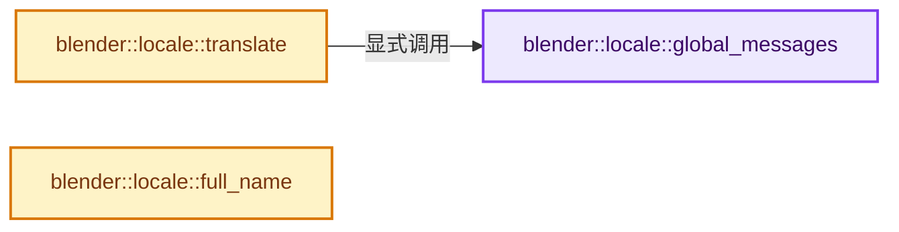
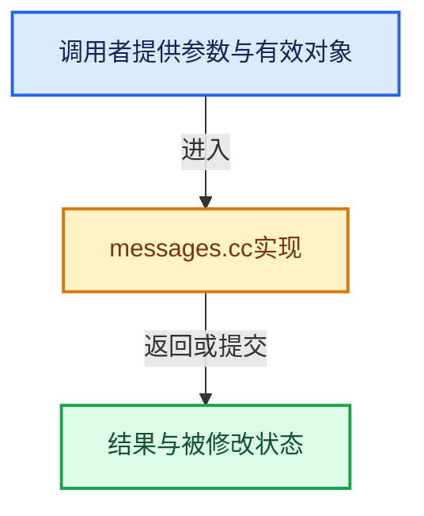

# 实现依赖专题：source/blender/blentranslation/intern/messages.cc

[方向导航](README.md) · [符号索引](../%E7%AC%A6%E5%8F%B7%E4%BE%9D%E8%B5%96%E4%B8%8E%E5%AE%9E%E7%8E%B0%E7%B4%A2%E5%BC%95.md)

本专题从正文实际调用进入，集中保存共享实现。函数有稳定锚点，可从调用处直接跳到对应完整函数；递归与互相调用通过回链组织。

## 本文件的实现关系






## 完整成员与函数实现

<a id="f-96f4b280f6e80473"></a>

### `blender::locale::global_messages`

实现位置：[source/blender/blentranslation/intern/messages.cc](../../../../../source/blender/blentranslation/intern/messages.cc) · L591—L595。

**教学注释版**

<!-- annotated:6a24d27915b7fa -->

```cpp
static std::unique_ptr<MOMessages> &global_messages()
{
  static std::unique_ptr<MOMessages> global_messages_;
  return global_messages_;
}
```

<details>
<summary>核对原始源码：source/blender/blentranslation/intern/messages.cc · L591—L595</summary>

<!-- original:6a24d27915b7fa:source/blender/blentranslation/intern/messages.cc:591:595 -->

```cpp
static std::unique_ptr<MOMessages> &global_messages()
{
  static std::unique_ptr<MOMessages> global_messages_;
  return global_messages_;
}
```

</details>

**结果出口**

- `return global_messages_;`

**继续追踪实现**

本实现没有需要继续展开的显式调用；检查返回表达式、对象转换和调用者前置条件。

<a id="f-457561e50cf5eddc"></a>

### `blender::locale::translate`

实现位置：[source/blender/blentranslation/intern/messages.cc](../../../../../source/blender/blentranslation/intern/messages.cc) · L627—L636。

接口参数：

- `const int domain`
- `const StringRef context`
- `const StringRef key`

**教学注释版**

<!-- annotated:5fba0a3d90e740 -->

```cpp
std::optional<StringRefNull> translate(const int domain,
                                       const StringRef context,
                                       const StringRef key)
{
  if (!global_messages()) {
    return std::nullopt;
  }

  return global_messages()->translate(domain, context, key);
}
```

<details>
<summary>核对原始源码：source/blender/blentranslation/intern/messages.cc · L627—L636</summary>

<!-- original:5fba0a3d90e740:source/blender/blentranslation/intern/messages.cc:627:636 -->

```cpp
std::optional<StringRefNull> translate(const int domain,
                                       const StringRef context,
                                       const StringRef key)
{
  if (!global_messages()) {
    return std::nullopt;
  }

  return global_messages()->translate(domain, context, key);
}
```

</details>

**结果出口**

- `return std::nullopt;`
- `return global_messages()->translate(domain, context, key);`

**继续追踪实现**

- `global_messages` → [blender::locale::global_messages · L591](%E4%BE%9D%E8%B5%96-messages-2a0df5.md#f-96f4b280f6e80473)。
- `global_messages()->translate` → [调用协议](../%E6%A8%A1%E6%9D%BF%E5%AE%8F%E4%B8%8E%E5%8A%A8%E6%80%81%E5%88%86%E6%B4%BE%E5%8D%8F%E8%AE%AE.md)：接收对象类型依赖auto、返回值或模板实例；不按同名猜测目标。调用位置L635。

<a id="f-9b5a3b3e85a62a8e"></a>

### `blender::locale::full_name`

实现位置：[source/blender/blentranslation/intern/messages.cc](../../../../../source/blender/blentranslation/intern/messages.cc) · L638—L641。

**教学注释版**

<!-- annotated:a64a1fc364bf51 -->

```cpp
const char *full_name()
{
  return global_full_name.c_str();
}
```

<details>
<summary>核对原始源码：source/blender/blentranslation/intern/messages.cc · L638—L641</summary>

<!-- original:a64a1fc364bf51:source/blender/blentranslation/intern/messages.cc:638:641 -->

```cpp
const char *full_name()
{
  return global_full_name.c_str();
}
```

</details>

**结果出口**

- `return global_full_name.c_str();`

**继续追踪实现**

- `global_full_name.c_str` → [调用协议](../%E6%A8%A1%E6%9D%BF%E5%AE%8F%E4%B8%8E%E5%8A%A8%E6%80%81%E5%88%86%E6%B4%BE%E5%8D%8F%E8%AE%AE.md)：接收对象类型依赖auto、返回值或模板实例；不按同名猜测目标。调用位置L640。
