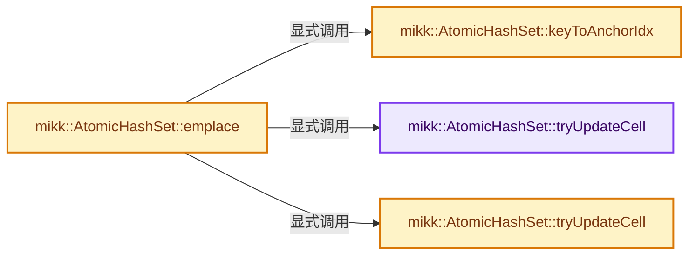
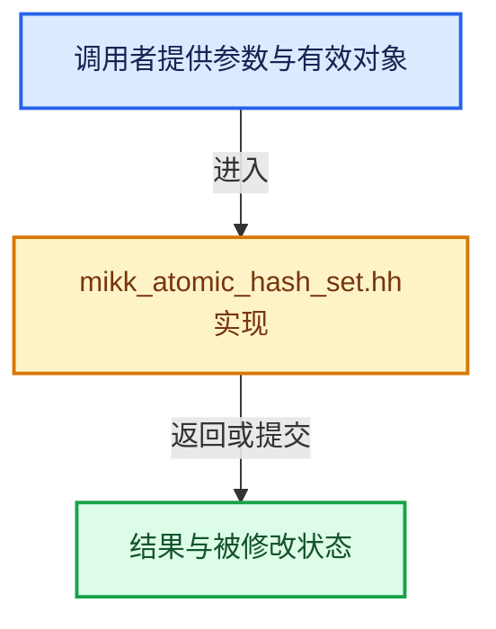

# 实现依赖专题：intern/mikktspace/mikk_atomic_hash_set.hh

[方向导航](README.md) · [符号索引](../%E7%AC%A6%E5%8F%B7%E4%BE%9D%E8%B5%96%E4%B8%8E%E5%AE%9E%E7%8E%B0%E7%B4%A2%E5%BC%95.md)

本专题从正文实际调用进入，集中保存共享实现。函数有稳定锚点，可从调用处直接跳到对应完整函数；递归与互相调用通过回链组织。

## 本文件的实现关系






## 完整成员与函数实现

<a id="f-40574e10d93de87a"></a>

### `mikk::AtomicHashSet::tryUpdateCell`

实现位置：[intern/mikktspace/mikk_atomic_hash_set.hh](../../../../../intern/mikktspace/mikk_atomic_hash_set.hh) · L130—L138。

接口参数：

- `KeyT *cell`
- `KeyT &existingKey`
- `KeyT newKey`

**教学注释版**

<!-- annotated:a852511390acf6 -->

```cpp
  bool tryUpdateCell(KeyT *cell, KeyT &existingKey, KeyT newKey)
  {
    if (*cell == existingKey) {
      *cell = newKey;
      return true;
    }
    existingKey = *cell;
    return false;
  }
```

<details>
<summary>核对原始源码：intern/mikktspace/mikk_atomic_hash_set.hh · L130—L138</summary>

<!-- original:a852511390acf6:intern/mikktspace/mikk_atomic_hash_set.hh:130:138 -->

```cpp
  bool tryUpdateCell(KeyT *cell, KeyT &existingKey, KeyT newKey)
  {
    if (*cell == existingKey) {
      *cell = newKey;
      return true;
    }
    existingKey = *cell;
    return false;
  }
```

</details>

**沿实际写入检查状态**

- `existingKey = *cell;`

**结果出口**

- `return true;`
- `return false;`

**继续追踪实现**

本实现没有需要继续展开的显式调用；检查返回表达式、对象转换和调用者前置条件。

<a id="f-6dfd3e4699759058"></a>

### `mikk::AtomicHashSet::tryUpdateCell`

实现位置：[intern/mikktspace/mikk_atomic_hash_set.hh](../../../../../intern/mikktspace/mikk_atomic_hash_set.hh) · L141—L144。

接口参数：

- `std::atomic<KeyT> *cell`
- `KeyT &existingKey`
- `KeyT newKey`

**教学注释版**

<!-- annotated:b6279606910efe -->

```cpp
  bool tryUpdateCell(std::atomic<KeyT> *cell, KeyT &existingKey, KeyT newKey)
  {
    return cell->compare_exchange_strong(existingKey, newKey, std::memory_order_acq_rel);
  }
```

<details>
<summary>核对原始源码：intern/mikktspace/mikk_atomic_hash_set.hh · L141—L144</summary>

<!-- original:b6279606910efe:intern/mikktspace/mikk_atomic_hash_set.hh:141:144 -->

```cpp
  bool tryUpdateCell(std::atomic<KeyT> *cell, KeyT &existingKey, KeyT newKey)
  {
    return cell->compare_exchange_strong(existingKey, newKey, std::memory_order_acq_rel);
  }
```

</details>

**结果出口**

- `return cell->compare_exchange_strong(existingKey, newKey, std::memory_order_acq_rel);`

**继续追踪实现**

- `cell->compare_exchange_strong` → [外部契约](https://eel.is/c++draft/)：这个边界按实际表达式及所属类型核对参数、返回值、寿命与失败行为。这里提供接口入口，不声称已解释该第三方版本的内部实现。

<a id="f-094e153771fef601"></a>

### `mikk::AtomicHashSet::emplace`

实现位置：[intern/mikktspace/mikk_atomic_hash_set.hh](../../../../../intern/mikktspace/mikk_atomic_hash_set.hh) · L146—L175。

接口参数：

- `KeyT key`

**教学注释版**

<!-- annotated:15d1e1422cd883 -->

```cpp
  std::pair<KeyT, bool> emplace(KeyT key)
  {
    size_t idx = keyToAnchorIdx(key);
    size_t numProbes = 0;
    for (;;) {
      cell_type *cell = &cells_[idx];
      KeyT existingKey = kEmptyKey_;
      /* Try to replace empty cell with our key. */
      if (tryUpdateCell(cell, existingKey, key)) {
        /* Cell was empty, we're done. */
        return std::make_pair(key, true);
      }

      /* Cell was not empty, check if the existing key is equal. */
      if (equalityChecker_(existingKey, key)) {
        /* Found equal element, we're done. */
        return std::make_pair(existingKey, false);
      }

      /* Continue to next cell according to probe strategy. */
      ++numProbes;
      if (UNLIKELY(numProbes >= capacity_)) {
        // probed every cell...fail
        // [讲解] assert：检查开发者预期条件，配置可能关闭；不承担完整输入处理或自动修复。
        assert(false);
        return std::make_pair(kEmptyKey_, false);
      }

      idx = ProbeFcn()(idx, numProbes, capacity_);
    }
  }
```

<details>
<summary>核对原始源码：intern/mikktspace/mikk_atomic_hash_set.hh · L146—L175</summary>

<!-- original:15d1e1422cd883:intern/mikktspace/mikk_atomic_hash_set.hh:146:175 -->

```cpp
  std::pair<KeyT, bool> emplace(KeyT key)
  {
    size_t idx = keyToAnchorIdx(key);
    size_t numProbes = 0;
    for (;;) {
      cell_type *cell = &cells_[idx];
      KeyT existingKey = kEmptyKey_;
      /* Try to replace empty cell with our key. */
      if (tryUpdateCell(cell, existingKey, key)) {
        /* Cell was empty, we're done. */
        return std::make_pair(key, true);
      }

      /* Cell was not empty, check if the existing key is equal. */
      if (equalityChecker_(existingKey, key)) {
        /* Found equal element, we're done. */
        return std::make_pair(existingKey, false);
      }

      /* Continue to next cell according to probe strategy. */
      ++numProbes;
      if (UNLIKELY(numProbes >= capacity_)) {
        // probed every cell...fail
        assert(false);
        return std::make_pair(kEmptyKey_, false);
      }

      idx = ProbeFcn()(idx, numProbes, capacity_);
    }
  }
```

</details>

**沿实际写入检查状态**

- `idx = ProbeFcn()(idx, numProbes, capacity_);`

**结果出口**

- `return std::make_pair(key, true);`
- `return std::make_pair(existingKey, false);`
- `return std::make_pair(kEmptyKey_, false);`

**继续追踪实现**

- `keyToAnchorIdx` → [mikk::AtomicHashSet::keyToAnchorIdx · L178](%E4%BE%9D%E8%B5%96-mikk_atomic_hash_set-70d27d.md#f-9b50abfc277a9310)。
- `tryUpdateCell` → [mikk::AtomicHashSet::tryUpdateCell · L130](%E4%BE%9D%E8%B5%96-mikk_atomic_hash_set-70d27d.md#f-40574e10d93de87a)；[mikk::AtomicHashSet::tryUpdateCell · L141](%E4%BE%9D%E8%B5%96-mikk_atomic_hash_set-70d27d.md#f-6dfd3e4699759058)。同名重载需按实参类型选择。
- `std::make_pair` → [外部契约](https://eel.is/c++draft/)：这个边界按实际表达式及所属类型核对参数、返回值、寿命与失败行为。这里提供接口入口，不声称已解释该第三方版本的内部实现。
- `equalityChecker_` → [调用协议](../%E6%A8%A1%E6%9D%BF%E5%AE%8F%E4%B8%8E%E5%8A%A8%E6%80%81%E5%88%86%E6%B4%BE%E5%8D%8F%E8%AE%AE.md)：函数指针、局部可调用对象或未展开的宏；必须结合调用者环境。调用位置L160。
- `UNLIKELY` → [UNLIKELY · L52](../03-%E5%86%85%E5%AD%98%E5%88%86%E9%85%8D%E4%B8%8E%E8%BF%90%E8%A1%8C%E6%97%B6%E7%B1%BB%E5%9E%8B/%E4%BE%9D%E8%B5%96-mallocn_intern-e4d317.md#m-b66d81651173)；[UNLIKELY · L55](../03-%E5%86%85%E5%AD%98%E5%88%86%E9%85%8D%E4%B8%8E%E8%BF%90%E8%A1%8C%E6%97%B6%E7%B1%BB%E5%9E%8B/%E4%BE%9D%E8%B5%96-mallocn_intern-e4d317.md#m-43069123e9fe)；[UNLIKELY · L108](%E4%BE%9D%E8%B5%96-defines-cd82f8.md#m-c50729f638e8)；[UNLIKELY · L111](%E4%BE%9D%E8%B5%96-defines-cd82f8.md#m-08e633831622)；[UNLIKELY · L25](../12-%E7%A9%BA%E9%97%B4%E6%95%B0%E6%8D%AE%E7%BB%93%E6%9E%84%E4%B8%8E%E5%87%A0%E4%BD%95%E7%AE%97%E6%B3%95/%E4%BE%9D%E8%B5%96-math_base_inline-546b00.md#m-beab6e34c61e)；[UNLIKELY · L27](../12-%E7%A9%BA%E9%97%B4%E6%95%B0%E6%8D%AE%E7%BB%93%E6%9E%84%E4%B8%8E%E5%87%A0%E4%BD%95%E7%AE%97%E6%B3%95/%E4%BE%9D%E8%B5%96-math_base_inline-546b00.md#m-9b279ffdd95b)；[UNLIKELY · L544](../01-%E5%9F%BA%E7%A1%80%E5%AE%B9%E5%99%A8%E4%B8%8E%E7%8E%B0%E4%BB%A3CPP/%E4%BE%9D%E8%B5%96-BLI_utildefines-293a0a.md#m-74644b8209a0)；[UNLIKELY · L547](../01-%E5%9F%BA%E7%A1%80%E5%AE%B9%E5%99%A8%E4%B8%8E%E7%8E%B0%E4%BB%A3CPP/%E4%BE%9D%E8%B5%96-BLI_utildefines-293a0a.md#m-3a47ebab6298)。宏定义由构建条件选择。
- `assert` → [外部契约](https://eel.is/c++draft/assertions)：检查开发者预期条件，配置可能关闭；不承担完整输入处理或自动修复。
- `ProbeFcn()` → [调用协议](../%E6%A8%A1%E6%9D%BF%E5%AE%8F%E4%B8%8E%E5%8A%A8%E6%80%81%E5%88%86%E6%B4%BE%E5%8D%8F%E8%AE%AE.md)：函数指针、局部可调用对象或未展开的宏；必须结合调用者环境。调用位置L173。
- `ProbeFcn` → [调用协议](../%E6%A8%A1%E6%9D%BF%E5%AE%8F%E4%B8%8E%E5%8A%A8%E6%80%81%E5%88%86%E6%B4%BE%E5%8D%8F%E8%AE%AE.md)：函数指针、局部可调用对象或未展开的宏；必须结合调用者环境。调用位置L173。

<a id="f-9b50abfc277a9310"></a>

### `mikk::AtomicHashSet::keyToAnchorIdx`

实现位置：[intern/mikktspace/mikk_atomic_hash_set.hh](../../../../../intern/mikktspace/mikk_atomic_hash_set.hh) · L178—L183。

接口参数：

- `const KeyT k`

**教学注释版**

<!-- annotated:a898c3a400528e -->

```cpp
  size_t keyToAnchorIdx(const KeyT k) const
  {
    const size_t hashVal = hasher_(k);
    const size_t probe = hashVal & kAnchorMask_;
    return LIKELY(probe < capacity_) ? probe : hashVal % capacity_;
  }
```

<details>
<summary>核对原始源码：intern/mikktspace/mikk_atomic_hash_set.hh · L178—L183</summary>

<!-- original:a898c3a400528e:intern/mikktspace/mikk_atomic_hash_set.hh:178:183 -->

```cpp
  size_t keyToAnchorIdx(const KeyT k) const
  {
    const size_t hashVal = hasher_(k);
    const size_t probe = hashVal & kAnchorMask_;
    return LIKELY(probe < capacity_) ? probe : hashVal % capacity_;
  }
```

</details>

**结果出口**

- `return LIKELY(probe < capacity_) ? probe : hashVal % capacity_;`

**继续追踪实现**

- `hasher_` → [调用协议](../%E6%A8%A1%E6%9D%BF%E5%AE%8F%E4%B8%8E%E5%8A%A8%E6%80%81%E5%88%86%E6%B4%BE%E5%8D%8F%E8%AE%AE.md)：函数指针、局部可调用对象或未展开的宏；必须结合调用者环境。调用位置L180。
- `LIKELY` → [LIKELY · L51](../03-%E5%86%85%E5%AD%98%E5%88%86%E9%85%8D%E4%B8%8E%E8%BF%90%E8%A1%8C%E6%97%B6%E7%B1%BB%E5%9E%8B/%E4%BE%9D%E8%B5%96-mallocn_intern-e4d317.md#m-53ea5e2ff73b)；[LIKELY · L54](../03-%E5%86%85%E5%AD%98%E5%88%86%E9%85%8D%E4%B8%8E%E8%BF%90%E8%A1%8C%E6%97%B6%E7%B1%BB%E5%9E%8B/%E4%BE%9D%E8%B5%96-mallocn_intern-e4d317.md#m-bb82bdeee493)；[LIKELY · L107](%E4%BE%9D%E8%B5%96-defines-cd82f8.md#m-bd6166173f61)；[LIKELY · L110](%E4%BE%9D%E8%B5%96-defines-cd82f8.md#m-2c2ad9a348a5)；[LIKELY · L543](../01-%E5%9F%BA%E7%A1%80%E5%AE%B9%E5%99%A8%E4%B8%8E%E7%8E%B0%E4%BB%A3CPP/%E4%BE%9D%E8%B5%96-BLI_utildefines-293a0a.md#m-eeacc3e1dee8)；[LIKELY · L546](../01-%E5%9F%BA%E7%A1%80%E5%AE%B9%E5%99%A8%E4%B8%8E%E7%8E%B0%E4%BB%A3CPP/%E4%BE%9D%E8%B5%96-BLI_utildefines-293a0a.md#m-26b4114d7b77)。宏定义由构建条件选择。
