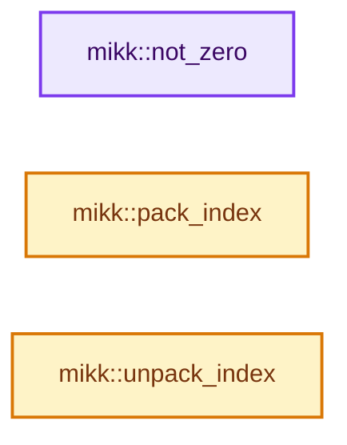
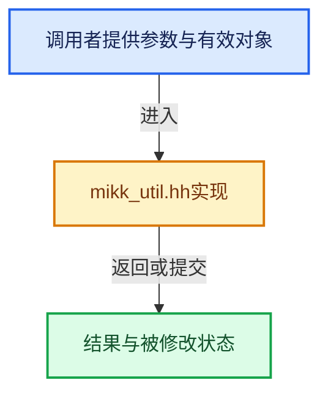

# 实现依赖专题：intern/mikktspace/mikk_util.hh

[方向导航](README.md) · [符号索引](../%E7%AC%A6%E5%8F%B7%E4%BE%9D%E8%B5%96%E4%B8%8E%E5%AE%9E%E7%8E%B0%E7%B4%A2%E5%BC%95.md)

本专题从正文实际调用进入，集中保存共享实现。函数有稳定锚点，可从调用处直接跳到对应完整函数；递归与互相调用通过回链组织。

## 本文件的实现关系






## 完整成员与函数实现

<a id="f-d6d85f27cf5a09d9"></a>

### `mikk::not_zero`

实现位置：[intern/mikktspace/mikk_util.hh](../../../../../intern/mikktspace/mikk_util.hh) · L22—L25。

接口参数：

- `const float fX`

**教学注释版**

<!-- annotated:2e123f8afc1548 -->

```cpp
inline bool not_zero(const float fX)
{
  return fabsf(fX) > FLT_MIN;
}
```

<details>
<summary>核对原始源码：intern/mikktspace/mikk_util.hh · L22—L25</summary>

<!-- original:2e123f8afc1548:intern/mikktspace/mikk_util.hh:22:25 -->

```cpp
inline bool not_zero(const float fX)
{
  return fabsf(fX) > FLT_MIN;
}
```

</details>

**结果出口**

- `return fabsf(fX) > FLT_MIN;`

**继续追踪实现**

- `fabsf` → [fabsf · L21](%E4%BE%9D%E8%B5%96-radial_tiling_shared-98abf9.md#m-02cc4c69cfb3)；[fabsf · L43](%E4%BE%9D%E8%B5%96-radial_tiling_shared-98abf9.md#m-04effe61803b)；[fabsf · L74](%E4%BE%9D%E8%B5%96-radial_tiling_shared-98abf9.md#m-927dd4eba7dc)；[fabsf · L25](../01-%E5%9F%BA%E7%A1%80%E5%AE%B9%E5%99%A8%E4%B8%8E%E7%8E%B0%E4%BB%A3CPP/%E4%BE%9D%E8%B5%96-radial_tiling_shared-7989a4.md#m-8348d6b3d08f)；[fabsf · L47](../01-%E5%9F%BA%E7%A1%80%E5%AE%B9%E5%99%A8%E4%B8%8E%E7%8E%B0%E4%BB%A3CPP/%E4%BE%9D%E8%B5%96-radial_tiling_shared-7989a4.md#m-13b7e0b6d84f)；[fabsf · L78](../01-%E5%9F%BA%E7%A1%80%E5%AE%B9%E5%99%A8%E4%B8%8E%E7%8E%B0%E4%BB%A3CPP/%E4%BE%9D%E8%B5%96-radial_tiling_shared-7989a4.md#m-326c83464a0d)；[fabsf · L21](%E4%BE%9D%E8%B5%96-node_radial_tiling_shared-b14bc2.md#m-7c3ee12fc119)；[fabsf · L43](%E4%BE%9D%E8%B5%96-node_radial_tiling_shared-b14bc2.md#m-9112db0e2dd1)；[fabsf · L74](%E4%BE%9D%E8%B5%96-node_radial_tiling_shared-b14bc2.md#m-ee4e61908a6f)；[fabsf · L167](%E4%BE%9D%E8%B5%96-compat-56205c.md#m-b039ee6c1601)；[fabsf · L265](%E4%BE%9D%E8%B5%96-compat-efe0e9.md#m-6b21869e9f3f)。宏定义由构建条件选择。

<a id="f-3a15ac87c0be7fa2"></a>

### `mikk::pack_index`

实现位置：[intern/mikktspace/mikk_util.hh](../../../../../intern/mikktspace/mikk_util.hh) · L28—L32。

接口参数：

- `const uint face`
- `const uint vert`

**教学注释版**

<!-- annotated:bde6c7867bfbe6 -->

```cpp
static uint pack_index(const uint face, const uint vert)
{
  // [讲解] assert：检查开发者预期条件，配置可能关闭；不承担完整输入处理或自动修复。
  assert((vert & 0x3) == vert);
  return (face << 2) | (vert & 0x3);
}
```

<details>
<summary>核对原始源码：intern/mikktspace/mikk_util.hh · L28—L32</summary>

<!-- original:bde6c7867bfbe6:intern/mikktspace/mikk_util.hh:28:32 -->

```cpp
static uint pack_index(const uint face, const uint vert)
{
  assert((vert & 0x3) == vert);
  return (face << 2) | (vert & 0x3);
}
```

</details>

**结果出口**

- `return (face << 2) | (vert & 0x3);`

**继续追踪实现**

- `assert` → [外部契约](https://eel.is/c++draft/assertions)：检查开发者预期条件，配置可能关闭；不承担完整输入处理或自动修复。

<a id="f-5f4558ff149fd484"></a>

### `mikk::unpack_index`

实现位置：[intern/mikktspace/mikk_util.hh](../../../../../intern/mikktspace/mikk_util.hh) · L34—L38。

接口参数：

- `uint &face`
- `uint &vert`
- `const uint indexIn`

**教学注释版**

<!-- annotated:f12f19da875509 -->

```cpp
static void unpack_index(uint &face, uint &vert, const uint indexIn)
{
  vert = indexIn & 0x3;
  face = indexIn >> 2;
}
```

<details>
<summary>核对原始源码：intern/mikktspace/mikk_util.hh · L34—L38</summary>

<!-- original:f12f19da875509:intern/mikktspace/mikk_util.hh:34:38 -->

```cpp
static void unpack_index(uint &face, uint &vert, const uint indexIn)
{
  vert = indexIn & 0x3;
  face = indexIn >> 2;
}
```

</details>

**沿实际写入检查状态**

- `vert = indexIn & 0x3;`
- `face = indexIn >> 2;`

**继续追踪实现**

本实现没有需要继续展开的显式调用；检查返回表达式、对象转换和调用者前置条件。
