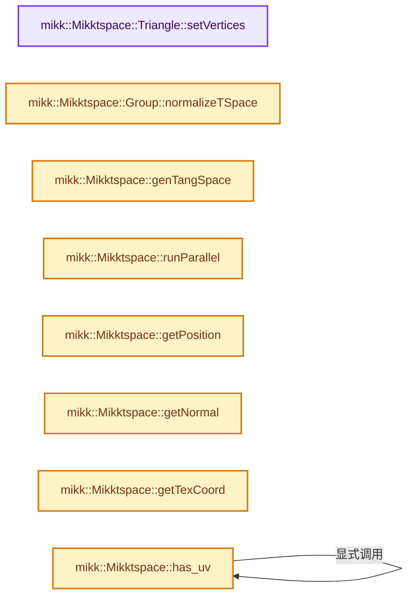
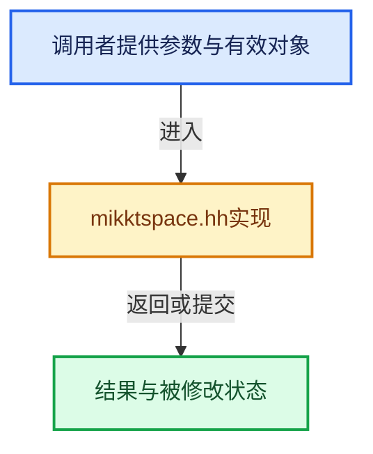

# 实现依赖专题：intern/mikktspace/mikktspace.hh

[方向导航](README.md) · [符号索引](../%E7%AC%A6%E5%8F%B7%E4%BE%9D%E8%B5%96%E4%B8%8E%E5%AE%9E%E7%8E%B0%E7%B4%A2%E5%BC%95.md)

本专题从正文实际调用进入，集中保存共享实现。函数有稳定锚点，可从调用处直接跳到对应完整函数；递归与互相调用通过回链组织。

## 本文件的实现关系






## 完整成员与函数实现

<a id="f-06ea7edd2a54e3bb"></a>

### `mikk::Mikktspace::Triangle::setVertices`

实现位置：[intern/mikktspace/mikktspace.hh](../../../../../intern/mikktspace/mikktspace.hh) · L66—L74。

接口参数：

- `uint8_t i0`
- `uint8_t i1`
- `uint8_t i2`

**教学注释版**

<!-- annotated:87219bc24d26e2 -->

```cpp
    void setVertices(uint8_t i0, uint8_t i1, uint8_t i2)
    {
      faceVertex[0] = i0;
      faceVertex[1] = i1;
      faceVertex[2] = i2;
      vertices[0] = pack_index(faceIdx, i0);
      vertices[1] = pack_index(faceIdx, i1);
      vertices[2] = pack_index(faceIdx, i2);
    }
```

<details>
<summary>核对原始源码：intern/mikktspace/mikktspace.hh · L66—L74</summary>

<!-- original:87219bc24d26e2:intern/mikktspace/mikktspace.hh:66:74 -->

```cpp
    void setVertices(uint8_t i0, uint8_t i1, uint8_t i2)
    {
      faceVertex[0] = i0;
      faceVertex[1] = i1;
      faceVertex[2] = i2;
      vertices[0] = pack_index(faceIdx, i0);
      vertices[1] = pack_index(faceIdx, i1);
      vertices[2] = pack_index(faceIdx, i2);
    }
```

</details>

**沿实际写入检查状态**

- `faceVertex[0] = i0;`
- `faceVertex[1] = i1;`
- `faceVertex[2] = i2;`
- `vertices[0] = pack_index(faceIdx, i0);`
- `vertices[1] = pack_index(faceIdx, i1);`
- `vertices[2] = pack_index(faceIdx, i2);`

**继续追踪实现**

- `pack_index` → [mikk::pack_index · L28](%E4%BE%9D%E8%B5%96-mikk_util-9cf568.md#f-3a15ac87c0be7fa2)。

<a id="f-d66d58f19f1a1e52"></a>

### `mikk::Mikktspace::Group::normalizeTSpace`

实现位置：[intern/mikktspace/mikktspace.hh](../../../../../intern/mikktspace/mikktspace.hh) · L89—L92。

**教学注释版**

<!-- annotated:4172ac3a9c4d44 -->

```cpp
    void normalizeTSpace()
    {
      tangent = tangent.normalize();
    }
```

<details>
<summary>核对原始源码：intern/mikktspace/mikktspace.hh · L89—L92</summary>

<!-- original:4172ac3a9c4d44:intern/mikktspace/mikktspace.hh:89:92 -->

```cpp
    void normalizeTSpace()
    {
      tangent = tangent.normalize();
    }
```

</details>

**沿实际写入检查状态**

- `tangent = tangent.normalize();`

**继续追踪实现**

- `tangent.normalize` → [mikk::float3::normalize · L92](%E4%BE%9D%E8%B5%96-mikk_float3-227415.md#f-c7811446b306b649)。

<a id="f-5bcf7b1a910d5339"></a>

### `mikk::Mikktspace::genTangSpace`

实现位置：[intern/mikktspace/mikktspace.hh](../../../../../intern/mikktspace/mikktspace.hh) · L147—L214。

**教学注释版**

<!-- annotated:c530d000e0d0da -->

```cpp
  void genTangSpace()
  {
    nrFaces = uint(mesh.GetNumFaces());

#ifdef WITH_TBB
    nrThreads = tbb::this_task_arena::max_concurrency();
    isParallel = (nrThreads > 1) && (nrFaces > 10000);
#else
    nrThreads = 1;
    isParallel = false;
#endif

    // make an initial triangle --> face index list
    generateInitialVerticesIndexList();

    if (nrTriangles == 0) {
      return;
    }

    // make a welded index list of identical positions and attributes (pos, norm, texc)
    generateSharedVerticesIndexList();

    // mark all triangle pairs that belong to a quad with only one
    // good triangle. These need special treatment in degenEpilogue().
    // Additionally, move all good triangles to the start of
    // triangles[] without changing order and
    // put the degenerate triangles last.
    degenPrologue();

    if (nrTriangles == 0) {
      // No point in building tangents if there are no non-degenerate triangles, so just zero them
      tSpaces.resize(nrTSpaces);
    }
    else {
      // evaluate triangle level attributes and neighbor list
      initTriangle();

      // match up edge pairs
      buildNeighbors();

      // based on the 4 rules, identify groups based on connectivity
      build4RuleGroups();

      // make tspaces, each group is split up into subgroups.
      // Finally a tangent space is made for every resulting subgroup
      generateTSpaces();

      // degenerate quads with one good triangle will be fixed by copying a space from
      // the good triangle to the coinciding vertex.
      // all other degenerate triangles will just copy a space from any good triangle
      // with the same welded index in vertices[].
      degenEpilogue();
    }

    uint index = 0;
    for (uint f = 0; f < nrFaces; f++) {
      const uint verts = mesh.GetNumVerticesOfFace(f);
      if (verts != 3 && verts != 4) {
        continue;
      }

      // set data
      for (uint i = 0; i < verts; i++) {
        const TSpace &tSpace = tSpaces[index++];
        mesh.SetTangentSpace(f, i, tSpace.tangent, tSpace.orientPreserving);
      }
    }
  }
```

<details>
<summary>核对原始源码：intern/mikktspace/mikktspace.hh · L147—L214</summary>

<!-- original:c530d000e0d0da:intern/mikktspace/mikktspace.hh:147:214 -->

```cpp
  void genTangSpace()
  {
    nrFaces = uint(mesh.GetNumFaces());

#ifdef WITH_TBB
    nrThreads = tbb::this_task_arena::max_concurrency();
    isParallel = (nrThreads > 1) && (nrFaces > 10000);
#else
    nrThreads = 1;
    isParallel = false;
#endif

    // make an initial triangle --> face index list
    generateInitialVerticesIndexList();

    if (nrTriangles == 0) {
      return;
    }

    // make a welded index list of identical positions and attributes (pos, norm, texc)
    generateSharedVerticesIndexList();

    // mark all triangle pairs that belong to a quad with only one
    // good triangle. These need special treatment in degenEpilogue().
    // Additionally, move all good triangles to the start of
    // triangles[] without changing order and
    // put the degenerate triangles last.
    degenPrologue();

    if (nrTriangles == 0) {
      // No point in building tangents if there are no non-degenerate triangles, so just zero them
      tSpaces.resize(nrTSpaces);
    }
    else {
      // evaluate triangle level attributes and neighbor list
      initTriangle();

      // match up edge pairs
      buildNeighbors();

      // based on the 4 rules, identify groups based on connectivity
      build4RuleGroups();

      // make tspaces, each group is split up into subgroups.
      // Finally a tangent space is made for every resulting subgroup
      generateTSpaces();

      // degenerate quads with one good triangle will be fixed by copying a space from
      // the good triangle to the coinciding vertex.
      // all other degenerate triangles will just copy a space from any good triangle
      // with the same welded index in vertices[].
      degenEpilogue();
    }

    uint index = 0;
    for (uint f = 0; f < nrFaces; f++) {
      const uint verts = mesh.GetNumVerticesOfFace(f);
      if (verts != 3 && verts != 4) {
        continue;
      }

      // set data
      for (uint i = 0; i < verts; i++) {
        const TSpace &tSpace = tSpaces[index++];
        mesh.SetTangentSpace(f, i, tSpace.tangent, tSpace.orientPreserving);
      }
    }
  }
```

</details>

**沿实际写入检查状态**

- `nrFaces = uint(mesh.GetNumFaces());`
- `nrThreads = tbb::this_task_arena::max_concurrency();`
- `isParallel = (nrThreads > 1) && (nrFaces > 10000);`
- `nrThreads = 1;`
- `isParallel = false;`

**继续追踪实现**

- `mesh.GetNumFaces` → [调用协议](../%E6%A8%A1%E6%9D%BF%E5%AE%8F%E4%B8%8E%E5%8A%A8%E6%80%81%E5%88%86%E6%B4%BE%E5%8D%8F%E8%AE%AE.md)：由接收对象具体类型或运行时策略提供实现。调用位置L149。
- `tbb::this_task_arena::max_concurrency` → [外部契约](https://uxlfoundation.github.io/oneTBB/)：任务调度属于第三方运行时；检查任务寿命、等待与隔离规则，不能把并行等待当作普通同步函数调用。
- `generateInitialVerticesIndexList` → [mikk::Mikktspace::generateInitialVerticesIndexList · L264](%E4%BE%9D%E8%B5%96-mikktspace-9523a0.md#f-9c277f6b24923845)。
- `generateSharedVerticesIndexList` → [mikk::Mikktspace::generateSharedVerticesIndexList · L364](%E4%BE%9D%E8%B5%96-mikktspace-9523a0.md#f-c4b31851eb67832f)。
- `degenPrologue` → [mikk::Mikktspace::degenPrologue · L377](%E4%BE%9D%E8%B5%96-mikktspace-9523a0.md#f-267c25561dbfd166)。
- `tSpaces.resize` → [外部契约](https://eel.is/c++draft/)：这个边界按实际表达式及所属类型核对参数、返回值、寿命与失败行为。这里提供接口入口，不声称已解释该第三方版本的内部实现。
- `initTriangle` → [mikk::Mikktspace::initTriangle · L512](%E4%BE%9D%E8%B5%96-mikktspace-9523a0.md#f-999fe24bd10b2e79)。
- `buildNeighbors` → [mikk::Mikktspace::buildNeighbors · L653](%E4%BE%9D%E8%B5%96-mikktspace-9523a0.md#f-f6b5c4ae7bbcba37)。
- `build4RuleGroups` → [mikk::Mikktspace::build4RuleGroups · L744](%E4%BE%9D%E8%B5%96-mikktspace-9523a0.md#f-29860242271c17ca)。
- `generateTSpaces` → [mikk::Mikktspace::generateTSpaces · L811](%E4%BE%9D%E8%B5%96-mikktspace-9523a0.md#f-0c41d05117a59639)。
- `degenEpilogue` → [mikk::Mikktspace::degenEpilogue · L415](%E4%BE%9D%E8%B5%96-mikktspace-9523a0.md#f-4f449aa61e8386c6)。
- `mesh.GetNumVerticesOfFace` → [调用协议](../%E6%A8%A1%E6%9D%BF%E5%AE%8F%E4%B8%8E%E5%8A%A8%E6%80%81%E5%88%86%E6%B4%BE%E5%8D%8F%E8%AE%AE.md)：由接收对象具体类型或运行时策略提供实现。调用位置L203。
- `mesh.SetTangentSpace` → [调用协议](../%E6%A8%A1%E6%9D%BF%E5%AE%8F%E4%B8%8E%E5%8A%A8%E6%80%81%E5%88%86%E6%B4%BE%E5%8D%8F%E8%AE%AE.md)：由接收对象具体类型或运行时策略提供实现。调用位置L211。

<a id="f-b4617baede0ddce6"></a>

### `mikk::Mikktspace::runParallel`

实现位置：[intern/mikktspace/mikktspace.hh](../../../../../intern/mikktspace/mikktspace.hh) · L217—L230。

接口参数：

- `uint start`
- `uint end`
- `F func`

**教学注释版**

<!-- annotated:951fcfea464e6c -->

```cpp
  template<typename F> void runParallel(uint start, uint end, F func)
  {
#ifdef WITH_TBB
    if (isParallel) {
      tbb::parallel_for(start, end, func);
    }
    else
#endif
    {
      for (uint i = start; i < end; i++) {
        func(i);
      }
    }
  }
```

<details>
<summary>核对原始源码：intern/mikktspace/mikktspace.hh · L217—L230</summary>

<!-- original:951fcfea464e6c:intern/mikktspace/mikktspace.hh:217:230 -->

```cpp
  template<typename F> void runParallel(uint start, uint end, F func)
  {
#ifdef WITH_TBB
    if (isParallel) {
      tbb::parallel_for(start, end, func);
    }
    else
#endif
    {
      for (uint i = start; i < end; i++) {
        func(i);
      }
    }
  }
```

</details>

**继续追踪实现**

- `tbb::parallel_for` → [外部契约](https://uxlfoundation.github.io/oneTBB/)：任务调度属于第三方运行时；检查任务寿命、等待与隔离规则，不能把并行等待当作普通同步函数调用。
- `func` → [调用协议](../%E6%A8%A1%E6%9D%BF%E5%AE%8F%E4%B8%8E%E5%8A%A8%E6%80%81%E5%88%86%E6%B4%BE%E5%8D%8F%E8%AE%AE.md)：局部可调用对象，须结合其初始化与捕获环境。调用位置L227。

<a id="f-49102da8738ab589"></a>

### `mikk::Mikktspace::getPosition`

实现位置：[intern/mikktspace/mikktspace.hh](../../../../../intern/mikktspace/mikktspace.hh) · L235—L240。

接口参数：

- `uint vertexID`

**教学注释版**

<!-- annotated:e6b7a3c1e23e22 -->

```cpp
  float3 getPosition(uint vertexID)
  {
    uint f, v;
    unpack_index(f, v, vertexID);
    return mesh.GetPosition(f, v);
  }
```

<details>
<summary>核对原始源码：intern/mikktspace/mikktspace.hh · L235—L240</summary>

<!-- original:e6b7a3c1e23e22:intern/mikktspace/mikktspace.hh:235:240 -->

```cpp
  float3 getPosition(uint vertexID)
  {
    uint f, v;
    unpack_index(f, v, vertexID);
    return mesh.GetPosition(f, v);
  }
```

</details>

**结果出口**

- `return mesh.GetPosition(f, v);`

**继续追踪实现**

- `unpack_index` → [mikk::unpack_index · L34](%E4%BE%9D%E8%B5%96-mikk_util-9cf568.md#f-5f4558ff149fd484)。
- `mesh.GetPosition` → [调用协议](../%E6%A8%A1%E6%9D%BF%E5%AE%8F%E4%B8%8E%E5%8A%A8%E6%80%81%E5%88%86%E6%B4%BE%E5%8D%8F%E8%AE%AE.md)：由接收对象具体类型或运行时策略提供实现。调用位置L239。

<a id="f-ffb5d7e21ea18d0f"></a>

### `mikk::Mikktspace::getNormal`

实现位置：[intern/mikktspace/mikktspace.hh](../../../../../intern/mikktspace/mikktspace.hh) · L242—L247。

接口参数：

- `uint vertexID`

**教学注释版**

<!-- annotated:27fba6ef4334dc -->

```cpp
  float3 getNormal(uint vertexID)
  {
    uint f, v;
    unpack_index(f, v, vertexID);
    return mesh.GetNormal(f, v);
  }
```

<details>
<summary>核对原始源码：intern/mikktspace/mikktspace.hh · L242—L247</summary>

<!-- original:27fba6ef4334dc:intern/mikktspace/mikktspace.hh:242:247 -->

```cpp
  float3 getNormal(uint vertexID)
  {
    uint f, v;
    unpack_index(f, v, vertexID);
    return mesh.GetNormal(f, v);
  }
```

</details>

**结果出口**

- `return mesh.GetNormal(f, v);`

**继续追踪实现**

- `unpack_index` → [mikk::unpack_index · L34](%E4%BE%9D%E8%B5%96-mikk_util-9cf568.md#f-5f4558ff149fd484)。
- `mesh.GetNormal` → [调用协议](../%E6%A8%A1%E6%9D%BF%E5%AE%8F%E4%B8%8E%E5%8A%A8%E6%80%81%E5%88%86%E6%B4%BE%E5%8D%8F%E8%AE%AE.md)：由接收对象具体类型或运行时策略提供实现。调用位置L246。

<a id="f-3b401d1e9fe697e8"></a>

### `mikk::Mikktspace::getTexCoord`

实现位置：[intern/mikktspace/mikktspace.hh](../../../../../intern/mikktspace/mikktspace.hh) · L249—L254。

接口参数：

- `uint vertexID`

**教学注释版**

<!-- annotated:77481a7432b7a7 -->

```cpp
  float3 getTexCoord(uint vertexID)
  {
    uint f, v;
    unpack_index(f, v, vertexID);
    return mesh.GetTexCoord(f, v);
  }
```

<details>
<summary>核对原始源码：intern/mikktspace/mikktspace.hh · L249—L254</summary>

<!-- original:77481a7432b7a7:intern/mikktspace/mikktspace.hh:249:254 -->

```cpp
  float3 getTexCoord(uint vertexID)
  {
    uint f, v;
    unpack_index(f, v, vertexID);
    return mesh.GetTexCoord(f, v);
  }
```

</details>

**结果出口**

- `return mesh.GetTexCoord(f, v);`

**继续追踪实现**

- `unpack_index` → [mikk::unpack_index · L34](%E4%BE%9D%E8%B5%96-mikk_util-9cf568.md#f-5f4558ff149fd484)。
- `mesh.GetTexCoord` → [调用协议](../%E6%A8%A1%E6%9D%BF%E5%AE%8F%E4%B8%8E%E5%8A%A8%E6%80%81%E5%88%86%E6%B4%BE%E5%8D%8F%E8%AE%AE.md)：由接收对象具体类型或运行时策略提供实现。调用位置L253。

<a id="f-11514b96c7a38d94"></a>

### `mikk::Mikktspace::has_uv`

实现位置：[intern/mikktspace/mikktspace.hh](../../../../../intern/mikktspace/mikktspace.hh) · L256—L259。

**教学注释版**

<!-- annotated:186eca5c9eacc3 -->

```cpp
  bool has_uv() const
  {
    return mesh.has_uv();
  }
```

<details>
<summary>核对原始源码：intern/mikktspace/mikktspace.hh · L256—L259</summary>

<!-- original:186eca5c9eacc3:intern/mikktspace/mikktspace.hh:256:259 -->

```cpp
  bool has_uv() const
  {
    return mesh.has_uv();
  }
```

</details>

**结果出口**

- `return mesh.has_uv();`

**继续追踪实现**

- `mesh.has_uv` → [mikk::Mikktspace::has_uv · L256](%E4%BE%9D%E8%B5%96-mikktspace-9523a0.md#f-11514b96c7a38d94)。

<a id="f-9c277f6b24923845"></a>

### `mikk::Mikktspace::generateInitialVerticesIndexList`

实现位置：[intern/mikktspace/mikktspace.hh](../../../../../intern/mikktspace/mikktspace.hh) · L264—L325。

**教学注释版**

<!-- annotated:da1c84da332aa7 -->

```cpp
  void generateInitialVerticesIndexList()
  {
    nrTriangles = 0;
    for (uint f = 0; f < nrFaces; f++) {
      const uint verts = mesh.GetNumVerticesOfFace(f);
      if (verts == 3) {
        nrTriangles += 1;
      }
      else if (verts == 4) {
        nrTriangles += 2;
      }
    }

    triangles.reserve(nrTriangles);

    nrTSpaces = 0;
    for (uint f = 0; f < nrFaces; f++) {
      const uint verts = mesh.GetNumVerticesOfFace(f);
      if (verts != 3 && verts != 4) {
        continue;
      }

      uint tA = uint(triangles.size());
      triangles.emplace_back(f, nrTSpaces);
      Triangle &triA = triangles[tA];

      if (verts == 3) {
        triA.setVertices(0, 1, 2);
      }
      else {
        uint tB = uint(triangles.size());
        triangles.emplace_back(f, nrTSpaces);
        Triangle &triB = triangles[tB];

        // need an order independent way to evaluate
        // tspace on quads. This is done by splitting
        // along the shortest diagonal.
        float distSQ_02 = (mesh.GetTexCoord(f, 2) - mesh.GetTexCoord(f, 0)).length_squared();
        float distSQ_13 = (mesh.GetTexCoord(f, 3) - mesh.GetTexCoord(f, 1)).length_squared();
        bool quadDiagIs_02;
        if (distSQ_02 != distSQ_13) {
          quadDiagIs_02 = (distSQ_02 < distSQ_13);
        }
        else {
          distSQ_02 = (mesh.GetPosition(f, 2) - mesh.GetPosition(f, 0)).length_squared();
          distSQ_13 = (mesh.GetPosition(f, 3) - mesh.GetPosition(f, 1)).length_squared();
          quadDiagIs_02 = !(distSQ_13 < distSQ_02);
        }

        if (quadDiagIs_02) {
          triA.setVertices(0, 1, 2);
          triB.setVertices(0, 2, 3);
        }
        else {
          triA.setVertices(0, 1, 3);
          triB.setVertices(1, 2, 3);
        }
      }

      nrTSpaces += verts;
    }
  }
```

<details>
<summary>核对原始源码：intern/mikktspace/mikktspace.hh · L264—L325</summary>

<!-- original:da1c84da332aa7:intern/mikktspace/mikktspace.hh:264:325 -->

```cpp
  void generateInitialVerticesIndexList()
  {
    nrTriangles = 0;
    for (uint f = 0; f < nrFaces; f++) {
      const uint verts = mesh.GetNumVerticesOfFace(f);
      if (verts == 3) {
        nrTriangles += 1;
      }
      else if (verts == 4) {
        nrTriangles += 2;
      }
    }

    triangles.reserve(nrTriangles);

    nrTSpaces = 0;
    for (uint f = 0; f < nrFaces; f++) {
      const uint verts = mesh.GetNumVerticesOfFace(f);
      if (verts != 3 && verts != 4) {
        continue;
      }

      uint tA = uint(triangles.size());
      triangles.emplace_back(f, nrTSpaces);
      Triangle &triA = triangles[tA];

      if (verts == 3) {
        triA.setVertices(0, 1, 2);
      }
      else {
        uint tB = uint(triangles.size());
        triangles.emplace_back(f, nrTSpaces);
        Triangle &triB = triangles[tB];

        // need an order independent way to evaluate
        // tspace on quads. This is done by splitting
        // along the shortest diagonal.
        float distSQ_02 = (mesh.GetTexCoord(f, 2) - mesh.GetTexCoord(f, 0)).length_squared();
        float distSQ_13 = (mesh.GetTexCoord(f, 3) - mesh.GetTexCoord(f, 1)).length_squared();
        bool quadDiagIs_02;
        if (distSQ_02 != distSQ_13) {
          quadDiagIs_02 = (distSQ_02 < distSQ_13);
        }
        else {
          distSQ_02 = (mesh.GetPosition(f, 2) - mesh.GetPosition(f, 0)).length_squared();
          distSQ_13 = (mesh.GetPosition(f, 3) - mesh.GetPosition(f, 1)).length_squared();
          quadDiagIs_02 = !(distSQ_13 < distSQ_02);
        }

        if (quadDiagIs_02) {
          triA.setVertices(0, 1, 2);
          triB.setVertices(0, 2, 3);
        }
        else {
          triA.setVertices(0, 1, 3);
          triB.setVertices(1, 2, 3);
        }
      }

      nrTSpaces += verts;
    }
  }
```

</details>

**沿实际写入检查状态**

- `nrTriangles = 0;`
- `nrTriangles += 1;`
- `nrTriangles += 2;`
- `nrTSpaces = 0;`
- `quadDiagIs_02 = (distSQ_02 < distSQ_13);`
- `distSQ_02 = (mesh.GetPosition(f, 2) - mesh.GetPosition(f, 0)).length_squared();`
- `distSQ_13 = (mesh.GetPosition(f, 3) - mesh.GetPosition(f, 1)).length_squared();`
- `quadDiagIs_02 = !(distSQ_13 < distSQ_02);`
- `nrTSpaces += verts;`

**继续追踪实现**

- `mesh.GetNumVerticesOfFace` → [调用协议](../%E6%A8%A1%E6%9D%BF%E5%AE%8F%E4%B8%8E%E5%8A%A8%E6%80%81%E5%88%86%E6%B4%BE%E5%8D%8F%E8%AE%AE.md)：由接收对象具体类型或运行时策略提供实现。调用位置L268。
- `triangles.reserve` → [外部契约](https://eel.is/c++draft/)：这个边界按实际表达式及所属类型核对参数、返回值、寿命与失败行为。这里提供接口入口，不声称已解释该第三方版本的内部实现。
- `triangles.size` → [外部契约](https://eel.is/c++draft/)：这个边界按实际表达式及所属类型核对参数、返回值、寿命与失败行为。这里提供接口入口，不声称已解释该第三方版本的内部实现。
- `triangles.emplace_back` → [外部契约](https://eel.is/c++draft/)：这个边界按实际表达式及所属类型核对参数、返回值、寿命与失败行为。这里提供接口入口，不声称已解释该第三方版本的内部实现。
- `triA.setVertices` → [mikk::Mikktspace::Triangle::setVertices · L66](%E4%BE%9D%E8%B5%96-mikktspace-9523a0.md#f-06ea7edd2a54e3bb)。
- `(mesh.GetTexCoord(f, 2) - mesh.GetTexCoord(f, 0)).length_squared` → [调用协议](../%E6%A8%A1%E6%9D%BF%E5%AE%8F%E4%B8%8E%E5%8A%A8%E6%80%81%E5%88%86%E6%B4%BE%E5%8D%8F%E8%AE%AE.md)：接收对象类型依赖auto、返回值或模板实例；不按同名猜测目标。调用位置L301。
- `mesh.GetTexCoord` → [调用协议](../%E6%A8%A1%E6%9D%BF%E5%AE%8F%E4%B8%8E%E5%8A%A8%E6%80%81%E5%88%86%E6%B4%BE%E5%8D%8F%E8%AE%AE.md)：由接收对象具体类型或运行时策略提供实现。调用位置L301。
- `(mesh.GetTexCoord(f, 3) - mesh.GetTexCoord(f, 1)).length_squared` → [调用协议](../%E6%A8%A1%E6%9D%BF%E5%AE%8F%E4%B8%8E%E5%8A%A8%E6%80%81%E5%88%86%E6%B4%BE%E5%8D%8F%E8%AE%AE.md)：接收对象类型依赖auto、返回值或模板实例；不按同名猜测目标。调用位置L302。
- `(mesh.GetPosition(f, 2) - mesh.GetPosition(f, 0)).length_squared` → [调用协议](../%E6%A8%A1%E6%9D%BF%E5%AE%8F%E4%B8%8E%E5%8A%A8%E6%80%81%E5%88%86%E6%B4%BE%E5%8D%8F%E8%AE%AE.md)：接收对象类型依赖auto、返回值或模板实例；不按同名猜测目标。调用位置L308。
- `mesh.GetPosition` → [调用协议](../%E6%A8%A1%E6%9D%BF%E5%AE%8F%E4%B8%8E%E5%8A%A8%E6%80%81%E5%88%86%E6%B4%BE%E5%8D%8F%E8%AE%AE.md)：由接收对象具体类型或运行时策略提供实现。调用位置L308。
- `(mesh.GetPosition(f, 3) - mesh.GetPosition(f, 1)).length_squared` → [调用协议](../%E6%A8%A1%E6%9D%BF%E5%AE%8F%E4%B8%8E%E5%8A%A8%E6%80%81%E5%88%86%E6%B4%BE%E5%8D%8F%E8%AE%AE.md)：接收对象类型依赖auto、返回值或模板实例；不按同名猜测目标。调用位置L309。
- `triB.setVertices` → [mikk::Mikktspace::Triangle::setVertices · L66](%E4%BE%9D%E8%B5%96-mikktspace-9523a0.md#f-06ea7edd2a54e3bb)。

<a id="f-50a232f702aa3fe3"></a>

### `mikk::Mikktspace::generateSharedVerticesIndexList_impl`

实现位置：[intern/mikktspace/mikktspace.hh](../../../../../intern/mikktspace/mikktspace.hh) · L351—L363。

**教学注释版**

<!-- annotated:39b7d73f78e1b2 -->

```cpp
  template<bool isAtomic> void generateSharedVerticesIndexList_impl()
  {
    uint numVertices = nrTriangles * 3;
    AtomicHashSet<uint, isAtomic, VertexHash, VertexEqual> set(numVertices, {this}, {this});
    runParallel(0u, nrTriangles, [&](uint t) {
      for (uint i = 0; i < 3; i++) {
        auto res = set.emplace(triangles[t].vertices[i]);
        if (!res.second) {
          triangles[t].vertices[i] = res.first;
        }
      }
    });
  }
```

<details>
<summary>核对原始源码：intern/mikktspace/mikktspace.hh · L351—L363</summary>

<!-- original:39b7d73f78e1b2:intern/mikktspace/mikktspace.hh:351:363 -->

```cpp
  template<bool isAtomic> void generateSharedVerticesIndexList_impl()
  {
    uint numVertices = nrTriangles * 3;
    AtomicHashSet<uint, isAtomic, VertexHash, VertexEqual> set(numVertices, {this}, {this});
    runParallel(0u, nrTriangles, [&](uint t) {
      for (uint i = 0; i < 3; i++) {
        auto res = set.emplace(triangles[t].vertices[i]);
        if (!res.second) {
          triangles[t].vertices[i] = res.first;
        }
      }
    });
  }
```

</details>

**沿实际写入检查状态**

- `triangles[t].vertices[i] = res.first;`

**继续追踪实现**

- `runParallel` → [mikk::Mikktspace::runParallel · L217](%E4%BE%9D%E8%B5%96-mikktspace-9523a0.md#f-b4617baede0ddce6)。
- `set.emplace` → [mikk::AtomicHashSet::emplace · L146](%E4%BE%9D%E8%B5%96-mikk_atomic_hash_set-70d27d.md#f-094e153771fef601)。

<a id="f-c4b31851eb67832f"></a>

### `mikk::Mikktspace::generateSharedVerticesIndexList`

实现位置：[intern/mikktspace/mikktspace.hh](../../../../../intern/mikktspace/mikktspace.hh) · L364—L372。

**教学注释版**

<!-- annotated:21be935e59b40e -->

```cpp
  void generateSharedVerticesIndexList()
  {
    if (isParallel) {
      generateSharedVerticesIndexList_impl<true>();
    }
    else {
      generateSharedVerticesIndexList_impl<false>();
    }
  }
```

<details>
<summary>核对原始源码：intern/mikktspace/mikktspace.hh · L364—L372</summary>

<!-- original:21be935e59b40e:intern/mikktspace/mikktspace.hh:364:372 -->

```cpp
  void generateSharedVerticesIndexList()
  {
    if (isParallel) {
      generateSharedVerticesIndexList_impl<true>();
    }
    else {
      generateSharedVerticesIndexList_impl<false>();
    }
  }
```

</details>

**继续追踪实现**

- `generateSharedVerticesIndexList_impl<true>` → [mikk::Mikktspace::generateSharedVerticesIndexList_impl · L351](%E4%BE%9D%E8%B5%96-mikktspace-9523a0.md#f-50a232f702aa3fe3)。
- `generateSharedVerticesIndexList_impl<false>` → [mikk::Mikktspace::generateSharedVerticesIndexList_impl · L351](%E4%BE%9D%E8%B5%96-mikktspace-9523a0.md#f-50a232f702aa3fe3)。

<a id="f-267c25561dbfd166"></a>

### `mikk::Mikktspace::degenPrologue`

实现位置：[intern/mikktspace/mikktspace.hh](../../../../../intern/mikktspace/mikktspace.hh) · L377—L413。

**教学注释版**

<!-- annotated:d0ad100a05402b -->

```cpp
  void degenPrologue()
  {
    // Mark all degenerate triangles
    totalTriangles = nrTriangles;
    std::atomic<uint> degenTriangles(0);
    runParallel(0u, totalTriangles, [&](uint t) {
      const float3 p0 = getPosition(triangles[t].vertices[0]);
      const float3 p1 = getPosition(triangles[t].vertices[1]);
      const float3 p2 = getPosition(triangles[t].vertices[2]);
      if (p0 == p1 || p0 == p2 || p1 == p2) {  // degenerate
        triangles[t].markDegenerate = true;
        degenTriangles.fetch_add(1);
      }
    });
    nrTriangles -= degenTriangles.load();

    if (totalTriangles == nrTriangles) {
      return;
    }

    // locate quads with only one good triangle
    runParallel(0u, totalTriangles - 1, [&](uint t) {
      Triangle &triangleA = triangles[t], &triangleB = triangles[t + 1];
      if (triangleA.faceIdx != triangleB.faceIdx) {
        /* Individual triangle, skip. */
        return;
      }
      if (triangleA.markDegenerate != triangleB.markDegenerate) {
        triangleA.quadOneDegenTri = true;
        triangleB.quadOneDegenTri = true;
      }
    });

    std::stable_partition(triangles.begin(), triangles.end(), [](const Triangle &tri) {
      return !tri.markDegenerate;
    });
  }
```

<details>
<summary>核对原始源码：intern/mikktspace/mikktspace.hh · L377—L413</summary>

<!-- original:d0ad100a05402b:intern/mikktspace/mikktspace.hh:377:413 -->

```cpp
  void degenPrologue()
  {
    // Mark all degenerate triangles
    totalTriangles = nrTriangles;
    std::atomic<uint> degenTriangles(0);
    runParallel(0u, totalTriangles, [&](uint t) {
      const float3 p0 = getPosition(triangles[t].vertices[0]);
      const float3 p1 = getPosition(triangles[t].vertices[1]);
      const float3 p2 = getPosition(triangles[t].vertices[2]);
      if (p0 == p1 || p0 == p2 || p1 == p2) {  // degenerate
        triangles[t].markDegenerate = true;
        degenTriangles.fetch_add(1);
      }
    });
    nrTriangles -= degenTriangles.load();

    if (totalTriangles == nrTriangles) {
      return;
    }

    // locate quads with only one good triangle
    runParallel(0u, totalTriangles - 1, [&](uint t) {
      Triangle &triangleA = triangles[t], &triangleB = triangles[t + 1];
      if (triangleA.faceIdx != triangleB.faceIdx) {
        /* Individual triangle, skip. */
        return;
      }
      if (triangleA.markDegenerate != triangleB.markDegenerate) {
        triangleA.quadOneDegenTri = true;
        triangleB.quadOneDegenTri = true;
      }
    });

    std::stable_partition(triangles.begin(), triangles.end(), [](const Triangle &tri) {
      return !tri.markDegenerate;
    });
  }
```

</details>

**沿实际写入检查状态**

- `totalTriangles = nrTriangles;`
- `triangles[t].markDegenerate = true;`
- `nrTriangles -= degenTriangles.load();`
- `triangleA.quadOneDegenTri = true;`
- `triangleB.quadOneDegenTri = true;`

**结果出口**

- `return !tri.markDegenerate;`

**继续追踪实现**

- `runParallel` → [mikk::Mikktspace::runParallel · L217](%E4%BE%9D%E8%B5%96-mikktspace-9523a0.md#f-b4617baede0ddce6)。
- `getPosition` → [mikk::Mikktspace::getPosition · L235](%E4%BE%9D%E8%B5%96-mikktspace-9523a0.md#f-49102da8738ab589)。
- `degenTriangles.fetch_add` → [外部契约](https://eel.is/c++draft/)：这个边界按实际表达式及所属类型核对参数、返回值、寿命与失败行为。这里提供接口入口，不声称已解释该第三方版本的内部实现。
- `degenTriangles.load` → [外部契约](https://eel.is/c++draft/)：这个边界按实际表达式及所属类型核对参数、返回值、寿命与失败行为。这里提供接口入口，不声称已解释该第三方版本的内部实现。
- `std::stable_partition` → [外部契约](https://eel.is/c++draft/)：这个边界按实际表达式及所属类型核对参数、返回值、寿命与失败行为。这里提供接口入口，不声称已解释该第三方版本的内部实现。
- `triangles.begin` → [外部契约](https://eel.is/c++draft/)：这个边界按实际表达式及所属类型核对参数、返回值、寿命与失败行为。这里提供接口入口，不声称已解释该第三方版本的内部实现。
- `triangles.end` → [外部契约](https://eel.is/c++draft/)：这个边界按实际表达式及所属类型核对参数、返回值、寿命与失败行为。这里提供接口入口，不声称已解释该第三方版本的内部实现。

<a id="f-4f449aa61e8386c6"></a>

### `mikk::Mikktspace::degenEpilogue`

实现位置：[intern/mikktspace/mikktspace.hh](../../../../../intern/mikktspace/mikktspace.hh) · L415—L491。

**教学注释版**

<!-- annotated:41ae0f23669ed9 -->

```cpp
  void degenEpilogue()
  {
    if (nrTriangles == totalTriangles) {
      return;
    }

    std::unordered_map<uint, uint> goodTriangleMap;
    for (uint t = 0; t < nrTriangles; t++) {
      for (uint i = 0; i < 3; i++) {
        goodTriangleMap.emplace(triangles[t].vertices[i], pack_index(t, i));
      }
    }

    // deal with degenerate triangles
    // punishment for degenerate triangles is O(nrTriangles) extra memory.
    for (uint t = nrTriangles; t < totalTriangles; t++) {
      // degenerate triangles on a quad with one good triangle are skipped
      // here but processed in the next loop
      if (triangles[t].quadOneDegenTri) {
        continue;
      }

      for (uint i = 0; i < 3; i++) {
        const auto entry = goodTriangleMap.find(triangles[t].vertices[i]);
        if (entry == goodTriangleMap.end()) {
          // Matching vertex from good triangle is not found.
          continue;
        }

        uint tSrc, iSrc;
        unpack_index(tSrc, iSrc, entry->second);
        const uint iSrcVert = triangles[tSrc].faceVertex[iSrc];
        const uint iSrcOffs = triangles[tSrc].tSpaceIdx;
        const uint iDstVert = triangles[t].faceVertex[i];
        const uint iDstOffs = triangles[t].tSpaceIdx;
        // copy tspace
        tSpaces[iDstOffs + iDstVert] = tSpaces[iSrcOffs + iSrcVert];
      }
    }

    // deal with degenerate quads with one good triangle
    for (uint t = 0; t < nrTriangles; t++) {
      // this triangle belongs to a quad where the
      // other triangle is degenerate
      if (!triangles[t].quadOneDegenTri) {
        continue;
      }
      uint vertFlag = (1u << triangles[t].faceVertex[0]) | (1u << triangles[t].faceVertex[1]) |
                      (1u << triangles[t].faceVertex[2]);
      uint missingFaceVertex = 0;
      if ((vertFlag & 2) == 0) {
        missingFaceVertex = 1;
      }
      else if ((vertFlag & 4) == 0) {
        missingFaceVertex = 2;
      }
      else if ((vertFlag & 8) == 0) {
        missingFaceVertex = 3;
      }

      uint faceIdx = triangles[t].faceIdx;
      float3 dstP = mesh.GetPosition(faceIdx, missingFaceVertex);
      bool found = false;
      for (uint i = 0; i < 3; i++) {
        const uint faceVertex = triangles[t].faceVertex[i];
        const float3 srcP = mesh.GetPosition(faceIdx, faceVertex);
        if (srcP == dstP) {
          const uint offset = triangles[t].tSpaceIdx;
          tSpaces[offset + missingFaceVertex] = tSpaces[offset + faceVertex];
          found = true;
          break;
        }
      }
      // [讲解] assert：检查开发者预期条件，配置可能关闭；不承担完整输入处理或自动修复。
      assert(found);
      (void)found;
    }
  }
```

<details>
<summary>核对原始源码：intern/mikktspace/mikktspace.hh · L415—L491</summary>

<!-- original:41ae0f23669ed9:intern/mikktspace/mikktspace.hh:415:491 -->

```cpp
  void degenEpilogue()
  {
    if (nrTriangles == totalTriangles) {
      return;
    }

    std::unordered_map<uint, uint> goodTriangleMap;
    for (uint t = 0; t < nrTriangles; t++) {
      for (uint i = 0; i < 3; i++) {
        goodTriangleMap.emplace(triangles[t].vertices[i], pack_index(t, i));
      }
    }

    // deal with degenerate triangles
    // punishment for degenerate triangles is O(nrTriangles) extra memory.
    for (uint t = nrTriangles; t < totalTriangles; t++) {
      // degenerate triangles on a quad with one good triangle are skipped
      // here but processed in the next loop
      if (triangles[t].quadOneDegenTri) {
        continue;
      }

      for (uint i = 0; i < 3; i++) {
        const auto entry = goodTriangleMap.find(triangles[t].vertices[i]);
        if (entry == goodTriangleMap.end()) {
          // Matching vertex from good triangle is not found.
          continue;
        }

        uint tSrc, iSrc;
        unpack_index(tSrc, iSrc, entry->second);
        const uint iSrcVert = triangles[tSrc].faceVertex[iSrc];
        const uint iSrcOffs = triangles[tSrc].tSpaceIdx;
        const uint iDstVert = triangles[t].faceVertex[i];
        const uint iDstOffs = triangles[t].tSpaceIdx;
        // copy tspace
        tSpaces[iDstOffs + iDstVert] = tSpaces[iSrcOffs + iSrcVert];
      }
    }

    // deal with degenerate quads with one good triangle
    for (uint t = 0; t < nrTriangles; t++) {
      // this triangle belongs to a quad where the
      // other triangle is degenerate
      if (!triangles[t].quadOneDegenTri) {
        continue;
      }
      uint vertFlag = (1u << triangles[t].faceVertex[0]) | (1u << triangles[t].faceVertex[1]) |
                      (1u << triangles[t].faceVertex[2]);
      uint missingFaceVertex = 0;
      if ((vertFlag & 2) == 0) {
        missingFaceVertex = 1;
      }
      else if ((vertFlag & 4) == 0) {
        missingFaceVertex = 2;
      }
      else if ((vertFlag & 8) == 0) {
        missingFaceVertex = 3;
      }

      uint faceIdx = triangles[t].faceIdx;
      float3 dstP = mesh.GetPosition(faceIdx, missingFaceVertex);
      bool found = false;
      for (uint i = 0; i < 3; i++) {
        const uint faceVertex = triangles[t].faceVertex[i];
        const float3 srcP = mesh.GetPosition(faceIdx, faceVertex);
        if (srcP == dstP) {
          const uint offset = triangles[t].tSpaceIdx;
          tSpaces[offset + missingFaceVertex] = tSpaces[offset + faceVertex];
          found = true;
          break;
        }
      }
      assert(found);
      (void)found;
    }
  }
```

</details>

**沿实际写入检查状态**

- `missingFaceVertex = 1;`
- `missingFaceVertex = 2;`
- `missingFaceVertex = 3;`
- `found = true;`

**继续追踪实现**

- `goodTriangleMap.emplace` → [外部契约](https://eel.is/c++draft/)：这个边界按实际表达式及所属类型核对参数、返回值、寿命与失败行为。这里提供接口入口，不声称已解释该第三方版本的内部实现。
- `pack_index` → [mikk::pack_index · L28](%E4%BE%9D%E8%B5%96-mikk_util-9cf568.md#f-3a15ac87c0be7fa2)。
- `goodTriangleMap.find` → [外部契约](https://eel.is/c++draft/)：这个边界按实际表达式及所属类型核对参数、返回值、寿命与失败行为。这里提供接口入口，不声称已解释该第三方版本的内部实现。
- `goodTriangleMap.end` → [外部契约](https://eel.is/c++draft/)：这个边界按实际表达式及所属类型核对参数、返回值、寿命与失败行为。这里提供接口入口，不声称已解释该第三方版本的内部实现。
- `unpack_index` → [mikk::unpack_index · L34](%E4%BE%9D%E8%B5%96-mikk_util-9cf568.md#f-5f4558ff149fd484)。
- `mesh.GetPosition` → [调用协议](../%E6%A8%A1%E6%9D%BF%E5%AE%8F%E4%B8%8E%E5%8A%A8%E6%80%81%E5%88%86%E6%B4%BE%E5%8D%8F%E8%AE%AE.md)：由接收对象具体类型或运行时策略提供实现。调用位置L476。
- `assert` → [外部契约](https://eel.is/c++draft/assertions)：检查开发者预期条件，配置可能关闭；不承担完整输入处理或自动修复。

<a id="f-2b200f074e1f52ed"></a>

### `mikk::Mikktspace::calcTexArea`

实现位置：[intern/mikktspace/mikktspace.hh](../../../../../intern/mikktspace/mikktspace.hh) · L497—L510。

接口参数：

- `uint tri`

**教学注释版**

<!-- annotated:c0b06952364806 -->

```cpp
  float calcTexArea(uint tri)
  {
    const float3 t1 = getTexCoord(triangles[tri].vertices[0]);
    const float3 t2 = getTexCoord(triangles[tri].vertices[1]);
    const float3 t3 = getTexCoord(triangles[tri].vertices[2]);

    const float t21x = t2.x - t1.x;
    const float t21y = t2.y - t1.y;
    const float t31x = t3.x - t1.x;
    const float t31y = t3.y - t1.y;

    const float signedAreaSTx2 = t21x * t31y - t21y * t31x;
    return fabsf(signedAreaSTx2);
  }
```

<details>
<summary>核对原始源码：intern/mikktspace/mikktspace.hh · L497—L510</summary>

<!-- original:c0b06952364806:intern/mikktspace/mikktspace.hh:497:510 -->

```cpp
  float calcTexArea(uint tri)
  {
    const float3 t1 = getTexCoord(triangles[tri].vertices[0]);
    const float3 t2 = getTexCoord(triangles[tri].vertices[1]);
    const float3 t3 = getTexCoord(triangles[tri].vertices[2]);

    const float t21x = t2.x - t1.x;
    const float t21y = t2.y - t1.y;
    const float t31x = t3.x - t1.x;
    const float t31y = t3.y - t1.y;

    const float signedAreaSTx2 = t21x * t31y - t21y * t31x;
    return fabsf(signedAreaSTx2);
  }
```

</details>

**结果出口**

- `return fabsf(signedAreaSTx2);`

**继续追踪实现**

- `getTexCoord` → [mikk::Mikktspace::getTexCoord · L249](%E4%BE%9D%E8%B5%96-mikktspace-9523a0.md#f-3b401d1e9fe697e8)。
- `fabsf` → [fabsf · L21](%E4%BE%9D%E8%B5%96-radial_tiling_shared-98abf9.md#m-02cc4c69cfb3)；[fabsf · L43](%E4%BE%9D%E8%B5%96-radial_tiling_shared-98abf9.md#m-04effe61803b)；[fabsf · L74](%E4%BE%9D%E8%B5%96-radial_tiling_shared-98abf9.md#m-927dd4eba7dc)；[fabsf · L25](../01-%E5%9F%BA%E7%A1%80%E5%AE%B9%E5%99%A8%E4%B8%8E%E7%8E%B0%E4%BB%A3CPP/%E4%BE%9D%E8%B5%96-radial_tiling_shared-7989a4.md#m-8348d6b3d08f)；[fabsf · L47](../01-%E5%9F%BA%E7%A1%80%E5%AE%B9%E5%99%A8%E4%B8%8E%E7%8E%B0%E4%BB%A3CPP/%E4%BE%9D%E8%B5%96-radial_tiling_shared-7989a4.md#m-13b7e0b6d84f)；[fabsf · L78](../01-%E5%9F%BA%E7%A1%80%E5%AE%B9%E5%99%A8%E4%B8%8E%E7%8E%B0%E4%BB%A3CPP/%E4%BE%9D%E8%B5%96-radial_tiling_shared-7989a4.md#m-326c83464a0d)；[fabsf · L21](%E4%BE%9D%E8%B5%96-node_radial_tiling_shared-b14bc2.md#m-7c3ee12fc119)；[fabsf · L43](%E4%BE%9D%E8%B5%96-node_radial_tiling_shared-b14bc2.md#m-9112db0e2dd1)；[fabsf · L74](%E4%BE%9D%E8%B5%96-node_radial_tiling_shared-b14bc2.md#m-ee4e61908a6f)；[fabsf · L167](%E4%BE%9D%E8%B5%96-compat-56205c.md#m-b039ee6c1601)；[fabsf · L265](%E4%BE%9D%E8%B5%96-compat-efe0e9.md#m-6b21869e9f3f)。宏定义由构建条件选择。

<a id="f-999fe24bd10b2e79"></a>

### `mikk::Mikktspace::initTriangle`

实现位置：[intern/mikktspace/mikktspace.hh](../../../../../intern/mikktspace/mikktspace.hh) · L512—L591。

**教学注释版**

<!-- annotated:6f41ac97b271a7 -->

```cpp
  void initTriangle()
  {
    // triangles[f].iFlag is cleared in generateInitialVerticesIndexList()
    // which is called before this function.

    // evaluate first order derivatives
    runParallel(0u, nrTriangles, [&](uint t) {
      Triangle &triangle = triangles[t];

      // initial values
      const float3 v1 = getPosition(triangle.vertices[0]);
      const float3 v2 = getPosition(triangle.vertices[1]);
      const float3 v3 = getPosition(triangle.vertices[2]);
      const float3 t1 = getTexCoord(triangle.vertices[0]);
      const float3 t2 = getTexCoord(triangle.vertices[1]);
      const float3 t3 = getTexCoord(triangle.vertices[2]);

      float t21x = t2.x - t1.x;
      float t31x = t3.x - t1.x;
      if (!has_uv()) {
        /* Compute edge length in toroidal space, since the u generated by `map_to_sphere()` might
         * go cross the seam. */
        t21x -= floorf(t21x + 0.5f);
        t31x -= floorf(t31x + 0.5f);
      }

      const float t21y = t2.y - t1.y;
      const float t31y = t3.y - t1.y;
      const float3 d1 = v2 - v1, d2 = v3 - v1;

      const float signedAreaSTx2 = t21x * t31y - t21y * t31x;
      const float3 vOs = (t31y * d1) - (t21y * d2);   // eq 18
      const float3 vOt = (-t31x * d1) + (t21x * d2);  // eq 19

      triangle.orientPreserving = (signedAreaSTx2 > 0);

      if (not_zero(signedAreaSTx2)) {
        const float lenOs2 = vOs.length_squared();
        const float lenOt2 = vOt.length_squared();
        const float fS = triangle.orientPreserving ? 1.0f : (-1.0f);
        if (not_zero(lenOs2)) {
          triangle.tangent = vOs * (fS / sqrtf(lenOs2));
        }

        // if this is a good triangle
        if (not_zero(lenOs2) && not_zero(lenOt2)) {
          triangle.groupWithAny = false;
        }
      }
    });

    // force otherwise healthy quads to a fixed orientation
    runParallel(0u, nrTriangles - 1, [&](uint t) {
      Triangle &triangleA = triangles[t], &triangleB = triangles[t + 1];
      if (triangleA.faceIdx != triangleB.faceIdx) {
        // this is not a quad
        return;
      }

      // bad triangles should already have been removed by
      // degenPrologue(), but just in case check that neither are degenerate
      if (!(triangleA.markDegenerate || triangleB.markDegenerate)) {
        // if this happens the quad has extremely bad mapping!!
        if (triangleA.orientPreserving != triangleB.orientPreserving) {
          bool chooseOrientFirstTri = false;
          if (triangleB.groupWithAny) {
            chooseOrientFirstTri = true;
          }
          else if (calcTexArea(t) >= calcTexArea(t + 1)) {
            chooseOrientFirstTri = true;
          }

          // force match
          const uint t0 = chooseOrientFirstTri ? t : (t + 1);
          const uint t1 = chooseOrientFirstTri ? (t + 1) : t;
          triangles[t1].orientPreserving = triangles[t0].orientPreserving;
        }
      }
    });
  }
```

<details>
<summary>核对原始源码：intern/mikktspace/mikktspace.hh · L512—L591</summary>

<!-- original:6f41ac97b271a7:intern/mikktspace/mikktspace.hh:512:591 -->

```cpp
  void initTriangle()
  {
    // triangles[f].iFlag is cleared in generateInitialVerticesIndexList()
    // which is called before this function.

    // evaluate first order derivatives
    runParallel(0u, nrTriangles, [&](uint t) {
      Triangle &triangle = triangles[t];

      // initial values
      const float3 v1 = getPosition(triangle.vertices[0]);
      const float3 v2 = getPosition(triangle.vertices[1]);
      const float3 v3 = getPosition(triangle.vertices[2]);
      const float3 t1 = getTexCoord(triangle.vertices[0]);
      const float3 t2 = getTexCoord(triangle.vertices[1]);
      const float3 t3 = getTexCoord(triangle.vertices[2]);

      float t21x = t2.x - t1.x;
      float t31x = t3.x - t1.x;
      if (!has_uv()) {
        /* Compute edge length in toroidal space, since the u generated by `map_to_sphere()` might
         * go cross the seam. */
        t21x -= floorf(t21x + 0.5f);
        t31x -= floorf(t31x + 0.5f);
      }

      const float t21y = t2.y - t1.y;
      const float t31y = t3.y - t1.y;
      const float3 d1 = v2 - v1, d2 = v3 - v1;

      const float signedAreaSTx2 = t21x * t31y - t21y * t31x;
      const float3 vOs = (t31y * d1) - (t21y * d2);   // eq 18
      const float3 vOt = (-t31x * d1) + (t21x * d2);  // eq 19

      triangle.orientPreserving = (signedAreaSTx2 > 0);

      if (not_zero(signedAreaSTx2)) {
        const float lenOs2 = vOs.length_squared();
        const float lenOt2 = vOt.length_squared();
        const float fS = triangle.orientPreserving ? 1.0f : (-1.0f);
        if (not_zero(lenOs2)) {
          triangle.tangent = vOs * (fS / sqrtf(lenOs2));
        }

        // if this is a good triangle
        if (not_zero(lenOs2) && not_zero(lenOt2)) {
          triangle.groupWithAny = false;
        }
      }
    });

    // force otherwise healthy quads to a fixed orientation
    runParallel(0u, nrTriangles - 1, [&](uint t) {
      Triangle &triangleA = triangles[t], &triangleB = triangles[t + 1];
      if (triangleA.faceIdx != triangleB.faceIdx) {
        // this is not a quad
        return;
      }

      // bad triangles should already have been removed by
      // degenPrologue(), but just in case check that neither are degenerate
      if (!(triangleA.markDegenerate || triangleB.markDegenerate)) {
        // if this happens the quad has extremely bad mapping!!
        if (triangleA.orientPreserving != triangleB.orientPreserving) {
          bool chooseOrientFirstTri = false;
          if (triangleB.groupWithAny) {
            chooseOrientFirstTri = true;
          }
          else if (calcTexArea(t) >= calcTexArea(t + 1)) {
            chooseOrientFirstTri = true;
          }

          // force match
          const uint t0 = chooseOrientFirstTri ? t : (t + 1);
          const uint t1 = chooseOrientFirstTri ? (t + 1) : t;
          triangles[t1].orientPreserving = triangles[t0].orientPreserving;
        }
      }
    });
  }
```

</details>

**沿实际写入检查状态**

- `t21x -= floorf(t21x + 0.5f);`
- `t31x -= floorf(t31x + 0.5f);`
- `triangle.orientPreserving = (signedAreaSTx2 > 0);`
- `triangle.tangent = vOs * (fS / sqrtf(lenOs2));`
- `triangle.groupWithAny = false;`
- `chooseOrientFirstTri = true;`
- `triangles[t1].orientPreserving = triangles[t0].orientPreserving;`

**继续追踪实现**

- `runParallel` → [mikk::Mikktspace::runParallel · L217](%E4%BE%9D%E8%B5%96-mikktspace-9523a0.md#f-b4617baede0ddce6)。
- `getPosition` → [mikk::Mikktspace::getPosition · L235](%E4%BE%9D%E8%B5%96-mikktspace-9523a0.md#f-49102da8738ab589)。
- `getTexCoord` → [mikk::Mikktspace::getTexCoord · L249](%E4%BE%9D%E8%B5%96-mikktspace-9523a0.md#f-3b401d1e9fe697e8)。
- `has_uv` → [mikk::Mikktspace::has_uv · L256](%E4%BE%9D%E8%B5%96-mikktspace-9523a0.md#f-11514b96c7a38d94)。
- `floorf` → [floorf · L22](%E4%BE%9D%E8%B5%96-radial_tiling_shared-98abf9.md#m-fb64dda1b0f0)；[floorf · L44](%E4%BE%9D%E8%B5%96-radial_tiling_shared-98abf9.md#m-25e4a157b53d)；[floorf · L75](%E4%BE%9D%E8%B5%96-radial_tiling_shared-98abf9.md#m-e128f662cbe8)；[floorf · L26](../01-%E5%9F%BA%E7%A1%80%E5%AE%B9%E5%99%A8%E4%B8%8E%E7%8E%B0%E4%BB%A3CPP/%E4%BE%9D%E8%B5%96-radial_tiling_shared-7989a4.md#m-ebadf845d492)；[floorf · L48](../01-%E5%9F%BA%E7%A1%80%E5%AE%B9%E5%99%A8%E4%B8%8E%E7%8E%B0%E4%BB%A3CPP/%E4%BE%9D%E8%B5%96-radial_tiling_shared-7989a4.md#m-efe0b148573a)；[floorf · L79](../01-%E5%9F%BA%E7%A1%80%E5%AE%B9%E5%99%A8%E4%B8%8E%E7%8E%B0%E4%BB%A3CPP/%E4%BE%9D%E8%B5%96-radial_tiling_shared-7989a4.md#m-9df2f26758e8)；[floorf · L22](%E4%BE%9D%E8%B5%96-node_radial_tiling_shared-b14bc2.md#m-6b2e29ad4b19)；[floorf · L44](%E4%BE%9D%E8%B5%96-node_radial_tiling_shared-b14bc2.md#m-f90222d9b445)；[floorf · L75](%E4%BE%9D%E8%B5%96-node_radial_tiling_shared-b14bc2.md#m-938380992bb5)；[floorf · L172](%E4%BE%9D%E8%B5%96-compat-56205c.md#m-176475a253a6)；[floorf · L270](%E4%BE%9D%E8%B5%96-compat-efe0e9.md#m-fb37dbc77698)；[floorf · L49](%E4%BE%9D%E8%B5%96-GPU_shader_shared_utils-0adda3.md#m-e7115fdd7560)；[floorf · L70](%E4%BE%9D%E8%B5%96-GPU_shader_shared_utils-0adda3.md#m-aee5f6a438e4)。宏定义由构建条件选择。
- `not_zero` → [mikk::not_zero · L22](%E4%BE%9D%E8%B5%96-mikk_util-9cf568.md#f-d6d85f27cf5a09d9)。
- `vOs.length_squared` → [mikk::float3::length_squared · L60](%E4%BE%9D%E8%B5%96-mikk_float3-227415.md#f-3da2c543aa1ab3fc)。
- `vOt.length_squared` → [mikk::float3::length_squared · L60](%E4%BE%9D%E8%B5%96-mikk_float3-227415.md#f-3da2c543aa1ab3fc)。
- `sqrtf` → [外部契约](https://eel.is/c++draft/)：这个边界按实际表达式及所属类型核对参数、返回值、寿命与失败行为。这里提供接口入口，不声称已解释该第三方版本的内部实现。
- `calcTexArea` → [mikk::Mikktspace::calcTexArea · L497](%E4%BE%9D%E8%B5%96-mikktspace-9523a0.md#f-2b200f074e1f52ed)。

<a id="f-f6b5c4ae7bbcba37"></a>

### `mikk::Mikktspace::buildNeighbors`

实现位置：[intern/mikktspace/mikktspace.hh](../../../../../intern/mikktspace/mikktspace.hh) · L653—L688。

**教学注释版**

<!-- annotated:ed8184b6eedb33 -->

```cpp
  void buildNeighbors()
  {
    /* In order to parallelize the processing, we divide the vertices into shards.
     * Since only vertex pairs with the same key will be checked, we can process
     * shards independently as long as we ensure that all vertices with the same
     * key go into the same shard.
     * This is done by hashing the key to get the shard index of each vertex.
     */
    // TODO: Two-step filling that first counts and then fills? Could be parallel then.
    uint targetNrShards = isParallel ? uint(4 * nrThreads) : 1;
    uint nrShards = 1, hashShift = 32;
    while (nrShards < targetNrShards) {
      nrShards *= 2;
      hashShift -= 1;
    }

    /* Reserve 25% extra to account for variation due to hashing. */
    size_t reserveSize = size_t(double(3 * nrTriangles) * 1.25 / nrShards);
    std::vector<NeighborShard> shards(nrShards, {reserveSize});

    for (uint t = 0; t < nrTriangles; t++) {
      Triangle &triangle = triangles[t];
      for (uint i = 0; i < 3; i++) {
        const uint i0 = triangle.vertices[i];
        const uint i1 = triangle.vertices[(i != 2) ? (i + 1) : 0];
        // [讲解] std::max：按比较关系选取较大值。本讲解中的增长公式同时满足最低请求和几何增长；若保存返回引用，还需注意实参寿命。
        const uint high = std::max(i0, i1), low = std::min(i0, i1);
        const uint hash = hash_uint3(high, low, 0);
        /* TODO: Reusing the hash here means less hash space inside each shard.
         * Computing a second hash with a different seed it probably not worth it? */
        const uint shard = isParallel ? (hash >> hashShift) : 0;
        shards[shard].entries.emplace_back(hash, pack_index(t, i));
      }
    }

    runParallel(0u, nrShards, [&](uint s) { shards[s].buildNeighbors(this); });
  }
```

<details>
<summary>核对原始源码：intern/mikktspace/mikktspace.hh · L653—L688</summary>

<!-- original:ed8184b6eedb33:intern/mikktspace/mikktspace.hh:653:688 -->

```cpp
  void buildNeighbors()
  {
    /* In order to parallelize the processing, we divide the vertices into shards.
     * Since only vertex pairs with the same key will be checked, we can process
     * shards independently as long as we ensure that all vertices with the same
     * key go into the same shard.
     * This is done by hashing the key to get the shard index of each vertex.
     */
    // TODO: Two-step filling that first counts and then fills? Could be parallel then.
    uint targetNrShards = isParallel ? uint(4 * nrThreads) : 1;
    uint nrShards = 1, hashShift = 32;
    while (nrShards < targetNrShards) {
      nrShards *= 2;
      hashShift -= 1;
    }

    /* Reserve 25% extra to account for variation due to hashing. */
    size_t reserveSize = size_t(double(3 * nrTriangles) * 1.25 / nrShards);
    std::vector<NeighborShard> shards(nrShards, {reserveSize});

    for (uint t = 0; t < nrTriangles; t++) {
      Triangle &triangle = triangles[t];
      for (uint i = 0; i < 3; i++) {
        const uint i0 = triangle.vertices[i];
        const uint i1 = triangle.vertices[(i != 2) ? (i + 1) : 0];
        const uint high = std::max(i0, i1), low = std::min(i0, i1);
        const uint hash = hash_uint3(high, low, 0);
        /* TODO: Reusing the hash here means less hash space inside each shard.
         * Computing a second hash with a different seed it probably not worth it? */
        const uint shard = isParallel ? (hash >> hashShift) : 0;
        shards[shard].entries.emplace_back(hash, pack_index(t, i));
      }
    }

    runParallel(0u, nrShards, [&](uint s) { shards[s].buildNeighbors(this); });
  }
```

</details>

**沿实际写入检查状态**

- `nrShards *= 2;`
- `hashShift -= 1;`

**继续追踪实现**

- `std::max` → [外部契约](https://eel.is/c++draft/alg.min.max)：按比较关系选取较大值。本讲解中的增长公式同时满足最低请求和几何增长；若保存返回引用，还需注意实参寿命。
- `std::min` → [外部契约](https://eel.is/c++draft/alg.min.max)：按比较关系选取较小值；截断范围时还需先满足非负和可表示范围，min本身不会证明边界安全。
- `hash_uint3` → [调用协议](../%E6%A8%A1%E6%9D%BF%E5%AE%8F%E4%B8%8E%E5%8A%A8%E6%80%81%E5%88%86%E6%B4%BE%E5%8D%8F%E8%AE%AE.md)：函数指针、局部可调用对象或未展开的宏；必须结合调用者环境。调用位置L679。
- `shards[shard].entries.emplace_back` → [调用协议](../%E6%A8%A1%E6%9D%BF%E5%AE%8F%E4%B8%8E%E5%8A%A8%E6%80%81%E5%88%86%E6%B4%BE%E5%8D%8F%E8%AE%AE.md)：接收对象类型依赖auto、返回值或模板实例；不按同名猜测目标。调用位置L683。
- `pack_index` → [mikk::pack_index · L28](%E4%BE%9D%E8%B5%96-mikk_util-9cf568.md#f-3a15ac87c0be7fa2)。
- `runParallel` → [mikk::Mikktspace::runParallel · L217](%E4%BE%9D%E8%B5%96-mikktspace-9523a0.md#f-b4617baede0ddce6)。
- `shards[s].buildNeighbors` → [调用协议](../%E6%A8%A1%E6%9D%BF%E5%AE%8F%E4%B8%8E%E5%8A%A8%E6%80%81%E5%88%86%E6%B4%BE%E5%8D%8F%E8%AE%AE.md)：接收对象类型依赖auto、返回值或模板实例；不按同名猜测目标。调用位置L687。

<a id="f-d25c8d4e7371f8d5"></a>

### `mikk::Mikktspace::assignRecur`

实现位置：[intern/mikktspace/mikktspace.hh](../../../../../intern/mikktspace/mikktspace.hh) · L693—L742。

接口参数：

- `const uint t`
- `uint groupId`

**教学注释版**

<!-- annotated:fc8fc74502df6b -->

```cpp
  void assignRecur(const uint t, uint groupId)
  {
    if (t == UNSET_ENTRY) {
      return;
    }

    Triangle &triangle = triangles[t];
    Group &group = groups[groupId];

    // track down vertex
    const uint vertRep = group.vertexRepresentative;
    uint i = 3;
    if (triangle.vertices[0] == vertRep) {
      i = 0;
    }
    else if (triangle.vertices[1] == vertRep) {
      i = 1;
    }
    else if (triangle.vertices[2] == vertRep) {
      i = 2;
    }
    // [讲解] assert：检查开发者预期条件，配置可能关闭；不承担完整输入处理或自动修复。
    assert(i < 3);

    // early out
    if (triangle.group[i] != UNSET_ENTRY) {
      return;
    }

    if (triangle.groupWithAny) {
      // first to group with a group-with-anything triangle
      // determines its orientation.
      // This is the only existing order dependency in the code!!
      if (triangle.group[0] == UNSET_ENTRY && triangle.group[1] == UNSET_ENTRY &&
          triangle.group[2] == UNSET_ENTRY)
      {
        triangle.orientPreserving = group.orientPreserving;
      }
    }

    if (triangle.orientPreserving != group.orientPreserving) {
      return;
    }

    triangle.group[i] = groupId;

    const uint t_L = triangle.neighbor[i];
    const uint t_R = triangle.neighbor[i > 0 ? (i - 1) : 2];
    assignRecur(t_L, groupId);
    assignRecur(t_R, groupId);
  }
```

<details>
<summary>核对原始源码：intern/mikktspace/mikktspace.hh · L693—L742</summary>

<!-- original:fc8fc74502df6b:intern/mikktspace/mikktspace.hh:693:742 -->

```cpp
  void assignRecur(const uint t, uint groupId)
  {
    if (t == UNSET_ENTRY) {
      return;
    }

    Triangle &triangle = triangles[t];
    Group &group = groups[groupId];

    // track down vertex
    const uint vertRep = group.vertexRepresentative;
    uint i = 3;
    if (triangle.vertices[0] == vertRep) {
      i = 0;
    }
    else if (triangle.vertices[1] == vertRep) {
      i = 1;
    }
    else if (triangle.vertices[2] == vertRep) {
      i = 2;
    }
    assert(i < 3);

    // early out
    if (triangle.group[i] != UNSET_ENTRY) {
      return;
    }

    if (triangle.groupWithAny) {
      // first to group with a group-with-anything triangle
      // determines its orientation.
      // This is the only existing order dependency in the code!!
      if (triangle.group[0] == UNSET_ENTRY && triangle.group[1] == UNSET_ENTRY &&
          triangle.group[2] == UNSET_ENTRY)
      {
        triangle.orientPreserving = group.orientPreserving;
      }
    }

    if (triangle.orientPreserving != group.orientPreserving) {
      return;
    }

    triangle.group[i] = groupId;

    const uint t_L = triangle.neighbor[i];
    const uint t_R = triangle.neighbor[i > 0 ? (i - 1) : 2];
    assignRecur(t_L, groupId);
    assignRecur(t_R, groupId);
  }
```

</details>

**沿实际写入检查状态**

- `i = 0;`
- `i = 1;`
- `i = 2;`
- `triangle.orientPreserving = group.orientPreserving;`
- `triangle.group[i] = groupId;`

**继续追踪实现**

- `assert` → [外部契约](https://eel.is/c++draft/assertions)：检查开发者预期条件，配置可能关闭；不承担完整输入处理或自动修复。
- `assignRecur` → [mikk::Mikktspace::assignRecur · L693](%E4%BE%9D%E8%B5%96-mikktspace-9523a0.md#f-d25c8d4e7371f8d5)。

<a id="f-29860242271c17ca"></a>

### `mikk::Mikktspace::build4RuleGroups`

实现位置：[intern/mikktspace/mikktspace.hh](../../../../../intern/mikktspace/mikktspace.hh) · L744—L770。

**教学注释版**

<!-- annotated:67bb76ed2afd2c -->

```cpp
  void build4RuleGroups()
  {
    /* NOTE: This could be parallelized by grouping all [t, i] pairs into
     * shards by hash(triangles[t].vertices[i]). This way, each shard can be processed
     * independently and in parallel.
     * However, the `groupWithAny` logic needs special handling (e.g. lock a mutex when
     * encountering a `groupWithAny` triangle, then sort it out, then unlock and proceed). */
    for (uint t = 0; t < nrTriangles; t++) {
      Triangle &triangle = triangles[t];
      for (uint i = 0; i < 3; i++) {
        // if not assigned to a group
        if (triangle.groupWithAny || triangle.group[i] != UNSET_ENTRY) {
          continue;
        }

        const uint newGroupId = uint(groups.size());
        triangle.group[i] = newGroupId;

        groups.emplace_back(triangle.vertices[i], bool(triangle.orientPreserving));

        const uint t_L = triangle.neighbor[i];
        const uint t_R = triangle.neighbor[i > 0 ? (i - 1) : 2];
        assignRecur(t_L, newGroupId);
        assignRecur(t_R, newGroupId);
      }
    }
  }
```

<details>
<summary>核对原始源码：intern/mikktspace/mikktspace.hh · L744—L770</summary>

<!-- original:67bb76ed2afd2c:intern/mikktspace/mikktspace.hh:744:770 -->

```cpp
  void build4RuleGroups()
  {
    /* NOTE: This could be parallelized by grouping all [t, i] pairs into
     * shards by hash(triangles[t].vertices[i]). This way, each shard can be processed
     * independently and in parallel.
     * However, the `groupWithAny` logic needs special handling (e.g. lock a mutex when
     * encountering a `groupWithAny` triangle, then sort it out, then unlock and proceed). */
    for (uint t = 0; t < nrTriangles; t++) {
      Triangle &triangle = triangles[t];
      for (uint i = 0; i < 3; i++) {
        // if not assigned to a group
        if (triangle.groupWithAny || triangle.group[i] != UNSET_ENTRY) {
          continue;
        }

        const uint newGroupId = uint(groups.size());
        triangle.group[i] = newGroupId;

        groups.emplace_back(triangle.vertices[i], bool(triangle.orientPreserving));

        const uint t_L = triangle.neighbor[i];
        const uint t_R = triangle.neighbor[i > 0 ? (i - 1) : 2];
        assignRecur(t_L, newGroupId);
        assignRecur(t_R, newGroupId);
      }
    }
  }
```

</details>

**沿实际写入检查状态**

- `triangle.group[i] = newGroupId;`

**继续追踪实现**

- `groups.size` → [外部契约](https://eel.is/c++draft/)：这个边界按实际表达式及所属类型核对参数、返回值、寿命与失败行为。这里提供接口入口，不声称已解释该第三方版本的内部实现。
- `groups.emplace_back` → [外部契约](https://eel.is/c++draft/)：这个边界按实际表达式及所属类型核对参数、返回值、寿命与失败行为。这里提供接口入口，不声称已解释该第三方版本的内部实现。
- `assignRecur` → [mikk::Mikktspace::assignRecur · L693](%E4%BE%9D%E8%B5%96-mikktspace-9523a0.md#f-d25c8d4e7371f8d5)。

<a id="f-ee83212316e99932"></a>

### `mikk::Mikktspace::accumulateTSpaces`

实现位置：[intern/mikktspace/mikktspace.hh](../../../../../intern/mikktspace/mikktspace.hh) · L775—L809。

接口参数：

- `uint t`

**教学注释版**

<!-- annotated:935329252e10c3 -->

```cpp
  template<bool atomic> void accumulateTSpaces(uint t)
  {
    const Triangle &triangle = triangles[t];
    // only valid triangles get to add their contribution
    if (triangle.groupWithAny) {
      return;
    }

    /* TODO: Vectorize?
     * Also: Could add special case for flat shading, when all normals are equal half of the fCos
     * projections and two of the three tangent projections are unnecessary. */
    std::array<float3, 3> n, p;
    for (uint i = 0; i < 3; i++) {
      n[i] = getNormal(triangle.vertices[i]);
      p[i] = getPosition(triangle.vertices[i]);
    }

    std::array<float, 3> fCos = {dot(project(n[0], p[1] - p[0]), project(n[0], p[2] - p[0])),
                                 dot(project(n[1], p[2] - p[1]), project(n[1], p[0] - p[1])),
                                 dot(project(n[2], p[0] - p[2]), project(n[2], p[1] - p[2]))};

    for (uint i = 0; i < 3; i++) {
      uint groupId = triangle.group[i];
      if (groupId != UNSET_ENTRY) {
        float3 tangent = project(n[i], triangle.tangent) *
                         fast_acosf(std::clamp(fCos[i], -1.0f, 1.0f));
        if constexpr (atomic) {
          groups[groupId].accumulateTSpaceAtomic(tangent);
        }
        else {
          groups[groupId].accumulateTSpace(tangent);
        }
      }
    }
  }
```

<details>
<summary>核对原始源码：intern/mikktspace/mikktspace.hh · L775—L809</summary>

<!-- original:935329252e10c3:intern/mikktspace/mikktspace.hh:775:809 -->

```cpp
  template<bool atomic> void accumulateTSpaces(uint t)
  {
    const Triangle &triangle = triangles[t];
    // only valid triangles get to add their contribution
    if (triangle.groupWithAny) {
      return;
    }

    /* TODO: Vectorize?
     * Also: Could add special case for flat shading, when all normals are equal half of the fCos
     * projections and two of the three tangent projections are unnecessary. */
    std::array<float3, 3> n, p;
    for (uint i = 0; i < 3; i++) {
      n[i] = getNormal(triangle.vertices[i]);
      p[i] = getPosition(triangle.vertices[i]);
    }

    std::array<float, 3> fCos = {dot(project(n[0], p[1] - p[0]), project(n[0], p[2] - p[0])),
                                 dot(project(n[1], p[2] - p[1]), project(n[1], p[0] - p[1])),
                                 dot(project(n[2], p[0] - p[2]), project(n[2], p[1] - p[2]))};

    for (uint i = 0; i < 3; i++) {
      uint groupId = triangle.group[i];
      if (groupId != UNSET_ENTRY) {
        float3 tangent = project(n[i], triangle.tangent) *
                         fast_acosf(std::clamp(fCos[i], -1.0f, 1.0f));
        if constexpr (atomic) {
          groups[groupId].accumulateTSpaceAtomic(tangent);
        }
        else {
          groups[groupId].accumulateTSpace(tangent);
        }
      }
    }
  }
```

</details>

**沿实际写入检查状态**

- `n[i] = getNormal(triangle.vertices[i]);`
- `p[i] = getPosition(triangle.vertices[i]);`

**继续追踪实现**

- `getNormal` → [mikk::Mikktspace::getNormal · L242](%E4%BE%9D%E8%B5%96-mikktspace-9523a0.md#f-ffb5d7e21ea18d0f)。
- `getPosition` → [mikk::Mikktspace::getPosition · L235](%E4%BE%9D%E8%B5%96-mikktspace-9523a0.md#f-49102da8738ab589)。
- `dot` → [调用协议](../%E6%A8%A1%E6%9D%BF%E5%AE%8F%E4%B8%8E%E5%8A%A8%E6%80%81%E5%88%86%E6%B4%BE%E5%8D%8F%E8%AE%AE.md)：函数指针、局部可调用对象或未展开的宏；必须结合调用者环境。调用位置L792。
- `project` → [调用协议](../%E6%A8%A1%E6%9D%BF%E5%AE%8F%E4%B8%8E%E5%8A%A8%E6%80%81%E5%88%86%E6%B4%BE%E5%8D%8F%E8%AE%AE.md)：函数指针、局部可调用对象或未展开的宏；必须结合调用者环境。调用位置L792。
- `fast_acosf` → [调用协议](../%E6%A8%A1%E6%9D%BF%E5%AE%8F%E4%B8%8E%E5%8A%A8%E6%80%81%E5%88%86%E6%B4%BE%E5%8D%8F%E8%AE%AE.md)：函数指针、局部可调用对象或未展开的宏；必须结合调用者环境。调用位置L800。
- `std::clamp` → [外部契约](https://eel.is/c++draft/)：这个边界按实际表达式及所属类型核对参数、返回值、寿命与失败行为。这里提供接口入口，不声称已解释该第三方版本的内部实现。
- `groups[groupId].accumulateTSpaceAtomic` → [调用协议](../%E6%A8%A1%E6%9D%BF%E5%AE%8F%E4%B8%8E%E5%8A%A8%E6%80%81%E5%88%86%E6%B4%BE%E5%8D%8F%E8%AE%AE.md)：接收对象类型依赖auto、返回值或模板实例；不按同名猜测目标。调用位置L802。
- `groups[groupId].accumulateTSpace` → [调用协议](../%E6%A8%A1%E6%9D%BF%E5%AE%8F%E4%B8%8E%E5%8A%A8%E6%80%81%E5%88%86%E6%B4%BE%E5%8D%8F%E8%AE%AE.md)：接收对象类型依赖auto、返回值或模板实例；不按同名猜测目标。调用位置L805。

<a id="f-0c41d05117a59639"></a>

### `mikk::Mikktspace::generateTSpaces`

实现位置：[intern/mikktspace/mikktspace.hh](../../../../../intern/mikktspace/mikktspace.hh) · L811—L845。

**教学注释版**

<!-- annotated:d8762c428c6e3b -->

```cpp
  void generateTSpaces()
  {
    if (isParallel) {
      runParallel(0u, nrTriangles, [&](uint t) { accumulateTSpaces<true>(t); });
    }
    else {
      for (uint t = 0; t < nrTriangles; t++) {
        accumulateTSpaces<false>(t);
      }
    }

    /* TODO: Worth parallelizing? Probably not. */
    for (Group &group : groups) {
      group.normalizeTSpace();
    }

    tSpaces.resize(nrTSpaces);

    for (uint t = 0; t < nrTriangles; t++) {
      Triangle &triangle = triangles[t];
      for (uint i = 0; i < 3; i++) {
        uint groupId = triangle.group[i];
        if (groupId == UNSET_ENTRY) {
          continue;
        }
        const Group group = groups[groupId];
        // [讲解] assert：检查开发者预期条件，配置可能关闭；不承担完整输入处理或自动修复。
        assert(triangle.orientPreserving == group.orientPreserving);

        // output tspace
        const uint offset = triangle.tSpaceIdx;
        const uint faceVertex = triangle.faceVertex[i];
        tSpaces[offset + faceVertex].accumulateGroup(group);
      }
    }
  }
```

<details>
<summary>核对原始源码：intern/mikktspace/mikktspace.hh · L811—L845</summary>

<!-- original:d8762c428c6e3b:intern/mikktspace/mikktspace.hh:811:845 -->

```cpp
  void generateTSpaces()
  {
    if (isParallel) {
      runParallel(0u, nrTriangles, [&](uint t) { accumulateTSpaces<true>(t); });
    }
    else {
      for (uint t = 0; t < nrTriangles; t++) {
        accumulateTSpaces<false>(t);
      }
    }

    /* TODO: Worth parallelizing? Probably not. */
    for (Group &group : groups) {
      group.normalizeTSpace();
    }

    tSpaces.resize(nrTSpaces);

    for (uint t = 0; t < nrTriangles; t++) {
      Triangle &triangle = triangles[t];
      for (uint i = 0; i < 3; i++) {
        uint groupId = triangle.group[i];
        if (groupId == UNSET_ENTRY) {
          continue;
        }
        const Group group = groups[groupId];
        assert(triangle.orientPreserving == group.orientPreserving);

        // output tspace
        const uint offset = triangle.tSpaceIdx;
        const uint faceVertex = triangle.faceVertex[i];
        tSpaces[offset + faceVertex].accumulateGroup(group);
      }
    }
  }
```

</details>

**继续追踪实现**

- `runParallel` → [mikk::Mikktspace::runParallel · L217](%E4%BE%9D%E8%B5%96-mikktspace-9523a0.md#f-b4617baede0ddce6)。
- `accumulateTSpaces<true>` → [mikk::Mikktspace::accumulateTSpaces · L775](%E4%BE%9D%E8%B5%96-mikktspace-9523a0.md#f-ee83212316e99932)。
- `accumulateTSpaces<false>` → [mikk::Mikktspace::accumulateTSpaces · L775](%E4%BE%9D%E8%B5%96-mikktspace-9523a0.md#f-ee83212316e99932)。
- `group.normalizeTSpace` → [mikk::Mikktspace::Group::normalizeTSpace · L89](%E4%BE%9D%E8%B5%96-mikktspace-9523a0.md#f-d66d58f19f1a1e52)。
- `tSpaces.resize` → [外部契约](https://eel.is/c++draft/)：这个边界按实际表达式及所属类型核对参数、返回值、寿命与失败行为。这里提供接口入口，不声称已解释该第三方版本的内部实现。
- `assert` → [外部契约](https://eel.is/c++draft/assertions)：检查开发者预期条件，配置可能关闭；不承担完整输入处理或自动修复。
- `tSpaces[offset + faceVertex].accumulateGroup` → [调用协议](../%E6%A8%A1%E6%9D%BF%E5%AE%8F%E4%B8%8E%E5%8A%A8%E6%80%81%E5%88%86%E6%B4%BE%E5%8D%8F%E8%AE%AE.md)：接收对象类型依赖auto、返回值或模板实例；不按同名猜测目标。调用位置L842。
