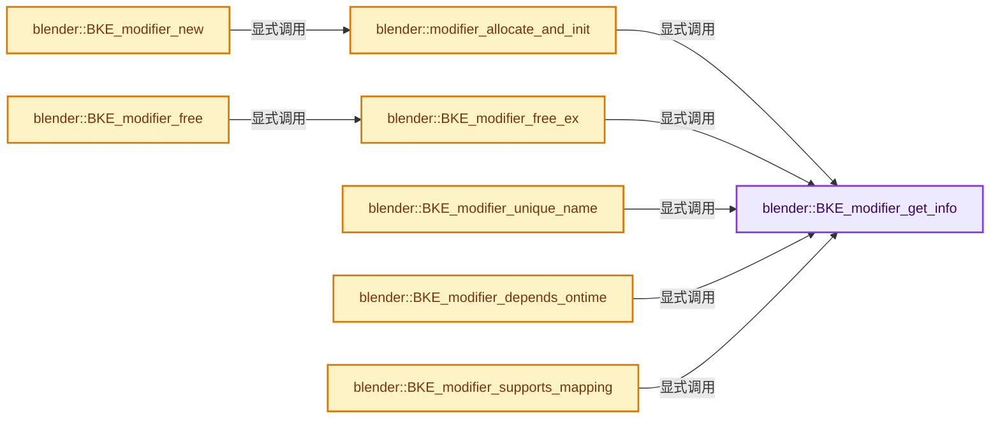
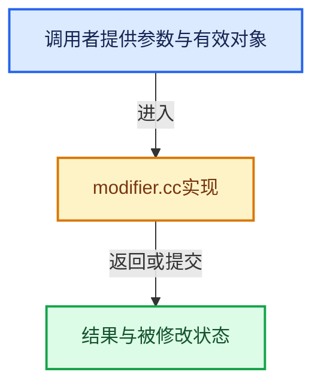

# 实现依赖专题：source/blender/blenkernel/intern/modifier.cc

[方向导航](README.md) · [符号索引](../%E7%AC%A6%E5%8F%B7%E4%BE%9D%E8%B5%96%E4%B8%8E%E5%AE%9E%E7%8E%B0%E7%B4%A2%E5%BC%95.md)

本专题从正文实际调用进入，集中保存共享实现。函数有稳定锚点，可从调用处直接跳到对应完整函数；递归与互相调用通过回链组织。

## 本文件的实现关系






## 完整成员与函数实现

<a id="f-88218d6d450f0291"></a>

### `blender::BKE_modifier_get_info`

实现位置：[source/blender/blenkernel/intern/modifier.cc](../../../../../source/blender/blenkernel/intern/modifier.cc) · L120—L128。

接口参数：

- `ModifierType type`

**教学注释版**

<!-- annotated:3ee191aada0c0c -->

```cpp
const ModifierTypeInfo *BKE_modifier_get_info(ModifierType type)
{
  /* type unsigned, no need to check < 0 */
  if (type < NUM_MODIFIER_TYPES && modifier_types[type] && modifier_types[type]->name[0] != '\0') {
    return modifier_types[type];
  }

  return nullptr;
}
```

<details>
<summary>核对原始源码：source/blender/blenkernel/intern/modifier.cc · L120—L128</summary>

<!-- original:3ee191aada0c0c:source/blender/blenkernel/intern/modifier.cc:120:128 -->

```cpp
const ModifierTypeInfo *BKE_modifier_get_info(ModifierType type)
{
  /* type unsigned, no need to check < 0 */
  if (type < NUM_MODIFIER_TYPES && modifier_types[type] && modifier_types[type]->name[0] != '\0') {
    return modifier_types[type];
  }

  return nullptr;
}
```

</details>

**结果出口**

- `return modifier_types[type];`
- `return nullptr;`

**继续追踪实现**

本实现没有需要继续展开的显式调用；检查返回表达式、对象转换和调用者前置条件。

<a id="f-0574b74891486efe"></a>

### `blender::modifier_allocate_and_init`

实现位置：[source/blender/blenkernel/intern/modifier.cc](../../../../../source/blender/blenkernel/intern/modifier.cc) · L143—L167。

接口参数：

- `ModifierType type`

**教学注释版**

<!-- annotated:0210d8a21cdda8 -->

```cpp
static ModifierData *modifier_allocate_and_init(ModifierType type)
{
  const ModifierTypeInfo *mti = BKE_modifier_get_info(type);
  ModifierData *md = static_cast<ModifierData *>(
      MEM_new_zeroed(mti->struct_size, mti->struct_name));

  /* NOTE: this name must be made unique later. */
  STRNCPY_UTF8(md->name, DATA_(mti->name));

  md->type = type;
  md->mode = eModifierMode_Realtime | eModifierMode_Render;
  md->flag = eModifierFlag_OverrideLibrary_Local;
  /* Only open the main panel at the beginning, not the sub-panels. */
  md->ui_expand_flag = UI_PANEL_DATA_EXPAND_ROOT;

  if (mti->flags & eModifierTypeFlag_EnableInEditmode) {
    md->mode |= eModifierMode_Editmode;
  }

  if (mti->init_data) {
    mti->init_data(md);
  }

  return md;
}
```

<details>
<summary>核对原始源码：source/blender/blenkernel/intern/modifier.cc · L143—L167</summary>

<!-- original:0210d8a21cdda8:source/blender/blenkernel/intern/modifier.cc:143:167 -->

```cpp
static ModifierData *modifier_allocate_and_init(ModifierType type)
{
  const ModifierTypeInfo *mti = BKE_modifier_get_info(type);
  ModifierData *md = static_cast<ModifierData *>(
      MEM_new_zeroed(mti->struct_size, mti->struct_name));

  /* NOTE: this name must be made unique later. */
  STRNCPY_UTF8(md->name, DATA_(mti->name));

  md->type = type;
  md->mode = eModifierMode_Realtime | eModifierMode_Render;
  md->flag = eModifierFlag_OverrideLibrary_Local;
  /* Only open the main panel at the beginning, not the sub-panels. */
  md->ui_expand_flag = UI_PANEL_DATA_EXPAND_ROOT;

  if (mti->flags & eModifierTypeFlag_EnableInEditmode) {
    md->mode |= eModifierMode_Editmode;
  }

  if (mti->init_data) {
    mti->init_data(md);
  }

  return md;
}
```

</details>

**沿实际写入检查状态**

- `md->type = type;`
- `md->mode = eModifierMode_Realtime | eModifierMode_Render;`
- `md->flag = eModifierFlag_OverrideLibrary_Local;`
- `md->ui_expand_flag = UI_PANEL_DATA_EXPAND_ROOT;`
- `md->mode |= eModifierMode_Editmode;`

**结果出口**

- `return md;`

**继续追踪实现**

- `BKE_modifier_get_info` → [blender::BKE_modifier_get_info · L120](%E4%BE%9D%E8%B5%96-modifier-ab0273.md#f-88218d6d450f0291)。
- `MEM_new_zeroed` → [MEM_new_zeroed · L550](../03-%E5%86%85%E5%AD%98%E5%88%86%E9%85%8D%E4%B8%8E%E8%BF%90%E8%A1%8C%E6%97%B6%E7%B1%BB%E5%9E%8B/%E4%BE%9D%E8%B5%96-MEM_guardedalloc-b54eca.md#f-eeb1e2a7f57dd231)；[MEM_new_zeroed · L114](../03-%E5%86%85%E5%AD%98%E5%88%86%E9%85%8D%E4%B8%8E%E8%BF%90%E8%A1%8C%E6%97%B6%E7%B1%BB%E5%9E%8B/%E4%BE%9D%E8%B5%96-mallocn-afdcd4.md#f-e04cf01c64c8b180)。同名重载需按实参类型选择。
- `STRNCPY_UTF8` → [STRNCPY_UTF8 · L335](../01-%E5%9F%BA%E7%A1%80%E5%AE%B9%E5%99%A8%E4%B8%8E%E7%8E%B0%E4%BB%A3CPP/%E4%BE%9D%E8%B5%96-BLI_string_utf8-bcc961.md#m-222967f0ab6a)。宏定义由构建条件选择。
- `DATA_` → [DATA_ · L52](%E4%BE%9D%E8%B5%96-BLT_translation-c89e58.md#m-178736083f83)。宏定义由构建条件选择。
- `mti->init_data` → [blender::bNodeTreeInterface::init_data · L1727](%E4%BE%9D%E8%B5%96-node_tree_interface-893d31.md#f-388b1a0c7b6bf6a4)。

<a id="f-2cf62e2f18a9b71f"></a>

### `blender::BKE_modifier_new`

实现位置：[source/blender/blenkernel/intern/modifier.cc](../../../../../source/blender/blenkernel/intern/modifier.cc) · L169—L173。

接口参数：

- `int type`

**教学注释版**

<!-- annotated:b4b8d0741c5b09 -->

```cpp
ModifierData *BKE_modifier_new(int type)
{
  ModifierData *md = modifier_allocate_and_init(ModifierType(type));
  return md;
}
```

<details>
<summary>核对原始源码：source/blender/blenkernel/intern/modifier.cc · L169—L173</summary>

<!-- original:b4b8d0741c5b09:source/blender/blenkernel/intern/modifier.cc:169:173 -->

```cpp
ModifierData *BKE_modifier_new(int type)
{
  ModifierData *md = modifier_allocate_and_init(ModifierType(type));
  return md;
}
```

</details>

**结果出口**

- `return md;`

**继续追踪实现**

- `modifier_allocate_and_init` → [blender::modifier_allocate_and_init · L143](%E4%BE%9D%E8%B5%96-modifier-ab0273.md#f-0574b74891486efe)。
- `ModifierType` → [blender::ModifierType](%E4%BE%9D%E8%B5%96-DNA_modifier_types-56a227.md#t-319e36205f63)。

<a id="f-0dde8cf6191eaf0e"></a>

### `blender::BKE_modifier_free_ex`

实现位置：[source/blender/blenkernel/intern/modifier.cc](../../../../../source/blender/blenkernel/intern/modifier.cc) · L186—L207。

接口参数：

- `ModifierData *md`
- `const int flag`

**教学注释版**

<!-- annotated:3e7fe5aed0902d -->

```cpp
void BKE_modifier_free_ex(ModifierData *md, const int flag)
{
  const ModifierTypeInfo *mti = BKE_modifier_get_info(md->type);

  if ((flag & LIB_ID_CREATE_NO_USER_REFCOUNT) == 0) {
    if (mti->foreach_ID_link) {
      mti->foreach_ID_link(md, nullptr, modifier_free_data_id_us_cb, nullptr);
    }
  }

  if (mti->free_data) {
    mti->free_data(md);
  }
  if (md->error) {
    MEM_delete(md->error);
  }
  if (md->system_properties != nullptr) {
    IDP_FreeProperty_ex(md->system_properties, false);
  }

  MEM_delete(md);
}
```

<details>
<summary>核对原始源码：source/blender/blenkernel/intern/modifier.cc · L186—L207</summary>

<!-- original:3e7fe5aed0902d:source/blender/blenkernel/intern/modifier.cc:186:207 -->

```cpp
void BKE_modifier_free_ex(ModifierData *md, const int flag)
{
  const ModifierTypeInfo *mti = BKE_modifier_get_info(md->type);

  if ((flag & LIB_ID_CREATE_NO_USER_REFCOUNT) == 0) {
    if (mti->foreach_ID_link) {
      mti->foreach_ID_link(md, nullptr, modifier_free_data_id_us_cb, nullptr);
    }
  }

  if (mti->free_data) {
    mti->free_data(md);
  }
  if (md->error) {
    MEM_delete(md->error);
  }
  if (md->system_properties != nullptr) {
    IDP_FreeProperty_ex(md->system_properties, false);
  }

  MEM_delete(md);
}
```

</details>

**继续追踪实现**

- `BKE_modifier_get_info` → [blender::BKE_modifier_get_info · L120](%E4%BE%9D%E8%B5%96-modifier-ab0273.md#f-88218d6d450f0291)。
- `mti->foreach_ID_link` → [blender::foreach_ID_link · L61](%E4%BE%9D%E8%B5%96-FX_shader_swirl-a11837.md#f-624ffd8ef1929253)；[blender::foreach_ID_link · L74](%E4%BE%9D%E8%B5%96-FX_shader_shadow-af05bc.md#f-ba0bc12adf2b9e28)；[blender::foreach_ID_link · L313](%E4%BE%9D%E8%B5%96-MOD_weightvgproximity-9e7c30.md#f-3349f71bda299934)；[blender::foreach_ID_link · L153](%E4%BE%9D%E8%B5%96-MOD_weightvgmix-25acab.md#f-86bd96bafcdaf1be)；[blender::foreach_ID_link · L107](%E4%BE%9D%E8%B5%96-MOD_weightvgedit-9945f1.md#f-588fea49738fdf80)；[blender::foreach_ID_link · L272](%E4%BE%9D%E8%B5%96-MOD_grease_pencil_noise-eae4f5.md#f-24aff8a16d0b3487)；[blender::foreach_ID_link · L69](%E4%BE%9D%E8%B5%96-MOD_grease_pencil_multiply-2e50d7.md#f-784727fdac316c73)；[blender::foreach_ID_link · L56](%E4%BE%9D%E8%B5%96-MOD_wave-b6885d.md#f-d03ad3f698b40ad1)；[blender::foreach_ID_link · L62](%E4%BE%9D%E8%B5%96-MOD_grease_pencil_mirror-70efb7.md#f-ce011295654a0642)；[blender::foreach_ID_link · L120](%E4%BE%9D%E8%B5%96-MOD_warp-e1832f.md#f-664b8d929a3b4a55)；[blender::foreach_ID_link · L68](%E4%BE%9D%E8%B5%96-MOD_volume_to_mesh-299535.md#f-43444339e908a376)；[blender::foreach_ID_link · L73](%E4%BE%9D%E8%B5%96-MOD_volume_displace-d9d5ed.md#f-e657d49db24766eb)；[blender::foreach_ID_link · L65](%E4%BE%9D%E8%B5%96-MOD_grease_pencil_length-522992.md#f-3ed0cfe08486d0de)；[blender::foreach_ID_link · L224](%E4%BE%9D%E8%B5%96-MOD_uvwarp-2ac084.md#f-9ea823fd71b6fb78)；[blender::foreach_ID_link · L59](%E4%BE%9D%E8%B5%96-MOD_uvproject-0da7db.md#f-7a84f03a144c35f8)；[blender::foreach_ID_link · L62](%E4%BE%9D%E8%B5%96-MOD_grease_pencil_lattice-8f886f.md#f-91bc010628f6b5a4)；[blender::foreach_ID_link · L84](%E4%BE%9D%E8%B5%96-MOD_grease_pencil_hook-a8b10b.md#f-8ace23ea2fc1ce9a)；[blender::foreach_ID_link · L64](%E4%BE%9D%E8%B5%96-MOD_grease_pencil_envelope-fe9b70.md#f-4e59b89eafdc3d8a)；[blender::foreach_ID_link · L80](%E4%BE%9D%E8%B5%96-MOD_grease_pencil_dash-8edc8e.md#f-d1486862b6f104e6)；[blender::foreach_ID_link · L69](%E4%BE%9D%E8%B5%96-MOD_grease_pencil_color-247c5a.md#f-405e731e4b9631e3)；[blender::foreach_ID_link · L69](%E4%BE%9D%E8%B5%96-MOD_grease_pencil_build-c03219.md#f-9efcf4d9f0ea9e7a)；[blender::foreach_ID_link · L69](%E4%BE%9D%E8%B5%96-MOD_grease_pencil_array-6250c2.md#f-0179cdf8612697d5)；[blender::foreach_ID_link · L254](%E4%BE%9D%E8%B5%96-MOD_surfacedeform-984aaa.md#f-0028eb0143a39536)；[blender::foreach_ID_link · L69](%E4%BE%9D%E8%B5%96-MOD_grease_pencil_armature-b733ac.md#f-6d967cb3cfbfe21e)；[blender::foreach_ID_link · L188](%E4%BE%9D%E8%B5%96-MOD_fluid-b54017.md#f-98368271a676fdad)；[blender::foreach_ID_link · L142](%E4%BE%9D%E8%B5%96-MOD_dynamicpaint-261347.md#f-88fbf106ff0570fe)；[blender::foreach_ID_link · L83](%E4%BE%9D%E8%B5%96-MOD_displace-57c869.md#f-6a655dcb551a066b)；[blender::foreach_ID_link · L84](%E4%BE%9D%E8%B5%96-MOD_datatransfer-82a2d8.md#f-166e1359e1a66ac1)；[blender::foreach_ID_link · L67](%E4%BE%9D%E8%B5%96-MOD_curve-81222f.md#f-fcfe4735b430f223)；[blender::foreach_ID_link · L237](%E4%BE%9D%E8%B5%96-MOD_cloth-232a0e.md#f-a5fd681b7408cce9)；[blender::foreach_ID_link · L65](%E4%BE%9D%E8%B5%96-MOD_cast-c4f475.md#f-9726c811e9837b83)；[blender::foreach_ID_link · L82](%E4%BE%9D%E8%B5%96-MOD_boolean-e93e01.md#f-b57958a0b00ef930)；[blender::foreach_ID_link · L64](%E4%BE%9D%E8%B5%96-MOD_array-c062b5.md#f-58bee7f1040012ed)；[blender::foreach_ID_link · L76](%E4%BE%9D%E8%B5%96-MOD_armature-a4abb0.md#f-af1634a00f579e50)；[blender::foreach_ID_link · L407](%E4%BE%9D%E8%B5%96-MOD_simpledeform-ac2cad.md#f-0f0f551e5cbcafb6)；[blender::foreach_ID_link · L69](%E4%BE%9D%E8%B5%96-MOD_shrinkwrap-b862d4.md#f-2783308b7e5ae798)；[blender::foreach_ID_link · L1037](%E4%BE%9D%E8%B5%96-MOD_screw-6d60f6.md#f-19aa555f4f1c8700)；[blender::foreach_ID_link · L119](%E4%BE%9D%E8%B5%96-MOD_particleinstance-7571a9.md#f-baaa847e0b48e812)；[blender::foreach_ID_link · L573](%E4%BE%9D%E8%B5%96-MOD_normal_edit-e6de24.md#f-8552fdcc0a59008b)；[blender::foreach_ID_link · L261](%E4%BE%9D%E8%B5%96-MOD_nodes-3d10f5.md#f-f2ded6cff5dae987)；[blender::foreach_ID_link · L43](%E4%BE%9D%E8%B5%96-MOD_mirror-c39588.md#f-0f60683acb48c332)；[blender::foreach_ID_link · L62](%E4%BE%9D%E8%B5%96-MOD_mesh_to_volume-98590f.md#f-441e947bc69d54bb)；[blender::foreach_ID_link · L307](%E4%BE%9D%E8%B5%96-MOD_meshsequencecache-651784.md#f-5bc9d968f42fdad3)；[blender::foreach_ID_link · L126](%E4%BE%9D%E8%B5%96-MOD_meshdeform-fc8efd.md#f-0ce00988ea7ecb9e)；[blender::foreach_ID_link · L58](%E4%BE%9D%E8%B5%96-MOD_mask-a069c0.md#f-6e3eab0cee511ce7)；[blender::foreach_ID_link · L250](%E4%BE%9D%E8%B5%96-MOD_lineart-b0a62c.md#f-918d7b92a8dd5870)；[blender::foreach_ID_link · L66](%E4%BE%9D%E8%B5%96-MOD_lattice-0787ab.md#f-5aa450ccff6f6c2d)；[blender::foreach_ID_link · L100](%E4%BE%9D%E8%B5%96-MOD_hook-b76f1b.md#f-2a29f3a371afb5df)；[blender::foreach_ID_link · L71](%E4%BE%9D%E8%B5%96-MOD_grease_pencil_weight_proximity-e5bd3c.md#f-adcd54430d75cb0d)；[blender::foreach_ID_link · L74](%E4%BE%9D%E8%B5%96-MOD_grease_pencil_weight_angle-591cee.md#f-a03a99c4ca900f84)；[blender::foreach_ID_link · L97](%E4%BE%9D%E8%B5%96-MOD_grease_pencil_tint-130b42.md#f-b61bd09b4b386e0b)；[blender::foreach_ID_link · L81](%E4%BE%9D%E8%B5%96-MOD_grease_pencil_time-b2b2fa.md#f-52431ba120508393)；[blender::foreach_ID_link · L60](%E4%BE%9D%E8%B5%96-MOD_grease_pencil_thickness-bd8572.md#f-6202e6a7f448cec1)；[blender::foreach_ID_link · L68](%E4%BE%9D%E8%B5%96-MOD_grease_pencil_texture-53cfff.md#f-12cb91d85cd45a19)；[blender::foreach_ID_link · L154](%E4%BE%9D%E8%B5%96-MOD_grease_pencil_subdiv-1b017f.md#f-132f19d5fe7d4063)；[blender::foreach_ID_link · L62](%E4%BE%9D%E8%B5%96-MOD_grease_pencil_smooth-84378f.md#f-a52ea3a2a870d0e3)；[blender::foreach_ID_link · L185](%E4%BE%9D%E8%B5%96-MOD_grease_pencil_simplify-084e93.md#f-a5395502b7274b0c)；[blender::foreach_ID_link · L77](%E4%BE%9D%E8%B5%96-MOD_grease_pencil_shrinkwrap-67e646.md#f-c27b5c4b02a06aaf)；[blender::foreach_ID_link · L78](%E4%BE%9D%E8%B5%96-MOD_grease_pencil_outline-52807d.md#f-6ac666b46d601dd4)；[blender::foreach_ID_link · L62](%E4%BE%9D%E8%B5%96-MOD_grease_pencil_opacity-33f86c.md#f-ab0f828d6a5455f2)；[blender::foreach_ID_link · L64](%E4%BE%9D%E8%B5%96-MOD_grease_pencil_offset-ea9491.md#f-1d0bd0307c8ff199)。同名重载需按实参类型选择。
- `mti->free_data` → [blender::bNodeTreeInterface::free_data · L1742](%E4%BE%9D%E8%B5%96-node_tree_interface-893d31.md#f-71f6f7812aa213ee)。
- `MEM_delete` → [MEM_delete · L400](../03-%E5%86%85%E5%AD%98%E5%88%86%E9%85%8D%E4%B8%8E%E8%BF%90%E8%A1%8C%E6%97%B6%E7%B1%BB%E5%9E%8B/%E4%BE%9D%E8%B5%96-MEM_guardedalloc-b54eca.md#f-9049ffdd1682887c)。
- `IDP_FreeProperty_ex` → [blender::IDP_FreeProperty_ex · L1398](%E4%BE%9D%E8%B5%96-idprop-006c65.md#f-4b1dc3efcf18b18c)。

<a id="f-20e0a8c815d6dfe5"></a>

### `blender::BKE_modifier_free`

实现位置：[source/blender/blenkernel/intern/modifier.cc](../../../../../source/blender/blenkernel/intern/modifier.cc) · L209—L212。

接口参数：

- `ModifierData *md`

**教学注释版**

<!-- annotated:26271e059dab6e -->

```cpp
void BKE_modifier_free(ModifierData *md)
{
  BKE_modifier_free_ex(md, 0);
}
```

<details>
<summary>核对原始源码：source/blender/blenkernel/intern/modifier.cc · L209—L212</summary>

<!-- original:26271e059dab6e:source/blender/blenkernel/intern/modifier.cc:209:212 -->

```cpp
void BKE_modifier_free(ModifierData *md)
{
  BKE_modifier_free_ex(md, 0);
}
```

</details>

**继续追踪实现**

- `BKE_modifier_free_ex` → [blender::BKE_modifier_free_ex · L186](%E4%BE%9D%E8%B5%96-modifier-ab0273.md#f-0dde8cf6191eaf0e)。

<a id="f-bbd0fc56e175304e"></a>

### `blender::BKE_modifier_unique_name`

实现位置：[source/blender/blenkernel/intern/modifier.cc](../../../../../source/blender/blenkernel/intern/modifier.cc) · L231—L239。

接口参数：

- `ListBaseT<ModifierData> *modifiers`
- `ModifierData *md`

**教学注释版**

<!-- annotated:509b04a62eacce -->

```cpp
void BKE_modifier_unique_name(ListBaseT<ModifierData> *modifiers, ModifierData *md)
{
  if (modifiers && md) {
    const ModifierTypeInfo *mti = BKE_modifier_get_info(md->type);

    BLI_uniquename(
        modifiers, md, DATA_(mti->name), '.', offsetof(ModifierData, name), sizeof(md->name));
  }
}
```

<details>
<summary>核对原始源码：source/blender/blenkernel/intern/modifier.cc · L231—L239</summary>

<!-- original:509b04a62eacce:source/blender/blenkernel/intern/modifier.cc:231:239 -->

```cpp
void BKE_modifier_unique_name(ListBaseT<ModifierData> *modifiers, ModifierData *md)
{
  if (modifiers && md) {
    const ModifierTypeInfo *mti = BKE_modifier_get_info(md->type);

    BLI_uniquename(
        modifiers, md, DATA_(mti->name), '.', offsetof(ModifierData, name), sizeof(md->name));
  }
}
```

</details>

**继续追踪实现**

- `BKE_modifier_get_info` → [blender::BKE_modifier_get_info · L120](%E4%BE%9D%E8%B5%96-modifier-ab0273.md#f-88218d6d450f0291)。
- `BLI_uniquename` → [blender::BLI_uniquename · L491](../01-%E5%9F%BA%E7%A1%80%E5%AE%B9%E5%99%A8%E4%B8%8E%E7%8E%B0%E4%BB%A3CPP/%E4%BE%9D%E8%B5%96-string_utils-bbfe0c.md#f-bcf1a000dbfb87d1)。
- `DATA_` → [DATA_ · L52](%E4%BE%9D%E8%B5%96-BLT_translation-c89e58.md#m-178736083f83)。宏定义由构建条件选择。

<a id="f-905137054e21ed36"></a>

### `blender::BKE_modifier_depends_ontime`

实现位置：[source/blender/blenkernel/intern/modifier.cc](../../../../../source/blender/blenkernel/intern/modifier.cc) · L241—L246。

接口参数：

- `Scene *scene`
- `ModifierData *md`

**教学注释版**

<!-- annotated:3b2065c32e2edf -->

```cpp
bool BKE_modifier_depends_ontime(Scene *scene, ModifierData *md)
{
  const ModifierTypeInfo *mti = BKE_modifier_get_info(md->type);

  return mti->depends_on_time && mti->depends_on_time(scene, md);
}
```

<details>
<summary>核对原始源码：source/blender/blenkernel/intern/modifier.cc · L241—L246</summary>

<!-- original:3b2065c32e2edf:source/blender/blenkernel/intern/modifier.cc:241:246 -->

```cpp
bool BKE_modifier_depends_ontime(Scene *scene, ModifierData *md)
{
  const ModifierTypeInfo *mti = BKE_modifier_get_info(md->type);

  return mti->depends_on_time && mti->depends_on_time(scene, md);
}
```

</details>

**结果出口**

- `return mti->depends_on_time && mti->depends_on_time(scene, md);`

**继续追踪实现**

- `BKE_modifier_get_info` → [blender::BKE_modifier_get_info · L120](%E4%BE%9D%E8%B5%96-modifier-ab0273.md#f-88218d6d450f0291)。
- `mti->depends_on_time` → [blender::depends_on_time · L303](%E4%BE%9D%E8%B5%96-MOD_weightvgproximity-9e7c30.md#f-b8637851155e55f0)；[blender::depends_on_time · L143](%E4%BE%9D%E8%B5%96-MOD_weightvgmix-25acab.md#f-88d8fbb65e6fcc75)；[blender::depends_on_time · L97](%E4%BE%9D%E8%B5%96-MOD_weightvgedit-9945f1.md#f-901243a5209b91f9)；[blender::depends_on_time · L75](%E4%BE%9D%E8%B5%96-MOD_grease_pencil_noise-eae4f5.md#f-ea608cbb79fc8845)；[blender::depends_on_time · L51](%E4%BE%9D%E8%B5%96-MOD_wave-b6885d.md#f-f0a406faa15df7ae)；[blender::depends_on_time · L96](%E4%BE%9D%E8%B5%96-MOD_warp-e1832f.md#f-c5e0bd536d5480c7)；[blender::depends_on_time · L87](%E4%BE%9D%E8%B5%96-MOD_volume_displace-d9d5ed.md#f-a3cb1432d858b58b)；[blender::depends_on_time · L138](%E4%BE%9D%E8%B5%96-MOD_fluid-b54017.md#f-5fb0bd41f1dd7229)；[blender::depends_on_time · L82](%E4%BE%9D%E8%B5%96-MOD_explode-ca1cc3.md#f-bfc63e8f13a644dd)；[blender::depends_on_time · L73](%E4%BE%9D%E8%B5%96-MOD_surface-807b53.md#f-0ee31349451cba32)；[blender::depends_on_time · L137](%E4%BE%9D%E8%B5%96-MOD_dynamicpaint-261347.md#f-b0918e45ab9bdeaf)；[blender::depends_on_time · L72](%E4%BE%9D%E8%B5%96-MOD_displace-57c869.md#f-aace5c916ee7ae31)；[blender::depends_on_time · L70](%E4%BE%9D%E8%B5%96-MOD_collision-49ad1c.md#f-65a0ea2aa8dfffe3)；[blender::depends_on_time · L193](%E4%BE%9D%E8%B5%96-MOD_cloth-232a0e.md#f-c6403bc2d5884a87)；[blender::depends_on_time · L46](%E4%BE%9D%E8%B5%96-MOD_build-bbceaf.md#f-bbcacfbc405bb2e1)；[blender::depends_on_time · L45](%E4%BE%9D%E8%B5%96-MOD_softbody-51bfa6.md#f-2e044e08636ab602)；[blender::depends_on_time · L242](%E4%BE%9D%E8%B5%96-MOD_nodes-3d10f5.md#f-bc6514f62da0dede)；[blender::depends_on_time · L296](%E4%BE%9D%E8%B5%96-MOD_meshsequencecache-651784.md#f-e2da1a2d5646fa01)；[blender::depends_on_time · L54](%E4%BE%9D%E8%B5%96-MOD_meshcache-95a09c.md#f-386e66c10ebefa17)。同名重载需按实参类型选择。

<a id="f-036005a6bf445d83"></a>

### `blender::BKE_modifier_supports_mapping`

实现位置：[source/blender/blenkernel/intern/modifier.cc](../../../../../source/blender/blenkernel/intern/modifier.cc) · L248—L254。

接口参数：

- `ModifierData *md`

**教学注释版**

<!-- annotated:21d041aa5aa2b6 -->

```cpp
bool BKE_modifier_supports_mapping(ModifierData *md)
{
  const ModifierTypeInfo *mti = BKE_modifier_get_info(md->type);

  return (mti->type == ModifierTypeType::OnlyDeform ||
          (mti->flags & eModifierTypeFlag_SupportsMapping));
}
```

<details>
<summary>核对原始源码：source/blender/blenkernel/intern/modifier.cc · L248—L254</summary>

<!-- original:21d041aa5aa2b6:source/blender/blenkernel/intern/modifier.cc:248:254 -->

```cpp
bool BKE_modifier_supports_mapping(ModifierData *md)
{
  const ModifierTypeInfo *mti = BKE_modifier_get_info(md->type);

  return (mti->type == ModifierTypeType::OnlyDeform ||
          (mti->flags & eModifierTypeFlag_SupportsMapping));
}
```

</details>

**结果出口**

- `return (mti->type == ModifierTypeType::OnlyDeform ||`

**继续追踪实现**

- `BKE_modifier_get_info` → [blender::BKE_modifier_get_info · L120](%E4%BE%9D%E8%B5%96-modifier-ab0273.md#f-88218d6d450f0291)。

<a id="f-9f6b6b9b4343d30f"></a>

### `blender::BKE_modifiers_findby_type`

实现位置：[source/blender/blenkernel/intern/modifier.cc](../../../../../source/blender/blenkernel/intern/modifier.cc) · L256—L264。

接口参数：

- `const Object *ob`
- `ModifierType type`

**教学注释版**

<!-- annotated:2ca346ee4ec9f1 -->

```cpp
ModifierData *BKE_modifiers_findby_type(const Object *ob, ModifierType type)
{
  for (ModifierData &md : ob->modifiers) {
    if (md.type == type) {
      return &md;
    }
  }
  return nullptr;
}
```

<details>
<summary>核对原始源码：source/blender/blenkernel/intern/modifier.cc · L256—L264</summary>

<!-- original:2ca346ee4ec9f1:source/blender/blenkernel/intern/modifier.cc:256:264 -->

```cpp
ModifierData *BKE_modifiers_findby_type(const Object *ob, ModifierType type)
{
  for (ModifierData &md : ob->modifiers) {
    if (md.type == type) {
      return &md;
    }
  }
  return nullptr;
}
```

</details>

**结果出口**

- `return &md;`
- `return nullptr;`

**继续追踪实现**

本实现没有需要继续展开的显式调用；检查返回表达式、对象转换和调用者前置条件。

<a id="f-cf0acdc5b2818add"></a>

### `blender::BKE_modifiers_findby_name`

实现位置：[source/blender/blenkernel/intern/modifier.cc](../../../../../source/blender/blenkernel/intern/modifier.cc) · L266—L270。

接口参数：

- `const Object *ob`
- `const char *name`

**教学注释版**

<!-- annotated:9f2470ba75633e -->

```cpp
ModifierData *BKE_modifiers_findby_name(const Object *ob, const char *name)
{
  return static_cast<ModifierData *>(
      BLI_findstring(&(ob->modifiers), name, offsetof(ModifierData, name)));
}
```

<details>
<summary>核对原始源码：source/blender/blenkernel/intern/modifier.cc · L266—L270</summary>

<!-- original:9f2470ba75633e:source/blender/blenkernel/intern/modifier.cc:266:270 -->

```cpp
ModifierData *BKE_modifiers_findby_name(const Object *ob, const char *name)
{
  return static_cast<ModifierData *>(
      BLI_findstring(&(ob->modifiers), name, offsetof(ModifierData, name)));
}
```

</details>

**结果出口**

- `return static_cast<ModifierData *>(`

**继续追踪实现**

- `BLI_findstring` → [blender::BLI_findstring · L615](../01-%E5%9F%BA%E7%A1%80%E5%AE%B9%E5%99%A8%E4%B8%8E%E7%8E%B0%E4%BB%A3CPP/%E4%BE%9D%E8%B5%96-listbase-2816d9.md#f-d913b13b2651348e)。

<a id="f-c6bff7f030f7be83"></a>

### `blender::BKE_modifiers_findby_persistent_uid`

实现位置：[source/blender/blenkernel/intern/modifier.cc](../../../../../source/blender/blenkernel/intern/modifier.cc) · L272—L280。

接口参数：

- `const Object *ob`
- `const int persistent_uid`

**教学注释版**

<!-- annotated:2904e3452b0cc2 -->

```cpp
ModifierData *BKE_modifiers_findby_persistent_uid(const Object *ob, const int persistent_uid)
{
  for (ModifierData &md : ob->modifiers) {
    if (md.persistent_uid == persistent_uid) {
      return &md;
    }
  }
  return nullptr;
}
```

<details>
<summary>核对原始源码：source/blender/blenkernel/intern/modifier.cc · L272—L280</summary>

<!-- original:2904e3452b0cc2:source/blender/blenkernel/intern/modifier.cc:272:280 -->

```cpp
ModifierData *BKE_modifiers_findby_persistent_uid(const Object *ob, const int persistent_uid)
{
  for (ModifierData &md : ob->modifiers) {
    if (md.persistent_uid == persistent_uid) {
      return &md;
    }
  }
  return nullptr;
}
```

</details>

**结果出口**

- `return &md;`
- `return nullptr;`

**继续追踪实现**

本实现没有需要继续展开的显式调用；检查返回表达式、对象转换和调用者前置条件。

<a id="f-aeccb28cb209861b"></a>

### `blender::BKE_modifiers_clear_errors`

实现位置：[source/blender/blenkernel/intern/modifier.cc](../../../../../source/blender/blenkernel/intern/modifier.cc) · L282—L290。

接口参数：

- `Object *ob`

**教学注释版**

<!-- annotated:34d138aa7cfcda -->

```cpp
void BKE_modifiers_clear_errors(Object *ob)
{
  for (ModifierData &md : ob->modifiers) {
    if (md.error) {
      MEM_delete(md.error);
      md.error = nullptr;
    }
  }
}
```

<details>
<summary>核对原始源码：source/blender/blenkernel/intern/modifier.cc · L282—L290</summary>

<!-- original:34d138aa7cfcda:source/blender/blenkernel/intern/modifier.cc:282:290 -->

```cpp
void BKE_modifiers_clear_errors(Object *ob)
{
  for (ModifierData &md : ob->modifiers) {
    if (md.error) {
      MEM_delete(md.error);
      md.error = nullptr;
    }
  }
}
```

</details>

**沿实际写入检查状态**

- `md.error = nullptr;`

**继续追踪实现**

- `MEM_delete` → [MEM_delete · L400](../03-%E5%86%85%E5%AD%98%E5%88%86%E9%85%8D%E4%B8%8E%E8%BF%90%E8%A1%8C%E6%97%B6%E7%B1%BB%E5%9E%8B/%E4%BE%9D%E8%B5%96-MEM_guardedalloc-b54eca.md#f-9049ffdd1682887c)。

<a id="f-c6237cc55b7ed988"></a>

### `blender::BKE_modifiers_foreach_ID_link`

实现位置：[source/blender/blenkernel/intern/modifier.cc](../../../../../source/blender/blenkernel/intern/modifier.cc) · L292—L303。

接口参数：

- `Object *ob`
- `IDWalkFunc walk`
- `void *user_data`

**教学注释版**

<!-- annotated:e2eb18592582d2 -->

```cpp
void BKE_modifiers_foreach_ID_link(Object *ob, IDWalkFunc walk, void *user_data)
{
  for (ModifierData &md : ob->modifiers) {
    const ModifierTypeInfo *mti = BKE_modifier_get_info(md.type);
    IDP_foreach_property(md.system_properties, IDP_TYPE_FILTER_ID, [&](IDProperty *id_prop) {
      walk(user_data, ob, (ID **)&id_prop->data.pointer, IDWALK_CB_USER);
    });
    if (mti->foreach_ID_link) {
      mti->foreach_ID_link(&md, ob, walk, user_data);
    }
  }
}
```

<details>
<summary>核对原始源码：source/blender/blenkernel/intern/modifier.cc · L292—L303</summary>

<!-- original:e2eb18592582d2:source/blender/blenkernel/intern/modifier.cc:292:303 -->

```cpp
void BKE_modifiers_foreach_ID_link(Object *ob, IDWalkFunc walk, void *user_data)
{
  for (ModifierData &md : ob->modifiers) {
    const ModifierTypeInfo *mti = BKE_modifier_get_info(md.type);
    IDP_foreach_property(md.system_properties, IDP_TYPE_FILTER_ID, [&](IDProperty *id_prop) {
      walk(user_data, ob, (ID **)&id_prop->data.pointer, IDWALK_CB_USER);
    });
    if (mti->foreach_ID_link) {
      mti->foreach_ID_link(&md, ob, walk, user_data);
    }
  }
}
```

</details>

**继续追踪实现**

- `BKE_modifier_get_info` → [blender::BKE_modifier_get_info · L120](%E4%BE%9D%E8%B5%96-modifier-ab0273.md#f-88218d6d450f0291)。
- `IDP_foreach_property` → [blender::IDP_foreach_property · L1469](%E4%BE%9D%E8%B5%96-idprop-006c65.md#f-63095cdb2dc834a9)。
- `walk` → [调用协议](../%E6%A8%A1%E6%9D%BF%E5%AE%8F%E4%B8%8E%E5%8A%A8%E6%80%81%E5%88%86%E6%B4%BE%E5%8D%8F%E8%AE%AE.md)：局部可调用对象，须结合其初始化与捕获环境。调用位置L297。
- `mti->foreach_ID_link` → [blender::foreach_ID_link · L61](%E4%BE%9D%E8%B5%96-FX_shader_swirl-a11837.md#f-624ffd8ef1929253)；[blender::foreach_ID_link · L74](%E4%BE%9D%E8%B5%96-FX_shader_shadow-af05bc.md#f-ba0bc12adf2b9e28)；[blender::foreach_ID_link · L313](%E4%BE%9D%E8%B5%96-MOD_weightvgproximity-9e7c30.md#f-3349f71bda299934)；[blender::foreach_ID_link · L153](%E4%BE%9D%E8%B5%96-MOD_weightvgmix-25acab.md#f-86bd96bafcdaf1be)；[blender::foreach_ID_link · L107](%E4%BE%9D%E8%B5%96-MOD_weightvgedit-9945f1.md#f-588fea49738fdf80)；[blender::foreach_ID_link · L272](%E4%BE%9D%E8%B5%96-MOD_grease_pencil_noise-eae4f5.md#f-24aff8a16d0b3487)；[blender::foreach_ID_link · L69](%E4%BE%9D%E8%B5%96-MOD_grease_pencil_multiply-2e50d7.md#f-784727fdac316c73)；[blender::foreach_ID_link · L56](%E4%BE%9D%E8%B5%96-MOD_wave-b6885d.md#f-d03ad3f698b40ad1)；[blender::foreach_ID_link · L62](%E4%BE%9D%E8%B5%96-MOD_grease_pencil_mirror-70efb7.md#f-ce011295654a0642)；[blender::foreach_ID_link · L120](%E4%BE%9D%E8%B5%96-MOD_warp-e1832f.md#f-664b8d929a3b4a55)；[blender::foreach_ID_link · L68](%E4%BE%9D%E8%B5%96-MOD_volume_to_mesh-299535.md#f-43444339e908a376)；[blender::foreach_ID_link · L73](%E4%BE%9D%E8%B5%96-MOD_volume_displace-d9d5ed.md#f-e657d49db24766eb)；[blender::foreach_ID_link · L65](%E4%BE%9D%E8%B5%96-MOD_grease_pencil_length-522992.md#f-3ed0cfe08486d0de)；[blender::foreach_ID_link · L224](%E4%BE%9D%E8%B5%96-MOD_uvwarp-2ac084.md#f-9ea823fd71b6fb78)；[blender::foreach_ID_link · L59](%E4%BE%9D%E8%B5%96-MOD_uvproject-0da7db.md#f-7a84f03a144c35f8)；[blender::foreach_ID_link · L62](%E4%BE%9D%E8%B5%96-MOD_grease_pencil_lattice-8f886f.md#f-91bc010628f6b5a4)；[blender::foreach_ID_link · L84](%E4%BE%9D%E8%B5%96-MOD_grease_pencil_hook-a8b10b.md#f-8ace23ea2fc1ce9a)；[blender::foreach_ID_link · L64](%E4%BE%9D%E8%B5%96-MOD_grease_pencil_envelope-fe9b70.md#f-4e59b89eafdc3d8a)；[blender::foreach_ID_link · L80](%E4%BE%9D%E8%B5%96-MOD_grease_pencil_dash-8edc8e.md#f-d1486862b6f104e6)；[blender::foreach_ID_link · L69](%E4%BE%9D%E8%B5%96-MOD_grease_pencil_color-247c5a.md#f-405e731e4b9631e3)；[blender::foreach_ID_link · L69](%E4%BE%9D%E8%B5%96-MOD_grease_pencil_build-c03219.md#f-9efcf4d9f0ea9e7a)；[blender::foreach_ID_link · L69](%E4%BE%9D%E8%B5%96-MOD_grease_pencil_array-6250c2.md#f-0179cdf8612697d5)；[blender::foreach_ID_link · L254](%E4%BE%9D%E8%B5%96-MOD_surfacedeform-984aaa.md#f-0028eb0143a39536)；[blender::foreach_ID_link · L69](%E4%BE%9D%E8%B5%96-MOD_grease_pencil_armature-b733ac.md#f-6d967cb3cfbfe21e)；[blender::foreach_ID_link · L188](%E4%BE%9D%E8%B5%96-MOD_fluid-b54017.md#f-98368271a676fdad)；[blender::foreach_ID_link · L142](%E4%BE%9D%E8%B5%96-MOD_dynamicpaint-261347.md#f-88fbf106ff0570fe)；[blender::foreach_ID_link · L83](%E4%BE%9D%E8%B5%96-MOD_displace-57c869.md#f-6a655dcb551a066b)；[blender::foreach_ID_link · L84](%E4%BE%9D%E8%B5%96-MOD_datatransfer-82a2d8.md#f-166e1359e1a66ac1)；[blender::foreach_ID_link · L67](%E4%BE%9D%E8%B5%96-MOD_curve-81222f.md#f-fcfe4735b430f223)；[blender::foreach_ID_link · L237](%E4%BE%9D%E8%B5%96-MOD_cloth-232a0e.md#f-a5fd681b7408cce9)；[blender::foreach_ID_link · L65](%E4%BE%9D%E8%B5%96-MOD_cast-c4f475.md#f-9726c811e9837b83)；[blender::foreach_ID_link · L82](%E4%BE%9D%E8%B5%96-MOD_boolean-e93e01.md#f-b57958a0b00ef930)；[blender::foreach_ID_link · L64](%E4%BE%9D%E8%B5%96-MOD_array-c062b5.md#f-58bee7f1040012ed)；[blender::foreach_ID_link · L76](%E4%BE%9D%E8%B5%96-MOD_armature-a4abb0.md#f-af1634a00f579e50)；[blender::foreach_ID_link · L407](%E4%BE%9D%E8%B5%96-MOD_simpledeform-ac2cad.md#f-0f0f551e5cbcafb6)；[blender::foreach_ID_link · L69](%E4%BE%9D%E8%B5%96-MOD_shrinkwrap-b862d4.md#f-2783308b7e5ae798)；[blender::foreach_ID_link · L1037](%E4%BE%9D%E8%B5%96-MOD_screw-6d60f6.md#f-19aa555f4f1c8700)；[blender::foreach_ID_link · L119](%E4%BE%9D%E8%B5%96-MOD_particleinstance-7571a9.md#f-baaa847e0b48e812)；[blender::foreach_ID_link · L573](%E4%BE%9D%E8%B5%96-MOD_normal_edit-e6de24.md#f-8552fdcc0a59008b)；[blender::foreach_ID_link · L261](%E4%BE%9D%E8%B5%96-MOD_nodes-3d10f5.md#f-f2ded6cff5dae987)；[blender::foreach_ID_link · L43](%E4%BE%9D%E8%B5%96-MOD_mirror-c39588.md#f-0f60683acb48c332)；[blender::foreach_ID_link · L62](%E4%BE%9D%E8%B5%96-MOD_mesh_to_volume-98590f.md#f-441e947bc69d54bb)；[blender::foreach_ID_link · L307](%E4%BE%9D%E8%B5%96-MOD_meshsequencecache-651784.md#f-5bc9d968f42fdad3)；[blender::foreach_ID_link · L126](%E4%BE%9D%E8%B5%96-MOD_meshdeform-fc8efd.md#f-0ce00988ea7ecb9e)；[blender::foreach_ID_link · L58](%E4%BE%9D%E8%B5%96-MOD_mask-a069c0.md#f-6e3eab0cee511ce7)；[blender::foreach_ID_link · L250](%E4%BE%9D%E8%B5%96-MOD_lineart-b0a62c.md#f-918d7b92a8dd5870)；[blender::foreach_ID_link · L66](%E4%BE%9D%E8%B5%96-MOD_lattice-0787ab.md#f-5aa450ccff6f6c2d)；[blender::foreach_ID_link · L100](%E4%BE%9D%E8%B5%96-MOD_hook-b76f1b.md#f-2a29f3a371afb5df)；[blender::foreach_ID_link · L71](%E4%BE%9D%E8%B5%96-MOD_grease_pencil_weight_proximity-e5bd3c.md#f-adcd54430d75cb0d)；[blender::foreach_ID_link · L74](%E4%BE%9D%E8%B5%96-MOD_grease_pencil_weight_angle-591cee.md#f-a03a99c4ca900f84)；[blender::foreach_ID_link · L97](%E4%BE%9D%E8%B5%96-MOD_grease_pencil_tint-130b42.md#f-b61bd09b4b386e0b)；[blender::foreach_ID_link · L81](%E4%BE%9D%E8%B5%96-MOD_grease_pencil_time-b2b2fa.md#f-52431ba120508393)；[blender::foreach_ID_link · L60](%E4%BE%9D%E8%B5%96-MOD_grease_pencil_thickness-bd8572.md#f-6202e6a7f448cec1)；[blender::foreach_ID_link · L68](%E4%BE%9D%E8%B5%96-MOD_grease_pencil_texture-53cfff.md#f-12cb91d85cd45a19)；[blender::foreach_ID_link · L154](%E4%BE%9D%E8%B5%96-MOD_grease_pencil_subdiv-1b017f.md#f-132f19d5fe7d4063)；[blender::foreach_ID_link · L62](%E4%BE%9D%E8%B5%96-MOD_grease_pencil_smooth-84378f.md#f-a52ea3a2a870d0e3)；[blender::foreach_ID_link · L185](%E4%BE%9D%E8%B5%96-MOD_grease_pencil_simplify-084e93.md#f-a5395502b7274b0c)；[blender::foreach_ID_link · L77](%E4%BE%9D%E8%B5%96-MOD_grease_pencil_shrinkwrap-67e646.md#f-c27b5c4b02a06aaf)；[blender::foreach_ID_link · L78](%E4%BE%9D%E8%B5%96-MOD_grease_pencil_outline-52807d.md#f-6ac666b46d601dd4)；[blender::foreach_ID_link · L62](%E4%BE%9D%E8%B5%96-MOD_grease_pencil_opacity-33f86c.md#f-ab0f828d6a5455f2)；[blender::foreach_ID_link · L64](%E4%BE%9D%E8%B5%96-MOD_grease_pencil_offset-ea9491.md#f-1d0bd0307c8ff199)。同名重载需按实参类型选择。

<a id="f-6241829f21c08456"></a>

### `blender::BKE_modifier_set_error`

实现位置：[source/blender/blenkernel/intern/modifier.cc](../../../../../source/blender/blenkernel/intern/modifier.cc) · L416—L441。

接口参数：

- `const Object *ob`
- `ModifierData *md`
- `const char *_format`

**教学注释版**

<!-- annotated:1bd0f4f232e97c -->

```cpp
void BKE_modifier_set_error(const Object *ob, ModifierData *md, const char *_format, ...)
{
  char buffer[512];
  va_list ap;
  const char *format = RPT_(_format);

  va_start(ap, _format);
  vsnprintf(buffer, sizeof(buffer), format, ap);
  va_end(ap);
  buffer[sizeof(buffer) - 1] = '\0';

  if (md->error) {
    MEM_delete(md->error);
  }

  md->error = BLI_strdup(buffer);

#ifndef NDEBUG
  if ((md->mode & eModifierMode_Virtual) == 0) {
    /* Ensure correct object is passed in. */
    BLI_assert(BKE_modifier_get_original(ob, md) != nullptr);
  }
#endif

  CLOG_WARN(&LOG, "Object: \"%s\", Modifier: \"%s\", %s", ob->id.name + 2, md->name, md->error);
}
```

<details>
<summary>核对原始源码：source/blender/blenkernel/intern/modifier.cc · L416—L441</summary>

<!-- original:1bd0f4f232e97c:source/blender/blenkernel/intern/modifier.cc:416:441 -->

```cpp
void BKE_modifier_set_error(const Object *ob, ModifierData *md, const char *_format, ...)
{
  char buffer[512];
  va_list ap;
  const char *format = RPT_(_format);

  va_start(ap, _format);
  vsnprintf(buffer, sizeof(buffer), format, ap);
  va_end(ap);
  buffer[sizeof(buffer) - 1] = '\0';

  if (md->error) {
    MEM_delete(md->error);
  }

  md->error = BLI_strdup(buffer);

#ifndef NDEBUG
  if ((md->mode & eModifierMode_Virtual) == 0) {
    /* Ensure correct object is passed in. */
    BLI_assert(BKE_modifier_get_original(ob, md) != nullptr);
  }
#endif

  CLOG_WARN(&LOG, "Object: \"%s\", Modifier: \"%s\", %s", ob->id.name + 2, md->name, md->error);
}
```

</details>

**沿实际写入检查状态**

- `md->error = BLI_strdup(buffer);`

**继续追踪实现**

- `RPT_` → [RPT_ · L51](%E4%BE%9D%E8%B5%96-BLT_translation-c89e58.md#m-c13f94a1a934)。宏定义由构建条件选择。
- `va_start` → [调用协议](../%E6%A8%A1%E6%9D%BF%E5%AE%8F%E4%B8%8E%E5%8A%A8%E6%80%81%E5%88%86%E6%B4%BE%E5%8D%8F%E8%AE%AE.md)：函数指针、局部可调用对象或未展开的宏；必须结合调用者环境。调用位置L422。
- `vsnprintf` → [外部契约](https://eel.is/c++draft/)：这个边界按实际表达式及所属类型核对参数、返回值、寿命与失败行为。这里提供接口入口，不声称已解释该第三方版本的内部实现。
- `va_end` → [调用协议](../%E6%A8%A1%E6%9D%BF%E5%AE%8F%E4%B8%8E%E5%8A%A8%E6%80%81%E5%88%86%E6%B4%BE%E5%8D%8F%E8%AE%AE.md)：函数指针、局部可调用对象或未展开的宏；必须结合调用者环境。调用位置L424。
- `MEM_delete` → [MEM_delete · L400](../03-%E5%86%85%E5%AD%98%E5%88%86%E9%85%8D%E4%B8%8E%E8%BF%90%E8%A1%8C%E6%97%B6%E7%B1%BB%E5%9E%8B/%E4%BE%9D%E8%B5%96-MEM_guardedalloc-b54eca.md#f-9049ffdd1682887c)。
- `BLI_strdup` → [blender::BLI_strdup · L43](../01-%E5%9F%BA%E7%A1%80%E5%AE%B9%E5%99%A8%E4%B8%8E%E7%8E%B0%E4%BB%A3CPP/%E4%BE%9D%E8%B5%96-string-1d986f.md#f-7e6d5c696c20c0e1)。
- `BLI_assert` → [BLI_assert · L48](../01-%E5%9F%BA%E7%A1%80%E5%AE%B9%E5%99%A8%E4%B8%8E%E7%8E%B0%E4%BB%A3CPP/%E4%BE%9D%E8%B5%96-BLI_assert-cc98e8.md#m-57a88495704d)；[BLI_assert · L63](../01-%E5%9F%BA%E7%A1%80%E5%AE%B9%E5%99%A8%E4%B8%8E%E7%8E%B0%E4%BB%A3CPP/%E4%BE%9D%E8%B5%96-BLI_assert-cc98e8.md#m-d07050020cb5)。宏定义由构建条件选择。
- `BKE_modifier_get_original` → [blender::BKE_modifier_get_original · L1067](%E4%BE%9D%E8%B5%96-modifier-ab0273.md#f-83d2aac14ba56a30)。
- `CLOG_WARN` → [CLOG_WARN · L189](%E4%BE%9D%E8%B5%96-CLG_log-e9051b.md#m-9da21a06cdbe)。宏定义由构建条件选择。

<a id="f-39de9f1acf732294"></a>

### `blender::BKE_modifier_set_warning`

实现位置：[source/blender/blenkernel/intern/modifier.cc](../../../../../source/blender/blenkernel/intern/modifier.cc) · L443—L472。

接口参数：

- `const Object *ob`
- `ModifierData *md`
- `const char *_format`

**教学注释版**

<!-- annotated:568774cf68487a -->

```cpp
void BKE_modifier_set_warning(const Object *ob, ModifierData *md, const char *_format, ...)
{
  char buffer[512];
  va_list ap;
  const char *format = RPT_(_format);

  va_start(ap, _format);
  vsnprintf(buffer, sizeof(buffer), format, ap);
  va_end(ap);
  buffer[sizeof(buffer) - 1] = '\0';

  /* Store the warning in the same field as the error.
   * It is not expected to have both error and warning and having a single place to store the
   * message simplifies interface code. */

  if (md->error) {
    MEM_delete(md->error);
  }

  md->error = BLI_strdup(buffer);

#ifndef NDEBUG
  if ((md->mode & eModifierMode_Virtual) == 0) {
    /* Ensure correct object is passed in. */
    BLI_assert(BKE_modifier_get_original(ob, md) != nullptr);
  }
#endif

  UNUSED_VARS_NDEBUG(ob);
}
```

<details>
<summary>核对原始源码：source/blender/blenkernel/intern/modifier.cc · L443—L472</summary>

<!-- original:568774cf68487a:source/blender/blenkernel/intern/modifier.cc:443:472 -->

```cpp
void BKE_modifier_set_warning(const Object *ob, ModifierData *md, const char *_format, ...)
{
  char buffer[512];
  va_list ap;
  const char *format = RPT_(_format);

  va_start(ap, _format);
  vsnprintf(buffer, sizeof(buffer), format, ap);
  va_end(ap);
  buffer[sizeof(buffer) - 1] = '\0';

  /* Store the warning in the same field as the error.
   * It is not expected to have both error and warning and having a single place to store the
   * message simplifies interface code. */

  if (md->error) {
    MEM_delete(md->error);
  }

  md->error = BLI_strdup(buffer);

#ifndef NDEBUG
  if ((md->mode & eModifierMode_Virtual) == 0) {
    /* Ensure correct object is passed in. */
    BLI_assert(BKE_modifier_get_original(ob, md) != nullptr);
  }
#endif

  UNUSED_VARS_NDEBUG(ob);
}
```

</details>

**沿实际写入检查状态**

- `md->error = BLI_strdup(buffer);`

**继续追踪实现**

- `RPT_` → [RPT_ · L51](%E4%BE%9D%E8%B5%96-BLT_translation-c89e58.md#m-c13f94a1a934)。宏定义由构建条件选择。
- `va_start` → [调用协议](../%E6%A8%A1%E6%9D%BF%E5%AE%8F%E4%B8%8E%E5%8A%A8%E6%80%81%E5%88%86%E6%B4%BE%E5%8D%8F%E8%AE%AE.md)：函数指针、局部可调用对象或未展开的宏；必须结合调用者环境。调用位置L449。
- `vsnprintf` → [外部契约](https://eel.is/c++draft/)：这个边界按实际表达式及所属类型核对参数、返回值、寿命与失败行为。这里提供接口入口，不声称已解释该第三方版本的内部实现。
- `va_end` → [调用协议](../%E6%A8%A1%E6%9D%BF%E5%AE%8F%E4%B8%8E%E5%8A%A8%E6%80%81%E5%88%86%E6%B4%BE%E5%8D%8F%E8%AE%AE.md)：函数指针、局部可调用对象或未展开的宏；必须结合调用者环境。调用位置L451。
- `MEM_delete` → [MEM_delete · L400](../03-%E5%86%85%E5%AD%98%E5%88%86%E9%85%8D%E4%B8%8E%E8%BF%90%E8%A1%8C%E6%97%B6%E7%B1%BB%E5%9E%8B/%E4%BE%9D%E8%B5%96-MEM_guardedalloc-b54eca.md#f-9049ffdd1682887c)。
- `BLI_strdup` → [blender::BLI_strdup · L43](../01-%E5%9F%BA%E7%A1%80%E5%AE%B9%E5%99%A8%E4%B8%8E%E7%8E%B0%E4%BB%A3CPP/%E4%BE%9D%E8%B5%96-string-1d986f.md#f-7e6d5c696c20c0e1)。
- `BLI_assert` → [BLI_assert · L48](../01-%E5%9F%BA%E7%A1%80%E5%AE%B9%E5%99%A8%E4%B8%8E%E7%8E%B0%E4%BB%A3CPP/%E4%BE%9D%E8%B5%96-BLI_assert-cc98e8.md#m-57a88495704d)；[BLI_assert · L63](../01-%E5%9F%BA%E7%A1%80%E5%AE%B9%E5%99%A8%E4%B8%8E%E7%8E%B0%E4%BB%A3CPP/%E4%BE%9D%E8%B5%96-BLI_assert-cc98e8.md#m-d07050020cb5)。宏定义由构建条件选择。
- `BKE_modifier_get_original` → [blender::BKE_modifier_get_original · L1067](%E4%BE%9D%E8%B5%96-modifier-ab0273.md#f-83d2aac14ba56a30)。
- `UNUSED_VARS_NDEBUG` → [UNUSED_VARS_NDEBUG · L526](../01-%E5%9F%BA%E7%A1%80%E5%AE%B9%E5%99%A8%E4%B8%8E%E7%8E%B0%E4%BB%A3CPP/%E4%BE%9D%E8%B5%96-BLI_utildefines-293a0a.md#m-fea439f7d366)；[UNUSED_VARS_NDEBUG · L528](../01-%E5%9F%BA%E7%A1%80%E5%AE%B9%E5%99%A8%E4%B8%8E%E7%8E%B0%E4%BB%A3CPP/%E4%BE%9D%E8%B5%96-BLI_utildefines-293a0a.md#m-a8f8cfac06c0)。宏定义由构建条件选择。

<a id="f-7fb993eef5bb9f67"></a>

### `blender::BKE_modifiers_get_cage_index`

实现位置：[source/blender/blenkernel/intern/modifier.cc](../../../../../source/blender/blenkernel/intern/modifier.cc) · L474—L527。

接口参数：

- `const Scene *scene`
- `Object *ob`
- `int *r_lastPossibleCageIndex`
- `bool is_virtual`

**教学注释版**

<!-- annotated:326553b6164fa1 -->

```cpp
int BKE_modifiers_get_cage_index(const Scene *scene,
                                 Object *ob,
                                 int *r_lastPossibleCageIndex,
                                 bool is_virtual)
{
  VirtualModifierData virtual_modifier_data;
  ModifierData *md = (is_virtual) ?
                         BKE_modifiers_get_virtual_modifierlist(ob, &virtual_modifier_data) :
                         ob->modifiers.first();

  if (r_lastPossibleCageIndex) {
    /* ensure the value is initialized */
    *r_lastPossibleCageIndex = -1;
  }

  /* Find the last modifier acting on the cage. */
  int cageIndex = -1;
  for (int i = 0; md; i++, md = md->next) {
    const ModifierTypeInfo *mti = BKE_modifier_get_info(md->type);
    bool supports_mapping;

    if (mti->is_disabled && mti->is_disabled(scene, md, false)) {
      continue;
    }
    if (!(mti->flags & eModifierTypeFlag_SupportsEditmode)) {
      continue;
    }
    if (md->mode & eModifierMode_DisableTemporary) {
      continue;
    }

    supports_mapping = BKE_modifier_supports_mapping(md);
    if (r_lastPossibleCageIndex && supports_mapping) {
      *r_lastPossibleCageIndex = i;
    }

    if (!(md->mode & eModifierMode_Realtime)) {
      continue;
    }
    if (!(md->mode & eModifierMode_Editmode)) {
      continue;
    }

    if (!supports_mapping) {
      break;
    }

    if (md->mode & eModifierMode_OnCage) {
      cageIndex = i;
    }
  }

  return cageIndex;
}
```

<details>
<summary>核对原始源码：source/blender/blenkernel/intern/modifier.cc · L474—L527</summary>

<!-- original:326553b6164fa1:source/blender/blenkernel/intern/modifier.cc:474:527 -->

```cpp
int BKE_modifiers_get_cage_index(const Scene *scene,
                                 Object *ob,
                                 int *r_lastPossibleCageIndex,
                                 bool is_virtual)
{
  VirtualModifierData virtual_modifier_data;
  ModifierData *md = (is_virtual) ?
                         BKE_modifiers_get_virtual_modifierlist(ob, &virtual_modifier_data) :
                         ob->modifiers.first();

  if (r_lastPossibleCageIndex) {
    /* ensure the value is initialized */
    *r_lastPossibleCageIndex = -1;
  }

  /* Find the last modifier acting on the cage. */
  int cageIndex = -1;
  for (int i = 0; md; i++, md = md->next) {
    const ModifierTypeInfo *mti = BKE_modifier_get_info(md->type);
    bool supports_mapping;

    if (mti->is_disabled && mti->is_disabled(scene, md, false)) {
      continue;
    }
    if (!(mti->flags & eModifierTypeFlag_SupportsEditmode)) {
      continue;
    }
    if (md->mode & eModifierMode_DisableTemporary) {
      continue;
    }

    supports_mapping = BKE_modifier_supports_mapping(md);
    if (r_lastPossibleCageIndex && supports_mapping) {
      *r_lastPossibleCageIndex = i;
    }

    if (!(md->mode & eModifierMode_Realtime)) {
      continue;
    }
    if (!(md->mode & eModifierMode_Editmode)) {
      continue;
    }

    if (!supports_mapping) {
      break;
    }

    if (md->mode & eModifierMode_OnCage) {
      cageIndex = i;
    }
  }

  return cageIndex;
}
```

</details>

**沿实际写入检查状态**

- `supports_mapping = BKE_modifier_supports_mapping(md);`
- `cageIndex = i;`

**结果出口**

- `return cageIndex;`

**继续追踪实现**

- `BKE_modifiers_get_virtual_modifierlist` → [blender::BKE_modifiers_get_virtual_modifierlist · L620](%E4%BE%9D%E8%B5%96-modifier-ab0273.md#f-47967058788364c5)。
- `ob->modifiers.first` → [调用协议](../%E6%A8%A1%E6%9D%BF%E5%AE%8F%E4%B8%8E%E5%8A%A8%E6%80%81%E5%88%86%E6%B4%BE%E5%8D%8F%E8%AE%AE.md)：接收对象类型依赖auto、返回值或模板实例；不按同名猜测目标。调用位置L482。
- `BKE_modifier_get_info` → [blender::BKE_modifier_get_info · L120](%E4%BE%9D%E8%B5%96-modifier-ab0273.md#f-88218d6d450f0291)。
- `mti->is_disabled` → [blender::is_disabled · L54](%E4%BE%9D%E8%B5%96-FX_shader_swirl-a11837.md#f-1fa33151afe58068)；[blender::is_disabled · L67](%E4%BE%9D%E8%B5%96-FX_shader_shadow-af05bc.md#f-936f1bc8fa045f67)；[blender::is_disabled · L364](%E4%BE%9D%E8%B5%96-MOD_weightvgproximity-9e7c30.md#f-58485959326c2392)；[blender::is_disabled · L191](%E4%BE%9D%E8%B5%96-MOD_weightvgmix-25acab.md#f-912f1304d17b472c)；[blender::is_disabled · L145](%E4%BE%9D%E8%B5%96-MOD_weightvgedit-9945f1.md#f-c33ae1e162371338)；[blender::is_disabled · L75](%E4%BE%9D%E8%B5%96-MOD_grease_pencil_multiply-2e50d7.md#f-21f6342c5bcd23a5)；[blender::is_disabled · L113](%E4%BE%9D%E8%B5%96-MOD_warp-e1832f.md#f-65e936f06690c840)；[blender::is_disabled · L82](%E4%BE%9D%E8%B5%96-MOD_grease_pencil_lattice-8f886f.md#f-642a1871ed7f5d16)；[blender::is_disabled · L64](%E4%BE%9D%E8%B5%96-MOD_grease_pencil_hook-a8b10b.md#f-7c4f2f87977f7ff4)；[blender::is_disabled · L86](%E4%BE%9D%E8%B5%96-MOD_grease_pencil_dash-8edc8e.md#f-e4b2bdbede848e63)；[blender::is_disabled · L1578](%E4%BE%9D%E8%B5%96-MOD_surfacedeform-984aaa.md#f-31b5ac41acd6acf7)；[blender::is_disabled · L76](%E4%BE%9D%E8%B5%96-MOD_grease_pencil_armature-b733ac.md#f-daf48a379166dc1d)；[blender::is_disabled · L98](%E4%BE%9D%E8%B5%96-MOD_displace-57c869.md#f-1b57de5c7c5ed986)；[blender::is_disabled · L109](%E4%BE%9D%E8%B5%96-MOD_datatransfer-82a2d8.md#f-1462741eb790d5d3)；[blender::is_disabled · L55](%E4%BE%9D%E8%B5%96-MOD_curve-81222f.md#f-7e7d110d02c4185d)；[blender::is_disabled · L41](%E4%BE%9D%E8%B5%96-MOD_cast-c4f475.md#f-e8066e41ace3db74)；[blender::is_disabled · L67](%E4%BE%9D%E8%B5%96-MOD_boolean-e93e01.md#f-10ba59baf87b0176)；[blender::is_disabled · L303](%E4%BE%9D%E8%B5%96-MOD_bevel-51eff1.md#f-60c56c6eeeef0756)；[blender::is_disabled · L879](%E4%BE%9D%E8%B5%96-MOD_array-c062b5.md#f-545946d8f3ef90b7)；[blender::is_disabled · L64](%E4%BE%9D%E8%B5%96-MOD_armature-a4abb0.md#f-3524d00c8f6db35a)；[blender::is_disabled · L83](%E4%BE%9D%E8%B5%96-MOD_subsurf-270fc2.md#f-ad8eaec305d9e17f)；[blender::is_disabled · L40](%E4%BE%9D%E8%B5%96-MOD_smooth-c5a1bf.md#f-89ecdefddba1e6ee)；[blender::is_disabled · L51](%E4%BE%9D%E8%B5%96-MOD_shrinkwrap-b862d4.md#f-0e46fe7fdc27da7c)；[blender::is_disabled · L61](%E4%BE%9D%E8%B5%96-MOD_particleinstance-7571a9.md#f-59047440a73ab867)；[blender::is_disabled · L580](%E4%BE%9D%E8%B5%96-MOD_normal_edit-e6de24.md#f-0b8fc4fcaedab259)；[blender::is_disabled · L21](%E4%BE%9D%E8%B5%96-MOD_none-f5cba2.md#f-ffd215cf5c70a9fe)；[blender::is_disabled · L290](%E4%BE%9D%E8%B5%96-MOD_nodes-3d10f5.md#f-f3ed5c7d6f189dc6)；[blender::is_disabled · L91](%E4%BE%9D%E8%B5%96-MOD_meshsequencecache-651784.md#f-1a635d0bc724e354)；[blender::is_disabled · L114](%E4%BE%9D%E8%B5%96-MOD_meshdeform-fc8efd.md#f-54680412759ac2f7)；[blender::is_disabled · L60](%E4%BE%9D%E8%B5%96-MOD_meshcache-95a09c.md#f-2bd1fc07b3633983)；[blender::is_disabled · L731](%E4%BE%9D%E8%B5%96-MOD_mask-a069c0.md#f-3fa59a8a6aecbf58)；[blender::is_disabled · L114](%E4%BE%9D%E8%B5%96-MOD_lineart-b0a62c.md#f-86cef0e0fda42510)；[blender::is_disabled · L55](%E4%BE%9D%E8%B5%96-MOD_lattice-0787ab.md#f-edd429545e7ba90f)；[blender::is_disabled · L60](%E4%BE%9D%E8%B5%96-MOD_lattice-0787ab.md#f-ee807ba898915214)；[blender::is_disabled · L475](%E4%BE%9D%E8%B5%96-MOD_laplaciansmooth-616d2e.md#f-fdc4ea2f5636bce1)；[blender::is_disabled · L746](%E4%BE%9D%E8%B5%96-MOD_laplaciandeform-15347d.md#f-9d2a656c5929964b)；[blender::is_disabled · L93](%E4%BE%9D%E8%B5%96-MOD_hook-b76f1b.md#f-cba6a1c7b18865ae)；[blender::is_disabled · L64](%E4%BE%9D%E8%B5%96-MOD_grease_pencil_weight_proximity-e5bd3c.md#f-1f7ded59fac77678)；[blender::is_disabled · L66](%E4%BE%9D%E8%B5%96-MOD_grease_pencil_weight_angle-591cee.md#f-69c2fb9ecdd947e6)；[blender::is_disabled · L112](%E4%BE%9D%E8%B5%96-MOD_grease_pencil_tint-130b42.md#f-c16e54ca49f05062)；[blender::is_disabled · L85](%E4%BE%9D%E8%B5%96-MOD_grease_pencil_shrinkwrap-67e646.md#f-b004accafec24111)。同名重载需按实参类型选择。
- `BKE_modifier_supports_mapping` → [blender::BKE_modifier_supports_mapping · L248](%E4%BE%9D%E8%B5%96-modifier-ab0273.md#f-036005a6bf445d83)。

<a id="f-1debd86d0fcbcc8e"></a>

### `blender::BKE_modifier_is_enabled`

实现位置：[source/blender/blenkernel/intern/modifier.cc](../../../../../source/blender/blenkernel/intern/modifier.cc) · L529—L551。

接口参数：

- `const Scene *scene`
- `ModifierData *md`
- `int required_mode`

**教学注释版**

<!-- annotated:056c68e57ecc2d -->

```cpp
bool BKE_modifier_is_enabled(const Scene *scene, ModifierData *md, int required_mode)
{
  const ModifierTypeInfo *mti = BKE_modifier_get_info(md->type);

  if ((md->mode & required_mode) != required_mode) {
    return false;
  }
  if (scene != nullptr && mti->is_disabled &&
      mti->is_disabled(scene, md, required_mode == eModifierMode_Render))
  {
    return false;
  }
  if (md->mode & eModifierMode_DisableTemporary) {
    return false;
  }
  if ((required_mode & eModifierMode_Editmode) &&
      !(mti->flags & eModifierTypeFlag_SupportsEditmode))
  {
    return false;
  }

  return true;
}
```

<details>
<summary>核对原始源码：source/blender/blenkernel/intern/modifier.cc · L529—L551</summary>

<!-- original:056c68e57ecc2d:source/blender/blenkernel/intern/modifier.cc:529:551 -->

```cpp
bool BKE_modifier_is_enabled(const Scene *scene, ModifierData *md, int required_mode)
{
  const ModifierTypeInfo *mti = BKE_modifier_get_info(md->type);

  if ((md->mode & required_mode) != required_mode) {
    return false;
  }
  if (scene != nullptr && mti->is_disabled &&
      mti->is_disabled(scene, md, required_mode == eModifierMode_Render))
  {
    return false;
  }
  if (md->mode & eModifierMode_DisableTemporary) {
    return false;
  }
  if ((required_mode & eModifierMode_Editmode) &&
      !(mti->flags & eModifierTypeFlag_SupportsEditmode))
  {
    return false;
  }

  return true;
}
```

</details>

**结果出口**

- `return false;`
- `return true;`

**继续追踪实现**

- `BKE_modifier_get_info` → [blender::BKE_modifier_get_info · L120](%E4%BE%9D%E8%B5%96-modifier-ab0273.md#f-88218d6d450f0291)。
- `mti->is_disabled` → [blender::is_disabled · L54](%E4%BE%9D%E8%B5%96-FX_shader_swirl-a11837.md#f-1fa33151afe58068)；[blender::is_disabled · L67](%E4%BE%9D%E8%B5%96-FX_shader_shadow-af05bc.md#f-936f1bc8fa045f67)；[blender::is_disabled · L364](%E4%BE%9D%E8%B5%96-MOD_weightvgproximity-9e7c30.md#f-58485959326c2392)；[blender::is_disabled · L191](%E4%BE%9D%E8%B5%96-MOD_weightvgmix-25acab.md#f-912f1304d17b472c)；[blender::is_disabled · L145](%E4%BE%9D%E8%B5%96-MOD_weightvgedit-9945f1.md#f-c33ae1e162371338)；[blender::is_disabled · L75](%E4%BE%9D%E8%B5%96-MOD_grease_pencil_multiply-2e50d7.md#f-21f6342c5bcd23a5)；[blender::is_disabled · L113](%E4%BE%9D%E8%B5%96-MOD_warp-e1832f.md#f-65e936f06690c840)；[blender::is_disabled · L82](%E4%BE%9D%E8%B5%96-MOD_grease_pencil_lattice-8f886f.md#f-642a1871ed7f5d16)；[blender::is_disabled · L64](%E4%BE%9D%E8%B5%96-MOD_grease_pencil_hook-a8b10b.md#f-7c4f2f87977f7ff4)；[blender::is_disabled · L86](%E4%BE%9D%E8%B5%96-MOD_grease_pencil_dash-8edc8e.md#f-e4b2bdbede848e63)；[blender::is_disabled · L1578](%E4%BE%9D%E8%B5%96-MOD_surfacedeform-984aaa.md#f-31b5ac41acd6acf7)；[blender::is_disabled · L76](%E4%BE%9D%E8%B5%96-MOD_grease_pencil_armature-b733ac.md#f-daf48a379166dc1d)；[blender::is_disabled · L98](%E4%BE%9D%E8%B5%96-MOD_displace-57c869.md#f-1b57de5c7c5ed986)；[blender::is_disabled · L109](%E4%BE%9D%E8%B5%96-MOD_datatransfer-82a2d8.md#f-1462741eb790d5d3)；[blender::is_disabled · L55](%E4%BE%9D%E8%B5%96-MOD_curve-81222f.md#f-7e7d110d02c4185d)；[blender::is_disabled · L41](%E4%BE%9D%E8%B5%96-MOD_cast-c4f475.md#f-e8066e41ace3db74)；[blender::is_disabled · L67](%E4%BE%9D%E8%B5%96-MOD_boolean-e93e01.md#f-10ba59baf87b0176)；[blender::is_disabled · L303](%E4%BE%9D%E8%B5%96-MOD_bevel-51eff1.md#f-60c56c6eeeef0756)；[blender::is_disabled · L879](%E4%BE%9D%E8%B5%96-MOD_array-c062b5.md#f-545946d8f3ef90b7)；[blender::is_disabled · L64](%E4%BE%9D%E8%B5%96-MOD_armature-a4abb0.md#f-3524d00c8f6db35a)；[blender::is_disabled · L83](%E4%BE%9D%E8%B5%96-MOD_subsurf-270fc2.md#f-ad8eaec305d9e17f)；[blender::is_disabled · L40](%E4%BE%9D%E8%B5%96-MOD_smooth-c5a1bf.md#f-89ecdefddba1e6ee)；[blender::is_disabled · L51](%E4%BE%9D%E8%B5%96-MOD_shrinkwrap-b862d4.md#f-0e46fe7fdc27da7c)；[blender::is_disabled · L61](%E4%BE%9D%E8%B5%96-MOD_particleinstance-7571a9.md#f-59047440a73ab867)；[blender::is_disabled · L580](%E4%BE%9D%E8%B5%96-MOD_normal_edit-e6de24.md#f-0b8fc4fcaedab259)；[blender::is_disabled · L21](%E4%BE%9D%E8%B5%96-MOD_none-f5cba2.md#f-ffd215cf5c70a9fe)；[blender::is_disabled · L290](%E4%BE%9D%E8%B5%96-MOD_nodes-3d10f5.md#f-f3ed5c7d6f189dc6)；[blender::is_disabled · L91](%E4%BE%9D%E8%B5%96-MOD_meshsequencecache-651784.md#f-1a635d0bc724e354)；[blender::is_disabled · L114](%E4%BE%9D%E8%B5%96-MOD_meshdeform-fc8efd.md#f-54680412759ac2f7)；[blender::is_disabled · L60](%E4%BE%9D%E8%B5%96-MOD_meshcache-95a09c.md#f-2bd1fc07b3633983)；[blender::is_disabled · L731](%E4%BE%9D%E8%B5%96-MOD_mask-a069c0.md#f-3fa59a8a6aecbf58)；[blender::is_disabled · L114](%E4%BE%9D%E8%B5%96-MOD_lineart-b0a62c.md#f-86cef0e0fda42510)；[blender::is_disabled · L55](%E4%BE%9D%E8%B5%96-MOD_lattice-0787ab.md#f-edd429545e7ba90f)；[blender::is_disabled · L60](%E4%BE%9D%E8%B5%96-MOD_lattice-0787ab.md#f-ee807ba898915214)；[blender::is_disabled · L475](%E4%BE%9D%E8%B5%96-MOD_laplaciansmooth-616d2e.md#f-fdc4ea2f5636bce1)；[blender::is_disabled · L746](%E4%BE%9D%E8%B5%96-MOD_laplaciandeform-15347d.md#f-9d2a656c5929964b)；[blender::is_disabled · L93](%E4%BE%9D%E8%B5%96-MOD_hook-b76f1b.md#f-cba6a1c7b18865ae)；[blender::is_disabled · L64](%E4%BE%9D%E8%B5%96-MOD_grease_pencil_weight_proximity-e5bd3c.md#f-1f7ded59fac77678)；[blender::is_disabled · L66](%E4%BE%9D%E8%B5%96-MOD_grease_pencil_weight_angle-591cee.md#f-69c2fb9ecdd947e6)；[blender::is_disabled · L112](%E4%BE%9D%E8%B5%96-MOD_grease_pencil_tint-130b42.md#f-c16e54ca49f05062)；[blender::is_disabled · L85](%E4%BE%9D%E8%B5%96-MOD_grease_pencil_shrinkwrap-67e646.md#f-b004accafec24111)。同名重载需按实参类型选择。

<a id="f-8adc5d757d64212b"></a>

### `blender::BKE_modifier_calc_data_masks`

实现位置：[source/blender/blenkernel/intern/modifier.cc](../../../../../source/blender/blenkernel/intern/modifier.cc) · L559—L618。

接口参数：

- `const Scene *scene`
- `ModifierData *md`
- `CustomData_MeshMasks *final_datamask`
- `int required_mode`

**教学注释版**

<!-- annotated:b723acb49193d5 -->

```cpp
CDMaskLink *BKE_modifier_calc_data_masks(const Scene *scene,
                                         ModifierData *md,
                                         CustomData_MeshMasks *final_datamask,
                                         int required_mode)
{
  CDMaskLink *dataMasks = nullptr;
  CDMaskLink *curr, *prev;
  bool have_deform_modifier = false;

  /* build a list of modifier data requirements in reverse order */
  for (; md; md = md->next) {
    const ModifierTypeInfo *mti = BKE_modifier_get_info(md->type);

    curr = MEM_new<CDMaskLink>(__func__);

    if (BKE_modifier_is_enabled(scene, md, required_mode)) {
      if (mti->type == ModifierTypeType::OnlyDeform) {
        have_deform_modifier = true;
      }

      if (mti->required_data_mask) {
        mti->required_data_mask(md, &curr->mask);
      }
    }

    if (!have_deform_modifier) {
      /* Don't create orco layer when there is no deformation, we fall
       * back to regular vertex coordinates */
      curr->mask.vmask &= ~CD_MASK_ORCO;
    }

    /* prepend new datamask */
    curr->next = dataMasks;
    dataMasks = curr;
  }

  if (!have_deform_modifier) {
    final_datamask->vmask &= ~CD_MASK_ORCO;
  }

  /* build the list of required data masks - each mask in the list must
   * include all elements of the masks that follow it
   *
   * note the list is currently in reverse order, so "masks that follow it"
   * actually means "masks that precede it" at the moment
   */
  for (curr = dataMasks, prev = nullptr; curr; prev = curr, curr = curr->next) {
    if (prev) {
      CustomData_MeshMasks_update(&curr->mask, &prev->mask);
    }
    else {
      CustomData_MeshMasks_update(&curr->mask, final_datamask);
    }
  }

  /* reverse the list so it's in the correct order */
  BLI_linklist_reverse(reinterpret_cast<LinkNode **>(&dataMasks));

  return dataMasks;
}
```

<details>
<summary>核对原始源码：source/blender/blenkernel/intern/modifier.cc · L559—L618</summary>

<!-- original:b723acb49193d5:source/blender/blenkernel/intern/modifier.cc:559:618 -->

```cpp
CDMaskLink *BKE_modifier_calc_data_masks(const Scene *scene,
                                         ModifierData *md,
                                         CustomData_MeshMasks *final_datamask,
                                         int required_mode)
{
  CDMaskLink *dataMasks = nullptr;
  CDMaskLink *curr, *prev;
  bool have_deform_modifier = false;

  /* build a list of modifier data requirements in reverse order */
  for (; md; md = md->next) {
    const ModifierTypeInfo *mti = BKE_modifier_get_info(md->type);

    curr = MEM_new<CDMaskLink>(__func__);

    if (BKE_modifier_is_enabled(scene, md, required_mode)) {
      if (mti->type == ModifierTypeType::OnlyDeform) {
        have_deform_modifier = true;
      }

      if (mti->required_data_mask) {
        mti->required_data_mask(md, &curr->mask);
      }
    }

    if (!have_deform_modifier) {
      /* Don't create orco layer when there is no deformation, we fall
       * back to regular vertex coordinates */
      curr->mask.vmask &= ~CD_MASK_ORCO;
    }

    /* prepend new datamask */
    curr->next = dataMasks;
    dataMasks = curr;
  }

  if (!have_deform_modifier) {
    final_datamask->vmask &= ~CD_MASK_ORCO;
  }

  /* build the list of required data masks - each mask in the list must
   * include all elements of the masks that follow it
   *
   * note the list is currently in reverse order, so "masks that follow it"
   * actually means "masks that precede it" at the moment
   */
  for (curr = dataMasks, prev = nullptr; curr; prev = curr, curr = curr->next) {
    if (prev) {
      CustomData_MeshMasks_update(&curr->mask, &prev->mask);
    }
    else {
      CustomData_MeshMasks_update(&curr->mask, final_datamask);
    }
  }

  /* reverse the list so it's in the correct order */
  BLI_linklist_reverse(reinterpret_cast<LinkNode **>(&dataMasks));

  return dataMasks;
}
```

</details>

**沿实际写入检查状态**

- `curr = MEM_new<CDMaskLink>(__func__);`
- `have_deform_modifier = true;`
- `curr->mask.vmask &= ~CD_MASK_ORCO;`
- `curr->next = dataMasks;`
- `dataMasks = curr;`
- `final_datamask->vmask &= ~CD_MASK_ORCO;`

**结果出口**

- `return dataMasks;`

**继续追踪实现**

- `BKE_modifier_get_info` → [blender::BKE_modifier_get_info · L120](%E4%BE%9D%E8%B5%96-modifier-ab0273.md#f-88218d6d450f0291)。
- `MEM_new<CDMaskLink>` → [MEM_new · L351](../03-%E5%86%85%E5%AD%98%E5%88%86%E9%85%8D%E4%B8%8E%E8%BF%90%E8%A1%8C%E6%97%B6%E7%B1%BB%E5%9E%8B/%E4%BE%9D%E8%B5%96-MEM_guardedalloc-b54eca.md#f-115f9b6784f89912)。
- `BKE_modifier_is_enabled` → [blender::BKE_modifier_is_enabled · L529](%E4%BE%9D%E8%B5%96-modifier-ab0273.md#f-1debd86d0fcbcc8e)。
- `mti->required_data_mask` → [blender::required_data_mask · L42](%E4%BE%9D%E8%B5%96-MOD_wireframe-19a323.md#f-2ae51fc2bf71f26d)；[blender::required_data_mask · L127](%E4%BE%9D%E8%B5%96-MOD_weld-95ccc8.md#f-d565a45eef6f667d)；[blender::required_data_mask · L290](%E4%BE%9D%E8%B5%96-MOD_weightvgproximity-9e7c30.md#f-9a1139a8386a78b1)；[blender::required_data_mask · L130](%E4%BE%9D%E8%B5%96-MOD_weightvgmix-25acab.md#f-f3566ba52b452bc3)；[blender::required_data_mask · L84](%E4%BE%9D%E8%B5%96-MOD_weightvgedit-9945f1.md#f-6c46c47d85ec1666)；[blender::required_data_mask · L556](%E4%BE%9D%E8%B5%96-MOD_weighted_normal-c83003.md#f-995c8ef916cc8f3c)；[blender::required_data_mask · L100](%E4%BE%9D%E8%B5%96-MOD_wave-b6885d.md#f-0a0502e644d24eeb)；[blender::required_data_mask · L65](%E4%BE%9D%E8%B5%96-MOD_warp-e1832f.md#f-9d63b52f6c19a389)；[blender::required_data_mask · L60](%E4%BE%9D%E8%B5%96-MOD_uvwarp-2ac084.md#f-559fe35187393b9a)；[blender::required_data_mask · L53](%E4%BE%9D%E8%B5%96-MOD_uvproject-0da7db.md#f-2e1541473026ca83)；[blender::required_data_mask · L200](%E4%BE%9D%E8%B5%96-MOD_surfacedeform-984aaa.md#f-31576bc3ae3328b9)；[blender::required_data_mask · L67](%E4%BE%9D%E8%B5%96-MOD_fluid-b54017.md#f-55c8d7c01bbbf7e5)；[blender::required_data_mask · L86](%E4%BE%9D%E8%B5%96-MOD_explode-ca1cc3.md#f-afa5a87db7339c42)；[blender::required_data_mask · L69](%E4%BE%9D%E8%B5%96-MOD_dynamicpaint-261347.md#f-2f9a279d0a76a394)；[blender::required_data_mask · L57](%E4%BE%9D%E8%B5%96-MOD_displace-57c869.md#f-f735ecf3a0beb370)；[blender::required_data_mask · L57](%E4%BE%9D%E8%B5%96-MOD_decimate-897b44.md#f-cb372527c91a996f)；[blender::required_data_mask · L72](%E4%BE%9D%E8%B5%96-MOD_datatransfer-82a2d8.md#f-629f764b1f6f2ccb)；[blender::required_data_mask · L45](%E4%BE%9D%E8%B5%96-MOD_curve-81222f.md#f-3c5df6b8b8be0fb3)；[blender::required_data_mask · L95](%E4%BE%9D%E8%B5%96-MOD_correctivesmooth-01d5fb.md#f-7c6295d211715e0d)；[blender::required_data_mask · L139](%E4%BE%9D%E8%B5%96-MOD_cloth-232a0e.md#f-09d56e8404c6885b)；[blender::required_data_mask · L55](%E4%BE%9D%E8%B5%96-MOD_cast-c4f475.md#f-afa52ef8a577516c)；[blender::required_data_mask · L627](%E4%BE%9D%E8%B5%96-MOD_boolean-e93e01.md#f-141a0122c7a6434c)；[blender::required_data_mask · L69](%E4%BE%9D%E8%B5%96-MOD_bevel-51eff1.md#f-fac0aed3d807a279)；[blender::required_data_mask · L58](%E4%BE%9D%E8%B5%96-MOD_armature-a4abb0.md#f-5ead046ebad2c1ff)；[blender::required_data_mask · L44](%E4%BE%9D%E8%B5%96-MOD_solidify-773cc8.md#f-bf8787cd02632a3e)；[blender::required_data_mask · L54](%E4%BE%9D%E8%B5%96-MOD_smooth-c5a1bf.md#f-506f5574d2a5ede2)；[blender::required_data_mask · L2101](%E4%BE%9D%E8%B5%96-MOD_skin-4e2c68.md#f-874b9141fa71b530)；[blender::required_data_mask · L397](%E4%BE%9D%E8%B5%96-MOD_simpledeform-ac2cad.md#f-bbbdf2c5f7b8d54e)；[blender::required_data_mask · L41](%E4%BE%9D%E8%B5%96-MOD_shrinkwrap-b862d4.md#f-3bf8f0e2b5f29ca2)；[blender::required_data_mask · L85](%E4%BE%9D%E8%B5%96-MOD_particlesystem-809fe4.md#f-b9a74c74614db93f)；[blender::required_data_mask · L52](%E4%BE%9D%E8%B5%96-MOD_particleinstance-7571a9.md#f-47fad74295a18ac6)；[blender::required_data_mask · L127](%E4%BE%9D%E8%B5%96-MOD_ocean-10186e.md#f-ab89750e1f888f7b)；[blender::required_data_mask · L136](%E4%BE%9D%E8%B5%96-MOD_ocean-10186e.md#f-e9c7f53ec4541341)；[blender::required_data_mask · L563](%E4%BE%9D%E8%B5%96-MOD_normal_edit-e6de24.md#f-235a85a5c508960f)；[blender::required_data_mask · L2163](%E4%BE%9D%E8%B5%96-MOD_nodes-3d10f5.md#f-437bfcd9cd49ebb2)；[blender::required_data_mask · L104](%E4%BE%9D%E8%B5%96-MOD_meshdeform-fc8efd.md#f-67731415e18301fa)；[blender::required_data_mask · L53](%E4%BE%9D%E8%B5%96-MOD_mask-a069c0.md#f-c0bee974f42b2f98)；[blender::required_data_mask · L40](%E4%BE%9D%E8%B5%96-MOD_lattice-0787ab.md#f-bae72bcd35508d56)；[blender::required_data_mask · L490](%E4%BE%9D%E8%B5%96-MOD_laplaciansmooth-616d2e.md#f-250c2b7762cf4194)；[blender::required_data_mask · L755](%E4%BE%9D%E8%B5%96-MOD_laplaciandeform-15347d.md#f-e361ecf6faeae144)；[blender::required_data_mask · L68](%E4%BE%9D%E8%B5%96-MOD_hook-b76f1b.md#f-3e172b0909fc6b1f)。同名重载需按实参类型选择。
- `CustomData_MeshMasks_update` → [blender::CustomData_MeshMasks_update · L89](%E4%BE%9D%E8%B5%96-customdata-2eef81.md#f-5a41f0d857270b16)。
- `BLI_linklist_reverse` → [blender::BLI_linklist_reverse · L73](../01-%E5%9F%BA%E7%A1%80%E5%AE%B9%E5%99%A8%E4%B8%8E%E7%8E%B0%E4%BB%A3CPP/%E4%BE%9D%E8%B5%96-BLI_linklist-23c475.md#f-c6c9caa93a44343b)。

<a id="f-47967058788364c5"></a>

### `blender::BKE_modifiers_get_virtual_modifierlist`

实现位置：[source/blender/blenkernel/intern/modifier.cc](../../../../../source/blender/blenkernel/intern/modifier.cc) · L620—L661。

接口参数：

- `const Object *ob`
- `VirtualModifierData *virtual_modifier_data`

**教学注释版**

<!-- annotated:6c887471c5c2af -->

```cpp
ModifierData *BKE_modifiers_get_virtual_modifierlist(const Object *ob,
                                                     VirtualModifierData *virtual_modifier_data)
{
  ModifierData *md = ob->modifiers.first();

  *virtual_modifier_data = virtualModifierCommonData;

  if (ob->parent) {
    if (ob->parent->type == OB_ARMATURE && ob->partype == PARSKEL) {
      virtual_modifier_data->amd.object = ob->parent;
      virtual_modifier_data->amd.modifier.next = md;
      virtual_modifier_data->amd.deformflag = (id_cast<bArmature *>(ob->parent->data))->deformflag;
      md = &virtual_modifier_data->amd.modifier;
    }
    else if (ob->parent->type == OB_CURVES_LEGACY && ob->partype == PARSKEL) {
      virtual_modifier_data->cmd.object = ob->parent;
      virtual_modifier_data->cmd.defaxis = CurveModifierDefaultAxis(ob->trackflag + 1);
      virtual_modifier_data->cmd.modifier.next = md;
      md = &virtual_modifier_data->cmd.modifier;
    }
    else if (ob->parent->type == OB_LATTICE && ob->partype == PARSKEL) {
      virtual_modifier_data->lmd.object = ob->parent;
      virtual_modifier_data->lmd.modifier.next = md;
      md = &virtual_modifier_data->lmd.modifier;
    }
  }

  /* shape key modifier, not yet for curves */
  if (ELEM(ob->type, OB_MESH, OB_LATTICE) && BKE_key_from_object(const_cast<Object *>(ob))) {
    if (ob->type == OB_MESH && (ob->shapeflag & OB_SHAPE_EDIT_MODE)) {
      virtual_modifier_data->smd.modifier.mode |= eModifierMode_Editmode | eModifierMode_OnCage;
    }
    else {
      virtual_modifier_data->smd.modifier.mode &= ~eModifierMode_Editmode;
    }

    virtual_modifier_data->smd.modifier.next = md;
    md = &virtual_modifier_data->smd.modifier;
  }

  return md;
}
```

<details>
<summary>核对原始源码：source/blender/blenkernel/intern/modifier.cc · L620—L661</summary>

<!-- original:6c887471c5c2af:source/blender/blenkernel/intern/modifier.cc:620:661 -->

```cpp
ModifierData *BKE_modifiers_get_virtual_modifierlist(const Object *ob,
                                                     VirtualModifierData *virtual_modifier_data)
{
  ModifierData *md = ob->modifiers.first();

  *virtual_modifier_data = virtualModifierCommonData;

  if (ob->parent) {
    if (ob->parent->type == OB_ARMATURE && ob->partype == PARSKEL) {
      virtual_modifier_data->amd.object = ob->parent;
      virtual_modifier_data->amd.modifier.next = md;
      virtual_modifier_data->amd.deformflag = (id_cast<bArmature *>(ob->parent->data))->deformflag;
      md = &virtual_modifier_data->amd.modifier;
    }
    else if (ob->parent->type == OB_CURVES_LEGACY && ob->partype == PARSKEL) {
      virtual_modifier_data->cmd.object = ob->parent;
      virtual_modifier_data->cmd.defaxis = CurveModifierDefaultAxis(ob->trackflag + 1);
      virtual_modifier_data->cmd.modifier.next = md;
      md = &virtual_modifier_data->cmd.modifier;
    }
    else if (ob->parent->type == OB_LATTICE && ob->partype == PARSKEL) {
      virtual_modifier_data->lmd.object = ob->parent;
      virtual_modifier_data->lmd.modifier.next = md;
      md = &virtual_modifier_data->lmd.modifier;
    }
  }

  /* shape key modifier, not yet for curves */
  if (ELEM(ob->type, OB_MESH, OB_LATTICE) && BKE_key_from_object(const_cast<Object *>(ob))) {
    if (ob->type == OB_MESH && (ob->shapeflag & OB_SHAPE_EDIT_MODE)) {
      virtual_modifier_data->smd.modifier.mode |= eModifierMode_Editmode | eModifierMode_OnCage;
    }
    else {
      virtual_modifier_data->smd.modifier.mode &= ~eModifierMode_Editmode;
    }

    virtual_modifier_data->smd.modifier.next = md;
    md = &virtual_modifier_data->smd.modifier;
  }

  return md;
}
```

</details>

**沿实际写入检查状态**

- `virtual_modifier_data->amd.object = ob->parent;`
- `virtual_modifier_data->amd.modifier.next = md;`
- `virtual_modifier_data->amd.deformflag = (id_cast<bArmature *>(ob->parent->data))->deformflag;`
- `md = &virtual_modifier_data->amd.modifier;`
- `virtual_modifier_data->cmd.object = ob->parent;`
- `virtual_modifier_data->cmd.defaxis = CurveModifierDefaultAxis(ob->trackflag + 1);`
- `virtual_modifier_data->cmd.modifier.next = md;`
- `md = &virtual_modifier_data->cmd.modifier;`
- `virtual_modifier_data->lmd.object = ob->parent;`
- `virtual_modifier_data->lmd.modifier.next = md;`
- `md = &virtual_modifier_data->lmd.modifier;`
- `virtual_modifier_data->smd.modifier.mode |= eModifierMode_Editmode | eModifierMode_OnCage;`
- `virtual_modifier_data->smd.modifier.mode &= ~eModifierMode_Editmode;`
- `virtual_modifier_data->smd.modifier.next = md;`
- `md = &virtual_modifier_data->smd.modifier;`

**结果出口**

- `return md;`

**继续追踪实现**

- `ob->modifiers.first` → [调用协议](../%E6%A8%A1%E6%9D%BF%E5%AE%8F%E4%B8%8E%E5%8A%A8%E6%80%81%E5%88%86%E6%B4%BE%E5%8D%8F%E8%AE%AE.md)：接收对象类型依赖auto、返回值或模板实例；不按同名猜测目标。调用位置L623。
- `id_cast<bArmature *>` → [blender::id_cast · L1417](%E4%BE%9D%E8%B5%96-DNA_ID-3eb091.md#f-6c8ac6412850ac5a)。
- `CurveModifierDefaultAxis` → [blender::CurveModifierDefaultAxis](%E4%BE%9D%E8%B5%96-DNA_modifier_types-56a227.md#t-22f860df0640)。
- `ELEM` → [ELEM · L88](%E4%BE%9D%E8%B5%96-GHOST_utildefines-34b996.md#m-d28724a15928)；[ELEM · L135](../01-%E5%9F%BA%E7%A1%80%E5%AE%B9%E5%99%A8%E4%B8%8E%E7%8E%B0%E4%BB%A3CPP/%E4%BE%9D%E8%B5%96-BLI_utildefines-293a0a.md#m-d6572de7cae0)。宏定义由构建条件选择。
- `BKE_key_from_object` → [blender::BKE_key_from_object · L1311](%E4%BE%9D%E8%B5%96-key-2b3be3.md#f-c191304ae3a652d6)。

<a id="f-dd82d1e37f321252"></a>

### `blender::BKE_modifiers_is_deformed_by_armature`

实现位置：[source/blender/blenkernel/intern/modifier.cc](../../../../../source/blender/blenkernel/intern/modifier.cc) · L663—L694。

接口参数：

- `Object *ob`

**教学注释版**

<!-- annotated:84503256d66851 -->

```cpp
Object *BKE_modifiers_is_deformed_by_armature(Object *ob)
{
  VirtualModifierData virtual_modifier_data;
  ModifierData *md = BKE_modifiers_get_virtual_modifierlist(ob, &virtual_modifier_data);

  Object *armature = nullptr;
  /* return the first selected armature, this lets us use multiple armatures */
  if (ob->type == OB_GREASE_PENCIL) {
    for (; md; md = md->next) {
      if (md->type == eModifierType_GreasePencilArmature) {
        auto *amd = reinterpret_cast<GreasePencilArmatureModifierData *>(md);
        armature = amd->object;
        if (armature && (armature->base_flag & BASE_SELECTED)) {
          return armature;
        }
      }
    }
  }
  else {
    for (; md; md = md->next) {
      if (md->type == eModifierType_Armature) {
        auto *amd = reinterpret_cast<ArmatureModifierData *>(md);
        armature = amd->object;
        if (armature && (armature->base_flag & BASE_SELECTED)) {
          return armature;
        }
      }
    }
  }
  /* If we're still here then return the last armature. */
  return armature;
}
```

<details>
<summary>核对原始源码：source/blender/blenkernel/intern/modifier.cc · L663—L694</summary>

<!-- original:84503256d66851:source/blender/blenkernel/intern/modifier.cc:663:694 -->

```cpp
Object *BKE_modifiers_is_deformed_by_armature(Object *ob)
{
  VirtualModifierData virtual_modifier_data;
  ModifierData *md = BKE_modifiers_get_virtual_modifierlist(ob, &virtual_modifier_data);

  Object *armature = nullptr;
  /* return the first selected armature, this lets us use multiple armatures */
  if (ob->type == OB_GREASE_PENCIL) {
    for (; md; md = md->next) {
      if (md->type == eModifierType_GreasePencilArmature) {
        auto *amd = reinterpret_cast<GreasePencilArmatureModifierData *>(md);
        armature = amd->object;
        if (armature && (armature->base_flag & BASE_SELECTED)) {
          return armature;
        }
      }
    }
  }
  else {
    for (; md; md = md->next) {
      if (md->type == eModifierType_Armature) {
        auto *amd = reinterpret_cast<ArmatureModifierData *>(md);
        armature = amd->object;
        if (armature && (armature->base_flag & BASE_SELECTED)) {
          return armature;
        }
      }
    }
  }
  /* If we're still here then return the last armature. */
  return armature;
}
```

</details>

**沿实际写入检查状态**

- `armature = amd->object;`

**结果出口**

- `return armature;`

**继续追踪实现**

- `BKE_modifiers_get_virtual_modifierlist` → [blender::BKE_modifiers_get_virtual_modifierlist · L620](%E4%BE%9D%E8%B5%96-modifier-ab0273.md#f-47967058788364c5)。

<a id="f-ea9ed78b643973f6"></a>

### `blender::BKE_modifier_free_temporary_data`

实现位置：[source/blender/blenkernel/intern/modifier.cc](../../../../../source/blender/blenkernel/intern/modifier.cc) · L850—L857。

接口参数：

- `ModifierData *md`

**教学注释版**

<!-- annotated:7d4112d0f0531f -->

```cpp
void BKE_modifier_free_temporary_data(ModifierData *md)
{
  if (md->type == eModifierType_Armature) {
    ArmatureModifierData *amd = reinterpret_cast<ArmatureModifierData *>(md);

    MEM_SAFE_DELETE(amd->vert_coords_prev);
  }
}
```

<details>
<summary>核对原始源码：source/blender/blenkernel/intern/modifier.cc · L850—L857</summary>

<!-- original:7d4112d0f0531f:source/blender/blenkernel/intern/modifier.cc:850:857 -->

```cpp
void BKE_modifier_free_temporary_data(ModifierData *md)
{
  if (md->type == eModifierType_Armature) {
    ArmatureModifierData *amd = reinterpret_cast<ArmatureModifierData *>(md);

    MEM_SAFE_DELETE(amd->vert_coords_prev);
  }
}
```

</details>

**继续追踪实现**

- `MEM_SAFE_DELETE` → [MEM_SAFE_DELETE · L436](../03-%E5%86%85%E5%AD%98%E5%88%86%E9%85%8D%E4%B8%8E%E8%BF%90%E8%A1%8C%E6%97%B6%E7%B1%BB%E5%9E%8B/%E4%BE%9D%E8%B5%96-MEM_guardedalloc-b54eca.md#m-eadb3bc5b902)。宏定义由构建条件选择。

<a id="f-f6767bae7ea8b3f8"></a>

### `blender::BKE_modifiers_test_object`

实现位置：[source/blender/blenkernel/intern/modifier.cc](../../../../../source/blender/blenkernel/intern/modifier.cc) · L889—L905。

接口参数：

- `Object *ob`

**教学注释版**

<!-- annotated:0df474ba4984f0 -->

```cpp
void BKE_modifiers_test_object(Object *ob)
{
  /* just multires checked for now, since only multires
   * modifies mesh data */

  if (ob->type != OB_MESH) {
    return;
  }

  for (ModifierData &md : ob->modifiers) {
    if (md.type == eModifierType_Multires) {
      MultiresModifierData *mmd = reinterpret_cast<MultiresModifierData *>(&md);

      multiresModifier_set_levels_from_disps(mmd, ob);
    }
  }
}
```

<details>
<summary>核对原始源码：source/blender/blenkernel/intern/modifier.cc · L889—L905</summary>

<!-- original:0df474ba4984f0:source/blender/blenkernel/intern/modifier.cc:889:905 -->

```cpp
void BKE_modifiers_test_object(Object *ob)
{
  /* just multires checked for now, since only multires
   * modifies mesh data */

  if (ob->type != OB_MESH) {
    return;
  }

  for (ModifierData &md : ob->modifiers) {
    if (md.type == eModifierType_Multires) {
      MultiresModifierData *mmd = reinterpret_cast<MultiresModifierData *>(&md);

      multiresModifier_set_levels_from_disps(mmd, ob);
    }
  }
}
```

</details>

**继续追踪实现**

- `multiresModifier_set_levels_from_disps` → [blender::multiresModifier_set_levels_from_disps · L389](%E4%BE%9D%E8%B5%96-multires-7e6ba8.md#f-1746682f88ccbfd7)。

<a id="f-a8ae5b92651e3f4c"></a>

### `blender::BKE_modifier_path_relbase`

实现位置：[source/blender/blenkernel/intern/modifier.cc](../../../../../source/blender/blenkernel/intern/modifier.cc) · L907—L919。

接口参数：

- `Main *bmain`
- `Object *ob`

**教学注释版**

<!-- annotated:d779498fb9af71 -->

```cpp
const char *BKE_modifier_path_relbase(Main *bmain, Object *ob)
{
  /* - If the ID is from a library, return library path.
   * - Else if the file has been saved return the blend file path.
   * - Else if the file isn't saved and the ID isn't from a library, return the temp directory.
   */
  if ((bmain->filepath[0] != '\0') || ID_IS_LINKED(ob)) {
    return ID_BLEND_PATH(bmain, &ob->id);
  }

  /* Last resort, better than using "" which resolves to the current working directory. */
  return BKE_tempdir_session();
}
```

<details>
<summary>核对原始源码：source/blender/blenkernel/intern/modifier.cc · L907—L919</summary>

<!-- original:d779498fb9af71:source/blender/blenkernel/intern/modifier.cc:907:919 -->

```cpp
const char *BKE_modifier_path_relbase(Main *bmain, Object *ob)
{
  /* - If the ID is from a library, return library path.
   * - Else if the file has been saved return the blend file path.
   * - Else if the file isn't saved and the ID isn't from a library, return the temp directory.
   */
  if ((bmain->filepath[0] != '\0') || ID_IS_LINKED(ob)) {
    return ID_BLEND_PATH(bmain, &ob->id);
  }

  /* Last resort, better than using "" which resolves to the current working directory. */
  return BKE_tempdir_session();
}
```

</details>

**结果出口**

- `return ID_BLEND_PATH(bmain, &ob->id);`
- `return BKE_tempdir_session();`

**继续追踪实现**

- `ID_IS_LINKED` → [ID_IS_LINKED · L697](%E4%BE%9D%E8%B5%96-DNA_ID-3eb091.md#m-7e1e1e9b20e6)。宏定义由构建条件选择。
- `ID_BLEND_PATH` → [ID_BLEND_PATH · L688](%E4%BE%9D%E8%B5%96-DNA_ID-3eb091.md#m-c69d4e48d3fd)。宏定义由构建条件选择。
- `BKE_tempdir_session` → [BKE_tempdir_session · L1283](%E4%BE%9D%E8%B5%96-appdir-5d7b58.md#f-0d5ef7d3f0038dc1)。

<a id="f-1b8a6ee008206a61"></a>

### `blender::BKE_modifier_path_relbase_from_global`

实现位置：[source/blender/blenkernel/intern/modifier.cc](../../../../../source/blender/blenkernel/intern/modifier.cc) · L921—L924。

接口参数：

- `Object *ob`

**教学注释版**

<!-- annotated:134bac010d4a99 -->

```cpp
const char *BKE_modifier_path_relbase_from_global(Object *ob)
{
  return BKE_modifier_path_relbase(G_MAIN, ob);
}
```

<details>
<summary>核对原始源码：source/blender/blenkernel/intern/modifier.cc · L921—L924</summary>

<!-- original:134bac010d4a99:source/blender/blenkernel/intern/modifier.cc:921:924 -->

```cpp
const char *BKE_modifier_path_relbase_from_global(Object *ob)
{
  return BKE_modifier_path_relbase(G_MAIN, ob);
}
```

</details>

**结果出口**

- `return BKE_modifier_path_relbase(G_MAIN, ob);`

**继续追踪实现**

- `BKE_modifier_path_relbase` → [blender::BKE_modifier_path_relbase · L907](%E4%BE%9D%E8%B5%96-modifier-ab0273.md#f-a8ae5b92651e3f4c)。

<a id="f-224813c5bdb26b24"></a>

### `blender::ensure_non_lazy_normals`

实现位置：[source/blender/blenkernel/intern/modifier.cc](../../../../../source/blender/blenkernel/intern/modifier.cc) · L937—L960。

接口参数：

- `Mesh *mesh`

**教学注释版**

<!-- annotated:e47d23d816d913 -->

```cpp
static void ensure_non_lazy_normals(Mesh *mesh)
{
  switch (mesh->runtime->wrapper_type) {
    case ME_WRAPPER_TYPE_BMESH: {
      bke::EditMeshData &edit_data = *mesh->runtime->edit_data;
      if (!edit_data.vert_positions.is_empty()) {
        /* Note that 'ensure' is acceptable here since these values aren't modified in-place.
         * If that changes we'll need to recalculate. */
        BKE_editmesh_cache_ensure_vert_normals(*BKE_editmesh_bmesh_get_for_write(mesh), edit_data);
      }
      else {
        BMesh *bm = BKE_editmesh_bmesh_get_for_write(mesh);
        BM_mesh_normals_update(bm);
      }
      break;
    }
    case ME_WRAPPER_TYPE_SUBD:
      /* Not an expected case. */
      break;
    case ME_WRAPPER_TYPE_MDATA:
      /* Normals are calculated lazily. */
      break;
  }
}
```

<details>
<summary>核对原始源码：source/blender/blenkernel/intern/modifier.cc · L937—L960</summary>

<!-- original:e47d23d816d913:source/blender/blenkernel/intern/modifier.cc:937:960 -->

```cpp
static void ensure_non_lazy_normals(Mesh *mesh)
{
  switch (mesh->runtime->wrapper_type) {
    case ME_WRAPPER_TYPE_BMESH: {
      bke::EditMeshData &edit_data = *mesh->runtime->edit_data;
      if (!edit_data.vert_positions.is_empty()) {
        /* Note that 'ensure' is acceptable here since these values aren't modified in-place.
         * If that changes we'll need to recalculate. */
        BKE_editmesh_cache_ensure_vert_normals(*BKE_editmesh_bmesh_get_for_write(mesh), edit_data);
      }
      else {
        BMesh *bm = BKE_editmesh_bmesh_get_for_write(mesh);
        BM_mesh_normals_update(bm);
      }
      break;
    }
    case ME_WRAPPER_TYPE_SUBD:
      /* Not an expected case. */
      break;
    case ME_WRAPPER_TYPE_MDATA:
      /* Normals are calculated lazily. */
      break;
  }
}
```

</details>

**继续追踪实现**

- `edit_data.vert_positions.is_empty` → [调用协议](../%E6%A8%A1%E6%9D%BF%E5%AE%8F%E4%B8%8E%E5%8A%A8%E6%80%81%E5%88%86%E6%B4%BE%E5%8D%8F%E8%AE%AE.md)：接收对象类型依赖auto、返回值或模板实例；不按同名猜测目标。调用位置L942。
- `BKE_editmesh_cache_ensure_vert_normals` → [blender::BKE_editmesh_cache_ensure_vert_normals · L44](%E4%BE%9D%E8%B5%96-editmesh_cache-deec82.md#f-5c832267611cf64c)。
- `BKE_editmesh_bmesh_get_for_write` → [blender::BKE_editmesh_bmesh_get_for_write · L79](%E4%BE%9D%E8%B5%96-editmesh-1ee56f.md#f-fa556ba8fafc4b41)；[blender::BKE_editmesh_bmesh_get_for_write · L87](%E4%BE%9D%E8%B5%96-editmesh-1ee56f.md#f-6137590869c86e48)。同名重载需按实参类型选择。
- `BM_mesh_normals_update` → [blender::BM_mesh_normals_update · L258](%E4%BE%9D%E8%B5%96-bmesh_mesh_normals-d1c2ce.md#f-b61534bf72350223)。

<a id="f-047910ba5cbaad4e"></a>

### `blender::BKE_modifier_modify_mesh`

实现位置：[source/blender/blenkernel/intern/modifier.cc](../../../../../source/blender/blenkernel/intern/modifier.cc) · L964—L975。

接口参数：

- `ModifierData *md`
- `const ModifierEvalContext *ctx`
- `Mesh *mesh`

**教学注释版**

<!-- annotated:9602ae6065eeee -->

```cpp
Mesh *BKE_modifier_modify_mesh(ModifierData *md, const ModifierEvalContext *ctx, Mesh *mesh)
{
  const ModifierTypeInfo *mti = BKE_modifier_get_info(md->type);

  if (mesh->runtime->wrapper_type == ME_WRAPPER_TYPE_BMESH) {
    if ((mti->flags & eModifierTypeFlag_AcceptsBMesh) == 0) {
      BKE_mesh_wrapper_ensure_mdata(mesh);
    }
  }

  return mti->modify_mesh(md, ctx, mesh);
}
```

<details>
<summary>核对原始源码：source/blender/blenkernel/intern/modifier.cc · L964—L975</summary>

<!-- original:9602ae6065eeee:source/blender/blenkernel/intern/modifier.cc:964:975 -->

```cpp
Mesh *BKE_modifier_modify_mesh(ModifierData *md, const ModifierEvalContext *ctx, Mesh *mesh)
{
  const ModifierTypeInfo *mti = BKE_modifier_get_info(md->type);

  if (mesh->runtime->wrapper_type == ME_WRAPPER_TYPE_BMESH) {
    if ((mti->flags & eModifierTypeFlag_AcceptsBMesh) == 0) {
      BKE_mesh_wrapper_ensure_mdata(mesh);
    }
  }

  return mti->modify_mesh(md, ctx, mesh);
}
```

</details>

**结果出口**

- `return mti->modify_mesh(md, ctx, mesh);`

**继续追踪实现**

- `BKE_modifier_get_info` → [blender::BKE_modifier_get_info · L120](%E4%BE%9D%E8%B5%96-modifier-ab0273.md#f-88218d6d450f0291)。
- `BKE_mesh_wrapper_ensure_mdata` → [blender::BKE_mesh_wrapper_ensure_mdata · L79](%E4%BE%9D%E8%B5%96-mesh_wrapper-33fdae.md#f-391cdba59bba6a12)。
- `mti->modify_mesh` → [blender::modify_mesh · L94](%E4%BE%9D%E8%B5%96-MOD_wireframe-19a323.md#f-2018bace2c01e7f2)；[blender::modify_mesh · L110](%E4%BE%9D%E8%B5%96-MOD_weld-95ccc8.md#f-42477853422458a5)；[blender::modify_mesh · L375](%E4%BE%9D%E8%B5%96-MOD_weightvgproximity-9e7c30.md#f-840941c6f22e2d38)；[blender::modify_mesh · L198](%E4%BE%9D%E8%B5%96-MOD_weightvgmix-25acab.md#f-7b7861fae34b0118)；[blender::modify_mesh · L152](%E4%BE%9D%E8%B5%96-MOD_weightvgedit-9945f1.md#f-520e4757b2d9c83a)；[blender::modify_mesh · L457](%E4%BE%9D%E8%B5%96-MOD_weighted_normal-c83003.md#f-c1dc6635a4cdcf84)；[blender::modify_mesh · L122](%E4%BE%9D%E8%B5%96-MOD_volume_to_mesh-299535.md#f-447259e37a88bc45)；[blender::modify_mesh · L129](%E4%BE%9D%E8%B5%96-MOD_uvwarp-2ac084.md#f-4b428d054f564867)；[blender::modify_mesh · L282](%E4%BE%9D%E8%B5%96-MOD_uvproject-0da7db.md#f-521196bc0893d619)；[blender::modify_mesh · L90](%E4%BE%9D%E8%B5%96-MOD_triangulate-256626.md#f-f9c60fc8bb90fbca)；[blender::modify_mesh · L110](%E4%BE%9D%E8%B5%96-MOD_fluid-b54017.md#f-91b6794656049368)；[blender::modify_mesh · L1122](%E4%BE%9D%E8%B5%96-MOD_explode-ca1cc3.md#f-3e07754de9b473fc)；[blender::modify_mesh · L117](%E4%BE%9D%E8%B5%96-MOD_edgesplit-999271.md#f-a36e9239c8ee43f5)；[blender::modify_mesh · L96](%E4%BE%9D%E8%B5%96-MOD_dynamicpaint-261347.md#f-e7f6366ff47651d8)；[blender::modify_mesh · L88](%E4%BE%9D%E8%B5%96-MOD_decimate-897b44.md#f-496f30be359e788a)；[blender::modify_mesh · L125](%E4%BE%9D%E8%B5%96-MOD_datatransfer-82a2d8.md#f-d2d7e2e53627726b)；[blender::modify_mesh · L51](%E4%BE%9D%E8%B5%96-MOD_build-bbceaf.md#f-8cf9bea3f3d62f86)；[blender::modify_mesh · L529](%E4%BE%9D%E8%B5%96-MOD_boolean-e93e01.md#f-a2d36bcc6b6ded5e)；[blender::modify_mesh · L111](%E4%BE%9D%E8%B5%96-MOD_bevel-51eff1.md#f-6c1ffde44f5e210f)；[blender::modify_mesh · L873](%E4%BE%9D%E8%B5%96-MOD_array-c062b5.md#f-627d0c886ccc4f9c)；[blender::modify_mesh · L192](%E4%BE%9D%E8%B5%96-MOD_subsurf-270fc2.md#f-d9135367697e81ab)；[blender::modify_mesh · L56](%E4%BE%9D%E8%B5%96-MOD_solidify-773cc8.md#f-8b40cd9373c9beba)；[blender::modify_mesh · L2077](%E4%BE%9D%E8%B5%96-MOD_skin-4e2c68.md#f-55f9d97a3370780c)；[blender::modify_mesh · L195](%E4%BE%9D%E8%B5%96-MOD_screw-6d60f6.md#f-028a98adac20a31c)；[blender::modify_mesh · L128](%E4%BE%9D%E8%B5%96-MOD_remesh-819440.md#f-702db60b0f535f6d)；[blender::modify_mesh · L210](%E4%BE%9D%E8%B5%96-MOD_remesh-819440.md#f-ce53748128827805)；[blender::modify_mesh · L187](%E4%BE%9D%E8%B5%96-MOD_particleinstance-7571a9.md#f-00d648e50cd89a76)；[blender::modify_mesh · L466](%E4%BE%9D%E8%B5%96-MOD_ocean-10186e.md#f-d98d16e9f5be35ca)；[blender::modify_mesh · L596](%E4%BE%9D%E8%B5%96-MOD_normal_edit-e6de24.md#f-cdb7c40448b9ba5c)；[blender::modify_mesh · L1841](%E4%BE%9D%E8%B5%96-MOD_nodes-3d10f5.md#f-dba18c704cb53dbc)；[blender::modify_mesh · L177](%E4%BE%9D%E8%B5%96-MOD_multires-fc3ced.md#f-0e8f5da31f8b1dea)；[blender::modify_mesh · L118](%E4%BE%9D%E8%B5%96-MOD_mirror-c39588.md#f-adb02f7a41373a80)；[blender::modify_mesh · L221](%E4%BE%9D%E8%B5%96-MOD_meshsequencecache-651784.md#f-4f105893c7a0629b)；[blender::modify_mesh · L590](%E4%BE%9D%E8%B5%96-MOD_mask-a069c0.md#f-238fa80e5d6ebaf8)。同名重载需按实参类型选择。

<a id="f-b0ffd49e7415cd52"></a>

### `blender::BKE_modifier_deform_verts`

实现位置：[source/blender/blenkernel/intern/modifier.cc](../../../../../source/blender/blenkernel/intern/modifier.cc) · L977—L1024。

接口参数：

- `ModifierData *md`
- `const ModifierEvalContext *ctx`
- `Mesh *mesh`
- `MutableSpan<float3> positions`

**教学注释版**

<!-- annotated:d7169821b9e19a -->

```cpp
bool BKE_modifier_deform_verts(ModifierData *md,
                               const ModifierEvalContext *ctx,
                               Mesh *mesh,
                               MutableSpan<float3> positions)
{
  using namespace blender::bke;
  const ModifierTypeInfo *mti = BKE_modifier_get_info(md->type);

  if (mti->deform_verts) {
    mti->deform_verts(md, ctx, mesh, positions);
    if (mesh) {
      mesh->tag_positions_changed();
    }
    return true;
  }
  /* Try to emulate #deform_verts by deforming a mesh. */
  if (mti->modify_geometry_set) {
    /* Prepare mesh with vertices at the given positions. */
    GeometrySet geometry;
    if (mesh) {
      geometry = GeometrySet::from_mesh(mesh, GeometryOwnershipType::ReadOnly);
    }
    else {
      // [讲解] positions.size：查询视图长度或生成对应有效索引区间。
      geometry = GeometrySet::from_mesh(BKE_mesh_new_nomain(positions.size(), 0, 0, 0));
    }
    Mesh *mesh_to_deform = geometry.get_mesh_for_write();
    mesh_to_deform->vert_positions_for_write().copy_from(positions);
    mesh_to_deform->tag_positions_changed();

    /* Remember the topology of the mesh before passing it to the modifier. */
    const MeshTopologyState old_topology{*mesh_to_deform};

    /* Call the modifier and "hope" that it just deforms the mesh. */
    mti->modify_geometry_set(md, ctx, &geometry);

    /* Extract the deformed vertex positions if the topology has not changed. */
    if (const Mesh *deformed_mesh = geometry.get_mesh()) {
      if (old_topology.same_topology_as(*deformed_mesh)) {
        // [讲解] positions.copy_from：修改已有目标元素，不改变底层容器长度。
        positions.copy_from(deformed_mesh->vert_positions());
        if (mesh) {
          mesh->tag_positions_changed();
        }
        return true;
      }
    }
  }
  return false;
}
```

<details>
<summary>核对原始源码：source/blender/blenkernel/intern/modifier.cc · L977—L1024</summary>

<!-- original:d7169821b9e19a:source/blender/blenkernel/intern/modifier.cc:977:1024 -->

```cpp
bool BKE_modifier_deform_verts(ModifierData *md,
                               const ModifierEvalContext *ctx,
                               Mesh *mesh,
                               MutableSpan<float3> positions)
{
  using namespace blender::bke;
  const ModifierTypeInfo *mti = BKE_modifier_get_info(md->type);

  if (mti->deform_verts) {
    mti->deform_verts(md, ctx, mesh, positions);
    if (mesh) {
      mesh->tag_positions_changed();
    }
    return true;
  }
  /* Try to emulate #deform_verts by deforming a mesh. */
  if (mti->modify_geometry_set) {
    /* Prepare mesh with vertices at the given positions. */
    GeometrySet geometry;
    if (mesh) {
      geometry = GeometrySet::from_mesh(mesh, GeometryOwnershipType::ReadOnly);
    }
    else {
      geometry = GeometrySet::from_mesh(BKE_mesh_new_nomain(positions.size(), 0, 0, 0));
    }
    Mesh *mesh_to_deform = geometry.get_mesh_for_write();
    mesh_to_deform->vert_positions_for_write().copy_from(positions);
    mesh_to_deform->tag_positions_changed();

    /* Remember the topology of the mesh before passing it to the modifier. */
    const MeshTopologyState old_topology{*mesh_to_deform};

    /* Call the modifier and "hope" that it just deforms the mesh. */
    mti->modify_geometry_set(md, ctx, &geometry);

    /* Extract the deformed vertex positions if the topology has not changed. */
    if (const Mesh *deformed_mesh = geometry.get_mesh()) {
      if (old_topology.same_topology_as(*deformed_mesh)) {
        positions.copy_from(deformed_mesh->vert_positions());
        if (mesh) {
          mesh->tag_positions_changed();
        }
        return true;
      }
    }
  }
  return false;
}
```

</details>

**沿实际写入检查状态**

- `geometry = GeometrySet::from_mesh(mesh, GeometryOwnershipType::ReadOnly);`
- `geometry = GeometrySet::from_mesh(BKE_mesh_new_nomain(positions.size(), 0, 0, 0));`

**结果出口**

- `return true;`
- `return false;`

**继续追踪实现**

- `BKE_modifier_get_info` → [blender::BKE_modifier_get_info · L120](%E4%BE%9D%E8%B5%96-modifier-ab0273.md#f-88218d6d450f0291)。
- `mti->deform_verts` → [blender::deform_verts · L278](%E4%BE%9D%E8%B5%96-MOD_wave-b6885d.md#f-3a377a5528fe6b4e)；[blender::deform_verts · L331](%E4%BE%9D%E8%B5%96-MOD_warp-e1832f.md#f-98dd715a1dab904a)；[blender::deform_verts · L1565](%E4%BE%9D%E8%B5%96-MOD_surfacedeform-984aaa.md#f-16234210ff29d27a)；[blender::deform_verts · L78](%E4%BE%9D%E8%B5%96-MOD_surface-807b53.md#f-de03bdbc3c06dedc)；[blender::deform_verts · L326](%E4%BE%9D%E8%B5%96-MOD_displace-57c869.md#f-5dd2136571461346)；[blender::deform_verts · L92](%E4%BE%9D%E8%B5%96-MOD_curve-81222f.md#f-d99984e6cde8d521)；[blender::deform_verts · L739](%E4%BE%9D%E8%B5%96-MOD_correctivesmooth-01d5fb.md#f-08b18fb3793bd32b)；[blender::deform_verts · L75](%E4%BE%9D%E8%B5%96-MOD_collision-49ad1c.md#f-cef5b0b08bece31a)；[blender::deform_verts · L72](%E4%BE%9D%E8%B5%96-MOD_cloth-232a0e.md#f-3cf7020249825dc5)；[blender::deform_verts · L445](%E4%BE%9D%E8%B5%96-MOD_cast-c4f475.md#f-e68dfcf9b31b2381)；[blender::deform_verts · L115](%E4%BE%9D%E8%B5%96-MOD_armature-a4abb0.md#f-00659aeadfbf2ac6)；[blender::deform_verts · L31](%E4%BE%9D%E8%B5%96-MOD_softbody-51bfa6.md#f-ec3526265f5cd79f)；[blender::deform_verts · L166](%E4%BE%9D%E8%B5%96-MOD_smooth-c5a1bf.md#f-e340cd99ecd4b8fd)；[blender::deform_verts · L423](%E4%BE%9D%E8%B5%96-MOD_simpledeform-ac2cad.md#f-9392b95e994a8195)；[blender::deform_verts · L77](%E4%BE%9D%E8%B5%96-MOD_shrinkwrap-b862d4.md#f-a55a40eb67d99344)；[blender::deform_verts · L26](%E4%BE%9D%E8%B5%96-MOD_shapekey-f95e99.md#f-28f15a07a028259a)；[blender::deform_verts · L93](%E4%BE%9D%E8%B5%96-MOD_particlesystem-809fe4.md#f-0e74765bf7dcf203)；[blender::deform_verts · L416](%E4%BE%9D%E8%B5%96-MOD_meshdeform-fc8efd.md#f-1962f813b7776661)；[blender::deform_verts · L273](%E4%BE%9D%E8%B5%96-MOD_meshcache-95a09c.md#f-9705a04062fd0b35)；[blender::deform_verts · L85](%E4%BE%9D%E8%B5%96-MOD_lattice-0787ab.md#f-ecfdd18aaaaf0313)；[blender::deform_verts · L500](%E4%BE%9D%E8%B5%96-MOD_laplaciansmooth-616d2e.md#f-1f652ed905148aa6)；[blender::deform_verts · L764](%E4%BE%9D%E8%B5%96-MOD_laplaciandeform-15347d.md#f-5a090dd99388d5a1)；[blender::deform_verts · L422](%E4%BE%9D%E8%B5%96-MOD_hook-b76f1b.md#f-a8fb3eec0222e7e8)。同名重载需按实参类型选择。
- `mesh->tag_positions_changed` → [blender::Mesh::tag_positions_changed · L407](../06-%E9%9A%90%E5%BC%8F%E5%85%B1%E4%BA%AB%E4%B8%8E%E7%BC%93%E5%AD%98%E7%B3%BB%E7%BB%9F/10-%E5%B1%80%E9%83%A8%E6%9B%B4%E6%96%B0%E4%B8%8E%E5%A4%B1%E6%95%88%E4%BF%AE%E5%A4%8D.md#f-90e852663d44ad53)。
- `GeometrySet::from_mesh` → [blender::bke::GeometrySet::from_mesh · L427](../06-%E9%9A%90%E5%BC%8F%E5%85%B1%E4%BA%AB%E4%B8%8E%E7%BC%93%E5%AD%98%E7%B3%BB%E7%BB%9F/05-GeometrySet%E8%AF%BB%E5%86%99%E4%B8%8E%E5%A4%8D%E5%88%B6.md#f-2a5e9b771a337510)。
- `BKE_mesh_new_nomain` → [BKE_mesh_new_nomain · L1376](03-MPoly%E8%BF%81%E7%A7%BB%E4%B8%8E%E5%85%BC%E5%AE%B9.md#f-d63806a6e34190f2)。
- `positions.size` → [blender::MutableSpan::size · L499](../01-%E5%9F%BA%E7%A1%80%E5%AE%B9%E5%99%A8%E4%B8%8E%E7%8E%B0%E4%BB%A3CPP/06-MutableSpan%E5%8F%AF%E5%86%99%E8%A7%86%E5%9B%BE.md#f-1de6a66839c304a8)；[blender::gpu::shader::parser::MutableSpan::size · L87](%E4%BE%9D%E8%B5%96-utils-06433d.md#f-5e684af6ee7990e9)。同名重载需按实参类型选择。
- `geometry.get_mesh_for_write` → [blender::bke::GeometrySet::get_mesh_for_write · L562](../06-%E9%9A%90%E5%BC%8F%E5%85%B1%E4%BA%AB%E4%B8%8E%E7%BC%93%E5%AD%98%E7%B3%BB%E7%BB%9F/05-GeometrySet%E8%AF%BB%E5%86%99%E4%B8%8E%E5%A4%8D%E5%88%B6.md#f-0988a6845ad4e207)。
- `mesh_to_deform->vert_positions_for_write().copy_from` → [调用协议](../%E6%A8%A1%E6%9D%BF%E5%AE%8F%E4%B8%8E%E5%8A%A8%E6%80%81%E5%88%86%E6%B4%BE%E5%8D%8F%E8%AE%AE.md)：接收对象类型依赖auto、返回值或模板实例；不按同名猜测目标。调用位置L1003。
- `mesh_to_deform->vert_positions_for_write` → [Mesh::vert_positions_for_write · L1199](03-MPoly%E8%BF%81%E7%A7%BB%E4%B8%8E%E5%85%BC%E5%AE%B9.md#f-ae8d77205112d843)。
- `mesh_to_deform->tag_positions_changed` → [blender::Mesh::tag_positions_changed · L407](../06-%E9%9A%90%E5%BC%8F%E5%85%B1%E4%BA%AB%E4%B8%8E%E7%BC%93%E5%AD%98%E7%B3%BB%E7%BB%9F/10-%E5%B1%80%E9%83%A8%E6%9B%B4%E6%96%B0%E4%B8%8E%E5%A4%B1%E6%95%88%E4%BF%AE%E5%A4%8D.md#f-90e852663d44ad53)。
- `mti->modify_geometry_set` → [blender::modify_geometry_set · L243](%E4%BE%9D%E8%B5%96-MOD_grease_pencil_noise-eae4f5.md#f-230f261ee5b301b9)；[blender::modify_geometry_set · L218](%E4%BE%9D%E8%B5%96-MOD_grease_pencil_multiply-2e50d7.md#f-20b39fa517056ba3)；[blender::modify_geometry_set · L184](%E4%BE%9D%E8%B5%96-MOD_grease_pencil_mirror-70efb7.md#f-3dc669ce25b45890)；[blender::modify_geometry_set · L303](%E4%BE%9D%E8%B5%96-MOD_volume_displace-d9d5ed.md#f-ebaffe948c472b25)；[blender::modify_geometry_set · L245](%E4%BE%9D%E8%B5%96-MOD_grease_pencil_length-522992.md#f-115999e601704e66)；[blender::modify_geometry_set · L127](%E4%BE%9D%E8%B5%96-MOD_grease_pencil_lattice-8f886f.md#f-08d3356602673303)；[blender::modify_geometry_set · L237](%E4%BE%9D%E8%B5%96-MOD_grease_pencil_hook-a8b10b.md#f-7d8cba698be3f21f)；[blender::modify_geometry_set · L648](%E4%BE%9D%E8%B5%96-MOD_grease_pencil_envelope-fe9b70.md#f-89a88be68c707af7)；[blender::modify_geometry_set · L383](%E4%BE%9D%E8%B5%96-MOD_grease_pencil_dash-8edc8e.md#f-77a5c0cf948381ba)；[blender::modify_geometry_set · L186](%E4%BE%9D%E8%B5%96-MOD_grease_pencil_color-247c5a.md#f-b7d9cea51cff81d7)；[blender::modify_geometry_set · L708](%E4%BE%9D%E8%B5%96-MOD_grease_pencil_build-c03219.md#f-5dd5fbb27a45198a)；[blender::modify_geometry_set · L256](%E4%BE%9D%E8%B5%96-MOD_grease_pencil_array-6250c2.md#f-5bbc1bf941a9346b)；[blender::modify_geometry_set · L228](%E4%BE%9D%E8%B5%96-MOD_grease_pencil_armature-b733ac.md#f-aa0222d18ac7bd5e)；[blender::modify_geometry_set · L1862](%E4%BE%9D%E8%B5%96-MOD_nodes-3d10f5.md#f-2a30b7b16d4a8c31)；[blender::modify_geometry_set · L176](%E4%BE%9D%E8%B5%96-MOD_mesh_to_volume-98590f.md#f-d3eb652ca6ad569c)；[blender::modify_geometry_set · L146](%E4%BE%9D%E8%B5%96-MOD_meshsequencecache-651784.md#f-293a594730db07db)；[blender::modify_geometry_set · L873](%E4%BE%9D%E8%B5%96-MOD_lineart-b0a62c.md#f-5f731799aa2bb8f9)；[blender::modify_geometry_set · L212](%E4%BE%9D%E8%B5%96-MOD_grease_pencil_weight_proximity-e5bd3c.md#f-ea5a620d5c23e64e)；[blender::modify_geometry_set · L192](%E4%BE%9D%E8%B5%96-MOD_grease_pencil_weight_angle-591cee.md#f-782ecf61845b0827)；[blender::modify_geometry_set · L409](%E4%BE%9D%E8%B5%96-MOD_grease_pencil_tint-130b42.md#f-54a72eb9cf6cff28)；[blender::modify_geometry_set · L480](%E4%BE%9D%E8%B5%96-MOD_grease_pencil_time-b2b2fa.md#f-9ab3d6f606c2eab8)；[blender::modify_geometry_set · L150](%E4%BE%9D%E8%B5%96-MOD_grease_pencil_thickness-bd8572.md#f-4e7b0f538b12bed5)；[blender::modify_geometry_set · L276](%E4%BE%9D%E8%B5%96-MOD_grease_pencil_texture-53cfff.md#f-1ff4ec887af41ab7)；[blender::modify_geometry_set · L130](%E4%BE%9D%E8%B5%96-MOD_grease_pencil_subdiv-1b017f.md#f-931890f60d4fecdf)；[blender::modify_geometry_set · L202](%E4%BE%9D%E8%B5%96-MOD_grease_pencil_smooth-84378f.md#f-b3cfc63152b3b8cf)；[blender::modify_geometry_set · L161](%E4%BE%9D%E8%B5%96-MOD_grease_pencil_simplify-084e93.md#f-43ffd26310c793e0)；[blender::modify_geometry_set · L204](%E4%BE%9D%E8%B5%96-MOD_grease_pencil_shrinkwrap-67e646.md#f-46686f6c416f5e15)；[blender::modify_geometry_set · L231](%E4%BE%9D%E8%B5%96-MOD_grease_pencil_outline-52807d.md#f-fa4d9a8d843e52d6)；[blender::modify_geometry_set · L206](%E4%BE%9D%E8%B5%96-MOD_grease_pencil_opacity-33f86c.md#f-e612ca2075a8aa0f)；[blender::modify_geometry_set · L359](%E4%BE%9D%E8%B5%96-MOD_grease_pencil_offset-ea9491.md#f-efbe77084a15801e)。同名重载需按实参类型选择。
- `geometry.get_mesh` → [blender::bke::GeometrySet::get_mesh · L315](../06-%E9%9A%90%E5%BC%8F%E5%85%B1%E4%BA%AB%E4%B8%8E%E7%BC%93%E5%AD%98%E7%B3%BB%E7%BB%9F/05-GeometrySet%E8%AF%BB%E5%86%99%E4%B8%8E%E5%A4%8D%E5%88%B6.md#f-25151145065d998b)。
- `old_topology.same_topology_as` → [blender::bke::MeshTopologyState::same_topology_as · L45](%E4%BE%9D%E8%B5%96-mesh_topology_state-f00f7a.md#f-1cba3c4bc8613e09)。
- `positions.copy_from` → [blender::MutableSpan::copy_from · L745](../01-%E5%9F%BA%E7%A1%80%E5%AE%B9%E5%99%A8%E4%B8%8E%E7%8E%B0%E4%BB%A3CPP/06-MutableSpan%E5%8F%AF%E5%86%99%E8%A7%86%E5%9B%BE.md#f-e4f099b1497adddb)。
- `deformed_mesh->vert_positions` → [Mesh::vert_positions · L1193](03-MPoly%E8%BF%81%E7%A7%BB%E4%B8%8E%E5%85%BC%E5%AE%B9.md#f-ae4177e5c5f2b371)。

<a id="f-022541d308e34c8c"></a>

### `blender::BKE_modifier_deform_vertsEM`

实现位置：[source/blender/blenkernel/intern/modifier.cc](../../../../../source/blender/blenkernel/intern/modifier.cc) · L1026—L1037。

接口参数：

- `ModifierData *md`
- `const ModifierEvalContext *ctx`
- `const BMEditMesh *em`
- `Mesh *mesh`
- `MutableSpan<float3> positions`

**教学注释版**

<!-- annotated:ba674374c2527c -->

```cpp
void BKE_modifier_deform_vertsEM(ModifierData *md,
                                 const ModifierEvalContext *ctx,
                                 const BMEditMesh *em,
                                 Mesh *mesh,
                                 MutableSpan<float3> positions)
{
  const ModifierTypeInfo *mti = BKE_modifier_get_info(md->type);
  if (mesh && mti->depends_on_normals && mti->depends_on_normals(md)) {
    ensure_non_lazy_normals(mesh);
  }
  mti->deform_verts_EM(md, ctx, em, mesh, positions);
}
```

<details>
<summary>核对原始源码：source/blender/blenkernel/intern/modifier.cc · L1026—L1037</summary>

<!-- original:ba674374c2527c:source/blender/blenkernel/intern/modifier.cc:1026:1037 -->

```cpp
void BKE_modifier_deform_vertsEM(ModifierData *md,
                                 const ModifierEvalContext *ctx,
                                 const BMEditMesh *em,
                                 Mesh *mesh,
                                 MutableSpan<float3> positions)
{
  const ModifierTypeInfo *mti = BKE_modifier_get_info(md->type);
  if (mesh && mti->depends_on_normals && mti->depends_on_normals(md)) {
    ensure_non_lazy_normals(mesh);
  }
  mti->deform_verts_EM(md, ctx, em, mesh, positions);
}
```

</details>

**继续追踪实现**

- `BKE_modifier_get_info` → [blender::BKE_modifier_get_info · L120](%E4%BE%9D%E8%B5%96-modifier-ab0273.md#f-88218d6d450f0291)。
- `mti->depends_on_normals` → [调用协议](../%E6%A8%A1%E6%9D%BF%E5%AE%8F%E4%B8%8E%E5%8A%A8%E6%80%81%E5%88%86%E6%B4%BE%E5%8D%8F%E8%AE%AE.md)：由接收对象具体类型或运行时策略提供实现。调用位置L1033。
- `ensure_non_lazy_normals` → [blender::ensure_non_lazy_normals · L937](%E4%BE%9D%E8%B5%96-modifier-ab0273.md#f-224813c5bdb26b24)。
- `mti->deform_verts_EM` → [blender::deform_verts_EM · L116](%E4%BE%9D%E8%B5%96-MOD_curve-81222f.md#f-fe2775b9d313805f)；[blender::deform_verts_EM · L142](%E4%BE%9D%E8%B5%96-MOD_armature-a4abb0.md#f-74bd4b13e2fb3829)；[blender::deform_verts_EM · L72](%E4%BE%9D%E8%B5%96-MOD_shapekey-f95e99.md#f-84ba6503394dc262)；[blender::deform_verts_EM · L105](%E4%BE%9D%E8%B5%96-MOD_lattice-0787ab.md#f-d5c124019cedae5c)；[blender::deform_verts_EM · L431](%E4%BE%9D%E8%B5%96-MOD_hook-b76f1b.md#f-b8ce3672786fba3f)。同名重载需按实参类型选择。

<a id="f-75729c35b147b115"></a>

### `blender::BKE_modifier_get_evaluated_mesh_from_evaluated_object`

实现位置：[source/blender/blenkernel/intern/modifier.cc](../../../../../source/blender/blenkernel/intern/modifier.cc) · L1041—L1065。

接口参数：

- `Object *ob_eval`

**教学注释版**

<!-- annotated:65c40b62d5e157 -->

```cpp
Mesh *BKE_modifier_get_evaluated_mesh_from_evaluated_object(Object *ob_eval)
{
  if (!DEG_object_geometry_is_evaluated(*ob_eval)) {
    return nullptr;
  }

  Mesh *mesh = nullptr;

  if ((ob_eval->type == OB_MESH) && (ob_eval->mode & OB_MODE_EDIT)) {
    /* In EditMode, evaluated mesh is stored in BMEditMesh, not the object... */
    const BMEditMesh *em = BKE_editmesh_from_object(DEG_get_original(ob_eval));
    /* 'em' might not exist yet in some cases, just after loading a .blend file, see #57878. */
    if (em != nullptr) {
      mesh = const_cast<Mesh *>(BKE_object_get_editmesh_eval_final(ob_eval));
      if (mesh != nullptr) {
        mesh = BKE_mesh_wrapper_ensure_subdivision(mesh);
      }
    }
  }
  if (mesh == nullptr) {
    mesh = BKE_object_get_evaluated_mesh(ob_eval);
  }

  return mesh;
}
```

<details>
<summary>核对原始源码：source/blender/blenkernel/intern/modifier.cc · L1041—L1065</summary>

<!-- original:65c40b62d5e157:source/blender/blenkernel/intern/modifier.cc:1041:1065 -->

```cpp
Mesh *BKE_modifier_get_evaluated_mesh_from_evaluated_object(Object *ob_eval)
{
  if (!DEG_object_geometry_is_evaluated(*ob_eval)) {
    return nullptr;
  }

  Mesh *mesh = nullptr;

  if ((ob_eval->type == OB_MESH) && (ob_eval->mode & OB_MODE_EDIT)) {
    /* In EditMode, evaluated mesh is stored in BMEditMesh, not the object... */
    const BMEditMesh *em = BKE_editmesh_from_object(DEG_get_original(ob_eval));
    /* 'em' might not exist yet in some cases, just after loading a .blend file, see #57878. */
    if (em != nullptr) {
      mesh = const_cast<Mesh *>(BKE_object_get_editmesh_eval_final(ob_eval));
      if (mesh != nullptr) {
        mesh = BKE_mesh_wrapper_ensure_subdivision(mesh);
      }
    }
  }
  if (mesh == nullptr) {
    mesh = BKE_object_get_evaluated_mesh(ob_eval);
  }

  return mesh;
}
```

</details>

**沿实际写入检查状态**

- `mesh = const_cast<Mesh *>(BKE_object_get_editmesh_eval_final(ob_eval));`
- `mesh = BKE_mesh_wrapper_ensure_subdivision(mesh);`
- `mesh = BKE_object_get_evaluated_mesh(ob_eval);`

**结果出口**

- `return nullptr;`
- `return mesh;`

**继续追踪实现**

- `DEG_object_geometry_is_evaluated` → [blender::DEG_object_geometry_is_evaluated · L409](../11-Depsgraph%E4%B8%8E%E5%B9%B6%E8%A1%8C%E4%BB%BB%E5%8A%A1%E7%B3%BB%E7%BB%9F/%E4%BE%9D%E8%B5%96-depsgraph_query-e8b1e4.md#f-a62f5fc620060b5d)。
- `BKE_editmesh_from_object` → [blender::BKE_editmesh_from_object · L59](%E4%BE%9D%E8%B5%96-editmesh-1ee56f.md#f-6b7c14655fd4c396)。
- `DEG_get_original` → [blender::DEG_get_original · L128](../11-Depsgraph%E4%B8%8E%E5%B9%B6%E8%A1%8C%E4%BB%BB%E5%8A%A1%E7%B3%BB%E7%BB%9F/%E4%BE%9D%E8%B5%96-DEG_depsgraph_query-db0d31.md#f-79782eab82a92d86)；[blender::DEG_get_original · L134](../11-Depsgraph%E4%B8%8E%E5%B9%B6%E8%A1%8C%E4%BB%BB%E5%8A%A1%E7%B3%BB%E7%BB%9F/%E4%BE%9D%E8%B5%96-DEG_depsgraph_query-db0d31.md#f-c032f06e9ef8f0cb)。同名重载需按实参类型选择。
- `BKE_object_get_editmesh_eval_final` → [blender::BKE_object_get_editmesh_eval_final · L4477](%E4%BE%9D%E8%B5%96-object-843689.md#f-1788f7ea6bf8faec)。
- `BKE_mesh_wrapper_ensure_subdivision` → [blender::BKE_mesh_wrapper_ensure_subdivision · L380](%E4%BE%9D%E8%B5%96-mesh_wrapper-33fdae.md#f-a140cbf2ffa716c8)；[blender::BKE_mesh_wrapper_ensure_subdivision · L403](%E4%BE%9D%E8%B5%96-mesh_wrapper-33fdae.md#f-3f4bc2c278da5751)。同名重载需按实参类型选择。
- `BKE_object_get_evaluated_mesh` → [blender::BKE_object_get_evaluated_mesh · L4436](%E4%BE%9D%E8%B5%96-object-843689.md#f-51b5453b29547868)。

<a id="f-83d2aac14ba56a30"></a>

### `blender::BKE_modifier_get_original`

实现位置：[source/blender/blenkernel/intern/modifier.cc](../../../../../source/blender/blenkernel/intern/modifier.cc) · L1067—L1071。

接口参数：

- `const Object *object`
- `ModifierData *md`

**教学注释版**

<!-- annotated:b44432e2dd94c3 -->

```cpp
ModifierData *BKE_modifier_get_original(const Object *object, ModifierData *md)
{
  const Object *object_orig = DEG_get_original(const_cast<Object *>(object));
  return BKE_modifiers_findby_persistent_uid(object_orig, md->persistent_uid);
}
```

<details>
<summary>核对原始源码：source/blender/blenkernel/intern/modifier.cc · L1067—L1071</summary>

<!-- original:b44432e2dd94c3:source/blender/blenkernel/intern/modifier.cc:1067:1071 -->

```cpp
ModifierData *BKE_modifier_get_original(const Object *object, ModifierData *md)
{
  const Object *object_orig = DEG_get_original(const_cast<Object *>(object));
  return BKE_modifiers_findby_persistent_uid(object_orig, md->persistent_uid);
}
```

</details>

**结果出口**

- `return BKE_modifiers_findby_persistent_uid(object_orig, md->persistent_uid);`

**继续追踪实现**

- `DEG_get_original` → [blender::DEG_get_original · L128](../11-Depsgraph%E4%B8%8E%E5%B9%B6%E8%A1%8C%E4%BB%BB%E5%8A%A1%E7%B3%BB%E7%BB%9F/%E4%BE%9D%E8%B5%96-DEG_depsgraph_query-db0d31.md#f-79782eab82a92d86)；[blender::DEG_get_original · L134](../11-Depsgraph%E4%B8%8E%E5%B9%B6%E8%A1%8C%E4%BB%BB%E5%8A%A1%E7%B3%BB%E7%BB%9F/%E4%BE%9D%E8%B5%96-DEG_depsgraph_query-db0d31.md#f-c032f06e9ef8f0cb)。同名重载需按实参类型选择。
- `BKE_modifiers_findby_persistent_uid` → [blender::BKE_modifiers_findby_persistent_uid · L272](%E4%BE%9D%E8%B5%96-modifier-ab0273.md#f-c6bff7f030f7be83)。

<a id="f-2563e955d9b071aa"></a>

### `blender::BKE_modifiers_persistent_uid_init`

实现位置：[source/blender/blenkernel/intern/modifier.cc](../../../../../source/blender/blenkernel/intern/modifier.cc) · L1082—L1105。

接口参数：

- `const Object &object`
- `ModifierData &md`

**教学注释版**

<!-- annotated:a97fd2dc5bfae1 -->

```cpp
void BKE_modifiers_persistent_uid_init(const Object &object, ModifierData &md)
{
  uint64_t hash = get_default_hash(StringRef(md.name));
  if (ID_IS_LINKED(&object)) {
    hash = get_default_hash(hash, StringRef(object.id.lib->runtime->filepath_abs));
  }
  if (ID_IS_OVERRIDE_LIBRARY_REAL(&object)) {
    BLI_assert(ID_IS_LINKED(object.id.override_library->reference));
    hash = get_default_hash(
        hash, StringRef(object.id.override_library->reference->lib->runtime->filepath_abs));
  }
  RandomNumberGenerator rng{uint32_t(hash)};
  while (true) {
    const int new_uid = rng.get_int32();
    if (new_uid <= 0) {
      continue;
    }
    if (BKE_modifiers_findby_persistent_uid(&object, new_uid) != nullptr) {
      continue;
    }
    md.persistent_uid = new_uid;
    break;
  }
}
```

<details>
<summary>核对原始源码：source/blender/blenkernel/intern/modifier.cc · L1082—L1105</summary>

<!-- original:a97fd2dc5bfae1:source/blender/blenkernel/intern/modifier.cc:1082:1105 -->

```cpp
void BKE_modifiers_persistent_uid_init(const Object &object, ModifierData &md)
{
  uint64_t hash = get_default_hash(StringRef(md.name));
  if (ID_IS_LINKED(&object)) {
    hash = get_default_hash(hash, StringRef(object.id.lib->runtime->filepath_abs));
  }
  if (ID_IS_OVERRIDE_LIBRARY_REAL(&object)) {
    BLI_assert(ID_IS_LINKED(object.id.override_library->reference));
    hash = get_default_hash(
        hash, StringRef(object.id.override_library->reference->lib->runtime->filepath_abs));
  }
  RandomNumberGenerator rng{uint32_t(hash)};
  while (true) {
    const int new_uid = rng.get_int32();
    if (new_uid <= 0) {
      continue;
    }
    if (BKE_modifiers_findby_persistent_uid(&object, new_uid) != nullptr) {
      continue;
    }
    md.persistent_uid = new_uid;
    break;
  }
}
```

</details>

**沿实际写入检查状态**

- `hash = get_default_hash(hash, StringRef(object.id.lib->runtime->filepath_abs));`
- `hash = get_default_hash(`
- `md.persistent_uid = new_uid;`

**继续追踪实现**

- `get_default_hash` → [blender::get_default_hash · L251](../02-%E5%93%88%E5%B8%8C%E8%A1%A8%E4%B8%8E%E5%85%B3%E8%81%94%E6%95%B0%E6%8D%AE%E7%BB%93%E6%9E%84/01-%E5%93%88%E5%B8%8C%E4%B8%8E%E7%9B%B8%E7%AD%89%E5%A5%91%E7%BA%A6.md#f-5f2c246aedf3dc0a)。
- `StringRef` → [blender::StringRef::StringRef · L555](../01-%E5%9F%BA%E7%A1%80%E5%AE%B9%E5%99%A8%E4%B8%8E%E7%8E%B0%E4%BB%A3CPP/15-StringRef%E5%AD%97%E7%AC%A6%E4%B8%B2%E8%A7%86%E5%9B%BE.md#f-f6aca324a36faa7e)；[blender::StringRef::StringRef · L560](../01-%E5%9F%BA%E7%A1%80%E5%AE%B9%E5%99%A8%E4%B8%8E%E7%8E%B0%E4%BB%A3CPP/15-StringRef%E5%AD%97%E7%AC%A6%E4%B8%B2%E8%A7%86%E5%9B%BE.md#f-ab9714781ca51bac)；[blender::StringRef::StringRef · L565](../01-%E5%9F%BA%E7%A1%80%E5%AE%B9%E5%99%A8%E4%B8%8E%E7%8E%B0%E4%BB%A3CPP/15-StringRef%E5%AD%97%E7%AC%A6%E4%B8%B2%E8%A7%86%E5%9B%BE.md#f-95f0b483bbdd7739)；[blender::StringRef::StringRef · L570](../01-%E5%9F%BA%E7%A1%80%E5%AE%B9%E5%99%A8%E4%B8%8E%E7%8E%B0%E4%BB%A3CPP/15-StringRef%E5%AD%97%E7%AC%A6%E4%B8%B2%E8%A7%86%E5%9B%BE.md#f-808d05699cb33334)；[blender::StringRef::StringRef · L631](../01-%E5%9F%BA%E7%A1%80%E5%AE%B9%E5%99%A8%E4%B8%8E%E7%8E%B0%E4%BB%A3CPP/15-StringRef%E5%AD%97%E7%AC%A6%E4%B8%B2%E8%A7%86%E5%9B%BE.md#f-37788e5f3fa3b736)；[blender::StringRef::StringRef · L641](../01-%E5%9F%BA%E7%A1%80%E5%AE%B9%E5%99%A8%E4%B8%8E%E7%8E%B0%E4%BB%A3CPP/15-StringRef%E5%AD%97%E7%AC%A6%E4%B8%B2%E8%A7%86%E5%9B%BE.md#f-11abd0510fb6b926)；[blender::StringRef::StringRef · L646](../01-%E5%9F%BA%E7%A1%80%E5%AE%B9%E5%99%A8%E4%B8%8E%E7%8E%B0%E4%BB%A3CPP/15-StringRef%E5%AD%97%E7%AC%A6%E4%B8%B2%E8%A7%86%E5%9B%BE.md#f-8437dbd8a582eefd)；[blender::StringRef::StringRef · L651](../01-%E5%9F%BA%E7%A1%80%E5%AE%B9%E5%99%A8%E4%B8%8E%E7%8E%B0%E4%BB%A3CPP/15-StringRef%E5%AD%97%E7%AC%A6%E4%B8%B2%E8%A7%86%E5%9B%BE.md#f-70bcb338de0db978)。同名重载需按实参类型选择。
- `ID_IS_LINKED` → [ID_IS_LINKED · L697](%E4%BE%9D%E8%B5%96-DNA_ID-3eb091.md#m-7e1e1e9b20e6)。宏定义由构建条件选择。
- `ID_IS_OVERRIDE_LIBRARY_REAL` → [ID_IS_OVERRIDE_LIBRARY_REAL · L729](%E4%BE%9D%E8%B5%96-DNA_ID-3eb091.md#m-aad2bb9f5d75)。宏定义由构建条件选择。
- `BLI_assert` → [BLI_assert · L48](../01-%E5%9F%BA%E7%A1%80%E5%AE%B9%E5%99%A8%E4%B8%8E%E7%8E%B0%E4%BB%A3CPP/%E4%BE%9D%E8%B5%96-BLI_assert-cc98e8.md#m-57a88495704d)；[BLI_assert · L63](../01-%E5%9F%BA%E7%A1%80%E5%AE%B9%E5%99%A8%E4%B8%8E%E7%8E%B0%E4%BB%A3CPP/%E4%BE%9D%E8%B5%96-BLI_assert-cc98e8.md#m-d07050020cb5)。宏定义由构建条件选择。
- `rng.get_int32` → [blender::RandomNumberGenerator::get_int32 · L52](../01-%E5%9F%BA%E7%A1%80%E5%AE%B9%E5%99%A8%E4%B8%8E%E7%8E%B0%E4%BB%A3CPP/%E4%BE%9D%E8%B5%96-BLI_rand-a32134.md#f-2241ace1b1d89483)；[blender::RandomNumberGenerator::get_int32 · L66](../01-%E5%9F%BA%E7%A1%80%E5%AE%B9%E5%99%A8%E4%B8%8E%E7%8E%B0%E4%BB%A3CPP/%E4%BE%9D%E8%B5%96-BLI_rand-a32134.md#f-749e1881a54f698a)。同名重载需按实参类型选择。
- `BKE_modifiers_findby_persistent_uid` → [blender::BKE_modifiers_findby_persistent_uid · L272](%E4%BE%9D%E8%B5%96-modifier-ab0273.md#f-c6bff7f030f7be83)。
