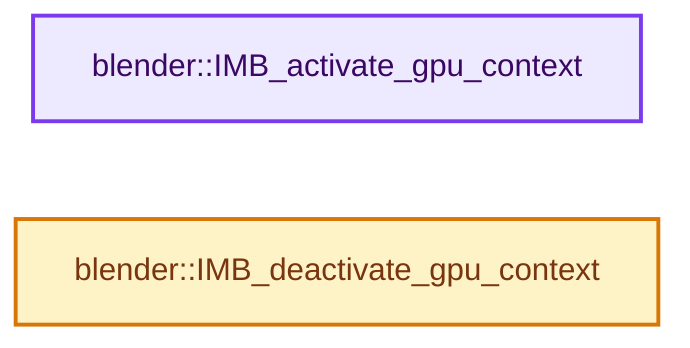
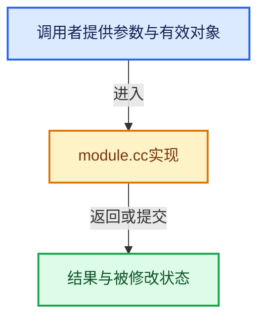

# 实现依赖专题：source/blender/imbuf/intern/module.cc

[方向导航](README.md) · [符号索引](../%E7%AC%A6%E5%8F%B7%E4%BE%9D%E8%B5%96%E4%B8%8E%E5%AE%9E%E7%8E%B0%E7%B4%A2%E5%BC%95.md)

本专题从正文实际调用进入，集中保存共享实现。函数有稳定锚点，可从调用处直接跳到对应完整函数；递归与互相调用通过回链组织。

## 本文件的实现关系






## 完整成员与函数实现

<a id="f-fc08077469a8d55a"></a>

### `blender::IMB_activate_gpu_context`

实现位置：[source/blender/imbuf/intern/module.cc](../../../../../source/blender/imbuf/intern/module.cc) · L53—L59。

**教学注释版**

<!-- annotated:c5c35836d32aa7 -->

```cpp
void IMB_activate_gpu_context()
{
  BLI_assert(g_gpu_context.gpu_context);

  g_gpu_context_mutex.lock();
  gpu::GPU_activate_secondary_context(g_gpu_context);
}
```

<details>
<summary>核对原始源码：source/blender/imbuf/intern/module.cc · L53—L59</summary>

<!-- original:c5c35836d32aa7:source/blender/imbuf/intern/module.cc:53:59 -->

```cpp
void IMB_activate_gpu_context()
{
  BLI_assert(g_gpu_context.gpu_context);

  g_gpu_context_mutex.lock();
  gpu::GPU_activate_secondary_context(g_gpu_context);
}
```

</details>

**继续追踪实现**

- `BLI_assert` → [BLI_assert · L48](../01-%E5%9F%BA%E7%A1%80%E5%AE%B9%E5%99%A8%E4%B8%8E%E7%8E%B0%E4%BB%A3CPP/%E4%BE%9D%E8%B5%96-BLI_assert-cc98e8.md#m-57a88495704d)；[BLI_assert · L63](../01-%E5%9F%BA%E7%A1%80%E5%AE%B9%E5%99%A8%E4%B8%8E%E7%8E%B0%E4%BB%A3CPP/%E4%BE%9D%E8%B5%96-BLI_assert-cc98e8.md#m-d07050020cb5)。宏定义由构建条件选择。
- `g_gpu_context_mutex.lock` → [调用协议](../%E6%A8%A1%E6%9D%BF%E5%AE%8F%E4%B8%8E%E5%8A%A8%E6%80%81%E5%88%86%E6%B4%BE%E5%8D%8F%E8%AE%AE.md)：接收对象类型依赖auto、返回值或模板实例；不按同名猜测目标。调用位置L57。
- `gpu::GPU_activate_secondary_context` → [blender::gpu::GPU_activate_secondary_context · L725](%E4%BE%9D%E8%B5%96-gpu_context-77a234.md#f-0ecb32b1429d3b5c)。

<a id="f-b81ab806194c6a8a"></a>

### `blender::IMB_deactivate_gpu_context`

实现位置：[source/blender/imbuf/intern/module.cc](../../../../../source/blender/imbuf/intern/module.cc) · L61—L67。

**教学注释版**

<!-- annotated:8ec0641a01ebed -->

```cpp
void IMB_deactivate_gpu_context()
{
  BLI_assert(g_gpu_context.gpu_context);

  gpu::GPU_deactivate_secondary_context(g_gpu_context);
  g_gpu_context_mutex.unlock();
}
```

<details>
<summary>核对原始源码：source/blender/imbuf/intern/module.cc · L61—L67</summary>

<!-- original:8ec0641a01ebed:source/blender/imbuf/intern/module.cc:61:67 -->

```cpp
void IMB_deactivate_gpu_context()
{
  BLI_assert(g_gpu_context.gpu_context);

  gpu::GPU_deactivate_secondary_context(g_gpu_context);
  g_gpu_context_mutex.unlock();
}
```

</details>

**继续追踪实现**

- `BLI_assert` → [BLI_assert · L48](../01-%E5%9F%BA%E7%A1%80%E5%AE%B9%E5%99%A8%E4%B8%8E%E7%8E%B0%E4%BB%A3CPP/%E4%BE%9D%E8%B5%96-BLI_assert-cc98e8.md#m-57a88495704d)；[BLI_assert · L63](../01-%E5%9F%BA%E7%A1%80%E5%AE%B9%E5%99%A8%E4%B8%8E%E7%8E%B0%E4%BB%A3CPP/%E4%BE%9D%E8%B5%96-BLI_assert-cc98e8.md#m-d07050020cb5)。宏定义由构建条件选择。
- `gpu::GPU_deactivate_secondary_context` → [blender::gpu::GPU_deactivate_secondary_context · L731](%E4%BE%9D%E8%B5%96-gpu_context-77a234.md#f-2e947eed0260f1b8)。
- `g_gpu_context_mutex.unlock` → [调用协议](../%E6%A8%A1%E6%9D%BF%E5%AE%8F%E4%B8%8E%E5%8A%A8%E6%80%81%E5%88%86%E6%B4%BE%E5%8D%8F%E8%AE%AE.md)：接收对象类型依赖auto、返回值或模板实例；不按同名猜测目标。调用位置L66。
