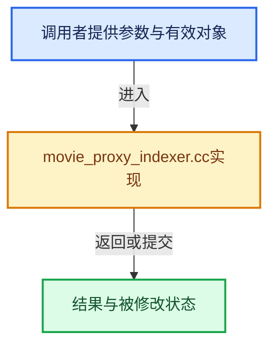

# 实现依赖专题：source/blender/imbuf/movie/intern/movie_proxy_indexer.cc

[方向导航](README.md) · [符号索引](../%E7%AC%A6%E5%8F%B7%E4%BE%9D%E8%B5%96%E4%B8%8E%E5%AE%9E%E7%8E%B0%E7%B4%A2%E5%BC%95.md)

本专题从正文实际调用进入，集中保存共享实现。函数有稳定锚点，可从调用处直接跳到对应完整函数；递归与互相调用通过回链组织。

## 本文件的实现关系





## 完整成员与函数实现

<a id="f-e32184b78e7894d6"></a>

### `blender::MOV_close_proxies`

实现位置：[source/blender/imbuf/movie/intern/movie_proxy_indexer.cc](../../../../../source/blender/imbuf/movie/intern/movie_proxy_indexer.cc) · L892—L906。

接口参数：

- `MovieReader *anim`

**教学注释版**

<!-- annotated:68937c3e7e9426 -->

```cpp
void MOV_close_proxies(MovieReader *anim)
{
  if (anim == nullptr) {
    return;
  }

  for (int i = 0; i < IMB_PROXY_MAX_SLOT; i++) {
    if (anim->proxy_anim[i]) {
      MOV_close(anim->proxy_anim[i]);
      anim->proxy_anim[i] = nullptr;
    }
  }

  anim->proxies_tried = 0;
}
```

<details>
<summary>核对原始源码：source/blender/imbuf/movie/intern/movie_proxy_indexer.cc · L892—L906</summary>

<!-- original:68937c3e7e9426:source/blender/imbuf/movie/intern/movie_proxy_indexer.cc:892:906 -->

```cpp
void MOV_close_proxies(MovieReader *anim)
{
  if (anim == nullptr) {
    return;
  }

  for (int i = 0; i < IMB_PROXY_MAX_SLOT; i++) {
    if (anim->proxy_anim[i]) {
      MOV_close(anim->proxy_anim[i]);
      anim->proxy_anim[i] = nullptr;
    }
  }

  anim->proxies_tried = 0;
}
```

</details>

**沿实际写入检查状态**

- `anim->proxy_anim[i] = nullptr;`
- `anim->proxies_tried = 0;`

**继续追踪实现**

- `MOV_close` → [MOV_close · L70](%E4%BE%9D%E8%B5%96-movie_read-4cc1f5.md#f-3180d117d9011594)。

<a id="f-a8ddbc25bdfb6dd4"></a>

### `blender::MOV_set_custom_proxy_dir`

实现位置：[source/blender/imbuf/movie/intern/movie_proxy_indexer.cc](../../../../../source/blender/imbuf/movie/intern/movie_proxy_indexer.cc) · L908—L916。

接口参数：

- `MovieReader *anim`
- `const char *dir`

**教学注释版**

<!-- annotated:c30f80d1dccd11 -->

```cpp
void MOV_set_custom_proxy_dir(MovieReader *anim, const char *dir)
{
  if (STREQ(anim->proxy_dir, dir)) {
    return;
  }
  STRNCPY(anim->proxy_dir, dir);

  MOV_close_proxies(anim);
}
```

<details>
<summary>核对原始源码：source/blender/imbuf/movie/intern/movie_proxy_indexer.cc · L908—L916</summary>

<!-- original:c30f80d1dccd11:source/blender/imbuf/movie/intern/movie_proxy_indexer.cc:908:916 -->

```cpp
void MOV_set_custom_proxy_dir(MovieReader *anim, const char *dir)
{
  if (STREQ(anim->proxy_dir, dir)) {
    return;
  }
  STRNCPY(anim->proxy_dir, dir);

  MOV_close_proxies(anim);
}
```

</details>

**继续追踪实现**

- `STREQ` → [STREQ · L112](%E4%BE%9D%E8%B5%96-GHOST_utildefines-34b996.md#m-9549fb6aafd2)；[STREQ · L451](../01-%E5%9F%BA%E7%A1%80%E5%AE%B9%E5%99%A8%E4%B8%8E%E7%8E%B0%E4%BB%A3CPP/%E4%BE%9D%E8%B5%96-BLI_utildefines-293a0a.md#m-c7b745bcfad2)；[STREQ · L55](%E4%BE%9D%E8%B5%96-clog-a0bec8.md#m-96e78f386894)。宏定义由构建条件选择。
- `STRNCPY` → [blender::STRNCPY · L690](../01-%E5%9F%BA%E7%A1%80%E5%AE%B9%E5%99%A8%E4%B8%8E%E7%8E%B0%E4%BB%A3CPP/%E4%BE%9D%E8%B5%96-BLI_string-b43058.md#f-6b2d861724026be6)。
- `MOV_close_proxies` → [blender::MOV_close_proxies · L892](%E4%BE%9D%E8%B5%96-movie_proxy_indexer-c32f88.md#f-e32184b78e7894d6)。
