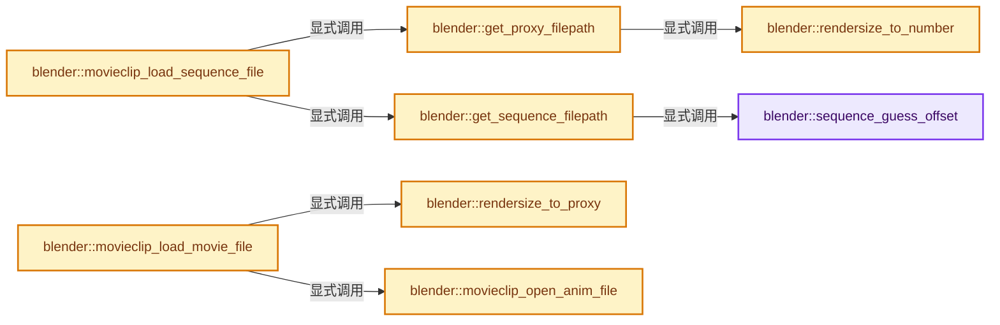

# 实现依赖专题：source/blender/blenkernel/intern/movieclip.cc

[方向导航](README.md) · [符号索引](../%E7%AC%A6%E5%8F%B7%E4%BE%9D%E8%B5%96%E4%B8%8E%E5%AE%9E%E7%8E%B0%E7%B4%A2%E5%BC%95.md)

本专题从正文实际调用进入，集中保存共享实现。函数有稳定锚点，可从调用处直接跳到对应完整函数；递归与互相调用通过回链组织。

## 本文件的实现关系




## 完整成员与函数实现

<a id="f-1e7107d2b02499e4"></a>

### `blender::sequence_guess_offset`

实现位置：[source/blender/blenkernel/intern/movieclip.cc](../../../../../source/blender/blenkernel/intern/movieclip.cc) · L328—L335。

接口参数：

- `const char *full_name`
- `int head_len`
- `ushort numlen`

**教学注释版**

<!-- annotated:83199f8cac7d8f -->

```cpp
static int sequence_guess_offset(const char *full_name, int head_len, ushort numlen)
{
  char num[FILE_MAX] = {0};

  BLI_strncpy(num, full_name + head_len, numlen + 1);

  return atoi(num);
}
```

<details>
<summary>核对原始源码：source/blender/blenkernel/intern/movieclip.cc · L328—L335</summary>

<!-- original:83199f8cac7d8f:source/blender/blenkernel/intern/movieclip.cc:328:335 -->

```cpp
static int sequence_guess_offset(const char *full_name, int head_len, ushort numlen)
{
  char num[FILE_MAX] = {0};

  BLI_strncpy(num, full_name + head_len, numlen + 1);

  return atoi(num);
}
```

</details>

**结果出口**

- `return atoi(num);`

**继续追踪实现**

- `BLI_strncpy` → [blender::BLI_strncpy · L70](../01-%E5%9F%BA%E7%A1%80%E5%AE%B9%E5%99%A8%E4%B8%8E%E7%8E%B0%E4%BB%A3CPP/%E4%BE%9D%E8%B5%96-string-1d986f.md#f-6324147b0d116da1)。
- `atoi` → [调用协议](../%E6%A8%A1%E6%9D%BF%E5%AE%8F%E4%B8%8E%E5%8A%A8%E6%80%81%E5%88%86%E6%B4%BE%E5%8D%8F%E8%AE%AE.md)：函数指针、局部可调用对象或未展开的宏；必须结合调用者环境。调用位置L334。

<a id="f-73c02396fbd0551b"></a>

### `blender::rendersize_to_proxy`

实现位置：[source/blender/blenkernel/intern/movieclip.cc](../../../../../source/blender/blenkernel/intern/movieclip.cc) · L337—L361。

接口参数：

- `const MovieClipUser *user`
- `int flag`

**教学注释版**

<!-- annotated:b5c8f8b3c1c22f -->

```cpp
static int rendersize_to_proxy(const MovieClipUser *user, int flag)
{
  if ((flag & MCLIP_USE_PROXY) == 0) {
    return IMB_PROXY_NONE;
  }

  switch (user->render_size) {
    case MCLIP_PROXY_RENDER_SIZE_25:
      return IMB_PROXY_25;

    case MCLIP_PROXY_RENDER_SIZE_50:
      return IMB_PROXY_50;

    case MCLIP_PROXY_RENDER_SIZE_75:
      return IMB_PROXY_75;

    case MCLIP_PROXY_RENDER_SIZE_100:
      return IMB_PROXY_100;

    case MCLIP_PROXY_RENDER_SIZE_FULL:
      return IMB_PROXY_NONE;
  }

  return IMB_PROXY_NONE;
}
```

<details>
<summary>核对原始源码：source/blender/blenkernel/intern/movieclip.cc · L337—L361</summary>

<!-- original:b5c8f8b3c1c22f:source/blender/blenkernel/intern/movieclip.cc:337:361 -->

```cpp
static int rendersize_to_proxy(const MovieClipUser *user, int flag)
{
  if ((flag & MCLIP_USE_PROXY) == 0) {
    return IMB_PROXY_NONE;
  }

  switch (user->render_size) {
    case MCLIP_PROXY_RENDER_SIZE_25:
      return IMB_PROXY_25;

    case MCLIP_PROXY_RENDER_SIZE_50:
      return IMB_PROXY_50;

    case MCLIP_PROXY_RENDER_SIZE_75:
      return IMB_PROXY_75;

    case MCLIP_PROXY_RENDER_SIZE_100:
      return IMB_PROXY_100;

    case MCLIP_PROXY_RENDER_SIZE_FULL:
      return IMB_PROXY_NONE;
  }

  return IMB_PROXY_NONE;
}
```

</details>

**结果出口**

- `return IMB_PROXY_NONE;`
- `return IMB_PROXY_25;`
- `return IMB_PROXY_50;`
- `return IMB_PROXY_75;`
- `return IMB_PROXY_100;`

**继续追踪实现**

本实现没有需要继续展开的显式调用；检查返回表达式、对象转换和调用者前置条件。

<a id="f-308e1bd0918a3ddf"></a>

### `blender::rendersize_to_number`

实现位置：[source/blender/blenkernel/intern/movieclip.cc](../../../../../source/blender/blenkernel/intern/movieclip.cc) · L363—L383。

接口参数：

- `int render_size`

**教学注释版**

<!-- annotated:76ac7f7ca4c3bf -->

```cpp
static int rendersize_to_number(int render_size)
{
  switch (render_size) {
    case MCLIP_PROXY_RENDER_SIZE_25:
      return 25;

    case MCLIP_PROXY_RENDER_SIZE_50:
      return 50;

    case MCLIP_PROXY_RENDER_SIZE_75:
      return 75;

    case MCLIP_PROXY_RENDER_SIZE_100:
      return 100;

    case MCLIP_PROXY_RENDER_SIZE_FULL:
      return 100;
  }

  return 100;
}
```

<details>
<summary>核对原始源码：source/blender/blenkernel/intern/movieclip.cc · L363—L383</summary>

<!-- original:76ac7f7ca4c3bf:source/blender/blenkernel/intern/movieclip.cc:363:383 -->

```cpp
static int rendersize_to_number(int render_size)
{
  switch (render_size) {
    case MCLIP_PROXY_RENDER_SIZE_25:
      return 25;

    case MCLIP_PROXY_RENDER_SIZE_50:
      return 50;

    case MCLIP_PROXY_RENDER_SIZE_75:
      return 75;

    case MCLIP_PROXY_RENDER_SIZE_100:
      return 100;

    case MCLIP_PROXY_RENDER_SIZE_FULL:
      return 100;
  }

  return 100;
}
```

</details>

**结果出口**

- `return 25;`
- `return 50;`
- `return 75;`
- `return 100;`

**继续追踪实现**

本实现没有需要继续展开的显式调用；检查返回表达式、对象转换和调用者前置条件。

<a id="f-32176a405a1145d0"></a>

### `blender::get_sequence_filepath`

实现位置：[source/blender/blenkernel/intern/movieclip.cc](../../../../../source/blender/blenkernel/intern/movieclip.cc) · L385—L413。

接口参数：

- `const MovieClip *clip`
- `const int framenr`
- `char filepath[FILE_MAX]`

**教学注释版**

<!-- annotated:0f740f09cdd504 -->

```cpp
static void get_sequence_filepath(const MovieClip *clip,
                                  const int framenr,
                                  char filepath[FILE_MAX])
{
  ushort numlen;
  char head[FILE_MAX], tail[FILE_MAX];
  int offset;

  BLI_strncpy(filepath, clip->filepath, sizeof(clip->filepath));
  BLI_path_sequence_decode(filepath, head, sizeof(head), tail, sizeof(tail), &numlen);

  /* Movie-clips always points to first image from sequence, auto-guess offset for now.
   * Could be something smarter in the future. */
  offset = sequence_guess_offset(clip->filepath, strlen(head), numlen);

  if (numlen) {
    BLI_path_sequence_encode(filepath,
                             FILE_MAX,
                             head,
                             tail,
                             numlen,
                             offset + framenr - clip->start_frame + clip->frame_offset);
  }
  else {
    BLI_strncpy(filepath, clip->filepath, sizeof(clip->filepath));
  }

  BLI_path_abs(filepath, ID_BLEND_PATH_FROM_GLOBAL(&clip->id));
}
```

<details>
<summary>核对原始源码：source/blender/blenkernel/intern/movieclip.cc · L385—L413</summary>

<!-- original:0f740f09cdd504:source/blender/blenkernel/intern/movieclip.cc:385:413 -->

```cpp
static void get_sequence_filepath(const MovieClip *clip,
                                  const int framenr,
                                  char filepath[FILE_MAX])
{
  ushort numlen;
  char head[FILE_MAX], tail[FILE_MAX];
  int offset;

  BLI_strncpy(filepath, clip->filepath, sizeof(clip->filepath));
  BLI_path_sequence_decode(filepath, head, sizeof(head), tail, sizeof(tail), &numlen);

  /* Movie-clips always points to first image from sequence, auto-guess offset for now.
   * Could be something smarter in the future. */
  offset = sequence_guess_offset(clip->filepath, strlen(head), numlen);

  if (numlen) {
    BLI_path_sequence_encode(filepath,
                             FILE_MAX,
                             head,
                             tail,
                             numlen,
                             offset + framenr - clip->start_frame + clip->frame_offset);
  }
  else {
    BLI_strncpy(filepath, clip->filepath, sizeof(clip->filepath));
  }

  BLI_path_abs(filepath, ID_BLEND_PATH_FROM_GLOBAL(&clip->id));
}
```

</details>

**沿实际写入检查状态**

- `offset = sequence_guess_offset(clip->filepath, strlen(head), numlen);`

**继续追踪实现**

- `BLI_strncpy` → [blender::BLI_strncpy · L70](../01-%E5%9F%BA%E7%A1%80%E5%AE%B9%E5%99%A8%E4%B8%8E%E7%8E%B0%E4%BB%A3CPP/%E4%BE%9D%E8%B5%96-string-1d986f.md#f-6324147b0d116da1)。
- `BLI_path_sequence_decode` → [BLI_path_sequence_decode · L61](../01-%E5%9F%BA%E7%A1%80%E5%AE%B9%E5%99%A8%E4%B8%8E%E7%8E%B0%E4%BB%A3CPP/%E4%BE%9D%E8%B5%96-path_utils-b4d26a.md#f-4ad3eb43842c6c22)。
- `sequence_guess_offset` → [blender::sequence_guess_offset · L328](%E4%BE%9D%E8%B5%96-movieclip-625888.md#f-1e7107d2b02499e4)。
- `strlen` → [外部契约](https://eel.is/c++draft/)：这个边界按实际表达式及所属类型核对参数、返回值、寿命与失败行为。这里提供接口入口，不声称已解释该第三方版本的内部实现。
- `BLI_path_sequence_encode` → [BLI_path_sequence_encode · L131](../01-%E5%9F%BA%E7%A1%80%E5%AE%B9%E5%99%A8%E4%B8%8E%E7%8E%B0%E4%BB%A3CPP/%E4%BE%9D%E8%B5%96-path_utils-b4d26a.md#f-0ce71e15b7dc0658)。
- `BLI_path_abs` → [BLI_path_abs · L1164](../01-%E5%9F%BA%E7%A1%80%E5%AE%B9%E5%99%A8%E4%B8%8E%E7%8E%B0%E4%BB%A3CPP/%E4%BE%9D%E8%B5%96-path_utils-b4d26a.md#f-002380948c1caeb6)。
- `ID_BLEND_PATH_FROM_GLOBAL` → [ID_BLEND_PATH_FROM_GLOBAL · L691](%E4%BE%9D%E8%B5%96-DNA_ID-3eb091.md#m-2b76f08bf41b)。宏定义由构建条件选择。

<a id="f-9dbacbae87a5ff72"></a>

### `blender::get_proxy_filepath`

实现位置：[source/blender/blenkernel/intern/movieclip.cc](../../../../../source/blender/blenkernel/intern/movieclip.cc) · L416—L457。

接口参数：

- `const MovieClip *clip`
- `int proxy_render_size`
- `bool undistorted`
- `int framenr`
- `char filepath[FILE_MAX]`

**教学注释版**

<!-- annotated:77b8e20c2369ce -->

```cpp
static void get_proxy_filepath(const MovieClip *clip,
                               int proxy_render_size,
                               bool undistorted,
                               int framenr,
                               char filepath[FILE_MAX])
{
  int size = rendersize_to_number(proxy_render_size);
  char dir[FILE_MAX], clipdir[FILE_MAX], clipfile[FILE_MAX];
  int proxynr = framenr - clip->start_frame + 1 + clip->frame_offset;

  BLI_path_split_dir_file(clip->filepath, clipdir, FILE_MAX, clipfile, FILE_MAX);

  if (clip->flag & MCLIP_USE_PROXY_CUSTOM_DIR) {
    STRNCPY(dir, clip->proxy.dir);
  }
  else {
    SNPRINTF(dir, "%s" SEP_STR "BL_proxy", clipdir);
  }

  if (undistorted) {
    BLI_snprintf(filepath,
                 FILE_MAX,
                 "%s" SEP_STR "%s" SEP_STR "proxy_%d_undistorted" SEP_STR "%08d",
                 dir,
                 clipfile,
                 size,
                 proxynr);
  }
  else {
    BLI_snprintf(filepath,
                 FILE_MAX,
                 "%s" SEP_STR "%s" SEP_STR "proxy_%d" SEP_STR "%08d",
                 dir,
                 clipfile,
                 size,
                 proxynr);
  }

  BLI_path_abs(filepath, BKE_main_blendfile_path_from_global());
  BLI_path_frame(filepath, FILE_MAX, 1, 0);
  BLI_strncat(filepath, ".jpg", FILE_MAX);
}
```

<details>
<summary>核对原始源码：source/blender/blenkernel/intern/movieclip.cc · L416—L457</summary>

<!-- original:77b8e20c2369ce:source/blender/blenkernel/intern/movieclip.cc:416:457 -->

```cpp
static void get_proxy_filepath(const MovieClip *clip,
                               int proxy_render_size,
                               bool undistorted,
                               int framenr,
                               char filepath[FILE_MAX])
{
  int size = rendersize_to_number(proxy_render_size);
  char dir[FILE_MAX], clipdir[FILE_MAX], clipfile[FILE_MAX];
  int proxynr = framenr - clip->start_frame + 1 + clip->frame_offset;

  BLI_path_split_dir_file(clip->filepath, clipdir, FILE_MAX, clipfile, FILE_MAX);

  if (clip->flag & MCLIP_USE_PROXY_CUSTOM_DIR) {
    STRNCPY(dir, clip->proxy.dir);
  }
  else {
    SNPRINTF(dir, "%s" SEP_STR "BL_proxy", clipdir);
  }

  if (undistorted) {
    BLI_snprintf(filepath,
                 FILE_MAX,
                 "%s" SEP_STR "%s" SEP_STR "proxy_%d_undistorted" SEP_STR "%08d",
                 dir,
                 clipfile,
                 size,
                 proxynr);
  }
  else {
    BLI_snprintf(filepath,
                 FILE_MAX,
                 "%s" SEP_STR "%s" SEP_STR "proxy_%d" SEP_STR "%08d",
                 dir,
                 clipfile,
                 size,
                 proxynr);
  }

  BLI_path_abs(filepath, BKE_main_blendfile_path_from_global());
  BLI_path_frame(filepath, FILE_MAX, 1, 0);
  BLI_strncat(filepath, ".jpg", FILE_MAX);
}
```

</details>

**继续追踪实现**

- `rendersize_to_number` → [blender::rendersize_to_number · L363](%E4%BE%9D%E8%B5%96-movieclip-625888.md#f-308e1bd0918a3ddf)。
- `BLI_path_split_dir_file` → [BLI_path_split_dir_file · L1641](../01-%E5%9F%BA%E7%A1%80%E5%AE%B9%E5%99%A8%E4%B8%8E%E7%8E%B0%E4%BB%A3CPP/%E4%BE%9D%E8%B5%96-path_utils-b4d26a.md#f-c894bd448541aaa1)。
- `STRNCPY` → [blender::STRNCPY · L690](../01-%E5%9F%BA%E7%A1%80%E5%AE%B9%E5%99%A8%E4%B8%8E%E7%8E%B0%E4%BB%A3CPP/%E4%BE%9D%E8%B5%96-BLI_string-b43058.md#f-6b2d861724026be6)。
- `SNPRINTF` → [SNPRINTF · L601](../01-%E5%9F%BA%E7%A1%80%E5%AE%B9%E5%99%A8%E4%B8%8E%E7%8E%B0%E4%BB%A3CPP/%E4%BE%9D%E8%B5%96-BLI_string-b43058.md#m-6193d55b5ab8)。宏定义由构建条件选择。
- `BLI_snprintf` → [blender::BLI_snprintf · L201](../01-%E5%9F%BA%E7%A1%80%E5%AE%B9%E5%99%A8%E4%B8%8E%E7%8E%B0%E4%BB%A3CPP/%E4%BE%9D%E8%B5%96-string-1d986f.md#f-c4de2f0e81459332)。
- `BLI_path_abs` → [BLI_path_abs · L1164](../01-%E5%9F%BA%E7%A1%80%E5%AE%B9%E5%99%A8%E4%B8%8E%E7%8E%B0%E4%BB%A3CPP/%E4%BE%9D%E8%B5%96-path_utils-b4d26a.md#f-002380948c1caeb6)。
- `BKE_main_blendfile_path_from_global` → [blender::BKE_main_blendfile_path_from_global · L1063](%E4%BE%9D%E8%B5%96-main-ffa8b3.md#f-06a1cf589f8e04a9)。
- `BLI_path_frame` → [BLI_path_frame · L999](../01-%E5%9F%BA%E7%A1%80%E5%AE%B9%E5%99%A8%E4%B8%8E%E7%8E%B0%E4%BB%A3CPP/%E4%BE%9D%E8%B5%96-path_utils-b4d26a.md#f-86ecc33491f04e49)。
- `BLI_strncat` → [blender::BLI_strncat · L139](../01-%E5%9F%BA%E7%A1%80%E5%AE%B9%E5%99%A8%E4%B8%8E%E7%8E%B0%E4%BB%A3CPP/%E4%BE%9D%E8%B5%96-string-1d986f.md#f-8f546ae4d50426b0)。

<a id="f-9b7131444f8cb1b3"></a>

### `blender::movieclip_load_sequence_file`

实现位置：[source/blender/blenkernel/intern/movieclip.cc](../../../../../source/blender/blenkernel/intern/movieclip.cc) · L459—L497。

接口参数：

- `MovieClip *clip`
- `const MovieClipUser *user`
- `int framenr`
- `int flag`

**教学注释版**

<!-- annotated:e9b12f4b94db60 -->

```cpp
static ImBuf *movieclip_load_sequence_file(MovieClip *clip,
                                           const MovieClipUser *user,
                                           int framenr,
                                           int flag)
{
  ImBuf *ibuf;
  char filepath[FILE_MAX];
  bool use_proxy = false;
  ColorManagedColorspaceSettings *colorspace_settings;

  use_proxy = (flag & MCLIP_USE_PROXY) && user->render_size != MCLIP_PROXY_RENDER_SIZE_FULL;
  if (use_proxy) {
    int undistort = user->render_flag & MCLIP_PROXY_RENDER_UNDISTORT;
    get_proxy_filepath(clip, user->render_size, undistort, framenr, filepath);

    /* Well, this is a bit weird, but proxies for movie sources
     * are built in the same exact color space as the input,
     *
     * But image sequences are built in the display space.
     */
    if (clip->source == MCLIP_SRC_MOVIE) {
      colorspace_settings = &clip->colorspace_settings;
    }
    else {
      colorspace_settings = nullptr;
    }
  }
  else {
    get_sequence_filepath(clip, framenr, filepath);
    colorspace_settings = &clip->colorspace_settings;
  }

  ImBufFlags loadflag = ImBufFlags::ByteData | ImBufFlags::AlphaDetect | ImBufFlags::Metadata;

  /* read ibuf */
  ibuf = IMB_load_image_from_filepath(filepath, loadflag, colorspace_settings);

  return ibuf;
}
```

<details>
<summary>核对原始源码：source/blender/blenkernel/intern/movieclip.cc · L459—L497</summary>

<!-- original:e9b12f4b94db60:source/blender/blenkernel/intern/movieclip.cc:459:497 -->

```cpp
static ImBuf *movieclip_load_sequence_file(MovieClip *clip,
                                           const MovieClipUser *user,
                                           int framenr,
                                           int flag)
{
  ImBuf *ibuf;
  char filepath[FILE_MAX];
  bool use_proxy = false;
  ColorManagedColorspaceSettings *colorspace_settings;

  use_proxy = (flag & MCLIP_USE_PROXY) && user->render_size != MCLIP_PROXY_RENDER_SIZE_FULL;
  if (use_proxy) {
    int undistort = user->render_flag & MCLIP_PROXY_RENDER_UNDISTORT;
    get_proxy_filepath(clip, user->render_size, undistort, framenr, filepath);

    /* Well, this is a bit weird, but proxies for movie sources
     * are built in the same exact color space as the input,
     *
     * But image sequences are built in the display space.
     */
    if (clip->source == MCLIP_SRC_MOVIE) {
      colorspace_settings = &clip->colorspace_settings;
    }
    else {
      colorspace_settings = nullptr;
    }
  }
  else {
    get_sequence_filepath(clip, framenr, filepath);
    colorspace_settings = &clip->colorspace_settings;
  }

  ImBufFlags loadflag = ImBufFlags::ByteData | ImBufFlags::AlphaDetect | ImBufFlags::Metadata;

  /* read ibuf */
  ibuf = IMB_load_image_from_filepath(filepath, loadflag, colorspace_settings);

  return ibuf;
}
```

</details>

**沿实际写入检查状态**

- `use_proxy = (flag & MCLIP_USE_PROXY) && user->render_size != MCLIP_PROXY_RENDER_SIZE_FULL;`
- `colorspace_settings = &clip->colorspace_settings;`
- `colorspace_settings = nullptr;`
- `ibuf = IMB_load_image_from_filepath(filepath, loadflag, colorspace_settings);`

**结果出口**

- `return ibuf;`

**继续追踪实现**

- `get_proxy_filepath` → [blender::get_proxy_filepath · L416](%E4%BE%9D%E8%B5%96-movieclip-625888.md#f-9dbacbae87a5ff72)。
- `get_sequence_filepath` → [blender::get_sequence_filepath · L385](%E4%BE%9D%E8%B5%96-movieclip-625888.md#f-32176a405a1145d0)。
- `IMB_load_image_from_filepath` → [blender::IMB_load_image_from_filepath · L201](%E4%BE%9D%E8%B5%96-readimage-322688.md#f-945c051623bb8454)。

<a id="f-b3e0f587c63121d9"></a>

### `blender::movieclip_open_anim_file`

实现位置：[source/blender/blenkernel/intern/movieclip.cc](../../../../../source/blender/blenkernel/intern/movieclip.cc) · L499—L519。

接口参数：

- `MovieClip *clip`

**教学注释版**

<!-- annotated:32f2ea9b8878cb -->

```cpp
static void movieclip_open_anim_file(MovieClip *clip)
{
  char filepath_abs[FILE_MAX];

  if (!clip->anim) {
    STRNCPY(filepath_abs, clip->filepath);
    BLI_path_abs(filepath_abs, ID_BLEND_PATH_FROM_GLOBAL(&clip->id));

    /* FIXME: make several stream accessible in image editor, too */
    clip->anim = openanim(filepath_abs, ImBufFlags::Zero, 0, false, &clip->colorspace_settings);

    if (clip->anim) {
      if (clip->flag & MCLIP_USE_PROXY_CUSTOM_DIR) {
        char dir[FILE_MAX];
        STRNCPY(dir, clip->proxy.dir);
        BLI_path_abs(dir, BKE_main_blendfile_path_from_global());
        MOV_set_custom_proxy_dir(clip->anim, dir);
      }
    }
  }
}
```

<details>
<summary>核对原始源码：source/blender/blenkernel/intern/movieclip.cc · L499—L519</summary>

<!-- original:32f2ea9b8878cb:source/blender/blenkernel/intern/movieclip.cc:499:519 -->

```cpp
static void movieclip_open_anim_file(MovieClip *clip)
{
  char filepath_abs[FILE_MAX];

  if (!clip->anim) {
    STRNCPY(filepath_abs, clip->filepath);
    BLI_path_abs(filepath_abs, ID_BLEND_PATH_FROM_GLOBAL(&clip->id));

    /* FIXME: make several stream accessible in image editor, too */
    clip->anim = openanim(filepath_abs, ImBufFlags::Zero, 0, false, &clip->colorspace_settings);

    if (clip->anim) {
      if (clip->flag & MCLIP_USE_PROXY_CUSTOM_DIR) {
        char dir[FILE_MAX];
        STRNCPY(dir, clip->proxy.dir);
        BLI_path_abs(dir, BKE_main_blendfile_path_from_global());
        MOV_set_custom_proxy_dir(clip->anim, dir);
      }
    }
  }
}
```

</details>

**沿实际写入检查状态**

- `clip->anim = openanim(filepath_abs, ImBufFlags::Zero, 0, false, &clip->colorspace_settings);`

**继续追踪实现**

- `STRNCPY` → [blender::STRNCPY · L690](../01-%E5%9F%BA%E7%A1%80%E5%AE%B9%E5%99%A8%E4%B8%8E%E7%8E%B0%E4%BB%A3CPP/%E4%BE%9D%E8%B5%96-BLI_string-b43058.md#f-6b2d861724026be6)。
- `BLI_path_abs` → [BLI_path_abs · L1164](../01-%E5%9F%BA%E7%A1%80%E5%AE%B9%E5%99%A8%E4%B8%8E%E7%8E%B0%E4%BB%A3CPP/%E4%BE%9D%E8%B5%96-path_utils-b4d26a.md#f-002380948c1caeb6)。
- `ID_BLEND_PATH_FROM_GLOBAL` → [ID_BLEND_PATH_FROM_GLOBAL · L691](%E4%BE%9D%E8%B5%96-DNA_ID-3eb091.md#m-2b76f08bf41b)。宏定义由构建条件选择。
- `openanim` → [blender::openanim · L2896](%E4%BE%9D%E8%B5%96-image-4859ac.md#f-6ca17147c925a2b5)。
- `BKE_main_blendfile_path_from_global` → [blender::BKE_main_blendfile_path_from_global · L1063](%E4%BE%9D%E8%B5%96-main-ffa8b3.md#f-06a1cf589f8e04a9)。
- `MOV_set_custom_proxy_dir` → [blender::MOV_set_custom_proxy_dir · L908](%E4%BE%9D%E8%B5%96-movie_proxy_indexer-c32f88.md#f-a8ddbc25bdfb6dd4)。

<a id="f-2adb97e7a1a272e7"></a>

### `blender::movieclip_load_movie_file`

实现位置：[source/blender/blenkernel/intern/movieclip.cc](../../../../../source/blender/blenkernel/intern/movieclip.cc) · L521—L538。

接口参数：

- `MovieClip *clip`
- `const MovieClipUser *user`
- `int framenr`
- `int flag`

**教学注释版**

<!-- annotated:ebe32782394772 -->

```cpp
static ImBuf *movieclip_load_movie_file(MovieClip *clip,
                                        const MovieClipUser *user,
                                        int framenr,
                                        int flag)
{
  ImBuf *ibuf = nullptr;
  int proxy = rendersize_to_proxy(user, flag);

  movieclip_open_anim_file(clip);

  if (clip->anim) {
    int fra = framenr - clip->start_frame + clip->frame_offset;

    ibuf = MOV_decode_frame(clip->anim, fra, IMB_Proxy_Size(proxy));
  }

  return ibuf;
}
```

<details>
<summary>核对原始源码：source/blender/blenkernel/intern/movieclip.cc · L521—L538</summary>

<!-- original:ebe32782394772:source/blender/blenkernel/intern/movieclip.cc:521:538 -->

```cpp
static ImBuf *movieclip_load_movie_file(MovieClip *clip,
                                        const MovieClipUser *user,
                                        int framenr,
                                        int flag)
{
  ImBuf *ibuf = nullptr;
  int proxy = rendersize_to_proxy(user, flag);

  movieclip_open_anim_file(clip);

  if (clip->anim) {
    int fra = framenr - clip->start_frame + clip->frame_offset;

    ibuf = MOV_decode_frame(clip->anim, fra, IMB_Proxy_Size(proxy));
  }

  return ibuf;
}
```

</details>

**沿实际写入检查状态**

- `ibuf = MOV_decode_frame(clip->anim, fra, IMB_Proxy_Size(proxy));`

**结果出口**

- `return ibuf;`

**继续追踪实现**

- `rendersize_to_proxy` → [blender::rendersize_to_proxy · L337](%E4%BE%9D%E8%B5%96-movieclip-625888.md#f-73c02396fbd0551b)。
- `movieclip_open_anim_file` → [blender::movieclip_open_anim_file · L499](%E4%BE%9D%E8%B5%96-movieclip-625888.md#f-b3e0f587c63121d9)。
- `MOV_decode_frame` → [调用协议](../%E6%A8%A1%E6%9D%BF%E5%AE%8F%E4%B8%8E%E5%8A%A8%E6%80%81%E5%88%86%E6%B4%BE%E5%8D%8F%E8%AE%AE.md)：函数指针、局部可调用对象或未展开的宏；必须结合调用者环境。调用位置L534。
- `IMB_Proxy_Size` → [blender::IMB_Proxy_Size](%E4%BE%9D%E8%B5%96-IMB_imbuf_enums-0f44c7.md#t-fe1b27e23537)。

<a id="f-97d1e0028bcb04b4"></a>

### `blender::movieclip_calc_length`

实现位置：[source/blender/blenkernel/intern/movieclip.cc](../../../../../source/blender/blenkernel/intern/movieclip.cc) · L540—L573。

接口参数：

- `MovieClip *clip`

**教学注释版**

<!-- annotated:b11350bc4ff123 -->

```cpp
static void movieclip_calc_length(MovieClip *clip)
{
  if (clip->source == MCLIP_SRC_MOVIE) {
    movieclip_open_anim_file(clip);

    if (clip->anim) {
      clip->len = MOV_get_duration_frames(clip->anim);
    }
  }
  else if (clip->source == MCLIP_SRC_SEQUENCE) {
    ushort numlen;
    char filepath[FILE_MAX], head[FILE_MAX], tail[FILE_MAX];

    BLI_path_sequence_decode(clip->filepath, head, sizeof(head), tail, sizeof(tail), &numlen);

    if (numlen == 0) {
      /* there's no number group in file name, assume it's single framed sequence */
      clip->len = 1;
    }
    else {
      clip->len = 0;
      for (;;) {
        get_sequence_filepath(clip, clip->len + clip->start_frame, filepath);

        if (BLI_exists(filepath)) {
          clip->len++;
        }
        else {
          break;
        }
      }
    }
  }
}
```

<details>
<summary>核对原始源码：source/blender/blenkernel/intern/movieclip.cc · L540—L573</summary>

<!-- original:b11350bc4ff123:source/blender/blenkernel/intern/movieclip.cc:540:573 -->

```cpp
static void movieclip_calc_length(MovieClip *clip)
{
  if (clip->source == MCLIP_SRC_MOVIE) {
    movieclip_open_anim_file(clip);

    if (clip->anim) {
      clip->len = MOV_get_duration_frames(clip->anim);
    }
  }
  else if (clip->source == MCLIP_SRC_SEQUENCE) {
    ushort numlen;
    char filepath[FILE_MAX], head[FILE_MAX], tail[FILE_MAX];

    BLI_path_sequence_decode(clip->filepath, head, sizeof(head), tail, sizeof(tail), &numlen);

    if (numlen == 0) {
      /* there's no number group in file name, assume it's single framed sequence */
      clip->len = 1;
    }
    else {
      clip->len = 0;
      for (;;) {
        get_sequence_filepath(clip, clip->len + clip->start_frame, filepath);

        if (BLI_exists(filepath)) {
          clip->len++;
        }
        else {
          break;
        }
      }
    }
  }
}
```

</details>

**沿实际写入检查状态**

- `clip->len = MOV_get_duration_frames(clip->anim);`
- `clip->len = 1;`
- `clip->len = 0;`

**继续追踪实现**

- `movieclip_open_anim_file` → [blender::movieclip_open_anim_file · L499](%E4%BE%9D%E8%B5%96-movieclip-625888.md#f-b3e0f587c63121d9)。
- `MOV_get_duration_frames` → [调用协议](../%E6%A8%A1%E6%9D%BF%E5%AE%8F%E4%B8%8E%E5%8A%A8%E6%80%81%E5%88%86%E6%B4%BE%E5%8D%8F%E8%AE%AE.md)：函数指针、局部可调用对象或未展开的宏；必须结合调用者环境。调用位置L546。
- `BLI_path_sequence_decode` → [BLI_path_sequence_decode · L61](../01-%E5%9F%BA%E7%A1%80%E5%AE%B9%E5%99%A8%E4%B8%8E%E7%8E%B0%E4%BB%A3CPP/%E4%BE%9D%E8%B5%96-path_utils-b4d26a.md#f-4ad3eb43842c6c22)。
- `get_sequence_filepath` → [blender::get_sequence_filepath · L385](%E4%BE%9D%E8%B5%96-movieclip-625888.md#f-32176a405a1145d0)。
- `BLI_exists` → [blender::BLI_exists · L404](../01-%E5%9F%BA%E7%A1%80%E5%AE%B9%E5%99%A8%E4%B8%8E%E7%8E%B0%E4%BB%A3CPP/%E4%BE%9D%E8%B5%96-storage-bda15e.md#f-a84afb14d0277334)。

<a id="f-87e9d4a7ed4cf44c"></a>

### `blender::user_frame_to_cache_frame`

实现位置：[source/blender/blenkernel/intern/movieclip.cc](../../../../../source/blender/blenkernel/intern/movieclip.cc) · L631—L656。

接口参数：

- `MovieClip *clip`
- `int framenr`

**教学注释版**

<!-- annotated:1d6a64e948afbf -->

```cpp
static int user_frame_to_cache_frame(MovieClip *clip, int framenr)
{
  int index;

  index = framenr - clip->start_frame + clip->frame_offset;

  if (clip->source == MCLIP_SRC_SEQUENCE) {
    if (clip->cache->sequence_offset == -1) {
      ushort numlen;
      char head[FILE_MAX], tail[FILE_MAX];

      BLI_path_sequence_decode(clip->filepath, head, sizeof(head), tail, sizeof(tail), &numlen);

      /* see comment in get_sequence_filepath */
      clip->cache->sequence_offset = sequence_guess_offset(clip->filepath, strlen(head), numlen);
    }

    index += clip->cache->sequence_offset;
  }

  if (index < 0) {
    return framenr - index;
  }

  return framenr;
}
```

<details>
<summary>核对原始源码：source/blender/blenkernel/intern/movieclip.cc · L631—L656</summary>

<!-- original:1d6a64e948afbf:source/blender/blenkernel/intern/movieclip.cc:631:656 -->

```cpp
static int user_frame_to_cache_frame(MovieClip *clip, int framenr)
{
  int index;

  index = framenr - clip->start_frame + clip->frame_offset;

  if (clip->source == MCLIP_SRC_SEQUENCE) {
    if (clip->cache->sequence_offset == -1) {
      ushort numlen;
      char head[FILE_MAX], tail[FILE_MAX];

      BLI_path_sequence_decode(clip->filepath, head, sizeof(head), tail, sizeof(tail), &numlen);

      /* see comment in get_sequence_filepath */
      clip->cache->sequence_offset = sequence_guess_offset(clip->filepath, strlen(head), numlen);
    }

    index += clip->cache->sequence_offset;
  }

  if (index < 0) {
    return framenr - index;
  }

  return framenr;
}
```

</details>

**沿实际写入检查状态**

- `index = framenr - clip->start_frame + clip->frame_offset;`
- `clip->cache->sequence_offset = sequence_guess_offset(clip->filepath, strlen(head), numlen);`
- `index += clip->cache->sequence_offset;`

**结果出口**

- `return framenr - index;`
- `return framenr;`

**继续追踪实现**

- `BLI_path_sequence_decode` → [BLI_path_sequence_decode · L61](../01-%E5%9F%BA%E7%A1%80%E5%AE%B9%E5%99%A8%E4%B8%8E%E7%8E%B0%E4%BB%A3CPP/%E4%BE%9D%E8%B5%96-path_utils-b4d26a.md#f-4ad3eb43842c6c22)。
- `sequence_guess_offset` → [blender::sequence_guess_offset · L328](%E4%BE%9D%E8%B5%96-movieclip-625888.md#f-1e7107d2b02499e4)。
- `strlen` → [外部契约](https://eel.is/c++draft/)：这个边界按实际表达式及所属类型核对参数、返回值、寿命与失败行为。这里提供接口入口，不声称已解释该第三方版本的内部实现。

<a id="f-f32d42d26851caa9"></a>

### `blender::get_imbuf_cache`

实现位置：[source/blender/blenkernel/intern/movieclip.cc](../../../../../source/blender/blenkernel/intern/movieclip.cc) · L712—L737。

接口参数：

- `MovieClip *clip`
- `const MovieClipUser *user`
- `int flag`

**教学注释版**

<!-- annotated:c388a592481638 -->

```cpp
static ImBuf *get_imbuf_cache(MovieClip *clip, const MovieClipUser *user, int flag)
{
  if (clip->cache) {
    MovieClipImBufCacheKey key;

    if (!clip->cache->is_still_sequence) {
      key.framenr = user_frame_to_cache_frame(clip, user->framenr);
    }
    else {
      key.framenr = 1;
    }

    if (flag & MCLIP_USE_PROXY) {
      key.proxy = rendersize_to_proxy(user, flag);
      key.render_flag = user->render_flag;
    }
    else {
      key.proxy = IMB_PROXY_NONE;
      key.render_flag = 0;
    }

    return IMB_cache_get(clip->cache->imbufcache, &key, nullptr);
  }

  return nullptr;
}
```

<details>
<summary>核对原始源码：source/blender/blenkernel/intern/movieclip.cc · L712—L737</summary>

<!-- original:c388a592481638:source/blender/blenkernel/intern/movieclip.cc:712:737 -->

```cpp
static ImBuf *get_imbuf_cache(MovieClip *clip, const MovieClipUser *user, int flag)
{
  if (clip->cache) {
    MovieClipImBufCacheKey key;

    if (!clip->cache->is_still_sequence) {
      key.framenr = user_frame_to_cache_frame(clip, user->framenr);
    }
    else {
      key.framenr = 1;
    }

    if (flag & MCLIP_USE_PROXY) {
      key.proxy = rendersize_to_proxy(user, flag);
      key.render_flag = user->render_flag;
    }
    else {
      key.proxy = IMB_PROXY_NONE;
      key.render_flag = 0;
    }

    return IMB_cache_get(clip->cache->imbufcache, &key, nullptr);
  }

  return nullptr;
}
```

</details>

**沿实际写入检查状态**

- `key.framenr = user_frame_to_cache_frame(clip, user->framenr);`
- `key.framenr = 1;`
- `key.proxy = rendersize_to_proxy(user, flag);`
- `key.render_flag = user->render_flag;`
- `key.proxy = IMB_PROXY_NONE;`
- `key.render_flag = 0;`

**结果出口**

- `return IMB_cache_get(clip->cache->imbufcache, &key, nullptr);`
- `return nullptr;`

**继续追踪实现**

- `user_frame_to_cache_frame` → [blender::user_frame_to_cache_frame · L631](%E4%BE%9D%E8%B5%96-movieclip-625888.md#f-87e9d4a7ed4cf44c)。
- `rendersize_to_proxy` → [blender::rendersize_to_proxy · L337](%E4%BE%9D%E8%B5%96-movieclip-625888.md#f-73c02396fbd0551b)。
- `IMB_cache_get` → [blender::IMB_cache_get · L403](%E4%BE%9D%E8%B5%96-cache-3c473c.md#f-f8167da094e536a4)。

<a id="f-589796084188bb20"></a>

### `blender::put_imbuf_cache`

实现位置：[source/blender/blenkernel/intern/movieclip.cc](../../../../../source/blender/blenkernel/intern/movieclip.cc) · L761—L814。

接口参数：

- `MovieClip *clip`
- `const MovieClipUser *user`
- `ImBuf *ibuf`
- `int flag`
- `bool destructive`

**教学注释版**

<!-- annotated:17853836f27b60 -->

```cpp
static bool put_imbuf_cache(
    MovieClip *clip, const MovieClipUser *user, ImBuf *ibuf, int flag, bool destructive)
{
  MovieClipImBufCacheKey key;

  if (clip->cache == nullptr) {
    ImBufCache *imbufcache;

    // char cache_name[64];
    // SNPRINTF(cache_name, "movie %s", clip->id.name);

    clip->cache = MEM_new_zeroed<MovieClipCache>("movieClipCache");

    imbufcache = IMB_cache_create(
        "movieclip", sizeof(MovieClipImBufCacheKey), movieclip_hashhash, imbufcache_hashcmp);

    IMB_cache_set_getdata_callback(imbufcache, moviecache_keydata);
    IMB_cache_set_priority_callback(imbufcache,
                                    moviecache_getprioritydata,
                                    moviecache_getitempriority,
                                    moviecache_prioritydeleter);

    clip->cache->imbufcache = imbufcache;
    clip->cache->sequence_offset = -1;
    if (clip->source == MCLIP_SRC_SEQUENCE) {
      ushort numlen;
      BLI_path_sequence_decode(clip->filepath, nullptr, 0, nullptr, 0, &numlen);
      clip->cache->is_still_sequence = (numlen == 0);
    }
  }

  if (!clip->cache->is_still_sequence) {
    key.framenr = user_frame_to_cache_frame(clip, user->framenr);
  }
  else {
    key.framenr = 1;
  }

  if (flag & MCLIP_USE_PROXY) {
    key.proxy = rendersize_to_proxy(user, flag);
    key.render_flag = user->render_flag;
  }
  else {
    key.proxy = IMB_PROXY_NONE;
    key.render_flag = 0;
  }

  if (destructive) {
    IMB_cache_put(clip->cache->imbufcache, &key, ibuf);
    return true;
  }

  return IMB_cache_put_if_possible(clip->cache->imbufcache, &key, ibuf);
}
```

<details>
<summary>核对原始源码：source/blender/blenkernel/intern/movieclip.cc · L761—L814</summary>

<!-- original:17853836f27b60:source/blender/blenkernel/intern/movieclip.cc:761:814 -->

```cpp
static bool put_imbuf_cache(
    MovieClip *clip, const MovieClipUser *user, ImBuf *ibuf, int flag, bool destructive)
{
  MovieClipImBufCacheKey key;

  if (clip->cache == nullptr) {
    ImBufCache *imbufcache;

    // char cache_name[64];
    // SNPRINTF(cache_name, "movie %s", clip->id.name);

    clip->cache = MEM_new_zeroed<MovieClipCache>("movieClipCache");

    imbufcache = IMB_cache_create(
        "movieclip", sizeof(MovieClipImBufCacheKey), movieclip_hashhash, imbufcache_hashcmp);

    IMB_cache_set_getdata_callback(imbufcache, moviecache_keydata);
    IMB_cache_set_priority_callback(imbufcache,
                                    moviecache_getprioritydata,
                                    moviecache_getitempriority,
                                    moviecache_prioritydeleter);

    clip->cache->imbufcache = imbufcache;
    clip->cache->sequence_offset = -1;
    if (clip->source == MCLIP_SRC_SEQUENCE) {
      ushort numlen;
      BLI_path_sequence_decode(clip->filepath, nullptr, 0, nullptr, 0, &numlen);
      clip->cache->is_still_sequence = (numlen == 0);
    }
  }

  if (!clip->cache->is_still_sequence) {
    key.framenr = user_frame_to_cache_frame(clip, user->framenr);
  }
  else {
    key.framenr = 1;
  }

  if (flag & MCLIP_USE_PROXY) {
    key.proxy = rendersize_to_proxy(user, flag);
    key.render_flag = user->render_flag;
  }
  else {
    key.proxy = IMB_PROXY_NONE;
    key.render_flag = 0;
  }

  if (destructive) {
    IMB_cache_put(clip->cache->imbufcache, &key, ibuf);
    return true;
  }

  return IMB_cache_put_if_possible(clip->cache->imbufcache, &key, ibuf);
}
```

</details>

**沿实际写入检查状态**

- `clip->cache = MEM_new_zeroed<MovieClipCache>("movieClipCache");`
- `imbufcache = IMB_cache_create(`
- `clip->cache->imbufcache = imbufcache;`
- `clip->cache->sequence_offset = -1;`
- `clip->cache->is_still_sequence = (numlen == 0);`
- `key.framenr = user_frame_to_cache_frame(clip, user->framenr);`
- `key.framenr = 1;`
- `key.proxy = rendersize_to_proxy(user, flag);`
- `key.render_flag = user->render_flag;`
- `key.proxy = IMB_PROXY_NONE;`
- `key.render_flag = 0;`

**结果出口**

- `return true;`
- `return IMB_cache_put_if_possible(clip->cache->imbufcache, &key, ibuf);`

**继续追踪实现**

- `MEM_new_zeroed<MovieClipCache>` → [MEM_new_zeroed · L550](../03-%E5%86%85%E5%AD%98%E5%88%86%E9%85%8D%E4%B8%8E%E8%BF%90%E8%A1%8C%E6%97%B6%E7%B1%BB%E5%9E%8B/%E4%BE%9D%E8%B5%96-MEM_guardedalloc-b54eca.md#f-eeb1e2a7f57dd231)；[MEM_new_zeroed · L114](../03-%E5%86%85%E5%AD%98%E5%88%86%E9%85%8D%E4%B8%8E%E8%BF%90%E8%A1%8C%E6%97%B6%E7%B1%BB%E5%9E%8B/%E4%BE%9D%E8%B5%96-mallocn-afdcd4.md#f-e04cf01c64c8b180)。同名重载需按实参类型选择。
- `IMB_cache_create` → [blender::IMB_cache_create · L270](%E4%BE%9D%E8%B5%96-cache-3c473c.md#f-7ad544796ea1c23b)。
- `IMB_cache_set_getdata_callback` → [blender::IMB_cache_set_getdata_callback · L294](%E4%BE%9D%E8%B5%96-cache-3c473c.md#f-e4978a2cf11af5d0)。
- `IMB_cache_set_priority_callback` → [blender::IMB_cache_set_priority_callback · L299](%E4%BE%9D%E8%B5%96-cache-3c473c.md#f-daf01a9145cbdafb)。
- `BLI_path_sequence_decode` → [BLI_path_sequence_decode · L61](../01-%E5%9F%BA%E7%A1%80%E5%AE%B9%E5%99%A8%E4%B8%8E%E7%8E%B0%E4%BB%A3CPP/%E4%BE%9D%E8%B5%96-path_utils-b4d26a.md#f-4ad3eb43842c6c22)。
- `user_frame_to_cache_frame` → [blender::user_frame_to_cache_frame · L631](%E4%BE%9D%E8%B5%96-movieclip-625888.md#f-87e9d4a7ed4cf44c)。
- `rendersize_to_proxy` → [blender::rendersize_to_proxy · L337](%E4%BE%9D%E8%B5%96-movieclip-625888.md#f-73c02396fbd0551b)。
- `IMB_cache_put` → [blender::IMB_cache_put · L369](%E4%BE%9D%E8%B5%96-cache-3c473c.md#f-35b68f6e49743575)。
- `IMB_cache_put_if_possible` → [blender::IMB_cache_put_if_possible · L374](%E4%BE%9D%E8%B5%96-cache-3c473c.md#f-318c4ac20342cdae)。

<a id="f-9bab5c4e433f0b88"></a>

### `blender::movieclip_load_get_size`

实现位置：[source/blender/blenkernel/intern/movieclip.cc](../../../../../source/blender/blenkernel/intern/movieclip.cc) · L835—L846。

接口参数：

- `MovieClip *clip`

**教学注释版**

<!-- annotated:ec54539851d554 -->

```cpp
static void movieclip_load_get_size(MovieClip *clip)
{
  int width, height;
  MovieClipUser user = {};

  user.framenr = BKE_movieclip_remap_clip_to_scene_frame(clip, 1);
  BKE_movieclip_get_size(clip, &user, &width, &height);

  if (!width || !height) {
    clip->lastsize[0] = clip->lastsize[1] = IMG_SIZE_FALLBACK;
  }
}
```

<details>
<summary>核对原始源码：source/blender/blenkernel/intern/movieclip.cc · L835—L846</summary>

<!-- original:ec54539851d554:source/blender/blenkernel/intern/movieclip.cc:835:846 -->

```cpp
static void movieclip_load_get_size(MovieClip *clip)
{
  int width, height;
  MovieClipUser user = {};

  user.framenr = BKE_movieclip_remap_clip_to_scene_frame(clip, 1);
  BKE_movieclip_get_size(clip, &user, &width, &height);

  if (!width || !height) {
    clip->lastsize[0] = clip->lastsize[1] = IMG_SIZE_FALLBACK;
  }
}
```

</details>

**沿实际写入检查状态**

- `user.framenr = BKE_movieclip_remap_clip_to_scene_frame(clip, 1);`
- `clip->lastsize[0] = clip->lastsize[1] = IMG_SIZE_FALLBACK;`

**继续追踪实现**

- `BKE_movieclip_remap_clip_to_scene_frame` → [blender::BKE_movieclip_remap_clip_to_scene_frame · L1818](%E4%BE%9D%E8%B5%96-movieclip-625888.md#f-e36f22e42e5dd77b)。
- `BKE_movieclip_get_size` → [blender::BKE_movieclip_get_size · L1447](%E4%BE%9D%E8%B5%96-movieclip-625888.md#f-1d276d0209ba457d)。

<a id="f-47a4c31a6120cfbb"></a>

### `blender::detect_clip_source`

实现位置：[source/blender/blenkernel/intern/movieclip.cc](../../../../../source/blender/blenkernel/intern/movieclip.cc) · L848—L864。

接口参数：

- `Main *bmain`
- `MovieClip *clip`

**教学注释版**

<!-- annotated:94b7b0a88ee8b3 -->

```cpp
static void detect_clip_source(Main *bmain, MovieClip *clip)
{
  ImBuf *ibuf;
  char filepath[FILE_MAX];

  STRNCPY(filepath, clip->filepath);
  BLI_path_abs(filepath, ID_BLEND_PATH(bmain, &clip->id));

  ibuf = IMB_load_image_from_filepath(filepath, ImBufFlags::ByteData | ImBufFlags::Test);
  if (ibuf) {
    clip->source = MCLIP_SRC_SEQUENCE;
    IMB_freeImBuf(ibuf);
  }
  else {
    clip->source = MCLIP_SRC_MOVIE;
  }
}
```

<details>
<summary>核对原始源码：source/blender/blenkernel/intern/movieclip.cc · L848—L864</summary>

<!-- original:94b7b0a88ee8b3:source/blender/blenkernel/intern/movieclip.cc:848:864 -->

```cpp
static void detect_clip_source(Main *bmain, MovieClip *clip)
{
  ImBuf *ibuf;
  char filepath[FILE_MAX];

  STRNCPY(filepath, clip->filepath);
  BLI_path_abs(filepath, ID_BLEND_PATH(bmain, &clip->id));

  ibuf = IMB_load_image_from_filepath(filepath, ImBufFlags::ByteData | ImBufFlags::Test);
  if (ibuf) {
    clip->source = MCLIP_SRC_SEQUENCE;
    IMB_freeImBuf(ibuf);
  }
  else {
    clip->source = MCLIP_SRC_MOVIE;
  }
}
```

</details>

**沿实际写入检查状态**

- `ibuf = IMB_load_image_from_filepath(filepath, ImBufFlags::ByteData | ImBufFlags::Test);`
- `clip->source = MCLIP_SRC_SEQUENCE;`
- `clip->source = MCLIP_SRC_MOVIE;`

**继续追踪实现**

- `STRNCPY` → [blender::STRNCPY · L690](../01-%E5%9F%BA%E7%A1%80%E5%AE%B9%E5%99%A8%E4%B8%8E%E7%8E%B0%E4%BB%A3CPP/%E4%BE%9D%E8%B5%96-BLI_string-b43058.md#f-6b2d861724026be6)。
- `BLI_path_abs` → [BLI_path_abs · L1164](../01-%E5%9F%BA%E7%A1%80%E5%AE%B9%E5%99%A8%E4%B8%8E%E7%8E%B0%E4%BB%A3CPP/%E4%BE%9D%E8%B5%96-path_utils-b4d26a.md#f-002380948c1caeb6)。
- `ID_BLEND_PATH` → [ID_BLEND_PATH · L688](%E4%BE%9D%E8%B5%96-DNA_ID-3eb091.md#m-c69d4e48d3fd)。宏定义由构建条件选择。
- `IMB_load_image_from_filepath` → [blender::IMB_load_image_from_filepath · L201](%E4%BE%9D%E8%B5%96-readimage-322688.md#f-945c051623bb8454)。
- `IMB_freeImBuf` → [blender::IMB_freeImBuf · L144](%E4%BE%9D%E8%B5%96-allocimbuf-bc68dd.md#f-c830f56ede6f345b)。

<a id="f-50944677d955361a"></a>

### `blender::real_ibuf_size`

实现位置：[source/blender/blenkernel/intern/movieclip.cc](../../../../../source/blender/blenkernel/intern/movieclip.cc) · L935—L963。

接口参数：

- `const MovieClip *clip`
- `const MovieClipUser *user`
- `const ImBuf *ibuf`
- `int *width`
- `int *height`

**教学注释版**

<!-- annotated:24db55c0d27015 -->

```cpp
static void real_ibuf_size(
    const MovieClip *clip, const MovieClipUser *user, const ImBuf *ibuf, int *width, int *height)
{
  *width = ibuf->x;
  *height = ibuf->y;

  if (clip->flag & MCLIP_USE_PROXY) {
    switch (user->render_size) {
      case MCLIP_PROXY_RENDER_SIZE_25:
        (*width) *= 4;
        (*height) *= 4;
        break;

      case MCLIP_PROXY_RENDER_SIZE_50:
        (*width) *= 2.0f;
        (*height) *= 2.0f;
        break;

      case MCLIP_PROXY_RENDER_SIZE_75:
        *width = float(*width) * 4.0f / 3.0f;
        *height = float(*height) * 4.0f / 3.0f;
        break;

      case MCLIP_PROXY_RENDER_SIZE_100:
      case MCLIP_PROXY_RENDER_SIZE_FULL:
        break;
    }
  }
}
```

<details>
<summary>核对原始源码：source/blender/blenkernel/intern/movieclip.cc · L935—L963</summary>

<!-- original:24db55c0d27015:source/blender/blenkernel/intern/movieclip.cc:935:963 -->

```cpp
static void real_ibuf_size(
    const MovieClip *clip, const MovieClipUser *user, const ImBuf *ibuf, int *width, int *height)
{
  *width = ibuf->x;
  *height = ibuf->y;

  if (clip->flag & MCLIP_USE_PROXY) {
    switch (user->render_size) {
      case MCLIP_PROXY_RENDER_SIZE_25:
        (*width) *= 4;
        (*height) *= 4;
        break;

      case MCLIP_PROXY_RENDER_SIZE_50:
        (*width) *= 2.0f;
        (*height) *= 2.0f;
        break;

      case MCLIP_PROXY_RENDER_SIZE_75:
        *width = float(*width) * 4.0f / 3.0f;
        *height = float(*height) * 4.0f / 3.0f;
        break;

      case MCLIP_PROXY_RENDER_SIZE_100:
      case MCLIP_PROXY_RENDER_SIZE_FULL:
        break;
    }
  }
}
```

</details>

**继续追踪实现**

本实现没有需要继续展开的显式调用；检查返回表达式、对象转换和调用者前置条件。

<a id="f-d04d6b71eaa7c802"></a>

### `blender::get_undistorted_ibuf`

实现位置：[source/blender/blenkernel/intern/movieclip.cc](../../../../../source/blender/blenkernel/intern/movieclip.cc) · L965—L980。

接口参数：

- `MovieClip *clip`
- `MovieDistortion *distortion`
- `ImBuf *ibuf`

**教学注释版**

<!-- annotated:151633ede3023b -->

```cpp
static ImBuf *get_undistorted_ibuf(MovieClip *clip, MovieDistortion *distortion, ImBuf *ibuf)
{
  ImBuf *undistibuf;

  if (distortion) {
    undistibuf = BKE_tracking_distortion_exec(
        distortion, &clip->tracking, ibuf, ibuf->x, ibuf->y, 0.0f, true);
  }
  else {
    undistibuf = BKE_tracking_undistort_frame(&clip->tracking, ibuf, ibuf->x, ibuf->y, 0.0f);
  }

  IMB_scale(undistibuf, ibuf->x, ibuf->y, IMBScaleFilter::Box, false);

  return undistibuf;
}
```

<details>
<summary>核对原始源码：source/blender/blenkernel/intern/movieclip.cc · L965—L980</summary>

<!-- original:151633ede3023b:source/blender/blenkernel/intern/movieclip.cc:965:980 -->

```cpp
static ImBuf *get_undistorted_ibuf(MovieClip *clip, MovieDistortion *distortion, ImBuf *ibuf)
{
  ImBuf *undistibuf;

  if (distortion) {
    undistibuf = BKE_tracking_distortion_exec(
        distortion, &clip->tracking, ibuf, ibuf->x, ibuf->y, 0.0f, true);
  }
  else {
    undistibuf = BKE_tracking_undistort_frame(&clip->tracking, ibuf, ibuf->x, ibuf->y, 0.0f);
  }

  IMB_scale(undistibuf, ibuf->x, ibuf->y, IMBScaleFilter::Box, false);

  return undistibuf;
}
```

</details>

**沿实际写入检查状态**

- `undistibuf = BKE_tracking_distortion_exec(`
- `undistibuf = BKE_tracking_undistort_frame(&clip->tracking, ibuf, ibuf->x, ibuf->y, 0.0f);`

**结果出口**

- `return undistibuf;`

**继续追踪实现**

- `BKE_tracking_distortion_exec` → [blender::BKE_tracking_distortion_exec · L2324](%E4%BE%9D%E8%B5%96-tracking-31679a.md#f-e32e4e6d3d33eb42)。
- `BKE_tracking_undistort_frame` → [blender::BKE_tracking_undistort_frame · L2471](%E4%BE%9D%E8%B5%96-tracking-31679a.md#f-99f7fc4f36c4b857)。
- `IMB_scale` → [blender::IMB_scale · L396](%E4%BE%9D%E8%B5%96-IMB_imbuf-e70e3a.md#f-bad6440b9897d364)；[blender::IMB_scale · L467](%E4%BE%9D%E8%B5%96-scaling-da6dee.md#f-61fcfc7ba7a3284f)。同名重载需按实参类型选择。

<a id="f-9491baf496d1eff6"></a>

### `blender::need_undistortion_postprocess`

实现位置：[source/blender/blenkernel/intern/movieclip.cc](../../../../../source/blender/blenkernel/intern/movieclip.cc) · L982—L990。

接口参数：

- `const MovieClipUser *user`
- `int clip_flag`

**教学注释版**

<!-- annotated:a49b83636b8bc3 -->

```cpp
static bool need_undistortion_postprocess(const MovieClipUser *user, int clip_flag)
{
  bool result = false;
  const bool uses_full_frame = ((clip_flag & MCLIP_USE_PROXY) == 0) ||
                               (user->render_size == MCLIP_PROXY_RENDER_SIZE_FULL);
  /* Only full undistorted render can be used as on-fly undistorting image. */
  result |= uses_full_frame && (user->render_flag & MCLIP_PROXY_RENDER_UNDISTORT) != 0;
  return result;
}
```

<details>
<summary>核对原始源码：source/blender/blenkernel/intern/movieclip.cc · L982—L990</summary>

<!-- original:a49b83636b8bc3:source/blender/blenkernel/intern/movieclip.cc:982:990 -->

```cpp
static bool need_undistortion_postprocess(const MovieClipUser *user, int clip_flag)
{
  bool result = false;
  const bool uses_full_frame = ((clip_flag & MCLIP_USE_PROXY) == 0) ||
                               (user->render_size == MCLIP_PROXY_RENDER_SIZE_FULL);
  /* Only full undistorted render can be used as on-fly undistorting image. */
  result |= uses_full_frame && (user->render_flag & MCLIP_PROXY_RENDER_UNDISTORT) != 0;
  return result;
}
```

</details>

**沿实际写入检查状态**

- `result |= uses_full_frame && (user->render_flag & MCLIP_PROXY_RENDER_UNDISTORT) != 0;`

**结果出口**

- `return result;`

**继续追踪实现**

本实现没有需要继续展开的显式调用；检查返回表达式、对象转换和调用者前置条件。

<a id="f-4c10ceb1b2469e2a"></a>

### `blender::need_postprocessed_frame`

实现位置：[source/blender/blenkernel/intern/movieclip.cc](../../../../../source/blender/blenkernel/intern/movieclip.cc) · L992—L999。

接口参数：

- `const MovieClipUser *user`
- `int clip_flag`
- `MovieClipPostprocFlag postprocess_flag`

**教学注释版**

<!-- annotated:da3a4de950ac49 -->

```cpp
static bool need_postprocessed_frame(const MovieClipUser *user,
                                     int clip_flag,
                                     MovieClipPostprocFlag postprocess_flag)
{
  bool result = (postprocess_flag != MovieClipPostprocFlag::None);
  result |= need_undistortion_postprocess(user, clip_flag);
  return result;
}
```

<details>
<summary>核对原始源码：source/blender/blenkernel/intern/movieclip.cc · L992—L999</summary>

<!-- original:da3a4de950ac49:source/blender/blenkernel/intern/movieclip.cc:992:999 -->

```cpp
static bool need_postprocessed_frame(const MovieClipUser *user,
                                     int clip_flag,
                                     MovieClipPostprocFlag postprocess_flag)
{
  bool result = (postprocess_flag != MovieClipPostprocFlag::None);
  result |= need_undistortion_postprocess(user, clip_flag);
  return result;
}
```

</details>

**沿实际写入检查状态**

- `result |= need_undistortion_postprocess(user, clip_flag);`

**结果出口**

- `return result;`

**继续追踪实现**

- `need_undistortion_postprocess` → [blender::need_undistortion_postprocess · L982](%E4%BE%9D%E8%B5%96-movieclip-625888.md#f-9491baf496d1eff6)。

<a id="f-76c746354768052f"></a>

### `blender::check_undistortion_cache_flags`

实现位置：[source/blender/blenkernel/intern/movieclip.cc](../../../../../source/blender/blenkernel/intern/movieclip.cc) · L1001—L1042。

接口参数：

- `const MovieClip *clip`

**教学注释版**

<!-- annotated:250717fd9963be -->

```cpp
static bool check_undistortion_cache_flags(const MovieClip *clip)
{
  const MovieClipCache *cache = clip->cache;
  const MovieTrackingCamera *camera = &clip->tracking.camera;

  if (camera->focal != cache->postprocessed.focal_length) {
    return false;
  }

  /* check for distortion model changes */
  if (!equals_v2v2(camera->principal_point, cache->postprocessed.principal_point)) {
    return false;
  }

  if (camera->distortion_model != cache->postprocessed.distortion_model) {
    return false;
  }

  if (!equals_v3v3(&camera->k1, cache->postprocessed.polynomial_k)) {
    return false;
  }

  if (!equals_v2v2(&camera->division_k1, cache->postprocessed.division_k)) {
    return false;
  }

  if (!equals_v2v2(&camera->nuke_k1, cache->postprocessed.nuke_k)) {
    return false;
  }
  if (!equals_v2v2(&camera->nuke_p1, cache->postprocessed.nuke_p)) {
    return false;
  }

  if (!equals_v4v4(&camera->brown_k1, cache->postprocessed.brown_k)) {
    return false;
  }
  if (!equals_v2v2(&camera->brown_p1, cache->postprocessed.brown_p)) {
    return false;
  }

  return true;
}
```

<details>
<summary>核对原始源码：source/blender/blenkernel/intern/movieclip.cc · L1001—L1042</summary>

<!-- original:250717fd9963be:source/blender/blenkernel/intern/movieclip.cc:1001:1042 -->

```cpp
static bool check_undistortion_cache_flags(const MovieClip *clip)
{
  const MovieClipCache *cache = clip->cache;
  const MovieTrackingCamera *camera = &clip->tracking.camera;

  if (camera->focal != cache->postprocessed.focal_length) {
    return false;
  }

  /* check for distortion model changes */
  if (!equals_v2v2(camera->principal_point, cache->postprocessed.principal_point)) {
    return false;
  }

  if (camera->distortion_model != cache->postprocessed.distortion_model) {
    return false;
  }

  if (!equals_v3v3(&camera->k1, cache->postprocessed.polynomial_k)) {
    return false;
  }

  if (!equals_v2v2(&camera->division_k1, cache->postprocessed.division_k)) {
    return false;
  }

  if (!equals_v2v2(&camera->nuke_k1, cache->postprocessed.nuke_k)) {
    return false;
  }
  if (!equals_v2v2(&camera->nuke_p1, cache->postprocessed.nuke_p)) {
    return false;
  }

  if (!equals_v4v4(&camera->brown_k1, cache->postprocessed.brown_k)) {
    return false;
  }
  if (!equals_v2v2(&camera->brown_p1, cache->postprocessed.brown_p)) {
    return false;
  }

  return true;
}
```

</details>

**结果出口**

- `return false;`
- `return true;`

**继续追踪实现**

- `equals_v2v2` → [blender::equals_v2v2 · L1001](../12-%E7%A9%BA%E9%97%B4%E6%95%B0%E6%8D%AE%E7%BB%93%E6%9E%84%E4%B8%8E%E5%87%A0%E4%BD%95%E7%AE%97%E6%B3%95/%E4%BE%9D%E8%B5%96-math_vector_inline-0c8541.md#f-5cb3944ff2c53ef9)。
- `equals_v3v3` → [blender::equals_v3v3 · L1006](../12-%E7%A9%BA%E9%97%B4%E6%95%B0%E6%8D%AE%E7%BB%93%E6%9E%84%E4%B8%8E%E5%87%A0%E4%BD%95%E7%AE%97%E6%B3%95/%E4%BE%9D%E8%B5%96-math_vector_inline-0c8541.md#f-f49aac9436333b4a)。
- `equals_v4v4` → [blender::equals_v4v4 · L1011](../12-%E7%A9%BA%E9%97%B4%E6%95%B0%E6%8D%AE%E7%BB%93%E6%9E%84%E4%B8%8E%E5%87%A0%E4%BD%95%E7%AE%97%E6%B3%95/%E4%BE%9D%E8%B5%96-math_vector_inline-0c8541.md#f-8541980a212a141f)。

<a id="f-c010dfbd26b70cb4"></a>

### `blender::get_postprocessed_cached_frame`

实现位置：[source/blender/blenkernel/intern/movieclip.cc](../../../../../source/blender/blenkernel/intern/movieclip.cc) · L1044—L1090。

接口参数：

- `const MovieClip *clip`
- `const MovieClipUser *user`
- `int flag`
- `MovieClipPostprocFlag postprocess_flag`

**教学注释版**

<!-- annotated:bf536595294764 -->

```cpp
static ImBuf *get_postprocessed_cached_frame(const MovieClip *clip,
                                             const MovieClipUser *user,
                                             int flag,
                                             MovieClipPostprocFlag postprocess_flag)
{
  const MovieClipCache *cache = clip->cache;
  int framenr = user->framenr;
  short proxy = IMB_PROXY_NONE;
  int render_flag = 0;

  if (flag & MCLIP_USE_PROXY) {
    proxy = rendersize_to_proxy(user, flag);
    render_flag = user->render_flag;
  }

  /* no cache or no cached postprocessed image */
  if (!clip->cache || !clip->cache->postprocessed.ibuf) {
    return nullptr;
  }

  /* Postprocessing happened for other frame. */
  if (cache->postprocessed.framenr != framenr) {
    return nullptr;
  }

  /* cached ibuf used different proxy settings */
  if (cache->postprocessed.render_flag != render_flag || cache->postprocessed.proxy != proxy) {
    return nullptr;
  }

  if (cache->postprocessed.flag != postprocess_flag) {
    return nullptr;
  }

  if (need_undistortion_postprocess(user, flag)) {
    if (!check_undistortion_cache_flags(clip)) {
      return nullptr;
    }
  }
  else if (cache->postprocessed.undistortion_used) {
    return nullptr;
  }

  IMB_refImBuf(cache->postprocessed.ibuf);

  return cache->postprocessed.ibuf;
}
```

<details>
<summary>核对原始源码：source/blender/blenkernel/intern/movieclip.cc · L1044—L1090</summary>

<!-- original:bf536595294764:source/blender/blenkernel/intern/movieclip.cc:1044:1090 -->

```cpp
static ImBuf *get_postprocessed_cached_frame(const MovieClip *clip,
                                             const MovieClipUser *user,
                                             int flag,
                                             MovieClipPostprocFlag postprocess_flag)
{
  const MovieClipCache *cache = clip->cache;
  int framenr = user->framenr;
  short proxy = IMB_PROXY_NONE;
  int render_flag = 0;

  if (flag & MCLIP_USE_PROXY) {
    proxy = rendersize_to_proxy(user, flag);
    render_flag = user->render_flag;
  }

  /* no cache or no cached postprocessed image */
  if (!clip->cache || !clip->cache->postprocessed.ibuf) {
    return nullptr;
  }

  /* Postprocessing happened for other frame. */
  if (cache->postprocessed.framenr != framenr) {
    return nullptr;
  }

  /* cached ibuf used different proxy settings */
  if (cache->postprocessed.render_flag != render_flag || cache->postprocessed.proxy != proxy) {
    return nullptr;
  }

  if (cache->postprocessed.flag != postprocess_flag) {
    return nullptr;
  }

  if (need_undistortion_postprocess(user, flag)) {
    if (!check_undistortion_cache_flags(clip)) {
      return nullptr;
    }
  }
  else if (cache->postprocessed.undistortion_used) {
    return nullptr;
  }

  IMB_refImBuf(cache->postprocessed.ibuf);

  return cache->postprocessed.ibuf;
}
```

</details>

**沿实际写入检查状态**

- `proxy = rendersize_to_proxy(user, flag);`
- `render_flag = user->render_flag;`

**结果出口**

- `return nullptr;`
- `return cache->postprocessed.ibuf;`

**继续追踪实现**

- `rendersize_to_proxy` → [blender::rendersize_to_proxy · L337](%E4%BE%9D%E8%B5%96-movieclip-625888.md#f-73c02396fbd0551b)。
- `need_undistortion_postprocess` → [blender::need_undistortion_postprocess · L982](%E4%BE%9D%E8%B5%96-movieclip-625888.md#f-9491baf496d1eff6)。
- `check_undistortion_cache_flags` → [blender::check_undistortion_cache_flags · L1001](%E4%BE%9D%E8%B5%96-movieclip-625888.md#f-76c746354768052f)。
- `IMB_refImBuf` → [blender::IMB_refImBuf · L163](%E4%BE%9D%E8%B5%96-allocimbuf-bc68dd.md#f-0992820200fb6836)。

<a id="f-f6a0b5e40174e6fa"></a>

### `blender::postprocess_frame`

实现位置：[source/blender/blenkernel/intern/movieclip.cc](../../../../../source/blender/blenkernel/intern/movieclip.cc) · L1092—L1119。

接口参数：

- `MovieClip *clip`
- `const MovieClipUser *user`
- `ImBuf *ibuf`
- `int flag`
- `MovieClipPostprocFlag postprocess_flag`

**教学注释版**

<!-- annotated:a954cdb5dbedbf -->

```cpp
static ImBuf *postprocess_frame(MovieClip *clip,
                                const MovieClipUser *user,
                                ImBuf *ibuf,
                                int flag,
                                MovieClipPostprocFlag postprocess_flag)
{
  ImBuf *postproc_ibuf = nullptr;

  if (need_undistortion_postprocess(user, flag)) {
    postproc_ibuf = get_undistorted_ibuf(clip, nullptr, ibuf);
  }
  else {
    postproc_ibuf = IMB_dupImBuf(ibuf);
  }

  if (postprocess_flag != MovieClipPostprocFlag::None) {
    bool disable_red = flag_is_set(postprocess_flag, MovieClipPostprocFlag::DisableRed);
    bool disable_green = flag_is_set(postprocess_flag, MovieClipPostprocFlag::DisableGreen);
    bool disable_blue = flag_is_set(postprocess_flag, MovieClipPostprocFlag::DisableBlue);
    bool grayscale = flag_is_set(postprocess_flag, MovieClipPostprocFlag::PreviewGray);

    if (disable_red || disable_green || disable_blue || grayscale) {
      BKE_tracking_disable_channels(postproc_ibuf, disable_red, disable_green, disable_blue, true);
    }
  }

  return postproc_ibuf;
}
```

<details>
<summary>核对原始源码：source/blender/blenkernel/intern/movieclip.cc · L1092—L1119</summary>

<!-- original:a954cdb5dbedbf:source/blender/blenkernel/intern/movieclip.cc:1092:1119 -->

```cpp
static ImBuf *postprocess_frame(MovieClip *clip,
                                const MovieClipUser *user,
                                ImBuf *ibuf,
                                int flag,
                                MovieClipPostprocFlag postprocess_flag)
{
  ImBuf *postproc_ibuf = nullptr;

  if (need_undistortion_postprocess(user, flag)) {
    postproc_ibuf = get_undistorted_ibuf(clip, nullptr, ibuf);
  }
  else {
    postproc_ibuf = IMB_dupImBuf(ibuf);
  }

  if (postprocess_flag != MovieClipPostprocFlag::None) {
    bool disable_red = flag_is_set(postprocess_flag, MovieClipPostprocFlag::DisableRed);
    bool disable_green = flag_is_set(postprocess_flag, MovieClipPostprocFlag::DisableGreen);
    bool disable_blue = flag_is_set(postprocess_flag, MovieClipPostprocFlag::DisableBlue);
    bool grayscale = flag_is_set(postprocess_flag, MovieClipPostprocFlag::PreviewGray);

    if (disable_red || disable_green || disable_blue || grayscale) {
      BKE_tracking_disable_channels(postproc_ibuf, disable_red, disable_green, disable_blue, true);
    }
  }

  return postproc_ibuf;
}
```

</details>

**沿实际写入检查状态**

- `postproc_ibuf = get_undistorted_ibuf(clip, nullptr, ibuf);`
- `postproc_ibuf = IMB_dupImBuf(ibuf);`

**结果出口**

- `return postproc_ibuf;`

**继续追踪实现**

- `need_undistortion_postprocess` → [blender::need_undistortion_postprocess · L982](%E4%BE%9D%E8%B5%96-movieclip-625888.md#f-9491baf496d1eff6)。
- `get_undistorted_ibuf` → [blender::get_undistorted_ibuf · L965](%E4%BE%9D%E8%B5%96-movieclip-625888.md#f-d04d6b71eaa7c802)。
- `IMB_dupImBuf` → [blender::IMB_dupImBuf · L416](%E4%BE%9D%E8%B5%96-allocimbuf-bc68dd.md#f-b0336462c0f07a9e)。
- `flag_is_set` → [调用协议](../%E6%A8%A1%E6%9D%BF%E5%AE%8F%E4%B8%8E%E5%8A%A8%E6%80%81%E5%88%86%E6%B4%BE%E5%8D%8F%E8%AE%AE.md)：函数指针、局部可调用对象或未展开的宏；必须结合调用者环境。调用位置L1108。
- `BKE_tracking_disable_channels` → [blender::BKE_tracking_disable_channels · L2820](%E4%BE%9D%E8%B5%96-tracking-31679a.md#f-baab36fb07f07eaa)。

<a id="f-68dd477d12e75404"></a>

### `blender::put_postprocessed_frame_to_cache`

实现位置：[source/blender/blenkernel/intern/movieclip.cc](../../../../../source/blender/blenkernel/intern/movieclip.cc) · L1121—L1165。

接口参数：

- `MovieClip *clip`
- `const MovieClipUser *user`
- `ImBuf *ibuf`
- `int flag`
- `MovieClipPostprocFlag postprocess_flag`

**教学注释版**

<!-- annotated:cafc2a1f9c4854 -->

```cpp
static void put_postprocessed_frame_to_cache(MovieClip *clip,
                                             const MovieClipUser *user,
                                             ImBuf *ibuf,
                                             int flag,
                                             MovieClipPostprocFlag postprocess_flag)
{
  MovieClipCache *cache = clip->cache;
  MovieTrackingCamera *camera = &clip->tracking.camera;

  cache->postprocessed.framenr = user->framenr;
  cache->postprocessed.flag = postprocess_flag;

  if (flag & MCLIP_USE_PROXY) {
    cache->postprocessed.proxy = rendersize_to_proxy(user, flag);
    cache->postprocessed.render_flag = user->render_flag;
  }
  else {
    cache->postprocessed.proxy = IMB_PROXY_NONE;
    cache->postprocessed.render_flag = 0;
  }

  if (need_undistortion_postprocess(user, flag)) {
    cache->postprocessed.distortion_model = camera->distortion_model;
    cache->postprocessed.focal_length = camera->focal;
    copy_v2_v2(cache->postprocessed.principal_point, camera->principal_point);
    copy_v3_v3(cache->postprocessed.polynomial_k, &camera->k1);
    copy_v2_v2(cache->postprocessed.division_k, &camera->division_k1);
    copy_v2_v2(cache->postprocessed.nuke_k, &camera->nuke_k1);
    copy_v2_v2(cache->postprocessed.nuke_p, &camera->nuke_p1);
    copy_v4_v4(cache->postprocessed.brown_k, &camera->brown_k1);
    copy_v2_v2(cache->postprocessed.brown_p, &camera->brown_p1);
    cache->postprocessed.undistortion_used = true;
  }
  else {
    cache->postprocessed.undistortion_used = false;
  }

  IMB_refImBuf(ibuf);

  if (cache->postprocessed.ibuf) {
    IMB_freeImBuf(cache->postprocessed.ibuf);
  }

  cache->postprocessed.ibuf = ibuf;
}
```

<details>
<summary>核对原始源码：source/blender/blenkernel/intern/movieclip.cc · L1121—L1165</summary>

<!-- original:cafc2a1f9c4854:source/blender/blenkernel/intern/movieclip.cc:1121:1165 -->

```cpp
static void put_postprocessed_frame_to_cache(MovieClip *clip,
                                             const MovieClipUser *user,
                                             ImBuf *ibuf,
                                             int flag,
                                             MovieClipPostprocFlag postprocess_flag)
{
  MovieClipCache *cache = clip->cache;
  MovieTrackingCamera *camera = &clip->tracking.camera;

  cache->postprocessed.framenr = user->framenr;
  cache->postprocessed.flag = postprocess_flag;

  if (flag & MCLIP_USE_PROXY) {
    cache->postprocessed.proxy = rendersize_to_proxy(user, flag);
    cache->postprocessed.render_flag = user->render_flag;
  }
  else {
    cache->postprocessed.proxy = IMB_PROXY_NONE;
    cache->postprocessed.render_flag = 0;
  }

  if (need_undistortion_postprocess(user, flag)) {
    cache->postprocessed.distortion_model = camera->distortion_model;
    cache->postprocessed.focal_length = camera->focal;
    copy_v2_v2(cache->postprocessed.principal_point, camera->principal_point);
    copy_v3_v3(cache->postprocessed.polynomial_k, &camera->k1);
    copy_v2_v2(cache->postprocessed.division_k, &camera->division_k1);
    copy_v2_v2(cache->postprocessed.nuke_k, &camera->nuke_k1);
    copy_v2_v2(cache->postprocessed.nuke_p, &camera->nuke_p1);
    copy_v4_v4(cache->postprocessed.brown_k, &camera->brown_k1);
    copy_v2_v2(cache->postprocessed.brown_p, &camera->brown_p1);
    cache->postprocessed.undistortion_used = true;
  }
  else {
    cache->postprocessed.undistortion_used = false;
  }

  IMB_refImBuf(ibuf);

  if (cache->postprocessed.ibuf) {
    IMB_freeImBuf(cache->postprocessed.ibuf);
  }

  cache->postprocessed.ibuf = ibuf;
}
```

</details>

**沿实际写入检查状态**

- `cache->postprocessed.framenr = user->framenr;`
- `cache->postprocessed.flag = postprocess_flag;`
- `cache->postprocessed.proxy = rendersize_to_proxy(user, flag);`
- `cache->postprocessed.render_flag = user->render_flag;`
- `cache->postprocessed.proxy = IMB_PROXY_NONE;`
- `cache->postprocessed.render_flag = 0;`
- `cache->postprocessed.distortion_model = camera->distortion_model;`
- `cache->postprocessed.focal_length = camera->focal;`
- `cache->postprocessed.undistortion_used = true;`
- `cache->postprocessed.undistortion_used = false;`
- `cache->postprocessed.ibuf = ibuf;`

**继续追踪实现**

- `rendersize_to_proxy` → [blender::rendersize_to_proxy · L337](%E4%BE%9D%E8%B5%96-movieclip-625888.md#f-73c02396fbd0551b)。
- `need_undistortion_postprocess` → [blender::need_undistortion_postprocess · L982](%E4%BE%9D%E8%B5%96-movieclip-625888.md#f-9491baf496d1eff6)。
- `copy_v2_v2` → [blender::copy_v2_v2 · L41](../12-%E7%A9%BA%E9%97%B4%E6%95%B0%E6%8D%AE%E7%BB%93%E6%9E%84%E4%B8%8E%E5%87%A0%E4%BD%95%E7%AE%97%E6%B3%95/%E4%BE%9D%E8%B5%96-math_vector_inline-0c8541.md#f-e736ee2dd71cd821)。
- `copy_v3_v3` → [blender::copy_v3_v3 · L47](../12-%E7%A9%BA%E9%97%B4%E6%95%B0%E6%8D%AE%E7%BB%93%E6%9E%84%E4%B8%8E%E5%87%A0%E4%BD%95%E7%AE%97%E6%B3%95/%E4%BE%9D%E8%B5%96-math_vector_inline-0c8541.md#f-037a0d5fa5060bd6)。
- `copy_v4_v4` → [blender::copy_v4_v4 · L54](../12-%E7%A9%BA%E9%97%B4%E6%95%B0%E6%8D%AE%E7%BB%93%E6%9E%84%E4%B8%8E%E5%87%A0%E4%BD%95%E7%AE%97%E6%B3%95/%E4%BE%9D%E8%B5%96-math_vector_inline-0c8541.md#f-0cf225fc326edf4a)。
- `IMB_refImBuf` → [blender::IMB_refImBuf · L163](%E4%BE%9D%E8%B5%96-allocimbuf-bc68dd.md#f-0992820200fb6836)。
- `IMB_freeImBuf` → [blender::IMB_freeImBuf · L144](%E4%BE%9D%E8%B5%96-allocimbuf-bc68dd.md#f-c830f56ede6f345b)。

<a id="f-7caa31ba7584213f"></a>

### `blender::movieclip_get_postprocessed_ibuf`

实现位置：[source/blender/blenkernel/intern/movieclip.cc](../../../../../source/blender/blenkernel/intern/movieclip.cc) · L1167—L1241。

接口参数：

- `MovieClip *clip`
- `const MovieClipUser *user`
- `int flag`
- `MovieClipPostprocFlag postprocess_flag`
- `MovieClipCacheFlag cache_flag`

**教学注释版**

<!-- annotated:efb9ddbf0c37f9 -->

```cpp
static ImBuf *movieclip_get_postprocessed_ibuf(MovieClip *clip,
                                               const MovieClipUser *user,
                                               int flag,
                                               MovieClipPostprocFlag postprocess_flag,
                                               MovieClipCacheFlag cache_flag)
{
  ImBuf *ibuf = nullptr;
  int framenr = user->framenr;
  bool need_postprocess = false;

  /* cache isn't threadsafe itself and also loading of movies
   * can't happen from concurrent threads that's why we use lock here */
  BLI_thread_lock(LOCK_MOVIECLIP);

  /* try to obtain cached postprocessed frame first */
  if (need_postprocessed_frame(user, flag, postprocess_flag)) {
    ibuf = get_postprocessed_cached_frame(clip, user, flag, postprocess_flag);

    if (!ibuf) {
      need_postprocess = true;
    }
  }

  if (!ibuf) {
    ibuf = get_imbuf_cache(clip, user, flag);
  }

  if (!ibuf) {
    bool use_sequence = false;

    /* undistorted proxies for movies should be read as image sequence */
    use_sequence = (user->render_flag & MCLIP_PROXY_RENDER_UNDISTORT) &&
                   (user->render_size != MCLIP_PROXY_RENDER_SIZE_FULL);

    if (clip->source == MCLIP_SRC_SEQUENCE || use_sequence) {
      ibuf = movieclip_load_sequence_file(clip, user, framenr, flag);
    }
    else {
      ibuf = movieclip_load_movie_file(clip, user, framenr, flag);
    }

    if (ibuf && !flag_is_set(cache_flag, MovieClipCacheFlag::SkipCache)) {
      put_imbuf_cache(clip, user, ibuf, flag, true);
    }
  }

  if (ibuf) {
    real_ibuf_size(clip, user, ibuf, &clip->lastsize[0], &clip->lastsize[1]);

    /* Post-process frame and put to cache if needed. */
    if (need_postprocess) {
      ImBuf *tmpibuf = ibuf;
      ibuf = postprocess_frame(clip, user, tmpibuf, flag, postprocess_flag);
      IMB_freeImBuf(tmpibuf);
      if (ibuf && !flag_is_set(cache_flag, MovieClipCacheFlag::SkipCache)) {
        put_postprocessed_frame_to_cache(clip, user, ibuf, flag, postprocess_flag);
      }
    }
  }

  BLI_thread_unlock(LOCK_MOVIECLIP);

  /* Fallback render in case proxies are not enabled or built */
  if (!ibuf && user->render_flag & MCLIP_PROXY_RENDER_USE_FALLBACK_RENDER &&
      user->render_size != MCLIP_PROXY_RENDER_SIZE_FULL)
  {
    MovieClipUser user_fallback = *user;
    user_fallback.render_size = MCLIP_PROXY_RENDER_SIZE_FULL;

    ibuf = movieclip_get_postprocessed_ibuf(
        clip, &user_fallback, flag, postprocess_flag, cache_flag);
  }

  return ibuf;
}
```

<details>
<summary>核对原始源码：source/blender/blenkernel/intern/movieclip.cc · L1167—L1241</summary>

<!-- original:efb9ddbf0c37f9:source/blender/blenkernel/intern/movieclip.cc:1167:1241 -->

```cpp
static ImBuf *movieclip_get_postprocessed_ibuf(MovieClip *clip,
                                               const MovieClipUser *user,
                                               int flag,
                                               MovieClipPostprocFlag postprocess_flag,
                                               MovieClipCacheFlag cache_flag)
{
  ImBuf *ibuf = nullptr;
  int framenr = user->framenr;
  bool need_postprocess = false;

  /* cache isn't threadsafe itself and also loading of movies
   * can't happen from concurrent threads that's why we use lock here */
  BLI_thread_lock(LOCK_MOVIECLIP);

  /* try to obtain cached postprocessed frame first */
  if (need_postprocessed_frame(user, flag, postprocess_flag)) {
    ibuf = get_postprocessed_cached_frame(clip, user, flag, postprocess_flag);

    if (!ibuf) {
      need_postprocess = true;
    }
  }

  if (!ibuf) {
    ibuf = get_imbuf_cache(clip, user, flag);
  }

  if (!ibuf) {
    bool use_sequence = false;

    /* undistorted proxies for movies should be read as image sequence */
    use_sequence = (user->render_flag & MCLIP_PROXY_RENDER_UNDISTORT) &&
                   (user->render_size != MCLIP_PROXY_RENDER_SIZE_FULL);

    if (clip->source == MCLIP_SRC_SEQUENCE || use_sequence) {
      ibuf = movieclip_load_sequence_file(clip, user, framenr, flag);
    }
    else {
      ibuf = movieclip_load_movie_file(clip, user, framenr, flag);
    }

    if (ibuf && !flag_is_set(cache_flag, MovieClipCacheFlag::SkipCache)) {
      put_imbuf_cache(clip, user, ibuf, flag, true);
    }
  }

  if (ibuf) {
    real_ibuf_size(clip, user, ibuf, &clip->lastsize[0], &clip->lastsize[1]);

    /* Post-process frame and put to cache if needed. */
    if (need_postprocess) {
      ImBuf *tmpibuf = ibuf;
      ibuf = postprocess_frame(clip, user, tmpibuf, flag, postprocess_flag);
      IMB_freeImBuf(tmpibuf);
      if (ibuf && !flag_is_set(cache_flag, MovieClipCacheFlag::SkipCache)) {
        put_postprocessed_frame_to_cache(clip, user, ibuf, flag, postprocess_flag);
      }
    }
  }

  BLI_thread_unlock(LOCK_MOVIECLIP);

  /* Fallback render in case proxies are not enabled or built */
  if (!ibuf && user->render_flag & MCLIP_PROXY_RENDER_USE_FALLBACK_RENDER &&
      user->render_size != MCLIP_PROXY_RENDER_SIZE_FULL)
  {
    MovieClipUser user_fallback = *user;
    user_fallback.render_size = MCLIP_PROXY_RENDER_SIZE_FULL;

    ibuf = movieclip_get_postprocessed_ibuf(
        clip, &user_fallback, flag, postprocess_flag, cache_flag);
  }

  return ibuf;
}
```

</details>

**沿实际写入检查状态**

- `ibuf = get_postprocessed_cached_frame(clip, user, flag, postprocess_flag);`
- `need_postprocess = true;`
- `ibuf = get_imbuf_cache(clip, user, flag);`
- `use_sequence = (user->render_flag & MCLIP_PROXY_RENDER_UNDISTORT) &&`
- `ibuf = movieclip_load_sequence_file(clip, user, framenr, flag);`
- `ibuf = movieclip_load_movie_file(clip, user, framenr, flag);`
- `ibuf = postprocess_frame(clip, user, tmpibuf, flag, postprocess_flag);`
- `user_fallback.render_size = MCLIP_PROXY_RENDER_SIZE_FULL;`
- `ibuf = movieclip_get_postprocessed_ibuf(`

**结果出口**

- `return ibuf;`

**继续追踪实现**

- `BLI_thread_lock` → [BLI_thread_lock · L331](../01-%E5%9F%BA%E7%A1%80%E5%AE%B9%E5%99%A8%E4%B8%8E%E7%8E%B0%E4%BB%A3CPP/%E4%BE%9D%E8%B5%96-threads-a036bf.md#f-a612114dd9e0cb82)。
- `need_postprocessed_frame` → [blender::need_postprocessed_frame · L992](%E4%BE%9D%E8%B5%96-movieclip-625888.md#f-4c10ceb1b2469e2a)。
- `get_postprocessed_cached_frame` → [blender::get_postprocessed_cached_frame · L1044](%E4%BE%9D%E8%B5%96-movieclip-625888.md#f-c010dfbd26b70cb4)。
- `get_imbuf_cache` → [blender::get_imbuf_cache · L712](%E4%BE%9D%E8%B5%96-movieclip-625888.md#f-f32d42d26851caa9)。
- `movieclip_load_sequence_file` → [blender::movieclip_load_sequence_file · L459](%E4%BE%9D%E8%B5%96-movieclip-625888.md#f-9b7131444f8cb1b3)。
- `movieclip_load_movie_file` → [blender::movieclip_load_movie_file · L521](%E4%BE%9D%E8%B5%96-movieclip-625888.md#f-2adb97e7a1a272e7)。
- `flag_is_set` → [调用协议](../%E6%A8%A1%E6%9D%BF%E5%AE%8F%E4%B8%8E%E5%8A%A8%E6%80%81%E5%88%86%E6%B4%BE%E5%8D%8F%E8%AE%AE.md)：函数指针、局部可调用对象或未展开的宏；必须结合调用者环境。调用位置L1208。
- `put_imbuf_cache` → [blender::put_imbuf_cache · L761](%E4%BE%9D%E8%B5%96-movieclip-625888.md#f-589796084188bb20)。
- `real_ibuf_size` → [blender::real_ibuf_size · L935](%E4%BE%9D%E8%B5%96-movieclip-625888.md#f-50944677d955361a)。
- `postprocess_frame` → [blender::postprocess_frame · L1092](%E4%BE%9D%E8%B5%96-movieclip-625888.md#f-f6a0b5e40174e6fa)。
- `IMB_freeImBuf` → [blender::IMB_freeImBuf · L144](%E4%BE%9D%E8%B5%96-allocimbuf-bc68dd.md#f-c830f56ede6f345b)。
- `put_postprocessed_frame_to_cache` → [blender::put_postprocessed_frame_to_cache · L1121](%E4%BE%9D%E8%B5%96-movieclip-625888.md#f-68dd477d12e75404)。
- `BLI_thread_unlock` → [BLI_thread_unlock · L336](../01-%E5%9F%BA%E7%A1%80%E5%AE%B9%E5%99%A8%E4%B8%8E%E7%8E%B0%E4%BB%A3CPP/%E4%BE%9D%E8%B5%96-threads-a036bf.md#f-d747c2de72664b3f)。
- `movieclip_get_postprocessed_ibuf` → [blender::movieclip_get_postprocessed_ibuf · L1167](%E4%BE%9D%E8%B5%96-movieclip-625888.md#f-7caa31ba7584213f)。

<a id="f-0326d1689205d66f"></a>

### `blender::BKE_movieclip_get_ibuf`

实现位置：[source/blender/blenkernel/intern/movieclip.cc](../../../../../source/blender/blenkernel/intern/movieclip.cc) · L1243—L1247。

接口参数：

- `MovieClip *clip`
- `const MovieClipUser *user`

**教学注释版**

<!-- annotated:4b444dba1d4732 -->

```cpp
ImBuf *BKE_movieclip_get_ibuf(MovieClip *clip, const MovieClipUser *user)
{
  return BKE_movieclip_get_ibuf_flag(
      clip, user, MovieClipFlag(clip->flag), MovieClipCacheFlag::None);
}
```

<details>
<summary>核对原始源码：source/blender/blenkernel/intern/movieclip.cc · L1243—L1247</summary>

<!-- original:4b444dba1d4732:source/blender/blenkernel/intern/movieclip.cc:1243:1247 -->

```cpp
ImBuf *BKE_movieclip_get_ibuf(MovieClip *clip, const MovieClipUser *user)
{
  return BKE_movieclip_get_ibuf_flag(
      clip, user, MovieClipFlag(clip->flag), MovieClipCacheFlag::None);
}
```

</details>

**结果出口**

- `return BKE_movieclip_get_ibuf_flag(`

**继续追踪实现**

- `BKE_movieclip_get_ibuf_flag` → [blender::BKE_movieclip_get_ibuf_flag · L1249](%E4%BE%9D%E8%B5%96-movieclip-625888.md#f-123931c93ada23b7)。
- `MovieClipFlag` → [blender::MovieClipFlag](%E4%BE%9D%E8%B5%96-DNA_movieclip_types-6f6908.md#t-91244c787dd8)。

<a id="f-123931c93ada23b7"></a>

### `blender::BKE_movieclip_get_ibuf_flag`

实现位置：[source/blender/blenkernel/intern/movieclip.cc](../../../../../source/blender/blenkernel/intern/movieclip.cc) · L1249—L1256。

接口参数：

- `MovieClip *clip`
- `const MovieClipUser *user`
- `const MovieClipFlag flag`
- `const MovieClipCacheFlag cache_flag`

**教学注释版**

<!-- annotated:15bf70e267c771 -->

```cpp
ImBuf *BKE_movieclip_get_ibuf_flag(MovieClip *clip,
                                   const MovieClipUser *user,
                                   const MovieClipFlag flag,
                                   const MovieClipCacheFlag cache_flag)
{
  return movieclip_get_postprocessed_ibuf(
      clip, user, flag, MovieClipPostprocFlag::None, cache_flag);
}
```

<details>
<summary>核对原始源码：source/blender/blenkernel/intern/movieclip.cc · L1249—L1256</summary>

<!-- original:15bf70e267c771:source/blender/blenkernel/intern/movieclip.cc:1249:1256 -->

```cpp
ImBuf *BKE_movieclip_get_ibuf_flag(MovieClip *clip,
                                   const MovieClipUser *user,
                                   const MovieClipFlag flag,
                                   const MovieClipCacheFlag cache_flag)
{
  return movieclip_get_postprocessed_ibuf(
      clip, user, flag, MovieClipPostprocFlag::None, cache_flag);
}
```

</details>

**结果出口**

- `return movieclip_get_postprocessed_ibuf(`

**继续追踪实现**

- `movieclip_get_postprocessed_ibuf` → [blender::movieclip_get_postprocessed_ibuf · L1167](%E4%BE%9D%E8%B5%96-movieclip-625888.md#f-7caa31ba7584213f)。

<a id="f-1d276d0209ba457d"></a>

### `blender::BKE_movieclip_get_size`

实现位置：[source/blender/blenkernel/intern/movieclip.cc](../../../../../source/blender/blenkernel/intern/movieclip.cc) · L1447—L1472。

接口参数：

- `MovieClip *clip`
- `const MovieClipUser *user`
- `int *r_width`
- `int *r_height`

**教学注释版**

<!-- annotated:9703906448d27b -->

```cpp
void BKE_movieclip_get_size(MovieClip *clip,
                            const MovieClipUser *user,
                            int *r_width,
                            int *r_height)
{
  /* TODO(sergey): Support reading sequences of different resolution. */
  if (clip->lastsize[0] != 0 && clip->lastsize[1] != 0) {
    *r_width = clip->lastsize[0];
    *r_height = clip->lastsize[1];
  }
  else {
    ImBuf *ibuf = BKE_movieclip_get_ibuf(clip, user);

    if (ibuf && ibuf->x && ibuf->y) {
      real_ibuf_size(clip, user, ibuf, r_width, r_height);
    }
    else {
      *r_width = clip->lastsize[0];
      *r_height = clip->lastsize[1];
    }

    if (ibuf) {
      IMB_freeImBuf(ibuf);
    }
  }
}
```

<details>
<summary>核对原始源码：source/blender/blenkernel/intern/movieclip.cc · L1447—L1472</summary>

<!-- original:9703906448d27b:source/blender/blenkernel/intern/movieclip.cc:1447:1472 -->

```cpp
void BKE_movieclip_get_size(MovieClip *clip,
                            const MovieClipUser *user,
                            int *r_width,
                            int *r_height)
{
  /* TODO(sergey): Support reading sequences of different resolution. */
  if (clip->lastsize[0] != 0 && clip->lastsize[1] != 0) {
    *r_width = clip->lastsize[0];
    *r_height = clip->lastsize[1];
  }
  else {
    ImBuf *ibuf = BKE_movieclip_get_ibuf(clip, user);

    if (ibuf && ibuf->x && ibuf->y) {
      real_ibuf_size(clip, user, ibuf, r_width, r_height);
    }
    else {
      *r_width = clip->lastsize[0];
      *r_height = clip->lastsize[1];
    }

    if (ibuf) {
      IMB_freeImBuf(ibuf);
    }
  }
}
```

</details>

**继续追踪实现**

- `BKE_movieclip_get_ibuf` → [blender::BKE_movieclip_get_ibuf · L1243](%E4%BE%9D%E8%B5%96-movieclip-625888.md#f-0326d1689205d66f)。
- `real_ibuf_size` → [blender::real_ibuf_size · L935](%E4%BE%9D%E8%B5%96-movieclip-625888.md#f-50944677d955361a)。
- `IMB_freeImBuf` → [blender::IMB_freeImBuf · L144](%E4%BE%9D%E8%B5%96-allocimbuf-bc68dd.md#f-c830f56ede6f345b)。

<a id="f-866b8d1d3a07e44c"></a>

### `blender::BKE_movieclip_get_size_fl`

实现位置：[source/blender/blenkernel/intern/movieclip.cc](../../../../../source/blender/blenkernel/intern/movieclip.cc) · L1473—L1480。

接口参数：

- `MovieClip *clip`
- `const MovieClipUser *user`
- `float r_size[2]`

**教学注释版**

<!-- annotated:984c3ad861cb4d -->

```cpp
void BKE_movieclip_get_size_fl(MovieClip *clip, const MovieClipUser *user, float r_size[2])
{
  int width, height;
  BKE_movieclip_get_size(clip, user, &width, &height);

  r_size[0] = float(width);
  r_size[1] = float(height);
}
```

<details>
<summary>核对原始源码：source/blender/blenkernel/intern/movieclip.cc · L1473—L1480</summary>

<!-- original:984c3ad861cb4d:source/blender/blenkernel/intern/movieclip.cc:1473:1480 -->

```cpp
void BKE_movieclip_get_size_fl(MovieClip *clip, const MovieClipUser *user, float r_size[2])
{
  int width, height;
  BKE_movieclip_get_size(clip, user, &width, &height);

  r_size[0] = float(width);
  r_size[1] = float(height);
}
```

</details>

**沿实际写入检查状态**

- `r_size[0] = float(width);`
- `r_size[1] = float(height);`

**继续追踪实现**

- `BKE_movieclip_get_size` → [blender::BKE_movieclip_get_size · L1447](%E4%BE%9D%E8%B5%96-movieclip-625888.md#f-1d276d0209ba457d)。

<a id="f-63e7c1f4674274e8"></a>

### `blender::BKE_movieclip_get_aspect`

实现位置：[source/blender/blenkernel/intern/movieclip.cc](../../../../../source/blender/blenkernel/intern/movieclip.cc) · L1503—L1509。

接口参数：

- `MovieClip *clip`
- `float *aspx`
- `float *aspy`

**教学注释版**

<!-- annotated:7cf4932e79d6ec -->

```cpp
void BKE_movieclip_get_aspect(MovieClip *clip, float *aspx, float *aspy)
{
  *aspx = 1.0;

  /* x is always 1 */
  *aspy = clip->aspy / clip->aspx / clip->tracking.camera.pixel_aspect;
}
```

<details>
<summary>核对原始源码：source/blender/blenkernel/intern/movieclip.cc · L1503—L1509</summary>

<!-- original:7cf4932e79d6ec:source/blender/blenkernel/intern/movieclip.cc:1503:1509 -->

```cpp
void BKE_movieclip_get_aspect(MovieClip *clip, float *aspx, float *aspy)
{
  *aspx = 1.0;

  /* x is always 1 */
  *aspy = clip->aspy / clip->aspx / clip->tracking.camera.pixel_aspect;
}
```

</details>

**继续追踪实现**

本实现没有需要继续展开的显式调用；检查返回表达式、对象转换和调用者前置条件。

<a id="f-3f5d6f11af86b6c2"></a>

### `blender::BKE_movieclip_user_set_frame`

实现位置：[source/blender/blenkernel/intern/movieclip.cc](../../../../../source/blender/blenkernel/intern/movieclip.cc) · L1529—L1534。

接口参数：

- `MovieClipUser *user`
- `int framenr`

**教学注释版**

<!-- annotated:9aa9c03df2dfa5 -->

```cpp
void BKE_movieclip_user_set_frame(MovieClipUser *user, int framenr)
{
  /* TODO: clamp framenr here? */

  user->framenr = framenr;
}
```

<details>
<summary>核对原始源码：source/blender/blenkernel/intern/movieclip.cc · L1529—L1534</summary>

<!-- original:9aa9c03df2dfa5:source/blender/blenkernel/intern/movieclip.cc:1529:1534 -->

```cpp
void BKE_movieclip_user_set_frame(MovieClipUser *user, int framenr)
{
  /* TODO: clamp framenr here? */

  user->framenr = framenr;
}
```

</details>

**沿实际写入检查状态**

- `user->framenr = framenr;`

**继续追踪实现**

本实现没有需要继续展开的显式调用；检查返回表达式、对象转换和调用者前置条件。

<a id="f-44d70ce19e96a471"></a>

### `blender::free_buffers`

实现位置：[source/blender/blenkernel/intern/movieclip.cc](../../../../../source/blender/blenkernel/intern/movieclip.cc) · L1536—L1568。

接口参数：

- `MovieClip *clip`

**教学注释版**

<!-- annotated:33b0da39fc50df -->

```cpp
static void free_buffers(MovieClip *clip)
{
  if (clip->cache) {
    IMB_cache_free(clip->cache->imbufcache);

    if (clip->cache->postprocessed.ibuf) {
      IMB_freeImBuf(clip->cache->postprocessed.ibuf);
    }

    if (clip->cache->stabilized.ibuf) {
      IMB_freeImBuf(clip->cache->stabilized.ibuf);
    }

    MEM_delete(clip->cache);
    clip->cache = nullptr;
  }

  if (clip->anim) {
    MOV_close(clip->anim);
    clip->anim = nullptr;
  }

  MovieClip_RuntimeGPUTexture *tex;
  for (tex = clip->runtime.gputextures.first(); tex;
       tex = static_cast<MovieClip_RuntimeGPUTexture *>(tex->next))
  {
    if (tex->gputexture != nullptr) {
      GPU_texture_free(tex->gputexture);
      tex->gputexture = nullptr;
    }
  }
  clip->runtime.gputextures.free_no_destruct();
}
```

<details>
<summary>核对原始源码：source/blender/blenkernel/intern/movieclip.cc · L1536—L1568</summary>

<!-- original:33b0da39fc50df:source/blender/blenkernel/intern/movieclip.cc:1536:1568 -->

```cpp
static void free_buffers(MovieClip *clip)
{
  if (clip->cache) {
    IMB_cache_free(clip->cache->imbufcache);

    if (clip->cache->postprocessed.ibuf) {
      IMB_freeImBuf(clip->cache->postprocessed.ibuf);
    }

    if (clip->cache->stabilized.ibuf) {
      IMB_freeImBuf(clip->cache->stabilized.ibuf);
    }

    MEM_delete(clip->cache);
    clip->cache = nullptr;
  }

  if (clip->anim) {
    MOV_close(clip->anim);
    clip->anim = nullptr;
  }

  MovieClip_RuntimeGPUTexture *tex;
  for (tex = clip->runtime.gputextures.first(); tex;
       tex = static_cast<MovieClip_RuntimeGPUTexture *>(tex->next))
  {
    if (tex->gputexture != nullptr) {
      GPU_texture_free(tex->gputexture);
      tex->gputexture = nullptr;
    }
  }
  clip->runtime.gputextures.free_no_destruct();
}
```

</details>

**沿实际写入检查状态**

- `clip->cache = nullptr;`
- `clip->anim = nullptr;`
- `tex = static_cast<MovieClip_RuntimeGPUTexture *>(tex->next))`
- `tex->gputexture = nullptr;`

**继续追踪实现**

- `IMB_cache_free` → [blender::IMB_cache_free · L446](%E4%BE%9D%E8%B5%96-cache-3c473c.md#f-51d00e69121ba8f2)。
- `IMB_freeImBuf` → [blender::IMB_freeImBuf · L144](%E4%BE%9D%E8%B5%96-allocimbuf-bc68dd.md#f-c830f56ede6f345b)。
- `MEM_delete` → [MEM_delete · L400](../03-%E5%86%85%E5%AD%98%E5%88%86%E9%85%8D%E4%B8%8E%E8%BF%90%E8%A1%8C%E6%97%B6%E7%B1%BB%E5%9E%8B/%E4%BE%9D%E8%B5%96-MEM_guardedalloc-b54eca.md#f-9049ffdd1682887c)。
- `MOV_close` → [MOV_close · L70](%E4%BE%9D%E8%B5%96-movie_read-4cc1f5.md#f-3180d117d9011594)。
- `clip->runtime.gputextures.first` → [调用协议](../%E6%A8%A1%E6%9D%BF%E5%AE%8F%E4%B8%8E%E5%8A%A8%E6%80%81%E5%88%86%E6%B4%BE%E5%8D%8F%E8%AE%AE.md)：接收对象类型依赖auto、返回值或模板实例；不按同名猜测目标。调用位置L1559。
- `GPU_texture_free` → [blender::GPU_texture_free · L735](%E4%BE%9D%E8%B5%96-gpu_texture-234bda.md#f-3f23c7904f8ea87f)。
- `clip->runtime.gputextures.free_no_destruct` → [调用协议](../%E6%A8%A1%E6%9D%BF%E5%AE%8F%E4%B8%8E%E5%8A%A8%E6%80%81%E5%88%86%E6%B4%BE%E5%8D%8F%E8%AE%AE.md)：接收对象类型依赖auto、返回值或模板实例；不按同名猜测目标。调用位置L1567。

<a id="f-7072b2d442fd11dd"></a>

### `blender::BKE_movieclip_reload`

实现位置：[source/blender/blenkernel/intern/movieclip.cc](../../../../../source/blender/blenkernel/intern/movieclip.cc) · L1582—L1597。

接口参数：

- `Main *bmain`
- `MovieClip *clip`

**教学注释版**

<!-- annotated:9ab6190447406c -->

```cpp
void BKE_movieclip_reload(Main *bmain, MovieClip *clip)
{
  /* clear cache */
  free_buffers(clip);

  /* update clip source */
  detect_clip_source(bmain, clip);

  /* Tag for re-calculation of the actual size. */
  clip->lastsize[0] = clip->lastsize[1] = 0;

  movieclip_load_get_size(clip);
  movieclip_calc_length(clip);

  BKE_ntree_update_tag_id_changed(bmain, &clip->id);
}
```

<details>
<summary>核对原始源码：source/blender/blenkernel/intern/movieclip.cc · L1582—L1597</summary>

<!-- original:9ab6190447406c:source/blender/blenkernel/intern/movieclip.cc:1582:1597 -->

```cpp
void BKE_movieclip_reload(Main *bmain, MovieClip *clip)
{
  /* clear cache */
  free_buffers(clip);

  /* update clip source */
  detect_clip_source(bmain, clip);

  /* Tag for re-calculation of the actual size. */
  clip->lastsize[0] = clip->lastsize[1] = 0;

  movieclip_load_get_size(clip);
  movieclip_calc_length(clip);

  BKE_ntree_update_tag_id_changed(bmain, &clip->id);
}
```

</details>

**沿实际写入检查状态**

- `clip->lastsize[0] = clip->lastsize[1] = 0;`

**继续追踪实现**

- `free_buffers` → [blender::free_buffers · L1536](%E4%BE%9D%E8%B5%96-movieclip-625888.md#f-44d70ce19e96a471)。
- `detect_clip_source` → [blender::detect_clip_source · L848](%E4%BE%9D%E8%B5%96-movieclip-625888.md#f-47a4c31a6120cfbb)。
- `movieclip_load_get_size` → [blender::movieclip_load_get_size · L835](%E4%BE%9D%E8%B5%96-movieclip-625888.md#f-9bab5c4e433f0b88)。
- `movieclip_calc_length` → [blender::movieclip_calc_length · L540](%E4%BE%9D%E8%B5%96-movieclip-625888.md#f-97d1e0028bcb04b4)。
- `BKE_ntree_update_tag_id_changed` → [blender::BKE_ntree_update_tag_id_changed · L2364](%E4%BE%9D%E8%B5%96-node_tree_update-60230f.md#f-068be6ad66bd2984)。

<a id="f-5cc6b2d4d90d2906"></a>

### `blender::BKE_movieclip_remap_scene_to_clip_frame`

实现位置：[source/blender/blenkernel/intern/movieclip.cc](../../../../../source/blender/blenkernel/intern/movieclip.cc) · L1813—L1816。

接口参数：

- `const MovieClip *clip`
- `const float framenr`

**教学注释版**

<!-- annotated:89e3d2f4cdb4a0 -->

```cpp
float BKE_movieclip_remap_scene_to_clip_frame(const MovieClip *clip, const float framenr)
{
  return framenr - float(clip->start_frame) + 1.0f;
}
```

<details>
<summary>核对原始源码：source/blender/blenkernel/intern/movieclip.cc · L1813—L1816</summary>

<!-- original:89e3d2f4cdb4a0:source/blender/blenkernel/intern/movieclip.cc:1813:1816 -->

```cpp
float BKE_movieclip_remap_scene_to_clip_frame(const MovieClip *clip, const float framenr)
{
  return framenr - float(clip->start_frame) + 1.0f;
}
```

</details>

**结果出口**

- `return framenr - float(clip->start_frame) + 1.0f;`

**继续追踪实现**

本实现没有需要继续展开的显式调用；检查返回表达式、对象转换和调用者前置条件。

<a id="f-e36f22e42e5dd77b"></a>

### `blender::BKE_movieclip_remap_clip_to_scene_frame`

实现位置：[source/blender/blenkernel/intern/movieclip.cc](../../../../../source/blender/blenkernel/intern/movieclip.cc) · L1818—L1821。

接口参数：

- `const MovieClip *clip`
- `const float framenr`

**教学注释版**

<!-- annotated:168ed9e8f3e4ee -->

```cpp
float BKE_movieclip_remap_clip_to_scene_frame(const MovieClip *clip, const float framenr)
{
  return framenr + float(clip->start_frame) - 1.0f;
}
```

<details>
<summary>核对原始源码：source/blender/blenkernel/intern/movieclip.cc · L1818—L1821</summary>

<!-- original:168ed9e8f3e4ee:source/blender/blenkernel/intern/movieclip.cc:1818:1821 -->

```cpp
float BKE_movieclip_remap_clip_to_scene_frame(const MovieClip *clip, const float framenr)
{
  return framenr + float(clip->start_frame) - 1.0f;
}
```

</details>

**结果出口**

- `return framenr + float(clip->start_frame) - 1.0f;`

**继续追踪实现**

本实现没有需要继续展开的显式调用；检查返回表达式、对象转换和调用者前置条件。

<a id="f-166d51ce3e196be9"></a>

### `blender::movieclip_eval_update_reload`

实现位置：[source/blender/blenkernel/intern/movieclip.cc](../../../../../source/blender/blenkernel/intern/movieclip.cc) · L1878—L1885。

接口参数：

- `Depsgraph *depsgraph`
- `Main *bmain`
- `MovieClip *clip`

**教学注释版**

<!-- annotated:60b666e6e020cc -->

```cpp
static void movieclip_eval_update_reload(Depsgraph *depsgraph, Main *bmain, MovieClip *clip)
{
  BKE_movieclip_reload(bmain, clip);
  if (DEG_is_active(depsgraph)) {
    MovieClip *clip_orig = DEG_get_original(clip);
    BKE_movieclip_reload(bmain, clip_orig);
  }
}
```

<details>
<summary>核对原始源码：source/blender/blenkernel/intern/movieclip.cc · L1878—L1885</summary>

<!-- original:60b666e6e020cc:source/blender/blenkernel/intern/movieclip.cc:1878:1885 -->

```cpp
static void movieclip_eval_update_reload(Depsgraph *depsgraph, Main *bmain, MovieClip *clip)
{
  BKE_movieclip_reload(bmain, clip);
  if (DEG_is_active(depsgraph)) {
    MovieClip *clip_orig = DEG_get_original(clip);
    BKE_movieclip_reload(bmain, clip_orig);
  }
}
```

</details>

**继续追踪实现**

- `BKE_movieclip_reload` → [blender::BKE_movieclip_reload · L1582](%E4%BE%9D%E8%B5%96-movieclip-625888.md#f-7072b2d442fd11dd)。
- `DEG_is_active` → [blender::DEG_is_active · L324](../11-Depsgraph%E4%B8%8E%E5%B9%B6%E8%A1%8C%E4%BB%BB%E5%8A%A1%E7%B3%BB%E7%BB%9F/%E4%BE%9D%E8%B5%96-depsgraph-177fcb.md#f-d561ff15ce03c64a)。
- `DEG_get_original` → [blender::DEG_get_original · L128](../11-Depsgraph%E4%B8%8E%E5%B9%B6%E8%A1%8C%E4%BB%BB%E5%8A%A1%E7%B3%BB%E7%BB%9F/%E4%BE%9D%E8%B5%96-DEG_depsgraph_query-db0d31.md#f-79782eab82a92d86)；[blender::DEG_get_original · L134](../11-Depsgraph%E4%B8%8E%E5%B9%B6%E8%A1%8C%E4%BB%BB%E5%8A%A1%E7%B3%BB%E7%BB%9F/%E4%BE%9D%E8%B5%96-DEG_depsgraph_query-db0d31.md#f-c032f06e9ef8f0cb)。同名重载需按实参类型选择。

<a id="f-74d0ed154261b02d"></a>

### `blender::movieclip_eval_update_generic`

实现位置：[source/blender/blenkernel/intern/movieclip.cc](../../../../../source/blender/blenkernel/intern/movieclip.cc) · L1887—L1894。

接口参数：

- `Depsgraph *depsgraph`
- `MovieClip *clip`

**教学注释版**

<!-- annotated:72cd8698b67a1d -->

```cpp
static void movieclip_eval_update_generic(Depsgraph *depsgraph, MovieClip *clip)
{
  BKE_tracking_dopesheet_tag_update(&clip->tracking);
  if (DEG_is_active(depsgraph)) {
    MovieClip *clip_orig = DEG_get_original(clip);
    BKE_tracking_dopesheet_tag_update(&clip_orig->tracking);
  }
}
```

<details>
<summary>核对原始源码：source/blender/blenkernel/intern/movieclip.cc · L1887—L1894</summary>

<!-- original:72cd8698b67a1d:source/blender/blenkernel/intern/movieclip.cc:1887:1894 -->

```cpp
static void movieclip_eval_update_generic(Depsgraph *depsgraph, MovieClip *clip)
{
  BKE_tracking_dopesheet_tag_update(&clip->tracking);
  if (DEG_is_active(depsgraph)) {
    MovieClip *clip_orig = DEG_get_original(clip);
    BKE_tracking_dopesheet_tag_update(&clip_orig->tracking);
  }
}
```

</details>

**继续追踪实现**

- `BKE_tracking_dopesheet_tag_update` → [blender::BKE_tracking_dopesheet_tag_update · L3355](%E4%BE%9D%E8%B5%96-tracking-31679a.md#f-680a2bddfb8975d0)。
- `DEG_is_active` → [blender::DEG_is_active · L324](../11-Depsgraph%E4%B8%8E%E5%B9%B6%E8%A1%8C%E4%BB%BB%E5%8A%A1%E7%B3%BB%E7%BB%9F/%E4%BE%9D%E8%B5%96-depsgraph-177fcb.md#f-d561ff15ce03c64a)。
- `DEG_get_original` → [blender::DEG_get_original · L128](../11-Depsgraph%E4%B8%8E%E5%B9%B6%E8%A1%8C%E4%BB%BB%E5%8A%A1%E7%B3%BB%E7%BB%9F/%E4%BE%9D%E8%B5%96-DEG_depsgraph_query-db0d31.md#f-79782eab82a92d86)；[blender::DEG_get_original · L134](../11-Depsgraph%E4%B8%8E%E5%B9%B6%E8%A1%8C%E4%BB%BB%E5%8A%A1%E7%B3%BB%E7%BB%9F/%E4%BE%9D%E8%B5%96-DEG_depsgraph_query-db0d31.md#f-c032f06e9ef8f0cb)。同名重载需按实参类型选择。

<a id="f-5aebdc89c11feba1"></a>

### `blender::BKE_movieclip_eval_update`

实现位置：[source/blender/blenkernel/intern/movieclip.cc](../../../../../source/blender/blenkernel/intern/movieclip.cc) · L1896—L1906。

接口参数：

- `Depsgraph *depsgraph`
- `Main *bmain`
- `MovieClip *clip`

**教学注释版**

<!-- annotated:8294f71c59725a -->

```cpp
void BKE_movieclip_eval_update(Depsgraph *depsgraph, Main *bmain, MovieClip *clip)
{
  DEG_debug_print_eval(depsgraph, __func__, clip->id.name, clip);
  if (clip->id.recalc & ID_RECALC_SOURCE) {
    movieclip_eval_update_reload(depsgraph, bmain, clip);
  }
  else {
    movieclip_eval_update_generic(depsgraph, clip);
  }
  clip->runtime.last_update = DEG_get_update_count(depsgraph);
}
```

<details>
<summary>核对原始源码：source/blender/blenkernel/intern/movieclip.cc · L1896—L1906</summary>

<!-- original:8294f71c59725a:source/blender/blenkernel/intern/movieclip.cc:1896:1906 -->

```cpp
void BKE_movieclip_eval_update(Depsgraph *depsgraph, Main *bmain, MovieClip *clip)
{
  DEG_debug_print_eval(depsgraph, __func__, clip->id.name, clip);
  if (clip->id.recalc & ID_RECALC_SOURCE) {
    movieclip_eval_update_reload(depsgraph, bmain, clip);
  }
  else {
    movieclip_eval_update_generic(depsgraph, clip);
  }
  clip->runtime.last_update = DEG_get_update_count(depsgraph);
}
```

</details>

**沿实际写入检查状态**

- `clip->runtime.last_update = DEG_get_update_count(depsgraph);`

**继续追踪实现**

- `DEG_debug_print_eval` → [blender::DEG_debug_print_eval · L240](../11-Depsgraph%E4%B8%8E%E5%B9%B6%E8%A1%8C%E4%BB%BB%E5%8A%A1%E7%B3%BB%E7%BB%9F/%E4%BE%9D%E8%B5%96-depsgraph_debug-f95ade.md#f-f2c4ea506dd14a2f)。
- `movieclip_eval_update_reload` → [blender::movieclip_eval_update_reload · L1878](%E4%BE%9D%E8%B5%96-movieclip-625888.md#f-166d51ce3e196be9)。
- `movieclip_eval_update_generic` → [blender::movieclip_eval_update_generic · L1887](%E4%BE%9D%E8%B5%96-movieclip-625888.md#f-74d0ed154261b02d)。
- `DEG_get_update_count` → [blender::DEG_get_update_count · L356](../11-Depsgraph%E4%B8%8E%E5%B9%B6%E8%A1%8C%E4%BB%BB%E5%8A%A1%E7%B3%BB%E7%BB%9F/%E4%BE%9D%E8%B5%96-depsgraph-177fcb.md#f-53f32a84c1bed638)。
