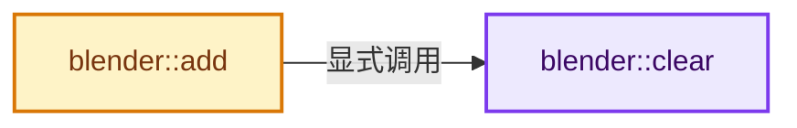
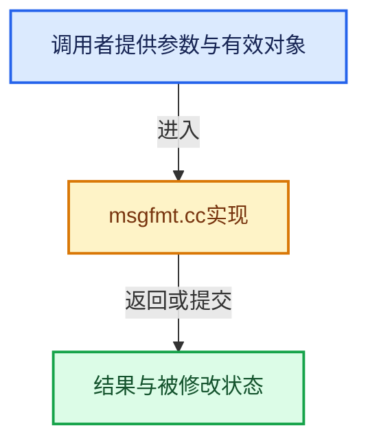

# 实现依赖专题：source/blender/blentranslation/msgfmt/msgfmt.cc

[方向导航](README.md) · [符号索引](../%E7%AC%A6%E5%8F%B7%E4%BE%9D%E8%B5%96%E4%B8%8E%E5%AE%9E%E7%8E%B0%E7%B4%A2%E5%BC%95.md)

本专题从正文实际调用进入，集中保存共享实现。函数有稳定锚点，可从调用处直接跳到对应完整函数；递归与互相调用通过回链组织。

## 本文件的实现关系






## 完整成员与函数实现

<a id="f-4d1f550b2a1999e3"></a>

### `blender::clear`

实现位置：[source/blender/blentranslation/msgfmt/msgfmt.cc](../../../../../source/blender/blentranslation/msgfmt/msgfmt.cc) · L213—L219。

接口参数：

- `Message &msg`

**教学注释版**

<!-- annotated:6121cd1493f76a -->

```cpp
static void clear(Message &msg)
{
  msg.ctxt.clear();
  msg.id.clear();
  msg.str.clear();
  msg.is_fuzzy = false;
}
```

<details>
<summary>核对原始源码：source/blender/blentranslation/msgfmt/msgfmt.cc · L213—L219</summary>

<!-- original:6121cd1493f76a:source/blender/blentranslation/msgfmt/msgfmt.cc:213:219 -->

```cpp
static void clear(Message &msg)
{
  msg.ctxt.clear();
  msg.id.clear();
  msg.str.clear();
  msg.is_fuzzy = false;
}
```

</details>

**沿实际写入检查状态**

- `msg.is_fuzzy = false;`

**继续追踪实现**

- `msg.ctxt.clear` → [调用协议](../%E6%A8%A1%E6%9D%BF%E5%AE%8F%E4%B8%8E%E5%8A%A8%E6%80%81%E5%88%86%E6%B4%BE%E5%8D%8F%E8%AE%AE.md)：接收对象类型依赖auto、返回值或模板实例；不按同名猜测目标。调用位置L215。
- `msg.id.clear` → [调用协议](../%E6%A8%A1%E6%9D%BF%E5%AE%8F%E4%B8%8E%E5%8A%A8%E6%80%81%E5%88%86%E6%B4%BE%E5%8D%8F%E8%AE%AE.md)：接收对象类型依赖auto、返回值或模板实例；不按同名猜测目标。调用位置L216。
- `msg.str.clear` → [调用协议](../%E6%A8%A1%E6%9D%BF%E5%AE%8F%E4%B8%8E%E5%8A%A8%E6%80%81%E5%88%86%E6%B4%BE%E5%8D%8F%E8%AE%AE.md)：接收对象类型依赖auto、返回值或模板实例；不按同名猜测目标。调用位置L217。

<a id="f-7292fc7e06488a67"></a>

### `blender::add`

实现位置：[source/blender/blentranslation/msgfmt/msgfmt.cc](../../../../../source/blender/blentranslation/msgfmt/msgfmt.cc) · L222—L237。

接口参数：

- `Map<std::string, std::string> &messages`
- `Message &msg`

**教学注释版**

<!-- annotated:b3d26c00261bd8 -->

```cpp
static void add(Map<std::string, std::string> &messages, Message &msg)
{
  if (!msg.is_fuzzy && !msg.str.empty()) {
    std::string msgkey;
    if (msg.ctxt.empty()) {
      // [讲解] std::move：把表达式转换成可供移动重载选择的值类别；不保证真的移动，不结束源对象寿命，对const值可能选择复制。
      msgkey = std::move(msg.id);
    }
    else {
      /* '\x04' is the context/msgid separator. */
      msgkey = msg.ctxt + "\x04" + msg.id;
    }

    // [讲解] messages.add：按哈希与相等关系加入键或键值。
    messages.add(std::move(msgkey), std::move(msg.str));
  }
  clear(msg);
}
```

<details>
<summary>核对原始源码：source/blender/blentranslation/msgfmt/msgfmt.cc · L222—L237</summary>

<!-- original:b3d26c00261bd8:source/blender/blentranslation/msgfmt/msgfmt.cc:222:237 -->

```cpp
static void add(Map<std::string, std::string> &messages, Message &msg)
{
  if (!msg.is_fuzzy && !msg.str.empty()) {
    std::string msgkey;
    if (msg.ctxt.empty()) {
      msgkey = std::move(msg.id);
    }
    else {
      /* '\x04' is the context/msgid separator. */
      msgkey = msg.ctxt + "\x04" + msg.id;
    }

    messages.add(std::move(msgkey), std::move(msg.str));
  }
  clear(msg);
}
```

</details>

**沿实际写入检查状态**

- `msgkey = std::move(msg.id);`
- `msgkey = msg.ctxt + "\x04" + msg.id;`

**继续追踪实现**

- `msg.str.empty` → [调用协议](../%E6%A8%A1%E6%9D%BF%E5%AE%8F%E4%B8%8E%E5%8A%A8%E6%80%81%E5%88%86%E6%B4%BE%E5%8D%8F%E8%AE%AE.md)：接收对象类型依赖auto、返回值或模板实例；不按同名猜测目标。调用位置L224。
- `msg.ctxt.empty` → [调用协议](../%E6%A8%A1%E6%9D%BF%E5%AE%8F%E4%B8%8E%E5%8A%A8%E6%80%81%E5%88%86%E6%B4%BE%E5%8D%8F%E8%AE%AE.md)：接收对象类型依赖auto、返回值或模板实例；不按同名猜测目标。调用位置L226。
- `std::move` → [外部契约](https://eel.is/c++draft/utility.forward)：把表达式转换成可供移动重载选择的值类别；不保证真的移动，不结束源对象寿命，对const值可能选择复制。
- `messages.add` → [blender::Map::add · L295](../02-%E5%93%88%E5%B8%8C%E8%A1%A8%E4%B8%8E%E5%85%B3%E8%81%94%E6%95%B0%E6%8D%AE%E7%BB%93%E6%9E%84/04-Map%E6%9F%A5%E6%89%BE%E4%B8%8E%E9%94%AE%E8%AE%BF%E9%97%AE.md#f-8d38101abf162f88)；[blender::Map::add · L299](../02-%E5%93%88%E5%B8%8C%E8%A1%A8%E4%B8%8E%E5%85%B3%E8%81%94%E6%95%B0%E6%8D%AE%E7%BB%93%E6%9E%84/04-Map%E6%9F%A5%E6%89%BE%E4%B8%8E%E9%94%AE%E8%AE%BF%E9%97%AE.md#f-1f59510cdfbd9f87)；[blender::Map::add · L303](../02-%E5%93%88%E5%B8%8C%E8%A1%A8%E4%B8%8E%E5%85%B3%E8%81%94%E6%95%B0%E6%8D%AE%E7%BB%93%E6%9E%84/04-Map%E6%9F%A5%E6%89%BE%E4%B8%8E%E9%94%AE%E8%AE%BF%E9%97%AE.md#f-645e0522347aa018)；[blender::Map::add · L307](../02-%E5%93%88%E5%B8%8C%E8%A1%A8%E4%B8%8E%E5%85%B3%E8%81%94%E6%95%B0%E6%8D%AE%E7%BB%93%E6%9E%84/04-Map%E6%9F%A5%E6%89%BE%E4%B8%8E%E9%94%AE%E8%AE%BF%E9%97%AE.md#f-03405db0730cedc0)。同名重载需按实参类型选择。
- `clear` → [blender::clear · L213](%E4%BE%9D%E8%B5%96-msgfmt-76f41a.md#f-4d1f550b2a1999e3)。
