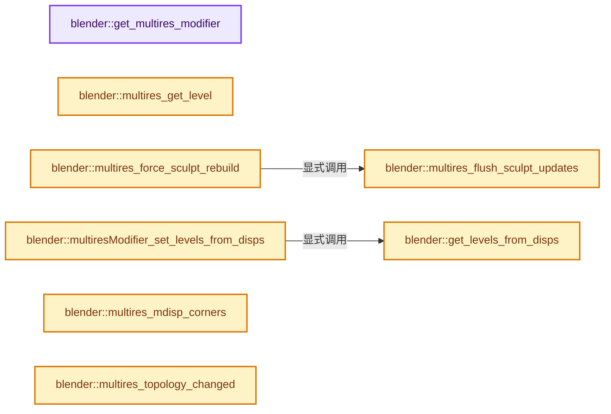
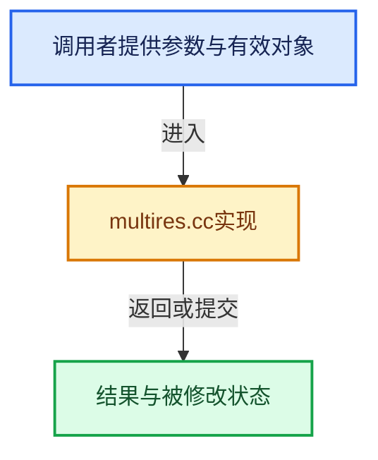

# 实现依赖专题：source/blender/blenkernel/intern/multires.cc

[方向导航](README.md) · [符号索引](../%E7%AC%A6%E5%8F%B7%E4%BE%9D%E8%B5%96%E4%B8%8E%E5%AE%9E%E7%8E%B0%E7%B4%A2%E5%BC%95.md)

本专题从正文实际调用进入，集中保存共享实现。函数有稳定锚点，可从调用处直接跳到对应完整函数；递归与互相调用通过回链组织。

## 本文件的实现关系






## 完整成员与函数实现

<a id="f-a5de968a78c7c0b1"></a>

### `blender::get_multires_modifier`

实现位置：[source/blender/blenkernel/intern/multires.cc](../../../../../source/blender/blenkernel/intern/multires.cc) · L185—L210。

接口参数：

- `Scene *scene`
- `Object *ob`
- `const bool use_first`

**教学注释版**

<!-- annotated:fb141346f7b875 -->

```cpp
MultiresModifierData *get_multires_modifier(Scene *scene, Object *ob, const bool use_first)
{
  MultiresModifierData *mmd = nullptr, *firstmmd = nullptr;

  /* find first active multires modifier */
  for (ModifierData &md : ob->modifiers) {
    if (md.type == eModifierType_Multires) {
      if (!firstmmd) {
        firstmmd = reinterpret_cast<MultiresModifierData *>(&md);
      }

      if (BKE_modifier_is_enabled(scene, &md, eModifierMode_Realtime)) {
        mmd = reinterpret_cast<MultiresModifierData *>(&md);
        break;
      }
    }
  }

  if (!mmd && use_first) {
    /* active multires have not been found
     * try to use first one */
    return firstmmd;
  }

  return mmd;
}
```

<details>
<summary>核对原始源码：source/blender/blenkernel/intern/multires.cc · L185—L210</summary>

<!-- original:fb141346f7b875:source/blender/blenkernel/intern/multires.cc:185:210 -->

```cpp
MultiresModifierData *get_multires_modifier(Scene *scene, Object *ob, const bool use_first)
{
  MultiresModifierData *mmd = nullptr, *firstmmd = nullptr;

  /* find first active multires modifier */
  for (ModifierData &md : ob->modifiers) {
    if (md.type == eModifierType_Multires) {
      if (!firstmmd) {
        firstmmd = reinterpret_cast<MultiresModifierData *>(&md);
      }

      if (BKE_modifier_is_enabled(scene, &md, eModifierMode_Realtime)) {
        mmd = reinterpret_cast<MultiresModifierData *>(&md);
        break;
      }
    }
  }

  if (!mmd && use_first) {
    /* active multires have not been found
     * try to use first one */
    return firstmmd;
  }

  return mmd;
}
```

</details>

**沿实际写入检查状态**

- `firstmmd = reinterpret_cast<MultiresModifierData *>(&md);`
- `mmd = reinterpret_cast<MultiresModifierData *>(&md);`

**结果出口**

- `return firstmmd;`
- `return mmd;`

**继续追踪实现**

- `BKE_modifier_is_enabled` → [blender::BKE_modifier_is_enabled · L529](%E4%BE%9D%E8%B5%96-modifier-ab0273.md#f-1debd86d0fcbcc8e)。

<a id="f-8f4d947b77878017"></a>

### `blender::multires_get_level`

实现位置：[source/blender/blenkernel/intern/multires.cc](../../../../../source/blender/blenkernel/intern/multires.cc) · L212—L230。

接口参数：

- `const Scene *scene`
- `const Object *ob`
- `const MultiresModifierData *mmd`
- `const bool render`
- `const bool ignore_simplify`

**教学注释版**

<!-- annotated:ab769b88a8a7ad -->

```cpp
int multires_get_level(const Scene *scene,
                       const Object *ob,
                       const MultiresModifierData *mmd,
                       const bool render,
                       const bool ignore_simplify)
{
  if (render) {
    return (scene != nullptr) ? get_render_subsurf_level(&scene->r, mmd->renderlvl, true) :
                                mmd->renderlvl;
  }
  if (ob->mode == OB_MODE_SCULPT) {
    return mmd->sculptlvl;
  }
  if (ignore_simplify) {
    return mmd->lvl;
  }

  return (scene != nullptr) ? get_render_subsurf_level(&scene->r, mmd->lvl, false) : mmd->lvl;
}
```

<details>
<summary>核对原始源码：source/blender/blenkernel/intern/multires.cc · L212—L230</summary>

<!-- original:ab769b88a8a7ad:source/blender/blenkernel/intern/multires.cc:212:230 -->

```cpp
int multires_get_level(const Scene *scene,
                       const Object *ob,
                       const MultiresModifierData *mmd,
                       const bool render,
                       const bool ignore_simplify)
{
  if (render) {
    return (scene != nullptr) ? get_render_subsurf_level(&scene->r, mmd->renderlvl, true) :
                                mmd->renderlvl;
  }
  if (ob->mode == OB_MODE_SCULPT) {
    return mmd->sculptlvl;
  }
  if (ignore_simplify) {
    return mmd->lvl;
  }

  return (scene != nullptr) ? get_render_subsurf_level(&scene->r, mmd->lvl, false) : mmd->lvl;
}
```

</details>

**结果出口**

- `return (scene != nullptr) ? get_render_subsurf_level(&scene->r, mmd->renderlvl, true) :`
- `return mmd->sculptlvl;`
- `return mmd->lvl;`
- `return (scene != nullptr) ? get_render_subsurf_level(&scene->r, mmd->lvl, false) : mmd->lvl;`

**继续追踪实现**

- `get_render_subsurf_level` → [blender::get_render_subsurf_level · L3016](%E4%BE%9D%E8%B5%96-scene-94f43c.md#f-a87e1e516b7a9874)。

<a id="f-a3990d43b6c11d56"></a>

### `blender::multires_flush_sculpt_updates`

实现位置：[source/blender/blenkernel/intern/multires.cc](../../../../../source/blender/blenkernel/intern/multires.cc) · L277—L330。

接口参数：

- `Object *object`

**教学注释版**

<!-- annotated:a23891982ab6b5 -->

```cpp
void multires_flush_sculpt_updates(Object *object)
{
  if (object == nullptr || object->runtime->sculpt_session == nullptr) {
    return;
  }
  const bke::pbvh::Tree *pbvh = bke::object::pbvh_get(*object);
  if (!pbvh) {
    return;
  }

  SculptSession *sculpt_session = object->runtime->sculpt_session;
  if (pbvh->type() != bke::pbvh::Type::Grids || sculpt_session->multires_modifier == nullptr) {
    return;
  }

  SubdivCCG *subdiv_ccg = sculpt_session->subdiv_ccg;
  if (subdiv_ccg == nullptr) {
    return;
  }

  if (!subdiv_ccg->dirty.coords && !subdiv_ccg->dirty.hidden) {
    return;
  }

  Mesh *mesh = id_cast<Mesh *>(object->data);

  /* Check that the multires modifier still exists.
   * Fixes crash when deleting multires modifier
   * from within sculpt mode.
   */
  MultiresModifierData *mmd = nullptr;
  VirtualModifierData virtual_modifier_data;

  for (ModifierData *md = BKE_modifiers_get_virtual_modifierlist(object, &virtual_modifier_data);
       md;
       md = md->next)
  {
    if (md->type == eModifierType_Multires) {
      if (BKE_modifier_is_enabled(nullptr, md, eModifierMode_Realtime)) {
        mmd = reinterpret_cast<MultiresModifierData *>(md);
      }
    }
  }

  if (!mmd) {
    return;
  }

  multiresModifier_reshapeFromCCG(
      sculpt_session->multires_modifier->totlvl, mesh, sculpt_session->subdiv_ccg);

  subdiv_ccg->dirty.coords = false;
  subdiv_ccg->dirty.hidden = false;
}
```

<details>
<summary>核对原始源码：source/blender/blenkernel/intern/multires.cc · L277—L330</summary>

<!-- original:a23891982ab6b5:source/blender/blenkernel/intern/multires.cc:277:330 -->

```cpp
void multires_flush_sculpt_updates(Object *object)
{
  if (object == nullptr || object->runtime->sculpt_session == nullptr) {
    return;
  }
  const bke::pbvh::Tree *pbvh = bke::object::pbvh_get(*object);
  if (!pbvh) {
    return;
  }

  SculptSession *sculpt_session = object->runtime->sculpt_session;
  if (pbvh->type() != bke::pbvh::Type::Grids || sculpt_session->multires_modifier == nullptr) {
    return;
  }

  SubdivCCG *subdiv_ccg = sculpt_session->subdiv_ccg;
  if (subdiv_ccg == nullptr) {
    return;
  }

  if (!subdiv_ccg->dirty.coords && !subdiv_ccg->dirty.hidden) {
    return;
  }

  Mesh *mesh = id_cast<Mesh *>(object->data);

  /* Check that the multires modifier still exists.
   * Fixes crash when deleting multires modifier
   * from within sculpt mode.
   */
  MultiresModifierData *mmd = nullptr;
  VirtualModifierData virtual_modifier_data;

  for (ModifierData *md = BKE_modifiers_get_virtual_modifierlist(object, &virtual_modifier_data);
       md;
       md = md->next)
  {
    if (md->type == eModifierType_Multires) {
      if (BKE_modifier_is_enabled(nullptr, md, eModifierMode_Realtime)) {
        mmd = reinterpret_cast<MultiresModifierData *>(md);
      }
    }
  }

  if (!mmd) {
    return;
  }

  multiresModifier_reshapeFromCCG(
      sculpt_session->multires_modifier->totlvl, mesh, sculpt_session->subdiv_ccg);

  subdiv_ccg->dirty.coords = false;
  subdiv_ccg->dirty.hidden = false;
}
```

</details>

**沿实际写入检查状态**

- `md = md->next)`
- `mmd = reinterpret_cast<MultiresModifierData *>(md);`
- `subdiv_ccg->dirty.coords = false;`
- `subdiv_ccg->dirty.hidden = false;`

**继续追踪实现**

- `bke::object::pbvh_get` → [blender::bke::object::pbvh_get · L2727](%E4%BE%9D%E8%B5%96-paint-dbafe0.md#f-39f0e75a118b3d6a)；[blender::bke::object::pbvh_get · L2735](%E4%BE%9D%E8%B5%96-paint-dbafe0.md#f-bf5e56d6c516443a)。同名重载需按实参类型选择。
- `pbvh->type` → [blender::bke::pbvh::Tree::type · L673](%E4%BE%9D%E8%B5%96-BKE_paint_bvh-80f563.md#f-137ce3483b4da62c)。
- `id_cast<Mesh *>` → [blender::id_cast · L1417](%E4%BE%9D%E8%B5%96-DNA_ID-3eb091.md#f-6c8ac6412850ac5a)。
- `BKE_modifiers_get_virtual_modifierlist` → [blender::BKE_modifiers_get_virtual_modifierlist · L620](%E4%BE%9D%E8%B5%96-modifier-ab0273.md#f-47967058788364c5)。
- `BKE_modifier_is_enabled` → [blender::BKE_modifier_is_enabled · L529](%E4%BE%9D%E8%B5%96-modifier-ab0273.md#f-1debd86d0fcbcc8e)。
- `multiresModifier_reshapeFromCCG` → [blender::multiresModifier_reshapeFromCCG · L129](%E4%BE%9D%E8%B5%96-multires_reshape-0d1958.md#f-9583ebfec42c6493)。

<a id="f-843eb01be1cd1dee"></a>

### `blender::multires_force_sculpt_rebuild`

实现位置：[source/blender/blenkernel/intern/multires.cc](../../../../../source/blender/blenkernel/intern/multires.cc) · L332—L341。

接口参数：

- `Object *object`

**教学注释版**

<!-- annotated:2627fc28e2f102 -->

```cpp
void multires_force_sculpt_rebuild(Object *object)
{
  multires_flush_sculpt_updates(object);

  if (object == nullptr || object->runtime->sculpt_session == nullptr) {
    return;
  }

  BKE_sculptsession_free_pbvh(*object);
}
```

<details>
<summary>核对原始源码：source/blender/blenkernel/intern/multires.cc · L332—L341</summary>

<!-- original:2627fc28e2f102:source/blender/blenkernel/intern/multires.cc:332:341 -->

```cpp
void multires_force_sculpt_rebuild(Object *object)
{
  multires_flush_sculpt_updates(object);

  if (object == nullptr || object->runtime->sculpt_session == nullptr) {
    return;
  }

  BKE_sculptsession_free_pbvh(*object);
}
```

</details>

**继续追踪实现**

- `multires_flush_sculpt_updates` → [blender::multires_flush_sculpt_updates · L277](%E4%BE%9D%E8%B5%96-multires-7e6ba8.md#f-a3990d43b6c11d56)。
- `BKE_sculptsession_free_pbvh` → [blender::BKE_sculptsession_free_pbvh · L2093](%E4%BE%9D%E8%B5%96-paint-dbafe0.md#f-202b843e9efcbfb4)。

<a id="f-15a3b26a4ae8c374"></a>

### `blender::get_levels_from_disps`

实现位置：[source/blender/blenkernel/intern/multires.cc](../../../../../source/blender/blenkernel/intern/multires.cc) · L352—L387。

接口参数：

- `Object *ob`

**教学注释版**

<!-- annotated:337b1bbeffde0b -->

```cpp
static int get_levels_from_disps(Object *ob)
{
  Mesh *mesh = id_cast<Mesh *>(ob->data);
  const OffsetIndices faces = mesh->faces();
  int totlvl = 0;

  const MDisps *mdisp = static_cast<const MDisps *>(
      CustomData_get_layer(&mesh->corner_data, CD_MDISPS));

  for (const int i : faces.index_range()) {
    for (const int corner : faces[i]) {
      const MDisps *md = &mdisp[corner];
      if (md->totdisp == 0) {
        continue;
      }

      while (true) {
        const int side = (1 << (totlvl - 1)) + 1;
        const int lvl_totdisp = side * side;
        if (md->totdisp == lvl_totdisp) {
          break;
        }
        if (md->totdisp < lvl_totdisp) {
          totlvl--;
        }
        else {
          totlvl++;
        }
      }

      break;
    }
  }

  return totlvl;
}
```

<details>
<summary>核对原始源码：source/blender/blenkernel/intern/multires.cc · L352—L387</summary>

<!-- original:337b1bbeffde0b:source/blender/blenkernel/intern/multires.cc:352:387 -->

```cpp
static int get_levels_from_disps(Object *ob)
{
  Mesh *mesh = id_cast<Mesh *>(ob->data);
  const OffsetIndices faces = mesh->faces();
  int totlvl = 0;

  const MDisps *mdisp = static_cast<const MDisps *>(
      CustomData_get_layer(&mesh->corner_data, CD_MDISPS));

  for (const int i : faces.index_range()) {
    for (const int corner : faces[i]) {
      const MDisps *md = &mdisp[corner];
      if (md->totdisp == 0) {
        continue;
      }

      while (true) {
        const int side = (1 << (totlvl - 1)) + 1;
        const int lvl_totdisp = side * side;
        if (md->totdisp == lvl_totdisp) {
          break;
        }
        if (md->totdisp < lvl_totdisp) {
          totlvl--;
        }
        else {
          totlvl++;
        }
      }

      break;
    }
  }

  return totlvl;
}
```

</details>

**结果出口**

- `return totlvl;`

**继续追踪实现**

- `id_cast<Mesh *>` → [blender::id_cast · L1417](%E4%BE%9D%E8%B5%96-DNA_ID-3eb091.md#f-6c8ac6412850ac5a)。
- `mesh->faces` → [Mesh::faces · L1217](03-MPoly%E8%BF%81%E7%A7%BB%E4%B8%8E%E5%85%BC%E5%AE%B9.md#f-ea444760154e17b2)。
- `CustomData_get_layer` → [blender::CustomData_get_layer · L3308](%E4%BE%9D%E8%B5%96-customdata-2eef81.md#f-add1273f3ef3e57b)。
- `faces.index_range` → [blender::offset_indices::OffsetIndices::index_range · L77](02-OffsetIndices%E5%AE%8C%E6%95%B4%E6%8E%A5%E5%8F%A3.md#f-19b5ca1456de007d)。

<a id="f-1746682f88ccbfd7"></a>

### `blender::multiresModifier_set_levels_from_disps`

实现位置：[source/blender/blenkernel/intern/multires.cc](../../../../../source/blender/blenkernel/intern/multires.cc) · L389—L407。

接口参数：

- `MultiresModifierData *mmd`
- `Object *ob`

**教学注释版**

<!-- annotated:5aaf5f0e90f608 -->

```cpp
void multiresModifier_set_levels_from_disps(MultiresModifierData *mmd, Object *ob)
{
  Mesh *mesh = id_cast<Mesh *>(ob->data);
  const MDisps *mdisp;

  if (const BMesh *bm = BKE_editmesh_bmesh_get(mesh)) {
    mdisp = static_cast<const MDisps *>(CustomData_get_layer(&bm->ldata, CD_MDISPS));
  }
  else {
    mdisp = static_cast<const MDisps *>(CustomData_get_layer(&mesh->corner_data, CD_MDISPS));
  }

  if (mdisp) {
    mmd->totlvl = get_levels_from_disps(ob);
    // [讲解] std::min：按比较关系选取较小值；截断范围时还需先满足非负和可表示范围，min本身不会证明边界安全。
    mmd->lvl = std::min(mmd->lvl, mmd->totlvl);
    mmd->sculptlvl = std::min(mmd->sculptlvl, mmd->totlvl);
    mmd->renderlvl = std::min(mmd->renderlvl, mmd->totlvl);
  }
}
```

<details>
<summary>核对原始源码：source/blender/blenkernel/intern/multires.cc · L389—L407</summary>

<!-- original:5aaf5f0e90f608:source/blender/blenkernel/intern/multires.cc:389:407 -->

```cpp
void multiresModifier_set_levels_from_disps(MultiresModifierData *mmd, Object *ob)
{
  Mesh *mesh = id_cast<Mesh *>(ob->data);
  const MDisps *mdisp;

  if (const BMesh *bm = BKE_editmesh_bmesh_get(mesh)) {
    mdisp = static_cast<const MDisps *>(CustomData_get_layer(&bm->ldata, CD_MDISPS));
  }
  else {
    mdisp = static_cast<const MDisps *>(CustomData_get_layer(&mesh->corner_data, CD_MDISPS));
  }

  if (mdisp) {
    mmd->totlvl = get_levels_from_disps(ob);
    mmd->lvl = std::min(mmd->lvl, mmd->totlvl);
    mmd->sculptlvl = std::min(mmd->sculptlvl, mmd->totlvl);
    mmd->renderlvl = std::min(mmd->renderlvl, mmd->totlvl);
  }
}
```

</details>

**沿实际写入检查状态**

- `mdisp = static_cast<const MDisps *>(CustomData_get_layer(&bm->ldata, CD_MDISPS));`
- `mdisp = static_cast<const MDisps *>(CustomData_get_layer(&mesh->corner_data, CD_MDISPS));`
- `mmd->totlvl = get_levels_from_disps(ob);`
- `mmd->lvl = std::min(mmd->lvl, mmd->totlvl);`
- `mmd->sculptlvl = std::min(mmd->sculptlvl, mmd->totlvl);`
- `mmd->renderlvl = std::min(mmd->renderlvl, mmd->totlvl);`

**继续追踪实现**

- `id_cast<Mesh *>` → [blender::id_cast · L1417](%E4%BE%9D%E8%B5%96-DNA_ID-3eb091.md#f-6c8ac6412850ac5a)。
- `BKE_editmesh_bmesh_get` → [blender::BKE_editmesh_bmesh_get · L65](%E4%BE%9D%E8%B5%96-editmesh-1ee56f.md#f-2afdd2773d3f0d88)；[blender::BKE_editmesh_bmesh_get · L71](%E4%BE%9D%E8%B5%96-editmesh-1ee56f.md#f-80631d704a7e9947)。同名重载需按实参类型选择。
- `CustomData_get_layer` → [blender::CustomData_get_layer · L3308](%E4%BE%9D%E8%B5%96-customdata-2eef81.md#f-add1273f3ef3e57b)。
- `get_levels_from_disps` → [blender::get_levels_from_disps · L352](%E4%BE%9D%E8%B5%96-multires-7e6ba8.md#f-15a3b26a4ae8c374)。
- `std::min` → [外部契约](https://eel.is/c++draft/alg.min.max)：按比较关系选取较小值；截断范围时还需先满足非负和可表示范围，min本身不会证明边界安全。

<a id="f-8acad701032e4b14"></a>

### `blender::multires_mdisp_corners`

实现位置：[source/blender/blenkernel/intern/multires.cc](../../../../../source/blender/blenkernel/intern/multires.cc) · L694—L707。

接口参数：

- `const MDisps *s`

**教学注释版**

<!-- annotated:e140503c24ffe1 -->

```cpp
int multires_mdisp_corners(const MDisps *s)
{
  int lvl = 13;

  while (lvl > 0) {
    const int side = (1 << (lvl - 1)) + 1;
    if ((s->totdisp % (side * side)) == 0) {
      return s->totdisp / (side * side);
    }
    lvl--;
  }

  return 0;
}
```

<details>
<summary>核对原始源码：source/blender/blenkernel/intern/multires.cc · L694—L707</summary>

<!-- original:e140503c24ffe1:source/blender/blenkernel/intern/multires.cc:694:707 -->

```cpp
int multires_mdisp_corners(const MDisps *s)
{
  int lvl = 13;

  while (lvl > 0) {
    const int side = (1 << (lvl - 1)) + 1;
    if ((s->totdisp % (side * side)) == 0) {
      return s->totdisp / (side * side);
    }
    lvl--;
  }

  return 0;
}
```

</details>

**结果出口**

- `return s->totdisp / (side * side);`
- `return 0;`

**继续追踪实现**

本实现没有需要继续展开的显式调用；检查返回表达式、对象转换和调用者前置条件。

<a id="f-19dd5f7ed88cf947"></a>

### `blender::multires_topology_changed`

实现位置：[source/blender/blenkernel/intern/multires.cc](../../../../../source/blender/blenkernel/intern/multires.cc) · L733—L764。

接口参数：

- `Mesh *mesh`

**教学注释版**

<!-- annotated:501d418edcd54e -->

```cpp
void multires_topology_changed(Mesh *mesh)
{
  CustomData_external_read(&mesh->corner_data, "", &mesh->id, CD_MASK_MDISPS, mesh->corners_num);
  MDisps *mdisp = static_cast<MDisps *>(
      CustomData_get_layer_for_write(&mesh->corner_data, CD_MDISPS, mesh->corners_num));

  if (!mdisp) {
    return;
  }

  MDisps *cur = mdisp;
  int grid = 0;
  for (int i = 0; i < mesh->corners_num; i++, cur++) {
    if (cur->totdisp) {
      grid = mdisp->totdisp;

      break;
    }
  }

  for (int i = 0; i < mesh->corners_num; i++, mdisp++) {
    /* allocate memory for mdisp, the whole disp layer would be erased otherwise */
    if (!mdisp->totdisp || !mdisp->disps) {
      if (grid) {
        mdisp->totdisp = grid;
        mdisp->disps = MEM_new_array_zeroed<float[3]>(mdisp->totdisp, "mdisp topology");
      }

      continue;
    }
  }
}
```

<details>
<summary>核对原始源码：source/blender/blenkernel/intern/multires.cc · L733—L764</summary>

<!-- original:501d418edcd54e:source/blender/blenkernel/intern/multires.cc:733:764 -->

```cpp
void multires_topology_changed(Mesh *mesh)
{
  CustomData_external_read(&mesh->corner_data, "", &mesh->id, CD_MASK_MDISPS, mesh->corners_num);
  MDisps *mdisp = static_cast<MDisps *>(
      CustomData_get_layer_for_write(&mesh->corner_data, CD_MDISPS, mesh->corners_num));

  if (!mdisp) {
    return;
  }

  MDisps *cur = mdisp;
  int grid = 0;
  for (int i = 0; i < mesh->corners_num; i++, cur++) {
    if (cur->totdisp) {
      grid = mdisp->totdisp;

      break;
    }
  }

  for (int i = 0; i < mesh->corners_num; i++, mdisp++) {
    /* allocate memory for mdisp, the whole disp layer would be erased otherwise */
    if (!mdisp->totdisp || !mdisp->disps) {
      if (grid) {
        mdisp->totdisp = grid;
        mdisp->disps = MEM_new_array_zeroed<float[3]>(mdisp->totdisp, "mdisp topology");
      }

      continue;
    }
  }
}
```

</details>

**沿实际写入检查状态**

- `grid = mdisp->totdisp;`
- `mdisp->totdisp = grid;`
- `mdisp->disps = MEM_new_array_zeroed<float[3]>(mdisp->totdisp, "mdisp topology");`

**继续追踪实现**

- `CustomData_external_read` → [blender::CustomData_external_read · L4231](%E4%BE%9D%E8%B5%96-customdata-2eef81.md#f-543e54648df24374)。
- `CustomData_get_layer_for_write` → [blender::CustomData_get_layer_for_write · L3318](%E4%BE%9D%E8%B5%96-customdata-2eef81.md#f-6af158905e2c1274)。
- `MEM_new_array_zeroed<float[3]>` → [MEM_new_array_zeroed · L566](../03-%E5%86%85%E5%AD%98%E5%88%86%E9%85%8D%E4%B8%8E%E8%BF%90%E8%A1%8C%E6%97%B6%E7%B1%BB%E5%9E%8B/%E4%BE%9D%E8%B5%96-MEM_guardedalloc-b54eca.md#f-3a0cf63fb5216500)；[MEM_new_array_zeroed · L119](../03-%E5%86%85%E5%AD%98%E5%88%86%E9%85%8D%E4%B8%8E%E8%BF%90%E8%A1%8C%E6%97%B6%E7%B1%BB%E5%9E%8B/%E4%BE%9D%E8%B5%96-mallocn-afdcd4.md#f-6825557da566fdbe)。同名重载需按实参类型选择。

<a id="f-d727a1334b17c264"></a>

### `blender::multires_ensure_external_read`

实现位置：[source/blender/blenkernel/intern/multires.cc](../../../../../source/blender/blenkernel/intern/multires.cc) · L766—L799。

接口参数：

- `Mesh *mesh`
- `const int top_level`

**教学注释版**

<!-- annotated:df7120dcbbf212 -->

```cpp
void multires_ensure_external_read(Mesh *mesh, const int top_level)
{
  if (!CustomData_external_test(&mesh->corner_data, CD_MDISPS)) {
    return;
  }

  /* Modify the data array from the original mesh, not the evaluated mesh.
   * When multiple objects share the same mesh, this can lead to memory leaks. */
  MDisps *mdisps = const_cast<MDisps *>(
      static_cast<const MDisps *>(CustomData_get_layer(&mesh->corner_data, CD_MDISPS)));
  if (mdisps == nullptr) {
    mdisps = static_cast<MDisps *>(
        CustomData_add_layer(&mesh->corner_data, CD_MDISPS, CD_SET_DEFAULT, mesh->corners_num));
  }

  const int totloop = mesh->corners_num;

  const int grid_size = bke::subdiv::grid_size_from_level(top_level);
  const int grid_area = grid_size * grid_size;

  for (int i = 0; i < totloop; ++i) {
    if (mdisps[i].totdisp != grid_area) {
      MEM_SAFE_DELETE(mdisps[i].disps);
    }

    /* NOTE: CustomData_external_read will take care of allocation of displacement vectors if
     * they are missing. */

    const int totdisp = multires_grid_tot[top_level];
    mdisps[i].totdisp = totdisp;
  }

  CustomData_external_read(&mesh->corner_data, "", &mesh->id, CD_MASK_MDISPS, mesh->corners_num);
}
```

<details>
<summary>核对原始源码：source/blender/blenkernel/intern/multires.cc · L766—L799</summary>

<!-- original:df7120dcbbf212:source/blender/blenkernel/intern/multires.cc:766:799 -->

```cpp
void multires_ensure_external_read(Mesh *mesh, const int top_level)
{
  if (!CustomData_external_test(&mesh->corner_data, CD_MDISPS)) {
    return;
  }

  /* Modify the data array from the original mesh, not the evaluated mesh.
   * When multiple objects share the same mesh, this can lead to memory leaks. */
  MDisps *mdisps = const_cast<MDisps *>(
      static_cast<const MDisps *>(CustomData_get_layer(&mesh->corner_data, CD_MDISPS)));
  if (mdisps == nullptr) {
    mdisps = static_cast<MDisps *>(
        CustomData_add_layer(&mesh->corner_data, CD_MDISPS, CD_SET_DEFAULT, mesh->corners_num));
  }

  const int totloop = mesh->corners_num;

  const int grid_size = bke::subdiv::grid_size_from_level(top_level);
  const int grid_area = grid_size * grid_size;

  for (int i = 0; i < totloop; ++i) {
    if (mdisps[i].totdisp != grid_area) {
      MEM_SAFE_DELETE(mdisps[i].disps);
    }

    /* NOTE: CustomData_external_read will take care of allocation of displacement vectors if
     * they are missing. */

    const int totdisp = multires_grid_tot[top_level];
    mdisps[i].totdisp = totdisp;
  }

  CustomData_external_read(&mesh->corner_data, "", &mesh->id, CD_MASK_MDISPS, mesh->corners_num);
}
```

</details>

**沿实际写入检查状态**

- `mdisps = static_cast<MDisps *>(`
- `mdisps[i].totdisp = totdisp;`

**继续追踪实现**

- `CustomData_external_test` → [blender::CustomData_external_test · L4471](%E4%BE%9D%E8%B5%96-customdata-2eef81.md#f-fa4fc636dd1438c4)。
- `CustomData_get_layer` → [blender::CustomData_get_layer · L3308](%E4%BE%9D%E8%B5%96-customdata-2eef81.md#f-add1273f3ef3e57b)。
- `CustomData_add_layer` → [blender::CustomData_add_layer · L2851](%E4%BE%9D%E8%B5%96-customdata-2eef81.md#f-4c7988e825541059)。
- `bke::subdiv::grid_size_from_level` → [blender::bke::subdiv::grid_size_from_level · L43](%E4%BE%9D%E8%B5%96-subdiv_inline-5c22ff.md#f-b1d46bbf8975e481)。
- `MEM_SAFE_DELETE` → [MEM_SAFE_DELETE · L436](../03-%E5%86%85%E5%AD%98%E5%88%86%E9%85%8D%E4%B8%8E%E8%BF%90%E8%A1%8C%E6%97%B6%E7%B1%BB%E5%9E%8B/%E4%BE%9D%E8%B5%96-MEM_guardedalloc-b54eca.md#m-eadb3bc5b902)。宏定义由构建条件选择。
- `CustomData_external_read` → [blender::CustomData_external_read · L4231](%E4%BE%9D%E8%B5%96-customdata-2eef81.md#f-543e54648df24374)。
