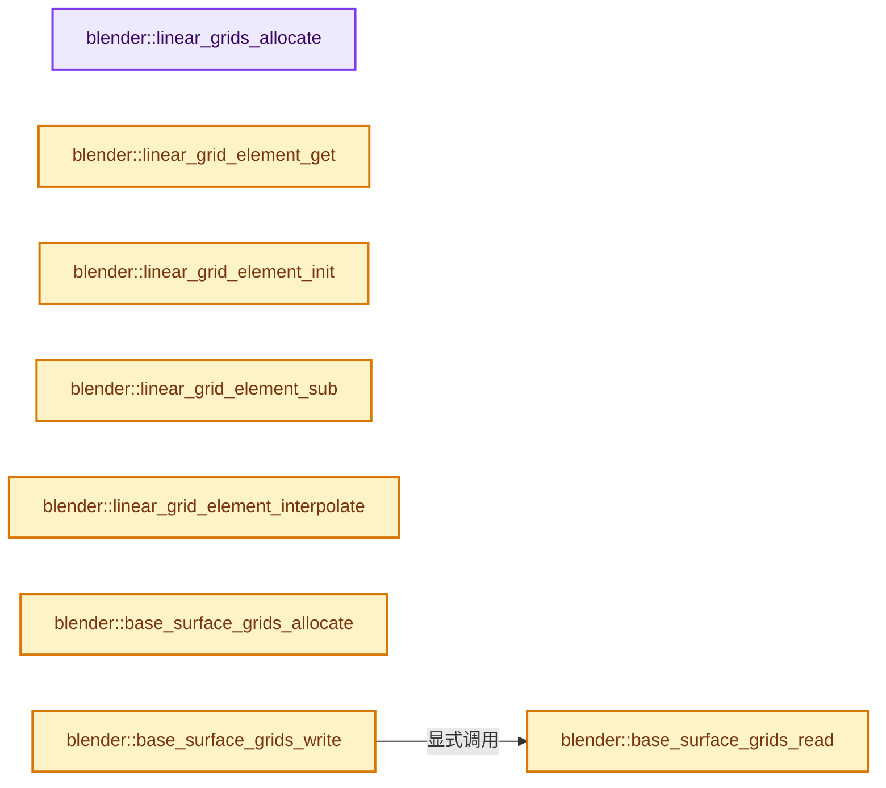
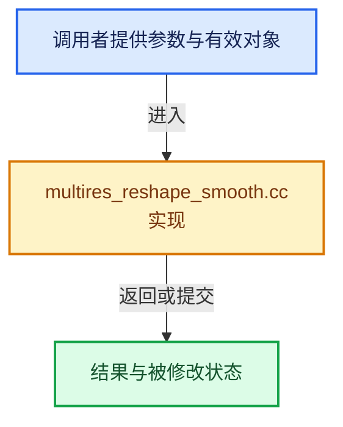

# 实现依赖专题：source/blender/blenkernel/intern/multires_reshape_smooth.cc

[方向导航](README.md) · [符号索引](../%E7%AC%A6%E5%8F%B7%E4%BE%9D%E8%B5%96%E4%B8%8E%E5%AE%9E%E7%8E%B0%E7%B4%A2%E5%BC%95.md)

本专题从正文实际调用进入，集中保存共享实现。函数有稳定锚点，可从调用处直接跳到对应完整函数；递归与互相调用通过回链组织。

## 本文件的实现关系






## 完整成员与函数实现

<a id="f-0b169b6dc1c5b570"></a>

### `blender::linear_grids_allocate`

实现位置：[source/blender/blenkernel/intern/multires_reshape_smooth.cc](../../../../../source/blender/blenkernel/intern/multires_reshape_smooth.cc) · L186—L204。

接口参数：

- `LinearGrids *linear_grids`
- `int num_grids`
- `int level`

**教学注释版**

<!-- annotated:abfe30b4b92852 -->

```cpp
static void linear_grids_allocate(LinearGrids *linear_grids, int num_grids, int level)
{
  const size_t grid_size = bke::subdiv::grid_size_from_level(level);
  const size_t grid_area = grid_size * grid_size;
  const size_t num_grid_elements = num_grids * grid_area;

  linear_grids->num_grids = num_grids;
  linear_grids->level = level;
  linear_grids->grid_size = grid_size;

  linear_grids->grids.reinitialize(num_grids);
  linear_grids->elements_storage.reinitialize(num_grid_elements);

  for (int i = 0; i < num_grids; ++i) {
    const size_t element_offset = grid_area * i;
    linear_grids->grids[i].elements = linear_grids->elements_storage.as_mutable_span().slice(
        element_offset, grid_area);
  }
}
```

<details>
<summary>核对原始源码：source/blender/blenkernel/intern/multires_reshape_smooth.cc · L186—L204</summary>

<!-- original:abfe30b4b92852:source/blender/blenkernel/intern/multires_reshape_smooth.cc:186:204 -->

```cpp
static void linear_grids_allocate(LinearGrids *linear_grids, int num_grids, int level)
{
  const size_t grid_size = bke::subdiv::grid_size_from_level(level);
  const size_t grid_area = grid_size * grid_size;
  const size_t num_grid_elements = num_grids * grid_area;

  linear_grids->num_grids = num_grids;
  linear_grids->level = level;
  linear_grids->grid_size = grid_size;

  linear_grids->grids.reinitialize(num_grids);
  linear_grids->elements_storage.reinitialize(num_grid_elements);

  for (int i = 0; i < num_grids; ++i) {
    const size_t element_offset = grid_area * i;
    linear_grids->grids[i].elements = linear_grids->elements_storage.as_mutable_span().slice(
        element_offset, grid_area);
  }
}
```

</details>

**沿实际写入检查状态**

- `linear_grids->num_grids = num_grids;`
- `linear_grids->level = level;`
- `linear_grids->grid_size = grid_size;`
- `linear_grids->grids[i].elements = linear_grids->elements_storage.as_mutable_span().slice(`

**继续追踪实现**

- `bke::subdiv::grid_size_from_level` → [blender::bke::subdiv::grid_size_from_level · L43](%E4%BE%9D%E8%B5%96-subdiv_inline-5c22ff.md#f-b1d46bbf8975e481)。
- `linear_grids->grids.reinitialize` → [调用协议](../%E6%A8%A1%E6%9D%BF%E5%AE%8F%E4%B8%8E%E5%8A%A8%E6%80%81%E5%88%86%E6%B4%BE%E5%8D%8F%E8%AE%AE.md)：接收对象类型依赖auto、返回值或模板实例；不按同名猜测目标。调用位置L196。
- `linear_grids->elements_storage.reinitialize` → [调用协议](../%E6%A8%A1%E6%9D%BF%E5%AE%8F%E4%B8%8E%E5%8A%A8%E6%80%81%E5%88%86%E6%B4%BE%E5%8D%8F%E8%AE%AE.md)：接收对象类型依赖auto、返回值或模板实例；不按同名猜测目标。调用位置L197。
- `linear_grids->elements_storage.as_mutable_span().slice` → [调用协议](../%E6%A8%A1%E6%9D%BF%E5%AE%8F%E4%B8%8E%E5%8A%A8%E6%80%81%E5%88%86%E6%B4%BE%E5%8D%8F%E8%AE%AE.md)：接收对象类型依赖auto、返回值或模板实例；不按同名猜测目标。调用位置L201。
- `linear_grids->elements_storage.as_mutable_span` → [调用协议](../%E6%A8%A1%E6%9D%BF%E5%AE%8F%E4%B8%8E%E5%8A%A8%E6%80%81%E5%88%86%E6%B4%BE%E5%8D%8F%E8%AE%AE.md)：接收对象类型依赖auto、返回值或模板实例；不按同名猜测目标。调用位置L201。

<a id="f-70ccae072ab4b13a"></a>

### `blender::linear_grid_element_get`

实现位置：[source/blender/blenkernel/intern/multires_reshape_smooth.cc](../../../../../source/blender/blenkernel/intern/multires_reshape_smooth.cc) · L206—L220。

接口参数：

- `LinearGrids *linear_grids`
- `const GridCoord *grid_coord`

**教学注释版**

<!-- annotated:5f53eab2d7635b -->

```cpp
static LinearGridElement *linear_grid_element_get(LinearGrids *linear_grids,
                                                  const GridCoord *grid_coord)
{
  BLI_assert(grid_coord->grid_index >= 0);
  BLI_assert(grid_coord->grid_index < linear_grids->num_grids);

  const int grid_size = linear_grids->grid_size;

  const int grid_x = lround(grid_coord->u * (grid_size - 1));
  const int grid_y = lround(grid_coord->v * (grid_size - 1));
  const int grid_element_index = grid_y * grid_size + grid_x;

  LinearGrid *grid = &linear_grids->grids[grid_coord->grid_index];
  return &grid->elements[grid_element_index];
}
```

<details>
<summary>核对原始源码：source/blender/blenkernel/intern/multires_reshape_smooth.cc · L206—L220</summary>

<!-- original:5f53eab2d7635b:source/blender/blenkernel/intern/multires_reshape_smooth.cc:206:220 -->

```cpp
static LinearGridElement *linear_grid_element_get(LinearGrids *linear_grids,
                                                  const GridCoord *grid_coord)
{
  BLI_assert(grid_coord->grid_index >= 0);
  BLI_assert(grid_coord->grid_index < linear_grids->num_grids);

  const int grid_size = linear_grids->grid_size;

  const int grid_x = lround(grid_coord->u * (grid_size - 1));
  const int grid_y = lround(grid_coord->v * (grid_size - 1));
  const int grid_element_index = grid_y * grid_size + grid_x;

  LinearGrid *grid = &linear_grids->grids[grid_coord->grid_index];
  return &grid->elements[grid_element_index];
}
```

</details>

**结果出口**

- `return &grid->elements[grid_element_index];`

**继续追踪实现**

- `BLI_assert` → [BLI_assert · L48](../01-%E5%9F%BA%E7%A1%80%E5%AE%B9%E5%99%A8%E4%B8%8E%E7%8E%B0%E4%BB%A3CPP/%E4%BE%9D%E8%B5%96-BLI_assert-cc98e8.md#m-57a88495704d)；[BLI_assert · L63](../01-%E5%9F%BA%E7%A1%80%E5%AE%B9%E5%99%A8%E4%B8%8E%E7%8E%B0%E4%BB%A3CPP/%E4%BE%9D%E8%B5%96-BLI_assert-cc98e8.md#m-d07050020cb5)。宏定义由构建条件选择。
- `lround` → [lround · L49](%E4%BE%9D%E8%B5%96-numeric-03255c.md#f-c5c613b2e026681d)。

<a id="f-a10f0e2942b5e4bd"></a>

### `blender::linear_grid_element_init`

实现位置：[source/blender/blenkernel/intern/multires_reshape_smooth.cc](../../../../../source/blender/blenkernel/intern/multires_reshape_smooth.cc) · L222—L225。

接口参数：

- `LinearGridElement *linear_grid_element`

**教学注释版**

<!-- annotated:9c9326479f9e2b -->

```cpp
static void linear_grid_element_init(LinearGridElement *linear_grid_element)
{
  linear_grid_element->mask = 0.0f;
}
```

<details>
<summary>核对原始源码：source/blender/blenkernel/intern/multires_reshape_smooth.cc · L222—L225</summary>

<!-- original:9c9326479f9e2b:source/blender/blenkernel/intern/multires_reshape_smooth.cc:222:225 -->

```cpp
static void linear_grid_element_init(LinearGridElement *linear_grid_element)
{
  linear_grid_element->mask = 0.0f;
}
```

</details>

**沿实际写入检查状态**

- `linear_grid_element->mask = 0.0f;`

**继续追踪实现**

本实现没有需要继续展开的显式调用；检查返回表达式、对象转换和调用者前置条件。

<a id="f-91703cfbefaeab8d"></a>

### `blender::linear_grid_element_sub`

实现位置：[source/blender/blenkernel/intern/multires_reshape_smooth.cc](../../../../../source/blender/blenkernel/intern/multires_reshape_smooth.cc) · L228—L233。

接口参数：

- `LinearGridElement *result`
- `const LinearGridElement *a`
- `const LinearGridElement *b`

**教学注释版**

<!-- annotated:cdbab28f4d6c40 -->

```cpp
static void linear_grid_element_sub(LinearGridElement *result,
                                    const LinearGridElement *a,
                                    const LinearGridElement *b)
{
  result->mask = a->mask - b->mask;
}
```

<details>
<summary>核对原始源码：source/blender/blenkernel/intern/multires_reshape_smooth.cc · L228—L233</summary>

<!-- original:cdbab28f4d6c40:source/blender/blenkernel/intern/multires_reshape_smooth.cc:228:233 -->

```cpp
static void linear_grid_element_sub(LinearGridElement *result,
                                    const LinearGridElement *a,
                                    const LinearGridElement *b)
{
  result->mask = a->mask - b->mask;
}
```

</details>

**沿实际写入检查状态**

- `result->mask = a->mask - b->mask;`

**继续追踪实现**

本实现没有需要继续展开的显式调用；检查返回表达式、对象转换和调用者前置条件。

<a id="f-7655d352b2b0ce73"></a>

### `blender::linear_grid_element_interpolate`

实现位置：[source/blender/blenkernel/intern/multires_reshape_smooth.cc](../../../../../source/blender/blenkernel/intern/multires_reshape_smooth.cc) · L235—L241。

接口参数：

- `LinearGridElement *result`
- `const LinearGridElement elements[4]`
- `const float weights[4]`

**教学注释版**

<!-- annotated:52cfcb7fd613e0 -->

```cpp
static void linear_grid_element_interpolate(LinearGridElement *result,
                                            const LinearGridElement elements[4],
                                            const float weights[4])
{
  result->mask = elements[0].mask * weights[0] + elements[1].mask * weights[1] +
                 elements[2].mask * weights[2] + elements[3].mask * weights[3];
}
```

<details>
<summary>核对原始源码：source/blender/blenkernel/intern/multires_reshape_smooth.cc · L235—L241</summary>

<!-- original:52cfcb7fd613e0:source/blender/blenkernel/intern/multires_reshape_smooth.cc:235:241 -->

```cpp
static void linear_grid_element_interpolate(LinearGridElement *result,
                                            const LinearGridElement elements[4],
                                            const float weights[4])
{
  result->mask = elements[0].mask * weights[0] + elements[1].mask * weights[1] +
                 elements[2].mask * weights[2] + elements[3].mask * weights[3];
}
```

</details>

**沿实际写入检查状态**

- `result->mask = elements[0].mask * weights[0] + elements[1].mask * weights[1] +`

**继续追踪实现**

本实现没有需要继续展开的显式调用；检查返回表达式、对象转换和调用者前置条件。

<a id="f-89bb956eab8f6d36"></a>

### `blender::base_surface_grids_allocate`

实现位置：[source/blender/blenkernel/intern/multires_reshape_smooth.cc](../../../../../source/blender/blenkernel/intern/multires_reshape_smooth.cc) · L249—L262。

接口参数：

- `MultiresReshapeSmoothContext *reshape_smooth_context`

**教学注释版**

<!-- annotated:c4c74eca8c282e -->

```cpp
static void base_surface_grids_allocate(MultiresReshapeSmoothContext *reshape_smooth_context)
{
  const MultiresReshapeContext *reshape_context = reshape_smooth_context->reshape_context;

  const int num_grids = reshape_context->num_grids;
  const int grid_size = reshape_context->top.grid_size;
  const int grid_area = grid_size * grid_size;

  reshape_smooth_context->base_surface_grids.reinitialize(num_grids);

  for (const int i : reshape_smooth_context->base_surface_grids.index_range()) {
    reshape_smooth_context->base_surface_grids[i].points.reinitialize(grid_area);
  }
}
```

<details>
<summary>核对原始源码：source/blender/blenkernel/intern/multires_reshape_smooth.cc · L249—L262</summary>

<!-- original:c4c74eca8c282e:source/blender/blenkernel/intern/multires_reshape_smooth.cc:249:262 -->

```cpp
static void base_surface_grids_allocate(MultiresReshapeSmoothContext *reshape_smooth_context)
{
  const MultiresReshapeContext *reshape_context = reshape_smooth_context->reshape_context;

  const int num_grids = reshape_context->num_grids;
  const int grid_size = reshape_context->top.grid_size;
  const int grid_area = grid_size * grid_size;

  reshape_smooth_context->base_surface_grids.reinitialize(num_grids);

  for (const int i : reshape_smooth_context->base_surface_grids.index_range()) {
    reshape_smooth_context->base_surface_grids[i].points.reinitialize(grid_area);
  }
}
```

</details>

**继续追踪实现**

- `reshape_smooth_context->base_surface_grids.reinitialize` → [调用协议](../%E6%A8%A1%E6%9D%BF%E5%AE%8F%E4%B8%8E%E5%8A%A8%E6%80%81%E5%88%86%E6%B4%BE%E5%8D%8F%E8%AE%AE.md)：接收对象类型依赖auto、返回值或模板实例；不按同名猜测目标。调用位置L257。
- `reshape_smooth_context->base_surface_grids.index_range` → [调用协议](../%E6%A8%A1%E6%9D%BF%E5%AE%8F%E4%B8%8E%E5%8A%A8%E6%80%81%E5%88%86%E6%B4%BE%E5%8D%8F%E8%AE%AE.md)：接收对象类型依赖auto、返回值或模板实例；不按同名猜测目标。调用位置L259。
- `reshape_smooth_context->base_surface_grids[i].points.reinitialize` → [调用协议](../%E6%A8%A1%E6%9D%BF%E5%AE%8F%E4%B8%8E%E5%8A%A8%E6%80%81%E5%88%86%E6%B4%BE%E5%8D%8F%E8%AE%AE.md)：接收对象类型依赖auto、返回值或模板实例；不按同名猜测目标。调用位置L260。

<a id="f-746dbe576e095c85"></a>

### `blender::base_surface_grids_read`

实现位置：[source/blender/blenkernel/intern/multires_reshape_smooth.cc](../../../../../source/blender/blenkernel/intern/multires_reshape_smooth.cc) · L264—L277。

接口参数：

- `MultiresReshapeSmoothContext *reshape_smooth_context`
- `const GridCoord *grid_coord`

**教学注释版**

<!-- annotated:4f69069f126270 -->

```cpp
static SurfacePoint *base_surface_grids_read(MultiresReshapeSmoothContext *reshape_smooth_context,
                                             const GridCoord *grid_coord)
{
  const MultiresReshapeContext *reshape_context = reshape_smooth_context->reshape_context;

  const int grid_index = grid_coord->grid_index;
  const int grid_size = reshape_context->top.grid_size;
  const int grid_x = lround(grid_coord->u * (grid_size - 1));
  const int grid_y = lround(grid_coord->v * (grid_size - 1));
  const int grid_element_index = grid_y * grid_size + grid_x;

  SurfaceGrid *surface_grid = &reshape_smooth_context->base_surface_grids[grid_index];
  return &surface_grid->points[grid_element_index];
}
```

<details>
<summary>核对原始源码：source/blender/blenkernel/intern/multires_reshape_smooth.cc · L264—L277</summary>

<!-- original:4f69069f126270:source/blender/blenkernel/intern/multires_reshape_smooth.cc:264:277 -->

```cpp
static SurfacePoint *base_surface_grids_read(MultiresReshapeSmoothContext *reshape_smooth_context,
                                             const GridCoord *grid_coord)
{
  const MultiresReshapeContext *reshape_context = reshape_smooth_context->reshape_context;

  const int grid_index = grid_coord->grid_index;
  const int grid_size = reshape_context->top.grid_size;
  const int grid_x = lround(grid_coord->u * (grid_size - 1));
  const int grid_y = lround(grid_coord->v * (grid_size - 1));
  const int grid_element_index = grid_y * grid_size + grid_x;

  SurfaceGrid *surface_grid = &reshape_smooth_context->base_surface_grids[grid_index];
  return &surface_grid->points[grid_element_index];
}
```

</details>

**结果出口**

- `return &surface_grid->points[grid_element_index];`

**继续追踪实现**

- `lround` → [lround · L49](%E4%BE%9D%E8%B5%96-numeric-03255c.md#f-c5c613b2e026681d)。

<a id="f-69f79f50f5f102ca"></a>

### `blender::base_surface_grids_write`

实现位置：[source/blender/blenkernel/intern/multires_reshape_smooth.cc](../../../../../source/blender/blenkernel/intern/multires_reshape_smooth.cc) · L279—L287。

接口参数：

- `MultiresReshapeSmoothContext *reshape_smooth_context`
- `const GridCoord *grid_coord`
- `const float3 &P`
- `const float3x3 &tangent_matrix`

**教学注释版**

<!-- annotated:0947c0138f6ca0 -->

```cpp
static void base_surface_grids_write(MultiresReshapeSmoothContext *reshape_smooth_context,
                                     const GridCoord *grid_coord,
                                     const float3 &P,
                                     const float3x3 &tangent_matrix)
{
  SurfacePoint *point = base_surface_grids_read(reshape_smooth_context, grid_coord);
  point->P = P;
  point->tangent_matrix = tangent_matrix;
}
```

<details>
<summary>核对原始源码：source/blender/blenkernel/intern/multires_reshape_smooth.cc · L279—L287</summary>

<!-- original:0947c0138f6ca0:source/blender/blenkernel/intern/multires_reshape_smooth.cc:279:287 -->

```cpp
static void base_surface_grids_write(MultiresReshapeSmoothContext *reshape_smooth_context,
                                     const GridCoord *grid_coord,
                                     const float3 &P,
                                     const float3x3 &tangent_matrix)
{
  SurfacePoint *point = base_surface_grids_read(reshape_smooth_context, grid_coord);
  point->P = P;
  point->tangent_matrix = tangent_matrix;
}
```

</details>

**沿实际写入检查状态**

- `point->P = P;`
- `point->tangent_matrix = tangent_matrix;`

**继续追踪实现**

- `base_surface_grids_read` → [blender::base_surface_grids_read · L264](%E4%BE%9D%E8%B5%96-multires_reshape_smooth-7329e5.md#f-746dbe576e095c85)。

<a id="f-d93c4ca8621f85b4"></a>

### `blender::get_face_grid_index`

实现位置：[source/blender/blenkernel/intern/multires_reshape_smooth.cc](../../../../../source/blender/blenkernel/intern/multires_reshape_smooth.cc) · L296—L309。

接口参数：

- `const MultiresReshapeSmoothContext *reshape_smooth_context`
- `const IndexRange face`

**教学注释版**

<!-- annotated:03a773e5c53ef3 -->

```cpp
static int get_face_grid_index(const MultiresReshapeSmoothContext *reshape_smooth_context,
                               const IndexRange face)
{
  const Span<int> corner_grid_indices = reshape_smooth_context->geometry.corner_grid_indices;
  // [讲解] face.start：读取连续区间或分组的边界信息。
  const int grid_index = corner_grid_indices[face.start()];

#  ifndef NDEBUG
  for (const int corner_index : face) {
    BLI_assert(corner_grid_indices[corner_index] == grid_index);
  }
#  endif

  return grid_index;
}
```

<details>
<summary>核对原始源码：source/blender/blenkernel/intern/multires_reshape_smooth.cc · L296—L309</summary>

<!-- original:03a773e5c53ef3:source/blender/blenkernel/intern/multires_reshape_smooth.cc:296:309 -->

```cpp
static int get_face_grid_index(const MultiresReshapeSmoothContext *reshape_smooth_context,
                               const IndexRange face)
{
  const Span<int> corner_grid_indices = reshape_smooth_context->geometry.corner_grid_indices;
  const int grid_index = corner_grid_indices[face.start()];

#  ifndef NDEBUG
  for (const int corner_index : face) {
    BLI_assert(corner_grid_indices[corner_index] == grid_index);
  }
#  endif

  return grid_index;
}
```

</details>

**结果出口**

- `return grid_index;`

**继续追踪实现**

- `face.start` → [blender::IndexRange::start · L243](../01-%E5%9F%BA%E7%A1%80%E5%AE%B9%E5%99%A8%E4%B8%8E%E7%8E%B0%E4%BB%A3CPP/04-IndexRange%E8%BF%9E%E7%BB%AD%E6%95%B4%E6%95%B0%E5%8C%BA%E9%97%B4.md#f-99d2195bd9cfd1f0)。
- `BLI_assert` → [BLI_assert · L48](../01-%E5%9F%BA%E7%A1%80%E5%AE%B9%E5%99%A8%E4%B8%8E%E7%8E%B0%E4%BB%A3CPP/%E4%BE%9D%E8%B5%96-BLI_assert-cc98e8.md#m-57a88495704d)；[BLI_assert · L63](../01-%E5%9F%BA%E7%A1%80%E5%AE%B9%E5%99%A8%E4%B8%8E%E7%8E%B0%E4%BB%A3CPP/%E4%BE%9D%E8%B5%96-BLI_assert-cc98e8.md#m-d07050020cb5)。宏定义由构建条件选择。

<a id="f-a4dfa31ef385c5ac"></a>

### `blender::vert_grid_coord_with_grid_index`

实现位置：[source/blender/blenkernel/intern/multires_reshape_smooth.cc](../../../../../source/blender/blenkernel/intern/multires_reshape_smooth.cc) · L311—L320。

接口参数：

- `const Vertex *vert`
- `const int grid_index`

**教学注释版**

<!-- annotated:33a550f3dfa0ba -->

```cpp
static std::optional<GridCoord> vert_grid_coord_with_grid_index(const Vertex *vert,
                                                                const int grid_index)
{
  for (const int i : vert->grid_coords.index_range()) {
    if (vert->grid_coords[i].grid_index == grid_index) {
      return vert->grid_coords[i];
    }
  }
  return std::nullopt;
}
```

<details>
<summary>核对原始源码：source/blender/blenkernel/intern/multires_reshape_smooth.cc · L311—L320</summary>

<!-- original:33a550f3dfa0ba:source/blender/blenkernel/intern/multires_reshape_smooth.cc:311:320 -->

```cpp
static std::optional<GridCoord> vert_grid_coord_with_grid_index(const Vertex *vert,
                                                                const int grid_index)
{
  for (const int i : vert->grid_coords.index_range()) {
    if (vert->grid_coords[i].grid_index == grid_index) {
      return vert->grid_coords[i];
    }
  }
  return std::nullopt;
}
```

</details>

**结果出口**

- `return vert->grid_coords[i];`
- `return std::nullopt;`

**继续追踪实现**

- `vert->grid_coords.index_range` → [调用协议](../%E6%A8%A1%E6%9D%BF%E5%AE%8F%E4%B8%8E%E5%8A%A8%E6%80%81%E5%88%86%E6%B4%BE%E5%8D%8F%E8%AE%AE.md)：接收对象类型依赖auto、返回值或模板实例；不按同名猜测目标。调用位置L314。

<a id="f-ff345833bf8ed7eb"></a>

### `blender::grid_coords_from_face_verts`

实现位置：[source/blender/blenkernel/intern/multires_reshape_smooth.cc](../../../../../source/blender/blenkernel/intern/multires_reshape_smooth.cc) · L324—L341。

接口参数：

- `MultiresReshapeSmoothContext *reshape_smooth_context`
- `const IndexRange face`

**教学注释版**

<!-- annotated:15751b13b6d3f2 -->

```cpp
static std::array<std::optional<GridCoord>, 4> grid_coords_from_face_verts(
    MultiresReshapeSmoothContext *reshape_smooth_context, const IndexRange face)
{
  std::array<std::optional<GridCoord>, 4> result;
  // [讲解] face.size：读取连续区间或分组的边界信息。
  BLI_assert(face.size() == 4);

  const int grid_index = get_face_grid_index(reshape_smooth_context, face);
  BLI_assert(grid_index != -1);

  for (const int i : face.index_range()) {
    const int corner_index = face[i];
    const int vert_index = reshape_smooth_context->geometry.corner_verts[corner_index];
    result[i] = vert_grid_coord_with_grid_index(
        &reshape_smooth_context->geometry.vertices[vert_index], grid_index);
    BLI_assert(result[i].has_value());
  }
  return result;
}
```

<details>
<summary>核对原始源码：source/blender/blenkernel/intern/multires_reshape_smooth.cc · L324—L341</summary>

<!-- original:15751b13b6d3f2:source/blender/blenkernel/intern/multires_reshape_smooth.cc:324:341 -->

```cpp
static std::array<std::optional<GridCoord>, 4> grid_coords_from_face_verts(
    MultiresReshapeSmoothContext *reshape_smooth_context, const IndexRange face)
{
  std::array<std::optional<GridCoord>, 4> result;
  BLI_assert(face.size() == 4);

  const int grid_index = get_face_grid_index(reshape_smooth_context, face);
  BLI_assert(grid_index != -1);

  for (const int i : face.index_range()) {
    const int corner_index = face[i];
    const int vert_index = reshape_smooth_context->geometry.corner_verts[corner_index];
    result[i] = vert_grid_coord_with_grid_index(
        &reshape_smooth_context->geometry.vertices[vert_index], grid_index);
    BLI_assert(result[i].has_value());
  }
  return result;
}
```

</details>

**沿实际写入检查状态**

- `result[i] = vert_grid_coord_with_grid_index(`

**结果出口**

- `return result;`

**继续追踪实现**

- `BLI_assert` → [BLI_assert · L48](../01-%E5%9F%BA%E7%A1%80%E5%AE%B9%E5%99%A8%E4%B8%8E%E7%8E%B0%E4%BB%A3CPP/%E4%BE%9D%E8%B5%96-BLI_assert-cc98e8.md#m-57a88495704d)；[BLI_assert · L63](../01-%E5%9F%BA%E7%A1%80%E5%AE%B9%E5%99%A8%E4%B8%8E%E7%8E%B0%E4%BB%A3CPP/%E4%BE%9D%E8%B5%96-BLI_assert-cc98e8.md#m-d07050020cb5)。宏定义由构建条件选择。
- `face.size` → [blender::IndexRange::size · L156](../01-%E5%9F%BA%E7%A1%80%E5%AE%B9%E5%99%A8%E4%B8%8E%E7%8E%B0%E4%BB%A3CPP/04-IndexRange%E8%BF%9E%E7%BB%AD%E6%95%B4%E6%95%B0%E5%8C%BA%E9%97%B4.md#f-05f66c3ebb2fdfec)。
- `get_face_grid_index` → [blender::get_face_grid_index · L296](%E4%BE%9D%E8%B5%96-multires_reshape_smooth-7329e5.md#f-d93c4ca8621f85b4)。
- `face.index_range` → [blender::IndexRange::index_range · L161](../01-%E5%9F%BA%E7%A1%80%E5%AE%B9%E5%99%A8%E4%B8%8E%E7%8E%B0%E4%BB%A3CPP/04-IndexRange%E8%BF%9E%E7%BB%AD%E6%95%B4%E6%95%B0%E5%8C%BA%E9%97%B4.md#f-fd83072b4b81bce5)。
- `vert_grid_coord_with_grid_index` → [blender::vert_grid_coord_with_grid_index · L311](%E4%BE%9D%E8%B5%96-multires_reshape_smooth-7329e5.md#f-a4dfa31ef385c5ac)。
- `result[i].has_value` → [调用协议](../%E6%A8%A1%E6%9D%BF%E5%AE%8F%E4%B8%8E%E5%8A%A8%E6%80%81%E5%88%86%E6%B4%BE%E5%8D%8F%E8%AE%AE.md)：接收对象类型依赖auto、返回值或模板实例；不按同名猜测目标。调用位置L338。

<a id="f-856994f89ba81d47"></a>

### `blender::lerp_f`

实现位置：[source/blender/blenkernel/intern/multires_reshape_smooth.cc](../../../../../source/blender/blenkernel/intern/multires_reshape_smooth.cc) · L347—L350。

接口参数：

- `float t`
- `float a`
- `float b`

**教学注释版**

<!-- annotated:b6cadeb8cc8897 -->

```cpp
static float lerp_f(float t, float a, float b)
{
  return (a + t * (b - a));
}
```

<details>
<summary>核对原始源码：source/blender/blenkernel/intern/multires_reshape_smooth.cc · L347—L350</summary>

<!-- original:b6cadeb8cc8897:source/blender/blenkernel/intern/multires_reshape_smooth.cc:347:350 -->

```cpp
static float lerp_f(float t, float a, float b)
{
  return (a + t * (b - a));
}
```

</details>

**结果出口**

- `return (a + t * (b - a));`

**继续追踪实现**

本实现没有需要继续展开的显式调用；检查返回表达式、对象转换和调用者前置条件。

<a id="f-d467aafe8c964431"></a>

### `blender::interpolate_grid_coord`

实现位置：[source/blender/blenkernel/intern/multires_reshape_smooth.cc](../../../../../source/blender/blenkernel/intern/multires_reshape_smooth.cc) · L352—L380。

接口参数：

- `Span<std::optional<GridCoord>> face_grid_coords`
- `const float u`
- `const float v`

**教学注释版**

<!-- annotated:74b3d1d19a5d43 -->

```cpp
static GridCoord interpolate_grid_coord(Span<std::optional<GridCoord>> face_grid_coords,
                                        const float u,
                                        const float v)
{
  /*
   * v
   * ^
   * | (3) -------- (2)
   * |  |            |
   * |  |            |
   * |  |            |
   * |  |            |
   * | (0) -------- (1)
   * *--------------------------> u
   */
  GridCoord result;

  const float u01 = lerp_f(u, face_grid_coords[0]->u, face_grid_coords[1]->u);
  const float u32 = lerp_f(u, face_grid_coords[3]->u, face_grid_coords[2]->u);

  const float v03 = lerp_f(v, face_grid_coords[0]->v, face_grid_coords[3]->v);
  const float v12 = lerp_f(v, face_grid_coords[1]->v, face_grid_coords[2]->v);

  result.grid_index = face_grid_coords[0]->grid_index;
  result.u = lerp_f(v, u01, u32);
  result.v = lerp_f(u, v03, v12);

  return result;
}
```

<details>
<summary>核对原始源码：source/blender/blenkernel/intern/multires_reshape_smooth.cc · L352—L380</summary>

<!-- original:74b3d1d19a5d43:source/blender/blenkernel/intern/multires_reshape_smooth.cc:352:380 -->

```cpp
static GridCoord interpolate_grid_coord(Span<std::optional<GridCoord>> face_grid_coords,
                                        const float u,
                                        const float v)
{
  /*
   * v
   * ^
   * | (3) -------- (2)
   * |  |            |
   * |  |            |
   * |  |            |
   * |  |            |
   * | (0) -------- (1)
   * *--------------------------> u
   */
  GridCoord result;

  const float u01 = lerp_f(u, face_grid_coords[0]->u, face_grid_coords[1]->u);
  const float u32 = lerp_f(u, face_grid_coords[3]->u, face_grid_coords[2]->u);

  const float v03 = lerp_f(v, face_grid_coords[0]->v, face_grid_coords[3]->v);
  const float v12 = lerp_f(v, face_grid_coords[1]->v, face_grid_coords[2]->v);

  result.grid_index = face_grid_coords[0]->grid_index;
  result.u = lerp_f(v, u01, u32);
  result.v = lerp_f(u, v03, v12);

  return result;
}
```

</details>

**沿实际写入检查状态**

- `result.grid_index = face_grid_coords[0]->grid_index;`
- `result.u = lerp_f(v, u01, u32);`
- `result.v = lerp_f(u, v03, v12);`

**结果出口**

- `return result;`

**继续追踪实现**

- `lerp_f` → [blender::lerp_f · L347](%E4%BE%9D%E8%B5%96-multires_reshape_smooth-7329e5.md#f-856994f89ba81d47)。

<a id="f-9d88168ae3379fd1"></a>

### `blender::foreach_toplevel_grid_coord`

实现位置：[source/blender/blenkernel/intern/multires_reshape_smooth.cc](../../../../../source/blender/blenkernel/intern/multires_reshape_smooth.cc) · L382—L417。

接口参数：

- `MultiresReshapeSmoothContext *reshape_smooth_context`
- `FunctionRef<void(const PTexCoord *, const GridCoord *)> callback`
- `const PTexCoord *`
- `const GridCoord *`

**教学注释版**

<!-- annotated:68fa93fa153ed5 -->

```cpp
static void foreach_toplevel_grid_coord(
    MultiresReshapeSmoothContext *reshape_smooth_context,
    FunctionRef<void(const PTexCoord *, const GridCoord *)> callback)
{
  const MultiresReshapeContext *reshape_context = reshape_smooth_context->reshape_context;
  const int level_difference = (reshape_context->top.level - reshape_context->reshape.level);

  const int inner_grid_size = (1 << level_difference) + 1;
  const float inner_grid_size_1_inv = 1.0f / float(inner_grid_size - 1);

  const OffsetIndices<int> faces = reshape_smooth_context->geometry.faces();
  threading::parallel_for(faces.index_range(), 1, [&](const IndexRange range) {
    for (const int face_index : range) {
      const IndexRange face = faces[face_index];
      std::array<std::optional<GridCoord>, 4> face_grid_coords = grid_coords_from_face_verts(
          reshape_smooth_context, face);

      for (int y = 0; y < inner_grid_size; ++y) {
        const float ptex_v = float(y) * inner_grid_size_1_inv;
        for (int x = 0; x < inner_grid_size; ++x) {
          const float ptex_u = float(x) * inner_grid_size_1_inv;

          PTexCoord ptex_coord;
          ptex_coord.ptex_face_index = face_index;
          ptex_coord.u = ptex_u;
          ptex_coord.v = ptex_v;

          const GridCoord grid_coord = interpolate_grid_coord(
              Span(face_grid_coords), ptex_u, ptex_v);

          callback(&ptex_coord, &grid_coord);
        }
      }
    }
  });
}
```

<details>
<summary>核对原始源码：source/blender/blenkernel/intern/multires_reshape_smooth.cc · L382—L417</summary>

<!-- original:68fa93fa153ed5:source/blender/blenkernel/intern/multires_reshape_smooth.cc:382:417 -->

```cpp
static void foreach_toplevel_grid_coord(
    MultiresReshapeSmoothContext *reshape_smooth_context,
    FunctionRef<void(const PTexCoord *, const GridCoord *)> callback)
{
  const MultiresReshapeContext *reshape_context = reshape_smooth_context->reshape_context;
  const int level_difference = (reshape_context->top.level - reshape_context->reshape.level);

  const int inner_grid_size = (1 << level_difference) + 1;
  const float inner_grid_size_1_inv = 1.0f / float(inner_grid_size - 1);

  const OffsetIndices<int> faces = reshape_smooth_context->geometry.faces();
  threading::parallel_for(faces.index_range(), 1, [&](const IndexRange range) {
    for (const int face_index : range) {
      const IndexRange face = faces[face_index];
      std::array<std::optional<GridCoord>, 4> face_grid_coords = grid_coords_from_face_verts(
          reshape_smooth_context, face);

      for (int y = 0; y < inner_grid_size; ++y) {
        const float ptex_v = float(y) * inner_grid_size_1_inv;
        for (int x = 0; x < inner_grid_size; ++x) {
          const float ptex_u = float(x) * inner_grid_size_1_inv;

          PTexCoord ptex_coord;
          ptex_coord.ptex_face_index = face_index;
          ptex_coord.u = ptex_u;
          ptex_coord.v = ptex_v;

          const GridCoord grid_coord = interpolate_grid_coord(
              Span(face_grid_coords), ptex_u, ptex_v);

          callback(&ptex_coord, &grid_coord);
        }
      }
    }
  });
}
```

</details>

**沿实际写入检查状态**

- `ptex_coord.ptex_face_index = face_index;`
- `ptex_coord.u = ptex_u;`
- `ptex_coord.v = ptex_v;`

**继续追踪实现**

- `reshape_smooth_context->geometry.faces` → [调用协议](../%E6%A8%A1%E6%9D%BF%E5%AE%8F%E4%B8%8E%E5%8A%A8%E6%80%81%E5%88%86%E6%B4%BE%E5%8D%8F%E8%AE%AE.md)：接收对象类型依赖auto、返回值或模板实例；不按同名猜测目标。调用位置L392。
- `threading::parallel_for` → [blender::threading::parallel_for · L68](../11-Depsgraph%E4%B8%8E%E5%B9%B6%E8%A1%8C%E4%BB%BB%E5%8A%A1%E7%B3%BB%E7%BB%9F/07-%E4%BB%BB%E5%8A%A1%E6%B1%A0%E4%B8%8ETBB%E6%8E%A5%E5%85%A5.md#f-838294754c24426c)。
- `faces.index_range` → [blender::offset_indices::OffsetIndices::index_range · L77](02-OffsetIndices%E5%AE%8C%E6%95%B4%E6%8E%A5%E5%8F%A3.md#f-19b5ca1456de007d)。
- `grid_coords_from_face_verts` → [blender::grid_coords_from_face_verts · L324](%E4%BE%9D%E8%B5%96-multires_reshape_smooth-7329e5.md#f-ff345833bf8ed7eb)。
- `interpolate_grid_coord` → [blender::interpolate_grid_coord · L352](%E4%BE%9D%E8%B5%96-multires_reshape_smooth-7329e5.md#f-d467aafe8c964431)。
- `Span` → [blender::Span · L214](../01-%E5%9F%BA%E7%A1%80%E5%AE%B9%E5%99%A8%E4%B8%8E%E7%8E%B0%E4%BB%A3CPP/15-StringRef%E5%AD%97%E7%AC%A6%E4%B8%B2%E8%A7%86%E5%9B%BE.md#f-eea723436ab634ed)。
- `callback` → [调用协议](../%E6%A8%A1%E6%9D%BF%E5%AE%8F%E4%B8%8E%E5%8A%A8%E6%80%81%E5%88%86%E6%B4%BE%E5%8D%8F%E8%AE%AE.md)：局部可调用对象，须结合其初始化与捕获环境。调用位置L412。

<a id="f-6714ae32c5013a5d"></a>

### `blender::get_reshape_level_resolution`

实现位置：[source/blender/blenkernel/intern/multires_reshape_smooth.cc](../../../../../source/blender/blenkernel/intern/multires_reshape_smooth.cc) · L428—L431。

接口参数：

- `const MultiresReshapeContext *reshape_context`

**教学注释版**

<!-- annotated:da4607dcac3b84 -->

```cpp
static int get_reshape_level_resolution(const MultiresReshapeContext *reshape_context)
{
  return (1 << reshape_context->reshape.level) + 1;
}
```

<details>
<summary>核对原始源码：source/blender/blenkernel/intern/multires_reshape_smooth.cc · L428—L431</summary>

<!-- original:da4607dcac3b84:source/blender/blenkernel/intern/multires_reshape_smooth.cc:428:431 -->

```cpp
static int get_reshape_level_resolution(const MultiresReshapeContext *reshape_context)
{
  return (1 << reshape_context->reshape.level) + 1;
}
```

</details>

**结果出口**

- `return (1 << reshape_context->reshape.level) + 1;`

**继续追踪实现**

本实现没有需要继续展开的显式调用；检查返回表达式、对象转换和调用者前置条件。

<a id="f-e9ebc458f51992c3"></a>

### `blender::is_crease_supported`

实现位置：[source/blender/blenkernel/intern/multires_reshape_smooth.cc](../../../../../source/blender/blenkernel/intern/multires_reshape_smooth.cc) · L433—L438。

接口参数：

- `const MultiresReshapeSmoothContext *reshape_smooth_context`

**教学注释版**

<!-- annotated:a7589fb2a7d773 -->

```cpp
static bool is_crease_supported(const MultiresReshapeSmoothContext *reshape_smooth_context)
{
  return !ELEM(reshape_smooth_context->smoothing_type,
               MultiresSubdivideModeType::Linear,
               MultiresSubdivideModeType::Simple);
}
```

<details>
<summary>核对原始源码：source/blender/blenkernel/intern/multires_reshape_smooth.cc · L433—L438</summary>

<!-- original:a7589fb2a7d773:source/blender/blenkernel/intern/multires_reshape_smooth.cc:433:438 -->

```cpp
static bool is_crease_supported(const MultiresReshapeSmoothContext *reshape_smooth_context)
{
  return !ELEM(reshape_smooth_context->smoothing_type,
               MultiresSubdivideModeType::Linear,
               MultiresSubdivideModeType::Simple);
}
```

</details>

**结果出口**

- `return !ELEM(reshape_smooth_context->smoothing_type,`

**继续追踪实现**

- `ELEM` → [ELEM · L88](%E4%BE%9D%E8%B5%96-GHOST_utildefines-34b996.md#m-d28724a15928)；[ELEM · L135](../01-%E5%9F%BA%E7%A1%80%E5%AE%B9%E5%99%A8%E4%B8%8E%E7%8E%B0%E4%BB%A3CPP/%E4%BE%9D%E8%B5%96-BLI_utildefines-293a0a.md#m-d6572de7cae0)。宏定义由构建条件选择。

<a id="f-75805f7bed446d37"></a>

### `blender::get_effective_crease`

实现位置：[source/blender/blenkernel/intern/multires_reshape_smooth.cc](../../../../../source/blender/blenkernel/intern/multires_reshape_smooth.cc) · L442—L452。

接口参数：

- `const MultiresReshapeSmoothContext *reshape_smooth_context`
- `const int base_edge_index`

**教学注释版**

<!-- annotated:effe968f961f61 -->

```cpp
static float get_effective_crease(const MultiresReshapeSmoothContext *reshape_smooth_context,
                                  const int base_edge_index)
{
  if (!is_crease_supported(reshape_smooth_context)) {
    return 1.0f;
  }
  if (reshape_smooth_context->reshape_context->cd_edge_crease.is_empty()) {
    return 0.0f;
  }
  return reshape_smooth_context->reshape_context->cd_edge_crease[base_edge_index];
}
```

<details>
<summary>核对原始源码：source/blender/blenkernel/intern/multires_reshape_smooth.cc · L442—L452</summary>

<!-- original:effe968f961f61:source/blender/blenkernel/intern/multires_reshape_smooth.cc:442:452 -->

```cpp
static float get_effective_crease(const MultiresReshapeSmoothContext *reshape_smooth_context,
                                  const int base_edge_index)
{
  if (!is_crease_supported(reshape_smooth_context)) {
    return 1.0f;
  }
  if (reshape_smooth_context->reshape_context->cd_edge_crease.is_empty()) {
    return 0.0f;
  }
  return reshape_smooth_context->reshape_context->cd_edge_crease[base_edge_index];
}
```

</details>

**结果出口**

- `return 1.0f;`
- `return 0.0f;`
- `return reshape_smooth_context->reshape_context->cd_edge_crease[base_edge_index];`

**继续追踪实现**

- `is_crease_supported` → [blender::is_crease_supported · L433](%E4%BE%9D%E8%B5%96-multires_reshape_smooth-7329e5.md#f-e9ebc458f51992c3)。
- `reshape_smooth_context->reshape_context->cd_edge_crease.is_empty` → [调用协议](../%E6%A8%A1%E6%9D%BF%E5%AE%8F%E4%B8%8E%E5%8A%A8%E6%80%81%E5%88%86%E6%B4%BE%E5%8D%8F%E8%AE%AE.md)：接收对象类型依赖auto、返回值或模板实例；不按同名猜测目标。调用位置L448。

<a id="f-07cf9173e768be2b"></a>

### `blender::geometry_init_loose_information`

实现位置：[source/blender/blenkernel/intern/multires_reshape_smooth.cc](../../../../../source/blender/blenkernel/intern/multires_reshape_smooth.cc) · L718—L745。

接口参数：

- `MultiresReshapeSmoothContext *reshape_smooth_context`

**教学注释版**

<!-- annotated:47959f9b4c0c67 -->

```cpp
static void geometry_init_loose_information(MultiresReshapeSmoothContext *reshape_smooth_context)
{
  const MultiresReshapeContext *reshape_context = reshape_smooth_context->reshape_context;
  const Mesh *base_mesh = reshape_context->base_mesh;

  const IndexMask &loose_edges = base_mesh->loose_edges();
  if (loose_edges.is_empty()) {
    reshape_smooth_context->loose_base_edges.resize(base_mesh->edges_num);
    loose_edges.to_bits(reshape_smooth_context->loose_base_edges);
  }

  IndexMaskMemory memory;
  const IndexMask non_loose_edges = loose_edges.complement(IndexRange(base_mesh->edges_num),
                                                           memory);
  int num_used_edges = 0;
  non_loose_edges.foreach_index([&](const int edge) {
    const float crease = get_effective_crease(reshape_smooth_context, edge);
    if (crease == 0.0f) {
      return;
    }
    num_used_edges++;
  });

  const int resolution = get_reshape_level_resolution(reshape_context);
  const int num_subdiv_vertices_per_base_edge = resolution - 2;
  reshape_smooth_context->geometry.max_edges = num_used_edges *
                                               (num_subdiv_vertices_per_base_edge + 1);
}
```

<details>
<summary>核对原始源码：source/blender/blenkernel/intern/multires_reshape_smooth.cc · L718—L745</summary>

<!-- original:47959f9b4c0c67:source/blender/blenkernel/intern/multires_reshape_smooth.cc:718:745 -->

```cpp
static void geometry_init_loose_information(MultiresReshapeSmoothContext *reshape_smooth_context)
{
  const MultiresReshapeContext *reshape_context = reshape_smooth_context->reshape_context;
  const Mesh *base_mesh = reshape_context->base_mesh;

  const IndexMask &loose_edges = base_mesh->loose_edges();
  if (loose_edges.is_empty()) {
    reshape_smooth_context->loose_base_edges.resize(base_mesh->edges_num);
    loose_edges.to_bits(reshape_smooth_context->loose_base_edges);
  }

  IndexMaskMemory memory;
  const IndexMask non_loose_edges = loose_edges.complement(IndexRange(base_mesh->edges_num),
                                                           memory);
  int num_used_edges = 0;
  non_loose_edges.foreach_index([&](const int edge) {
    const float crease = get_effective_crease(reshape_smooth_context, edge);
    if (crease == 0.0f) {
      return;
    }
    num_used_edges++;
  });

  const int resolution = get_reshape_level_resolution(reshape_context);
  const int num_subdiv_vertices_per_base_edge = resolution - 2;
  reshape_smooth_context->geometry.max_edges = num_used_edges *
                                               (num_subdiv_vertices_per_base_edge + 1);
}
```

</details>

**沿实际写入检查状态**

- `reshape_smooth_context->geometry.max_edges = num_used_edges *`

**继续追踪实现**

- `base_mesh->loose_edges` → [blender::Mesh::loose_edges · L194](../06-%E9%9A%90%E5%BC%8F%E5%85%B1%E4%BA%AB%E4%B8%8E%E7%BC%93%E5%AD%98%E7%B3%BB%E7%BB%9F/10-%E5%B1%80%E9%83%A8%E6%9B%B4%E6%96%B0%E4%B8%8E%E5%A4%B1%E6%95%88%E4%BF%AE%E5%A4%8D.md#f-80e2cb4f8c0f449d)。
- `loose_edges.is_empty` → [blender::index_mask::IndexMask::is_empty · L748](../04-%E8%99%9A%E6%8B%9F%E6%95%B0%E7%BB%84%E4%B8%8E%E7%B4%A2%E5%BC%95%E9%80%89%E6%8B%A9/09-%E5%88%86%E6%AE%B5%E5%AD%98%E5%82%A8%E4%B8%8E%E9%81%8D%E5%8E%86.md#f-190ac996386064f4)。
- `reshape_smooth_context->loose_base_edges.resize` → [调用协议](../%E6%A8%A1%E6%9D%BF%E5%AE%8F%E4%B8%8E%E5%8A%A8%E6%80%81%E5%88%86%E6%B4%BE%E5%8D%8F%E8%AE%AE.md)：接收对象类型依赖auto、返回值或模板实例；不按同名猜测目标。调用位置L725。
- `loose_edges.to_bits` → [blender::index_mask::IndexMask::to_bits · L795](../04-%E8%99%9A%E6%8B%9F%E6%95%B0%E7%BB%84%E4%B8%8E%E7%B4%A2%E5%BC%95%E9%80%89%E6%8B%A9/10-IndexMask%E6%9E%84%E5%BB%BA%E4%B8%8E%E5%B9%B6%E8%A1%8C.md#f-e0d0dc4543e2e33c)。
- `loose_edges.complement` → [blender::index_mask::IndexMask::complement · L407](../04-%E8%99%9A%E6%8B%9F%E6%95%B0%E7%BB%84%E4%B8%8E%E7%B4%A2%E5%BC%95%E9%80%89%E6%8B%A9/10-IndexMask%E6%9E%84%E5%BB%BA%E4%B8%8E%E5%B9%B6%E8%A1%8C.md#f-1e9932d5baa6f719)。
- `IndexRange` → [blender::IndexRange](../01-%E5%9F%BA%E7%A1%80%E5%AE%B9%E5%99%A8%E4%B8%8E%E7%8E%B0%E4%BB%A3CPP/%E4%BE%9D%E8%B5%96-BLI_index_range-7d7cc5.md#t-caa3466d6776)；[blender::gpu::shader::parser::IndexRange](%E4%BE%9D%E8%B5%96-utils-06433d.md#t-82d2bd4ea71c)；[blender::IndexRange](%E4%BE%9D%E8%B5%96-DNA_node_types-6708b9.md#t-0448cc889d39)。
- `non_loose_edges.foreach_index` → [blender::index_mask::IndexMask::foreach_index · L855](../04-%E8%99%9A%E6%8B%9F%E6%95%B0%E7%BB%84%E4%B8%8E%E7%B4%A2%E5%BC%95%E9%80%89%E6%8B%A9/09-%E5%88%86%E6%AE%B5%E5%AD%98%E5%82%A8%E4%B8%8E%E9%81%8D%E5%8E%86.md#f-cd6cd317e2e2812c)。
- `get_effective_crease` → [blender::get_effective_crease · L442](%E4%BE%9D%E8%B5%96-multires_reshape_smooth-7329e5.md#f-75805f7bed446d37)。
- `get_reshape_level_resolution` → [blender::get_reshape_level_resolution · L428](%E4%BE%9D%E8%B5%96-multires_reshape_smooth-7329e5.md#f-6714ae32c5013a5d)。

<a id="f-f763e7a30f2452e8"></a>

### `blender::geometry_create`

实现位置：[source/blender/blenkernel/intern/multires_reshape_smooth.cc](../../../../../source/blender/blenkernel/intern/multires_reshape_smooth.cc) · L747—L770。

接口参数：

- `MultiresReshapeSmoothContext *reshape_smooth_context`

**教学注释版**

<!-- annotated:18ed4ac0b6b26a -->

```cpp
static void geometry_create(MultiresReshapeSmoothContext *reshape_smooth_context)
{
  const MultiresReshapeContext *reshape_context = reshape_smooth_context->reshape_context;

  bke::subdiv::ForeachContext foreach_context{};
  foreach_context.topology_info = foreach_topology_info;
  foreach_context.vert_inner = foreach_vert_inner;
  foreach_context.vert_every_corner = foreach_vert_every_corner;
  foreach_context.vert_every_edge = foreach_vert_every_edge;
  foreach_context.loop = foreach_loop;
  foreach_context.vert_of_loose_edge = foreach_vert_of_loose_edge;
  foreach_context.edge = foreach_edge;
  foreach_context.user_data = reshape_smooth_context;

  geometry_init_loose_information(reshape_smooth_context);

  bke::subdiv::ToMeshSettings mesh_settings;
  mesh_settings.resolution = get_reshape_level_resolution(reshape_context);
  mesh_settings.use_optimal_display = false;

  /* TODO(sergey): Tell the foreach() to ignore loose vertices. */
  bke::subdiv::foreach_subdiv_geometry(
      reshape_context->subdiv, &foreach_context, &mesh_settings, reshape_context->base_mesh);
}
```

<details>
<summary>核对原始源码：source/blender/blenkernel/intern/multires_reshape_smooth.cc · L747—L770</summary>

<!-- original:18ed4ac0b6b26a:source/blender/blenkernel/intern/multires_reshape_smooth.cc:747:770 -->

```cpp
static void geometry_create(MultiresReshapeSmoothContext *reshape_smooth_context)
{
  const MultiresReshapeContext *reshape_context = reshape_smooth_context->reshape_context;

  bke::subdiv::ForeachContext foreach_context{};
  foreach_context.topology_info = foreach_topology_info;
  foreach_context.vert_inner = foreach_vert_inner;
  foreach_context.vert_every_corner = foreach_vert_every_corner;
  foreach_context.vert_every_edge = foreach_vert_every_edge;
  foreach_context.loop = foreach_loop;
  foreach_context.vert_of_loose_edge = foreach_vert_of_loose_edge;
  foreach_context.edge = foreach_edge;
  foreach_context.user_data = reshape_smooth_context;

  geometry_init_loose_information(reshape_smooth_context);

  bke::subdiv::ToMeshSettings mesh_settings;
  mesh_settings.resolution = get_reshape_level_resolution(reshape_context);
  mesh_settings.use_optimal_display = false;

  /* TODO(sergey): Tell the foreach() to ignore loose vertices. */
  bke::subdiv::foreach_subdiv_geometry(
      reshape_context->subdiv, &foreach_context, &mesh_settings, reshape_context->base_mesh);
}
```

</details>

**沿实际写入检查状态**

- `foreach_context.topology_info = foreach_topology_info;`
- `foreach_context.vert_inner = foreach_vert_inner;`
- `foreach_context.vert_every_corner = foreach_vert_every_corner;`
- `foreach_context.vert_every_edge = foreach_vert_every_edge;`
- `foreach_context.loop = foreach_loop;`
- `foreach_context.vert_of_loose_edge = foreach_vert_of_loose_edge;`
- `foreach_context.edge = foreach_edge;`
- `foreach_context.user_data = reshape_smooth_context;`
- `mesh_settings.resolution = get_reshape_level_resolution(reshape_context);`
- `mesh_settings.use_optimal_display = false;`

**继续追踪实现**

- `geometry_init_loose_information` → [blender::geometry_init_loose_information · L718](%E4%BE%9D%E8%B5%96-multires_reshape_smooth-7329e5.md#f-07cf9173e768be2b)。
- `get_reshape_level_resolution` → [blender::get_reshape_level_resolution · L428](%E4%BE%9D%E8%B5%96-multires_reshape_smooth-7329e5.md#f-6714ae32c5013a5d)。
- `bke::subdiv::foreach_subdiv_geometry` → [blender::bke::subdiv::foreach_subdiv_geometry · L1748](%E4%BE%9D%E8%B5%96-subdiv_foreach-1abd36.md#f-d3b417f57c73475c)。

<a id="f-d7a1773df887af45"></a>

### `blender::converter_init`

实现位置：[source/blender/blenkernel/intern/multires_reshape_smooth.cc](../../../../../source/blender/blenkernel/intern/multires_reshape_smooth.cc) · L783—L828。

接口参数：

- `const MultiresReshapeSmoothContext *reshape_smooth_context`
- `OpenSubdiv_Converter *converter`

**教学注释版**

<!-- annotated:e597f7dbf57d60 -->

```cpp
static void converter_init(const MultiresReshapeSmoothContext *reshape_smooth_context,
                           OpenSubdiv_Converter *converter)
{
  const MultiresReshapeContext *reshape_context = reshape_smooth_context->reshape_context;
  const bke::subdiv::Settings &settings = reshape_context->subdiv->settings;

  converter->scheme_type = OSD_SCHEME_CATMARK;
  converter->vtx_boundary_interpolation = OpenSubdiv_VtxBoundaryInterpolation(
      bke::subdiv::converter_vtx_boundary_interpolation_from_settings(&settings));
  converter->fvar_linear_interpolation = OpenSubdiv_FVarLinearInterpolation(
      bke::subdiv::converter_fvar_linear_from_settings(&settings));
  converter->specifiesFullTopology = specifies_full_topology;

  converter->verts_num = reshape_smooth_context->geometry.vertices.size();

  /* Only the first #num_edges entries of the sparse edge storage were filled in. */
  const int edges_num = int(reshape_smooth_context->geometry.num_edges);
  converter->edges = reshape_smooth_context->geometry.edges.as_span()
                         .take_front(edges_num)
                         .cast<std::pair<int, int>>();
  converter->face_offsets = reshape_smooth_context->geometry.face_offsets.as_span();
  converter->corner_verts = reshape_smooth_context->geometry.corner_verts;
  converter->edge_sharpness = reshape_smooth_context->geometry.edge_sharpness.as_span().take_front(
      edges_num);
  converter->vert_sharpness = reshape_smooth_context->geometry.vert_sharpness;

  converter->getFaceEdges = nullptr;

  converter->getNumEdgeFaces = nullptr;
  converter->getEdgeFaces = nullptr;

  converter->getNumVertexEdges = nullptr;
  converter->getVertexEdges = nullptr;
  converter->getNumVertexFaces = nullptr;
  converter->getVertexFaces = nullptr;

  converter->getNumUVLayers = nullptr;
  converter->precalcUVLayer = nullptr;
  converter->finishUVLayer = nullptr;
  converter->getNumUVCoordinates = nullptr;
  converter->getFaceCornerUVIndex = nullptr;

  converter->freeUserData = nullptr;

  converter->user_data = (void *)reshape_smooth_context;
}
```

<details>
<summary>核对原始源码：source/blender/blenkernel/intern/multires_reshape_smooth.cc · L783—L828</summary>

<!-- original:e597f7dbf57d60:source/blender/blenkernel/intern/multires_reshape_smooth.cc:783:828 -->

```cpp
static void converter_init(const MultiresReshapeSmoothContext *reshape_smooth_context,
                           OpenSubdiv_Converter *converter)
{
  const MultiresReshapeContext *reshape_context = reshape_smooth_context->reshape_context;
  const bke::subdiv::Settings &settings = reshape_context->subdiv->settings;

  converter->scheme_type = OSD_SCHEME_CATMARK;
  converter->vtx_boundary_interpolation = OpenSubdiv_VtxBoundaryInterpolation(
      bke::subdiv::converter_vtx_boundary_interpolation_from_settings(&settings));
  converter->fvar_linear_interpolation = OpenSubdiv_FVarLinearInterpolation(
      bke::subdiv::converter_fvar_linear_from_settings(&settings));
  converter->specifiesFullTopology = specifies_full_topology;

  converter->verts_num = reshape_smooth_context->geometry.vertices.size();

  /* Only the first #num_edges entries of the sparse edge storage were filled in. */
  const int edges_num = int(reshape_smooth_context->geometry.num_edges);
  converter->edges = reshape_smooth_context->geometry.edges.as_span()
                         .take_front(edges_num)
                         .cast<std::pair<int, int>>();
  converter->face_offsets = reshape_smooth_context->geometry.face_offsets.as_span();
  converter->corner_verts = reshape_smooth_context->geometry.corner_verts;
  converter->edge_sharpness = reshape_smooth_context->geometry.edge_sharpness.as_span().take_front(
      edges_num);
  converter->vert_sharpness = reshape_smooth_context->geometry.vert_sharpness;

  converter->getFaceEdges = nullptr;

  converter->getNumEdgeFaces = nullptr;
  converter->getEdgeFaces = nullptr;

  converter->getNumVertexEdges = nullptr;
  converter->getVertexEdges = nullptr;
  converter->getNumVertexFaces = nullptr;
  converter->getVertexFaces = nullptr;

  converter->getNumUVLayers = nullptr;
  converter->precalcUVLayer = nullptr;
  converter->finishUVLayer = nullptr;
  converter->getNumUVCoordinates = nullptr;
  converter->getFaceCornerUVIndex = nullptr;

  converter->freeUserData = nullptr;

  converter->user_data = (void *)reshape_smooth_context;
}
```

</details>

**沿实际写入检查状态**

- `converter->scheme_type = OSD_SCHEME_CATMARK;`
- `converter->vtx_boundary_interpolation = OpenSubdiv_VtxBoundaryInterpolation(`
- `converter->fvar_linear_interpolation = OpenSubdiv_FVarLinearInterpolation(`
- `converter->specifiesFullTopology = specifies_full_topology;`
- `converter->verts_num = reshape_smooth_context->geometry.vertices.size();`
- `converter->edges = reshape_smooth_context->geometry.edges.as_span()`
- `converter->face_offsets = reshape_smooth_context->geometry.face_offsets.as_span();`
- `converter->corner_verts = reshape_smooth_context->geometry.corner_verts;`
- `converter->edge_sharpness = reshape_smooth_context->geometry.edge_sharpness.as_span().take_front(`
- `converter->vert_sharpness = reshape_smooth_context->geometry.vert_sharpness;`
- `converter->getFaceEdges = nullptr;`
- `converter->getNumEdgeFaces = nullptr;`
- `converter->getEdgeFaces = nullptr;`
- `converter->getNumVertexEdges = nullptr;`
- `converter->getVertexEdges = nullptr;`
- `converter->getNumVertexFaces = nullptr;`
- `converter->getVertexFaces = nullptr;`
- `converter->getNumUVLayers = nullptr;`
- `converter->precalcUVLayer = nullptr;`
- `converter->finishUVLayer = nullptr;`
- `converter->getNumUVCoordinates = nullptr;`
- `converter->getFaceCornerUVIndex = nullptr;`
- `converter->freeUserData = nullptr;`
- `converter->user_data = (void *)reshape_smooth_context;`

**继续追踪实现**

- `OpenSubdiv_VtxBoundaryInterpolation` → [OpenSubdiv_VtxBoundaryInterpolation](%E4%BE%9D%E8%B5%96-opensubdiv_capi_type-98b663.md#t-1900673e9fca)。
- `bke::subdiv::converter_vtx_boundary_interpolation_from_settings` → [blender::bke::subdiv::converter_vtx_boundary_interpolation_from_settings · L22](%E4%BE%9D%E8%B5%96-subdiv_converter-1b64e3.md#f-54443f9f34f46e96)。
- `OpenSubdiv_FVarLinearInterpolation` → [OpenSubdiv_FVarLinearInterpolation](%E4%BE%9D%E8%B5%96-opensubdiv_capi_type-98b663.md#t-856634ed4b75)。
- `bke::subdiv::converter_fvar_linear_from_settings` → [blender::bke::subdiv::converter_fvar_linear_from_settings · L36](%E4%BE%9D%E8%B5%96-subdiv_converter-1b64e3.md#f-f2315c2d0f548b26)。
- `reshape_smooth_context->geometry.vertices.size` → [调用协议](../%E6%A8%A1%E6%9D%BF%E5%AE%8F%E4%B8%8E%E5%8A%A8%E6%80%81%E5%88%86%E6%B4%BE%E5%8D%8F%E8%AE%AE.md)：接收对象类型依赖auto、返回值或模板实例；不按同名猜测目标。调用位置L796。
- `reshape_smooth_context->geometry.edges.as_span() .take_front(edges_num) .cast<std::pair<int, int>>` → [调用协议](../%E6%A8%A1%E6%9D%BF%E5%AE%8F%E4%B8%8E%E5%8A%A8%E6%80%81%E5%88%86%E6%B4%BE%E5%8D%8F%E8%AE%AE.md)：接收对象类型依赖auto、返回值或模板实例；不按同名猜测目标。调用位置L800。
- `reshape_smooth_context->geometry.edges.as_span() .take_front` → [调用协议](../%E6%A8%A1%E6%9D%BF%E5%AE%8F%E4%B8%8E%E5%8A%A8%E6%80%81%E5%88%86%E6%B4%BE%E5%8D%8F%E8%AE%AE.md)：接收对象类型依赖auto、返回值或模板实例；不按同名猜测目标。调用位置L800。
- `reshape_smooth_context->geometry.edges.as_span` → [调用协议](../%E6%A8%A1%E6%9D%BF%E5%AE%8F%E4%B8%8E%E5%8A%A8%E6%80%81%E5%88%86%E6%B4%BE%E5%8D%8F%E8%AE%AE.md)：接收对象类型依赖auto、返回值或模板实例；不按同名猜测目标。调用位置L800。
- `reshape_smooth_context->geometry.face_offsets.as_span` → [调用协议](../%E6%A8%A1%E6%9D%BF%E5%AE%8F%E4%B8%8E%E5%8A%A8%E6%80%81%E5%88%86%E6%B4%BE%E5%8D%8F%E8%AE%AE.md)：接收对象类型依赖auto、返回值或模板实例；不按同名猜测目标。调用位置L803。
- `reshape_smooth_context->geometry.edge_sharpness.as_span().take_front` → [调用协议](../%E6%A8%A1%E6%9D%BF%E5%AE%8F%E4%B8%8E%E5%8A%A8%E6%80%81%E5%88%86%E6%B4%BE%E5%8D%8F%E8%AE%AE.md)：接收对象类型依赖auto、返回值或模板实例；不按同名猜测目标。调用位置L805。
- `reshape_smooth_context->geometry.edge_sharpness.as_span` → [调用协议](../%E6%A8%A1%E6%9D%BF%E5%AE%8F%E4%B8%8E%E5%8A%A8%E6%80%81%E5%88%86%E6%B4%BE%E5%8D%8F%E8%AE%AE.md)：接收对象类型依赖auto、返回值或模板实例；不按同名猜测目标。调用位置L805。

<a id="f-3c3d7f53b4ab4d5a"></a>

### `blender::reshape_subdiv_create`

实现位置：[source/blender/blenkernel/intern/multires_reshape_smooth.cc](../../../../../source/blender/blenkernel/intern/multires_reshape_smooth.cc) · L831—L848。

接口参数：

- `MultiresReshapeSmoothContext *reshape_smooth_context`

**教学注释版**

<!-- annotated:b6d8536505a443 -->

```cpp
static void reshape_subdiv_create(MultiresReshapeSmoothContext *reshape_smooth_context)
{
  const MultiresReshapeContext *reshape_context = reshape_smooth_context->reshape_context;
  const bke::subdiv::Settings *settings = &reshape_context->subdiv->settings;

  OpenSubdiv_Converter converter;
  converter_init(reshape_smooth_context, &converter);

  bke::subdiv::Subdiv *reshape_subdiv = bke::subdiv::new_from_converter(settings, &converter);

  OpenSubdiv_EvaluatorSettings evaluator_settings = {0};
  bke::subdiv::eval_begin(
      reshape_subdiv, bke::subdiv::SUBDIV_EVALUATOR_TYPE_CPU, nullptr, &evaluator_settings);

  reshape_smooth_context->reshape_subdiv = reshape_subdiv;

  bke::subdiv::converter_free(&converter);
}
```

<details>
<summary>核对原始源码：source/blender/blenkernel/intern/multires_reshape_smooth.cc · L831—L848</summary>

<!-- original:b6d8536505a443:source/blender/blenkernel/intern/multires_reshape_smooth.cc:831:848 -->

```cpp
static void reshape_subdiv_create(MultiresReshapeSmoothContext *reshape_smooth_context)
{
  const MultiresReshapeContext *reshape_context = reshape_smooth_context->reshape_context;
  const bke::subdiv::Settings *settings = &reshape_context->subdiv->settings;

  OpenSubdiv_Converter converter;
  converter_init(reshape_smooth_context, &converter);

  bke::subdiv::Subdiv *reshape_subdiv = bke::subdiv::new_from_converter(settings, &converter);

  OpenSubdiv_EvaluatorSettings evaluator_settings = {0};
  bke::subdiv::eval_begin(
      reshape_subdiv, bke::subdiv::SUBDIV_EVALUATOR_TYPE_CPU, nullptr, &evaluator_settings);

  reshape_smooth_context->reshape_subdiv = reshape_subdiv;

  bke::subdiv::converter_free(&converter);
}
```

</details>

**沿实际写入检查状态**

- `reshape_smooth_context->reshape_subdiv = reshape_subdiv;`

**继续追踪实现**

- `converter_init` → [blender::converter_init · L783](%E4%BE%9D%E8%B5%96-multires_reshape_smooth-7329e5.md#f-d7a1773df887af45)。
- `bke::subdiv::new_from_converter` → [blender::bke::subdiv::new_from_converter · L100](%E4%BE%9D%E8%B5%96-subdiv-6aa500.md#f-665aa0c873b427e8)。
- `bke::subdiv::eval_begin` → [blender::bke::subdiv::eval_begin · L58](%E4%BE%9D%E8%B5%96-subdiv_eval-8a9c8f.md#f-592ebf9f1506e4e3)。
- `bke::subdiv::converter_free` → [blender::bke::subdiv::converter_free · L15](%E4%BE%9D%E8%B5%96-subdiv_converter-1b64e3.md#f-cb699c2ac85acac1)。

<a id="f-adbe11284ca317ef"></a>

### `blender::reshape_subdiv_refine`

实现位置：[source/blender/blenkernel/intern/multires_reshape_smooth.cc](../../../../../source/blender/blenkernel/intern/multires_reshape_smooth.cc) · L855—L870。

接口参数：

- `const MultiresReshapeSmoothContext *reshape_smooth_context`
- `ReshapeSubdivCoarsePositionCb coarse_position_cb`

**教学注释版**

<!-- annotated:89f9d9f8ec9899 -->

```cpp
static void reshape_subdiv_refine(const MultiresReshapeSmoothContext *reshape_smooth_context,
                                  ReshapeSubdivCoarsePositionCb coarse_position_cb)
{
  bke::subdiv::Subdiv *reshape_subdiv = reshape_smooth_context->reshape_subdiv;

  /* TODO(sergey): For non-trivial coarse_position_cb we should multi-thread this loop. */

  const int num_vertices = reshape_smooth_context->geometry.vertices.size();
  for (int i = 0; i < num_vertices; ++i) {
    const Vertex *vert = &reshape_smooth_context->geometry.vertices[i];
    float3 P;
    coarse_position_cb(reshape_smooth_context, vert, P);
    reshape_subdiv->evaluator->eval_output->setCoarsePositions(P, i, 1);
  }
  reshape_subdiv->evaluator->eval_output->refine();
}
```

<details>
<summary>核对原始源码：source/blender/blenkernel/intern/multires_reshape_smooth.cc · L855—L870</summary>

<!-- original:89f9d9f8ec9899:source/blender/blenkernel/intern/multires_reshape_smooth.cc:855:870 -->

```cpp
static void reshape_subdiv_refine(const MultiresReshapeSmoothContext *reshape_smooth_context,
                                  ReshapeSubdivCoarsePositionCb coarse_position_cb)
{
  bke::subdiv::Subdiv *reshape_subdiv = reshape_smooth_context->reshape_subdiv;

  /* TODO(sergey): For non-trivial coarse_position_cb we should multi-thread this loop. */

  const int num_vertices = reshape_smooth_context->geometry.vertices.size();
  for (int i = 0; i < num_vertices; ++i) {
    const Vertex *vert = &reshape_smooth_context->geometry.vertices[i];
    float3 P;
    coarse_position_cb(reshape_smooth_context, vert, P);
    reshape_subdiv->evaluator->eval_output->setCoarsePositions(P, i, 1);
  }
  reshape_subdiv->evaluator->eval_output->refine();
}
```

</details>

**继续追踪实现**

- `reshape_smooth_context->geometry.vertices.size` → [调用协议](../%E6%A8%A1%E6%9D%BF%E5%AE%8F%E4%B8%8E%E5%8A%A8%E6%80%81%E5%88%86%E6%B4%BE%E5%8D%8F%E8%AE%AE.md)：接收对象类型依赖auto、返回值或模板实例；不按同名猜测目标。调用位置L862。
- `coarse_position_cb` → [调用协议](../%E6%A8%A1%E6%9D%BF%E5%AE%8F%E4%B8%8E%E5%8A%A8%E6%80%81%E5%88%86%E6%B4%BE%E5%8D%8F%E8%AE%AE.md)：局部可调用对象，须结合其初始化与捕获环境。调用位置L866。
- `reshape_subdiv->evaluator->eval_output->setCoarsePositions` → [调用协议](../%E6%A8%A1%E6%9D%BF%E5%AE%8F%E4%B8%8E%E5%8A%A8%E6%80%81%E5%88%86%E6%B4%BE%E5%8D%8F%E8%AE%AE.md)：接收对象类型依赖auto、返回值或模板实例；不按同名猜测目标。调用位置L867。
- `reshape_subdiv->evaluator->eval_output->refine` → [调用协议](../%E6%A8%A1%E6%9D%BF%E5%AE%8F%E4%B8%8E%E5%8A%A8%E6%80%81%E5%88%86%E6%B4%BE%E5%8D%8F%E8%AE%AE.md)：接收对象类型依赖auto、返回值或模板实例；不按同名猜测目标。调用位置L869。

<a id="f-e6dd97ec9e86ec9b"></a>

### `blender::reshape_subdiv_refine_orig`

实现位置：[source/blender/blenkernel/intern/multires_reshape_smooth.cc](../../../../../source/blender/blenkernel/intern/multires_reshape_smooth.cc) · L910—L913。

接口参数：

- `const MultiresReshapeSmoothContext *reshape_smooth_context`

**教学注释版**

<!-- annotated:15f8f8c6dc62e4 -->

```cpp
static void reshape_subdiv_refine_orig(const MultiresReshapeSmoothContext *reshape_smooth_context)
{
  reshape_subdiv_refine(reshape_smooth_context, reshape_subdiv_refine_orig_P);
}
```

<details>
<summary>核对原始源码：source/blender/blenkernel/intern/multires_reshape_smooth.cc · L910—L913</summary>

<!-- original:15f8f8c6dc62e4:source/blender/blenkernel/intern/multires_reshape_smooth.cc:910:913 -->

```cpp
static void reshape_subdiv_refine_orig(const MultiresReshapeSmoothContext *reshape_smooth_context)
{
  reshape_subdiv_refine(reshape_smooth_context, reshape_subdiv_refine_orig_P);
}
```

</details>

**继续追踪实现**

- `reshape_subdiv_refine` → [blender::reshape_subdiv_refine · L855](%E4%BE%9D%E8%B5%96-multires_reshape_smooth-7329e5.md#f-adbe11284ca317ef)。

<a id="f-29860b944890be75"></a>

### `blender::reshape_subdiv_refine_final`

实现位置：[source/blender/blenkernel/intern/multires_reshape_smooth.cc](../../../../../source/blender/blenkernel/intern/multires_reshape_smooth.cc) · L935—L938。

接口参数：

- `const MultiresReshapeSmoothContext *reshape_smooth_context`

**教学注释版**

<!-- annotated:5eaa510707ebd6 -->

```cpp
static void reshape_subdiv_refine_final(const MultiresReshapeSmoothContext *reshape_smooth_context)
{
  reshape_subdiv_refine(reshape_smooth_context, reshape_subdiv_refine_final_P);
}
```

<details>
<summary>核对原始源码：source/blender/blenkernel/intern/multires_reshape_smooth.cc · L935—L938</summary>

<!-- original:5eaa510707ebd6:source/blender/blenkernel/intern/multires_reshape_smooth.cc:935:938 -->

```cpp
static void reshape_subdiv_refine_final(const MultiresReshapeSmoothContext *reshape_smooth_context)
{
  reshape_subdiv_refine(reshape_smooth_context, reshape_subdiv_refine_final_P);
}
```

</details>

**继续追踪实现**

- `reshape_subdiv_refine` → [blender::reshape_subdiv_refine · L855](%E4%BE%9D%E8%B5%96-multires_reshape_smooth-7329e5.md#f-adbe11284ca317ef)。

<a id="f-b81f3cd4aaaf40af"></a>

### `blender::reshape_subdiv_evaluate_limit_at_grid`

实现位置：[source/blender/blenkernel/intern/multires_reshape_smooth.cc](../../../../../source/blender/blenkernel/intern/multires_reshape_smooth.cc) · L940—L964。

接口参数：

- `const MultiresReshapeSmoothContext *reshape_smooth_context`
- `const PTexCoord *ptex_coord`
- `const GridCoord *grid_coord`
- `float3 &limit_P`
- `float3x3 &r_tangent_matrix`

**教学注释版**

<!-- annotated:044a160f446fef -->

```cpp
static void reshape_subdiv_evaluate_limit_at_grid(
    const MultiresReshapeSmoothContext *reshape_smooth_context,
    const PTexCoord *ptex_coord,
    const GridCoord *grid_coord,
    float3 &limit_P,
    float3x3 &r_tangent_matrix)
{
  const MultiresReshapeContext *reshape_context = reshape_smooth_context->reshape_context;

  float3 dPdu;
  float3 dPdv;
  bke::subdiv::eval_limit_point_and_derivatives(reshape_smooth_context->reshape_subdiv,
                                                ptex_coord->ptex_face_index,
                                                ptex_coord->u,
                                                ptex_coord->v,
                                                limit_P,
                                                dPdu,
                                                dPdv);

  const int face_index = multires_reshape_grid_to_face_index(reshape_context,
                                                             grid_coord->grid_index);
  const int corner = multires_reshape_grid_to_corner(reshape_context, grid_coord->grid_index);
  multires_reshape_tangent_matrix_for_corner(
      reshape_context, face_index, corner, dPdu, dPdv, r_tangent_matrix);
}
```

<details>
<summary>核对原始源码：source/blender/blenkernel/intern/multires_reshape_smooth.cc · L940—L964</summary>

<!-- original:044a160f446fef:source/blender/blenkernel/intern/multires_reshape_smooth.cc:940:964 -->

```cpp
static void reshape_subdiv_evaluate_limit_at_grid(
    const MultiresReshapeSmoothContext *reshape_smooth_context,
    const PTexCoord *ptex_coord,
    const GridCoord *grid_coord,
    float3 &limit_P,
    float3x3 &r_tangent_matrix)
{
  const MultiresReshapeContext *reshape_context = reshape_smooth_context->reshape_context;

  float3 dPdu;
  float3 dPdv;
  bke::subdiv::eval_limit_point_and_derivatives(reshape_smooth_context->reshape_subdiv,
                                                ptex_coord->ptex_face_index,
                                                ptex_coord->u,
                                                ptex_coord->v,
                                                limit_P,
                                                dPdu,
                                                dPdv);

  const int face_index = multires_reshape_grid_to_face_index(reshape_context,
                                                             grid_coord->grid_index);
  const int corner = multires_reshape_grid_to_corner(reshape_context, grid_coord->grid_index);
  multires_reshape_tangent_matrix_for_corner(
      reshape_context, face_index, corner, dPdu, dPdv, r_tangent_matrix);
}
```

</details>

**继续追踪实现**

- `bke::subdiv::eval_limit_point_and_derivatives` → [blender::bke::subdiv::eval_limit_point_and_derivatives · L298](%E4%BE%9D%E8%B5%96-subdiv_eval-8a9c8f.md#f-63f9a464f0c8988c)。
- `multires_reshape_grid_to_face_index` → [blender::multires_reshape_grid_to_face_index · L362](%E4%BE%9D%E8%B5%96-multires_reshape_util-23c60a.md#f-88bdf88b66fb4588)。
- `multires_reshape_grid_to_corner` → [blender::multires_reshape_grid_to_corner · L371](%E4%BE%9D%E8%B5%96-multires_reshape_util-23c60a.md#f-a801800925ac0997)。
- `multires_reshape_tangent_matrix_for_corner` → [blender::multires_reshape_tangent_matrix_for_corner · L450](%E4%BE%9D%E8%B5%96-multires_reshape_util-23c60a.md#f-5d4eecf735a21a31)。

<a id="f-a0d1471af9478f94"></a>

### `blender::linear_grid_element_orig_get`

实现位置：[source/blender/blenkernel/intern/multires_reshape_smooth.cc](../../../../../source/blender/blenkernel/intern/multires_reshape_smooth.cc) · L972—L985。

接口参数：

- `const MultiresReshapeSmoothContext *reshape_smooth_context`
- `const GridCoord *grid_coord`

**教学注释版**

<!-- annotated:28fac37e1414a3 -->

```cpp
static LinearGridElement linear_grid_element_orig_get(
    const MultiresReshapeSmoothContext *reshape_smooth_context, const GridCoord *grid_coord)
{
  const MultiresReshapeContext *reshape_context = reshape_smooth_context->reshape_context;
  const ReshapeConstGridElement orig_grid_element =
      multires_reshape_orig_grid_element_for_grid_coord(reshape_context, grid_coord);

  LinearGridElement linear_grid_element;
  linear_grid_element_init(&linear_grid_element);

  linear_grid_element.mask = orig_grid_element.mask;

  return linear_grid_element;
}
```

<details>
<summary>核对原始源码：source/blender/blenkernel/intern/multires_reshape_smooth.cc · L972—L985</summary>

<!-- original:28fac37e1414a3:source/blender/blenkernel/intern/multires_reshape_smooth.cc:972:985 -->

```cpp
static LinearGridElement linear_grid_element_orig_get(
    const MultiresReshapeSmoothContext *reshape_smooth_context, const GridCoord *grid_coord)
{
  const MultiresReshapeContext *reshape_context = reshape_smooth_context->reshape_context;
  const ReshapeConstGridElement orig_grid_element =
      multires_reshape_orig_grid_element_for_grid_coord(reshape_context, grid_coord);

  LinearGridElement linear_grid_element;
  linear_grid_element_init(&linear_grid_element);

  linear_grid_element.mask = orig_grid_element.mask;

  return linear_grid_element;
}
```

</details>

**沿实际写入检查状态**

- `linear_grid_element.mask = orig_grid_element.mask;`

**结果出口**

- `return linear_grid_element;`

**继续追踪实现**

- `multires_reshape_orig_grid_element_for_grid_coord` → [blender::multires_reshape_orig_grid_element_for_grid_coord · L495](%E4%BE%9D%E8%B5%96-multires_reshape_util-23c60a.md#f-4c6c3db1431abd4c)。
- `linear_grid_element_init` → [blender::linear_grid_element_init · L222](%E4%BE%9D%E8%B5%96-multires_reshape_smooth-7329e5.md#f-a10f0e2942b5e4bd)。

<a id="f-6ff846dc73f45a76"></a>

### `blender::linear_grid_element_final_get`

实现位置：[source/blender/blenkernel/intern/multires_reshape_smooth.cc](../../../../../source/blender/blenkernel/intern/multires_reshape_smooth.cc) · L987—L1002。

接口参数：

- `const MultiresReshapeSmoothContext *reshape_smooth_context`
- `const GridCoord *grid_coord`

**教学注释版**

<!-- annotated:cef8b64a771236 -->

```cpp
static LinearGridElement linear_grid_element_final_get(
    const MultiresReshapeSmoothContext *reshape_smooth_context, const GridCoord *grid_coord)
{
  const MultiresReshapeContext *reshape_context = reshape_smooth_context->reshape_context;
  const ReshapeGridElement final_grid_element = multires_reshape_grid_element_for_grid_coord(
      reshape_context, grid_coord);

  LinearGridElement linear_grid_element;
  linear_grid_element_init(&linear_grid_element);

  if (final_grid_element.mask != nullptr) {
    linear_grid_element.mask = *final_grid_element.mask;
  }

  return linear_grid_element;
}
```

<details>
<summary>核对原始源码：source/blender/blenkernel/intern/multires_reshape_smooth.cc · L987—L1002</summary>

<!-- original:cef8b64a771236:source/blender/blenkernel/intern/multires_reshape_smooth.cc:987:1002 -->

```cpp
static LinearGridElement linear_grid_element_final_get(
    const MultiresReshapeSmoothContext *reshape_smooth_context, const GridCoord *grid_coord)
{
  const MultiresReshapeContext *reshape_context = reshape_smooth_context->reshape_context;
  const ReshapeGridElement final_grid_element = multires_reshape_grid_element_for_grid_coord(
      reshape_context, grid_coord);

  LinearGridElement linear_grid_element;
  linear_grid_element_init(&linear_grid_element);

  if (final_grid_element.mask != nullptr) {
    linear_grid_element.mask = *final_grid_element.mask;
  }

  return linear_grid_element;
}
```

</details>

**沿实际写入检查状态**

- `linear_grid_element.mask = *final_grid_element.mask;`

**结果出口**

- `return linear_grid_element;`

**继续追踪实现**

- `multires_reshape_grid_element_for_grid_coord` → [blender::multires_reshape_grid_element_for_grid_coord · L464](%E4%BE%9D%E8%B5%96-multires_reshape_util-23c60a.md#f-f54e6cbc07ada54c)。
- `linear_grid_element_init` → [blender::linear_grid_element_init · L222](%E4%BE%9D%E8%B5%96-multires_reshape_smooth-7329e5.md#f-a10f0e2942b5e4bd)。

<a id="f-905f8077ba286689"></a>

### `blender::linear_grid_element_delta_interpolate`

实现位置：[source/blender/blenkernel/intern/multires_reshape_smooth.cc](../../../../../source/blender/blenkernel/intern/multires_reshape_smooth.cc) · L1009—L1050。

接口参数：

- `const MultiresReshapeSmoothContext *reshape_smooth_context`
- `const GridCoord *grid_coord`
- `LinearGridElement *result`

**教学注释版**

<!-- annotated:d231d3e9d6aa75 -->

```cpp
static void linear_grid_element_delta_interpolate(
    const MultiresReshapeSmoothContext *reshape_smooth_context,
    const GridCoord *grid_coord,
    LinearGridElement *result)
{
  const MultiresReshapeContext *reshape_context = reshape_smooth_context->reshape_context;

  const int reshape_level = reshape_context->reshape.level;
  const int reshape_level_grid_size = bke::subdiv::grid_size_from_level(reshape_level);
  const int reshape_level_grid_size_1 = reshape_level_grid_size - 1;
  const float reshape_level_grid_size_1_inv = 1.0f / float(reshape_level_grid_size_1);

  const float x_f = grid_coord->u * reshape_level_grid_size_1;
  const float y_f = grid_coord->v * reshape_level_grid_size_1;

  const int x_i = x_f;
  const int y_i = y_f;
  const int x_n_i = (x_i == reshape_level_grid_size - 1) ? (x_i) : (x_i + 1);
  const int y_n_i = (y_i == reshape_level_grid_size - 1) ? (y_i) : (y_i + 1);

  const int corners_int_coords[4][2] = {{x_i, y_i}, {x_n_i, y_i}, {x_n_i, y_n_i}, {x_i, y_n_i}};

  LinearGridElement corner_elements[4];
  for (int i = 0; i < 4; ++i) {
    GridCoord corner_grid_coord;
    corner_grid_coord.grid_index = grid_coord->grid_index;
    corner_grid_coord.u = corners_int_coords[i][0] * reshape_level_grid_size_1_inv;
    corner_grid_coord.v = corners_int_coords[i][1] * reshape_level_grid_size_1_inv;

    const LinearGridElement orig_element = linear_grid_element_orig_get(reshape_smooth_context,
                                                                        &corner_grid_coord);
    const LinearGridElement final_element = linear_grid_element_final_get(reshape_smooth_context,
                                                                          &corner_grid_coord);
    linear_grid_element_sub(&corner_elements[i], &final_element, &orig_element);
  }

  const float u = x_f - x_i;
  const float v = y_f - y_i;
  const float weights[4] = {(1.0f - u) * (1.0f - v), u * (1.0f - v), u * v, (1.0f - u) * v};

  linear_grid_element_interpolate(result, corner_elements, weights);
}
```

<details>
<summary>核对原始源码：source/blender/blenkernel/intern/multires_reshape_smooth.cc · L1009—L1050</summary>

<!-- original:d231d3e9d6aa75:source/blender/blenkernel/intern/multires_reshape_smooth.cc:1009:1050 -->

```cpp
static void linear_grid_element_delta_interpolate(
    const MultiresReshapeSmoothContext *reshape_smooth_context,
    const GridCoord *grid_coord,
    LinearGridElement *result)
{
  const MultiresReshapeContext *reshape_context = reshape_smooth_context->reshape_context;

  const int reshape_level = reshape_context->reshape.level;
  const int reshape_level_grid_size = bke::subdiv::grid_size_from_level(reshape_level);
  const int reshape_level_grid_size_1 = reshape_level_grid_size - 1;
  const float reshape_level_grid_size_1_inv = 1.0f / float(reshape_level_grid_size_1);

  const float x_f = grid_coord->u * reshape_level_grid_size_1;
  const float y_f = grid_coord->v * reshape_level_grid_size_1;

  const int x_i = x_f;
  const int y_i = y_f;
  const int x_n_i = (x_i == reshape_level_grid_size - 1) ? (x_i) : (x_i + 1);
  const int y_n_i = (y_i == reshape_level_grid_size - 1) ? (y_i) : (y_i + 1);

  const int corners_int_coords[4][2] = {{x_i, y_i}, {x_n_i, y_i}, {x_n_i, y_n_i}, {x_i, y_n_i}};

  LinearGridElement corner_elements[4];
  for (int i = 0; i < 4; ++i) {
    GridCoord corner_grid_coord;
    corner_grid_coord.grid_index = grid_coord->grid_index;
    corner_grid_coord.u = corners_int_coords[i][0] * reshape_level_grid_size_1_inv;
    corner_grid_coord.v = corners_int_coords[i][1] * reshape_level_grid_size_1_inv;

    const LinearGridElement orig_element = linear_grid_element_orig_get(reshape_smooth_context,
                                                                        &corner_grid_coord);
    const LinearGridElement final_element = linear_grid_element_final_get(reshape_smooth_context,
                                                                          &corner_grid_coord);
    linear_grid_element_sub(&corner_elements[i], &final_element, &orig_element);
  }

  const float u = x_f - x_i;
  const float v = y_f - y_i;
  const float weights[4] = {(1.0f - u) * (1.0f - v), u * (1.0f - v), u * v, (1.0f - u) * v};

  linear_grid_element_interpolate(result, corner_elements, weights);
}
```

</details>

**沿实际写入检查状态**

- `corner_grid_coord.grid_index = grid_coord->grid_index;`
- `corner_grid_coord.u = corners_int_coords[i][0] * reshape_level_grid_size_1_inv;`
- `corner_grid_coord.v = corners_int_coords[i][1] * reshape_level_grid_size_1_inv;`

**继续追踪实现**

- `bke::subdiv::grid_size_from_level` → [blender::bke::subdiv::grid_size_from_level · L43](%E4%BE%9D%E8%B5%96-subdiv_inline-5c22ff.md#f-b1d46bbf8975e481)。
- `linear_grid_element_orig_get` → [blender::linear_grid_element_orig_get · L972](%E4%BE%9D%E8%B5%96-multires_reshape_smooth-7329e5.md#f-a0d1471af9478f94)。
- `linear_grid_element_final_get` → [blender::linear_grid_element_final_get · L987](%E4%BE%9D%E8%B5%96-multires_reshape_smooth-7329e5.md#f-6ff846dc73f45a76)。
- `linear_grid_element_sub` → [blender::linear_grid_element_sub · L228](%E4%BE%9D%E8%B5%96-multires_reshape_smooth-7329e5.md#f-91703cfbefaeab8d)。
- `linear_grid_element_interpolate` → [blender::linear_grid_element_interpolate · L235](%E4%BE%9D%E8%B5%96-multires_reshape_smooth-7329e5.md#f-7655d352b2b0ce73)。

<a id="f-31fd4c72f8cd0caa"></a>

### `blender::evaluate_linear_delta_grids`

实现位置：[source/blender/blenkernel/intern/multires_reshape_smooth.cc](../../../../../source/blender/blenkernel/intern/multires_reshape_smooth.cc) · L1052—L1068。

接口参数：

- `MultiresReshapeSmoothContext *reshape_smooth_context`

**教学注释版**

<!-- annotated:d6d823ab545cca -->

```cpp
static void evaluate_linear_delta_grids(MultiresReshapeSmoothContext *reshape_smooth_context)
{
  const MultiresReshapeContext *reshape_context = reshape_smooth_context->reshape_context;
  const int num_grids = reshape_context->num_grids;
  const int top_level = reshape_context->top.level;

  linear_grids_allocate(&reshape_smooth_context->linear_delta_grids, num_grids, top_level);

  foreach_toplevel_grid_coord(reshape_smooth_context,
                              [&](const PTexCoord * /*ptex_coord*/, const GridCoord *grid_coord) {
                                LinearGridElement *linear_delta_element = linear_grid_element_get(
                                    &reshape_smooth_context->linear_delta_grids, grid_coord);

                                linear_grid_element_delta_interpolate(
                                    reshape_smooth_context, grid_coord, linear_delta_element);
                              });
}
```

<details>
<summary>核对原始源码：source/blender/blenkernel/intern/multires_reshape_smooth.cc · L1052—L1068</summary>

<!-- original:d6d823ab545cca:source/blender/blenkernel/intern/multires_reshape_smooth.cc:1052:1068 -->

```cpp
static void evaluate_linear_delta_grids(MultiresReshapeSmoothContext *reshape_smooth_context)
{
  const MultiresReshapeContext *reshape_context = reshape_smooth_context->reshape_context;
  const int num_grids = reshape_context->num_grids;
  const int top_level = reshape_context->top.level;

  linear_grids_allocate(&reshape_smooth_context->linear_delta_grids, num_grids, top_level);

  foreach_toplevel_grid_coord(reshape_smooth_context,
                              [&](const PTexCoord * /*ptex_coord*/, const GridCoord *grid_coord) {
                                LinearGridElement *linear_delta_element = linear_grid_element_get(
                                    &reshape_smooth_context->linear_delta_grids, grid_coord);

                                linear_grid_element_delta_interpolate(
                                    reshape_smooth_context, grid_coord, linear_delta_element);
                              });
}
```

</details>

**继续追踪实现**

- `linear_grids_allocate` → [blender::linear_grids_allocate · L186](%E4%BE%9D%E8%B5%96-multires_reshape_smooth-7329e5.md#f-0b169b6dc1c5b570)。
- `foreach_toplevel_grid_coord` → [blender::foreach_toplevel_grid_coord · L382](%E4%BE%9D%E8%B5%96-multires_reshape_smooth-7329e5.md#f-9d88168ae3379fd1)。
- `linear_grid_element_get` → [blender::linear_grid_element_get · L206](%E4%BE%9D%E8%B5%96-multires_reshape_smooth-7329e5.md#f-70ccae072ab4b13a)。
- `linear_grid_element_delta_interpolate` → [blender::linear_grid_element_delta_interpolate · L1009](%E4%BE%9D%E8%B5%96-multires_reshape_smooth-7329e5.md#f-905f8077ba286689)。

<a id="f-0dab192eb3097549"></a>

### `blender::propagate_linear_data_delta`

实现位置：[source/blender/blenkernel/intern/multires_reshape_smooth.cc](../../../../../source/blender/blenkernel/intern/multires_reshape_smooth.cc) · L1070—L1086。

接口参数：

- `MultiresReshapeSmoothContext *reshape_smooth_context`
- `ReshapeGridElement *final_grid_element`
- `const GridCoord *grid_coord`

**教学注释版**

<!-- annotated:3a98b8121af321 -->

```cpp
static void propagate_linear_data_delta(MultiresReshapeSmoothContext *reshape_smooth_context,
                                        ReshapeGridElement *final_grid_element,
                                        const GridCoord *grid_coord)
{
  const MultiresReshapeContext *reshape_context = reshape_smooth_context->reshape_context;

  LinearGridElement *linear_delta_element = linear_grid_element_get(
      &reshape_smooth_context->linear_delta_grids, grid_coord);

  const ReshapeConstGridElement orig_grid_element =
      multires_reshape_orig_grid_element_for_grid_coord(reshape_context, grid_coord);

  if (final_grid_element->mask != nullptr) {
    *final_grid_element->mask = clamp_f(
        orig_grid_element.mask + linear_delta_element->mask, 0.0f, 1.0f);
  }
}
```

<details>
<summary>核对原始源码：source/blender/blenkernel/intern/multires_reshape_smooth.cc · L1070—L1086</summary>

<!-- original:3a98b8121af321:source/blender/blenkernel/intern/multires_reshape_smooth.cc:1070:1086 -->

```cpp
static void propagate_linear_data_delta(MultiresReshapeSmoothContext *reshape_smooth_context,
                                        ReshapeGridElement *final_grid_element,
                                        const GridCoord *grid_coord)
{
  const MultiresReshapeContext *reshape_context = reshape_smooth_context->reshape_context;

  LinearGridElement *linear_delta_element = linear_grid_element_get(
      &reshape_smooth_context->linear_delta_grids, grid_coord);

  const ReshapeConstGridElement orig_grid_element =
      multires_reshape_orig_grid_element_for_grid_coord(reshape_context, grid_coord);

  if (final_grid_element->mask != nullptr) {
    *final_grid_element->mask = clamp_f(
        orig_grid_element.mask + linear_delta_element->mask, 0.0f, 1.0f);
  }
}
```

</details>

**继续追踪实现**

- `linear_grid_element_get` → [blender::linear_grid_element_get · L206](%E4%BE%9D%E8%B5%96-multires_reshape_smooth-7329e5.md#f-70ccae072ab4b13a)。
- `multires_reshape_orig_grid_element_for_grid_coord` → [blender::multires_reshape_orig_grid_element_for_grid_coord · L495](%E4%BE%9D%E8%B5%96-multires_reshape_util-23c60a.md#f-4c6c3db1431abd4c)。
- `clamp_f` → [blender::clamp_f · L405](../12-%E7%A9%BA%E9%97%B4%E6%95%B0%E6%8D%AE%E7%BB%93%E6%9E%84%E4%B8%8E%E5%87%A0%E4%BD%95%E7%AE%97%E6%B3%95/%E4%BE%9D%E8%B5%96-math_base_inline-546b00.md#f-abaf19ee32d97de2)。

<a id="f-95aab8d14ba74399"></a>

### `blender::evaluate_base_surface_grids`

实现位置：[source/blender/blenkernel/intern/multires_reshape_smooth.cc](../../../../../source/blender/blenkernel/intern/multires_reshape_smooth.cc) · L1094—L1105。

接口参数：

- `MultiresReshapeSmoothContext *reshape_smooth_context`

**教学注释版**

<!-- annotated:e127b1f67e41bf -->

```cpp
static void evaluate_base_surface_grids(MultiresReshapeSmoothContext *reshape_smooth_context)
{
  foreach_toplevel_grid_coord(
      reshape_smooth_context, [&](const PTexCoord *ptex_coord, const GridCoord *grid_coord) {
        float3 limit_P;
        float3x3 tangent_matrix;
        reshape_subdiv_evaluate_limit_at_grid(
            reshape_smooth_context, ptex_coord, grid_coord, limit_P, tangent_matrix);

        base_surface_grids_write(reshape_smooth_context, grid_coord, limit_P, tangent_matrix);
      });
}
```

<details>
<summary>核对原始源码：source/blender/blenkernel/intern/multires_reshape_smooth.cc · L1094—L1105</summary>

<!-- original:e127b1f67e41bf:source/blender/blenkernel/intern/multires_reshape_smooth.cc:1094:1105 -->

```cpp
static void evaluate_base_surface_grids(MultiresReshapeSmoothContext *reshape_smooth_context)
{
  foreach_toplevel_grid_coord(
      reshape_smooth_context, [&](const PTexCoord *ptex_coord, const GridCoord *grid_coord) {
        float3 limit_P;
        float3x3 tangent_matrix;
        reshape_subdiv_evaluate_limit_at_grid(
            reshape_smooth_context, ptex_coord, grid_coord, limit_P, tangent_matrix);

        base_surface_grids_write(reshape_smooth_context, grid_coord, limit_P, tangent_matrix);
      });
}
```

</details>

**继续追踪实现**

- `foreach_toplevel_grid_coord` → [blender::foreach_toplevel_grid_coord · L382](%E4%BE%9D%E8%B5%96-multires_reshape_smooth-7329e5.md#f-9d88168ae3379fd1)。
- `reshape_subdiv_evaluate_limit_at_grid` → [blender::reshape_subdiv_evaluate_limit_at_grid · L940](%E4%BE%9D%E8%B5%96-multires_reshape_smooth-7329e5.md#f-b81f3cd4aaaf40af)。
- `base_surface_grids_write` → [blender::base_surface_grids_write · L279](%E4%BE%9D%E8%B5%96-multires_reshape_smooth-7329e5.md#f-69f79f50f5f102ca)。

<a id="f-2d88bf40cbdbe63c"></a>

### `blender::evaluate_final_original_point`

实现位置：[source/blender/blenkernel/intern/multires_reshape_smooth.cc](../../../../../source/blender/blenkernel/intern/multires_reshape_smooth.cc) · L1115—L1138。

接口参数：

- `const MultiresReshapeSmoothContext *reshape_smooth_context`
- `const GridCoord *grid_coord`
- `float3 &r_orig_final_P`

**教学注释版**

<!-- annotated:bae28062177d7a -->

```cpp
static void evaluate_final_original_point(
    const MultiresReshapeSmoothContext *reshape_smooth_context,
    const GridCoord *grid_coord,
    float3 &r_orig_final_P)
{
  const MultiresReshapeContext *reshape_context = reshape_smooth_context->reshape_context;

  /* Element of an original MDISPS grid. */
  const ReshapeConstGridElement orig_grid_element =
      multires_reshape_orig_grid_element_for_grid_coord(reshape_context, grid_coord);

  /* Limit surface of the base mesh. */
  float3 base_mesh_limit_P;
  float3x3 base_mesh_tangent_matrix;
  multires_reshape_evaluate_base_mesh_limit_at_grid(
      reshape_context, grid_coord, base_mesh_limit_P, base_mesh_tangent_matrix);

  /* Convert original displacement from tangent space to object space. */
  const float3 orig_displacement = math::transform_direction(base_mesh_tangent_matrix,
                                                             orig_grid_element.displacement);

  /* Final point = limit surface + displacement. */
  r_orig_final_P = base_mesh_limit_P + orig_displacement;
}
```

<details>
<summary>核对原始源码：source/blender/blenkernel/intern/multires_reshape_smooth.cc · L1115—L1138</summary>

<!-- original:bae28062177d7a:source/blender/blenkernel/intern/multires_reshape_smooth.cc:1115:1138 -->

```cpp
static void evaluate_final_original_point(
    const MultiresReshapeSmoothContext *reshape_smooth_context,
    const GridCoord *grid_coord,
    float3 &r_orig_final_P)
{
  const MultiresReshapeContext *reshape_context = reshape_smooth_context->reshape_context;

  /* Element of an original MDISPS grid. */
  const ReshapeConstGridElement orig_grid_element =
      multires_reshape_orig_grid_element_for_grid_coord(reshape_context, grid_coord);

  /* Limit surface of the base mesh. */
  float3 base_mesh_limit_P;
  float3x3 base_mesh_tangent_matrix;
  multires_reshape_evaluate_base_mesh_limit_at_grid(
      reshape_context, grid_coord, base_mesh_limit_P, base_mesh_tangent_matrix);

  /* Convert original displacement from tangent space to object space. */
  const float3 orig_displacement = math::transform_direction(base_mesh_tangent_matrix,
                                                             orig_grid_element.displacement);

  /* Final point = limit surface + displacement. */
  r_orig_final_P = base_mesh_limit_P + orig_displacement;
}
```

</details>

**沿实际写入检查状态**

- `r_orig_final_P = base_mesh_limit_P + orig_displacement;`

**继续追踪实现**

- `multires_reshape_orig_grid_element_for_grid_coord` → [blender::multires_reshape_orig_grid_element_for_grid_coord · L495](%E4%BE%9D%E8%B5%96-multires_reshape_util-23c60a.md#f-4c6c3db1431abd4c)。
- `multires_reshape_evaluate_base_mesh_limit_at_grid` → [blender::multires_reshape_evaluate_base_mesh_limit_at_grid · L533](%E4%BE%9D%E8%B5%96-multires_reshape_util-23c60a.md#f-5b4eddd154058977)。
- `math::transform_direction` → [调用协议](../%E6%A8%A1%E6%9D%BF%E5%AE%8F%E4%B8%8E%E5%8A%A8%E6%80%81%E5%88%86%E6%B4%BE%E5%8D%8F%E8%AE%AE.md)：函数指针、局部可调用对象或未展开的宏；必须结合调用者环境。调用位置L1133。

<a id="f-5bccac4999893771"></a>

### `blender::evaluate_higher_grid_positions_with_details`

实现位置：[source/blender/blenkernel/intern/multires_reshape_smooth.cc](../../../../../source/blender/blenkernel/intern/multires_reshape_smooth.cc) · L1140—L1185。

接口参数：

- `MultiresReshapeSmoothContext *reshape_smooth_context`

**教学注释版**

<!-- annotated:7954b7f0cb4a28 -->

```cpp
static void evaluate_higher_grid_positions_with_details(
    MultiresReshapeSmoothContext *reshape_smooth_context)
{
  const MultiresReshapeContext *reshape_context = reshape_smooth_context->reshape_context;
  foreach_toplevel_grid_coord(
      reshape_smooth_context, [&](const PTexCoord *ptex_coord, const GridCoord *grid_coord) {
        /* Position of the original vertex at top level. */
        float3 orig_final_P;
        evaluate_final_original_point(reshape_smooth_context, grid_coord, orig_final_P);

        /* Original surface point on sculpt level (sculpt level before edits in sculpt mode). */
        const SurfacePoint *orig_sculpt_point = base_surface_grids_read(reshape_smooth_context,
                                                                        grid_coord);

        /* Difference between original top level and original sculpt level in object space. */
        const float3 original_detail_delta = orig_final_P - orig_sculpt_point->P;

        /* Difference between original top level and original sculpt level in tangent space of
         * original sculpt level. */
        const float3x3 original_sculpt_tangent_matrix_inv = math::invert(
            orig_sculpt_point->tangent_matrix);
        float3 original_detail_delta_tangent = math::transform_direction(
            original_sculpt_tangent_matrix_inv, original_detail_delta);

        /* Limit surface of smoothed (subdivided) edited sculpt level. */
        float3 smooth_limit_P;
        float3x3 smooth_tangent_matrix;
        reshape_subdiv_evaluate_limit_at_grid(
            reshape_smooth_context, ptex_coord, grid_coord, smooth_limit_P, smooth_tangent_matrix);

        /* Add original detail to the smoothed surface. */
        float3 smooth_delta = math::transform_direction(smooth_tangent_matrix,
                                                        original_detail_delta_tangent);

        /* Grid element of the result.
         *
         * NOTE: Displacement is storing object space coordinate. */
        ReshapeGridElement grid_element = multires_reshape_grid_element_for_grid_coord(
            reshape_context, grid_coord);

        *grid_element.displacement = smooth_limit_P + smooth_delta;

        /* Propagate non-coordinate data. */
        propagate_linear_data_delta(reshape_smooth_context, &grid_element, grid_coord);
      });
}
```

<details>
<summary>核对原始源码：source/blender/blenkernel/intern/multires_reshape_smooth.cc · L1140—L1185</summary>

<!-- original:7954b7f0cb4a28:source/blender/blenkernel/intern/multires_reshape_smooth.cc:1140:1185 -->

```cpp
static void evaluate_higher_grid_positions_with_details(
    MultiresReshapeSmoothContext *reshape_smooth_context)
{
  const MultiresReshapeContext *reshape_context = reshape_smooth_context->reshape_context;
  foreach_toplevel_grid_coord(
      reshape_smooth_context, [&](const PTexCoord *ptex_coord, const GridCoord *grid_coord) {
        /* Position of the original vertex at top level. */
        float3 orig_final_P;
        evaluate_final_original_point(reshape_smooth_context, grid_coord, orig_final_P);

        /* Original surface point on sculpt level (sculpt level before edits in sculpt mode). */
        const SurfacePoint *orig_sculpt_point = base_surface_grids_read(reshape_smooth_context,
                                                                        grid_coord);

        /* Difference between original top level and original sculpt level in object space. */
        const float3 original_detail_delta = orig_final_P - orig_sculpt_point->P;

        /* Difference between original top level and original sculpt level in tangent space of
         * original sculpt level. */
        const float3x3 original_sculpt_tangent_matrix_inv = math::invert(
            orig_sculpt_point->tangent_matrix);
        float3 original_detail_delta_tangent = math::transform_direction(
            original_sculpt_tangent_matrix_inv, original_detail_delta);

        /* Limit surface of smoothed (subdivided) edited sculpt level. */
        float3 smooth_limit_P;
        float3x3 smooth_tangent_matrix;
        reshape_subdiv_evaluate_limit_at_grid(
            reshape_smooth_context, ptex_coord, grid_coord, smooth_limit_P, smooth_tangent_matrix);

        /* Add original detail to the smoothed surface. */
        float3 smooth_delta = math::transform_direction(smooth_tangent_matrix,
                                                        original_detail_delta_tangent);

        /* Grid element of the result.
         *
         * NOTE: Displacement is storing object space coordinate. */
        ReshapeGridElement grid_element = multires_reshape_grid_element_for_grid_coord(
            reshape_context, grid_coord);

        *grid_element.displacement = smooth_limit_P + smooth_delta;

        /* Propagate non-coordinate data. */
        propagate_linear_data_delta(reshape_smooth_context, &grid_element, grid_coord);
      });
}
```

</details>

**继续追踪实现**

- `foreach_toplevel_grid_coord` → [blender::foreach_toplevel_grid_coord · L382](%E4%BE%9D%E8%B5%96-multires_reshape_smooth-7329e5.md#f-9d88168ae3379fd1)。
- `evaluate_final_original_point` → [blender::evaluate_final_original_point · L1115](%E4%BE%9D%E8%B5%96-multires_reshape_smooth-7329e5.md#f-2d88bf40cbdbe63c)。
- `base_surface_grids_read` → [blender::base_surface_grids_read · L264](%E4%BE%9D%E8%B5%96-multires_reshape_smooth-7329e5.md#f-746dbe576e095c85)。
- `math::invert` → [blender::math::invert · L202](../12-%E7%A9%BA%E9%97%B4%E6%95%B0%E6%8D%AE%E7%BB%93%E6%9E%84%E4%B8%8E%E5%87%A0%E4%BD%95%E7%AE%97%E6%B3%95/%E4%BE%9D%E8%B5%96-math_matrix-d7d8ee.md#f-222be9a4cab433f5)；[blender::math::invert · L234](../12-%E7%A9%BA%E9%97%B4%E6%95%B0%E6%8D%AE%E7%BB%93%E6%9E%84%E4%B8%8E%E5%87%A0%E4%BD%95%E7%AE%97%E6%B3%95/%E4%BE%9D%E8%B5%96-BLI_math_quaternion-cf105d.md#f-7ba965075f461895)；[blender::math::invert · L648](../12-%E7%A9%BA%E9%97%B4%E6%95%B0%E6%8D%AE%E7%BB%93%E6%9E%84%E4%B8%8E%E5%87%A0%E4%BD%95%E7%AE%97%E6%B3%95/%E4%BE%9D%E8%B5%96-BLI_math_matrix-b7b2b4.md#f-2b50b5262b2a9121)；[blender::math::invert · L460](../12-%E7%A9%BA%E9%97%B4%E6%95%B0%E6%8D%AE%E7%BB%93%E6%9E%84%E4%B8%8E%E5%87%A0%E4%BD%95%E7%AE%97%E6%B3%95/%E4%BE%9D%E8%B5%96-BLI_math_basis_types-fc7090.md#f-76b56b37f151208d)。同名重载需按实参类型选择。
- `math::transform_direction` → [调用协议](../%E6%A8%A1%E6%9D%BF%E5%AE%8F%E4%B8%8E%E5%8A%A8%E6%80%81%E5%88%86%E6%B4%BE%E5%8D%8F%E8%AE%AE.md)：函数指针、局部可调用对象或未展开的宏；必须结合调用者环境。调用位置L1161。
- `reshape_subdiv_evaluate_limit_at_grid` → [blender::reshape_subdiv_evaluate_limit_at_grid · L940](%E4%BE%9D%E8%B5%96-multires_reshape_smooth-7329e5.md#f-b81f3cd4aaaf40af)。
- `multires_reshape_grid_element_for_grid_coord` → [blender::multires_reshape_grid_element_for_grid_coord · L464](%E4%BE%9D%E8%B5%96-multires_reshape_util-23c60a.md#f-f54e6cbc07ada54c)。
- `propagate_linear_data_delta` → [blender::propagate_linear_data_delta · L1070](%E4%BE%9D%E8%B5%96-multires_reshape_smooth-7329e5.md#f-0dab192eb3097549)。

<a id="f-359c9d63e65d630e"></a>

### `blender::multires_reshape_smooth_object_grids_with_details`

实现位置：[source/blender/blenkernel/intern/multires_reshape_smooth.cc](../../../../../source/blender/blenkernel/intern/multires_reshape_smooth.cc) · L1216—L1244。

接口参数：

- `const MultiresReshapeContext *reshape_context`

**教学注释版**

<!-- annotated:83d788e91a396e -->

```cpp
void multires_reshape_smooth_object_grids_with_details(
    const MultiresReshapeContext *reshape_context)
{
#ifdef WITH_OPENSUBDIV
  const int level_difference = (reshape_context->top.level - reshape_context->reshape.level);
  if (level_difference == 0) {
    /* Early output. */
    return;
  }

  const MultiresSubdivideModeType smoothing_type = reshape_context->subdiv->settings.is_simple ?
                                                       MultiresSubdivideModeType::Simple :
                                                       MultiresSubdivideModeType::CatmullClark;
  MultiresReshapeSmoothContext reshape_smooth_context(reshape_context, smoothing_type);
  geometry_create(&reshape_smooth_context);
  evaluate_linear_delta_grids(&reshape_smooth_context);

  reshape_subdiv_create(&reshape_smooth_context);

  base_surface_grids_allocate(&reshape_smooth_context);
  reshape_subdiv_refine_orig(&reshape_smooth_context);
  evaluate_base_surface_grids(&reshape_smooth_context);

  reshape_subdiv_refine_final(&reshape_smooth_context);
  evaluate_higher_grid_positions_with_details(&reshape_smooth_context);
#else
  UNUSED_VARS(reshape_context);
#endif
}
```

<details>
<summary>核对原始源码：source/blender/blenkernel/intern/multires_reshape_smooth.cc · L1216—L1244</summary>

<!-- original:83d788e91a396e:source/blender/blenkernel/intern/multires_reshape_smooth.cc:1216:1244 -->

```cpp
void multires_reshape_smooth_object_grids_with_details(
    const MultiresReshapeContext *reshape_context)
{
#ifdef WITH_OPENSUBDIV
  const int level_difference = (reshape_context->top.level - reshape_context->reshape.level);
  if (level_difference == 0) {
    /* Early output. */
    return;
  }

  const MultiresSubdivideModeType smoothing_type = reshape_context->subdiv->settings.is_simple ?
                                                       MultiresSubdivideModeType::Simple :
                                                       MultiresSubdivideModeType::CatmullClark;
  MultiresReshapeSmoothContext reshape_smooth_context(reshape_context, smoothing_type);
  geometry_create(&reshape_smooth_context);
  evaluate_linear_delta_grids(&reshape_smooth_context);

  reshape_subdiv_create(&reshape_smooth_context);

  base_surface_grids_allocate(&reshape_smooth_context);
  reshape_subdiv_refine_orig(&reshape_smooth_context);
  evaluate_base_surface_grids(&reshape_smooth_context);

  reshape_subdiv_refine_final(&reshape_smooth_context);
  evaluate_higher_grid_positions_with_details(&reshape_smooth_context);
#else
  UNUSED_VARS(reshape_context);
#endif
}
```

</details>

**继续追踪实现**

- `geometry_create` → [blender::geometry_create · L747](%E4%BE%9D%E8%B5%96-multires_reshape_smooth-7329e5.md#f-f763e7a30f2452e8)。
- `evaluate_linear_delta_grids` → [blender::evaluate_linear_delta_grids · L1052](%E4%BE%9D%E8%B5%96-multires_reshape_smooth-7329e5.md#f-31fd4c72f8cd0caa)。
- `reshape_subdiv_create` → [blender::reshape_subdiv_create · L831](%E4%BE%9D%E8%B5%96-multires_reshape_smooth-7329e5.md#f-3c3d7f53b4ab4d5a)。
- `base_surface_grids_allocate` → [blender::base_surface_grids_allocate · L249](%E4%BE%9D%E8%B5%96-multires_reshape_smooth-7329e5.md#f-89bb956eab8f6d36)。
- `reshape_subdiv_refine_orig` → [blender::reshape_subdiv_refine_orig · L910](%E4%BE%9D%E8%B5%96-multires_reshape_smooth-7329e5.md#f-e6dd97ec9e86ec9b)。
- `evaluate_base_surface_grids` → [blender::evaluate_base_surface_grids · L1094](%E4%BE%9D%E8%B5%96-multires_reshape_smooth-7329e5.md#f-95aab8d14ba74399)。
- `reshape_subdiv_refine_final` → [blender::reshape_subdiv_refine_final · L935](%E4%BE%9D%E8%B5%96-multires_reshape_smooth-7329e5.md#f-29860b944890be75)。
- `evaluate_higher_grid_positions_with_details` → [blender::evaluate_higher_grid_positions_with_details · L1140](%E4%BE%9D%E8%B5%96-multires_reshape_smooth-7329e5.md#f-5bccac4999893771)。
- `UNUSED_VARS` → [UNUSED_VARS · L522](../01-%E5%9F%BA%E7%A1%80%E5%AE%B9%E5%99%A8%E4%B8%8E%E7%8E%B0%E4%BB%A3CPP/%E4%BE%9D%E8%B5%96-BLI_utildefines-293a0a.md#m-013582537634)；[UNUSED_VARS · L41](%E4%BE%9D%E8%B5%96-GPU_shader_shared_utils-0adda3.md#m-05d9d7a33da0)；[UNUSED_VARS · L62](%E4%BE%9D%E8%B5%96-GPU_shader_shared_utils-0adda3.md#m-e12c683a4aca)。宏定义由构建条件选择。
