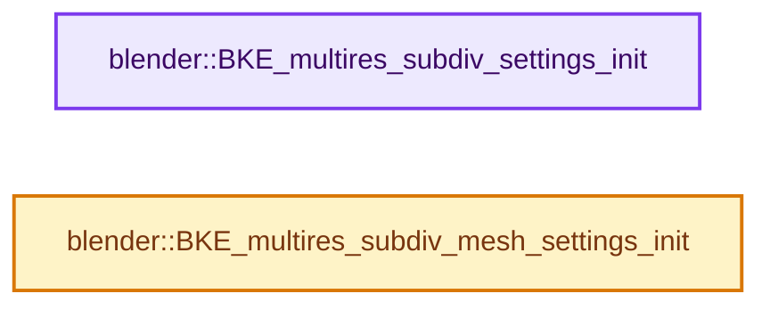

# 实现依赖专题：source/blender/blenkernel/intern/multires_subdiv.cc

[方向导航](README.md) · [符号索引](../%E7%AC%A6%E5%8F%B7%E4%BE%9D%E8%B5%96%E4%B8%8E%E5%AE%9E%E7%8E%B0%E7%B4%A2%E5%BC%95.md)

本专题从正文实际调用进入，集中保存共享实现。函数有稳定锚点，可从调用处直接跳到对应完整函数；递归与互相调用通过回链组织。

## 本文件的实现关系




## 完整成员与函数实现

<a id="f-a313efd66d1384ce"></a>

### `blender::BKE_multires_subdiv_settings_init`

实现位置：[source/blender/blenkernel/intern/multires_subdiv.cc](../../../../../source/blender/blenkernel/intern/multires_subdiv.cc) · L16—L27。

接口参数：

- `bke::subdiv::Settings *settings`
- `const MultiresModifierData *mmd`

**教学注释版**

<!-- annotated:5253970ad92fb6 -->

```cpp
void BKE_multires_subdiv_settings_init(bke::subdiv::Settings *settings,
                                       const MultiresModifierData *mmd)
{
  settings->is_simple = false;
  settings->is_adaptive = true;
  settings->level = settings->is_simple ? 1 : mmd->quality;
  settings->use_creases = (mmd->flags & eMultiresModifierFlag_UseCrease);
  settings->vtx_boundary_interpolation = bke::subdiv::vtx_boundary_interpolation_from_subsurf(
      mmd->boundary_smooth);
  settings->fvar_linear_interpolation = bke::subdiv::fvar_interpolation_from_uv_smooth(
      mmd->uv_smooth);
}
```

<details>
<summary>核对原始源码：source/blender/blenkernel/intern/multires_subdiv.cc · L16—L27</summary>

<!-- original:5253970ad92fb6:source/blender/blenkernel/intern/multires_subdiv.cc:16:27 -->

```cpp
void BKE_multires_subdiv_settings_init(bke::subdiv::Settings *settings,
                                       const MultiresModifierData *mmd)
{
  settings->is_simple = false;
  settings->is_adaptive = true;
  settings->level = settings->is_simple ? 1 : mmd->quality;
  settings->use_creases = (mmd->flags & eMultiresModifierFlag_UseCrease);
  settings->vtx_boundary_interpolation = bke::subdiv::vtx_boundary_interpolation_from_subsurf(
      mmd->boundary_smooth);
  settings->fvar_linear_interpolation = bke::subdiv::fvar_interpolation_from_uv_smooth(
      mmd->uv_smooth);
}
```

</details>

**沿实际写入检查状态**

- `settings->is_simple = false;`
- `settings->is_adaptive = true;`
- `settings->level = settings->is_simple ? 1 : mmd->quality;`
- `settings->use_creases = (mmd->flags & eMultiresModifierFlag_UseCrease);`
- `settings->vtx_boundary_interpolation = bke::subdiv::vtx_boundary_interpolation_from_subsurf(`
- `settings->fvar_linear_interpolation = bke::subdiv::fvar_interpolation_from_uv_smooth(`

**继续追踪实现**

- `bke::subdiv::vtx_boundary_interpolation_from_subsurf` → [blender::bke::subdiv::vtx_boundary_interpolation_from_subsurf · L69](%E4%BE%9D%E8%B5%96-subdiv-6aa500.md#f-933a39ad7057338e)。
- `bke::subdiv::fvar_interpolation_from_uv_smooth` → [blender::bke::subdiv::fvar_interpolation_from_uv_smooth · L49](%E4%BE%9D%E8%B5%96-subdiv-6aa500.md#f-767f64d27fdc130d)。

<a id="f-a2a91c018e742a96"></a>

### `blender::BKE_multires_subdiv_mesh_settings_init`

实现位置：[source/blender/blenkernel/intern/multires_subdiv.cc](../../../../../source/blender/blenkernel/intern/multires_subdiv.cc) · L29—L41。

接口参数：

- `bke::subdiv::ToMeshSettings *mesh_settings`
- `const Scene *scene`
- `const Object *object`
- `const MultiresModifierData *mmd`
- `const bool use_render_params`
- `const bool ignore_simplify`
- `const bool ignore_control_edges`

**教学注释版**

<!-- annotated:26e38fd6360ffd -->

```cpp
void BKE_multires_subdiv_mesh_settings_init(bke::subdiv::ToMeshSettings *mesh_settings,
                                            const Scene *scene,
                                            const Object *object,
                                            const MultiresModifierData *mmd,
                                            const bool use_render_params,
                                            const bool ignore_simplify,
                                            const bool ignore_control_edges)
{
  const int level = multires_get_level(scene, object, mmd, use_render_params, ignore_simplify);
  mesh_settings->resolution = (1 << level) + 1;
  mesh_settings->use_optimal_display = (mmd->flags & eMultiresModifierFlag_ControlEdges) &&
                                       !ignore_control_edges;
}
```

<details>
<summary>核对原始源码：source/blender/blenkernel/intern/multires_subdiv.cc · L29—L41</summary>

<!-- original:26e38fd6360ffd:source/blender/blenkernel/intern/multires_subdiv.cc:29:41 -->

```cpp
void BKE_multires_subdiv_mesh_settings_init(bke::subdiv::ToMeshSettings *mesh_settings,
                                            const Scene *scene,
                                            const Object *object,
                                            const MultiresModifierData *mmd,
                                            const bool use_render_params,
                                            const bool ignore_simplify,
                                            const bool ignore_control_edges)
{
  const int level = multires_get_level(scene, object, mmd, use_render_params, ignore_simplify);
  mesh_settings->resolution = (1 << level) + 1;
  mesh_settings->use_optimal_display = (mmd->flags & eMultiresModifierFlag_ControlEdges) &&
                                       !ignore_control_edges;
}
```

</details>

**沿实际写入检查状态**

- `mesh_settings->resolution = (1 << level) + 1;`
- `mesh_settings->use_optimal_display = (mmd->flags & eMultiresModifierFlag_ControlEdges) &&`

**继续追踪实现**

- `multires_get_level` → [blender::multires_get_level · L212](%E4%BE%9D%E8%B5%96-multires-7e6ba8.md#f-8f4d947b77878017)。
