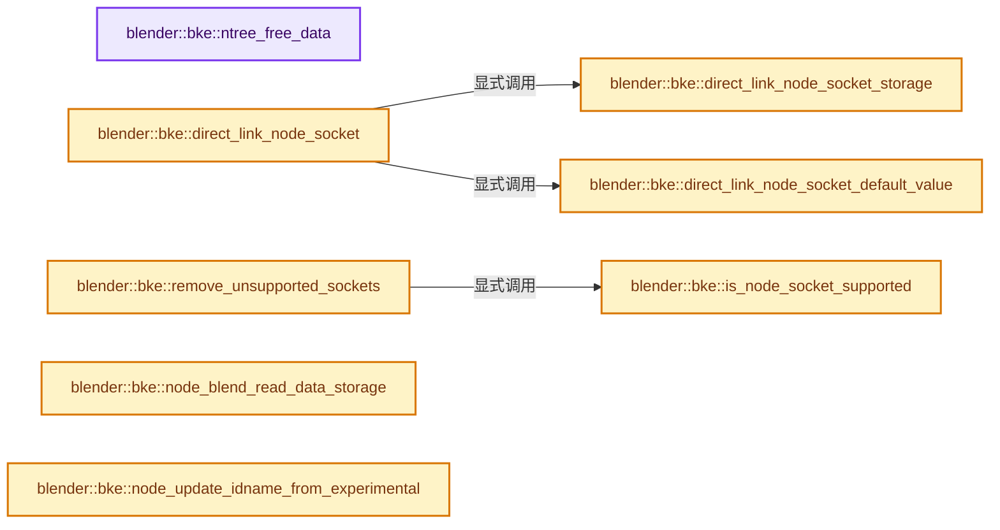
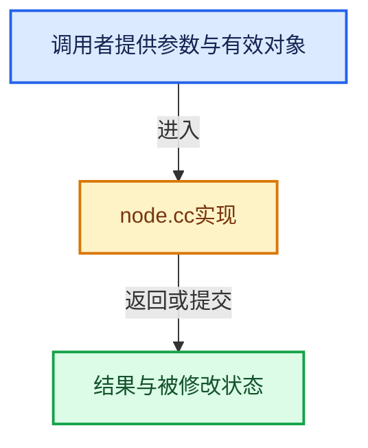

# 实现依赖专题：source/blender/blenkernel/intern/node.cc

[方向导航](README.md) · [符号索引](../%E7%AC%A6%E5%8F%B7%E4%BE%9D%E8%B5%96%E4%B8%8E%E5%AE%9E%E7%8E%B0%E7%B4%A2%E5%BC%95.md)

本专题从正文实际调用进入，集中保存共享实现。函数有稳定锚点，可从调用处直接跳到对应完整函数；递归与互相调用通过回链组织。

## 本文件的实现关系






## 完整成员与函数实现

<a id="f-8d698feb73007263"></a>

### `blender::bke::ntree_free_data`

实现位置：[source/blender/blenkernel/intern/node.cc](../../../../../source/blender/blenkernel/intern/node.cc) · L268—L322。

接口参数：

- `ID *id`

**教学注释版**

<!-- annotated:83cf9dfbdb5b0d -->

```cpp
static void ntree_free_data(ID *id)
{
  bNodeTree *ntree = reinterpret_cast<bNodeTree *>(id);

  /* XXX hack! node trees should not store execution graphs at all.
   * This should be removed when old tree types no longer require it.
   * Currently the execution data for texture nodes remains in the tree
   * after execution, until the node tree is updated or freed. */
  if (ntree->runtime->execdata) {
    switch (ntree->type) {
      case NTREE_SHADER:
        ntreeShaderEndExecTree(ntree->runtime->execdata);
        break;
      case NTREE_TEXTURE:
        ntreeTexEndExecTree(ntree->runtime->execdata);
        ntree->runtime->execdata = nullptr;
        break;
      default:
        break;
    }
  }

  /* XXX not nice, but needed to free localized node groups properly */
  free_localized_node_groups(ntree);

  ntree->links.free_no_destruct();

  /* Iterate backwards because this allows for more efficient node deletion while keeping
   * bNodeTreeRuntime::nodes_by_id valid. */
  for (bNode &node : ntree->nodes.items_reversed_mutable()) {
    node_free_node(ntree, node);
  }

  ntree->tree_interface.free_data();

  if (ntree->id.tag & ID_TAG_LOCALIZED) {
    BKE_libblock_free_data(&ntree->id, true);
  }

  if (ntree->geometry_node_asset_traits) {
    MEM_SAFE_DELETE(ntree->geometry_node_asset_traits->node_tool_idname);
    MEM_delete(ntree->geometry_node_asset_traits);
  }
  if (ntree->compositor_node_asset_traits) {
    MEM_delete(ntree->compositor_node_asset_traits);
  }

  if (ntree->nested_node_refs) {
    MEM_delete(ntree->nested_node_refs);
  }

  MEM_SAFE_DELETE(ntree->description);
  BKE_previewimg_id_free(&ntree->id);
  MEM_delete(ntree->runtime);
}
```

<details>
<summary>核对原始源码：source/blender/blenkernel/intern/node.cc · L268—L322</summary>

<!-- original:83cf9dfbdb5b0d:source/blender/blenkernel/intern/node.cc:268:322 -->

```cpp
static void ntree_free_data(ID *id)
{
  bNodeTree *ntree = reinterpret_cast<bNodeTree *>(id);

  /* XXX hack! node trees should not store execution graphs at all.
   * This should be removed when old tree types no longer require it.
   * Currently the execution data for texture nodes remains in the tree
   * after execution, until the node tree is updated or freed. */
  if (ntree->runtime->execdata) {
    switch (ntree->type) {
      case NTREE_SHADER:
        ntreeShaderEndExecTree(ntree->runtime->execdata);
        break;
      case NTREE_TEXTURE:
        ntreeTexEndExecTree(ntree->runtime->execdata);
        ntree->runtime->execdata = nullptr;
        break;
      default:
        break;
    }
  }

  /* XXX not nice, but needed to free localized node groups properly */
  free_localized_node_groups(ntree);

  ntree->links.free_no_destruct();

  /* Iterate backwards because this allows for more efficient node deletion while keeping
   * bNodeTreeRuntime::nodes_by_id valid. */
  for (bNode &node : ntree->nodes.items_reversed_mutable()) {
    node_free_node(ntree, node);
  }

  ntree->tree_interface.free_data();

  if (ntree->id.tag & ID_TAG_LOCALIZED) {
    BKE_libblock_free_data(&ntree->id, true);
  }

  if (ntree->geometry_node_asset_traits) {
    MEM_SAFE_DELETE(ntree->geometry_node_asset_traits->node_tool_idname);
    MEM_delete(ntree->geometry_node_asset_traits);
  }
  if (ntree->compositor_node_asset_traits) {
    MEM_delete(ntree->compositor_node_asset_traits);
  }

  if (ntree->nested_node_refs) {
    MEM_delete(ntree->nested_node_refs);
  }

  MEM_SAFE_DELETE(ntree->description);
  BKE_previewimg_id_free(&ntree->id);
  MEM_delete(ntree->runtime);
}
```

</details>

**沿实际写入检查状态**

- `ntree->runtime->execdata = nullptr;`

**继续追踪实现**

- `ntreeShaderEndExecTree` → [ntreeShaderEndExecTree · L1178](../09-LazyFunction%E4%B8%8E%E8%8A%82%E7%82%B9%E6%89%A7%E8%A1%8C%E6%9E%B6%E6%9E%84/%E4%BE%9D%E8%B5%96-node_shader_tree-d4b0a3.md#f-f1d2dce22315b98a)。
- `ntreeTexEndExecTree` → [blender::ntreeTexEndExecTree · L299](../09-LazyFunction%E4%B8%8E%E8%8A%82%E7%82%B9%E6%89%A7%E8%A1%8C%E6%9E%B6%E6%9E%84/%E4%BE%9D%E8%B5%96-node_texture_tree-b9c111.md#f-02f69805ed4ab523)。
- `free_localized_node_groups` → [blender::bke::free_localized_node_groups · L5205](%E4%BE%9D%E8%B5%96-node-89d753.md#f-49729171eff04080)。
- `ntree->links.free_no_destruct` → [调用协议](../%E6%A8%A1%E6%9D%BF%E5%AE%8F%E4%B8%8E%E5%8A%A8%E6%80%81%E5%88%86%E6%B4%BE%E5%8D%8F%E8%AE%AE.md)：接收对象类型依赖auto、返回值或模板实例；不按同名猜测目标。调用位置L293。
- `ntree->nodes.items_reversed_mutable` → [调用协议](../%E6%A8%A1%E6%9D%BF%E5%AE%8F%E4%B8%8E%E5%8A%A8%E6%80%81%E5%88%86%E6%B4%BE%E5%8D%8F%E8%AE%AE.md)：接收对象类型依赖auto、返回值或模板实例；不按同名猜测目标。调用位置L297。
- `node_free_node` → [blender::bke::node_free_node · L5073](%E4%BE%9D%E8%B5%96-node-89d753.md#f-a8d760c20889bd3a)。
- `ntree->tree_interface.free_data` → [调用协议](../%E6%A8%A1%E6%9D%BF%E5%AE%8F%E4%B8%8E%E5%8A%A8%E6%80%81%E5%88%86%E6%B4%BE%E5%8D%8F%E8%AE%AE.md)：接收对象类型依赖auto、返回值或模板实例；不按同名猜测目标。调用位置L301。
- `BKE_libblock_free_data` → [blender::BKE_libblock_free_data · L51](%E4%BE%9D%E8%B5%96-lib_id_delete-0cb33f.md#f-46dd6f10f77b69a6)。
- `MEM_SAFE_DELETE` → [MEM_SAFE_DELETE · L436](../03-%E5%86%85%E5%AD%98%E5%88%86%E9%85%8D%E4%B8%8E%E8%BF%90%E8%A1%8C%E6%97%B6%E7%B1%BB%E5%9E%8B/%E4%BE%9D%E8%B5%96-MEM_guardedalloc-b54eca.md#m-eadb3bc5b902)。宏定义由构建条件选择。
- `MEM_delete` → [MEM_delete · L400](../03-%E5%86%85%E5%AD%98%E5%88%86%E9%85%8D%E4%B8%8E%E8%BF%90%E8%A1%8C%E6%97%B6%E7%B1%BB%E5%9E%8B/%E4%BE%9D%E8%B5%96-MEM_guardedalloc-b54eca.md#f-9049ffdd1682887c)。
- `BKE_previewimg_id_free` → [blender::BKE_previewimg_id_free · L256](%E4%BE%9D%E8%B5%96-preview_image-dce125.md#f-35355dba9d0bc856)。

<a id="f-9bcd374dee1b191d"></a>

### `blender::bke::is_node_socket_supported`

实现位置：[source/blender/blenkernel/intern/node.cc](../../../../../source/blender/blenkernel/intern/node.cc) · L1470—L1501。

接口参数：

- `const bNodeSocket *sock`

**教学注释版**

<!-- annotated:eca7b8bbed8b1e -->

```cpp
static bool is_node_socket_supported(const bNodeSocket *sock)
{
  switch (sock->type) {
    case SOCK_FLOAT:
    case SOCK_VECTOR:
    case SOCK_RGBA:
    case SOCK_BOOLEAN:
    case SOCK_INT:
    case SOCK_STRING:
    case SOCK_CUSTOM:
    case SOCK_SHADER:
    case SOCK_GEOMETRY:
    case SOCK_OBJECT:
    case SOCK_IMAGE:
    case SOCK_COLLECTION:
    case SOCK_TEXTURE:
    case SOCK_MATERIAL:
    case SOCK_FONT:
    case SOCK_SCENE:
    case SOCK_TEXT_ID:
    case SOCK_MASK:
    case SOCK_SOUND:
    case SOCK_ROTATION:
    case SOCK_MENU:
    case SOCK_MATRIX:
    case SOCK_BUNDLE:
    case SOCK_CLOSURE:
    case SOCK_INT_VECTOR:
      return true;
  }
  return false;
}
```

<details>
<summary>核对原始源码：source/blender/blenkernel/intern/node.cc · L1470—L1501</summary>

<!-- original:eca7b8bbed8b1e:source/blender/blenkernel/intern/node.cc:1470:1501 -->

```cpp
static bool is_node_socket_supported(const bNodeSocket *sock)
{
  switch (sock->type) {
    case SOCK_FLOAT:
    case SOCK_VECTOR:
    case SOCK_RGBA:
    case SOCK_BOOLEAN:
    case SOCK_INT:
    case SOCK_STRING:
    case SOCK_CUSTOM:
    case SOCK_SHADER:
    case SOCK_GEOMETRY:
    case SOCK_OBJECT:
    case SOCK_IMAGE:
    case SOCK_COLLECTION:
    case SOCK_TEXTURE:
    case SOCK_MATERIAL:
    case SOCK_FONT:
    case SOCK_SCENE:
    case SOCK_TEXT_ID:
    case SOCK_MASK:
    case SOCK_SOUND:
    case SOCK_ROTATION:
    case SOCK_MENU:
    case SOCK_MATRIX:
    case SOCK_BUNDLE:
    case SOCK_CLOSURE:
    case SOCK_INT_VECTOR:
      return true;
  }
  return false;
}
```

</details>

**结果出口**

- `return true;`
- `return false;`

**继续追踪实现**

本实现没有需要继续展开的显式调用；检查返回表达式、对象转换和调用者前置条件。

<a id="f-7317a4972225946f"></a>

### `blender::bke::direct_link_node_socket_default_value`

实现位置：[source/blender/blenkernel/intern/node.cc](../../../../../source/blender/blenkernel/intern/node.cc) · L1629—L1905。

接口参数：

- `BlendDataReader *reader`
- `bNodeSocket *sock`

**教学注释版**

<!-- annotated:7b5e4334290337 -->

```cpp
static void direct_link_node_socket_default_value(BlendDataReader *reader, bNodeSocket *sock)
{
  if (sock->default_value == nullptr) {
    return;
  }

  if (sock->type == SOCK_CUSTOM) {
    /* There are some files around that have non-null default value for custom sockets. See e.g.
     * #140083.
     *
     * It is unclear how this could happen, but for now simply systematically set this pointer to
     * null. */
    sock->default_value = nullptr;
    return;
  }

  if (BLO_read_fileversion_get(reader) >=
      versioning_internal::MIN_BLENDFILE_VERSION_FOR_MODERN_NODE_SOCKET_DEFAULT_VALUE_READING)
  {
    /* Modern, standard DNA-typed reading of sockets default values. */
    switch (sock->type) {
      case SOCK_FLOAT:
        BLO_read_struct(reader, bNodeSocketValueFloat, &sock->default_value);
        break;
      case SOCK_VECTOR:
        BLO_read_struct(reader, bNodeSocketValueVector, &sock->default_value);
        break;
      case SOCK_RGBA:
        BLO_read_struct(reader, bNodeSocketValueRGBA, &sock->default_value);
        break;
      case SOCK_BOOLEAN:
        BLO_read_struct(reader, bNodeSocketValueBoolean, &sock->default_value);
        break;
      case SOCK_INT:
        BLO_read_struct(reader, bNodeSocketValueInt, &sock->default_value);
        break;
      case SOCK_STRING:
        BLO_read_struct(reader, bNodeSocketValueString, &sock->default_value);
        break;
      case SOCK_OBJECT:
        BLO_read_struct(reader, bNodeSocketValueObject, &sock->default_value);
        break;
      case SOCK_IMAGE:
        BLO_read_struct(reader, bNodeSocketValueImage, &sock->default_value);
        break;
      case SOCK_COLLECTION:
        BLO_read_struct(reader, bNodeSocketValueCollection, &sock->default_value);
        break;
      case SOCK_TEXTURE:
        BLO_read_struct(reader, bNodeSocketValueTexture, &sock->default_value);
        break;
      case SOCK_MATERIAL:
        BLO_read_struct(reader, bNodeSocketValueMaterial, &sock->default_value);
        break;
      case SOCK_FONT:
        BLO_read_struct(reader, bNodeSocketValueFont, &sock->default_value);
        break;
      case SOCK_SCENE:
        BLO_read_struct(reader, bNodeSocketValueScene, &sock->default_value);
        break;
      case SOCK_TEXT_ID:
        BLO_read_struct(reader, bNodeSocketValueText, &sock->default_value);
        break;
      case SOCK_MASK:
        BLO_read_struct(reader, bNodeSocketValueMask, &sock->default_value);
        break;
      case SOCK_SOUND:
        BLO_read_struct(reader, bNodeSocketValueSound, &sock->default_value);
        break;
      case SOCK_ROTATION:
        BLO_read_struct(reader, bNodeSocketValueRotation, &sock->default_value);
        break;
      case SOCK_MENU:
        BLO_read_struct(reader, bNodeSocketValueMenu, &sock->default_value);
        break;
      case SOCK_INT_VECTOR:
        BLO_read_struct(reader, bNodeSocketValueIntVector, &sock->default_value);
        break;
      case SOCK_MATRIX:
        /* Matrix sockets currently have no default value. */
      case SOCK_CUSTOM:
        /* Custom node sockets where default_value is defined use custom properties for storage. */
      case SOCK_SHADER:
      case SOCK_GEOMETRY:
      case SOCK_BUNDLE:
      case SOCK_CLOSURE:
        BLI_assert_unreachable();
        break;
    }
  }
  else {
    /* Legacy-compatible, raw-buffer-based reading of sockets default values. */
    void *temp_data = sock->default_value;
    BLO_read_raw_address(reader, &temp_data);
    if (!temp_data) {
      sock->default_value = nullptr;
      return;
    }

    switch (sock->type) {
      case SOCK_FLOAT:
        versioning_internal::direct_link_node_socket_legacy_data_version_do<
            bNodeSocketValueFloat,
            versioning_internal::bNodeSocketValueFloat_404>(
            &sock->default_value,
            &temp_data,
            [](bNodeSocketValueFloat &dest, versioning_internal::bNodeSocketValueFloat_404 &src) {
              dest.subtype = src.subtype;
              dest.value = src.value;
              dest.min = src.min;
              dest.max = src.max;
            });
        break;
      case SOCK_VECTOR:
        versioning_internal::direct_link_node_socket_legacy_data_version_do<
            bNodeSocketValueVector,
            versioning_internal::bNodeSocketValueVector_404>(
            &sock->default_value,
            &temp_data,
            [](bNodeSocketValueVector &dest,
               versioning_internal::bNodeSocketValueVector_404 &src) {
              dest.subtype = src.subtype;
              copy_v3_v3(dest.value, src.value);
              dest.min = src.min;
              dest.max = src.max;
            });
        break;
      case SOCK_RGBA:
        versioning_internal::direct_link_node_socket_legacy_data_version_do<
            bNodeSocketValueRGBA,
            versioning_internal::bNodeSocketValueRGBA_404>(
            &sock->default_value,
            &temp_data,
            [](bNodeSocketValueRGBA &dest, versioning_internal::bNodeSocketValueRGBA_404 &src) {
              copy_v4_v4(dest.value, src.value);
            });
        break;
      case SOCK_BOOLEAN:
        versioning_internal::direct_link_node_socket_legacy_data_version_do<
            bNodeSocketValueBoolean,
            versioning_internal::bNodeSocketValueBoolean_404>(
            &sock->default_value,
            &temp_data,
            [](bNodeSocketValueBoolean &dest,
               versioning_internal::bNodeSocketValueBoolean_404 &src) { dest.value = src.value; });
        break;
      case SOCK_INT:
        versioning_internal::direct_link_node_socket_legacy_data_version_do<
            bNodeSocketValueInt,
            versioning_internal::bNodeSocketValueInt_404>(
            &sock->default_value,
            &temp_data,
            [](bNodeSocketValueInt &dest, versioning_internal::bNodeSocketValueInt_404 &src) {
              dest.subtype = src.subtype;
              dest.value = src.value;
              dest.min = src.min;
              dest.max = src.max;
            });
        break;
      case SOCK_STRING:
        versioning_internal::direct_link_node_socket_legacy_data_version_do<
            bNodeSocketValueString,
            versioning_internal::bNodeSocketValueString_404>(
            &sock->default_value,
            &temp_data,
            [](bNodeSocketValueString &dest,
               versioning_internal::bNodeSocketValueString_404 &src) {
              dest.subtype = src.subtype;
              STRNCPY(dest.value, src.value);
            });
        break;
      case SOCK_OBJECT:
        versioning_internal::direct_link_node_socket_legacy_data_version_do<
            bNodeSocketValueObject,
            versioning_internal::bNodeSocketValueObject_404>(
            &sock->default_value,
            &temp_data,
            [](bNodeSocketValueObject &dest,
               versioning_internal::bNodeSocketValueObject_404 &src) { dest.value = src.value; });
        break;
      case SOCK_IMAGE:
        versioning_internal::direct_link_node_socket_legacy_data_version_do<
            bNodeSocketValueImage,
            versioning_internal::bNodeSocketValueImage_404>(
            &sock->default_value,
            &temp_data,
            [](bNodeSocketValueImage &dest, versioning_internal::bNodeSocketValueImage_404 &src) {
              dest.value = src.value;
            });
        break;
      case SOCK_COLLECTION:
        versioning_internal::direct_link_node_socket_legacy_data_version_do<
            bNodeSocketValueCollection,
            versioning_internal::bNodeSocketValueCollection_404>(
            &sock->default_value,
            &temp_data,
            [](bNodeSocketValueCollection &dest,
               versioning_internal::bNodeSocketValueCollection_404 &src) {
              dest.value = src.value;
            });
        break;
      case SOCK_TEXTURE:
        versioning_internal::direct_link_node_socket_legacy_data_version_do<
            bNodeSocketValueTexture,
            versioning_internal::bNodeSocketValueTexture_404>(
            &sock->default_value,
            &temp_data,
            [](bNodeSocketValueTexture &dest,
               versioning_internal::bNodeSocketValueTexture_404 &src) { dest.value = src.value; });
        break;
      case SOCK_MATERIAL:
        versioning_internal::direct_link_node_socket_legacy_data_version_do<
            bNodeSocketValueMaterial,
            versioning_internal::bNodeSocketValueMaterial_404>(
            &sock->default_value,
            &temp_data,
            [](bNodeSocketValueMaterial &dest,
               versioning_internal::bNodeSocketValueMaterial_404 &src) {
              dest.value = src.value;
            });
        break;
      case SOCK_ROTATION:
        versioning_internal::direct_link_node_socket_legacy_data_version_do<
            bNodeSocketValueRotation,
            versioning_internal::bNodeSocketValueRotation_404>(
            &sock->default_value,
            &temp_data,
            [](bNodeSocketValueRotation &dest,
               versioning_internal::bNodeSocketValueRotation_404 &src) {
              copy_v3_v3(dest.value_euler, src.value_euler);
            });
        break;
      case SOCK_MENU:
        versioning_internal::direct_link_node_socket_legacy_data_version_do<
            bNodeSocketValueMenu,
            versioning_internal::bNodeSocketValueMenu_404>(
            &sock->default_value,
            &temp_data,
            [](bNodeSocketValueMenu &dest, versioning_internal::bNodeSocketValueMenu_404 &src) {
              dest.value = src.value;
              /* Other members are runtime-only. */
            });
        break;
      case SOCK_MATRIX:
        /* Matrix sockets had no default value. */
      case SOCK_CUSTOM:
        /* Custom node sockets where default_value is defined were using custom properties for
         * storage. */
      case SOCK_FONT:
      case SOCK_SCENE:
      case SOCK_TEXT_ID:
      case SOCK_MASK:
      case SOCK_SOUND:
        /* Those data-block types did not exist in the older version. */
      case SOCK_SHADER:
      case SOCK_GEOMETRY:
      case SOCK_BUNDLE:
      case SOCK_CLOSURE:
      case SOCK_INT_VECTOR:
        BLI_assert_unreachable();
        break;
    }
  }

  /* Post-reading processing. */
  switch (sock->type) {
    case SOCK_MENU: {
      bNodeSocketValueMenu &default_value = *sock->default_value_typed<bNodeSocketValueMenu>();
      /* Clear runtime data. */
      default_value.enum_items = nullptr;
      default_value.runtime_flag = 0;
      break;
    }
    default:
      break;
  }
}
```

<details>
<summary>核对原始源码：source/blender/blenkernel/intern/node.cc · L1629—L1905</summary>

<!-- original:7b5e4334290337:source/blender/blenkernel/intern/node.cc:1629:1905 -->

```cpp
static void direct_link_node_socket_default_value(BlendDataReader *reader, bNodeSocket *sock)
{
  if (sock->default_value == nullptr) {
    return;
  }

  if (sock->type == SOCK_CUSTOM) {
    /* There are some files around that have non-null default value for custom sockets. See e.g.
     * #140083.
     *
     * It is unclear how this could happen, but for now simply systematically set this pointer to
     * null. */
    sock->default_value = nullptr;
    return;
  }

  if (BLO_read_fileversion_get(reader) >=
      versioning_internal::MIN_BLENDFILE_VERSION_FOR_MODERN_NODE_SOCKET_DEFAULT_VALUE_READING)
  {
    /* Modern, standard DNA-typed reading of sockets default values. */
    switch (sock->type) {
      case SOCK_FLOAT:
        BLO_read_struct(reader, bNodeSocketValueFloat, &sock->default_value);
        break;
      case SOCK_VECTOR:
        BLO_read_struct(reader, bNodeSocketValueVector, &sock->default_value);
        break;
      case SOCK_RGBA:
        BLO_read_struct(reader, bNodeSocketValueRGBA, &sock->default_value);
        break;
      case SOCK_BOOLEAN:
        BLO_read_struct(reader, bNodeSocketValueBoolean, &sock->default_value);
        break;
      case SOCK_INT:
        BLO_read_struct(reader, bNodeSocketValueInt, &sock->default_value);
        break;
      case SOCK_STRING:
        BLO_read_struct(reader, bNodeSocketValueString, &sock->default_value);
        break;
      case SOCK_OBJECT:
        BLO_read_struct(reader, bNodeSocketValueObject, &sock->default_value);
        break;
      case SOCK_IMAGE:
        BLO_read_struct(reader, bNodeSocketValueImage, &sock->default_value);
        break;
      case SOCK_COLLECTION:
        BLO_read_struct(reader, bNodeSocketValueCollection, &sock->default_value);
        break;
      case SOCK_TEXTURE:
        BLO_read_struct(reader, bNodeSocketValueTexture, &sock->default_value);
        break;
      case SOCK_MATERIAL:
        BLO_read_struct(reader, bNodeSocketValueMaterial, &sock->default_value);
        break;
      case SOCK_FONT:
        BLO_read_struct(reader, bNodeSocketValueFont, &sock->default_value);
        break;
      case SOCK_SCENE:
        BLO_read_struct(reader, bNodeSocketValueScene, &sock->default_value);
        break;
      case SOCK_TEXT_ID:
        BLO_read_struct(reader, bNodeSocketValueText, &sock->default_value);
        break;
      case SOCK_MASK:
        BLO_read_struct(reader, bNodeSocketValueMask, &sock->default_value);
        break;
      case SOCK_SOUND:
        BLO_read_struct(reader, bNodeSocketValueSound, &sock->default_value);
        break;
      case SOCK_ROTATION:
        BLO_read_struct(reader, bNodeSocketValueRotation, &sock->default_value);
        break;
      case SOCK_MENU:
        BLO_read_struct(reader, bNodeSocketValueMenu, &sock->default_value);
        break;
      case SOCK_INT_VECTOR:
        BLO_read_struct(reader, bNodeSocketValueIntVector, &sock->default_value);
        break;
      case SOCK_MATRIX:
        /* Matrix sockets currently have no default value. */
      case SOCK_CUSTOM:
        /* Custom node sockets where default_value is defined use custom properties for storage. */
      case SOCK_SHADER:
      case SOCK_GEOMETRY:
      case SOCK_BUNDLE:
      case SOCK_CLOSURE:
        BLI_assert_unreachable();
        break;
    }
  }
  else {
    /* Legacy-compatible, raw-buffer-based reading of sockets default values. */
    void *temp_data = sock->default_value;
    BLO_read_raw_address(reader, &temp_data);
    if (!temp_data) {
      sock->default_value = nullptr;
      return;
    }

    switch (sock->type) {
      case SOCK_FLOAT:
        versioning_internal::direct_link_node_socket_legacy_data_version_do<
            bNodeSocketValueFloat,
            versioning_internal::bNodeSocketValueFloat_404>(
            &sock->default_value,
            &temp_data,
            [](bNodeSocketValueFloat &dest, versioning_internal::bNodeSocketValueFloat_404 &src) {
              dest.subtype = src.subtype;
              dest.value = src.value;
              dest.min = src.min;
              dest.max = src.max;
            });
        break;
      case SOCK_VECTOR:
        versioning_internal::direct_link_node_socket_legacy_data_version_do<
            bNodeSocketValueVector,
            versioning_internal::bNodeSocketValueVector_404>(
            &sock->default_value,
            &temp_data,
            [](bNodeSocketValueVector &dest,
               versioning_internal::bNodeSocketValueVector_404 &src) {
              dest.subtype = src.subtype;
              copy_v3_v3(dest.value, src.value);
              dest.min = src.min;
              dest.max = src.max;
            });
        break;
      case SOCK_RGBA:
        versioning_internal::direct_link_node_socket_legacy_data_version_do<
            bNodeSocketValueRGBA,
            versioning_internal::bNodeSocketValueRGBA_404>(
            &sock->default_value,
            &temp_data,
            [](bNodeSocketValueRGBA &dest, versioning_internal::bNodeSocketValueRGBA_404 &src) {
              copy_v4_v4(dest.value, src.value);
            });
        break;
      case SOCK_BOOLEAN:
        versioning_internal::direct_link_node_socket_legacy_data_version_do<
            bNodeSocketValueBoolean,
            versioning_internal::bNodeSocketValueBoolean_404>(
            &sock->default_value,
            &temp_data,
            [](bNodeSocketValueBoolean &dest,
               versioning_internal::bNodeSocketValueBoolean_404 &src) { dest.value = src.value; });
        break;
      case SOCK_INT:
        versioning_internal::direct_link_node_socket_legacy_data_version_do<
            bNodeSocketValueInt,
            versioning_internal::bNodeSocketValueInt_404>(
            &sock->default_value,
            &temp_data,
            [](bNodeSocketValueInt &dest, versioning_internal::bNodeSocketValueInt_404 &src) {
              dest.subtype = src.subtype;
              dest.value = src.value;
              dest.min = src.min;
              dest.max = src.max;
            });
        break;
      case SOCK_STRING:
        versioning_internal::direct_link_node_socket_legacy_data_version_do<
            bNodeSocketValueString,
            versioning_internal::bNodeSocketValueString_404>(
            &sock->default_value,
            &temp_data,
            [](bNodeSocketValueString &dest,
               versioning_internal::bNodeSocketValueString_404 &src) {
              dest.subtype = src.subtype;
              STRNCPY(dest.value, src.value);
            });
        break;
      case SOCK_OBJECT:
        versioning_internal::direct_link_node_socket_legacy_data_version_do<
            bNodeSocketValueObject,
            versioning_internal::bNodeSocketValueObject_404>(
            &sock->default_value,
            &temp_data,
            [](bNodeSocketValueObject &dest,
               versioning_internal::bNodeSocketValueObject_404 &src) { dest.value = src.value; });
        break;
      case SOCK_IMAGE:
        versioning_internal::direct_link_node_socket_legacy_data_version_do<
            bNodeSocketValueImage,
            versioning_internal::bNodeSocketValueImage_404>(
            &sock->default_value,
            &temp_data,
            [](bNodeSocketValueImage &dest, versioning_internal::bNodeSocketValueImage_404 &src) {
              dest.value = src.value;
            });
        break;
      case SOCK_COLLECTION:
        versioning_internal::direct_link_node_socket_legacy_data_version_do<
            bNodeSocketValueCollection,
            versioning_internal::bNodeSocketValueCollection_404>(
            &sock->default_value,
            &temp_data,
            [](bNodeSocketValueCollection &dest,
               versioning_internal::bNodeSocketValueCollection_404 &src) {
              dest.value = src.value;
            });
        break;
      case SOCK_TEXTURE:
        versioning_internal::direct_link_node_socket_legacy_data_version_do<
            bNodeSocketValueTexture,
            versioning_internal::bNodeSocketValueTexture_404>(
            &sock->default_value,
            &temp_data,
            [](bNodeSocketValueTexture &dest,
               versioning_internal::bNodeSocketValueTexture_404 &src) { dest.value = src.value; });
        break;
      case SOCK_MATERIAL:
        versioning_internal::direct_link_node_socket_legacy_data_version_do<
            bNodeSocketValueMaterial,
            versioning_internal::bNodeSocketValueMaterial_404>(
            &sock->default_value,
            &temp_data,
            [](bNodeSocketValueMaterial &dest,
               versioning_internal::bNodeSocketValueMaterial_404 &src) {
              dest.value = src.value;
            });
        break;
      case SOCK_ROTATION:
        versioning_internal::direct_link_node_socket_legacy_data_version_do<
            bNodeSocketValueRotation,
            versioning_internal::bNodeSocketValueRotation_404>(
            &sock->default_value,
            &temp_data,
            [](bNodeSocketValueRotation &dest,
               versioning_internal::bNodeSocketValueRotation_404 &src) {
              copy_v3_v3(dest.value_euler, src.value_euler);
            });
        break;
      case SOCK_MENU:
        versioning_internal::direct_link_node_socket_legacy_data_version_do<
            bNodeSocketValueMenu,
            versioning_internal::bNodeSocketValueMenu_404>(
            &sock->default_value,
            &temp_data,
            [](bNodeSocketValueMenu &dest, versioning_internal::bNodeSocketValueMenu_404 &src) {
              dest.value = src.value;
              /* Other members are runtime-only. */
            });
        break;
      case SOCK_MATRIX:
        /* Matrix sockets had no default value. */
      case SOCK_CUSTOM:
        /* Custom node sockets where default_value is defined were using custom properties for
         * storage. */
      case SOCK_FONT:
      case SOCK_SCENE:
      case SOCK_TEXT_ID:
      case SOCK_MASK:
      case SOCK_SOUND:
        /* Those data-block types did not exist in the older version. */
      case SOCK_SHADER:
      case SOCK_GEOMETRY:
      case SOCK_BUNDLE:
      case SOCK_CLOSURE:
      case SOCK_INT_VECTOR:
        BLI_assert_unreachable();
        break;
    }
  }

  /* Post-reading processing. */
  switch (sock->type) {
    case SOCK_MENU: {
      bNodeSocketValueMenu &default_value = *sock->default_value_typed<bNodeSocketValueMenu>();
      /* Clear runtime data. */
      default_value.enum_items = nullptr;
      default_value.runtime_flag = 0;
      break;
    }
    default:
      break;
  }
}
```

</details>

**沿实际写入检查状态**

- `sock->default_value = nullptr;`
- `dest.subtype = src.subtype;`
- `dest.value = src.value;`
- `dest.min = src.min;`
- `dest.max = src.max;`
- `default_value.enum_items = nullptr;`
- `default_value.runtime_flag = 0;`

**继续追踪实现**

- `BLO_read_fileversion_get` → [BLO_read_fileversion_get · L6323](%E4%BE%9D%E8%B5%96-readfile-05cc37.md#f-f0f8200b859972e0)。
- `BLO_read_struct` → [BLO_read_struct · L477](%E4%BE%9D%E8%B5%96-BLO_read_write-a54308.md#m-d307fd6f7c0e)。宏定义由构建条件选择。
- `BLI_assert_unreachable` → [BLI_assert_unreachable · L77](../01-%E5%9F%BA%E7%A1%80%E5%AE%B9%E5%99%A8%E4%B8%8E%E7%8E%B0%E4%BB%A3CPP/%E4%BE%9D%E8%B5%96-BLI_assert-cc98e8.md#m-7a2d91a67d8e)。宏定义由构建条件选择。
- `BLO_read_raw_address` → [BLO_read_raw_address · L467](%E4%BE%9D%E8%B5%96-BLO_read_write-a54308.md#m-100f6a13febf)。宏定义由构建条件选择。
- `versioning_internal::direct_link_node_socket_legacy_data_version_do< bNodeSocketValueFloat, versioning_internal::bNodeSocketValueFloat_404>` → [调用协议](../%E6%A8%A1%E6%9D%BF%E5%AE%8F%E4%B8%8E%E5%8A%A8%E6%80%81%E5%88%86%E6%B4%BE%E5%8D%8F%E8%AE%AE.md)：函数指针、局部可调用对象或未展开的宏；必须结合调用者环境。调用位置L1730。
- `versioning_internal::direct_link_node_socket_legacy_data_version_do< bNodeSocketValueVector, versioning_internal::bNodeSocketValueVector_404>` → [调用协议](../%E6%A8%A1%E6%9D%BF%E5%AE%8F%E4%B8%8E%E5%8A%A8%E6%80%81%E5%88%86%E6%B4%BE%E5%8D%8F%E8%AE%AE.md)：函数指针、局部可调用对象或未展开的宏；必须结合调用者环境。调用位置L1743。
- `copy_v3_v3` → [调用协议](../%E6%A8%A1%E6%9D%BF%E5%AE%8F%E4%B8%8E%E5%8A%A8%E6%80%81%E5%88%86%E6%B4%BE%E5%8D%8F%E8%AE%AE.md)：函数指针、局部可调用对象或未展开的宏；必须结合调用者环境。调用位置L1751。
- `versioning_internal::direct_link_node_socket_legacy_data_version_do< bNodeSocketValueRGBA, versioning_internal::bNodeSocketValueRGBA_404>` → [调用协议](../%E6%A8%A1%E6%9D%BF%E5%AE%8F%E4%B8%8E%E5%8A%A8%E6%80%81%E5%88%86%E6%B4%BE%E5%8D%8F%E8%AE%AE.md)：函数指针、局部可调用对象或未展开的宏；必须结合调用者环境。调用位置L1757。
- `copy_v4_v4` → [调用协议](../%E6%A8%A1%E6%9D%BF%E5%AE%8F%E4%B8%8E%E5%8A%A8%E6%80%81%E5%88%86%E6%B4%BE%E5%8D%8F%E8%AE%AE.md)：函数指针、局部可调用对象或未展开的宏；必须结合调用者环境。调用位置L1763。
- `versioning_internal::direct_link_node_socket_legacy_data_version_do< bNodeSocketValueBoolean, versioning_internal::bNodeSocketValueBoolean_404>` → [调用协议](../%E6%A8%A1%E6%9D%BF%E5%AE%8F%E4%B8%8E%E5%8A%A8%E6%80%81%E5%88%86%E6%B4%BE%E5%8D%8F%E8%AE%AE.md)：函数指针、局部可调用对象或未展开的宏；必须结合调用者环境。调用位置L1767。
- `versioning_internal::direct_link_node_socket_legacy_data_version_do< bNodeSocketValueInt, versioning_internal::bNodeSocketValueInt_404>` → [调用协议](../%E6%A8%A1%E6%9D%BF%E5%AE%8F%E4%B8%8E%E5%8A%A8%E6%80%81%E5%88%86%E6%B4%BE%E5%8D%8F%E8%AE%AE.md)：函数指针、局部可调用对象或未展开的宏；必须结合调用者环境。调用位置L1776。
- `versioning_internal::direct_link_node_socket_legacy_data_version_do< bNodeSocketValueString, versioning_internal::bNodeSocketValueString_404>` → [调用协议](../%E6%A8%A1%E6%9D%BF%E5%AE%8F%E4%B8%8E%E5%8A%A8%E6%80%81%E5%88%86%E6%B4%BE%E5%8D%8F%E8%AE%AE.md)：函数指针、局部可调用对象或未展开的宏；必须结合调用者环境。调用位置L1789。
- `STRNCPY` → [blender::STRNCPY · L690](../01-%E5%9F%BA%E7%A1%80%E5%AE%B9%E5%99%A8%E4%B8%8E%E7%8E%B0%E4%BB%A3CPP/%E4%BE%9D%E8%B5%96-BLI_string-b43058.md#f-6b2d861724026be6)。
- `versioning_internal::direct_link_node_socket_legacy_data_version_do< bNodeSocketValueObject, versioning_internal::bNodeSocketValueObject_404>` → [调用协议](../%E6%A8%A1%E6%9D%BF%E5%AE%8F%E4%B8%8E%E5%8A%A8%E6%80%81%E5%88%86%E6%B4%BE%E5%8D%8F%E8%AE%AE.md)：函数指针、局部可调用对象或未展开的宏；必须结合调用者环境。调用位置L1801。
- `versioning_internal::direct_link_node_socket_legacy_data_version_do< bNodeSocketValueImage, versioning_internal::bNodeSocketValueImage_404>` → [调用协议](../%E6%A8%A1%E6%9D%BF%E5%AE%8F%E4%B8%8E%E5%8A%A8%E6%80%81%E5%88%86%E6%B4%BE%E5%8D%8F%E8%AE%AE.md)：函数指针、局部可调用对象或未展开的宏；必须结合调用者环境。调用位置L1810。
- `versioning_internal::direct_link_node_socket_legacy_data_version_do< bNodeSocketValueCollection, versioning_internal::bNodeSocketValueCollection_404>` → [调用协议](../%E6%A8%A1%E6%9D%BF%E5%AE%8F%E4%B8%8E%E5%8A%A8%E6%80%81%E5%88%86%E6%B4%BE%E5%8D%8F%E8%AE%AE.md)：函数指针、局部可调用对象或未展开的宏；必须结合调用者环境。调用位置L1820。
- `versioning_internal::direct_link_node_socket_legacy_data_version_do< bNodeSocketValueTexture, versioning_internal::bNodeSocketValueTexture_404>` → [调用协议](../%E6%A8%A1%E6%9D%BF%E5%AE%8F%E4%B8%8E%E5%8A%A8%E6%80%81%E5%88%86%E6%B4%BE%E5%8D%8F%E8%AE%AE.md)：函数指针、局部可调用对象或未展开的宏；必须结合调用者环境。调用位置L1831。
- `versioning_internal::direct_link_node_socket_legacy_data_version_do< bNodeSocketValueMaterial, versioning_internal::bNodeSocketValueMaterial_404>` → [调用协议](../%E6%A8%A1%E6%9D%BF%E5%AE%8F%E4%B8%8E%E5%8A%A8%E6%80%81%E5%88%86%E6%B4%BE%E5%8D%8F%E8%AE%AE.md)：函数指针、局部可调用对象或未展开的宏；必须结合调用者环境。调用位置L1840。
- `versioning_internal::direct_link_node_socket_legacy_data_version_do< bNodeSocketValueRotation, versioning_internal::bNodeSocketValueRotation_404>` → [调用协议](../%E6%A8%A1%E6%9D%BF%E5%AE%8F%E4%B8%8E%E5%8A%A8%E6%80%81%E5%88%86%E6%B4%BE%E5%8D%8F%E8%AE%AE.md)：函数指针、局部可调用对象或未展开的宏；必须结合调用者环境。调用位置L1851。
- `versioning_internal::direct_link_node_socket_legacy_data_version_do< bNodeSocketValueMenu, versioning_internal::bNodeSocketValueMenu_404>` → [调用协议](../%E6%A8%A1%E6%9D%BF%E5%AE%8F%E4%B8%8E%E5%8A%A8%E6%80%81%E5%88%86%E6%B4%BE%E5%8D%8F%E8%AE%AE.md)：函数指针、局部可调用对象或未展开的宏；必须结合调用者环境。调用位置L1862。
- `sock->default_value_typed<bNodeSocketValueMenu>` → [blender::bNodeSocket::default_value_typed · L1134](%E4%BE%9D%E8%B5%96-BKE_node_runtime-ee561b.md#f-ce490d0e5a28d98d)；[blender::bNodeSocket::default_value_typed · L1139](%E4%BE%9D%E8%B5%96-BKE_node_runtime-ee561b.md#f-392726ff93a0389d)。同名重载需按实参类型选择。

<a id="f-76ac95d193841e76"></a>

### `blender::bke::direct_link_node_socket_storage`

实现位置：[source/blender/blenkernel/intern/node.cc](../../../../../source/blender/blenkernel/intern/node.cc) · L1907—L1942。

接口参数：

- `BlendDataReader *reader`
- `const bNode *node`
- `bNodeSocket *sock`

**教学注释版**

<!-- annotated:268476ddc1bc3c -->

```cpp
static void direct_link_node_socket_storage(BlendDataReader *reader,
                                            const bNode *node,
                                            bNodeSocket *sock)
{
  if (!sock->storage) {
    return;
  }
  if (!node) {
    /* Sockets not owned by a node should never have storage data. */
    BLI_assert_unreachable();
    sock->storage = nullptr;
    return;
  }

  /* Sockets storage data seem to have always been written with correct DNA type info (see
   * 3bae60d0c9 and 9d91bc38d3). So no need to use the same versioning work-around for old files as
   * done for default values. */
  switch (node->type_legacy) {
    case CMP_NODE_OUTPUT_FILE:
      BLO_read_struct(reader, NodeImageMultiFileSocket, &sock->storage);
      if (sock->storage) {
        NodeImageMultiFileSocket *sockdata = static_cast<NodeImageMultiFileSocket *>(
            sock->storage);
        BKE_image_format_blend_read_data(reader, &sockdata->format);
      }
      break;
    case CMP_NODE_IMAGE:
    case CMP_NODE_R_LAYERS:
      BLO_read_struct(reader, NodeImageLayer, &sock->storage);
      break;
    default:
      BLI_assert_unreachable();
      sock->storage = nullptr;
      break;
  }
}
```

<details>
<summary>核对原始源码：source/blender/blenkernel/intern/node.cc · L1907—L1942</summary>

<!-- original:268476ddc1bc3c:source/blender/blenkernel/intern/node.cc:1907:1942 -->

```cpp
static void direct_link_node_socket_storage(BlendDataReader *reader,
                                            const bNode *node,
                                            bNodeSocket *sock)
{
  if (!sock->storage) {
    return;
  }
  if (!node) {
    /* Sockets not owned by a node should never have storage data. */
    BLI_assert_unreachable();
    sock->storage = nullptr;
    return;
  }

  /* Sockets storage data seem to have always been written with correct DNA type info (see
   * 3bae60d0c9 and 9d91bc38d3). So no need to use the same versioning work-around for old files as
   * done for default values. */
  switch (node->type_legacy) {
    case CMP_NODE_OUTPUT_FILE:
      BLO_read_struct(reader, NodeImageMultiFileSocket, &sock->storage);
      if (sock->storage) {
        NodeImageMultiFileSocket *sockdata = static_cast<NodeImageMultiFileSocket *>(
            sock->storage);
        BKE_image_format_blend_read_data(reader, &sockdata->format);
      }
      break;
    case CMP_NODE_IMAGE:
    case CMP_NODE_R_LAYERS:
      BLO_read_struct(reader, NodeImageLayer, &sock->storage);
      break;
    default:
      BLI_assert_unreachable();
      sock->storage = nullptr;
      break;
  }
}
```

</details>

**沿实际写入检查状态**

- `sock->storage = nullptr;`

**继续追踪实现**

- `BLI_assert_unreachable` → [BLI_assert_unreachable · L77](../01-%E5%9F%BA%E7%A1%80%E5%AE%B9%E5%99%A8%E4%B8%8E%E7%8E%B0%E4%BB%A3CPP/%E4%BE%9D%E8%B5%96-BLI_assert-cc98e8.md#m-7a2d91a67d8e)。宏定义由构建条件选择。
- `BLO_read_struct` → [BLO_read_struct · L477](%E4%BE%9D%E8%B5%96-BLO_read_write-a54308.md#m-d307fd6f7c0e)。宏定义由构建条件选择。
- `BKE_image_format_blend_read_data` → [blender::BKE_image_format_blend_read_data · L82](%E4%BE%9D%E8%B5%96-image_format-a25a14.md#f-59b357861775e62e)。

<a id="f-76fac79e6ffdba8f"></a>

### `blender::bke::direct_link_node_socket`

实现位置：[source/blender/blenkernel/intern/node.cc](../../../../../source/blender/blenkernel/intern/node.cc) · L1944—L1959。

接口参数：

- `BlendDataReader *reader`
- `const bNode *node`
- `bNodeSocket *sock`

**教学注释版**

<!-- annotated:3f58c3ab279a66 -->

```cpp
static void direct_link_node_socket(BlendDataReader *reader, const bNode *node, bNodeSocket *sock)
{
  BLO_read_struct(reader, IDProperty, &sock->prop);
  IDP_BlendDataRead(reader, &sock->prop);

  BLO_read_struct(reader, bNodeLink, &sock->link);
  sock->typeinfo = nullptr;

  direct_link_node_socket_storage(reader, node, sock);

  direct_link_node_socket_default_value(reader, sock);

  BLO_read_string(reader, &sock->default_attribute_name);
  sock->runtime = MEM_new<bNodeSocketRuntime>(__func__);
  sock->runtime->identifier_ustr = UString(sock->identifier);
}
```

<details>
<summary>核对原始源码：source/blender/blenkernel/intern/node.cc · L1944—L1959</summary>

<!-- original:3f58c3ab279a66:source/blender/blenkernel/intern/node.cc:1944:1959 -->

```cpp
static void direct_link_node_socket(BlendDataReader *reader, const bNode *node, bNodeSocket *sock)
{
  BLO_read_struct(reader, IDProperty, &sock->prop);
  IDP_BlendDataRead(reader, &sock->prop);

  BLO_read_struct(reader, bNodeLink, &sock->link);
  sock->typeinfo = nullptr;

  direct_link_node_socket_storage(reader, node, sock);

  direct_link_node_socket_default_value(reader, sock);

  BLO_read_string(reader, &sock->default_attribute_name);
  sock->runtime = MEM_new<bNodeSocketRuntime>(__func__);
  sock->runtime->identifier_ustr = UString(sock->identifier);
}
```

</details>

**沿实际写入检查状态**

- `sock->typeinfo = nullptr;`
- `sock->runtime = MEM_new<bNodeSocketRuntime>(__func__);`
- `sock->runtime->identifier_ustr = UString(sock->identifier);`

**继续追踪实现**

- `BLO_read_struct` → [BLO_read_struct · L477](%E4%BE%9D%E8%B5%96-BLO_read_write-a54308.md#m-d307fd6f7c0e)。宏定义由构建条件选择。
- `IDP_BlendDataRead` → [IDP_BlendDataRead · L430](%E4%BE%9D%E8%B5%96-BKE_idprop-fe422c.md#m-8b058cdaeb74)。宏定义由构建条件选择。
- `direct_link_node_socket_storage` → [blender::bke::direct_link_node_socket_storage · L1907](%E4%BE%9D%E8%B5%96-node-89d753.md#f-76ac95d193841e76)。
- `direct_link_node_socket_default_value` → [blender::bke::direct_link_node_socket_default_value · L1629](%E4%BE%9D%E8%B5%96-node-89d753.md#f-7317a4972225946f)。
- `BLO_read_string` → [BLO_read_string · L6348](%E4%BE%9D%E8%B5%96-readfile-05cc37.md#f-b9cb42e390941235)；[BLO_read_string · L6370](%E4%BE%9D%E8%B5%96-readfile-05cc37.md#f-1bb75b8661d718d2)；[BLO_read_string · L6375](%E4%BE%9D%E8%B5%96-readfile-05cc37.md#f-5714da923b3ad83d)。同名重载需按实参类型选择。
- `MEM_new<bNodeSocketRuntime>` → [MEM_new · L351](../03-%E5%86%85%E5%AD%98%E5%88%86%E9%85%8D%E4%B8%8E%E8%BF%90%E8%A1%8C%E6%97%B6%E7%B1%BB%E5%9E%8B/%E4%BE%9D%E8%B5%96-MEM_guardedalloc-b54eca.md#f-115f9b6784f89912)。
- `UString` → [blender::UString::UString · L65](../01-%E5%9F%BA%E7%A1%80%E5%AE%B9%E5%99%A8%E4%B8%8E%E7%8E%B0%E4%BB%A3CPP/%E4%BE%9D%E8%B5%96-BLI_ustring-e50d0d.md#f-af044c001f6ab696)；[blender::UString::UString · L68](../01-%E5%9F%BA%E7%A1%80%E5%AE%B9%E5%99%A8%E4%B8%8E%E7%8E%B0%E4%BB%A3CPP/%E4%BE%9D%E8%B5%96-BLI_ustring-e50d0d.md#f-acdd59bd65bf3333)；[blender::UString::UString · L69](../01-%E5%9F%BA%E7%A1%80%E5%AE%B9%E5%99%A8%E4%B8%8E%E7%8E%B0%E4%BB%A3CPP/%E4%BE%9D%E8%B5%96-BLI_ustring-e50d0d.md#f-bc4cac73ffd771a5)。同名重载需按实参类型选择。

<a id="f-9c6fad9f6ec83242"></a>

### `blender::bke::remove_unsupported_sockets`

实现位置：[source/blender/blenkernel/intern/node.cc](../../../../../source/blender/blenkernel/intern/node.cc) · L1961—L1986。

接口参数：

- `ListBaseT<bNodeSocket> *sockets`
- `ListBaseT<bNodeLink> *links`

**教学注释版**

<!-- annotated:5ce2b856ee4924 -->

```cpp
static void remove_unsupported_sockets(ListBaseT<bNodeSocket> *sockets,
                                       ListBaseT<bNodeLink> *links)
{
  for (bNodeSocket &sock : sockets->items_mutable()) {
    if (is_node_socket_supported(&sock)) {
      continue;
    }

    /* First remove any link pointing to the socket. */
    if (links) {
      for (bNodeLink &link : links->items_mutable()) {
        if (link.fromsock == &sock || link.tosock == &sock) {
          BLI_remlink(links, &link);
          if (link.tosock) {
            link.tosock->link = nullptr;
          }
          MEM_delete(&link);
        }
      }
    }

    BLI_remlink(sockets, &sock);
    MEM_delete(sock.runtime);
    MEM_delete(&sock);
  }
}
```

<details>
<summary>核对原始源码：source/blender/blenkernel/intern/node.cc · L1961—L1986</summary>

<!-- original:5ce2b856ee4924:source/blender/blenkernel/intern/node.cc:1961:1986 -->

```cpp
static void remove_unsupported_sockets(ListBaseT<bNodeSocket> *sockets,
                                       ListBaseT<bNodeLink> *links)
{
  for (bNodeSocket &sock : sockets->items_mutable()) {
    if (is_node_socket_supported(&sock)) {
      continue;
    }

    /* First remove any link pointing to the socket. */
    if (links) {
      for (bNodeLink &link : links->items_mutable()) {
        if (link.fromsock == &sock || link.tosock == &sock) {
          BLI_remlink(links, &link);
          if (link.tosock) {
            link.tosock->link = nullptr;
          }
          MEM_delete(&link);
        }
      }
    }

    BLI_remlink(sockets, &sock);
    MEM_delete(sock.runtime);
    MEM_delete(&sock);
  }
}
```

</details>

**沿实际写入检查状态**

- `link.tosock->link = nullptr;`

**继续追踪实现**

- `sockets->items_mutable` → [blender::ListBaseT::items_mutable · L163](%E4%BE%9D%E8%B5%96-DNA_listBase-48dbc9.md#f-cc603252f543d4ad)。
- `is_node_socket_supported` → [blender::bke::is_node_socket_supported · L1470](%E4%BE%9D%E8%B5%96-node-89d753.md#f-9bcd374dee1b191d)。
- `links->items_mutable` → [blender::ListBaseT::items_mutable · L163](%E4%BE%9D%E8%B5%96-DNA_listBase-48dbc9.md#f-cc603252f543d4ad)。
- `BLI_remlink` → [blender::BLI_remlink · L138](../01-%E5%9F%BA%E7%A1%80%E5%AE%B9%E5%99%A8%E4%B8%8E%E7%8E%B0%E4%BB%A3CPP/%E4%BE%9D%E8%B5%96-listbase-2816d9.md#f-120d80f281ca4cb7)。
- `MEM_delete` → [MEM_delete · L400](../03-%E5%86%85%E5%AD%98%E5%88%86%E9%85%8D%E4%B8%8E%E8%BF%90%E8%A1%8C%E6%97%B6%E7%B1%BB%E5%9E%8B/%E4%BE%9D%E8%B5%96-MEM_guardedalloc-b54eca.md#f-9049ffdd1682887c)。

<a id="f-4f3110d1befe151b"></a>

### `blender::bke::node_blend_read_data_storage`

实现位置：[source/blender/blenkernel/intern/node.cc](../../../../../source/blender/blenkernel/intern/node.cc) · L1988—L2064。

接口参数：

- `BlendDataReader *reader`
- `bNodeTree *ntree`
- `bNode *node`

**教学注释版**

<!-- annotated:eaf6f30e46a2a1 -->

```cpp
static void node_blend_read_data_storage(BlendDataReader *reader, bNodeTree *ntree, bNode *node)
{
  if (!node->storage) {
    return;
  }

  /* This may not always find the type for legacy nodes when the idname did not exist yet or it was
   * changed. Versioning code will update the nodes with unknown types. */
  const bNodeType *ntype = node_type_find(UString(node->idname));

  if (ntype && !ntype->storagename.empty()) {
    node->storage = BLO_read_struct_by_name_array(
        reader, ntype->storagename.c_str(), 1, node->storage);
  }
  else {
    /* Untyped read because we don't know the type yet. */
    BLO_read_raw_address(reader, &node->storage);
  }

  if (ntype && ntype->blend_data_read_storage_content) {
    ntype->blend_data_read_storage_content(*ntree, *node, *reader);
    return;
  }

  /* Some nodes don't use the callback above, because they were introduced before there were node
   * idnames. Therefore, we can't rely on the idname to lookup the node type. */
  switch (node->type_legacy) {
    case SH_NODE_CURVE_VEC:
    case SH_NODE_CURVE_RGB:
    case SH_NODE_CURVE_FLOAT:
    case CMP_NODE_TIME:
    case CMP_NODE_CURVE_VEC_DEPRECATED:
    case CMP_NODE_CURVE_RGB:
    case CMP_NODE_HUECORRECT:
    case TEX_NODE_CURVE_RGB:
    case TEX_NODE_CURVE_TIME: {
      BKE_curvemapping_blend_read(reader, static_cast<CurveMapping *>(node->storage));
      break;
    }
    case SH_NODE_SCRIPT: {
      NodeShaderScript *nss = static_cast<NodeShaderScript *>(node->storage);
      BLO_read_string(reader, &nss->bytecode);
      break;
    }
    case SH_NODE_TEX_IMAGE: {
      NodeTexImage *tex = static_cast<NodeTexImage *>(node->storage);
      tex->iuser.scene = nullptr;
      break;
    }
    case SH_NODE_TEX_ENVIRONMENT: {
      NodeTexEnvironment *tex = static_cast<NodeTexEnvironment *>(node->storage);
      tex->iuser.scene = nullptr;
      break;
    }
    case CMP_NODE_IMAGE:
    case CMP_NODE_VIEWER: {
      ImageUser *iuser = static_cast<ImageUser *>(node->storage);
      iuser->scene = nullptr;
      break;
    }
    case CMP_NODE_CRYPTOMATTE_LEGACY:
    case CMP_NODE_CRYPTOMATTE: {
      NodeCryptomatte *nc = static_cast<NodeCryptomatte *>(node->storage);
      BLO_read_string(reader, &nc->matte_id);
      BLO_read_struct_list(reader, CryptomatteEntry, &nc->entries);
      nc->runtime.layers.clear_no_delete();
      break;
    }
    case TEX_NODE_IMAGE: {
      ImageUser *iuser = static_cast<ImageUser *>(node->storage);
      iuser->scene = nullptr;
      break;
    }
    default:
      break;
  }
}
```

<details>
<summary>核对原始源码：source/blender/blenkernel/intern/node.cc · L1988—L2064</summary>

<!-- original:eaf6f30e46a2a1:source/blender/blenkernel/intern/node.cc:1988:2064 -->

```cpp
static void node_blend_read_data_storage(BlendDataReader *reader, bNodeTree *ntree, bNode *node)
{
  if (!node->storage) {
    return;
  }

  /* This may not always find the type for legacy nodes when the idname did not exist yet or it was
   * changed. Versioning code will update the nodes with unknown types. */
  const bNodeType *ntype = node_type_find(UString(node->idname));

  if (ntype && !ntype->storagename.empty()) {
    node->storage = BLO_read_struct_by_name_array(
        reader, ntype->storagename.c_str(), 1, node->storage);
  }
  else {
    /* Untyped read because we don't know the type yet. */
    BLO_read_raw_address(reader, &node->storage);
  }

  if (ntype && ntype->blend_data_read_storage_content) {
    ntype->blend_data_read_storage_content(*ntree, *node, *reader);
    return;
  }

  /* Some nodes don't use the callback above, because they were introduced before there were node
   * idnames. Therefore, we can't rely on the idname to lookup the node type. */
  switch (node->type_legacy) {
    case SH_NODE_CURVE_VEC:
    case SH_NODE_CURVE_RGB:
    case SH_NODE_CURVE_FLOAT:
    case CMP_NODE_TIME:
    case CMP_NODE_CURVE_VEC_DEPRECATED:
    case CMP_NODE_CURVE_RGB:
    case CMP_NODE_HUECORRECT:
    case TEX_NODE_CURVE_RGB:
    case TEX_NODE_CURVE_TIME: {
      BKE_curvemapping_blend_read(reader, static_cast<CurveMapping *>(node->storage));
      break;
    }
    case SH_NODE_SCRIPT: {
      NodeShaderScript *nss = static_cast<NodeShaderScript *>(node->storage);
      BLO_read_string(reader, &nss->bytecode);
      break;
    }
    case SH_NODE_TEX_IMAGE: {
      NodeTexImage *tex = static_cast<NodeTexImage *>(node->storage);
      tex->iuser.scene = nullptr;
      break;
    }
    case SH_NODE_TEX_ENVIRONMENT: {
      NodeTexEnvironment *tex = static_cast<NodeTexEnvironment *>(node->storage);
      tex->iuser.scene = nullptr;
      break;
    }
    case CMP_NODE_IMAGE:
    case CMP_NODE_VIEWER: {
      ImageUser *iuser = static_cast<ImageUser *>(node->storage);
      iuser->scene = nullptr;
      break;
    }
    case CMP_NODE_CRYPTOMATTE_LEGACY:
    case CMP_NODE_CRYPTOMATTE: {
      NodeCryptomatte *nc = static_cast<NodeCryptomatte *>(node->storage);
      BLO_read_string(reader, &nc->matte_id);
      BLO_read_struct_list(reader, CryptomatteEntry, &nc->entries);
      nc->runtime.layers.clear_no_delete();
      break;
    }
    case TEX_NODE_IMAGE: {
      ImageUser *iuser = static_cast<ImageUser *>(node->storage);
      iuser->scene = nullptr;
      break;
    }
    default:
      break;
  }
}
```

</details>

**沿实际写入检查状态**

- `node->storage = BLO_read_struct_by_name_array(`
- `tex->iuser.scene = nullptr;`
- `iuser->scene = nullptr;`

**继续追踪实现**

- `node_type_find` → [blender::bke::node_type_find · L2883](%E4%BE%9D%E8%B5%96-node-89d753.md#f-43bb33d661e48fe2)。
- `UString` → [blender::UString::UString · L65](../01-%E5%9F%BA%E7%A1%80%E5%AE%B9%E5%99%A8%E4%B8%8E%E7%8E%B0%E4%BB%A3CPP/%E4%BE%9D%E8%B5%96-BLI_ustring-e50d0d.md#f-af044c001f6ab696)；[blender::UString::UString · L68](../01-%E5%9F%BA%E7%A1%80%E5%AE%B9%E5%99%A8%E4%B8%8E%E7%8E%B0%E4%BB%A3CPP/%E4%BE%9D%E8%B5%96-BLI_ustring-e50d0d.md#f-acdd59bd65bf3333)；[blender::UString::UString · L69](../01-%E5%9F%BA%E7%A1%80%E5%AE%B9%E5%99%A8%E4%B8%8E%E7%8E%B0%E4%BB%A3CPP/%E4%BE%9D%E8%B5%96-BLI_ustring-e50d0d.md#f-bc4cac73ffd771a5)。同名重载需按实参类型选择。
- `ntype->storagename.empty` → [调用协议](../%E6%A8%A1%E6%9D%BF%E5%AE%8F%E4%B8%8E%E5%8A%A8%E6%80%81%E5%88%86%E6%B4%BE%E5%8D%8F%E8%AE%AE.md)：接收对象类型依赖auto、返回值或模板实例；不按同名猜测目标。调用位置L1998。
- `BLO_read_struct_by_name_array` → [BLO_read_struct_by_name_array · L6298](%E4%BE%9D%E8%B5%96-readfile-05cc37.md#f-e8bddf45332c44e2)。
- `ntype->storagename.c_str` → [调用协议](../%E6%A8%A1%E6%9D%BF%E5%AE%8F%E4%B8%8E%E5%8A%A8%E6%80%81%E5%88%86%E6%B4%BE%E5%8D%8F%E8%AE%AE.md)：接收对象类型依赖auto、返回值或模板实例；不按同名猜测目标。调用位置L2000。
- `BLO_read_raw_address` → [BLO_read_raw_address · L467](%E4%BE%9D%E8%B5%96-BLO_read_write-a54308.md#m-100f6a13febf)。宏定义由构建条件选择。
- `ntype->blend_data_read_storage_content` → [调用协议](../%E6%A8%A1%E6%9D%BF%E5%AE%8F%E4%B8%8E%E5%8A%A8%E6%80%81%E5%88%86%E6%B4%BE%E5%8D%8F%E8%AE%AE.md)：由接收对象具体类型或运行时策略提供实现。调用位置L2008。
- `BKE_curvemapping_blend_read` → [blender::BKE_curvemapping_blend_read · L1537](%E4%BE%9D%E8%B5%96-colortools-8bc37a.md#f-a05fe8d77b99f622)。
- `BLO_read_string` → [BLO_read_string · L6348](%E4%BE%9D%E8%B5%96-readfile-05cc37.md#f-b9cb42e390941235)；[BLO_read_string · L6370](%E4%BE%9D%E8%B5%96-readfile-05cc37.md#f-1bb75b8661d718d2)；[BLO_read_string · L6375](%E4%BE%9D%E8%B5%96-readfile-05cc37.md#f-5714da923b3ad83d)。同名重载需按实参类型选择。
- `BLO_read_struct_list` → [BLO_read_struct_list · L542](%E4%BE%9D%E8%B5%96-BLO_read_write-a54308.md#m-7f0b2171679f)。宏定义由构建条件选择。
- `nc->runtime.layers.clear_no_delete` → [调用协议](../%E6%A8%A1%E6%9D%BF%E5%AE%8F%E4%B8%8E%E5%8A%A8%E6%80%81%E5%88%86%E6%B4%BE%E5%8D%8F%E8%AE%AE.md)：接收对象类型依赖auto、返回值或模板实例；不按同名猜测目标。调用位置L2053。

<a id="f-4ae82de7bb0f54d2"></a>

### `blender::bke::node_update_idname_from_experimental`

实现位置：[source/blender/blenkernel/intern/node.cc](../../../../../source/blender/blenkernel/intern/node.cc) · L2071—L2085。

接口参数：

- `bNode &node`

**教学注释版**

<!-- annotated:9f1ddc8bc98830 -->

```cpp
static void node_update_idname_from_experimental(bNode &node)
{
  static Map<std::string, std::string> idname_map = []() {
    Map<std::string, std::string> map;
    // [讲解] map.add：按哈希与相等关系加入键或键值。
    map.add("GeometryNodeEvaluateClosure", "NodeEvaluateClosure");
    map.add("GeometryNodeClosureInput", "NodeClosureInput");
    map.add("GeometryNodeClosureOutput", "NodeClosureOutput");
    map.add("GeometryNodeCombineBundle", "NodeCombineBundle");
    map.add("GeometryNodeSeparateBundle", "NodeSeparateBundle");
    return map;
  }();
  // [讲解] idname_map.lookup_ptr_as：按键查找对应项。
  if (const std::string *new_idname = idname_map.lookup_ptr_as(node.idname)) {
    STRNCPY_UTF8(node.idname, new_idname->c_str());
  }
}
```

<details>
<summary>核对原始源码：source/blender/blenkernel/intern/node.cc · L2071—L2085</summary>

<!-- original:9f1ddc8bc98830:source/blender/blenkernel/intern/node.cc:2071:2085 -->

```cpp
static void node_update_idname_from_experimental(bNode &node)
{
  static Map<std::string, std::string> idname_map = []() {
    Map<std::string, std::string> map;
    map.add("GeometryNodeEvaluateClosure", "NodeEvaluateClosure");
    map.add("GeometryNodeClosureInput", "NodeClosureInput");
    map.add("GeometryNodeClosureOutput", "NodeClosureOutput");
    map.add("GeometryNodeCombineBundle", "NodeCombineBundle");
    map.add("GeometryNodeSeparateBundle", "NodeSeparateBundle");
    return map;
  }();
  if (const std::string *new_idname = idname_map.lookup_ptr_as(node.idname)) {
    STRNCPY_UTF8(node.idname, new_idname->c_str());
  }
}
```

</details>

**结果出口**

- `return map;`

**继续追踪实现**

- `[]() { Map<std::string, std::string> map; map.add("GeometryNodeEvaluateClosure", "NodeEvaluateClosure"); map.add("GeometryNodeClosureInput", "NodeClosureInput"); map.add("GeometryN …（完整表达式见本函数源码）` → [调用协议](../%E6%A8%A1%E6%9D%BF%E5%AE%8F%E4%B8%8E%E5%8A%A8%E6%80%81%E5%88%86%E6%B4%BE%E5%8D%8F%E8%AE%AE.md)：函数指针、局部可调用对象或未展开的宏；必须结合调用者环境。调用位置L2073。
- `map.add` → [blender::Map::add · L295](../02-%E5%93%88%E5%B8%8C%E8%A1%A8%E4%B8%8E%E5%85%B3%E8%81%94%E6%95%B0%E6%8D%AE%E7%BB%93%E6%9E%84/04-Map%E6%9F%A5%E6%89%BE%E4%B8%8E%E9%94%AE%E8%AE%BF%E9%97%AE.md#f-8d38101abf162f88)；[blender::Map::add · L299](../02-%E5%93%88%E5%B8%8C%E8%A1%A8%E4%B8%8E%E5%85%B3%E8%81%94%E6%95%B0%E6%8D%AE%E7%BB%93%E6%9E%84/04-Map%E6%9F%A5%E6%89%BE%E4%B8%8E%E9%94%AE%E8%AE%BF%E9%97%AE.md#f-1f59510cdfbd9f87)；[blender::Map::add · L303](../02-%E5%93%88%E5%B8%8C%E8%A1%A8%E4%B8%8E%E5%85%B3%E8%81%94%E6%95%B0%E6%8D%AE%E7%BB%93%E6%9E%84/04-Map%E6%9F%A5%E6%89%BE%E4%B8%8E%E9%94%AE%E8%AE%BF%E9%97%AE.md#f-645e0522347aa018)；[blender::Map::add · L307](../02-%E5%93%88%E5%B8%8C%E8%A1%A8%E4%B8%8E%E5%85%B3%E8%81%94%E6%95%B0%E6%8D%AE%E7%BB%93%E6%9E%84/04-Map%E6%9F%A5%E6%89%BE%E4%B8%8E%E9%94%AE%E8%AE%BF%E9%97%AE.md#f-03405db0730cedc0)。同名重载需按实参类型选择。
- `idname_map.lookup_ptr_as` → [blender::Map::lookup_ptr_as · L516](../02-%E5%93%88%E5%B8%8C%E8%A1%A8%E4%B8%8E%E5%85%B3%E8%81%94%E6%95%B0%E6%8D%AE%E7%BB%93%E6%9E%84/04-Map%E6%9F%A5%E6%89%BE%E4%B8%8E%E9%94%AE%E8%AE%BF%E9%97%AE.md#f-c82b929e8b2a18fb)；[blender::Map::lookup_ptr_as · L521](../02-%E5%93%88%E5%B8%8C%E8%A1%A8%E4%B8%8E%E5%85%B3%E8%81%94%E6%95%B0%E6%8D%AE%E7%BB%93%E6%9E%84/04-Map%E6%9F%A5%E6%89%BE%E4%B8%8E%E9%94%AE%E8%AE%BF%E9%97%AE.md#f-6350d153de2baf1d)。同名重载需按实参类型选择。
- `STRNCPY_UTF8` → [STRNCPY_UTF8 · L335](../01-%E5%9F%BA%E7%A1%80%E5%AE%B9%E5%99%A8%E4%B8%8E%E7%8E%B0%E4%BB%A3CPP/%E4%BE%9D%E8%B5%96-BLI_string_utf8-bcc961.md#m-222967f0ab6a)。宏定义由构建条件选择。
- `new_idname->c_str` → [外部契约](https://eel.is/c++draft/)：这个边界按实际表达式及所属类型核对参数、返回值、寿命与失败行为。这里提供接口入口，不声称已解释该第三方版本的内部实现。

<a id="f-f209fc0225f55572"></a>

### `blender::bke::node_tree_blend_read_data`

实现位置：[source/blender/blenkernel/intern/node.cc](../../../../../source/blender/blenkernel/intern/node.cc) · L2087—L2205。

接口参数：

- `BlendDataReader *reader`
- `ID *owner_id`
- `bNodeTree *ntree`

**教学注释版**

<!-- annotated:361a05ccb1f375 -->

```cpp
void node_tree_blend_read_data(BlendDataReader *reader, ID *owner_id, bNodeTree *ntree)
{
  /* Special case for this pointer, do not rely on regular `lib_link` process here. Avoids needs
   * for do_versioning, and ensures coherence of data in any case.
   *
   * NOTE: Old versions are very often 'broken' here, just fix it silently in these cases.
   */
  if (BLO_read_fileversion_get(reader) > 300) {
    BLI_assert((ntree->id.flag & ID_FLAG_EMBEDDED_DATA) != 0 || owner_id == nullptr);
  }
  BLI_assert(owner_id == nullptr || owner_id->lib == ntree->id.lib);
  if (owner_id != nullptr && (ntree->id.flag & ID_FLAG_EMBEDDED_DATA) == 0) {
    /* This is unfortunate, but currently a lot of existing files (including startup ones) have
     * missing `ID_FLAG_EMBEDDED_DATA` flag.
     *
     * NOTE: Using do_version is not a solution here, since this code will be called before any
     * do_version takes place. Keeping it here also ensures future (or unknown existing) similar
     * bugs won't go easily unnoticed. */
    if (BLO_read_fileversion_get(reader) > 300) {
      CLOG_WARN(&LOG,
                "Fixing root node tree '%s' owned by '%s' missing EMBEDDED tag, please consider "
                "re-saving your (startup) file",
                ntree->id.name,
                owner_id->name);
    }
    ntree->id.flag |= ID_FLAG_EMBEDDED_DATA;
  }
  ntree->owner_id = owner_id;

  /* NOTE: writing and reading goes in sync, for speed. */
  ntree->typeinfo = nullptr;

  ntree->runtime = MEM_new<bNodeTreeRuntime>(__func__);
  BKE_ntree_update_tag_missing_runtime_data(ntree);

  BLO_read_string(reader, &ntree->description);

  BLO_read_struct_list(reader, bNode, &ntree->nodes);

  for (const auto [i, node] : ntree->nodes.enumerate()) {
    node_update_idname_from_experimental(node);
    node.runtime = MEM_new<bNodeRuntime>(__func__);
    node.typeinfo = nullptr;
    node.runtime->index_in_tree = i;

    /* Create the `nodes_by_id` cache eagerly so it can be expected to be valid. Because
     * we create it here we also have to check for zero identifiers from previous versions. */
    if (node.identifier == 0 || ntree->runtime->nodes_by_id.contains_as(node.identifier)) {
      node_unique_id(*ntree, node);
    }
    else {
      ntree->runtime->nodes_by_id.add_new(&node);
    }

    BLO_read_struct_list(reader, bNodeSocket, &node.inputs);
    BLO_read_struct_list(reader, bNodeSocket, &node.outputs);
    BLO_read_array_and_validate_size(reader, &node.panel_states_array, &node.num_panel_states);

    BLO_read_struct(reader, IDProperty, &node.prop);
    IDP_BlendDataRead(reader, &node.prop);
    BLO_read_struct(reader, IDProperty, &node.system_properties);
    IDP_BlendDataRead(reader, &node.system_properties);

    node_blend_read_data_storage(reader, ntree, &node);
  }
  BLO_read_struct_list(reader, bNodeLink, &ntree->links);
  BLI_assert(ntree->all_nodes().size() == ntree->nodes.count());

  /* and we connect the rest */
  for (bNode &node : ntree->nodes) {
    BLO_read_struct(reader, bNode, &node.parent);

    for (bNodeSocket &sock : node.inputs.items_mutable()) {
      direct_link_node_socket(reader, &node, &sock);
    }
    for (bNodeSocket &sock : node.outputs.items_mutable()) {
      direct_link_node_socket(reader, &node, &sock);
    }
  }

  /* Read legacy interface socket lists for versioning. */
  BLO_read_struct_list(reader, bNodeSocket, &ntree->inputs_legacy);
  BLO_read_struct_list(reader, bNodeSocket, &ntree->outputs_legacy);
  for (bNodeSocket &sock : ntree->inputs_legacy.items_mutable()) {
    direct_link_node_socket(reader, nullptr, &sock);
  }
  for (bNodeSocket &sock : ntree->outputs_legacy.items_mutable()) {
    direct_link_node_socket(reader, nullptr, &sock);
  }

  ntree->tree_interface.read_data(reader);

  for (bNodeLink &link : ntree->links) {
    BLO_read_struct(reader, bNode, &link.fromnode);
    BLO_read_struct(reader, bNode, &link.tonode);
    BLO_read_struct(reader, bNodeSocket, &link.fromsock);
    BLO_read_struct(reader, bNodeSocket, &link.tosock);
  }

  for (bNode &node : ntree->nodes) {
    remove_unsupported_sockets(&node.inputs, &ntree->links);
    remove_unsupported_sockets(&node.outputs, &ntree->links);
  }
  remove_unsupported_sockets(&ntree->inputs_legacy, nullptr);
  remove_unsupported_sockets(&ntree->outputs_legacy, nullptr);

  BLO_read_struct(reader, GeometryNodeAssetTraits, &ntree->geometry_node_asset_traits);
  if (ntree->geometry_node_asset_traits) {
    BLO_read_string(reader, &ntree->geometry_node_asset_traits->node_tool_idname);
  }
  BLO_read_struct(reader, CompositorNodeAssetTraits, &ntree->compositor_node_asset_traits);

  BLO_read_array_and_validate_size(reader, &ntree->nested_node_refs, &ntree->nested_node_refs_num);

  BLO_read_struct(reader, PreviewImage, &ntree->preview);
  BKE_previewimg_blend_read(reader, ntree->preview);

  /* type verification is in lib-link */
}
```

<details>
<summary>核对原始源码：source/blender/blenkernel/intern/node.cc · L2087—L2205</summary>

<!-- original:361a05ccb1f375:source/blender/blenkernel/intern/node.cc:2087:2205 -->

```cpp
void node_tree_blend_read_data(BlendDataReader *reader, ID *owner_id, bNodeTree *ntree)
{
  /* Special case for this pointer, do not rely on regular `lib_link` process here. Avoids needs
   * for do_versioning, and ensures coherence of data in any case.
   *
   * NOTE: Old versions are very often 'broken' here, just fix it silently in these cases.
   */
  if (BLO_read_fileversion_get(reader) > 300) {
    BLI_assert((ntree->id.flag & ID_FLAG_EMBEDDED_DATA) != 0 || owner_id == nullptr);
  }
  BLI_assert(owner_id == nullptr || owner_id->lib == ntree->id.lib);
  if (owner_id != nullptr && (ntree->id.flag & ID_FLAG_EMBEDDED_DATA) == 0) {
    /* This is unfortunate, but currently a lot of existing files (including startup ones) have
     * missing `ID_FLAG_EMBEDDED_DATA` flag.
     *
     * NOTE: Using do_version is not a solution here, since this code will be called before any
     * do_version takes place. Keeping it here also ensures future (or unknown existing) similar
     * bugs won't go easily unnoticed. */
    if (BLO_read_fileversion_get(reader) > 300) {
      CLOG_WARN(&LOG,
                "Fixing root node tree '%s' owned by '%s' missing EMBEDDED tag, please consider "
                "re-saving your (startup) file",
                ntree->id.name,
                owner_id->name);
    }
    ntree->id.flag |= ID_FLAG_EMBEDDED_DATA;
  }
  ntree->owner_id = owner_id;

  /* NOTE: writing and reading goes in sync, for speed. */
  ntree->typeinfo = nullptr;

  ntree->runtime = MEM_new<bNodeTreeRuntime>(__func__);
  BKE_ntree_update_tag_missing_runtime_data(ntree);

  BLO_read_string(reader, &ntree->description);

  BLO_read_struct_list(reader, bNode, &ntree->nodes);

  for (const auto [i, node] : ntree->nodes.enumerate()) {
    node_update_idname_from_experimental(node);
    node.runtime = MEM_new<bNodeRuntime>(__func__);
    node.typeinfo = nullptr;
    node.runtime->index_in_tree = i;

    /* Create the `nodes_by_id` cache eagerly so it can be expected to be valid. Because
     * we create it here we also have to check for zero identifiers from previous versions. */
    if (node.identifier == 0 || ntree->runtime->nodes_by_id.contains_as(node.identifier)) {
      node_unique_id(*ntree, node);
    }
    else {
      ntree->runtime->nodes_by_id.add_new(&node);
    }

    BLO_read_struct_list(reader, bNodeSocket, &node.inputs);
    BLO_read_struct_list(reader, bNodeSocket, &node.outputs);
    BLO_read_array_and_validate_size(reader, &node.panel_states_array, &node.num_panel_states);

    BLO_read_struct(reader, IDProperty, &node.prop);
    IDP_BlendDataRead(reader, &node.prop);
    BLO_read_struct(reader, IDProperty, &node.system_properties);
    IDP_BlendDataRead(reader, &node.system_properties);

    node_blend_read_data_storage(reader, ntree, &node);
  }
  BLO_read_struct_list(reader, bNodeLink, &ntree->links);
  BLI_assert(ntree->all_nodes().size() == ntree->nodes.count());

  /* and we connect the rest */
  for (bNode &node : ntree->nodes) {
    BLO_read_struct(reader, bNode, &node.parent);

    for (bNodeSocket &sock : node.inputs.items_mutable()) {
      direct_link_node_socket(reader, &node, &sock);
    }
    for (bNodeSocket &sock : node.outputs.items_mutable()) {
      direct_link_node_socket(reader, &node, &sock);
    }
  }

  /* Read legacy interface socket lists for versioning. */
  BLO_read_struct_list(reader, bNodeSocket, &ntree->inputs_legacy);
  BLO_read_struct_list(reader, bNodeSocket, &ntree->outputs_legacy);
  for (bNodeSocket &sock : ntree->inputs_legacy.items_mutable()) {
    direct_link_node_socket(reader, nullptr, &sock);
  }
  for (bNodeSocket &sock : ntree->outputs_legacy.items_mutable()) {
    direct_link_node_socket(reader, nullptr, &sock);
  }

  ntree->tree_interface.read_data(reader);

  for (bNodeLink &link : ntree->links) {
    BLO_read_struct(reader, bNode, &link.fromnode);
    BLO_read_struct(reader, bNode, &link.tonode);
    BLO_read_struct(reader, bNodeSocket, &link.fromsock);
    BLO_read_struct(reader, bNodeSocket, &link.tosock);
  }

  for (bNode &node : ntree->nodes) {
    remove_unsupported_sockets(&node.inputs, &ntree->links);
    remove_unsupported_sockets(&node.outputs, &ntree->links);
  }
  remove_unsupported_sockets(&ntree->inputs_legacy, nullptr);
  remove_unsupported_sockets(&ntree->outputs_legacy, nullptr);

  BLO_read_struct(reader, GeometryNodeAssetTraits, &ntree->geometry_node_asset_traits);
  if (ntree->geometry_node_asset_traits) {
    BLO_read_string(reader, &ntree->geometry_node_asset_traits->node_tool_idname);
  }
  BLO_read_struct(reader, CompositorNodeAssetTraits, &ntree->compositor_node_asset_traits);

  BLO_read_array_and_validate_size(reader, &ntree->nested_node_refs, &ntree->nested_node_refs_num);

  BLO_read_struct(reader, PreviewImage, &ntree->preview);
  BKE_previewimg_blend_read(reader, ntree->preview);

  /* type verification is in lib-link */
}
```

</details>

**沿实际写入检查状态**

- `ntree->id.flag |= ID_FLAG_EMBEDDED_DATA;`
- `ntree->owner_id = owner_id;`
- `ntree->typeinfo = nullptr;`
- `ntree->runtime = MEM_new<bNodeTreeRuntime>(__func__);`
- `node.runtime = MEM_new<bNodeRuntime>(__func__);`
- `node.typeinfo = nullptr;`
- `node.runtime->index_in_tree = i;`

**继续追踪实现**

- `BLO_read_fileversion_get` → [BLO_read_fileversion_get · L6323](%E4%BE%9D%E8%B5%96-readfile-05cc37.md#f-f0f8200b859972e0)。
- `BLI_assert` → [BLI_assert · L48](../01-%E5%9F%BA%E7%A1%80%E5%AE%B9%E5%99%A8%E4%B8%8E%E7%8E%B0%E4%BB%A3CPP/%E4%BE%9D%E8%B5%96-BLI_assert-cc98e8.md#m-57a88495704d)；[BLI_assert · L63](../01-%E5%9F%BA%E7%A1%80%E5%AE%B9%E5%99%A8%E4%B8%8E%E7%8E%B0%E4%BB%A3CPP/%E4%BE%9D%E8%B5%96-BLI_assert-cc98e8.md#m-d07050020cb5)。宏定义由构建条件选择。
- `CLOG_WARN` → [CLOG_WARN · L189](%E4%BE%9D%E8%B5%96-CLG_log-e9051b.md#m-9da21a06cdbe)。宏定义由构建条件选择。
- `MEM_new<bNodeTreeRuntime>` → [MEM_new · L351](../03-%E5%86%85%E5%AD%98%E5%88%86%E9%85%8D%E4%B8%8E%E8%BF%90%E8%A1%8C%E6%97%B6%E7%B1%BB%E5%9E%8B/%E4%BE%9D%E8%B5%96-MEM_guardedalloc-b54eca.md#f-115f9b6784f89912)。
- `BKE_ntree_update_tag_missing_runtime_data` → [blender::BKE_ntree_update_tag_missing_runtime_data · L2354](%E4%BE%9D%E8%B5%96-node_tree_update-60230f.md#f-91a49c8be64a4399)。
- `BLO_read_string` → [BLO_read_string · L6348](%E4%BE%9D%E8%B5%96-readfile-05cc37.md#f-b9cb42e390941235)；[BLO_read_string · L6370](%E4%BE%9D%E8%B5%96-readfile-05cc37.md#f-1bb75b8661d718d2)；[BLO_read_string · L6375](%E4%BE%9D%E8%B5%96-readfile-05cc37.md#f-5714da923b3ad83d)。同名重载需按实参类型选择。
- `BLO_read_struct_list` → [BLO_read_struct_list · L542](%E4%BE%9D%E8%B5%96-BLO_read_write-a54308.md#m-7f0b2171679f)。宏定义由构建条件选择。
- `ntree->nodes.enumerate` → [调用协议](../%E6%A8%A1%E6%9D%BF%E5%AE%8F%E4%B8%8E%E5%8A%A8%E6%80%81%E5%88%86%E6%B4%BE%E5%8D%8F%E8%AE%AE.md)：接收对象类型依赖auto、返回值或模板实例；不按同名猜测目标。调用位置L2126。
- `node_update_idname_from_experimental` → [blender::bke::node_update_idname_from_experimental · L2071](%E4%BE%9D%E8%B5%96-node-89d753.md#f-4ae82de7bb0f54d2)。
- `MEM_new<bNodeRuntime>` → [MEM_new · L351](../03-%E5%86%85%E5%AD%98%E5%88%86%E9%85%8D%E4%B8%8E%E8%BF%90%E8%A1%8C%E6%97%B6%E7%B1%BB%E5%9E%8B/%E4%BE%9D%E8%B5%96-MEM_guardedalloc-b54eca.md#f-115f9b6784f89912)。
- `ntree->runtime->nodes_by_id.contains_as` → [调用协议](../%E6%A8%A1%E6%9D%BF%E5%AE%8F%E4%B8%8E%E5%8A%A8%E6%80%81%E5%88%86%E6%B4%BE%E5%8D%8F%E8%AE%AE.md)：接收对象类型依赖auto、返回值或模板实例；不按同名猜测目标。调用位置L2134。
- `node_unique_id` → [blender::bke::node_unique_id · L4244](%E4%BE%9D%E8%B5%96-node-89d753.md#f-ad473ad36f0ca0b9)。
- `ntree->runtime->nodes_by_id.add_new` → [调用协议](../%E6%A8%A1%E6%9D%BF%E5%AE%8F%E4%B8%8E%E5%8A%A8%E6%80%81%E5%88%86%E6%B4%BE%E5%8D%8F%E8%AE%AE.md)：接收对象类型依赖auto、返回值或模板实例；不按同名猜测目标。调用位置L2138。
- `BLO_read_array_and_validate_size` → [blender::BLO_read_array_and_validate_size · L571](%E4%BE%9D%E8%B5%96-BLO_read_write-a54308.md#f-645e9600b66d0b15)。
- `BLO_read_struct` → [BLO_read_struct · L477](%E4%BE%9D%E8%B5%96-BLO_read_write-a54308.md#m-d307fd6f7c0e)。宏定义由构建条件选择。
- `IDP_BlendDataRead` → [IDP_BlendDataRead · L430](%E4%BE%9D%E8%B5%96-BKE_idprop-fe422c.md#m-8b058cdaeb74)。宏定义由构建条件选择。
- `node_blend_read_data_storage` → [blender::bke::node_blend_read_data_storage · L1988](%E4%BE%9D%E8%B5%96-node-89d753.md#f-4f3110d1befe151b)。
- `ntree->all_nodes().size` → [调用协议](../%E6%A8%A1%E6%9D%BF%E5%AE%8F%E4%B8%8E%E5%8A%A8%E6%80%81%E5%88%86%E6%B4%BE%E5%8D%8F%E8%AE%AE.md)：接收对象类型依赖auto、返回值或模板实例；不按同名猜测目标。调用位置L2153。
- `ntree->all_nodes` → [blender::bNodeTree::all_nodes · L500](%E4%BE%9D%E8%B5%96-BKE_node_runtime-ee561b.md#f-cda455cbcc6c7f36)；[blender::bNodeTree::all_nodes · L505](%E4%BE%9D%E8%B5%96-BKE_node_runtime-ee561b.md#f-358b65e5678f8a32)。同名重载需按实参类型选择。
- `ntree->nodes.count` → [调用协议](../%E6%A8%A1%E6%9D%BF%E5%AE%8F%E4%B8%8E%E5%8A%A8%E6%80%81%E5%88%86%E6%B4%BE%E5%8D%8F%E8%AE%AE.md)：接收对象类型依赖auto、返回值或模板实例；不按同名猜测目标。调用位置L2153。
- `node.inputs.items_mutable` → [调用协议](../%E6%A8%A1%E6%9D%BF%E5%AE%8F%E4%B8%8E%E5%8A%A8%E6%80%81%E5%88%86%E6%B4%BE%E5%8D%8F%E8%AE%AE.md)：接收对象类型依赖auto、返回值或模板实例；不按同名猜测目标。调用位置L2159。
- `direct_link_node_socket` → [blender::bke::direct_link_node_socket · L1944](%E4%BE%9D%E8%B5%96-node-89d753.md#f-76fac79e6ffdba8f)。
- `node.outputs.items_mutable` → [调用协议](../%E6%A8%A1%E6%9D%BF%E5%AE%8F%E4%B8%8E%E5%8A%A8%E6%80%81%E5%88%86%E6%B4%BE%E5%8D%8F%E8%AE%AE.md)：接收对象类型依赖auto、返回值或模板实例；不按同名猜测目标。调用位置L2162。
- `ntree->inputs_legacy.items_mutable` → [调用协议](../%E6%A8%A1%E6%9D%BF%E5%AE%8F%E4%B8%8E%E5%8A%A8%E6%80%81%E5%88%86%E6%B4%BE%E5%8D%8F%E8%AE%AE.md)：接收对象类型依赖auto、返回值或模板实例；不按同名猜测目标。调用位置L2170。
- `ntree->outputs_legacy.items_mutable` → [调用协议](../%E6%A8%A1%E6%9D%BF%E5%AE%8F%E4%B8%8E%E5%8A%A8%E6%80%81%E5%88%86%E6%B4%BE%E5%8D%8F%E8%AE%AE.md)：接收对象类型依赖auto、返回值或模板实例；不按同名猜测目标。调用位置L2173。
- `ntree->tree_interface.read_data` → [调用协议](../%E6%A8%A1%E6%9D%BF%E5%AE%8F%E4%B8%8E%E5%8A%A8%E6%80%81%E5%88%86%E6%B4%BE%E5%8D%8F%E8%AE%AE.md)：接收对象类型依赖auto、返回值或模板实例；不按同名猜测目标。调用位置L2177。
- `remove_unsupported_sockets` → [blender::bke::remove_unsupported_sockets · L1961](%E4%BE%9D%E8%B5%96-node-89d753.md#f-9c6fad9f6ec83242)。
- `BKE_previewimg_blend_read` → [blender::BKE_previewimg_blend_read · L608](%E4%BE%9D%E8%B5%96-preview_image-dce125.md#f-a81c208a9956b7d4)。

<a id="f-dba8f47c0f9a4296"></a>

### `blender::bke::create_socket_meta_data_properties`

实现位置：[source/blender/blenkernel/intern/node.cc](../../../../../source/blender/blenkernel/intern/node.cc) · L2239—L2413。

接口参数：

- `const bNodeTreeInterfaceSocket &socket`
- `const bool create_default_value_properties`

**教学注释版**

<!-- annotated:2630b5dace7258 -->

```cpp
static std::unique_ptr<IDProperty, idprop::IDPropertyDeleter> create_socket_meta_data_properties(
    const bNodeTreeInterfaceSocket &socket, const bool create_default_value_properties)
{
  const bNodeSocketType *base_typeinfo = node_socket_type_find(socket.socket_type);

  auto socket_prop = idprop::create_group(socket.identifier);
  IDP_AddToGroup(socket_prop.get(), idprop::create("name", socket.name()).release());
  IDP_AddToGroup(socket_prop.get(), idprop::create("type", base_typeinfo->type).release());
  IDP_AddToGroup(socket_prop.get(), idprop::create("description", socket.description()).release());
  switch (base_typeinfo->type) {
    case SOCK_FLOAT: {
      const auto &value = node_interface::get_socket_data_as<bNodeSocketValueFloat>(socket);
      IDP_AddToGroup(socket_prop.get(), idprop::create("subtype", value.subtype).release());
      IDP_AddToGroup(socket_prop.get(), idprop::create("min", value.min).release());
      IDP_AddToGroup(socket_prop.get(), idprop::create("max", value.max).release());
      if (create_default_value_properties) {
        IDP_AddToGroup(socket_prop.get(), idprop::create("default_value", value.value).release());
        if (socket.default_attribute_name) {
          IDP_AddToGroup(
              socket_prop.get(),
              idprop::create("default_attribute_name", socket.default_attribute_name).release());
        }
      }
      break;
    }
    case SOCK_VECTOR: {
      const auto &value = node_interface::get_socket_data_as<bNodeSocketValueVector>(socket);
      IDP_AddToGroup(socket_prop.get(), idprop::create("subtype", value.subtype).release());
      if (value.dimensions != 3) {
        IDP_AddToGroup(socket_prop.get(),
                       idprop::create("dimensions", value.dimensions).release());
      }
      IDP_AddToGroup(socket_prop.get(), idprop::create("min", value.min).release());
      IDP_AddToGroup(socket_prop.get(), idprop::create("max", value.max).release());
      if (create_default_value_properties) {
        IDP_AddToGroup(
            socket_prop.get(),
            idprop::create("default_value", Span(value.value, value.dimensions)).release());
        if (socket.default_attribute_name) {
          IDP_AddToGroup(
              socket_prop.get(),
              idprop::create("default_attribute_name", socket.default_attribute_name).release());
        }
      }
      break;
    }
    case SOCK_INT_VECTOR: {
      const auto &value = node_interface::get_socket_data_as<bNodeSocketValueIntVector>(socket);
      IDP_AddToGroup(socket_prop.get(), idprop::create("subtype", value.subtype).release());
      if (value.dimensions != 3) {
        IDP_AddToGroup(socket_prop.get(),
                       idprop::create("dimensions", value.dimensions).release());
      }
      IDP_AddToGroup(socket_prop.get(), idprop::create("min", value.min).release());
      IDP_AddToGroup(socket_prop.get(), idprop::create("max", value.max).release());
      if (create_default_value_properties) {
        IDP_AddToGroup(
            socket_prop.get(),
            idprop::create("default_value", Span(value.value, value.dimensions)).release());
        if (socket.default_attribute_name) {
          IDP_AddToGroup(
              socket_prop.get(),
              idprop::create("default_attribute_name", socket.default_attribute_name).release());
        }
      }
      break;
    }
    case SOCK_RGBA: {
      const auto &value = node_interface::get_socket_data_as<bNodeSocketValueRGBA>(socket);
      if (create_default_value_properties) {
        IDP_AddToGroup(socket_prop.get(),
                       idprop::create("default_value", Span(value.value, 4)).release());
        if (socket.default_attribute_name) {
          IDP_AddToGroup(
              socket_prop.get(),
              idprop::create("default_attribute_name", socket.default_attribute_name).release());
        }
      }
      break;
    }
    case SOCK_BOOLEAN: {
      const auto &value = node_interface::get_socket_data_as<bNodeSocketValueBoolean>(socket);
      if (create_default_value_properties) {
        IDP_AddToGroup(socket_prop.get(),
                       idprop::create_bool("default_value", value.value).release());
        if (socket.default_attribute_name) {
          IDP_AddToGroup(
              socket_prop.get(),
              idprop::create("default_attribute_name", socket.default_attribute_name).release());
        }
      }
      break;
    }
    case SOCK_ROTATION: {
      const auto &value = node_interface::get_socket_data_as<bNodeSocketValueRotation>(socket);
      if (create_default_value_properties) {
        const float3 default_value = float3(math::EulerXYZ(float3(value.value_euler)));
        IDP_AddToGroup(socket_prop.get(),
                       idprop::create("default_value", Span(&default_value.x, 3)).release());
        if (socket.default_attribute_name) {
          IDP_AddToGroup(
              socket_prop.get(),
              idprop::create("default_attribute_name", socket.default_attribute_name).release());
        }
      }
      break;
    }
    case SOCK_INT: {
      const auto &value = node_interface::get_socket_data_as<bNodeSocketValueInt>(socket);
      IDP_AddToGroup(socket_prop.get(), idprop::create("subtype", value.subtype).release());
      IDP_AddToGroup(socket_prop.get(), idprop::create("min", value.min).release());
      IDP_AddToGroup(socket_prop.get(), idprop::create("max", value.max).release());
      if (create_default_value_properties) {
        IDP_AddToGroup(socket_prop.get(), idprop::create("default_value", value.value).release());
        if (socket.default_attribute_name) {
          IDP_AddToGroup(
              socket_prop.get(),
              idprop::create("default_attribute_name", socket.default_attribute_name).release());
        }
      }
      break;
    }
    case SOCK_STRING: {
      const auto &value = node_interface::get_socket_data_as<bNodeSocketValueString>(socket);
      IDP_AddToGroup(socket_prop.get(), idprop::create("subtype", value.subtype).release());
      if (create_default_value_properties) {
        IDP_AddToGroup(socket_prop.get(), idprop::create("default_value", value.value).release());
      }
      break;
    }
    case SOCK_MENU: {
      const auto &value = node_interface::get_socket_data_as<bNodeSocketValueMenu>(socket);
      if (value.enum_items) {
        if (create_default_value_properties) {
          if (std::ranges::any_of(
                  value.enum_items->items,
                  [&](const RuntimeNodeEnumItem &item) { return item.identifier == value.value; }))
          {
            /* Only add the default value property if it's contained in the enum items. */
            IDP_AddToGroup(socket_prop.get(),
                           idprop::create("default_value", value.value).release());
          }
        }
        auto items = idprop::create_group("items");
        for (const RuntimeNodeEnumItem &enum_item : value.enum_items->items) {
          auto item = idprop::create_group(enum_item.name);
          IDP_AddToGroup(item.get(), idprop::create("value", enum_item.identifier).release());
          IDP_AddToGroup(item.get(),
                         idprop::create("description", enum_item.description).release());
          IDP_AddToGroup(items.get(), item.release());
        }
        IDP_AddToGroup(socket_prop.get(), items.release());
      }
      break;
    }
    case SOCK_SHADER:
    case SOCK_MATRIX:
    case SOCK_OBJECT:
    case SOCK_IMAGE:
    case SOCK_GEOMETRY:
    case SOCK_COLLECTION:
    case SOCK_TEXTURE:
    case SOCK_MATERIAL:
    case SOCK_BUNDLE:
    case SOCK_CLOSURE:
    case SOCK_CUSTOM:
    case SOCK_FONT:
    case SOCK_SCENE:
    case SOCK_TEXT_ID:
    case SOCK_MASK:
    case SOCK_SOUND:
      break;
  }
  return socket_prop;
}
```

<details>
<summary>核对原始源码：source/blender/blenkernel/intern/node.cc · L2239—L2413</summary>

<!-- original:2630b5dace7258:source/blender/blenkernel/intern/node.cc:2239:2413 -->

```cpp
static std::unique_ptr<IDProperty, idprop::IDPropertyDeleter> create_socket_meta_data_properties(
    const bNodeTreeInterfaceSocket &socket, const bool create_default_value_properties)
{
  const bNodeSocketType *base_typeinfo = node_socket_type_find(socket.socket_type);

  auto socket_prop = idprop::create_group(socket.identifier);
  IDP_AddToGroup(socket_prop.get(), idprop::create("name", socket.name()).release());
  IDP_AddToGroup(socket_prop.get(), idprop::create("type", base_typeinfo->type).release());
  IDP_AddToGroup(socket_prop.get(), idprop::create("description", socket.description()).release());
  switch (base_typeinfo->type) {
    case SOCK_FLOAT: {
      const auto &value = node_interface::get_socket_data_as<bNodeSocketValueFloat>(socket);
      IDP_AddToGroup(socket_prop.get(), idprop::create("subtype", value.subtype).release());
      IDP_AddToGroup(socket_prop.get(), idprop::create("min", value.min).release());
      IDP_AddToGroup(socket_prop.get(), idprop::create("max", value.max).release());
      if (create_default_value_properties) {
        IDP_AddToGroup(socket_prop.get(), idprop::create("default_value", value.value).release());
        if (socket.default_attribute_name) {
          IDP_AddToGroup(
              socket_prop.get(),
              idprop::create("default_attribute_name", socket.default_attribute_name).release());
        }
      }
      break;
    }
    case SOCK_VECTOR: {
      const auto &value = node_interface::get_socket_data_as<bNodeSocketValueVector>(socket);
      IDP_AddToGroup(socket_prop.get(), idprop::create("subtype", value.subtype).release());
      if (value.dimensions != 3) {
        IDP_AddToGroup(socket_prop.get(),
                       idprop::create("dimensions", value.dimensions).release());
      }
      IDP_AddToGroup(socket_prop.get(), idprop::create("min", value.min).release());
      IDP_AddToGroup(socket_prop.get(), idprop::create("max", value.max).release());
      if (create_default_value_properties) {
        IDP_AddToGroup(
            socket_prop.get(),
            idprop::create("default_value", Span(value.value, value.dimensions)).release());
        if (socket.default_attribute_name) {
          IDP_AddToGroup(
              socket_prop.get(),
              idprop::create("default_attribute_name", socket.default_attribute_name).release());
        }
      }
      break;
    }
    case SOCK_INT_VECTOR: {
      const auto &value = node_interface::get_socket_data_as<bNodeSocketValueIntVector>(socket);
      IDP_AddToGroup(socket_prop.get(), idprop::create("subtype", value.subtype).release());
      if (value.dimensions != 3) {
        IDP_AddToGroup(socket_prop.get(),
                       idprop::create("dimensions", value.dimensions).release());
      }
      IDP_AddToGroup(socket_prop.get(), idprop::create("min", value.min).release());
      IDP_AddToGroup(socket_prop.get(), idprop::create("max", value.max).release());
      if (create_default_value_properties) {
        IDP_AddToGroup(
            socket_prop.get(),
            idprop::create("default_value", Span(value.value, value.dimensions)).release());
        if (socket.default_attribute_name) {
          IDP_AddToGroup(
              socket_prop.get(),
              idprop::create("default_attribute_name", socket.default_attribute_name).release());
        }
      }
      break;
    }
    case SOCK_RGBA: {
      const auto &value = node_interface::get_socket_data_as<bNodeSocketValueRGBA>(socket);
      if (create_default_value_properties) {
        IDP_AddToGroup(socket_prop.get(),
                       idprop::create("default_value", Span(value.value, 4)).release());
        if (socket.default_attribute_name) {
          IDP_AddToGroup(
              socket_prop.get(),
              idprop::create("default_attribute_name", socket.default_attribute_name).release());
        }
      }
      break;
    }
    case SOCK_BOOLEAN: {
      const auto &value = node_interface::get_socket_data_as<bNodeSocketValueBoolean>(socket);
      if (create_default_value_properties) {
        IDP_AddToGroup(socket_prop.get(),
                       idprop::create_bool("default_value", value.value).release());
        if (socket.default_attribute_name) {
          IDP_AddToGroup(
              socket_prop.get(),
              idprop::create("default_attribute_name", socket.default_attribute_name).release());
        }
      }
      break;
    }
    case SOCK_ROTATION: {
      const auto &value = node_interface::get_socket_data_as<bNodeSocketValueRotation>(socket);
      if (create_default_value_properties) {
        const float3 default_value = float3(math::EulerXYZ(float3(value.value_euler)));
        IDP_AddToGroup(socket_prop.get(),
                       idprop::create("default_value", Span(&default_value.x, 3)).release());
        if (socket.default_attribute_name) {
          IDP_AddToGroup(
              socket_prop.get(),
              idprop::create("default_attribute_name", socket.default_attribute_name).release());
        }
      }
      break;
    }
    case SOCK_INT: {
      const auto &value = node_interface::get_socket_data_as<bNodeSocketValueInt>(socket);
      IDP_AddToGroup(socket_prop.get(), idprop::create("subtype", value.subtype).release());
      IDP_AddToGroup(socket_prop.get(), idprop::create("min", value.min).release());
      IDP_AddToGroup(socket_prop.get(), idprop::create("max", value.max).release());
      if (create_default_value_properties) {
        IDP_AddToGroup(socket_prop.get(), idprop::create("default_value", value.value).release());
        if (socket.default_attribute_name) {
          IDP_AddToGroup(
              socket_prop.get(),
              idprop::create("default_attribute_name", socket.default_attribute_name).release());
        }
      }
      break;
    }
    case SOCK_STRING: {
      const auto &value = node_interface::get_socket_data_as<bNodeSocketValueString>(socket);
      IDP_AddToGroup(socket_prop.get(), idprop::create("subtype", value.subtype).release());
      if (create_default_value_properties) {
        IDP_AddToGroup(socket_prop.get(), idprop::create("default_value", value.value).release());
      }
      break;
    }
    case SOCK_MENU: {
      const auto &value = node_interface::get_socket_data_as<bNodeSocketValueMenu>(socket);
      if (value.enum_items) {
        if (create_default_value_properties) {
          if (std::ranges::any_of(
                  value.enum_items->items,
                  [&](const RuntimeNodeEnumItem &item) { return item.identifier == value.value; }))
          {
            /* Only add the default value property if it's contained in the enum items. */
            IDP_AddToGroup(socket_prop.get(),
                           idprop::create("default_value", value.value).release());
          }
        }
        auto items = idprop::create_group("items");
        for (const RuntimeNodeEnumItem &enum_item : value.enum_items->items) {
          auto item = idprop::create_group(enum_item.name);
          IDP_AddToGroup(item.get(), idprop::create("value", enum_item.identifier).release());
          IDP_AddToGroup(item.get(),
                         idprop::create("description", enum_item.description).release());
          IDP_AddToGroup(items.get(), item.release());
        }
        IDP_AddToGroup(socket_prop.get(), items.release());
      }
      break;
    }
    case SOCK_SHADER:
    case SOCK_MATRIX:
    case SOCK_OBJECT:
    case SOCK_IMAGE:
    case SOCK_GEOMETRY:
    case SOCK_COLLECTION:
    case SOCK_TEXTURE:
    case SOCK_MATERIAL:
    case SOCK_BUNDLE:
    case SOCK_CLOSURE:
    case SOCK_CUSTOM:
    case SOCK_FONT:
    case SOCK_SCENE:
    case SOCK_TEXT_ID:
    case SOCK_MASK:
    case SOCK_SOUND:
      break;
  }
  return socket_prop;
}
```

</details>

**结果出口**

- `return socket_prop;`

**继续追踪实现**

- `node_socket_type_find` → [blender::bke::node_socket_type_find · L2966](%E4%BE%9D%E8%B5%96-node-89d753.md#f-69979d36f9912943)。
- `idprop::create_group` → [blender::bke::idprop::create_group · L155](%E4%BE%9D%E8%B5%96-idprop_create-f89f51.md#f-b1e2d8bfd5654bc2)。
- `IDP_AddToGroup` → [blender::IDP_AddToGroup · L788](%E4%BE%9D%E8%B5%96-idprop-006c65.md#f-35f2075430483def)。
- `socket_prop.get` → [调用协议](../%E6%A8%A1%E6%9D%BF%E5%AE%8F%E4%B8%8E%E5%8A%A8%E6%80%81%E5%88%86%E6%B4%BE%E5%8D%8F%E8%AE%AE.md)：接收对象类型依赖auto、返回值或模板实例；不按同名猜测目标。调用位置L2245。
- `idprop::create("name", socket.name()).release` → [调用协议](../%E6%A8%A1%E6%9D%BF%E5%AE%8F%E4%B8%8E%E5%8A%A8%E6%80%81%E5%88%86%E6%B4%BE%E5%8D%8F%E8%AE%AE.md)：接收对象类型依赖auto、返回值或模板实例；不按同名猜测目标。调用位置L2245。
- `idprop::create` → [blender::bke::idprop::create · L21](%E4%BE%9D%E8%B5%96-idprop_create-f89f51.md#f-9f46f3367aea5850)；[blender::bke::idprop::create · L41](%E4%BE%9D%E8%B5%96-idprop_create-f89f51.md#f-fb8f0fd79ae0a7b2)；[blender::bke::idprop::create · L51](%E4%BE%9D%E8%B5%96-idprop_create-f89f51.md#f-3c724b83c1b70000)；[blender::bke::idprop::create · L61](%E4%BE%9D%E8%B5%96-idprop_create-f89f51.md#f-3e8bfbe29fbc5b06)；[blender::bke::idprop::create · L69](%E4%BE%9D%E8%B5%96-idprop_create-f89f51.md#f-da73ef629d404b53)；[blender::bke::idprop::create · L134](%E4%BE%9D%E8%B5%96-idprop_create-f89f51.md#f-db9e605ad4939d5d)；[blender::bke::idprop::create · L141](%E4%BE%9D%E8%B5%96-idprop_create-f89f51.md#f-1198c99845e5eb1f)；[blender::bke::idprop::create · L148](%E4%BE%9D%E8%B5%96-idprop_create-f89f51.md#f-d9cb1affee65ed50)。同名重载需按实参类型选择。
- `socket.name` → [blender::bNodeTreeInterfaceSocket::name · L760](%E4%BE%9D%E8%B5%96-node_tree_interface-893d31.md#f-17b06c8fb888e080)。
- `idprop::create("type", base_typeinfo->type).release` → [调用协议](../%E6%A8%A1%E6%9D%BF%E5%AE%8F%E4%B8%8E%E5%8A%A8%E6%80%81%E5%88%86%E6%B4%BE%E5%8D%8F%E8%AE%AE.md)：接收对象类型依赖auto、返回值或模板实例；不按同名猜测目标。调用位置L2246。
- `idprop::create("description", socket.description()).release` → [调用协议](../%E6%A8%A1%E6%9D%BF%E5%AE%8F%E4%B8%8E%E5%8A%A8%E6%80%81%E5%88%86%E6%B4%BE%E5%8D%8F%E8%AE%AE.md)：接收对象类型依赖auto、返回值或模板实例；不按同名猜测目标。调用位置L2247。
- `socket.description` → [blender::bNodeTreeInterfaceSocket::description · L765](%E4%BE%9D%E8%B5%96-node_tree_interface-893d31.md#f-fab05a58d255bc31)。
- `node_interface::get_socket_data_as<bNodeSocketValueFloat>` → [blender::bke::node_interface::get_socket_data_as · L327](%E4%BE%9D%E8%B5%96-BKE_node_tree_interface-a38e1b.md#f-ec1cf21faf45ae8d)；[blender::bke::node_interface::get_socket_data_as · L333](%E4%BE%9D%E8%B5%96-BKE_node_tree_interface-a38e1b.md#f-fb86310e2041c317)。同名重载需按实参类型选择。
- `idprop::create("subtype", value.subtype).release` → [调用协议](../%E6%A8%A1%E6%9D%BF%E5%AE%8F%E4%B8%8E%E5%8A%A8%E6%80%81%E5%88%86%E6%B4%BE%E5%8D%8F%E8%AE%AE.md)：接收对象类型依赖auto、返回值或模板实例；不按同名猜测目标。调用位置L2251。
- `idprop::create("min", value.min).release` → [调用协议](../%E6%A8%A1%E6%9D%BF%E5%AE%8F%E4%B8%8E%E5%8A%A8%E6%80%81%E5%88%86%E6%B4%BE%E5%8D%8F%E8%AE%AE.md)：接收对象类型依赖auto、返回值或模板实例；不按同名猜测目标。调用位置L2252。
- `idprop::create("max", value.max).release` → [调用协议](../%E6%A8%A1%E6%9D%BF%E5%AE%8F%E4%B8%8E%E5%8A%A8%E6%80%81%E5%88%86%E6%B4%BE%E5%8D%8F%E8%AE%AE.md)：接收对象类型依赖auto、返回值或模板实例；不按同名猜测目标。调用位置L2253。
- `idprop::create("default_value", value.value).release` → [调用协议](../%E6%A8%A1%E6%9D%BF%E5%AE%8F%E4%B8%8E%E5%8A%A8%E6%80%81%E5%88%86%E6%B4%BE%E5%8D%8F%E8%AE%AE.md)：接收对象类型依赖auto、返回值或模板实例；不按同名猜测目标。调用位置L2255。
- `idprop::create("default_attribute_name", socket.default_attribute_name).release` → [调用协议](../%E6%A8%A1%E6%9D%BF%E5%AE%8F%E4%B8%8E%E5%8A%A8%E6%80%81%E5%88%86%E6%B4%BE%E5%8D%8F%E8%AE%AE.md)：接收对象类型依赖auto、返回值或模板实例；不按同名猜测目标。调用位置L2259。
- `node_interface::get_socket_data_as<bNodeSocketValueVector>` → [blender::bke::node_interface::get_socket_data_as · L327](%E4%BE%9D%E8%B5%96-BKE_node_tree_interface-a38e1b.md#f-ec1cf21faf45ae8d)；[blender::bke::node_interface::get_socket_data_as · L333](%E4%BE%9D%E8%B5%96-BKE_node_tree_interface-a38e1b.md#f-fb86310e2041c317)。同名重载需按实参类型选择。
- `idprop::create("dimensions", value.dimensions).release` → [调用协议](../%E6%A8%A1%E6%9D%BF%E5%AE%8F%E4%B8%8E%E5%8A%A8%E6%80%81%E5%88%86%E6%B4%BE%E5%8D%8F%E8%AE%AE.md)：接收对象类型依赖auto、返回值或模板实例；不按同名猜测目标。调用位置L2269。
- `idprop::create("default_value", Span(value.value, value.dimensions)).release` → [调用协议](../%E6%A8%A1%E6%9D%BF%E5%AE%8F%E4%B8%8E%E5%8A%A8%E6%80%81%E5%88%86%E6%B4%BE%E5%8D%8F%E8%AE%AE.md)：接收对象类型依赖auto、返回值或模板实例；不按同名猜测目标。调用位置L2276。
- `Span` → [blender::Span](../01-%E5%9F%BA%E7%A1%80%E5%AE%B9%E5%99%A8%E4%B8%8E%E7%8E%B0%E4%BB%A3CPP/%E4%BE%9D%E8%B5%96-BLI_span-6aa95f.md#t-8765a8e0c1d5)；[blender::Span](../01-%E5%9F%BA%E7%A1%80%E5%AE%B9%E5%99%A8%E4%B8%8E%E7%8E%B0%E4%BB%A3CPP/%E4%BE%9D%E8%B5%96-BLI_index_range-7d7cc5.md#t-86091874a1c0)；[blender::Span](%E4%BE%9D%E8%B5%96-DNA_pointcloud_types-cfb82c.md#t-112aa6ed842c)；[blender::Span](%E4%BE%9D%E8%B5%96-DNA_node_types-6708b9.md#t-49ec6fbb9b69)；[blender::Span](%E4%BE%9D%E8%B5%96-DNA_mesh_types-81f02e.md#t-184fd48fb638)；[blender::Span](%E4%BE%9D%E8%B5%96-DNA_anim_types-39c5d9.md#t-d841071994c2)；[blender::Span](%E4%BE%9D%E8%B5%96-RNA_path_fwd-79c989.md#t-4dbb08969e41)。
- `node_interface::get_socket_data_as<bNodeSocketValueIntVector>` → [blender::bke::node_interface::get_socket_data_as · L327](%E4%BE%9D%E8%B5%96-BKE_node_tree_interface-a38e1b.md#f-ec1cf21faf45ae8d)；[blender::bke::node_interface::get_socket_data_as · L333](%E4%BE%9D%E8%B5%96-BKE_node_tree_interface-a38e1b.md#f-fb86310e2041c317)。同名重载需按实参类型选择。
- `node_interface::get_socket_data_as<bNodeSocketValueRGBA>` → [blender::bke::node_interface::get_socket_data_as · L327](%E4%BE%9D%E8%B5%96-BKE_node_tree_interface-a38e1b.md#f-ec1cf21faf45ae8d)；[blender::bke::node_interface::get_socket_data_as · L333](%E4%BE%9D%E8%B5%96-BKE_node_tree_interface-a38e1b.md#f-fb86310e2041c317)。同名重载需按实参类型选择。
- `idprop::create("default_value", Span(value.value, 4)).release` → [调用协议](../%E6%A8%A1%E6%9D%BF%E5%AE%8F%E4%B8%8E%E5%8A%A8%E6%80%81%E5%88%86%E6%B4%BE%E5%8D%8F%E8%AE%AE.md)：接收对象类型依赖auto、返回值或模板实例；不按同名猜测目标。调用位置L2310。
- `node_interface::get_socket_data_as<bNodeSocketValueBoolean>` → [blender::bke::node_interface::get_socket_data_as · L327](%E4%BE%9D%E8%B5%96-BKE_node_tree_interface-a38e1b.md#f-ec1cf21faf45ae8d)；[blender::bke::node_interface::get_socket_data_as · L333](%E4%BE%9D%E8%B5%96-BKE_node_tree_interface-a38e1b.md#f-fb86310e2041c317)。同名重载需按实参类型选择。
- `idprop::create_bool("default_value", value.value).release` → [调用协议](../%E6%A8%A1%E6%9D%BF%E5%AE%8F%E4%B8%8E%E5%8A%A8%E6%80%81%E5%88%86%E6%B4%BE%E5%8D%8F%E8%AE%AE.md)：接收对象类型依赖auto、返回值或模板实例；不按同名猜测目标。调用位置L2323。
- `idprop::create_bool` → [blender::bke::idprop::create_bool · L31](%E4%BE%9D%E8%B5%96-idprop_create-f89f51.md#f-c50fa18bbe795d35)。
- `node_interface::get_socket_data_as<bNodeSocketValueRotation>` → [blender::bke::node_interface::get_socket_data_as · L327](%E4%BE%9D%E8%B5%96-BKE_node_tree_interface-a38e1b.md#f-ec1cf21faf45ae8d)；[blender::bke::node_interface::get_socket_data_as · L333](%E4%BE%9D%E8%B5%96-BKE_node_tree_interface-a38e1b.md#f-fb86310e2041c317)。同名重载需按实参类型选择。
- `float3` → [float3 · L641](%E4%BE%9D%E8%B5%96-smaa-b67bc2.md#m-0ea8254cfdb4)。宏定义由构建条件选择。
- `math::EulerXYZ` → [EulerXYZ](%E4%BE%9D%E8%B5%96-gpu_shader_math_euler.bsl-2f868d.md#t-18b9d49e1054)。
- `idprop::create("default_value", Span(&default_value.x, 3)).release` → [调用协议](../%E6%A8%A1%E6%9D%BF%E5%AE%8F%E4%B8%8E%E5%8A%A8%E6%80%81%E5%88%86%E6%B4%BE%E5%8D%8F%E8%AE%AE.md)：接收对象类型依赖auto、返回值或模板实例；不按同名猜测目标。调用位置L2337。
- `node_interface::get_socket_data_as<bNodeSocketValueInt>` → [blender::bke::node_interface::get_socket_data_as · L327](%E4%BE%9D%E8%B5%96-BKE_node_tree_interface-a38e1b.md#f-ec1cf21faf45ae8d)；[blender::bke::node_interface::get_socket_data_as · L333](%E4%BE%9D%E8%B5%96-BKE_node_tree_interface-a38e1b.md#f-fb86310e2041c317)。同名重载需按实参类型选择。
- `node_interface::get_socket_data_as<bNodeSocketValueString>` → [blender::bke::node_interface::get_socket_data_as · L327](%E4%BE%9D%E8%B5%96-BKE_node_tree_interface-a38e1b.md#f-ec1cf21faf45ae8d)；[blender::bke::node_interface::get_socket_data_as · L333](%E4%BE%9D%E8%B5%96-BKE_node_tree_interface-a38e1b.md#f-fb86310e2041c317)。同名重载需按实参类型选择。
- `node_interface::get_socket_data_as<bNodeSocketValueMenu>` → [blender::bke::node_interface::get_socket_data_as · L327](%E4%BE%9D%E8%B5%96-BKE_node_tree_interface-a38e1b.md#f-ec1cf21faf45ae8d)；[blender::bke::node_interface::get_socket_data_as · L333](%E4%BE%9D%E8%B5%96-BKE_node_tree_interface-a38e1b.md#f-fb86310e2041c317)。同名重载需按实参类型选择。
- `std::ranges::any_of` → [外部契约](https://eel.is/c++draft/)：这个边界按实际表达式及所属类型核对参数、返回值、寿命与失败行为。这里提供接口入口，不声称已解释该第三方版本的内部实现。
- `item.get` → [调用协议](../%E6%A8%A1%E6%9D%BF%E5%AE%8F%E4%B8%8E%E5%8A%A8%E6%80%81%E5%88%86%E6%B4%BE%E5%8D%8F%E8%AE%AE.md)：接收对象类型依赖auto、返回值或模板实例；不按同名猜测目标。调用位置L2385。
- `idprop::create("value", enum_item.identifier).release` → [调用协议](../%E6%A8%A1%E6%9D%BF%E5%AE%8F%E4%B8%8E%E5%8A%A8%E6%80%81%E5%88%86%E6%B4%BE%E5%8D%8F%E8%AE%AE.md)：接收对象类型依赖auto、返回值或模板实例；不按同名猜测目标。调用位置L2385。
- `idprop::create("description", enum_item.description).release` → [调用协议](../%E6%A8%A1%E6%9D%BF%E5%AE%8F%E4%B8%8E%E5%8A%A8%E6%80%81%E5%88%86%E6%B4%BE%E5%8D%8F%E8%AE%AE.md)：接收对象类型依赖auto、返回值或模板实例；不按同名猜测目标。调用位置L2387。
- `items.get` → [调用协议](../%E6%A8%A1%E6%9D%BF%E5%AE%8F%E4%B8%8E%E5%8A%A8%E6%80%81%E5%88%86%E6%B4%BE%E5%8D%8F%E8%AE%AE.md)：接收对象类型依赖auto、返回值或模板实例；不按同名猜测目标。调用位置L2388。
- `item.release` → [调用协议](../%E6%A8%A1%E6%9D%BF%E5%AE%8F%E4%B8%8E%E5%8A%A8%E6%80%81%E5%88%86%E6%B4%BE%E5%8D%8F%E8%AE%AE.md)：接收对象类型依赖auto、返回值或模板实例；不按同名猜测目标。调用位置L2388。
- `items.release` → [调用协议](../%E6%A8%A1%E6%9D%BF%E5%AE%8F%E4%B8%8E%E5%8A%A8%E6%80%81%E5%88%86%E6%B4%BE%E5%8D%8F%E8%AE%AE.md)：接收对象类型依赖auto、返回值或模板实例；不按同名猜测目标。调用位置L2390。

<a id="f-8f262cd1bd00c37a"></a>

### `blender::bke::node_create_asset_meta_data_properties`

实现位置：[source/blender/blenkernel/intern/node.cc](../../../../../source/blender/blenkernel/intern/node.cc) · L2415—L2460。

接口参数：

- `const bNodeTree &node_tree`

**教学注释版**

<!-- annotated:0dafdb6e1b738d -->

```cpp
IDProperty *node_create_asset_meta_data_properties(const bNodeTree &node_tree)
{
  auto properties = idprop::create_group("properties");
  auto inputs = idprop::create_group("inputs");
  node_tree.ensure_interface_cache();
  for (const bNodeTreeInterfaceSocket *socket : node_tree.interface_inputs()) {
    auto input = create_socket_meta_data_properties(*socket, true);
    IDP_AddToGroup(inputs.get(), input.release());
  }
  IDP_AddToGroup(properties.get(), inputs.release());

  auto panels = idprop::create_group("panels");
  for (const bNodeTreeInterfaceItem *item : node_tree.interface_items()) {
    if (item->item_type != NodeTreeInterfaceItemType::Panel) {
      continue;
    }
    const auto &panel = *reinterpret_cast<const bNodeTreeInterfacePanel *>(item);
    std::string open_identifier = fmt::format("open_{}", panel.identifier);
    auto panel_props = idprop::create_group(open_identifier);
    IDP_AddToGroup(
        panels.get(),
        idprop::create_bool(open_identifier, panel.flag & NODE_INTERFACE_PANEL_DEFAULT_CLOSED)
            .release());
  }
  IDP_AddToGroup(properties.get(), panels.release());

  /* NOTE: The `output` group is kept for compatibility. This should be replaced by
   * `output_sockets` in Blender 6.0 (next breaking release). */
  auto outputs = idprop::create_group("outputs");
  for (const bNodeTreeInterfaceSocket *socket : node_tree.interface_outputs()) {
    auto *prop = idprop::create(socket->name(), socket->socket_type).release();
    if (!IDP_AddToGroup(outputs.get(), prop)) {
      IDP_FreeProperty(prop);
    }
  }
  IDP_AddToGroup(properties.get(), outputs.release());

  auto output_sockets = idprop::create_group("output_sockets");
  for (const bNodeTreeInterfaceSocket *socket : node_tree.interface_outputs()) {
    auto output = create_socket_meta_data_properties(*socket, false);
    IDP_AddToGroup(output_sockets.get(), output.release());
  }
  IDP_AddToGroup(properties.get(), output_sockets.release());

  return properties.release();
}
```

<details>
<summary>核对原始源码：source/blender/blenkernel/intern/node.cc · L2415—L2460</summary>

<!-- original:0dafdb6e1b738d:source/blender/blenkernel/intern/node.cc:2415:2460 -->

```cpp
IDProperty *node_create_asset_meta_data_properties(const bNodeTree &node_tree)
{
  auto properties = idprop::create_group("properties");
  auto inputs = idprop::create_group("inputs");
  node_tree.ensure_interface_cache();
  for (const bNodeTreeInterfaceSocket *socket : node_tree.interface_inputs()) {
    auto input = create_socket_meta_data_properties(*socket, true);
    IDP_AddToGroup(inputs.get(), input.release());
  }
  IDP_AddToGroup(properties.get(), inputs.release());

  auto panels = idprop::create_group("panels");
  for (const bNodeTreeInterfaceItem *item : node_tree.interface_items()) {
    if (item->item_type != NodeTreeInterfaceItemType::Panel) {
      continue;
    }
    const auto &panel = *reinterpret_cast<const bNodeTreeInterfacePanel *>(item);
    std::string open_identifier = fmt::format("open_{}", panel.identifier);
    auto panel_props = idprop::create_group(open_identifier);
    IDP_AddToGroup(
        panels.get(),
        idprop::create_bool(open_identifier, panel.flag & NODE_INTERFACE_PANEL_DEFAULT_CLOSED)
            .release());
  }
  IDP_AddToGroup(properties.get(), panels.release());

  /* NOTE: The `output` group is kept for compatibility. This should be replaced by
   * `output_sockets` in Blender 6.0 (next breaking release). */
  auto outputs = idprop::create_group("outputs");
  for (const bNodeTreeInterfaceSocket *socket : node_tree.interface_outputs()) {
    auto *prop = idprop::create(socket->name(), socket->socket_type).release();
    if (!IDP_AddToGroup(outputs.get(), prop)) {
      IDP_FreeProperty(prop);
    }
  }
  IDP_AddToGroup(properties.get(), outputs.release());

  auto output_sockets = idprop::create_group("output_sockets");
  for (const bNodeTreeInterfaceSocket *socket : node_tree.interface_outputs()) {
    auto output = create_socket_meta_data_properties(*socket, false);
    IDP_AddToGroup(output_sockets.get(), output.release());
  }
  IDP_AddToGroup(properties.get(), output_sockets.release());

  return properties.release();
}
```

</details>

**结果出口**

- `return properties.release();`

**继续追踪实现**

- `idprop::create_group` → [blender::bke::idprop::create_group · L155](%E4%BE%9D%E8%B5%96-idprop_create-f89f51.md#f-b1e2d8bfd5654bc2)。
- `node_tree.ensure_interface_cache` → [blender::bNodeTree::ensure_interface_cache · L670](%E4%BE%9D%E8%B5%96-BKE_node_runtime-ee561b.md#f-73fea7b58035b1f9)。
- `node_tree.interface_inputs` → [blender::bNodeTree::interface_inputs · L675](%E4%BE%9D%E8%B5%96-BKE_node_runtime-ee561b.md#f-b5decde7a09fbf57)；[blender::bNodeTree::interface_inputs · L681](%E4%BE%9D%E8%B5%96-BKE_node_runtime-ee561b.md#f-f999995c05009884)。同名重载需按实参类型选择。
- `create_socket_meta_data_properties` → [blender::bke::create_socket_meta_data_properties · L2239](%E4%BE%9D%E8%B5%96-node-89d753.md#f-dba8f47c0f9a4296)。
- `IDP_AddToGroup` → [blender::IDP_AddToGroup · L788](%E4%BE%9D%E8%B5%96-idprop-006c65.md#f-35f2075430483def)。
- `inputs.get` → [调用协议](../%E6%A8%A1%E6%9D%BF%E5%AE%8F%E4%B8%8E%E5%8A%A8%E6%80%81%E5%88%86%E6%B4%BE%E5%8D%8F%E8%AE%AE.md)：接收对象类型依赖auto、返回值或模板实例；不按同名猜测目标。调用位置L2422。
- `input.release` → [调用协议](../%E6%A8%A1%E6%9D%BF%E5%AE%8F%E4%B8%8E%E5%8A%A8%E6%80%81%E5%88%86%E6%B4%BE%E5%8D%8F%E8%AE%AE.md)：接收对象类型依赖auto、返回值或模板实例；不按同名猜测目标。调用位置L2422。
- `properties.get` → [调用协议](../%E6%A8%A1%E6%9D%BF%E5%AE%8F%E4%B8%8E%E5%8A%A8%E6%80%81%E5%88%86%E6%B4%BE%E5%8D%8F%E8%AE%AE.md)：接收对象类型依赖auto、返回值或模板实例；不按同名猜测目标。调用位置L2424。
- `inputs.release` → [调用协议](../%E6%A8%A1%E6%9D%BF%E5%AE%8F%E4%B8%8E%E5%8A%A8%E6%80%81%E5%88%86%E6%B4%BE%E5%8D%8F%E8%AE%AE.md)：接收对象类型依赖auto、返回值或模板实例；不按同名猜测目标。调用位置L2424。
- `node_tree.interface_items` → [blender::bNodeTree::interface_items · L699](%E4%BE%9D%E8%B5%96-BKE_node_runtime-ee561b.md#f-a4378b71bb958204)；[blender::bNodeTree::interface_items · L705](%E4%BE%9D%E8%B5%96-BKE_node_runtime-ee561b.md#f-12f77272cc5b4792)。同名重载需按实参类型选择。
- `fmt::format` → [外部契约](https://fmt.dev/latest/api/)：按fmt接口的格式字符串与参数类型契约使用，格式化不改变被格式化对象的拥有关系。
- `panels.get` → [调用协议](../%E6%A8%A1%E6%9D%BF%E5%AE%8F%E4%B8%8E%E5%8A%A8%E6%80%81%E5%88%86%E6%B4%BE%E5%8D%8F%E8%AE%AE.md)：接收对象类型依赖auto、返回值或模板实例；不按同名猜测目标。调用位置L2435。
- `idprop::create_bool(open_identifier, panel.flag & NODE_INTERFACE_PANEL_DEFAULT_CLOSED) .release` → [调用协议](../%E6%A8%A1%E6%9D%BF%E5%AE%8F%E4%B8%8E%E5%8A%A8%E6%80%81%E5%88%86%E6%B4%BE%E5%8D%8F%E8%AE%AE.md)：接收对象类型依赖auto、返回值或模板实例；不按同名猜测目标。调用位置L2436。
- `idprop::create_bool` → [blender::bke::idprop::create_bool · L31](%E4%BE%9D%E8%B5%96-idprop_create-f89f51.md#f-c50fa18bbe795d35)。
- `panels.release` → [调用协议](../%E6%A8%A1%E6%9D%BF%E5%AE%8F%E4%B8%8E%E5%8A%A8%E6%80%81%E5%88%86%E6%B4%BE%E5%8D%8F%E8%AE%AE.md)：接收对象类型依赖auto、返回值或模板实例；不按同名猜测目标。调用位置L2439。
- `node_tree.interface_outputs` → [blender::bNodeTree::interface_outputs · L687](%E4%BE%9D%E8%B5%96-BKE_node_runtime-ee561b.md#f-6ce8b655d24a2365)；[blender::bNodeTree::interface_outputs · L693](%E4%BE%9D%E8%B5%96-BKE_node_runtime-ee561b.md#f-64e16fb2a089e741)。同名重载需按实参类型选择。
- `idprop::create(socket->name(), socket->socket_type).release` → [调用协议](../%E6%A8%A1%E6%9D%BF%E5%AE%8F%E4%B8%8E%E5%8A%A8%E6%80%81%E5%88%86%E6%B4%BE%E5%8D%8F%E8%AE%AE.md)：接收对象类型依赖auto、返回值或模板实例；不按同名猜测目标。调用位置L2445。
- `idprop::create` → [blender::bke::idprop::create · L21](%E4%BE%9D%E8%B5%96-idprop_create-f89f51.md#f-9f46f3367aea5850)；[blender::bke::idprop::create · L41](%E4%BE%9D%E8%B5%96-idprop_create-f89f51.md#f-fb8f0fd79ae0a7b2)；[blender::bke::idprop::create · L51](%E4%BE%9D%E8%B5%96-idprop_create-f89f51.md#f-3c724b83c1b70000)；[blender::bke::idprop::create · L61](%E4%BE%9D%E8%B5%96-idprop_create-f89f51.md#f-3e8bfbe29fbc5b06)；[blender::bke::idprop::create · L69](%E4%BE%9D%E8%B5%96-idprop_create-f89f51.md#f-da73ef629d404b53)；[blender::bke::idprop::create · L134](%E4%BE%9D%E8%B5%96-idprop_create-f89f51.md#f-db9e605ad4939d5d)；[blender::bke::idprop::create · L141](%E4%BE%9D%E8%B5%96-idprop_create-f89f51.md#f-1198c99845e5eb1f)；[blender::bke::idprop::create · L148](%E4%BE%9D%E8%B5%96-idprop_create-f89f51.md#f-d9cb1affee65ed50)。同名重载需按实参类型选择。
- `socket->name` → [调用协议](../%E6%A8%A1%E6%9D%BF%E5%AE%8F%E4%B8%8E%E5%8A%A8%E6%80%81%E5%88%86%E6%B4%BE%E5%8D%8F%E8%AE%AE.md)：接收对象类型依赖auto、返回值或模板实例；不按同名猜测目标。调用位置L2445。
- `outputs.get` → [调用协议](../%E6%A8%A1%E6%9D%BF%E5%AE%8F%E4%B8%8E%E5%8A%A8%E6%80%81%E5%88%86%E6%B4%BE%E5%8D%8F%E8%AE%AE.md)：接收对象类型依赖auto、返回值或模板实例；不按同名猜测目标。调用位置L2446。
- `IDP_FreeProperty` → [blender::IDP_FreeProperty · L1403](%E4%BE%9D%E8%B5%96-idprop-006c65.md#f-389134a630df1bed)。
- `outputs.release` → [调用协议](../%E6%A8%A1%E6%9D%BF%E5%AE%8F%E4%B8%8E%E5%8A%A8%E6%80%81%E5%88%86%E6%B4%BE%E5%8D%8F%E8%AE%AE.md)：接收对象类型依赖auto、返回值或模板实例；不按同名猜测目标。调用位置L2450。
- `output_sockets.get` → [调用协议](../%E6%A8%A1%E6%9D%BF%E5%AE%8F%E4%B8%8E%E5%8A%A8%E6%80%81%E5%88%86%E6%B4%BE%E5%8D%8F%E8%AE%AE.md)：接收对象类型依赖auto、返回值或模板实例；不按同名猜测目标。调用位置L2455。
- `output.release` → [调用协议](../%E6%A8%A1%E6%9D%BF%E5%AE%8F%E4%B8%8E%E5%8A%A8%E6%80%81%E5%88%86%E6%B4%BE%E5%8D%8F%E8%AE%AE.md)：接收对象类型依赖auto、返回值或模板实例；不按同名猜测目标。调用位置L2455。
- `output_sockets.release` → [调用协议](../%E6%A8%A1%E6%9D%BF%E5%AE%8F%E4%B8%8E%E5%8A%A8%E6%80%81%E5%88%86%E6%B4%BE%E5%8D%8F%E8%AE%AE.md)：接收对象类型依赖auto、返回值或模板实例；不按同名猜测目标。调用位置L2457。
- `properties.release` → [调用协议](../%E6%A8%A1%E6%9D%BF%E5%AE%8F%E4%B8%8E%E5%8A%A8%E6%80%81%E5%88%86%E6%B4%BE%E5%8D%8F%E8%AE%AE.md)：接收对象类型依赖auto、返回值或模板实例；不按同名猜测目标。调用位置L2459。

<a id="f-35b83ee85c6f8c23"></a>

### `blender::bke::node_update_asset_metadata`

实现位置：[source/blender/blenkernel/intern/node.cc](../../../../../source/blender/blenkernel/intern/node.cc) · L2462—L2487。

接口参数：

- `bNodeTree &node_tree`

**教学注释版**

<!-- annotated:133363f74a4415 -->

```cpp
void node_update_asset_metadata(bNodeTree &node_tree)
{
  AssetMetaData *asset_data = node_tree.id.asset_data;
  if (!asset_data) {
    return;
  }

  BKE_asset_metadata_idprop_ensure(asset_data, idprop::create("type", node_tree.type).release());
  BKE_asset_metadata_idprop_ensure(asset_data, node_create_asset_meta_data_properties(node_tree));
  if (node_tree.geometry_node_asset_traits) {
    auto property = idprop::create("geometry_node_asset_traits_flag",
                                   node_tree.geometry_node_asset_traits->flag);
    BKE_asset_metadata_idprop_ensure(asset_data, property.release());
    if (node_tree.geometry_node_asset_traits->node_tool_idname) {
      auto property = idprop::create(
          "node_tool_idname",
          StringRefNull(node_tree.geometry_node_asset_traits->node_tool_idname));
      BKE_asset_metadata_idprop_ensure(asset_data, property.release());
    }
  }
  if (node_tree.compositor_node_asset_traits) {
    auto property = idprop::create("compositor_node_asset_traits_flag",
                                   node_tree.compositor_node_asset_traits->flag);
    BKE_asset_metadata_idprop_ensure(asset_data, property.release());
  }
}
```

<details>
<summary>核对原始源码：source/blender/blenkernel/intern/node.cc · L2462—L2487</summary>

<!-- original:133363f74a4415:source/blender/blenkernel/intern/node.cc:2462:2487 -->

```cpp
void node_update_asset_metadata(bNodeTree &node_tree)
{
  AssetMetaData *asset_data = node_tree.id.asset_data;
  if (!asset_data) {
    return;
  }

  BKE_asset_metadata_idprop_ensure(asset_data, idprop::create("type", node_tree.type).release());
  BKE_asset_metadata_idprop_ensure(asset_data, node_create_asset_meta_data_properties(node_tree));
  if (node_tree.geometry_node_asset_traits) {
    auto property = idprop::create("geometry_node_asset_traits_flag",
                                   node_tree.geometry_node_asset_traits->flag);
    BKE_asset_metadata_idprop_ensure(asset_data, property.release());
    if (node_tree.geometry_node_asset_traits->node_tool_idname) {
      auto property = idprop::create(
          "node_tool_idname",
          StringRefNull(node_tree.geometry_node_asset_traits->node_tool_idname));
      BKE_asset_metadata_idprop_ensure(asset_data, property.release());
    }
  }
  if (node_tree.compositor_node_asset_traits) {
    auto property = idprop::create("compositor_node_asset_traits_flag",
                                   node_tree.compositor_node_asset_traits->flag);
    BKE_asset_metadata_idprop_ensure(asset_data, property.release());
  }
}
```

</details>

**继续追踪实现**

- `BKE_asset_metadata_idprop_ensure` → [blender::BKE_asset_metadata_idprop_ensure · L172](%E4%BE%9D%E8%B5%96-asset-354441.md#f-c66be3245706717c)。
- `idprop::create("type", node_tree.type).release` → [调用协议](../%E6%A8%A1%E6%9D%BF%E5%AE%8F%E4%B8%8E%E5%8A%A8%E6%80%81%E5%88%86%E6%B4%BE%E5%8D%8F%E8%AE%AE.md)：接收对象类型依赖auto、返回值或模板实例；不按同名猜测目标。调用位置L2469。
- `idprop::create` → [blender::bke::idprop::create · L21](%E4%BE%9D%E8%B5%96-idprop_create-f89f51.md#f-9f46f3367aea5850)；[blender::bke::idprop::create · L41](%E4%BE%9D%E8%B5%96-idprop_create-f89f51.md#f-fb8f0fd79ae0a7b2)；[blender::bke::idprop::create · L51](%E4%BE%9D%E8%B5%96-idprop_create-f89f51.md#f-3c724b83c1b70000)；[blender::bke::idprop::create · L61](%E4%BE%9D%E8%B5%96-idprop_create-f89f51.md#f-3e8bfbe29fbc5b06)；[blender::bke::idprop::create · L69](%E4%BE%9D%E8%B5%96-idprop_create-f89f51.md#f-da73ef629d404b53)；[blender::bke::idprop::create · L134](%E4%BE%9D%E8%B5%96-idprop_create-f89f51.md#f-db9e605ad4939d5d)；[blender::bke::idprop::create · L141](%E4%BE%9D%E8%B5%96-idprop_create-f89f51.md#f-1198c99845e5eb1f)；[blender::bke::idprop::create · L148](%E4%BE%9D%E8%B5%96-idprop_create-f89f51.md#f-d9cb1affee65ed50)。同名重载需按实参类型选择。
- `node_create_asset_meta_data_properties` → [blender::bke::node_create_asset_meta_data_properties · L2415](%E4%BE%9D%E8%B5%96-node-89d753.md#f-8f262cd1bd00c37a)。
- `property.release` → [调用协议](../%E6%A8%A1%E6%9D%BF%E5%AE%8F%E4%B8%8E%E5%8A%A8%E6%80%81%E5%88%86%E6%B4%BE%E5%8D%8F%E8%AE%AE.md)：接收对象类型依赖auto、返回值或模板实例；不按同名猜测目标。调用位置L2474。
- `StringRefNull` → [blender::StringRefNull::StringRefNull · L149](../01-%E5%9F%BA%E7%A1%80%E5%AE%B9%E5%99%A8%E4%B8%8E%E7%8E%B0%E4%BB%A3CPP/15-StringRef%E5%AD%97%E7%AC%A6%E4%B8%B2%E8%A7%86%E5%9B%BE.md#f-ebc6ee5f8fc16390)；[blender::StringRefNull::StringRefNull · L496](../01-%E5%9F%BA%E7%A1%80%E5%AE%B9%E5%99%A8%E4%B8%8E%E7%8E%B0%E4%BB%A3CPP/15-StringRef%E5%AD%97%E7%AC%A6%E4%B8%B2%E8%A7%86%E5%9B%BE.md#f-936c98fc0d9ae39e)；[blender::StringRefNull::StringRefNull · L502](../01-%E5%9F%BA%E7%A1%80%E5%AE%B9%E5%99%A8%E4%B8%8E%E7%8E%B0%E4%BB%A3CPP/15-StringRef%E5%AD%97%E7%AC%A6%E4%B8%B2%E8%A7%86%E5%9B%BE.md#f-cf03ac0c28007ee0)；[blender::StringRefNull::StringRefNull · L512](../01-%E5%9F%BA%E7%A1%80%E5%AE%B9%E5%99%A8%E4%B8%8E%E7%8E%B0%E4%BB%A3CPP/15-StringRef%E5%AD%97%E7%AC%A6%E4%B8%B2%E8%A7%86%E5%9B%BE.md#f-8a14273318bc57e1)；[blender::StringRefNull::StringRefNull · L523](../01-%E5%9F%BA%E7%A1%80%E5%AE%B9%E5%99%A8%E4%B8%8E%E7%8E%B0%E4%BB%A3CPP/15-StringRef%E5%AD%97%E7%AC%A6%E4%B8%B2%E8%A7%86%E5%9B%BE.md#f-e1cc63a4ff92775b)。同名重载需按实参类型选择。

<a id="f-7945b513b67395ea"></a>

### `blender::bke::node_add_sockets_from_type`

实现位置：[source/blender/blenkernel/intern/node.cc](../../../../../source/blender/blenkernel/intern/node.cc) · L2562—L2584。

接口参数：

- `bNodeTree *ntree`
- `bNode *node`
- `bNodeType *ntype`

**教学注释版**

<!-- annotated:b486638425de5a -->

```cpp
static void node_add_sockets_from_type(bNodeTree *ntree, bNode *node, bNodeType *ntype)
{
  if (ntype->declare) {
    node_verify_sockets(nullptr, ntree, node, true);
    return;
  }
  bNodeSocketTemplate *sockdef;

  if (ntype->inputs) {
    sockdef = ntype->inputs;
    while (sockdef->type != -1) {
      node_add_socket_from_template(ntree, node, sockdef, SOCK_IN);
      sockdef++;
    }
  }
  if (ntype->outputs) {
    sockdef = ntype->outputs;
    while (sockdef->type != -1) {
      node_add_socket_from_template(ntree, node, sockdef, SOCK_OUT);
      sockdef++;
    }
  }
}
```

<details>
<summary>核对原始源码：source/blender/blenkernel/intern/node.cc · L2562—L2584</summary>

<!-- original:b486638425de5a:source/blender/blenkernel/intern/node.cc:2562:2584 -->

```cpp
static void node_add_sockets_from_type(bNodeTree *ntree, bNode *node, bNodeType *ntype)
{
  if (ntype->declare) {
    node_verify_sockets(nullptr, ntree, node, true);
    return;
  }
  bNodeSocketTemplate *sockdef;

  if (ntype->inputs) {
    sockdef = ntype->inputs;
    while (sockdef->type != -1) {
      node_add_socket_from_template(ntree, node, sockdef, SOCK_IN);
      sockdef++;
    }
  }
  if (ntype->outputs) {
    sockdef = ntype->outputs;
    while (sockdef->type != -1) {
      node_add_socket_from_template(ntree, node, sockdef, SOCK_OUT);
      sockdef++;
    }
  }
}
```

</details>

**沿实际写入检查状态**

- `sockdef = ntype->inputs;`
- `sockdef = ntype->outputs;`

**继续追踪实现**

- `node_verify_sockets` → [blender::node_verify_sockets · L696](../09-LazyFunction%E4%B8%8E%E8%8A%82%E7%82%B9%E6%89%A7%E8%A1%8C%E6%9E%B6%E6%9E%84/%E4%BE%9D%E8%B5%96-node_socket-0ca7fe.md#f-30df5327e0c130c2)。
- `node_add_socket_from_template` → [blender::node_add_socket_from_template · L82](../09-LazyFunction%E4%B8%8E%E8%8A%82%E7%82%B9%E6%89%A7%E8%A1%8C%E6%9E%B6%E6%9E%84/%E4%BE%9D%E8%B5%96-node_socket-0ca7fe.md#f-68d1e5b182706aee)。

<a id="f-11e4d9766c7d8680"></a>

### `blender::bke::node_init`

实现位置：[source/blender/blenkernel/intern/node.cc](../../../../../source/blender/blenkernel/intern/node.cc) · L2590—L2643。

接口参数：

- `const bContext *C`
- `bNodeTree *ntree`
- `bNode *node`

**教学注释版**

<!-- annotated:e7da70168f4c76 -->

```cpp
static void node_init(const bContext *C, bNodeTree *ntree, bNode *node)
{
  BLI_assert(ntree != nullptr);
  bNodeType *ntype = node->typeinfo;
  if (ntype == &NodeTypeUndefined) {
    return;
  }

  /* only do this once */
  if (node->flag & NODE_INIT) {
    return;
  }

  node->flag = NODE_SELECT | NODE_OPTIONS | (ntype->flag & ~NODE_PREVIEW);
  node->width = ntype->default_width;
  node->height = ntype->height;
  node->color[0] = node->color[1] = node->color[2] = 0.608; /* default theme color */
  /* initialize the node name with the node label.
   * NOTE: do this after the initfunc so nodes get their data set which may be used in naming
   * (node groups for example) */
  /* XXX Do not use nodeLabel() here, it returns translated content for UI,
   *     which should *only* be used in UI, *never* in data...
   *     Data have their own translation option!
   *     This solution may be a bit rougher than nodeLabel()'s returned string, but it's simpler
   *     than adding "do_translate" flags to this func (and labelfunc() as well). */
  DATA_(ntype->ui_name).copy_utf8_truncated(node->name);
  node_unique_name(*ntree, *node);

  /* Generally sockets should be added after the initialization, because the set of sockets might
   * depend on node properties. */
  const bool add_sockets_before_init = node->type_legacy == CMP_NODE_R_LAYERS;
  if (add_sockets_before_init) {
    node_add_sockets_from_type(ntree, node, ntype);
  }

  if (ntype->initfunc != nullptr) {
    ntype->initfunc(ntree, node);
  }

  if (ntype->initfunc_api && C) {
    PointerRNA ptr = RNA_pointer_create_discrete(&ntree->id, RNA_Node, node);
    ntype->initfunc_api(C, &ptr);
  }

  if (!add_sockets_before_init) {
    node_add_sockets_from_type(ntree, node, ntype);
  }

  if (node->id) {
    id_us_plus(node->id);
  }

  node->flag |= NODE_INIT;
}
```

<details>
<summary>核对原始源码：source/blender/blenkernel/intern/node.cc · L2590—L2643</summary>

<!-- original:e7da70168f4c76:source/blender/blenkernel/intern/node.cc:2590:2643 -->

```cpp
static void node_init(const bContext *C, bNodeTree *ntree, bNode *node)
{
  BLI_assert(ntree != nullptr);
  bNodeType *ntype = node->typeinfo;
  if (ntype == &NodeTypeUndefined) {
    return;
  }

  /* only do this once */
  if (node->flag & NODE_INIT) {
    return;
  }

  node->flag = NODE_SELECT | NODE_OPTIONS | (ntype->flag & ~NODE_PREVIEW);
  node->width = ntype->default_width;
  node->height = ntype->height;
  node->color[0] = node->color[1] = node->color[2] = 0.608; /* default theme color */
  /* initialize the node name with the node label.
   * NOTE: do this after the initfunc so nodes get their data set which may be used in naming
   * (node groups for example) */
  /* XXX Do not use nodeLabel() here, it returns translated content for UI,
   *     which should *only* be used in UI, *never* in data...
   *     Data have their own translation option!
   *     This solution may be a bit rougher than nodeLabel()'s returned string, but it's simpler
   *     than adding "do_translate" flags to this func (and labelfunc() as well). */
  DATA_(ntype->ui_name).copy_utf8_truncated(node->name);
  node_unique_name(*ntree, *node);

  /* Generally sockets should be added after the initialization, because the set of sockets might
   * depend on node properties. */
  const bool add_sockets_before_init = node->type_legacy == CMP_NODE_R_LAYERS;
  if (add_sockets_before_init) {
    node_add_sockets_from_type(ntree, node, ntype);
  }

  if (ntype->initfunc != nullptr) {
    ntype->initfunc(ntree, node);
  }

  if (ntype->initfunc_api && C) {
    PointerRNA ptr = RNA_pointer_create_discrete(&ntree->id, RNA_Node, node);
    ntype->initfunc_api(C, &ptr);
  }

  if (!add_sockets_before_init) {
    node_add_sockets_from_type(ntree, node, ntype);
  }

  if (node->id) {
    id_us_plus(node->id);
  }

  node->flag |= NODE_INIT;
}
```

</details>

**沿实际写入检查状态**

- `node->flag = NODE_SELECT | NODE_OPTIONS | (ntype->flag & ~NODE_PREVIEW);`
- `node->width = ntype->default_width;`
- `node->height = ntype->height;`
- `node->color[0] = node->color[1] = node->color[2] = 0.608; /* default theme color */`
- `node->flag |= NODE_INIT;`

**继续追踪实现**

- `BLI_assert` → [BLI_assert · L48](../01-%E5%9F%BA%E7%A1%80%E5%AE%B9%E5%99%A8%E4%B8%8E%E7%8E%B0%E4%BB%A3CPP/%E4%BE%9D%E8%B5%96-BLI_assert-cc98e8.md#m-57a88495704d)；[BLI_assert · L63](../01-%E5%9F%BA%E7%A1%80%E5%AE%B9%E5%99%A8%E4%B8%8E%E7%8E%B0%E4%BB%A3CPP/%E4%BE%9D%E8%B5%96-BLI_assert-cc98e8.md#m-d07050020cb5)。宏定义由构建条件选择。
- `DATA_(ntype->ui_name).copy_utf8_truncated` → [调用协议](../%E6%A8%A1%E6%9D%BF%E5%AE%8F%E4%B8%8E%E5%8A%A8%E6%80%81%E5%88%86%E6%B4%BE%E5%8D%8F%E8%AE%AE.md)：接收对象类型依赖auto、返回值或模板实例；不按同名猜测目标。调用位置L2615。
- `DATA_` → [DATA_ · L52](%E4%BE%9D%E8%B5%96-BLT_translation-c89e58.md#m-178736083f83)。宏定义由构建条件选择。
- `node_unique_name` → [blender::bke::node_unique_name · L4238](%E4%BE%9D%E8%B5%96-node-89d753.md#f-fb3ea2e8319c3590)。
- `node_add_sockets_from_type` → [blender::bke::node_add_sockets_from_type · L2562](%E4%BE%9D%E8%B5%96-node-89d753.md#f-7945b513b67395ea)。
- `ntype->initfunc` → [调用协议](../%E6%A8%A1%E6%9D%BF%E5%AE%8F%E4%B8%8E%E5%8A%A8%E6%80%81%E5%88%86%E6%B4%BE%E5%8D%8F%E8%AE%AE.md)：由接收对象具体类型或运行时策略提供实现。调用位置L2626。
- `RNA_pointer_create_discrete` → [blender::RNA_pointer_create_discrete · L181](%E4%BE%9D%E8%B5%96-rna_access-706bea.md#f-592a276e869c6d94)。
- `ntype->initfunc_api` → [调用协议](../%E6%A8%A1%E6%9D%BF%E5%AE%8F%E4%B8%8E%E5%8A%A8%E6%80%81%E5%88%86%E6%B4%BE%E5%8D%8F%E8%AE%AE.md)：由接收对象具体类型或运行时策略提供实现。调用位置L2631。
- `id_us_plus` → [blender::id_us_plus · L433](%E4%BE%9D%E8%B5%96-lib_id-d4e6bd.md#f-1b90ef7608c4f32e)。

<a id="f-1bbcd3ba0951446f"></a>

### `blender::bke::ntree_set_typeinfo`

实现位置：[source/blender/blenkernel/intern/node.cc](../../../../../source/blender/blenkernel/intern/node.cc) · L2645—L2657。

接口参数：

- `bNodeTree *ntree`
- `bNodeTreeType *typeinfo`

**教学注释版**

<!-- annotated:0abe19680f563c -->

```cpp
static void ntree_set_typeinfo(bNodeTree *ntree, bNodeTreeType *typeinfo)
{
  if (typeinfo) {
    ntree->typeinfo = typeinfo;
  }
  else {
    ntree->typeinfo = &NodeTreeTypeUndefined;
  }

  /* Deprecated integer type. */
  ntree->type = ntree->typeinfo->type;
  BKE_ntree_update_tag_all(ntree);
}
```

<details>
<summary>核对原始源码：source/blender/blenkernel/intern/node.cc · L2645—L2657</summary>

<!-- original:0abe19680f563c:source/blender/blenkernel/intern/node.cc:2645:2657 -->

```cpp
static void ntree_set_typeinfo(bNodeTree *ntree, bNodeTreeType *typeinfo)
{
  if (typeinfo) {
    ntree->typeinfo = typeinfo;
  }
  else {
    ntree->typeinfo = &NodeTreeTypeUndefined;
  }

  /* Deprecated integer type. */
  ntree->type = ntree->typeinfo->type;
  BKE_ntree_update_tag_all(ntree);
}
```

</details>

**沿实际写入检查状态**

- `ntree->typeinfo = typeinfo;`
- `ntree->typeinfo = &NodeTreeTypeUndefined;`
- `ntree->type = ntree->typeinfo->type;`

**继续追踪实现**

- `BKE_ntree_update_tag_all` → [blender::BKE_ntree_update_tag_all · L2269](%E4%BE%9D%E8%B5%96-node_tree_update-60230f.md#f-e1505dd42d1a4cca)。

<a id="f-b3e2b114bbc4de76"></a>

### `blender::bke::node_set_typeinfo`

实现位置：[source/blender/blenkernel/intern/node.cc](../../../../../source/blender/blenkernel/intern/node.cc) · L2659—L2684。

接口参数：

- `const bContext *C`
- `bNodeTree *ntree`
- `bNode *node`
- `bNodeType *typeinfo`

**教学注释版**

<!-- annotated:9b24e3e54ce643 -->

```cpp
static void node_set_typeinfo(const bContext *C,
                              bNodeTree *ntree,
                              bNode *node,
                              bNodeType *typeinfo)
{
  /* for nodes saved in older versions storage can get lost, make undefined then */
  if (node->flag & NODE_INIT) {
    if (typeinfo && typeinfo->storagename[0] && !node->storage) {
      typeinfo = nullptr;
    }
  }

  if (typeinfo) {
    node->typeinfo = typeinfo;

    /* deprecated integer type */
    node->type_legacy = typeinfo->type_legacy;

    /* initialize the node if necessary */
    node_init(C, ntree, node);
  }
  else {
    node->typeinfo = &NodeTypeUndefined;
  }
  BKE_ntree_update_tag_node_type(ntree, node);
}
```

<details>
<summary>核对原始源码：source/blender/blenkernel/intern/node.cc · L2659—L2684</summary>

<!-- original:9b24e3e54ce643:source/blender/blenkernel/intern/node.cc:2659:2684 -->

```cpp
static void node_set_typeinfo(const bContext *C,
                              bNodeTree *ntree,
                              bNode *node,
                              bNodeType *typeinfo)
{
  /* for nodes saved in older versions storage can get lost, make undefined then */
  if (node->flag & NODE_INIT) {
    if (typeinfo && typeinfo->storagename[0] && !node->storage) {
      typeinfo = nullptr;
    }
  }

  if (typeinfo) {
    node->typeinfo = typeinfo;

    /* deprecated integer type */
    node->type_legacy = typeinfo->type_legacy;

    /* initialize the node if necessary */
    node_init(C, ntree, node);
  }
  else {
    node->typeinfo = &NodeTypeUndefined;
  }
  BKE_ntree_update_tag_node_type(ntree, node);
}
```

</details>

**沿实际写入检查状态**

- `typeinfo = nullptr;`
- `node->typeinfo = typeinfo;`
- `node->type_legacy = typeinfo->type_legacy;`
- `node->typeinfo = &NodeTypeUndefined;`

**继续追踪实现**

- `node_init` → [blender::bke::node_init · L2590](%E4%BE%9D%E8%B5%96-node-89d753.md#f-11e4d9766c7d8680)。
- `BKE_ntree_update_tag_node_type` → [blender::BKE_ntree_update_tag_node_type · L2284](%E4%BE%9D%E8%B5%96-node_tree_update-60230f.md#f-6cf1d83350800451)。

<a id="f-80b34fdc55a6d79e"></a>

### `blender::bke::node_socket_set_typeinfo`

实现位置：[source/blender/blenkernel/intern/node.cc](../../../../../source/blender/blenkernel/intern/node.cc) · L2689—L2708。

接口参数：

- `bNodeTree *ntree`
- `bNodeSocket *sock`
- `bNodeSocketType *typeinfo`

**教学注释版**

<!-- annotated:df083070d66577 -->

```cpp
static void node_socket_set_typeinfo(bNodeTree *ntree,
                                     bNodeSocket *sock,
                                     bNodeSocketType *typeinfo)
{
  if (typeinfo) {
    sock->typeinfo = typeinfo;

    /* deprecated integer type */
    sock->type = typeinfo->type;

    if (sock->default_value == nullptr) {
      /* initialize the default_value pointer used by standard socket types */
      sock->default_value = socket_value_new(sock->type, sock->typeinfo->subtype);
    }
  }
  else {
    sock->typeinfo = &NodeSocketTypeUndefined;
  }
  BKE_ntree_update_tag_socket_type(ntree, sock);
}
```

<details>
<summary>核对原始源码：source/blender/blenkernel/intern/node.cc · L2689—L2708</summary>

<!-- original:df083070d66577:source/blender/blenkernel/intern/node.cc:2689:2708 -->

```cpp
static void node_socket_set_typeinfo(bNodeTree *ntree,
                                     bNodeSocket *sock,
                                     bNodeSocketType *typeinfo)
{
  if (typeinfo) {
    sock->typeinfo = typeinfo;

    /* deprecated integer type */
    sock->type = typeinfo->type;

    if (sock->default_value == nullptr) {
      /* initialize the default_value pointer used by standard socket types */
      sock->default_value = socket_value_new(sock->type, sock->typeinfo->subtype);
    }
  }
  else {
    sock->typeinfo = &NodeSocketTypeUndefined;
  }
  BKE_ntree_update_tag_socket_type(ntree, sock);
}
```

</details>

**沿实际写入检查状态**

- `sock->typeinfo = typeinfo;`
- `sock->type = typeinfo->type;`
- `sock->default_value = socket_value_new(sock->type, sock->typeinfo->subtype);`
- `sock->typeinfo = &NodeSocketTypeUndefined;`

**继续追踪实现**

- `socket_value_new` → [blender::bke::socket_value_new · L3274](%E4%BE%9D%E8%B5%96-node-89d753.md#f-35fdb7130a8eeed6)。
- `BKE_ntree_update_tag_socket_type` → [blender::BKE_ntree_update_tag_socket_type · L2304](%E4%BE%9D%E8%B5%96-node_tree_update-60230f.md#f-0571c8574894faac)。

<a id="f-89460a7aa26b3a80"></a>

### `blender::bke::update_typeinfo`

实现位置：[source/blender/blenkernel/intern/node.cc](../../../../../source/blender/blenkernel/intern/node.cc) · L2711—L2746。

接口参数：

- `Main *bmain`
- `bNodeTreeType *treetype`
- `bNodeType *nodetype`
- `bNodeSocketType *socktype`
- `const bool unregister`

**教学注释版**

<!-- annotated:cf549a12763f59 -->

```cpp
static void update_typeinfo(Main *bmain,
                            bNodeTreeType *treetype,
                            bNodeType *nodetype,
                            bNodeSocketType *socktype,
                            const bool unregister)
{
  if (!bmain) {
    return;
  }

  FOREACH_NODETREE_BEGIN (bmain, ntree, id) {
    if (treetype && ntree->idname == treetype->idname) {
      ntree_set_typeinfo(ntree, unregister ? nullptr : treetype);
    }

    /* initialize nodes */
    for (bNode *node : ntree->all_nodes()) {
      if (nodetype && node->idname == nodetype->idname) {
        node_set_typeinfo(nullptr, ntree, node, unregister ? nullptr : nodetype);
      }

      /* initialize node sockets */
      for (bNodeSocket &sock : node->inputs) {
        if (socktype && sock.idname == socktype->idname) {
          node_socket_set_typeinfo(ntree, &sock, unregister ? nullptr : socktype);
        }
      }
      for (bNodeSocket &sock : node->outputs) {
        if (socktype && sock.idname == socktype->idname) {
          node_socket_set_typeinfo(ntree, &sock, unregister ? nullptr : socktype);
        }
      }
    }
  }
  FOREACH_NODETREE_END;
}
```

<details>
<summary>核对原始源码：source/blender/blenkernel/intern/node.cc · L2711—L2746</summary>

<!-- original:cf549a12763f59:source/blender/blenkernel/intern/node.cc:2711:2746 -->

```cpp
static void update_typeinfo(Main *bmain,
                            bNodeTreeType *treetype,
                            bNodeType *nodetype,
                            bNodeSocketType *socktype,
                            const bool unregister)
{
  if (!bmain) {
    return;
  }

  FOREACH_NODETREE_BEGIN (bmain, ntree, id) {
    if (treetype && ntree->idname == treetype->idname) {
      ntree_set_typeinfo(ntree, unregister ? nullptr : treetype);
    }

    /* initialize nodes */
    for (bNode *node : ntree->all_nodes()) {
      if (nodetype && node->idname == nodetype->idname) {
        node_set_typeinfo(nullptr, ntree, node, unregister ? nullptr : nodetype);
      }

      /* initialize node sockets */
      for (bNodeSocket &sock : node->inputs) {
        if (socktype && sock.idname == socktype->idname) {
          node_socket_set_typeinfo(ntree, &sock, unregister ? nullptr : socktype);
        }
      }
      for (bNodeSocket &sock : node->outputs) {
        if (socktype && sock.idname == socktype->idname) {
          node_socket_set_typeinfo(ntree, &sock, unregister ? nullptr : socktype);
        }
      }
    }
  }
  FOREACH_NODETREE_END;
}
```

</details>

**继续追踪实现**

- `ntree_set_typeinfo` → [blender::bke::ntree_set_typeinfo · L2645](%E4%BE%9D%E8%B5%96-node-89d753.md#f-1bbcd3ba0951446f)。
- `ntree->all_nodes` → [调用协议](../%E6%A8%A1%E6%9D%BF%E5%AE%8F%E4%B8%8E%E5%8A%A8%E6%80%81%E5%88%86%E6%B4%BE%E5%8D%8F%E8%AE%AE.md)：接收对象类型依赖auto、返回值或模板实例；不按同名猜测目标。调用位置L2727。
- `node_set_typeinfo` → [blender::bke::node_set_typeinfo · L2659](%E4%BE%9D%E8%B5%96-node-89d753.md#f-b3e2b114bbc4de76)。
- `node_socket_set_typeinfo` → [blender::bke::node_socket_set_typeinfo · L2689](%E4%BE%9D%E8%B5%96-node-89d753.md#f-80b34fdc55a6d79e)。

<a id="f-fc30a35ccbffc505"></a>

### `blender::bke::node_tree_set_type`

实现位置：[source/blender/blenkernel/intern/node.cc](../../../../../source/blender/blenkernel/intern/node.cc) · L2748—L2764。

接口参数：

- `bNodeTree &ntree`

**教学注释版**

<!-- annotated:4f49f79d01db3b -->

```cpp
void node_tree_set_type(bNodeTree &ntree)
{
  ntree_set_typeinfo(&ntree, node_tree_type_find(ntree.idname));

  for (bNode *node : ntree.all_nodes()) {
    /* Set socket typeinfo first because node initialization may rely on socket typeinfo for
     * generating declarations. */
    for (bNodeSocket &sock : node->inputs) {
      node_socket_set_typeinfo(&ntree, &sock, node_socket_type_find(sock.idname));
    }
    for (bNodeSocket &sock : node->outputs) {
      node_socket_set_typeinfo(&ntree, &sock, node_socket_type_find(sock.idname));
    }

    node_set_typeinfo(nullptr, &ntree, node, node_type_find(UString(node->idname)));
  }
}
```

<details>
<summary>核对原始源码：source/blender/blenkernel/intern/node.cc · L2748—L2764</summary>

<!-- original:4f49f79d01db3b:source/blender/blenkernel/intern/node.cc:2748:2764 -->

```cpp
void node_tree_set_type(bNodeTree &ntree)
{
  ntree_set_typeinfo(&ntree, node_tree_type_find(ntree.idname));

  for (bNode *node : ntree.all_nodes()) {
    /* Set socket typeinfo first because node initialization may rely on socket typeinfo for
     * generating declarations. */
    for (bNodeSocket &sock : node->inputs) {
      node_socket_set_typeinfo(&ntree, &sock, node_socket_type_find(sock.idname));
    }
    for (bNodeSocket &sock : node->outputs) {
      node_socket_set_typeinfo(&ntree, &sock, node_socket_type_find(sock.idname));
    }

    node_set_typeinfo(nullptr, &ntree, node, node_type_find(UString(node->idname)));
  }
}
```

</details>

**继续追踪实现**

- `ntree_set_typeinfo` → [blender::bke::ntree_set_typeinfo · L2645](%E4%BE%9D%E8%B5%96-node-89d753.md#f-1bbcd3ba0951446f)。
- `node_tree_type_find` → [blender::bke::node_tree_type_find · L2797](%E4%BE%9D%E8%B5%96-node-89d753.md#f-bbc9d567feb698d0)。
- `ntree.all_nodes` → [blender::bNodeTree::all_nodes · L500](%E4%BE%9D%E8%B5%96-BKE_node_runtime-ee561b.md#f-cda455cbcc6c7f36)；[blender::bNodeTree::all_nodes · L505](%E4%BE%9D%E8%B5%96-BKE_node_runtime-ee561b.md#f-358b65e5678f8a32)。同名重载需按实参类型选择。
- `node_socket_set_typeinfo` → [blender::bke::node_socket_set_typeinfo · L2689](%E4%BE%9D%E8%B5%96-node-89d753.md#f-80b34fdc55a6d79e)。
- `node_socket_type_find` → [blender::bke::node_socket_type_find · L2966](%E4%BE%9D%E8%B5%96-node-89d753.md#f-69979d36f9912943)。
- `node_set_typeinfo` → [blender::bke::node_set_typeinfo · L2659](%E4%BE%9D%E8%B5%96-node-89d753.md#f-b3e2b114bbc4de76)。
- `node_type_find` → [blender::bke::node_type_find · L2883](%E4%BE%9D%E8%B5%96-node-89d753.md#f-43bb33d661e48fe2)。
- `UString` → [blender::UString::UString · L65](../01-%E5%9F%BA%E7%A1%80%E5%AE%B9%E5%99%A8%E4%B8%8E%E7%8E%B0%E4%BB%A3CPP/%E4%BE%9D%E8%B5%96-BLI_ustring-e50d0d.md#f-af044c001f6ab696)；[blender::UString::UString · L68](../01-%E5%9F%BA%E7%A1%80%E5%AE%B9%E5%99%A8%E4%B8%8E%E7%8E%B0%E4%BB%A3CPP/%E4%BE%9D%E8%B5%96-BLI_ustring-e50d0d.md#f-acdd59bd65bf3333)；[blender::UString::UString · L69](../01-%E5%9F%BA%E7%A1%80%E5%AE%B9%E5%99%A8%E4%B8%8E%E7%8E%B0%E4%BB%A3CPP/%E4%BE%9D%E8%B5%96-BLI_ustring-e50d0d.md#f-bc4cac73ffd771a5)。同名重载需按实参类型选择。

<a id="f-5a953dc3652026a7"></a>

### `blender::bke::get_node_tree_type_map`

实现位置：[source/blender/blenkernel/intern/node.cc](../../../../../source/blender/blenkernel/intern/node.cc) · L2773—L2777。

**教学注释版**

<!-- annotated:b1343e0b8170ca -->

```cpp
static auto &get_node_tree_type_map()
{
  static CustomIDVectorSet<bNodeTreeType *, NodeStructIDNameGetter<bNodeTreeType>> map;
  return map;
}
```

<details>
<summary>核对原始源码：source/blender/blenkernel/intern/node.cc · L2773—L2777</summary>

<!-- original:b1343e0b8170ca:source/blender/blenkernel/intern/node.cc:2773:2777 -->

```cpp
static auto &get_node_tree_type_map()
{
  static CustomIDVectorSet<bNodeTreeType *, NodeStructIDNameGetter<bNodeTreeType>> map;
  return map;
}
```

</details>

**结果出口**

- `return map;`

**继续追踪实现**

本实现没有需要继续展开的显式调用；检查返回表达式、对象转换和调用者前置条件。

<a id="f-b2046da478eb02e4"></a>

### `blender::bke::get_node_type_map`

实现位置：[source/blender/blenkernel/intern/node.cc](../../../../../source/blender/blenkernel/intern/node.cc) · L2779—L2783。

**教学注释版**

<!-- annotated:37c67c2c86bcf8 -->

```cpp
static auto &get_node_type_map()
{
  static CustomIDVectorSet<bNodeType *, NodeStructIDNameGetter<bNodeType>> map;
  return map;
}
```

<details>
<summary>核对原始源码：source/blender/blenkernel/intern/node.cc · L2779—L2783</summary>

<!-- original:37c67c2c86bcf8:source/blender/blenkernel/intern/node.cc:2779:2783 -->

```cpp
static auto &get_node_type_map()
{
  static CustomIDVectorSet<bNodeType *, NodeStructIDNameGetter<bNodeType>> map;
  return map;
}
```

</details>

**结果出口**

- `return map;`

**继续追踪实现**

本实现没有需要继续展开的显式调用；检查返回表达式、对象转换和调用者前置条件。

<a id="f-55e3fb73c4fc60c3"></a>

### `blender::bke::get_socket_type_map`

实现位置：[source/blender/blenkernel/intern/node.cc](../../../../../source/blender/blenkernel/intern/node.cc) · L2791—L2795。

**教学注释版**

<!-- annotated:d3132490724dcc -->

```cpp
static auto &get_socket_type_map()
{
  static CustomIDVectorSet<bNodeSocketType *, NodeStructIDNameGetter<bNodeSocketType>> map;
  return map;
}
```

<details>
<summary>核对原始源码：source/blender/blenkernel/intern/node.cc · L2791—L2795</summary>

<!-- original:d3132490724dcc:source/blender/blenkernel/intern/node.cc:2791:2795 -->

```cpp
static auto &get_socket_type_map()
{
  static CustomIDVectorSet<bNodeSocketType *, NodeStructIDNameGetter<bNodeSocketType>> map;
  return map;
}
```

</details>

**结果出口**

- `return map;`

**继续追踪实现**

本实现没有需要继续展开的显式调用；检查返回表达式、对象转换和调用者前置条件。

<a id="f-bbc9d567feb698d0"></a>

### `blender::bke::node_tree_type_find`

实现位置：[source/blender/blenkernel/intern/node.cc](../../../../../source/blender/blenkernel/intern/node.cc) · L2797—L2804。

接口参数：

- `const StringRef idname`

**教学注释版**

<!-- annotated:8f86729f9987a3 -->

```cpp
bNodeTreeType *node_tree_type_find(const StringRef idname)
{
  bNodeTreeType *const *value = get_node_tree_type_map().lookup_key_ptr_as(UString(idname));
  if (!value) {
    return nullptr;
  }
  return *value;
}
```

<details>
<summary>核对原始源码：source/blender/blenkernel/intern/node.cc · L2797—L2804</summary>

<!-- original:8f86729f9987a3:source/blender/blenkernel/intern/node.cc:2797:2804 -->

```cpp
bNodeTreeType *node_tree_type_find(const StringRef idname)
{
  bNodeTreeType *const *value = get_node_tree_type_map().lookup_key_ptr_as(UString(idname));
  if (!value) {
    return nullptr;
  }
  return *value;
}
```

</details>

**结果出口**

- `return nullptr;`
- `return *value;`

**继续追踪实现**

- `get_node_tree_type_map().lookup_key_ptr_as` → [调用协议](../%E6%A8%A1%E6%9D%BF%E5%AE%8F%E4%B8%8E%E5%8A%A8%E6%80%81%E5%88%86%E6%B4%BE%E5%8D%8F%E8%AE%AE.md)：接收对象类型依赖auto、返回值或模板实例；不按同名猜测目标。调用位置L2799。
- `get_node_tree_type_map` → [blender::bke::get_node_tree_type_map · L2773](%E4%BE%9D%E8%B5%96-node-89d753.md#f-5a953dc3652026a7)。
- `UString` → [blender::UString::UString · L65](../01-%E5%9F%BA%E7%A1%80%E5%AE%B9%E5%99%A8%E4%B8%8E%E7%8E%B0%E4%BB%A3CPP/%E4%BE%9D%E8%B5%96-BLI_ustring-e50d0d.md#f-af044c001f6ab696)；[blender::UString::UString · L68](../01-%E5%9F%BA%E7%A1%80%E5%AE%B9%E5%99%A8%E4%B8%8E%E7%8E%B0%E4%BB%A3CPP/%E4%BE%9D%E8%B5%96-BLI_ustring-e50d0d.md#f-acdd59bd65bf3333)；[blender::UString::UString · L69](../01-%E5%9F%BA%E7%A1%80%E5%AE%B9%E5%99%A8%E4%B8%8E%E7%8E%B0%E4%BB%A3CPP/%E4%BE%9D%E8%B5%96-BLI_ustring-e50d0d.md#f-bc4cac73ffd771a5)。同名重载需按实参类型选择。

<a id="f-82a69d67fc2046f3"></a>

### `blender::bke::node_tree_type_find_builtin`

实现位置：[source/blender/blenkernel/intern/node.cc](../../../../../source/blender/blenkernel/intern/node.cc) · L2806—L2814。

接口参数：

- `const int tree_type`

**教学注释版**

<!-- annotated:c9900bcf1571d5 -->

```cpp
bNodeTreeType *node_tree_type_find_builtin(const int tree_type)
{
  for (bNodeTreeType *type : get_node_tree_type_map()) {
    if (type->type == tree_type) {
      return type;
    }
  }
  return nullptr;
}
```

<details>
<summary>核对原始源码：source/blender/blenkernel/intern/node.cc · L2806—L2814</summary>

<!-- original:c9900bcf1571d5:source/blender/blenkernel/intern/node.cc:2806:2814 -->

```cpp
bNodeTreeType *node_tree_type_find_builtin(const int tree_type)
{
  for (bNodeTreeType *type : get_node_tree_type_map()) {
    if (type->type == tree_type) {
      return type;
    }
  }
  return nullptr;
}
```

</details>

**结果出口**

- `return type;`
- `return nullptr;`

**继续追踪实现**

- `get_node_tree_type_map` → [blender::bke::get_node_tree_type_map · L2773](%E4%BE%9D%E8%B5%96-node-89d753.md#f-5a953dc3652026a7)。

<a id="f-43bb33d661e48fe2"></a>

### `blender::bke::node_type_find`

实现位置：[source/blender/blenkernel/intern/node.cc](../../../../../source/blender/blenkernel/intern/node.cc) · L2883—L2890。

接口参数：

- `const UString idname`

**教学注释版**

<!-- annotated:27a8dd668332eb -->

```cpp
bNodeType *node_type_find(const UString idname)
{
  bNodeType *const *value = get_node_type_map().lookup_key_ptr_as(idname);
  if (!value) {
    return nullptr;
  }
  return *value;
}
```

<details>
<summary>核对原始源码：source/blender/blenkernel/intern/node.cc · L2883—L2890</summary>

<!-- original:27a8dd668332eb:source/blender/blenkernel/intern/node.cc:2883:2890 -->

```cpp
bNodeType *node_type_find(const UString idname)
{
  bNodeType *const *value = get_node_type_map().lookup_key_ptr_as(idname);
  if (!value) {
    return nullptr;
  }
  return *value;
}
```

</details>

**结果出口**

- `return nullptr;`
- `return *value;`

**继续追踪实现**

- `get_node_type_map().lookup_key_ptr_as` → [调用协议](../%E6%A8%A1%E6%9D%BF%E5%AE%8F%E4%B8%8E%E5%8A%A8%E6%80%81%E5%88%86%E6%B4%BE%E5%8D%8F%E8%AE%AE.md)：接收对象类型依赖auto、返回值或模板实例；不按同名猜测目标。调用位置L2885。
- `get_node_type_map` → [blender::bke::get_node_type_map · L2779](%E4%BE%9D%E8%B5%96-node-89d753.md#f-b2046da478eb02e4)。

<a id="f-990ea2d16bb4cef1"></a>

### `blender::bke::node_register_type`

实现位置：[source/blender/blenkernel/intern/node.cc](../../../../../source/blender/blenkernel/intern/node.cc) · L2920—L2943。

接口参数：

- `bNodeType &nt`

**教学注释版**

<!-- annotated:b51c26a771fd3e -->

```cpp
void node_register_type(bNodeType &nt)
{
  /* debug only: basic verification of registered types */
  BLI_assert(!nt.idname.is_empty());
  BLI_assert(nt.poll != nullptr);

  RNA_def_struct_ui_text(nt.rna_ext.srna, nt.ui_name.c_str(), nt.ui_description.c_str());

  if (!nt.enum_name_legacy) {
    /* For new nodes, use the idname as a unique identifier. */
    nt.enum_name_legacy = nt.idname.c_str();
  }

  if (nt.declare) {
    nt.static_declaration = new nodes::NodeDeclaration();
    nodes::build_node_declaration(nt, *nt.static_declaration, nullptr, nullptr);
  }

  get_node_type_map().add_new(&nt);
  /* XXX pass Main to register function? */
  /* Probably not. It is pretty much expected we want to update G_MAIN here I think -
   * or we'd want to update *all* active Mains, which we cannot do anyway currently. */
  update_typeinfo(G_MAIN, nullptr, &nt, nullptr, false);
}
```

<details>
<summary>核对原始源码：source/blender/blenkernel/intern/node.cc · L2920—L2943</summary>

<!-- original:b51c26a771fd3e:source/blender/blenkernel/intern/node.cc:2920:2943 -->

```cpp
void node_register_type(bNodeType &nt)
{
  /* debug only: basic verification of registered types */
  BLI_assert(!nt.idname.is_empty());
  BLI_assert(nt.poll != nullptr);

  RNA_def_struct_ui_text(nt.rna_ext.srna, nt.ui_name.c_str(), nt.ui_description.c_str());

  if (!nt.enum_name_legacy) {
    /* For new nodes, use the idname as a unique identifier. */
    nt.enum_name_legacy = nt.idname.c_str();
  }

  if (nt.declare) {
    nt.static_declaration = new nodes::NodeDeclaration();
    nodes::build_node_declaration(nt, *nt.static_declaration, nullptr, nullptr);
  }

  get_node_type_map().add_new(&nt);
  /* XXX pass Main to register function? */
  /* Probably not. It is pretty much expected we want to update G_MAIN here I think -
   * or we'd want to update *all* active Mains, which we cannot do anyway currently. */
  update_typeinfo(G_MAIN, nullptr, &nt, nullptr, false);
}
```

</details>

**沿实际写入检查状态**

- `nt.enum_name_legacy = nt.idname.c_str();`
- `nt.static_declaration = new nodes::NodeDeclaration();`

**继续追踪实现**

- `BLI_assert` → [BLI_assert · L48](../01-%E5%9F%BA%E7%A1%80%E5%AE%B9%E5%99%A8%E4%B8%8E%E7%8E%B0%E4%BB%A3CPP/%E4%BE%9D%E8%B5%96-BLI_assert-cc98e8.md#m-57a88495704d)；[BLI_assert · L63](../01-%E5%9F%BA%E7%A1%80%E5%AE%B9%E5%99%A8%E4%B8%8E%E7%8E%B0%E4%BB%A3CPP/%E4%BE%9D%E8%B5%96-BLI_assert-cc98e8.md#m-d07050020cb5)。宏定义由构建条件选择。
- `nt.idname.is_empty` → [调用协议](../%E6%A8%A1%E6%9D%BF%E5%AE%8F%E4%B8%8E%E5%8A%A8%E6%80%81%E5%88%86%E6%B4%BE%E5%8D%8F%E8%AE%AE.md)：接收对象类型依赖auto、返回值或模板实例；不按同名猜测目标。调用位置L2923。
- `RNA_def_struct_ui_text` → [blender::RNA_def_struct_ui_text · L1158](%E4%BE%9D%E8%B5%96-rna_define-0e9991.md#f-76f0d59df7ce449d)。
- `nt.ui_name.c_str` → [调用协议](../%E6%A8%A1%E6%9D%BF%E5%AE%8F%E4%B8%8E%E5%8A%A8%E6%80%81%E5%88%86%E6%B4%BE%E5%8D%8F%E8%AE%AE.md)：接收对象类型依赖auto、返回值或模板实例；不按同名猜测目标。调用位置L2926。
- `nt.ui_description.c_str` → [调用协议](../%E6%A8%A1%E6%9D%BF%E5%AE%8F%E4%B8%8E%E5%8A%A8%E6%80%81%E5%88%86%E6%B4%BE%E5%8D%8F%E8%AE%AE.md)：接收对象类型依赖auto、返回值或模板实例；不按同名猜测目标。调用位置L2926。
- `nt.idname.c_str` → [调用协议](../%E6%A8%A1%E6%9D%BF%E5%AE%8F%E4%B8%8E%E5%8A%A8%E6%80%81%E5%88%86%E6%B4%BE%E5%8D%8F%E8%AE%AE.md)：接收对象类型依赖auto、返回值或模板实例；不按同名猜测目标。调用位置L2930。
- `nodes::build_node_declaration` → [blender::nodes::build_node_declaration · L35](../09-LazyFunction%E4%B8%8E%E8%8A%82%E7%82%B9%E6%89%A7%E8%A1%8C%E6%9E%B6%E6%9E%84/%E4%BE%9D%E8%B5%96-node_declaration-250442.md#f-648fedda72052819)。
- `get_node_type_map().add_new` → [调用协议](../%E6%A8%A1%E6%9D%BF%E5%AE%8F%E4%B8%8E%E5%8A%A8%E6%80%81%E5%88%86%E6%B4%BE%E5%8D%8F%E8%AE%AE.md)：接收对象类型依赖auto、返回值或模板实例；不按同名猜测目标。调用位置L2938。
- `get_node_type_map` → [blender::bke::get_node_type_map · L2779](%E4%BE%9D%E8%B5%96-node-89d753.md#f-b2046da478eb02e4)。
- `update_typeinfo` → [blender::bke::update_typeinfo · L2711](%E4%BE%9D%E8%B5%96-node-89d753.md#f-89460a7aa26b3a80)。

<a id="f-647cbf45f6341731"></a>

### `blender::bke::node_types_get`

实现位置：[source/blender/blenkernel/intern/node.cc](../../../../../source/blender/blenkernel/intern/node.cc) · L2951—L2954。

**教学注释版**

<!-- annotated:fcdade8f9ab7f0 -->

```cpp
Span<bNodeType *> node_types_get()
{
  return get_node_type_map().as_span();
}
```

<details>
<summary>核对原始源码：source/blender/blenkernel/intern/node.cc · L2951—L2954</summary>

<!-- original:fcdade8f9ab7f0:source/blender/blenkernel/intern/node.cc:2951:2954 -->

```cpp
Span<bNodeType *> node_types_get()
{
  return get_node_type_map().as_span();
}
```

</details>

**结果出口**

- `return get_node_type_map().as_span();`

**继续追踪实现**

- `get_node_type_map().as_span` → [调用协议](../%E6%A8%A1%E6%9D%BF%E5%AE%8F%E4%B8%8E%E5%8A%A8%E6%80%81%E5%88%86%E6%B4%BE%E5%8D%8F%E8%AE%AE.md)：接收对象类型依赖auto、返回值或模板实例；不按同名猜测目标。调用位置L2953。
- `get_node_type_map` → [blender::bke::get_node_type_map · L2779](%E4%BE%9D%E8%B5%96-node-89d753.md#f-b2046da478eb02e4)。

<a id="f-69979d36f9912943"></a>

### `blender::bke::node_socket_type_find`

实现位置：[source/blender/blenkernel/intern/node.cc](../../../../../source/blender/blenkernel/intern/node.cc) · L2966—L2973。

接口参数：

- `const StringRef idname`

**教学注释版**

<!-- annotated:8ee9c382cd0ec6 -->

```cpp
bNodeSocketType *node_socket_type_find(const StringRef idname)
{
  bNodeSocketType *const *value = get_socket_type_map().lookup_key_ptr_as(UString(idname));
  if (!value) {
    return nullptr;
  }
  return *value;
}
```

<details>
<summary>核对原始源码：source/blender/blenkernel/intern/node.cc · L2966—L2973</summary>

<!-- original:8ee9c382cd0ec6:source/blender/blenkernel/intern/node.cc:2966:2973 -->

```cpp
bNodeSocketType *node_socket_type_find(const StringRef idname)
{
  bNodeSocketType *const *value = get_socket_type_map().lookup_key_ptr_as(UString(idname));
  if (!value) {
    return nullptr;
  }
  return *value;
}
```

</details>

**结果出口**

- `return nullptr;`
- `return *value;`

**继续追踪实现**

- `get_socket_type_map().lookup_key_ptr_as` → [调用协议](../%E6%A8%A1%E6%9D%BF%E5%AE%8F%E4%B8%8E%E5%8A%A8%E6%80%81%E5%88%86%E6%B4%BE%E5%8D%8F%E8%AE%AE.md)：接收对象类型依赖auto、返回值或模板实例；不按同名猜测目标。调用位置L2968。
- `get_socket_type_map` → [blender::bke::get_socket_type_map · L2791](%E4%BE%9D%E8%B5%96-node-89d753.md#f-55e3fb73c4fc60c3)。
- `UString` → [blender::UString::UString · L65](../01-%E5%9F%BA%E7%A1%80%E5%AE%B9%E5%99%A8%E4%B8%8E%E7%8E%B0%E4%BB%A3CPP/%E4%BE%9D%E8%B5%96-BLI_ustring-e50d0d.md#f-af044c001f6ab696)；[blender::UString::UString · L68](../01-%E5%9F%BA%E7%A1%80%E5%AE%B9%E5%99%A8%E4%B8%8E%E7%8E%B0%E4%BB%A3CPP/%E4%BE%9D%E8%B5%96-BLI_ustring-e50d0d.md#f-acdd59bd65bf3333)；[blender::UString::UString · L69](../01-%E5%9F%BA%E7%A1%80%E5%AE%B9%E5%99%A8%E4%B8%8E%E7%8E%B0%E4%BB%A3CPP/%E4%BE%9D%E8%B5%96-BLI_ustring-e50d0d.md#f-bc4cac73ffd771a5)。同名重载需按实参类型选择。

<a id="f-8082ced6587b7cd9"></a>

### `blender::bke::node_socket_type_find_static`

实现位置：[source/blender/blenkernel/intern/node.cc](../../../../../source/blender/blenkernel/intern/node.cc) · L2975—L2982。

接口参数：

- `const int type`
- `const int subtype`

**教学注释版**

<!-- annotated:ae35d17dd76c40 -->

```cpp
bNodeSocketType *node_socket_type_find_static(const int type, const int subtype)
{
  const std::optional<StringRefNull> idname = node_static_socket_type(type, subtype);
  if (!idname) {
    return nullptr;
  }
  return node_socket_type_find(*idname);
}
```

<details>
<summary>核对原始源码：source/blender/blenkernel/intern/node.cc · L2975—L2982</summary>

<!-- original:ae35d17dd76c40:source/blender/blenkernel/intern/node.cc:2975:2982 -->

```cpp
bNodeSocketType *node_socket_type_find_static(const int type, const int subtype)
{
  const std::optional<StringRefNull> idname = node_static_socket_type(type, subtype);
  if (!idname) {
    return nullptr;
  }
  return node_socket_type_find(*idname);
}
```

</details>

**结果出口**

- `return nullptr;`
- `return node_socket_type_find(*idname);`

**继续追踪实现**

- `node_static_socket_type` → [blender::bke::node_static_socket_type · L3492](%E4%BE%9D%E8%B5%96-node-89d753.md#f-6782d37bd8af183e)。
- `node_socket_type_find` → [blender::bke::node_socket_type_find · L2966](%E4%BE%9D%E8%B5%96-node-89d753.md#f-69979d36f9912943)。

<a id="f-cbf9dec71aff5b59"></a>

### `blender::bke::node_find_socket`

实现位置：[source/blender/blenkernel/intern/node.cc](../../../../../source/blender/blenkernel/intern/node.cc) · L3036—L3045。

接口参数：

- `bNode &node`
- `const eNodeSocketInOut in_out`
- `const UString identifier`

**教学注释版**

<!-- annotated:0d36aefa02b915 -->

```cpp
bNodeSocket *node_find_socket(bNode &node, const eNodeSocketInOut in_out, const UString identifier)
{
  ListBaseT<bNodeSocket> *sockets = (in_out == SOCK_IN) ? &node.inputs : &node.outputs;
  for (bNodeSocket &sock : *sockets) {
    if (sock.identifier_ustr() == identifier) {
      return &sock;
    }
  }
  return nullptr;
}
```

<details>
<summary>核对原始源码：source/blender/blenkernel/intern/node.cc · L3036—L3045</summary>

<!-- original:0d36aefa02b915:source/blender/blenkernel/intern/node.cc:3036:3045 -->

```cpp
bNodeSocket *node_find_socket(bNode &node, const eNodeSocketInOut in_out, const UString identifier)
{
  ListBaseT<bNodeSocket> *sockets = (in_out == SOCK_IN) ? &node.inputs : &node.outputs;
  for (bNodeSocket &sock : *sockets) {
    if (sock.identifier_ustr() == identifier) {
      return &sock;
    }
  }
  return nullptr;
}
```

</details>

**结果出口**

- `return &sock;`
- `return nullptr;`

**继续追踪实现**

- `sock.identifier_ustr` → [调用协议](../%E6%A8%A1%E6%9D%BF%E5%AE%8F%E4%B8%8E%E5%8A%A8%E6%80%81%E5%88%86%E6%B4%BE%E5%8D%8F%E8%AE%AE.md)：接收对象类型依赖auto、返回值或模板实例；不按同名猜测目标。调用位置L3040。

<a id="f-4a7a677634b7fbd1"></a>

### `blender::bke::node_find_socket`

实现位置：[source/blender/blenkernel/intern/node.cc](../../../../../source/blender/blenkernel/intern/node.cc) · L3047—L3053。

接口参数：

- `const bNode &node`
- `const eNodeSocketInOut in_out`
- `const UString identifier`

**教学注释版**

<!-- annotated:6fa3d0bd2b1d9e -->

```cpp
const bNodeSocket *node_find_socket(const bNode &node,
                                    const eNodeSocketInOut in_out,
                                    const UString identifier)
{
  /* Reuse the implementation of the mutable accessor. */
  return node_find_socket(*const_cast<bNode *>(&node), in_out, identifier);
}
```

<details>
<summary>核对原始源码：source/blender/blenkernel/intern/node.cc · L3047—L3053</summary>

<!-- original:6fa3d0bd2b1d9e:source/blender/blenkernel/intern/node.cc:3047:3053 -->

```cpp
const bNodeSocket *node_find_socket(const bNode &node,
                                    const eNodeSocketInOut in_out,
                                    const UString identifier)
{
  /* Reuse the implementation of the mutable accessor. */
  return node_find_socket(*const_cast<bNode *>(&node), in_out, identifier);
}
```

</details>

**结果出口**

- `return node_find_socket(*const_cast<bNode *>(&node), in_out, identifier);`

**继续追踪实现**

- `node_find_socket` → [blender::bke::node_find_socket · L3036](%E4%BE%9D%E8%B5%96-node-89d753.md#f-cbf9dec71aff5b59)；[blender::bke::node_find_socket · L3047](%E4%BE%9D%E8%B5%96-node-89d753.md#f-4a7a677634b7fbd1)。同名重载需按实参类型选择。

<a id="f-f22ffd1904e85c7e"></a>

### `blender::bke::node_find_enabled_socket`

实现位置：[source/blender/blenkernel/intern/node.cc](../../../../../source/blender/blenkernel/intern/node.cc) · L3055—L3066。

接口参数：

- `bNode &node`
- `const eNodeSocketInOut in_out`
- `const StringRef name`

**教学注释版**

<!-- annotated:34e52b44b36256 -->

```cpp
bNodeSocket *node_find_enabled_socket(bNode &node,
                                      const eNodeSocketInOut in_out,
                                      const StringRef name)
{
  ListBaseT<bNodeSocket> *sockets = (in_out == SOCK_IN) ? &node.inputs : &node.outputs;
  for (bNodeSocket &socket : *sockets) {
    if (socket.is_available() && socket.name == name) {
      return &socket;
    }
  }
  return nullptr;
}
```

<details>
<summary>核对原始源码：source/blender/blenkernel/intern/node.cc · L3055—L3066</summary>

<!-- original:34e52b44b36256:source/blender/blenkernel/intern/node.cc:3055:3066 -->

```cpp
bNodeSocket *node_find_enabled_socket(bNode &node,
                                      const eNodeSocketInOut in_out,
                                      const StringRef name)
{
  ListBaseT<bNodeSocket> *sockets = (in_out == SOCK_IN) ? &node.inputs : &node.outputs;
  for (bNodeSocket &socket : *sockets) {
    if (socket.is_available() && socket.name == name) {
      return &socket;
    }
  }
  return nullptr;
}
```

</details>

**结果出口**

- `return &socket;`
- `return nullptr;`

**继续追踪实现**

- `socket.is_available` → [调用协议](../%E6%A8%A1%E6%9D%BF%E5%AE%8F%E4%B8%8E%E5%8A%A8%E6%80%81%E5%88%86%E6%B4%BE%E5%8D%8F%E8%AE%AE.md)：接收对象类型依赖auto、返回值或模板实例；不按同名猜测目标。调用位置L3061。

<a id="f-96636dda356b5c89"></a>

### `blender::bke::make_socket`

实现位置：[source/blender/blenkernel/intern/node.cc](../../../../../source/blender/blenkernel/intern/node.cc) · L3078—L3128。

接口参数：

- `bNodeTree *ntree`
- `bNode *`
- `const eNodeSocketInOut in_out`
- `ListBaseT<bNodeSocket> *lb`
- `const StringRefNull idname`
- `const StringRefNull identifier`
- `const StringRefNull name`

**教学注释版**

<!-- annotated:049614049a0d6f -->

```cpp
static bNodeSocket *make_socket(bNodeTree *ntree,
                                bNode * /*node*/,
                                const eNodeSocketInOut in_out,
                                ListBaseT<bNodeSocket> *lb,
                                const StringRefNull idname,
                                const StringRefNull identifier,
                                const StringRefNull name)
{
  char auto_identifier[MAX_NAME];

  if (identifier[0] != '\0') {
    /* use explicit identifier */
    identifier.copy_utf8_truncated(auto_identifier);
  }
  else {
    /* if no explicit identifier is given, assign a unique identifier based on the name */
    name.copy_utf8_truncated(auto_identifier);
  }
  /* Make the identifier unique. */
  BLI_uniquename_cb(
      [&](const StringRef check_name) {
        for (const bNodeSocket &sock : *lb) {
          if (sock.identifier == check_name) {
            return true;
          }
        }
        return false;
      },
      "socket",
      '_',
      auto_identifier,
      sizeof(auto_identifier));

  bNodeSocket *sock = MEM_new<bNodeSocket>(__func__);
  sock->runtime = MEM_new<bNodeSocketRuntime>(__func__);
  sock->in_out = in_out;

  STRNCPY_UTF8(sock->identifier, auto_identifier);
  sock->runtime->identifier_ustr = UString(sock->identifier);
  sock->limit = (in_out == SOCK_IN ? 1 : 0xFFF);

  name.copy_utf8_truncated(sock->name);
  sock->storage = nullptr;
  sock->flag |= SOCK_COLLAPSED;
  sock->type = SOCK_CUSTOM; /* int type undefined by default */

  idname.copy_utf8_truncated(sock->idname);
  node_socket_set_typeinfo(ntree, sock, node_socket_type_find(idname));

  return sock;
}
```

<details>
<summary>核对原始源码：source/blender/blenkernel/intern/node.cc · L3078—L3128</summary>

<!-- original:049614049a0d6f:source/blender/blenkernel/intern/node.cc:3078:3128 -->

```cpp
static bNodeSocket *make_socket(bNodeTree *ntree,
                                bNode * /*node*/,
                                const eNodeSocketInOut in_out,
                                ListBaseT<bNodeSocket> *lb,
                                const StringRefNull idname,
                                const StringRefNull identifier,
                                const StringRefNull name)
{
  char auto_identifier[MAX_NAME];

  if (identifier[0] != '\0') {
    /* use explicit identifier */
    identifier.copy_utf8_truncated(auto_identifier);
  }
  else {
    /* if no explicit identifier is given, assign a unique identifier based on the name */
    name.copy_utf8_truncated(auto_identifier);
  }
  /* Make the identifier unique. */
  BLI_uniquename_cb(
      [&](const StringRef check_name) {
        for (const bNodeSocket &sock : *lb) {
          if (sock.identifier == check_name) {
            return true;
          }
        }
        return false;
      },
      "socket",
      '_',
      auto_identifier,
      sizeof(auto_identifier));

  bNodeSocket *sock = MEM_new<bNodeSocket>(__func__);
  sock->runtime = MEM_new<bNodeSocketRuntime>(__func__);
  sock->in_out = in_out;

  STRNCPY_UTF8(sock->identifier, auto_identifier);
  sock->runtime->identifier_ustr = UString(sock->identifier);
  sock->limit = (in_out == SOCK_IN ? 1 : 0xFFF);

  name.copy_utf8_truncated(sock->name);
  sock->storage = nullptr;
  sock->flag |= SOCK_COLLAPSED;
  sock->type = SOCK_CUSTOM; /* int type undefined by default */

  idname.copy_utf8_truncated(sock->idname);
  node_socket_set_typeinfo(ntree, sock, node_socket_type_find(idname));

  return sock;
}
```

</details>

**沿实际写入检查状态**

- `sock->runtime = MEM_new<bNodeSocketRuntime>(__func__);`
- `sock->in_out = in_out;`
- `sock->runtime->identifier_ustr = UString(sock->identifier);`
- `sock->limit = (in_out == SOCK_IN ? 1 : 0xFFF);`
- `sock->storage = nullptr;`
- `sock->flag |= SOCK_COLLAPSED;`
- `sock->type = SOCK_CUSTOM; /* int type undefined by default */`

**结果出口**

- `return true;`
- `return false;`
- `return sock;`

**继续追踪实现**

- `identifier.copy_utf8_truncated` → [blender::StringRefBase::copy_utf8_truncated · L28](../01-%E5%9F%BA%E7%A1%80%E5%AE%B9%E5%99%A8%E4%B8%8E%E7%8E%B0%E4%BB%A3CPP/%E4%BE%9D%E8%B5%96-string_ref-ed6905.md#f-5d01486bac37768d)；[blender::StringRefBase::copy_utf8_truncated · L256](../01-%E5%9F%BA%E7%A1%80%E5%AE%B9%E5%99%A8%E4%B8%8E%E7%8E%B0%E4%BB%A3CPP/15-StringRef%E5%AD%97%E7%AC%A6%E4%B8%B2%E8%A7%86%E5%9B%BE.md#f-b2a0157cbe286321)。同名重载需按实参类型选择。
- `name.copy_utf8_truncated` → [blender::StringRefBase::copy_utf8_truncated · L28](../01-%E5%9F%BA%E7%A1%80%E5%AE%B9%E5%99%A8%E4%B8%8E%E7%8E%B0%E4%BB%A3CPP/%E4%BE%9D%E8%B5%96-string_ref-ed6905.md#f-5d01486bac37768d)；[blender::StringRefBase::copy_utf8_truncated · L256](../01-%E5%9F%BA%E7%A1%80%E5%AE%B9%E5%99%A8%E4%B8%8E%E7%8E%B0%E4%BB%A3CPP/15-StringRef%E5%AD%97%E7%AC%A6%E4%B8%B2%E8%A7%86%E5%9B%BE.md#f-b2a0157cbe286321)。同名重载需按实参类型选择。
- `BLI_uniquename_cb` → [blender::BLI_uniquename_cb · L421](../01-%E5%9F%BA%E7%A1%80%E5%AE%B9%E5%99%A8%E4%B8%8E%E7%8E%B0%E4%BB%A3CPP/%E4%BE%9D%E8%B5%96-string_utils-bbfe0c.md#f-651b82b9010ddef4)；[blender::BLI_uniquename_cb · L459](../01-%E5%9F%BA%E7%A1%80%E5%AE%B9%E5%99%A8%E4%B8%8E%E7%8E%B0%E4%BB%A3CPP/%E4%BE%9D%E8%B5%96-string_utils-bbfe0c.md#f-0e0b6725b5b90a92)。同名重载需按实参类型选择。
- `MEM_new<bNodeSocket>` → [MEM_new · L351](../03-%E5%86%85%E5%AD%98%E5%88%86%E9%85%8D%E4%B8%8E%E8%BF%90%E8%A1%8C%E6%97%B6%E7%B1%BB%E5%9E%8B/%E4%BE%9D%E8%B5%96-MEM_guardedalloc-b54eca.md#f-115f9b6784f89912)。
- `MEM_new<bNodeSocketRuntime>` → [MEM_new · L351](../03-%E5%86%85%E5%AD%98%E5%88%86%E9%85%8D%E4%B8%8E%E8%BF%90%E8%A1%8C%E6%97%B6%E7%B1%BB%E5%9E%8B/%E4%BE%9D%E8%B5%96-MEM_guardedalloc-b54eca.md#f-115f9b6784f89912)。
- `STRNCPY_UTF8` → [STRNCPY_UTF8 · L335](../01-%E5%9F%BA%E7%A1%80%E5%AE%B9%E5%99%A8%E4%B8%8E%E7%8E%B0%E4%BB%A3CPP/%E4%BE%9D%E8%B5%96-BLI_string_utf8-bcc961.md#m-222967f0ab6a)。宏定义由构建条件选择。
- `UString` → [blender::UString::UString · L65](../01-%E5%9F%BA%E7%A1%80%E5%AE%B9%E5%99%A8%E4%B8%8E%E7%8E%B0%E4%BB%A3CPP/%E4%BE%9D%E8%B5%96-BLI_ustring-e50d0d.md#f-af044c001f6ab696)；[blender::UString::UString · L68](../01-%E5%9F%BA%E7%A1%80%E5%AE%B9%E5%99%A8%E4%B8%8E%E7%8E%B0%E4%BB%A3CPP/%E4%BE%9D%E8%B5%96-BLI_ustring-e50d0d.md#f-acdd59bd65bf3333)；[blender::UString::UString · L69](../01-%E5%9F%BA%E7%A1%80%E5%AE%B9%E5%99%A8%E4%B8%8E%E7%8E%B0%E4%BB%A3CPP/%E4%BE%9D%E8%B5%96-BLI_ustring-e50d0d.md#f-bc4cac73ffd771a5)。同名重载需按实参类型选择。
- `idname.copy_utf8_truncated` → [blender::StringRefBase::copy_utf8_truncated · L28](../01-%E5%9F%BA%E7%A1%80%E5%AE%B9%E5%99%A8%E4%B8%8E%E7%8E%B0%E4%BB%A3CPP/%E4%BE%9D%E8%B5%96-string_ref-ed6905.md#f-5d01486bac37768d)；[blender::StringRefBase::copy_utf8_truncated · L256](../01-%E5%9F%BA%E7%A1%80%E5%AE%B9%E5%99%A8%E4%B8%8E%E7%8E%B0%E4%BB%A3CPP/15-StringRef%E5%AD%97%E7%AC%A6%E4%B8%B2%E8%A7%86%E5%9B%BE.md#f-b2a0157cbe286321)。同名重载需按实参类型选择。
- `node_socket_set_typeinfo` → [blender::bke::node_socket_set_typeinfo · L2689](%E4%BE%9D%E8%B5%96-node-89d753.md#f-80b34fdc55a6d79e)。
- `node_socket_type_find` → [blender::bke::node_socket_type_find · L2966](%E4%BE%9D%E8%B5%96-node-89d753.md#f-69979d36f9912943)。

<a id="f-3795dd7e00de5227"></a>

### `blender::bke::socket_value_get_id_ptr`

实现位置：[source/blender/blenkernel/intern/node.cc](../../../../../source/blender/blenkernel/intern/node.cc) · L3130—L3150。

接口参数：

- `const eNodeSocketDatatype type`
- `void *data`

**教学注释版**

<!-- annotated:83c5a379beeb38 -->

```cpp
static ID *socket_value_get_id_ptr(const eNodeSocketDatatype type, void *data)
{
  ID *id = nullptr;
  socket_data_to_static_type(type, [&]<typename T>() {
    if constexpr (is_same_any_v<T,
                                bNodeSocketValueObject,
                                bNodeSocketValueImage,
                                bNodeSocketValueCollection,
                                bNodeSocketValueTexture,
                                bNodeSocketValueMaterial,
                                bNodeSocketValueFont,
                                bNodeSocketValueScene,
                                bNodeSocketValueText,
                                bNodeSocketValueMask,
                                bNodeSocketValueSound>)
    {
      id = id_cast<ID *>(static_cast<T *>(data)->value);
    }
  });
  return id;
}
```

<details>
<summary>核对原始源码：source/blender/blenkernel/intern/node.cc · L3130—L3150</summary>

<!-- original:83c5a379beeb38:source/blender/blenkernel/intern/node.cc:3130:3150 -->

```cpp
static ID *socket_value_get_id_ptr(const eNodeSocketDatatype type, void *data)
{
  ID *id = nullptr;
  socket_data_to_static_type(type, [&]<typename T>() {
    if constexpr (is_same_any_v<T,
                                bNodeSocketValueObject,
                                bNodeSocketValueImage,
                                bNodeSocketValueCollection,
                                bNodeSocketValueTexture,
                                bNodeSocketValueMaterial,
                                bNodeSocketValueFont,
                                bNodeSocketValueScene,
                                bNodeSocketValueText,
                                bNodeSocketValueMask,
                                bNodeSocketValueSound>)
    {
      id = id_cast<ID *>(static_cast<T *>(data)->value);
    }
  });
  return id;
}
```

</details>

**沿实际写入检查状态**

- `id = id_cast<ID *>(static_cast<T *>(data)->value);`

**结果出口**

- `return id;`

**继续追踪实现**

- `socket_data_to_static_type` → [调用协议](../%E6%A8%A1%E6%9D%BF%E5%AE%8F%E4%B8%8E%E5%8A%A8%E6%80%81%E5%88%86%E6%B4%BE%E5%8D%8F%E8%AE%AE.md)：函数指针、局部可调用对象或未展开的宏；必须结合调用者环境。调用位置L3133。
- `id_cast<ID *>` → [blender::id_cast · L1417](%E4%BE%9D%E8%B5%96-DNA_ID-3eb091.md#f-6c8ac6412850ac5a)。

<a id="f-aa9a1c96073a42a6"></a>

### `blender::bke::socket_value_id_user_increment`

实现位置：[source/blender/blenkernel/intern/node.cc](../../../../../source/blender/blenkernel/intern/node.cc) · L3152—L3158。

接口参数：

- `const eNodeSocketDatatype type`
- `void *data`

**教学注释版**

<!-- annotated:c841bb1ba8e7b9 -->

```cpp
void socket_value_id_user_increment(const eNodeSocketDatatype type, void *data)
{
  if (data == nullptr) {
    return;
  }
  id_us_plus(socket_value_get_id_ptr(type, data));
}
```

<details>
<summary>核对原始源码：source/blender/blenkernel/intern/node.cc · L3152—L3158</summary>

<!-- original:c841bb1ba8e7b9:source/blender/blenkernel/intern/node.cc:3152:3158 -->

```cpp
void socket_value_id_user_increment(const eNodeSocketDatatype type, void *data)
{
  if (data == nullptr) {
    return;
  }
  id_us_plus(socket_value_get_id_ptr(type, data));
}
```

</details>

**继续追踪实现**

- `id_us_plus` → [blender::id_us_plus · L433](%E4%BE%9D%E8%B5%96-lib_id-d4e6bd.md#f-1b90ef7608c4f32e)。
- `socket_value_get_id_ptr` → [blender::bke::socket_value_get_id_ptr · L3130](%E4%BE%9D%E8%B5%96-node-89d753.md#f-3795dd7e00de5227)。

<a id="f-c972a6f0a274bcaf"></a>

### `blender::bke::socket_value_id_user_decrement`

实现位置：[source/blender/blenkernel/intern/node.cc](../../../../../source/blender/blenkernel/intern/node.cc) · L3160—L3166。

接口参数：

- `const eNodeSocketDatatype type`
- `void *data`

**教学注释版**

<!-- annotated:9b851c0cedbb4f -->

```cpp
void socket_value_id_user_decrement(const eNodeSocketDatatype type, void *data)
{
  if (data == nullptr) {
    return;
  }
  id_us_min(socket_value_get_id_ptr(type, data));
}
```

<details>
<summary>核对原始源码：source/blender/blenkernel/intern/node.cc · L3160—L3166</summary>

<!-- original:9b851c0cedbb4f:source/blender/blenkernel/intern/node.cc:3160:3166 -->

```cpp
void socket_value_id_user_decrement(const eNodeSocketDatatype type, void *data)
{
  if (data == nullptr) {
    return;
  }
  id_us_min(socket_value_get_id_ptr(type, data));
}
```

</details>

**继续追踪实现**

- `id_us_min` → [blender::id_us_min · L441](%E4%BE%9D%E8%B5%96-lib_id-d4e6bd.md#f-c5e5246a79962257)。
- `socket_value_get_id_ptr` → [blender::bke::socket_value_get_id_ptr · L3130](%E4%BE%9D%E8%B5%96-node-89d753.md#f-3795dd7e00de5227)。

<a id="f-532727fedeb0321f"></a>

### `blender::bke::socket_value_init_impl`

实现位置：[source/blender/blenkernel/intern/node.cc](../../../../../source/blender/blenkernel/intern/node.cc) · L3168—L3168。

接口参数：

- `T &`
- `const int`

**教学注释版**

<!-- annotated:a3552130c0951b -->

```cpp
template<typename T> static void socket_value_init_impl(T & /*data*/, const int /*subtype*/) {}
```

<details>
<summary>核对原始源码：source/blender/blenkernel/intern/node.cc · L3168—L3168</summary>

<!-- original:a3552130c0951b:source/blender/blenkernel/intern/node.cc:3168:3168 -->

```cpp
template<typename T> static void socket_value_init_impl(T & /*data*/, const int /*subtype*/) {}
```

</details>

**继续追踪实现**

本实现没有需要继续展开的显式调用；检查返回表达式、对象转换和调用者前置条件。

<a id="f-c2e17e7763a7826d"></a>

### `blender::bke::socket_value_init_impl`

实现位置：[source/blender/blenkernel/intern/node.cc](../../../../../source/blender/blenkernel/intern/node.cc) · L3170—L3176。

接口参数：

- `bNodeSocketValueFloat &data`
- `const int subtype`

**教学注释版**

<!-- annotated:3678483ca2aefb -->

```cpp
template<> void socket_value_init_impl(bNodeSocketValueFloat &data, const int subtype)
{
  data.subtype = subtype;
  data.value = 0.0f;
  data.min = -FLT_MAX;
  data.max = FLT_MAX;
}
```

<details>
<summary>核对原始源码：source/blender/blenkernel/intern/node.cc · L3170—L3176</summary>

<!-- original:3678483ca2aefb:source/blender/blenkernel/intern/node.cc:3170:3176 -->

```cpp
template<> void socket_value_init_impl(bNodeSocketValueFloat &data, const int subtype)
{
  data.subtype = subtype;
  data.value = 0.0f;
  data.min = -FLT_MAX;
  data.max = FLT_MAX;
}
```

</details>

**沿实际写入检查状态**

- `data.subtype = subtype;`
- `data.value = 0.0f;`
- `data.min = -FLT_MAX;`
- `data.max = FLT_MAX;`

**继续追踪实现**

本实现没有需要继续展开的显式调用；检查返回表达式、对象转换和调用者前置条件。

<a id="f-3463accb57133cbd"></a>

### `blender::bke::socket_value_init_impl`

实现位置：[source/blender/blenkernel/intern/node.cc](../../../../../source/blender/blenkernel/intern/node.cc) · L3177—L3183。

接口参数：

- `bNodeSocketValueInt &data`
- `const int subtype`

**教学注释版**

<!-- annotated:d978a6cfe8550a -->

```cpp
template<> void socket_value_init_impl(bNodeSocketValueInt &data, const int subtype)
{
  data.subtype = subtype;
  data.value = 0;
  data.min = INT_MIN;
  data.max = INT_MAX;
}
```

<details>
<summary>核对原始源码：source/blender/blenkernel/intern/node.cc · L3177—L3183</summary>

<!-- original:d978a6cfe8550a:source/blender/blenkernel/intern/node.cc:3177:3183 -->

```cpp
template<> void socket_value_init_impl(bNodeSocketValueInt &data, const int subtype)
{
  data.subtype = subtype;
  data.value = 0;
  data.min = INT_MIN;
  data.max = INT_MAX;
}
```

</details>

**沿实际写入检查状态**

- `data.subtype = subtype;`
- `data.value = 0;`
- `data.min = INT_MIN;`
- `data.max = INT_MAX;`

**继续追踪实现**

本实现没有需要继续展开的显式调用；检查返回表达式、对象转换和调用者前置条件。

<a id="f-44c99f5cf29ea0a1"></a>

### `blender::bke::socket_value_init_impl`

实现位置：[source/blender/blenkernel/intern/node.cc](../../../../../source/blender/blenkernel/intern/node.cc) · L3184—L3187。

接口参数：

- `bNodeSocketValueBoolean &data`
- `const int`

**教学注释版**

<!-- annotated:03ec01f801f40e -->

```cpp
template<> void socket_value_init_impl(bNodeSocketValueBoolean &data, const int /*subtype*/)
{
  data.value = false;
}
```

<details>
<summary>核对原始源码：source/blender/blenkernel/intern/node.cc · L3184—L3187</summary>

<!-- original:03ec01f801f40e:source/blender/blenkernel/intern/node.cc:3184:3187 -->

```cpp
template<> void socket_value_init_impl(bNodeSocketValueBoolean &data, const int /*subtype*/)
{
  data.value = false;
}
```

</details>

**沿实际写入检查状态**

- `data.value = false;`

**继续追踪实现**

本实现没有需要继续展开的显式调用；检查返回表达式、对象转换和调用者前置条件。

<a id="f-2b2562a4041d7dc7"></a>

### `blender::bke::socket_value_init_impl`

实现位置：[source/blender/blenkernel/intern/node.cc](../../../../../source/blender/blenkernel/intern/node.cc) · L3188—L3190。

接口参数：

- `bNodeSocketValueRotation &`
- `const int`

**教学注释版**

<!-- annotated:888adaafa550d3 -->

```cpp
template<> void socket_value_init_impl(bNodeSocketValueRotation & /*data*/, const int /*subtype*/)
{
}
```

<details>
<summary>核对原始源码：source/blender/blenkernel/intern/node.cc · L3188—L3190</summary>

<!-- original:888adaafa550d3:source/blender/blenkernel/intern/node.cc:3188:3190 -->

```cpp
template<> void socket_value_init_impl(bNodeSocketValueRotation & /*data*/, const int /*subtype*/)
{
}
```

</details>

**继续追踪实现**

本实现没有需要继续展开的显式调用；检查返回表达式、对象转换和调用者前置条件。

<a id="f-f63a6d8b6474562e"></a>

### `blender::bke::socket_value_init_impl`

实现位置：[source/blender/blenkernel/intern/node.cc](../../../../../source/blender/blenkernel/intern/node.cc) · L3191—L3199。

接口参数：

- `bNodeSocketValueVector &data`
- `const int subtype`

**教学注释版**

<!-- annotated:8645856f909f93 -->

```cpp
template<> void socket_value_init_impl(bNodeSocketValueVector &data, const int subtype)
{
  static float default_value[] = {0.0f, 0.0f, 0.0f};
  data.subtype = subtype;
  data.dimensions = 3;
  copy_v3_v3(data.value, default_value);
  data.min = -FLT_MAX;
  data.max = FLT_MAX;
}
```

<details>
<summary>核对原始源码：source/blender/blenkernel/intern/node.cc · L3191—L3199</summary>

<!-- original:8645856f909f93:source/blender/blenkernel/intern/node.cc:3191:3199 -->

```cpp
template<> void socket_value_init_impl(bNodeSocketValueVector &data, const int subtype)
{
  static float default_value[] = {0.0f, 0.0f, 0.0f};
  data.subtype = subtype;
  data.dimensions = 3;
  copy_v3_v3(data.value, default_value);
  data.min = -FLT_MAX;
  data.max = FLT_MAX;
}
```

</details>

**沿实际写入检查状态**

- `data.subtype = subtype;`
- `data.dimensions = 3;`
- `data.min = -FLT_MAX;`
- `data.max = FLT_MAX;`

**继续追踪实现**

- `copy_v3_v3` → [调用协议](../%E6%A8%A1%E6%9D%BF%E5%AE%8F%E4%B8%8E%E5%8A%A8%E6%80%81%E5%88%86%E6%B4%BE%E5%8D%8F%E8%AE%AE.md)：函数指针、局部可调用对象或未展开的宏；必须结合调用者环境。调用位置L3196。

<a id="f-34b9c71409566452"></a>

### `blender::bke::socket_value_init_impl`

实现位置：[source/blender/blenkernel/intern/node.cc](../../../../../source/blender/blenkernel/intern/node.cc) · L3200—L3207。

接口参数：

- `bNodeSocketValueIntVector &data`
- `const int subtype`

**教学注释版**

<!-- annotated:3b05435e77a9b4 -->

```cpp
template<> void socket_value_init_impl(bNodeSocketValueIntVector &data, const int subtype)
{
  data.subtype = subtype;
  data.dimensions = 3;
  zero_v3_int(data.value);
  data.min = INT_MIN;
  data.max = INT_MAX;
}
```

<details>
<summary>核对原始源码：source/blender/blenkernel/intern/node.cc · L3200—L3207</summary>

<!-- original:3b05435e77a9b4:source/blender/blenkernel/intern/node.cc:3200:3207 -->

```cpp
template<> void socket_value_init_impl(bNodeSocketValueIntVector &data, const int subtype)
{
  data.subtype = subtype;
  data.dimensions = 3;
  zero_v3_int(data.value);
  data.min = INT_MIN;
  data.max = INT_MAX;
}
```

</details>

**沿实际写入检查状态**

- `data.subtype = subtype;`
- `data.dimensions = 3;`
- `data.min = INT_MIN;`
- `data.max = INT_MAX;`

**继续追踪实现**

- `zero_v3_int` → [blender::zero_v3_int · L122](../12-%E7%A9%BA%E9%97%B4%E6%95%B0%E6%8D%AE%E7%BB%93%E6%9E%84%E4%B8%8E%E5%87%A0%E4%BD%95%E7%AE%97%E6%B3%95/%E4%BE%9D%E8%B5%96-math_vector_inline-0c8541.md#f-892d5a9f668d603d)。

<a id="f-81ad05437f219cf3"></a>

### `blender::bke::socket_value_init_impl`

实现位置：[source/blender/blenkernel/intern/node.cc](../../../../../source/blender/blenkernel/intern/node.cc) · L3208—L3212。

接口参数：

- `bNodeSocketValueRGBA &data`
- `const int`

**教学注释版**

<!-- annotated:88017fac521347 -->

```cpp
template<> void socket_value_init_impl(bNodeSocketValueRGBA &data, const int /*subtype*/)
{
  static float default_value[] = {0.0f, 0.0f, 0.0f, 1.0f};
  copy_v4_v4(data.value, default_value);
}
```

<details>
<summary>核对原始源码：source/blender/blenkernel/intern/node.cc · L3208—L3212</summary>

<!-- original:88017fac521347:source/blender/blenkernel/intern/node.cc:3208:3212 -->

```cpp
template<> void socket_value_init_impl(bNodeSocketValueRGBA &data, const int /*subtype*/)
{
  static float default_value[] = {0.0f, 0.0f, 0.0f, 1.0f};
  copy_v4_v4(data.value, default_value);
}
```

</details>

**继续追踪实现**

- `copy_v4_v4` → [调用协议](../%E6%A8%A1%E6%9D%BF%E5%AE%8F%E4%B8%8E%E5%8A%A8%E6%80%81%E5%88%86%E6%B4%BE%E5%8D%8F%E8%AE%AE.md)：函数指针、局部可调用对象或未展开的宏；必须结合调用者环境。调用位置L3211。

<a id="f-631b2ad46f8e71d2"></a>

### `blender::bke::socket_value_init_impl`

实现位置：[source/blender/blenkernel/intern/node.cc](../../../../../source/blender/blenkernel/intern/node.cc) · L3213—L3217。

接口参数：

- `bNodeSocketValueString &data`
- `const int subtype`

**教学注释版**

<!-- annotated:1f9b6163016930 -->

```cpp
template<> void socket_value_init_impl(bNodeSocketValueString &data, const int subtype)
{
  data.subtype = subtype;
  data.value[0] = '\0';
}
```

<details>
<summary>核对原始源码：source/blender/blenkernel/intern/node.cc · L3213—L3217</summary>

<!-- original:1f9b6163016930:source/blender/blenkernel/intern/node.cc:3213:3217 -->

```cpp
template<> void socket_value_init_impl(bNodeSocketValueString &data, const int subtype)
{
  data.subtype = subtype;
  data.value[0] = '\0';
}
```

</details>

**沿实际写入检查状态**

- `data.subtype = subtype;`
- `data.value[0] = '\0';`

**继续追踪实现**

本实现没有需要继续展开的显式调用；检查返回表达式、对象转换和调用者前置条件。

<a id="f-b5917097d044342e"></a>

### `blender::bke::socket_value_init_impl`

实现位置：[source/blender/blenkernel/intern/node.cc](../../../../../source/blender/blenkernel/intern/node.cc) · L3218—L3221。

接口参数：

- `bNodeSocketValueObject &data`
- `const int`

**教学注释版**

<!-- annotated:eb5b8e4b868bed -->

```cpp
template<> void socket_value_init_impl(bNodeSocketValueObject &data, const int /*subtype*/)
{
  data.value = nullptr;
}
```

<details>
<summary>核对原始源码：source/blender/blenkernel/intern/node.cc · L3218—L3221</summary>

<!-- original:eb5b8e4b868bed:source/blender/blenkernel/intern/node.cc:3218:3221 -->

```cpp
template<> void socket_value_init_impl(bNodeSocketValueObject &data, const int /*subtype*/)
{
  data.value = nullptr;
}
```

</details>

**沿实际写入检查状态**

- `data.value = nullptr;`

**继续追踪实现**

本实现没有需要继续展开的显式调用；检查返回表达式、对象转换和调用者前置条件。

<a id="f-8a4506e80e07c38a"></a>

### `blender::bke::socket_value_init_impl`

实现位置：[source/blender/blenkernel/intern/node.cc](../../../../../source/blender/blenkernel/intern/node.cc) · L3222—L3225。

接口参数：

- `bNodeSocketValueImage &data`
- `const int`

**教学注释版**

<!-- annotated:6d178655b36079 -->

```cpp
template<> void socket_value_init_impl(bNodeSocketValueImage &data, const int /*subtype*/)
{
  data.value = nullptr;
}
```

<details>
<summary>核对原始源码：source/blender/blenkernel/intern/node.cc · L3222—L3225</summary>

<!-- original:6d178655b36079:source/blender/blenkernel/intern/node.cc:3222:3225 -->

```cpp
template<> void socket_value_init_impl(bNodeSocketValueImage &data, const int /*subtype*/)
{
  data.value = nullptr;
}
```

</details>

**沿实际写入检查状态**

- `data.value = nullptr;`

**继续追踪实现**

本实现没有需要继续展开的显式调用；检查返回表达式、对象转换和调用者前置条件。

<a id="f-a95042bfaa9915a6"></a>

### `blender::bke::socket_value_init_impl`

实现位置：[source/blender/blenkernel/intern/node.cc](../../../../../source/blender/blenkernel/intern/node.cc) · L3226—L3229。

接口参数：

- `bNodeSocketValueCollection &data`
- `const int`

**教学注释版**

<!-- annotated:8598caed5ec657 -->

```cpp
template<> void socket_value_init_impl(bNodeSocketValueCollection &data, const int /*subtype*/)
{
  data.value = nullptr;
}
```

<details>
<summary>核对原始源码：source/blender/blenkernel/intern/node.cc · L3226—L3229</summary>

<!-- original:8598caed5ec657:source/blender/blenkernel/intern/node.cc:3226:3229 -->

```cpp
template<> void socket_value_init_impl(bNodeSocketValueCollection &data, const int /*subtype*/)
{
  data.value = nullptr;
}
```

</details>

**沿实际写入检查状态**

- `data.value = nullptr;`

**继续追踪实现**

本实现没有需要继续展开的显式调用；检查返回表达式、对象转换和调用者前置条件。

<a id="f-6f766953b3e78de0"></a>

### `blender::bke::socket_value_init_impl`

实现位置：[source/blender/blenkernel/intern/node.cc](../../../../../source/blender/blenkernel/intern/node.cc) · L3230—L3233。

接口参数：

- `bNodeSocketValueTexture &data`
- `const int`

**教学注释版**

<!-- annotated:026bdf4edea2f3 -->

```cpp
template<> void socket_value_init_impl(bNodeSocketValueTexture &data, const int /*subtype*/)
{
  data.value = nullptr;
}
```

<details>
<summary>核对原始源码：source/blender/blenkernel/intern/node.cc · L3230—L3233</summary>

<!-- original:026bdf4edea2f3:source/blender/blenkernel/intern/node.cc:3230:3233 -->

```cpp
template<> void socket_value_init_impl(bNodeSocketValueTexture &data, const int /*subtype*/)
{
  data.value = nullptr;
}
```

</details>

**沿实际写入检查状态**

- `data.value = nullptr;`

**继续追踪实现**

本实现没有需要继续展开的显式调用；检查返回表达式、对象转换和调用者前置条件。

<a id="f-8be50b1722b90a99"></a>

### `blender::bke::socket_value_init_impl`

实现位置：[source/blender/blenkernel/intern/node.cc](../../../../../source/blender/blenkernel/intern/node.cc) · L3234—L3237。

接口参数：

- `bNodeSocketValueMaterial &data`
- `const int`

**教学注释版**

<!-- annotated:67bb313a06377e -->

```cpp
template<> void socket_value_init_impl(bNodeSocketValueMaterial &data, const int /*subtype*/)
{
  data.value = nullptr;
}
```

<details>
<summary>核对原始源码：source/blender/blenkernel/intern/node.cc · L3234—L3237</summary>

<!-- original:67bb313a06377e:source/blender/blenkernel/intern/node.cc:3234:3237 -->

```cpp
template<> void socket_value_init_impl(bNodeSocketValueMaterial &data, const int /*subtype*/)
{
  data.value = nullptr;
}
```

</details>

**沿实际写入检查状态**

- `data.value = nullptr;`

**继续追踪实现**

本实现没有需要继续展开的显式调用；检查返回表达式、对象转换和调用者前置条件。

<a id="f-223b8ca7025408d0"></a>

### `blender::bke::socket_value_init_impl`

实现位置：[source/blender/blenkernel/intern/node.cc](../../../../../source/blender/blenkernel/intern/node.cc) · L3238—L3241。

接口参数：

- `bNodeSocketValueFont &data`
- `const int`

**教学注释版**

<!-- annotated:ff5db4b2ecc469 -->

```cpp
template<> void socket_value_init_impl(bNodeSocketValueFont &data, const int /*subtype*/)
{
  data.value = nullptr;
}
```

<details>
<summary>核对原始源码：source/blender/blenkernel/intern/node.cc · L3238—L3241</summary>

<!-- original:ff5db4b2ecc469:source/blender/blenkernel/intern/node.cc:3238:3241 -->

```cpp
template<> void socket_value_init_impl(bNodeSocketValueFont &data, const int /*subtype*/)
{
  data.value = nullptr;
}
```

</details>

**沿实际写入检查状态**

- `data.value = nullptr;`

**继续追踪实现**

本实现没有需要继续展开的显式调用；检查返回表达式、对象转换和调用者前置条件。

<a id="f-23893f0b8ec84ce9"></a>

### `blender::bke::socket_value_init_impl`

实现位置：[source/blender/blenkernel/intern/node.cc](../../../../../source/blender/blenkernel/intern/node.cc) · L3242—L3245。

接口参数：

- `bNodeSocketValueScene &data`
- `const int`

**教学注释版**

<!-- annotated:80a5f3af46499a -->

```cpp
template<> void socket_value_init_impl(bNodeSocketValueScene &data, const int /*subtype*/)
{
  data.value = nullptr;
}
```

<details>
<summary>核对原始源码：source/blender/blenkernel/intern/node.cc · L3242—L3245</summary>

<!-- original:80a5f3af46499a:source/blender/blenkernel/intern/node.cc:3242:3245 -->

```cpp
template<> void socket_value_init_impl(bNodeSocketValueScene &data, const int /*subtype*/)
{
  data.value = nullptr;
}
```

</details>

**沿实际写入检查状态**

- `data.value = nullptr;`

**继续追踪实现**

本实现没有需要继续展开的显式调用；检查返回表达式、对象转换和调用者前置条件。

<a id="f-03b87c4bf0918018"></a>

### `blender::bke::socket_value_init_impl`

实现位置：[source/blender/blenkernel/intern/node.cc](../../../../../source/blender/blenkernel/intern/node.cc) · L3246—L3249。

接口参数：

- `bNodeSocketValueText &data`
- `const int`

**教学注释版**

<!-- annotated:eb5bf57990c239 -->

```cpp
template<> void socket_value_init_impl(bNodeSocketValueText &data, const int /*subtype*/)
{
  data.value = nullptr;
}
```

<details>
<summary>核对原始源码：source/blender/blenkernel/intern/node.cc · L3246—L3249</summary>

<!-- original:eb5bf57990c239:source/blender/blenkernel/intern/node.cc:3246:3249 -->

```cpp
template<> void socket_value_init_impl(bNodeSocketValueText &data, const int /*subtype*/)
{
  data.value = nullptr;
}
```

</details>

**沿实际写入检查状态**

- `data.value = nullptr;`

**继续追踪实现**

本实现没有需要继续展开的显式调用；检查返回表达式、对象转换和调用者前置条件。

<a id="f-210aabcfd34aa83e"></a>

### `blender::bke::socket_value_init_impl`

实现位置：[source/blender/blenkernel/intern/node.cc](../../../../../source/blender/blenkernel/intern/node.cc) · L3250—L3253。

接口参数：

- `bNodeSocketValueMask &data`
- `const int`

**教学注释版**

<!-- annotated:e883d85b5bb18b -->

```cpp
template<> void socket_value_init_impl(bNodeSocketValueMask &data, const int /*subtype*/)
{
  data.value = nullptr;
}
```

<details>
<summary>核对原始源码：source/blender/blenkernel/intern/node.cc · L3250—L3253</summary>

<!-- original:e883d85b5bb18b:source/blender/blenkernel/intern/node.cc:3250:3253 -->

```cpp
template<> void socket_value_init_impl(bNodeSocketValueMask &data, const int /*subtype*/)
{
  data.value = nullptr;
}
```

</details>

**沿实际写入检查状态**

- `data.value = nullptr;`

**继续追踪实现**

本实现没有需要继续展开的显式调用；检查返回表达式、对象转换和调用者前置条件。

<a id="f-db9a52d105de41ac"></a>

### `blender::bke::socket_value_init_impl`

实现位置：[source/blender/blenkernel/intern/node.cc](../../../../../source/blender/blenkernel/intern/node.cc) · L3254—L3257。

接口参数：

- `bNodeSocketValueSound &data`
- `const int`

**教学注释版**

<!-- annotated:759533f3a672c9 -->

```cpp
template<> void socket_value_init_impl(bNodeSocketValueSound &data, const int /*subtype*/)
{
  data.value = nullptr;
}
```

<details>
<summary>核对原始源码：source/blender/blenkernel/intern/node.cc · L3254—L3257</summary>

<!-- original:759533f3a672c9:source/blender/blenkernel/intern/node.cc:3254:3257 -->

```cpp
template<> void socket_value_init_impl(bNodeSocketValueSound &data, const int /*subtype*/)
{
  data.value = nullptr;
}
```

</details>

**沿实际写入检查状态**

- `data.value = nullptr;`

**继续追踪实现**

本实现没有需要继续展开的显式调用；检查返回表达式、对象转换和调用者前置条件。

<a id="f-d336c9e413ce5820"></a>

### `blender::bke::socket_value_init_impl`

实现位置：[source/blender/blenkernel/intern/node.cc](../../../../../source/blender/blenkernel/intern/node.cc) · L3258—L3263。

接口参数：

- `bNodeSocketValueMenu &data`
- `const int`

**教学注释版**

<!-- annotated:0f0383ccbaaf9a -->

```cpp
template<> void socket_value_init_impl(bNodeSocketValueMenu &data, const int /*subtype*/)
{
  data.value = -1;
  data.enum_items = nullptr;
  data.runtime_flag = 0;
}
```

<details>
<summary>核对原始源码：source/blender/blenkernel/intern/node.cc · L3258—L3263</summary>

<!-- original:0f0383ccbaaf9a:source/blender/blenkernel/intern/node.cc:3258:3263 -->

```cpp
template<> void socket_value_init_impl(bNodeSocketValueMenu &data, const int /*subtype*/)
{
  data.value = -1;
  data.enum_items = nullptr;
  data.runtime_flag = 0;
}
```

</details>

**沿实际写入检查状态**

- `data.value = -1;`
- `data.enum_items = nullptr;`
- `data.runtime_flag = 0;`

**继续追踪实现**

本实现没有需要继续展开的显式调用；检查返回表达式、对象转换和调用者前置条件。

<a id="f-35fdb7130a8eeed6"></a>

### `blender::bke::socket_value_new`

实现位置：[source/blender/blenkernel/intern/node.cc](../../../../../source/blender/blenkernel/intern/node.cc) · L3274—L3283。

接口参数：

- `const eNodeSocketDatatype type`
- `const int subtype`

**教学注释版**

<!-- annotated:503d9fe4432e40 -->

```cpp
void *socket_value_new(const eNodeSocketDatatype type, const int subtype)
{
  void *result = nullptr;
  socket_data_to_static_type(type, [&]<typename T>() {
    T *data = MEM_new<T>(__func__);
    socket_value_init_impl(*data, subtype);
    result = data;
  });
  return result;
}
```

<details>
<summary>核对原始源码：source/blender/blenkernel/intern/node.cc · L3274—L3283</summary>

<!-- original:503d9fe4432e40:source/blender/blenkernel/intern/node.cc:3274:3283 -->

```cpp
void *socket_value_new(const eNodeSocketDatatype type, const int subtype)
{
  void *result = nullptr;
  socket_data_to_static_type(type, [&]<typename T>() {
    T *data = MEM_new<T>(__func__);
    socket_value_init_impl(*data, subtype);
    result = data;
  });
  return result;
}
```

</details>

**沿实际写入检查状态**

- `result = data;`

**结果出口**

- `return result;`

**继续追踪实现**

- `socket_data_to_static_type` → [调用协议](../%E6%A8%A1%E6%9D%BF%E5%AE%8F%E4%B8%8E%E5%8A%A8%E6%80%81%E5%88%86%E6%B4%BE%E5%8D%8F%E8%AE%AE.md)：函数指针、局部可调用对象或未展开的宏；必须结合调用者环境。调用位置L3277。
- `MEM_new<T>` → [MEM_new · L351](../03-%E5%86%85%E5%AD%98%E5%88%86%E9%85%8D%E4%B8%8E%E8%BF%90%E8%A1%8C%E6%97%B6%E7%B1%BB%E5%9E%8B/%E4%BE%9D%E8%B5%96-MEM_guardedalloc-b54eca.md#f-115f9b6784f89912)。
- `socket_value_init_impl` → [blender::bke::socket_value_init_impl · L3168](%E4%BE%9D%E8%B5%96-node-89d753.md#f-532727fedeb0321f)；[blender::bke::socket_value_init_impl · L3170](%E4%BE%9D%E8%B5%96-node-89d753.md#f-c2e17e7763a7826d)；[blender::bke::socket_value_init_impl · L3177](%E4%BE%9D%E8%B5%96-node-89d753.md#f-3463accb57133cbd)；[blender::bke::socket_value_init_impl · L3184](%E4%BE%9D%E8%B5%96-node-89d753.md#f-44c99f5cf29ea0a1)；[blender::bke::socket_value_init_impl · L3188](%E4%BE%9D%E8%B5%96-node-89d753.md#f-2b2562a4041d7dc7)；[blender::bke::socket_value_init_impl · L3191](%E4%BE%9D%E8%B5%96-node-89d753.md#f-f63a6d8b6474562e)；[blender::bke::socket_value_init_impl · L3200](%E4%BE%9D%E8%B5%96-node-89d753.md#f-34b9c71409566452)；[blender::bke::socket_value_init_impl · L3208](%E4%BE%9D%E8%B5%96-node-89d753.md#f-81ad05437f219cf3)；[blender::bke::socket_value_init_impl · L3213](%E4%BE%9D%E8%B5%96-node-89d753.md#f-631b2ad46f8e71d2)；[blender::bke::socket_value_init_impl · L3218](%E4%BE%9D%E8%B5%96-node-89d753.md#f-b5917097d044342e)；[blender::bke::socket_value_init_impl · L3222](%E4%BE%9D%E8%B5%96-node-89d753.md#f-8a4506e80e07c38a)；[blender::bke::socket_value_init_impl · L3226](%E4%BE%9D%E8%B5%96-node-89d753.md#f-a95042bfaa9915a6)；[blender::bke::socket_value_init_impl · L3230](%E4%BE%9D%E8%B5%96-node-89d753.md#f-6f766953b3e78de0)；[blender::bke::socket_value_init_impl · L3234](%E4%BE%9D%E8%B5%96-node-89d753.md#f-8be50b1722b90a99)；[blender::bke::socket_value_init_impl · L3238](%E4%BE%9D%E8%B5%96-node-89d753.md#f-223b8ca7025408d0)；[blender::bke::socket_value_init_impl · L3242](%E4%BE%9D%E8%B5%96-node-89d753.md#f-23893f0b8ec84ce9)；[blender::bke::socket_value_init_impl · L3246](%E4%BE%9D%E8%B5%96-node-89d753.md#f-03b87c4bf0918018)；[blender::bke::socket_value_init_impl · L3250](%E4%BE%9D%E8%B5%96-node-89d753.md#f-210aabcfd34aa83e)；[blender::bke::socket_value_init_impl · L3254](%E4%BE%9D%E8%B5%96-node-89d753.md#f-db9a52d105de41ac)；[blender::bke::socket_value_init_impl · L3258](%E4%BE%9D%E8%B5%96-node-89d753.md#f-d336c9e413ce5820)。同名重载需按实参类型选择。

<a id="f-bcc489adbba3c689"></a>

### `blender::bke::socket_value_copy`

实现位置：[source/blender/blenkernel/intern/node.cc](../../../../../source/blender/blenkernel/intern/node.cc) · L3285—L3310。

接口参数：

- `const eNodeSocketDatatype type`
- `const void *src`
- `const bool do_id_user`

**教学注释版**

<!-- annotated:af1e4713184f18 -->

```cpp
void *socket_value_copy(const eNodeSocketDatatype type, const void *src, const bool do_id_user)
{
  if (src == nullptr) {
    return nullptr;
  }
  void *result = nullptr;
  constexpr const char *func = __func__;
  socket_data_to_static_type(type, [&]<typename T>() {
    const T &src_value = *static_cast<const T *>(src);
    if constexpr (std::is_same_v<T, bNodeSocketValueMenu>) {
      T *dst = MEM_new<T>(func, src_value);
      /* Copy of shared data pointer. */
      if (dst->enum_items) {
        dst->enum_items->add_user();
      }
      result = dst;
    }
    else {
      result = MEM_new<T>(func, src_value);
    }
  });
  if (do_id_user) {
    socket_value_id_user_increment(type, result);
  }
  return result;
}
```

<details>
<summary>核对原始源码：source/blender/blenkernel/intern/node.cc · L3285—L3310</summary>

<!-- original:af1e4713184f18:source/blender/blenkernel/intern/node.cc:3285:3310 -->

```cpp
void *socket_value_copy(const eNodeSocketDatatype type, const void *src, const bool do_id_user)
{
  if (src == nullptr) {
    return nullptr;
  }
  void *result = nullptr;
  constexpr const char *func = __func__;
  socket_data_to_static_type(type, [&]<typename T>() {
    const T &src_value = *static_cast<const T *>(src);
    if constexpr (std::is_same_v<T, bNodeSocketValueMenu>) {
      T *dst = MEM_new<T>(func, src_value);
      /* Copy of shared data pointer. */
      if (dst->enum_items) {
        dst->enum_items->add_user();
      }
      result = dst;
    }
    else {
      result = MEM_new<T>(func, src_value);
    }
  });
  if (do_id_user) {
    socket_value_id_user_increment(type, result);
  }
  return result;
}
```

</details>

**沿实际写入检查状态**

- `result = dst;`
- `result = MEM_new<T>(func, src_value);`

**结果出口**

- `return nullptr;`
- `return result;`

**继续追踪实现**

- `socket_data_to_static_type` → [调用协议](../%E6%A8%A1%E6%9D%BF%E5%AE%8F%E4%B8%8E%E5%8A%A8%E6%80%81%E5%88%86%E6%B4%BE%E5%8D%8F%E8%AE%AE.md)：函数指针、局部可调用对象或未展开的宏；必须结合调用者环境。调用位置L3292。
- `MEM_new<T>` → [MEM_new · L351](../03-%E5%86%85%E5%AD%98%E5%88%86%E9%85%8D%E4%B8%8E%E8%BF%90%E8%A1%8C%E6%97%B6%E7%B1%BB%E5%9E%8B/%E4%BE%9D%E8%B5%96-MEM_guardedalloc-b54eca.md#f-115f9b6784f89912)。
- `dst->enum_items->add_user` → [调用协议](../%E6%A8%A1%E6%9D%BF%E5%AE%8F%E4%B8%8E%E5%8A%A8%E6%80%81%E5%88%86%E6%B4%BE%E5%8D%8F%E8%AE%AE.md)：接收对象类型依赖auto、返回值或模板实例；不按同名猜测目标。调用位置L3298。
- `socket_value_id_user_increment` → [blender::bke::socket_value_id_user_increment · L3152](%E4%BE%9D%E8%B5%96-node-89d753.md#f-aa9a1c96073a42a6)。

<a id="f-db44183b55ebdcac"></a>

### `blender::bke::socket_value_free`

实现位置：[source/blender/blenkernel/intern/node.cc](../../../../../source/blender/blenkernel/intern/node.cc) · L3347—L3368。

接口参数：

- `const eNodeSocketDatatype type`
- `void *data`
- `const bool do_id_user`

**教学注释版**

<!-- annotated:ffa263babd64f4 -->

```cpp
void socket_value_free(const eNodeSocketDatatype type, void *data, const bool do_id_user)
{
  if (data == nullptr) {
    return;
  }
  if (do_id_user) {
    socket_value_id_user_decrement(type, data);
  }
  socket_data_to_static_type(type, [&]<typename T>() {
    if constexpr (std::is_same_v<T, bNodeSocketValueMenu>) {
      auto &value = *static_cast<bNodeSocketValueMenu *>(data);
      if (value.enum_items) {
        /* Release shared data pointer. */
        value.enum_items->remove_user_and_delete_if_last();
      }
      MEM_delete(&value);
    }
    else {
      MEM_delete(static_cast<T *>(data));
    }
  });
}
```

<details>
<summary>核对原始源码：source/blender/blenkernel/intern/node.cc · L3347—L3368</summary>

<!-- original:ffa263babd64f4:source/blender/blenkernel/intern/node.cc:3347:3368 -->

```cpp
void socket_value_free(const eNodeSocketDatatype type, void *data, const bool do_id_user)
{
  if (data == nullptr) {
    return;
  }
  if (do_id_user) {
    socket_value_id_user_decrement(type, data);
  }
  socket_data_to_static_type(type, [&]<typename T>() {
    if constexpr (std::is_same_v<T, bNodeSocketValueMenu>) {
      auto &value = *static_cast<bNodeSocketValueMenu *>(data);
      if (value.enum_items) {
        /* Release shared data pointer. */
        value.enum_items->remove_user_and_delete_if_last();
      }
      MEM_delete(&value);
    }
    else {
      MEM_delete(static_cast<T *>(data));
    }
  });
}
```

</details>

**继续追踪实现**

- `socket_value_id_user_decrement` → [blender::bke::socket_value_id_user_decrement · L3160](%E4%BE%9D%E8%B5%96-node-89d753.md#f-c972a6f0a274bcaf)。
- `socket_data_to_static_type` → [调用协议](../%E6%A8%A1%E6%9D%BF%E5%AE%8F%E4%B8%8E%E5%8A%A8%E6%80%81%E5%88%86%E6%B4%BE%E5%8D%8F%E8%AE%AE.md)：函数指针、局部可调用对象或未展开的宏；必须结合调用者环境。调用位置L3355。
- `value.enum_items->remove_user_and_delete_if_last` → [调用协议](../%E6%A8%A1%E6%9D%BF%E5%AE%8F%E4%B8%8E%E5%8A%A8%E6%80%81%E5%88%86%E6%B4%BE%E5%8D%8F%E8%AE%AE.md)：接收对象类型依赖auto、返回值或模板实例；不按同名猜测目标。调用位置L3360。
- `MEM_delete` → [MEM_delete · L400](../03-%E5%86%85%E5%AD%98%E5%88%86%E9%85%8D%E4%B8%8E%E8%BF%90%E8%A1%8C%E6%97%B6%E7%B1%BB%E5%9E%8B/%E4%BE%9D%E8%B5%96-MEM_guardedalloc-b54eca.md#f-9049ffdd1682887c)。

<a id="f-5047bbcbc177c1b2"></a>

### `blender::bke::node_socket_free_default_value`

实现位置：[source/blender/blenkernel/intern/node.cc](../../../../../source/blender/blenkernel/intern/node.cc) · L3370—L3378。

接口参数：

- `bNodeSocket *sock`
- `const bool do_id_user`

**教学注释版**

<!-- annotated:fc58bd4af7c18a -->

```cpp
static void node_socket_free_default_value(bNodeSocket *sock, const bool do_id_user)
{
  if (sock->default_value == nullptr) {
    return;
  }

  socket_value_free(eNodeSocketDatatype(sock->type), sock->default_value, do_id_user);
  sock->default_value = nullptr;
}
```

<details>
<summary>核对原始源码：source/blender/blenkernel/intern/node.cc · L3370—L3378</summary>

<!-- original:fc58bd4af7c18a:source/blender/blenkernel/intern/node.cc:3370:3378 -->

```cpp
static void node_socket_free_default_value(bNodeSocket *sock, const bool do_id_user)
{
  if (sock->default_value == nullptr) {
    return;
  }

  socket_value_free(eNodeSocketDatatype(sock->type), sock->default_value, do_id_user);
  sock->default_value = nullptr;
}
```

</details>

**沿实际写入检查状态**

- `sock->default_value = nullptr;`

**继续追踪实现**

- `socket_value_free` → [blender::bke::socket_value_free · L3347](%E4%BE%9D%E8%B5%96-node-89d753.md#f-db44183b55ebdcac)。
- `eNodeSocketDatatype` → [eNodeSocketDatatype](%E4%BE%9D%E8%B5%96-compositor-a4aa61.md#t-09b65f729b18)；[blender::eNodeSocketDatatype](%E4%BE%9D%E8%B5%96-DNA_node_types-6708b9.md#t-fdea02f95b31)。

<a id="f-50cef8ff284a0534"></a>

### `blender::bke::node_modify_socket_type`

实现位置：[source/blender/blenkernel/intern/node.cc](../../../../../source/blender/blenkernel/intern/node.cc) · L3380—L3446。

接口参数：

- `bNodeTree &ntree`
- `bNode &`
- `bNodeSocket &sock`
- `const StringRefNull idname`

**教学注释版**

<!-- annotated:53e3e35608cca4 -->

```cpp
void node_modify_socket_type(bNodeTree &ntree,
                             bNode & /*node*/,
                             bNodeSocket &sock,
                             const StringRefNull idname)
{
  bNodeSocketType *socktype = node_socket_type_find(idname);

  if (!socktype) {
    CLOG_ERROR(&LOG, "node socket type %s undefined", idname.c_str());
    return;
  }

  if (sock.default_value) {
    if (sock.type != socktype->type) {
      /* Only reallocate the default value if the type changed so that UI data like min and max
       * isn't removed. This assumes that the default value is stored in the same format for all
       * socket types with the same #eNodeSocketDatatype. */
      node_socket_free_default_value(&sock, true);
    }
    else {
      /* Update the socket subtype when the storage isn't freed and recreated. */
      switch (sock.type) {
        case SOCK_FLOAT: {
          sock.default_value_typed<bNodeSocketValueFloat>()->subtype = socktype->subtype;
          break;
        }
        case SOCK_VECTOR: {
          sock.default_value_typed<bNodeSocketValueVector>()->subtype = socktype->subtype;
          break;
        }
        case SOCK_INT: {
          sock.default_value_typed<bNodeSocketValueInt>()->subtype = socktype->subtype;
          break;
        }
        case SOCK_STRING: {
          sock.default_value_typed<bNodeSocketValueString>()->subtype = socktype->subtype;
          break;
        }
        case SOCK_RGBA:
        case SOCK_SHADER:
        case SOCK_BOOLEAN:
        case SOCK_ROTATION:
        case SOCK_MATRIX:
        case SOCK_CUSTOM:
        case SOCK_OBJECT:
        case SOCK_IMAGE:
        case SOCK_GEOMETRY:
        case SOCK_COLLECTION:
        case SOCK_TEXTURE:
        case SOCK_MATERIAL:
        case SOCK_FONT:
        case SOCK_SCENE:
        case SOCK_TEXT_ID:
        case SOCK_MASK:
        case SOCK_SOUND:
        case SOCK_MENU:
        case SOCK_BUNDLE:
        case SOCK_CLOSURE:
        case SOCK_INT_VECTOR:
          break;
      }
    }
  }

  idname.copy_utf8_truncated(sock.idname);
  node_socket_set_typeinfo(&ntree, &sock, socktype);
}
```

<details>
<summary>核对原始源码：source/blender/blenkernel/intern/node.cc · L3380—L3446</summary>

<!-- original:53e3e35608cca4:source/blender/blenkernel/intern/node.cc:3380:3446 -->

```cpp
void node_modify_socket_type(bNodeTree &ntree,
                             bNode & /*node*/,
                             bNodeSocket &sock,
                             const StringRefNull idname)
{
  bNodeSocketType *socktype = node_socket_type_find(idname);

  if (!socktype) {
    CLOG_ERROR(&LOG, "node socket type %s undefined", idname.c_str());
    return;
  }

  if (sock.default_value) {
    if (sock.type != socktype->type) {
      /* Only reallocate the default value if the type changed so that UI data like min and max
       * isn't removed. This assumes that the default value is stored in the same format for all
       * socket types with the same #eNodeSocketDatatype. */
      node_socket_free_default_value(&sock, true);
    }
    else {
      /* Update the socket subtype when the storage isn't freed and recreated. */
      switch (sock.type) {
        case SOCK_FLOAT: {
          sock.default_value_typed<bNodeSocketValueFloat>()->subtype = socktype->subtype;
          break;
        }
        case SOCK_VECTOR: {
          sock.default_value_typed<bNodeSocketValueVector>()->subtype = socktype->subtype;
          break;
        }
        case SOCK_INT: {
          sock.default_value_typed<bNodeSocketValueInt>()->subtype = socktype->subtype;
          break;
        }
        case SOCK_STRING: {
          sock.default_value_typed<bNodeSocketValueString>()->subtype = socktype->subtype;
          break;
        }
        case SOCK_RGBA:
        case SOCK_SHADER:
        case SOCK_BOOLEAN:
        case SOCK_ROTATION:
        case SOCK_MATRIX:
        case SOCK_CUSTOM:
        case SOCK_OBJECT:
        case SOCK_IMAGE:
        case SOCK_GEOMETRY:
        case SOCK_COLLECTION:
        case SOCK_TEXTURE:
        case SOCK_MATERIAL:
        case SOCK_FONT:
        case SOCK_SCENE:
        case SOCK_TEXT_ID:
        case SOCK_MASK:
        case SOCK_SOUND:
        case SOCK_MENU:
        case SOCK_BUNDLE:
        case SOCK_CLOSURE:
        case SOCK_INT_VECTOR:
          break;
      }
    }
  }

  idname.copy_utf8_truncated(sock.idname);
  node_socket_set_typeinfo(&ntree, &sock, socktype);
}
```

</details>

**继续追踪实现**

- `node_socket_type_find` → [blender::bke::node_socket_type_find · L2966](%E4%BE%9D%E8%B5%96-node-89d753.md#f-69979d36f9912943)。
- `CLOG_ERROR` → [CLOG_ERROR · L188](%E4%BE%9D%E8%B5%96-CLG_log-e9051b.md#m-081575cdc8d0)。宏定义由构建条件选择。
- `idname.c_str` → [blender::StringRefNull::c_str · L544](../01-%E5%9F%BA%E7%A1%80%E5%AE%B9%E5%99%A8%E4%B8%8E%E7%8E%B0%E4%BB%A3CPP/15-StringRef%E5%AD%97%E7%AC%A6%E4%B8%B2%E8%A7%86%E5%9B%BE.md#f-4a8bbfe1e6d00757)。
- `node_socket_free_default_value` → [blender::bke::node_socket_free_default_value · L3370](%E4%BE%9D%E8%B5%96-node-89d753.md#f-5047bbcbc177c1b2)。
- `sock.default_value_typed<bNodeSocketValueFloat>` → [blender::bNodeSocket::default_value_typed · L1134](%E4%BE%9D%E8%B5%96-BKE_node_runtime-ee561b.md#f-ce490d0e5a28d98d)；[blender::bNodeSocket::default_value_typed · L1139](%E4%BE%9D%E8%B5%96-BKE_node_runtime-ee561b.md#f-392726ff93a0389d)。同名重载需按实参类型选择。
- `sock.default_value_typed<bNodeSocketValueVector>` → [blender::bNodeSocket::default_value_typed · L1134](%E4%BE%9D%E8%B5%96-BKE_node_runtime-ee561b.md#f-ce490d0e5a28d98d)；[blender::bNodeSocket::default_value_typed · L1139](%E4%BE%9D%E8%B5%96-BKE_node_runtime-ee561b.md#f-392726ff93a0389d)。同名重载需按实参类型选择。
- `sock.default_value_typed<bNodeSocketValueInt>` → [blender::bNodeSocket::default_value_typed · L1134](%E4%BE%9D%E8%B5%96-BKE_node_runtime-ee561b.md#f-ce490d0e5a28d98d)；[blender::bNodeSocket::default_value_typed · L1139](%E4%BE%9D%E8%B5%96-BKE_node_runtime-ee561b.md#f-392726ff93a0389d)。同名重载需按实参类型选择。
- `sock.default_value_typed<bNodeSocketValueString>` → [blender::bNodeSocket::default_value_typed · L1134](%E4%BE%9D%E8%B5%96-BKE_node_runtime-ee561b.md#f-ce490d0e5a28d98d)；[blender::bNodeSocket::default_value_typed · L1139](%E4%BE%9D%E8%B5%96-BKE_node_runtime-ee561b.md#f-392726ff93a0389d)。同名重载需按实参类型选择。
- `idname.copy_utf8_truncated` → [blender::StringRefBase::copy_utf8_truncated · L28](../01-%E5%9F%BA%E7%A1%80%E5%AE%B9%E5%99%A8%E4%B8%8E%E7%8E%B0%E4%BB%A3CPP/%E4%BE%9D%E8%B5%96-string_ref-ed6905.md#f-5d01486bac37768d)；[blender::StringRefBase::copy_utf8_truncated · L256](../01-%E5%9F%BA%E7%A1%80%E5%AE%B9%E5%99%A8%E4%B8%8E%E7%8E%B0%E4%BB%A3CPP/15-StringRef%E5%AD%97%E7%AC%A6%E4%B8%B2%E8%A7%86%E5%9B%BE.md#f-b2a0157cbe286321)。同名重载需按实参类型选择。
- `node_socket_set_typeinfo` → [blender::bke::node_socket_set_typeinfo · L2689](%E4%BE%9D%E8%B5%96-node-89d753.md#f-80b34fdc55a6d79e)。

<a id="f-0e078a59542639a3"></a>

### `blender::bke::node_modify_socket_type_static`

实现位置：[source/blender/blenkernel/intern/node.cc](../../../../../source/blender/blenkernel/intern/node.cc) · L3448—L3459。

接口参数：

- `bNodeTree *ntree`
- `bNode *node`
- `bNodeSocket *sock`
- `const int type`
- `const int subtype`

**教学注释版**

<!-- annotated:e3753d5c9066eb -->

```cpp
void node_modify_socket_type_static(
    bNodeTree *ntree, bNode *node, bNodeSocket *sock, const int type, const int subtype)
{
  const std::optional<StringRefNull> idname = node_static_socket_type(type, subtype);

  if (!idname.has_value()) {
    CLOG_ERROR(&LOG, "static node socket type %d undefined", type);
    return;
  }

  node_modify_socket_type(*ntree, *node, *sock, *idname);
}
```

<details>
<summary>核对原始源码：source/blender/blenkernel/intern/node.cc · L3448—L3459</summary>

<!-- original:e3753d5c9066eb:source/blender/blenkernel/intern/node.cc:3448:3459 -->

```cpp
void node_modify_socket_type_static(
    bNodeTree *ntree, bNode *node, bNodeSocket *sock, const int type, const int subtype)
{
  const std::optional<StringRefNull> idname = node_static_socket_type(type, subtype);

  if (!idname.has_value()) {
    CLOG_ERROR(&LOG, "static node socket type %d undefined", type);
    return;
  }

  node_modify_socket_type(*ntree, *node, *sock, *idname);
}
```

</details>

**继续追踪实现**

- `node_static_socket_type` → [blender::bke::node_static_socket_type · L3492](%E4%BE%9D%E8%B5%96-node-89d753.md#f-6782d37bd8af183e)。
- `idname.has_value` → [外部契约](https://eel.is/c++draft/)：这个边界按实际表达式及所属类型核对参数、返回值、寿命与失败行为。这里提供接口入口，不声称已解释该第三方版本的内部实现。
- `CLOG_ERROR` → [CLOG_ERROR · L188](%E4%BE%9D%E8%B5%96-CLG_log-e9051b.md#m-081575cdc8d0)。宏定义由构建条件选择。
- `node_modify_socket_type` → [blender::bke::node_modify_socket_type · L3380](%E4%BE%9D%E8%B5%96-node-89d753.md#f-50cef8ff284a0534)。

<a id="f-73ea3895949137b4"></a>

### `blender::bke::node_add_socket`

实现位置：[source/blender/blenkernel/intern/node.cc](../../../../../source/blender/blenkernel/intern/node.cc) · L3461—L3481。

接口参数：

- `bNodeTree &ntree`
- `bNode &node`
- `const eNodeSocketInOut in_out`
- `const StringRefNull idname`
- `const StringRefNull identifier`
- `const StringRefNull name`

**教学注释版**

<!-- annotated:34bf84262ce442 -->

```cpp
bNodeSocket *node_add_socket(bNodeTree &ntree,
                             bNode &node,
                             const eNodeSocketInOut in_out,
                             const StringRefNull idname,
                             const StringRefNull identifier,
                             const StringRefNull name)
{
  BLI_assert(!node.is_frame());
  BLI_assert(!(in_out == SOCK_IN && node.is_group_input()));
  BLI_assert(!(in_out == SOCK_OUT && node.is_group_output()));

  ListBaseT<bNodeSocket> *lb = (in_out == SOCK_IN ? &node.inputs : &node.outputs);
  bNodeSocket *sock = make_socket(&ntree, &node, in_out, lb, idname, identifier, name);

  BLI_remlink(lb, sock); /* does nothing for new socket */
  BLI_addtail(lb, sock);

  BKE_ntree_update_tag_socket_new(&ntree, sock);

  return sock;
}
```

<details>
<summary>核对原始源码：source/blender/blenkernel/intern/node.cc · L3461—L3481</summary>

<!-- original:34bf84262ce442:source/blender/blenkernel/intern/node.cc:3461:3481 -->

```cpp
bNodeSocket *node_add_socket(bNodeTree &ntree,
                             bNode &node,
                             const eNodeSocketInOut in_out,
                             const StringRefNull idname,
                             const StringRefNull identifier,
                             const StringRefNull name)
{
  BLI_assert(!node.is_frame());
  BLI_assert(!(in_out == SOCK_IN && node.is_group_input()));
  BLI_assert(!(in_out == SOCK_OUT && node.is_group_output()));

  ListBaseT<bNodeSocket> *lb = (in_out == SOCK_IN ? &node.inputs : &node.outputs);
  bNodeSocket *sock = make_socket(&ntree, &node, in_out, lb, idname, identifier, name);

  BLI_remlink(lb, sock); /* does nothing for new socket */
  BLI_addtail(lb, sock);

  BKE_ntree_update_tag_socket_new(&ntree, sock);

  return sock;
}
```

</details>

**结果出口**

- `return sock;`

**继续追踪实现**

- `BLI_assert` → [BLI_assert · L48](../01-%E5%9F%BA%E7%A1%80%E5%AE%B9%E5%99%A8%E4%B8%8E%E7%8E%B0%E4%BB%A3CPP/%E4%BE%9D%E8%B5%96-BLI_assert-cc98e8.md#m-57a88495704d)；[BLI_assert · L63](../01-%E5%9F%BA%E7%A1%80%E5%AE%B9%E5%99%A8%E4%B8%8E%E7%8E%B0%E4%BB%A3CPP/%E4%BE%9D%E8%B5%96-BLI_assert-cc98e8.md#m-d07050020cb5)。宏定义由构建条件选择。
- `node.is_frame` → [blender::bNode::is_frame · L901](%E4%BE%9D%E8%B5%96-BKE_node_runtime-ee561b.md#f-7c36c36c92ef87a4)。
- `node.is_group_input` → [blender::bNode::is_group_input · L916](%E4%BE%9D%E8%B5%96-BKE_node_runtime-ee561b.md#f-eb0154c1b06d331c)。
- `node.is_group_output` → [blender::bNode::is_group_output · L921](%E4%BE%9D%E8%B5%96-BKE_node_runtime-ee561b.md#f-5e0dcfe5880af674)。
- `make_socket` → [blender::bke::make_socket · L3078](%E4%BE%9D%E8%B5%96-node-89d753.md#f-96636dda356b5c89)。
- `BLI_remlink` → [blender::BLI_remlink · L138](../01-%E5%9F%BA%E7%A1%80%E5%AE%B9%E5%99%A8%E4%B8%8E%E7%8E%B0%E4%BB%A3CPP/%E4%BE%9D%E8%B5%96-listbase-2816d9.md#f-120d80f281ca4cb7)。
- `BLI_addtail` → [blender::BLI_addtail · L118](../01-%E5%9F%BA%E7%A1%80%E5%AE%B9%E5%99%A8%E4%B8%8E%E7%8E%B0%E4%BB%A3CPP/%E4%BE%9D%E8%B5%96-listbase-2816d9.md#f-4fb027713fa3115b)。
- `BKE_ntree_update_tag_socket_new` → [blender::BKE_ntree_update_tag_socket_new · L2294](%E4%BE%9D%E8%B5%96-node_tree_update-60230f.md#f-4e8b5b5568f8fe2b)。

<a id="f-6782d37bd8af183e"></a>

### `blender::bke::node_static_socket_type`

实现位置：[source/blender/blenkernel/intern/node.cc](../../../../../source/blender/blenkernel/intern/node.cc) · L3492—L3707。

接口参数：

- `const int type`
- `const int subtype`
- `const std::optional<int> dimensions`

**教学注释版**

<!-- annotated:e2bd1cfb89660a -->

```cpp
std::optional<StringRefNull> node_static_socket_type(const int type,
                                                     const int subtype,
                                                     const std::optional<int> dimensions)
{
  BLI_assert(!(dimensions.has_value() && !ELEM(type, SOCK_VECTOR, SOCK_INT_VECTOR)));

  switch (type) {
    case SOCK_FLOAT:
      switch (PropertySubType(subtype)) {
        case PROP_UNSIGNED:
          return "NodeSocketFloatUnsigned";
        case PROP_PERCENTAGE:
          return "NodeSocketFloatPercentage";
        case PROP_FACTOR:
          return "NodeSocketFloatFactor";
        case PROP_MASS:
          return "NodeSocketFloatMass";
        case PROP_ANGLE:
          return "NodeSocketFloatAngle";
        case PROP_TIME:
          return "NodeSocketFloatTime";
        case PROP_TIME_ABSOLUTE:
          return "NodeSocketFloatTimeAbsolute";
        case PROP_DISTANCE:
          return "NodeSocketFloatDistance";
        case PROP_WAVELENGTH:
          return "NodeSocketFloatWavelength";
        case PROP_COLOR_TEMPERATURE:
          return "NodeSocketFloatColorTemperature";
        case PROP_FREQUENCY:
          return "NodeSocketFloatFrequency";
        case PROP_PIXEL:
          return "NodeSocketFloatPixel";
        case PROP_NONE:
        default:
          return "NodeSocketFloat";
      }
    case SOCK_INT:
      switch (PropertySubType(subtype)) {
        case PROP_UNSIGNED:
          return "NodeSocketIntUnsigned";
        case PROP_PERCENTAGE:
          return "NodeSocketIntPercentage";
        case PROP_FACTOR:
          return "NodeSocketIntFactor";
        case PROP_PIXEL:
          return "NodeSocketIntPixel";
        case PROP_NONE:
        default:
          return "NodeSocketInt";
      }
    case SOCK_BOOLEAN:
      return "NodeSocketBool";
    case SOCK_ROTATION:
      return "NodeSocketRotation";
    case SOCK_MATRIX:
      return "NodeSocketMatrix";
    case SOCK_VECTOR:
      if (!dimensions.has_value() || dimensions.value() == 3) {
        switch (PropertySubType(subtype)) {
          case PROP_FACTOR:
            return "NodeSocketVectorFactor";
          case PROP_PERCENTAGE:
            return "NodeSocketVectorPercentage";
          case PROP_TRANSLATION:
            return "NodeSocketVectorTranslation";
          case PROP_DIRECTION:
            return "NodeSocketVectorDirection";
          case PROP_VELOCITY:
            return "NodeSocketVectorVelocity";
          case PROP_ACCELERATION:
            return "NodeSocketVectorAcceleration";
          case PROP_EULER:
            return "NodeSocketVectorEuler";
          case PROP_XYZ:
            return "NodeSocketVectorXYZ";
          case PROP_PIXEL:
            return "NodeSocketVectorPixel";
          case PROP_NONE:
          default:
            return "NodeSocketVector";
        }
      }
      else if (dimensions.value() == 2) {
        switch (PropertySubType(subtype)) {
          case PROP_FACTOR:
            return "NodeSocketVectorFactor2D";
          case PROP_PERCENTAGE:
            return "NodeSocketVectorPercentage2D";
          case PROP_TRANSLATION:
            return "NodeSocketVectorTranslation2D";
          case PROP_DIRECTION:
            return "NodeSocketVectorDirection2D";
          case PROP_VELOCITY:
            return "NodeSocketVectorVelocity2D";
          case PROP_ACCELERATION:
            return "NodeSocketVectorAcceleration2D";
          case PROP_EULER:
            return "NodeSocketVectorEuler2D";
          case PROP_XYZ:
            return "NodeSocketVectorXYZ2D";
          case PROP_PIXEL:
            return "NodeSocketVectorPixel2D";
          case PROP_NONE:
          default:
            return "NodeSocketVector2D";
        }
      }
      else if (dimensions.value() == 4) {
        switch (PropertySubType(subtype)) {
          case PROP_FACTOR:
            return "NodeSocketVectorFactor4D";
          case PROP_PERCENTAGE:
            return "NodeSocketVectorPercentage4D";
          case PROP_TRANSLATION:
            return "NodeSocketVectorTranslation4D";
          case PROP_DIRECTION:
            return "NodeSocketVectorDirection4D";
          case PROP_VELOCITY:
            return "NodeSocketVectorVelocity4D";
          case PROP_ACCELERATION:
            return "NodeSocketVectorAcceleration4D";
          case PROP_EULER:
            return "NodeSocketVectorEuler4D";
          case PROP_XYZ:
            return "NodeSocketVectorXYZ4D";
          case PROP_PIXEL:
            return "NodeSocketVectorPixel4D";
          case PROP_NONE:
          default:
            return "NodeSocketVector4D";
        }
      }
      else {
        BLI_assert_unreachable();
        return "NodeSocketVector";
      }
    case SOCK_INT_VECTOR:
      if (!dimensions.has_value() || dimensions.value() == 3) {
        switch (PropertySubType(subtype)) {
          case PROP_UNSIGNED:
            return "NodeSocketIntVectorUnsigned3D";
          case PROP_FACTOR:
            return "NodeSocketIntVectorFactor3D";
          case PROP_PERCENTAGE:
            return "NodeSocketIntVectorPercentage3D";
          case PROP_PIXEL:
            return "NodeSocketIntVectorPixel3D";
          case PROP_NONE:
          default:
            return "NodeSocketIntVector3D";
        }
      }
      else if (dimensions.value() == 2) {
        switch (PropertySubType(subtype)) {
          case PROP_UNSIGNED:
            return "NodeSocketIntVectorUnsigned2D";
          case PROP_FACTOR:
            return "NodeSocketIntVectorFactor2D";
          case PROP_PERCENTAGE:
            return "NodeSocketIntVectorPercentage2D";
          case PROP_PIXEL:
            return "NodeSocketIntVectorPixel2D";
          case PROP_NONE:
          default:
            return "NodeSocketIntVector2D";
        }
      }
      else {
        BLI_assert_unreachable();
        return "NodeSocketIntVector3D";
      }
    case SOCK_RGBA:
      return "NodeSocketColor";
    case SOCK_STRING:
      switch (PropertySubType(subtype)) {
        case PROP_FILEPATH:
          return "NodeSocketStringFilePath";
        default:
          return "NodeSocketString";
      }
    case SOCK_SHADER:
      return "NodeSocketShader";
    case SOCK_OBJECT:
      return "NodeSocketObject";
    case SOCK_IMAGE:
      return "NodeSocketImage";
    case SOCK_GEOMETRY:
      return "NodeSocketGeometry";
    case SOCK_COLLECTION:
      return "NodeSocketCollection";
    case SOCK_TEXTURE:
      return "NodeSocketTexture";
    case SOCK_MATERIAL:
      return "NodeSocketMaterial";
    case SOCK_FONT:
      return "NodeSocketFont";
    case SOCK_SCENE:
      return "NodeSocketScene";
    case SOCK_TEXT_ID:
      return "NodeSocketText";
    case SOCK_MASK:
      return "NodeSocketMask";
    case SOCK_SOUND:
      return "NodeSocketSound";
    case SOCK_MENU:
      return "NodeSocketMenu";
    case SOCK_BUNDLE:
      return "NodeSocketBundle";
    case SOCK_CLOSURE:
      return "NodeSocketClosure";
    case SOCK_CUSTOM:
      break;
  }
  return std::nullopt;
}
```

<details>
<summary>核对原始源码：source/blender/blenkernel/intern/node.cc · L3492—L3707</summary>

<!-- original:e2bd1cfb89660a:source/blender/blenkernel/intern/node.cc:3492:3707 -->

```cpp
std::optional<StringRefNull> node_static_socket_type(const int type,
                                                     const int subtype,
                                                     const std::optional<int> dimensions)
{
  BLI_assert(!(dimensions.has_value() && !ELEM(type, SOCK_VECTOR, SOCK_INT_VECTOR)));

  switch (type) {
    case SOCK_FLOAT:
      switch (PropertySubType(subtype)) {
        case PROP_UNSIGNED:
          return "NodeSocketFloatUnsigned";
        case PROP_PERCENTAGE:
          return "NodeSocketFloatPercentage";
        case PROP_FACTOR:
          return "NodeSocketFloatFactor";
        case PROP_MASS:
          return "NodeSocketFloatMass";
        case PROP_ANGLE:
          return "NodeSocketFloatAngle";
        case PROP_TIME:
          return "NodeSocketFloatTime";
        case PROP_TIME_ABSOLUTE:
          return "NodeSocketFloatTimeAbsolute";
        case PROP_DISTANCE:
          return "NodeSocketFloatDistance";
        case PROP_WAVELENGTH:
          return "NodeSocketFloatWavelength";
        case PROP_COLOR_TEMPERATURE:
          return "NodeSocketFloatColorTemperature";
        case PROP_FREQUENCY:
          return "NodeSocketFloatFrequency";
        case PROP_PIXEL:
          return "NodeSocketFloatPixel";
        case PROP_NONE:
        default:
          return "NodeSocketFloat";
      }
    case SOCK_INT:
      switch (PropertySubType(subtype)) {
        case PROP_UNSIGNED:
          return "NodeSocketIntUnsigned";
        case PROP_PERCENTAGE:
          return "NodeSocketIntPercentage";
        case PROP_FACTOR:
          return "NodeSocketIntFactor";
        case PROP_PIXEL:
          return "NodeSocketIntPixel";
        case PROP_NONE:
        default:
          return "NodeSocketInt";
      }
    case SOCK_BOOLEAN:
      return "NodeSocketBool";
    case SOCK_ROTATION:
      return "NodeSocketRotation";
    case SOCK_MATRIX:
      return "NodeSocketMatrix";
    case SOCK_VECTOR:
      if (!dimensions.has_value() || dimensions.value() == 3) {
        switch (PropertySubType(subtype)) {
          case PROP_FACTOR:
            return "NodeSocketVectorFactor";
          case PROP_PERCENTAGE:
            return "NodeSocketVectorPercentage";
          case PROP_TRANSLATION:
            return "NodeSocketVectorTranslation";
          case PROP_DIRECTION:
            return "NodeSocketVectorDirection";
          case PROP_VELOCITY:
            return "NodeSocketVectorVelocity";
          case PROP_ACCELERATION:
            return "NodeSocketVectorAcceleration";
          case PROP_EULER:
            return "NodeSocketVectorEuler";
          case PROP_XYZ:
            return "NodeSocketVectorXYZ";
          case PROP_PIXEL:
            return "NodeSocketVectorPixel";
          case PROP_NONE:
          default:
            return "NodeSocketVector";
        }
      }
      else if (dimensions.value() == 2) {
        switch (PropertySubType(subtype)) {
          case PROP_FACTOR:
            return "NodeSocketVectorFactor2D";
          case PROP_PERCENTAGE:
            return "NodeSocketVectorPercentage2D";
          case PROP_TRANSLATION:
            return "NodeSocketVectorTranslation2D";
          case PROP_DIRECTION:
            return "NodeSocketVectorDirection2D";
          case PROP_VELOCITY:
            return "NodeSocketVectorVelocity2D";
          case PROP_ACCELERATION:
            return "NodeSocketVectorAcceleration2D";
          case PROP_EULER:
            return "NodeSocketVectorEuler2D";
          case PROP_XYZ:
            return "NodeSocketVectorXYZ2D";
          case PROP_PIXEL:
            return "NodeSocketVectorPixel2D";
          case PROP_NONE:
          default:
            return "NodeSocketVector2D";
        }
      }
      else if (dimensions.value() == 4) {
        switch (PropertySubType(subtype)) {
          case PROP_FACTOR:
            return "NodeSocketVectorFactor4D";
          case PROP_PERCENTAGE:
            return "NodeSocketVectorPercentage4D";
          case PROP_TRANSLATION:
            return "NodeSocketVectorTranslation4D";
          case PROP_DIRECTION:
            return "NodeSocketVectorDirection4D";
          case PROP_VELOCITY:
            return "NodeSocketVectorVelocity4D";
          case PROP_ACCELERATION:
            return "NodeSocketVectorAcceleration4D";
          case PROP_EULER:
            return "NodeSocketVectorEuler4D";
          case PROP_XYZ:
            return "NodeSocketVectorXYZ4D";
          case PROP_PIXEL:
            return "NodeSocketVectorPixel4D";
          case PROP_NONE:
          default:
            return "NodeSocketVector4D";
        }
      }
      else {
        BLI_assert_unreachable();
        return "NodeSocketVector";
      }
    case SOCK_INT_VECTOR:
      if (!dimensions.has_value() || dimensions.value() == 3) {
        switch (PropertySubType(subtype)) {
          case PROP_UNSIGNED:
            return "NodeSocketIntVectorUnsigned3D";
          case PROP_FACTOR:
            return "NodeSocketIntVectorFactor3D";
          case PROP_PERCENTAGE:
            return "NodeSocketIntVectorPercentage3D";
          case PROP_PIXEL:
            return "NodeSocketIntVectorPixel3D";
          case PROP_NONE:
          default:
            return "NodeSocketIntVector3D";
        }
      }
      else if (dimensions.value() == 2) {
        switch (PropertySubType(subtype)) {
          case PROP_UNSIGNED:
            return "NodeSocketIntVectorUnsigned2D";
          case PROP_FACTOR:
            return "NodeSocketIntVectorFactor2D";
          case PROP_PERCENTAGE:
            return "NodeSocketIntVectorPercentage2D";
          case PROP_PIXEL:
            return "NodeSocketIntVectorPixel2D";
          case PROP_NONE:
          default:
            return "NodeSocketIntVector2D";
        }
      }
      else {
        BLI_assert_unreachable();
        return "NodeSocketIntVector3D";
      }
    case SOCK_RGBA:
      return "NodeSocketColor";
    case SOCK_STRING:
      switch (PropertySubType(subtype)) {
        case PROP_FILEPATH:
          return "NodeSocketStringFilePath";
        default:
          return "NodeSocketString";
      }
    case SOCK_SHADER:
      return "NodeSocketShader";
    case SOCK_OBJECT:
      return "NodeSocketObject";
    case SOCK_IMAGE:
      return "NodeSocketImage";
    case SOCK_GEOMETRY:
      return "NodeSocketGeometry";
    case SOCK_COLLECTION:
      return "NodeSocketCollection";
    case SOCK_TEXTURE:
      return "NodeSocketTexture";
    case SOCK_MATERIAL:
      return "NodeSocketMaterial";
    case SOCK_FONT:
      return "NodeSocketFont";
    case SOCK_SCENE:
      return "NodeSocketScene";
    case SOCK_TEXT_ID:
      return "NodeSocketText";
    case SOCK_MASK:
      return "NodeSocketMask";
    case SOCK_SOUND:
      return "NodeSocketSound";
    case SOCK_MENU:
      return "NodeSocketMenu";
    case SOCK_BUNDLE:
      return "NodeSocketBundle";
    case SOCK_CLOSURE:
      return "NodeSocketClosure";
    case SOCK_CUSTOM:
      break;
  }
  return std::nullopt;
}
```

</details>

**结果出口**

- `return "NodeSocketFloatUnsigned";`
- `return "NodeSocketFloatPercentage";`
- `return "NodeSocketFloatFactor";`
- `return "NodeSocketFloatMass";`
- `return "NodeSocketFloatAngle";`
- `return "NodeSocketFloatTime";`
- `return "NodeSocketFloatTimeAbsolute";`
- `return "NodeSocketFloatDistance";`
- `return "NodeSocketFloatWavelength";`
- `return "NodeSocketFloatColorTemperature";`
- `return "NodeSocketFloatFrequency";`
- `return "NodeSocketFloatPixel";`
- `return "NodeSocketFloat";`
- `return "NodeSocketIntUnsigned";`
- `return "NodeSocketIntPercentage";`
- `return "NodeSocketIntFactor";`
- `return "NodeSocketIntPixel";`
- `return "NodeSocketInt";`
- `return "NodeSocketBool";`
- `return "NodeSocketRotation";`
- `return "NodeSocketMatrix";`
- `return "NodeSocketVectorFactor";`
- `return "NodeSocketVectorPercentage";`
- `return "NodeSocketVectorTranslation";`
- `return "NodeSocketVectorDirection";`
- `return "NodeSocketVectorVelocity";`
- `return "NodeSocketVectorAcceleration";`
- `return "NodeSocketVectorEuler";`
- `return "NodeSocketVectorXYZ";`
- `return "NodeSocketVectorPixel";`
- `return "NodeSocketVector";`
- `return "NodeSocketVectorFactor2D";`
- `return "NodeSocketVectorPercentage2D";`
- `return "NodeSocketVectorTranslation2D";`
- `return "NodeSocketVectorDirection2D";`
- `return "NodeSocketVectorVelocity2D";`
- `return "NodeSocketVectorAcceleration2D";`
- `return "NodeSocketVectorEuler2D";`
- `return "NodeSocketVectorXYZ2D";`
- `return "NodeSocketVectorPixel2D";`
- `return "NodeSocketVector2D";`
- `return "NodeSocketVectorFactor4D";`
- `return "NodeSocketVectorPercentage4D";`
- `return "NodeSocketVectorTranslation4D";`
- `return "NodeSocketVectorDirection4D";`
- `return "NodeSocketVectorVelocity4D";`
- `return "NodeSocketVectorAcceleration4D";`
- `return "NodeSocketVectorEuler4D";`
- `return "NodeSocketVectorXYZ4D";`
- `return "NodeSocketVectorPixel4D";`
- `return "NodeSocketVector4D";`
- `return "NodeSocketIntVectorUnsigned3D";`
- `return "NodeSocketIntVectorFactor3D";`
- `return "NodeSocketIntVectorPercentage3D";`
- `return "NodeSocketIntVectorPixel3D";`
- `return "NodeSocketIntVector3D";`
- `return "NodeSocketIntVectorUnsigned2D";`
- `return "NodeSocketIntVectorFactor2D";`
- `return "NodeSocketIntVectorPercentage2D";`
- `return "NodeSocketIntVectorPixel2D";`
- `return "NodeSocketIntVector2D";`
- `return "NodeSocketColor";`
- `return "NodeSocketStringFilePath";`
- `return "NodeSocketString";`
- `return "NodeSocketShader";`
- `return "NodeSocketObject";`
- `return "NodeSocketImage";`
- `return "NodeSocketGeometry";`
- `return "NodeSocketCollection";`
- `return "NodeSocketTexture";`
- `return "NodeSocketMaterial";`
- `return "NodeSocketFont";`
- `return "NodeSocketScene";`
- `return "NodeSocketText";`
- `return "NodeSocketMask";`
- `return "NodeSocketSound";`
- `return "NodeSocketMenu";`
- `return "NodeSocketBundle";`
- `return "NodeSocketClosure";`
- `return std::nullopt;`

**继续追踪实现**

- `BLI_assert` → [BLI_assert · L48](../01-%E5%9F%BA%E7%A1%80%E5%AE%B9%E5%99%A8%E4%B8%8E%E7%8E%B0%E4%BB%A3CPP/%E4%BE%9D%E8%B5%96-BLI_assert-cc98e8.md#m-57a88495704d)；[BLI_assert · L63](../01-%E5%9F%BA%E7%A1%80%E5%AE%B9%E5%99%A8%E4%B8%8E%E7%8E%B0%E4%BB%A3CPP/%E4%BE%9D%E8%B5%96-BLI_assert-cc98e8.md#m-d07050020cb5)。宏定义由构建条件选择。
- `dimensions.has_value` → [外部契约](https://eel.is/c++draft/)：这个边界按实际表达式及所属类型核对参数、返回值、寿命与失败行为。这里提供接口入口，不声称已解释该第三方版本的内部实现。
- `ELEM` → [ELEM · L88](%E4%BE%9D%E8%B5%96-GHOST_utildefines-34b996.md#m-d28724a15928)；[ELEM · L135](../01-%E5%9F%BA%E7%A1%80%E5%AE%B9%E5%99%A8%E4%B8%8E%E7%8E%B0%E4%BB%A3CPP/%E4%BE%9D%E8%B5%96-BLI_utildefines-293a0a.md#m-d6572de7cae0)。宏定义由构建条件选择。
- `PropertySubType` → [blender::PropertySubType](%E4%BE%9D%E8%B5%96-RNA_types-240f9f.md#t-5e2fcc33b556)。
- `dimensions.value` → [外部契约](https://eel.is/c++draft/)：这个边界按实际表达式及所属类型核对参数、返回值、寿命与失败行为。这里提供接口入口，不声称已解释该第三方版本的内部实现。
- `BLI_assert_unreachable` → [BLI_assert_unreachable · L77](../01-%E5%9F%BA%E7%A1%80%E5%AE%B9%E5%99%A8%E4%B8%8E%E7%8E%B0%E4%BB%A3CPP/%E4%BE%9D%E8%B5%96-BLI_assert-cc98e8.md#m-7a2d91a67d8e)。宏定义由构建条件选择。

<a id="f-69c25970c10d2ed0"></a>

### `blender::bke::node_static_socket_label`

实现位置：[source/blender/blenkernel/intern/node.cc](../../../../../source/blender/blenkernel/intern/node.cc) · L3923—L3978。

接口参数：

- `const int type`
- `const int`

**教学注释版**

<!-- annotated:854344ec1de127 -->

```cpp
std::optional<StringRefNull> node_static_socket_label(const int type, const int /*subtype*/)
{
  switch (type) {
    case SOCK_FLOAT:
      return "Float";
    case SOCK_INT:
      return "Integer";
    case SOCK_BOOLEAN:
      return "Boolean";
    case SOCK_ROTATION:
      return "Rotation";
    case SOCK_MATRIX:
      return "Matrix";
    case SOCK_VECTOR:
      return "Vector";
    case SOCK_RGBA:
      return "Color";
    case SOCK_STRING:
      return "String";
    case SOCK_SHADER:
      return "Shader";
    case SOCK_OBJECT:
      return "Object";
    case SOCK_IMAGE:
      return "Image";
    case SOCK_GEOMETRY:
      return "Geometry";
    case SOCK_COLLECTION:
      return "Collection";
    case SOCK_TEXTURE:
      return "Texture";
    case SOCK_MATERIAL:
      return "Material";
    case SOCK_FONT:
      return "Font";
    case SOCK_SCENE:
      return "Scene";
    case SOCK_TEXT_ID:
      return "Text";
    case SOCK_MASK:
      return "Mask";
    case SOCK_SOUND:
      return "Sound";
    case SOCK_MENU:
      return "Menu";
    case SOCK_BUNDLE:
      return "Bundle";
    case SOCK_CLOSURE:
      return "Closure";
    case SOCK_INT_VECTOR:
      return "Integer Vector";
    case SOCK_CUSTOM:
      break;
  }
  return std::nullopt;
}
```

<details>
<summary>核对原始源码：source/blender/blenkernel/intern/node.cc · L3923—L3978</summary>

<!-- original:854344ec1de127:source/blender/blenkernel/intern/node.cc:3923:3978 -->

```cpp
std::optional<StringRefNull> node_static_socket_label(const int type, const int /*subtype*/)
{
  switch (type) {
    case SOCK_FLOAT:
      return "Float";
    case SOCK_INT:
      return "Integer";
    case SOCK_BOOLEAN:
      return "Boolean";
    case SOCK_ROTATION:
      return "Rotation";
    case SOCK_MATRIX:
      return "Matrix";
    case SOCK_VECTOR:
      return "Vector";
    case SOCK_RGBA:
      return "Color";
    case SOCK_STRING:
      return "String";
    case SOCK_SHADER:
      return "Shader";
    case SOCK_OBJECT:
      return "Object";
    case SOCK_IMAGE:
      return "Image";
    case SOCK_GEOMETRY:
      return "Geometry";
    case SOCK_COLLECTION:
      return "Collection";
    case SOCK_TEXTURE:
      return "Texture";
    case SOCK_MATERIAL:
      return "Material";
    case SOCK_FONT:
      return "Font";
    case SOCK_SCENE:
      return "Scene";
    case SOCK_TEXT_ID:
      return "Text";
    case SOCK_MASK:
      return "Mask";
    case SOCK_SOUND:
      return "Sound";
    case SOCK_MENU:
      return "Menu";
    case SOCK_BUNDLE:
      return "Bundle";
    case SOCK_CLOSURE:
      return "Closure";
    case SOCK_INT_VECTOR:
      return "Integer Vector";
    case SOCK_CUSTOM:
      break;
  }
  return std::nullopt;
}
```

</details>

**结果出口**

- `return "Float";`
- `return "Integer";`
- `return "Boolean";`
- `return "Rotation";`
- `return "Matrix";`
- `return "Vector";`
- `return "Color";`
- `return "String";`
- `return "Shader";`
- `return "Object";`
- `return "Image";`
- `return "Geometry";`
- `return "Collection";`
- `return "Texture";`
- `return "Material";`
- `return "Font";`
- `return "Scene";`
- `return "Text";`
- `return "Mask";`
- `return "Sound";`
- `return "Menu";`
- `return "Bundle";`
- `return "Closure";`
- `return "Integer Vector";`
- `return std::nullopt;`

**继续追踪实现**

本实现没有需要继续展开的显式调用；检查返回表达式、对象转换和调用者前置条件。

<a id="f-d6d2fde9e1919837"></a>

### `blender::bke::node_add_static_socket`

实现位置：[source/blender/blenkernel/intern/node.cc](../../../../../source/blender/blenkernel/intern/node.cc) · L3980—L3998。

接口参数：

- `bNodeTree &ntree`
- `bNode &node`
- `eNodeSocketInOut in_out`
- `int type`
- `int subtype`
- `const StringRefNull identifier`
- `const StringRefNull name`

**教学注释版**

<!-- annotated:cbe616dc3316cc -->

```cpp
bNodeSocket *node_add_static_socket(bNodeTree &ntree,
                                    bNode &node,
                                    eNodeSocketInOut in_out,
                                    int type,
                                    int subtype,
                                    const StringRefNull identifier,
                                    const StringRefNull name)
{
  const std::optional<StringRefNull> idname = node_static_socket_type(type, subtype);

  if (!idname.has_value()) {
    CLOG_ERROR(&LOG, "static node socket type %d undefined", type);
    return nullptr;
  }

  bNodeSocket *sock = node_add_socket(ntree, node, in_out, *idname, identifier, name);
  sock->type = eNodeSocketDatatype(type);
  return sock;
}
```

<details>
<summary>核对原始源码：source/blender/blenkernel/intern/node.cc · L3980—L3998</summary>

<!-- original:cbe616dc3316cc:source/blender/blenkernel/intern/node.cc:3980:3998 -->

```cpp
bNodeSocket *node_add_static_socket(bNodeTree &ntree,
                                    bNode &node,
                                    eNodeSocketInOut in_out,
                                    int type,
                                    int subtype,
                                    const StringRefNull identifier,
                                    const StringRefNull name)
{
  const std::optional<StringRefNull> idname = node_static_socket_type(type, subtype);

  if (!idname.has_value()) {
    CLOG_ERROR(&LOG, "static node socket type %d undefined", type);
    return nullptr;
  }

  bNodeSocket *sock = node_add_socket(ntree, node, in_out, *idname, identifier, name);
  sock->type = eNodeSocketDatatype(type);
  return sock;
}
```

</details>

**沿实际写入检查状态**

- `sock->type = eNodeSocketDatatype(type);`

**结果出口**

- `return nullptr;`
- `return sock;`

**继续追踪实现**

- `node_static_socket_type` → [blender::bke::node_static_socket_type · L3492](%E4%BE%9D%E8%B5%96-node-89d753.md#f-6782d37bd8af183e)。
- `idname.has_value` → [外部契约](https://eel.is/c++draft/)：这个边界按实际表达式及所属类型核对参数、返回值、寿命与失败行为。这里提供接口入口，不声称已解释该第三方版本的内部实现。
- `CLOG_ERROR` → [CLOG_ERROR · L188](%E4%BE%9D%E8%B5%96-CLG_log-e9051b.md#m-081575cdc8d0)。宏定义由构建条件选择。
- `node_add_socket` → [blender::bke::node_add_socket · L3461](%E4%BE%9D%E8%B5%96-node-89d753.md#f-73ea3895949137b4)。
- `eNodeSocketDatatype` → [eNodeSocketDatatype](%E4%BE%9D%E8%B5%96-compositor-a4aa61.md#t-09b65f729b18)；[blender::eNodeSocketDatatype](%E4%BE%9D%E8%B5%96-DNA_node_types-6708b9.md#t-fdea02f95b31)。

<a id="f-2072b2f7df0b0148"></a>

### `blender::bke::node_socket_free`

实现位置：[source/blender/blenkernel/intern/node.cc](../../../../../source/blender/blenkernel/intern/node.cc) · L4000—L4013。

接口参数：

- `bNodeSocket *sock`
- `const bool do_id_user`

**教学注释版**

<!-- annotated:abbe8bcbdde554 -->

```cpp
static void node_socket_free(bNodeSocket *sock, const bool do_id_user)
{
  if (sock->prop) {
    IDP_FreeProperty_ex(sock->prop, do_id_user);
  }

  if (sock->default_value) {
    node_socket_free_default_value(sock, do_id_user);
  }
  if (sock->default_attribute_name) {
    MEM_delete(sock->default_attribute_name);
  }
  MEM_delete(sock->runtime);
}
```

<details>
<summary>核对原始源码：source/blender/blenkernel/intern/node.cc · L4000—L4013</summary>

<!-- original:abbe8bcbdde554:source/blender/blenkernel/intern/node.cc:4000:4013 -->

```cpp
static void node_socket_free(bNodeSocket *sock, const bool do_id_user)
{
  if (sock->prop) {
    IDP_FreeProperty_ex(sock->prop, do_id_user);
  }

  if (sock->default_value) {
    node_socket_free_default_value(sock, do_id_user);
  }
  if (sock->default_attribute_name) {
    MEM_delete(sock->default_attribute_name);
  }
  MEM_delete(sock->runtime);
}
```

</details>

**继续追踪实现**

- `IDP_FreeProperty_ex` → [blender::IDP_FreeProperty_ex · L1398](%E4%BE%9D%E8%B5%96-idprop-006c65.md#f-4b1dc3efcf18b18c)。
- `node_socket_free_default_value` → [blender::bke::node_socket_free_default_value · L3370](%E4%BE%9D%E8%B5%96-node-89d753.md#f-5047bbcbc177c1b2)。
- `MEM_delete` → [MEM_delete · L400](../03-%E5%86%85%E5%AD%98%E5%88%86%E9%85%8D%E4%B8%8E%E8%BF%90%E8%A1%8C%E6%97%B6%E7%B1%BB%E5%9E%8B/%E4%BE%9D%E8%B5%96-MEM_guardedalloc-b54eca.md#f-9049ffdd1682887c)。

<a id="f-20598036ce8bb344"></a>

### `blender::bke::node_remove_socket`

实现位置：[source/blender/blenkernel/intern/node.cc](../../../../../source/blender/blenkernel/intern/node.cc) · L4015—L4018。

接口参数：

- `bNodeTree &ntree`
- `bNode &node`
- `bNodeSocket &sock`

**教学注释版**

<!-- annotated:3f02def5ea6918 -->

```cpp
void node_remove_socket(bNodeTree &ntree, bNode &node, bNodeSocket &sock)
{
  node_remove_socket_ex(ntree, node, sock, true);
}
```

<details>
<summary>核对原始源码：source/blender/blenkernel/intern/node.cc · L4015—L4018</summary>

<!-- original:3f02def5ea6918:source/blender/blenkernel/intern/node.cc:4015:4018 -->

```cpp
void node_remove_socket(bNodeTree &ntree, bNode &node, bNodeSocket &sock)
{
  node_remove_socket_ex(ntree, node, sock, true);
}
```

</details>

**继续追踪实现**

- `node_remove_socket_ex` → [blender::bke::node_remove_socket_ex · L4020](%E4%BE%9D%E8%B5%96-node-89d753.md#f-54ecae83c3e03cf3)。

<a id="f-54ecae83c3e03cf3"></a>

### `blender::bke::node_remove_socket_ex`

实现位置：[source/blender/blenkernel/intern/node.cc](../../../../../source/blender/blenkernel/intern/node.cc) · L4020—L4045。

接口参数：

- `bNodeTree &ntree`
- `bNode &node`
- `bNodeSocket &sock`
- `const bool do_id_user`

**教学注释版**

<!-- annotated:9043694cbfe621 -->

```cpp
void node_remove_socket_ex(bNodeTree &ntree, bNode &node, bNodeSocket &sock, const bool do_id_user)
{
  for (bNodeLink &link : ntree.links.items_mutable()) {
    if (link.fromsock == &sock || link.tosock == &sock) {
      node_remove_link(&ntree, link);
    }
  }

  for (const int64_t i : node.runtime->internal_links.index_range()) {
    const bNodeInternalLink &link = node.runtime->internal_links[i];
    if (link.in == &sock || link.out == &sock) {
      node.runtime->internal_links.remove_and_reorder(i);
      BKE_ntree_update_tag_node_internal_link(&ntree, &node);
      break;
    }
  }

  /* this is fast, this way we don't need an in_out argument */
  BLI_remlink(&node.inputs, &sock);
  BLI_remlink(&node.outputs, &sock);

  node_socket_free(&sock, do_id_user);
  MEM_delete(&sock);

  BKE_ntree_update_tag_socket_removed(&ntree);
}
```

<details>
<summary>核对原始源码：source/blender/blenkernel/intern/node.cc · L4020—L4045</summary>

<!-- original:9043694cbfe621:source/blender/blenkernel/intern/node.cc:4020:4045 -->

```cpp
void node_remove_socket_ex(bNodeTree &ntree, bNode &node, bNodeSocket &sock, const bool do_id_user)
{
  for (bNodeLink &link : ntree.links.items_mutable()) {
    if (link.fromsock == &sock || link.tosock == &sock) {
      node_remove_link(&ntree, link);
    }
  }

  for (const int64_t i : node.runtime->internal_links.index_range()) {
    const bNodeInternalLink &link = node.runtime->internal_links[i];
    if (link.in == &sock || link.out == &sock) {
      node.runtime->internal_links.remove_and_reorder(i);
      BKE_ntree_update_tag_node_internal_link(&ntree, &node);
      break;
    }
  }

  /* this is fast, this way we don't need an in_out argument */
  BLI_remlink(&node.inputs, &sock);
  BLI_remlink(&node.outputs, &sock);

  node_socket_free(&sock, do_id_user);
  MEM_delete(&sock);

  BKE_ntree_update_tag_socket_removed(&ntree);
}
```

</details>

**继续追踪实现**

- `ntree.links.items_mutable` → [调用协议](../%E6%A8%A1%E6%9D%BF%E5%AE%8F%E4%B8%8E%E5%8A%A8%E6%80%81%E5%88%86%E6%B4%BE%E5%8D%8F%E8%AE%AE.md)：接收对象类型依赖auto、返回值或模板实例；不按同名猜测目标。调用位置L4022。
- `node_remove_link` → [blender::bke::node_remove_link · L4676](%E4%BE%9D%E8%B5%96-node-89d753.md#f-3cf1faf3e4cf3dd2)。
- `node.runtime->internal_links.index_range` → [调用协议](../%E6%A8%A1%E6%9D%BF%E5%AE%8F%E4%B8%8E%E5%8A%A8%E6%80%81%E5%88%86%E6%B4%BE%E5%8D%8F%E8%AE%AE.md)：接收对象类型依赖auto、返回值或模板实例；不按同名猜测目标。调用位置L4028。
- `node.runtime->internal_links.remove_and_reorder` → [调用协议](../%E6%A8%A1%E6%9D%BF%E5%AE%8F%E4%B8%8E%E5%8A%A8%E6%80%81%E5%88%86%E6%B4%BE%E5%8D%8F%E8%AE%AE.md)：接收对象类型依赖auto、返回值或模板实例；不按同名猜测目标。调用位置L4031。
- `BKE_ntree_update_tag_node_internal_link` → [blender::BKE_ntree_update_tag_node_internal_link · L2324](%E4%BE%9D%E8%B5%96-node_tree_update-60230f.md#f-2f1c2df3fd715df7)。
- `BLI_remlink` → [blender::BLI_remlink · L138](../01-%E5%9F%BA%E7%A1%80%E5%AE%B9%E5%99%A8%E4%B8%8E%E7%8E%B0%E4%BB%A3CPP/%E4%BE%9D%E8%B5%96-listbase-2816d9.md#f-120d80f281ca4cb7)。
- `node_socket_free` → [blender::bke::node_socket_free · L4000](%E4%BE%9D%E8%B5%96-node-89d753.md#f-2072b2f7df0b0148)。
- `MEM_delete` → [MEM_delete · L400](../03-%E5%86%85%E5%AD%98%E5%88%86%E9%85%8D%E4%B8%8E%E8%BF%90%E8%A1%8C%E6%97%B6%E7%B1%BB%E5%9E%8B/%E4%BE%9D%E8%B5%96-MEM_guardedalloc-b54eca.md#f-9049ffdd1682887c)。
- `BKE_ntree_update_tag_socket_removed` → [blender::BKE_ntree_update_tag_socket_removed · L2299](%E4%BE%9D%E8%B5%96-node_tree_update-60230f.md#f-95c8b690efdea290)。

<a id="f-584f0c90bb9eb92a"></a>

### `blender::bke::node_find_node_by_name`

实现位置：[source/blender/blenkernel/intern/node.cc](../../../../../source/blender/blenkernel/intern/node.cc) · L4047—L4051。

接口参数：

- `bNodeTree &ntree`
- `const StringRefNull name`

**教学注释版**

<!-- annotated:051285ba307b03 -->

```cpp
bNode *node_find_node_by_name(bNodeTree &ntree, const StringRefNull name)
{
  return reinterpret_cast<bNode *>(
      BLI_findstring(&ntree.nodes, name.c_str(), offsetof(bNode, name)));
}
```

<details>
<summary>核对原始源码：source/blender/blenkernel/intern/node.cc · L4047—L4051</summary>

<!-- original:051285ba307b03:source/blender/blenkernel/intern/node.cc:4047:4051 -->

```cpp
bNode *node_find_node_by_name(bNodeTree &ntree, const StringRefNull name)
{
  return reinterpret_cast<bNode *>(
      BLI_findstring(&ntree.nodes, name.c_str(), offsetof(bNode, name)));
}
```

</details>

**结果出口**

- `return reinterpret_cast<bNode *>(`

**继续追踪实现**

- `BLI_findstring` → [blender::BLI_findstring · L615](../01-%E5%9F%BA%E7%A1%80%E5%AE%B9%E5%99%A8%E4%B8%8E%E7%8E%B0%E4%BB%A3CPP/%E4%BE%9D%E8%B5%96-listbase-2816d9.md#f-d913b13b2651348e)。
- `name.c_str` → [blender::StringRefNull::c_str · L544](../01-%E5%9F%BA%E7%A1%80%E5%AE%B9%E5%99%A8%E4%B8%8E%E7%8E%B0%E4%BB%A3CPP/15-StringRef%E5%AD%97%E7%AC%A6%E4%B8%B2%E8%A7%86%E5%9B%BE.md#f-4a8bbfe1e6d00757)。

<a id="f-46b5eb64622b4066"></a>

### `blender::bke::node_find_node`

实现位置：[source/blender/blenkernel/intern/node.cc](../../../../../source/blender/blenkernel/intern/node.cc) · L4053—L4057。

接口参数：

- `bNodeTree &ntree`
- `bNodeSocket &socket`

**教学注释版**

<!-- annotated:172aa83d512d0d -->

```cpp
bNode &node_find_node(bNodeTree &ntree, bNodeSocket &socket)
{
  ntree.ensure_topology_cache();
  return socket.owner_node();
}
```

<details>
<summary>核对原始源码：source/blender/blenkernel/intern/node.cc · L4053—L4057</summary>

<!-- original:172aa83d512d0d:source/blender/blenkernel/intern/node.cc:4053:4057 -->

```cpp
bNode &node_find_node(bNodeTree &ntree, bNodeSocket &socket)
{
  ntree.ensure_topology_cache();
  return socket.owner_node();
}
```

</details>

**结果出口**

- `return socket.owner_node();`

**继续追踪实现**

- `ntree.ensure_topology_cache` → [blender::bNodeTree::ensure_topology_cache · L621](%E4%BE%9D%E8%B5%96-node_runtime-ee7c39.md#f-566e97bdf0367424)。
- `socket.owner_node` → [blender::bNodeSocket::owner_node · L1069](%E4%BE%9D%E8%B5%96-BKE_node_runtime-ee561b.md#f-e92f9934c26a08ec)；[blender::bNodeSocket::owner_node · L1159](%E4%BE%9D%E8%B5%96-BKE_node_runtime-ee561b.md#f-88477f32cb5dce90)。同名重载需按实参类型选择。

<a id="f-24effed17d6fc518"></a>

### `blender::bke::node_find_node`

实现位置：[source/blender/blenkernel/intern/node.cc](../../../../../source/blender/blenkernel/intern/node.cc) · L4059—L4063。

接口参数：

- `const bNodeTree &ntree`
- `const bNodeSocket &socket`

**教学注释版**

<!-- annotated:f647aee043a78f -->

```cpp
const bNode &node_find_node(const bNodeTree &ntree, const bNodeSocket &socket)
{
  ntree.ensure_topology_cache();
  return socket.owner_node();
}
```

<details>
<summary>核对原始源码：source/blender/blenkernel/intern/node.cc · L4059—L4063</summary>

<!-- original:f647aee043a78f:source/blender/blenkernel/intern/node.cc:4059:4063 -->

```cpp
const bNode &node_find_node(const bNodeTree &ntree, const bNodeSocket &socket)
{
  ntree.ensure_topology_cache();
  return socket.owner_node();
}
```

</details>

**结果出口**

- `return socket.owner_node();`

**继续追踪实现**

- `ntree.ensure_topology_cache` → [blender::bNodeTree::ensure_topology_cache · L621](%E4%BE%9D%E8%B5%96-node_runtime-ee7c39.md#f-566e97bdf0367424)。
- `socket.owner_node` → [blender::bNodeSocket::owner_node · L1069](%E4%BE%9D%E8%B5%96-BKE_node_runtime-ee561b.md#f-e92f9934c26a08ec)；[blender::bNodeSocket::owner_node · L1159](%E4%BE%9D%E8%B5%96-BKE_node_runtime-ee561b.md#f-88477f32cb5dce90)。同名重载需按实参类型选择。

<a id="f-51c7fd7a69231f5e"></a>

### `blender::bke::node_find_interface_output_by_identifier`

实现位置：[source/blender/blenkernel/intern/node.cc](../../../../../source/blender/blenkernel/intern/node.cc) · L4091—L4101。

接口参数：

- `const bNodeTree &ntree`
- `const StringRef identifier`

**教学注释版**

<!-- annotated:96674b1d4a20e5 -->

```cpp
const bNodeTreeInterfaceSocket *node_find_interface_output_by_identifier(
    const bNodeTree &ntree, const StringRef identifier)
{
  ntree.ensure_interface_cache();
  for (const bNodeTreeInterfaceSocket *input : ntree.interface_outputs()) {
    if (input->identifier == identifier) {
      return input;
    }
  }
  return nullptr;
}
```

<details>
<summary>核对原始源码：source/blender/blenkernel/intern/node.cc · L4091—L4101</summary>

<!-- original:96674b1d4a20e5:source/blender/blenkernel/intern/node.cc:4091:4101 -->

```cpp
const bNodeTreeInterfaceSocket *node_find_interface_output_by_identifier(
    const bNodeTree &ntree, const StringRef identifier)
{
  ntree.ensure_interface_cache();
  for (const bNodeTreeInterfaceSocket *input : ntree.interface_outputs()) {
    if (input->identifier == identifier) {
      return input;
    }
  }
  return nullptr;
}
```

</details>

**结果出口**

- `return input;`
- `return nullptr;`

**继续追踪实现**

- `ntree.ensure_interface_cache` → [blender::bNodeTree::ensure_interface_cache · L670](%E4%BE%9D%E8%B5%96-BKE_node_runtime-ee561b.md#f-73fea7b58035b1f9)。
- `ntree.interface_outputs` → [blender::bNodeTree::interface_outputs · L687](%E4%BE%9D%E8%B5%96-BKE_node_runtime-ee561b.md#f-6ce8b655d24a2365)；[blender::bNodeTree::interface_outputs · L693](%E4%BE%9D%E8%B5%96-BKE_node_runtime-ee561b.md#f-64e16fb2a089e741)。同名重载需按实参类型选择。

<a id="f-ed5696f302594ea6"></a>

### `blender::bke::iter_backwards_ex`

实现位置：[source/blender/blenkernel/intern/node.cc](../../../../../source/blender/blenkernel/intern/node.cc) · L4157—L4204。

接口参数：

- `const bNodeTree *ntree`
- `bNode *node_start`
- `bool (*callback)(bNode *, bNode *, void *)`
- `bNode *`
- `bNode *`
- `void *`
- `void *userdata`
- `const char recursion_mask`

**教学注释版**

<!-- annotated:41ffe93321e1e9 -->

```cpp
static void iter_backwards_ex(const bNodeTree *ntree,
                              bNode *node_start,
                              bool (*callback)(bNode *, bNode *, void *),
                              void *userdata,
                              const char recursion_mask)
{
  Stack<bNode *> stack;
  Stack<bNode *> zone_stack;
  stack.push(node_start);

  while (!stack.is_empty() || !zone_stack.is_empty()) {
    bNode *node = !stack.is_empty() ? stack.pop() : zone_stack.pop();

    for (bNodeSocket &sock : node->inputs) {
      bNodeLink *link = sock.link;
      if (link == nullptr) {
        continue;
      }
      if ((link->flag & NODE_LINK_VALID) == 0) {
        /* Skip links marked as cyclic. */
        continue;
      }
      if (link->fromnode->runtime->iter_flag & recursion_mask) {
        continue;
      }

      link->fromnode->runtime->iter_flag |= recursion_mask;

      if (!callback(link->fromnode, link->tonode, userdata)) {
        break;
      }
      stack.push(link->fromnode);
    }
    /* Zone input nodes are implicitly linked to their corresponding zone output nodes,
     * even if there is no bNodeLink between them. */
    if (const bNodeZoneType *zone_type = zone_type_by_node_type(node->type_legacy)) {
      if (zone_type->output_type == node->type_legacy) {
        if (bNode *zone_input_node = const_cast<bNode *>(
                zone_type->get_corresponding_input(*ntree, *node)))
        {
          if (callback(zone_input_node, node, userdata)) {
            zone_stack.push(zone_input_node);
          }
        }
      }
    }
  }
}
```

<details>
<summary>核对原始源码：source/blender/blenkernel/intern/node.cc · L4157—L4204</summary>

<!-- original:41ffe93321e1e9:source/blender/blenkernel/intern/node.cc:4157:4204 -->

```cpp
static void iter_backwards_ex(const bNodeTree *ntree,
                              bNode *node_start,
                              bool (*callback)(bNode *, bNode *, void *),
                              void *userdata,
                              const char recursion_mask)
{
  Stack<bNode *> stack;
  Stack<bNode *> zone_stack;
  stack.push(node_start);

  while (!stack.is_empty() || !zone_stack.is_empty()) {
    bNode *node = !stack.is_empty() ? stack.pop() : zone_stack.pop();

    for (bNodeSocket &sock : node->inputs) {
      bNodeLink *link = sock.link;
      if (link == nullptr) {
        continue;
      }
      if ((link->flag & NODE_LINK_VALID) == 0) {
        /* Skip links marked as cyclic. */
        continue;
      }
      if (link->fromnode->runtime->iter_flag & recursion_mask) {
        continue;
      }

      link->fromnode->runtime->iter_flag |= recursion_mask;

      if (!callback(link->fromnode, link->tonode, userdata)) {
        break;
      }
      stack.push(link->fromnode);
    }
    /* Zone input nodes are implicitly linked to their corresponding zone output nodes,
     * even if there is no bNodeLink between them. */
    if (const bNodeZoneType *zone_type = zone_type_by_node_type(node->type_legacy)) {
      if (zone_type->output_type == node->type_legacy) {
        if (bNode *zone_input_node = const_cast<bNode *>(
                zone_type->get_corresponding_input(*ntree, *node)))
        {
          if (callback(zone_input_node, node, userdata)) {
            zone_stack.push(zone_input_node);
          }
        }
      }
    }
  }
}
```

</details>

**沿实际写入检查状态**

- `link->fromnode->runtime->iter_flag |= recursion_mask;`

**继续追踪实现**

- `stack.push` → [blender::Stack::push · L215](../01-%E5%9F%BA%E7%A1%80%E5%AE%B9%E5%99%A8%E4%B8%8E%E7%8E%B0%E4%BB%A3CPP/13-Stack%E4%B8%8E%E6%A0%88%E6%8E%A5%E5%8F%A3.md#f-4e2f52822df4658e)；[blender::Stack::push · L219](../01-%E5%9F%BA%E7%A1%80%E5%AE%B9%E5%99%A8%E4%B8%8E%E7%8E%B0%E4%BB%A3CPP/13-Stack%E4%B8%8E%E6%A0%88%E6%8E%A5%E5%8F%A3.md#f-6eb0d6a78e38b4e8)。同名重载需按实参类型选择。
- `stack.is_empty` → [blender::Stack::is_empty · L310](../01-%E5%9F%BA%E7%A1%80%E5%AE%B9%E5%99%A8%E4%B8%8E%E7%8E%B0%E4%BB%A3CPP/13-Stack%E4%B8%8E%E6%A0%88%E6%8E%A5%E5%8F%A3.md#f-0dbc636232316093)。
- `zone_stack.is_empty` → [blender::Stack::is_empty · L310](../01-%E5%9F%BA%E7%A1%80%E5%AE%B9%E5%99%A8%E4%B8%8E%E7%8E%B0%E4%BB%A3CPP/13-Stack%E4%B8%8E%E6%A0%88%E6%8E%A5%E5%8F%A3.md#f-0dbc636232316093)。
- `stack.pop` → [blender::Stack::pop · L244](../01-%E5%9F%BA%E7%A1%80%E5%AE%B9%E5%99%A8%E4%B8%8E%E7%8E%B0%E4%BB%A3CPP/13-Stack%E4%B8%8E%E6%A0%88%E6%8E%A5%E5%8F%A3.md#f-6ef6c36a2a0aa986)。
- `zone_stack.pop` → [blender::Stack::pop · L244](../01-%E5%9F%BA%E7%A1%80%E5%AE%B9%E5%99%A8%E4%B8%8E%E7%8E%B0%E4%BB%A3CPP/13-Stack%E4%B8%8E%E6%A0%88%E6%8E%A5%E5%8F%A3.md#f-6ef6c36a2a0aa986)。
- `callback` → [调用协议](../%E6%A8%A1%E6%9D%BF%E5%AE%8F%E4%B8%8E%E5%8A%A8%E6%80%81%E5%88%86%E6%B4%BE%E5%8D%8F%E8%AE%AE.md)：局部可调用对象，须结合其初始化与捕获环境。调用位置L4185。
- `zone_type_by_node_type` → [blender::bke::zone_type_by_node_type · L575](%E4%BE%9D%E8%B5%96-node_tree_zones-eecd0c.md#f-e15b3588965609cf)。
- `zone_type->get_corresponding_input` → [blender::bke::bNodeZoneType::get_corresponding_input · L492](%E4%BE%9D%E8%B5%96-node_tree_zones-eecd0c.md#f-d7ac9d8e56bbc9bb)；[blender::bke::bNodeZoneType::get_corresponding_input · L510](%E4%BE%9D%E8%B5%96-node_tree_zones-eecd0c.md#f-b4b9326f710ef601)。同名重载需按实参类型选择。
- `zone_stack.push` → [blender::Stack::push · L215](../01-%E5%9F%BA%E7%A1%80%E5%AE%B9%E5%99%A8%E4%B8%8E%E7%8E%B0%E4%BB%A3CPP/13-Stack%E4%B8%8E%E6%A0%88%E6%8E%A5%E5%8F%A3.md#f-4e2f52822df4658e)；[blender::Stack::push · L219](../01-%E5%9F%BA%E7%A1%80%E5%AE%B9%E5%99%A8%E4%B8%8E%E7%8E%B0%E4%BB%A3CPP/13-Stack%E4%B8%8E%E6%A0%88%E6%8E%A5%E5%8F%A3.md#f-6eb0d6a78e38b4e8)。同名重载需按实参类型选择。

<a id="f-df240148794c5c46"></a>

### `blender::bke::node_chain_iterator_backwards`

实现位置：[source/blender/blenkernel/intern/node.cc](../../../../../source/blender/blenkernel/intern/node.cc) · L4206—L4226。

接口参数：

- `const bNodeTree *ntree`
- `bNode *node_start`
- `bool (*callback)(bNode *, bNode *, void *)`
- `bNode *`
- `bNode *`
- `void *`
- `void *userdata`
- `const int recursion_lvl`

**教学注释版**

<!-- annotated:9396d5f6461e51 -->

```cpp
void node_chain_iterator_backwards(const bNodeTree *ntree,
                                   bNode *node_start,
                                   bool (*callback)(bNode *, bNode *, void *),
                                   void *userdata,
                                   const int recursion_lvl)
{
  if (!node_start) {
    return;
  }

  /* Limited by iter_flag type. */
  BLI_assert(recursion_lvl < 8);
  const char recursion_mask = (1 << recursion_lvl);

  /* Reset flag. */
  for (const bNode &node : ntree->nodes) {
    node.runtime->iter_flag &= ~recursion_mask;
  }

  iter_backwards_ex(ntree, node_start, callback, userdata, recursion_mask);
}
```

<details>
<summary>核对原始源码：source/blender/blenkernel/intern/node.cc · L4206—L4226</summary>

<!-- original:9396d5f6461e51:source/blender/blenkernel/intern/node.cc:4206:4226 -->

```cpp
void node_chain_iterator_backwards(const bNodeTree *ntree,
                                   bNode *node_start,
                                   bool (*callback)(bNode *, bNode *, void *),
                                   void *userdata,
                                   const int recursion_lvl)
{
  if (!node_start) {
    return;
  }

  /* Limited by iter_flag type. */
  BLI_assert(recursion_lvl < 8);
  const char recursion_mask = (1 << recursion_lvl);

  /* Reset flag. */
  for (const bNode &node : ntree->nodes) {
    node.runtime->iter_flag &= ~recursion_mask;
  }

  iter_backwards_ex(ntree, node_start, callback, userdata, recursion_mask);
}
```

</details>

**沿实际写入检查状态**

- `node.runtime->iter_flag &= ~recursion_mask;`

**继续追踪实现**

- `BLI_assert` → [BLI_assert · L48](../01-%E5%9F%BA%E7%A1%80%E5%AE%B9%E5%99%A8%E4%B8%8E%E7%8E%B0%E4%BB%A3CPP/%E4%BE%9D%E8%B5%96-BLI_assert-cc98e8.md#m-57a88495704d)；[BLI_assert · L63](../01-%E5%9F%BA%E7%A1%80%E5%AE%B9%E5%99%A8%E4%B8%8E%E7%8E%B0%E4%BB%A3CPP/%E4%BE%9D%E8%B5%96-BLI_assert-cc98e8.md#m-d07050020cb5)。宏定义由构建条件选择。
- `iter_backwards_ex` → [blender::bke::iter_backwards_ex · L4157](%E4%BE%9D%E8%B5%96-node-89d753.md#f-ed5696f302594ea6)。

<a id="f-fb3ea2e8319c3590"></a>

### `blender::bke::node_unique_name`

实现位置：[source/blender/blenkernel/intern/node.cc](../../../../../source/blender/blenkernel/intern/node.cc) · L4238—L4242。

接口参数：

- `bNodeTree &ntree`
- `bNode &node`

**教学注释版**

<!-- annotated:0f1beaaceca86c -->

```cpp
void node_unique_name(bNodeTree &ntree, bNode &node)
{
  BLI_uniquename(
      &ntree.nodes, &node, DATA_("Node"), '.', offsetof(bNode, name), sizeof(node.name));
}
```

<details>
<summary>核对原始源码：source/blender/blenkernel/intern/node.cc · L4238—L4242</summary>

<!-- original:0f1beaaceca86c:source/blender/blenkernel/intern/node.cc:4238:4242 -->

```cpp
void node_unique_name(bNodeTree &ntree, bNode &node)
{
  BLI_uniquename(
      &ntree.nodes, &node, DATA_("Node"), '.', offsetof(bNode, name), sizeof(node.name));
}
```

</details>

**继续追踪实现**

- `BLI_uniquename` → [blender::BLI_uniquename · L491](../01-%E5%9F%BA%E7%A1%80%E5%AE%B9%E5%99%A8%E4%B8%8E%E7%8E%B0%E4%BB%A3CPP/%E4%BE%9D%E8%B5%96-string_utils-bbfe0c.md#f-bcf1a000dbfb87d1)。
- `DATA_` → [DATA_ · L52](%E4%BE%9D%E8%B5%96-BLT_translation-c89e58.md#m-178736083f83)。宏定义由构建条件选择。

<a id="f-ad473ad36f0ca0b9"></a>

### `blender::bke::node_unique_id`

实现位置：[source/blender/blenkernel/intern/node.cc](../../../../../source/blender/blenkernel/intern/node.cc) · L4244—L4258。

接口参数：

- `bNodeTree &ntree`
- `bNode &node`

**教学注释版**

<!-- annotated:a56f44c0cbf316 -->

```cpp
void node_unique_id(bNodeTree &ntree, bNode &node)
{
  RandomNumberGenerator id_rng{ntree.next_node_identifier_seed++};

  /* In the unlikely case that the random ID doesn't match, choose a new one until it does. */
  int32_t new_id = id_rng.get_int32();
  while (ntree.runtime->nodes_by_id.contains_as(new_id) || new_id <= 0) {
    new_id = id_rng.get_int32();
  }

  node.identifier = new_id;
  ntree.runtime->nodes_by_id.add_new(&node);
  node.runtime->index_in_tree = ntree.runtime->nodes_by_id.index_range().last();
  BLI_assert(node.runtime->index_in_tree == ntree.runtime->nodes_by_id.index_of(&node));
}
```

<details>
<summary>核对原始源码：source/blender/blenkernel/intern/node.cc · L4244—L4258</summary>

<!-- original:a56f44c0cbf316:source/blender/blenkernel/intern/node.cc:4244:4258 -->

```cpp
void node_unique_id(bNodeTree &ntree, bNode &node)
{
  RandomNumberGenerator id_rng{ntree.next_node_identifier_seed++};

  /* In the unlikely case that the random ID doesn't match, choose a new one until it does. */
  int32_t new_id = id_rng.get_int32();
  while (ntree.runtime->nodes_by_id.contains_as(new_id) || new_id <= 0) {
    new_id = id_rng.get_int32();
  }

  node.identifier = new_id;
  ntree.runtime->nodes_by_id.add_new(&node);
  node.runtime->index_in_tree = ntree.runtime->nodes_by_id.index_range().last();
  BLI_assert(node.runtime->index_in_tree == ntree.runtime->nodes_by_id.index_of(&node));
}
```

</details>

**沿实际写入检查状态**

- `new_id = id_rng.get_int32();`
- `node.identifier = new_id;`
- `node.runtime->index_in_tree = ntree.runtime->nodes_by_id.index_range().last();`

**继续追踪实现**

- `id_rng.get_int32` → [blender::RandomNumberGenerator::get_int32 · L52](../01-%E5%9F%BA%E7%A1%80%E5%AE%B9%E5%99%A8%E4%B8%8E%E7%8E%B0%E4%BB%A3CPP/%E4%BE%9D%E8%B5%96-BLI_rand-a32134.md#f-2241ace1b1d89483)；[blender::RandomNumberGenerator::get_int32 · L66](../01-%E5%9F%BA%E7%A1%80%E5%AE%B9%E5%99%A8%E4%B8%8E%E7%8E%B0%E4%BB%A3CPP/%E4%BE%9D%E8%B5%96-BLI_rand-a32134.md#f-749e1881a54f698a)。同名重载需按实参类型选择。
- `ntree.runtime->nodes_by_id.contains_as` → [调用协议](../%E6%A8%A1%E6%9D%BF%E5%AE%8F%E4%B8%8E%E5%8A%A8%E6%80%81%E5%88%86%E6%B4%BE%E5%8D%8F%E8%AE%AE.md)：接收对象类型依赖auto、返回值或模板实例；不按同名猜测目标。调用位置L4250。
- `ntree.runtime->nodes_by_id.add_new` → [调用协议](../%E6%A8%A1%E6%9D%BF%E5%AE%8F%E4%B8%8E%E5%8A%A8%E6%80%81%E5%88%86%E6%B4%BE%E5%8D%8F%E8%AE%AE.md)：接收对象类型依赖auto、返回值或模板实例；不按同名猜测目标。调用位置L4255。
- `ntree.runtime->nodes_by_id.index_range().last` → [调用协议](../%E6%A8%A1%E6%9D%BF%E5%AE%8F%E4%B8%8E%E5%8A%A8%E6%80%81%E5%88%86%E6%B4%BE%E5%8D%8F%E8%AE%AE.md)：接收对象类型依赖auto、返回值或模板实例；不按同名猜测目标。调用位置L4256。
- `ntree.runtime->nodes_by_id.index_range` → [调用协议](../%E6%A8%A1%E6%9D%BF%E5%AE%8F%E4%B8%8E%E5%8A%A8%E6%80%81%E5%88%86%E6%B4%BE%E5%8D%8F%E8%AE%AE.md)：接收对象类型依赖auto、返回值或模板实例；不按同名猜测目标。调用位置L4256。
- `BLI_assert` → [BLI_assert · L48](../01-%E5%9F%BA%E7%A1%80%E5%AE%B9%E5%99%A8%E4%B8%8E%E7%8E%B0%E4%BB%A3CPP/%E4%BE%9D%E8%B5%96-BLI_assert-cc98e8.md#m-57a88495704d)；[BLI_assert · L63](../01-%E5%9F%BA%E7%A1%80%E5%AE%B9%E5%99%A8%E4%B8%8E%E7%8E%B0%E4%BB%A3CPP/%E4%BE%9D%E8%B5%96-BLI_assert-cc98e8.md#m-d07050020cb5)。宏定义由构建条件选择。
- `ntree.runtime->nodes_by_id.index_of` → [调用协议](../%E6%A8%A1%E6%9D%BF%E5%AE%8F%E4%B8%8E%E5%8A%A8%E6%80%81%E5%88%86%E6%B4%BE%E5%8D%8F%E8%AE%AE.md)：接收对象类型依赖auto、返回值或模板实例；不按同名猜测目标。调用位置L4257。

<a id="f-3ffbb7b6b6d5b74c"></a>

### `blender::bke::node_add_node`

实现位置：[source/blender/blenkernel/intern/node.cc](../../../../../source/blender/blenkernel/intern/node.cc) · L4260—L4281。

接口参数：

- `const bContext *C`
- `bNodeTree &ntree`
- `const UString idname`
- `std::optional<int> unique_identifier`

**教学注释版**

<!-- annotated:665f5d2b71899e -->

```cpp
bNode *node_add_node(const bContext *C,
                     bNodeTree &ntree,
                     const UString idname,
                     std::optional<int> unique_identifier)
{
  bNode *node = MEM_new<bNode>(__func__);
  node->runtime = MEM_new<bNodeRuntime>(__func__);
  BLI_addtail(&ntree.nodes, node);
  if (unique_identifier) {
    node->identifier = *unique_identifier;
    ntree.runtime->nodes_by_id.add_new(node);
  }
  else {
    node_unique_id(ntree, *node);
  }
  node->ui_order = ntree.all_nodes().size();
  idname.ref().copy_utf8_truncated(node->idname);

  BKE_ntree_update_tag_node_new(&ntree, node);
  node_set_typeinfo(C, &ntree, node, node_type_find(idname));
  return node;
}
```

<details>
<summary>核对原始源码：source/blender/blenkernel/intern/node.cc · L4260—L4281</summary>

<!-- original:665f5d2b71899e:source/blender/blenkernel/intern/node.cc:4260:4281 -->

```cpp
bNode *node_add_node(const bContext *C,
                     bNodeTree &ntree,
                     const UString idname,
                     std::optional<int> unique_identifier)
{
  bNode *node = MEM_new<bNode>(__func__);
  node->runtime = MEM_new<bNodeRuntime>(__func__);
  BLI_addtail(&ntree.nodes, node);
  if (unique_identifier) {
    node->identifier = *unique_identifier;
    ntree.runtime->nodes_by_id.add_new(node);
  }
  else {
    node_unique_id(ntree, *node);
  }
  node->ui_order = ntree.all_nodes().size();
  idname.ref().copy_utf8_truncated(node->idname);

  BKE_ntree_update_tag_node_new(&ntree, node);
  node_set_typeinfo(C, &ntree, node, node_type_find(idname));
  return node;
}
```

</details>

**沿实际写入检查状态**

- `node->runtime = MEM_new<bNodeRuntime>(__func__);`
- `node->identifier = *unique_identifier;`
- `node->ui_order = ntree.all_nodes().size();`

**结果出口**

- `return node;`

**继续追踪实现**

- `MEM_new<bNode>` → [MEM_new · L351](../03-%E5%86%85%E5%AD%98%E5%88%86%E9%85%8D%E4%B8%8E%E8%BF%90%E8%A1%8C%E6%97%B6%E7%B1%BB%E5%9E%8B/%E4%BE%9D%E8%B5%96-MEM_guardedalloc-b54eca.md#f-115f9b6784f89912)。
- `MEM_new<bNodeRuntime>` → [MEM_new · L351](../03-%E5%86%85%E5%AD%98%E5%88%86%E9%85%8D%E4%B8%8E%E8%BF%90%E8%A1%8C%E6%97%B6%E7%B1%BB%E5%9E%8B/%E4%BE%9D%E8%B5%96-MEM_guardedalloc-b54eca.md#f-115f9b6784f89912)。
- `BLI_addtail` → [blender::BLI_addtail · L118](../01-%E5%9F%BA%E7%A1%80%E5%AE%B9%E5%99%A8%E4%B8%8E%E7%8E%B0%E4%BB%A3CPP/%E4%BE%9D%E8%B5%96-listbase-2816d9.md#f-4fb027713fa3115b)。
- `ntree.runtime->nodes_by_id.add_new` → [调用协议](../%E6%A8%A1%E6%9D%BF%E5%AE%8F%E4%B8%8E%E5%8A%A8%E6%80%81%E5%88%86%E6%B4%BE%E5%8D%8F%E8%AE%AE.md)：接收对象类型依赖auto、返回值或模板实例；不按同名猜测目标。调用位置L4270。
- `node_unique_id` → [blender::bke::node_unique_id · L4244](%E4%BE%9D%E8%B5%96-node-89d753.md#f-ad473ad36f0ca0b9)。
- `ntree.all_nodes().size` → [调用协议](../%E6%A8%A1%E6%9D%BF%E5%AE%8F%E4%B8%8E%E5%8A%A8%E6%80%81%E5%88%86%E6%B4%BE%E5%8D%8F%E8%AE%AE.md)：接收对象类型依赖auto、返回值或模板实例；不按同名猜测目标。调用位置L4275。
- `ntree.all_nodes` → [blender::bNodeTree::all_nodes · L500](%E4%BE%9D%E8%B5%96-BKE_node_runtime-ee561b.md#f-cda455cbcc6c7f36)；[blender::bNodeTree::all_nodes · L505](%E4%BE%9D%E8%B5%96-BKE_node_runtime-ee561b.md#f-358b65e5678f8a32)。同名重载需按实参类型选择。
- `idname.ref().copy_utf8_truncated` → [调用协议](../%E6%A8%A1%E6%9D%BF%E5%AE%8F%E4%B8%8E%E5%8A%A8%E6%80%81%E5%88%86%E6%B4%BE%E5%8D%8F%E8%AE%AE.md)：接收对象类型依赖auto、返回值或模板实例；不按同名猜测目标。调用位置L4276。
- `idname.ref` → [blender::UString::ref · L78](../01-%E5%9F%BA%E7%A1%80%E5%AE%B9%E5%99%A8%E4%B8%8E%E7%8E%B0%E4%BB%A3CPP/%E4%BE%9D%E8%B5%96-BLI_ustring-e50d0d.md#f-737f25fd4ae3f840)。
- `BKE_ntree_update_tag_node_new` → [blender::BKE_ntree_update_tag_node_new · L2279](%E4%BE%9D%E8%B5%96-node_tree_update-60230f.md#f-8555329847fd0e77)。
- `node_set_typeinfo` → [blender::bke::node_set_typeinfo · L2659](%E4%BE%9D%E8%B5%96-node-89d753.md#f-b3e2b114bbc4de76)。
- `node_type_find` → [blender::bke::node_type_find · L2883](%E4%BE%9D%E8%B5%96-node-89d753.md#f-43bb33d661e48fe2)。

<a id="f-aaa71011c0fa550b"></a>

### `blender::bke::node_add_static_node`

实现位置：[source/blender/blenkernel/intern/node.cc](../../../../../source/blender/blenkernel/intern/node.cc) · L4283—L4305。

接口参数：

- `const bContext *C`
- `bNodeTree &ntree`
- `const int type`

**教学注释版**

<!-- annotated:22389acfe3a86f -->

```cpp
bNode *node_add_static_node(const bContext *C, bNodeTree &ntree, const int type)
{
  std::optional<UString> idname;

  for (bNodeType *ntype : node_types_get()) {
    /* Do an extra poll here, because some int types are used
     * for multiple node types, this helps find the desired type. */
    if (ntype->type_legacy != type) {
      continue;
    }

    const char *disabled_hint;
    if (ntype->poll && ntype->poll(ntype, &ntree, &disabled_hint)) {
      idname = ntype->idname;
      break;
    }
  }
  if (!idname) {
    CLOG_ERROR(&LOG, "static node type %d undefined", type);
    return nullptr;
  }
  return node_add_node(C, ntree, *idname);
}
```

<details>
<summary>核对原始源码：source/blender/blenkernel/intern/node.cc · L4283—L4305</summary>

<!-- original:22389acfe3a86f:source/blender/blenkernel/intern/node.cc:4283:4305 -->

```cpp
bNode *node_add_static_node(const bContext *C, bNodeTree &ntree, const int type)
{
  std::optional<UString> idname;

  for (bNodeType *ntype : node_types_get()) {
    /* Do an extra poll here, because some int types are used
     * for multiple node types, this helps find the desired type. */
    if (ntype->type_legacy != type) {
      continue;
    }

    const char *disabled_hint;
    if (ntype->poll && ntype->poll(ntype, &ntree, &disabled_hint)) {
      idname = ntype->idname;
      break;
    }
  }
  if (!idname) {
    CLOG_ERROR(&LOG, "static node type %d undefined", type);
    return nullptr;
  }
  return node_add_node(C, ntree, *idname);
}
```

</details>

**沿实际写入检查状态**

- `idname = ntype->idname;`

**结果出口**

- `return nullptr;`
- `return node_add_node(C, ntree, *idname);`

**继续追踪实现**

- `node_types_get` → [blender::bke::node_types_get · L2951](%E4%BE%9D%E8%B5%96-node-89d753.md#f-647cbf45f6341731)。
- `ntype->poll` → [调用协议](../%E6%A8%A1%E6%9D%BF%E5%AE%8F%E4%B8%8E%E5%8A%A8%E6%80%81%E5%88%86%E6%B4%BE%E5%8D%8F%E8%AE%AE.md)：接收对象类型依赖auto、返回值或模板实例；不按同名猜测目标。调用位置L4295。
- `CLOG_ERROR` → [CLOG_ERROR · L188](%E4%BE%9D%E8%B5%96-CLG_log-e9051b.md#m-081575cdc8d0)。宏定义由构建条件选择。
- `node_add_node` → [blender::bke::node_add_node · L4260](%E4%BE%9D%E8%B5%96-node-89d753.md#f-3ffbb7b6b6d5b74c)。

<a id="f-c27c386f6ed6343c"></a>

### `blender::bke::store_socket_value`

实现位置：[source/blender/blenkernel/intern/node.cc](../../../../../source/blender/blenkernel/intern/node.cc) · L4421—L4492。

接口参数：

- `bNode &node`
- `const bNodeSocket &socket`
- `const void *value`

**教学注释版**

<!-- annotated:2558ac8929c280 -->

```cpp
[[nodiscard]] static bool store_socket_value(bNode &node,
                                             const bNodeSocket &socket,
                                             const void *value)
{
  if (!socket.is_output()) {
    return false;
  }

  switch (node.type_legacy) {
    case FN_NODE_INPUT_BOOL:
      reinterpret_cast<NodeInputBool *>(node.storage)->boolean = *static_cast<const bool *>(value);
      return true;
    case SH_NODE_VALUE:
      /* The value is stored in the default value of the first output socket. */
      node.outputs.first()->default_value_typed<bNodeSocketValueFloat>()->value =
          *static_cast<const float *>(value);
      return true;
    case FN_NODE_INPUT_INT:
      reinterpret_cast<NodeInputInt *>(node.storage)->integer = *static_cast<const int *>(value);
      return true;
    case FN_NODE_INPUT_VECTOR:
      copy_v3_v3(reinterpret_cast<NodeInputVector *>(node.storage)->vector,
                 *static_cast<const float3 *>(value));
      return true;
    case FN_NODE_INPUT_COLOR:
      copy_v4_v4(reinterpret_cast<NodeInputColor *>(node.storage)->color,
                 *static_cast<const ColorGeometry4f *>(value));
      return true;
    case FN_NODE_INPUT_ROTATION:
      copy_v3_v3(reinterpret_cast<NodeInputRotation *>(node.storage)->rotation_euler,
                 float3(math::to_euler(*static_cast<const math::Quaternion *>(value)).xyz()));
      return true;
    case FN_NODE_INPUT_STRING:
      /* Handled separately for string copies. */
      return false;
    case GEO_NODE_IMAGE:
    case GEO_NODE_INPUT_COLLECTION:
    case GEO_NODE_INPUT_MATERIAL:
    case GEO_NODE_INPUT_OBJECT:
      node.id = *static_cast<ID *const *>(value);
      return true;
    default:
      break;
  }
  if (node.is_type("ShaderNodeCombineXYZ"_ustr)) {
    const float3 &vector = *static_cast<const float3 *>(value);
    node.input_socket(0).default_value_typed<bNodeSocketValueFloat>()->value = vector.x;
    node.input_socket(1).default_value_typed<bNodeSocketValueFloat>()->value = vector.y;
    node.input_socket(2).default_value_typed<bNodeSocketValueFloat>()->value = vector.z;
    return true;
  }
  if (node.is_type("GeometryNodeInputFont"_ustr)) {
    node.id = *static_cast<ID *const *>(value);
    return true;
  }
  if (node.is_type("FunctionNodeInputMenu"_ustr)) {
    reinterpret_cast<NodeInputMenu *>(node.storage)->value = *static_cast<const int *>(value);
    return true;
  }
  if (node.is_type("ShaderNodeRGB"_ustr) || node.is_type("CompositorNodeRGB"_ustr)) {
    copy_v4_v4(node.output_socket(0).default_value_typed<bNodeSocketValueRGBA>()->value,
               *static_cast<const ColorGeometry4f *>(value));
    return true;
  }
  if (node.is_type("ShaderNodeValue"_ustr)) {
    node.output_socket(0).default_value_typed<bNodeSocketValueFloat>()->value =
        *static_cast<const float *>(value);
    return true;
  }

  return false;
}
```

<details>
<summary>核对原始源码：source/blender/blenkernel/intern/node.cc · L4421—L4492</summary>

<!-- original:2558ac8929c280:source/blender/blenkernel/intern/node.cc:4421:4492 -->

```cpp
[[nodiscard]] static bool store_socket_value(bNode &node,
                                             const bNodeSocket &socket,
                                             const void *value)
{
  if (!socket.is_output()) {
    return false;
  }

  switch (node.type_legacy) {
    case FN_NODE_INPUT_BOOL:
      reinterpret_cast<NodeInputBool *>(node.storage)->boolean = *static_cast<const bool *>(value);
      return true;
    case SH_NODE_VALUE:
      /* The value is stored in the default value of the first output socket. */
      node.outputs.first()->default_value_typed<bNodeSocketValueFloat>()->value =
          *static_cast<const float *>(value);
      return true;
    case FN_NODE_INPUT_INT:
      reinterpret_cast<NodeInputInt *>(node.storage)->integer = *static_cast<const int *>(value);
      return true;
    case FN_NODE_INPUT_VECTOR:
      copy_v3_v3(reinterpret_cast<NodeInputVector *>(node.storage)->vector,
                 *static_cast<const float3 *>(value));
      return true;
    case FN_NODE_INPUT_COLOR:
      copy_v4_v4(reinterpret_cast<NodeInputColor *>(node.storage)->color,
                 *static_cast<const ColorGeometry4f *>(value));
      return true;
    case FN_NODE_INPUT_ROTATION:
      copy_v3_v3(reinterpret_cast<NodeInputRotation *>(node.storage)->rotation_euler,
                 float3(math::to_euler(*static_cast<const math::Quaternion *>(value)).xyz()));
      return true;
    case FN_NODE_INPUT_STRING:
      /* Handled separately for string copies. */
      return false;
    case GEO_NODE_IMAGE:
    case GEO_NODE_INPUT_COLLECTION:
    case GEO_NODE_INPUT_MATERIAL:
    case GEO_NODE_INPUT_OBJECT:
      node.id = *static_cast<ID *const *>(value);
      return true;
    default:
      break;
  }
  if (node.is_type("ShaderNodeCombineXYZ"_ustr)) {
    const float3 &vector = *static_cast<const float3 *>(value);
    node.input_socket(0).default_value_typed<bNodeSocketValueFloat>()->value = vector.x;
    node.input_socket(1).default_value_typed<bNodeSocketValueFloat>()->value = vector.y;
    node.input_socket(2).default_value_typed<bNodeSocketValueFloat>()->value = vector.z;
    return true;
  }
  if (node.is_type("GeometryNodeInputFont"_ustr)) {
    node.id = *static_cast<ID *const *>(value);
    return true;
  }
  if (node.is_type("FunctionNodeInputMenu"_ustr)) {
    reinterpret_cast<NodeInputMenu *>(node.storage)->value = *static_cast<const int *>(value);
    return true;
  }
  if (node.is_type("ShaderNodeRGB"_ustr) || node.is_type("CompositorNodeRGB"_ustr)) {
    copy_v4_v4(node.output_socket(0).default_value_typed<bNodeSocketValueRGBA>()->value,
               *static_cast<const ColorGeometry4f *>(value));
    return true;
  }
  if (node.is_type("ShaderNodeValue"_ustr)) {
    node.output_socket(0).default_value_typed<bNodeSocketValueFloat>()->value =
        *static_cast<const float *>(value);
    return true;
  }

  return false;
}
```

</details>

**沿实际写入检查状态**

- `node.id = *static_cast<ID *const *>(value);`

**结果出口**

- `return false;`
- `return true;`

**继续追踪实现**

- `socket.is_output` → [blender::bNodeSocket::is_output · L1149](%E4%BE%9D%E8%B5%96-BKE_node_runtime-ee561b.md#f-50a6549b2d3958ca)。
- `node.outputs.first()->default_value_typed<bNodeSocketValueFloat>` → [调用协议](../%E6%A8%A1%E6%9D%BF%E5%AE%8F%E4%B8%8E%E5%8A%A8%E6%80%81%E5%88%86%E6%B4%BE%E5%8D%8F%E8%AE%AE.md)：接收对象类型依赖auto、返回值或模板实例；不按同名猜测目标。调用位置L4435。
- `node.outputs.first` → [调用协议](../%E6%A8%A1%E6%9D%BF%E5%AE%8F%E4%B8%8E%E5%8A%A8%E6%80%81%E5%88%86%E6%B4%BE%E5%8D%8F%E8%AE%AE.md)：接收对象类型依赖auto、返回值或模板实例；不按同名猜测目标。调用位置L4435。
- `copy_v3_v3` → [调用协议](../%E6%A8%A1%E6%9D%BF%E5%AE%8F%E4%B8%8E%E5%8A%A8%E6%80%81%E5%88%86%E6%B4%BE%E5%8D%8F%E8%AE%AE.md)：函数指针、局部可调用对象或未展开的宏；必须结合调用者环境。调用位置L4442。
- `copy_v4_v4` → [调用协议](../%E6%A8%A1%E6%9D%BF%E5%AE%8F%E4%B8%8E%E5%8A%A8%E6%80%81%E5%88%86%E6%B4%BE%E5%8D%8F%E8%AE%AE.md)：函数指针、局部可调用对象或未展开的宏；必须结合调用者环境。调用位置L4446。
- `float3` → [float3 · L641](%E4%BE%9D%E8%B5%96-smaa-b67bc2.md#m-0ea8254cfdb4)。宏定义由构建条件选择。
- `math::to_euler(*static_cast<const math::Quaternion *>(value)).xyz` → [调用协议](../%E6%A8%A1%E6%9D%BF%E5%AE%8F%E4%B8%8E%E5%8A%A8%E6%80%81%E5%88%86%E6%B4%BE%E5%8D%8F%E8%AE%AE.md)：接收对象类型依赖auto、返回值或模板实例；不按同名猜测目标。调用位置L4451。
- `math::to_euler` → [blender::math::to_euler · L660](../12-%E7%A9%BA%E9%97%B4%E6%95%B0%E6%8D%AE%E7%BB%93%E6%9E%84%E4%B8%8E%E5%87%A0%E4%BD%95%E7%AE%97%E6%B3%95/%E4%BE%9D%E8%B5%96-BLI_math_quaternion-cf105d.md#f-a2ee2c34c5761bb4)；[blender::math::to_euler · L668](../12-%E7%A9%BA%E9%97%B4%E6%95%B0%E6%8D%AE%E7%BB%93%E6%9E%84%E4%B8%8E%E5%87%A0%E4%BD%95%E7%AE%97%E6%B3%95/%E4%BE%9D%E8%B5%96-BLI_math_quaternion-cf105d.md#f-0dec7d1c70f62dfa)；[blender::math::to_euler · L89](../12-%E7%A9%BA%E9%97%B4%E6%95%B0%E6%8D%AE%E7%BB%93%E6%9E%84%E4%B8%8E%E5%87%A0%E4%BD%95%E7%AE%97%E6%B3%95/%E4%BE%9D%E8%B5%96-BLI_math_axis_angle-623a67.md#f-cf4f96441320136c)；[blender::math::to_euler · L96](../12-%E7%A9%BA%E9%97%B4%E6%95%B0%E6%8D%AE%E7%BB%93%E6%9E%84%E4%B8%8E%E5%87%A0%E4%BD%95%E7%AE%97%E6%B3%95/%E4%BE%9D%E8%B5%96-BLI_math_axis_angle-623a67.md#f-0504122b0027e01e)。同名重载需按实参类型选择。
- `node.is_type` → [blender::bNode::is_type · L931](%E4%BE%9D%E8%B5%96-BKE_node_runtime-ee561b.md#f-828d5e91e96da197)。
- `node.input_socket(0).default_value_typed<bNodeSocketValueFloat>` → [调用协议](../%E6%A8%A1%E6%9D%BF%E5%AE%8F%E4%B8%8E%E5%8A%A8%E6%80%81%E5%88%86%E6%B4%BE%E5%8D%8F%E8%AE%AE.md)：接收对象类型依赖auto、返回值或模板实例；不按同名猜测目标。调用位置L4467。
- `node.input_socket` → [blender::bNode::input_socket · L818](%E4%BE%9D%E8%B5%96-BKE_node_runtime-ee561b.md#f-00274c021929d3dc)；[blender::bNode::input_socket · L830](%E4%BE%9D%E8%B5%96-BKE_node_runtime-ee561b.md#f-e9c8cccac4999eb8)。同名重载需按实参类型选择。
- `node.input_socket(1).default_value_typed<bNodeSocketValueFloat>` → [调用协议](../%E6%A8%A1%E6%9D%BF%E5%AE%8F%E4%B8%8E%E5%8A%A8%E6%80%81%E5%88%86%E6%B4%BE%E5%8D%8F%E8%AE%AE.md)：接收对象类型依赖auto、返回值或模板实例；不按同名猜测目标。调用位置L4468。
- `node.input_socket(2).default_value_typed<bNodeSocketValueFloat>` → [调用协议](../%E6%A8%A1%E6%9D%BF%E5%AE%8F%E4%B8%8E%E5%8A%A8%E6%80%81%E5%88%86%E6%B4%BE%E5%8D%8F%E8%AE%AE.md)：接收对象类型依赖auto、返回值或模板实例；不按同名猜测目标。调用位置L4469。
- `node.output_socket(0).default_value_typed<bNodeSocketValueRGBA>` → [调用协议](../%E6%A8%A1%E6%9D%BF%E5%AE%8F%E4%B8%8E%E5%8A%A8%E6%80%81%E5%88%86%E6%B4%BE%E5%8D%8F%E8%AE%AE.md)：接收对象类型依赖auto、返回值或模板实例；不按同名猜测目标。调用位置L4481。
- `node.output_socket` → [blender::bNode::output_socket · L824](%E4%BE%9D%E8%B5%96-BKE_node_runtime-ee561b.md#f-9e46f3a437215eb5)；[blender::bNode::output_socket · L836](%E4%BE%9D%E8%B5%96-BKE_node_runtime-ee561b.md#f-39021ff32ee7c409)。同名重载需按实参类型选择。
- `node.output_socket(0).default_value_typed<bNodeSocketValueFloat>` → [调用协议](../%E6%A8%A1%E6%9D%BF%E5%AE%8F%E4%B8%8E%E5%8A%A8%E6%80%81%E5%88%86%E6%B4%BE%E5%8D%8F%E8%AE%AE.md)：接收对象类型依赖auto、返回值或模板实例；不按同名猜测目标。调用位置L4486。

<a id="f-b32ec2592dbdc1c1"></a>

### `blender::bke::get_socket_value`

实现位置：[source/blender/blenkernel/intern/node.cc](../../../../../source/blender/blenkernel/intern/node.cc) · L4494—L4532。

接口参数：

- `bNodeSocket &socket`
- `void *buffer`

**教学注释版**

<!-- annotated:352705220c6242 -->

```cpp
[[nodiscard]] static bool get_socket_value(bNodeSocket &socket, void *buffer)
{
  switch (socket.type) {
    case SOCK_BOOLEAN:
    case SOCK_INT:
    case SOCK_FLOAT:
    case SOCK_VECTOR:
    case SOCK_RGBA:
    case SOCK_IMAGE:
    case SOCK_TEXTURE:
    case SOCK_COLLECTION:
    case SOCK_OBJECT:
    case SOCK_MATERIAL:
    case SOCK_FONT:
    case SOCK_SCENE:
    case SOCK_TEXT_ID:
    case SOCK_MASK:
    case SOCK_SOUND:
    case SOCK_ROTATION:
    case SOCK_MENU:
    case SOCK_INT_VECTOR:
      socket.typeinfo->get_base_cpp_value(socket.default_value, buffer);
      return true;
    case SOCK_MATRIX:
      /* Matrix sockets currently have no default value. */
      return false;
    case SOCK_STRING:
      /* Handled separately for string copies. */
      return false;
    case SOCK_CUSTOM:
    case SOCK_SHADER:
    case SOCK_GEOMETRY:
    case SOCK_BUNDLE:
    case SOCK_CLOSURE:
      return false;
  }

  return false;
}
```

<details>
<summary>核对原始源码：source/blender/blenkernel/intern/node.cc · L4494—L4532</summary>

<!-- original:352705220c6242:source/blender/blenkernel/intern/node.cc:4494:4532 -->

```cpp
[[nodiscard]] static bool get_socket_value(bNodeSocket &socket, void *buffer)
{
  switch (socket.type) {
    case SOCK_BOOLEAN:
    case SOCK_INT:
    case SOCK_FLOAT:
    case SOCK_VECTOR:
    case SOCK_RGBA:
    case SOCK_IMAGE:
    case SOCK_TEXTURE:
    case SOCK_COLLECTION:
    case SOCK_OBJECT:
    case SOCK_MATERIAL:
    case SOCK_FONT:
    case SOCK_SCENE:
    case SOCK_TEXT_ID:
    case SOCK_MASK:
    case SOCK_SOUND:
    case SOCK_ROTATION:
    case SOCK_MENU:
    case SOCK_INT_VECTOR:
      socket.typeinfo->get_base_cpp_value(socket.default_value, buffer);
      return true;
    case SOCK_MATRIX:
      /* Matrix sockets currently have no default value. */
      return false;
    case SOCK_STRING:
      /* Handled separately for string copies. */
      return false;
    case SOCK_CUSTOM:
    case SOCK_SHADER:
    case SOCK_GEOMETRY:
    case SOCK_BUNDLE:
    case SOCK_CLOSURE:
      return false;
  }

  return false;
}
```

</details>

**结果出口**

- `return true;`
- `return false;`

**继续追踪实现**

- `socket.typeinfo->get_base_cpp_value` → [调用协议](../%E6%A8%A1%E6%9D%BF%E5%AE%8F%E4%B8%8E%E5%8A%A8%E6%80%81%E5%88%86%E6%B4%BE%E5%8D%8F%E8%AE%AE.md)：接收对象类型依赖auto、返回值或模板实例；不按同名猜测目标。调用位置L4515。

<a id="f-0dc22ab734182c47"></a>

### `blender::bke::node_socket_move_default_value`

实现位置：[source/blender/blenkernel/intern/node.cc](../../../../../source/blender/blenkernel/intern/node.cc) · L4534—L4625。

接口参数：

- `Main &`
- `bNodeTree &tree`
- `bNodeSocket &src`
- `bNodeSocket &dst`

**教学注释版**

<!-- annotated:03638a6587a6aa -->

```cpp
void node_socket_move_default_value(Main & /*bmain*/,
                                    bNodeTree &tree,
                                    bNodeSocket &src,
                                    bNodeSocket &dst)
{
  tree.ensure_topology_cache();

  bNode &dst_node = dst.owner_node();
  bNode &src_node = src.owner_node();

  const bke::DataTypeConversions &convert = bke::get_implicit_type_conversions();

  if (src.is_multi_input()) {
    /* Multi input sockets no have value. */
    return;
  }
  if (dst_node.is_reroute() || src_node.is_reroute()) {
    /* Reroute node can't have ownership of socket value directly. */
    return;
  }
  if (src.typeinfo->base_cpp_type == nullptr || dst.typeinfo->base_cpp_type == nullptr) {
    /* Not all socket types have a value type. */
    return;
  }

  const CPPType &src_type = *src.typeinfo->base_cpp_type;
  const CPPType &dst_type = *dst.typeinfo->base_cpp_type;
  if (&src_type != &dst_type) {
    if (!convert.is_convertible(src_type, dst_type)) {
      return;
    }
  }

  /* Special handling for strings because the generic code below can't handle them. */
  if (src.type == SOCK_STRING && dst.type == SOCK_STRING &&
      dst_node.is_type("FunctionNodeInputString"_ustr))
  {
    auto *src_value = static_cast<bNodeSocketValueString *>(src.default_value);
    auto *dst_storage = static_cast<NodeInputString *>(dst_node.storage);
    MEM_SAFE_DELETE(dst_storage->string);
    dst_storage->string = BLI_strdup_null(src_value->value);
    return;
  }

  BUFFER_FOR_CPP_TYPE_VALUE(src_type, src_value);
  if (!get_socket_value(src, src_value)) {
    return;
  }

  BUFFER_FOR_CPP_TYPE_VALUE(dst_type, dst_buffer);
  convert.convert_to_uninitialized(src_type, dst_type, src_value, dst_buffer);
  src_type.destruct(src_value);

  if (!store_socket_value(dst_node, dst, dst_buffer)) {
    return;
  }

  switch (src.type) {
    case SOCK_COLLECTION:
      src.default_value_typed<bNodeSocketValueCollection>()->value = nullptr;
      break;
    case SOCK_IMAGE:
      src.default_value_typed<bNodeSocketValueImage>()->value = nullptr;
      break;
    case SOCK_MATERIAL:
      src.default_value_typed<bNodeSocketValueMaterial>()->value = nullptr;
      break;
    case SOCK_TEXTURE:
      src.default_value_typed<bNodeSocketValueTexture>()->value = nullptr;
      break;
    case SOCK_OBJECT:
      src.default_value_typed<bNodeSocketValueObject>()->value = nullptr;
      break;
    case SOCK_FONT:
      src.default_value_typed<bNodeSocketValueFont>()->value = nullptr;
      break;
    case SOCK_SCENE:
      src.default_value_typed<bNodeSocketValueScene>()->value = nullptr;
      break;
    case SOCK_TEXT_ID:
      src.default_value_typed<bNodeSocketValueText>()->value = nullptr;
      break;
    case SOCK_MASK:
      src.default_value_typed<bNodeSocketValueMask>()->value = nullptr;
      break;
    case SOCK_SOUND:
      src.default_value_typed<bNodeSocketValueSound>()->value = nullptr;
      break;
    default:
      break;
  }
}
```

<details>
<summary>核对原始源码：source/blender/blenkernel/intern/node.cc · L4534—L4625</summary>

<!-- original:03638a6587a6aa:source/blender/blenkernel/intern/node.cc:4534:4625 -->

```cpp
void node_socket_move_default_value(Main & /*bmain*/,
                                    bNodeTree &tree,
                                    bNodeSocket &src,
                                    bNodeSocket &dst)
{
  tree.ensure_topology_cache();

  bNode &dst_node = dst.owner_node();
  bNode &src_node = src.owner_node();

  const bke::DataTypeConversions &convert = bke::get_implicit_type_conversions();

  if (src.is_multi_input()) {
    /* Multi input sockets no have value. */
    return;
  }
  if (dst_node.is_reroute() || src_node.is_reroute()) {
    /* Reroute node can't have ownership of socket value directly. */
    return;
  }
  if (src.typeinfo->base_cpp_type == nullptr || dst.typeinfo->base_cpp_type == nullptr) {
    /* Not all socket types have a value type. */
    return;
  }

  const CPPType &src_type = *src.typeinfo->base_cpp_type;
  const CPPType &dst_type = *dst.typeinfo->base_cpp_type;
  if (&src_type != &dst_type) {
    if (!convert.is_convertible(src_type, dst_type)) {
      return;
    }
  }

  /* Special handling for strings because the generic code below can't handle them. */
  if (src.type == SOCK_STRING && dst.type == SOCK_STRING &&
      dst_node.is_type("FunctionNodeInputString"_ustr))
  {
    auto *src_value = static_cast<bNodeSocketValueString *>(src.default_value);
    auto *dst_storage = static_cast<NodeInputString *>(dst_node.storage);
    MEM_SAFE_DELETE(dst_storage->string);
    dst_storage->string = BLI_strdup_null(src_value->value);
    return;
  }

  BUFFER_FOR_CPP_TYPE_VALUE(src_type, src_value);
  if (!get_socket_value(src, src_value)) {
    return;
  }

  BUFFER_FOR_CPP_TYPE_VALUE(dst_type, dst_buffer);
  convert.convert_to_uninitialized(src_type, dst_type, src_value, dst_buffer);
  src_type.destruct(src_value);

  if (!store_socket_value(dst_node, dst, dst_buffer)) {
    return;
  }

  switch (src.type) {
    case SOCK_COLLECTION:
      src.default_value_typed<bNodeSocketValueCollection>()->value = nullptr;
      break;
    case SOCK_IMAGE:
      src.default_value_typed<bNodeSocketValueImage>()->value = nullptr;
      break;
    case SOCK_MATERIAL:
      src.default_value_typed<bNodeSocketValueMaterial>()->value = nullptr;
      break;
    case SOCK_TEXTURE:
      src.default_value_typed<bNodeSocketValueTexture>()->value = nullptr;
      break;
    case SOCK_OBJECT:
      src.default_value_typed<bNodeSocketValueObject>()->value = nullptr;
      break;
    case SOCK_FONT:
      src.default_value_typed<bNodeSocketValueFont>()->value = nullptr;
      break;
    case SOCK_SCENE:
      src.default_value_typed<bNodeSocketValueScene>()->value = nullptr;
      break;
    case SOCK_TEXT_ID:
      src.default_value_typed<bNodeSocketValueText>()->value = nullptr;
      break;
    case SOCK_MASK:
      src.default_value_typed<bNodeSocketValueMask>()->value = nullptr;
      break;
    case SOCK_SOUND:
      src.default_value_typed<bNodeSocketValueSound>()->value = nullptr;
      break;
    default:
      break;
  }
}
```

</details>

**沿实际写入检查状态**

- `dst_storage->string = BLI_strdup_null(src_value->value);`

**继续追踪实现**

- `tree.ensure_topology_cache` → [blender::bNodeTree::ensure_topology_cache · L621](%E4%BE%9D%E8%B5%96-node_runtime-ee7c39.md#f-566e97bdf0367424)。
- `dst.owner_node` → [blender::bNodeSocket::owner_node · L1069](%E4%BE%9D%E8%B5%96-BKE_node_runtime-ee561b.md#f-e92f9934c26a08ec)；[blender::bNodeSocket::owner_node · L1159](%E4%BE%9D%E8%B5%96-BKE_node_runtime-ee561b.md#f-88477f32cb5dce90)。同名重载需按实参类型选择。
- `src.owner_node` → [blender::bNodeSocket::owner_node · L1069](%E4%BE%9D%E8%B5%96-BKE_node_runtime-ee561b.md#f-e92f9934c26a08ec)；[blender::bNodeSocket::owner_node · L1159](%E4%BE%9D%E8%B5%96-BKE_node_runtime-ee561b.md#f-88477f32cb5dce90)。同名重载需按实参类型选择。
- `bke::get_implicit_type_conversions` → [blender::bke::get_implicit_type_conversions · L792](%E4%BE%9D%E8%B5%96-type_conversions-3b750b.md#f-d51bbc626389d24e)。
- `src.is_multi_input` → [blender::bNodeSocket::is_multi_input · L1154](%E4%BE%9D%E8%B5%96-BKE_node_runtime-ee561b.md#f-202e0c9cb21ab442)。
- `dst_node.is_reroute` → [blender::bNode::is_reroute · L896](%E4%BE%9D%E8%B5%96-BKE_node_runtime-ee561b.md#f-d97a49597e48e8ea)。
- `src_node.is_reroute` → [blender::bNode::is_reroute · L896](%E4%BE%9D%E8%B5%96-BKE_node_runtime-ee561b.md#f-d97a49597e48e8ea)。
- `convert.is_convertible` → [blender::bke::DataTypeConversions::is_convertible · L54](%E4%BE%9D%E8%B5%96-BKE_type_conversions-74e976.md#f-7c23c7ee8ac47fd2)。
- `dst_node.is_type` → [blender::bNode::is_type · L931](%E4%BE%9D%E8%B5%96-BKE_node_runtime-ee561b.md#f-828d5e91e96da197)。
- `MEM_SAFE_DELETE` → [MEM_SAFE_DELETE · L436](../03-%E5%86%85%E5%AD%98%E5%88%86%E9%85%8D%E4%B8%8E%E8%BF%90%E8%A1%8C%E6%97%B6%E7%B1%BB%E5%9E%8B/%E4%BE%9D%E8%B5%96-MEM_guardedalloc-b54eca.md#m-eadb3bc5b902)。宏定义由构建条件选择。
- `BLI_strdup_null` → [blender::BLI_strdup_null · L48](../01-%E5%9F%BA%E7%A1%80%E5%AE%B9%E5%99%A8%E4%B8%8E%E7%8E%B0%E4%BB%A3CPP/%E4%BE%9D%E8%B5%96-string-1d986f.md#f-c1cd7c6336fe3fe0)。
- `BUFFER_FOR_CPP_TYPE_VALUE` → [BUFFER_FOR_CPP_TYPE_VALUE · L460](../03-%E5%86%85%E5%AD%98%E5%88%86%E9%85%8D%E4%B8%8E%E8%BF%90%E8%A1%8C%E6%97%B6%E7%B1%BB%E5%9E%8B/%E4%BE%9D%E8%B5%96-BLI_cpp_type-7649cc.md#m-ef0157733591)。宏定义由构建条件选择。
- `get_socket_value` → [blender::bke::get_socket_value · L4494](%E4%BE%9D%E8%B5%96-node-89d753.md#f-b32ec2592dbdc1c1)。
- `convert.convert_to_uninitialized` → [blender::bke::DataTypeConversions::convert_to_uninitialized · L798](%E4%BE%9D%E8%B5%96-type_conversions-3b750b.md#f-57aa3b8ef8173fe0)。
- `src_type.destruct` → [blender::CPPType::destruct · L557](../03-%E5%86%85%E5%AD%98%E5%88%86%E9%85%8D%E4%B8%8E%E8%BF%90%E8%A1%8C%E6%97%B6%E7%B1%BB%E5%9E%8B/09-CPPType%E5%A4%8D%E5%88%B6%E7%A7%BB%E5%8A%A8%E9%87%8D%E5%AE%9A%E4%BD%8D.md#f-85f4f006e822b3c7)。
- `store_socket_value` → [blender::bke::store_socket_value · L4421](%E4%BE%9D%E8%B5%96-node-89d753.md#f-c27c386f6ed6343c)。
- `src.default_value_typed<bNodeSocketValueCollection>` → [blender::bNodeSocket::default_value_typed · L1134](%E4%BE%9D%E8%B5%96-BKE_node_runtime-ee561b.md#f-ce490d0e5a28d98d)；[blender::bNodeSocket::default_value_typed · L1139](%E4%BE%9D%E8%B5%96-BKE_node_runtime-ee561b.md#f-392726ff93a0389d)。同名重载需按实参类型选择。
- `src.default_value_typed<bNodeSocketValueImage>` → [blender::bNodeSocket::default_value_typed · L1134](%E4%BE%9D%E8%B5%96-BKE_node_runtime-ee561b.md#f-ce490d0e5a28d98d)；[blender::bNodeSocket::default_value_typed · L1139](%E4%BE%9D%E8%B5%96-BKE_node_runtime-ee561b.md#f-392726ff93a0389d)。同名重载需按实参类型选择。
- `src.default_value_typed<bNodeSocketValueMaterial>` → [blender::bNodeSocket::default_value_typed · L1134](%E4%BE%9D%E8%B5%96-BKE_node_runtime-ee561b.md#f-ce490d0e5a28d98d)；[blender::bNodeSocket::default_value_typed · L1139](%E4%BE%9D%E8%B5%96-BKE_node_runtime-ee561b.md#f-392726ff93a0389d)。同名重载需按实参类型选择。
- `src.default_value_typed<bNodeSocketValueTexture>` → [blender::bNodeSocket::default_value_typed · L1134](%E4%BE%9D%E8%B5%96-BKE_node_runtime-ee561b.md#f-ce490d0e5a28d98d)；[blender::bNodeSocket::default_value_typed · L1139](%E4%BE%9D%E8%B5%96-BKE_node_runtime-ee561b.md#f-392726ff93a0389d)。同名重载需按实参类型选择。
- `src.default_value_typed<bNodeSocketValueObject>` → [blender::bNodeSocket::default_value_typed · L1134](%E4%BE%9D%E8%B5%96-BKE_node_runtime-ee561b.md#f-ce490d0e5a28d98d)；[blender::bNodeSocket::default_value_typed · L1139](%E4%BE%9D%E8%B5%96-BKE_node_runtime-ee561b.md#f-392726ff93a0389d)。同名重载需按实参类型选择。
- `src.default_value_typed<bNodeSocketValueFont>` → [blender::bNodeSocket::default_value_typed · L1134](%E4%BE%9D%E8%B5%96-BKE_node_runtime-ee561b.md#f-ce490d0e5a28d98d)；[blender::bNodeSocket::default_value_typed · L1139](%E4%BE%9D%E8%B5%96-BKE_node_runtime-ee561b.md#f-392726ff93a0389d)。同名重载需按实参类型选择。
- `src.default_value_typed<bNodeSocketValueScene>` → [blender::bNodeSocket::default_value_typed · L1134](%E4%BE%9D%E8%B5%96-BKE_node_runtime-ee561b.md#f-ce490d0e5a28d98d)；[blender::bNodeSocket::default_value_typed · L1139](%E4%BE%9D%E8%B5%96-BKE_node_runtime-ee561b.md#f-392726ff93a0389d)。同名重载需按实参类型选择。
- `src.default_value_typed<bNodeSocketValueText>` → [blender::bNodeSocket::default_value_typed · L1134](%E4%BE%9D%E8%B5%96-BKE_node_runtime-ee561b.md#f-ce490d0e5a28d98d)；[blender::bNodeSocket::default_value_typed · L1139](%E4%BE%9D%E8%B5%96-BKE_node_runtime-ee561b.md#f-392726ff93a0389d)。同名重载需按实参类型选择。
- `src.default_value_typed<bNodeSocketValueMask>` → [blender::bNodeSocket::default_value_typed · L1134](%E4%BE%9D%E8%B5%96-BKE_node_runtime-ee561b.md#f-ce490d0e5a28d98d)；[blender::bNodeSocket::default_value_typed · L1139](%E4%BE%9D%E8%B5%96-BKE_node_runtime-ee561b.md#f-392726ff93a0389d)。同名重载需按实参类型选择。
- `src.default_value_typed<bNodeSocketValueSound>` → [blender::bNodeSocket::default_value_typed · L1134](%E4%BE%9D%E8%B5%96-BKE_node_runtime-ee561b.md#f-ce490d0e5a28d98d)；[blender::bNodeSocket::default_value_typed · L1139](%E4%BE%9D%E8%B5%96-BKE_node_runtime-ee561b.md#f-392726ff93a0389d)。同名重载需按实参类型选择。

<a id="f-c356861c6bf446a6"></a>

### `blender::bke::node_count_links`

实现位置：[source/blender/blenkernel/intern/node.cc](../../../../../source/blender/blenkernel/intern/node.cc) · L4627—L4636。

接口参数：

- `const bNodeTree *ntree`
- `const bNodeSocket *socket`

**教学注释版**

<!-- annotated:73c5e558b2c0b5 -->

```cpp
static int node_count_links(const bNodeTree *ntree, const bNodeSocket *socket)
{
  int count = 0;
  for (const bNodeLink &link : ntree->links) {
    if (ELEM(socket, link.fromsock, link.tosock)) {
      count++;
    }
  }
  return count;
}
```

<details>
<summary>核对原始源码：source/blender/blenkernel/intern/node.cc · L4627—L4636</summary>

<!-- original:73c5e558b2c0b5:source/blender/blenkernel/intern/node.cc:4627:4636 -->

```cpp
static int node_count_links(const bNodeTree *ntree, const bNodeSocket *socket)
{
  int count = 0;
  for (const bNodeLink &link : ntree->links) {
    if (ELEM(socket, link.fromsock, link.tosock)) {
      count++;
    }
  }
  return count;
}
```

</details>

**结果出口**

- `return count;`

**继续追踪实现**

- `ELEM` → [ELEM · L88](%E4%BE%9D%E8%B5%96-GHOST_utildefines-34b996.md#m-d28724a15928)；[ELEM · L135](../01-%E5%9F%BA%E7%A1%80%E5%AE%B9%E5%99%A8%E4%B8%8E%E7%8E%B0%E4%BB%A3CPP/%E4%BE%9D%E8%B5%96-BLI_utildefines-293a0a.md#m-d6572de7cae0)。宏定义由构建条件选择。

<a id="f-e4b0f883348f0d24"></a>

### `blender::bke::node_add_link`

实现位置：[source/blender/blenkernel/intern/node.cc](../../../../../source/blender/blenkernel/intern/node.cc) · L4638—L4674。

接口参数：

- `bNodeTree &ntree`
- `bNode &fromnode`
- `bNodeSocket &fromsock`
- `bNode &tonode`
- `bNodeSocket &tosock`

**教学注释版**

<!-- annotated:01469c62dcea56 -->

```cpp
bNodeLink &node_add_link(
    bNodeTree &ntree, bNode &fromnode, bNodeSocket &fromsock, bNode &tonode, bNodeSocket &tosock)
{
  BLI_assert(ntree.all_nodes().contains(&fromnode));
  BLI_assert(ntree.all_nodes().contains(&tonode));

  bNodeLink *link = nullptr;
  if (eNodeSocketInOut(fromsock.in_out) == SOCK_OUT && eNodeSocketInOut(tosock.in_out) == SOCK_IN)
  {
    link = MEM_new<bNodeLink>(__func__);
    BLI_addtail(&ntree.links, link);
    link->fromnode = &fromnode;
    link->fromsock = &fromsock;
    link->tonode = &tonode;
    link->tosock = &tosock;
  }
  else if (eNodeSocketInOut(fromsock.in_out) == SOCK_IN &&
           eNodeSocketInOut(tosock.in_out) == SOCK_OUT)
  {
    /* OK but flip */
    link = MEM_new<bNodeLink>(__func__);
    BLI_addtail(&ntree.links, link);
    link->fromnode = &tonode;
    link->fromsock = &tosock;
    link->tonode = &fromnode;
    link->tosock = &fromsock;
  }

  BKE_ntree_update_tag_link_added(&ntree, link);
  BLI_assert(link);

  if (link->tosock->is_multi_input()) {
    link->multi_input_sort_id = node_count_links(&ntree, link->tosock) - 1;
  }

  return *link;
}
```

<details>
<summary>核对原始源码：source/blender/blenkernel/intern/node.cc · L4638—L4674</summary>

<!-- original:01469c62dcea56:source/blender/blenkernel/intern/node.cc:4638:4674 -->

```cpp
bNodeLink &node_add_link(
    bNodeTree &ntree, bNode &fromnode, bNodeSocket &fromsock, bNode &tonode, bNodeSocket &tosock)
{
  BLI_assert(ntree.all_nodes().contains(&fromnode));
  BLI_assert(ntree.all_nodes().contains(&tonode));

  bNodeLink *link = nullptr;
  if (eNodeSocketInOut(fromsock.in_out) == SOCK_OUT && eNodeSocketInOut(tosock.in_out) == SOCK_IN)
  {
    link = MEM_new<bNodeLink>(__func__);
    BLI_addtail(&ntree.links, link);
    link->fromnode = &fromnode;
    link->fromsock = &fromsock;
    link->tonode = &tonode;
    link->tosock = &tosock;
  }
  else if (eNodeSocketInOut(fromsock.in_out) == SOCK_IN &&
           eNodeSocketInOut(tosock.in_out) == SOCK_OUT)
  {
    /* OK but flip */
    link = MEM_new<bNodeLink>(__func__);
    BLI_addtail(&ntree.links, link);
    link->fromnode = &tonode;
    link->fromsock = &tosock;
    link->tonode = &fromnode;
    link->tosock = &fromsock;
  }

  BKE_ntree_update_tag_link_added(&ntree, link);
  BLI_assert(link);

  if (link->tosock->is_multi_input()) {
    link->multi_input_sort_id = node_count_links(&ntree, link->tosock) - 1;
  }

  return *link;
}
```

</details>

**沿实际写入检查状态**

- `link = MEM_new<bNodeLink>(__func__);`
- `link->fromnode = &fromnode;`
- `link->fromsock = &fromsock;`
- `link->tonode = &tonode;`
- `link->tosock = &tosock;`
- `link->fromnode = &tonode;`
- `link->fromsock = &tosock;`
- `link->tonode = &fromnode;`
- `link->tosock = &fromsock;`
- `link->multi_input_sort_id = node_count_links(&ntree, link->tosock) - 1;`

**结果出口**

- `return *link;`

**继续追踪实现**

- `BLI_assert` → [BLI_assert · L48](../01-%E5%9F%BA%E7%A1%80%E5%AE%B9%E5%99%A8%E4%B8%8E%E7%8E%B0%E4%BB%A3CPP/%E4%BE%9D%E8%B5%96-BLI_assert-cc98e8.md#m-57a88495704d)；[BLI_assert · L63](../01-%E5%9F%BA%E7%A1%80%E5%AE%B9%E5%99%A8%E4%B8%8E%E7%8E%B0%E4%BB%A3CPP/%E4%BE%9D%E8%B5%96-BLI_assert-cc98e8.md#m-d07050020cb5)。宏定义由构建条件选择。
- `ntree.all_nodes().contains` → [调用协议](../%E6%A8%A1%E6%9D%BF%E5%AE%8F%E4%B8%8E%E5%8A%A8%E6%80%81%E5%88%86%E6%B4%BE%E5%8D%8F%E8%AE%AE.md)：接收对象类型依赖auto、返回值或模板实例；不按同名猜测目标。调用位置L4641。
- `ntree.all_nodes` → [blender::bNodeTree::all_nodes · L500](%E4%BE%9D%E8%B5%96-BKE_node_runtime-ee561b.md#f-cda455cbcc6c7f36)；[blender::bNodeTree::all_nodes · L505](%E4%BE%9D%E8%B5%96-BKE_node_runtime-ee561b.md#f-358b65e5678f8a32)。同名重载需按实参类型选择。
- `eNodeSocketInOut` → [blender::eNodeSocketInOut](%E4%BE%9D%E8%B5%96-DNA_node_types-6708b9.md#t-d43f55593f9d)。
- `MEM_new<bNodeLink>` → [MEM_new · L351](../03-%E5%86%85%E5%AD%98%E5%88%86%E9%85%8D%E4%B8%8E%E8%BF%90%E8%A1%8C%E6%97%B6%E7%B1%BB%E5%9E%8B/%E4%BE%9D%E8%B5%96-MEM_guardedalloc-b54eca.md#f-115f9b6784f89912)。
- `BLI_addtail` → [blender::BLI_addtail · L118](../01-%E5%9F%BA%E7%A1%80%E5%AE%B9%E5%99%A8%E4%B8%8E%E7%8E%B0%E4%BB%A3CPP/%E4%BE%9D%E8%B5%96-listbase-2816d9.md#f-4fb027713fa3115b)。
- `BKE_ntree_update_tag_link_added` → [blender::BKE_ntree_update_tag_link_added · L2339](%E4%BE%9D%E8%B5%96-node_tree_update-60230f.md#f-3a301d9f9830414d)。
- `link->tosock->is_multi_input` → [调用协议](../%E6%A8%A1%E6%9D%BF%E5%AE%8F%E4%B8%8E%E5%8A%A8%E6%80%81%E5%88%86%E6%B4%BE%E5%8D%8F%E8%AE%AE.md)：接收对象类型依赖auto、返回值或模板实例；不按同名猜测目标。调用位置L4669。
- `node_count_links` → [blender::bke::node_count_links · L4627](%E4%BE%9D%E8%B5%96-node-89d753.md#f-c356861c6bf446a6)。

<a id="f-3cf1faf3e4cf3dd2"></a>

### `blender::bke::node_remove_link`

实现位置：[source/blender/blenkernel/intern/node.cc](../../../../../source/blender/blenkernel/intern/node.cc) · L4676—L4691。

接口参数：

- `bNodeTree *ntree`
- `bNodeLink &link`

**教学注释版**

<!-- annotated:6f74352e078bc8 -->

```cpp
void node_remove_link(bNodeTree *ntree, bNodeLink &link)
{
  /* Can be called for links outside a node tree (e.g. clipboard). */
  if (ntree) {
    BLI_remlink(&ntree->links, &link);
  }

  if (link.tosock) {
    link.tosock->link = nullptr;
  }
  MEM_delete(&link);

  if (ntree) {
    BKE_ntree_update_tag_link_removed(ntree);
  }
}
```

<details>
<summary>核对原始源码：source/blender/blenkernel/intern/node.cc · L4676—L4691</summary>

<!-- original:6f74352e078bc8:source/blender/blenkernel/intern/node.cc:4676:4691 -->

```cpp
void node_remove_link(bNodeTree *ntree, bNodeLink &link)
{
  /* Can be called for links outside a node tree (e.g. clipboard). */
  if (ntree) {
    BLI_remlink(&ntree->links, &link);
  }

  if (link.tosock) {
    link.tosock->link = nullptr;
  }
  MEM_delete(&link);

  if (ntree) {
    BKE_ntree_update_tag_link_removed(ntree);
  }
}
```

</details>

**沿实际写入检查状态**

- `link.tosock->link = nullptr;`

**继续追踪实现**

- `BLI_remlink` → [blender::BLI_remlink · L138](../01-%E5%9F%BA%E7%A1%80%E5%AE%B9%E5%99%A8%E4%B8%8E%E7%8E%B0%E4%BB%A3CPP/%E4%BE%9D%E8%B5%96-listbase-2816d9.md#f-120d80f281ca4cb7)。
- `MEM_delete` → [MEM_delete · L400](../03-%E5%86%85%E5%AD%98%E5%88%86%E9%85%8D%E4%B8%8E%E8%BF%90%E8%A1%8C%E6%97%B6%E7%B1%BB%E5%9E%8B/%E4%BE%9D%E8%B5%96-MEM_guardedalloc-b54eca.md#f-9049ffdd1682887c)。
- `BKE_ntree_update_tag_link_removed` → [blender::BKE_ntree_update_tag_link_removed · L2334](%E4%BE%9D%E8%B5%96-node_tree_update-60230f.md#f-f1e40c890ed5752a)。

<a id="f-a8b6e45483e067cb"></a>

### `blender::bke::adjust_multi_input_indices_after_removed_link`

实现位置：[source/blender/blenkernel/intern/node.cc](../../../../../source/blender/blenkernel/intern/node.cc) · L4798—L4810。

接口参数：

- `bNodeTree *ntree`
- `const bNodeSocket *sock`
- `const int deleted_index`

**教学注释版**

<!-- annotated:16d3e597199bab -->

```cpp
static void adjust_multi_input_indices_after_removed_link(bNodeTree *ntree,
                                                          const bNodeSocket *sock,
                                                          const int deleted_index)
{
  for (bNodeLink &link : ntree->links) {
    /* We only need to adjust those with a greater index, because the others will have the same
     * index. */
    if (link.tosock != sock || link.multi_input_sort_id <= deleted_index) {
      continue;
    }
    link.multi_input_sort_id -= 1;
  }
}
```

<details>
<summary>核对原始源码：source/blender/blenkernel/intern/node.cc · L4798—L4810</summary>

<!-- original:16d3e597199bab:source/blender/blenkernel/intern/node.cc:4798:4810 -->

```cpp
static void adjust_multi_input_indices_after_removed_link(bNodeTree *ntree,
                                                          const bNodeSocket *sock,
                                                          const int deleted_index)
{
  for (bNodeLink &link : ntree->links) {
    /* We only need to adjust those with a greater index, because the others will have the same
     * index. */
    if (link.tosock != sock || link.multi_input_sort_id <= deleted_index) {
      continue;
    }
    link.multi_input_sort_id -= 1;
  }
}
```

</details>

**沿实际写入检查状态**

- `link.multi_input_sort_id -= 1;`

**继续追踪实现**

本实现没有需要继续展开的显式调用；检查返回表达式、对象转换和调用者前置条件。

<a id="f-6e08cdcda040a1b2"></a>

### `blender::bke::node_detach_node`

实现位置：[source/blender/blenkernel/intern/node.cc](../../../../../source/blender/blenkernel/intern/node.cc) · L4891—L4898。

接口参数：

- `bNodeTree &ntree`
- `bNode &node`

**教学注释版**

<!-- annotated:015ecdd6e1b09f -->

```cpp
void node_detach_node(bNodeTree &ntree, bNode &node)
{
  if (node.parent) {
    BLI_assert(node.parent->is_frame());
    node.parent = nullptr;
    BKE_ntree_update_tag_parent_change(&ntree, &node);
  }
}
```

<details>
<summary>核对原始源码：source/blender/blenkernel/intern/node.cc · L4891—L4898</summary>

<!-- original:015ecdd6e1b09f:source/blender/blenkernel/intern/node.cc:4891:4898 -->

```cpp
void node_detach_node(bNodeTree &ntree, bNode &node)
{
  if (node.parent) {
    BLI_assert(node.parent->is_frame());
    node.parent = nullptr;
    BKE_ntree_update_tag_parent_change(&ntree, &node);
  }
}
```

</details>

**沿实际写入检查状态**

- `node.parent = nullptr;`

**继续追踪实现**

- `BLI_assert` → [BLI_assert · L48](../01-%E5%9F%BA%E7%A1%80%E5%AE%B9%E5%99%A8%E4%B8%8E%E7%8E%B0%E4%BB%A3CPP/%E4%BE%9D%E8%B5%96-BLI_assert-cc98e8.md#m-57a88495704d)；[BLI_assert · L63](../01-%E5%9F%BA%E7%A1%80%E5%AE%B9%E5%99%A8%E4%B8%8E%E7%8E%B0%E4%BB%A3CPP/%E4%BE%9D%E8%B5%96-BLI_assert-cc98e8.md#m-d07050020cb5)。宏定义由构建条件选择。
- `node.parent->is_frame` → [调用协议](../%E6%A8%A1%E6%9D%BF%E5%AE%8F%E4%B8%8E%E5%8A%A8%E6%80%81%E5%88%86%E6%B4%BE%E5%8D%8F%E8%AE%AE.md)：接收对象类型依赖auto、返回值或模板实例；不按同名猜测目标。调用位置L4894。
- `BKE_ntree_update_tag_parent_change` → [blender::BKE_ntree_update_tag_parent_change · L2359](%E4%BE%9D%E8%B5%96-node_tree_update-60230f.md#f-05db3208e00dc1a7)。

<a id="f-c8b020b623a84f4c"></a>

### `blender::bke::node_tree_add_tree_do`

实现位置：[source/blender/blenkernel/intern/node.cc](../../../../../source/blender/blenkernel/intern/node.cc) · L4953—L4990。

接口参数：

- `Main *bmain`
- `std::optional<Library *> owner_library`
- `ID *owner_id`
- `const bool is_embedded`
- `const StringRef name`
- `const StringRef idname`

**教学注释版**

<!-- annotated:a8af7e18eb45b7 -->

```cpp
static bNodeTree *node_tree_add_tree_do(Main *bmain,
                                        std::optional<Library *> owner_library,
                                        ID *owner_id,
                                        const bool is_embedded,
                                        const StringRef name,
                                        const StringRef idname)
{
  /* trees are created as local trees for material or texture nodes,
   * node groups and other tree types are created as library data.
   */
  int flag = 0;
  if (is_embedded || bmain == nullptr) {
    flag |= LIB_ID_CREATE_NO_MAIN | LIB_ID_CREATE_NO_USER_REFCOUNT;
  }
  BLI_assert_msg(!owner_library || !owner_id,
                 "Embedded NTrees should never have a defined owner library here");
  bNodeTree *ntree = reinterpret_cast<bNodeTree *>(
      BKE_libblock_alloc_in_lib(bmain, owner_library, ID_NT, std::string(name).c_str(), flag));
  BKE_libblock_init_empty(&ntree->id);
  if (is_embedded) {
    BLI_assert(owner_id != nullptr);
    ntree->id.flag |= ID_FLAG_EMBEDDED_DATA;
    ntree->owner_id = owner_id;
    bNodeTree **ntree_owner_ptr = node_tree_ptr_from_id(owner_id);
    BLI_assert(ntree_owner_ptr != nullptr);
    *ntree_owner_ptr = ntree;
    ntree->id.lib = owner_id->lib;
    ntree->id.tag |= owner_id->tag & int(ID_TAG_EXTERN | ID_TAG_INDIRECT);
  }
  else {
    BLI_assert(owner_id == nullptr);
  }

  idname.copy_utf8_truncated(ntree->idname);
  ntree_set_typeinfo(ntree, node_tree_type_find(idname));

  return ntree;
}
```

<details>
<summary>核对原始源码：source/blender/blenkernel/intern/node.cc · L4953—L4990</summary>

<!-- original:a8af7e18eb45b7:source/blender/blenkernel/intern/node.cc:4953:4990 -->

```cpp
static bNodeTree *node_tree_add_tree_do(Main *bmain,
                                        std::optional<Library *> owner_library,
                                        ID *owner_id,
                                        const bool is_embedded,
                                        const StringRef name,
                                        const StringRef idname)
{
  /* trees are created as local trees for material or texture nodes,
   * node groups and other tree types are created as library data.
   */
  int flag = 0;
  if (is_embedded || bmain == nullptr) {
    flag |= LIB_ID_CREATE_NO_MAIN | LIB_ID_CREATE_NO_USER_REFCOUNT;
  }
  BLI_assert_msg(!owner_library || !owner_id,
                 "Embedded NTrees should never have a defined owner library here");
  bNodeTree *ntree = reinterpret_cast<bNodeTree *>(
      BKE_libblock_alloc_in_lib(bmain, owner_library, ID_NT, std::string(name).c_str(), flag));
  BKE_libblock_init_empty(&ntree->id);
  if (is_embedded) {
    BLI_assert(owner_id != nullptr);
    ntree->id.flag |= ID_FLAG_EMBEDDED_DATA;
    ntree->owner_id = owner_id;
    bNodeTree **ntree_owner_ptr = node_tree_ptr_from_id(owner_id);
    BLI_assert(ntree_owner_ptr != nullptr);
    *ntree_owner_ptr = ntree;
    ntree->id.lib = owner_id->lib;
    ntree->id.tag |= owner_id->tag & int(ID_TAG_EXTERN | ID_TAG_INDIRECT);
  }
  else {
    BLI_assert(owner_id == nullptr);
  }

  idname.copy_utf8_truncated(ntree->idname);
  ntree_set_typeinfo(ntree, node_tree_type_find(idname));

  return ntree;
}
```

</details>

**沿实际写入检查状态**

- `flag |= LIB_ID_CREATE_NO_MAIN | LIB_ID_CREATE_NO_USER_REFCOUNT;`
- `ntree->id.flag |= ID_FLAG_EMBEDDED_DATA;`
- `ntree->owner_id = owner_id;`
- `ntree->id.lib = owner_id->lib;`
- `ntree->id.tag |= owner_id->tag & int(ID_TAG_EXTERN | ID_TAG_INDIRECT);`

**结果出口**

- `return ntree;`

**继续追踪实现**

- `BLI_assert_msg` → [BLI_assert_msg · L55](../01-%E5%9F%BA%E7%A1%80%E5%AE%B9%E5%99%A8%E4%B8%8E%E7%8E%B0%E4%BB%A3CPP/%E4%BE%9D%E8%B5%96-BLI_assert-cc98e8.md#m-695eed20dceb)；[BLI_assert_msg · L64](../01-%E5%9F%BA%E7%A1%80%E5%AE%B9%E5%99%A8%E4%B8%8E%E7%8E%B0%E4%BB%A3CPP/%E4%BE%9D%E8%B5%96-BLI_assert-cc98e8.md#m-7de5563de4db)。宏定义由构建条件选择。
- `BKE_libblock_alloc_in_lib` → [blender::BKE_libblock_alloc_in_lib · L1439](%E4%BE%9D%E8%B5%96-lib_id-d4e6bd.md#f-99744a3c9002e827)。
- `std::string(name).c_str` → [外部契约](https://eel.is/c++draft/)：这个边界按实际表达式及所属类型核对参数、返回值、寿命与失败行为。这里提供接口入口，不声称已解释该第三方版本的内部实现。
- `std::string` → [外部契约](https://eel.is/c++draft/)：这个边界按实际表达式及所属类型核对参数、返回值、寿命与失败行为。这里提供接口入口，不声称已解释该第三方版本的内部实现。
- `BKE_libblock_init_empty` → [blender::BKE_libblock_init_empty · L1550](%E4%BE%9D%E8%B5%96-lib_id-d4e6bd.md#f-5036d15511807417)。
- `BLI_assert` → [BLI_assert · L48](../01-%E5%9F%BA%E7%A1%80%E5%AE%B9%E5%99%A8%E4%B8%8E%E7%8E%B0%E4%BB%A3CPP/%E4%BE%9D%E8%B5%96-BLI_assert-cc98e8.md#m-57a88495704d)；[BLI_assert · L63](../01-%E5%9F%BA%E7%A1%80%E5%AE%B9%E5%99%A8%E4%B8%8E%E7%8E%B0%E4%BB%A3CPP/%E4%BE%9D%E8%B5%96-BLI_assert-cc98e8.md#m-d07050020cb5)。宏定义由构建条件选择。
- `node_tree_ptr_from_id` → [blender::bke::node_tree_ptr_from_id · L5312](%E4%BE%9D%E8%B5%96-node-89d753.md#f-6fe4dd9e6b4e65e2)。
- `idname.copy_utf8_truncated` → [blender::StringRefBase::copy_utf8_truncated · L28](../01-%E5%9F%BA%E7%A1%80%E5%AE%B9%E5%99%A8%E4%B8%8E%E7%8E%B0%E4%BB%A3CPP/%E4%BE%9D%E8%B5%96-string_ref-ed6905.md#f-5d01486bac37768d)；[blender::StringRefBase::copy_utf8_truncated · L256](../01-%E5%9F%BA%E7%A1%80%E5%AE%B9%E5%99%A8%E4%B8%8E%E7%8E%B0%E4%BB%A3CPP/15-StringRef%E5%AD%97%E7%AC%A6%E4%B8%B2%E8%A7%86%E5%9B%BE.md#f-b2a0157cbe286321)。同名重载需按实参类型选择。
- `ntree_set_typeinfo` → [blender::bke::ntree_set_typeinfo · L2645](%E4%BE%9D%E8%B5%96-node-89d753.md#f-1bbcd3ba0951446f)。
- `node_tree_type_find` → [blender::bke::node_tree_type_find · L2797](%E4%BE%9D%E8%B5%96-node-89d753.md#f-bbc9d567feb698d0)。

<a id="f-e6f0c595c82bd72b"></a>

### `blender::bke::node_tree_add_tree`

实现位置：[source/blender/blenkernel/intern/node.cc](../../../../../source/blender/blenkernel/intern/node.cc) · L4992—L4995。

接口参数：

- `Main *bmain`
- `const StringRef name`
- `const StringRef idname`

**教学注释版**

<!-- annotated:e878febc7aea76 -->

```cpp
bNodeTree *node_tree_add_tree(Main *bmain, const StringRef name, const StringRef idname)
{
  return node_tree_add_tree_do(bmain, std::nullopt, nullptr, false, name, idname);
}
```

<details>
<summary>核对原始源码：source/blender/blenkernel/intern/node.cc · L4992—L4995</summary>

<!-- original:e878febc7aea76:source/blender/blenkernel/intern/node.cc:4992:4995 -->

```cpp
bNodeTree *node_tree_add_tree(Main *bmain, const StringRef name, const StringRef idname)
{
  return node_tree_add_tree_do(bmain, std::nullopt, nullptr, false, name, idname);
}
```

</details>

**结果出口**

- `return node_tree_add_tree_do(bmain, std::nullopt, nullptr, false, name, idname);`

**继续追踪实现**

- `node_tree_add_tree_do` → [blender::bke::node_tree_add_tree_do · L4953](%E4%BE%9D%E8%B5%96-node-89d753.md#f-c8b020b623a84f4c)。

<a id="f-d108d3ac3477400f"></a>

### `blender::bke::node_tree_add_in_lib`

实现位置：[source/blender/blenkernel/intern/node.cc](../../../../../source/blender/blenkernel/intern/node.cc) · L4997—L5003。

接口参数：

- `Main *bmain`
- `Library *owner_library`
- `const StringRefNull name`
- `const StringRefNull idname`

**教学注释版**

<!-- annotated:4fb44705250728 -->

```cpp
bNodeTree *node_tree_add_in_lib(Main *bmain,
                                Library *owner_library,
                                const StringRefNull name,
                                const StringRefNull idname)
{
  return node_tree_add_tree_do(bmain, owner_library, nullptr, false, name, idname);
}
```

<details>
<summary>核对原始源码：source/blender/blenkernel/intern/node.cc · L4997—L5003</summary>

<!-- original:4fb44705250728:source/blender/blenkernel/intern/node.cc:4997:5003 -->

```cpp
bNodeTree *node_tree_add_in_lib(Main *bmain,
                                Library *owner_library,
                                const StringRefNull name,
                                const StringRefNull idname)
{
  return node_tree_add_tree_do(bmain, owner_library, nullptr, false, name, idname);
}
```

</details>

**结果出口**

- `return node_tree_add_tree_do(bmain, owner_library, nullptr, false, name, idname);`

**继续追踪实现**

- `node_tree_add_tree_do` → [blender::bke::node_tree_add_tree_do · L4953](%E4%BE%9D%E8%B5%96-node-89d753.md#f-c8b020b623a84f4c)。

<a id="f-8357c25dd4ab30ef"></a>

### `blender::bke::node_tree_add_tree_embedded`

实现位置：[source/blender/blenkernel/intern/node.cc](../../../../../source/blender/blenkernel/intern/node.cc) · L5005—L5011。

接口参数：

- `Main *`
- `ID *owner_id`
- `const StringRefNull name`
- `const StringRefNull idname`

**教学注释版**

<!-- annotated:376f9dcf728f7f -->

```cpp
bNodeTree *node_tree_add_tree_embedded(Main * /*bmain*/,
                                       ID *owner_id,
                                       const StringRefNull name,
                                       const StringRefNull idname)
{
  return node_tree_add_tree_do(nullptr, std::nullopt, owner_id, true, name, idname);
}
```

<details>
<summary>核对原始源码：source/blender/blenkernel/intern/node.cc · L5005—L5011</summary>

<!-- original:376f9dcf728f7f:source/blender/blenkernel/intern/node.cc:5005:5011 -->

```cpp
bNodeTree *node_tree_add_tree_embedded(Main * /*bmain*/,
                                       ID *owner_id,
                                       const StringRefNull name,
                                       const StringRefNull idname)
{
  return node_tree_add_tree_do(nullptr, std::nullopt, owner_id, true, name, idname);
}
```

</details>

**结果出口**

- `return node_tree_add_tree_do(nullptr, std::nullopt, owner_id, true, name, idname);`

**继续追踪实现**

- `node_tree_add_tree_do` → [blender::bke::node_tree_add_tree_do · L4953](%E4%BE%9D%E8%B5%96-node-89d753.md#f-c8b020b623a84f4c)。

<a id="f-0a66decdce5b0b6f"></a>

### `blender::bke::node_tree_copy_tree_ex`

实现位置：[source/blender/blenkernel/intern/node.cc](../../../../../source/blender/blenkernel/intern/node.cc) · L5013—L5020。

接口参数：

- `const bNodeTree &ntree`
- `Main *bmain`
- `const bool do_id_user`

**教学注释版**

<!-- annotated:d42582eeede046 -->

```cpp
bNodeTree *node_tree_copy_tree_ex(const bNodeTree &ntree, Main *bmain, const bool do_id_user)
{
  const int flag = do_id_user ? 0 : LIB_ID_CREATE_NO_USER_REFCOUNT | LIB_ID_CREATE_NO_MAIN;

  bNodeTree *ntree_copy = reinterpret_cast<bNodeTree *>(
      BKE_id_copy_ex(bmain, reinterpret_cast<const ID *>(&ntree), nullptr, flag));
  return ntree_copy;
}
```

<details>
<summary>核对原始源码：source/blender/blenkernel/intern/node.cc · L5013—L5020</summary>

<!-- original:d42582eeede046:source/blender/blenkernel/intern/node.cc:5013:5020 -->

```cpp
bNodeTree *node_tree_copy_tree_ex(const bNodeTree &ntree, Main *bmain, const bool do_id_user)
{
  const int flag = do_id_user ? 0 : LIB_ID_CREATE_NO_USER_REFCOUNT | LIB_ID_CREATE_NO_MAIN;

  bNodeTree *ntree_copy = reinterpret_cast<bNodeTree *>(
      BKE_id_copy_ex(bmain, reinterpret_cast<const ID *>(&ntree), nullptr, flag));
  return ntree_copy;
}
```

</details>

**结果出口**

- `return ntree_copy;`

**继续追踪实现**

- `BKE_id_copy_ex` → [blender::BKE_id_copy_ex · L851](%E4%BE%9D%E8%B5%96-lib_id-d4e6bd.md#f-24272170c95f49fb)。

<a id="f-aee0c08c96ccd443"></a>

### `blender::bke::node_tree_copy_tree`

实现位置：[source/blender/blenkernel/intern/node.cc](../../../../../source/blender/blenkernel/intern/node.cc) · L5021—L5024。

接口参数：

- `Main *bmain`
- `const bNodeTree &ntree`

**教学注释版**

<!-- annotated:e6cc73c31615e8 -->

```cpp
bNodeTree *node_tree_copy_tree(Main *bmain, const bNodeTree &ntree)
{
  return node_tree_copy_tree_ex(ntree, bmain, true);
}
```

<details>
<summary>核对原始源码：source/blender/blenkernel/intern/node.cc · L5021—L5024</summary>

<!-- original:e6cc73c31615e8:source/blender/blenkernel/intern/node.cc:5021:5024 -->

```cpp
bNodeTree *node_tree_copy_tree(Main *bmain, const bNodeTree &ntree)
{
  return node_tree_copy_tree_ex(ntree, bmain, true);
}
```

</details>

**结果出口**

- `return node_tree_copy_tree_ex(ntree, bmain, true);`

**继续追踪实现**

- `node_tree_copy_tree_ex` → [blender::bke::node_tree_copy_tree_ex · L5013](%E4%BE%9D%E8%B5%96-node-89d753.md#f-0a66decdce5b0b6f)。

<a id="f-b3a685af63211f1f"></a>

### `blender::bke::node_unlink_node`

实现位置：[source/blender/blenkernel/intern/node.cc](../../../../../source/blender/blenkernel/intern/node.cc) · L5026—L5051。

接口参数：

- `bNodeTree &ntree`
- `bNode &node`

**教学注释版**

<!-- annotated:c12af1ca94a01d -->

```cpp
void node_unlink_node(bNodeTree &ntree, bNode &node)
{
  for (bNodeLink &link : ntree.links.items_mutable()) {
    ListBaseT<bNodeSocket> *lb = nullptr;
    if (link.fromnode == &node) {
      lb = &node.outputs;
    }
    else if (link.tonode == &node) {
      lb = &node.inputs;
    }

    if (lb) {
      /* Only bother adjusting if the socket is not on the node we're deleting. */
      if (link.tonode != &node && link.tosock->is_multi_input()) {
        adjust_multi_input_indices_after_removed_link(
            &ntree, link.tosock, link.multi_input_sort_id);
      }
      for (const bNodeSocket &sock : *lb) {
        if (link.fromsock == &sock || link.tosock == &sock) {
          node_remove_link(&ntree, link);
          break;
        }
      }
    }
  }
}
```

<details>
<summary>核对原始源码：source/blender/blenkernel/intern/node.cc · L5026—L5051</summary>

<!-- original:c12af1ca94a01d:source/blender/blenkernel/intern/node.cc:5026:5051 -->

```cpp
void node_unlink_node(bNodeTree &ntree, bNode &node)
{
  for (bNodeLink &link : ntree.links.items_mutable()) {
    ListBaseT<bNodeSocket> *lb = nullptr;
    if (link.fromnode == &node) {
      lb = &node.outputs;
    }
    else if (link.tonode == &node) {
      lb = &node.inputs;
    }

    if (lb) {
      /* Only bother adjusting if the socket is not on the node we're deleting. */
      if (link.tonode != &node && link.tosock->is_multi_input()) {
        adjust_multi_input_indices_after_removed_link(
            &ntree, link.tosock, link.multi_input_sort_id);
      }
      for (const bNodeSocket &sock : *lb) {
        if (link.fromsock == &sock || link.tosock == &sock) {
          node_remove_link(&ntree, link);
          break;
        }
      }
    }
  }
}
```

</details>

**沿实际写入检查状态**

- `lb = &node.outputs;`
- `lb = &node.inputs;`

**继续追踪实现**

- `ntree.links.items_mutable` → [调用协议](../%E6%A8%A1%E6%9D%BF%E5%AE%8F%E4%B8%8E%E5%8A%A8%E6%80%81%E5%88%86%E6%B4%BE%E5%8D%8F%E8%AE%AE.md)：接收对象类型依赖auto、返回值或模板实例；不按同名猜测目标。调用位置L5028。
- `link.tosock->is_multi_input` → [调用协议](../%E6%A8%A1%E6%9D%BF%E5%AE%8F%E4%B8%8E%E5%8A%A8%E6%80%81%E5%88%86%E6%B4%BE%E5%8D%8F%E8%AE%AE.md)：接收对象类型依赖auto、返回值或模板实例；不按同名猜测目标。调用位置L5039。
- `adjust_multi_input_indices_after_removed_link` → [blender::bke::adjust_multi_input_indices_after_removed_link · L4798](%E4%BE%9D%E8%B5%96-node-89d753.md#f-a8b6e45483e067cb)。
- `node_remove_link` → [blender::bke::node_remove_link · L4676](%E4%BE%9D%E8%B5%96-node-89d753.md#f-3cf1faf3e4cf3dd2)。

<a id="f-7483994c8064e066"></a>

### `blender::bke::node_unlink_attached`

实现位置：[source/blender/blenkernel/intern/node.cc](../../../../../source/blender/blenkernel/intern/node.cc) · L5053—L5060。

接口参数：

- `bNodeTree *ntree`
- `const bNode *parent`

**教学注释版**

<!-- annotated:8dd72f31219e13 -->

```cpp
void node_unlink_attached(bNodeTree *ntree, const bNode *parent)
{
  for (bNode *node : ntree->all_nodes()) {
    if (node->parent == parent) {
      node_detach_node(*ntree, *node);
    }
  }
}
```

<details>
<summary>核对原始源码：source/blender/blenkernel/intern/node.cc · L5053—L5060</summary>

<!-- original:8dd72f31219e13:source/blender/blenkernel/intern/node.cc:5053:5060 -->

```cpp
void node_unlink_attached(bNodeTree *ntree, const bNode *parent)
{
  for (bNode *node : ntree->all_nodes()) {
    if (node->parent == parent) {
      node_detach_node(*ntree, *node);
    }
  }
}
```

</details>

**继续追踪实现**

- `ntree->all_nodes` → [blender::bNodeTree::all_nodes · L500](%E4%BE%9D%E8%B5%96-BKE_node_runtime-ee561b.md#f-cda455cbcc6c7f36)；[blender::bNodeTree::all_nodes · L505](%E4%BE%9D%E8%B5%96-BKE_node_runtime-ee561b.md#f-358b65e5678f8a32)。同名重载需按实参类型选择。
- `node_detach_node` → [blender::bke::node_detach_node · L4891](%E4%BE%9D%E8%B5%96-node-89d753.md#f-6e08cdcda040a1b2)。

<a id="f-897243d54e778162"></a>

### `blender::bke::node_rebuild_id_vector`

实现位置：[source/blender/blenkernel/intern/node.cc](../../../../../source/blender/blenkernel/intern/node.cc) · L5062—L5071。

接口参数：

- `bNodeTree &node_tree`

**教学注释版**

<!-- annotated:a9cd1c17beb184 -->

```cpp
void node_rebuild_id_vector(bNodeTree &node_tree)
{
  /* Rebuild nodes #VectorSet which must have the same order as the list. */
  node_tree.runtime->nodes_by_id.clear();

  for (const auto [i, node] : node_tree.nodes.enumerate()) {
    node_tree.runtime->nodes_by_id.add_new(&node);
    node.runtime->index_in_tree = i;
  }
}
```

<details>
<summary>核对原始源码：source/blender/blenkernel/intern/node.cc · L5062—L5071</summary>

<!-- original:a9cd1c17beb184:source/blender/blenkernel/intern/node.cc:5062:5071 -->

```cpp
void node_rebuild_id_vector(bNodeTree &node_tree)
{
  /* Rebuild nodes #VectorSet which must have the same order as the list. */
  node_tree.runtime->nodes_by_id.clear();

  for (const auto [i, node] : node_tree.nodes.enumerate()) {
    node_tree.runtime->nodes_by_id.add_new(&node);
    node.runtime->index_in_tree = i;
  }
}
```

</details>

**沿实际写入检查状态**

- `node.runtime->index_in_tree = i;`

**继续追踪实现**

- `node_tree.runtime->nodes_by_id.clear` → [调用协议](../%E6%A8%A1%E6%9D%BF%E5%AE%8F%E4%B8%8E%E5%8A%A8%E6%80%81%E5%88%86%E6%B4%BE%E5%8D%8F%E8%AE%AE.md)：接收对象类型依赖auto、返回值或模板实例；不按同名猜测目标。调用位置L5065。
- `node_tree.nodes.enumerate` → [调用协议](../%E6%A8%A1%E6%9D%BF%E5%AE%8F%E4%B8%8E%E5%8A%A8%E6%80%81%E5%88%86%E6%B4%BE%E5%8D%8F%E8%AE%AE.md)：接收对象类型依赖auto、返回值或模板实例；不按同名猜测目标。调用位置L5067。
- `node_tree.runtime->nodes_by_id.add_new` → [调用协议](../%E6%A8%A1%E6%9D%BF%E5%AE%8F%E4%B8%8E%E5%8A%A8%E6%80%81%E5%88%86%E6%B4%BE%E5%8D%8F%E8%AE%AE.md)：接收对象类型依赖auto、返回值或模板实例；不按同名猜测目标。调用位置L5068。

<a id="f-a8d760c20889bd3a"></a>

### `blender::bke::node_free_node`

实现位置：[source/blender/blenkernel/intern/node.cc](../../../../../source/blender/blenkernel/intern/node.cc) · L5073—L5139。

接口参数：

- `bNodeTree *ntree`
- `bNode &node`

**教学注释版**

<!-- annotated:a5c44b3c24628e -->

```cpp
void node_free_node(bNodeTree *ntree, bNode &node)
{
  /* since it is called while free database, node->id is undefined */

  /* can be called for nodes outside a node tree (e.g. clipboard) */
  if (ntree) {
    BLI_remlink(&ntree->nodes, &node);

    const bool was_last = ntree->runtime->nodes_by_id.as_span().last() == &node;
    if (was_last) {
      /* No need to rebuild the entire bNodeTreeRuntime::nodes_by_id when the removed node is the
       * last one. */
      ntree->runtime->nodes_by_id.pop();
    }
    else {
      /* Rebuild nodes #VectorSet which must have the same order as the list. */
      node_rebuild_id_vector(*ntree);
    }

    /* texture node has bad habit of keeping exec data around */
    if (ntree->type == NTREE_TEXTURE && ntree->runtime->execdata) {
      ntreeTexEndExecTree(ntree->runtime->execdata);
      ntree->runtime->execdata = nullptr;
    }
  }

  if (node.typeinfo->freefunc) {
    node.typeinfo->freefunc(&node);
  }

  for (bNodeSocket &sock : node.inputs.items_mutable()) {
    /* Remember, no ID user refcount management here! */
    node_socket_free(&sock, false);
    MEM_delete(&sock);
  }
  for (bNodeSocket &sock : node.outputs.items_mutable()) {
    /* Remember, no ID user refcount management here! */
    node_socket_free(&sock, false);
    MEM_delete(&sock);
  }

  MEM_SAFE_DELETE(node.panel_states_array);

  if (node.prop) {
    /* Remember, no ID user refcount management here! */
    IDP_FreeProperty_ex(node.prop, false);
  }
  if (node.system_properties) {
    /* Remember, no ID user refcount management here! */
    IDP_FreeProperty_ex(node.system_properties, false);
  }

  if (node.runtime->declaration) {
    /* Only free if this declaration is not shared with the node type, which can happen if it does
     * not depend on any context. */
    if (node.runtime->declaration != node.typeinfo->static_declaration) {
      delete node.runtime->declaration;
    }
  }

  MEM_delete(node.runtime);
  MEM_delete(&node);

  if (ntree) {
    BKE_ntree_update_tag_node_removed(ntree);
  }
}
```

<details>
<summary>核对原始源码：source/blender/blenkernel/intern/node.cc · L5073—L5139</summary>

<!-- original:a5c44b3c24628e:source/blender/blenkernel/intern/node.cc:5073:5139 -->

```cpp
void node_free_node(bNodeTree *ntree, bNode &node)
{
  /* since it is called while free database, node->id is undefined */

  /* can be called for nodes outside a node tree (e.g. clipboard) */
  if (ntree) {
    BLI_remlink(&ntree->nodes, &node);

    const bool was_last = ntree->runtime->nodes_by_id.as_span().last() == &node;
    if (was_last) {
      /* No need to rebuild the entire bNodeTreeRuntime::nodes_by_id when the removed node is the
       * last one. */
      ntree->runtime->nodes_by_id.pop();
    }
    else {
      /* Rebuild nodes #VectorSet which must have the same order as the list. */
      node_rebuild_id_vector(*ntree);
    }

    /* texture node has bad habit of keeping exec data around */
    if (ntree->type == NTREE_TEXTURE && ntree->runtime->execdata) {
      ntreeTexEndExecTree(ntree->runtime->execdata);
      ntree->runtime->execdata = nullptr;
    }
  }

  if (node.typeinfo->freefunc) {
    node.typeinfo->freefunc(&node);
  }

  for (bNodeSocket &sock : node.inputs.items_mutable()) {
    /* Remember, no ID user refcount management here! */
    node_socket_free(&sock, false);
    MEM_delete(&sock);
  }
  for (bNodeSocket &sock : node.outputs.items_mutable()) {
    /* Remember, no ID user refcount management here! */
    node_socket_free(&sock, false);
    MEM_delete(&sock);
  }

  MEM_SAFE_DELETE(node.panel_states_array);

  if (node.prop) {
    /* Remember, no ID user refcount management here! */
    IDP_FreeProperty_ex(node.prop, false);
  }
  if (node.system_properties) {
    /* Remember, no ID user refcount management here! */
    IDP_FreeProperty_ex(node.system_properties, false);
  }

  if (node.runtime->declaration) {
    /* Only free if this declaration is not shared with the node type, which can happen if it does
     * not depend on any context. */
    if (node.runtime->declaration != node.typeinfo->static_declaration) {
      delete node.runtime->declaration;
    }
  }

  MEM_delete(node.runtime);
  MEM_delete(&node);

  if (ntree) {
    BKE_ntree_update_tag_node_removed(ntree);
  }
}
```

</details>

**沿实际写入检查状态**

- `ntree->runtime->execdata = nullptr;`

**继续追踪实现**

- `BLI_remlink` → [blender::BLI_remlink · L138](../01-%E5%9F%BA%E7%A1%80%E5%AE%B9%E5%99%A8%E4%B8%8E%E7%8E%B0%E4%BB%A3CPP/%E4%BE%9D%E8%B5%96-listbase-2816d9.md#f-120d80f281ca4cb7)。
- `ntree->runtime->nodes_by_id.as_span().last` → [调用协议](../%E6%A8%A1%E6%9D%BF%E5%AE%8F%E4%B8%8E%E5%8A%A8%E6%80%81%E5%88%86%E6%B4%BE%E5%8D%8F%E8%AE%AE.md)：接收对象类型依赖auto、返回值或模板实例；不按同名猜测目标。调用位置L5081。
- `ntree->runtime->nodes_by_id.as_span` → [调用协议](../%E6%A8%A1%E6%9D%BF%E5%AE%8F%E4%B8%8E%E5%8A%A8%E6%80%81%E5%88%86%E6%B4%BE%E5%8D%8F%E8%AE%AE.md)：接收对象类型依赖auto、返回值或模板实例；不按同名猜测目标。调用位置L5081。
- `ntree->runtime->nodes_by_id.pop` → [调用协议](../%E6%A8%A1%E6%9D%BF%E5%AE%8F%E4%B8%8E%E5%8A%A8%E6%80%81%E5%88%86%E6%B4%BE%E5%8D%8F%E8%AE%AE.md)：接收对象类型依赖auto、返回值或模板实例；不按同名猜测目标。调用位置L5085。
- `node_rebuild_id_vector` → [blender::bke::node_rebuild_id_vector · L5062](%E4%BE%9D%E8%B5%96-node-89d753.md#f-897243d54e778162)。
- `ntreeTexEndExecTree` → [blender::ntreeTexEndExecTree · L299](../09-LazyFunction%E4%B8%8E%E8%8A%82%E7%82%B9%E6%89%A7%E8%A1%8C%E6%9E%B6%E6%9E%84/%E4%BE%9D%E8%B5%96-node_texture_tree-b9c111.md#f-02f69805ed4ab523)。
- `node.typeinfo->freefunc` → [调用协议](../%E6%A8%A1%E6%9D%BF%E5%AE%8F%E4%B8%8E%E5%8A%A8%E6%80%81%E5%88%86%E6%B4%BE%E5%8D%8F%E8%AE%AE.md)：接收对象类型依赖auto、返回值或模板实例；不按同名猜测目标。调用位置L5100。
- `node.inputs.items_mutable` → [调用协议](../%E6%A8%A1%E6%9D%BF%E5%AE%8F%E4%B8%8E%E5%8A%A8%E6%80%81%E5%88%86%E6%B4%BE%E5%8D%8F%E8%AE%AE.md)：接收对象类型依赖auto、返回值或模板实例；不按同名猜测目标。调用位置L5103。
- `node_socket_free` → [blender::bke::node_socket_free · L4000](%E4%BE%9D%E8%B5%96-node-89d753.md#f-2072b2f7df0b0148)。
- `MEM_delete` → [MEM_delete · L400](../03-%E5%86%85%E5%AD%98%E5%88%86%E9%85%8D%E4%B8%8E%E8%BF%90%E8%A1%8C%E6%97%B6%E7%B1%BB%E5%9E%8B/%E4%BE%9D%E8%B5%96-MEM_guardedalloc-b54eca.md#f-9049ffdd1682887c)。
- `node.outputs.items_mutable` → [调用协议](../%E6%A8%A1%E6%9D%BF%E5%AE%8F%E4%B8%8E%E5%8A%A8%E6%80%81%E5%88%86%E6%B4%BE%E5%8D%8F%E8%AE%AE.md)：接收对象类型依赖auto、返回值或模板实例；不按同名猜测目标。调用位置L5108。
- `MEM_SAFE_DELETE` → [MEM_SAFE_DELETE · L436](../03-%E5%86%85%E5%AD%98%E5%88%86%E9%85%8D%E4%B8%8E%E8%BF%90%E8%A1%8C%E6%97%B6%E7%B1%BB%E5%9E%8B/%E4%BE%9D%E8%B5%96-MEM_guardedalloc-b54eca.md#m-eadb3bc5b902)。宏定义由构建条件选择。
- `IDP_FreeProperty_ex` → [blender::IDP_FreeProperty_ex · L1398](%E4%BE%9D%E8%B5%96-idprop-006c65.md#f-4b1dc3efcf18b18c)。
- `BKE_ntree_update_tag_node_removed` → [blender::BKE_ntree_update_tag_node_removed · L2314](%E4%BE%9D%E8%B5%96-node_tree_update-60230f.md#f-44831cde9b22fe56)。

<a id="f-31551854b80d54b5"></a>

### `blender::bke::node_remove_node`

实现位置：[source/blender/blenkernel/intern/node.cc](../../../../../source/blender/blenkernel/intern/node.cc) · L5155—L5203。

接口参数：

- `Main *bmain`
- `bNodeTree &ntree`
- `bNode &node`
- `const bool do_id_user`
- `const bool remove_animation`

**教学注释版**

<!-- annotated:34dab3bf39e48e -->

```cpp
void node_remove_node(
    Main *bmain, bNodeTree &ntree, bNode &node, const bool do_id_user, const bool remove_animation)
{
  /* This function is not for localized node trees, we do not want
   * do to ID user reference-counting and removal of animation data then. */
  BLI_assert((ntree.id.tag & ID_TAG_LOCALIZED) == 0);

  if (do_id_user) {
    /* Free callback for NodeCustomGroup. */
    if (node.typeinfo->freefunc_api) {
      PointerRNA ptr = RNA_pointer_create_discrete(&ntree.id, RNA_Node, &node);

      node.typeinfo->freefunc_api(&ptr);
    }

    /* Do user counting. */
    if (node.id) {
      id_us_min(node.id);
    }

    for (bNodeSocket &sock : node.inputs) {
      socket_value_id_user_decrement(eNodeSocketDatatype(sock.type), sock.default_value);
    }
    for (bNodeSocket &sock : node.outputs) {
      socket_value_id_user_decrement(eNodeSocketDatatype(sock.type), sock.default_value);
    }
  }

  if (remove_animation) {
    char propname_esc[MAX_IDPROP_NAME * 2];
    char prefix[MAX_IDPROP_NAME * 2];

    BLI_str_escape(propname_esc, node.name, sizeof(propname_esc));
    SNPRINTF_UTF8(prefix, "nodes[\"%s\"]", propname_esc);

    if (BKE_animdata_fix_paths_remove(&ntree.id, prefix)) {
      if (bmain != nullptr) {
        DEG_relations_tag_update(bmain);
      }
    }
  }

  node_unlink_node(ntree, node);
  node_unlink_attached(&ntree, &node);

  /* Free node itself. */
  node_free_node(&ntree, node);
  node_rebuild_id_vector(ntree);
}
```

<details>
<summary>核对原始源码：source/blender/blenkernel/intern/node.cc · L5155—L5203</summary>

<!-- original:34dab3bf39e48e:source/blender/blenkernel/intern/node.cc:5155:5203 -->

```cpp
void node_remove_node(
    Main *bmain, bNodeTree &ntree, bNode &node, const bool do_id_user, const bool remove_animation)
{
  /* This function is not for localized node trees, we do not want
   * do to ID user reference-counting and removal of animation data then. */
  BLI_assert((ntree.id.tag & ID_TAG_LOCALIZED) == 0);

  if (do_id_user) {
    /* Free callback for NodeCustomGroup. */
    if (node.typeinfo->freefunc_api) {
      PointerRNA ptr = RNA_pointer_create_discrete(&ntree.id, RNA_Node, &node);

      node.typeinfo->freefunc_api(&ptr);
    }

    /* Do user counting. */
    if (node.id) {
      id_us_min(node.id);
    }

    for (bNodeSocket &sock : node.inputs) {
      socket_value_id_user_decrement(eNodeSocketDatatype(sock.type), sock.default_value);
    }
    for (bNodeSocket &sock : node.outputs) {
      socket_value_id_user_decrement(eNodeSocketDatatype(sock.type), sock.default_value);
    }
  }

  if (remove_animation) {
    char propname_esc[MAX_IDPROP_NAME * 2];
    char prefix[MAX_IDPROP_NAME * 2];

    BLI_str_escape(propname_esc, node.name, sizeof(propname_esc));
    SNPRINTF_UTF8(prefix, "nodes[\"%s\"]", propname_esc);

    if (BKE_animdata_fix_paths_remove(&ntree.id, prefix)) {
      if (bmain != nullptr) {
        DEG_relations_tag_update(bmain);
      }
    }
  }

  node_unlink_node(ntree, node);
  node_unlink_attached(&ntree, &node);

  /* Free node itself. */
  node_free_node(&ntree, node);
  node_rebuild_id_vector(ntree);
}
```

</details>

**继续追踪实现**

- `BLI_assert` → [BLI_assert · L48](../01-%E5%9F%BA%E7%A1%80%E5%AE%B9%E5%99%A8%E4%B8%8E%E7%8E%B0%E4%BB%A3CPP/%E4%BE%9D%E8%B5%96-BLI_assert-cc98e8.md#m-57a88495704d)；[BLI_assert · L63](../01-%E5%9F%BA%E7%A1%80%E5%AE%B9%E5%99%A8%E4%B8%8E%E7%8E%B0%E4%BB%A3CPP/%E4%BE%9D%E8%B5%96-BLI_assert-cc98e8.md#m-d07050020cb5)。宏定义由构建条件选择。
- `RNA_pointer_create_discrete` → [blender::RNA_pointer_create_discrete · L181](%E4%BE%9D%E8%B5%96-rna_access-706bea.md#f-592a276e869c6d94)。
- `node.typeinfo->freefunc_api` → [调用协议](../%E6%A8%A1%E6%9D%BF%E5%AE%8F%E4%B8%8E%E5%8A%A8%E6%80%81%E5%88%86%E6%B4%BE%E5%8D%8F%E8%AE%AE.md)：接收对象类型依赖auto、返回值或模板实例；不按同名猜测目标。调用位置L5167。
- `id_us_min` → [blender::id_us_min · L441](%E4%BE%9D%E8%B5%96-lib_id-d4e6bd.md#f-c5e5246a79962257)。
- `socket_value_id_user_decrement` → [blender::bke::socket_value_id_user_decrement · L3160](%E4%BE%9D%E8%B5%96-node-89d753.md#f-c972a6f0a274bcaf)。
- `eNodeSocketDatatype` → [eNodeSocketDatatype](%E4%BE%9D%E8%B5%96-compositor-a4aa61.md#t-09b65f729b18)；[blender::eNodeSocketDatatype](%E4%BE%9D%E8%B5%96-DNA_node_types-6708b9.md#t-fdea02f95b31)。
- `BLI_str_escape` → [blender::BLI_str_escape · L335](../01-%E5%9F%BA%E7%A1%80%E5%AE%B9%E5%99%A8%E4%B8%8E%E7%8E%B0%E4%BB%A3CPP/%E4%BE%9D%E8%B5%96-string-1d986f.md#f-ade392f6fb397ef6)；[blender::BLI_str_escape · L366](../01-%E5%9F%BA%E7%A1%80%E5%AE%B9%E5%99%A8%E4%B8%8E%E7%8E%B0%E4%BB%A3CPP/%E4%BE%9D%E8%B5%96-string-1d986f.md#f-56725a2c129075c6)。同名重载需按实参类型选择。
- `SNPRINTF_UTF8` → [SNPRINTF_UTF8 · L340](../01-%E5%9F%BA%E7%A1%80%E5%AE%B9%E5%99%A8%E4%B8%8E%E7%8E%B0%E4%BB%A3CPP/%E4%BE%9D%E8%B5%96-BLI_string_utf8-bcc961.md#m-5e57d7a30c64)。宏定义由构建条件选择。
- `BKE_animdata_fix_paths_remove` → [blender::BKE_animdata_fix_paths_remove · L1099](%E4%BE%9D%E8%B5%96-anim_data-56c81c.md#f-68de586516884602)。
- `DEG_relations_tag_update` → [blender::DEG_relations_tag_update · L350](../11-Depsgraph%E4%B8%8E%E5%B9%B6%E8%A1%8C%E4%BB%BB%E5%8A%A1%E7%B3%BB%E7%BB%9F/%E4%BE%9D%E8%B5%96-depsgraph_build-ea2fc8.md#f-2910c78540652980)。
- `node_unlink_node` → [blender::bke::node_unlink_node · L5026](%E4%BE%9D%E8%B5%96-node-89d753.md#f-b3a685af63211f1f)。
- `node_unlink_attached` → [blender::bke::node_unlink_attached · L5053](%E4%BE%9D%E8%B5%96-node-89d753.md#f-7483994c8064e066)。
- `node_free_node` → [blender::bke::node_free_node · L5073](%E4%BE%9D%E8%B5%96-node-89d753.md#f-a8d760c20889bd3a)。
- `node_rebuild_id_vector` → [blender::bke::node_rebuild_id_vector · L5062](%E4%BE%9D%E8%B5%96-node-89d753.md#f-897243d54e778162)。

<a id="f-49729171eff04080"></a>

### `blender::bke::free_localized_node_groups`

实现位置：[source/blender/blenkernel/intern/node.cc](../../../../../source/blender/blenkernel/intern/node.cc) · L5205—L5222。

接口参数：

- `bNodeTree *ntree`

**教学注释版**

<!-- annotated:a6748ac6161831 -->

```cpp
static void free_localized_node_groups(bNodeTree *ntree)
{
  /* Only localized node trees store a copy for each node group tree.
   * Each node group tree in a localized node tree can be freed,
   * since it is a localized copy itself (no risk of accessing freed
   * data in main, see #37939). */
  if (!(ntree->id.tag & ID_TAG_LOCALIZED)) {
    return;
  }

  for (bNode &node : ntree->nodes) {
    bNodeTree *ngroup = reinterpret_cast<bNodeTree *>(node.id);
    if (node.is_group() && ngroup != nullptr) {
      node_tree_free_tree(*ngroup);
      MEM_delete(ngroup);
    }
  }
}
```

<details>
<summary>核对原始源码：source/blender/blenkernel/intern/node.cc · L5205—L5222</summary>

<!-- original:a6748ac6161831:source/blender/blenkernel/intern/node.cc:5205:5222 -->

```cpp
static void free_localized_node_groups(bNodeTree *ntree)
{
  /* Only localized node trees store a copy for each node group tree.
   * Each node group tree in a localized node tree can be freed,
   * since it is a localized copy itself (no risk of accessing freed
   * data in main, see #37939). */
  if (!(ntree->id.tag & ID_TAG_LOCALIZED)) {
    return;
  }

  for (bNode &node : ntree->nodes) {
    bNodeTree *ngroup = reinterpret_cast<bNodeTree *>(node.id);
    if (node.is_group() && ngroup != nullptr) {
      node_tree_free_tree(*ngroup);
      MEM_delete(ngroup);
    }
  }
}
```

</details>

**继续追踪实现**

- `node.is_group` → [调用协议](../%E6%A8%A1%E6%9D%BF%E5%AE%8F%E4%B8%8E%E5%8A%A8%E6%80%81%E5%88%86%E6%B4%BE%E5%8D%8F%E8%AE%AE.md)：接收对象类型依赖auto、返回值或模板实例；不按同名猜测目标。调用位置L5217。
- `node_tree_free_tree` → [blender::bke::node_tree_free_tree · L5224](%E4%BE%9D%E8%B5%96-node-89d753.md#f-d828258c1e7a0eac)。
- `MEM_delete` → [MEM_delete · L400](../03-%E5%86%85%E5%AD%98%E5%88%86%E9%85%8D%E4%B8%8E%E8%BF%90%E8%A1%8C%E6%97%B6%E7%B1%BB%E5%9E%8B/%E4%BE%9D%E8%B5%96-MEM_guardedalloc-b54eca.md#f-9049ffdd1682887c)。

<a id="f-d828258c1e7a0eac"></a>

### `blender::bke::node_tree_free_tree`

实现位置：[source/blender/blenkernel/intern/node.cc](../../../../../source/blender/blenkernel/intern/node.cc) · L5224—L5229。

接口参数：

- `bNodeTree &ntree`

**教学注释版**

<!-- annotated:84893f573cf4c5 -->

```cpp
void node_tree_free_tree(bNodeTree &ntree)
{
  ntree_free_data(&ntree.id);
  BKE_animdata_free(&ntree.id, false);
  BKE_libblock_free_runtime_data(&ntree.id);
}
```

<details>
<summary>核对原始源码：source/blender/blenkernel/intern/node.cc · L5224—L5229</summary>

<!-- original:84893f573cf4c5:source/blender/blenkernel/intern/node.cc:5224:5229 -->

```cpp
void node_tree_free_tree(bNodeTree &ntree)
{
  ntree_free_data(&ntree.id);
  BKE_animdata_free(&ntree.id, false);
  BKE_libblock_free_runtime_data(&ntree.id);
}
```

</details>

**继续追踪实现**

- `ntree_free_data` → [blender::bke::ntree_free_data · L268](%E4%BE%9D%E8%B5%96-node-89d753.md#f-8d698feb73007263)。
- `BKE_animdata_free` → [blender::BKE_animdata_free · L174](%E4%BE%9D%E8%B5%96-anim_data-56c81c.md#f-eae6096ee0f51e92)。
- `BKE_libblock_free_runtime_data` → [blender::BKE_libblock_free_runtime_data · L94](%E4%BE%9D%E8%B5%96-lib_id_delete-0cb33f.md#f-8aff26c77f0edaff)。

<a id="f-e6364f4755cadf8b"></a>

### `blender::bke::node_tree_free_embedded_tree`

实现位置：[source/blender/blenkernel/intern/node.cc](../../../../../source/blender/blenkernel/intern/node.cc) · L5231—L5236。

接口参数：

- `bNodeTree *ntree`

**教学注释版**

<!-- annotated:1d6f42ab362fbf -->

```cpp
void node_tree_free_embedded_tree(bNodeTree *ntree)
{
  node_tree_free_tree(*ntree);
  BKE_libblock_free_data(&ntree->id, true);
  BKE_libblock_free_data_py(&ntree->id);
}
```

<details>
<summary>核对原始源码：source/blender/blenkernel/intern/node.cc · L5231—L5236</summary>

<!-- original:1d6f42ab362fbf:source/blender/blenkernel/intern/node.cc:5231:5236 -->

```cpp
void node_tree_free_embedded_tree(bNodeTree *ntree)
{
  node_tree_free_tree(*ntree);
  BKE_libblock_free_data(&ntree->id, true);
  BKE_libblock_free_data_py(&ntree->id);
}
```

</details>

**继续追踪实现**

- `node_tree_free_tree` → [blender::bke::node_tree_free_tree · L5224](%E4%BE%9D%E8%B5%96-node-89d753.md#f-d828258c1e7a0eac)。
- `BKE_libblock_free_data` → [blender::BKE_libblock_free_data · L51](%E4%BE%9D%E8%B5%96-lib_id_delete-0cb33f.md#f-46dd6f10f77b69a6)。
- `BKE_libblock_free_data_py` → [blender::BKE_libblock_free_data_py · L439](%E4%BE%9D%E8%B5%96-lib_id_delete-0cb33f.md#f-eccca779ad62c378)。

<a id="f-c27c9a3470a4650d"></a>

### `blender::bke::node_tree_set_output`

实现位置：[source/blender/blenkernel/intern/node.cc](../../../../../source/blender/blenkernel/intern/node.cc) · L5238—L5310。

接口参数：

- `bNodeTree &ntree`

**教学注释版**

<!-- annotated:5581aeddb4d5aa -->

```cpp
void node_tree_set_output(bNodeTree &ntree)
{
  const bool is_compositor = ntree.type == NTREE_COMPOSIT;
  const bool is_geometry = ntree.type == NTREE_GEOMETRY;
  /* find the active outputs, might become tree type dependent handler */
  for (bNode &node : ntree.nodes) {
    if (node.typeinfo->nclass == NODE_CLASS_OUTPUT) {
      /* we need a check for which output node should be tagged like this, below an exception */
      if (node.is_type("CompositorNodeOutputFile"_ustr)) {
        continue;
      }
      const bool node_is_output = node.is_type("CompositorNodeViewer"_ustr) ||
                                  node.is_type("GeometryNodeViewer"_ustr);

      int output = 0;
      /* there is more types having output class, each one is checked */

      for (bNode &tnode : ntree.nodes) {
        if (tnode.typeinfo->nclass != NODE_CLASS_OUTPUT) {
          continue;
        }

        /* same type, exception for viewer */
        const bool tnode_is_output = tnode.is_type("CompositorNodeViewer"_ustr) ||
                                     tnode.is_type("GeometryNodeViewer"_ustr);
        const bool viewer_case = (is_compositor || is_geometry) && tnode_is_output &&
                                 node_is_output;
        const bool has_same_shortcut = viewer_case && &node != &tnode &&
                                       tnode.custom1 == node.custom1 &&
                                       tnode.custom1 != NODE_VIEWER_SHORTCUT_NONE;

        if (tnode.type_legacy == node.type_legacy || viewer_case) {
          if (tnode.flag & NODE_DO_OUTPUT) {
            output++;
            if (output > 1) {
              tnode.flag &= ~NODE_DO_OUTPUT;
            }
          }
        }
        if (has_same_shortcut) {
          tnode.custom1 = NODE_VIEWER_SHORTCUT_NONE;
        }
      }

      /* Only geometry nodes is allowed to have no active output in the node tree. */
      if (output == 0 && !is_geometry) {
        node.flag |= NODE_DO_OUTPUT;
      }
    }

    /* group node outputs use this flag too */
    if (node.is_group_output()) {
      int output = 0;
      for (bNode &tnode : ntree.nodes) {
        if (!tnode.is_group_output()) {
          continue;
        }
        if (tnode.flag & NODE_DO_OUTPUT) {
          output++;
          if (output > 1) {
            tnode.flag &= ~NODE_DO_OUTPUT;
          }
        }
      }
      if (output == 0) {
        node.flag |= NODE_DO_OUTPUT;
      }
    }
  }

  /* here we could recursively set which nodes have to be done,
   * might be different for editor or for "real" use... */
}
```

<details>
<summary>核对原始源码：source/blender/blenkernel/intern/node.cc · L5238—L5310</summary>

<!-- original:5581aeddb4d5aa:source/blender/blenkernel/intern/node.cc:5238:5310 -->

```cpp
void node_tree_set_output(bNodeTree &ntree)
{
  const bool is_compositor = ntree.type == NTREE_COMPOSIT;
  const bool is_geometry = ntree.type == NTREE_GEOMETRY;
  /* find the active outputs, might become tree type dependent handler */
  for (bNode &node : ntree.nodes) {
    if (node.typeinfo->nclass == NODE_CLASS_OUTPUT) {
      /* we need a check for which output node should be tagged like this, below an exception */
      if (node.is_type("CompositorNodeOutputFile"_ustr)) {
        continue;
      }
      const bool node_is_output = node.is_type("CompositorNodeViewer"_ustr) ||
                                  node.is_type("GeometryNodeViewer"_ustr);

      int output = 0;
      /* there is more types having output class, each one is checked */

      for (bNode &tnode : ntree.nodes) {
        if (tnode.typeinfo->nclass != NODE_CLASS_OUTPUT) {
          continue;
        }

        /* same type, exception for viewer */
        const bool tnode_is_output = tnode.is_type("CompositorNodeViewer"_ustr) ||
                                     tnode.is_type("GeometryNodeViewer"_ustr);
        const bool viewer_case = (is_compositor || is_geometry) && tnode_is_output &&
                                 node_is_output;
        const bool has_same_shortcut = viewer_case && &node != &tnode &&
                                       tnode.custom1 == node.custom1 &&
                                       tnode.custom1 != NODE_VIEWER_SHORTCUT_NONE;

        if (tnode.type_legacy == node.type_legacy || viewer_case) {
          if (tnode.flag & NODE_DO_OUTPUT) {
            output++;
            if (output > 1) {
              tnode.flag &= ~NODE_DO_OUTPUT;
            }
          }
        }
        if (has_same_shortcut) {
          tnode.custom1 = NODE_VIEWER_SHORTCUT_NONE;
        }
      }

      /* Only geometry nodes is allowed to have no active output in the node tree. */
      if (output == 0 && !is_geometry) {
        node.flag |= NODE_DO_OUTPUT;
      }
    }

    /* group node outputs use this flag too */
    if (node.is_group_output()) {
      int output = 0;
      for (bNode &tnode : ntree.nodes) {
        if (!tnode.is_group_output()) {
          continue;
        }
        if (tnode.flag & NODE_DO_OUTPUT) {
          output++;
          if (output > 1) {
            tnode.flag &= ~NODE_DO_OUTPUT;
          }
        }
      }
      if (output == 0) {
        node.flag |= NODE_DO_OUTPUT;
      }
    }
  }

  /* here we could recursively set which nodes have to be done,
   * might be different for editor or for "real" use... */
}
```

</details>

**沿实际写入检查状态**

- `tnode.flag &= ~NODE_DO_OUTPUT;`
- `tnode.custom1 = NODE_VIEWER_SHORTCUT_NONE;`
- `node.flag |= NODE_DO_OUTPUT;`

**继续追踪实现**

- `node.is_type` → [调用协议](../%E6%A8%A1%E6%9D%BF%E5%AE%8F%E4%B8%8E%E5%8A%A8%E6%80%81%E5%88%86%E6%B4%BE%E5%8D%8F%E8%AE%AE.md)：接收对象类型依赖auto、返回值或模板实例；不按同名猜测目标。调用位置L5246。
- `tnode.is_type` → [调用协议](../%E6%A8%A1%E6%9D%BF%E5%AE%8F%E4%B8%8E%E5%8A%A8%E6%80%81%E5%88%86%E6%B4%BE%E5%8D%8F%E8%AE%AE.md)：接收对象类型依赖auto、返回值或模板实例；不按同名猜测目标。调用位置L5261。
- `node.is_group_output` → [调用协议](../%E6%A8%A1%E6%9D%BF%E5%AE%8F%E4%B8%8E%E5%8A%A8%E6%80%81%E5%88%86%E6%B4%BE%E5%8D%8F%E8%AE%AE.md)：接收对象类型依赖auto、返回值或模板实例；不按同名猜测目标。调用位置L5289。
- `tnode.is_group_output` → [调用协议](../%E6%A8%A1%E6%9D%BF%E5%AE%8F%E4%B8%8E%E5%8A%A8%E6%80%81%E5%88%86%E6%B4%BE%E5%8D%8F%E8%AE%AE.md)：接收对象类型依赖auto、返回值或模板实例；不按同名猜测目标。调用位置L5292。

<a id="f-6fe4dd9e6b4e65e2"></a>

### `blender::bke::node_tree_ptr_from_id`

实现位置：[source/blender/blenkernel/intern/node.cc](../../../../../source/blender/blenkernel/intern/node.cc) · L5312—L5335。

接口参数：

- `ID *id`

**教学注释版**

<!-- annotated:442765ea75bf1d -->

```cpp
bNodeTree **node_tree_ptr_from_id(ID *id)
{
  /* If this is ever extended such that a non-animatable ID type can embed a node
   * tree, update animrig::internal::rebuild_slot_user_cache(). That
   * function assumes that node trees can only be embedded by animatable IDs. */

  switch (id->id_type()) {
    case ID_MA:
      return &reinterpret_cast<Material *>(id)->nodetree;
    case ID_LA:
      return &reinterpret_cast<Light *>(id)->nodetree;
    case ID_WO:
      return &reinterpret_cast<World *>(id)->nodetree;
    case ID_TE:
      return &reinterpret_cast<Tex *>(id)->nodetree;
    case ID_SCE:
      /* Needed for backward compatibility. */
      return &reinterpret_cast<Scene *>(id)->nodetree;
    case ID_LS:
      return &reinterpret_cast<FreestyleLineStyle *>(id)->nodetree;
    default:
      return nullptr;
  }
}
```

<details>
<summary>核对原始源码：source/blender/blenkernel/intern/node.cc · L5312—L5335</summary>

<!-- original:442765ea75bf1d:source/blender/blenkernel/intern/node.cc:5312:5335 -->

```cpp
bNodeTree **node_tree_ptr_from_id(ID *id)
{
  /* If this is ever extended such that a non-animatable ID type can embed a node
   * tree, update animrig::internal::rebuild_slot_user_cache(). That
   * function assumes that node trees can only be embedded by animatable IDs. */

  switch (id->id_type()) {
    case ID_MA:
      return &reinterpret_cast<Material *>(id)->nodetree;
    case ID_LA:
      return &reinterpret_cast<Light *>(id)->nodetree;
    case ID_WO:
      return &reinterpret_cast<World *>(id)->nodetree;
    case ID_TE:
      return &reinterpret_cast<Tex *>(id)->nodetree;
    case ID_SCE:
      /* Needed for backward compatibility. */
      return &reinterpret_cast<Scene *>(id)->nodetree;
    case ID_LS:
      return &reinterpret_cast<FreestyleLineStyle *>(id)->nodetree;
    default:
      return nullptr;
  }
}
```

</details>

**结果出口**

- `return &reinterpret_cast<Material *>(id)->nodetree;`
- `return &reinterpret_cast<Light *>(id)->nodetree;`
- `return &reinterpret_cast<World *>(id)->nodetree;`
- `return &reinterpret_cast<Tex *>(id)->nodetree;`
- `return &reinterpret_cast<Scene *>(id)->nodetree;`
- `return &reinterpret_cast<FreestyleLineStyle *>(id)->nodetree;`
- `return nullptr;`

**继续追踪实现**

- `id->id_type` → [blender::ID::id_type · L544](%E4%BE%9D%E8%B5%96-DNA_ID-3eb091.md#f-ee8fe63f3948aa47)。

<a id="f-9bb7511df53d8493"></a>

### `blender::bke::node_tree_from_id`

实现位置：[source/blender/blenkernel/intern/node.cc](../../../../../source/blender/blenkernel/intern/node.cc) · L5337—L5341。

接口参数：

- `ID *id`

**教学注释版**

<!-- annotated:d8774d70aa9b9d -->

```cpp
bNodeTree *node_tree_from_id(ID *id)
{
  bNodeTree **nodetree = node_tree_ptr_from_id(id);
  return (nodetree != nullptr) ? *nodetree : nullptr;
}
```

<details>
<summary>核对原始源码：source/blender/blenkernel/intern/node.cc · L5337—L5341</summary>

<!-- original:d8774d70aa9b9d:source/blender/blenkernel/intern/node.cc:5337:5341 -->

```cpp
bNodeTree *node_tree_from_id(ID *id)
{
  bNodeTree **nodetree = node_tree_ptr_from_id(id);
  return (nodetree != nullptr) ? *nodetree : nullptr;
}
```

</details>

**结果出口**

- `return (nodetree != nullptr) ? *nodetree : nullptr;`

**继续追踪实现**

- `node_tree_ptr_from_id` → [blender::bke::node_tree_ptr_from_id · L5312](%E4%BE%9D%E8%B5%96-node-89d753.md#f-6fe4dd9e6b4e65e2)。

<a id="f-96bdc39854bafe76"></a>

### `blender::bke::node_count_socket_links`

实现位置：[source/blender/blenkernel/intern/node.cc](../../../../../source/blender/blenkernel/intern/node.cc) · L5434—L5443。

接口参数：

- `const bNodeTree &ntree`
- `const bNodeSocket &sock`

**教学注释版**

<!-- annotated:d8f356bd4934b4 -->

```cpp
int node_count_socket_links(const bNodeTree &ntree, const bNodeSocket &sock)
{
  int tot = 0;
  for (const bNodeLink &link : ntree.links) {
    if (link.fromsock == &sock || link.tosock == &sock) {
      tot++;
    }
  }
  return tot;
}
```

<details>
<summary>核对原始源码：source/blender/blenkernel/intern/node.cc · L5434—L5443</summary>

<!-- original:d8f356bd4934b4:source/blender/blenkernel/intern/node.cc:5434:5443 -->

```cpp
int node_count_socket_links(const bNodeTree &ntree, const bNodeSocket &sock)
{
  int tot = 0;
  for (const bNodeLink &link : ntree.links) {
    if (link.fromsock == &sock || link.tosock == &sock) {
      tot++;
    }
  }
  return tot;
}
```

</details>

**结果出口**

- `return tot;`

**继续追踪实现**

本实现没有需要继续展开的显式调用；检查返回表达式、对象转换和调用者前置条件。

<a id="f-e88993c437decda9"></a>

### `blender::bke::node_get_active`

实现位置：[source/blender/blenkernel/intern/node.cc](../../../../../source/blender/blenkernel/intern/node.cc) · L5445—L5453。

接口参数：

- `bNodeTree &ntree`

**教学注释版**

<!-- annotated:a516f62005b838 -->

```cpp
bNode *node_get_active(bNodeTree &ntree)
{
  for (bNode *node : ntree.all_nodes()) {
    if (node->flag & NODE_ACTIVE) {
      return node;
    }
  }
  return nullptr;
}
```

<details>
<summary>核对原始源码：source/blender/blenkernel/intern/node.cc · L5445—L5453</summary>

<!-- original:a516f62005b838:source/blender/blenkernel/intern/node.cc:5445:5453 -->

```cpp
bNode *node_get_active(bNodeTree &ntree)
{
  for (bNode *node : ntree.all_nodes()) {
    if (node->flag & NODE_ACTIVE) {
      return node;
    }
  }
  return nullptr;
}
```

</details>

**结果出口**

- `return node;`
- `return nullptr;`

**继续追踪实现**

- `ntree.all_nodes` → [blender::bNodeTree::all_nodes · L500](%E4%BE%9D%E8%B5%96-BKE_node_runtime-ee561b.md#f-cda455cbcc6c7f36)；[blender::bNodeTree::all_nodes · L505](%E4%BE%9D%E8%B5%96-BKE_node_runtime-ee561b.md#f-358b65e5678f8a32)。同名重载需按实参类型选择。

<a id="f-cfbe7202b8559527"></a>

### `blender::bke::node_set_selected`

实现位置：[source/blender/blenkernel/intern/node.cc](../../../../../source/blender/blenkernel/intern/node.cc) · L5455—L5475。

接口参数：

- `bNode &node`
- `const bool select`

**教学注释版**

<!-- annotated:7933b92de86ac0 -->

```cpp
bool node_set_selected(bNode &node, const bool select)
{
  bool changed = false;
  if (select != node.is_selected()) {
    changed = true;
    SET_FLAG_FROM_TEST(node.flag, select, NODE_SELECT);
  }
  if (select) {
    return changed;
  }
  /* Deselect sockets too. */
  for (bNodeSocket &sock : node.inputs) {
    changed |= (sock.flag & SOCK_SELECT) != 0;
    sock.flag &= ~SOCK_SELECT;
  }
  for (bNodeSocket &sock : node.outputs) {
    changed |= (sock.flag & SOCK_SELECT) != 0;
    sock.flag &= ~SOCK_SELECT;
  }
  return changed;
}
```

<details>
<summary>核对原始源码：source/blender/blenkernel/intern/node.cc · L5455—L5475</summary>

<!-- original:7933b92de86ac0:source/blender/blenkernel/intern/node.cc:5455:5475 -->

```cpp
bool node_set_selected(bNode &node, const bool select)
{
  bool changed = false;
  if (select != node.is_selected()) {
    changed = true;
    SET_FLAG_FROM_TEST(node.flag, select, NODE_SELECT);
  }
  if (select) {
    return changed;
  }
  /* Deselect sockets too. */
  for (bNodeSocket &sock : node.inputs) {
    changed |= (sock.flag & SOCK_SELECT) != 0;
    sock.flag &= ~SOCK_SELECT;
  }
  for (bNodeSocket &sock : node.outputs) {
    changed |= (sock.flag & SOCK_SELECT) != 0;
    sock.flag &= ~SOCK_SELECT;
  }
  return changed;
}
```

</details>

**沿实际写入检查状态**

- `changed = true;`
- `changed |= (sock.flag & SOCK_SELECT) != 0;`
- `sock.flag &= ~SOCK_SELECT;`

**结果出口**

- `return changed;`

**继续追踪实现**

- `node.is_selected` → [blender::bNode::is_selected · L891](%E4%BE%9D%E8%B5%96-BKE_node_runtime-ee561b.md#f-6d61eef1a15aafb3)。
- `SET_FLAG_FROM_TEST` → [SET_FLAG_FROM_TEST · L557](../01-%E5%9F%BA%E7%A1%80%E5%AE%B9%E5%99%A8%E4%B8%8E%E7%8E%B0%E4%BB%A3CPP/%E4%BE%9D%E8%B5%96-BLI_utildefines-293a0a.md#m-8e0dc83e01a8)。宏定义由构建条件选择。

<a id="f-7b2e1b01e127aa57"></a>

### `blender::bke::node_set_active`

实现位置：[source/blender/blenkernel/intern/node.cc](../../../../../source/blender/blenkernel/intern/node.cc) · L5484—L5497。

接口参数：

- `bNodeTree &ntree`
- `bNode &node`

**教学注释版**

<!-- annotated:433ea290537485 -->

```cpp
void node_set_active(bNodeTree &ntree, bNode &node)
{
  const bool is_paint_canvas = node_supports_active_flag(node, NODE_ACTIVE_PAINT_CANVAS);
  const bool is_texture_class = node_supports_active_flag(node, NODE_ACTIVE_TEXTURE);
  eNode_Flag flags_to_set = NODE_ACTIVE;
  SET_FLAG_FROM_TEST(flags_to_set, is_paint_canvas, NODE_ACTIVE_PAINT_CANVAS);
  SET_FLAG_FROM_TEST(flags_to_set, is_texture_class, NODE_ACTIVE_TEXTURE);

  /* Make sure only one node is active per node tree. */
  for (bNode *tnode : ntree.all_nodes()) {
    tnode->flag &= ~flags_to_set;
  }
  node.flag |= flags_to_set;
}
```

<details>
<summary>核对原始源码：source/blender/blenkernel/intern/node.cc · L5484—L5497</summary>

<!-- original:433ea290537485:source/blender/blenkernel/intern/node.cc:5484:5497 -->

```cpp
void node_set_active(bNodeTree &ntree, bNode &node)
{
  const bool is_paint_canvas = node_supports_active_flag(node, NODE_ACTIVE_PAINT_CANVAS);
  const bool is_texture_class = node_supports_active_flag(node, NODE_ACTIVE_TEXTURE);
  eNode_Flag flags_to_set = NODE_ACTIVE;
  SET_FLAG_FROM_TEST(flags_to_set, is_paint_canvas, NODE_ACTIVE_PAINT_CANVAS);
  SET_FLAG_FROM_TEST(flags_to_set, is_texture_class, NODE_ACTIVE_TEXTURE);

  /* Make sure only one node is active per node tree. */
  for (bNode *tnode : ntree.all_nodes()) {
    tnode->flag &= ~flags_to_set;
  }
  node.flag |= flags_to_set;
}
```

</details>

**沿实际写入检查状态**

- `tnode->flag &= ~flags_to_set;`
- `node.flag |= flags_to_set;`

**继续追踪实现**

- `node_supports_active_flag` → [blender::bke::node_supports_active_flag · L425](../09-LazyFunction%E4%B8%8E%E8%8A%82%E7%82%B9%E6%89%A7%E8%A1%8C%E6%9E%B6%E6%9E%84/%E4%BE%9D%E8%B5%96-node_shader_util-6b7d04.md#f-75be12d523b94a10)。
- `SET_FLAG_FROM_TEST` → [SET_FLAG_FROM_TEST · L557](../01-%E5%9F%BA%E7%A1%80%E5%AE%B9%E5%99%A8%E4%B8%8E%E7%8E%B0%E4%BB%A3CPP/%E4%BE%9D%E8%B5%96-BLI_utildefines-293a0a.md#m-8e0dc83e01a8)。宏定义由构建条件选择。
- `ntree.all_nodes` → [blender::bNodeTree::all_nodes · L500](%E4%BE%9D%E8%B5%96-BKE_node_runtime-ee561b.md#f-cda455cbcc6c7f36)；[blender::bNodeTree::all_nodes · L505](%E4%BE%9D%E8%B5%96-BKE_node_runtime-ee561b.md#f-358b65e5678f8a32)。同名重载需按实参类型选择。

<a id="f-e5d2381647536152"></a>

### `blender::bke::update_socket_declarations`

实现位置：[source/blender/blenkernel/intern/node.cc](../../../../../source/blender/blenkernel/intern/node.cc) · L5529—L5537。

接口参数：

- `ListBaseT<bNodeSocket> *sockets`
- `const Span<SocketDeclaration *> declarations`

**教学注释版**

<!-- annotated:961a58ed5f6645 -->

```cpp
static void update_socket_declarations(ListBaseT<bNodeSocket> *sockets,
                                       const Span<SocketDeclaration *> declarations)
{

  for (const auto [index, socket] : (sockets)->enumerate()) {
    const SocketDeclaration &socket_decl = *declarations[index];
    socket.runtime->declaration = &socket_decl;
  }
}
```

<details>
<summary>核对原始源码：source/blender/blenkernel/intern/node.cc · L5529—L5537</summary>

<!-- original:961a58ed5f6645:source/blender/blenkernel/intern/node.cc:5529:5537 -->

```cpp
static void update_socket_declarations(ListBaseT<bNodeSocket> *sockets,
                                       const Span<SocketDeclaration *> declarations)
{

  for (const auto [index, socket] : (sockets)->enumerate()) {
    const SocketDeclaration &socket_decl = *declarations[index];
    socket.runtime->declaration = &socket_decl;
  }
}
```

</details>

**沿实际写入检查状态**

- `socket.runtime->declaration = &socket_decl;`

**继续追踪实现**

- `(sockets)->enumerate` → [blender::ListBaseT::enumerate · L152](%E4%BE%9D%E8%B5%96-DNA_listBase-48dbc9.md#f-73544c49caea6d30)；[blender::ListBaseT::enumerate · L157](%E4%BE%9D%E8%B5%96-DNA_listBase-48dbc9.md#f-b4ef4f7169c0afd0)。同名重载需按实参类型选择。

<a id="f-3f3e30246f522f10"></a>

### `blender::bke::reset_socket_declarations`

实现位置：[source/blender/blenkernel/intern/node.cc](../../../../../source/blender/blenkernel/intern/node.cc) · L5539—L5544。

接口参数：

- `ListBaseT<bNodeSocket> *sockets`

**教学注释版**

<!-- annotated:0723692dd93fb6 -->

```cpp
static void reset_socket_declarations(ListBaseT<bNodeSocket> *sockets)
{
  for (bNodeSocket &socket : *sockets) {
    socket.runtime->declaration = nullptr;
  }
}
```

<details>
<summary>核对原始源码：source/blender/blenkernel/intern/node.cc · L5539—L5544</summary>

<!-- original:0723692dd93fb6:source/blender/blenkernel/intern/node.cc:5539:5544 -->

```cpp
static void reset_socket_declarations(ListBaseT<bNodeSocket> *sockets)
{
  for (bNodeSocket &socket : *sockets) {
    socket.runtime->declaration = nullptr;
  }
}
```

</details>

**沿实际写入检查状态**

- `socket.runtime->declaration = nullptr;`

**继续追踪实现**

本实现没有需要继续展开的显式调用；检查返回表达式、对象转换和调用者前置条件。

<a id="f-649bdd6e25eec9f0"></a>

### `blender::bke::node_socket_declarations_update`

实现位置：[source/blender/blenkernel/intern/node.cc](../../../../../source/blender/blenkernel/intern/node.cc) · L5546—L5556。

接口参数：

- `bNode *node`

**教学注释版**

<!-- annotated:9b6a59efd1922e -->

```cpp
void node_socket_declarations_update(bNode *node)
{
  BLI_assert(node->runtime->declaration != nullptr);
  if (node->runtime->declaration->skip_updating_sockets) {
    reset_socket_declarations(&node->inputs);
    reset_socket_declarations(&node->outputs);
    return;
  }
  update_socket_declarations(&node->inputs, node->runtime->declaration->inputs.as_span());
  update_socket_declarations(&node->outputs, node->runtime->declaration->outputs.as_span());
}
```

<details>
<summary>核对原始源码：source/blender/blenkernel/intern/node.cc · L5546—L5556</summary>

<!-- original:9b6a59efd1922e:source/blender/blenkernel/intern/node.cc:5546:5556 -->

```cpp
void node_socket_declarations_update(bNode *node)
{
  BLI_assert(node->runtime->declaration != nullptr);
  if (node->runtime->declaration->skip_updating_sockets) {
    reset_socket_declarations(&node->inputs);
    reset_socket_declarations(&node->outputs);
    return;
  }
  update_socket_declarations(&node->inputs, node->runtime->declaration->inputs.as_span());
  update_socket_declarations(&node->outputs, node->runtime->declaration->outputs.as_span());
}
```

</details>

**继续追踪实现**

- `BLI_assert` → [BLI_assert · L48](../01-%E5%9F%BA%E7%A1%80%E5%AE%B9%E5%99%A8%E4%B8%8E%E7%8E%B0%E4%BB%A3CPP/%E4%BE%9D%E8%B5%96-BLI_assert-cc98e8.md#m-57a88495704d)；[BLI_assert · L63](../01-%E5%9F%BA%E7%A1%80%E5%AE%B9%E5%99%A8%E4%B8%8E%E7%8E%B0%E4%BB%A3CPP/%E4%BE%9D%E8%B5%96-BLI_assert-cc98e8.md#m-d07050020cb5)。宏定义由构建条件选择。
- `reset_socket_declarations` → [blender::bke::reset_socket_declarations · L5539](%E4%BE%9D%E8%B5%96-node-89d753.md#f-3f3e30246f522f10)。
- `update_socket_declarations` → [blender::bke::update_socket_declarations · L5529](%E4%BE%9D%E8%B5%96-node-89d753.md#f-e5d2381647536152)。
- `node->runtime->declaration->inputs.as_span` → [调用协议](../%E6%A8%A1%E6%9D%BF%E5%AE%8F%E4%B8%8E%E5%8A%A8%E6%80%81%E5%88%86%E6%B4%BE%E5%8D%8F%E8%AE%AE.md)：接收对象类型依赖auto、返回值或模板实例；不按同名猜测目标。调用位置L5554。
- `node->runtime->declaration->outputs.as_span` → [调用协议](../%E6%A8%A1%E6%9D%BF%E5%AE%8F%E4%B8%8E%E5%8A%A8%E6%80%81%E5%88%86%E6%B4%BE%E5%8D%8F%E8%AE%AE.md)：接收对象类型依赖auto、返回值或模板实例；不按同名猜测目标。调用位置L5555。

<a id="f-eba46537cdb1d289"></a>

### `blender::bke::node_declaration_ensure_on_outdated_node`

实现位置：[source/blender/blenkernel/intern/node.cc](../../../../../source/blender/blenkernel/intern/node.cc) · L5558—L5576。

接口参数：

- `bNodeTree &ntree`
- `bNode &node`

**教学注释版**

<!-- annotated:9f161ac4fab08b -->

```cpp
bool node_declaration_ensure_on_outdated_node(bNodeTree &ntree, bNode &node)
{
  if (node.runtime->declaration != nullptr) {
    return false;
  }
  if (node.typeinfo->declare) {
    if (node.typeinfo->static_declaration) {
      if (!node.typeinfo->static_declaration->is_context_dependent) {
        node.runtime->declaration = node.typeinfo->static_declaration;
        return true;
      }
    }
  }
  if (node.typeinfo->declare) {
    nodes::update_node_declaration_and_sockets(ntree, node);
    return true;
  }
  return false;
}
```

<details>
<summary>核对原始源码：source/blender/blenkernel/intern/node.cc · L5558—L5576</summary>

<!-- original:9f161ac4fab08b:source/blender/blenkernel/intern/node.cc:5558:5576 -->

```cpp
bool node_declaration_ensure_on_outdated_node(bNodeTree &ntree, bNode &node)
{
  if (node.runtime->declaration != nullptr) {
    return false;
  }
  if (node.typeinfo->declare) {
    if (node.typeinfo->static_declaration) {
      if (!node.typeinfo->static_declaration->is_context_dependent) {
        node.runtime->declaration = node.typeinfo->static_declaration;
        return true;
      }
    }
  }
  if (node.typeinfo->declare) {
    nodes::update_node_declaration_and_sockets(ntree, node);
    return true;
  }
  return false;
}
```

</details>

**沿实际写入检查状态**

- `node.runtime->declaration = node.typeinfo->static_declaration;`

**结果出口**

- `return false;`
- `return true;`

**继续追踪实现**

- `nodes::update_node_declaration_and_sockets` → [blender::nodes::update_node_declaration_and_sockets · L650](../09-LazyFunction%E4%B8%8E%E8%8A%82%E7%82%B9%E6%89%A7%E8%A1%8C%E6%9E%B6%E6%9E%84/%E4%BE%9D%E8%B5%96-node_socket-0ca7fe.md#f-dba42bb7e7048b99)。

<a id="f-fb4c18f864798486"></a>

### `blender::bke::node_declaration_ensure`

实现位置：[source/blender/blenkernel/intern/node.cc](../../../../../source/blender/blenkernel/intern/node.cc) · L5578—L5585。

接口参数：

- `bNodeTree &ntree`
- `bNode &node`

**教学注释版**

<!-- annotated:2b05a2d869e810 -->

```cpp
bool node_declaration_ensure(bNodeTree &ntree, bNode &node)
{
  if (node_declaration_ensure_on_outdated_node(ntree, node)) {
    node_socket_declarations_update(&node);
    return true;
  }
  return false;
}
```

<details>
<summary>核对原始源码：source/blender/blenkernel/intern/node.cc · L5578—L5585</summary>

<!-- original:2b05a2d869e810:source/blender/blenkernel/intern/node.cc:5578:5585 -->

```cpp
bool node_declaration_ensure(bNodeTree &ntree, bNode &node)
{
  if (node_declaration_ensure_on_outdated_node(ntree, node)) {
    node_socket_declarations_update(&node);
    return true;
  }
  return false;
}
```

</details>

**结果出口**

- `return true;`
- `return false;`

**继续追踪实现**

- `node_declaration_ensure_on_outdated_node` → [blender::bke::node_declaration_ensure_on_outdated_node · L5558](%E4%BE%9D%E8%B5%96-node-89d753.md#f-eba46537cdb1d289)。
- `node_socket_declarations_update` → [blender::bke::node_socket_declarations_update · L5546](%E4%BE%9D%E8%B5%96-node-89d753.md#f-649bdd6e25eec9f0)。

<a id="f-6d5ec3ff2dbcb914"></a>

### `blender::bke::node_hash_int_str`

实现位置：[source/blender/blenkernel/intern/node.cc](../../../../../source/blender/blenkernel/intern/node.cc) · L5607—L5619。

接口参数：

- `bNodeInstanceKey hash`
- `const char *str`

**教学注释版**

<!-- annotated:b37285987017eb -->

```cpp
static bNodeInstanceKey node_hash_int_str(bNodeInstanceKey hash, const char *str)
{
  char c;

  while ((c = *str++)) {
    hash.value = ((hash.value << 5) + hash.value) ^ c; /* (hash * 33) ^ c */
  }

  /* separator '\0' character, to avoid ambiguity from concatenated strings */
  hash.value = (hash.value << 5) + hash.value; /* hash * 33 */

  return hash;
}
```

<details>
<summary>核对原始源码：source/blender/blenkernel/intern/node.cc · L5607—L5619</summary>

<!-- original:b37285987017eb:source/blender/blenkernel/intern/node.cc:5607:5619 -->

```cpp
static bNodeInstanceKey node_hash_int_str(bNodeInstanceKey hash, const char *str)
{
  char c;

  while ((c = *str++)) {
    hash.value = ((hash.value << 5) + hash.value) ^ c; /* (hash * 33) ^ c */
  }

  /* separator '\0' character, to avoid ambiguity from concatenated strings */
  hash.value = (hash.value << 5) + hash.value; /* hash * 33 */

  return hash;
}
```

</details>

**沿实际写入检查状态**

- `hash.value = ((hash.value << 5) + hash.value) ^ c; /* (hash * 33) ^ c */`
- `hash.value = (hash.value << 5) + hash.value; /* hash * 33 */`

**结果出口**

- `return hash;`

**继续追踪实现**

本实现没有需要继续展开的显式调用；检查返回表达式、对象转换和调用者前置条件。

<a id="f-2a3b39e87c00d2cd"></a>

### `blender::bke::node_instance_key`

实现位置：[source/blender/blenkernel/intern/node.cc](../../../../../source/blender/blenkernel/intern/node.cc) · L5621—L5632。

接口参数：

- `bNodeInstanceKey parent_key`
- `const bNodeTree *ntree`
- `const bNode *node`

**教学注释版**

<!-- annotated:7e6da4d522b479 -->

```cpp
bNodeInstanceKey node_instance_key(bNodeInstanceKey parent_key,
                                   const bNodeTree *ntree,
                                   const bNode *node)
{
  bNodeInstanceKey key = node_hash_int_str(parent_key, ntree->id.name + 2);

  if (node) {
    key = node_hash_int_str(key, node->name);
  }

  return key;
}
```

<details>
<summary>核对原始源码：source/blender/blenkernel/intern/node.cc · L5621—L5632</summary>

<!-- original:7e6da4d522b479:source/blender/blenkernel/intern/node.cc:5621:5632 -->

```cpp
bNodeInstanceKey node_instance_key(bNodeInstanceKey parent_key,
                                   const bNodeTree *ntree,
                                   const bNode *node)
{
  bNodeInstanceKey key = node_hash_int_str(parent_key, ntree->id.name + 2);

  if (node) {
    key = node_hash_int_str(key, node->name);
  }

  return key;
}
```

</details>

**沿实际写入检查状态**

- `key = node_hash_int_str(key, node->name);`

**结果出口**

- `return key;`

**继续追踪实现**

- `node_hash_int_str` → [blender::bke::node_hash_int_str · L5607](%E4%BE%9D%E8%B5%96-node-89d753.md#f-6d5ec3ff2dbcb914)。

<a id="f-b6c0b23aa0127a86"></a>

### `blender::bke::get_known_node_types_set`

实现位置：[source/blender/blenkernel/intern/node.cc](../../../../../source/blender/blenkernel/intern/node.cc) · L5635—L5642。

**教学注释版**

<!-- annotated:dd5771ca72334d -->

```cpp
static Set<int> get_known_node_types_set()
{
  Set<int> result;
  for (const bNodeType *ntype : node_types_get()) {
    // [讲解] result.add：按哈希与相等关系加入键或键值。
    result.add(ntype->type_legacy);
  }
  return result;
}
```

<details>
<summary>核对原始源码：source/blender/blenkernel/intern/node.cc · L5635—L5642</summary>

<!-- original:dd5771ca72334d:source/blender/blenkernel/intern/node.cc:5635:5642 -->

```cpp
static Set<int> get_known_node_types_set()
{
  Set<int> result;
  for (const bNodeType *ntype : node_types_get()) {
    result.add(ntype->type_legacy);
  }
  return result;
}
```

</details>

**结果出口**

- `return result;`

**继续追踪实现**

- `node_types_get` → [blender::bke::node_types_get · L2951](%E4%BE%9D%E8%B5%96-node-89d753.md#f-647cbf45f6341731)。
- `result.add` → [blender::Set::add · L248](../02-%E5%93%88%E5%B8%8C%E8%A1%A8%E4%B8%8E%E5%85%B3%E8%81%94%E6%95%B0%E6%8D%AE%E7%BB%93%E6%9E%84/08-Set%E4%B8%8E%E9%9B%86%E5%90%88%E8%AF%AD%E4%B9%89.md#f-c7498809c2327fba)；[blender::Set::add · L252](../02-%E5%93%88%E5%B8%8C%E8%A1%A8%E4%B8%8E%E5%85%B3%E8%81%94%E6%95%B0%E6%8D%AE%E7%BB%93%E6%9E%84/08-Set%E4%B8%8E%E9%9B%86%E5%90%88%E8%AF%AD%E4%B9%89.md#f-e3ac8d1c52c03c2b)。同名重载需按实参类型选择。

<a id="f-e253f0ed5c16eefa"></a>

### `blender::bke::can_read_node_type`

实现位置：[source/blender/blenkernel/intern/node.cc](../../../../../source/blender/blenkernel/intern/node.cc) · L5644—L5665。

接口参数：

- `const bNode &node`

**教学注释版**

<!-- annotated:92f866b8ed74d1 -->

```cpp
static bool can_read_node_type(const bNode &node)
{
  /* Can always read custom node types. */
  if (ELEM(node.type_legacy, NODE_CUSTOM, NODE_CUSTOM_GROUP)) {
    return true;
  }
  const UString idname(node.idname);
  /* Nodes that require storage but don't have any storage data are invalid. */
  if (node.storage == nullptr) {
    const bNodeType *node_type = node_type_find(idname);
    if (!node_type || !node_type->storagename.empty()) {
      return false;
    }
  }
  if (node.type_legacy < NODE_LEGACY_TYPE_GENERATION_START) {
    /* Check known built-in types. */
    static Set<int> known_types = get_known_node_types_set();
    // [讲解] known_types.contains：查询活项数量或键是否存在。
    return known_types.contains(node.type_legacy);
  }
  /* Nodes with larger legacy_type are only identified by their idname. */
  return node_type_find(idname) != nullptr;
}
```

<details>
<summary>核对原始源码：source/blender/blenkernel/intern/node.cc · L5644—L5665</summary>

<!-- original:92f866b8ed74d1:source/blender/blenkernel/intern/node.cc:5644:5665 -->

```cpp
static bool can_read_node_type(const bNode &node)
{
  /* Can always read custom node types. */
  if (ELEM(node.type_legacy, NODE_CUSTOM, NODE_CUSTOM_GROUP)) {
    return true;
  }
  const UString idname(node.idname);
  /* Nodes that require storage but don't have any storage data are invalid. */
  if (node.storage == nullptr) {
    const bNodeType *node_type = node_type_find(idname);
    if (!node_type || !node_type->storagename.empty()) {
      return false;
    }
  }
  if (node.type_legacy < NODE_LEGACY_TYPE_GENERATION_START) {
    /* Check known built-in types. */
    static Set<int> known_types = get_known_node_types_set();
    return known_types.contains(node.type_legacy);
  }
  /* Nodes with larger legacy_type are only identified by their idname. */
  return node_type_find(idname) != nullptr;
}
```

</details>

**结果出口**

- `return true;`
- `return false;`
- `return known_types.contains(node.type_legacy);`
- `return node_type_find(idname) != nullptr;`

**继续追踪实现**

- `ELEM` → [ELEM · L88](%E4%BE%9D%E8%B5%96-GHOST_utildefines-34b996.md#m-d28724a15928)；[ELEM · L135](../01-%E5%9F%BA%E7%A1%80%E5%AE%B9%E5%99%A8%E4%B8%8E%E7%8E%B0%E4%BB%A3CPP/%E4%BE%9D%E8%B5%96-BLI_utildefines-293a0a.md#m-d6572de7cae0)。宏定义由构建条件选择。
- `node_type_find` → [blender::bke::node_type_find · L2883](%E4%BE%9D%E8%B5%96-node-89d753.md#f-43bb33d661e48fe2)。
- `node_type->storagename.empty` → [调用协议](../%E6%A8%A1%E6%9D%BF%E5%AE%8F%E4%B8%8E%E5%8A%A8%E6%80%81%E5%88%86%E6%B4%BE%E5%8D%8F%E8%AE%AE.md)：接收对象类型依赖auto、返回值或模板实例；不按同名猜测目标。调用位置L5654。
- `get_known_node_types_set` → [blender::bke::get_known_node_types_set · L5635](%E4%BE%9D%E8%B5%96-node-89d753.md#f-b6c0b23aa0127a86)。
- `known_types.contains` → [blender::Set::contains · L310](../02-%E5%93%88%E5%B8%8C%E8%A1%A8%E4%B8%8E%E5%85%B3%E8%81%94%E6%95%B0%E6%8D%AE%E7%BB%93%E6%9E%84/08-Set%E4%B8%8E%E9%9B%86%E5%90%88%E8%AF%AD%E4%B9%89.md#f-af7099799494350e)。

<a id="f-b3a505ef63898a07"></a>

### `blender::bke::node_set_undefined_type`

实现位置：[source/blender/blenkernel/intern/node.cc](../../../../../source/blender/blenkernel/intern/node.cc) · L5667—L5675。

接口参数：

- `bNode &node`

**教学注释版**

<!-- annotated:e9df82e6dee047 -->

```cpp
void node_set_undefined_type(bNode &node)
{
  node.type_legacy = NODE_CUSTOM;
  /* This type name is arbitrary, it just has to be unique enough to not match a future node
   * idname. Includes the old type identifier for debugging purposes. */
  const std::string old_idname = node.idname;
  SNPRINTF_UTF8(node.idname, "Undefined[%s]", old_idname.c_str());
  node.typeinfo = &NodeTypeUndefined;
}
```

<details>
<summary>核对原始源码：source/blender/blenkernel/intern/node.cc · L5667—L5675</summary>

<!-- original:e9df82e6dee047:source/blender/blenkernel/intern/node.cc:5667:5675 -->

```cpp
void node_set_undefined_type(bNode &node)
{
  node.type_legacy = NODE_CUSTOM;
  /* This type name is arbitrary, it just has to be unique enough to not match a future node
   * idname. Includes the old type identifier for debugging purposes. */
  const std::string old_idname = node.idname;
  SNPRINTF_UTF8(node.idname, "Undefined[%s]", old_idname.c_str());
  node.typeinfo = &NodeTypeUndefined;
}
```

</details>

**沿实际写入检查状态**

- `node.type_legacy = NODE_CUSTOM;`
- `node.typeinfo = &NodeTypeUndefined;`

**继续追踪实现**

- `SNPRINTF_UTF8` → [SNPRINTF_UTF8 · L340](../01-%E5%9F%BA%E7%A1%80%E5%AE%B9%E5%99%A8%E4%B8%8E%E7%8E%B0%E4%BB%A3CPP/%E4%BE%9D%E8%B5%96-BLI_string_utf8-bcc961.md#m-5e57d7a30c64)。宏定义由构建条件选择。
- `old_idname.c_str` → [外部契约](https://eel.is/c++draft/)：这个边界按实际表达式及所属类型核对参数、返回值、寿命与失败行为。这里提供接口入口，不声称已解释该第三方版本的内部实现。

<a id="f-aff1b0870c9acd86"></a>

### `blender::bke::node_tree_update_all_new`

实现位置：[source/blender/blenkernel/intern/node.cc](../../../../../source/blender/blenkernel/intern/node.cc) · L5677—L5705。

接口参数：

- `Main &main`

**教学注释版**

<!-- annotated:45511443956ec5 -->

```cpp
void node_tree_update_all_new(Main &main)
{
  /* Replace unknown node types with "Undefined".
   * This happens when loading files from newer Blender versions. Such nodes cannot be read
   * reliably so replace the idname with an undefined type. This keeps links and socket names but
   * discards storage and other type-specific data.
   *
   * Replacement has to happen after after-liblink-versioning, since some node types still get
   * replaced in those late versioning steps. */
  FOREACH_NODETREE_BEGIN (&main, ntree, owner_id) {
    for (bNode *node : ntree->all_nodes()) {
      /* If the node type is built-in but unknown, the node cannot be read. */
      if (!can_read_node_type(*node)) {
        node_set_undefined_type(*node);
      }
    }
  }
  FOREACH_NODETREE_END;
  /* Update all new node trees on file read or append, to add/remove sockets
   * in groups nodes if the group changed, and handle any update flags that
   * might have been set in file reading or versioning. */
  FOREACH_NODETREE_BEGIN (&main, ntree, owner_id) {
    if (owner_id->tag & ID_TAG_NEW) {
      BKE_ntree_update_tag_all(ntree);
    }
  }
  FOREACH_NODETREE_END;
  BKE_ntree_update(main);
}
```

<details>
<summary>核对原始源码：source/blender/blenkernel/intern/node.cc · L5677—L5705</summary>

<!-- original:45511443956ec5:source/blender/blenkernel/intern/node.cc:5677:5705 -->

```cpp
void node_tree_update_all_new(Main &main)
{
  /* Replace unknown node types with "Undefined".
   * This happens when loading files from newer Blender versions. Such nodes cannot be read
   * reliably so replace the idname with an undefined type. This keeps links and socket names but
   * discards storage and other type-specific data.
   *
   * Replacement has to happen after after-liblink-versioning, since some node types still get
   * replaced in those late versioning steps. */
  FOREACH_NODETREE_BEGIN (&main, ntree, owner_id) {
    for (bNode *node : ntree->all_nodes()) {
      /* If the node type is built-in but unknown, the node cannot be read. */
      if (!can_read_node_type(*node)) {
        node_set_undefined_type(*node);
      }
    }
  }
  FOREACH_NODETREE_END;
  /* Update all new node trees on file read or append, to add/remove sockets
   * in groups nodes if the group changed, and handle any update flags that
   * might have been set in file reading or versioning. */
  FOREACH_NODETREE_BEGIN (&main, ntree, owner_id) {
    if (owner_id->tag & ID_TAG_NEW) {
      BKE_ntree_update_tag_all(ntree);
    }
  }
  FOREACH_NODETREE_END;
  BKE_ntree_update(main);
}
```

</details>

**继续追踪实现**

- `FOREACH_NODETREE_BEGIN` → [FOREACH_NODETREE_BEGIN · L926](%E4%BE%9D%E8%B5%96-BKE_node-4006d7.md#m-7d66fe266570)。宏定义由构建条件选择。
- `ntree->all_nodes` → [调用协议](../%E6%A8%A1%E6%9D%BF%E5%AE%8F%E4%B8%8E%E5%8A%A8%E6%80%81%E5%88%86%E6%B4%BE%E5%8D%8F%E8%AE%AE.md)：接收对象类型依赖auto、返回值或模板实例；不按同名猜测目标。调用位置L5687。
- `can_read_node_type` → [blender::bke::can_read_node_type · L5644](%E4%BE%9D%E8%B5%96-node-89d753.md#f-e253f0ed5c16eefa)。
- `node_set_undefined_type` → [blender::bke::node_set_undefined_type · L5667](%E4%BE%9D%E8%B5%96-node-89d753.md#f-b3a505ef63898a07)。
- `BKE_ntree_update_tag_all` → [blender::BKE_ntree_update_tag_all · L2269](%E4%BE%9D%E8%B5%96-node_tree_update-60230f.md#f-e1505dd42d1a4cca)。
- `BKE_ntree_update` → [blender::BKE_ntree_update · L2402](%E4%BE%9D%E8%B5%96-node_tree_update-60230f.md#f-fdf82497b5773feb)。

<a id="f-9632729f994986c8"></a>

### `blender::bke::node_tree_update_all_users`

实现位置：[source/blender/blenkernel/intern/node.cc](../../../../../source/blender/blenkernel/intern/node.cc) · L5707—L5728。

接口参数：

- `Main *main`
- `ID *id`

**教学注释版**

<!-- annotated:581b96d83c49b2 -->

```cpp
void node_tree_update_all_users(Main *main, ID *id)
{
  if (id == nullptr) {
    return;
  }

  bool need_update = false;

  /* Update all users of ngroup, to add/remove sockets as needed. */
  FOREACH_NODETREE_BEGIN (main, ntree, owner_id) {
    for (bNode *node : ntree->all_nodes()) {
      if (node->id == id) {
        BKE_ntree_update_tag_node_property(ntree, node);
        need_update = true;
      }
    }
  }
  FOREACH_NODETREE_END;
  if (need_update) {
    BKE_ntree_update(*main);
  }
}
```

<details>
<summary>核对原始源码：source/blender/blenkernel/intern/node.cc · L5707—L5728</summary>

<!-- original:581b96d83c49b2:source/blender/blenkernel/intern/node.cc:5707:5728 -->

```cpp
void node_tree_update_all_users(Main *main, ID *id)
{
  if (id == nullptr) {
    return;
  }

  bool need_update = false;

  /* Update all users of ngroup, to add/remove sockets as needed. */
  FOREACH_NODETREE_BEGIN (main, ntree, owner_id) {
    for (bNode *node : ntree->all_nodes()) {
      if (node->id == id) {
        BKE_ntree_update_tag_node_property(ntree, node);
        need_update = true;
      }
    }
  }
  FOREACH_NODETREE_END;
  if (need_update) {
    BKE_ntree_update(*main);
  }
}
```

</details>

**沿实际写入检查状态**

- `need_update = true;`

**继续追踪实现**

- `ntree->all_nodes` → [调用协议](../%E6%A8%A1%E6%9D%BF%E5%AE%8F%E4%B8%8E%E5%8A%A8%E6%80%81%E5%88%86%E6%B4%BE%E5%8D%8F%E8%AE%AE.md)：接收对象类型依赖auto、返回值或模板实例；不按同名猜测目标。调用位置L5717。
- `BKE_ntree_update_tag_node_property` → [blender::BKE_ntree_update_tag_node_property · L2274](%E4%BE%9D%E8%B5%96-node_tree_update-60230f.md#f-6a46f1aa3d2f1ddc)。
- `BKE_ntree_update` → [blender::BKE_ntree_update · L2402](%E4%BE%9D%E8%B5%96-node_tree_update-60230f.md#f-fdf82497b5773feb)。

<a id="f-6bd077c002fbbb28"></a>

### `blender::bke::node_socket_label`

实现位置：[source/blender/blenkernel/intern/node.cc](../../../../../source/blender/blenkernel/intern/node.cc) · L5758—L5768。

接口参数：

- `const bNodeSocket &sock`

**教学注释版**

<!-- annotated:528a49bb772363 -->

```cpp
StringRefNull node_socket_label(const bNodeSocket &sock)
{
  /* The node is not explicitly defined. */
  if (sock.runtime->declaration == nullptr) {
    return (sock.label[0] != '\0') ? sock.label : sock.name;
  }
  if (sock.runtime->declaration->label_fn) {
    return (*sock.runtime->declaration->label_fn)(sock.owner_node());
  }
  return sock.name;
}
```

<details>
<summary>核对原始源码：source/blender/blenkernel/intern/node.cc · L5758—L5768</summary>

<!-- original:528a49bb772363:source/blender/blenkernel/intern/node.cc:5758:5768 -->

```cpp
StringRefNull node_socket_label(const bNodeSocket &sock)
{
  /* The node is not explicitly defined. */
  if (sock.runtime->declaration == nullptr) {
    return (sock.label[0] != '\0') ? sock.label : sock.name;
  }
  if (sock.runtime->declaration->label_fn) {
    return (*sock.runtime->declaration->label_fn)(sock.owner_node());
  }
  return sock.name;
}
```

</details>

**结果出口**

- `return (sock.label[0] != '\0') ? sock.label : sock.name;`
- `return (*sock.runtime->declaration->label_fn)(sock.owner_node());`
- `return sock.name;`

**继续追踪实现**

- `(*sock.runtime->declaration->label_fn)` → [blender::nodes::BaseSocketDeclarationBuilder::label_fn · L651](../09-LazyFunction%E4%B8%8E%E8%8A%82%E7%82%B9%E6%89%A7%E8%A1%8C%E6%9E%B6%E6%9E%84/%E4%BE%9D%E8%B5%96-node_declaration-250442.md#f-e858d14252661bf3)。
- `sock.owner_node` → [blender::bNodeSocket::owner_node · L1069](%E4%BE%9D%E8%B5%96-BKE_node_runtime-ee561b.md#f-e92f9934c26a08ec)；[blender::bNodeSocket::owner_node · L1159](%E4%BE%9D%E8%B5%96-BKE_node_runtime-ee561b.md#f-88477f32cb5dce90)。同名重载需按实参类型选择。

<a id="f-0917128ed9fa4f15"></a>

### `blender::bke::node_type_base_defaults`

实现位置：[source/blender/blenkernel/intern/node.cc](../../../../../source/blender/blenkernel/intern/node.cc) · L5831—L5836。

接口参数：

- `bNodeType &ntype`

**教学注释版**

<!-- annotated:bc48a43f89c69b -->

```cpp
static void node_type_base_defaults(bNodeType &ntype)
{
  ntype.height = 100;
  ntype.minheight = 30;
  ntype.maxheight = FLT_MAX;
}
```

<details>
<summary>核对原始源码：source/blender/blenkernel/intern/node.cc · L5831—L5836</summary>

<!-- original:bc48a43f89c69b:source/blender/blenkernel/intern/node.cc:5831:5836 -->

```cpp
static void node_type_base_defaults(bNodeType &ntype)
{
  ntype.height = 100;
  ntype.minheight = 30;
  ntype.maxheight = FLT_MAX;
}
```

</details>

**沿实际写入检查状态**

- `ntype.height = 100;`
- `ntype.minheight = 30;`
- `ntype.maxheight = FLT_MAX;`

**继续追踪实现**

本实现没有需要继续展开的显式调用；检查返回表达式、对象转换和调用者前置条件。

<a id="f-1363fa5accc03417"></a>

### `blender::bke::get_next_auto_legacy_type`

实现位置：[source/blender/blenkernel/intern/node.cc](../../../../../source/blender/blenkernel/intern/node.cc) · L5853—L5864。

**教学注释版**

<!-- annotated:fa7e06d400a63d -->

```cpp
static int16_t get_next_auto_legacy_type()
{
  static std::atomic<int> next_legacy_type = []() {
    /* Randomize the value a bit to avoid accidentally depending on the generated legacy type to be
     * stable across Blender sessions. */
    RandomNumberGenerator rng = RandomNumberGenerator::from_random_seed();
    return NODE_LEGACY_TYPE_GENERATION_START + rng.get_int32(100);
  }();
  const int new_type = next_legacy_type.fetch_add(1);
  // [讲解] std::numeric_limits<int16_t>::max：按比较关系选取较大值。本讲解中的增长公式同时满足最低请求和几何增长；若保存返回引用，还需注意实参寿命。
  BLI_assert(new_type <= std::numeric_limits<int16_t>::max());
  return new_type;
}
```

<details>
<summary>核对原始源码：source/blender/blenkernel/intern/node.cc · L5853—L5864</summary>

<!-- original:fa7e06d400a63d:source/blender/blenkernel/intern/node.cc:5853:5864 -->

```cpp
static int16_t get_next_auto_legacy_type()
{
  static std::atomic<int> next_legacy_type = []() {
    /* Randomize the value a bit to avoid accidentally depending on the generated legacy type to be
     * stable across Blender sessions. */
    RandomNumberGenerator rng = RandomNumberGenerator::from_random_seed();
    return NODE_LEGACY_TYPE_GENERATION_START + rng.get_int32(100);
  }();
  const int new_type = next_legacy_type.fetch_add(1);
  BLI_assert(new_type <= std::numeric_limits<int16_t>::max());
  return new_type;
}
```

</details>

**结果出口**

- `return NODE_LEGACY_TYPE_GENERATION_START + rng.get_int32(100);`
- `return new_type;`

**继续追踪实现**

- `[]() { /* Randomize the value a bit to avoid accidentally depending on the generated legacy type to be * stable across Blender sessions. */ RandomNumberGenerator rng = RandomNumber …（完整表达式见本函数源码）` → [调用协议](../%E6%A8%A1%E6%9D%BF%E5%AE%8F%E4%B8%8E%E5%8A%A8%E6%80%81%E5%88%86%E6%B4%BE%E5%8D%8F%E8%AE%AE.md)：函数指针、局部可调用对象或未展开的宏；必须结合调用者环境。调用位置L5855。
- `RandomNumberGenerator::from_random_seed` → [调用协议](../%E6%A8%A1%E6%9D%BF%E5%AE%8F%E4%B8%8E%E5%8A%A8%E6%80%81%E5%88%86%E6%B4%BE%E5%8D%8F%E8%AE%AE.md)：函数指针、局部可调用对象或未展开的宏；必须结合调用者环境。调用位置L5858。
- `rng.get_int32` → [blender::RandomNumberGenerator::get_int32 · L52](../01-%E5%9F%BA%E7%A1%80%E5%AE%B9%E5%99%A8%E4%B8%8E%E7%8E%B0%E4%BB%A3CPP/%E4%BE%9D%E8%B5%96-BLI_rand-a32134.md#f-2241ace1b1d89483)；[blender::RandomNumberGenerator::get_int32 · L66](../01-%E5%9F%BA%E7%A1%80%E5%AE%B9%E5%99%A8%E4%B8%8E%E7%8E%B0%E4%BB%A3CPP/%E4%BE%9D%E8%B5%96-BLI_rand-a32134.md#f-749e1881a54f698a)。同名重载需按实参类型选择。
- `next_legacy_type.fetch_add` → [外部契约](https://eel.is/c++draft/)：这个边界按实际表达式及所属类型核对参数、返回值、寿命与失败行为。这里提供接口入口，不声称已解释该第三方版本的内部实现。
- `BLI_assert` → [BLI_assert · L48](../01-%E5%9F%BA%E7%A1%80%E5%AE%B9%E5%99%A8%E4%B8%8E%E7%8E%B0%E4%BB%A3CPP/%E4%BE%9D%E8%B5%96-BLI_assert-cc98e8.md#m-57a88495704d)；[BLI_assert · L63](../01-%E5%9F%BA%E7%A1%80%E5%AE%B9%E5%99%A8%E4%B8%8E%E7%8E%B0%E4%BB%A3CPP/%E4%BE%9D%E8%B5%96-BLI_assert-cc98e8.md#m-d07050020cb5)。宏定义由构建条件选择。
- `std::numeric_limits<int16_t>::max` → [外部契约](https://eel.is/c++draft/alg.min.max)：按比较关系选取较大值。本讲解中的增长公式同时满足最低请求和几何增长；若保存返回引用，还需注意实参寿命。

<a id="f-154a118e5c03c1b5"></a>

### `blender::bke::node_type_base`

实现位置：[source/blender/blenkernel/intern/node.cc](../../../../../source/blender/blenkernel/intern/node.cc) · L5866—L5894。

接口参数：

- `bNodeType &ntype`
- `UString idname`
- `std::optional<int16_t> legacy_type`

**教学注释版**

<!-- annotated:1916f904c26ac2 -->

```cpp
void node_type_base(bNodeType &ntype, UString idname, std::optional<int16_t> legacy_type)
{
  ntype.idname = idname;

  if (!legacy_type.has_value()) {
    /* Still auto-generate a legacy type for this node type if none was specified. This is
     * necessary because some code checks if two nodes are the same type by comparing their legacy
     * types. The exact value does not matter, but it must be unique. */
    legacy_type = get_next_auto_legacy_type();
  }

  if (!ELEM(*legacy_type, NODE_CUSTOM, NODE_UNDEFINED)) {
    StructRNA *srna = RNA_struct_find(ntype.idname.c_str());
    BLI_assert(srna != nullptr);
    ntype.rna_ext.srna = srna;
    RNA_struct_blender_type_set(srna, &ntype);
  }

  /* make sure we have a valid type (everything registered) */
  BLI_assert(ntype.idname[0] != '\0');

  ntype.type_legacy = *legacy_type;
  ntype.nclass = NODE_CLASS_CONVERTER;

  node_type_base_defaults(ntype);

  ntype.poll = node_poll_default;
  ntype.poll_instance = node_poll_instance_default;
}
```

<details>
<summary>核对原始源码：source/blender/blenkernel/intern/node.cc · L5866—L5894</summary>

<!-- original:1916f904c26ac2:source/blender/blenkernel/intern/node.cc:5866:5894 -->

```cpp
void node_type_base(bNodeType &ntype, UString idname, std::optional<int16_t> legacy_type)
{
  ntype.idname = idname;

  if (!legacy_type.has_value()) {
    /* Still auto-generate a legacy type for this node type if none was specified. This is
     * necessary because some code checks if two nodes are the same type by comparing their legacy
     * types. The exact value does not matter, but it must be unique. */
    legacy_type = get_next_auto_legacy_type();
  }

  if (!ELEM(*legacy_type, NODE_CUSTOM, NODE_UNDEFINED)) {
    StructRNA *srna = RNA_struct_find(ntype.idname.c_str());
    BLI_assert(srna != nullptr);
    ntype.rna_ext.srna = srna;
    RNA_struct_blender_type_set(srna, &ntype);
  }

  /* make sure we have a valid type (everything registered) */
  BLI_assert(ntype.idname[0] != '\0');

  ntype.type_legacy = *legacy_type;
  ntype.nclass = NODE_CLASS_CONVERTER;

  node_type_base_defaults(ntype);

  ntype.poll = node_poll_default;
  ntype.poll_instance = node_poll_instance_default;
}
```

</details>

**沿实际写入检查状态**

- `ntype.idname = idname;`
- `legacy_type = get_next_auto_legacy_type();`
- `ntype.rna_ext.srna = srna;`
- `ntype.type_legacy = *legacy_type;`
- `ntype.nclass = NODE_CLASS_CONVERTER;`
- `ntype.poll = node_poll_default;`
- `ntype.poll_instance = node_poll_instance_default;`

**继续追踪实现**

- `legacy_type.has_value` → [外部契约](https://eel.is/c++draft/)：这个边界按实际表达式及所属类型核对参数、返回值、寿命与失败行为。这里提供接口入口，不声称已解释该第三方版本的内部实现。
- `get_next_auto_legacy_type` → [blender::bke::get_next_auto_legacy_type · L5853](%E4%BE%9D%E8%B5%96-node-89d753.md#f-1363fa5accc03417)。
- `ELEM` → [ELEM · L88](%E4%BE%9D%E8%B5%96-GHOST_utildefines-34b996.md#m-d28724a15928)；[ELEM · L135](../01-%E5%9F%BA%E7%A1%80%E5%AE%B9%E5%99%A8%E4%B8%8E%E7%8E%B0%E4%BB%A3CPP/%E4%BE%9D%E8%B5%96-BLI_utildefines-293a0a.md#m-d6572de7cae0)。宏定义由构建条件选择。
- `RNA_struct_find` → [blender::RNA_struct_find · L706](%E4%BE%9D%E8%B5%96-rna_access-706bea.md#f-fe5531d7d2dacf38)。
- `ntype.idname.c_str` → [调用协议](../%E6%A8%A1%E6%9D%BF%E5%AE%8F%E4%B8%8E%E5%8A%A8%E6%80%81%E5%88%86%E6%B4%BE%E5%8D%8F%E8%AE%AE.md)：接收对象类型依赖auto、返回值或模板实例；不按同名猜测目标。调用位置L5878。
- `BLI_assert` → [BLI_assert · L48](../01-%E5%9F%BA%E7%A1%80%E5%AE%B9%E5%99%A8%E4%B8%8E%E7%8E%B0%E4%BB%A3CPP/%E4%BE%9D%E8%B5%96-BLI_assert-cc98e8.md#m-57a88495704d)；[BLI_assert · L63](../01-%E5%9F%BA%E7%A1%80%E5%AE%B9%E5%99%A8%E4%B8%8E%E7%8E%B0%E4%BB%A3CPP/%E4%BE%9D%E8%B5%96-BLI_assert-cc98e8.md#m-d07050020cb5)。宏定义由构建条件选择。
- `RNA_struct_blender_type_set` → [blender::RNA_struct_blender_type_set · L1159](%E4%BE%9D%E8%B5%96-rna_access-706bea.md#f-dad8863a07309955)。
- `node_type_base_defaults` → [blender::bke::node_type_base_defaults · L5831](%E4%BE%9D%E8%B5%96-node-89d753.md#f-0917128ed9fa4f15)。

<a id="f-6039cfe576196271"></a>

### `blender::bke::socket_type_to_custom_data_type`

实现位置：[source/blender/blenkernel/intern/node.cc](../../../../../source/blender/blenkernel/intern/node.cc) · L5911—L5933。

接口参数：

- `eNodeSocketDatatype type`

**教学注释版**

<!-- annotated:5682a589c8e420 -->

```cpp
std::optional<eCustomDataType> socket_type_to_custom_data_type(eNodeSocketDatatype type)
{
  switch (type) {
    case SOCK_FLOAT:
      return CD_PROP_FLOAT;
    case SOCK_VECTOR:
      return CD_PROP_FLOAT3;
    case SOCK_RGBA:
      return CD_PROP_COLOR;
    case SOCK_BOOLEAN:
      return CD_PROP_BOOL;
    case SOCK_ROTATION:
      return CD_PROP_QUATERNION;
    case SOCK_MATRIX:
      return CD_PROP_FLOAT4X4;
    case SOCK_INT:
      return CD_PROP_INT32;
    case SOCK_STRING:
      return CD_PROP_STRING;
    default:
      return std::nullopt;
  }
}
```

<details>
<summary>核对原始源码：source/blender/blenkernel/intern/node.cc · L5911—L5933</summary>

<!-- original:5682a589c8e420:source/blender/blenkernel/intern/node.cc:5911:5933 -->

```cpp
std::optional<eCustomDataType> socket_type_to_custom_data_type(eNodeSocketDatatype type)
{
  switch (type) {
    case SOCK_FLOAT:
      return CD_PROP_FLOAT;
    case SOCK_VECTOR:
      return CD_PROP_FLOAT3;
    case SOCK_RGBA:
      return CD_PROP_COLOR;
    case SOCK_BOOLEAN:
      return CD_PROP_BOOL;
    case SOCK_ROTATION:
      return CD_PROP_QUATERNION;
    case SOCK_MATRIX:
      return CD_PROP_FLOAT4X4;
    case SOCK_INT:
      return CD_PROP_INT32;
    case SOCK_STRING:
      return CD_PROP_STRING;
    default:
      return std::nullopt;
  }
}
```

</details>

**结果出口**

- `return CD_PROP_FLOAT;`
- `return CD_PROP_FLOAT3;`
- `return CD_PROP_COLOR;`
- `return CD_PROP_BOOL;`
- `return CD_PROP_QUATERNION;`
- `return CD_PROP_FLOAT4X4;`
- `return CD_PROP_INT32;`
- `return CD_PROP_STRING;`
- `return std::nullopt;`

**继续追踪实现**

本实现没有需要继续展开的显式调用；检查返回表达式、对象转换和调用者前置条件。

<a id="f-3ed3c094d6db6ba1"></a>

### `blender::bke::custom_data_type_to_socket_type`

实现位置：[source/blender/blenkernel/intern/node.cc](../../../../../source/blender/blenkernel/intern/node.cc) · L5935—L5961。

接口参数：

- `eCustomDataType type`

**教学注释版**

<!-- annotated:7ade8290b35f07 -->

```cpp
std::optional<eNodeSocketDatatype> custom_data_type_to_socket_type(eCustomDataType type)
{
  switch (type) {
    case CD_PROP_FLOAT:
      return SOCK_FLOAT;
    case CD_PROP_INT8:
      return SOCK_INT;
    case CD_PROP_INT32:
      return SOCK_INT;
    case CD_PROP_FLOAT2:
    case CD_PROP_FLOAT3:
    case CD_PROP_FLOAT4:
      return SOCK_VECTOR;
    case CD_PROP_BOOL:
      return SOCK_BOOLEAN;
    case CD_PROP_COLOR:
      return SOCK_RGBA;
    case CD_PROP_BYTE_COLOR:
      return SOCK_RGBA;
    case CD_PROP_QUATERNION:
      return SOCK_ROTATION;
    case CD_PROP_FLOAT4X4:
      return SOCK_MATRIX;
    default:
      return std::nullopt;
  }
}
```

<details>
<summary>核对原始源码：source/blender/blenkernel/intern/node.cc · L5935—L5961</summary>

<!-- original:7ade8290b35f07:source/blender/blenkernel/intern/node.cc:5935:5961 -->

```cpp
std::optional<eNodeSocketDatatype> custom_data_type_to_socket_type(eCustomDataType type)
{
  switch (type) {
    case CD_PROP_FLOAT:
      return SOCK_FLOAT;
    case CD_PROP_INT8:
      return SOCK_INT;
    case CD_PROP_INT32:
      return SOCK_INT;
    case CD_PROP_FLOAT2:
    case CD_PROP_FLOAT3:
    case CD_PROP_FLOAT4:
      return SOCK_VECTOR;
    case CD_PROP_BOOL:
      return SOCK_BOOLEAN;
    case CD_PROP_COLOR:
      return SOCK_RGBA;
    case CD_PROP_BYTE_COLOR:
      return SOCK_RGBA;
    case CD_PROP_QUATERNION:
      return SOCK_ROTATION;
    case CD_PROP_FLOAT4X4:
      return SOCK_MATRIX;
    default:
      return std::nullopt;
  }
}
```

</details>

**结果出口**

- `return SOCK_FLOAT;`
- `return SOCK_INT;`
- `return SOCK_VECTOR;`
- `return SOCK_BOOLEAN;`
- `return SOCK_RGBA;`
- `return SOCK_ROTATION;`
- `return SOCK_MATRIX;`
- `return std::nullopt;`

**继续追踪实现**

本实现没有需要继续展开的显式调用；检查返回表达式、对象转换和调用者前置条件。

<a id="f-7050fd7412bd48b3"></a>

### `blender::bke::geo_nodes_base_cpp_type_to_socket_type`

实现位置：[source/blender/blenkernel/intern/node.cc](../../../../../source/blender/blenkernel/intern/node.cc) · L6008—L6078。

接口参数：

- `const CPPType &type`

**教学注释版**

<!-- annotated:827f1386f0acfe -->

```cpp
std::optional<eNodeSocketDatatype> geo_nodes_base_cpp_type_to_socket_type(const CPPType &type)
{
  if (type.is<float>()) {
    return SOCK_FLOAT;
  }
  if (type.is<int>()) {
    return SOCK_INT;
  }
  if (type.is_any<float2, float3, float4>()) {
    return SOCK_VECTOR;
  }
  if (type.is<ColorGeometry4f>()) {
    return SOCK_RGBA;
  }
  if (type.is<bool>()) {
    return SOCK_BOOLEAN;
  }
  if (type.is<math::Quaternion>()) {
    return SOCK_ROTATION;
  }
  if (type.is<nodes::MenuValue>()) {
    return SOCK_MENU;
  }
  if (type.is<float4x4>()) {
    return SOCK_MATRIX;
  }
  if (type.is<std::string>()) {
    return SOCK_STRING;
  }
  if (type.is<nodes::BundlePtr>()) {
    return SOCK_BUNDLE;
  }
  if (type.is<nodes::ClosurePtr>()) {
    return SOCK_CLOSURE;
  }
  if (type.is<GeometrySet>()) {
    return SOCK_GEOMETRY;
  }
  if (type.is<Material *>()) {
    return SOCK_MATERIAL;
  }
  if (type.is<Tex *>()) {
    return SOCK_TEXTURE;
  }
  if (type.is<Object *>()) {
    return SOCK_OBJECT;
  }
  if (type.is<Collection *>()) {
    return SOCK_COLLECTION;
  }
  if (type.is<Image *>()) {
    return SOCK_IMAGE;
  }
  if (type.is<VFont *>()) {
    return SOCK_FONT;
  }
  if (type.is<Scene *>()) {
    return SOCK_SCENE;
  }
  if (type.is<Text *>()) {
    return SOCK_TEXT_ID;
  }
  if (type.is<Mask *>()) {
    return SOCK_MASK;
  }
  if (type.is<bSound *>()) {
    return SOCK_SOUND;
  }

  return std::nullopt;
}
```

<details>
<summary>核对原始源码：source/blender/blenkernel/intern/node.cc · L6008—L6078</summary>

<!-- original:827f1386f0acfe:source/blender/blenkernel/intern/node.cc:6008:6078 -->

```cpp
std::optional<eNodeSocketDatatype> geo_nodes_base_cpp_type_to_socket_type(const CPPType &type)
{
  if (type.is<float>()) {
    return SOCK_FLOAT;
  }
  if (type.is<int>()) {
    return SOCK_INT;
  }
  if (type.is_any<float2, float3, float4>()) {
    return SOCK_VECTOR;
  }
  if (type.is<ColorGeometry4f>()) {
    return SOCK_RGBA;
  }
  if (type.is<bool>()) {
    return SOCK_BOOLEAN;
  }
  if (type.is<math::Quaternion>()) {
    return SOCK_ROTATION;
  }
  if (type.is<nodes::MenuValue>()) {
    return SOCK_MENU;
  }
  if (type.is<float4x4>()) {
    return SOCK_MATRIX;
  }
  if (type.is<std::string>()) {
    return SOCK_STRING;
  }
  if (type.is<nodes::BundlePtr>()) {
    return SOCK_BUNDLE;
  }
  if (type.is<nodes::ClosurePtr>()) {
    return SOCK_CLOSURE;
  }
  if (type.is<GeometrySet>()) {
    return SOCK_GEOMETRY;
  }
  if (type.is<Material *>()) {
    return SOCK_MATERIAL;
  }
  if (type.is<Tex *>()) {
    return SOCK_TEXTURE;
  }
  if (type.is<Object *>()) {
    return SOCK_OBJECT;
  }
  if (type.is<Collection *>()) {
    return SOCK_COLLECTION;
  }
  if (type.is<Image *>()) {
    return SOCK_IMAGE;
  }
  if (type.is<VFont *>()) {
    return SOCK_FONT;
  }
  if (type.is<Scene *>()) {
    return SOCK_SCENE;
  }
  if (type.is<Text *>()) {
    return SOCK_TEXT_ID;
  }
  if (type.is<Mask *>()) {
    return SOCK_MASK;
  }
  if (type.is<bSound *>()) {
    return SOCK_SOUND;
  }

  return std::nullopt;
}
```

</details>

**结果出口**

- `return SOCK_FLOAT;`
- `return SOCK_INT;`
- `return SOCK_VECTOR;`
- `return SOCK_RGBA;`
- `return SOCK_BOOLEAN;`
- `return SOCK_ROTATION;`
- `return SOCK_MENU;`
- `return SOCK_MATRIX;`
- `return SOCK_STRING;`
- `return SOCK_BUNDLE;`
- `return SOCK_CLOSURE;`
- `return SOCK_GEOMETRY;`
- `return SOCK_MATERIAL;`
- `return SOCK_TEXTURE;`
- `return SOCK_OBJECT;`
- `return SOCK_COLLECTION;`
- `return SOCK_IMAGE;`
- `return SOCK_FONT;`
- `return SOCK_SCENE;`
- `return SOCK_TEXT_ID;`
- `return SOCK_MASK;`
- `return SOCK_SOUND;`
- `return std::nullopt;`

**继续追踪实现**

- `type.is<float>` → [blender::CPPType::is · L758](../03-%E5%86%85%E5%AD%98%E5%88%86%E9%85%8D%E4%B8%8E%E8%BF%90%E8%A1%8C%E6%97%B6%E7%B1%BB%E5%9E%8B/09-CPPType%E5%A4%8D%E5%88%B6%E7%A7%BB%E5%8A%A8%E9%87%8D%E5%AE%9A%E4%BD%8D.md#f-2e2c3ee7602530a4)。
- `type.is<int>` → [blender::CPPType::is · L758](../03-%E5%86%85%E5%AD%98%E5%88%86%E9%85%8D%E4%B8%8E%E8%BF%90%E8%A1%8C%E6%97%B6%E7%B1%BB%E5%9E%8B/09-CPPType%E5%A4%8D%E5%88%B6%E7%A7%BB%E5%8A%A8%E9%87%8D%E5%AE%9A%E4%BD%8D.md#f-2e2c3ee7602530a4)。
- `type.is_any<float2, float3, float4>` → [blender::CPPType::is_any · L763](../03-%E5%86%85%E5%AD%98%E5%88%86%E9%85%8D%E4%B8%8E%E8%BF%90%E8%A1%8C%E6%97%B6%E7%B1%BB%E5%9E%8B/09-CPPType%E5%A4%8D%E5%88%B6%E7%A7%BB%E5%8A%A8%E9%87%8D%E5%AE%9A%E4%BD%8D.md#f-3076269297bb5d87)。
- `type.is<ColorGeometry4f>` → [blender::CPPType::is · L758](../03-%E5%86%85%E5%AD%98%E5%88%86%E9%85%8D%E4%B8%8E%E8%BF%90%E8%A1%8C%E6%97%B6%E7%B1%BB%E5%9E%8B/09-CPPType%E5%A4%8D%E5%88%B6%E7%A7%BB%E5%8A%A8%E9%87%8D%E5%AE%9A%E4%BD%8D.md#f-2e2c3ee7602530a4)。
- `type.is<bool>` → [blender::CPPType::is · L758](../03-%E5%86%85%E5%AD%98%E5%88%86%E9%85%8D%E4%B8%8E%E8%BF%90%E8%A1%8C%E6%97%B6%E7%B1%BB%E5%9E%8B/09-CPPType%E5%A4%8D%E5%88%B6%E7%A7%BB%E5%8A%A8%E9%87%8D%E5%AE%9A%E4%BD%8D.md#f-2e2c3ee7602530a4)。
- `type.is<math::Quaternion>` → [blender::CPPType::is · L758](../03-%E5%86%85%E5%AD%98%E5%88%86%E9%85%8D%E4%B8%8E%E8%BF%90%E8%A1%8C%E6%97%B6%E7%B1%BB%E5%9E%8B/09-CPPType%E5%A4%8D%E5%88%B6%E7%A7%BB%E5%8A%A8%E9%87%8D%E5%AE%9A%E4%BD%8D.md#f-2e2c3ee7602530a4)。
- `type.is<nodes::MenuValue>` → [blender::CPPType::is · L758](../03-%E5%86%85%E5%AD%98%E5%88%86%E9%85%8D%E4%B8%8E%E8%BF%90%E8%A1%8C%E6%97%B6%E7%B1%BB%E5%9E%8B/09-CPPType%E5%A4%8D%E5%88%B6%E7%A7%BB%E5%8A%A8%E9%87%8D%E5%AE%9A%E4%BD%8D.md#f-2e2c3ee7602530a4)。
- `type.is<float4x4>` → [blender::CPPType::is · L758](../03-%E5%86%85%E5%AD%98%E5%88%86%E9%85%8D%E4%B8%8E%E8%BF%90%E8%A1%8C%E6%97%B6%E7%B1%BB%E5%9E%8B/09-CPPType%E5%A4%8D%E5%88%B6%E7%A7%BB%E5%8A%A8%E9%87%8D%E5%AE%9A%E4%BD%8D.md#f-2e2c3ee7602530a4)。
- `type.is<std::string>` → [blender::CPPType::is · L758](../03-%E5%86%85%E5%AD%98%E5%88%86%E9%85%8D%E4%B8%8E%E8%BF%90%E8%A1%8C%E6%97%B6%E7%B1%BB%E5%9E%8B/09-CPPType%E5%A4%8D%E5%88%B6%E7%A7%BB%E5%8A%A8%E9%87%8D%E5%AE%9A%E4%BD%8D.md#f-2e2c3ee7602530a4)。
- `type.is<nodes::BundlePtr>` → [blender::CPPType::is · L758](../03-%E5%86%85%E5%AD%98%E5%88%86%E9%85%8D%E4%B8%8E%E8%BF%90%E8%A1%8C%E6%97%B6%E7%B1%BB%E5%9E%8B/09-CPPType%E5%A4%8D%E5%88%B6%E7%A7%BB%E5%8A%A8%E9%87%8D%E5%AE%9A%E4%BD%8D.md#f-2e2c3ee7602530a4)。
- `type.is<nodes::ClosurePtr>` → [blender::CPPType::is · L758](../03-%E5%86%85%E5%AD%98%E5%88%86%E9%85%8D%E4%B8%8E%E8%BF%90%E8%A1%8C%E6%97%B6%E7%B1%BB%E5%9E%8B/09-CPPType%E5%A4%8D%E5%88%B6%E7%A7%BB%E5%8A%A8%E9%87%8D%E5%AE%9A%E4%BD%8D.md#f-2e2c3ee7602530a4)。
- `type.is<GeometrySet>` → [blender::CPPType::is · L758](../03-%E5%86%85%E5%AD%98%E5%88%86%E9%85%8D%E4%B8%8E%E8%BF%90%E8%A1%8C%E6%97%B6%E7%B1%BB%E5%9E%8B/09-CPPType%E5%A4%8D%E5%88%B6%E7%A7%BB%E5%8A%A8%E9%87%8D%E5%AE%9A%E4%BD%8D.md#f-2e2c3ee7602530a4)。
- `type.is<Material *>` → [blender::CPPType::is · L758](../03-%E5%86%85%E5%AD%98%E5%88%86%E9%85%8D%E4%B8%8E%E8%BF%90%E8%A1%8C%E6%97%B6%E7%B1%BB%E5%9E%8B/09-CPPType%E5%A4%8D%E5%88%B6%E7%A7%BB%E5%8A%A8%E9%87%8D%E5%AE%9A%E4%BD%8D.md#f-2e2c3ee7602530a4)。
- `type.is<Tex *>` → [blender::CPPType::is · L758](../03-%E5%86%85%E5%AD%98%E5%88%86%E9%85%8D%E4%B8%8E%E8%BF%90%E8%A1%8C%E6%97%B6%E7%B1%BB%E5%9E%8B/09-CPPType%E5%A4%8D%E5%88%B6%E7%A7%BB%E5%8A%A8%E9%87%8D%E5%AE%9A%E4%BD%8D.md#f-2e2c3ee7602530a4)。
- `type.is<Object *>` → [blender::CPPType::is · L758](../03-%E5%86%85%E5%AD%98%E5%88%86%E9%85%8D%E4%B8%8E%E8%BF%90%E8%A1%8C%E6%97%B6%E7%B1%BB%E5%9E%8B/09-CPPType%E5%A4%8D%E5%88%B6%E7%A7%BB%E5%8A%A8%E9%87%8D%E5%AE%9A%E4%BD%8D.md#f-2e2c3ee7602530a4)。
- `type.is<Collection *>` → [blender::CPPType::is · L758](../03-%E5%86%85%E5%AD%98%E5%88%86%E9%85%8D%E4%B8%8E%E8%BF%90%E8%A1%8C%E6%97%B6%E7%B1%BB%E5%9E%8B/09-CPPType%E5%A4%8D%E5%88%B6%E7%A7%BB%E5%8A%A8%E9%87%8D%E5%AE%9A%E4%BD%8D.md#f-2e2c3ee7602530a4)。
- `type.is<Image *>` → [blender::CPPType::is · L758](../03-%E5%86%85%E5%AD%98%E5%88%86%E9%85%8D%E4%B8%8E%E8%BF%90%E8%A1%8C%E6%97%B6%E7%B1%BB%E5%9E%8B/09-CPPType%E5%A4%8D%E5%88%B6%E7%A7%BB%E5%8A%A8%E9%87%8D%E5%AE%9A%E4%BD%8D.md#f-2e2c3ee7602530a4)。
- `type.is<VFont *>` → [blender::CPPType::is · L758](../03-%E5%86%85%E5%AD%98%E5%88%86%E9%85%8D%E4%B8%8E%E8%BF%90%E8%A1%8C%E6%97%B6%E7%B1%BB%E5%9E%8B/09-CPPType%E5%A4%8D%E5%88%B6%E7%A7%BB%E5%8A%A8%E9%87%8D%E5%AE%9A%E4%BD%8D.md#f-2e2c3ee7602530a4)。
- `type.is<Scene *>` → [blender::CPPType::is · L758](../03-%E5%86%85%E5%AD%98%E5%88%86%E9%85%8D%E4%B8%8E%E8%BF%90%E8%A1%8C%E6%97%B6%E7%B1%BB%E5%9E%8B/09-CPPType%E5%A4%8D%E5%88%B6%E7%A7%BB%E5%8A%A8%E9%87%8D%E5%AE%9A%E4%BD%8D.md#f-2e2c3ee7602530a4)。
- `type.is<Text *>` → [blender::CPPType::is · L758](../03-%E5%86%85%E5%AD%98%E5%88%86%E9%85%8D%E4%B8%8E%E8%BF%90%E8%A1%8C%E6%97%B6%E7%B1%BB%E5%9E%8B/09-CPPType%E5%A4%8D%E5%88%B6%E7%A7%BB%E5%8A%A8%E9%87%8D%E5%AE%9A%E4%BD%8D.md#f-2e2c3ee7602530a4)。
- `type.is<Mask *>` → [blender::CPPType::is · L758](../03-%E5%86%85%E5%AD%98%E5%88%86%E9%85%8D%E4%B8%8E%E8%BF%90%E8%A1%8C%E6%97%B6%E7%B1%BB%E5%9E%8B/09-CPPType%E5%A4%8D%E5%88%B6%E7%A7%BB%E5%8A%A8%E9%87%8D%E5%AE%9A%E4%BD%8D.md#f-2e2c3ee7602530a4)。
- `type.is<bSound *>` → [blender::CPPType::is · L758](../03-%E5%86%85%E5%AD%98%E5%88%86%E9%85%8D%E4%B8%8E%E8%BF%90%E8%A1%8C%E6%97%B6%E7%B1%BB%E5%9E%8B/09-CPPType%E5%A4%8D%E5%88%B6%E7%A7%BB%E5%8A%A8%E9%87%8D%E5%AE%9A%E4%BD%8D.md#f-2e2c3ee7602530a4)。

<a id="f-92185de642727866"></a>

### `blender::bke::node_type_storage`

实现位置：[source/blender/blenkernel/intern/node.cc](../../../../../source/blender/blenkernel/intern/node.cc) · L6166—L6176。

接口参数：

- `bNodeType &ntype`
- `const std::optional<StringRefNull> storagename`
- `void (*freefunc)(bNode *node)`
- `bNode *node`
- `void (*copyfunc)(bNodeTree *dest_ntree,
                                         bNode *dest_node,
                                         const bNode *src_node)`
- `bNodeTree *dest_ntree`
- `bNode *dest_node`
- `const bNode *src_node`

**教学注释版**

<!-- annotated:13acada1709abc -->

```cpp
void node_type_storage(bNodeType &ntype,
                       const std::optional<StringRefNull> storagename,
                       void (*freefunc)(bNode *node),
                       void (*copyfunc)(bNodeTree *dest_ntree,
                                        bNode *dest_node,
                                        const bNode *src_node))
{
  ntype.storagename = storagename.value_or("");
  ntype.copyfunc = copyfunc;
  ntype.freefunc = freefunc;
}
```

<details>
<summary>核对原始源码：source/blender/blenkernel/intern/node.cc · L6166—L6176</summary>

<!-- original:13acada1709abc:source/blender/blenkernel/intern/node.cc:6166:6176 -->

```cpp
void node_type_storage(bNodeType &ntype,
                       const std::optional<StringRefNull> storagename,
                       void (*freefunc)(bNode *node),
                       void (*copyfunc)(bNodeTree *dest_ntree,
                                        bNode *dest_node,
                                        const bNode *src_node))
{
  ntype.storagename = storagename.value_or("");
  ntype.copyfunc = copyfunc;
  ntype.freefunc = freefunc;
}
```

</details>

**沿实际写入检查状态**

- `ntype.storagename = storagename.value_or("");`
- `ntype.copyfunc = copyfunc;`
- `ntype.freefunc = freefunc;`

**继续追踪实现**

- `storagename.value_or` → [外部契约](https://eel.is/c++draft/)：这个边界按实际表达式及所属类型核对参数、返回值、寿命与失败行为。这里提供接口入口，不声称已解释该第三方版本的内部实现。

<a id="f-f2bd64dc6bed02ca"></a>

### `blender::bke::node_tree_type_supports_socket_type_static`

实现位置：[source/blender/blenkernel/intern/node.cc](../../../../../source/blender/blenkernel/intern/node.cc) · L6295—L6305。

接口参数：

- `const int ntree_type`
- `const eNodeSocketDatatype socket_type`

**教学注释版**

<!-- annotated:d5972858437af2 -->

```cpp
bool node_tree_type_supports_socket_type_static(const int ntree_type,
                                                const eNodeSocketDatatype socket_type)
{
  if (bke::bNodeTreeType *ttype = bke::node_tree_type_find_builtin(ntree_type)) {
    bke::bNodeSocketType *stype = bke::node_socket_type_find_static(socket_type);
    if (stype && ttype->valid_socket_type) {
      return ttype->valid_socket_type(ttype, stype);
    }
  }
  return false;
}
```

<details>
<summary>核对原始源码：source/blender/blenkernel/intern/node.cc · L6295—L6305</summary>

<!-- original:d5972858437af2:source/blender/blenkernel/intern/node.cc:6295:6305 -->

```cpp
bool node_tree_type_supports_socket_type_static(const int ntree_type,
                                                const eNodeSocketDatatype socket_type)
{
  if (bke::bNodeTreeType *ttype = bke::node_tree_type_find_builtin(ntree_type)) {
    bke::bNodeSocketType *stype = bke::node_socket_type_find_static(socket_type);
    if (stype && ttype->valid_socket_type) {
      return ttype->valid_socket_type(ttype, stype);
    }
  }
  return false;
}
```

</details>

**结果出口**

- `return ttype->valid_socket_type(ttype, stype);`
- `return false;`

**继续追踪实现**

- `bke::node_tree_type_find_builtin` → [blender::bke::node_tree_type_find_builtin · L2806](%E4%BE%9D%E8%B5%96-node-89d753.md#f-82a69d67fc2046f3)。
- `bke::node_socket_type_find_static` → [blender::bke::node_socket_type_find_static · L2975](%E4%BE%9D%E8%B5%96-node-89d753.md#f-8082ced6587b7cd9)。
- `ttype->valid_socket_type` → [调用协议](../%E6%A8%A1%E6%9D%BF%E5%AE%8F%E4%B8%8E%E5%8A%A8%E6%80%81%E5%88%86%E6%B4%BE%E5%8D%8F%E8%AE%AE.md)：由接收对象具体类型或运行时策略提供实现。调用位置L6301。
