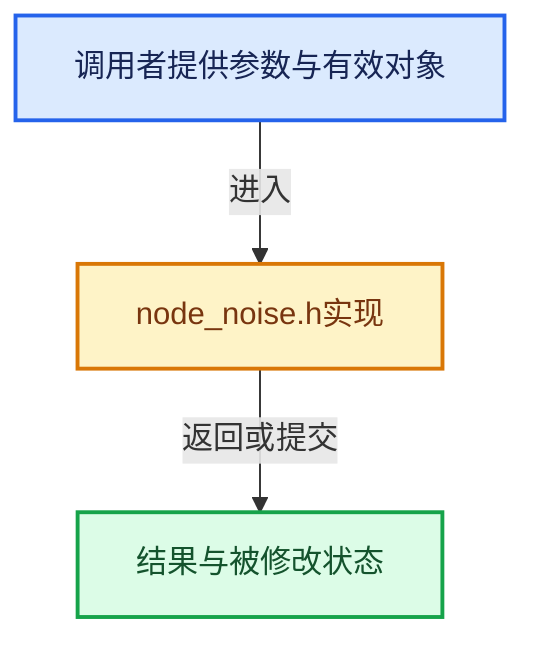

# 实现依赖专题：intern/cycles/kernel/osl/shaders/node_noise.h

[方向导航](README.md) · [符号索引](../%E7%AC%A6%E5%8F%B7%E4%BE%9D%E8%B5%96%E4%B8%8E%E5%AE%9E%E7%8E%B0%E7%B4%A2%E5%BC%95.md)

本专题从正文实际调用进入，集中保存共享实现。函数有稳定锚点，可从调用处直接跳到对应完整函数；递归与互相调用通过回链组织。

## 本文件的实现关系





<a id="m-944522861922"></a>

## 宏 `value`

<!-- annotated:7178bdc8bafe2d -->

```cpp
#define NOISE_MULTI_FRACTAL(T) \
  float noise_multi_fractal(T co, float detail, float roughness, float lacunarity) \
  { \
    T p = co; \
    float value = 1.0; \
    float pwr = 1.0; \
\
    for (int i = 0; i <= (int)detail; i++) { \
      value *= (pwr * safe_snoise(p) + 1.0); \
      pwr *= roughness; \
      p *= lacunarity; \
    } \
\
    float rmd = detail - floor(detail); \
    if (rmd != 0.0) { \
      value *= (rmd * pwr * safe_snoise(p) + 1.0); /* correct? */ \
    } \
\
    return value; \
  }

```

<details>
<summary>核对原始源码：intern/cycles/kernel/osl/shaders/node_noise.h · L137—L157</summary>

<!-- original:7178bdc8bafe2d:intern/cycles/kernel/osl/shaders/node_noise.h:137:157 -->

```cpp
#define NOISE_MULTI_FRACTAL(T) \
  float noise_multi_fractal(T co, float detail, float roughness, float lacunarity) \
  { \
    T p = co; \
    float value = 1.0; \
    float pwr = 1.0; \
\
    for (int i = 0; i <= (int)detail; i++) { \
      value *= (pwr * safe_snoise(p) + 1.0); \
      pwr *= roughness; \
      p *= lacunarity; \
    } \
\
    float rmd = detail - floor(detail); \
    if (rmd != 0.0) { \
      value *= (rmd * pwr * safe_snoise(p) + 1.0); /* correct? */ \
    } \
\
    return value; \
  }

```

</details>

宏在预处理阶段展开，参数替换、重复求值和条件编译应直接从该定义检查。与普通函数不同，宏不会自动提供参数类型检查；构建配置选择哪个定义需结合外围条件。

## 完整成员与函数实现
