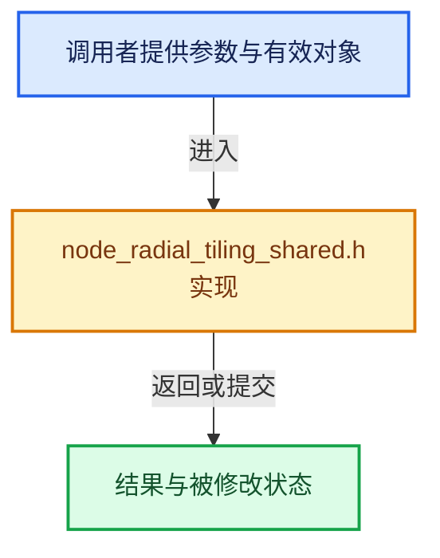

# 实现依赖专题：intern/cycles/kernel/osl/shaders/node_radial_tiling_shared.h

[方向导航](README.md) · [符号索引](../%E7%AC%A6%E5%8F%B7%E4%BE%9D%E8%B5%96%E4%B8%8E%E5%AE%9E%E7%8E%B0%E7%B4%A2%E5%BC%95.md)

本专题从正文实际调用进入，集中保存共享实现。函数有稳定锚点，可从调用处直接跳到对应完整函数；递归与互相调用通过回链组织。

## 本文件的实现关系





<a id="m-f6de2a0fc473"></a>

## 宏 `atanf`

<!-- annotated:036fb5bf6732f5 -->

```cpp
#  define atanf math::atan
#  define atan2f math::atan2
```

<details>
<summary>核对原始源码：intern/cycles/kernel/osl/shaders/node_radial_tiling_shared.h · L17—L18</summary>

<!-- original:036fb5bf6732f5:intern/cycles/kernel/osl/shaders/node_radial_tiling_shared.h:17:18 -->

```cpp
#  define atanf math::atan
#  define atan2f math::atan2
```

</details>

宏在预处理阶段展开，参数替换、重复求值和条件编译应直接从该定义检查。与普通函数不同，宏不会自动提供参数类型检查；构建配置选择哪个定义需结合外围条件。

<a id="m-ec4f8238af32"></a>

## 宏 `atan2f`

<!-- annotated:733134389ec065 -->

```cpp
#  define atan2f math::atan2
#  define ceilf math::ceil
```

<details>
<summary>核对原始源码：intern/cycles/kernel/osl/shaders/node_radial_tiling_shared.h · L18—L19</summary>

<!-- original:733134389ec065:intern/cycles/kernel/osl/shaders/node_radial_tiling_shared.h:18:19 -->

```cpp
#  define atan2f math::atan2
#  define ceilf math::ceil
```

</details>

宏在预处理阶段展开，参数替换、重复求值和条件编译应直接从该定义检查。与普通函数不同，宏不会自动提供参数类型检查；构建配置选择哪个定义需结合外围条件。

<a id="m-392d4a61825d"></a>

## 宏 `ceilf`

<!-- annotated:4844a60ce3e84d -->

```cpp
#  define ceilf math::ceil
#  define cosf math::cos
```

<details>
<summary>核对原始源码：intern/cycles/kernel/osl/shaders/node_radial_tiling_shared.h · L19—L20</summary>

<!-- original:4844a60ce3e84d:intern/cycles/kernel/osl/shaders/node_radial_tiling_shared.h:19:20 -->

```cpp
#  define ceilf math::ceil
#  define cosf math::cos
```

</details>

宏在预处理阶段展开，参数替换、重复求值和条件编译应直接从该定义检查。与普通函数不同，宏不会自动提供参数类型检查；构建配置选择哪个定义需结合外围条件。

<a id="m-4c6aea22a560"></a>

## 宏 `cosf`

<!-- annotated:aa26cd14ee2c32 -->

```cpp
#  define cosf math::cos
#  define fabsf math::abs
```

<details>
<summary>核对原始源码：intern/cycles/kernel/osl/shaders/node_radial_tiling_shared.h · L20—L21</summary>

<!-- original:aa26cd14ee2c32:intern/cycles/kernel/osl/shaders/node_radial_tiling_shared.h:20:21 -->

```cpp
#  define cosf math::cos
#  define fabsf math::abs
```

</details>

宏在预处理阶段展开，参数替换、重复求值和条件编译应直接从该定义检查。与普通函数不同，宏不会自动提供参数类型检查；构建配置选择哪个定义需结合外围条件。

<a id="m-7c3ee12fc119"></a>

## 宏 `fabsf`

<!-- annotated:2382fdbfe21830 -->

```cpp
#  define fabsf math::abs
#  define floorf math::floor
```

<details>
<summary>核对原始源码：intern/cycles/kernel/osl/shaders/node_radial_tiling_shared.h · L21—L22</summary>

<!-- original:2382fdbfe21830:intern/cycles/kernel/osl/shaders/node_radial_tiling_shared.h:21:22 -->

```cpp
#  define fabsf math::abs
#  define floorf math::floor
```

</details>

宏在预处理阶段展开，参数替换、重复求值和条件编译应直接从该定义检查。与普通函数不同，宏不会自动提供参数类型检查；构建配置选择哪个定义需结合外围条件。

<a id="m-6b2e29ad4b19"></a>

## 宏 `floorf`

<!-- annotated:d5cd9d3304aec3 -->

```cpp
#  define floorf math::floor
#  define fmaxf math::max
```

<details>
<summary>核对原始源码：intern/cycles/kernel/osl/shaders/node_radial_tiling_shared.h · L22—L23</summary>

<!-- original:d5cd9d3304aec3:intern/cycles/kernel/osl/shaders/node_radial_tiling_shared.h:22:23 -->

```cpp
#  define floorf math::floor
#  define fmaxf math::max
```

</details>

宏在预处理阶段展开，参数替换、重复求值和条件编译应直接从该定义检查。与普通函数不同，宏不会自动提供参数类型检查；构建配置选择哪个定义需结合外围条件。

<a id="m-448104a926e9"></a>

## 宏 `fractf`

<!-- annotated:a37caf0990d4c8 -->

```cpp
#  define fractf math::fract
#  define mix math::interpolate
```

<details>
<summary>核对原始源码：intern/cycles/kernel/osl/shaders/node_radial_tiling_shared.h · L25—L26</summary>

<!-- original:a37caf0990d4c8:intern/cycles/kernel/osl/shaders/node_radial_tiling_shared.h:25:26 -->

```cpp
#  define fractf math::fract
#  define mix math::interpolate
```

</details>

宏在预处理阶段展开，参数替换、重复求值和条件编译应直接从该定义检查。与普通函数不同，宏不会自动提供参数类型检查；构建配置选择哪个定义需结合外围条件。

<a id="m-9f80b4d363af"></a>

## 宏 `sinf`

<!-- annotated:70c77f1f1f0e49 -->

```cpp
#  define sinf math::sin
#  define sqrtf math::sqrt
```

<details>
<summary>核对原始源码：intern/cycles/kernel/osl/shaders/node_radial_tiling_shared.h · L27—L28</summary>

<!-- original:70c77f1f1f0e49:intern/cycles/kernel/osl/shaders/node_radial_tiling_shared.h:27:28 -->

```cpp
#  define sinf math::sin
#  define sqrtf math::sqrt
```

</details>

宏在预处理阶段展开，参数替换、重复求值和条件编译应直接从该定义检查。与普通函数不同，宏不会自动提供参数类型检查；构建配置选择哪个定义需结合外围条件。

<a id="m-d7bdd765eeff"></a>

## 宏 `tanf`

<!-- annotated:b7979fd8e09d24 -->

```cpp
#  define tanf math::tan

```

<details>
<summary>核对原始源码：intern/cycles/kernel/osl/shaders/node_radial_tiling_shared.h · L30—L31</summary>

<!-- original:b7979fd8e09d24:intern/cycles/kernel/osl/shaders/node_radial_tiling_shared.h:30:31 -->

```cpp
#  define tanf math::tan

```

</details>

宏在预处理阶段展开，参数替换、重复求值和条件编译应直接从该定义检查。与普通函数不同，宏不会自动提供参数类型检查；构建配置选择哪个定义需结合外围条件。

<a id="m-b7ee5082bb01"></a>

## 宏 `atanf`

<!-- annotated:282d1703d28834 -->

```cpp
#    define atanf atan
#    define atan2f atan2
```

<details>
<summary>核对原始源码：intern/cycles/kernel/osl/shaders/node_radial_tiling_shared.h · L39—L40</summary>

<!-- original:282d1703d28834:intern/cycles/kernel/osl/shaders/node_radial_tiling_shared.h:39:40 -->

```cpp
#    define atanf atan
#    define atan2f atan2
```

</details>

宏在预处理阶段展开，参数替换、重复求值和条件编译应直接从该定义检查。与普通函数不同，宏不会自动提供参数类型检查；构建配置选择哪个定义需结合外围条件。

<a id="m-980162d675e3"></a>

## 宏 `atan2f`

<!-- annotated:bb048e773b847f -->

```cpp
#    define atan2f atan2
#    define ceilf ceil
```

<details>
<summary>核对原始源码：intern/cycles/kernel/osl/shaders/node_radial_tiling_shared.h · L40—L41</summary>

<!-- original:bb048e773b847f:intern/cycles/kernel/osl/shaders/node_radial_tiling_shared.h:40:41 -->

```cpp
#    define atan2f atan2
#    define ceilf ceil
```

</details>

宏在预处理阶段展开，参数替换、重复求值和条件编译应直接从该定义检查。与普通函数不同，宏不会自动提供参数类型检查；构建配置选择哪个定义需结合外围条件。

<a id="m-6bc83db21146"></a>

## 宏 `ceilf`

<!-- annotated:a1f6ad701d83e2 -->

```cpp
#    define ceilf ceil
#    define cosf cos
```

<details>
<summary>核对原始源码：intern/cycles/kernel/osl/shaders/node_radial_tiling_shared.h · L41—L42</summary>

<!-- original:a1f6ad701d83e2:intern/cycles/kernel/osl/shaders/node_radial_tiling_shared.h:41:42 -->

```cpp
#    define ceilf ceil
#    define cosf cos
```

</details>

宏在预处理阶段展开，参数替换、重复求值和条件编译应直接从该定义检查。与普通函数不同，宏不会自动提供参数类型检查；构建配置选择哪个定义需结合外围条件。

<a id="m-1fd6a5414477"></a>

## 宏 `cosf`

<!-- annotated:0bb3d5a29cc35d -->

```cpp
#    define cosf cos
#    define fabsf abs
```

<details>
<summary>核对原始源码：intern/cycles/kernel/osl/shaders/node_radial_tiling_shared.h · L42—L43</summary>

<!-- original:0bb3d5a29cc35d:intern/cycles/kernel/osl/shaders/node_radial_tiling_shared.h:42:43 -->

```cpp
#    define cosf cos
#    define fabsf abs
```

</details>

宏在预处理阶段展开，参数替换、重复求值和条件编译应直接从该定义检查。与普通函数不同，宏不会自动提供参数类型检查；构建配置选择哪个定义需结合外围条件。

<a id="m-9112db0e2dd1"></a>

## 宏 `fabsf`

<!-- annotated:87716d1216fab1 -->

```cpp
#    define fabsf abs
#    define floorf floor
```

<details>
<summary>核对原始源码：intern/cycles/kernel/osl/shaders/node_radial_tiling_shared.h · L43—L44</summary>

<!-- original:87716d1216fab1:intern/cycles/kernel/osl/shaders/node_radial_tiling_shared.h:43:44 -->

```cpp
#    define fabsf abs
#    define floorf floor
```

</details>

宏在预处理阶段展开，参数替换、重复求值和条件编译应直接从该定义检查。与普通函数不同，宏不会自动提供参数类型检查；构建配置选择哪个定义需结合外围条件。

<a id="m-f90222d9b445"></a>

## 宏 `floorf`

<!-- annotated:27d687ec1ad9e6 -->

```cpp
#    define floorf floor
#    define fmaxf max
```

<details>
<summary>核对原始源码：intern/cycles/kernel/osl/shaders/node_radial_tiling_shared.h · L44—L45</summary>

<!-- original:27d687ec1ad9e6:intern/cycles/kernel/osl/shaders/node_radial_tiling_shared.h:44:45 -->

```cpp
#    define floorf floor
#    define fmaxf max
```

</details>

宏在预处理阶段展开，参数替换、重复求值和条件编译应直接从该定义检查。与普通函数不同，宏不会自动提供参数类型检查；构建配置选择哪个定义需结合外围条件。

<a id="m-b39f4be054ef"></a>

## 宏 `fractf`

<!-- annotated:b495340c2e48fd -->

```cpp
#    define fractf fract
#    define mix mix
```

<details>
<summary>核对原始源码：intern/cycles/kernel/osl/shaders/node_radial_tiling_shared.h · L47—L48</summary>

<!-- original:b495340c2e48fd:intern/cycles/kernel/osl/shaders/node_radial_tiling_shared.h:47:48 -->

```cpp
#    define fractf fract
#    define mix mix
```

</details>

宏在预处理阶段展开，参数替换、重复求值和条件编译应直接从该定义检查。与普通函数不同，宏不会自动提供参数类型检查；构建配置选择哪个定义需结合外围条件。

<a id="m-f52c29b37ed1"></a>

## 宏 `sinf`

<!-- annotated:47366d0883391c -->

```cpp
#    define sinf sin
#    define sqrtf sqrt
```

<details>
<summary>核对原始源码：intern/cycles/kernel/osl/shaders/node_radial_tiling_shared.h · L49—L50</summary>

<!-- original:47366d0883391c:intern/cycles/kernel/osl/shaders/node_radial_tiling_shared.h:49:50 -->

```cpp
#    define sinf sin
#    define sqrtf sqrt
```

</details>

宏在预处理阶段展开，参数替换、重复求值和条件编译应直接从该定义检查。与普通函数不同，宏不会自动提供参数类型检查；构建配置选择哪个定义需结合外围条件。

<a id="m-2b90b7f17f04"></a>

## 宏 `tanf`

<!-- annotated:7da41d81ac2b6c -->

```cpp
#    define tanf tan

```

<details>
<summary>核对原始源码：intern/cycles/kernel/osl/shaders/node_radial_tiling_shared.h · L52—L53</summary>

<!-- original:7da41d81ac2b6c:intern/cycles/kernel/osl/shaders/node_radial_tiling_shared.h:52:53 -->

```cpp
#    define tanf tan

```

</details>

宏在预处理阶段展开，参数替换、重复求值和条件编译应直接从该定义检查。与普通函数不同，宏不会自动提供参数类型检查；构建配置选择哪个定义需结合外围条件。

<a id="m-adb8e9e87775"></a>

## 宏 `float4`

<!-- annotated:74bc5674585114 -->

```cpp
#    define float4 vector4
#    define make_float2 vector2
```

<details>
<summary>核对原始源码：intern/cycles/kernel/osl/shaders/node_radial_tiling_shared.h · L56—L57</summary>

<!-- original:74bc5674585114:intern/cycles/kernel/osl/shaders/node_radial_tiling_shared.h:56:57 -->

```cpp
#    define float4 vector4
#    define make_float2 vector2
```

</details>

宏在预处理阶段展开，参数替换、重复求值和条件编译应直接从该定义检查。与普通函数不同，宏不会自动提供参数类型检查；构建配置选择哪个定义需结合外围条件。

<a id="m-ec33435831ce"></a>

## 宏 `atanf`

<!-- annotated:2a8b0a8abb466c -->

```cpp
#      define atanf atan
#      define atan2f atan2
```

<details>
<summary>核对原始源码：intern/cycles/kernel/osl/shaders/node_radial_tiling_shared.h · L70—L71</summary>

<!-- original:2a8b0a8abb466c:intern/cycles/kernel/osl/shaders/node_radial_tiling_shared.h:70:71 -->

```cpp
#      define atanf atan
#      define atan2f atan2
```

</details>

宏在预处理阶段展开，参数替换、重复求值和条件编译应直接从该定义检查。与普通函数不同，宏不会自动提供参数类型检查；构建配置选择哪个定义需结合外围条件。

<a id="m-bcd4c102a83d"></a>

## 宏 `atan2f`

<!-- annotated:a31ee743926836 -->

```cpp
#      define atan2f atan2
#      define ceilf ceil
```

<details>
<summary>核对原始源码：intern/cycles/kernel/osl/shaders/node_radial_tiling_shared.h · L71—L72</summary>

<!-- original:a31ee743926836:intern/cycles/kernel/osl/shaders/node_radial_tiling_shared.h:71:72 -->

```cpp
#      define atan2f atan2
#      define ceilf ceil
```

</details>

宏在预处理阶段展开，参数替换、重复求值和条件编译应直接从该定义检查。与普通函数不同，宏不会自动提供参数类型检查；构建配置选择哪个定义需结合外围条件。

<a id="m-3cb77b1f59b4"></a>

## 宏 `ceilf`

<!-- annotated:a50cc9f715b48f -->

```cpp
#      define ceilf ceil
#      define cosf cos
```

<details>
<summary>核对原始源码：intern/cycles/kernel/osl/shaders/node_radial_tiling_shared.h · L72—L73</summary>

<!-- original:a50cc9f715b48f:intern/cycles/kernel/osl/shaders/node_radial_tiling_shared.h:72:73 -->

```cpp
#      define ceilf ceil
#      define cosf cos
```

</details>

宏在预处理阶段展开，参数替换、重复求值和条件编译应直接从该定义检查。与普通函数不同，宏不会自动提供参数类型检查；构建配置选择哪个定义需结合外围条件。

<a id="m-de2402f85270"></a>

## 宏 `cosf`

<!-- annotated:89a12221ea821b -->

```cpp
#      define cosf cos
#      define fabsf abs
```

<details>
<summary>核对原始源码：intern/cycles/kernel/osl/shaders/node_radial_tiling_shared.h · L73—L74</summary>

<!-- original:89a12221ea821b:intern/cycles/kernel/osl/shaders/node_radial_tiling_shared.h:73:74 -->

```cpp
#      define cosf cos
#      define fabsf abs
```

</details>

宏在预处理阶段展开，参数替换、重复求值和条件编译应直接从该定义检查。与普通函数不同，宏不会自动提供参数类型检查；构建配置选择哪个定义需结合外围条件。

<a id="m-ee4e61908a6f"></a>

## 宏 `fabsf`

<!-- annotated:dbe1ec9c673662 -->

```cpp
#      define fabsf abs
#      define floorf floor
```

<details>
<summary>核对原始源码：intern/cycles/kernel/osl/shaders/node_radial_tiling_shared.h · L74—L75</summary>

<!-- original:dbe1ec9c673662:intern/cycles/kernel/osl/shaders/node_radial_tiling_shared.h:74:75 -->

```cpp
#      define fabsf abs
#      define floorf floor
```

</details>

宏在预处理阶段展开，参数替换、重复求值和条件编译应直接从该定义检查。与普通函数不同，宏不会自动提供参数类型检查；构建配置选择哪个定义需结合外围条件。

<a id="m-938380992bb5"></a>

## 宏 `floorf`

<!-- annotated:879e505c0e7ddc -->

```cpp
#      define floorf floor
#      define fmaxf max
```

<details>
<summary>核对原始源码：intern/cycles/kernel/osl/shaders/node_radial_tiling_shared.h · L75—L76</summary>

<!-- original:879e505c0e7ddc:intern/cycles/kernel/osl/shaders/node_radial_tiling_shared.h:75:76 -->

```cpp
#      define floorf floor
#      define fmaxf max
```

</details>

宏在预处理阶段展开，参数替换、重复求值和条件编译应直接从该定义检查。与普通函数不同，宏不会自动提供参数类型检查；构建配置选择哪个定义需结合外围条件。

<a id="m-b31f37f89233"></a>

## 宏 `fractf`

<!-- annotated:9b0a4f1c8c8b75 -->

```cpp
#      define fractf fract
#      define mix mix
```

<details>
<summary>核对原始源码：intern/cycles/kernel/osl/shaders/node_radial_tiling_shared.h · L78—L79</summary>

<!-- original:9b0a4f1c8c8b75:intern/cycles/kernel/osl/shaders/node_radial_tiling_shared.h:78:79 -->

```cpp
#      define fractf fract
#      define mix mix
```

</details>

宏在预处理阶段展开，参数替换、重复求值和条件编译应直接从该定义检查。与普通函数不同，宏不会自动提供参数类型检查；构建配置选择哪个定义需结合外围条件。

<a id="m-7f1f234ef9ec"></a>

## 宏 `sinf`

<!-- annotated:c9cd5aa85b6881 -->

```cpp
#      define sinf sin
#      define sqrtf sqrt
```

<details>
<summary>核对原始源码：intern/cycles/kernel/osl/shaders/node_radial_tiling_shared.h · L80—L81</summary>

<!-- original:c9cd5aa85b6881:intern/cycles/kernel/osl/shaders/node_radial_tiling_shared.h:80:81 -->

```cpp
#      define sinf sin
#      define sqrtf sqrt
```

</details>

宏在预处理阶段展开，参数替换、重复求值和条件编译应直接从该定义检查。与普通函数不同，宏不会自动提供参数类型检查；构建配置选择哪个定义需结合外围条件。

<a id="m-39bfd36efdd8"></a>

## 宏 `tanf`

<!-- annotated:f268c855f5e3ff -->

```cpp
#      define tanf tan

```

<details>
<summary>核对原始源码：intern/cycles/kernel/osl/shaders/node_radial_tiling_shared.h · L83—L84</summary>

<!-- original:f268c855f5e3ff:intern/cycles/kernel/osl/shaders/node_radial_tiling_shared.h:83:84 -->

```cpp
#      define tanf tan

```

</details>

宏在预处理阶段展开，参数替换、重复求值和条件编译应直接从该定义检查。与普通函数不同，宏不会自动提供参数类型检查；构建配置选择哪个定义需结合外围条件。

## 完整成员与函数实现
