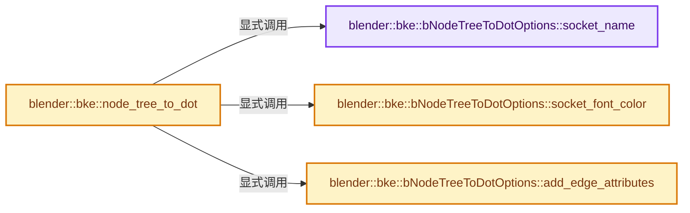
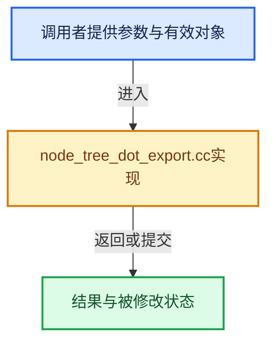

# 实现依赖专题：source/blender/blenkernel/intern/node_tree_dot_export.cc

[方向导航](README.md) · [符号索引](../%E7%AC%A6%E5%8F%B7%E4%BE%9D%E8%B5%96%E4%B8%8E%E5%AE%9E%E7%8E%B0%E7%B4%A2%E5%BC%95.md)

本专题从正文实际调用进入，集中保存共享实现。函数有稳定锚点，可从调用处直接跳到对应完整函数；递归与互相调用通过回链组织。

## 本文件的实现关系






## 完整成员与函数实现

<a id="f-5cf7e8a0c2599163"></a>

### `blender::bke::bNodeTreeToDotOptions::socket_name`

实现位置：[source/blender/blenkernel/intern/node_tree_dot_export.cc](../../../../../source/blender/blenkernel/intern/node_tree_dot_export.cc) · L16—L19。

接口参数：

- `const bNodeSocket &socket`

**教学注释版**

<!-- annotated:fdd5e0fbde70de -->

```cpp
std::string bNodeTreeToDotOptions::socket_name(const bNodeSocket &socket) const
{
  return socket.identifier;
}
```

<details>
<summary>核对原始源码：source/blender/blenkernel/intern/node_tree_dot_export.cc · L16—L19</summary>

<!-- original:fdd5e0fbde70de:source/blender/blenkernel/intern/node_tree_dot_export.cc:16:19 -->

```cpp
std::string bNodeTreeToDotOptions::socket_name(const bNodeSocket &socket) const
{
  return socket.identifier;
}
```

</details>

**结果出口**

- `return socket.identifier;`

**继续追踪实现**

本实现没有需要继续展开的显式调用；检查返回表达式、对象转换和调用者前置条件。

<a id="f-21d7b46c39475a7c"></a>

### `blender::bke::bNodeTreeToDotOptions::socket_font_color`

实现位置：[source/blender/blenkernel/intern/node_tree_dot_export.cc](../../../../../source/blender/blenkernel/intern/node_tree_dot_export.cc) · L21—L28。

接口参数：

- `const bNodeSocket &socket`

**教学注释版**

<!-- annotated:77eecb8d84a71e -->

```cpp
std::optional<std::string> bNodeTreeToDotOptions::socket_font_color(
    const bNodeSocket &socket) const
{
  if (!socket.is_available()) {
    return "#999999";
  }
  return std::nullopt;
}
```

<details>
<summary>核对原始源码：source/blender/blenkernel/intern/node_tree_dot_export.cc · L21—L28</summary>

<!-- original:77eecb8d84a71e:source/blender/blenkernel/intern/node_tree_dot_export.cc:21:28 -->

```cpp
std::optional<std::string> bNodeTreeToDotOptions::socket_font_color(
    const bNodeSocket &socket) const
{
  if (!socket.is_available()) {
    return "#999999";
  }
  return std::nullopt;
}
```

</details>

**结果出口**

- `return "#999999";`
- `return std::nullopt;`

**继续追踪实现**

- `socket.is_available` → [blender::bNodeSocket::is_available · L1041](%E4%BE%9D%E8%B5%96-BKE_node_runtime-ee561b.md#f-24ff02531a14ce08)。

<a id="f-be0442fabb80ec1a"></a>

### `blender::bke::bNodeTreeToDotOptions::add_edge_attributes`

实现位置：[source/blender/blenkernel/intern/node_tree_dot_export.cc](../../../../../source/blender/blenkernel/intern/node_tree_dot_export.cc) · L30—L36。

接口参数：

- `const bNodeLink &link`
- `dot_export::DirectedEdge &dot_edge`

**教学注释版**

<!-- annotated:9783530adebc93 -->

```cpp
void bNodeTreeToDotOptions::add_edge_attributes(const bNodeLink &link,
                                                dot_export::DirectedEdge &dot_edge) const
{
  if (!link.is_used()) {
    dot_edge.attributes.set("color", "#999999");
  }
}
```

<details>
<summary>核对原始源码：source/blender/blenkernel/intern/node_tree_dot_export.cc · L30—L36</summary>

<!-- original:9783530adebc93:source/blender/blenkernel/intern/node_tree_dot_export.cc:30:36 -->

```cpp
void bNodeTreeToDotOptions::add_edge_attributes(const bNodeLink &link,
                                                dot_export::DirectedEdge &dot_edge) const
{
  if (!link.is_used()) {
    dot_edge.attributes.set("color", "#999999");
  }
}
```

</details>

**继续追踪实现**

- `link.is_used` → [blender::bNodeLink::is_used · L985](%E4%BE%9D%E8%B5%96-BKE_node_runtime-ee561b.md#f-42aba29c790d7e12)。
- `dot_edge.attributes.set` → [调用协议](../%E6%A8%A1%E6%9D%BF%E5%AE%8F%E4%B8%8E%E5%8A%A8%E6%80%81%E5%88%86%E6%B4%BE%E5%8D%8F%E8%AE%AE.md)：接收对象类型依赖auto、返回值或模板实例；不按同名猜测目标。调用位置L34。

<a id="f-8401f91034252807"></a>

### `blender::bke::node_tree_to_dot`

实现位置：[source/blender/blenkernel/intern/node_tree_dot_export.cc](../../../../../source/blender/blenkernel/intern/node_tree_dot_export.cc) · L38—L76。

接口参数：

- `const bNodeTree &tree`
- `const bNodeTreeToDotOptions &options`

**教学注释版**

<!-- annotated:54a33e24722221 -->

```cpp
std::string node_tree_to_dot(const bNodeTree &tree, const bNodeTreeToDotOptions &options)
{
  namespace dot = dot_export;
  tree.ensure_topology_cache();

  dot_export::DirectedGraph digraph;
  digraph.set_rankdir(dot_export::Attr_rankdir::LeftToRight);

  Map<const bNode *, dot_export::NodeWithSocketsRef> dot_nodes;

  for (const bNode *node : tree.all_nodes()) {
    dot_export::Node &dot_node = digraph.new_node("");
    dot_export::NodeWithSockets dot_node_with_sockets;
    dot_node_with_sockets.node_name = node->label_or_name();
    for (const bNodeSocket *socket : node->input_sockets()) {
      dot_export::NodeWithSockets::Input &dot_input = dot_node_with_sockets.add_input(
          options.socket_name(*socket));
      dot_input.fontcolor = options.socket_font_color(*socket);
    }
    for (const bNodeSocket *socket : node->output_sockets()) {
      dot_export::NodeWithSockets::Output &dot_output = dot_node_with_sockets.add_output(
          options.socket_name(*socket));
      dot_output.fontcolor = options.socket_font_color(*socket);
    }
    // [讲解] dot_nodes.add_new：按哈希与相等关系加入键或键值。
    dot_nodes.add_new(node, dot_export::NodeWithSocketsRef(dot_node, dot_node_with_sockets));
  }

  for (const bNodeLink *link : tree.all_links()) {
    // [讲解] dot_nodes.lookup：按键查找对应项。
    const dot_export::NodeWithSocketsRef &from_dot_node = dot_nodes.lookup(link->fromnode);
    const dot_export::NodeWithSocketsRef &to_dot_node = dot_nodes.lookup(link->tonode);
    const dot_export::NodePort from_dot_port = from_dot_node.output(link->fromsock->index());
    const dot_export::NodePort to_dot_port = to_dot_node.input(link->tosock->index());

    dot_export::DirectedEdge &dot_edge = digraph.new_edge(from_dot_port, to_dot_port);
    options.add_edge_attributes(*link, dot_edge);
  }

  return digraph.to_dot_string();
}
```

<details>
<summary>核对原始源码：source/blender/blenkernel/intern/node_tree_dot_export.cc · L38—L76</summary>

<!-- original:54a33e24722221:source/blender/blenkernel/intern/node_tree_dot_export.cc:38:76 -->

```cpp
std::string node_tree_to_dot(const bNodeTree &tree, const bNodeTreeToDotOptions &options)
{
  namespace dot = dot_export;
  tree.ensure_topology_cache();

  dot_export::DirectedGraph digraph;
  digraph.set_rankdir(dot_export::Attr_rankdir::LeftToRight);

  Map<const bNode *, dot_export::NodeWithSocketsRef> dot_nodes;

  for (const bNode *node : tree.all_nodes()) {
    dot_export::Node &dot_node = digraph.new_node("");
    dot_export::NodeWithSockets dot_node_with_sockets;
    dot_node_with_sockets.node_name = node->label_or_name();
    for (const bNodeSocket *socket : node->input_sockets()) {
      dot_export::NodeWithSockets::Input &dot_input = dot_node_with_sockets.add_input(
          options.socket_name(*socket));
      dot_input.fontcolor = options.socket_font_color(*socket);
    }
    for (const bNodeSocket *socket : node->output_sockets()) {
      dot_export::NodeWithSockets::Output &dot_output = dot_node_with_sockets.add_output(
          options.socket_name(*socket));
      dot_output.fontcolor = options.socket_font_color(*socket);
    }
    dot_nodes.add_new(node, dot_export::NodeWithSocketsRef(dot_node, dot_node_with_sockets));
  }

  for (const bNodeLink *link : tree.all_links()) {
    const dot_export::NodeWithSocketsRef &from_dot_node = dot_nodes.lookup(link->fromnode);
    const dot_export::NodeWithSocketsRef &to_dot_node = dot_nodes.lookup(link->tonode);
    const dot_export::NodePort from_dot_port = from_dot_node.output(link->fromsock->index());
    const dot_export::NodePort to_dot_port = to_dot_node.input(link->tosock->index());

    dot_export::DirectedEdge &dot_edge = digraph.new_edge(from_dot_port, to_dot_port);
    options.add_edge_attributes(*link, dot_edge);
  }

  return digraph.to_dot_string();
}
```

</details>

**沿实际写入检查状态**

- `dot_node_with_sockets.node_name = node->label_or_name();`
- `dot_input.fontcolor = options.socket_font_color(*socket);`
- `dot_output.fontcolor = options.socket_font_color(*socket);`

**结果出口**

- `return digraph.to_dot_string();`

**继续追踪实现**

- `tree.ensure_topology_cache` → [blender::bNodeTree::ensure_topology_cache · L621](%E4%BE%9D%E8%B5%96-node_runtime-ee7c39.md#f-566e97bdf0367424)。
- `digraph.set_rankdir` → [blender::dot_export::Graph::set_rankdir · L66](../01-%E5%9F%BA%E7%A1%80%E5%AE%B9%E5%99%A8%E4%B8%8E%E7%8E%B0%E4%BB%A3CPP/%E4%BE%9D%E8%B5%96-BLI_dot_export-eb2f54.md#f-6a6a631a40d140f4)。
- `tree.all_nodes` → [blender::bNodeTree::all_nodes · L500](%E4%BE%9D%E8%B5%96-BKE_node_runtime-ee561b.md#f-cda455cbcc6c7f36)；[blender::bNodeTree::all_nodes · L505](%E4%BE%9D%E8%B5%96-BKE_node_runtime-ee561b.md#f-358b65e5678f8a32)。同名重载需按实参类型选择。
- `digraph.new_node` → [blender::dot_export::Graph::new_node · L21](../01-%E5%9F%BA%E7%A1%80%E5%AE%B9%E5%99%A8%E4%B8%8E%E7%8E%B0%E4%BB%A3CPP/%E4%BE%9D%E8%B5%96-dot_export-b6a26f.md#f-c18eecae7679bda3)。
- `node->label_or_name` → [调用协议](../%E6%A8%A1%E6%9D%BF%E5%AE%8F%E4%B8%8E%E5%8A%A8%E6%80%81%E5%88%86%E6%B4%BE%E5%8D%8F%E8%AE%AE.md)：接收对象类型依赖auto、返回值或模板实例；不按同名猜测目标。调用位置L51。
- `node->input_sockets` → [调用协议](../%E6%A8%A1%E6%9D%BF%E5%AE%8F%E4%B8%8E%E5%8A%A8%E6%80%81%E5%88%86%E6%B4%BE%E5%8D%8F%E8%AE%AE.md)：接收对象类型依赖auto、返回值或模板实例；不按同名猜测目标。调用位置L52。
- `dot_node_with_sockets.add_input` → [blender::dot_export::NodeWithSockets::add_input · L248](../01-%E5%9F%BA%E7%A1%80%E5%AE%B9%E5%99%A8%E4%B8%8E%E7%8E%B0%E4%BB%A3CPP/%E4%BE%9D%E8%B5%96-BLI_dot_export-eb2f54.md#f-7f7e4c71eb25b482)。
- `options.socket_name` → [blender::bke::bNodeTreeToDotOptions::socket_name · L16](%E4%BE%9D%E8%B5%96-node_tree_dot_export-8e10d4.md#f-5cf7e8a0c2599163)。
- `options.socket_font_color` → [blender::bke::bNodeTreeToDotOptions::socket_font_color · L21](%E4%BE%9D%E8%B5%96-node_tree_dot_export-8e10d4.md#f-21d7b46c39475a7c)。
- `node->output_sockets` → [调用协议](../%E6%A8%A1%E6%9D%BF%E5%AE%8F%E4%B8%8E%E5%8A%A8%E6%80%81%E5%88%86%E6%B4%BE%E5%8D%8F%E8%AE%AE.md)：接收对象类型依赖auto、返回值或模板实例；不按同名猜测目标。调用位置L57。
- `dot_node_with_sockets.add_output` → [blender::dot_export::NodeWithSockets::add_output · L256](../01-%E5%9F%BA%E7%A1%80%E5%AE%B9%E5%99%A8%E4%B8%8E%E7%8E%B0%E4%BB%A3CPP/%E4%BE%9D%E8%B5%96-BLI_dot_export-eb2f54.md#f-570a373a999226d4)。
- `dot_nodes.add_new` → [blender::Map::add_new · L265](../02-%E5%93%88%E5%B8%8C%E8%A1%A8%E4%B8%8E%E5%85%B3%E8%81%94%E6%95%B0%E6%8D%AE%E7%BB%93%E6%9E%84/02-Map%E6%80%BB%E4%BD%93%E5%B8%83%E5%B1%80.md#f-521ff0865e8229d0)；[blender::Map::add_new · L269](../02-%E5%93%88%E5%B8%8C%E8%A1%A8%E4%B8%8E%E5%85%B3%E8%81%94%E6%95%B0%E6%8D%AE%E7%BB%93%E6%9E%84/02-Map%E6%80%BB%E4%BD%93%E5%B8%83%E5%B1%80.md#f-d89cee0e3d2848a0)；[blender::Map::add_new · L273](../02-%E5%93%88%E5%B8%8C%E8%A1%A8%E4%B8%8E%E5%85%B3%E8%81%94%E6%95%B0%E6%8D%AE%E7%BB%93%E6%9E%84/02-Map%E6%80%BB%E4%BD%93%E5%B8%83%E5%B1%80.md#f-c13142c32e703ebd)；[blender::Map::add_new · L277](../02-%E5%93%88%E5%B8%8C%E8%A1%A8%E4%B8%8E%E5%85%B3%E8%81%94%E6%95%B0%E6%8D%AE%E7%BB%93%E6%9E%84/04-Map%E6%9F%A5%E6%89%BE%E4%B8%8E%E9%94%AE%E8%AE%BF%E9%97%AE.md#f-da1e537f229db040)。同名重载需按实参类型选择。
- `dot_export::NodeWithSocketsRef` → [blender::dot_export::NodeWithSocketsRef::NodeWithSocketsRef · L274](../01-%E5%9F%BA%E7%A1%80%E5%AE%B9%E5%99%A8%E4%B8%8E%E7%8E%B0%E4%BB%A3CPP/%E4%BE%9D%E8%B5%96-dot_export-b6a26f.md#f-5746aba93e095c9b)。
- `tree.all_links` → [blender::bNodeTree::all_links · L648](%E4%BE%9D%E8%B5%96-BKE_node_runtime-ee561b.md#f-cfcf7bf984de76d5)；[blender::bNodeTree::all_links · L654](%E4%BE%9D%E8%B5%96-BKE_node_runtime-ee561b.md#f-ef41559be796ba97)。同名重载需按实参类型选择。
- `dot_nodes.lookup` → [blender::Map::lookup · L545](../02-%E5%93%88%E5%B8%8C%E8%A1%A8%E4%B8%8E%E5%85%B3%E8%81%94%E6%95%B0%E6%8D%AE%E7%BB%93%E6%9E%84/04-Map%E6%9F%A5%E6%89%BE%E4%B8%8E%E9%94%AE%E8%AE%BF%E9%97%AE.md#f-f25ef95f1454656d)；[blender::Map::lookup · L549](../02-%E5%93%88%E5%B8%8C%E8%A1%A8%E4%B8%8E%E5%85%B3%E8%81%94%E6%95%B0%E6%8D%AE%E7%BB%93%E6%9E%84/04-Map%E6%9F%A5%E6%89%BE%E4%B8%8E%E9%94%AE%E8%AE%BF%E9%97%AE.md#f-742f9454fa7ea4b9)。同名重载需按实参类型选择。
- `from_dot_node.output` → [blender::dot_export::NodeWithSocketsRef::output · L283](../01-%E5%9F%BA%E7%A1%80%E5%AE%B9%E5%99%A8%E4%B8%8E%E7%8E%B0%E4%BB%A3CPP/%E4%BE%9D%E8%B5%96-BLI_dot_export-eb2f54.md#f-d5f4f4ee0c054131)。
- `link->fromsock->index` → [调用协议](../%E6%A8%A1%E6%9D%BF%E5%AE%8F%E4%B8%8E%E5%8A%A8%E6%80%81%E5%88%86%E6%B4%BE%E5%8D%8F%E8%AE%AE.md)：接收对象类型依赖auto、返回值或模板实例；不按同名猜测目标。调用位置L68。
- `to_dot_node.input` → [blender::dot_export::NodeWithSocketsRef::input · L277](../01-%E5%9F%BA%E7%A1%80%E5%AE%B9%E5%99%A8%E4%B8%8E%E7%8E%B0%E4%BB%A3CPP/%E4%BE%9D%E8%B5%96-BLI_dot_export-eb2f54.md#f-3cf69014c53b1d21)。
- `link->tosock->index` → [调用协议](../%E6%A8%A1%E6%9D%BF%E5%AE%8F%E4%B8%8E%E5%8A%A8%E6%80%81%E5%88%86%E6%B4%BE%E5%8D%8F%E8%AE%AE.md)：接收对象类型依赖auto、返回值或模板实例；不按同名猜测目标。调用位置L69。
- `digraph.new_edge` → [blender::dot_export::DirectedGraph::new_edge · L46](../01-%E5%9F%BA%E7%A1%80%E5%AE%B9%E5%99%A8%E4%B8%8E%E7%8E%B0%E4%BB%A3CPP/%E4%BE%9D%E8%B5%96-dot_export-b6a26f.md#f-b81e911705f8c06e)。
- `options.add_edge_attributes` → [blender::bke::bNodeTreeToDotOptions::add_edge_attributes · L30](%E4%BE%9D%E8%B5%96-node_tree_dot_export-8e10d4.md#f-be0442fabb80ec1a)。
- `digraph.to_dot_string` → [blender::dot_export::DirectedGraph::to_dot_string · L136](../01-%E5%9F%BA%E7%A1%80%E5%AE%B9%E5%99%A8%E4%B8%8E%E7%8E%B0%E4%BB%A3CPP/%E4%BE%9D%E8%B5%96-dot_export-b6a26f.md#f-e1fb2394550cdd6f)。
