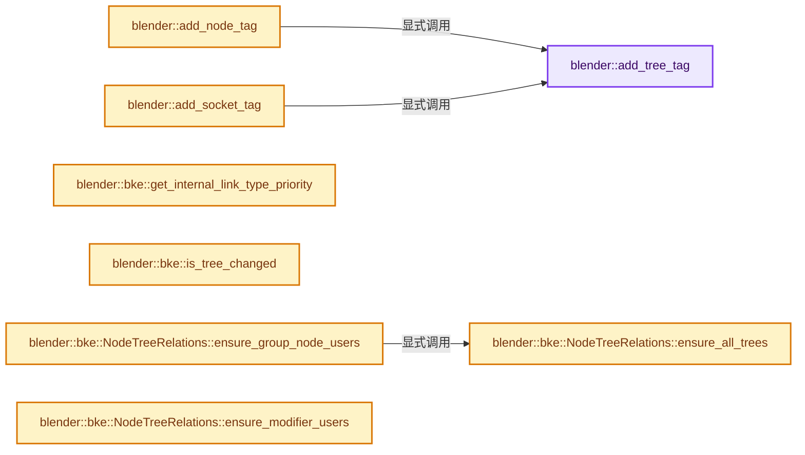

# 实现依赖专题：source/blender/blenkernel/intern/node_tree_update.cc

[方向导航](README.md) · [符号索引](../%E7%AC%A6%E5%8F%B7%E4%BE%9D%E8%B5%96%E4%B8%8E%E5%AE%9E%E7%8E%B0%E7%B4%A2%E5%BC%95.md)

本专题从正文实际调用进入，集中保存共享实现。函数有稳定锚点，可从调用处直接跳到对应完整函数；递归与互相调用通过回链组织。

## 本文件的实现关系




## 相关类型布局与成员入口

<a id="t-df0f0124424e"></a>

### `blender::bke::ShaderNodeAncestorFlags`

原始声明：[source/blender/blenkernel/intern/node_tree_update.cc](../../../../../source/blender/blenkernel/intern/node_tree_update.cc) · L411—L417。

以下保留类的数据声明与编译条件，成员函数实现通过后面的精确链接阅读。

<!-- annotated:e2d9956c1d78cc -->

```cpp
enum class ShaderNodeAncestorFlags {
  None = 0u,
  ShaderMaterialOutput = 1u << 0,
  ShaderToRGB = 1u << 1,
  LightAccumulation = 1u << 2,
  LightAccumulationColor = 1u << 3,
};
```

<details>
<summary>核对原始源码：source/blender/blenkernel/intern/node_tree_update.cc · L411—L417</summary>

<!-- original:e2d9956c1d78cc:source/blender/blenkernel/intern/node_tree_update.cc:411:417 -->

```cpp
enum class ShaderNodeAncestorFlags {
  None = 0u,
  ShaderMaterialOutput = 1u << 0,
  ShaderToRGB = 1u << 1,
  LightAccumulation = 1u << 2,
  LightAccumulationColor = 1u << 3,
};
```

</details>


## 完整成员与函数实现

<a id="f-212a1adb848a7e1b"></a>

### `blender::add_tree_tag`

实现位置：[source/blender/blenkernel/intern/node_tree_update.cc](../../../../../source/blender/blenkernel/intern/node_tree_update.cc) · L93—L99。

接口参数：

- `bNodeTree *ntree`
- `const eNodeTreeChangedFlag flag`

**教学注释版**

<!-- annotated:a1f853149d124c -->

```cpp
static void add_tree_tag(bNodeTree *ntree, const eNodeTreeChangedFlag flag)
{
  ntree->runtime->changed_flag |= flag;
  ntree->runtime->topology_cache_mutex.tag_dirty();
  ntree->runtime->tree_zones_cache_mutex.tag_dirty();
  ntree->runtime->inferenced_input_socket_usage_mutex.tag_dirty();
}
```

<details>
<summary>核对原始源码：source/blender/blenkernel/intern/node_tree_update.cc · L93—L99</summary>

<!-- original:a1f853149d124c:source/blender/blenkernel/intern/node_tree_update.cc:93:99 -->

```cpp
static void add_tree_tag(bNodeTree *ntree, const eNodeTreeChangedFlag flag)
{
  ntree->runtime->changed_flag |= flag;
  ntree->runtime->topology_cache_mutex.tag_dirty();
  ntree->runtime->tree_zones_cache_mutex.tag_dirty();
  ntree->runtime->inferenced_input_socket_usage_mutex.tag_dirty();
}
```

</details>

**沿实际写入检查状态**

- `ntree->runtime->changed_flag |= flag;`

**继续追踪实现**

- `ntree->runtime->topology_cache_mutex.tag_dirty` → [调用协议](../%E6%A8%A1%E6%9D%BF%E5%AE%8F%E4%B8%8E%E5%8A%A8%E6%80%81%E5%88%86%E6%B4%BE%E5%8D%8F%E8%AE%AE.md)：接收对象类型依赖auto、返回值或模板实例；不按同名猜测目标。调用位置L96。
- `ntree->runtime->tree_zones_cache_mutex.tag_dirty` → [调用协议](../%E6%A8%A1%E6%9D%BF%E5%AE%8F%E4%B8%8E%E5%8A%A8%E6%80%81%E5%88%86%E6%B4%BE%E5%8D%8F%E8%AE%AE.md)：接收对象类型依赖auto、返回值或模板实例；不按同名猜测目标。调用位置L97。
- `ntree->runtime->inferenced_input_socket_usage_mutex.tag_dirty` → [调用协议](../%E6%A8%A1%E6%9D%BF%E5%AE%8F%E4%B8%8E%E5%8A%A8%E6%80%81%E5%88%86%E6%B4%BE%E5%8D%8F%E8%AE%AE.md)：接收对象类型依赖auto、返回值或模板实例；不按同名猜测目标。调用位置L98。

<a id="f-2f16f7d2300c0fcd"></a>

### `blender::add_node_tag`

实现位置：[source/blender/blenkernel/intern/node_tree_update.cc](../../../../../source/blender/blenkernel/intern/node_tree_update.cc) · L101—L105。

接口参数：

- `bNodeTree *ntree`
- `bNode *node`
- `const eNodeTreeChangedFlag flag`

**教学注释版**

<!-- annotated:385d4ed1c4ba16 -->

```cpp
static void add_node_tag(bNodeTree *ntree, bNode *node, const eNodeTreeChangedFlag flag)
{
  add_tree_tag(ntree, flag);
  node->runtime->changed_flag |= flag;
}
```

<details>
<summary>核对原始源码：source/blender/blenkernel/intern/node_tree_update.cc · L101—L105</summary>

<!-- original:385d4ed1c4ba16:source/blender/blenkernel/intern/node_tree_update.cc:101:105 -->

```cpp
static void add_node_tag(bNodeTree *ntree, bNode *node, const eNodeTreeChangedFlag flag)
{
  add_tree_tag(ntree, flag);
  node->runtime->changed_flag |= flag;
}
```

</details>

**沿实际写入检查状态**

- `node->runtime->changed_flag |= flag;`

**继续追踪实现**

- `add_tree_tag` → [blender::add_tree_tag · L93](%E4%BE%9D%E8%B5%96-node_tree_update-60230f.md#f-212a1adb848a7e1b)。

<a id="f-09b76b3394805d6a"></a>

### `blender::add_socket_tag`

实现位置：[source/blender/blenkernel/intern/node_tree_update.cc](../../../../../source/blender/blenkernel/intern/node_tree_update.cc) · L107—L111。

接口参数：

- `bNodeTree *ntree`
- `bNodeSocket *socket`
- `const eNodeTreeChangedFlag flag`

**教学注释版**

<!-- annotated:49d41f09cf9848 -->

```cpp
static void add_socket_tag(bNodeTree *ntree, bNodeSocket *socket, const eNodeTreeChangedFlag flag)
{
  add_tree_tag(ntree, flag);
  socket->runtime->changed_flag |= flag;
}
```

<details>
<summary>核对原始源码：source/blender/blenkernel/intern/node_tree_update.cc · L107—L111</summary>

<!-- original:49d41f09cf9848:source/blender/blenkernel/intern/node_tree_update.cc:107:111 -->

```cpp
static void add_socket_tag(bNodeTree *ntree, bNodeSocket *socket, const eNodeTreeChangedFlag flag)
{
  add_tree_tag(ntree, flag);
  socket->runtime->changed_flag |= flag;
}
```

</details>

**沿实际写入检查状态**

- `socket->runtime->changed_flag |= flag;`

**继续追踪实现**

- `add_tree_tag` → [blender::add_tree_tag · L93](%E4%BE%9D%E8%B5%96-node_tree_update-60230f.md#f-212a1adb848a7e1b)。

<a id="f-dc5f664983bcb997"></a>

### `blender::bke::get_internal_link_type_priority`

实现位置：[source/blender/blenkernel/intern/node_tree_update.cc](../../../../../source/blender/blenkernel/intern/node_tree_update.cc) · L121—L217。

接口参数：

- `const bNodeSocketType *from`
- `const bNodeSocketType *to`

**教学注释版**

<!-- annotated:5c9e11ebc8b12d -->

```cpp
static int get_internal_link_type_priority(const bNodeSocketType *from, const bNodeSocketType *to)
{
  switch (to->type) {
    case SOCK_RGBA:
      switch (from->type) {
        case SOCK_RGBA:
          return 4;
        case SOCK_FLOAT:
          return 3;
        case SOCK_INT:
          return 2;
        case SOCK_BOOLEAN:
          return 1;
        default:
          return -1;
      }
    case SOCK_VECTOR:
      switch (from->type) {
        case SOCK_VECTOR:
          return 4;
        case SOCK_FLOAT:
          return 3;
        case SOCK_INT:
          return 2;
        case SOCK_BOOLEAN:
          return 1;
        default:
          return -1;
      }
    case SOCK_FLOAT:
      switch (from->type) {
        case SOCK_FLOAT:
          return 5;
        case SOCK_INT:
          return 4;
        case SOCK_BOOLEAN:
          return 3;
        case SOCK_RGBA:
          return 2;
        case SOCK_VECTOR:
          return 1;
        default:
          return -1;
      }
    case SOCK_INT:
      switch (from->type) {
        case SOCK_INT:
          return 5;
        case SOCK_FLOAT:
          return 4;
        case SOCK_BOOLEAN:
          return 3;
        case SOCK_RGBA:
          return 2;
        case SOCK_VECTOR:
          return 1;
        default:
          return -1;
      }
    case SOCK_BOOLEAN:
      switch (from->type) {
        case SOCK_BOOLEAN:
          return 5;
        case SOCK_INT:
          return 4;
        case SOCK_FLOAT:
          return 3;
        case SOCK_RGBA:
          return 2;
        case SOCK_VECTOR:
          return 1;
        default:
          return -1;
      }
    case SOCK_ROTATION:
      switch (from->type) {
        case SOCK_ROTATION:
          return 3;
        case SOCK_VECTOR:
          return 2;
        case SOCK_FLOAT:
          return 1;
        default:
          return -1;
      }
    default:
      break;
  }

  /* The rest of the socket types only allow an internal link if both the input and output socket
   * have the same type. If the sockets are custom, we check the idname instead. */
  if (to->type == from->type && (to->type != SOCK_CUSTOM || to->idname == from->idname)) {
    return 1;
  }

  return -1;
}
```

<details>
<summary>核对原始源码：source/blender/blenkernel/intern/node_tree_update.cc · L121—L217</summary>

<!-- original:5c9e11ebc8b12d:source/blender/blenkernel/intern/node_tree_update.cc:121:217 -->

```cpp
static int get_internal_link_type_priority(const bNodeSocketType *from, const bNodeSocketType *to)
{
  switch (to->type) {
    case SOCK_RGBA:
      switch (from->type) {
        case SOCK_RGBA:
          return 4;
        case SOCK_FLOAT:
          return 3;
        case SOCK_INT:
          return 2;
        case SOCK_BOOLEAN:
          return 1;
        default:
          return -1;
      }
    case SOCK_VECTOR:
      switch (from->type) {
        case SOCK_VECTOR:
          return 4;
        case SOCK_FLOAT:
          return 3;
        case SOCK_INT:
          return 2;
        case SOCK_BOOLEAN:
          return 1;
        default:
          return -1;
      }
    case SOCK_FLOAT:
      switch (from->type) {
        case SOCK_FLOAT:
          return 5;
        case SOCK_INT:
          return 4;
        case SOCK_BOOLEAN:
          return 3;
        case SOCK_RGBA:
          return 2;
        case SOCK_VECTOR:
          return 1;
        default:
          return -1;
      }
    case SOCK_INT:
      switch (from->type) {
        case SOCK_INT:
          return 5;
        case SOCK_FLOAT:
          return 4;
        case SOCK_BOOLEAN:
          return 3;
        case SOCK_RGBA:
          return 2;
        case SOCK_VECTOR:
          return 1;
        default:
          return -1;
      }
    case SOCK_BOOLEAN:
      switch (from->type) {
        case SOCK_BOOLEAN:
          return 5;
        case SOCK_INT:
          return 4;
        case SOCK_FLOAT:
          return 3;
        case SOCK_RGBA:
          return 2;
        case SOCK_VECTOR:
          return 1;
        default:
          return -1;
      }
    case SOCK_ROTATION:
      switch (from->type) {
        case SOCK_ROTATION:
          return 3;
        case SOCK_VECTOR:
          return 2;
        case SOCK_FLOAT:
          return 1;
        default:
          return -1;
      }
    default:
      break;
  }

  /* The rest of the socket types only allow an internal link if both the input and output socket
   * have the same type. If the sockets are custom, we check the idname instead. */
  if (to->type == from->type && (to->type != SOCK_CUSTOM || to->idname == from->idname)) {
    return 1;
  }

  return -1;
}
```

</details>

**结果出口**

- `return 4;`
- `return 3;`
- `return 2;`
- `return 1;`
- `return -1;`
- `return 5;`

**继续追踪实现**

本实现没有需要继续展开的显式调用；检查返回表达式、对象转换和调用者前置条件。

<a id="f-abcdc2c7c4e3f718"></a>

### `blender::bke::is_tree_changed`

实现位置：[source/blender/blenkernel/intern/node_tree_update.cc](../../../../../source/blender/blenkernel/intern/node_tree_update.cc) · L220—L224。

接口参数：

- `const bNodeTree &tree`

**教学注释版**

<!-- annotated:5cd9e9c541a75c -->

```cpp
static bool is_tree_changed(const bNodeTree &tree)
{
  return tree.runtime->changed_flag != NTREE_CHANGED_NOTHING ||
         tree.tree_interface.requires_dependent_tree_updates();
}
```

<details>
<summary>核对原始源码：source/blender/blenkernel/intern/node_tree_update.cc · L220—L224</summary>

<!-- original:5cd9e9c541a75c:source/blender/blenkernel/intern/node_tree_update.cc:220:224 -->

```cpp
static bool is_tree_changed(const bNodeTree &tree)
{
  return tree.runtime->changed_flag != NTREE_CHANGED_NOTHING ||
         tree.tree_interface.requires_dependent_tree_updates();
}
```

</details>

**结果出口**

- `return tree.runtime->changed_flag != NTREE_CHANGED_NOTHING ||`

**继续追踪实现**

- `tree.tree_interface.requires_dependent_tree_updates` → [调用协议](../%E6%A8%A1%E6%9D%BF%E5%AE%8F%E4%B8%8E%E5%8A%A8%E6%80%81%E5%88%86%E6%B4%BE%E5%8D%8F%E8%AE%AE.md)：接收对象类型依赖auto、返回值或模板实例；不按同名猜测目标。调用位置L223。

<a id="f-75bc1eb969c4c9d6"></a>

### `blender::bke::NodeTreeRelations::ensure_all_trees`

实现位置：[source/blender/blenkernel/intern/node_tree_update.cc](../../../../../source/blender/blenkernel/intern/node_tree_update.cc) · L251—L265。

**教学注释版**

<!-- annotated:d37d1183c8e493 -->

```cpp
  void ensure_all_trees()
  {
    if (all_trees_.has_value()) {
      return;
    }
    all_trees_.emplace();
    if (bmain_ == nullptr) {
      return;
    }

    FOREACH_NODETREE_BEGIN (bmain_, ntree, id) {
      all_trees_->append(ntree);
    }
    FOREACH_NODETREE_END;
  }
```

<details>
<summary>核对原始源码：source/blender/blenkernel/intern/node_tree_update.cc · L251—L265</summary>

<!-- original:d37d1183c8e493:source/blender/blenkernel/intern/node_tree_update.cc:251:265 -->

```cpp
  void ensure_all_trees()
  {
    if (all_trees_.has_value()) {
      return;
    }
    all_trees_.emplace();
    if (bmain_ == nullptr) {
      return;
    }

    FOREACH_NODETREE_BEGIN (bmain_, ntree, id) {
      all_trees_->append(ntree);
    }
    FOREACH_NODETREE_END;
  }
```

</details>

**继续追踪实现**

- `all_trees_.has_value` → [外部契约](https://eel.is/c++draft/)：这个边界按实际表达式及所属类型核对参数、返回值、寿命与失败行为。这里提供接口入口，不声称已解释该第三方版本的内部实现。
- `all_trees_.emplace` → [外部契约](https://eel.is/c++draft/)：这个边界按实际表达式及所属类型核对参数、返回值、寿命与失败行为。这里提供接口入口，不声称已解释该第三方版本的内部实现。
- `all_trees_->append` → [外部契约](https://eel.is/c++draft/)：这个边界按实际表达式及所属类型核对参数、返回值、寿命与失败行为。这里提供接口入口，不声称已解释该第三方版本的内部实现。

<a id="f-fb38857333205979"></a>

### `blender::bke::NodeTreeRelations::ensure_group_node_users`

实现位置：[source/blender/blenkernel/intern/node_tree_update.cc](../../../../../source/blender/blenkernel/intern/node_tree_update.cc) · L267—L291。

**教学注释版**

<!-- annotated:535c1df299f274 -->

```cpp
  void ensure_group_node_users()
  {
    if (group_node_users_.has_value()) {
      return;
    }
    group_node_users_.emplace();
    if (bmain_ == nullptr) {
      return;
    }

    this->ensure_all_trees();

    for (bNodeTree *ntree : *all_trees_) {
      for (bNode *node : ntree->all_nodes()) {
        if (node->id == nullptr) {
          continue;
        }
        ID *id = node->id;
        if (GS(id->name) == ID_NT) {
          bNodeTree *group = id_cast<bNodeTree *>(id);
          group_node_users_->add(group, {ntree, node});
        }
      }
    }
  }
```

<details>
<summary>核对原始源码：source/blender/blenkernel/intern/node_tree_update.cc · L267—L291</summary>

<!-- original:535c1df299f274:source/blender/blenkernel/intern/node_tree_update.cc:267:291 -->

```cpp
  void ensure_group_node_users()
  {
    if (group_node_users_.has_value()) {
      return;
    }
    group_node_users_.emplace();
    if (bmain_ == nullptr) {
      return;
    }

    this->ensure_all_trees();

    for (bNodeTree *ntree : *all_trees_) {
      for (bNode *node : ntree->all_nodes()) {
        if (node->id == nullptr) {
          continue;
        }
        ID *id = node->id;
        if (GS(id->name) == ID_NT) {
          bNodeTree *group = id_cast<bNodeTree *>(id);
          group_node_users_->add(group, {ntree, node});
        }
      }
    }
  }
```

</details>

**继续追踪实现**

- `group_node_users_.has_value` → [外部契约](https://eel.is/c++draft/)：这个边界按实际表达式及所属类型核对参数、返回值、寿命与失败行为。这里提供接口入口，不声称已解释该第三方版本的内部实现。
- `group_node_users_.emplace` → [外部契约](https://eel.is/c++draft/)：这个边界按实际表达式及所属类型核对参数、返回值、寿命与失败行为。这里提供接口入口，不声称已解释该第三方版本的内部实现。
- `this->ensure_all_trees` → [blender::bke::NodeTreeRelations::ensure_all_trees · L251](%E4%BE%9D%E8%B5%96-node_tree_update-60230f.md#f-75bc1eb969c4c9d6)。
- `ntree->all_nodes` → [调用协议](../%E6%A8%A1%E6%9D%BF%E5%AE%8F%E4%B8%8E%E5%8A%A8%E6%80%81%E5%88%86%E6%B4%BE%E5%8D%8F%E8%AE%AE.md)：接收对象类型依赖auto、返回值或模板实例；不按同名猜测目标。调用位置L280。
- `GS` → [blender::GS · L410](%E4%BE%9D%E8%B5%96-DNA_ID-3eb091.md#f-c3ff509f79f21b05)。
- `id_cast<bNodeTree *>` → [blender::id_cast · L1417](%E4%BE%9D%E8%B5%96-DNA_ID-3eb091.md#f-6c8ac6412850ac5a)。
- `group_node_users_->add` → [外部契约](https://eel.is/c++draft/)：这个边界按实际表达式及所属类型核对参数、返回值、寿命与失败行为。这里提供接口入口，不声称已解释该第三方版本的内部实现。

<a id="f-51a1ad0ded1cc115"></a>

### `blender::bke::NodeTreeRelations::ensure_modifier_users`

实现位置：[source/blender/blenkernel/intern/node_tree_update.cc](../../../../../source/blender/blenkernel/intern/node_tree_update.cc) · L293—L313。

**教学注释版**

<!-- annotated:9a17ce96c3a98e -->

```cpp
  void ensure_modifier_users()
  {
    if (modifiers_users_.has_value()) {
      return;
    }
    modifiers_users_.emplace();
    if (bmain_ == nullptr) {
      return;
    }

    for (Object &object : bmain_->objects) {
      for (ModifierData &md : object.modifiers) {
        if (md.type == eModifierType_Nodes) {
          NodesModifierData *nmd = reinterpret_cast<NodesModifierData *>(&md);
          if (nmd->node_group && !ID_MISSING(nmd->node_group)) {
            modifiers_users_->add(nmd->node_group, {&object, &md});
          }
        }
      }
    }
  }
```

<details>
<summary>核对原始源码：source/blender/blenkernel/intern/node_tree_update.cc · L293—L313</summary>

<!-- original:9a17ce96c3a98e:source/blender/blenkernel/intern/node_tree_update.cc:293:313 -->

```cpp
  void ensure_modifier_users()
  {
    if (modifiers_users_.has_value()) {
      return;
    }
    modifiers_users_.emplace();
    if (bmain_ == nullptr) {
      return;
    }

    for (Object &object : bmain_->objects) {
      for (ModifierData &md : object.modifiers) {
        if (md.type == eModifierType_Nodes) {
          NodesModifierData *nmd = reinterpret_cast<NodesModifierData *>(&md);
          if (nmd->node_group && !ID_MISSING(nmd->node_group)) {
            modifiers_users_->add(nmd->node_group, {&object, &md});
          }
        }
      }
    }
  }
```

</details>

**继续追踪实现**

- `modifiers_users_.has_value` → [外部契约](https://eel.is/c++draft/)：这个边界按实际表达式及所属类型核对参数、返回值、寿命与失败行为。这里提供接口入口，不声称已解释该第三方版本的内部实现。
- `modifiers_users_.emplace` → [外部契约](https://eel.is/c++draft/)：这个边界按实际表达式及所属类型核对参数、返回值、寿命与失败行为。这里提供接口入口，不声称已解释该第三方版本的内部实现。
- `ID_MISSING` → [ID_MISSING · L695](%E4%BE%9D%E8%B5%96-DNA_ID-3eb091.md#m-ab9a2a270fb3)。宏定义由构建条件选择。
- `modifiers_users_->add` → [外部契约](https://eel.is/c++draft/)：这个边界按实际表达式及所属类型核对参数、返回值、寿命与失败行为。这里提供接口入口，不声称已解释该第三方版本的内部实现。

<a id="f-52ff895e723ac2d8"></a>

### `blender::bke::NodeTreeRelations::ensure_strip_users`

实现位置：[source/blender/blenkernel/intern/node_tree_update.cc](../../../../../source/blender/blenkernel/intern/node_tree_update.cc) · L315—L353。

**教学注释版**

<!-- annotated:4cbf4f987a5b18 -->

```cpp
  void ensure_strip_users()
  {
    if (strip_modifier_users_.has_value() || strip_effect_users_.has_value()) {
      return;
    }
    strip_modifier_users_.emplace();
    strip_effect_users_.emplace();
    if (bmain_ == nullptr) {
      return;
    }

    for (Scene &scene : bmain_->scenes) {
      Editing *ed = seq::editing_get(&scene);
      if (!ed) {
        continue;
      }
      for (Strip *strip : seq::query_all_strips_recursive(&ed->seqbase)) {
        /* Compositor effects. */
        if (strip->type == STRIP_TYPE_COMPOSITOR && strip->effectdata != nullptr) {
          const auto *comp = static_cast<const CompositorEffectVars *>(strip->effectdata);
          if (comp->node_group != nullptr && !ID_MISSING(comp->node_group)) {
            strip_effect_users_->add(comp->node_group, {&scene, strip});
          }
        }

        /* Compositor modifiers. */
        for (StripModifierData &modifier : strip->modifiers) {
          if (modifier.type != eSeqModifierType_Compositor) {
            continue;
          }
          const SequencerCompositorModifierData *modifier_data =
              reinterpret_cast<SequencerCompositorModifierData *>(&modifier);
          if (modifier_data->node_group != nullptr && !ID_MISSING(modifier_data->node_group)) {
            strip_modifier_users_->add(modifier_data->node_group, {&scene, &modifier});
          }
        }
      }
    }
  }
```

<details>
<summary>核对原始源码：source/blender/blenkernel/intern/node_tree_update.cc · L315—L353</summary>

<!-- original:4cbf4f987a5b18:source/blender/blenkernel/intern/node_tree_update.cc:315:353 -->

```cpp
  void ensure_strip_users()
  {
    if (strip_modifier_users_.has_value() || strip_effect_users_.has_value()) {
      return;
    }
    strip_modifier_users_.emplace();
    strip_effect_users_.emplace();
    if (bmain_ == nullptr) {
      return;
    }

    for (Scene &scene : bmain_->scenes) {
      Editing *ed = seq::editing_get(&scene);
      if (!ed) {
        continue;
      }
      for (Strip *strip : seq::query_all_strips_recursive(&ed->seqbase)) {
        /* Compositor effects. */
        if (strip->type == STRIP_TYPE_COMPOSITOR && strip->effectdata != nullptr) {
          const auto *comp = static_cast<const CompositorEffectVars *>(strip->effectdata);
          if (comp->node_group != nullptr && !ID_MISSING(comp->node_group)) {
            strip_effect_users_->add(comp->node_group, {&scene, strip});
          }
        }

        /* Compositor modifiers. */
        for (StripModifierData &modifier : strip->modifiers) {
          if (modifier.type != eSeqModifierType_Compositor) {
            continue;
          }
          const SequencerCompositorModifierData *modifier_data =
              reinterpret_cast<SequencerCompositorModifierData *>(&modifier);
          if (modifier_data->node_group != nullptr && !ID_MISSING(modifier_data->node_group)) {
            strip_modifier_users_->add(modifier_data->node_group, {&scene, &modifier});
          }
        }
      }
    }
  }
```

</details>

**继续追踪实现**

- `strip_modifier_users_.has_value` → [外部契约](https://eel.is/c++draft/)：这个边界按实际表达式及所属类型核对参数、返回值、寿命与失败行为。这里提供接口入口，不声称已解释该第三方版本的内部实现。
- `strip_effect_users_.has_value` → [外部契约](https://eel.is/c++draft/)：这个边界按实际表达式及所属类型核对参数、返回值、寿命与失败行为。这里提供接口入口，不声称已解释该第三方版本的内部实现。
- `strip_modifier_users_.emplace` → [外部契约](https://eel.is/c++draft/)：这个边界按实际表达式及所属类型核对参数、返回值、寿命与失败行为。这里提供接口入口，不声称已解释该第三方版本的内部实现。
- `strip_effect_users_.emplace` → [外部契约](https://eel.is/c++draft/)：这个边界按实际表达式及所属类型核对参数、返回值、寿命与失败行为。这里提供接口入口，不声称已解释该第三方版本的内部实现。
- `seq::editing_get` → [blender::seq::editing_get · L304](%E4%BE%9D%E8%B5%96-sequencer-837668.md#f-6332e57a33c5dd16)。
- `seq::query_all_strips_recursive` → [blender::seq::query_all_strips_recursive · L104](%E4%BE%9D%E8%B5%96-iterator-5c8b05.md#f-8d08ab5e847d58a5)；[blender::seq::query_all_strips_recursive · L114](%E4%BE%9D%E8%B5%96-iterator-5c8b05.md#f-f65713cec7bc135e)。同名重载需按实参类型选择。
- `ID_MISSING` → [ID_MISSING · L695](%E4%BE%9D%E8%B5%96-DNA_ID-3eb091.md#m-ab9a2a270fb3)。宏定义由构建条件选择。
- `strip_effect_users_->add` → [外部契约](https://eel.is/c++draft/)：这个边界按实际表达式及所属类型核对参数、返回值、寿命与失败行为。这里提供接口入口，不声称已解释该第三方版本的内部实现。
- `strip_modifier_users_->add` → [外部契约](https://eel.is/c++draft/)：这个边界按实际表达式及所属类型核对参数、返回值、寿命与失败行为。这里提供接口入口，不声称已解释该第三方版本的内部实现。

<a id="f-6b71c8b1fea3a189"></a>

### `blender::bke::NodeTreeRelations::ensure_scene_compositor_effects_users`

实现位置：[source/blender/blenkernel/intern/node_tree_update.cc](../../../../../source/blender/blenkernel/intern/node_tree_update.cc) · L355—L372。

**教学注释版**

<!-- annotated:2b5aaf5c1afefa -->

```cpp
  void ensure_scene_compositor_effects_users()
  {
    if (scene_compositor_effects_users_.has_value()) {
      return;
    }
    scene_compositor_effects_users_.emplace();
    if (bmain_ == nullptr) {
      return;
    }

    for (Scene &scene : bmain_->scenes) {
      for (SceneCompositorEffect &effect : scene.compositor_effects) {
        if (effect.node_group && !ID_MISSING(effect.node_group)) {
          scene_compositor_effects_users_->add(effect.node_group, {&scene, &effect});
        }
      }
    }
  }
```

<details>
<summary>核对原始源码：source/blender/blenkernel/intern/node_tree_update.cc · L355—L372</summary>

<!-- original:2b5aaf5c1afefa:source/blender/blenkernel/intern/node_tree_update.cc:355:372 -->

```cpp
  void ensure_scene_compositor_effects_users()
  {
    if (scene_compositor_effects_users_.has_value()) {
      return;
    }
    scene_compositor_effects_users_.emplace();
    if (bmain_ == nullptr) {
      return;
    }

    for (Scene &scene : bmain_->scenes) {
      for (SceneCompositorEffect &effect : scene.compositor_effects) {
        if (effect.node_group && !ID_MISSING(effect.node_group)) {
          scene_compositor_effects_users_->add(effect.node_group, {&scene, &effect});
        }
      }
    }
  }
```

</details>

**继续追踪实现**

- `scene_compositor_effects_users_.has_value` → [外部契约](https://eel.is/c++draft/)：这个边界按实际表达式及所属类型核对参数、返回值、寿命与失败行为。这里提供接口入口，不声称已解释该第三方版本的内部实现。
- `scene_compositor_effects_users_.emplace` → [外部契约](https://eel.is/c++draft/)：这个边界按实际表达式及所属类型核对参数、返回值、寿命与失败行为。这里提供接口入口，不声称已解释该第三方版本的内部实现。
- `ID_MISSING` → [ID_MISSING · L695](%E4%BE%9D%E8%B5%96-DNA_ID-3eb091.md#m-ab9a2a270fb3)。宏定义由构建条件选择。
- `scene_compositor_effects_users_->add` → [外部契约](https://eel.is/c++draft/)：这个边界按实际表达式及所属类型核对参数、返回值、寿命与失败行为。这里提供接口入口，不声称已解释该第三方版本的内部实现。

<a id="f-61a219a31f0261ce"></a>

### `blender::bke::NodeTreeRelations::get_modifier_users`

实现位置：[source/blender/blenkernel/intern/node_tree_update.cc](../../../../../source/blender/blenkernel/intern/node_tree_update.cc) · L374—L378。

接口参数：

- `bNodeTree *ntree`

**教学注释版**

<!-- annotated:c32b3c22b5e0ab -->

```cpp
  Span<ObjectModifierPair> get_modifier_users(bNodeTree *ntree)
  {
    BLI_assert(modifiers_users_.has_value());
    return modifiers_users_->lookup(ntree);
  }
```

<details>
<summary>核对原始源码：source/blender/blenkernel/intern/node_tree_update.cc · L374—L378</summary>

<!-- original:c32b3c22b5e0ab:source/blender/blenkernel/intern/node_tree_update.cc:374:378 -->

```cpp
  Span<ObjectModifierPair> get_modifier_users(bNodeTree *ntree)
  {
    BLI_assert(modifiers_users_.has_value());
    return modifiers_users_->lookup(ntree);
  }
```

</details>

**结果出口**

- `return modifiers_users_->lookup(ntree);`

**继续追踪实现**

- `BLI_assert` → [BLI_assert · L48](../01-%E5%9F%BA%E7%A1%80%E5%AE%B9%E5%99%A8%E4%B8%8E%E7%8E%B0%E4%BB%A3CPP/%E4%BE%9D%E8%B5%96-BLI_assert-cc98e8.md#m-57a88495704d)；[BLI_assert · L63](../01-%E5%9F%BA%E7%A1%80%E5%AE%B9%E5%99%A8%E4%B8%8E%E7%8E%B0%E4%BB%A3CPP/%E4%BE%9D%E8%B5%96-BLI_assert-cc98e8.md#m-d07050020cb5)。宏定义由构建条件选择。
- `modifiers_users_.has_value` → [外部契约](https://eel.is/c++draft/)：这个边界按实际表达式及所属类型核对参数、返回值、寿命与失败行为。这里提供接口入口，不声称已解释该第三方版本的内部实现。
- `modifiers_users_->lookup` → [外部契约](https://eel.is/c++draft/)：这个边界按实际表达式及所属类型核对参数、返回值、寿命与失败行为。这里提供接口入口，不声称已解释该第三方版本的内部实现。

<a id="f-9028ec48dc0e04c5"></a>

### `blender::bke::NodeTreeRelations::get_strip_modifier_users`

实现位置：[source/blender/blenkernel/intern/node_tree_update.cc](../../../../../source/blender/blenkernel/intern/node_tree_update.cc) · L380—L384。

接口参数：

- `bNodeTree *ntree`

**教学注释版**

<!-- annotated:355922167dcaa7 -->

```cpp
  Span<StripModifierPair> get_strip_modifier_users(bNodeTree *ntree)
  {
    BLI_assert(strip_modifier_users_.has_value());
    return strip_modifier_users_->lookup(ntree);
  }
```

<details>
<summary>核对原始源码：source/blender/blenkernel/intern/node_tree_update.cc · L380—L384</summary>

<!-- original:355922167dcaa7:source/blender/blenkernel/intern/node_tree_update.cc:380:384 -->

```cpp
  Span<StripModifierPair> get_strip_modifier_users(bNodeTree *ntree)
  {
    BLI_assert(strip_modifier_users_.has_value());
    return strip_modifier_users_->lookup(ntree);
  }
```

</details>

**结果出口**

- `return strip_modifier_users_->lookup(ntree);`

**继续追踪实现**

- `BLI_assert` → [BLI_assert · L48](../01-%E5%9F%BA%E7%A1%80%E5%AE%B9%E5%99%A8%E4%B8%8E%E7%8E%B0%E4%BB%A3CPP/%E4%BE%9D%E8%B5%96-BLI_assert-cc98e8.md#m-57a88495704d)；[BLI_assert · L63](../01-%E5%9F%BA%E7%A1%80%E5%AE%B9%E5%99%A8%E4%B8%8E%E7%8E%B0%E4%BB%A3CPP/%E4%BE%9D%E8%B5%96-BLI_assert-cc98e8.md#m-d07050020cb5)。宏定义由构建条件选择。
- `strip_modifier_users_.has_value` → [外部契约](https://eel.is/c++draft/)：这个边界按实际表达式及所属类型核对参数、返回值、寿命与失败行为。这里提供接口入口，不声称已解释该第三方版本的内部实现。
- `strip_modifier_users_->lookup` → [外部契约](https://eel.is/c++draft/)：这个边界按实际表达式及所属类型核对参数、返回值、寿命与失败行为。这里提供接口入口，不声称已解释该第三方版本的内部实现。

<a id="f-3cf804aa8db795aa"></a>

### `blender::bke::NodeTreeRelations::get_compositor_effect_users`

实现位置：[source/blender/blenkernel/intern/node_tree_update.cc](../../../../../source/blender/blenkernel/intern/node_tree_update.cc) · L386—L390。

接口参数：

- `bNodeTree *ntree`

**教学注释版**

<!-- annotated:88cd1541dbf57f -->

```cpp
  Span<StripEffectPair> get_compositor_effect_users(bNodeTree *ntree)
  {
    BLI_assert(strip_effect_users_.has_value());
    return strip_effect_users_->lookup(ntree);
  }
```

<details>
<summary>核对原始源码：source/blender/blenkernel/intern/node_tree_update.cc · L386—L390</summary>

<!-- original:88cd1541dbf57f:source/blender/blenkernel/intern/node_tree_update.cc:386:390 -->

```cpp
  Span<StripEffectPair> get_compositor_effect_users(bNodeTree *ntree)
  {
    BLI_assert(strip_effect_users_.has_value());
    return strip_effect_users_->lookup(ntree);
  }
```

</details>

**结果出口**

- `return strip_effect_users_->lookup(ntree);`

**继续追踪实现**

- `BLI_assert` → [BLI_assert · L48](../01-%E5%9F%BA%E7%A1%80%E5%AE%B9%E5%99%A8%E4%B8%8E%E7%8E%B0%E4%BB%A3CPP/%E4%BE%9D%E8%B5%96-BLI_assert-cc98e8.md#m-57a88495704d)；[BLI_assert · L63](../01-%E5%9F%BA%E7%A1%80%E5%AE%B9%E5%99%A8%E4%B8%8E%E7%8E%B0%E4%BB%A3CPP/%E4%BE%9D%E8%B5%96-BLI_assert-cc98e8.md#m-d07050020cb5)。宏定义由构建条件选择。
- `strip_effect_users_.has_value` → [外部契约](https://eel.is/c++draft/)：这个边界按实际表达式及所属类型核对参数、返回值、寿命与失败行为。这里提供接口入口，不声称已解释该第三方版本的内部实现。
- `strip_effect_users_->lookup` → [外部契约](https://eel.is/c++draft/)：这个边界按实际表达式及所属类型核对参数、返回值、寿命与失败行为。这里提供接口入口，不声称已解释该第三方版本的内部实现。

<a id="f-3f1973c7f89c5ca0"></a>

### `blender::bke::NodeTreeRelations::get_scene_compositor_effects_users`

实现位置：[source/blender/blenkernel/intern/node_tree_update.cc](../../../../../source/blender/blenkernel/intern/node_tree_update.cc) · L392—L396。

接口参数：

- `bNodeTree *ntree`

**教学注释版**

<!-- annotated:f04de187aabad8 -->

```cpp
  Span<SceneCompositorEffectPair> get_scene_compositor_effects_users(bNodeTree *ntree)
  {
    BLI_assert(scene_compositor_effects_users_.has_value());
    return scene_compositor_effects_users_->lookup(ntree);
  }
```

<details>
<summary>核对原始源码：source/blender/blenkernel/intern/node_tree_update.cc · L392—L396</summary>

<!-- original:f04de187aabad8:source/blender/blenkernel/intern/node_tree_update.cc:392:396 -->

```cpp
  Span<SceneCompositorEffectPair> get_scene_compositor_effects_users(bNodeTree *ntree)
  {
    BLI_assert(scene_compositor_effects_users_.has_value());
    return scene_compositor_effects_users_->lookup(ntree);
  }
```

</details>

**结果出口**

- `return scene_compositor_effects_users_->lookup(ntree);`

**继续追踪实现**

- `BLI_assert` → [BLI_assert · L48](../01-%E5%9F%BA%E7%A1%80%E5%AE%B9%E5%99%A8%E4%B8%8E%E7%8E%B0%E4%BB%A3CPP/%E4%BE%9D%E8%B5%96-BLI_assert-cc98e8.md#m-57a88495704d)；[BLI_assert · L63](../01-%E5%9F%BA%E7%A1%80%E5%AE%B9%E5%99%A8%E4%B8%8E%E7%8E%B0%E4%BB%A3CPP/%E4%BE%9D%E8%B5%96-BLI_assert-cc98e8.md#m-d07050020cb5)。宏定义由构建条件选择。
- `scene_compositor_effects_users_.has_value` → [外部契约](https://eel.is/c++draft/)：这个边界按实际表达式及所属类型核对参数、返回值、寿命与失败行为。这里提供接口入口，不声称已解释该第三方版本的内部实现。
- `scene_compositor_effects_users_->lookup` → [外部契约](https://eel.is/c++draft/)：这个边界按实际表达式及所属类型核对参数、返回值、寿命与失败行为。这里提供接口入口，不声称已解释该第三方版本的内部实现。

<a id="f-a535ccdc53e470d5"></a>

### `blender::bke::NodeTreeRelations::get_group_node_users`

实现位置：[source/blender/blenkernel/intern/node_tree_update.cc](../../../../../source/blender/blenkernel/intern/node_tree_update.cc) · L398—L402。

接口参数：

- `bNodeTree *ntree`

**教学注释版**

<!-- annotated:028d1f5c66e601 -->

```cpp
  Span<TreeNodePair> get_group_node_users(bNodeTree *ntree)
  {
    BLI_assert(group_node_users_.has_value());
    return group_node_users_->lookup(ntree);
  }
```

<details>
<summary>核对原始源码：source/blender/blenkernel/intern/node_tree_update.cc · L398—L402</summary>

<!-- original:028d1f5c66e601:source/blender/blenkernel/intern/node_tree_update.cc:398:402 -->

```cpp
  Span<TreeNodePair> get_group_node_users(bNodeTree *ntree)
  {
    BLI_assert(group_node_users_.has_value());
    return group_node_users_->lookup(ntree);
  }
```

</details>

**结果出口**

- `return group_node_users_->lookup(ntree);`

**继续追踪实现**

- `BLI_assert` → [BLI_assert · L48](../01-%E5%9F%BA%E7%A1%80%E5%AE%B9%E5%99%A8%E4%B8%8E%E7%8E%B0%E4%BB%A3CPP/%E4%BE%9D%E8%B5%96-BLI_assert-cc98e8.md#m-57a88495704d)；[BLI_assert · L63](../01-%E5%9F%BA%E7%A1%80%E5%AE%B9%E5%99%A8%E4%B8%8E%E7%8E%B0%E4%BB%A3CPP/%E4%BE%9D%E8%B5%96-BLI_assert-cc98e8.md#m-d07050020cb5)。宏定义由构建条件选择。
- `group_node_users_.has_value` → [外部契约](https://eel.is/c++draft/)：这个边界按实际表达式及所属类型核对参数、返回值、寿命与失败行为。这里提供接口入口，不声称已解释该第三方版本的内部实现。
- `group_node_users_->lookup` → [外部契约](https://eel.is/c++draft/)：这个边界按实际表达式及所属类型核对参数、返回值、寿命与失败行为。这里提供接口入口，不声称已解释该第三方版本的内部实现。

<a id="f-6895830f4bd60f58"></a>

### `blender::bke::NodeTreeMainUpdater::update`

实现位置：[source/blender/blenkernel/intern/node_tree_update.cc](../../../../../source/blender/blenkernel/intern/node_tree_update.cc) · L439—L449。

**教学注释版**

<!-- annotated:87e2e6aa766176 -->

```cpp
  void update()
  {
    Vector<bNodeTree *> changed_ntrees;
    FOREACH_NODETREE_BEGIN (bmain_, ntree, id) {
      if (is_tree_changed(*ntree)) {
        // [讲解] changed_ntrees.append：在尾部建立新元素，必要时先扩大存储。
        changed_ntrees.append(ntree);
      }
    }
    FOREACH_NODETREE_END;
    this->update_rooted(changed_ntrees);
  }
```

<details>
<summary>核对原始源码：source/blender/blenkernel/intern/node_tree_update.cc · L439—L449</summary>

<!-- original:87e2e6aa766176:source/blender/blenkernel/intern/node_tree_update.cc:439:449 -->

```cpp
  void update()
  {
    Vector<bNodeTree *> changed_ntrees;
    FOREACH_NODETREE_BEGIN (bmain_, ntree, id) {
      if (is_tree_changed(*ntree)) {
        changed_ntrees.append(ntree);
      }
    }
    FOREACH_NODETREE_END;
    this->update_rooted(changed_ntrees);
  }
```

</details>

**继续追踪实现**

- `is_tree_changed` → [blender::bke::is_tree_changed · L220](%E4%BE%9D%E8%B5%96-node_tree_update-60230f.md#f-abcdc2c7c4e3f718)。
- `changed_ntrees.append` → [blender::Vector::append · L498](../01-%E5%9F%BA%E7%A1%80%E5%AE%B9%E5%99%A8%E4%B8%8E%E7%8E%B0%E4%BB%A3CPP/11-Vector%E6%8F%92%E5%85%A5%E5%88%A0%E9%99%A4%E4%B8%8E%E9%87%8D%E6%8E%92.md#f-5bde268a69e443ec)；[blender::Vector::append · L502](../01-%E5%9F%BA%E7%A1%80%E5%AE%B9%E5%99%A8%E4%B8%8E%E7%8E%B0%E4%BB%A3CPP/11-Vector%E6%8F%92%E5%85%A5%E5%88%A0%E9%99%A4%E4%B8%8E%E9%87%8D%E6%8E%92.md#f-591e0b15e6308532)。同名重载需按实参类型选择。
- `this->update_rooted` → [blender::bke::NodeTreeMainUpdater::update_rooted · L451](%E4%BE%9D%E8%B5%96-node_tree_update-60230f.md#f-3e90f11ba326b6da)。

<a id="f-3e90f11ba326b6da"></a>

### `blender::bke::NodeTreeMainUpdater::update_rooted`

实现位置：[source/blender/blenkernel/intern/node_tree_update.cc](../../../../../source/blender/blenkernel/intern/node_tree_update.cc) · L451—L563。

接口参数：

- `Span<bNodeTree *> root_ntrees`

**教学注释版**

<!-- annotated:00447115e2a614 -->

```cpp
  void update_rooted(Span<bNodeTree *> root_ntrees)
  {
    // [讲解] root_ntrees.is_empty：查询视图长度或生成对应有效索引区间。
    if (root_ntrees.is_empty()) {
      return;
    }
    PRF_scope_with_name("NodeTreeMainUpdater::update_rooted", ProfileCategory::Core);

    bool is_single_tree_update = false;

    // [讲解] root_ntrees.size：查询视图长度或生成对应有效索引区间。
    if (root_ntrees.size() == 1) {
      bNodeTree *ntree = root_ntrees[0];
      if (!is_tree_changed(*ntree)) {
        return;
      }
      const TreeUpdateResult result = this->update_tree(*ntree);
      // [讲解] update_result_by_tree_.add_new：按哈希与相等关系加入键或键值。
      update_result_by_tree_.add_new(ntree, result);
      if (!result.interface_changed && !result.output_changed) {
        is_single_tree_update = true;
      }
    }

    if (!is_single_tree_update) {
      Vector<bNodeTree *> ntrees_in_order = this->get_tree_update_order(root_ntrees);
      for (bNodeTree *ntree : ntrees_in_order) {
        if (!is_tree_changed(*ntree)) {
          continue;
        }
        // [讲解] update_result_by_tree_.contains：查询活项数量或键是否存在。
        if (!update_result_by_tree_.contains(ntree)) {
          const TreeUpdateResult result = this->update_tree(*ntree);
          update_result_by_tree_.add_new(ntree, result);
        }
        // [讲解] update_result_by_tree_.lookup：按键查找对应项。
        const TreeUpdateResult result = update_result_by_tree_.lookup(ntree);
        Span<TreeNodePair> dependent_trees = relations_.get_group_node_users(ntree);
        if (result.output_changed) {
          for (const TreeNodePair &pair : dependent_trees) {
            add_node_tag(pair.first, pair.second, NTREE_CHANGED_NODE_OUTPUT);
          }
        }
        if (result.interface_changed) {
          for (const TreeNodePair &pair : dependent_trees) {
            add_node_tag(pair.first, pair.second, NTREE_CHANGED_NODE_PROPERTY);
          }
        }
      }
    }

    for (const auto item : update_result_by_tree_.items()) {
      bNodeTree *ntree = item.key;
      const TreeUpdateResult &result = item.value;

      this->reset_changed_flags(*ntree);

      if (result.interface_changed) {
        if (ntree->type == NTREE_GEOMETRY) {
          relations_.ensure_modifier_users();
          for (const ObjectModifierPair &pair : relations_.get_modifier_users(ntree)) {
            Object *object = pair.first;
            ModifierData *md = pair.second;

            if (md->type == eModifierType_Nodes) {
              MOD_nodes_update_interface(
                  *bmain_, object, reinterpret_cast<NodesModifierData *>(md));
            }
          }
        }
        if (ntree->type == NTREE_COMPOSIT) {
          relations_.ensure_strip_users();
          for (const StripModifierPair &pair : relations_.get_strip_modifier_users(ntree)) {
            Scene *scene = pair.first;
            StripModifierData *md = pair.second;

            if (md->type == eSeqModifierType_Compositor) {
              seq::compositor_modifier_nodes_update_interface(
                  *bmain_, *scene, *reinterpret_cast<SequencerCompositorModifierData *>(md));
            }
          }

          for (const StripEffectPair &pair : relations_.get_compositor_effect_users(ntree)) {
            seq::compositor_effect_nodes_update_interface(*bmain_, *pair.first, *pair.second);
          }

          relations_.ensure_scene_compositor_effects_users();
          for (const SceneCompositorEffectPair &pair :
               relations_.get_scene_compositor_effects_users(ntree))
          {
            compositor::update_effect_node_group_interface(*bmain_, *pair.first, *pair.second);
          }
        }
      }

      if (result.output_changed) {
        ntree->runtime->geometry_nodes_lazy_function_graph_info_mutex.tag_dirty();
      }

      ID *owner_id = BKE_id_owner_get(&ntree->id);
      ID &owner_or_self_id = owner_id ? *owner_id : ntree->id;
      if (params_.tree_changed_fn) {
        params_.tree_changed_fn(*ntree, owner_or_self_id);
      }
      if (params_.tree_output_changed_fn && result.output_changed) {
        params_.tree_output_changed_fn(*ntree, owner_or_self_id);
      }
    }

    if (needs_relations_update_) {
      if (bmain_) {
        DEG_relations_tag_update(bmain_);
      }
    }
    if (bmain_) {
      nodes::node_can_sync_cache_clear(*bmain_);
    }
  }
```

<details>
<summary>核对原始源码：source/blender/blenkernel/intern/node_tree_update.cc · L451—L563</summary>

<!-- original:00447115e2a614:source/blender/blenkernel/intern/node_tree_update.cc:451:563 -->

```cpp
  void update_rooted(Span<bNodeTree *> root_ntrees)
  {
    if (root_ntrees.is_empty()) {
      return;
    }
    PRF_scope_with_name("NodeTreeMainUpdater::update_rooted", ProfileCategory::Core);

    bool is_single_tree_update = false;

    if (root_ntrees.size() == 1) {
      bNodeTree *ntree = root_ntrees[0];
      if (!is_tree_changed(*ntree)) {
        return;
      }
      const TreeUpdateResult result = this->update_tree(*ntree);
      update_result_by_tree_.add_new(ntree, result);
      if (!result.interface_changed && !result.output_changed) {
        is_single_tree_update = true;
      }
    }

    if (!is_single_tree_update) {
      Vector<bNodeTree *> ntrees_in_order = this->get_tree_update_order(root_ntrees);
      for (bNodeTree *ntree : ntrees_in_order) {
        if (!is_tree_changed(*ntree)) {
          continue;
        }
        if (!update_result_by_tree_.contains(ntree)) {
          const TreeUpdateResult result = this->update_tree(*ntree);
          update_result_by_tree_.add_new(ntree, result);
        }
        const TreeUpdateResult result = update_result_by_tree_.lookup(ntree);
        Span<TreeNodePair> dependent_trees = relations_.get_group_node_users(ntree);
        if (result.output_changed) {
          for (const TreeNodePair &pair : dependent_trees) {
            add_node_tag(pair.first, pair.second, NTREE_CHANGED_NODE_OUTPUT);
          }
        }
        if (result.interface_changed) {
          for (const TreeNodePair &pair : dependent_trees) {
            add_node_tag(pair.first, pair.second, NTREE_CHANGED_NODE_PROPERTY);
          }
        }
      }
    }

    for (const auto item : update_result_by_tree_.items()) {
      bNodeTree *ntree = item.key;
      const TreeUpdateResult &result = item.value;

      this->reset_changed_flags(*ntree);

      if (result.interface_changed) {
        if (ntree->type == NTREE_GEOMETRY) {
          relations_.ensure_modifier_users();
          for (const ObjectModifierPair &pair : relations_.get_modifier_users(ntree)) {
            Object *object = pair.first;
            ModifierData *md = pair.second;

            if (md->type == eModifierType_Nodes) {
              MOD_nodes_update_interface(
                  *bmain_, object, reinterpret_cast<NodesModifierData *>(md));
            }
          }
        }
        if (ntree->type == NTREE_COMPOSIT) {
          relations_.ensure_strip_users();
          for (const StripModifierPair &pair : relations_.get_strip_modifier_users(ntree)) {
            Scene *scene = pair.first;
            StripModifierData *md = pair.second;

            if (md->type == eSeqModifierType_Compositor) {
              seq::compositor_modifier_nodes_update_interface(
                  *bmain_, *scene, *reinterpret_cast<SequencerCompositorModifierData *>(md));
            }
          }

          for (const StripEffectPair &pair : relations_.get_compositor_effect_users(ntree)) {
            seq::compositor_effect_nodes_update_interface(*bmain_, *pair.first, *pair.second);
          }

          relations_.ensure_scene_compositor_effects_users();
          for (const SceneCompositorEffectPair &pair :
               relations_.get_scene_compositor_effects_users(ntree))
          {
            compositor::update_effect_node_group_interface(*bmain_, *pair.first, *pair.second);
          }
        }
      }

      if (result.output_changed) {
        ntree->runtime->geometry_nodes_lazy_function_graph_info_mutex.tag_dirty();
      }

      ID *owner_id = BKE_id_owner_get(&ntree->id);
      ID &owner_or_self_id = owner_id ? *owner_id : ntree->id;
      if (params_.tree_changed_fn) {
        params_.tree_changed_fn(*ntree, owner_or_self_id);
      }
      if (params_.tree_output_changed_fn && result.output_changed) {
        params_.tree_output_changed_fn(*ntree, owner_or_self_id);
      }
    }

    if (needs_relations_update_) {
      if (bmain_) {
        DEG_relations_tag_update(bmain_);
      }
    }
    if (bmain_) {
      nodes::node_can_sync_cache_clear(*bmain_);
    }
  }
```

</details>

**沿实际写入检查状态**

- `is_single_tree_update = true;`

**继续追踪实现**

- `root_ntrees.is_empty` → [blender::Span::is_empty · L264](../01-%E5%9F%BA%E7%A1%80%E5%AE%B9%E5%99%A8%E4%B8%8E%E7%8E%B0%E4%BB%A3CPP/05-Span%E5%8F%AA%E8%AF%BB%E8%BF%9E%E7%BB%AD%E8%A7%86%E5%9B%BE.md#f-8cc1d7ba8feb50e6)。
- `PRF_scope_with_name` → [PRF_scope_with_name · L52](%E4%BE%9D%E8%B5%96-PRF_profile-5a3577.md#m-adc22c3a3f8c)；[PRF_scope_with_name · L91](%E4%BE%9D%E8%B5%96-PRF_profile-5a3577.md#m-3cbbaddb89c4)。宏定义由构建条件选择。
- `root_ntrees.size` → [blender::Span::size · L256](../01-%E5%9F%BA%E7%A1%80%E5%AE%B9%E5%99%A8%E4%B8%8E%E7%8E%B0%E4%BB%A3CPP/05-Span%E5%8F%AA%E8%AF%BB%E8%BF%9E%E7%BB%AD%E8%A7%86%E5%9B%BE.md#f-5f80fa006089c998)。
- `is_tree_changed` → [blender::bke::is_tree_changed · L220](%E4%BE%9D%E8%B5%96-node_tree_update-60230f.md#f-abcdc2c7c4e3f718)。
- `this->update_tree` → [blender::bke::NodeTreeMainUpdater::update_tree · L648](%E4%BE%9D%E8%B5%96-node_tree_update-60230f.md#f-9ad2008241bfaa9a)。
- `update_result_by_tree_.add_new` → [blender::Map::add_new · L265](../02-%E5%93%88%E5%B8%8C%E8%A1%A8%E4%B8%8E%E5%85%B3%E8%81%94%E6%95%B0%E6%8D%AE%E7%BB%93%E6%9E%84/02-Map%E6%80%BB%E4%BD%93%E5%B8%83%E5%B1%80.md#f-521ff0865e8229d0)；[blender::Map::add_new · L269](../02-%E5%93%88%E5%B8%8C%E8%A1%A8%E4%B8%8E%E5%85%B3%E8%81%94%E6%95%B0%E6%8D%AE%E7%BB%93%E6%9E%84/02-Map%E6%80%BB%E4%BD%93%E5%B8%83%E5%B1%80.md#f-d89cee0e3d2848a0)；[blender::Map::add_new · L273](../02-%E5%93%88%E5%B8%8C%E8%A1%A8%E4%B8%8E%E5%85%B3%E8%81%94%E6%95%B0%E6%8D%AE%E7%BB%93%E6%9E%84/02-Map%E6%80%BB%E4%BD%93%E5%B8%83%E5%B1%80.md#f-c13142c32e703ebd)；[blender::Map::add_new · L277](../02-%E5%93%88%E5%B8%8C%E8%A1%A8%E4%B8%8E%E5%85%B3%E8%81%94%E6%95%B0%E6%8D%AE%E7%BB%93%E6%9E%84/04-Map%E6%9F%A5%E6%89%BE%E4%B8%8E%E9%94%AE%E8%AE%BF%E9%97%AE.md#f-da1e537f229db040)。同名重载需按实参类型选择。
- `this->get_tree_update_order` → [blender::bke::NodeTreeMainUpdater::get_tree_update_order · L578](%E4%BE%9D%E8%B5%96-node_tree_update-60230f.md#f-fa7f02263f2be5be)。
- `update_result_by_tree_.contains` → [blender::Map::contains · L353](../02-%E5%93%88%E5%B8%8C%E8%A1%A8%E4%B8%8E%E5%85%B3%E8%81%94%E6%95%B0%E6%8D%AE%E7%BB%93%E6%9E%84/04-Map%E6%9F%A5%E6%89%BE%E4%B8%8E%E9%94%AE%E8%AE%BF%E9%97%AE.md#f-70237c86261ee04d)。
- `update_result_by_tree_.lookup` → [blender::Map::lookup · L545](../02-%E5%93%88%E5%B8%8C%E8%A1%A8%E4%B8%8E%E5%85%B3%E8%81%94%E6%95%B0%E6%8D%AE%E7%BB%93%E6%9E%84/04-Map%E6%9F%A5%E6%89%BE%E4%B8%8E%E9%94%AE%E8%AE%BF%E9%97%AE.md#f-f25ef95f1454656d)；[blender::Map::lookup · L549](../02-%E5%93%88%E5%B8%8C%E8%A1%A8%E4%B8%8E%E5%85%B3%E8%81%94%E6%95%B0%E6%8D%AE%E7%BB%93%E6%9E%84/04-Map%E6%9F%A5%E6%89%BE%E4%B8%8E%E9%94%AE%E8%AE%BF%E9%97%AE.md#f-742f9454fa7ea4b9)。同名重载需按实参类型选择。
- `relations_.get_group_node_users` → [blender::bke::NodeTreeRelations::get_group_node_users · L398](%E4%BE%9D%E8%B5%96-node_tree_update-60230f.md#f-a535ccdc53e470d5)。
- `add_node_tag` → [blender::add_node_tag · L101](%E4%BE%9D%E8%B5%96-node_tree_update-60230f.md#f-2f16f7d2300c0fcd)。
- `update_result_by_tree_.items` → [blender::Map::items · L902](../02-%E5%93%88%E5%B8%8C%E8%A1%A8%E4%B8%8E%E5%85%B3%E8%81%94%E6%95%B0%E6%8D%AE%E7%BB%93%E6%9E%84/06-%E5%88%A0%E9%99%A4%E5%A2%93%E7%A2%91%E4%B8%8E%E5%80%BC%E9%94%80%E6%AF%81.md#f-9ef4f6f70cba8f81)；[blender::Map::items · L913](../02-%E5%93%88%E5%B8%8C%E8%A1%A8%E4%B8%8E%E5%85%B3%E8%81%94%E6%95%B0%E6%8D%AE%E7%BB%93%E6%9E%84/06-%E5%88%A0%E9%99%A4%E5%A2%93%E7%A2%91%E4%B8%8E%E5%80%BC%E9%94%80%E6%AF%81.md#f-0a69f4e73db8973e)；[blender::Map::items · L926](../02-%E5%93%88%E5%B8%8C%E8%A1%A8%E4%B8%8E%E5%85%B3%E8%81%94%E6%95%B0%E6%8D%AE%E7%BB%93%E6%9E%84/06-%E5%88%A0%E9%99%A4%E5%A2%93%E7%A2%91%E4%B8%8E%E5%80%BC%E9%94%80%E6%AF%81.md#f-092add737130dcfb)；[blender::Map::items · L927](../02-%E5%93%88%E5%B8%8C%E8%A1%A8%E4%B8%8E%E5%85%B3%E8%81%94%E6%95%B0%E6%8D%AE%E7%BB%93%E6%9E%84/06-%E5%88%A0%E9%99%A4%E5%A2%93%E7%A2%91%E4%B8%8E%E5%80%BC%E9%94%80%E6%AF%81.md#f-4bfc999f60cdede4)。同名重载需按实参类型选择。
- `this->reset_changed_flags` → [blender::bke::NodeTreeMainUpdater::reset_changed_flags · L2226](%E4%BE%9D%E8%B5%96-node_tree_update-60230f.md#f-9a63e8804b70bb51)。
- `relations_.ensure_modifier_users` → [blender::bke::NodeTreeRelations::ensure_modifier_users · L293](%E4%BE%9D%E8%B5%96-node_tree_update-60230f.md#f-51a1ad0ded1cc115)。
- `relations_.get_modifier_users` → [blender::bke::NodeTreeRelations::get_modifier_users · L374](%E4%BE%9D%E8%B5%96-node_tree_update-60230f.md#f-61a219a31f0261ce)。
- `MOD_nodes_update_interface` → [blender::MOD_nodes_update_interface · L405](%E4%BE%9D%E8%B5%96-MOD_nodes-3d10f5.md#f-3f30eb793f373e5d)。
- `relations_.ensure_strip_users` → [blender::bke::NodeTreeRelations::ensure_strip_users · L315](%E4%BE%9D%E8%B5%96-node_tree_update-60230f.md#f-52ff895e723ac2d8)。
- `relations_.get_strip_modifier_users` → [blender::bke::NodeTreeRelations::get_strip_modifier_users · L380](%E4%BE%9D%E8%B5%96-node_tree_update-60230f.md#f-9028ec48dc0e04c5)。
- `seq::compositor_modifier_nodes_update_interface` → [blender::seq::compositor_modifier_nodes_update_interface · L55](%E4%BE%9D%E8%B5%96-MOD_compositor-a4b08a.md#f-59b61ebcfe34ecc0)。
- `relations_.get_compositor_effect_users` → [blender::bke::NodeTreeRelations::get_compositor_effect_users · L386](%E4%BE%9D%E8%B5%96-node_tree_update-60230f.md#f-3cf804aa8db795aa)。
- `seq::compositor_effect_nodes_update_interface` → [blender::seq::compositor_effect_nodes_update_interface · L247](%E4%BE%9D%E8%B5%96-effect_compositor-63bd71.md#f-c06bb90bc4f15098)。
- `relations_.ensure_scene_compositor_effects_users` → [blender::bke::NodeTreeRelations::ensure_scene_compositor_effects_users · L355](%E4%BE%9D%E8%B5%96-node_tree_update-60230f.md#f-6b71c8b1fea3a189)。
- `relations_.get_scene_compositor_effects_users` → [blender::bke::NodeTreeRelations::get_scene_compositor_effects_users · L392](%E4%BE%9D%E8%B5%96-node_tree_update-60230f.md#f-3f1973c7f89c5ca0)。
- `compositor::update_effect_node_group_interface` → [blender::bke::compositor::update_effect_node_group_interface · L405](%E4%BE%9D%E8%B5%96-compositor-ce5aa3.md#f-a9bbeb1677cd0716)。
- `ntree->runtime->geometry_nodes_lazy_function_graph_info_mutex.tag_dirty` → [调用协议](../%E6%A8%A1%E6%9D%BF%E5%AE%8F%E4%B8%8E%E5%8A%A8%E6%80%81%E5%88%86%E6%B4%BE%E5%8D%8F%E8%AE%AE.md)：接收对象类型依赖auto、返回值或模板实例；不按同名猜测目标。调用位置L542。
- `BKE_id_owner_get` → [blender::BKE_id_owner_get · L2770](%E4%BE%9D%E8%B5%96-lib_id-d4e6bd.md#f-a51c741e122bfc1f)。
- `params_.tree_changed_fn` → [调用协议](../%E6%A8%A1%E6%9D%BF%E5%AE%8F%E4%B8%8E%E5%8A%A8%E6%80%81%E5%88%86%E6%B4%BE%E5%8D%8F%E8%AE%AE.md)：由接收对象具体类型或运行时策略提供实现。调用位置L548。
- `params_.tree_output_changed_fn` → [调用协议](../%E6%A8%A1%E6%9D%BF%E5%AE%8F%E4%B8%8E%E5%8A%A8%E6%80%81%E5%88%86%E6%B4%BE%E5%8D%8F%E8%AE%AE.md)：由接收对象具体类型或运行时策略提供实现。调用位置L551。
- `DEG_relations_tag_update` → [blender::DEG_relations_tag_update · L350](../11-Depsgraph%E4%B8%8E%E5%B9%B6%E8%A1%8C%E4%BB%BB%E5%8A%A1%E7%B3%BB%E7%BB%9F/%E4%BE%9D%E8%B5%96-depsgraph_build-ea2fc8.md#f-2910c78540652980)。
- `nodes::node_can_sync_cache_clear` → [blender::nodes::node_can_sync_cache_clear · L799](../09-LazyFunction%E4%B8%8E%E8%8A%82%E7%82%B9%E6%89%A7%E8%A1%8C%E6%9E%B6%E6%9E%84/%E4%BE%9D%E8%B5%96-sync_sockets-2e3278.md#f-eac6490a6eaec1f9)。

<a id="f-fa7f02263f2be5be"></a>

### `blender::bke::NodeTreeMainUpdater::get_tree_update_order`

实现位置：[source/blender/blenkernel/intern/node_tree_update.cc](../../../../../source/blender/blenkernel/intern/node_tree_update.cc) · L578—L603。

接口参数：

- `Span<bNodeTree *> root_ntrees`

**教学注释版**

<!-- annotated:a52fc7ec235b27 -->

```cpp
  Vector<bNodeTree *> get_tree_update_order(Span<bNodeTree *> root_ntrees)
  {
    relations_.ensure_group_node_users();

    Set<bNodeTree *> trees_to_update = get_trees_to_update(root_ntrees);

    Vector<bNodeTree *> sorted_ntrees;

    ToposortMarkMap marks;
    for (bNodeTree *ntree : trees_to_update) {
      marks.add_new(ntree, ToposortMark::None);
    }
    for (bNodeTree *ntree : trees_to_update) {
      if (marks.lookup(ntree) == ToposortMark::None) {
        const bool cycle_detected = !this->get_tree_update_order__visit_recursive(
            ntree, marks, sorted_ntrees);
        /* This should be prevented by higher level operators. */
        BLI_assert(!cycle_detected);
        UNUSED_VARS_NDEBUG(cycle_detected);
      }
    }

    // [讲解] sorted_ntrees.begin：提供当前存储或有效范围的地址。
    std::reverse(sorted_ntrees.begin(), sorted_ntrees.end());

    return sorted_ntrees;
  }
```

<details>
<summary>核对原始源码：source/blender/blenkernel/intern/node_tree_update.cc · L578—L603</summary>

<!-- original:a52fc7ec235b27:source/blender/blenkernel/intern/node_tree_update.cc:578:603 -->

```cpp
  Vector<bNodeTree *> get_tree_update_order(Span<bNodeTree *> root_ntrees)
  {
    relations_.ensure_group_node_users();

    Set<bNodeTree *> trees_to_update = get_trees_to_update(root_ntrees);

    Vector<bNodeTree *> sorted_ntrees;

    ToposortMarkMap marks;
    for (bNodeTree *ntree : trees_to_update) {
      marks.add_new(ntree, ToposortMark::None);
    }
    for (bNodeTree *ntree : trees_to_update) {
      if (marks.lookup(ntree) == ToposortMark::None) {
        const bool cycle_detected = !this->get_tree_update_order__visit_recursive(
            ntree, marks, sorted_ntrees);
        /* This should be prevented by higher level operators. */
        BLI_assert(!cycle_detected);
        UNUSED_VARS_NDEBUG(cycle_detected);
      }
    }

    std::reverse(sorted_ntrees.begin(), sorted_ntrees.end());

    return sorted_ntrees;
  }
```

</details>

**结果出口**

- `return sorted_ntrees;`

**继续追踪实现**

- `relations_.ensure_group_node_users` → [blender::bke::NodeTreeRelations::ensure_group_node_users · L267](%E4%BE%9D%E8%B5%96-node_tree_update-60230f.md#f-fb38857333205979)。
- `get_trees_to_update` → [blender::bke::NodeTreeMainUpdater::get_trees_to_update · L629](%E4%BE%9D%E8%B5%96-node_tree_update-60230f.md#f-fcbcfc0676eb3b1c)。
- `marks.add_new` → [调用协议](../%E6%A8%A1%E6%9D%BF%E5%AE%8F%E4%B8%8E%E5%8A%A8%E6%80%81%E5%88%86%E6%B4%BE%E5%8D%8F%E8%AE%AE.md)：由接收对象具体类型或运行时策略提供实现。调用位置L588。
- `marks.lookup` → [调用协议](../%E6%A8%A1%E6%9D%BF%E5%AE%8F%E4%B8%8E%E5%8A%A8%E6%80%81%E5%88%86%E6%B4%BE%E5%8D%8F%E8%AE%AE.md)：由接收对象具体类型或运行时策略提供实现。调用位置L591。
- `this->get_tree_update_order__visit_recursive` → [blender::bke::NodeTreeMainUpdater::get_tree_update_order__visit_recursive · L605](%E4%BE%9D%E8%B5%96-node_tree_update-60230f.md#f-3140b057e3d05235)。
- `BLI_assert` → [BLI_assert · L48](../01-%E5%9F%BA%E7%A1%80%E5%AE%B9%E5%99%A8%E4%B8%8E%E7%8E%B0%E4%BB%A3CPP/%E4%BE%9D%E8%B5%96-BLI_assert-cc98e8.md#m-57a88495704d)；[BLI_assert · L63](../01-%E5%9F%BA%E7%A1%80%E5%AE%B9%E5%99%A8%E4%B8%8E%E7%8E%B0%E4%BB%A3CPP/%E4%BE%9D%E8%B5%96-BLI_assert-cc98e8.md#m-d07050020cb5)。宏定义由构建条件选择。
- `UNUSED_VARS_NDEBUG` → [UNUSED_VARS_NDEBUG · L526](../01-%E5%9F%BA%E7%A1%80%E5%AE%B9%E5%99%A8%E4%B8%8E%E7%8E%B0%E4%BB%A3CPP/%E4%BE%9D%E8%B5%96-BLI_utildefines-293a0a.md#m-fea439f7d366)；[UNUSED_VARS_NDEBUG · L528](../01-%E5%9F%BA%E7%A1%80%E5%AE%B9%E5%99%A8%E4%B8%8E%E7%8E%B0%E4%BB%A3CPP/%E4%BE%9D%E8%B5%96-BLI_utildefines-293a0a.md#m-a8f8cfac06c0)。宏定义由构建条件选择。
- `std::reverse` → [外部契约](https://eel.is/c++draft/)：这个边界按实际表达式及所属类型核对参数、返回值、寿命与失败行为。这里提供接口入口，不声称已解释该第三方版本的内部实现。
- `sorted_ntrees.begin` → [blender::Vector::begin · L967](../01-%E5%9F%BA%E7%A1%80%E5%AE%B9%E5%99%A8%E4%B8%8E%E7%8E%B0%E4%BB%A3CPP/12-Vector%E5%BC%82%E5%B8%B8%E5%AE%89%E5%85%A8%E4%B8%8E%E8%BE%B9%E7%95%8C.md#f-64fb75a6663b953c)；[blender::Vector::begin · L976](../01-%E5%9F%BA%E7%A1%80%E5%AE%B9%E5%99%A8%E4%B8%8E%E7%8E%B0%E4%BB%A3CPP/12-Vector%E5%BC%82%E5%B8%B8%E5%AE%89%E5%85%A8%E4%B8%8E%E8%BE%B9%E7%95%8C.md#f-7c6486a8b8e8f13f)。同名重载需按实参类型选择。
- `sorted_ntrees.end` → [blender::Vector::end · L971](../01-%E5%9F%BA%E7%A1%80%E5%AE%B9%E5%99%A8%E4%B8%8E%E7%8E%B0%E4%BB%A3CPP/12-Vector%E5%BC%82%E5%B8%B8%E5%AE%89%E5%85%A8%E4%B8%8E%E8%BE%B9%E7%95%8C.md#f-8a6033745be8f712)；[blender::Vector::end · L980](../01-%E5%9F%BA%E7%A1%80%E5%AE%B9%E5%99%A8%E4%B8%8E%E7%8E%B0%E4%BB%A3CPP/12-Vector%E5%BC%82%E5%B8%B8%E5%AE%89%E5%85%A8%E4%B8%8E%E8%BE%B9%E7%95%8C.md#f-ebb3ada259887677)。同名重载需按实参类型选择。

<a id="f-3140b057e3d05235"></a>

### `blender::bke::NodeTreeMainUpdater::get_tree_update_order__visit_recursive`

实现位置：[source/blender/blenkernel/intern/node_tree_update.cc](../../../../../source/blender/blenkernel/intern/node_tree_update.cc) · L605—L627。

接口参数：

- `bNodeTree *ntree`
- `ToposortMarkMap &marks`
- `Vector<bNodeTree *> &sorted_ntrees`

**教学注释版**

<!-- annotated:1d95897aadb429 -->

```cpp
  bool get_tree_update_order__visit_recursive(bNodeTree *ntree,
                                              ToposortMarkMap &marks,
                                              Vector<bNodeTree *> &sorted_ntrees)
  {
    ToposortMark &mark = marks.lookup(ntree);
    if (mark == ToposortMark::Permanent) {
      return true;
    }
    if (mark == ToposortMark::Temporary) {
      /* There is a dependency cycle. */
      return false;
    }

    mark = ToposortMark::Temporary;

    for (const TreeNodePair &pair : relations_.get_group_node_users(ntree)) {
      this->get_tree_update_order__visit_recursive(pair.first, marks, sorted_ntrees);
    }
    // [讲解] sorted_ntrees.append：在尾部建立新元素，必要时先扩大存储。
    sorted_ntrees.append(ntree);

    mark = ToposortMark::Permanent;
    return true;
  }
```

<details>
<summary>核对原始源码：source/blender/blenkernel/intern/node_tree_update.cc · L605—L627</summary>

<!-- original:1d95897aadb429:source/blender/blenkernel/intern/node_tree_update.cc:605:627 -->

```cpp
  bool get_tree_update_order__visit_recursive(bNodeTree *ntree,
                                              ToposortMarkMap &marks,
                                              Vector<bNodeTree *> &sorted_ntrees)
  {
    ToposortMark &mark = marks.lookup(ntree);
    if (mark == ToposortMark::Permanent) {
      return true;
    }
    if (mark == ToposortMark::Temporary) {
      /* There is a dependency cycle. */
      return false;
    }

    mark = ToposortMark::Temporary;

    for (const TreeNodePair &pair : relations_.get_group_node_users(ntree)) {
      this->get_tree_update_order__visit_recursive(pair.first, marks, sorted_ntrees);
    }
    sorted_ntrees.append(ntree);

    mark = ToposortMark::Permanent;
    return true;
  }
```

</details>

**沿实际写入检查状态**

- `mark = ToposortMark::Temporary;`
- `mark = ToposortMark::Permanent;`

**结果出口**

- `return true;`
- `return false;`

**继续追踪实现**

- `marks.lookup` → [调用协议](../%E6%A8%A1%E6%9D%BF%E5%AE%8F%E4%B8%8E%E5%8A%A8%E6%80%81%E5%88%86%E6%B4%BE%E5%8D%8F%E8%AE%AE.md)：由接收对象具体类型或运行时策略提供实现。调用位置L609。
- `relations_.get_group_node_users` → [blender::bke::NodeTreeRelations::get_group_node_users · L398](%E4%BE%9D%E8%B5%96-node_tree_update-60230f.md#f-a535ccdc53e470d5)。
- `this->get_tree_update_order__visit_recursive` → [blender::bke::NodeTreeMainUpdater::get_tree_update_order__visit_recursive · L605](%E4%BE%9D%E8%B5%96-node_tree_update-60230f.md#f-3140b057e3d05235)。
- `sorted_ntrees.append` → [blender::Vector::append · L498](../01-%E5%9F%BA%E7%A1%80%E5%AE%B9%E5%99%A8%E4%B8%8E%E7%8E%B0%E4%BB%A3CPP/11-Vector%E6%8F%92%E5%85%A5%E5%88%A0%E9%99%A4%E4%B8%8E%E9%87%8D%E6%8E%92.md#f-5bde268a69e443ec)；[blender::Vector::append · L502](../01-%E5%9F%BA%E7%A1%80%E5%AE%B9%E5%99%A8%E4%B8%8E%E7%8E%B0%E4%BB%A3CPP/11-Vector%E6%8F%92%E5%85%A5%E5%88%A0%E9%99%A4%E4%B8%8E%E9%87%8D%E6%8E%92.md#f-591e0b15e6308532)。同名重载需按实参类型选择。

<a id="f-fcbcfc0676eb3b1c"></a>

### `blender::bke::NodeTreeMainUpdater::get_trees_to_update`

实现位置：[source/blender/blenkernel/intern/node_tree_update.cc](../../../../../source/blender/blenkernel/intern/node_tree_update.cc) · L629—L646。

接口参数：

- `Span<bNodeTree *> root_ntrees`

**教学注释版**

<!-- annotated:b9b027d55d50c0 -->

```cpp
  Set<bNodeTree *> get_trees_to_update(Span<bNodeTree *> root_ntrees)
  {
    relations_.ensure_group_node_users();

    Set<bNodeTree *> reachable_trees;
    Stack<bNodeTree *> trees_to_check = root_ntrees;

    while (!trees_to_check.is_empty()) {
      bNodeTree *ntree = trees_to_check.pop();
      // [讲解] reachable_trees.add：按哈希与相等关系加入键或键值。
      if (reachable_trees.add(ntree)) {
        for (const TreeNodePair &pair : relations_.get_group_node_users(ntree)) {
          trees_to_check.push(pair.first);
        }
      }
    }

    return reachable_trees;
  }
```

<details>
<summary>核对原始源码：source/blender/blenkernel/intern/node_tree_update.cc · L629—L646</summary>

<!-- original:b9b027d55d50c0:source/blender/blenkernel/intern/node_tree_update.cc:629:646 -->

```cpp
  Set<bNodeTree *> get_trees_to_update(Span<bNodeTree *> root_ntrees)
  {
    relations_.ensure_group_node_users();

    Set<bNodeTree *> reachable_trees;
    Stack<bNodeTree *> trees_to_check = root_ntrees;

    while (!trees_to_check.is_empty()) {
      bNodeTree *ntree = trees_to_check.pop();
      if (reachable_trees.add(ntree)) {
        for (const TreeNodePair &pair : relations_.get_group_node_users(ntree)) {
          trees_to_check.push(pair.first);
        }
      }
    }

    return reachable_trees;
  }
```

</details>

**结果出口**

- `return reachable_trees;`

**继续追踪实现**

- `relations_.ensure_group_node_users` → [blender::bke::NodeTreeRelations::ensure_group_node_users · L267](%E4%BE%9D%E8%B5%96-node_tree_update-60230f.md#f-fb38857333205979)。
- `trees_to_check.is_empty` → [blender::Stack::is_empty · L310](../01-%E5%9F%BA%E7%A1%80%E5%AE%B9%E5%99%A8%E4%B8%8E%E7%8E%B0%E4%BB%A3CPP/13-Stack%E4%B8%8E%E6%A0%88%E6%8E%A5%E5%8F%A3.md#f-0dbc636232316093)。
- `trees_to_check.pop` → [blender::Stack::pop · L244](../01-%E5%9F%BA%E7%A1%80%E5%AE%B9%E5%99%A8%E4%B8%8E%E7%8E%B0%E4%BB%A3CPP/13-Stack%E4%B8%8E%E6%A0%88%E6%8E%A5%E5%8F%A3.md#f-6ef6c36a2a0aa986)。
- `reachable_trees.add` → [blender::Set::add · L248](../02-%E5%93%88%E5%B8%8C%E8%A1%A8%E4%B8%8E%E5%85%B3%E8%81%94%E6%95%B0%E6%8D%AE%E7%BB%93%E6%9E%84/08-Set%E4%B8%8E%E9%9B%86%E5%90%88%E8%AF%AD%E4%B9%89.md#f-c7498809c2327fba)；[blender::Set::add · L252](../02-%E5%93%88%E5%B8%8C%E8%A1%A8%E4%B8%8E%E5%85%B3%E8%81%94%E6%95%B0%E6%8D%AE%E7%BB%93%E6%9E%84/08-Set%E4%B8%8E%E9%9B%86%E5%90%88%E8%AF%AD%E4%B9%89.md#f-e3ac8d1c52c03c2b)。同名重载需按实参类型选择。
- `relations_.get_group_node_users` → [blender::bke::NodeTreeRelations::get_group_node_users · L398](%E4%BE%9D%E8%B5%96-node_tree_update-60230f.md#f-a535ccdc53e470d5)。
- `trees_to_check.push` → [blender::Stack::push · L215](../01-%E5%9F%BA%E7%A1%80%E5%AE%B9%E5%99%A8%E4%B8%8E%E7%8E%B0%E4%BB%A3CPP/13-Stack%E4%B8%8E%E6%A0%88%E6%8E%A5%E5%8F%A3.md#f-4e2f52822df4658e)；[blender::Stack::push · L219](../01-%E5%9F%BA%E7%A1%80%E5%AE%B9%E5%99%A8%E4%B8%8E%E7%8E%B0%E4%BB%A3CPP/13-Stack%E4%B8%8E%E6%A0%88%E6%8E%A5%E5%8F%A3.md#f-6eb0d6a78e38b4e8)。同名重载需按实参类型选择。

<a id="f-9ad2008241bfaa9a"></a>

### `blender::bke::NodeTreeMainUpdater::update_tree`

实现位置：[source/blender/blenkernel/intern/node_tree_update.cc](../../../../../source/blender/blenkernel/intern/node_tree_update.cc) · L648—L748。

接口参数：

- `bNodeTree &ntree`

**教学注释版**

<!-- annotated:a04a4e4285dc30 -->

```cpp
  TreeUpdateResult update_tree(bNodeTree &ntree)
  {
    PRF_scope_with_name("NodeTreeMainUpdater::update_tree", ProfileCategory::Core);
    TreeUpdateResult result;

    ntree.runtime->link_errors.clear();
    ntree.runtime->invalid_zone_output_node_ids.clear();
    ntree.runtime->shader_node_errors.clear();

    if (ntree.runtime->changed_flag & NTREE_CHANGED_ANY) {
      result.interface_changed = true;
      result.output_changed = true;
    }

    if (this->update_panel_toggle_names(ntree)) {
      result.interface_changed = true;
    }

    this->update_socket_link_and_use(ntree);
    this->update_individual_nodes(ntree);
    this->update_internal_links(ntree);
    this->update_generic_callback(ntree);
    this->make_node_previews_dirty(ntree);

    this->propagate_runtime_flags(ntree);
    if (ELEM(ntree.type, NTREE_GEOMETRY, NTREE_COMPOSIT, NTREE_SHADER)) {
      if (this->propagate_enum_definitions(ntree)) {
        result.interface_changed = true;
      }
    }

    if (ELEM(ntree.type, NTREE_GEOMETRY, NTREE_COMPOSIT)) {
      if (node_structure_type_inferencing::update_structure_type_interface(ntree)) {
        result.interface_changed = true;
      }
    }

    if (ntree.type == NTREE_GEOMETRY) {
      this->update_from_field_inference(ntree);
      if (node_tree_reference_lifetimes::analyse_reference_lifetimes(ntree)) {
        result.interface_changed = true;
      }
      if (gizmos::update_tree_gizmo_propagation(ntree)) {
        result.interface_changed = true;
      }
    }

    if (ELEM(ntree.type, NTREE_GEOMETRY, NTREE_COMPOSIT)) {
      this->update_socket_shapes(ntree);
    }

    if (ELEM(ntree.type, NTREE_GEOMETRY, NTREE_COMPOSIT)) {
      this->update_eval_dependencies(ntree);
    }

    result.output_changed = this->check_if_output_changed(ntree);

    this->update_socket_link_and_use(ntree);
    this->update_link_validation(ntree);

    if (this->update_nested_node_refs(ntree)) {
      result.interface_changed = true;
    }

    if (ntree.type == NTREE_TEXTURE) {
      ntreeTexCheckCyclics(&ntree);
    }

    if (ntree.tree_interface.requires_dependent_tree_updates()) {
      result.interface_changed = true;
    }

    if (result.interface_changed) {
      if (ntree.type == NTREE_GEOMETRY) {
        ntree.runtime->geometry_nodes_srna_data = nodes::create_geometry_nodes_rna_for_modifier(
            ntree);
      }
      else if (ntree.type == NTREE_COMPOSIT) {
        ntree.runtime->compositor_nodes_srna_data =
            nodes::create_compositor_nodes_rna_for_strip_modifier(ntree);
        ntree.runtime->compositor_effect_nodes_srna_data =
            nodes::create_compositor_nodes_rna_for_effect(ntree);
        ntree.runtime->scene_compositor_effect_srna_data =
            nodes::create_scene_compositor_effect_inputs_srna(ntree);
      }
    }

#ifndef NDEBUG
    /* Check the uniqueness of node identifiers. */
    Set<int32_t> node_identifiers;
    const Span<const bNode *> nodes = ntree.all_nodes();
    // [讲解] nodes.index_range：查询视图长度或生成对应有效索引区间。
    for (const int i : nodes.index_range()) {
      const bNode &node = *nodes[i];
      BLI_assert(node.identifier > 0);
      // [讲解] node_identifiers.add_new：按哈希与相等关系加入键或键值。
      node_identifiers.add_new(node.identifier);
      BLI_assert(node.runtime->index_in_tree == i);
    }
#endif

    return result;
  }
```

<details>
<summary>核对原始源码：source/blender/blenkernel/intern/node_tree_update.cc · L648—L748</summary>

<!-- original:a04a4e4285dc30:source/blender/blenkernel/intern/node_tree_update.cc:648:748 -->

```cpp
  TreeUpdateResult update_tree(bNodeTree &ntree)
  {
    PRF_scope_with_name("NodeTreeMainUpdater::update_tree", ProfileCategory::Core);
    TreeUpdateResult result;

    ntree.runtime->link_errors.clear();
    ntree.runtime->invalid_zone_output_node_ids.clear();
    ntree.runtime->shader_node_errors.clear();

    if (ntree.runtime->changed_flag & NTREE_CHANGED_ANY) {
      result.interface_changed = true;
      result.output_changed = true;
    }

    if (this->update_panel_toggle_names(ntree)) {
      result.interface_changed = true;
    }

    this->update_socket_link_and_use(ntree);
    this->update_individual_nodes(ntree);
    this->update_internal_links(ntree);
    this->update_generic_callback(ntree);
    this->make_node_previews_dirty(ntree);

    this->propagate_runtime_flags(ntree);
    if (ELEM(ntree.type, NTREE_GEOMETRY, NTREE_COMPOSIT, NTREE_SHADER)) {
      if (this->propagate_enum_definitions(ntree)) {
        result.interface_changed = true;
      }
    }

    if (ELEM(ntree.type, NTREE_GEOMETRY, NTREE_COMPOSIT)) {
      if (node_structure_type_inferencing::update_structure_type_interface(ntree)) {
        result.interface_changed = true;
      }
    }

    if (ntree.type == NTREE_GEOMETRY) {
      this->update_from_field_inference(ntree);
      if (node_tree_reference_lifetimes::analyse_reference_lifetimes(ntree)) {
        result.interface_changed = true;
      }
      if (gizmos::update_tree_gizmo_propagation(ntree)) {
        result.interface_changed = true;
      }
    }

    if (ELEM(ntree.type, NTREE_GEOMETRY, NTREE_COMPOSIT)) {
      this->update_socket_shapes(ntree);
    }

    if (ELEM(ntree.type, NTREE_GEOMETRY, NTREE_COMPOSIT)) {
      this->update_eval_dependencies(ntree);
    }

    result.output_changed = this->check_if_output_changed(ntree);

    this->update_socket_link_and_use(ntree);
    this->update_link_validation(ntree);

    if (this->update_nested_node_refs(ntree)) {
      result.interface_changed = true;
    }

    if (ntree.type == NTREE_TEXTURE) {
      ntreeTexCheckCyclics(&ntree);
    }

    if (ntree.tree_interface.requires_dependent_tree_updates()) {
      result.interface_changed = true;
    }

    if (result.interface_changed) {
      if (ntree.type == NTREE_GEOMETRY) {
        ntree.runtime->geometry_nodes_srna_data = nodes::create_geometry_nodes_rna_for_modifier(
            ntree);
      }
      else if (ntree.type == NTREE_COMPOSIT) {
        ntree.runtime->compositor_nodes_srna_data =
            nodes::create_compositor_nodes_rna_for_strip_modifier(ntree);
        ntree.runtime->compositor_effect_nodes_srna_data =
            nodes::create_compositor_nodes_rna_for_effect(ntree);
        ntree.runtime->scene_compositor_effect_srna_data =
            nodes::create_scene_compositor_effect_inputs_srna(ntree);
      }
    }

#ifndef NDEBUG
    /* Check the uniqueness of node identifiers. */
    Set<int32_t> node_identifiers;
    const Span<const bNode *> nodes = ntree.all_nodes();
    for (const int i : nodes.index_range()) {
      const bNode &node = *nodes[i];
      BLI_assert(node.identifier > 0);
      node_identifiers.add_new(node.identifier);
      BLI_assert(node.runtime->index_in_tree == i);
    }
#endif

    return result;
  }
```

</details>

**沿实际写入检查状态**

- `result.interface_changed = true;`
- `result.output_changed = true;`
- `result.output_changed = this->check_if_output_changed(ntree);`
- `ntree.runtime->geometry_nodes_srna_data = nodes::create_geometry_nodes_rna_for_modifier(`
- `ntree.runtime->compositor_nodes_srna_data =`
- `ntree.runtime->compositor_effect_nodes_srna_data =`
- `ntree.runtime->scene_compositor_effect_srna_data =`

**结果出口**

- `return result;`

**继续追踪实现**

- `PRF_scope_with_name` → [PRF_scope_with_name · L52](%E4%BE%9D%E8%B5%96-PRF_profile-5a3577.md#m-adc22c3a3f8c)；[PRF_scope_with_name · L91](%E4%BE%9D%E8%B5%96-PRF_profile-5a3577.md#m-3cbbaddb89c4)。宏定义由构建条件选择。
- `ntree.runtime->link_errors.clear` → [调用协议](../%E6%A8%A1%E6%9D%BF%E5%AE%8F%E4%B8%8E%E5%8A%A8%E6%80%81%E5%88%86%E6%B4%BE%E5%8D%8F%E8%AE%AE.md)：接收对象类型依赖auto、返回值或模板实例；不按同名猜测目标。调用位置L653。
- `ntree.runtime->invalid_zone_output_node_ids.clear` → [调用协议](../%E6%A8%A1%E6%9D%BF%E5%AE%8F%E4%B8%8E%E5%8A%A8%E6%80%81%E5%88%86%E6%B4%BE%E5%8D%8F%E8%AE%AE.md)：接收对象类型依赖auto、返回值或模板实例；不按同名猜测目标。调用位置L654。
- `ntree.runtime->shader_node_errors.clear` → [调用协议](../%E6%A8%A1%E6%9D%BF%E5%AE%8F%E4%B8%8E%E5%8A%A8%E6%80%81%E5%88%86%E6%B4%BE%E5%8D%8F%E8%AE%AE.md)：接收对象类型依赖auto、返回值或模板实例；不按同名猜测目标。调用位置L655。
- `this->update_panel_toggle_names` → [blender::bke::NodeTreeMainUpdater::update_panel_toggle_names · L2246](%E4%BE%9D%E8%B5%96-node_tree_update-60230f.md#f-b74b83227c086f13)。
- `this->update_socket_link_and_use` → [blender::bke::NodeTreeMainUpdater::update_socket_link_and_use · L750](%E4%BE%9D%E8%B5%96-node_tree_update-60230f.md#f-37ace035f95d93df)。
- `this->update_individual_nodes` → [blender::bke::NodeTreeMainUpdater::update_individual_nodes · L774](%E4%BE%9D%E8%B5%96-node_tree_update-60230f.md#f-cb8c4d0ec2e6eef3)。
- `this->update_internal_links` → [blender::bke::NodeTreeMainUpdater::update_internal_links · L867](%E4%BE%9D%E8%B5%96-node_tree_update-60230f.md#f-35bd4c115da1e7e4)。
- `this->update_generic_callback` → [blender::bke::NodeTreeMainUpdater::update_generic_callback · L961](%E4%BE%9D%E8%B5%96-node_tree_update-60230f.md#f-16cb285b169fa2fd)。
- `this->make_node_previews_dirty` → [blender::bke::NodeTreeMainUpdater::make_node_previews_dirty · L969](%E4%BE%9D%E8%B5%96-node_tree_update-60230f.md#f-5b0d6bb17dbb4150)。
- `this->propagate_runtime_flags` → [blender::bke::NodeTreeMainUpdater::propagate_runtime_flags · L982](%E4%BE%9D%E8%B5%96-node_tree_update-60230f.md#f-00cec28c9e829dd4)。
- `ELEM` → [ELEM · L88](%E4%BE%9D%E8%B5%96-GHOST_utildefines-34b996.md#m-d28724a15928)；[ELEM · L135](../01-%E5%9F%BA%E7%A1%80%E5%AE%B9%E5%99%A8%E4%B8%8E%E7%8E%B0%E4%BB%A3CPP/%E4%BE%9D%E8%B5%96-BLI_utildefines-293a0a.md#m-d6572de7cae0)。宏定义由构建条件选择。
- `this->propagate_enum_definitions` → [blender::bke::NodeTreeMainUpdater::propagate_enum_definitions · L1199](%E4%BE%9D%E8%B5%96-node_tree_update-60230f.md#f-592a47ae9a4672cc)。
- `node_structure_type_inferencing::update_structure_type_interface` → [blender::bke::node_structure_type_inferencing::update_structure_type_interface · L983](%E4%BE%9D%E8%B5%96-node_tree_structure_type_inferencing-b48401.md#f-1650231f973bb682)。
- `this->update_from_field_inference` → [blender::bke::NodeTreeMainUpdater::update_from_field_inference · L1027](%E4%BE%9D%E8%B5%96-node_tree_update-60230f.md#f-07dbc051b9f509d5)。
- `node_tree_reference_lifetimes::analyse_reference_lifetimes` → [blender::bke::node_tree_reference_lifetimes::analyse_reference_lifetimes · L1091](../10-%E5%BC%95%E7%94%A8%E7%94%9F%E5%91%BD%E5%91%A8%E6%9C%9F%E4%B8%8EClosure/03-%E8%8A%82%E7%82%B9%E6%A0%91%E7%94%9F%E5%91%BD%E5%91%A8%E6%9C%9F%E5%88%86%E6%9E%90.md#f-fd83eb63264e1037)。
- `gizmos::update_tree_gizmo_propagation` → [blender::nodes::gizmos::update_tree_gizmo_propagation · L168](../09-LazyFunction%E4%B8%8E%E8%8A%82%E7%82%B9%E6%89%A7%E8%A1%8C%E6%9E%B6%E6%9E%84/%E4%BE%9D%E8%B5%96-geometry_nodes_gizmos-be8478.md#f-9f840f870837b723)。
- `this->update_socket_shapes` → [blender::bke::NodeTreeMainUpdater::update_socket_shapes · L1073](%E4%BE%9D%E8%B5%96-node_tree_update-60230f.md#f-498080f0139e5917)。
- `this->update_eval_dependencies` → [blender::bke::NodeTreeMainUpdater::update_eval_dependencies · L1186](%E4%BE%9D%E8%B5%96-node_tree_update-60230f.md#f-627cdb0ca99c0493)。
- `this->check_if_output_changed` → [blender::bke::NodeTreeMainUpdater::check_if_output_changed · L1759](%E4%BE%9D%E8%B5%96-node_tree_update-60230f.md#f-0855189d1d681e1f)。
- `this->update_link_validation` → [blender::bke::NodeTreeMainUpdater::update_link_validation · L1604](%E4%BE%9D%E8%B5%96-node_tree_update-60230f.md#f-0f95f9b8a9d5b118)。
- `this->update_nested_node_refs` → [blender::bke::NodeTreeMainUpdater::update_nested_node_refs · L2118](%E4%BE%9D%E8%B5%96-node_tree_update-60230f.md#f-e9e886e02563f013)。
- `ntreeTexCheckCyclics` → [blender::ntreeTexCheckCyclics · L145](../09-LazyFunction%E4%B8%8E%E8%8A%82%E7%82%B9%E6%89%A7%E8%A1%8C%E6%9E%B6%E6%9E%84/%E4%BE%9D%E8%B5%96-node_texture_util-0d1f2f.md#f-5aa70f1aeeb5c482)。
- `ntree.tree_interface.requires_dependent_tree_updates` → [调用协议](../%E6%A8%A1%E6%9D%BF%E5%AE%8F%E4%B8%8E%E5%8A%A8%E6%80%81%E5%88%86%E6%B4%BE%E5%8D%8F%E8%AE%AE.md)：接收对象类型依赖auto、返回值或模板实例；不按同名猜测目标。调用位置L716。
- `nodes::create_geometry_nodes_rna_for_modifier` → [blender::nodes::create_geometry_nodes_rna_for_modifier · L206](../09-LazyFunction%E4%B8%8E%E8%8A%82%E7%82%B9%E6%89%A7%E8%A1%8C%E6%9E%B6%E6%9E%84/%E4%BE%9D%E8%B5%96-geometry_nodes_srna-f93c96.md#f-d532eb78bfafd966)。
- `nodes::create_compositor_nodes_rna_for_strip_modifier` → [blender::nodes::create_compositor_nodes_rna_for_strip_modifier · L224](../09-LazyFunction%E4%B8%8E%E8%8A%82%E7%82%B9%E6%89%A7%E8%A1%8C%E6%9E%B6%E6%9E%84/%E4%BE%9D%E8%B5%96-compositor_nodes_srna-a22628.md#f-d12492d18afbfed4)。
- `nodes::create_compositor_nodes_rna_for_effect` → [blender::nodes::create_compositor_nodes_rna_for_effect · L232](../09-LazyFunction%E4%B8%8E%E8%8A%82%E7%82%B9%E6%89%A7%E8%A1%8C%E6%9E%B6%E6%9E%84/%E4%BE%9D%E8%B5%96-compositor_nodes_srna-a22628.md#f-feb7b757311672e9)。
- `nodes::create_scene_compositor_effect_inputs_srna` → [blender::nodes::create_scene_compositor_effect_inputs_srna · L107](../09-LazyFunction%E4%B8%8E%E8%8A%82%E7%82%B9%E6%89%A7%E8%A1%8C%E6%9E%B6%E6%9E%84/%E4%BE%9D%E8%B5%96-scene_compositor_effect_inputs_srna-22b31e.md#f-062fa79f622708ef)。
- `ntree.all_nodes` → [blender::bNodeTree::all_nodes · L500](%E4%BE%9D%E8%B5%96-BKE_node_runtime-ee561b.md#f-cda455cbcc6c7f36)；[blender::bNodeTree::all_nodes · L505](%E4%BE%9D%E8%B5%96-BKE_node_runtime-ee561b.md#f-358b65e5678f8a32)。同名重载需按实参类型选择。
- `nodes.index_range` → [blender::Span::index_range · L405](../01-%E5%9F%BA%E7%A1%80%E5%AE%B9%E5%99%A8%E4%B8%8E%E7%8E%B0%E4%BB%A3CPP/05-Span%E5%8F%AA%E8%AF%BB%E8%BF%9E%E7%BB%AD%E8%A7%86%E5%9B%BE.md#f-caaa9b06e13e53e0)。
- `BLI_assert` → [BLI_assert · L48](../01-%E5%9F%BA%E7%A1%80%E5%AE%B9%E5%99%A8%E4%B8%8E%E7%8E%B0%E4%BB%A3CPP/%E4%BE%9D%E8%B5%96-BLI_assert-cc98e8.md#m-57a88495704d)；[BLI_assert · L63](../01-%E5%9F%BA%E7%A1%80%E5%AE%B9%E5%99%A8%E4%B8%8E%E7%8E%B0%E4%BB%A3CPP/%E4%BE%9D%E8%B5%96-BLI_assert-cc98e8.md#m-d07050020cb5)。宏定义由构建条件选择。
- `node_identifiers.add_new` → [blender::Set::add_new · L233](../02-%E5%93%88%E5%B8%8C%E8%A1%A8%E4%B8%8E%E5%85%B3%E8%81%94%E6%95%B0%E6%8D%AE%E7%BB%93%E6%9E%84/08-Set%E4%B8%8E%E9%9B%86%E5%90%88%E8%AF%AD%E4%B9%89.md#f-12f4dd65a3abaaac)；[blender::Set::add_new · L237](../02-%E5%93%88%E5%B8%8C%E8%A1%A8%E4%B8%8E%E5%85%B3%E8%81%94%E6%95%B0%E6%8D%AE%E7%BB%93%E6%9E%84/08-Set%E4%B8%8E%E9%9B%86%E5%90%88%E8%AF%AD%E4%B9%89.md#f-9c46c167cdd9bb73)。同名重载需按实参类型选择。

<a id="f-37ace035f95d93df"></a>

### `blender::bke::NodeTreeMainUpdater::update_socket_link_and_use`

实现位置：[source/blender/blenkernel/intern/node_tree_update.cc](../../../../../source/blender/blenkernel/intern/node_tree_update.cc) · L750—L763。

接口参数：

- `bNodeTree &tree`

**教学注释版**

<!-- annotated:6ed4d251229712 -->

```cpp
  void update_socket_link_and_use(bNodeTree &tree)
  {
    tree.ensure_topology_cache();
    for (bNodeSocket *socket : tree.all_input_sockets()) {
      if (socket->directly_linked_links().is_empty()) {
        socket->link = nullptr;
      }
      else {
        socket->link = socket->directly_linked_links()[0];
      }
    }

    this->update_socket_used_tags(tree);
  }
```

<details>
<summary>核对原始源码：source/blender/blenkernel/intern/node_tree_update.cc · L750—L763</summary>

<!-- original:6ed4d251229712:source/blender/blenkernel/intern/node_tree_update.cc:750:763 -->

```cpp
  void update_socket_link_and_use(bNodeTree &tree)
  {
    tree.ensure_topology_cache();
    for (bNodeSocket *socket : tree.all_input_sockets()) {
      if (socket->directly_linked_links().is_empty()) {
        socket->link = nullptr;
      }
      else {
        socket->link = socket->directly_linked_links()[0];
      }
    }

    this->update_socket_used_tags(tree);
  }
```

</details>

**沿实际写入检查状态**

- `socket->link = nullptr;`
- `socket->link = socket->directly_linked_links()[0];`

**继续追踪实现**

- `tree.ensure_topology_cache` → [blender::bNodeTree::ensure_topology_cache · L621](%E4%BE%9D%E8%B5%96-node_runtime-ee7c39.md#f-566e97bdf0367424)。
- `tree.all_input_sockets` → [blender::bNodeTree::all_input_sockets · L606](%E4%BE%9D%E8%B5%96-BKE_node_runtime-ee561b.md#f-7195abfb90a880ce)；[blender::bNodeTree::all_input_sockets · L612](%E4%BE%9D%E8%B5%96-BKE_node_runtime-ee561b.md#f-6de8196ec964f24b)。同名重载需按实参类型选择。
- `socket->directly_linked_links().is_empty` → [调用协议](../%E6%A8%A1%E6%9D%BF%E5%AE%8F%E4%B8%8E%E5%8A%A8%E6%80%81%E5%88%86%E6%B4%BE%E5%8D%8F%E8%AE%AE.md)：接收对象类型依赖auto、返回值或模板实例；不按同名猜测目标。调用位置L754。
- `socket->directly_linked_links` → [调用协议](../%E6%A8%A1%E6%9D%BF%E5%AE%8F%E4%B8%8E%E5%8A%A8%E6%80%81%E5%88%86%E6%B4%BE%E5%8D%8F%E8%AE%AE.md)：接收对象类型依赖auto、返回值或模板实例；不按同名猜测目标。调用位置L754。
- `this->update_socket_used_tags` → [blender::bke::NodeTreeMainUpdater::update_socket_used_tags · L765](%E4%BE%9D%E8%B5%96-node_tree_update-60230f.md#f-c861169b482c1ffa)。

<a id="f-c861169b482c1ffa"></a>

### `blender::bke::NodeTreeMainUpdater::update_socket_used_tags`

实现位置：[source/blender/blenkernel/intern/node_tree_update.cc](../../../../../source/blender/blenkernel/intern/node_tree_update.cc) · L765—L772。

接口参数：

- `bNodeTree &tree`

**教学注释版**

<!-- annotated:a2a32827cf1d2c -->

```cpp
  void update_socket_used_tags(bNodeTree &tree)
  {
    tree.ensure_topology_cache();
    for (bNodeSocket *socket : tree.all_sockets()) {
      const bool socket_is_linked = !socket->directly_linked_links().is_empty();
      SET_FLAG_FROM_TEST(socket->flag, socket_is_linked, SOCK_IS_LINKED);
    }
  }
```

<details>
<summary>核对原始源码：source/blender/blenkernel/intern/node_tree_update.cc · L765—L772</summary>

<!-- original:a2a32827cf1d2c:source/blender/blenkernel/intern/node_tree_update.cc:765:772 -->

```cpp
  void update_socket_used_tags(bNodeTree &tree)
  {
    tree.ensure_topology_cache();
    for (bNodeSocket *socket : tree.all_sockets()) {
      const bool socket_is_linked = !socket->directly_linked_links().is_empty();
      SET_FLAG_FROM_TEST(socket->flag, socket_is_linked, SOCK_IS_LINKED);
    }
  }
```

</details>

**继续追踪实现**

- `tree.ensure_topology_cache` → [blender::bNodeTree::ensure_topology_cache · L621](%E4%BE%9D%E8%B5%96-node_runtime-ee7c39.md#f-566e97bdf0367424)。
- `tree.all_sockets` → [blender::bNodeTree::all_sockets · L630](%E4%BE%9D%E8%B5%96-BKE_node_runtime-ee561b.md#f-ba7946d064c035f9)；[blender::bNodeTree::all_sockets · L636](%E4%BE%9D%E8%B5%96-BKE_node_runtime-ee561b.md#f-e6c5064300cb4f69)。同名重载需按实参类型选择。
- `socket->directly_linked_links().is_empty` → [调用协议](../%E6%A8%A1%E6%9D%BF%E5%AE%8F%E4%B8%8E%E5%8A%A8%E6%80%81%E5%88%86%E6%B4%BE%E5%8D%8F%E8%AE%AE.md)：接收对象类型依赖auto、返回值或模板实例；不按同名猜测目标。调用位置L769。
- `socket->directly_linked_links` → [调用协议](../%E6%A8%A1%E6%9D%BF%E5%AE%8F%E4%B8%8E%E5%8A%A8%E6%80%81%E5%88%86%E6%B4%BE%E5%8D%8F%E8%AE%AE.md)：接收对象类型依赖auto、返回值或模板实例；不按同名猜测目标。调用位置L769。
- `SET_FLAG_FROM_TEST` → [SET_FLAG_FROM_TEST · L557](../01-%E5%9F%BA%E7%A1%80%E5%AE%B9%E5%99%A8%E4%B8%8E%E7%8E%B0%E4%BB%A3CPP/%E4%BE%9D%E8%B5%96-BLI_utildefines-293a0a.md#m-8e0dc83e01a8)。宏定义由构建条件选择。

<a id="f-cb8c4d0ec2e6eef3"></a>

### `blender::bke::NodeTreeMainUpdater::update_individual_nodes`

实现位置：[source/blender/blenkernel/intern/node_tree_update.cc](../../../../../source/blender/blenkernel/intern/node_tree_update.cc) · L774—L807。

接口参数：

- `bNodeTree &ntree`

**教学注释版**

<!-- annotated:06283a27cc789e -->

```cpp
  void update_individual_nodes(bNodeTree &ntree)
  {
    for (bNode *node : ntree.all_nodes()) {
      bke::node_declaration_ensure(ntree, *node);
      if (this->should_update_individual_node(ntree, *node)) {
        bke::bNodeType &ntype = *node->typeinfo;
        if (ntype.type_legacy == GEO_NODE_VIEWER) {
          this->remove_unused_geometry_nodes_viewer_sockets(ntree, *node);
        }
        if (ntype.declare) {
          /* Should have been created when the node was registered. */
          BLI_assert(ntype.static_declaration != nullptr);
          if (ntype.static_declaration->is_context_dependent) {
            nodes::update_node_declaration_and_sockets(ntree, *node, bmain_);
          }
        }
        else if (node->is_undefined()) {
          /* If a node has become undefined (it generally was unregistered from Python), it does
           * not have a declaration anymore. */
          delete node->runtime->declaration;
          node->runtime->declaration = nullptr;
          for (bNodeSocket &socket : node->inputs) {
            socket.runtime->declaration = nullptr;
          }
          for (bNodeSocket &socket : node->outputs) {
            socket.runtime->declaration = nullptr;
          }
        }
        if (ntype.updatefunc) {
          ntype.updatefunc(&ntree, node);
        }
      }
    }
  }
```

<details>
<summary>核对原始源码：source/blender/blenkernel/intern/node_tree_update.cc · L774—L807</summary>

<!-- original:06283a27cc789e:source/blender/blenkernel/intern/node_tree_update.cc:774:807 -->

```cpp
  void update_individual_nodes(bNodeTree &ntree)
  {
    for (bNode *node : ntree.all_nodes()) {
      bke::node_declaration_ensure(ntree, *node);
      if (this->should_update_individual_node(ntree, *node)) {
        bke::bNodeType &ntype = *node->typeinfo;
        if (ntype.type_legacy == GEO_NODE_VIEWER) {
          this->remove_unused_geometry_nodes_viewer_sockets(ntree, *node);
        }
        if (ntype.declare) {
          /* Should have been created when the node was registered. */
          BLI_assert(ntype.static_declaration != nullptr);
          if (ntype.static_declaration->is_context_dependent) {
            nodes::update_node_declaration_and_sockets(ntree, *node, bmain_);
          }
        }
        else if (node->is_undefined()) {
          /* If a node has become undefined (it generally was unregistered from Python), it does
           * not have a declaration anymore. */
          delete node->runtime->declaration;
          node->runtime->declaration = nullptr;
          for (bNodeSocket &socket : node->inputs) {
            socket.runtime->declaration = nullptr;
          }
          for (bNodeSocket &socket : node->outputs) {
            socket.runtime->declaration = nullptr;
          }
        }
        if (ntype.updatefunc) {
          ntype.updatefunc(&ntree, node);
        }
      }
    }
  }
```

</details>

**沿实际写入检查状态**

- `node->runtime->declaration = nullptr;`
- `socket.runtime->declaration = nullptr;`

**继续追踪实现**

- `ntree.all_nodes` → [blender::bNodeTree::all_nodes · L500](%E4%BE%9D%E8%B5%96-BKE_node_runtime-ee561b.md#f-cda455cbcc6c7f36)；[blender::bNodeTree::all_nodes · L505](%E4%BE%9D%E8%B5%96-BKE_node_runtime-ee561b.md#f-358b65e5678f8a32)。同名重载需按实参类型选择。
- `bke::node_declaration_ensure` → [blender::bke::node_declaration_ensure · L5578](%E4%BE%9D%E8%B5%96-node-89d753.md#f-fb4c18f864798486)。
- `this->should_update_individual_node` → [blender::bke::NodeTreeMainUpdater::should_update_individual_node · L809](%E4%BE%9D%E8%B5%96-node_tree_update-60230f.md#f-9a4c4335fc84ea9d)。
- `this->remove_unused_geometry_nodes_viewer_sockets` → [blender::bke::NodeTreeMainUpdater::remove_unused_geometry_nodes_viewer_sockets · L838](%E4%BE%9D%E8%B5%96-node_tree_update-60230f.md#f-c47ce794465d64a8)。
- `BLI_assert` → [BLI_assert · L48](../01-%E5%9F%BA%E7%A1%80%E5%AE%B9%E5%99%A8%E4%B8%8E%E7%8E%B0%E4%BB%A3CPP/%E4%BE%9D%E8%B5%96-BLI_assert-cc98e8.md#m-57a88495704d)；[BLI_assert · L63](../01-%E5%9F%BA%E7%A1%80%E5%AE%B9%E5%99%A8%E4%B8%8E%E7%8E%B0%E4%BB%A3CPP/%E4%BE%9D%E8%B5%96-BLI_assert-cc98e8.md#m-d07050020cb5)。宏定义由构建条件选择。
- `nodes::update_node_declaration_and_sockets` → [blender::nodes::update_node_declaration_and_sockets · L650](../09-LazyFunction%E4%B8%8E%E8%8A%82%E7%82%B9%E6%89%A7%E8%A1%8C%E6%9E%B6%E6%9E%84/%E4%BE%9D%E8%B5%96-node_socket-0ca7fe.md#f-dba42bb7e7048b99)。
- `node->is_undefined` → [调用协议](../%E6%A8%A1%E6%9D%BF%E5%AE%8F%E4%B8%8E%E5%8A%A8%E6%80%81%E5%88%86%E6%B4%BE%E5%8D%8F%E8%AE%AE.md)：接收对象类型依赖auto、返回值或模板实例；不按同名猜测目标。调用位置L790。
- `ntype.updatefunc` → [调用协议](../%E6%A8%A1%E6%9D%BF%E5%AE%8F%E4%B8%8E%E5%8A%A8%E6%80%81%E5%88%86%E6%B4%BE%E5%8D%8F%E8%AE%AE.md)：由接收对象具体类型或运行时策略提供实现。调用位置L803。

<a id="f-9a4c4335fc84ea9d"></a>

### `blender::bke::NodeTreeMainUpdater::should_update_individual_node`

实现位置：[source/blender/blenkernel/intern/node_tree_update.cc](../../../../../source/blender/blenkernel/intern/node_tree_update.cc) · L809—L836。

接口参数：

- `const bNodeTree &ntree`
- `const bNode &node`

**教学注释版**

<!-- annotated:30883f1bad4f0f -->

```cpp
  bool should_update_individual_node(const bNodeTree &ntree, const bNode &node)
  {
    if (ntree.runtime->changed_flag & NTREE_CHANGED_ANY) {
      return true;
    }
    if (node.runtime->changed_flag & NTREE_CHANGED_NODE_PROPERTY) {
      return true;
    }
    if (ntree.runtime->changed_flag & NTREE_CHANGED_LINK) {
      /* Currently we have no way to tell if a node needs to be updated when a link changed. */
      return true;
    }
    if (ntree.tree_interface.requires_dependent_tree_updates()) {
      if (node.is_group_input() || node.is_group_output()) {
        return true;
      }
    }
    /* Check paired simulation zone nodes. */
    if (all_zone_input_node_types().contains(node.type_legacy)) {
      const bNodeZoneType &zone_type = *zone_type_by_node_type(node.type_legacy);
      if (const bNode *output_node = zone_type.get_corresponding_output(ntree, node)) {
        if (output_node->runtime->changed_flag & NTREE_CHANGED_NODE_PROPERTY) {
          return true;
        }
      }
    }
    return false;
  }
```

<details>
<summary>核对原始源码：source/blender/blenkernel/intern/node_tree_update.cc · L809—L836</summary>

<!-- original:30883f1bad4f0f:source/blender/blenkernel/intern/node_tree_update.cc:809:836 -->

```cpp
  bool should_update_individual_node(const bNodeTree &ntree, const bNode &node)
  {
    if (ntree.runtime->changed_flag & NTREE_CHANGED_ANY) {
      return true;
    }
    if (node.runtime->changed_flag & NTREE_CHANGED_NODE_PROPERTY) {
      return true;
    }
    if (ntree.runtime->changed_flag & NTREE_CHANGED_LINK) {
      /* Currently we have no way to tell if a node needs to be updated when a link changed. */
      return true;
    }
    if (ntree.tree_interface.requires_dependent_tree_updates()) {
      if (node.is_group_input() || node.is_group_output()) {
        return true;
      }
    }
    /* Check paired simulation zone nodes. */
    if (all_zone_input_node_types().contains(node.type_legacy)) {
      const bNodeZoneType &zone_type = *zone_type_by_node_type(node.type_legacy);
      if (const bNode *output_node = zone_type.get_corresponding_output(ntree, node)) {
        if (output_node->runtime->changed_flag & NTREE_CHANGED_NODE_PROPERTY) {
          return true;
        }
      }
    }
    return false;
  }
```

</details>

**结果出口**

- `return true;`
- `return false;`

**继续追踪实现**

- `ntree.tree_interface.requires_dependent_tree_updates` → [调用协议](../%E6%A8%A1%E6%9D%BF%E5%AE%8F%E4%B8%8E%E5%8A%A8%E6%80%81%E5%88%86%E6%B4%BE%E5%8D%8F%E8%AE%AE.md)：接收对象类型依赖auto、返回值或模板实例；不按同名猜测目标。调用位置L821。
- `node.is_group_input` → [blender::bNode::is_group_input · L916](%E4%BE%9D%E8%B5%96-BKE_node_runtime-ee561b.md#f-eb0154c1b06d331c)。
- `node.is_group_output` → [blender::bNode::is_group_output · L921](%E4%BE%9D%E8%B5%96-BKE_node_runtime-ee561b.md#f-5e0dcfe5880af674)。
- `all_zone_input_node_types().contains` → [调用协议](../%E6%A8%A1%E6%9D%BF%E5%AE%8F%E4%B8%8E%E5%8A%A8%E6%80%81%E5%88%86%E6%B4%BE%E5%8D%8F%E8%AE%AE.md)：接收对象类型依赖auto、返回值或模板实例；不按同名猜测目标。调用位置L827。
- `all_zone_input_node_types` → [blender::bke::all_zone_input_node_types · L551](%E4%BE%9D%E8%B5%96-node_tree_zones-eecd0c.md#f-71714be31c5b4385)。
- `zone_type_by_node_type` → [blender::bke::zone_type_by_node_type · L575](%E4%BE%9D%E8%B5%96-node_tree_zones-eecd0c.md#f-e15b3588965609cf)。
- `zone_type.get_corresponding_output` → [blender::bke::bNodeZoneType::get_corresponding_output · L504](%E4%BE%9D%E8%B5%96-node_tree_zones-eecd0c.md#f-b4cf6a6324d9b816)；[blender::bke::bNodeZoneType::get_corresponding_output · L516](%E4%BE%9D%E8%B5%96-node_tree_zones-eecd0c.md#f-03562d1ac0958424)。同名重载需按实参类型选择。

<a id="f-c47ce794465d64a8"></a>

### `blender::bke::NodeTreeMainUpdater::remove_unused_geometry_nodes_viewer_sockets`

实现位置：[source/blender/blenkernel/intern/node_tree_update.cc](../../../../../source/blender/blenkernel/intern/node_tree_update.cc) · L838—L865。

接口参数：

- `bNodeTree &ntree`
- `bNode &viewer_node`

**教学注释版**

<!-- annotated:5dc2f746c8f55e -->

```cpp
  void remove_unused_geometry_nodes_viewer_sockets(bNodeTree &ntree, bNode &viewer_node)
  {
    ntree.ensure_topology_cache();
    Vector<int> item_indices_to_remove;
    auto &storage = *static_cast<NodeGeometryViewer *>(viewer_node.storage);
    for (const int i : IndexRange(storage.items_num)) {
      const NodeGeometryViewerItem &item = storage.items[i];
      if (!(item.flag & NODE_GEO_VIEWER_ITEM_FLAG_AUTO_REMOVE)) {
        continue;
      }
      const std::string identifier_str = GeoViewerItemsAccessor::socket_identifier_for_item(item);
      const bNodeSocket *socket = viewer_node.input_by_identifier(UString(identifier_str));
      if (!socket) {
        continue;
      }
      if (!socket->is_directly_linked()) {
        // [讲解] item_indices_to_remove.append：在尾部建立新元素，必要时先扩大存储。
        item_indices_to_remove.append(i);
      }
    }
    // [讲解] item_indices_to_remove.begin：提供当前存储或有效范围的地址。
    std::reverse(item_indices_to_remove.begin(), item_indices_to_remove.end());
    for (const int i : item_indices_to_remove) {
      dna::array::remove_index(&storage.items,
                               &storage.items_num,
                               &storage.active_index,
                               i,
                               GeoViewerItemsAccessor::destruct_item);
    }
  }
```

<details>
<summary>核对原始源码：source/blender/blenkernel/intern/node_tree_update.cc · L838—L865</summary>

<!-- original:5dc2f746c8f55e:source/blender/blenkernel/intern/node_tree_update.cc:838:865 -->

```cpp
  void remove_unused_geometry_nodes_viewer_sockets(bNodeTree &ntree, bNode &viewer_node)
  {
    ntree.ensure_topology_cache();
    Vector<int> item_indices_to_remove;
    auto &storage = *static_cast<NodeGeometryViewer *>(viewer_node.storage);
    for (const int i : IndexRange(storage.items_num)) {
      const NodeGeometryViewerItem &item = storage.items[i];
      if (!(item.flag & NODE_GEO_VIEWER_ITEM_FLAG_AUTO_REMOVE)) {
        continue;
      }
      const std::string identifier_str = GeoViewerItemsAccessor::socket_identifier_for_item(item);
      const bNodeSocket *socket = viewer_node.input_by_identifier(UString(identifier_str));
      if (!socket) {
        continue;
      }
      if (!socket->is_directly_linked()) {
        item_indices_to_remove.append(i);
      }
    }
    std::reverse(item_indices_to_remove.begin(), item_indices_to_remove.end());
    for (const int i : item_indices_to_remove) {
      dna::array::remove_index(&storage.items,
                               &storage.items_num,
                               &storage.active_index,
                               i,
                               GeoViewerItemsAccessor::destruct_item);
    }
  }
```

</details>

**继续追踪实现**

- `ntree.ensure_topology_cache` → [blender::bNodeTree::ensure_topology_cache · L621](%E4%BE%9D%E8%B5%96-node_runtime-ee7c39.md#f-566e97bdf0367424)。
- `IndexRange` → [blender::IndexRange](../01-%E5%9F%BA%E7%A1%80%E5%AE%B9%E5%99%A8%E4%B8%8E%E7%8E%B0%E4%BB%A3CPP/%E4%BE%9D%E8%B5%96-BLI_index_range-7d7cc5.md#t-caa3466d6776)；[blender::gpu::shader::parser::IndexRange](%E4%BE%9D%E8%B5%96-utils-06433d.md#t-82d2bd4ea71c)；[blender::IndexRange](%E4%BE%9D%E8%B5%96-DNA_node_types-6708b9.md#t-0448cc889d39)。
- `GeoViewerItemsAccessor::socket_identifier_for_item` → [blender::nodes::GeoViewerItemsAccessor::socket_identifier_for_item · L84](../09-LazyFunction%E4%B8%8E%E8%8A%82%E7%82%B9%E6%89%A7%E8%A1%8C%E6%9E%B6%E6%9E%84/%E4%BE%9D%E8%B5%96-NOD_geo_viewer-4f7a30.md#f-220faab9b23b7100)。
- `viewer_node.input_by_identifier` → [blender::bNode::input_by_identifier · L842](%E4%BE%9D%E8%B5%96-BKE_node_runtime-ee561b.md#f-d7bd2e97ab2dd5f4)；[blender::bNode::input_by_identifier · L854](%E4%BE%9D%E8%B5%96-BKE_node_runtime-ee561b.md#f-37095a407a90a740)。同名重载需按实参类型选择。
- `UString` → [blender::UString::UString · L65](../01-%E5%9F%BA%E7%A1%80%E5%AE%B9%E5%99%A8%E4%B8%8E%E7%8E%B0%E4%BB%A3CPP/%E4%BE%9D%E8%B5%96-BLI_ustring-e50d0d.md#f-af044c001f6ab696)；[blender::UString::UString · L68](../01-%E5%9F%BA%E7%A1%80%E5%AE%B9%E5%99%A8%E4%B8%8E%E7%8E%B0%E4%BB%A3CPP/%E4%BE%9D%E8%B5%96-BLI_ustring-e50d0d.md#f-acdd59bd65bf3333)；[blender::UString::UString · L69](../01-%E5%9F%BA%E7%A1%80%E5%AE%B9%E5%99%A8%E4%B8%8E%E7%8E%B0%E4%BB%A3CPP/%E4%BE%9D%E8%B5%96-BLI_ustring-e50d0d.md#f-bc4cac73ffd771a5)。同名重载需按实参类型选择。
- `socket->is_directly_linked` → [blender::bNodeSocket::is_directly_linked · L1117](%E4%BE%9D%E8%B5%96-BKE_node_runtime-ee561b.md#f-3cb481d43d55e865)。
- `item_indices_to_remove.append` → [blender::Vector::append · L498](../01-%E5%9F%BA%E7%A1%80%E5%AE%B9%E5%99%A8%E4%B8%8E%E7%8E%B0%E4%BB%A3CPP/11-Vector%E6%8F%92%E5%85%A5%E5%88%A0%E9%99%A4%E4%B8%8E%E9%87%8D%E6%8E%92.md#f-5bde268a69e443ec)；[blender::Vector::append · L502](../01-%E5%9F%BA%E7%A1%80%E5%AE%B9%E5%99%A8%E4%B8%8E%E7%8E%B0%E4%BB%A3CPP/11-Vector%E6%8F%92%E5%85%A5%E5%88%A0%E9%99%A4%E4%B8%8E%E9%87%8D%E6%8E%92.md#f-591e0b15e6308532)。同名重载需按实参类型选择。
- `std::reverse` → [外部契约](https://eel.is/c++draft/)：这个边界按实际表达式及所属类型核对参数、返回值、寿命与失败行为。这里提供接口入口，不声称已解释该第三方版本的内部实现。
- `item_indices_to_remove.begin` → [blender::Vector::begin · L967](../01-%E5%9F%BA%E7%A1%80%E5%AE%B9%E5%99%A8%E4%B8%8E%E7%8E%B0%E4%BB%A3CPP/12-Vector%E5%BC%82%E5%B8%B8%E5%AE%89%E5%85%A8%E4%B8%8E%E8%BE%B9%E7%95%8C.md#f-64fb75a6663b953c)；[blender::Vector::begin · L976](../01-%E5%9F%BA%E7%A1%80%E5%AE%B9%E5%99%A8%E4%B8%8E%E7%8E%B0%E4%BB%A3CPP/12-Vector%E5%BC%82%E5%B8%B8%E5%AE%89%E5%85%A8%E4%B8%8E%E8%BE%B9%E7%95%8C.md#f-7c6486a8b8e8f13f)。同名重载需按实参类型选择。
- `item_indices_to_remove.end` → [blender::Vector::end · L971](../01-%E5%9F%BA%E7%A1%80%E5%AE%B9%E5%99%A8%E4%B8%8E%E7%8E%B0%E4%BB%A3CPP/12-Vector%E5%BC%82%E5%B8%B8%E5%AE%89%E5%85%A8%E4%B8%8E%E8%BE%B9%E7%95%8C.md#f-8a6033745be8f712)；[blender::Vector::end · L980](../01-%E5%9F%BA%E7%A1%80%E5%AE%B9%E5%99%A8%E4%B8%8E%E7%8E%B0%E4%BB%A3CPP/12-Vector%E5%BC%82%E5%B8%B8%E5%AE%89%E5%85%A8%E4%B8%8E%E8%BE%B9%E7%95%8C.md#f-ebb3ada259887677)。同名重载需按实参类型选择。
- `dna::array::remove_index` → [blender::dna::array::remove_index · L26](%E4%BE%9D%E8%B5%96-DNA_array_utils-634d39.md#f-edce13296305a40f)。

<a id="f-35bd4c115da1e7e4"></a>

### `blender::bke::NodeTreeMainUpdater::update_internal_links`

实现位置：[source/blender/blenkernel/intern/node_tree_update.cc](../../../../../source/blender/blenkernel/intern/node_tree_update.cc) · L867—L914。

接口参数：

- `bNodeTree &ntree`

**教学注释版**

<!-- annotated:74660332f4617f -->

```cpp
  void update_internal_links(bNodeTree &ntree)
  {
    bke::node_tree_runtime::AllowUsingOutdatedInfo allow_outdated_info{ntree};
    ntree.ensure_topology_cache();
    for (bNode *node : ntree.all_nodes()) {
      if (!this->should_update_individual_node(ntree, *node)) {
        continue;
      }
      /* Find all expected internal links. */
      Vector<bNodeInternalLink> expected_internal_links;
      for (const bNodeSocket *output_socket : node->output_sockets()) {
        if (!output_socket->is_available()) {
          continue;
        }
        if (output_socket->runtime->declaration &&
            output_socket->runtime->declaration->no_mute_links)
        {
          continue;
        }
        const bNodeSocket *input_socket = this->find_internally_linked_input(ntree, output_socket);
        if (input_socket == nullptr) {
          continue;
        }

        // [讲解] expected_internal_links.append：在尾部建立新元素，必要时先扩大存储。
        expected_internal_links.append(bNodeInternalLink{
            const_cast<bNodeSocket *>(input_socket), const_cast<bNodeSocket *>(output_socket)});
      }

      /* Rebuilt internal links if they have changed. */
      // [讲解] expected_internal_links.size：用end_减begin_得到活元素数量。
      if (node->runtime->internal_links.size() != expected_internal_links.size()) {
        this->update_internal_links_in_node(ntree, *node, expected_internal_links);
        continue;
      }

      const bool all_expected_internal_links_exist = std::all_of(
          node->runtime->internal_links.begin(),
          node->runtime->internal_links.end(),
          [&](const bNodeInternalLink &link) {
            // [讲解] expected_internal_links.as_span：构造对当前有效元素区间的借用视图。
            return expected_internal_links.as_span().contains(link);
          });

      if (all_expected_internal_links_exist) {
        continue;
      }

      this->update_internal_links_in_node(ntree, *node, expected_internal_links);
    }
  }
```

<details>
<summary>核对原始源码：source/blender/blenkernel/intern/node_tree_update.cc · L867—L914</summary>

<!-- original:74660332f4617f:source/blender/blenkernel/intern/node_tree_update.cc:867:914 -->

```cpp
  void update_internal_links(bNodeTree &ntree)
  {
    bke::node_tree_runtime::AllowUsingOutdatedInfo allow_outdated_info{ntree};
    ntree.ensure_topology_cache();
    for (bNode *node : ntree.all_nodes()) {
      if (!this->should_update_individual_node(ntree, *node)) {
        continue;
      }
      /* Find all expected internal links. */
      Vector<bNodeInternalLink> expected_internal_links;
      for (const bNodeSocket *output_socket : node->output_sockets()) {
        if (!output_socket->is_available()) {
          continue;
        }
        if (output_socket->runtime->declaration &&
            output_socket->runtime->declaration->no_mute_links)
        {
          continue;
        }
        const bNodeSocket *input_socket = this->find_internally_linked_input(ntree, output_socket);
        if (input_socket == nullptr) {
          continue;
        }

        expected_internal_links.append(bNodeInternalLink{
            const_cast<bNodeSocket *>(input_socket), const_cast<bNodeSocket *>(output_socket)});
      }

      /* Rebuilt internal links if they have changed. */
      if (node->runtime->internal_links.size() != expected_internal_links.size()) {
        this->update_internal_links_in_node(ntree, *node, expected_internal_links);
        continue;
      }

      const bool all_expected_internal_links_exist = std::all_of(
          node->runtime->internal_links.begin(),
          node->runtime->internal_links.end(),
          [&](const bNodeInternalLink &link) {
            return expected_internal_links.as_span().contains(link);
          });

      if (all_expected_internal_links_exist) {
        continue;
      }

      this->update_internal_links_in_node(ntree, *node, expected_internal_links);
    }
  }
```

</details>

**结果出口**

- `return expected_internal_links.as_span().contains(link);`

**继续追踪实现**

- `ntree.ensure_topology_cache` → [blender::bNodeTree::ensure_topology_cache · L621](%E4%BE%9D%E8%B5%96-node_runtime-ee7c39.md#f-566e97bdf0367424)。
- `ntree.all_nodes` → [blender::bNodeTree::all_nodes · L500](%E4%BE%9D%E8%B5%96-BKE_node_runtime-ee561b.md#f-cda455cbcc6c7f36)；[blender::bNodeTree::all_nodes · L505](%E4%BE%9D%E8%B5%96-BKE_node_runtime-ee561b.md#f-358b65e5678f8a32)。同名重载需按实参类型选择。
- `this->should_update_individual_node` → [blender::bke::NodeTreeMainUpdater::should_update_individual_node · L809](%E4%BE%9D%E8%B5%96-node_tree_update-60230f.md#f-9a4c4335fc84ea9d)。
- `node->output_sockets` → [调用协议](../%E6%A8%A1%E6%9D%BF%E5%AE%8F%E4%B8%8E%E5%8A%A8%E6%80%81%E5%88%86%E6%B4%BE%E5%8D%8F%E8%AE%AE.md)：接收对象类型依赖auto、返回值或模板实例；不按同名猜测目标。调用位置L877。
- `output_socket->is_available` → [调用协议](../%E6%A8%A1%E6%9D%BF%E5%AE%8F%E4%B8%8E%E5%8A%A8%E6%80%81%E5%88%86%E6%B4%BE%E5%8D%8F%E8%AE%AE.md)：接收对象类型依赖auto、返回值或模板实例；不按同名猜测目标。调用位置L878。
- `this->find_internally_linked_input` → [blender::bke::NodeTreeMainUpdater::find_internally_linked_input · L916](%E4%BE%9D%E8%B5%96-node_tree_update-60230f.md#f-ce37188697ee9e1b)。
- `expected_internal_links.append` → [blender::Vector::append · L498](../01-%E5%9F%BA%E7%A1%80%E5%AE%B9%E5%99%A8%E4%B8%8E%E7%8E%B0%E4%BB%A3CPP/11-Vector%E6%8F%92%E5%85%A5%E5%88%A0%E9%99%A4%E4%B8%8E%E9%87%8D%E6%8E%92.md#f-5bde268a69e443ec)；[blender::Vector::append · L502](../01-%E5%9F%BA%E7%A1%80%E5%AE%B9%E5%99%A8%E4%B8%8E%E7%8E%B0%E4%BB%A3CPP/11-Vector%E6%8F%92%E5%85%A5%E5%88%A0%E9%99%A4%E4%B8%8E%E9%87%8D%E6%8E%92.md#f-591e0b15e6308532)。同名重载需按实参类型选择。
- `node->runtime->internal_links.size` → [调用协议](../%E6%A8%A1%E6%9D%BF%E5%AE%8F%E4%B8%8E%E5%8A%A8%E6%80%81%E5%88%86%E6%B4%BE%E5%8D%8F%E8%AE%AE.md)：接收对象类型依赖auto、返回值或模板实例；不按同名猜测目标。调用位置L896。
- `expected_internal_links.size` → [blender::Vector::size · L780](../01-%E5%9F%BA%E7%A1%80%E5%AE%B9%E5%99%A8%E4%B8%8E%E7%8E%B0%E4%BB%A3CPP/11-Vector%E6%8F%92%E5%85%A5%E5%88%A0%E9%99%A4%E4%B8%8E%E9%87%8D%E6%8E%92.md#f-714773731767349c)。
- `this->update_internal_links_in_node` → [blender::bke::NodeTreeMainUpdater::update_internal_links_in_node · L952](%E4%BE%9D%E8%B5%96-node_tree_update-60230f.md#f-d9125f7dc3265c55)。
- `std::all_of` → [外部契约](https://eel.is/c++draft/)：这个边界按实际表达式及所属类型核对参数、返回值、寿命与失败行为。这里提供接口入口，不声称已解释该第三方版本的内部实现。
- `node->runtime->internal_links.begin` → [调用协议](../%E6%A8%A1%E6%9D%BF%E5%AE%8F%E4%B8%8E%E5%8A%A8%E6%80%81%E5%88%86%E6%B4%BE%E5%8D%8F%E8%AE%AE.md)：接收对象类型依赖auto、返回值或模板实例；不按同名猜测目标。调用位置L902。
- `node->runtime->internal_links.end` → [调用协议](../%E6%A8%A1%E6%9D%BF%E5%AE%8F%E4%B8%8E%E5%8A%A8%E6%80%81%E5%88%86%E6%B4%BE%E5%8D%8F%E8%AE%AE.md)：接收对象类型依赖auto、返回值或模板实例；不按同名猜测目标。调用位置L903。
- `expected_internal_links.as_span().contains` → [调用协议](../%E6%A8%A1%E6%9D%BF%E5%AE%8F%E4%B8%8E%E5%8A%A8%E6%80%81%E5%88%86%E6%B4%BE%E5%8D%8F%E8%AE%AE.md)：接收对象类型依赖auto、返回值或模板实例；不按同名猜测目标。调用位置L905。
- `expected_internal_links.as_span` → [blender::Vector::as_span · L390](../01-%E5%9F%BA%E7%A1%80%E5%AE%B9%E5%99%A8%E4%B8%8E%E7%8E%B0%E4%BB%A3CPP/10-Vector%E6%89%A9%E5%AE%B9%E4%B8%8E%E5%A2%9E%E9%95%BF.md#f-e2eed03cefcdd2ff)。

<a id="f-ce37188697ee9e1b"></a>

### `blender::bke::NodeTreeMainUpdater::find_internally_linked_input`

实现位置：[source/blender/blenkernel/intern/node_tree_update.cc](../../../../../source/blender/blenkernel/intern/node_tree_update.cc) · L916—L950。

接口参数：

- `const bNodeTree &ntree`
- `const bNodeSocket *output_socket`

**教学注释版**

<!-- annotated:fb55baf0ddf9b5 -->

```cpp
  const bNodeSocket *find_internally_linked_input(const bNodeTree &ntree,
                                                  const bNodeSocket *output_socket)
  {
    const bNode &node = output_socket->owner_node();
    if (node.typeinfo->internally_linked_input) {
      return node.typeinfo->internally_linked_input(ntree, node, *output_socket);
    }

    const bNodeSocket *selected_socket = nullptr;
    int selected_priority = -1;
    bool selected_is_linked = false;
    for (const bNodeSocket *input_socket : node.input_sockets()) {
      if (!input_socket->is_available()) {
        continue;
      }
      if (input_socket->runtime->declaration && input_socket->runtime->declaration->no_mute_links)
      {
        continue;
      }
      const int priority = get_internal_link_type_priority(input_socket->typeinfo,
                                                           output_socket->typeinfo);
      if (priority < 0) {
        continue;
      }
      const bool is_linked = input_socket->is_directly_linked();
      const bool is_preferred = priority > selected_priority || (is_linked && !selected_is_linked);
      if (!is_preferred) {
        continue;
      }
      selected_socket = input_socket;
      selected_priority = priority;
      selected_is_linked = is_linked;
    }
    return selected_socket;
  }
```

<details>
<summary>核对原始源码：source/blender/blenkernel/intern/node_tree_update.cc · L916—L950</summary>

<!-- original:fb55baf0ddf9b5:source/blender/blenkernel/intern/node_tree_update.cc:916:950 -->

```cpp
  const bNodeSocket *find_internally_linked_input(const bNodeTree &ntree,
                                                  const bNodeSocket *output_socket)
  {
    const bNode &node = output_socket->owner_node();
    if (node.typeinfo->internally_linked_input) {
      return node.typeinfo->internally_linked_input(ntree, node, *output_socket);
    }

    const bNodeSocket *selected_socket = nullptr;
    int selected_priority = -1;
    bool selected_is_linked = false;
    for (const bNodeSocket *input_socket : node.input_sockets()) {
      if (!input_socket->is_available()) {
        continue;
      }
      if (input_socket->runtime->declaration && input_socket->runtime->declaration->no_mute_links)
      {
        continue;
      }
      const int priority = get_internal_link_type_priority(input_socket->typeinfo,
                                                           output_socket->typeinfo);
      if (priority < 0) {
        continue;
      }
      const bool is_linked = input_socket->is_directly_linked();
      const bool is_preferred = priority > selected_priority || (is_linked && !selected_is_linked);
      if (!is_preferred) {
        continue;
      }
      selected_socket = input_socket;
      selected_priority = priority;
      selected_is_linked = is_linked;
    }
    return selected_socket;
  }
```

</details>

**沿实际写入检查状态**

- `selected_socket = input_socket;`
- `selected_priority = priority;`
- `selected_is_linked = is_linked;`

**结果出口**

- `return node.typeinfo->internally_linked_input(ntree, node, *output_socket);`
- `return selected_socket;`

**继续追踪实现**

- `output_socket->owner_node` → [blender::bNodeSocket::owner_node · L1069](%E4%BE%9D%E8%B5%96-BKE_node_runtime-ee561b.md#f-e92f9934c26a08ec)；[blender::bNodeSocket::owner_node · L1159](%E4%BE%9D%E8%B5%96-BKE_node_runtime-ee561b.md#f-88477f32cb5dce90)。同名重载需按实参类型选择。
- `node.typeinfo->internally_linked_input` → [调用协议](../%E6%A8%A1%E6%9D%BF%E5%AE%8F%E4%B8%8E%E5%8A%A8%E6%80%81%E5%88%86%E6%B4%BE%E5%8D%8F%E8%AE%AE.md)：接收对象类型依赖auto、返回值或模板实例；不按同名猜测目标。调用位置L921。
- `node.input_sockets` → [blender::bNode::input_sockets · L754](%E4%BE%9D%E8%B5%96-BKE_node_runtime-ee561b.md#f-82cd385c5c18b40d)；[blender::bNode::input_sockets · L766](%E4%BE%9D%E8%B5%96-BKE_node_runtime-ee561b.md#f-65ad84a029887502)。同名重载需按实参类型选择。
- `input_socket->is_available` → [调用协议](../%E6%A8%A1%E6%9D%BF%E5%AE%8F%E4%B8%8E%E5%8A%A8%E6%80%81%E5%88%86%E6%B4%BE%E5%8D%8F%E8%AE%AE.md)：接收对象类型依赖auto、返回值或模板实例；不按同名猜测目标。调用位置L928。
- `get_internal_link_type_priority` → [blender::bke::get_internal_link_type_priority · L121](%E4%BE%9D%E8%B5%96-node_tree_update-60230f.md#f-dc5f664983bcb997)。
- `input_socket->is_directly_linked` → [调用协议](../%E6%A8%A1%E6%9D%BF%E5%AE%8F%E4%B8%8E%E5%8A%A8%E6%80%81%E5%88%86%E6%B4%BE%E5%8D%8F%E8%AE%AE.md)：接收对象类型依赖auto、返回值或模板实例；不按同名猜测目标。调用位置L940。

<a id="f-d9125f7dc3265c55"></a>

### `blender::bke::NodeTreeMainUpdater::update_internal_links_in_node`

实现位置：[source/blender/blenkernel/intern/node_tree_update.cc](../../../../../source/blender/blenkernel/intern/node_tree_update.cc) · L952—L959。

接口参数：

- `bNodeTree &ntree`
- `bNode &node`
- `Span<bNodeInternalLink> internal_links`

**教学注释版**

<!-- annotated:5a141361af1d33 -->

```cpp
  void update_internal_links_in_node(bNodeTree &ntree,
                                     bNode &node,
                                     Span<bNodeInternalLink> internal_links)
  {
    node.runtime->internal_links.clear();
    node.runtime->internal_links.extend(internal_links);
    BKE_ntree_update_tag_node_internal_link(&ntree, &node);
  }
```

<details>
<summary>核对原始源码：source/blender/blenkernel/intern/node_tree_update.cc · L952—L959</summary>

<!-- original:5a141361af1d33:source/blender/blenkernel/intern/node_tree_update.cc:952:959 -->

```cpp
  void update_internal_links_in_node(bNodeTree &ntree,
                                     bNode &node,
                                     Span<bNodeInternalLink> internal_links)
  {
    node.runtime->internal_links.clear();
    node.runtime->internal_links.extend(internal_links);
    BKE_ntree_update_tag_node_internal_link(&ntree, &node);
  }
```

</details>

**继续追踪实现**

- `node.runtime->internal_links.clear` → [调用协议](../%E6%A8%A1%E6%9D%BF%E5%AE%8F%E4%B8%8E%E5%8A%A8%E6%80%81%E5%88%86%E6%B4%BE%E5%8D%8F%E8%AE%AE.md)：接收对象类型依赖auto、返回值或模板实例；不按同名猜测目标。调用位置L956。
- `node.runtime->internal_links.extend` → [调用协议](../%E6%A8%A1%E6%9D%BF%E5%AE%8F%E4%B8%8E%E5%8A%A8%E6%80%81%E5%88%86%E6%B4%BE%E5%8D%8F%E8%AE%AE.md)：接收对象类型依赖auto、返回值或模板实例；不按同名猜测目标。调用位置L957。
- `BKE_ntree_update_tag_node_internal_link` → [blender::BKE_ntree_update_tag_node_internal_link · L2324](%E4%BE%9D%E8%B5%96-node_tree_update-60230f.md#f-2f1c2df3fd715df7)。

<a id="f-16cb285b169fa2fd"></a>

### `blender::bke::NodeTreeMainUpdater::update_generic_callback`

实现位置：[source/blender/blenkernel/intern/node_tree_update.cc](../../../../../source/blender/blenkernel/intern/node_tree_update.cc) · L961—L967。

接口参数：

- `bNodeTree &ntree`

**教学注释版**

<!-- annotated:39cb1e9b8585f3 -->

```cpp
  void update_generic_callback(bNodeTree &ntree)
  {
    if (ntree.typeinfo->update == nullptr) {
      return;
    }
    ntree.typeinfo->update(&ntree);
  }
```

<details>
<summary>核对原始源码：source/blender/blenkernel/intern/node_tree_update.cc · L961—L967</summary>

<!-- original:39cb1e9b8585f3:source/blender/blenkernel/intern/node_tree_update.cc:961:967 -->

```cpp
  void update_generic_callback(bNodeTree &ntree)
  {
    if (ntree.typeinfo->update == nullptr) {
      return;
    }
    ntree.typeinfo->update(&ntree);
  }
```

</details>

**继续追踪实现**

- `ntree.typeinfo->update` → [调用协议](../%E6%A8%A1%E6%9D%BF%E5%AE%8F%E4%B8%8E%E5%8A%A8%E6%80%81%E5%88%86%E6%B4%BE%E5%8D%8F%E8%AE%AE.md)：接收对象类型依赖auto、返回值或模板实例；不按同名猜测目标。调用位置L966。

<a id="f-5b0d6bb17dbb4150"></a>

### `blender::bke::NodeTreeMainUpdater::make_node_previews_dirty`

实现位置：[source/blender/blenkernel/intern/node_tree_update.cc](../../../../../source/blender/blenkernel/intern/node_tree_update.cc) · L969—L980。

接口参数：

- `bNodeTree &ntree`

**教学注释版**

<!-- annotated:33df8db77cbeac -->

```cpp
  void make_node_previews_dirty(bNodeTree &ntree)
  {
    ntree.runtime->previews_refresh_state++;
    for (bNode *node : ntree.all_nodes()) {
      if (!node->is_group()) {
        continue;
      }
      if (bNodeTree *nested_tree = reinterpret_cast<bNodeTree *>(node->id)) {
        this->make_node_previews_dirty(*nested_tree);
      }
    }
  }
```

<details>
<summary>核对原始源码：source/blender/blenkernel/intern/node_tree_update.cc · L969—L980</summary>

<!-- original:33df8db77cbeac:source/blender/blenkernel/intern/node_tree_update.cc:969:980 -->

```cpp
  void make_node_previews_dirty(bNodeTree &ntree)
  {
    ntree.runtime->previews_refresh_state++;
    for (bNode *node : ntree.all_nodes()) {
      if (!node->is_group()) {
        continue;
      }
      if (bNodeTree *nested_tree = reinterpret_cast<bNodeTree *>(node->id)) {
        this->make_node_previews_dirty(*nested_tree);
      }
    }
  }
```

</details>

**继续追踪实现**

- `ntree.all_nodes` → [blender::bNodeTree::all_nodes · L500](%E4%BE%9D%E8%B5%96-BKE_node_runtime-ee561b.md#f-cda455cbcc6c7f36)；[blender::bNodeTree::all_nodes · L505](%E4%BE%9D%E8%B5%96-BKE_node_runtime-ee561b.md#f-358b65e5678f8a32)。同名重载需按实参类型选择。
- `node->is_group` → [调用协议](../%E6%A8%A1%E6%9D%BF%E5%AE%8F%E4%B8%8E%E5%8A%A8%E6%80%81%E5%88%86%E6%B4%BE%E5%8D%8F%E8%AE%AE.md)：接收对象类型依赖auto、返回值或模板实例；不按同名猜测目标。调用位置L973。
- `this->make_node_previews_dirty` → [blender::bke::NodeTreeMainUpdater::make_node_previews_dirty · L969](%E4%BE%9D%E8%B5%96-node_tree_update-60230f.md#f-5b0d6bb17dbb4150)。

<a id="f-00cec28c9e829dd4"></a>

### `blender::bke::NodeTreeMainUpdater::propagate_runtime_flags`

实现位置：[source/blender/blenkernel/intern/node_tree_update.cc](../../../../../source/blender/blenkernel/intern/node_tree_update.cc) · L982—L1025。

接口参数：

- `const bNodeTree &ntree`

**教学注释版**

<!-- annotated:0c210895785eb3 -->

```cpp
  void propagate_runtime_flags(const bNodeTree &ntree)
  {
    ntree.ensure_topology_cache();

    ntree.runtime->runtime_flag = 0;

    for (const bNode *group_node : ntree.group_nodes()) {
      const bNodeTree *group = reinterpret_cast<bNodeTree *>(group_node->id);
      if (group != nullptr) {
        ntree.runtime->runtime_flag |= group->runtime->runtime_flag;
      }
    }

    if (ntree.type == NTREE_SHADER) {
      /* Check if the tree itself has an animated image. */
      for (const UString idname : {"ShaderNodeTexImage"_ustr, "ShaderNodeTexEnvironment"_ustr}) {
        for (const bNode *node : ntree.nodes_by_type(idname)) {
          Image *image = reinterpret_cast<Image *>(node->id);
          if (image != nullptr && BKE_image_is_animated(image)) {
            ntree.runtime->runtime_flag |= NTREE_RUNTIME_FLAG_HAS_IMAGE_ANIMATION;
            break;
          }
        }
      }
      /* Check if the tree has a material output. */
      for (const UString idname : {"ShaderNodeOutputMaterial"_ustr,
                                   "ShaderNodeOutputLight"_ustr,
                                   "ShaderNodeOutputWorld"_ustr,
                                   "ShaderNodeOutputAOV"_ustr})
      {
        const Span<const bNode *> nodes = ntree.nodes_by_type(idname);
        // [讲解] nodes.is_empty：查询视图长度或生成对应有效索引区间。
        if (!nodes.is_empty()) {
          ntree.runtime->runtime_flag |= NTREE_RUNTIME_FLAG_HAS_MATERIAL_OUTPUT;
          break;
        }
      }
    }
    if (ntree.type == NTREE_GEOMETRY) {
      /* Check if there is a simulation zone. */
      if (!ntree.nodes_by_type("GeometryNodeSimulationOutput"_ustr).is_empty()) {
        ntree.runtime->runtime_flag |= NTREE_RUNTIME_FLAG_HAS_SIMULATION_ZONE;
      }
    }
  }
```

<details>
<summary>核对原始源码：source/blender/blenkernel/intern/node_tree_update.cc · L982—L1025</summary>

<!-- original:0c210895785eb3:source/blender/blenkernel/intern/node_tree_update.cc:982:1025 -->

```cpp
  void propagate_runtime_flags(const bNodeTree &ntree)
  {
    ntree.ensure_topology_cache();

    ntree.runtime->runtime_flag = 0;

    for (const bNode *group_node : ntree.group_nodes()) {
      const bNodeTree *group = reinterpret_cast<bNodeTree *>(group_node->id);
      if (group != nullptr) {
        ntree.runtime->runtime_flag |= group->runtime->runtime_flag;
      }
    }

    if (ntree.type == NTREE_SHADER) {
      /* Check if the tree itself has an animated image. */
      for (const UString idname : {"ShaderNodeTexImage"_ustr, "ShaderNodeTexEnvironment"_ustr}) {
        for (const bNode *node : ntree.nodes_by_type(idname)) {
          Image *image = reinterpret_cast<Image *>(node->id);
          if (image != nullptr && BKE_image_is_animated(image)) {
            ntree.runtime->runtime_flag |= NTREE_RUNTIME_FLAG_HAS_IMAGE_ANIMATION;
            break;
          }
        }
      }
      /* Check if the tree has a material output. */
      for (const UString idname : {"ShaderNodeOutputMaterial"_ustr,
                                   "ShaderNodeOutputLight"_ustr,
                                   "ShaderNodeOutputWorld"_ustr,
                                   "ShaderNodeOutputAOV"_ustr})
      {
        const Span<const bNode *> nodes = ntree.nodes_by_type(idname);
        if (!nodes.is_empty()) {
          ntree.runtime->runtime_flag |= NTREE_RUNTIME_FLAG_HAS_MATERIAL_OUTPUT;
          break;
        }
      }
    }
    if (ntree.type == NTREE_GEOMETRY) {
      /* Check if there is a simulation zone. */
      if (!ntree.nodes_by_type("GeometryNodeSimulationOutput"_ustr).is_empty()) {
        ntree.runtime->runtime_flag |= NTREE_RUNTIME_FLAG_HAS_SIMULATION_ZONE;
      }
    }
  }
```

</details>

**沿实际写入检查状态**

- `ntree.runtime->runtime_flag = 0;`
- `ntree.runtime->runtime_flag |= group->runtime->runtime_flag;`
- `ntree.runtime->runtime_flag |= NTREE_RUNTIME_FLAG_HAS_IMAGE_ANIMATION;`
- `ntree.runtime->runtime_flag |= NTREE_RUNTIME_FLAG_HAS_MATERIAL_OUTPUT;`
- `ntree.runtime->runtime_flag |= NTREE_RUNTIME_FLAG_HAS_SIMULATION_ZONE;`

**继续追踪实现**

- `ntree.ensure_topology_cache` → [blender::bNodeTree::ensure_topology_cache · L621](%E4%BE%9D%E8%B5%96-node_runtime-ee7c39.md#f-566e97bdf0367424)。
- `ntree.group_nodes` → [blender::bNodeTree::group_nodes · L560](%E4%BE%9D%E8%B5%96-BKE_node_runtime-ee561b.md#f-63ff240a4f6eb180)；[blender::bNodeTree::group_nodes · L566](%E4%BE%9D%E8%B5%96-BKE_node_runtime-ee561b.md#f-aa4b0e32732fba68)。同名重载需按实参类型选择。
- `ntree.nodes_by_type` → [blender::bNodeTree::nodes_by_type · L524](%E4%BE%9D%E8%B5%96-BKE_node_runtime-ee561b.md#f-dbf5b02db7697f8c)；[blender::bNodeTree::nodes_by_type · L530](%E4%BE%9D%E8%B5%96-BKE_node_runtime-ee561b.md#f-1316cfee8b291699)。同名重载需按实参类型选择。
- `BKE_image_is_animated` → [blender::BKE_image_is_animated · L5671](%E4%BE%9D%E8%B5%96-image-4859ac.md#f-18fa289262d42bc0)。
- `nodes.is_empty` → [blender::Span::is_empty · L264](../01-%E5%9F%BA%E7%A1%80%E5%AE%B9%E5%99%A8%E4%B8%8E%E7%8E%B0%E4%BB%A3CPP/05-Span%E5%8F%AA%E8%AF%BB%E8%BF%9E%E7%BB%AD%E8%A7%86%E5%9B%BE.md#f-8cc1d7ba8feb50e6)。
- `ntree.nodes_by_type("GeometryNodeSimulationOutput"_ustr).is_empty` → [调用协议](../%E6%A8%A1%E6%9D%BF%E5%AE%8F%E4%B8%8E%E5%8A%A8%E6%80%81%E5%88%86%E6%B4%BE%E5%8D%8F%E8%AE%AE.md)：接收对象类型依赖auto、返回值或模板实例；不按同名猜测目标。调用位置L1021。

<a id="f-07dbc051b9f509d5"></a>

### `blender::bke::NodeTreeMainUpdater::update_from_field_inference`

实现位置：[source/blender/blenkernel/intern/node_tree_update.cc](../../../../../source/blender/blenkernel/intern/node_tree_update.cc) · L1027—L1042。

接口参数：

- `bNodeTree &ntree`

**教学注释版**

<!-- annotated:1f7eb6846f5204 -->

```cpp
  void update_from_field_inference(bNodeTree &ntree)
  {
    /* Automatically tag a bake item as attribute when the input is a field. The flag should not be
     * removed automatically even when the field input is disconnected because the baked data may
     * still contain attribute data instead of a single value. */
    for (bNode *node : ntree.nodes_by_type("GeometryNodeBake"_ustr)) {
      NodeGeometryBake &storage = *static_cast<NodeGeometryBake *>(node->storage);
      for (const int i : IndexRange(storage.items_num)) {
        const bNodeSocket &socket = node->input_socket(i);
        NodeGeometryBakeItem &item = storage.items[i];
        if (socket.may_be_field()) {
          item.flag |= GEO_NODE_BAKE_ITEM_IS_ATTRIBUTE;
        }
      }
    }
  }
```

<details>
<summary>核对原始源码：source/blender/blenkernel/intern/node_tree_update.cc · L1027—L1042</summary>

<!-- original:1f7eb6846f5204:source/blender/blenkernel/intern/node_tree_update.cc:1027:1042 -->

```cpp
  void update_from_field_inference(bNodeTree &ntree)
  {
    /* Automatically tag a bake item as attribute when the input is a field. The flag should not be
     * removed automatically even when the field input is disconnected because the baked data may
     * still contain attribute data instead of a single value. */
    for (bNode *node : ntree.nodes_by_type("GeometryNodeBake"_ustr)) {
      NodeGeometryBake &storage = *static_cast<NodeGeometryBake *>(node->storage);
      for (const int i : IndexRange(storage.items_num)) {
        const bNodeSocket &socket = node->input_socket(i);
        NodeGeometryBakeItem &item = storage.items[i];
        if (socket.may_be_field()) {
          item.flag |= GEO_NODE_BAKE_ITEM_IS_ATTRIBUTE;
        }
      }
    }
  }
```

</details>

**沿实际写入检查状态**

- `item.flag |= GEO_NODE_BAKE_ITEM_IS_ATTRIBUTE;`

**继续追踪实现**

- `ntree.nodes_by_type` → [blender::bNodeTree::nodes_by_type · L524](%E4%BE%9D%E8%B5%96-BKE_node_runtime-ee561b.md#f-dbf5b02db7697f8c)；[blender::bNodeTree::nodes_by_type · L530](%E4%BE%9D%E8%B5%96-BKE_node_runtime-ee561b.md#f-1316cfee8b291699)。同名重载需按实参类型选择。
- `IndexRange` → [blender::IndexRange](../01-%E5%9F%BA%E7%A1%80%E5%AE%B9%E5%99%A8%E4%B8%8E%E7%8E%B0%E4%BB%A3CPP/%E4%BE%9D%E8%B5%96-BLI_index_range-7d7cc5.md#t-caa3466d6776)；[blender::gpu::shader::parser::IndexRange](%E4%BE%9D%E8%B5%96-utils-06433d.md#t-82d2bd4ea71c)；[blender::IndexRange](%E4%BE%9D%E8%B5%96-DNA_node_types-6708b9.md#t-0448cc889d39)。
- `node->input_socket` → [调用协议](../%E6%A8%A1%E6%9D%BF%E5%AE%8F%E4%B8%8E%E5%8A%A8%E6%80%81%E5%88%86%E6%B4%BE%E5%8D%8F%E8%AE%AE.md)：接收对象类型依赖auto、返回值或模板实例；不按同名猜测目标。调用位置L1035。
- `socket.may_be_field` → [blender::bNodeSocket::may_be_field · L1062](%E4%BE%9D%E8%B5%96-BKE_node_runtime-ee561b.md#f-18dfa7b349efba14)。

<a id="f-b5590e96c4b45d6c"></a>

### `blender::bke::NodeTreeMainUpdater::get_socket_shape`

实现位置：[source/blender/blenkernel/intern/node_tree_update.cc](../../../../../source/blender/blenkernel/intern/node_tree_update.cc) · L1044—L1071。

接口参数：

- `const bNodeSocket &socket`
- `const bool use_inferred_structure_type = false`

**教学注释版**

<!-- annotated:052908b38eca70 -->

```cpp
  static eNodeSocketDisplayShape get_socket_shape(const bNodeSocket &socket,
                                                  const bool use_inferred_structure_type = false)
  {
    const SocketDeclaration *decl = socket.runtime->declaration;
    if (!decl) {
      return SOCK_DISPLAY_SHAPE_CIRCLE;
    }
    if (decl->identifier == "__extend__") {
      return SOCK_DISPLAY_SHAPE_CIRCLE;
    }
    const StructureType display_structure_type = use_inferred_structure_type ?
                                                     socket.runtime->inferred_structure_type :
                                                     decl->structure_type;
    switch (display_structure_type) {
      case StructureType::Single:
        return SOCK_DISPLAY_SHAPE_LINE;
      case StructureType::Dynamic:
        return SOCK_DISPLAY_SHAPE_CIRCLE;
      case StructureType::Field:
        return SOCK_DISPLAY_SHAPE_DIAMOND;
      case StructureType::Grid:
        return SOCK_DISPLAY_SHAPE_VOLUME_GRID;
      case StructureType::List:
        return SOCK_DISPLAY_SHAPE_LIST;
    }
    BLI_assert_unreachable();
    return SOCK_DISPLAY_SHAPE_CIRCLE;
  }
```

<details>
<summary>核对原始源码：source/blender/blenkernel/intern/node_tree_update.cc · L1044—L1071</summary>

<!-- original:052908b38eca70:source/blender/blenkernel/intern/node_tree_update.cc:1044:1071 -->

```cpp
  static eNodeSocketDisplayShape get_socket_shape(const bNodeSocket &socket,
                                                  const bool use_inferred_structure_type = false)
  {
    const SocketDeclaration *decl = socket.runtime->declaration;
    if (!decl) {
      return SOCK_DISPLAY_SHAPE_CIRCLE;
    }
    if (decl->identifier == "__extend__") {
      return SOCK_DISPLAY_SHAPE_CIRCLE;
    }
    const StructureType display_structure_type = use_inferred_structure_type ?
                                                     socket.runtime->inferred_structure_type :
                                                     decl->structure_type;
    switch (display_structure_type) {
      case StructureType::Single:
        return SOCK_DISPLAY_SHAPE_LINE;
      case StructureType::Dynamic:
        return SOCK_DISPLAY_SHAPE_CIRCLE;
      case StructureType::Field:
        return SOCK_DISPLAY_SHAPE_DIAMOND;
      case StructureType::Grid:
        return SOCK_DISPLAY_SHAPE_VOLUME_GRID;
      case StructureType::List:
        return SOCK_DISPLAY_SHAPE_LIST;
    }
    BLI_assert_unreachable();
    return SOCK_DISPLAY_SHAPE_CIRCLE;
  }
```

</details>

**结果出口**

- `return SOCK_DISPLAY_SHAPE_CIRCLE;`
- `return SOCK_DISPLAY_SHAPE_LINE;`
- `return SOCK_DISPLAY_SHAPE_DIAMOND;`
- `return SOCK_DISPLAY_SHAPE_VOLUME_GRID;`
- `return SOCK_DISPLAY_SHAPE_LIST;`

**继续追踪实现**

- `BLI_assert_unreachable` → [BLI_assert_unreachable · L77](../01-%E5%9F%BA%E7%A1%80%E5%AE%B9%E5%99%A8%E4%B8%8E%E7%8E%B0%E4%BB%A3CPP/%E4%BE%9D%E8%B5%96-BLI_assert-cc98e8.md#m-7a2d91a67d8e)。宏定义由构建条件选择。

<a id="f-498080f0139e5917"></a>

### `blender::bke::NodeTreeMainUpdater::update_socket_shapes`

实现位置：[source/blender/blenkernel/intern/node_tree_update.cc](../../../../../source/blender/blenkernel/intern/node_tree_update.cc) · L1073—L1184。

接口参数：

- `bNodeTree &ntree`

**教学注释版**

<!-- annotated:e9df25e677ae2a -->

```cpp
  void update_socket_shapes(bNodeTree &ntree)
  {
    ntree.ensure_topology_cache();
    for (bNode *node : ntree.all_nodes()) {
      if (node->is_undefined()) {
        continue;
      }
      const bke::bNodeZoneType *closure_zone_type = bke::zone_type_by_node_type(
          NODE_CLOSURE_OUTPUT);
      switch (node->type_legacy) {
        case NODE_REROUTE: {
          node->input_socket(0).display_shape = SOCK_DISPLAY_SHAPE_CIRCLE;
          node->output_socket(0).display_shape = SOCK_DISPLAY_SHAPE_CIRCLE;
          break;
        }
        case NODE_GROUP_OUTPUT:
        case NODE_GROUP_INPUT: {
          for (bNodeSocket *socket : node->input_sockets()) {
            socket->display_shape = get_socket_shape(*socket, true);
          }
          for (bNodeSocket *socket : node->output_sockets()) {
            socket->display_shape = get_socket_shape(*socket, true);
          }
          break;
        }
        case NODE_COMBINE_BUNDLE: {
          const auto &storage = *static_cast<const NodeCombineBundle *>(node->storage);
          for (const int i : IndexRange(storage.items_num)) {
            const NodeCombineBundleItem &item = storage.items[i];
            bNodeSocket &socket = node->input_socket(i);
            socket.display_shape = get_socket_shape(
                socket, item.structure_type == NodeSocketInterfaceStructureType::Auto);
          }
          break;
        }
        case NODE_SEPARATE_BUNDLE: {
          const auto &storage = *static_cast<const NodeSeparateBundle *>(node->storage);
          for (const int i : IndexRange(storage.items_num)) {
            const NodeSeparateBundleItem &item = storage.items[i];
            bNodeSocket &socket = node->output_socket(i);
            socket.display_shape = get_socket_shape(
                socket, item.structure_type == NodeSocketInterfaceStructureType::Auto);
          }
          break;
        }
        case NODE_CLOSURE_INPUT: {
          if (const bNode *closure_output_node = closure_zone_type->get_corresponding_output(
                  ntree, *node))
          {
            const auto &storage = *static_cast<const NodeClosureOutput *>(
                closure_output_node->storage);
            for (const int i : IndexRange(storage.input_items.items_num)) {
              const NodeClosureInputItem &item = storage.input_items.items[i];
              bNodeSocket &socket = node->output_socket(i);
              socket.display_shape = get_socket_shape(
                  socket, item.structure_type == NodeSocketInterfaceStructureType::Auto);
            }
          }
          break;
        }
        case NODE_CLOSURE_OUTPUT: {
          const auto &storage = *static_cast<const NodeClosureOutput *>(node->storage);
          for (const int i : IndexRange(storage.output_items.items_num)) {
            const NodeClosureOutputItem &item = storage.output_items.items[i];
            bNodeSocket &socket = node->input_socket(i);
            socket.display_shape = get_socket_shape(
                socket, item.structure_type == NodeSocketInterfaceStructureType::Auto);
          }
          break;
        }
        case NODE_EVALUATE_CLOSURE: {
          const auto &storage = *static_cast<const NodeEvaluateClosure *>(node->storage);
          for (const int i : IndexRange(storage.input_items.items_num)) {
            const NodeEvaluateClosureInputItem &item = storage.input_items.items[i];
            bNodeSocket &socket = node->input_socket(i + 1);
            socket.display_shape = get_socket_shape(
                socket, item.structure_type == NodeSocketInterfaceStructureType::Auto);
          }
          for (const int i : IndexRange(storage.output_items.items_num)) {
            const NodeEvaluateClosureOutputItem &item = storage.output_items.items[i];
            bNodeSocket &socket = node->output_socket(i);
            socket.display_shape = get_socket_shape(
                socket, item.structure_type == NodeSocketInterfaceStructureType::Auto);
          }
          break;
        }
        default: {
          /* For other nodes we just use the static structure types defined in the declaration. */
          for (bNodeSocket *socket : node->input_sockets()) {
            socket->display_shape = get_socket_shape(*socket);
          }
          for (bNodeSocket *socket : node->output_sockets()) {
            socket->display_shape = get_socket_shape(*socket);
          }

          if (node->is_type("NodeGetBundleItem"_ustr)) {
            bNodeSocket &socket = *node->output_by_identifier("Item"_ustr);
            const auto &storage = *static_cast<const NodeGetBundleItem *>(node->storage);
            socket.display_shape = get_socket_shape(
                socket, storage.structure_type == NodeSocketInterfaceStructureType::Auto);
          }
          else if (node->is_type("NodeStoreBundleItem"_ustr)) {
            bNodeSocket &socket = *node->input_by_identifier("Item"_ustr);
            const auto &storage = *static_cast<const NodeStoreBundleItem *>(node->storage);
            socket.display_shape = get_socket_shape(
                socket, storage.structure_type == NodeSocketInterfaceStructureType::Auto);
          }
          break;
        }
      }
    }
  }
```

<details>
<summary>核对原始源码：source/blender/blenkernel/intern/node_tree_update.cc · L1073—L1184</summary>

<!-- original:e9df25e677ae2a:source/blender/blenkernel/intern/node_tree_update.cc:1073:1184 -->

```cpp
  void update_socket_shapes(bNodeTree &ntree)
  {
    ntree.ensure_topology_cache();
    for (bNode *node : ntree.all_nodes()) {
      if (node->is_undefined()) {
        continue;
      }
      const bke::bNodeZoneType *closure_zone_type = bke::zone_type_by_node_type(
          NODE_CLOSURE_OUTPUT);
      switch (node->type_legacy) {
        case NODE_REROUTE: {
          node->input_socket(0).display_shape = SOCK_DISPLAY_SHAPE_CIRCLE;
          node->output_socket(0).display_shape = SOCK_DISPLAY_SHAPE_CIRCLE;
          break;
        }
        case NODE_GROUP_OUTPUT:
        case NODE_GROUP_INPUT: {
          for (bNodeSocket *socket : node->input_sockets()) {
            socket->display_shape = get_socket_shape(*socket, true);
          }
          for (bNodeSocket *socket : node->output_sockets()) {
            socket->display_shape = get_socket_shape(*socket, true);
          }
          break;
        }
        case NODE_COMBINE_BUNDLE: {
          const auto &storage = *static_cast<const NodeCombineBundle *>(node->storage);
          for (const int i : IndexRange(storage.items_num)) {
            const NodeCombineBundleItem &item = storage.items[i];
            bNodeSocket &socket = node->input_socket(i);
            socket.display_shape = get_socket_shape(
                socket, item.structure_type == NodeSocketInterfaceStructureType::Auto);
          }
          break;
        }
        case NODE_SEPARATE_BUNDLE: {
          const auto &storage = *static_cast<const NodeSeparateBundle *>(node->storage);
          for (const int i : IndexRange(storage.items_num)) {
            const NodeSeparateBundleItem &item = storage.items[i];
            bNodeSocket &socket = node->output_socket(i);
            socket.display_shape = get_socket_shape(
                socket, item.structure_type == NodeSocketInterfaceStructureType::Auto);
          }
          break;
        }
        case NODE_CLOSURE_INPUT: {
          if (const bNode *closure_output_node = closure_zone_type->get_corresponding_output(
                  ntree, *node))
          {
            const auto &storage = *static_cast<const NodeClosureOutput *>(
                closure_output_node->storage);
            for (const int i : IndexRange(storage.input_items.items_num)) {
              const NodeClosureInputItem &item = storage.input_items.items[i];
              bNodeSocket &socket = node->output_socket(i);
              socket.display_shape = get_socket_shape(
                  socket, item.structure_type == NodeSocketInterfaceStructureType::Auto);
            }
          }
          break;
        }
        case NODE_CLOSURE_OUTPUT: {
          const auto &storage = *static_cast<const NodeClosureOutput *>(node->storage);
          for (const int i : IndexRange(storage.output_items.items_num)) {
            const NodeClosureOutputItem &item = storage.output_items.items[i];
            bNodeSocket &socket = node->input_socket(i);
            socket.display_shape = get_socket_shape(
                socket, item.structure_type == NodeSocketInterfaceStructureType::Auto);
          }
          break;
        }
        case NODE_EVALUATE_CLOSURE: {
          const auto &storage = *static_cast<const NodeEvaluateClosure *>(node->storage);
          for (const int i : IndexRange(storage.input_items.items_num)) {
            const NodeEvaluateClosureInputItem &item = storage.input_items.items[i];
            bNodeSocket &socket = node->input_socket(i + 1);
            socket.display_shape = get_socket_shape(
                socket, item.structure_type == NodeSocketInterfaceStructureType::Auto);
          }
          for (const int i : IndexRange(storage.output_items.items_num)) {
            const NodeEvaluateClosureOutputItem &item = storage.output_items.items[i];
            bNodeSocket &socket = node->output_socket(i);
            socket.display_shape = get_socket_shape(
                socket, item.structure_type == NodeSocketInterfaceStructureType::Auto);
          }
          break;
        }
        default: {
          /* For other nodes we just use the static structure types defined in the declaration. */
          for (bNodeSocket *socket : node->input_sockets()) {
            socket->display_shape = get_socket_shape(*socket);
          }
          for (bNodeSocket *socket : node->output_sockets()) {
            socket->display_shape = get_socket_shape(*socket);
          }

          if (node->is_type("NodeGetBundleItem"_ustr)) {
            bNodeSocket &socket = *node->output_by_identifier("Item"_ustr);
            const auto &storage = *static_cast<const NodeGetBundleItem *>(node->storage);
            socket.display_shape = get_socket_shape(
                socket, storage.structure_type == NodeSocketInterfaceStructureType::Auto);
          }
          else if (node->is_type("NodeStoreBundleItem"_ustr)) {
            bNodeSocket &socket = *node->input_by_identifier("Item"_ustr);
            const auto &storage = *static_cast<const NodeStoreBundleItem *>(node->storage);
            socket.display_shape = get_socket_shape(
                socket, storage.structure_type == NodeSocketInterfaceStructureType::Auto);
          }
          break;
        }
      }
    }
  }
```

</details>

**沿实际写入检查状态**

- `socket->display_shape = get_socket_shape(*socket, true);`
- `socket.display_shape = get_socket_shape(`
- `socket->display_shape = get_socket_shape(*socket);`

**继续追踪实现**

- `ntree.ensure_topology_cache` → [blender::bNodeTree::ensure_topology_cache · L621](%E4%BE%9D%E8%B5%96-node_runtime-ee7c39.md#f-566e97bdf0367424)。
- `ntree.all_nodes` → [blender::bNodeTree::all_nodes · L500](%E4%BE%9D%E8%B5%96-BKE_node_runtime-ee561b.md#f-cda455cbcc6c7f36)；[blender::bNodeTree::all_nodes · L505](%E4%BE%9D%E8%B5%96-BKE_node_runtime-ee561b.md#f-358b65e5678f8a32)。同名重载需按实参类型选择。
- `node->is_undefined` → [调用协议](../%E6%A8%A1%E6%9D%BF%E5%AE%8F%E4%B8%8E%E5%8A%A8%E6%80%81%E5%88%86%E6%B4%BE%E5%8D%8F%E8%AE%AE.md)：接收对象类型依赖auto、返回值或模板实例；不按同名猜测目标。调用位置L1077。
- `bke::zone_type_by_node_type` → [blender::bke::zone_type_by_node_type · L575](%E4%BE%9D%E8%B5%96-node_tree_zones-eecd0c.md#f-e15b3588965609cf)。
- `node->input_socket` → [调用协议](../%E6%A8%A1%E6%9D%BF%E5%AE%8F%E4%B8%8E%E5%8A%A8%E6%80%81%E5%88%86%E6%B4%BE%E5%8D%8F%E8%AE%AE.md)：接收对象类型依赖auto、返回值或模板实例；不按同名猜测目标。调用位置L1084。
- `node->output_socket` → [调用协议](../%E6%A8%A1%E6%9D%BF%E5%AE%8F%E4%B8%8E%E5%8A%A8%E6%80%81%E5%88%86%E6%B4%BE%E5%8D%8F%E8%AE%AE.md)：接收对象类型依赖auto、返回值或模板实例；不按同名猜测目标。调用位置L1085。
- `node->input_sockets` → [调用协议](../%E6%A8%A1%E6%9D%BF%E5%AE%8F%E4%B8%8E%E5%8A%A8%E6%80%81%E5%88%86%E6%B4%BE%E5%8D%8F%E8%AE%AE.md)：接收对象类型依赖auto、返回值或模板实例；不按同名猜测目标。调用位置L1090。
- `get_socket_shape` → [blender::bke::NodeTreeMainUpdater::get_socket_shape · L1044](%E4%BE%9D%E8%B5%96-node_tree_update-60230f.md#f-b5590e96c4b45d6c)。
- `node->output_sockets` → [调用协议](../%E6%A8%A1%E6%9D%BF%E5%AE%8F%E4%B8%8E%E5%8A%A8%E6%80%81%E5%88%86%E6%B4%BE%E5%8D%8F%E8%AE%AE.md)：接收对象类型依赖auto、返回值或模板实例；不按同名猜测目标。调用位置L1093。
- `IndexRange` → [blender::IndexRange](../01-%E5%9F%BA%E7%A1%80%E5%AE%B9%E5%99%A8%E4%B8%8E%E7%8E%B0%E4%BB%A3CPP/%E4%BE%9D%E8%B5%96-BLI_index_range-7d7cc5.md#t-caa3466d6776)；[blender::gpu::shader::parser::IndexRange](%E4%BE%9D%E8%B5%96-utils-06433d.md#t-82d2bd4ea71c)；[blender::IndexRange](%E4%BE%9D%E8%B5%96-DNA_node_types-6708b9.md#t-0448cc889d39)。
- `closure_zone_type->get_corresponding_output` → [blender::bke::bNodeZoneType::get_corresponding_output · L504](%E4%BE%9D%E8%B5%96-node_tree_zones-eecd0c.md#f-b4cf6a6324d9b816)；[blender::bke::bNodeZoneType::get_corresponding_output · L516](%E4%BE%9D%E8%B5%96-node_tree_zones-eecd0c.md#f-03562d1ac0958424)。同名重载需按实参类型选择。
- `node->is_type` → [调用协议](../%E6%A8%A1%E6%9D%BF%E5%AE%8F%E4%B8%8E%E5%8A%A8%E6%80%81%E5%88%86%E6%B4%BE%E5%8D%8F%E8%AE%AE.md)：接收对象类型依赖auto、返回值或模板实例；不按同名猜测目标。调用位置L1168。
- `node->output_by_identifier` → [调用协议](../%E6%A8%A1%E6%9D%BF%E5%AE%8F%E4%B8%8E%E5%8A%A8%E6%80%81%E5%88%86%E6%B4%BE%E5%8D%8F%E8%AE%AE.md)：接收对象类型依赖auto、返回值或模板实例；不按同名猜测目标。调用位置L1169。
- `node->input_by_identifier` → [调用协议](../%E6%A8%A1%E6%9D%BF%E5%AE%8F%E4%B8%8E%E5%8A%A8%E6%80%81%E5%88%86%E6%B4%BE%E5%8D%8F%E8%AE%AE.md)：接收对象类型依赖auto、返回值或模板实例；不按同名猜测目标。调用位置L1175。

<a id="f-627cdb0ca99c0493"></a>

### `blender::bke::NodeTreeMainUpdater::update_eval_dependencies`

实现位置：[source/blender/blenkernel/intern/node_tree_update.cc](../../../../../source/blender/blenkernel/intern/node_tree_update.cc) · L1186—L1197。

接口参数：

- `bNodeTree &ntree`

**教学注释版**

<!-- annotated:bc4f5371a65768 -->

```cpp
  void update_eval_dependencies(bNodeTree &ntree)
  {
    ntree.ensure_topology_cache();
    nodes::EvalDependencies new_deps = nodes::gather_eval_dependencies_with_cache(ntree);

    /* Check if the dependencies have changed. */
    if (!ntree.runtime->eval_dependencies || new_deps != *ntree.runtime->eval_dependencies) {
      needs_relations_update_ = true;
      // [讲解] std::make_unique<nodes::EvalDependencies>：创建独占拥有的对象，拥有关系可移动，get返回的借用指针不自动延长寿命。
      ntree.runtime->eval_dependencies = std::make_unique<nodes::EvalDependencies>(
          // [讲解] std::move：把表达式转换成可供移动重载选择的值类别；不保证真的移动，不结束源对象寿命，对const值可能选择复制。
          std::move(new_deps));
    }
  }
```

<details>
<summary>核对原始源码：source/blender/blenkernel/intern/node_tree_update.cc · L1186—L1197</summary>

<!-- original:bc4f5371a65768:source/blender/blenkernel/intern/node_tree_update.cc:1186:1197 -->

```cpp
  void update_eval_dependencies(bNodeTree &ntree)
  {
    ntree.ensure_topology_cache();
    nodes::EvalDependencies new_deps = nodes::gather_eval_dependencies_with_cache(ntree);

    /* Check if the dependencies have changed. */
    if (!ntree.runtime->eval_dependencies || new_deps != *ntree.runtime->eval_dependencies) {
      needs_relations_update_ = true;
      ntree.runtime->eval_dependencies = std::make_unique<nodes::EvalDependencies>(
          std::move(new_deps));
    }
  }
```

</details>

**沿实际写入检查状态**

- `needs_relations_update_ = true;`
- `ntree.runtime->eval_dependencies = std::make_unique<nodes::EvalDependencies>(`

**继续追踪实现**

- `ntree.ensure_topology_cache` → [blender::bNodeTree::ensure_topology_cache · L621](%E4%BE%9D%E8%B5%96-node_runtime-ee7c39.md#f-566e97bdf0367424)。
- `nodes::gather_eval_dependencies_with_cache` → [blender::nodes::gather_eval_dependencies_with_cache · L301](../09-LazyFunction%E4%B8%8E%E8%8A%82%E7%82%B9%E6%89%A7%E8%A1%8C%E6%9E%B6%E6%9E%84/%E4%BE%9D%E8%B5%96-dependencies-e19599.md#f-b854ad26941388ac)。
- `std::make_unique<nodes::EvalDependencies>` → [外部契约](https://eel.is/c++draft/unique.ptr.create)：创建独占拥有的对象，拥有关系可移动，get返回的借用指针不自动延长寿命。
- `std::move` → [外部契约](https://eel.is/c++draft/utility.forward)：把表达式转换成可供移动重载选择的值类别；不保证真的移动，不结束源对象寿命，对const值可能选择复制。

<a id="f-592a47ae9a4672cc"></a>

### `blender::bke::NodeTreeMainUpdater::propagate_enum_definitions`

实现位置：[source/blender/blenkernel/intern/node_tree_update.cc](../../../../../source/blender/blenkernel/intern/node_tree_update.cc) · L1199—L1430。

接口参数：

- `bNodeTree &ntree`

**教学注释版**

<!-- annotated:7f92f22a42e564 -->

```cpp
  bool propagate_enum_definitions(bNodeTree &ntree)
  {
    ntree.ensure_interface_cache();

    /* Propagation from right to left to determine which enum
     * definition to use for menu sockets. */
    for (bNode *node : ntree.toposort_right_to_left()) {
      const bool node_updated = this->should_update_individual_node(ntree, *node);

      Vector<bNodeSocket *> locally_defined_enums;
      if (node->is_type("GeometryNodeMenuSwitch"_ustr)) {
        bNodeSocket &enum_input = node->input_socket(0);
        BLI_assert(enum_input.is_available() && enum_input.type == SOCK_MENU);
        /* Generate new enum items when the node has changed, otherwise keep existing items. */
        if (node_updated) {
          const NodeMenuSwitch &storage = *static_cast<NodeMenuSwitch *>(node->storage);
          const RuntimeNodeEnumItems *enum_items = this->create_runtime_enum_items(
              storage.enum_definition);

          this->set_enum_ptr(*enum_input.default_value_typed<bNodeSocketValueMenu>(), enum_items);
          /* Remove initial user. */
          enum_items->remove_user_and_delete_if_last();
        }
        // [讲解] locally_defined_enums.append：在尾部建立新元素，必要时先扩大存储。
        locally_defined_enums.append(&enum_input);
      }
      else if (!node->is_group()) {
        /* Gather built-in menus defined by this node. */
        for (bNodeSocket *input_socket : node->input_sockets()) {
          if (!input_socket->is_available()) {
            continue;
          }
          if (input_socket->type != SOCK_MENU) {
            continue;
          }
          const auto *socket_decl = dynamic_cast<const nodes::decl::Menu *>(
              input_socket->runtime->declaration);
          if (!socket_decl) {
            continue;
          }
          this->set_enum_ptr(*input_socket->default_value_typed<bNodeSocketValueMenu>(),
                             socket_decl->items.get());
          locally_defined_enums.append(input_socket);
        }
      }

      /* Clear current enum references. */
      for (bNodeSocket *socket : node->input_sockets()) {
        if (socket->is_available() && socket->type == SOCK_MENU &&
            // [讲解] locally_defined_enums.contains：在有效元素中按相等关系查找。
            !locally_defined_enums.contains(socket))
        {
          clear_enum_reference(*socket);
        }
      }
      for (bNodeSocket *socket : node->output_sockets()) {
        if (socket->is_available() && socket->type == SOCK_MENU) {
          clear_enum_reference(*socket);
        }
      }

      /* Propagate enum references from output links. */
      for (bNodeSocket *output : node->output_sockets()) {
        if (!output->is_available() || output->type != SOCK_MENU) {
          continue;
        }
        for (const bNodeSocket *input : output->directly_linked_sockets()) {
          if (!input->is_available() || input->type != SOCK_MENU) {
            continue;
          }
          this->update_socket_enum_definition(*output->default_value_typed<bNodeSocketValueMenu>(),
                                              *input->default_value_typed<bNodeSocketValueMenu>());
        }
      }

      if (node->is_group()) {
        /* Node groups expose internal enum definitions. */
        if (node->id == nullptr) {
          continue;
        }
        const bNodeTree *group_tree = reinterpret_cast<bNodeTree *>(node->id);
        group_tree->ensure_interface_cache();

        for (const int socket_i : group_tree->interface_inputs().index_range()) {
          bNodeSocket &input = *node->input_sockets()[socket_i];
          const bNodeTreeInterfaceSocket &iosocket = *group_tree->interface_inputs()[socket_i];
          BLI_assert(STREQ(input.identifier, iosocket.identifier));
          if (input.is_available() && input.type == SOCK_MENU) {
            BLI_assert(STREQ(iosocket.socket_type, "NodeSocketMenu"));
            this->update_socket_enum_definition(
                *input.default_value_typed<bNodeSocketValueMenu>(),
                *static_cast<bNodeSocketValueMenu *>(iosocket.socket_data));
          }
        }
      }
      else if (node->is_type("GeometryNodeMenuSwitch"_ustr)) {
        /* First input is always the node's own menu, propagate only to the enum case inputs. */
        const bNodeSocket *output = node->output_sockets().first();
        for (bNodeSocket *input : node->input_sockets().drop_front(1)) {
          if (input->is_available() && input->type == SOCK_MENU) {
            this->update_socket_enum_definition(
                *input->default_value_typed<bNodeSocketValueMenu>(),
                *output->default_value_typed<bNodeSocketValueMenu>());
          }
        }
      }
      else if (node->is_type("GeometryNodeForeachGeometryElementInput"_ustr)) {
        /* Propagate menu from element inputs to field inputs. */
        BLI_assert(node->input_sockets().size() == node->output_sockets().size());
        /* Inputs Geometry, Selection and outputs Index, Element are ignored. */
        const IndexRange sockets = node->input_sockets().index_range().drop_front(2);
        for (const int socket_i : sockets) {
          bNodeSocket *input = node->input_sockets()[socket_i];
          bNodeSocket *output = node->output_sockets()[socket_i];
          if (input->is_available() && input->type == SOCK_MENU && output->is_available() &&
              output->type == SOCK_MENU)
          {
            this->update_socket_enum_definition(
                *input->default_value_typed<bNodeSocketValueMenu>(),
                *output->default_value_typed<bNodeSocketValueMenu>());
          }
        }
      }
      else {
        /* Propagate over internal relations. */
        /* XXX Placeholder implementation just propagates all outputs
         * to all inputs for built-in nodes This could perhaps use
         * input/output relations to handle propagation generically? */
        for (bNodeSocket *input : node->input_sockets()) {
          if (input->is_available() && input->type == SOCK_MENU) {
            for (const bNodeSocket *output : node->output_sockets()) {
              if (output->is_available() && output->type == SOCK_MENU) {
                this->update_socket_enum_definition(
                    *input->default_value_typed<bNodeSocketValueMenu>(),
                    *output->default_value_typed<bNodeSocketValueMenu>());
              }
            }
          }
        }
      }
    }

    /* Find conflicts between on corresponding menu sockets on different group input nodes. */
    const Span<bNode *> group_input_nodes = ntree.group_input_nodes();
    for (const int interface_input_i : ntree.interface_inputs().index_range()) {
      const bNodeTreeInterfaceSocket &interface_socket =
          *ntree.interface_inputs()[interface_input_i];
      if (interface_socket.socket_type != StringRef("NodeSocketMenu")) {
        continue;
      }
      const RuntimeNodeEnumItems *found_enum_items = nullptr;
      bool found_conflict = false;
      for (bNode *input_node : group_input_nodes) {
        const bNodeSocket &socket = input_node->output_socket(interface_input_i);
        const auto &socket_value = *socket.default_value_typed<bNodeSocketValueMenu>();
        if (socket_value.has_conflict()) {
          found_conflict = true;
          break;
        }
        if (found_enum_items == nullptr) {
          found_enum_items = socket_value.enum_items;
        }
        else if (socket_value.enum_items != nullptr) {
          if (found_enum_items != socket_value.enum_items) {
            found_conflict = true;
            break;
          }
        }
      }
      if (found_conflict) {
        /* Make sure that all group input sockets know that there is a conflict. */
        for (bNode *input_node : group_input_nodes) {
          bNodeSocket &socket = input_node->output_socket(interface_input_i);
          auto &socket_value = *socket.default_value_typed<bNodeSocketValueMenu>();
          if (socket_value.enum_items) {
            socket_value.enum_items->remove_user_and_delete_if_last();
            socket_value.enum_items = nullptr;
          }
          socket_value.runtime_flag |= NodeSocketValueMenuRuntimeFlag::NODE_MENU_ITEMS_CONFLICT;
        }
      }
      else if (found_enum_items != nullptr) {
        /* Make sure all corresponding menu sockets have the same menu reference. */
        for (bNode *input_node : group_input_nodes) {
          bNodeSocket &socket = input_node->output_socket(interface_input_i);
          auto &socket_value = *socket.default_value_typed<bNodeSocketValueMenu>();
          if (socket_value.enum_items == nullptr) {
            found_enum_items->add_user();
            socket_value.enum_items = found_enum_items;
          }
        }
      }
    }

    /* Build list of new enum items for the node tree interface. */
    Vector<bNodeSocketValueMenu> interface_enum_items(ntree.interface_inputs().size(), {0});
    for (const bNode *group_input_node : ntree.group_input_nodes()) {
      for (const int socket_i : ntree.interface_inputs().index_range()) {
        const bNodeSocket &output = *group_input_node->output_sockets()[socket_i];

        if (output.is_available() && output.type == SOCK_MENU) {
          this->update_socket_enum_definition(interface_enum_items[socket_i],
                                              *output.default_value_typed<bNodeSocketValueMenu>());
        }
      }
    }

    /* Move enum items to the interface and detect if anything changed. */
    bool changed = false;
    for (const int socket_i : ntree.interface_inputs().index_range()) {
      bNodeTreeInterfaceSocket &iosocket = *ntree.interface_inputs()[socket_i];
      if (STREQ(iosocket.socket_type, "NodeSocketMenu")) {
        bNodeSocketValueMenu &dst = *static_cast<bNodeSocketValueMenu *>(iosocket.socket_data);
        const bNodeSocketValueMenu &src = interface_enum_items[socket_i];
        if (dst.enum_items != src.enum_items || dst.has_conflict() != src.has_conflict()) {
          changed = true;
          if (dst.enum_items) {
            dst.enum_items->remove_user_and_delete_if_last();
          }
          /* Items are moved, no need to change user count. */
          dst.enum_items = src.enum_items;
          SET_FLAG_FROM_TEST(dst.runtime_flag, src.has_conflict(), NODE_MENU_ITEMS_CONFLICT);
        }
        else {
          /* If the item isn't move make sure it gets released again. */
          if (src.enum_items) {
            src.enum_items->remove_user_and_delete_if_last();
          }
        }
      }
    }

    return changed;
  }
```

<details>
<summary>核对原始源码：source/blender/blenkernel/intern/node_tree_update.cc · L1199—L1430</summary>

<!-- original:7f92f22a42e564:source/blender/blenkernel/intern/node_tree_update.cc:1199:1430 -->

```cpp
  bool propagate_enum_definitions(bNodeTree &ntree)
  {
    ntree.ensure_interface_cache();

    /* Propagation from right to left to determine which enum
     * definition to use for menu sockets. */
    for (bNode *node : ntree.toposort_right_to_left()) {
      const bool node_updated = this->should_update_individual_node(ntree, *node);

      Vector<bNodeSocket *> locally_defined_enums;
      if (node->is_type("GeometryNodeMenuSwitch"_ustr)) {
        bNodeSocket &enum_input = node->input_socket(0);
        BLI_assert(enum_input.is_available() && enum_input.type == SOCK_MENU);
        /* Generate new enum items when the node has changed, otherwise keep existing items. */
        if (node_updated) {
          const NodeMenuSwitch &storage = *static_cast<NodeMenuSwitch *>(node->storage);
          const RuntimeNodeEnumItems *enum_items = this->create_runtime_enum_items(
              storage.enum_definition);

          this->set_enum_ptr(*enum_input.default_value_typed<bNodeSocketValueMenu>(), enum_items);
          /* Remove initial user. */
          enum_items->remove_user_and_delete_if_last();
        }
        locally_defined_enums.append(&enum_input);
      }
      else if (!node->is_group()) {
        /* Gather built-in menus defined by this node. */
        for (bNodeSocket *input_socket : node->input_sockets()) {
          if (!input_socket->is_available()) {
            continue;
          }
          if (input_socket->type != SOCK_MENU) {
            continue;
          }
          const auto *socket_decl = dynamic_cast<const nodes::decl::Menu *>(
              input_socket->runtime->declaration);
          if (!socket_decl) {
            continue;
          }
          this->set_enum_ptr(*input_socket->default_value_typed<bNodeSocketValueMenu>(),
                             socket_decl->items.get());
          locally_defined_enums.append(input_socket);
        }
      }

      /* Clear current enum references. */
      for (bNodeSocket *socket : node->input_sockets()) {
        if (socket->is_available() && socket->type == SOCK_MENU &&
            !locally_defined_enums.contains(socket))
        {
          clear_enum_reference(*socket);
        }
      }
      for (bNodeSocket *socket : node->output_sockets()) {
        if (socket->is_available() && socket->type == SOCK_MENU) {
          clear_enum_reference(*socket);
        }
      }

      /* Propagate enum references from output links. */
      for (bNodeSocket *output : node->output_sockets()) {
        if (!output->is_available() || output->type != SOCK_MENU) {
          continue;
        }
        for (const bNodeSocket *input : output->directly_linked_sockets()) {
          if (!input->is_available() || input->type != SOCK_MENU) {
            continue;
          }
          this->update_socket_enum_definition(*output->default_value_typed<bNodeSocketValueMenu>(),
                                              *input->default_value_typed<bNodeSocketValueMenu>());
        }
      }

      if (node->is_group()) {
        /* Node groups expose internal enum definitions. */
        if (node->id == nullptr) {
          continue;
        }
        const bNodeTree *group_tree = reinterpret_cast<bNodeTree *>(node->id);
        group_tree->ensure_interface_cache();

        for (const int socket_i : group_tree->interface_inputs().index_range()) {
          bNodeSocket &input = *node->input_sockets()[socket_i];
          const bNodeTreeInterfaceSocket &iosocket = *group_tree->interface_inputs()[socket_i];
          BLI_assert(STREQ(input.identifier, iosocket.identifier));
          if (input.is_available() && input.type == SOCK_MENU) {
            BLI_assert(STREQ(iosocket.socket_type, "NodeSocketMenu"));
            this->update_socket_enum_definition(
                *input.default_value_typed<bNodeSocketValueMenu>(),
                *static_cast<bNodeSocketValueMenu *>(iosocket.socket_data));
          }
        }
      }
      else if (node->is_type("GeometryNodeMenuSwitch"_ustr)) {
        /* First input is always the node's own menu, propagate only to the enum case inputs. */
        const bNodeSocket *output = node->output_sockets().first();
        for (bNodeSocket *input : node->input_sockets().drop_front(1)) {
          if (input->is_available() && input->type == SOCK_MENU) {
            this->update_socket_enum_definition(
                *input->default_value_typed<bNodeSocketValueMenu>(),
                *output->default_value_typed<bNodeSocketValueMenu>());
          }
        }
      }
      else if (node->is_type("GeometryNodeForeachGeometryElementInput"_ustr)) {
        /* Propagate menu from element inputs to field inputs. */
        BLI_assert(node->input_sockets().size() == node->output_sockets().size());
        /* Inputs Geometry, Selection and outputs Index, Element are ignored. */
        const IndexRange sockets = node->input_sockets().index_range().drop_front(2);
        for (const int socket_i : sockets) {
          bNodeSocket *input = node->input_sockets()[socket_i];
          bNodeSocket *output = node->output_sockets()[socket_i];
          if (input->is_available() && input->type == SOCK_MENU && output->is_available() &&
              output->type == SOCK_MENU)
          {
            this->update_socket_enum_definition(
                *input->default_value_typed<bNodeSocketValueMenu>(),
                *output->default_value_typed<bNodeSocketValueMenu>());
          }
        }
      }
      else {
        /* Propagate over internal relations. */
        /* XXX Placeholder implementation just propagates all outputs
         * to all inputs for built-in nodes This could perhaps use
         * input/output relations to handle propagation generically? */
        for (bNodeSocket *input : node->input_sockets()) {
          if (input->is_available() && input->type == SOCK_MENU) {
            for (const bNodeSocket *output : node->output_sockets()) {
              if (output->is_available() && output->type == SOCK_MENU) {
                this->update_socket_enum_definition(
                    *input->default_value_typed<bNodeSocketValueMenu>(),
                    *output->default_value_typed<bNodeSocketValueMenu>());
              }
            }
          }
        }
      }
    }

    /* Find conflicts between on corresponding menu sockets on different group input nodes. */
    const Span<bNode *> group_input_nodes = ntree.group_input_nodes();
    for (const int interface_input_i : ntree.interface_inputs().index_range()) {
      const bNodeTreeInterfaceSocket &interface_socket =
          *ntree.interface_inputs()[interface_input_i];
      if (interface_socket.socket_type != StringRef("NodeSocketMenu")) {
        continue;
      }
      const RuntimeNodeEnumItems *found_enum_items = nullptr;
      bool found_conflict = false;
      for (bNode *input_node : group_input_nodes) {
        const bNodeSocket &socket = input_node->output_socket(interface_input_i);
        const auto &socket_value = *socket.default_value_typed<bNodeSocketValueMenu>();
        if (socket_value.has_conflict()) {
          found_conflict = true;
          break;
        }
        if (found_enum_items == nullptr) {
          found_enum_items = socket_value.enum_items;
        }
        else if (socket_value.enum_items != nullptr) {
          if (found_enum_items != socket_value.enum_items) {
            found_conflict = true;
            break;
          }
        }
      }
      if (found_conflict) {
        /* Make sure that all group input sockets know that there is a conflict. */
        for (bNode *input_node : group_input_nodes) {
          bNodeSocket &socket = input_node->output_socket(interface_input_i);
          auto &socket_value = *socket.default_value_typed<bNodeSocketValueMenu>();
          if (socket_value.enum_items) {
            socket_value.enum_items->remove_user_and_delete_if_last();
            socket_value.enum_items = nullptr;
          }
          socket_value.runtime_flag |= NodeSocketValueMenuRuntimeFlag::NODE_MENU_ITEMS_CONFLICT;
        }
      }
      else if (found_enum_items != nullptr) {
        /* Make sure all corresponding menu sockets have the same menu reference. */
        for (bNode *input_node : group_input_nodes) {
          bNodeSocket &socket = input_node->output_socket(interface_input_i);
          auto &socket_value = *socket.default_value_typed<bNodeSocketValueMenu>();
          if (socket_value.enum_items == nullptr) {
            found_enum_items->add_user();
            socket_value.enum_items = found_enum_items;
          }
        }
      }
    }

    /* Build list of new enum items for the node tree interface. */
    Vector<bNodeSocketValueMenu> interface_enum_items(ntree.interface_inputs().size(), {0});
    for (const bNode *group_input_node : ntree.group_input_nodes()) {
      for (const int socket_i : ntree.interface_inputs().index_range()) {
        const bNodeSocket &output = *group_input_node->output_sockets()[socket_i];

        if (output.is_available() && output.type == SOCK_MENU) {
          this->update_socket_enum_definition(interface_enum_items[socket_i],
                                              *output.default_value_typed<bNodeSocketValueMenu>());
        }
      }
    }

    /* Move enum items to the interface and detect if anything changed. */
    bool changed = false;
    for (const int socket_i : ntree.interface_inputs().index_range()) {
      bNodeTreeInterfaceSocket &iosocket = *ntree.interface_inputs()[socket_i];
      if (STREQ(iosocket.socket_type, "NodeSocketMenu")) {
        bNodeSocketValueMenu &dst = *static_cast<bNodeSocketValueMenu *>(iosocket.socket_data);
        const bNodeSocketValueMenu &src = interface_enum_items[socket_i];
        if (dst.enum_items != src.enum_items || dst.has_conflict() != src.has_conflict()) {
          changed = true;
          if (dst.enum_items) {
            dst.enum_items->remove_user_and_delete_if_last();
          }
          /* Items are moved, no need to change user count. */
          dst.enum_items = src.enum_items;
          SET_FLAG_FROM_TEST(dst.runtime_flag, src.has_conflict(), NODE_MENU_ITEMS_CONFLICT);
        }
        else {
          /* If the item isn't move make sure it gets released again. */
          if (src.enum_items) {
            src.enum_items->remove_user_and_delete_if_last();
          }
        }
      }
    }

    return changed;
  }
```

</details>

**沿实际写入检查状态**

- `found_conflict = true;`
- `found_enum_items = socket_value.enum_items;`
- `socket_value.enum_items = nullptr;`
- `socket_value.runtime_flag |= NodeSocketValueMenuRuntimeFlag::NODE_MENU_ITEMS_CONFLICT;`
- `socket_value.enum_items = found_enum_items;`
- `changed = true;`
- `dst.enum_items = src.enum_items;`

**结果出口**

- `return changed;`

**继续追踪实现**

- `ntree.ensure_interface_cache` → [blender::bNodeTree::ensure_interface_cache · L670](%E4%BE%9D%E8%B5%96-BKE_node_runtime-ee561b.md#f-73fea7b58035b1f9)。
- `ntree.toposort_right_to_left` → [blender::bNodeTree::toposort_right_to_left · L542](%E4%BE%9D%E8%B5%96-BKE_node_runtime-ee561b.md#f-35b8b72c0f4e3706)；[blender::bNodeTree::toposort_right_to_left · L554](%E4%BE%9D%E8%B5%96-BKE_node_runtime-ee561b.md#f-e32e4c3c7da5d6ad)。同名重载需按实参类型选择。
- `this->should_update_individual_node` → [blender::bke::NodeTreeMainUpdater::should_update_individual_node · L809](%E4%BE%9D%E8%B5%96-node_tree_update-60230f.md#f-9a4c4335fc84ea9d)。
- `node->is_type` → [调用协议](../%E6%A8%A1%E6%9D%BF%E5%AE%8F%E4%B8%8E%E5%8A%A8%E6%80%81%E5%88%86%E6%B4%BE%E5%8D%8F%E8%AE%AE.md)：接收对象类型依赖auto、返回值或模板实例；不按同名猜测目标。调用位置L1209。
- `node->input_socket` → [调用协议](../%E6%A8%A1%E6%9D%BF%E5%AE%8F%E4%B8%8E%E5%8A%A8%E6%80%81%E5%88%86%E6%B4%BE%E5%8D%8F%E8%AE%AE.md)：接收对象类型依赖auto、返回值或模板实例；不按同名猜测目标。调用位置L1210。
- `BLI_assert` → [BLI_assert · L48](../01-%E5%9F%BA%E7%A1%80%E5%AE%B9%E5%99%A8%E4%B8%8E%E7%8E%B0%E4%BB%A3CPP/%E4%BE%9D%E8%B5%96-BLI_assert-cc98e8.md#m-57a88495704d)；[BLI_assert · L63](../01-%E5%9F%BA%E7%A1%80%E5%AE%B9%E5%99%A8%E4%B8%8E%E7%8E%B0%E4%BB%A3CPP/%E4%BE%9D%E8%B5%96-BLI_assert-cc98e8.md#m-d07050020cb5)。宏定义由构建条件选择。
- `enum_input.is_available` → [blender::bNodeSocket::is_available · L1041](%E4%BE%9D%E8%B5%96-BKE_node_runtime-ee561b.md#f-24ff02531a14ce08)。
- `this->create_runtime_enum_items` → [blender::bke::NodeTreeMainUpdater::create_runtime_enum_items · L1436](%E4%BE%9D%E8%B5%96-node_tree_update-60230f.md#f-8032072cefed8fa8)。
- `this->set_enum_ptr` → [blender::bke::NodeTreeMainUpdater::set_enum_ptr · L1491](%E4%BE%9D%E8%B5%96-node_tree_update-60230f.md#f-cf2d988fa9dd7320)。
- `enum_input.default_value_typed<bNodeSocketValueMenu>` → [blender::bNodeSocket::default_value_typed · L1134](%E4%BE%9D%E8%B5%96-BKE_node_runtime-ee561b.md#f-ce490d0e5a28d98d)；[blender::bNodeSocket::default_value_typed · L1139](%E4%BE%9D%E8%B5%96-BKE_node_runtime-ee561b.md#f-392726ff93a0389d)。同名重载需按实参类型选择。
- `enum_items->remove_user_and_delete_if_last` → [调用协议](../%E6%A8%A1%E6%9D%BF%E5%AE%8F%E4%B8%8E%E5%8A%A8%E6%80%81%E5%88%86%E6%B4%BE%E5%8D%8F%E8%AE%AE.md)：由接收对象具体类型或运行时策略提供实现。调用位置L1220。
- `locally_defined_enums.append` → [blender::Vector::append · L498](../01-%E5%9F%BA%E7%A1%80%E5%AE%B9%E5%99%A8%E4%B8%8E%E7%8E%B0%E4%BB%A3CPP/11-Vector%E6%8F%92%E5%85%A5%E5%88%A0%E9%99%A4%E4%B8%8E%E9%87%8D%E6%8E%92.md#f-5bde268a69e443ec)；[blender::Vector::append · L502](../01-%E5%9F%BA%E7%A1%80%E5%AE%B9%E5%99%A8%E4%B8%8E%E7%8E%B0%E4%BB%A3CPP/11-Vector%E6%8F%92%E5%85%A5%E5%88%A0%E9%99%A4%E4%B8%8E%E9%87%8D%E6%8E%92.md#f-591e0b15e6308532)。同名重载需按实参类型选择。
- `node->is_group` → [调用协议](../%E6%A8%A1%E6%9D%BF%E5%AE%8F%E4%B8%8E%E5%8A%A8%E6%80%81%E5%88%86%E6%B4%BE%E5%8D%8F%E8%AE%AE.md)：接收对象类型依赖auto、返回值或模板实例；不按同名猜测目标。调用位置L1224。
- `node->input_sockets` → [调用协议](../%E6%A8%A1%E6%9D%BF%E5%AE%8F%E4%B8%8E%E5%8A%A8%E6%80%81%E5%88%86%E6%B4%BE%E5%8D%8F%E8%AE%AE.md)：接收对象类型依赖auto、返回值或模板实例；不按同名猜测目标。调用位置L1226。
- `input_socket->is_available` → [调用协议](../%E6%A8%A1%E6%9D%BF%E5%AE%8F%E4%B8%8E%E5%8A%A8%E6%80%81%E5%88%86%E6%B4%BE%E5%8D%8F%E8%AE%AE.md)：接收对象类型依赖auto、返回值或模板实例；不按同名猜测目标。调用位置L1227。
- `input_socket->default_value_typed<bNodeSocketValueMenu>` → [调用协议](../%E6%A8%A1%E6%9D%BF%E5%AE%8F%E4%B8%8E%E5%8A%A8%E6%80%81%E5%88%86%E6%B4%BE%E5%8D%8F%E8%AE%AE.md)：接收对象类型依赖auto、返回值或模板实例；不按同名猜测目标。调用位置L1238。
- `socket_decl->items.get` → [调用协议](../%E6%A8%A1%E6%9D%BF%E5%AE%8F%E4%B8%8E%E5%8A%A8%E6%80%81%E5%88%86%E6%B4%BE%E5%8D%8F%E8%AE%AE.md)：接收对象类型依赖auto、返回值或模板实例；不按同名猜测目标。调用位置L1239。
- `socket->is_available` → [blender::bNodeSocket::is_available · L1041](%E4%BE%9D%E8%B5%96-BKE_node_runtime-ee561b.md#f-24ff02531a14ce08)。
- `locally_defined_enums.contains` → [blender::Vector::contains · L938](../01-%E5%9F%BA%E7%A1%80%E5%AE%B9%E5%99%A8%E4%B8%8E%E7%8E%B0%E4%BB%A3CPP/12-Vector%E5%BC%82%E5%B8%B8%E5%AE%89%E5%85%A8%E4%B8%8E%E8%BE%B9%E7%95%8C.md#f-11ad8adb697ee04a)。
- `clear_enum_reference` → [blender::bke::NodeTreeMainUpdater::clear_enum_reference · L1451](%E4%BE%9D%E8%B5%96-node_tree_update-60230f.md#f-93c9b10cee16658d)。
- `node->output_sockets` → [调用协议](../%E6%A8%A1%E6%9D%BF%E5%AE%8F%E4%B8%8E%E5%8A%A8%E6%80%81%E5%88%86%E6%B4%BE%E5%8D%8F%E8%AE%AE.md)：接收对象类型依赖auto、返回值或模板实例；不按同名猜测目标。调用位置L1252。
- `output->is_available` → [blender::bNodeSocket::is_available · L1041](%E4%BE%9D%E8%B5%96-BKE_node_runtime-ee561b.md#f-24ff02531a14ce08)。
- `output->directly_linked_sockets` → [blender::bNodeSocket::directly_linked_sockets · L1105](%E4%BE%9D%E8%B5%96-BKE_node_runtime-ee561b.md#f-12f0d14262f9dc33)；[blender::bNodeSocket::directly_linked_sockets · L1111](%E4%BE%9D%E8%B5%96-BKE_node_runtime-ee561b.md#f-0076ff8a0b592cc9)。同名重载需按实参类型选择。
- `input->is_available` → [blender::bNodeSocket::is_available · L1041](%E4%BE%9D%E8%B5%96-BKE_node_runtime-ee561b.md#f-24ff02531a14ce08)。
- `this->update_socket_enum_definition` → [blender::bke::NodeTreeMainUpdater::update_socket_enum_definition · L1459](%E4%BE%9D%E8%B5%96-node_tree_update-60230f.md#f-a3d93fc49ae6ec7b)。
- `output->default_value_typed<bNodeSocketValueMenu>` → [blender::bNodeSocket::default_value_typed · L1134](%E4%BE%9D%E8%B5%96-BKE_node_runtime-ee561b.md#f-ce490d0e5a28d98d)；[blender::bNodeSocket::default_value_typed · L1139](%E4%BE%9D%E8%B5%96-BKE_node_runtime-ee561b.md#f-392726ff93a0389d)。同名重载需按实参类型选择。
- `input->default_value_typed<bNodeSocketValueMenu>` → [blender::bNodeSocket::default_value_typed · L1134](%E4%BE%9D%E8%B5%96-BKE_node_runtime-ee561b.md#f-ce490d0e5a28d98d)；[blender::bNodeSocket::default_value_typed · L1139](%E4%BE%9D%E8%B5%96-BKE_node_runtime-ee561b.md#f-392726ff93a0389d)。同名重载需按实参类型选择。
- `group_tree->ensure_interface_cache` → [blender::bNodeTree::ensure_interface_cache · L670](%E4%BE%9D%E8%B5%96-BKE_node_runtime-ee561b.md#f-73fea7b58035b1f9)。
- `group_tree->interface_inputs().index_range` → [调用协议](../%E6%A8%A1%E6%9D%BF%E5%AE%8F%E4%B8%8E%E5%8A%A8%E6%80%81%E5%88%86%E6%B4%BE%E5%8D%8F%E8%AE%AE.md)：接收对象类型依赖auto、返回值或模板实例；不按同名猜测目标。调用位置L1280。
- `group_tree->interface_inputs` → [blender::bNodeTree::interface_inputs · L675](%E4%BE%9D%E8%B5%96-BKE_node_runtime-ee561b.md#f-b5decde7a09fbf57)；[blender::bNodeTree::interface_inputs · L681](%E4%BE%9D%E8%B5%96-BKE_node_runtime-ee561b.md#f-f999995c05009884)。同名重载需按实参类型选择。
- `STREQ` → [STREQ · L112](%E4%BE%9D%E8%B5%96-GHOST_utildefines-34b996.md#m-9549fb6aafd2)；[STREQ · L451](../01-%E5%9F%BA%E7%A1%80%E5%AE%B9%E5%99%A8%E4%B8%8E%E7%8E%B0%E4%BB%A3CPP/%E4%BE%9D%E8%B5%96-BLI_utildefines-293a0a.md#m-c7b745bcfad2)；[STREQ · L55](%E4%BE%9D%E8%B5%96-clog-a0bec8.md#m-96e78f386894)。宏定义由构建条件选择。
- `input.is_available` → [blender::bNodeSocket::is_available · L1041](%E4%BE%9D%E8%B5%96-BKE_node_runtime-ee561b.md#f-24ff02531a14ce08)。
- `input.default_value_typed<bNodeSocketValueMenu>` → [blender::bNodeSocket::default_value_typed · L1134](%E4%BE%9D%E8%B5%96-BKE_node_runtime-ee561b.md#f-ce490d0e5a28d98d)；[blender::bNodeSocket::default_value_typed · L1139](%E4%BE%9D%E8%B5%96-BKE_node_runtime-ee561b.md#f-392726ff93a0389d)。同名重载需按实参类型选择。
- `node->output_sockets().first` → [调用协议](../%E6%A8%A1%E6%9D%BF%E5%AE%8F%E4%B8%8E%E5%8A%A8%E6%80%81%E5%88%86%E6%B4%BE%E5%8D%8F%E8%AE%AE.md)：接收对象类型依赖auto、返回值或模板实例；不按同名猜测目标。调用位置L1294。
- `node->input_sockets().drop_front` → [调用协议](../%E6%A8%A1%E6%9D%BF%E5%AE%8F%E4%B8%8E%E5%8A%A8%E6%80%81%E5%88%86%E6%B4%BE%E5%8D%8F%E8%AE%AE.md)：接收对象类型依赖auto、返回值或模板实例；不按同名猜测目标。调用位置L1295。
- `node->input_sockets().size` → [调用协议](../%E6%A8%A1%E6%9D%BF%E5%AE%8F%E4%B8%8E%E5%8A%A8%E6%80%81%E5%88%86%E6%B4%BE%E5%8D%8F%E8%AE%AE.md)：接收对象类型依赖auto、返回值或模板实例；不按同名猜测目标。调用位置L1305。
- `node->output_sockets().size` → [调用协议](../%E6%A8%A1%E6%9D%BF%E5%AE%8F%E4%B8%8E%E5%8A%A8%E6%80%81%E5%88%86%E6%B4%BE%E5%8D%8F%E8%AE%AE.md)：接收对象类型依赖auto、返回值或模板实例；不按同名猜测目标。调用位置L1305。
- `node->input_sockets().index_range().drop_front` → [调用协议](../%E6%A8%A1%E6%9D%BF%E5%AE%8F%E4%B8%8E%E5%8A%A8%E6%80%81%E5%88%86%E6%B4%BE%E5%8D%8F%E8%AE%AE.md)：接收对象类型依赖auto、返回值或模板实例；不按同名猜测目标。调用位置L1307。
- `node->input_sockets().index_range` → [调用协议](../%E6%A8%A1%E6%9D%BF%E5%AE%8F%E4%B8%8E%E5%8A%A8%E6%80%81%E5%88%86%E6%B4%BE%E5%8D%8F%E8%AE%AE.md)：接收对象类型依赖auto、返回值或模板实例；不按同名猜测目标。调用位置L1307。
- `ntree.group_input_nodes` → [blender::bNodeTree::group_input_nodes · L596](%E4%BE%9D%E8%B5%96-BKE_node_runtime-ee561b.md#f-f4d5daa939963761)；[blender::bNodeTree::group_input_nodes · L601](%E4%BE%9D%E8%B5%96-BKE_node_runtime-ee561b.md#f-b54e41a48ba6ce7a)。同名重载需按实参类型选择。
- `ntree.interface_inputs().index_range` → [调用协议](../%E6%A8%A1%E6%9D%BF%E5%AE%8F%E4%B8%8E%E5%8A%A8%E6%80%81%E5%88%86%E6%B4%BE%E5%8D%8F%E8%AE%AE.md)：接收对象类型依赖auto、返回值或模板实例；不按同名猜测目标。调用位置L1341。
- `ntree.interface_inputs` → [blender::bNodeTree::interface_inputs · L675](%E4%BE%9D%E8%B5%96-BKE_node_runtime-ee561b.md#f-b5decde7a09fbf57)；[blender::bNodeTree::interface_inputs · L681](%E4%BE%9D%E8%B5%96-BKE_node_runtime-ee561b.md#f-f999995c05009884)。同名重载需按实参类型选择。
- `StringRef` → [blender::StringRef::StringRef · L555](../01-%E5%9F%BA%E7%A1%80%E5%AE%B9%E5%99%A8%E4%B8%8E%E7%8E%B0%E4%BB%A3CPP/15-StringRef%E5%AD%97%E7%AC%A6%E4%B8%B2%E8%A7%86%E5%9B%BE.md#f-f6aca324a36faa7e)；[blender::StringRef::StringRef · L560](../01-%E5%9F%BA%E7%A1%80%E5%AE%B9%E5%99%A8%E4%B8%8E%E7%8E%B0%E4%BB%A3CPP/15-StringRef%E5%AD%97%E7%AC%A6%E4%B8%B2%E8%A7%86%E5%9B%BE.md#f-ab9714781ca51bac)；[blender::StringRef::StringRef · L565](../01-%E5%9F%BA%E7%A1%80%E5%AE%B9%E5%99%A8%E4%B8%8E%E7%8E%B0%E4%BB%A3CPP/15-StringRef%E5%AD%97%E7%AC%A6%E4%B8%B2%E8%A7%86%E5%9B%BE.md#f-95f0b483bbdd7739)；[blender::StringRef::StringRef · L570](../01-%E5%9F%BA%E7%A1%80%E5%AE%B9%E5%99%A8%E4%B8%8E%E7%8E%B0%E4%BB%A3CPP/15-StringRef%E5%AD%97%E7%AC%A6%E4%B8%B2%E8%A7%86%E5%9B%BE.md#f-808d05699cb33334)；[blender::StringRef::StringRef · L631](../01-%E5%9F%BA%E7%A1%80%E5%AE%B9%E5%99%A8%E4%B8%8E%E7%8E%B0%E4%BB%A3CPP/15-StringRef%E5%AD%97%E7%AC%A6%E4%B8%B2%E8%A7%86%E5%9B%BE.md#f-37788e5f3fa3b736)；[blender::StringRef::StringRef · L641](../01-%E5%9F%BA%E7%A1%80%E5%AE%B9%E5%99%A8%E4%B8%8E%E7%8E%B0%E4%BB%A3CPP/15-StringRef%E5%AD%97%E7%AC%A6%E4%B8%B2%E8%A7%86%E5%9B%BE.md#f-11abd0510fb6b926)；[blender::StringRef::StringRef · L646](../01-%E5%9F%BA%E7%A1%80%E5%AE%B9%E5%99%A8%E4%B8%8E%E7%8E%B0%E4%BB%A3CPP/15-StringRef%E5%AD%97%E7%AC%A6%E4%B8%B2%E8%A7%86%E5%9B%BE.md#f-8437dbd8a582eefd)；[blender::StringRef::StringRef · L651](../01-%E5%9F%BA%E7%A1%80%E5%AE%B9%E5%99%A8%E4%B8%8E%E7%8E%B0%E4%BB%A3CPP/15-StringRef%E5%AD%97%E7%AC%A6%E4%B8%B2%E8%A7%86%E5%9B%BE.md#f-70bcb338de0db978)。同名重载需按实参类型选择。
- `input_node->output_socket` → [调用协议](../%E6%A8%A1%E6%9D%BF%E5%AE%8F%E4%B8%8E%E5%8A%A8%E6%80%81%E5%88%86%E6%B4%BE%E5%8D%8F%E8%AE%AE.md)：接收对象类型依赖auto、返回值或模板实例；不按同名猜测目标。调用位置L1350。
- `socket.default_value_typed<bNodeSocketValueMenu>` → [blender::bNodeSocket::default_value_typed · L1134](%E4%BE%9D%E8%B5%96-BKE_node_runtime-ee561b.md#f-ce490d0e5a28d98d)；[blender::bNodeSocket::default_value_typed · L1139](%E4%BE%9D%E8%B5%96-BKE_node_runtime-ee561b.md#f-392726ff93a0389d)。同名重载需按实参类型选择。
- `socket_value.has_conflict` → [调用协议](../%E6%A8%A1%E6%9D%BF%E5%AE%8F%E4%B8%8E%E5%8A%A8%E6%80%81%E5%88%86%E6%B4%BE%E5%8D%8F%E8%AE%AE.md)：接收对象类型依赖auto、返回值或模板实例；不按同名猜测目标。调用位置L1352。
- `socket_value.enum_items->remove_user_and_delete_if_last` → [调用协议](../%E6%A8%A1%E6%9D%BF%E5%AE%8F%E4%B8%8E%E5%8A%A8%E6%80%81%E5%88%86%E6%B4%BE%E5%8D%8F%E8%AE%AE.md)：接收对象类型依赖auto、返回值或模板实例；不按同名猜测目标。调用位置L1372。
- `found_enum_items->add_user` → [调用协议](../%E6%A8%A1%E6%9D%BF%E5%AE%8F%E4%B8%8E%E5%8A%A8%E6%80%81%E5%88%86%E6%B4%BE%E5%8D%8F%E8%AE%AE.md)：由接收对象具体类型或运行时策略提供实现。调用位置L1384。
- `ntree.interface_inputs().size` → [调用协议](../%E6%A8%A1%E6%9D%BF%E5%AE%8F%E4%B8%8E%E5%8A%A8%E6%80%81%E5%88%86%E6%B4%BE%E5%8D%8F%E8%AE%AE.md)：接收对象类型依赖auto、返回值或模板实例；不按同名猜测目标。调用位置L1392。
- `group_input_node->output_sockets` → [调用协议](../%E6%A8%A1%E6%9D%BF%E5%AE%8F%E4%B8%8E%E5%8A%A8%E6%80%81%E5%88%86%E6%B4%BE%E5%8D%8F%E8%AE%AE.md)：接收对象类型依赖auto、返回值或模板实例；不按同名猜测目标。调用位置L1395。
- `output.is_available` → [blender::bNodeSocket::is_available · L1041](%E4%BE%9D%E8%B5%96-BKE_node_runtime-ee561b.md#f-24ff02531a14ce08)。
- `output.default_value_typed<bNodeSocketValueMenu>` → [blender::bNodeSocket::default_value_typed · L1134](%E4%BE%9D%E8%B5%96-BKE_node_runtime-ee561b.md#f-ce490d0e5a28d98d)；[blender::bNodeSocket::default_value_typed · L1139](%E4%BE%9D%E8%B5%96-BKE_node_runtime-ee561b.md#f-392726ff93a0389d)。同名重载需按实参类型选择。
- `dst.has_conflict` → [blender::bNodeSocketValueMenu::has_conflict · L18](%E4%BE%9D%E8%B5%96-node_enum_definition-d2a941.md#f-5baa962b90c6e44a)。
- `src.has_conflict` → [blender::bNodeSocketValueMenu::has_conflict · L18](%E4%BE%9D%E8%B5%96-node_enum_definition-d2a941.md#f-5baa962b90c6e44a)。
- `dst.enum_items->remove_user_and_delete_if_last` → [调用协议](../%E6%A8%A1%E6%9D%BF%E5%AE%8F%E4%B8%8E%E5%8A%A8%E6%80%81%E5%88%86%E6%B4%BE%E5%8D%8F%E8%AE%AE.md)：接收对象类型依赖auto、返回值或模板实例；不按同名猜测目标。调用位置L1414。
- `SET_FLAG_FROM_TEST` → [SET_FLAG_FROM_TEST · L557](../01-%E5%9F%BA%E7%A1%80%E5%AE%B9%E5%99%A8%E4%B8%8E%E7%8E%B0%E4%BB%A3CPP/%E4%BE%9D%E8%B5%96-BLI_utildefines-293a0a.md#m-8e0dc83e01a8)。宏定义由构建条件选择。
- `src.enum_items->remove_user_and_delete_if_last` → [调用协议](../%E6%A8%A1%E6%9D%BF%E5%AE%8F%E4%B8%8E%E5%8A%A8%E6%80%81%E5%88%86%E6%B4%BE%E5%8D%8F%E8%AE%AE.md)：接收对象类型依赖auto、返回值或模板实例；不按同名猜测目标。调用位置L1423。

<a id="f-8032072cefed8fa8"></a>

### `blender::bke::NodeTreeMainUpdater::create_runtime_enum_items`

实现位置：[source/blender/blenkernel/intern/node_tree_update.cc](../../../../../source/blender/blenkernel/intern/node_tree_update.cc) · L1436—L1449。

接口参数：

- `const NodeEnumDefinition &enum_def`

**教学注释版**

<!-- annotated:dd6f429c7143d2 -->

```cpp
  const RuntimeNodeEnumItems *create_runtime_enum_items(const NodeEnumDefinition &enum_def)
  {
    RuntimeNodeEnumItems *enum_items = new RuntimeNodeEnumItems();
    enum_items->items.reinitialize(enum_def.items_num);
    for (const int i : enum_def.items().index_range()) {
      const NodeEnumItem &src = enum_def.items()[i];
      RuntimeNodeEnumItem &dst = enum_items->items[i];

      dst.identifier = src.identifier;
      dst.name = src.name ? src.name : "";
      dst.description = src.description ? src.description : "";
    }
    return enum_items;
  }
```

<details>
<summary>核对原始源码：source/blender/blenkernel/intern/node_tree_update.cc · L1436—L1449</summary>

<!-- original:dd6f429c7143d2:source/blender/blenkernel/intern/node_tree_update.cc:1436:1449 -->

```cpp
  const RuntimeNodeEnumItems *create_runtime_enum_items(const NodeEnumDefinition &enum_def)
  {
    RuntimeNodeEnumItems *enum_items = new RuntimeNodeEnumItems();
    enum_items->items.reinitialize(enum_def.items_num);
    for (const int i : enum_def.items().index_range()) {
      const NodeEnumItem &src = enum_def.items()[i];
      RuntimeNodeEnumItem &dst = enum_items->items[i];

      dst.identifier = src.identifier;
      dst.name = src.name ? src.name : "";
      dst.description = src.description ? src.description : "";
    }
    return enum_items;
  }
```

</details>

**沿实际写入检查状态**

- `dst.identifier = src.identifier;`
- `dst.name = src.name ? src.name : "";`
- `dst.description = src.description ? src.description : "";`

**结果出口**

- `return enum_items;`

**继续追踪实现**

- `enum_items->items.reinitialize` → [调用协议](../%E6%A8%A1%E6%9D%BF%E5%AE%8F%E4%B8%8E%E5%8A%A8%E6%80%81%E5%88%86%E6%B4%BE%E5%8D%8F%E8%AE%AE.md)：接收对象类型依赖auto、返回值或模板实例；不按同名猜测目标。调用位置L1439。
- `enum_def.items().index_range` → [调用协议](../%E6%A8%A1%E6%9D%BF%E5%AE%8F%E4%B8%8E%E5%8A%A8%E6%80%81%E5%88%86%E6%B4%BE%E5%8D%8F%E8%AE%AE.md)：接收对象类型依赖auto、返回值或模板实例；不按同名猜测目标。调用位置L1440。
- `enum_def.items` → [blender::NodeEnumDefinition::items · L23](%E4%BE%9D%E8%B5%96-node_enum_definition-d2a941.md#f-2c1fb3cb9aa66c3d)；[blender::NodeEnumDefinition::items · L28](%E4%BE%9D%E8%B5%96-node_enum_definition-d2a941.md#f-33276360012e9f2e)。同名重载需按实参类型选择。

<a id="f-93c9b10cee16658d"></a>

### `blender::bke::NodeTreeMainUpdater::clear_enum_reference`

实现位置：[source/blender/blenkernel/intern/node_tree_update.cc](../../../../../source/blender/blenkernel/intern/node_tree_update.cc) · L1451—L1457。

接口参数：

- `bNodeSocket &socket`

**教学注释版**

<!-- annotated:c51e06152f6c25 -->

```cpp
  void clear_enum_reference(bNodeSocket &socket)
  {
    BLI_assert(socket.is_available() && socket.type == SOCK_MENU);
    bNodeSocketValueMenu &default_value = *socket.default_value_typed<bNodeSocketValueMenu>();
    this->reset_enum_ptr(default_value);
    default_value.runtime_flag &= ~NODE_MENU_ITEMS_CONFLICT;
  }
```

<details>
<summary>核对原始源码：source/blender/blenkernel/intern/node_tree_update.cc · L1451—L1457</summary>

<!-- original:c51e06152f6c25:source/blender/blenkernel/intern/node_tree_update.cc:1451:1457 -->

```cpp
  void clear_enum_reference(bNodeSocket &socket)
  {
    BLI_assert(socket.is_available() && socket.type == SOCK_MENU);
    bNodeSocketValueMenu &default_value = *socket.default_value_typed<bNodeSocketValueMenu>();
    this->reset_enum_ptr(default_value);
    default_value.runtime_flag &= ~NODE_MENU_ITEMS_CONFLICT;
  }
```

</details>

**沿实际写入检查状态**

- `default_value.runtime_flag &= ~NODE_MENU_ITEMS_CONFLICT;`

**继续追踪实现**

- `BLI_assert` → [BLI_assert · L48](../01-%E5%9F%BA%E7%A1%80%E5%AE%B9%E5%99%A8%E4%B8%8E%E7%8E%B0%E4%BB%A3CPP/%E4%BE%9D%E8%B5%96-BLI_assert-cc98e8.md#m-57a88495704d)；[BLI_assert · L63](../01-%E5%9F%BA%E7%A1%80%E5%AE%B9%E5%99%A8%E4%B8%8E%E7%8E%B0%E4%BB%A3CPP/%E4%BE%9D%E8%B5%96-BLI_assert-cc98e8.md#m-d07050020cb5)。宏定义由构建条件选择。
- `socket.is_available` → [blender::bNodeSocket::is_available · L1041](%E4%BE%9D%E8%B5%96-BKE_node_runtime-ee561b.md#f-24ff02531a14ce08)。
- `socket.default_value_typed<bNodeSocketValueMenu>` → [blender::bNodeSocket::default_value_typed · L1134](%E4%BE%9D%E8%B5%96-BKE_node_runtime-ee561b.md#f-ce490d0e5a28d98d)；[blender::bNodeSocket::default_value_typed · L1139](%E4%BE%9D%E8%B5%96-BKE_node_runtime-ee561b.md#f-392726ff93a0389d)。同名重载需按实参类型选择。
- `this->reset_enum_ptr` → [blender::bke::NodeTreeMainUpdater::reset_enum_ptr · L1483](%E4%BE%9D%E8%B5%96-node_tree_update-60230f.md#f-08162d8da36d22f7)。

<a id="f-a3d93fc49ae6ec7b"></a>

### `blender::bke::NodeTreeMainUpdater::update_socket_enum_definition`

实现位置：[source/blender/blenkernel/intern/node_tree_update.cc](../../../../../source/blender/blenkernel/intern/node_tree_update.cc) · L1459—L1481。

接口参数：

- `bNodeSocketValueMenu &dst`
- `const bNodeSocketValueMenu &src`

**教学注释版**

<!-- annotated:5600f32685f963 -->

```cpp
  void update_socket_enum_definition(bNodeSocketValueMenu &dst, const bNodeSocketValueMenu &src)
  {
    if (dst.has_conflict()) {
      /* Target enum already has a conflict. */
      BLI_assert(dst.enum_items == nullptr);
      return;
    }

    if (src.has_conflict()) {
      /* Target conflict if any source enum has a conflict. */
      this->reset_enum_ptr(dst);
      dst.runtime_flag |= NODE_MENU_ITEMS_CONFLICT;
    }
    else if (!dst.enum_items) {
      /* First connection, set the reference. */
      this->set_enum_ptr(dst, src.enum_items);
    }
    else if (src.enum_items && dst.enum_items != src.enum_items) {
      /* Error if enum ref does not match other connections. */
      this->reset_enum_ptr(dst);
      dst.runtime_flag |= NODE_MENU_ITEMS_CONFLICT;
    }
  }
```

<details>
<summary>核对原始源码：source/blender/blenkernel/intern/node_tree_update.cc · L1459—L1481</summary>

<!-- original:5600f32685f963:source/blender/blenkernel/intern/node_tree_update.cc:1459:1481 -->

```cpp
  void update_socket_enum_definition(bNodeSocketValueMenu &dst, const bNodeSocketValueMenu &src)
  {
    if (dst.has_conflict()) {
      /* Target enum already has a conflict. */
      BLI_assert(dst.enum_items == nullptr);
      return;
    }

    if (src.has_conflict()) {
      /* Target conflict if any source enum has a conflict. */
      this->reset_enum_ptr(dst);
      dst.runtime_flag |= NODE_MENU_ITEMS_CONFLICT;
    }
    else if (!dst.enum_items) {
      /* First connection, set the reference. */
      this->set_enum_ptr(dst, src.enum_items);
    }
    else if (src.enum_items && dst.enum_items != src.enum_items) {
      /* Error if enum ref does not match other connections. */
      this->reset_enum_ptr(dst);
      dst.runtime_flag |= NODE_MENU_ITEMS_CONFLICT;
    }
  }
```

</details>

**沿实际写入检查状态**

- `dst.runtime_flag |= NODE_MENU_ITEMS_CONFLICT;`

**继续追踪实现**

- `dst.has_conflict` → [blender::bNodeSocketValueMenu::has_conflict · L18](%E4%BE%9D%E8%B5%96-node_enum_definition-d2a941.md#f-5baa962b90c6e44a)。
- `BLI_assert` → [BLI_assert · L48](../01-%E5%9F%BA%E7%A1%80%E5%AE%B9%E5%99%A8%E4%B8%8E%E7%8E%B0%E4%BB%A3CPP/%E4%BE%9D%E8%B5%96-BLI_assert-cc98e8.md#m-57a88495704d)；[BLI_assert · L63](../01-%E5%9F%BA%E7%A1%80%E5%AE%B9%E5%99%A8%E4%B8%8E%E7%8E%B0%E4%BB%A3CPP/%E4%BE%9D%E8%B5%96-BLI_assert-cc98e8.md#m-d07050020cb5)。宏定义由构建条件选择。
- `src.has_conflict` → [blender::bNodeSocketValueMenu::has_conflict · L18](%E4%BE%9D%E8%B5%96-node_enum_definition-d2a941.md#f-5baa962b90c6e44a)。
- `this->reset_enum_ptr` → [blender::bke::NodeTreeMainUpdater::reset_enum_ptr · L1483](%E4%BE%9D%E8%B5%96-node_tree_update-60230f.md#f-08162d8da36d22f7)。
- `this->set_enum_ptr` → [blender::bke::NodeTreeMainUpdater::set_enum_ptr · L1491](%E4%BE%9D%E8%B5%96-node_tree_update-60230f.md#f-cf2d988fa9dd7320)。

<a id="f-08162d8da36d22f7"></a>

### `blender::bke::NodeTreeMainUpdater::reset_enum_ptr`

实现位置：[source/blender/blenkernel/intern/node_tree_update.cc](../../../../../source/blender/blenkernel/intern/node_tree_update.cc) · L1483—L1489。

接口参数：

- `bNodeSocketValueMenu &dst`

**教学注释版**

<!-- annotated:1529156f454e1c -->

```cpp
  void reset_enum_ptr(bNodeSocketValueMenu &dst)
  {
    if (dst.enum_items) {
      dst.enum_items->remove_user_and_delete_if_last();
      dst.enum_items = nullptr;
    }
  }
```

<details>
<summary>核对原始源码：source/blender/blenkernel/intern/node_tree_update.cc · L1483—L1489</summary>

<!-- original:1529156f454e1c:source/blender/blenkernel/intern/node_tree_update.cc:1483:1489 -->

```cpp
  void reset_enum_ptr(bNodeSocketValueMenu &dst)
  {
    if (dst.enum_items) {
      dst.enum_items->remove_user_and_delete_if_last();
      dst.enum_items = nullptr;
    }
  }
```

</details>

**沿实际写入检查状态**

- `dst.enum_items = nullptr;`

**继续追踪实现**

- `dst.enum_items->remove_user_and_delete_if_last` → [调用协议](../%E6%A8%A1%E6%9D%BF%E5%AE%8F%E4%B8%8E%E5%8A%A8%E6%80%81%E5%88%86%E6%B4%BE%E5%8D%8F%E8%AE%AE.md)：接收对象类型依赖auto、返回值或模板实例；不按同名猜测目标。调用位置L1486。

<a id="f-cf2d988fa9dd7320"></a>

### `blender::bke::NodeTreeMainUpdater::set_enum_ptr`

实现位置：[source/blender/blenkernel/intern/node_tree_update.cc](../../../../../source/blender/blenkernel/intern/node_tree_update.cc) · L1491—L1501。

接口参数：

- `bNodeSocketValueMenu &dst`
- `const RuntimeNodeEnumItems *enum_items`

**教学注释版**

<!-- annotated:94b806040a9081 -->

```cpp
  void set_enum_ptr(bNodeSocketValueMenu &dst, const RuntimeNodeEnumItems *enum_items)
  {
    if (dst.enum_items) {
      dst.enum_items->remove_user_and_delete_if_last();
      dst.enum_items = nullptr;
    }
    if (enum_items) {
      enum_items->add_user();
      dst.enum_items = enum_items;
    }
  }
```

<details>
<summary>核对原始源码：source/blender/blenkernel/intern/node_tree_update.cc · L1491—L1501</summary>

<!-- original:94b806040a9081:source/blender/blenkernel/intern/node_tree_update.cc:1491:1501 -->

```cpp
  void set_enum_ptr(bNodeSocketValueMenu &dst, const RuntimeNodeEnumItems *enum_items)
  {
    if (dst.enum_items) {
      dst.enum_items->remove_user_and_delete_if_last();
      dst.enum_items = nullptr;
    }
    if (enum_items) {
      enum_items->add_user();
      dst.enum_items = enum_items;
    }
  }
```

</details>

**沿实际写入检查状态**

- `dst.enum_items = nullptr;`
- `dst.enum_items = enum_items;`

**继续追踪实现**

- `dst.enum_items->remove_user_and_delete_if_last` → [调用协议](../%E6%A8%A1%E6%9D%BF%E5%AE%8F%E4%B8%8E%E5%8A%A8%E6%80%81%E5%88%86%E6%B4%BE%E5%8D%8F%E8%AE%AE.md)：接收对象类型依赖auto、返回值或模板实例；不按同名猜测目标。调用位置L1494。
- `enum_items->add_user` → [调用协议](../%E6%A8%A1%E6%9D%BF%E5%AE%8F%E4%B8%8E%E5%8A%A8%E6%80%81%E5%88%86%E6%B4%BE%E5%8D%8F%E8%AE%AE.md)：由接收对象具体类型或运行时策略提供实现。调用位置L1498。

<a id="f-66785eef4b17031b"></a>

### `blender::bke::NodeTreeMainUpdater::shader_tree_tag_by_ancestor`

实现位置：[source/blender/blenkernel/intern/node_tree_update.cc](../../../../../source/blender/blenkernel/intern/node_tree_update.cc) · L1503—L1547。

接口参数：

- `bNodeTree &ntree`

**教学注释版**

<!-- annotated:a45b0f0b47c2db -->

```cpp
  void shader_tree_tag_by_ancestor(bNodeTree &ntree)
  {
    for (bNode &node : ntree.nodes) {
      node.runtime->tmp_flag = 0;
    }

    bNode *output_node = ntreeShaderOutputNode(&ntree, SHD_OUTPUT_EEVEE);
    if (!output_node) {
      return;
    }

    for (const bNodeSocket *socket :
         output_node->input_by_identifier("Surface"_ustr)->logically_linked_sockets())
    {
      socket->owner_node().runtime->tmp_flag |= short(
          ShaderNodeAncestorFlags::ShaderMaterialOutput);
    }

    auto tag_by_ancestor = [](bNode *node, bNode * /*to_node*/, void * /*userdata*/) -> bool {
      for (const bNodeSocket *socket : node->output_sockets()) {
        for (const bNodeSocket *linked_socket : socket->logically_linked_sockets()) {
          node->runtime->tmp_flag |= linked_socket->owner_node().runtime->tmp_flag;
          if (linked_socket->owner_node().type_legacy == SH_NODE_LIGHT_ACCUMULATION &&
              ELEM(StringRefNull(linked_socket->name),
                   "Diffuse Color",
                   "Glossy Color",
                   "Transmission Color"))
          {
            node->runtime->tmp_flag |= short(ShaderNodeAncestorFlags::LightAccumulationColor);
          }
        }
      }

      if (node->type_legacy == SH_NODE_SHADERTORGB) {
        node->runtime->tmp_flag |= short(ShaderNodeAncestorFlags::ShaderToRGB);
      }
      else if (node->type_legacy == SH_NODE_LIGHT_ACCUMULATION) {
        node->runtime->tmp_flag |= short(ShaderNodeAncestorFlags::LightAccumulation);
      }

      return true;
    };

    bke::node_chain_iterator_backwards(&ntree, output_node, tag_by_ancestor, nullptr, 0);
  }
```

<details>
<summary>核对原始源码：source/blender/blenkernel/intern/node_tree_update.cc · L1503—L1547</summary>

<!-- original:a45b0f0b47c2db:source/blender/blenkernel/intern/node_tree_update.cc:1503:1547 -->

```cpp
  void shader_tree_tag_by_ancestor(bNodeTree &ntree)
  {
    for (bNode &node : ntree.nodes) {
      node.runtime->tmp_flag = 0;
    }

    bNode *output_node = ntreeShaderOutputNode(&ntree, SHD_OUTPUT_EEVEE);
    if (!output_node) {
      return;
    }

    for (const bNodeSocket *socket :
         output_node->input_by_identifier("Surface"_ustr)->logically_linked_sockets())
    {
      socket->owner_node().runtime->tmp_flag |= short(
          ShaderNodeAncestorFlags::ShaderMaterialOutput);
    }

    auto tag_by_ancestor = [](bNode *node, bNode * /*to_node*/, void * /*userdata*/) -> bool {
      for (const bNodeSocket *socket : node->output_sockets()) {
        for (const bNodeSocket *linked_socket : socket->logically_linked_sockets()) {
          node->runtime->tmp_flag |= linked_socket->owner_node().runtime->tmp_flag;
          if (linked_socket->owner_node().type_legacy == SH_NODE_LIGHT_ACCUMULATION &&
              ELEM(StringRefNull(linked_socket->name),
                   "Diffuse Color",
                   "Glossy Color",
                   "Transmission Color"))
          {
            node->runtime->tmp_flag |= short(ShaderNodeAncestorFlags::LightAccumulationColor);
          }
        }
      }

      if (node->type_legacy == SH_NODE_SHADERTORGB) {
        node->runtime->tmp_flag |= short(ShaderNodeAncestorFlags::ShaderToRGB);
      }
      else if (node->type_legacy == SH_NODE_LIGHT_ACCUMULATION) {
        node->runtime->tmp_flag |= short(ShaderNodeAncestorFlags::LightAccumulation);
      }

      return true;
    };

    bke::node_chain_iterator_backwards(&ntree, output_node, tag_by_ancestor, nullptr, 0);
  }
```

</details>

**沿实际写入检查状态**

- `node.runtime->tmp_flag = 0;`
- `node->runtime->tmp_flag |= linked_socket->owner_node().runtime->tmp_flag;`
- `node->runtime->tmp_flag |= short(ShaderNodeAncestorFlags::LightAccumulationColor);`
- `node->runtime->tmp_flag |= short(ShaderNodeAncestorFlags::ShaderToRGB);`
- `node->runtime->tmp_flag |= short(ShaderNodeAncestorFlags::LightAccumulation);`

**结果出口**

- `return true;`

**继续追踪实现**

- `ntreeShaderOutputNode` → [ntreeShaderOutputNode · L215](../09-LazyFunction%E4%B8%8E%E8%8A%82%E7%82%B9%E6%89%A7%E8%A1%8C%E6%9E%B6%E6%9E%84/%E4%BE%9D%E8%B5%96-node_shader_tree-d4b0a3.md#f-b8a16259d59b1716)。
- `output_node->input_by_identifier("Surface"_ustr)->logically_linked_sockets` → [调用协议](../%E6%A8%A1%E6%9D%BF%E5%AE%8F%E4%B8%8E%E5%8A%A8%E6%80%81%E5%88%86%E6%B4%BE%E5%8D%8F%E8%AE%AE.md)：接收对象类型依赖auto、返回值或模板实例；不按同名猜测目标。调用位置L1515。
- `output_node->input_by_identifier` → [blender::bNode::input_by_identifier · L842](%E4%BE%9D%E8%B5%96-BKE_node_runtime-ee561b.md#f-d7bd2e97ab2dd5f4)；[blender::bNode::input_by_identifier · L854](%E4%BE%9D%E8%B5%96-BKE_node_runtime-ee561b.md#f-37095a407a90a740)。同名重载需按实参类型选择。
- `socket->owner_node` → [调用协议](../%E6%A8%A1%E6%9D%BF%E5%AE%8F%E4%B8%8E%E5%8A%A8%E6%80%81%E5%88%86%E6%B4%BE%E5%8D%8F%E8%AE%AE.md)：接收对象类型依赖auto、返回值或模板实例；不按同名猜测目标。调用位置L1517。
- `node->output_sockets` → [blender::bNode::output_sockets · L760](%E4%BE%9D%E8%B5%96-BKE_node_runtime-ee561b.md#f-40ec6d6aed2ab6fb)；[blender::bNode::output_sockets · L772](%E4%BE%9D%E8%B5%96-BKE_node_runtime-ee561b.md#f-ddbd8f42409bdcd1)。同名重载需按实参类型选择。
- `socket->logically_linked_sockets` → [调用协议](../%E6%A8%A1%E6%9D%BF%E5%AE%8F%E4%B8%8E%E5%8A%A8%E6%80%81%E5%88%86%E6%B4%BE%E5%8D%8F%E8%AE%AE.md)：接收对象类型依赖auto、返回值或模板实例；不按同名猜测目标。调用位置L1523。
- `linked_socket->owner_node` → [调用协议](../%E6%A8%A1%E6%9D%BF%E5%AE%8F%E4%B8%8E%E5%8A%A8%E6%80%81%E5%88%86%E6%B4%BE%E5%8D%8F%E8%AE%AE.md)：接收对象类型依赖auto、返回值或模板实例；不按同名猜测目标。调用位置L1524。
- `ELEM` → [ELEM · L88](%E4%BE%9D%E8%B5%96-GHOST_utildefines-34b996.md#m-d28724a15928)；[ELEM · L135](../01-%E5%9F%BA%E7%A1%80%E5%AE%B9%E5%99%A8%E4%B8%8E%E7%8E%B0%E4%BB%A3CPP/%E4%BE%9D%E8%B5%96-BLI_utildefines-293a0a.md#m-d6572de7cae0)。宏定义由构建条件选择。
- `StringRefNull` → [blender::StringRefNull::StringRefNull · L149](../01-%E5%9F%BA%E7%A1%80%E5%AE%B9%E5%99%A8%E4%B8%8E%E7%8E%B0%E4%BB%A3CPP/15-StringRef%E5%AD%97%E7%AC%A6%E4%B8%B2%E8%A7%86%E5%9B%BE.md#f-ebc6ee5f8fc16390)；[blender::StringRefNull::StringRefNull · L496](../01-%E5%9F%BA%E7%A1%80%E5%AE%B9%E5%99%A8%E4%B8%8E%E7%8E%B0%E4%BB%A3CPP/15-StringRef%E5%AD%97%E7%AC%A6%E4%B8%B2%E8%A7%86%E5%9B%BE.md#f-936c98fc0d9ae39e)；[blender::StringRefNull::StringRefNull · L502](../01-%E5%9F%BA%E7%A1%80%E5%AE%B9%E5%99%A8%E4%B8%8E%E7%8E%B0%E4%BB%A3CPP/15-StringRef%E5%AD%97%E7%AC%A6%E4%B8%B2%E8%A7%86%E5%9B%BE.md#f-cf03ac0c28007ee0)；[blender::StringRefNull::StringRefNull · L512](../01-%E5%9F%BA%E7%A1%80%E5%AE%B9%E5%99%A8%E4%B8%8E%E7%8E%B0%E4%BB%A3CPP/15-StringRef%E5%AD%97%E7%AC%A6%E4%B8%B2%E8%A7%86%E5%9B%BE.md#f-8a14273318bc57e1)；[blender::StringRefNull::StringRefNull · L523](../01-%E5%9F%BA%E7%A1%80%E5%AE%B9%E5%99%A8%E4%B8%8E%E7%8E%B0%E4%BB%A3CPP/15-StringRef%E5%AD%97%E7%AC%A6%E4%B8%B2%E8%A7%86%E5%9B%BE.md#f-e1cc63a4ff92775b)。同名重载需按实参类型选择。
- `bke::node_chain_iterator_backwards` → [blender::bke::node_chain_iterator_backwards · L4206](%E4%BE%9D%E8%B5%96-node-89d753.md#f-df240148794c5c46)。

<a id="f-e6334dff209d0928"></a>

### `blender::bke::NodeTreeMainUpdater::shader_tree_link_error`

实现位置：[source/blender/blenkernel/intern/node_tree_update.cc](../../../../../source/blender/blenkernel/intern/node_tree_update.cc) · L1549—L1602。

接口参数：

- `bNodeLink &link`

**教学注释版**

<!-- annotated:43d27ddec1c65c -->

```cpp
  const char *shader_tree_link_error(bNodeLink &link)
  {
    bNode &node = *link.fromnode;
    ShaderNodeAncestorFlags flags = ShaderNodeAncestorFlags(link.fromnode->runtime->tmp_flag);
    switch (node.type_legacy) {
      case SH_NODE_LIGHT_ACCUMULATION:
        if (bool(flags & ShaderNodeAncestorFlags::ShaderToRGB)) {
          return TIP_("Shader To RGB can't evaluate Light Accumulation nodes");
        }
        break;
      case SH_NODE_ATTRIBUTE:
      case SH_NODE_VECT_TRANSFORM:
      case SH_NODE_LIGHT_INFO:
      case SH_NODE_LIGHT_EVALUATION:
      case SH_NODE_SHADOW_RAYCAST:
        /* Attribute and Vector Transform nodes are only lighting nodes in light mode. */
        if (node.type_legacy == SH_NODE_ATTRIBUTE &&
            static_cast<NodeShaderAttribute *>(node.storage)->type != SHD_ATTRIBUTE_LIGHT)
        {
          break;
        }
        if (node.type_legacy == SH_NODE_VECT_TRANSFORM) {
          const NodeShaderVectTransform *nodeprop = static_cast<NodeShaderVectTransform *>(
              node.storage);
          if (!ELEM(SHD_VECT_TRANSFORM_SPACE_LIGHT, nodeprop->convert_from, nodeprop->convert_to))
          {
            break;
          }
        }
        if (bool(flags & ShaderNodeAncestorFlags::ShaderMaterialOutput)) {
          if (!bool(flags & ShaderNodeAncestorFlags::LightAccumulation)) {
            return TIP_(
                "Lighting nodes must be connected to the Light sockets of a Light Accumulation "
                "node before reaching the Material Output");
          }
          if (bool(flags & ShaderNodeAncestorFlags::LightAccumulationColor) &&
              (link.tonode->type_legacy != SH_NODE_LIGHT_ACCUMULATION ||
               ELEM(StringRefNull(link.tosock->name),
                    "Diffuse Color",
                    "Glossy Color",
                    "Transmission Color")))
          {
            return TIP_(
                "Lighting nodes can't be connected to the Color sockets of a Light Accumulation "
                "node");
          }
        }
        break;
      default:
        break;
    }

    return nullptr;
  }
```

<details>
<summary>核对原始源码：source/blender/blenkernel/intern/node_tree_update.cc · L1549—L1602</summary>

<!-- original:43d27ddec1c65c:source/blender/blenkernel/intern/node_tree_update.cc:1549:1602 -->

```cpp
  const char *shader_tree_link_error(bNodeLink &link)
  {
    bNode &node = *link.fromnode;
    ShaderNodeAncestorFlags flags = ShaderNodeAncestorFlags(link.fromnode->runtime->tmp_flag);
    switch (node.type_legacy) {
      case SH_NODE_LIGHT_ACCUMULATION:
        if (bool(flags & ShaderNodeAncestorFlags::ShaderToRGB)) {
          return TIP_("Shader To RGB can't evaluate Light Accumulation nodes");
        }
        break;
      case SH_NODE_ATTRIBUTE:
      case SH_NODE_VECT_TRANSFORM:
      case SH_NODE_LIGHT_INFO:
      case SH_NODE_LIGHT_EVALUATION:
      case SH_NODE_SHADOW_RAYCAST:
        /* Attribute and Vector Transform nodes are only lighting nodes in light mode. */
        if (node.type_legacy == SH_NODE_ATTRIBUTE &&
            static_cast<NodeShaderAttribute *>(node.storage)->type != SHD_ATTRIBUTE_LIGHT)
        {
          break;
        }
        if (node.type_legacy == SH_NODE_VECT_TRANSFORM) {
          const NodeShaderVectTransform *nodeprop = static_cast<NodeShaderVectTransform *>(
              node.storage);
          if (!ELEM(SHD_VECT_TRANSFORM_SPACE_LIGHT, nodeprop->convert_from, nodeprop->convert_to))
          {
            break;
          }
        }
        if (bool(flags & ShaderNodeAncestorFlags::ShaderMaterialOutput)) {
          if (!bool(flags & ShaderNodeAncestorFlags::LightAccumulation)) {
            return TIP_(
                "Lighting nodes must be connected to the Light sockets of a Light Accumulation "
                "node before reaching the Material Output");
          }
          if (bool(flags & ShaderNodeAncestorFlags::LightAccumulationColor) &&
              (link.tonode->type_legacy != SH_NODE_LIGHT_ACCUMULATION ||
               ELEM(StringRefNull(link.tosock->name),
                    "Diffuse Color",
                    "Glossy Color",
                    "Transmission Color")))
          {
            return TIP_(
                "Lighting nodes can't be connected to the Color sockets of a Light Accumulation "
                "node");
          }
        }
        break;
      default:
        break;
    }

    return nullptr;
  }
```

</details>

**结果出口**

- `return TIP_("Shader To RGB can't evaluate Light Accumulation nodes");`
- `return TIP_(`
- `return nullptr;`

**继续追踪实现**

- `ShaderNodeAncestorFlags` → [blender::bke::ShaderNodeAncestorFlags](%E4%BE%9D%E8%B5%96-node_tree_update-60230f.md#t-df0f0124424e)。
- `TIP_` → [TIP_ · L50](%E4%BE%9D%E8%B5%96-BLT_translation-c89e58.md#m-42b98cfb3af1)。宏定义由构建条件选择。
- `ELEM` → [ELEM · L88](%E4%BE%9D%E8%B5%96-GHOST_utildefines-34b996.md#m-d28724a15928)；[ELEM · L135](../01-%E5%9F%BA%E7%A1%80%E5%AE%B9%E5%99%A8%E4%B8%8E%E7%8E%B0%E4%BB%A3CPP/%E4%BE%9D%E8%B5%96-BLI_utildefines-293a0a.md#m-d6572de7cae0)。宏定义由构建条件选择。
- `StringRefNull` → [blender::StringRefNull::StringRefNull · L149](../01-%E5%9F%BA%E7%A1%80%E5%AE%B9%E5%99%A8%E4%B8%8E%E7%8E%B0%E4%BB%A3CPP/15-StringRef%E5%AD%97%E7%AC%A6%E4%B8%B2%E8%A7%86%E5%9B%BE.md#f-ebc6ee5f8fc16390)；[blender::StringRefNull::StringRefNull · L496](../01-%E5%9F%BA%E7%A1%80%E5%AE%B9%E5%99%A8%E4%B8%8E%E7%8E%B0%E4%BB%A3CPP/15-StringRef%E5%AD%97%E7%AC%A6%E4%B8%B2%E8%A7%86%E5%9B%BE.md#f-936c98fc0d9ae39e)；[blender::StringRefNull::StringRefNull · L502](../01-%E5%9F%BA%E7%A1%80%E5%AE%B9%E5%99%A8%E4%B8%8E%E7%8E%B0%E4%BB%A3CPP/15-StringRef%E5%AD%97%E7%AC%A6%E4%B8%B2%E8%A7%86%E5%9B%BE.md#f-cf03ac0c28007ee0)；[blender::StringRefNull::StringRefNull · L512](../01-%E5%9F%BA%E7%A1%80%E5%AE%B9%E5%99%A8%E4%B8%8E%E7%8E%B0%E4%BB%A3CPP/15-StringRef%E5%AD%97%E7%AC%A6%E4%B8%B2%E8%A7%86%E5%9B%BE.md#f-8a14273318bc57e1)；[blender::StringRefNull::StringRefNull · L523](../01-%E5%9F%BA%E7%A1%80%E5%AE%B9%E5%99%A8%E4%B8%8E%E7%8E%B0%E4%BB%A3CPP/15-StringRef%E5%AD%97%E7%AC%A6%E4%B8%B2%E8%A7%86%E5%9B%BE.md#f-e1cc63a4ff92775b)。同名重载需按实参类型选择。

<a id="f-0f95f9b8a9d5b118"></a>

### `blender::bke::NodeTreeMainUpdater::update_link_validation`

实现位置：[source/blender/blenkernel/intern/node_tree_update.cc](../../../../../source/blender/blenkernel/intern/node_tree_update.cc) · L1604—L1702。

接口参数：

- `bNodeTree &ntree`

**教学注释版**

<!-- annotated:e798599b235ddb -->

```cpp
  void update_link_validation(bNodeTree &ntree)
  {
    const bNodeTreeZones *fallback_zones = nullptr;
    if (ELEM(ntree.type, NTREE_GEOMETRY, NTREE_SHADER, NTREE_COMPOSIT) && !ntree.zones() &&
        ntree.runtime->last_valid_zones)
    {
      fallback_zones = ntree.runtime->last_valid_zones.get();
    }

    /* Clear the validity from the previous update first. The shader tagging below traverses the
     * tree with an iterator that skips invalid links, so it would otherwise not see the links its
     * own errors invalidated last time. */
    for (bNodeLink &link : ntree.links) {
      link.flag |= NODE_LINK_VALID;
    }

    if (ntree.type == NTREE_SHADER) {
      this->shader_tree_tag_by_ancestor(ntree);
    }

    for (bNodeLink &link : ntree.links) {
      if (!link.fromsock->is_available() || !link.tosock->is_available()) {
        link.flag &= ~NODE_LINK_VALID;
        continue;
      }
      if (link.fromsock->type == SOCK_MENU && link.tosock->type == SOCK_MENU) {
        const bNodeSocketValueMenu *from_value =
            link.fromsock->default_value_typed<bNodeSocketValueMenu>();
        const bNodeSocketValueMenu *to_value =
            link.tosock->default_value_typed<bNodeSocketValueMenu>();
        if (from_value->has_conflict() || to_value->has_conflict()) {
          link.flag &= ~NODE_LINK_VALID;
          ntree.runtime->link_errors.add(
              NodeLinkKey{link},
              NodeLinkError{TIP_("Use node groups to reuse the same menu multiple times")});
          continue;
        }
      }
      const bNode &from_node = *link.fromnode;
      const bNode &to_node = *link.tonode;
      if (from_node.runtime->toposort_left_to_right_index >
          to_node.runtime->toposort_left_to_right_index)
      {
        link.flag &= ~NODE_LINK_VALID;
        ntree.runtime->link_errors.add(
            NodeLinkKey{link},
            NodeLinkError{TIP_("The links form a cycle which is not supported")});
        continue;
      }
      if (ntree.typeinfo->validate_link) {
        const eNodeSocketDatatype from_type = link.fromsock->type;
        const eNodeSocketDatatype to_type = link.tosock->type;
        if (!ntree.typeinfo->validate_link(from_type, to_type)) {
          link.flag &= ~NODE_LINK_VALID;
          ntree.runtime->link_errors.add(
              NodeLinkKey{link},
              NodeLinkError{fmt::format("{}: {} " BLI_STR_UTF8_BLACK_RIGHT_POINTING_SMALL_TRIANGLE
                                        " {}",
                                        TIP_("Conversion is not supported"),
                                        TIP_(link.fromsock->typeinfo->label),
                                        TIP_(link.tosock->typeinfo->label))});
          continue;
        }
      }
      if (fallback_zones) {
        if (!fallback_zones->link_between_sockets_is_allowed(*link.fromsock, *link.tosock)) {
          if (const bNodeTreeZone *from_zone = fallback_zones->get_zone_by_socket(*link.fromsock))
          {
            ntree.runtime->invalid_zone_output_node_ids.add(*from_zone->output_node_id);
          }

          link.flag &= ~NODE_LINK_VALID;
          ntree.runtime->link_errors.add(
              NodeLinkKey{link}, NodeLinkError{TIP_("Links can only go into a zone but not out")});
          continue;
        }
      }
      if (const char *error = this->get_structure_type_link_error(link)) {
        link.flag &= ~NODE_LINK_VALID;
        ntree.runtime->link_errors.add(NodeLinkKey{link}, NodeLinkError{error});
        continue;
      }
      if (ntree.type == NTREE_SHADER) {
        if (const char *error = this->shader_tree_link_error(link)) {
          link.flag &= ~NODE_LINK_VALID;
          ntree.runtime->link_errors.add(NodeLinkKey{link}, NodeLinkError{error});
          continue;
        }
      }
      if (ntree.runtime->reference_lifetimes_info &&
          ntree.runtime->reference_lifetimes_info->sockets_with_missing_data.contains(link.tosock))
      {
        ntree.runtime->link_errors.add(
            NodeLinkKey{link},
            NodeLinkError{
                TIP_("Anonymous attribute is not available on the geometry used by this node")});
      }
    }
  }
```

<details>
<summary>核对原始源码：source/blender/blenkernel/intern/node_tree_update.cc · L1604—L1702</summary>

<!-- original:e798599b235ddb:source/blender/blenkernel/intern/node_tree_update.cc:1604:1702 -->

```cpp
  void update_link_validation(bNodeTree &ntree)
  {
    const bNodeTreeZones *fallback_zones = nullptr;
    if (ELEM(ntree.type, NTREE_GEOMETRY, NTREE_SHADER, NTREE_COMPOSIT) && !ntree.zones() &&
        ntree.runtime->last_valid_zones)
    {
      fallback_zones = ntree.runtime->last_valid_zones.get();
    }

    /* Clear the validity from the previous update first. The shader tagging below traverses the
     * tree with an iterator that skips invalid links, so it would otherwise not see the links its
     * own errors invalidated last time. */
    for (bNodeLink &link : ntree.links) {
      link.flag |= NODE_LINK_VALID;
    }

    if (ntree.type == NTREE_SHADER) {
      this->shader_tree_tag_by_ancestor(ntree);
    }

    for (bNodeLink &link : ntree.links) {
      if (!link.fromsock->is_available() || !link.tosock->is_available()) {
        link.flag &= ~NODE_LINK_VALID;
        continue;
      }
      if (link.fromsock->type == SOCK_MENU && link.tosock->type == SOCK_MENU) {
        const bNodeSocketValueMenu *from_value =
            link.fromsock->default_value_typed<bNodeSocketValueMenu>();
        const bNodeSocketValueMenu *to_value =
            link.tosock->default_value_typed<bNodeSocketValueMenu>();
        if (from_value->has_conflict() || to_value->has_conflict()) {
          link.flag &= ~NODE_LINK_VALID;
          ntree.runtime->link_errors.add(
              NodeLinkKey{link},
              NodeLinkError{TIP_("Use node groups to reuse the same menu multiple times")});
          continue;
        }
      }
      const bNode &from_node = *link.fromnode;
      const bNode &to_node = *link.tonode;
      if (from_node.runtime->toposort_left_to_right_index >
          to_node.runtime->toposort_left_to_right_index)
      {
        link.flag &= ~NODE_LINK_VALID;
        ntree.runtime->link_errors.add(
            NodeLinkKey{link},
            NodeLinkError{TIP_("The links form a cycle which is not supported")});
        continue;
      }
      if (ntree.typeinfo->validate_link) {
        const eNodeSocketDatatype from_type = link.fromsock->type;
        const eNodeSocketDatatype to_type = link.tosock->type;
        if (!ntree.typeinfo->validate_link(from_type, to_type)) {
          link.flag &= ~NODE_LINK_VALID;
          ntree.runtime->link_errors.add(
              NodeLinkKey{link},
              NodeLinkError{fmt::format("{}: {} " BLI_STR_UTF8_BLACK_RIGHT_POINTING_SMALL_TRIANGLE
                                        " {}",
                                        TIP_("Conversion is not supported"),
                                        TIP_(link.fromsock->typeinfo->label),
                                        TIP_(link.tosock->typeinfo->label))});
          continue;
        }
      }
      if (fallback_zones) {
        if (!fallback_zones->link_between_sockets_is_allowed(*link.fromsock, *link.tosock)) {
          if (const bNodeTreeZone *from_zone = fallback_zones->get_zone_by_socket(*link.fromsock))
          {
            ntree.runtime->invalid_zone_output_node_ids.add(*from_zone->output_node_id);
          }

          link.flag &= ~NODE_LINK_VALID;
          ntree.runtime->link_errors.add(
              NodeLinkKey{link}, NodeLinkError{TIP_("Links can only go into a zone but not out")});
          continue;
        }
      }
      if (const char *error = this->get_structure_type_link_error(link)) {
        link.flag &= ~NODE_LINK_VALID;
        ntree.runtime->link_errors.add(NodeLinkKey{link}, NodeLinkError{error});
        continue;
      }
      if (ntree.type == NTREE_SHADER) {
        if (const char *error = this->shader_tree_link_error(link)) {
          link.flag &= ~NODE_LINK_VALID;
          ntree.runtime->link_errors.add(NodeLinkKey{link}, NodeLinkError{error});
          continue;
        }
      }
      if (ntree.runtime->reference_lifetimes_info &&
          ntree.runtime->reference_lifetimes_info->sockets_with_missing_data.contains(link.tosock))
      {
        ntree.runtime->link_errors.add(
            NodeLinkKey{link},
            NodeLinkError{
                TIP_("Anonymous attribute is not available on the geometry used by this node")});
      }
    }
  }
```

</details>

**沿实际写入检查状态**

- `fallback_zones = ntree.runtime->last_valid_zones.get();`
- `link.flag |= NODE_LINK_VALID;`
- `link.flag &= ~NODE_LINK_VALID;`

**继续追踪实现**

- `ELEM` → [ELEM · L88](%E4%BE%9D%E8%B5%96-GHOST_utildefines-34b996.md#m-d28724a15928)；[ELEM · L135](../01-%E5%9F%BA%E7%A1%80%E5%AE%B9%E5%99%A8%E4%B8%8E%E7%8E%B0%E4%BB%A3CPP/%E4%BE%9D%E8%B5%96-BLI_utildefines-293a0a.md#m-d6572de7cae0)。宏定义由构建条件选择。
- `ntree.zones` → [blender::bNodeTree::zones · L117](%E4%BE%9D%E8%B5%96-BKE_node_tree_zones-856b67.md#f-892779c41416b689)。
- `ntree.runtime->last_valid_zones.get` → [调用协议](../%E6%A8%A1%E6%9D%BF%E5%AE%8F%E4%B8%8E%E5%8A%A8%E6%80%81%E5%88%86%E6%B4%BE%E5%8D%8F%E8%AE%AE.md)：接收对象类型依赖auto、返回值或模板实例；不按同名猜测目标。调用位置L1610。
- `this->shader_tree_tag_by_ancestor` → [blender::bke::NodeTreeMainUpdater::shader_tree_tag_by_ancestor · L1503](%E4%BE%9D%E8%B5%96-node_tree_update-60230f.md#f-66785eef4b17031b)。
- `link.fromsock->is_available` → [调用协议](../%E6%A8%A1%E6%9D%BF%E5%AE%8F%E4%B8%8E%E5%8A%A8%E6%80%81%E5%88%86%E6%B4%BE%E5%8D%8F%E8%AE%AE.md)：接收对象类型依赖auto、返回值或模板实例；不按同名猜测目标。调用位置L1625。
- `link.tosock->is_available` → [调用协议](../%E6%A8%A1%E6%9D%BF%E5%AE%8F%E4%B8%8E%E5%8A%A8%E6%80%81%E5%88%86%E6%B4%BE%E5%8D%8F%E8%AE%AE.md)：接收对象类型依赖auto、返回值或模板实例；不按同名猜测目标。调用位置L1625。
- `link.fromsock->default_value_typed<bNodeSocketValueMenu>` → [调用协议](../%E6%A8%A1%E6%9D%BF%E5%AE%8F%E4%B8%8E%E5%8A%A8%E6%80%81%E5%88%86%E6%B4%BE%E5%8D%8F%E8%AE%AE.md)：接收对象类型依赖auto、返回值或模板实例；不按同名猜测目标。调用位置L1631。
- `link.tosock->default_value_typed<bNodeSocketValueMenu>` → [调用协议](../%E6%A8%A1%E6%9D%BF%E5%AE%8F%E4%B8%8E%E5%8A%A8%E6%80%81%E5%88%86%E6%B4%BE%E5%8D%8F%E8%AE%AE.md)：接收对象类型依赖auto、返回值或模板实例；不按同名猜测目标。调用位置L1633。
- `from_value->has_conflict` → [blender::bNodeSocketValueMenu::has_conflict · L18](%E4%BE%9D%E8%B5%96-node_enum_definition-d2a941.md#f-5baa962b90c6e44a)。
- `to_value->has_conflict` → [blender::bNodeSocketValueMenu::has_conflict · L18](%E4%BE%9D%E8%B5%96-node_enum_definition-d2a941.md#f-5baa962b90c6e44a)。
- `ntree.runtime->link_errors.add` → [调用协议](../%E6%A8%A1%E6%9D%BF%E5%AE%8F%E4%B8%8E%E5%8A%A8%E6%80%81%E5%88%86%E6%B4%BE%E5%8D%8F%E8%AE%AE.md)：接收对象类型依赖auto、返回值或模板实例；不按同名猜测目标。调用位置L1636。
- `TIP_` → [TIP_ · L50](%E4%BE%9D%E8%B5%96-BLT_translation-c89e58.md#m-42b98cfb3af1)。宏定义由构建条件选择。
- `ntree.typeinfo->validate_link` → [调用协议](../%E6%A8%A1%E6%9D%BF%E5%AE%8F%E4%B8%8E%E5%8A%A8%E6%80%81%E5%88%86%E6%B4%BE%E5%8D%8F%E8%AE%AE.md)：接收对象类型依赖auto、返回值或模板实例；不按同名猜测目标。调用位置L1656。
- `fmt::format` → [外部契约](https://fmt.dev/latest/api/)：按fmt接口的格式字符串与参数类型契约使用，格式化不改变被格式化对象的拥有关系。
- `fallback_zones->link_between_sockets_is_allowed` → [blender::bke::bNodeTreeZones::link_between_sockets_is_allowed · L464](%E4%BE%9D%E8%B5%96-node_tree_zones-eecd0c.md#f-2cf7f249167abb9c)。
- `fallback_zones->get_zone_by_socket` → [blender::bke::bNodeTreeZones::get_zone_by_socket · L417](%E4%BE%9D%E8%B5%96-node_tree_zones-eecd0c.md#f-e2e1838196101381)。
- `ntree.runtime->invalid_zone_output_node_ids.add` → [调用协议](../%E6%A8%A1%E6%9D%BF%E5%AE%8F%E4%B8%8E%E5%8A%A8%E6%80%81%E5%88%86%E6%B4%BE%E5%8D%8F%E8%AE%AE.md)：接收对象类型依赖auto、返回值或模板实例；不按同名猜测目标。调用位置L1672。
- `this->get_structure_type_link_error` → [blender::bke::NodeTreeMainUpdater::get_structure_type_link_error · L1704](%E4%BE%9D%E8%B5%96-node_tree_update-60230f.md#f-18069c95afe19ab7)。
- `this->shader_tree_link_error` → [blender::bke::NodeTreeMainUpdater::shader_tree_link_error · L1549](%E4%BE%9D%E8%B5%96-node_tree_update-60230f.md#f-e6334dff209d0928)。
- `ntree.runtime->reference_lifetimes_info->sockets_with_missing_data.contains` → [调用协议](../%E6%A8%A1%E6%9D%BF%E5%AE%8F%E4%B8%8E%E5%8A%A8%E6%80%81%E5%88%86%E6%B4%BE%E5%8D%8F%E8%AE%AE.md)：接收对象类型依赖auto、返回值或模板实例；不按同名猜测目标。调用位置L1694。

<a id="f-18069c95afe19ab7"></a>

### `blender::bke::NodeTreeMainUpdater::get_structure_type_link_error`

实现位置：[source/blender/blenkernel/intern/node_tree_update.cc](../../../../../source/blender/blenkernel/intern/node_tree_update.cc) · L1704—L1757。

接口参数：

- `const bNodeLink &link`

**教学注释版**

<!-- annotated:24e199301f64d7 -->

```cpp
  const char *get_structure_type_link_error(const bNodeLink &link)
  {
    const nodes::StructureType from_inferred_type =
        link.fromsock->runtime->inferred_structure_type;
    if (from_inferred_type == StructureType::Dynamic) {
      /* Showing errors in this case results in many false positives in cases where Blender is not
       * sure what the actual type is. */
      return nullptr;
    }
    const int from_shape = link.fromsock->display_shape;
    const int to_shape = link.tosock->display_shape;
    switch (to_shape) {
      case SOCK_DISPLAY_SHAPE_CIRCLE: {
        return nullptr;
      }
      case SOCK_DISPLAY_SHAPE_LINE: {
        if (from_shape == SOCK_DISPLAY_SHAPE_LINE) {
          return nullptr;
        }
        if (from_inferred_type == StructureType::Single) {
          return nullptr;
        }
        return TIP_("Input expects a single value");
      }
      case SOCK_DISPLAY_SHAPE_DIAMOND: {
        if (ELEM(from_shape, SOCK_DISPLAY_SHAPE_LINE, SOCK_DISPLAY_SHAPE_DIAMOND)) {
          return nullptr;
        }
        if (ELEM(from_inferred_type, StructureType::Single, StructureType::Field)) {
          return nullptr;
        }
        return TIP_("Input expects a field or single value");
      }
      case SOCK_DISPLAY_SHAPE_VOLUME_GRID: {
        if (from_shape == SOCK_DISPLAY_SHAPE_VOLUME_GRID) {
          return nullptr;
        }
        if (from_inferred_type == StructureType::Grid) {
          return nullptr;
        }
        return TIP_("Input expects a volume grid");
      }
      case SOCK_DISPLAY_SHAPE_LIST: {
        if (from_shape == SOCK_DISPLAY_SHAPE_LIST) {
          return nullptr;
        }
        if (from_inferred_type == StructureType::List) {
          return nullptr;
        }
        return TIP_("Input expects a list");
      }
    }
    return nullptr;
  }
```

<details>
<summary>核对原始源码：source/blender/blenkernel/intern/node_tree_update.cc · L1704—L1757</summary>

<!-- original:24e199301f64d7:source/blender/blenkernel/intern/node_tree_update.cc:1704:1757 -->

```cpp
  const char *get_structure_type_link_error(const bNodeLink &link)
  {
    const nodes::StructureType from_inferred_type =
        link.fromsock->runtime->inferred_structure_type;
    if (from_inferred_type == StructureType::Dynamic) {
      /* Showing errors in this case results in many false positives in cases where Blender is not
       * sure what the actual type is. */
      return nullptr;
    }
    const int from_shape = link.fromsock->display_shape;
    const int to_shape = link.tosock->display_shape;
    switch (to_shape) {
      case SOCK_DISPLAY_SHAPE_CIRCLE: {
        return nullptr;
      }
      case SOCK_DISPLAY_SHAPE_LINE: {
        if (from_shape == SOCK_DISPLAY_SHAPE_LINE) {
          return nullptr;
        }
        if (from_inferred_type == StructureType::Single) {
          return nullptr;
        }
        return TIP_("Input expects a single value");
      }
      case SOCK_DISPLAY_SHAPE_DIAMOND: {
        if (ELEM(from_shape, SOCK_DISPLAY_SHAPE_LINE, SOCK_DISPLAY_SHAPE_DIAMOND)) {
          return nullptr;
        }
        if (ELEM(from_inferred_type, StructureType::Single, StructureType::Field)) {
          return nullptr;
        }
        return TIP_("Input expects a field or single value");
      }
      case SOCK_DISPLAY_SHAPE_VOLUME_GRID: {
        if (from_shape == SOCK_DISPLAY_SHAPE_VOLUME_GRID) {
          return nullptr;
        }
        if (from_inferred_type == StructureType::Grid) {
          return nullptr;
        }
        return TIP_("Input expects a volume grid");
      }
      case SOCK_DISPLAY_SHAPE_LIST: {
        if (from_shape == SOCK_DISPLAY_SHAPE_LIST) {
          return nullptr;
        }
        if (from_inferred_type == StructureType::List) {
          return nullptr;
        }
        return TIP_("Input expects a list");
      }
    }
    return nullptr;
  }
```

</details>

**结果出口**

- `return nullptr;`
- `return TIP_("Input expects a single value");`
- `return TIP_("Input expects a field or single value");`
- `return TIP_("Input expects a volume grid");`
- `return TIP_("Input expects a list");`

**继续追踪实现**

- `TIP_` → [TIP_ · L50](%E4%BE%9D%E8%B5%96-BLT_translation-c89e58.md#m-42b98cfb3af1)。宏定义由构建条件选择。
- `ELEM` → [ELEM · L88](%E4%BE%9D%E8%B5%96-GHOST_utildefines-34b996.md#m-d28724a15928)；[ELEM · L135](../01-%E5%9F%BA%E7%A1%80%E5%AE%B9%E5%99%A8%E4%B8%8E%E7%8E%B0%E4%BB%A3CPP/%E4%BE%9D%E8%B5%96-BLI_utildefines-293a0a.md#m-d6572de7cae0)。宏定义由构建条件选择。

<a id="f-0855189d1d681e1f"></a>

### `blender::bke::NodeTreeMainUpdater::check_if_output_changed`

实现位置：[source/blender/blenkernel/intern/node_tree_update.cc](../../../../../source/blender/blenkernel/intern/node_tree_update.cc) · L1759—L1817。

接口参数：

- `const bNodeTree &tree`

**教学注释版**

<!-- annotated:f891ab3dbcbfa2 -->

```cpp
  bool check_if_output_changed(const bNodeTree &tree)
  {
    tree.ensure_topology_cache();

    /* Compute a hash that represents the node topology connected to the output. This always has
     * to be updated even if it is not used to detect changes right now. Otherwise
     * #btree.runtime.output_topology_hash will go out of date. */
    const Vector<const bNodeSocket *> tree_output_sockets = this->find_output_sockets(tree);
    const uint32_t old_topology_hash = tree.runtime->output_topology_hash;
    const uint32_t new_topology_hash = this->get_combined_socket_topology_hash(
        tree, tree_output_sockets);
    tree.runtime->output_topology_hash = new_topology_hash;

    if (const AnimData *adt = BKE_animdata_from_id(&tree.id)) {
      /* Drivers may copy values in the node tree around arbitrarily and may cause the output to
       * change even if it wouldn't without drivers. Only some special drivers like `frame/5` can
       * be used without causing updates all the time currently. In the future we could try to
       * handle other drivers better as well.
       * Note that this optimization only works in practice when the depsgraph didn't also get a
       * copy-on-evaluation tag for the node tree (which happens when changing node properties). It
       * does work in a few situations like adding reroutes and duplicating nodes though. */
      for (const FCurve &fcurve : adt->drivers) {
        const ChannelDriver *driver = fcurve.driver;
        const StringRef expression = driver->expression;
        if (expression.startswith("frame")) {
          const StringRef remaining_expression = expression.drop_known_prefix("frame");
          if (remaining_expression.find_first_not_of(" */+-0123456789.") == StringRef::not_found) {
            continue;
          }
        }
        /* Unrecognized driver, assume that the output always changes. */
        return true;
      }
    }

    if (tree.runtime->changed_flag & NTREE_CHANGED_ANY) {
      return true;
    }

    if (old_topology_hash != new_topology_hash) {
      return true;
    }

    /* The topology hash can only be used when only topology-changing operations have been done.
     */
    if (tree.runtime->changed_flag ==
        (tree.runtime->changed_flag & (NTREE_CHANGED_LINK | NTREE_CHANGED_REMOVED_NODE)))
    {
      if (old_topology_hash == new_topology_hash) {
        return false;
      }
    }

    if (!this->check_if_socket_outputs_changed_based_on_flags(tree, tree_output_sockets)) {
      return false;
    }

    return true;
  }
```

<details>
<summary>核对原始源码：source/blender/blenkernel/intern/node_tree_update.cc · L1759—L1817</summary>

<!-- original:f891ab3dbcbfa2:source/blender/blenkernel/intern/node_tree_update.cc:1759:1817 -->

```cpp
  bool check_if_output_changed(const bNodeTree &tree)
  {
    tree.ensure_topology_cache();

    /* Compute a hash that represents the node topology connected to the output. This always has
     * to be updated even if it is not used to detect changes right now. Otherwise
     * #btree.runtime.output_topology_hash will go out of date. */
    const Vector<const bNodeSocket *> tree_output_sockets = this->find_output_sockets(tree);
    const uint32_t old_topology_hash = tree.runtime->output_topology_hash;
    const uint32_t new_topology_hash = this->get_combined_socket_topology_hash(
        tree, tree_output_sockets);
    tree.runtime->output_topology_hash = new_topology_hash;

    if (const AnimData *adt = BKE_animdata_from_id(&tree.id)) {
      /* Drivers may copy values in the node tree around arbitrarily and may cause the output to
       * change even if it wouldn't without drivers. Only some special drivers like `frame/5` can
       * be used without causing updates all the time currently. In the future we could try to
       * handle other drivers better as well.
       * Note that this optimization only works in practice when the depsgraph didn't also get a
       * copy-on-evaluation tag for the node tree (which happens when changing node properties). It
       * does work in a few situations like adding reroutes and duplicating nodes though. */
      for (const FCurve &fcurve : adt->drivers) {
        const ChannelDriver *driver = fcurve.driver;
        const StringRef expression = driver->expression;
        if (expression.startswith("frame")) {
          const StringRef remaining_expression = expression.drop_known_prefix("frame");
          if (remaining_expression.find_first_not_of(" */+-0123456789.") == StringRef::not_found) {
            continue;
          }
        }
        /* Unrecognized driver, assume that the output always changes. */
        return true;
      }
    }

    if (tree.runtime->changed_flag & NTREE_CHANGED_ANY) {
      return true;
    }

    if (old_topology_hash != new_topology_hash) {
      return true;
    }

    /* The topology hash can only be used when only topology-changing operations have been done.
     */
    if (tree.runtime->changed_flag ==
        (tree.runtime->changed_flag & (NTREE_CHANGED_LINK | NTREE_CHANGED_REMOVED_NODE)))
    {
      if (old_topology_hash == new_topology_hash) {
        return false;
      }
    }

    if (!this->check_if_socket_outputs_changed_based_on_flags(tree, tree_output_sockets)) {
      return false;
    }

    return true;
  }
```

</details>

**沿实际写入检查状态**

- `tree.runtime->output_topology_hash = new_topology_hash;`

**结果出口**

- `return true;`
- `return false;`

**继续追踪实现**

- `tree.ensure_topology_cache` → [blender::bNodeTree::ensure_topology_cache · L621](%E4%BE%9D%E8%B5%96-node_runtime-ee7c39.md#f-566e97bdf0367424)。
- `this->find_output_sockets` → [blender::bke::NodeTreeMainUpdater::find_output_sockets · L1819](%E4%BE%9D%E8%B5%96-node_tree_update-60230f.md#f-49a0ae2384c02d01)。
- `this->get_combined_socket_topology_hash` → [blender::bke::NodeTreeMainUpdater::get_combined_socket_topology_hash · L1865](%E4%BE%9D%E8%B5%96-node_tree_update-60230f.md#f-51012c126fb56482)。
- `BKE_animdata_from_id` → [blender::BKE_animdata_from_id · L93](%E4%BE%9D%E8%B5%96-anim_data-56c81c.md#f-354e5421ff0a6c96)。
- `expression.startswith` → [blender::StringRefBase::startswith · L269](../01-%E5%9F%BA%E7%A1%80%E5%AE%B9%E5%99%A8%E4%B8%8E%E7%8E%B0%E4%BB%A3CPP/15-StringRef%E5%AD%97%E7%AC%A6%E4%B8%B2%E8%A7%86%E5%9B%BE.md#f-78237ccfe249bfa5)。
- `expression.drop_known_prefix` → [blender::StringRef::drop_known_prefix · L590](../01-%E5%9F%BA%E7%A1%80%E5%AE%B9%E5%99%A8%E4%B8%8E%E7%8E%B0%E4%BB%A3CPP/15-StringRef%E5%AD%97%E7%AC%A6%E4%B8%B2%E8%A7%86%E5%9B%BE.md#f-4800aaabdc73488d)。
- `remaining_expression.find_first_not_of` → [blender::StringRefBase::find_first_not_of · L387](../01-%E5%9F%BA%E7%A1%80%E5%AE%B9%E5%99%A8%E4%B8%8E%E7%8E%B0%E4%BB%A3CPP/15-StringRef%E5%AD%97%E7%AC%A6%E4%B8%B2%E8%A7%86%E5%9B%BE.md#f-66eefb2c95171a7c)；[blender::StringRefBase::find_first_not_of · L393](../01-%E5%9F%BA%E7%A1%80%E5%AE%B9%E5%99%A8%E4%B8%8E%E7%8E%B0%E4%BB%A3CPP/15-StringRef%E5%AD%97%E7%AC%A6%E4%B8%B2%E8%A7%86%E5%9B%BE.md#f-ba321a173dea47b3)。同名重载需按实参类型选择。
- `this->check_if_socket_outputs_changed_based_on_flags` → [blender::bke::NodeTreeMainUpdater::check_if_socket_outputs_changed_based_on_flags · L2018](%E4%BE%9D%E8%B5%96-node_tree_update-60230f.md#f-f7622f98331750a5)。

<a id="f-49a0ae2384c02d01"></a>

### `blender::bke::NodeTreeMainUpdater::find_output_sockets`

实现位置：[source/blender/blenkernel/intern/node_tree_update.cc](../../../../../source/blender/blenkernel/intern/node_tree_update.cc) · L1819—L1833。

接口参数：

- `const bNodeTree &tree`

**教学注释版**

<!-- annotated:68176f77d4434f -->

```cpp
  Vector<const bNodeSocket *> find_output_sockets(const bNodeTree &tree)
  {
    Vector<const bNodeSocket *> sockets;
    for (const bNode *node : tree.all_nodes()) {
      if (!this->is_output_node(*node)) {
        continue;
      }
      for (const bNodeSocket *socket : node->input_sockets()) {
        if (!STREQ(socket->idname, "NodeSocketVirtual")) {
          // [讲解] sockets.append：在尾部建立新元素，必要时先扩大存储。
          sockets.append(socket);
        }
      }
    }
    return sockets;
  }
```

<details>
<summary>核对原始源码：source/blender/blenkernel/intern/node_tree_update.cc · L1819—L1833</summary>

<!-- original:68176f77d4434f:source/blender/blenkernel/intern/node_tree_update.cc:1819:1833 -->

```cpp
  Vector<const bNodeSocket *> find_output_sockets(const bNodeTree &tree)
  {
    Vector<const bNodeSocket *> sockets;
    for (const bNode *node : tree.all_nodes()) {
      if (!this->is_output_node(*node)) {
        continue;
      }
      for (const bNodeSocket *socket : node->input_sockets()) {
        if (!STREQ(socket->idname, "NodeSocketVirtual")) {
          sockets.append(socket);
        }
      }
    }
    return sockets;
  }
```

</details>

**结果出口**

- `return sockets;`

**继续追踪实现**

- `tree.all_nodes` → [blender::bNodeTree::all_nodes · L500](%E4%BE%9D%E8%B5%96-BKE_node_runtime-ee561b.md#f-cda455cbcc6c7f36)；[blender::bNodeTree::all_nodes · L505](%E4%BE%9D%E8%B5%96-BKE_node_runtime-ee561b.md#f-358b65e5678f8a32)。同名重载需按实参类型选择。
- `this->is_output_node` → [blender::bke::NodeTreeMainUpdater::is_output_node · L1835](%E4%BE%9D%E8%B5%96-node_tree_update-60230f.md#f-dc113b0f8eeab584)。
- `node->input_sockets` → [调用协议](../%E6%A8%A1%E6%9D%BF%E5%AE%8F%E4%B8%8E%E5%8A%A8%E6%80%81%E5%88%86%E6%B4%BE%E5%8D%8F%E8%AE%AE.md)：接收对象类型依赖auto、返回值或模板实例；不按同名猜测目标。调用位置L1826。
- `STREQ` → [STREQ · L112](%E4%BE%9D%E8%B5%96-GHOST_utildefines-34b996.md#m-9549fb6aafd2)；[STREQ · L451](../01-%E5%9F%BA%E7%A1%80%E5%AE%B9%E5%99%A8%E4%B8%8E%E7%8E%B0%E4%BB%A3CPP/%E4%BE%9D%E8%B5%96-BLI_utildefines-293a0a.md#m-c7b745bcfad2)；[STREQ · L55](%E4%BE%9D%E8%B5%96-clog-a0bec8.md#m-96e78f386894)。宏定义由构建条件选择。
- `sockets.append` → [blender::Vector::append · L498](../01-%E5%9F%BA%E7%A1%80%E5%AE%B9%E5%99%A8%E4%B8%8E%E7%8E%B0%E4%BB%A3CPP/11-Vector%E6%8F%92%E5%85%A5%E5%88%A0%E9%99%A4%E4%B8%8E%E9%87%8D%E6%8E%92.md#f-5bde268a69e443ec)；[blender::Vector::append · L502](../01-%E5%9F%BA%E7%A1%80%E5%AE%B9%E5%99%A8%E4%B8%8E%E7%8E%B0%E4%BB%A3CPP/11-Vector%E6%8F%92%E5%85%A5%E5%88%A0%E9%99%A4%E4%B8%8E%E9%87%8D%E6%8E%92.md#f-591e0b15e6308532)。同名重载需按实参类型选择。

<a id="f-dc113b0f8eeab584"></a>

### `blender::bke::NodeTreeMainUpdater::is_output_node`

实现位置：[source/blender/blenkernel/intern/node_tree_update.cc](../../../../../source/blender/blenkernel/intern/node_tree_update.cc) · L1835—L1859。

接口参数：

- `const bNode &node`

**教学注释版**

<!-- annotated:8e111047c29867 -->

```cpp
  bool is_output_node(const bNode &node) const
  {
    if (node.typeinfo->nclass == NODE_CLASS_OUTPUT) {
      return true;
    }
    if (node.is_group_output()) {
      return true;
    }
    if (node.is_type("GeometryNodeWarning"_ustr)) {
      return true;
    }
    if (nodes::gizmos::is_builtin_gizmo_node(node)) {
      return true;
    }
    /* Assume node groups without output sockets are outputs. */
    if (node.is_group()) {
      const bNodeTree *node_group = reinterpret_cast<const bNodeTree *>(node.id);
      if (node_group != nullptr &&
          node_group->runtime->runtime_flag & NTREE_RUNTIME_FLAG_HAS_MATERIAL_OUTPUT)
      {
        return true;
      }
    }
    return false;
  }
```

<details>
<summary>核对原始源码：source/blender/blenkernel/intern/node_tree_update.cc · L1835—L1859</summary>

<!-- original:8e111047c29867:source/blender/blenkernel/intern/node_tree_update.cc:1835:1859 -->

```cpp
  bool is_output_node(const bNode &node) const
  {
    if (node.typeinfo->nclass == NODE_CLASS_OUTPUT) {
      return true;
    }
    if (node.is_group_output()) {
      return true;
    }
    if (node.is_type("GeometryNodeWarning"_ustr)) {
      return true;
    }
    if (nodes::gizmos::is_builtin_gizmo_node(node)) {
      return true;
    }
    /* Assume node groups without output sockets are outputs. */
    if (node.is_group()) {
      const bNodeTree *node_group = reinterpret_cast<const bNodeTree *>(node.id);
      if (node_group != nullptr &&
          node_group->runtime->runtime_flag & NTREE_RUNTIME_FLAG_HAS_MATERIAL_OUTPUT)
      {
        return true;
      }
    }
    return false;
  }
```

</details>

**结果出口**

- `return true;`
- `return false;`

**继续追踪实现**

- `node.is_group_output` → [blender::bNode::is_group_output · L921](%E4%BE%9D%E8%B5%96-BKE_node_runtime-ee561b.md#f-5e0dcfe5880af674)。
- `node.is_type` → [blender::bNode::is_type · L931](%E4%BE%9D%E8%B5%96-BKE_node_runtime-ee561b.md#f-828d5e91e96da197)。
- `nodes::gizmos::is_builtin_gizmo_node` → [blender::nodes::gizmos::is_builtin_gizmo_node · L38](../09-LazyFunction%E4%B8%8E%E8%8A%82%E7%82%B9%E6%89%A7%E8%A1%8C%E6%9E%B6%E6%9E%84/%E4%BE%9D%E8%B5%96-geometry_nodes_gizmos-be8478.md#f-8b149d7950da4d02)。
- `node.is_group` → [blender::bNode::is_group · L906](%E4%BE%9D%E8%B5%96-BKE_node_runtime-ee561b.md#f-0685281392963ec9)。

<a id="f-51012c126fb56482"></a>

### `blender::bke::NodeTreeMainUpdater::get_combined_socket_topology_hash`

实现位置：[source/blender/blenkernel/intern/node_tree_update.cc](../../../../../source/blender/blenkernel/intern/node_tree_update.cc) · L1865—L1879。

接口参数：

- `const bNodeTree &tree`
- `Span<const bNodeSocket *> sockets`

**教学注释版**

<!-- annotated:8aef1d5cbb2171 -->

```cpp
  uint32_t get_combined_socket_topology_hash(const bNodeTree &tree,
                                             Span<const bNodeSocket *> sockets)
  {
    if (tree.has_available_link_cycle()) {
      /* Return dummy value when the link has any cycles. The algorithm below could be improved
       * to handle cycles more gracefully. */
      return 0;
    }
    Array<uint32_t> hashes = this->get_socket_topology_hashes(tree, sockets);
    uint32_t combined_hash = 0;
    for (uint32_t hash : hashes) {
      combined_hash = noise::hash(combined_hash, hash);
    }
    return combined_hash;
  }
```

<details>
<summary>核对原始源码：source/blender/blenkernel/intern/node_tree_update.cc · L1865—L1879</summary>

<!-- original:8aef1d5cbb2171:source/blender/blenkernel/intern/node_tree_update.cc:1865:1879 -->

```cpp
  uint32_t get_combined_socket_topology_hash(const bNodeTree &tree,
                                             Span<const bNodeSocket *> sockets)
  {
    if (tree.has_available_link_cycle()) {
      /* Return dummy value when the link has any cycles. The algorithm below could be improved
       * to handle cycles more gracefully. */
      return 0;
    }
    Array<uint32_t> hashes = this->get_socket_topology_hashes(tree, sockets);
    uint32_t combined_hash = 0;
    for (uint32_t hash : hashes) {
      combined_hash = noise::hash(combined_hash, hash);
    }
    return combined_hash;
  }
```

</details>

**沿实际写入检查状态**

- `combined_hash = noise::hash(combined_hash, hash);`

**结果出口**

- `return 0;`
- `return combined_hash;`

**继续追踪实现**

- `tree.has_available_link_cycle` → [blender::bNodeTree::has_available_link_cycle · L572](%E4%BE%9D%E8%B5%96-BKE_node_runtime-ee561b.md#f-7bdcb85482e6bf35)。
- `this->get_socket_topology_hashes` → [blender::bke::NodeTreeMainUpdater::get_socket_topology_hashes · L1881](%E4%BE%9D%E8%B5%96-node_tree_update-60230f.md#f-7e47e3975104bfd6)。
- `noise::hash` → [blender::bNestedNodePath::hash · L2383](%E4%BE%9D%E8%B5%96-node_tree_update-60230f.md#f-d8a5798242031477)。

<a id="f-7e47e3975104bfd6"></a>

### `blender::bke::NodeTreeMainUpdater::get_socket_topology_hashes`

实现位置：[source/blender/blenkernel/intern/node_tree_update.cc](../../../../../source/blender/blenkernel/intern/node_tree_update.cc) · L1881—L2012。

接口参数：

- `const bNodeTree &tree`
- `const Span<const bNodeSocket *> sockets`

**教学注释版**

<!-- annotated:f53b7f02756eb0 -->

```cpp
  Array<uint32_t> get_socket_topology_hashes(const bNodeTree &tree,
                                             const Span<const bNodeSocket *> sockets)
  {
    BLI_assert(!tree.has_available_link_cycle());
    Array<std::optional<uint32_t>> hash_by_socket_id(tree.all_sockets().size());
    Stack<const bNodeSocket *> sockets_to_check = sockets;

    auto get_socket_ptr_hash = [&](const bNodeSocket &socket) {
      const uint64_t socket_ptr = uintptr_t(&socket);
      return noise::hash(socket_ptr, socket_ptr >> 32);
    };
    const bNodeTreeZones *zones = tree.zones();

    while (!sockets_to_check.is_empty()) {
      const bNodeSocket &socket = *sockets_to_check.peek();
      const bNode &node = socket.owner_node();

      if (hash_by_socket_id[socket.index_in_tree()].has_value()) {
        sockets_to_check.pop();
        /* Socket is handled already. */
        continue;
      }

      uint32_t socket_hash = 0;
      if (socket.is_input()) {
        /* For input sockets, first compute the hashes of all linked sockets. */
        bool all_origins_computed = true;
        bool get_value_from_origin = false;
        Vector<const bNodeSocket *, 16> origin_sockets;
        for (const bNodeLink *link : socket.directly_linked_links()) {
          if (link->is_muted()) {
            continue;
          }
          if (!link->is_available()) {
            continue;
          }
          // [讲解] origin_sockets.append：在尾部建立新元素，必要时先扩大存储。
          origin_sockets.append(link->fromsock);
        }
        if (zones) {
          if (const bNodeTreeZone *zone = zones->get_zone_by_socket(socket)) {
            if (zone->output_node_id == node.identifier) {
              if (const bNode *input_node = zone->input_node()) {
                // [讲解] origin_sockets.extend：将一段来源元素加入尾部。
                origin_sockets.extend(input_node->input_sockets());
              }
            }
          }
        }
        for (const bNodeSocket *origin_socket : origin_sockets) {
          const std::optional<uint32_t> origin_hash =
              hash_by_socket_id[origin_socket->index_in_tree()];
          if (origin_hash.has_value()) {
            if (get_value_from_origin || socket.type != origin_socket->type) {
              socket_hash = noise::hash(socket_hash, *origin_hash);
            }
            else {
              /* Copy the socket hash because the link did not change it. */
              socket_hash = *origin_hash;
            }
            get_value_from_origin = true;
          }
          else {
            sockets_to_check.push(origin_socket);
            all_origins_computed = false;
          }
        }
        if (!all_origins_computed) {
          continue;
        }

        if (!get_value_from_origin) {
          socket_hash = get_socket_ptr_hash(socket);
        }
      }
      else {
        bool all_available_inputs_computed = true;
        for (const bNodeSocket *input_socket : node.input_sockets()) {
          if (input_socket->is_available()) {
            if (!hash_by_socket_id[input_socket->index_in_tree()].has_value()) {
              sockets_to_check.push(input_socket);
              all_available_inputs_computed = false;
            }
          }
        }
        if (!all_available_inputs_computed) {
          continue;
        }
        if (node.is_reroute()) {
          socket_hash = *hash_by_socket_id[node.input_socket(0).index_in_tree()];
        }
        else if (node.is_muted()) {
          const bNodeSocket *internal_input = socket.internal_link_input();
          if (internal_input == nullptr) {
            socket_hash = get_socket_ptr_hash(socket);
          }
          else {
            socket_hash = *hash_by_socket_id[internal_input->index_in_tree()];
          }
        }
        else {
          socket_hash = get_socket_ptr_hash(socket);
          for (const bNodeSocket *input_socket : node.input_sockets()) {
            if (input_socket->is_available()) {
              const uint32_t input_socket_hash = *hash_by_socket_id[input_socket->index_in_tree()];
              socket_hash = noise::hash(socket_hash, input_socket_hash);
            }
          }

          /* The Image Texture node has a special case. The behavior of the color output changes
           * depending on whether the Alpha output is linked. */
          if (node.is_type("ShaderNodeTexImage"_ustr) && socket.index() == 0) {
            BLI_assert(STREQ(socket.name, "Color"));
            const bNodeSocket &alpha_socket = node.output_socket(1);
            BLI_assert(STREQ(alpha_socket.name, "Alpha"));
            if (alpha_socket.is_directly_linked()) {
              socket_hash = noise::hash(socket_hash);
            }
          }
        }
      }
      hash_by_socket_id[socket.index_in_tree()] = socket_hash;
      /* Check that nothing has been pushed in the meantime. */
      BLI_assert(sockets_to_check.peek() == &socket);
      sockets_to_check.pop();
    }

    /* Create output array. */
    // [讲解] sockets.size：查询视图长度或生成对应有效索引区间。
    Array<uint32_t> hashes(sockets.size());
    // [讲解] sockets.index_range：查询视图长度或生成对应有效索引区间。
    for (const int i : sockets.index_range()) {
      hashes[i] = *hash_by_socket_id[sockets[i]->index_in_tree()];
    }
    return hashes;
  }
```

<details>
<summary>核对原始源码：source/blender/blenkernel/intern/node_tree_update.cc · L1881—L2012</summary>

<!-- original:f53b7f02756eb0:source/blender/blenkernel/intern/node_tree_update.cc:1881:2012 -->

```cpp
  Array<uint32_t> get_socket_topology_hashes(const bNodeTree &tree,
                                             const Span<const bNodeSocket *> sockets)
  {
    BLI_assert(!tree.has_available_link_cycle());
    Array<std::optional<uint32_t>> hash_by_socket_id(tree.all_sockets().size());
    Stack<const bNodeSocket *> sockets_to_check = sockets;

    auto get_socket_ptr_hash = [&](const bNodeSocket &socket) {
      const uint64_t socket_ptr = uintptr_t(&socket);
      return noise::hash(socket_ptr, socket_ptr >> 32);
    };
    const bNodeTreeZones *zones = tree.zones();

    while (!sockets_to_check.is_empty()) {
      const bNodeSocket &socket = *sockets_to_check.peek();
      const bNode &node = socket.owner_node();

      if (hash_by_socket_id[socket.index_in_tree()].has_value()) {
        sockets_to_check.pop();
        /* Socket is handled already. */
        continue;
      }

      uint32_t socket_hash = 0;
      if (socket.is_input()) {
        /* For input sockets, first compute the hashes of all linked sockets. */
        bool all_origins_computed = true;
        bool get_value_from_origin = false;
        Vector<const bNodeSocket *, 16> origin_sockets;
        for (const bNodeLink *link : socket.directly_linked_links()) {
          if (link->is_muted()) {
            continue;
          }
          if (!link->is_available()) {
            continue;
          }
          origin_sockets.append(link->fromsock);
        }
        if (zones) {
          if (const bNodeTreeZone *zone = zones->get_zone_by_socket(socket)) {
            if (zone->output_node_id == node.identifier) {
              if (const bNode *input_node = zone->input_node()) {
                origin_sockets.extend(input_node->input_sockets());
              }
            }
          }
        }
        for (const bNodeSocket *origin_socket : origin_sockets) {
          const std::optional<uint32_t> origin_hash =
              hash_by_socket_id[origin_socket->index_in_tree()];
          if (origin_hash.has_value()) {
            if (get_value_from_origin || socket.type != origin_socket->type) {
              socket_hash = noise::hash(socket_hash, *origin_hash);
            }
            else {
              /* Copy the socket hash because the link did not change it. */
              socket_hash = *origin_hash;
            }
            get_value_from_origin = true;
          }
          else {
            sockets_to_check.push(origin_socket);
            all_origins_computed = false;
          }
        }
        if (!all_origins_computed) {
          continue;
        }

        if (!get_value_from_origin) {
          socket_hash = get_socket_ptr_hash(socket);
        }
      }
      else {
        bool all_available_inputs_computed = true;
        for (const bNodeSocket *input_socket : node.input_sockets()) {
          if (input_socket->is_available()) {
            if (!hash_by_socket_id[input_socket->index_in_tree()].has_value()) {
              sockets_to_check.push(input_socket);
              all_available_inputs_computed = false;
            }
          }
        }
        if (!all_available_inputs_computed) {
          continue;
        }
        if (node.is_reroute()) {
          socket_hash = *hash_by_socket_id[node.input_socket(0).index_in_tree()];
        }
        else if (node.is_muted()) {
          const bNodeSocket *internal_input = socket.internal_link_input();
          if (internal_input == nullptr) {
            socket_hash = get_socket_ptr_hash(socket);
          }
          else {
            socket_hash = *hash_by_socket_id[internal_input->index_in_tree()];
          }
        }
        else {
          socket_hash = get_socket_ptr_hash(socket);
          for (const bNodeSocket *input_socket : node.input_sockets()) {
            if (input_socket->is_available()) {
              const uint32_t input_socket_hash = *hash_by_socket_id[input_socket->index_in_tree()];
              socket_hash = noise::hash(socket_hash, input_socket_hash);
            }
          }

          /* The Image Texture node has a special case. The behavior of the color output changes
           * depending on whether the Alpha output is linked. */
          if (node.is_type("ShaderNodeTexImage"_ustr) && socket.index() == 0) {
            BLI_assert(STREQ(socket.name, "Color"));
            const bNodeSocket &alpha_socket = node.output_socket(1);
            BLI_assert(STREQ(alpha_socket.name, "Alpha"));
            if (alpha_socket.is_directly_linked()) {
              socket_hash = noise::hash(socket_hash);
            }
          }
        }
      }
      hash_by_socket_id[socket.index_in_tree()] = socket_hash;
      /* Check that nothing has been pushed in the meantime. */
      BLI_assert(sockets_to_check.peek() == &socket);
      sockets_to_check.pop();
    }

    /* Create output array. */
    Array<uint32_t> hashes(sockets.size());
    for (const int i : sockets.index_range()) {
      hashes[i] = *hash_by_socket_id[sockets[i]->index_in_tree()];
    }
    return hashes;
  }
```

</details>

**沿实际写入检查状态**

- `socket_hash = noise::hash(socket_hash, *origin_hash);`
- `socket_hash = *origin_hash;`
- `get_value_from_origin = true;`
- `all_origins_computed = false;`
- `socket_hash = get_socket_ptr_hash(socket);`
- `all_available_inputs_computed = false;`
- `socket_hash = *hash_by_socket_id[node.input_socket(0).index_in_tree()];`
- `socket_hash = *hash_by_socket_id[internal_input->index_in_tree()];`
- `socket_hash = noise::hash(socket_hash, input_socket_hash);`
- `socket_hash = noise::hash(socket_hash);`
- `hashes[i] = *hash_by_socket_id[sockets[i]->index_in_tree()];`

**结果出口**

- `return noise::hash(socket_ptr, socket_ptr >> 32);`
- `return hashes;`

**继续追踪实现**

- `BLI_assert` → [BLI_assert · L48](../01-%E5%9F%BA%E7%A1%80%E5%AE%B9%E5%99%A8%E4%B8%8E%E7%8E%B0%E4%BB%A3CPP/%E4%BE%9D%E8%B5%96-BLI_assert-cc98e8.md#m-57a88495704d)；[BLI_assert · L63](../01-%E5%9F%BA%E7%A1%80%E5%AE%B9%E5%99%A8%E4%B8%8E%E7%8E%B0%E4%BB%A3CPP/%E4%BE%9D%E8%B5%96-BLI_assert-cc98e8.md#m-d07050020cb5)。宏定义由构建条件选择。
- `tree.has_available_link_cycle` → [blender::bNodeTree::has_available_link_cycle · L572](%E4%BE%9D%E8%B5%96-BKE_node_runtime-ee561b.md#f-7bdcb85482e6bf35)。
- `tree.all_sockets().size` → [调用协议](../%E6%A8%A1%E6%9D%BF%E5%AE%8F%E4%B8%8E%E5%8A%A8%E6%80%81%E5%88%86%E6%B4%BE%E5%8D%8F%E8%AE%AE.md)：接收对象类型依赖auto、返回值或模板实例；不按同名猜测目标。调用位置L1885。
- `tree.all_sockets` → [blender::bNodeTree::all_sockets · L630](%E4%BE%9D%E8%B5%96-BKE_node_runtime-ee561b.md#f-ba7946d064c035f9)；[blender::bNodeTree::all_sockets · L636](%E4%BE%9D%E8%B5%96-BKE_node_runtime-ee561b.md#f-e6c5064300cb4f69)。同名重载需按实参类型选择。
- `noise::hash` → [blender::bNestedNodePath::hash · L2383](%E4%BE%9D%E8%B5%96-node_tree_update-60230f.md#f-d8a5798242031477)。
- `tree.zones` → [blender::bNodeTree::zones · L117](%E4%BE%9D%E8%B5%96-BKE_node_tree_zones-856b67.md#f-892779c41416b689)。
- `sockets_to_check.is_empty` → [blender::Stack::is_empty · L310](../01-%E5%9F%BA%E7%A1%80%E5%AE%B9%E5%99%A8%E4%B8%8E%E7%8E%B0%E4%BB%A3CPP/13-Stack%E4%B8%8E%E6%A0%88%E6%8E%A5%E5%8F%A3.md#f-0dbc636232316093)。
- `sockets_to_check.peek` → [blender::Stack::peek · L265](../01-%E5%9F%BA%E7%A1%80%E5%AE%B9%E5%99%A8%E4%B8%8E%E7%8E%B0%E4%BB%A3CPP/13-Stack%E4%B8%8E%E6%A0%88%E6%8E%A5%E5%8F%A3.md#f-a3114651b0124209)；[blender::Stack::peek · L271](../01-%E5%9F%BA%E7%A1%80%E5%AE%B9%E5%99%A8%E4%B8%8E%E7%8E%B0%E4%BB%A3CPP/13-Stack%E4%B8%8E%E6%A0%88%E6%8E%A5%E5%8F%A3.md#f-2a790db47a49cdfc)。同名重载需按实参类型选择。
- `socket.owner_node` → [blender::bNodeSocket::owner_node · L1069](%E4%BE%9D%E8%B5%96-BKE_node_runtime-ee561b.md#f-e92f9934c26a08ec)；[blender::bNodeSocket::owner_node · L1159](%E4%BE%9D%E8%B5%96-BKE_node_runtime-ee561b.md#f-88477f32cb5dce90)。同名重载需按实参类型选择。
- `hash_by_socket_id[socket.index_in_tree()].has_value` → [调用协议](../%E6%A8%A1%E6%9D%BF%E5%AE%8F%E4%B8%8E%E5%8A%A8%E6%80%81%E5%88%86%E6%B4%BE%E5%8D%8F%E8%AE%AE.md)：接收对象类型依赖auto、返回值或模板实例；不按同名猜测目标。调用位置L1898。
- `socket.index_in_tree` → [blender::bNodeSocket::index_in_tree · L1002](%E4%BE%9D%E8%B5%96-BKE_node_runtime-ee561b.md#f-84ec49d8e3ae0cdb)。
- `sockets_to_check.pop` → [blender::Stack::pop · L244](../01-%E5%9F%BA%E7%A1%80%E5%AE%B9%E5%99%A8%E4%B8%8E%E7%8E%B0%E4%BB%A3CPP/13-Stack%E4%B8%8E%E6%A0%88%E6%8E%A5%E5%8F%A3.md#f-6ef6c36a2a0aa986)。
- `socket.is_input` → [blender::bNodeSocket::is_input · L1144](%E4%BE%9D%E8%B5%96-BKE_node_runtime-ee561b.md#f-708c56203502bb29)。
- `socket.directly_linked_links` → [blender::bNodeSocket::directly_linked_links · L1093](%E4%BE%9D%E8%B5%96-BKE_node_runtime-ee561b.md#f-d4c09496836a84b5)；[blender::bNodeSocket::directly_linked_links · L1099](%E4%BE%9D%E8%B5%96-BKE_node_runtime-ee561b.md#f-d56c6693569c33fe)。同名重载需按实参类型选择。
- `link->is_muted` → [调用协议](../%E6%A8%A1%E6%9D%BF%E5%AE%8F%E4%B8%8E%E5%8A%A8%E6%80%81%E5%88%86%E6%B4%BE%E5%8D%8F%E8%AE%AE.md)：接收对象类型依赖auto、返回值或模板实例；不按同名猜测目标。调用位置L1911。
- `link->is_available` → [调用协议](../%E6%A8%A1%E6%9D%BF%E5%AE%8F%E4%B8%8E%E5%8A%A8%E6%80%81%E5%88%86%E6%B4%BE%E5%8D%8F%E8%AE%AE.md)：接收对象类型依赖auto、返回值或模板实例；不按同名猜测目标。调用位置L1914。
- `origin_sockets.append` → [blender::Vector::append · L498](../01-%E5%9F%BA%E7%A1%80%E5%AE%B9%E5%99%A8%E4%B8%8E%E7%8E%B0%E4%BB%A3CPP/11-Vector%E6%8F%92%E5%85%A5%E5%88%A0%E9%99%A4%E4%B8%8E%E9%87%8D%E6%8E%92.md#f-5bde268a69e443ec)；[blender::Vector::append · L502](../01-%E5%9F%BA%E7%A1%80%E5%AE%B9%E5%99%A8%E4%B8%8E%E7%8E%B0%E4%BB%A3CPP/11-Vector%E6%8F%92%E5%85%A5%E5%88%A0%E9%99%A4%E4%B8%8E%E9%87%8D%E6%8E%92.md#f-591e0b15e6308532)。同名重载需按实参类型选择。
- `zones->get_zone_by_socket` → [blender::bke::bNodeTreeZones::get_zone_by_socket · L417](%E4%BE%9D%E8%B5%96-node_tree_zones-eecd0c.md#f-e2e1838196101381)。
- `zone->input_node` → [blender::bke::bNodeTreeZone::input_node · L585](%E4%BE%9D%E8%B5%96-node_tree_zones-eecd0c.md#f-bbefd398fe5fd5b4)。
- `origin_sockets.extend` → [blender::Vector::extend · L595](../01-%E5%9F%BA%E7%A1%80%E5%AE%B9%E5%99%A8%E4%B8%8E%E7%8E%B0%E4%BB%A3CPP/11-Vector%E6%8F%92%E5%85%A5%E5%88%A0%E9%99%A4%E4%B8%8E%E9%87%8D%E6%8E%92.md#f-fe6fcb7d09beded9)；[blender::Vector::extend · L599](../01-%E5%9F%BA%E7%A1%80%E5%AE%B9%E5%99%A8%E4%B8%8E%E7%8E%B0%E4%BB%A3CPP/11-Vector%E6%8F%92%E5%85%A5%E5%88%A0%E9%99%A4%E4%B8%8E%E9%87%8D%E6%8E%92.md#f-40095c219019e2f9)；[blender::Vector::extend · L613](../01-%E5%9F%BA%E7%A1%80%E5%AE%B9%E5%99%A8%E4%B8%8E%E7%8E%B0%E4%BB%A3CPP/11-Vector%E6%8F%92%E5%85%A5%E5%88%A0%E9%99%A4%E4%B8%8E%E9%87%8D%E6%8E%92.md#f-4d2e556cd7412fe4)；[blender::Vector::extend · L650](../01-%E5%9F%BA%E7%A1%80%E5%AE%B9%E5%99%A8%E4%B8%8E%E7%8E%B0%E4%BB%A3CPP/11-Vector%E6%8F%92%E5%85%A5%E5%88%A0%E9%99%A4%E4%B8%8E%E9%87%8D%E6%8E%92.md#f-ae44ad8b3f05b082)。同名重载需按实参类型选择。
- `input_node->input_sockets` → [blender::bNode::input_sockets · L754](%E4%BE%9D%E8%B5%96-BKE_node_runtime-ee561b.md#f-82cd385c5c18b40d)；[blender::bNode::input_sockets · L766](%E4%BE%9D%E8%B5%96-BKE_node_runtime-ee561b.md#f-65ad84a029887502)。同名重载需按实参类型选择。
- `origin_socket->index_in_tree` → [调用协议](../%E6%A8%A1%E6%9D%BF%E5%AE%8F%E4%B8%8E%E5%8A%A8%E6%80%81%E5%88%86%E6%B4%BE%E5%8D%8F%E8%AE%AE.md)：接收对象类型依赖auto、返回值或模板实例；不按同名猜测目标。调用位置L1930。
- `origin_hash.has_value` → [外部契约](https://eel.is/c++draft/)：这个边界按实际表达式及所属类型核对参数、返回值、寿命与失败行为。这里提供接口入口，不声称已解释该第三方版本的内部实现。
- `sockets_to_check.push` → [blender::Stack::push · L215](../01-%E5%9F%BA%E7%A1%80%E5%AE%B9%E5%99%A8%E4%B8%8E%E7%8E%B0%E4%BB%A3CPP/13-Stack%E4%B8%8E%E6%A0%88%E6%8E%A5%E5%8F%A3.md#f-4e2f52822df4658e)；[blender::Stack::push · L219](../01-%E5%9F%BA%E7%A1%80%E5%AE%B9%E5%99%A8%E4%B8%8E%E7%8E%B0%E4%BB%A3CPP/13-Stack%E4%B8%8E%E6%A0%88%E6%8E%A5%E5%8F%A3.md#f-6eb0d6a78e38b4e8)。同名重载需按实参类型选择。
- `get_socket_ptr_hash` → [调用协议](../%E6%A8%A1%E6%9D%BF%E5%AE%8F%E4%B8%8E%E5%8A%A8%E6%80%81%E5%88%86%E6%B4%BE%E5%8D%8F%E8%AE%AE.md)：局部可调用对象，须结合其初始化与捕获环境。调用位置L1951。
- `node.input_sockets` → [blender::bNode::input_sockets · L754](%E4%BE%9D%E8%B5%96-BKE_node_runtime-ee561b.md#f-82cd385c5c18b40d)；[blender::bNode::input_sockets · L766](%E4%BE%9D%E8%B5%96-BKE_node_runtime-ee561b.md#f-65ad84a029887502)。同名重载需按实参类型选择。
- `input_socket->is_available` → [调用协议](../%E6%A8%A1%E6%9D%BF%E5%AE%8F%E4%B8%8E%E5%8A%A8%E6%80%81%E5%88%86%E6%B4%BE%E5%8D%8F%E8%AE%AE.md)：接收对象类型依赖auto、返回值或模板实例；不按同名猜测目标。调用位置L1957。
- `hash_by_socket_id[input_socket->index_in_tree()].has_value` → [调用协议](../%E6%A8%A1%E6%9D%BF%E5%AE%8F%E4%B8%8E%E5%8A%A8%E6%80%81%E5%88%86%E6%B4%BE%E5%8D%8F%E8%AE%AE.md)：接收对象类型依赖auto、返回值或模板实例；不按同名猜测目标。调用位置L1958。
- `input_socket->index_in_tree` → [调用协议](../%E6%A8%A1%E6%9D%BF%E5%AE%8F%E4%B8%8E%E5%8A%A8%E6%80%81%E5%88%86%E6%B4%BE%E5%8D%8F%E8%AE%AE.md)：接收对象类型依赖auto、返回值或模板实例；不按同名猜测目标。调用位置L1958。
- `node.is_reroute` → [blender::bNode::is_reroute · L896](%E4%BE%9D%E8%B5%96-BKE_node_runtime-ee561b.md#f-d97a49597e48e8ea)。
- `node.input_socket(0).index_in_tree` → [调用协议](../%E6%A8%A1%E6%9D%BF%E5%AE%8F%E4%B8%8E%E5%8A%A8%E6%80%81%E5%88%86%E6%B4%BE%E5%8D%8F%E8%AE%AE.md)：接收对象类型依赖auto、返回值或模板实例；不按同名猜测目标。调用位置L1968。
- `node.input_socket` → [blender::bNode::input_socket · L818](%E4%BE%9D%E8%B5%96-BKE_node_runtime-ee561b.md#f-00274c021929d3dc)；[blender::bNode::input_socket · L830](%E4%BE%9D%E8%B5%96-BKE_node_runtime-ee561b.md#f-e9c8cccac4999eb8)。同名重载需按实参类型选择。
- `node.is_muted` → [blender::bNode::is_muted · L886](%E4%BE%9D%E8%B5%96-BKE_node_runtime-ee561b.md#f-4d91efc4cc87d00d)。
- `socket.internal_link_input` → [blender::bNodeSocket::internal_link_input · L1127](%E4%BE%9D%E8%B5%96-BKE_node_runtime-ee561b.md#f-186b4a478e362631)。
- `internal_input->index_in_tree` → [blender::bNodeSocket::index_in_tree · L1002](%E4%BE%9D%E8%B5%96-BKE_node_runtime-ee561b.md#f-84ec49d8e3ae0cdb)。
- `node.is_type` → [blender::bNode::is_type · L931](%E4%BE%9D%E8%B5%96-BKE_node_runtime-ee561b.md#f-828d5e91e96da197)。
- `socket.index` → [blender::bNodeSocket::index · L996](%E4%BE%9D%E8%B5%96-BKE_node_runtime-ee561b.md#f-9ca591f4923e916a)。
- `STREQ` → [STREQ · L112](%E4%BE%9D%E8%B5%96-GHOST_utildefines-34b996.md#m-9549fb6aafd2)；[STREQ · L451](../01-%E5%9F%BA%E7%A1%80%E5%AE%B9%E5%99%A8%E4%B8%8E%E7%8E%B0%E4%BB%A3CPP/%E4%BE%9D%E8%B5%96-BLI_utildefines-293a0a.md#m-c7b745bcfad2)；[STREQ · L55](%E4%BE%9D%E8%B5%96-clog-a0bec8.md#m-96e78f386894)。宏定义由构建条件选择。
- `node.output_socket` → [blender::bNode::output_socket · L824](%E4%BE%9D%E8%B5%96-BKE_node_runtime-ee561b.md#f-9e46f3a437215eb5)；[blender::bNode::output_socket · L836](%E4%BE%9D%E8%B5%96-BKE_node_runtime-ee561b.md#f-39021ff32ee7c409)。同名重载需按实参类型选择。
- `alpha_socket.is_directly_linked` → [blender::bNodeSocket::is_directly_linked · L1117](%E4%BE%9D%E8%B5%96-BKE_node_runtime-ee561b.md#f-3cb481d43d55e865)。
- `sockets.size` → [blender::Span::size · L256](../01-%E5%9F%BA%E7%A1%80%E5%AE%B9%E5%99%A8%E4%B8%8E%E7%8E%B0%E4%BB%A3CPP/05-Span%E5%8F%AA%E8%AF%BB%E8%BF%9E%E7%BB%AD%E8%A7%86%E5%9B%BE.md#f-5f80fa006089c998)。
- `sockets.index_range` → [blender::Span::index_range · L405](../01-%E5%9F%BA%E7%A1%80%E5%AE%B9%E5%99%A8%E4%B8%8E%E7%8E%B0%E4%BB%A3CPP/05-Span%E5%8F%AA%E8%AF%BB%E8%BF%9E%E7%BB%AD%E8%A7%86%E5%9B%BE.md#f-caaa9b06e13e53e0)。
- `sockets[i]->index_in_tree` → [调用协议](../%E6%A8%A1%E6%9D%BF%E5%AE%8F%E4%B8%8E%E5%8A%A8%E6%80%81%E5%88%86%E6%B4%BE%E5%8D%8F%E8%AE%AE.md)：接收对象类型依赖auto、返回值或模板实例；不按同名猜测目标。调用位置L2009。

<a id="f-f7622f98331750a5"></a>

### `blender::bke::NodeTreeMainUpdater::check_if_socket_outputs_changed_based_on_flags`

实现位置：[source/blender/blenkernel/intern/node_tree_update.cc](../../../../../source/blender/blenkernel/intern/node_tree_update.cc) · L2018—L2112。

接口参数：

- `const bNodeTree &tree`
- `Span<const bNodeSocket *> sockets`

**教学注释版**

<!-- annotated:4f431a48415c86 -->

```cpp
  bool check_if_socket_outputs_changed_based_on_flags(const bNodeTree &tree,
                                                      Span<const bNodeSocket *> sockets)
  {
    /* Avoid visiting the same socket twice when multiple links point to the same socket. */
    Array<bool> pushed_by_socket_id(tree.all_sockets().size(), false);
    Stack<const bNodeSocket *> sockets_to_check = sockets;

    for (const bNodeSocket *socket : sockets) {
      pushed_by_socket_id[socket->index_in_tree()] = true;
    }

    while (!sockets_to_check.is_empty()) {
      const bNodeSocket &socket = *sockets_to_check.pop();
      const bNode &node = socket.owner_node();
      if (socket.runtime->changed_flag != NTREE_CHANGED_NOTHING) {
        return true;
      }
      if (node.runtime->changed_flag != NTREE_CHANGED_NOTHING) {
        bool change_affects_output = true;
        if (!node.is_muted() && node.runtime->changed_flag == NTREE_CHANGED_INTERNAL_LINK) {
          change_affects_output = false;
        }
        if (node.runtime->changed_flag == NTREE_CHANGED_PARENT) {
          change_affects_output = false;
        }
        if (node.is_muted() && node.runtime->changed_flag == NTREE_CHANGED_NODE_PROPERTY) {
          change_affects_output = false;
        }
        if (change_affects_output) {
          return true;
        }
      }
      if (socket.is_input()) {
        for (const bNodeSocket *origin_socket : socket.directly_linked_sockets()) {
          bool &pushed = pushed_by_socket_id[origin_socket->index_in_tree()];
          if (!pushed) {
            sockets_to_check.push(origin_socket);
            pushed = true;
          }
        }
      }
      else {
        for (const bNodeSocket *input_socket : node.input_sockets()) {
          if (input_socket->is_available()) {
            bool &pushed = pushed_by_socket_id[input_socket->index_in_tree()];
            if (!pushed) {
              sockets_to_check.push(input_socket);
              pushed = true;
            }
          }
        }
        /* Zones may propagate changes from the input node to the output node even though there is
         * no explicit link. */
        switch (node.type_legacy) {
          case GEO_NODE_REPEAT_OUTPUT:
          case GEO_NODE_SIMULATION_OUTPUT:
          case GEO_NODE_FOREACH_GEOMETRY_ELEMENT_OUTPUT: {
            const bNodeTreeZones *zones = tree.zones();
            if (!zones) {
              break;
            }
            const bNodeTreeZone *zone = zones->get_zone_by_node(node.identifier);
            if (!zone || !zone->input_node()) {
              break;
            }
            for (const bNodeSocket *input_socket : zone->input_node()->input_sockets()) {
              if (input_socket->is_available()) {
                bool &pushed = pushed_by_socket_id[input_socket->index_in_tree()];
                if (!pushed) {
                  sockets_to_check.push(input_socket);
                  pushed = true;
                }
              }
            }
            break;
          }
        }
        /* The Normal node has a special case, because the value stored in the first output
         * socket is used as input in the node. */
        if ((node.is_type("ShaderNodeNormal"_ustr) || node.is_type("CompositorNodeNormal"_ustr)) &&
            socket.index() == 1)
        {
          BLI_assert(STREQ(socket.name, "Dot"));
          const bNodeSocket &normal_output = node.output_socket(0);
          BLI_assert(STREQ(normal_output.name, "Normal"));
          bool &pushed = pushed_by_socket_id[normal_output.index_in_tree()];
          if (!pushed) {
            sockets_to_check.push(&normal_output);
            pushed = true;
          }
        }
      }
    }
    return false;
  }
```

<details>
<summary>核对原始源码：source/blender/blenkernel/intern/node_tree_update.cc · L2018—L2112</summary>

<!-- original:4f431a48415c86:source/blender/blenkernel/intern/node_tree_update.cc:2018:2112 -->

```cpp
  bool check_if_socket_outputs_changed_based_on_flags(const bNodeTree &tree,
                                                      Span<const bNodeSocket *> sockets)
  {
    /* Avoid visiting the same socket twice when multiple links point to the same socket. */
    Array<bool> pushed_by_socket_id(tree.all_sockets().size(), false);
    Stack<const bNodeSocket *> sockets_to_check = sockets;

    for (const bNodeSocket *socket : sockets) {
      pushed_by_socket_id[socket->index_in_tree()] = true;
    }

    while (!sockets_to_check.is_empty()) {
      const bNodeSocket &socket = *sockets_to_check.pop();
      const bNode &node = socket.owner_node();
      if (socket.runtime->changed_flag != NTREE_CHANGED_NOTHING) {
        return true;
      }
      if (node.runtime->changed_flag != NTREE_CHANGED_NOTHING) {
        bool change_affects_output = true;
        if (!node.is_muted() && node.runtime->changed_flag == NTREE_CHANGED_INTERNAL_LINK) {
          change_affects_output = false;
        }
        if (node.runtime->changed_flag == NTREE_CHANGED_PARENT) {
          change_affects_output = false;
        }
        if (node.is_muted() && node.runtime->changed_flag == NTREE_CHANGED_NODE_PROPERTY) {
          change_affects_output = false;
        }
        if (change_affects_output) {
          return true;
        }
      }
      if (socket.is_input()) {
        for (const bNodeSocket *origin_socket : socket.directly_linked_sockets()) {
          bool &pushed = pushed_by_socket_id[origin_socket->index_in_tree()];
          if (!pushed) {
            sockets_to_check.push(origin_socket);
            pushed = true;
          }
        }
      }
      else {
        for (const bNodeSocket *input_socket : node.input_sockets()) {
          if (input_socket->is_available()) {
            bool &pushed = pushed_by_socket_id[input_socket->index_in_tree()];
            if (!pushed) {
              sockets_to_check.push(input_socket);
              pushed = true;
            }
          }
        }
        /* Zones may propagate changes from the input node to the output node even though there is
         * no explicit link. */
        switch (node.type_legacy) {
          case GEO_NODE_REPEAT_OUTPUT:
          case GEO_NODE_SIMULATION_OUTPUT:
          case GEO_NODE_FOREACH_GEOMETRY_ELEMENT_OUTPUT: {
            const bNodeTreeZones *zones = tree.zones();
            if (!zones) {
              break;
            }
            const bNodeTreeZone *zone = zones->get_zone_by_node(node.identifier);
            if (!zone || !zone->input_node()) {
              break;
            }
            for (const bNodeSocket *input_socket : zone->input_node()->input_sockets()) {
              if (input_socket->is_available()) {
                bool &pushed = pushed_by_socket_id[input_socket->index_in_tree()];
                if (!pushed) {
                  sockets_to_check.push(input_socket);
                  pushed = true;
                }
              }
            }
            break;
          }
        }
        /* The Normal node has a special case, because the value stored in the first output
         * socket is used as input in the node. */
        if ((node.is_type("ShaderNodeNormal"_ustr) || node.is_type("CompositorNodeNormal"_ustr)) &&
            socket.index() == 1)
        {
          BLI_assert(STREQ(socket.name, "Dot"));
          const bNodeSocket &normal_output = node.output_socket(0);
          BLI_assert(STREQ(normal_output.name, "Normal"));
          bool &pushed = pushed_by_socket_id[normal_output.index_in_tree()];
          if (!pushed) {
            sockets_to_check.push(&normal_output);
            pushed = true;
          }
        }
      }
    }
    return false;
  }
```

</details>

**沿实际写入检查状态**

- `change_affects_output = false;`
- `pushed = true;`

**结果出口**

- `return true;`
- `return false;`

**继续追踪实现**

- `tree.all_sockets().size` → [调用协议](../%E6%A8%A1%E6%9D%BF%E5%AE%8F%E4%B8%8E%E5%8A%A8%E6%80%81%E5%88%86%E6%B4%BE%E5%8D%8F%E8%AE%AE.md)：接收对象类型依赖auto、返回值或模板实例；不按同名猜测目标。调用位置L2022。
- `tree.all_sockets` → [blender::bNodeTree::all_sockets · L630](%E4%BE%9D%E8%B5%96-BKE_node_runtime-ee561b.md#f-ba7946d064c035f9)；[blender::bNodeTree::all_sockets · L636](%E4%BE%9D%E8%B5%96-BKE_node_runtime-ee561b.md#f-e6c5064300cb4f69)。同名重载需按实参类型选择。
- `socket->index_in_tree` → [blender::bNodeSocket::index_in_tree · L1002](%E4%BE%9D%E8%B5%96-BKE_node_runtime-ee561b.md#f-84ec49d8e3ae0cdb)。
- `sockets_to_check.is_empty` → [blender::Stack::is_empty · L310](../01-%E5%9F%BA%E7%A1%80%E5%AE%B9%E5%99%A8%E4%B8%8E%E7%8E%B0%E4%BB%A3CPP/13-Stack%E4%B8%8E%E6%A0%88%E6%8E%A5%E5%8F%A3.md#f-0dbc636232316093)。
- `sockets_to_check.pop` → [blender::Stack::pop · L244](../01-%E5%9F%BA%E7%A1%80%E5%AE%B9%E5%99%A8%E4%B8%8E%E7%8E%B0%E4%BB%A3CPP/13-Stack%E4%B8%8E%E6%A0%88%E6%8E%A5%E5%8F%A3.md#f-6ef6c36a2a0aa986)。
- `socket.owner_node` → [blender::bNodeSocket::owner_node · L1069](%E4%BE%9D%E8%B5%96-BKE_node_runtime-ee561b.md#f-e92f9934c26a08ec)；[blender::bNodeSocket::owner_node · L1159](%E4%BE%9D%E8%B5%96-BKE_node_runtime-ee561b.md#f-88477f32cb5dce90)。同名重载需按实参类型选择。
- `node.is_muted` → [blender::bNode::is_muted · L886](%E4%BE%9D%E8%B5%96-BKE_node_runtime-ee561b.md#f-4d91efc4cc87d00d)。
- `socket.is_input` → [blender::bNodeSocket::is_input · L1144](%E4%BE%9D%E8%B5%96-BKE_node_runtime-ee561b.md#f-708c56203502bb29)。
- `socket.directly_linked_sockets` → [blender::bNodeSocket::directly_linked_sockets · L1105](%E4%BE%9D%E8%B5%96-BKE_node_runtime-ee561b.md#f-12f0d14262f9dc33)；[blender::bNodeSocket::directly_linked_sockets · L1111](%E4%BE%9D%E8%B5%96-BKE_node_runtime-ee561b.md#f-0076ff8a0b592cc9)。同名重载需按实参类型选择。
- `origin_socket->index_in_tree` → [调用协议](../%E6%A8%A1%E6%9D%BF%E5%AE%8F%E4%B8%8E%E5%8A%A8%E6%80%81%E5%88%86%E6%B4%BE%E5%8D%8F%E8%AE%AE.md)：接收对象类型依赖auto、返回值或模板实例；不按同名猜测目标。调用位置L2052。
- `sockets_to_check.push` → [blender::Stack::push · L215](../01-%E5%9F%BA%E7%A1%80%E5%AE%B9%E5%99%A8%E4%B8%8E%E7%8E%B0%E4%BB%A3CPP/13-Stack%E4%B8%8E%E6%A0%88%E6%8E%A5%E5%8F%A3.md#f-4e2f52822df4658e)；[blender::Stack::push · L219](../01-%E5%9F%BA%E7%A1%80%E5%AE%B9%E5%99%A8%E4%B8%8E%E7%8E%B0%E4%BB%A3CPP/13-Stack%E4%B8%8E%E6%A0%88%E6%8E%A5%E5%8F%A3.md#f-6eb0d6a78e38b4e8)。同名重载需按实参类型选择。
- `node.input_sockets` → [blender::bNode::input_sockets · L754](%E4%BE%9D%E8%B5%96-BKE_node_runtime-ee561b.md#f-82cd385c5c18b40d)；[blender::bNode::input_sockets · L766](%E4%BE%9D%E8%B5%96-BKE_node_runtime-ee561b.md#f-65ad84a029887502)。同名重载需按实参类型选择。
- `input_socket->is_available` → [调用协议](../%E6%A8%A1%E6%9D%BF%E5%AE%8F%E4%B8%8E%E5%8A%A8%E6%80%81%E5%88%86%E6%B4%BE%E5%8D%8F%E8%AE%AE.md)：接收对象类型依赖auto、返回值或模板实例；不按同名猜测目标。调用位置L2061。
- `input_socket->index_in_tree` → [调用协议](../%E6%A8%A1%E6%9D%BF%E5%AE%8F%E4%B8%8E%E5%8A%A8%E6%80%81%E5%88%86%E6%B4%BE%E5%8D%8F%E8%AE%AE.md)：接收对象类型依赖auto、返回值或模板实例；不按同名猜测目标。调用位置L2062。
- `tree.zones` → [blender::bNodeTree::zones · L117](%E4%BE%9D%E8%B5%96-BKE_node_tree_zones-856b67.md#f-892779c41416b689)。
- `zones->get_zone_by_node` → [blender::bke::bNodeTreeZones::get_zone_by_node · L437](%E4%BE%9D%E8%B5%96-node_tree_zones-eecd0c.md#f-dcc4746d65b4807a)。
- `zone->input_node` → [blender::bke::bNodeTreeZone::input_node · L585](%E4%BE%9D%E8%B5%96-node_tree_zones-eecd0c.md#f-bbefd398fe5fd5b4)。
- `zone->input_node()->input_sockets` → [调用协议](../%E6%A8%A1%E6%9D%BF%E5%AE%8F%E4%B8%8E%E5%8A%A8%E6%80%81%E5%88%86%E6%B4%BE%E5%8D%8F%E8%AE%AE.md)：接收对象类型依赖auto、返回值或模板实例；不按同名猜测目标。调用位置L2083。
- `node.is_type` → [blender::bNode::is_type · L931](%E4%BE%9D%E8%B5%96-BKE_node_runtime-ee561b.md#f-828d5e91e96da197)。
- `socket.index` → [blender::bNodeSocket::index · L996](%E4%BE%9D%E8%B5%96-BKE_node_runtime-ee561b.md#f-9ca591f4923e916a)。
- `BLI_assert` → [BLI_assert · L48](../01-%E5%9F%BA%E7%A1%80%E5%AE%B9%E5%99%A8%E4%B8%8E%E7%8E%B0%E4%BB%A3CPP/%E4%BE%9D%E8%B5%96-BLI_assert-cc98e8.md#m-57a88495704d)；[BLI_assert · L63](../01-%E5%9F%BA%E7%A1%80%E5%AE%B9%E5%99%A8%E4%B8%8E%E7%8E%B0%E4%BB%A3CPP/%E4%BE%9D%E8%B5%96-BLI_assert-cc98e8.md#m-d07050020cb5)。宏定义由构建条件选择。
- `STREQ` → [STREQ · L112](%E4%BE%9D%E8%B5%96-GHOST_utildefines-34b996.md#m-9549fb6aafd2)；[STREQ · L451](../01-%E5%9F%BA%E7%A1%80%E5%AE%B9%E5%99%A8%E4%B8%8E%E7%8E%B0%E4%BB%A3CPP/%E4%BE%9D%E8%B5%96-BLI_utildefines-293a0a.md#m-c7b745bcfad2)；[STREQ · L55](%E4%BE%9D%E8%B5%96-clog-a0bec8.md#m-96e78f386894)。宏定义由构建条件选择。
- `node.output_socket` → [blender::bNode::output_socket · L824](%E4%BE%9D%E8%B5%96-BKE_node_runtime-ee561b.md#f-9e46f3a437215eb5)；[blender::bNode::output_socket · L836](%E4%BE%9D%E8%B5%96-BKE_node_runtime-ee561b.md#f-39021ff32ee7c409)。同名重载需按实参类型选择。
- `normal_output.index_in_tree` → [blender::bNodeSocket::index_in_tree · L1002](%E4%BE%9D%E8%B5%96-BKE_node_runtime-ee561b.md#f-84ec49d8e3ae0cdb)。

<a id="f-e9e886e02563f013"></a>

### `blender::bke::NodeTreeMainUpdater::update_nested_node_refs`

实现位置：[source/blender/blenkernel/intern/node_tree_update.cc](../../../../../source/blender/blenkernel/intern/node_tree_update.cc) · L2118—L2210。

接口参数：

- `bNodeTree &ntree`

**教学注释版**

<!-- annotated:efb500d3cca225 -->

```cpp
  bool update_nested_node_refs(bNodeTree &ntree)
  {
    ntree.ensure_topology_cache();

    /* Simplify lookup of old ids. */
    Map<bNestedNodePath, int32_t> old_id_by_path;
    Set<int32_t> old_ids;
    for (const bNestedNodeRef &ref : ntree.nested_node_refs_span()) {
      // [讲解] old_id_by_path.add：按哈希与相等关系加入键或键值。
      old_id_by_path.add(ref.path, ref.id);
      old_ids.add(ref.id);
    }

    Vector<bNestedNodePath> nested_node_paths;

    /* Don't forget nested node refs just because the linked file is not available right now. */
    for (const bNestedNodePath &path : old_id_by_path.keys()) {
      const bNode *node = ntree.node_by_id(path.node_id);
      if (node && node->is_group() && node->id) {
        if (node->id->tag & ID_TAG_MISSING) {
          // [讲解] nested_node_paths.append：在尾部建立新元素，必要时先扩大存储。
          nested_node_paths.append(path);
        }
      }
    }
    if (ntree.type == NTREE_GEOMETRY) {
      /* Create references for simulations and bake nodes in geometry nodes.
       * Those are the nodes that we want to store settings for at a higher level. */
      for (const UString idname : {"GeometryNodeSimulationOutput"_ustr, "GeometryNodeBake"_ustr}) {
        for (const bNode *node : ntree.nodes_by_type(idname)) {
          nested_node_paths.append({node->identifier, -1});
        }
      }
    }
    /* Propagate references to nested nodes in group nodes. */
    for (const bNode *node : ntree.group_nodes()) {
      const bNodeTree *group = reinterpret_cast<const bNodeTree *>(node->id);
      if (group == nullptr) {
        continue;
      }
      for (const int i : group->nested_node_refs_span().index_range()) {
        const bNestedNodeRef &child_ref = group->nested_node_refs[i];
        nested_node_paths.append({node->identifier, child_ref.id});
      }
    }

    /* Used to generate new unique IDs if necessary. */
    RandomNumberGenerator rng = RandomNumberGenerator::from_random_seed();

    Map<int32_t, bNestedNodePath> new_path_by_id;
    for (const bNestedNodePath &path : nested_node_paths) {
      // [讲解] old_id_by_path.lookup_default：按键查找对应项。
      const int32_t old_id = old_id_by_path.lookup_default(path, -1);
      if (old_id != -1) {
        /* The same path existed before, it should keep the same ID as before. */
        new_path_by_id.add(old_id, path);
        continue;
      }
      int32_t new_id;
      while (true) {
        new_id = rng.get_int32(INT32_MAX);
        // [讲解] old_ids.contains：查询活项数量或键是否存在。
        if (!old_ids.contains(new_id) && !new_path_by_id.contains(new_id)) {
          break;
        }
      }
      /* The path is new, it should get a new ID that does not collide with any existing IDs. */
      new_path_by_id.add(new_id, path);
    }

    /* Check if the old and new references are identical. */
    if (!this->nested_node_refs_changed(ntree, new_path_by_id)) {
      return false;
    }

    MEM_SAFE_DELETE(ntree.nested_node_refs);
    // [讲解] new_path_by_id.is_empty：查询活项数量或键是否存在。
    if (new_path_by_id.is_empty()) {
      ntree.nested_node_refs_num = 0;
      return true;
    }

    /* Allocate new array for the nested node references contained in the node tree. */
    // [讲解] new_path_by_id.size：查询活项数量或键是否存在。
    bNestedNodeRef *new_refs = MEM_new_array<bNestedNodeRef>(size_t(new_path_by_id.size()),
                                                             __func__);
    int index = 0;
    for (const auto item : new_path_by_id.items()) {
      bNestedNodeRef &ref = new_refs[index];
      ref.id = item.key;
      ref.path = item.value;
      index++;
    }

    ntree.nested_node_refs = new_refs;
    ntree.nested_node_refs_num = new_path_by_id.size();

    return true;
  }
```

<details>
<summary>核对原始源码：source/blender/blenkernel/intern/node_tree_update.cc · L2118—L2210</summary>

<!-- original:efb500d3cca225:source/blender/blenkernel/intern/node_tree_update.cc:2118:2210 -->

```cpp
  bool update_nested_node_refs(bNodeTree &ntree)
  {
    ntree.ensure_topology_cache();

    /* Simplify lookup of old ids. */
    Map<bNestedNodePath, int32_t> old_id_by_path;
    Set<int32_t> old_ids;
    for (const bNestedNodeRef &ref : ntree.nested_node_refs_span()) {
      old_id_by_path.add(ref.path, ref.id);
      old_ids.add(ref.id);
    }

    Vector<bNestedNodePath> nested_node_paths;

    /* Don't forget nested node refs just because the linked file is not available right now. */
    for (const bNestedNodePath &path : old_id_by_path.keys()) {
      const bNode *node = ntree.node_by_id(path.node_id);
      if (node && node->is_group() && node->id) {
        if (node->id->tag & ID_TAG_MISSING) {
          nested_node_paths.append(path);
        }
      }
    }
    if (ntree.type == NTREE_GEOMETRY) {
      /* Create references for simulations and bake nodes in geometry nodes.
       * Those are the nodes that we want to store settings for at a higher level. */
      for (const UString idname : {"GeometryNodeSimulationOutput"_ustr, "GeometryNodeBake"_ustr}) {
        for (const bNode *node : ntree.nodes_by_type(idname)) {
          nested_node_paths.append({node->identifier, -1});
        }
      }
    }
    /* Propagate references to nested nodes in group nodes. */
    for (const bNode *node : ntree.group_nodes()) {
      const bNodeTree *group = reinterpret_cast<const bNodeTree *>(node->id);
      if (group == nullptr) {
        continue;
      }
      for (const int i : group->nested_node_refs_span().index_range()) {
        const bNestedNodeRef &child_ref = group->nested_node_refs[i];
        nested_node_paths.append({node->identifier, child_ref.id});
      }
    }

    /* Used to generate new unique IDs if necessary. */
    RandomNumberGenerator rng = RandomNumberGenerator::from_random_seed();

    Map<int32_t, bNestedNodePath> new_path_by_id;
    for (const bNestedNodePath &path : nested_node_paths) {
      const int32_t old_id = old_id_by_path.lookup_default(path, -1);
      if (old_id != -1) {
        /* The same path existed before, it should keep the same ID as before. */
        new_path_by_id.add(old_id, path);
        continue;
      }
      int32_t new_id;
      while (true) {
        new_id = rng.get_int32(INT32_MAX);
        if (!old_ids.contains(new_id) && !new_path_by_id.contains(new_id)) {
          break;
        }
      }
      /* The path is new, it should get a new ID that does not collide with any existing IDs. */
      new_path_by_id.add(new_id, path);
    }

    /* Check if the old and new references are identical. */
    if (!this->nested_node_refs_changed(ntree, new_path_by_id)) {
      return false;
    }

    MEM_SAFE_DELETE(ntree.nested_node_refs);
    if (new_path_by_id.is_empty()) {
      ntree.nested_node_refs_num = 0;
      return true;
    }

    /* Allocate new array for the nested node references contained in the node tree. */
    bNestedNodeRef *new_refs = MEM_new_array<bNestedNodeRef>(size_t(new_path_by_id.size()),
                                                             __func__);
    int index = 0;
    for (const auto item : new_path_by_id.items()) {
      bNestedNodeRef &ref = new_refs[index];
      ref.id = item.key;
      ref.path = item.value;
      index++;
    }

    ntree.nested_node_refs = new_refs;
    ntree.nested_node_refs_num = new_path_by_id.size();

    return true;
  }
```

</details>

**沿实际写入检查状态**

- `new_id = rng.get_int32(INT32_MAX);`
- `ntree.nested_node_refs_num = 0;`
- `ref.id = item.key;`
- `ref.path = item.value;`
- `ntree.nested_node_refs = new_refs;`
- `ntree.nested_node_refs_num = new_path_by_id.size();`

**结果出口**

- `return false;`
- `return true;`

**继续追踪实现**

- `ntree.ensure_topology_cache` → [blender::bNodeTree::ensure_topology_cache · L621](%E4%BE%9D%E8%B5%96-node_runtime-ee7c39.md#f-566e97bdf0367424)。
- `ntree.nested_node_refs_span` → [blender::bNodeTree::nested_node_refs_span · L660](%E4%BE%9D%E8%B5%96-BKE_node_runtime-ee561b.md#f-d151f2bdba4f0f3e)；[blender::bNodeTree::nested_node_refs_span · L665](%E4%BE%9D%E8%B5%96-BKE_node_runtime-ee561b.md#f-61ca6123ee478974)。同名重载需按实参类型选择。
- `old_id_by_path.add` → [blender::Map::add · L295](../02-%E5%93%88%E5%B8%8C%E8%A1%A8%E4%B8%8E%E5%85%B3%E8%81%94%E6%95%B0%E6%8D%AE%E7%BB%93%E6%9E%84/04-Map%E6%9F%A5%E6%89%BE%E4%B8%8E%E9%94%AE%E8%AE%BF%E9%97%AE.md#f-8d38101abf162f88)；[blender::Map::add · L299](../02-%E5%93%88%E5%B8%8C%E8%A1%A8%E4%B8%8E%E5%85%B3%E8%81%94%E6%95%B0%E6%8D%AE%E7%BB%93%E6%9E%84/04-Map%E6%9F%A5%E6%89%BE%E4%B8%8E%E9%94%AE%E8%AE%BF%E9%97%AE.md#f-1f59510cdfbd9f87)；[blender::Map::add · L303](../02-%E5%93%88%E5%B8%8C%E8%A1%A8%E4%B8%8E%E5%85%B3%E8%81%94%E6%95%B0%E6%8D%AE%E7%BB%93%E6%9E%84/04-Map%E6%9F%A5%E6%89%BE%E4%B8%8E%E9%94%AE%E8%AE%BF%E9%97%AE.md#f-645e0522347aa018)；[blender::Map::add · L307](../02-%E5%93%88%E5%B8%8C%E8%A1%A8%E4%B8%8E%E5%85%B3%E8%81%94%E6%95%B0%E6%8D%AE%E7%BB%93%E6%9E%84/04-Map%E6%9F%A5%E6%89%BE%E4%B8%8E%E9%94%AE%E8%AE%BF%E9%97%AE.md#f-03405db0730cedc0)。同名重载需按实参类型选择。
- `old_ids.add` → [blender::Set::add · L248](../02-%E5%93%88%E5%B8%8C%E8%A1%A8%E4%B8%8E%E5%85%B3%E8%81%94%E6%95%B0%E6%8D%AE%E7%BB%93%E6%9E%84/08-Set%E4%B8%8E%E9%9B%86%E5%90%88%E8%AF%AD%E4%B9%89.md#f-c7498809c2327fba)；[blender::Set::add · L252](../02-%E5%93%88%E5%B8%8C%E8%A1%A8%E4%B8%8E%E5%85%B3%E8%81%94%E6%95%B0%E6%8D%AE%E7%BB%93%E6%9E%84/08-Set%E4%B8%8E%E9%9B%86%E5%90%88%E8%AF%AD%E4%B9%89.md#f-e3ac8d1c52c03c2b)。同名重载需按实参类型选择。
- `old_id_by_path.keys` → [blender::Map::keys · L875](../02-%E5%93%88%E5%B8%8C%E8%A1%A8%E4%B8%8E%E5%85%B3%E8%81%94%E6%95%B0%E6%8D%AE%E7%BB%93%E6%9E%84/06-%E5%88%A0%E9%99%A4%E5%A2%93%E7%A2%91%E4%B8%8E%E5%80%BC%E9%94%80%E6%AF%81.md#f-03712192091336cc)；[blender::Map::keys · L923](../02-%E5%93%88%E5%B8%8C%E8%A1%A8%E4%B8%8E%E5%85%B3%E8%81%94%E6%95%B0%E6%8D%AE%E7%BB%93%E6%9E%84/06-%E5%88%A0%E9%99%A4%E5%A2%93%E7%A2%91%E4%B8%8E%E5%80%BC%E9%94%80%E6%AF%81.md#f-94cdd669fbc1a03d)。同名重载需按实参类型选择。
- `ntree.node_by_id` → [blender::bNodeTree::node_by_id · L510](%E4%BE%9D%E8%B5%96-BKE_node_runtime-ee561b.md#f-9ad10482fbea31d4)；[blender::bNodeTree::node_by_id · L517](%E4%BE%9D%E8%B5%96-BKE_node_runtime-ee561b.md#f-d25cdfa86a7c2cb1)。同名重载需按实参类型选择。
- `node->is_group` → [blender::bNode::is_group · L906](%E4%BE%9D%E8%B5%96-BKE_node_runtime-ee561b.md#f-0685281392963ec9)。
- `nested_node_paths.append` → [blender::Vector::append · L498](../01-%E5%9F%BA%E7%A1%80%E5%AE%B9%E5%99%A8%E4%B8%8E%E7%8E%B0%E4%BB%A3CPP/11-Vector%E6%8F%92%E5%85%A5%E5%88%A0%E9%99%A4%E4%B8%8E%E9%87%8D%E6%8E%92.md#f-5bde268a69e443ec)；[blender::Vector::append · L502](../01-%E5%9F%BA%E7%A1%80%E5%AE%B9%E5%99%A8%E4%B8%8E%E7%8E%B0%E4%BB%A3CPP/11-Vector%E6%8F%92%E5%85%A5%E5%88%A0%E9%99%A4%E4%B8%8E%E9%87%8D%E6%8E%92.md#f-591e0b15e6308532)。同名重载需按实参类型选择。
- `ntree.nodes_by_type` → [blender::bNodeTree::nodes_by_type · L524](%E4%BE%9D%E8%B5%96-BKE_node_runtime-ee561b.md#f-dbf5b02db7697f8c)；[blender::bNodeTree::nodes_by_type · L530](%E4%BE%9D%E8%B5%96-BKE_node_runtime-ee561b.md#f-1316cfee8b291699)。同名重载需按实参类型选择。
- `ntree.group_nodes` → [blender::bNodeTree::group_nodes · L560](%E4%BE%9D%E8%B5%96-BKE_node_runtime-ee561b.md#f-63ff240a4f6eb180)；[blender::bNodeTree::group_nodes · L566](%E4%BE%9D%E8%B5%96-BKE_node_runtime-ee561b.md#f-aa4b0e32732fba68)。同名重载需按实参类型选择。
- `group->nested_node_refs_span().index_range` → [调用协议](../%E6%A8%A1%E6%9D%BF%E5%AE%8F%E4%B8%8E%E5%8A%A8%E6%80%81%E5%88%86%E6%B4%BE%E5%8D%8F%E8%AE%AE.md)：接收对象类型依赖auto、返回值或模板实例；不按同名猜测目标。调用位置L2156。
- `group->nested_node_refs_span` → [blender::bNodeTree::nested_node_refs_span · L660](%E4%BE%9D%E8%B5%96-BKE_node_runtime-ee561b.md#f-d151f2bdba4f0f3e)；[blender::bNodeTree::nested_node_refs_span · L665](%E4%BE%9D%E8%B5%96-BKE_node_runtime-ee561b.md#f-61ca6123ee478974)。同名重载需按实参类型选择。
- `RandomNumberGenerator::from_random_seed` → [调用协议](../%E6%A8%A1%E6%9D%BF%E5%AE%8F%E4%B8%8E%E5%8A%A8%E6%80%81%E5%88%86%E6%B4%BE%E5%8D%8F%E8%AE%AE.md)：函数指针、局部可调用对象或未展开的宏；必须结合调用者环境。调用位置L2163。
- `old_id_by_path.lookup_default` → [blender::Map::lookup_default · L570](../02-%E5%93%88%E5%B8%8C%E8%A1%A8%E4%B8%8E%E5%85%B3%E8%81%94%E6%95%B0%E6%8D%AE%E7%BB%93%E6%9E%84/05-Map%E6%8F%92%E5%85%A5%E4%B8%8E%E5%9B%9E%E8%B0%83.md#f-40294aaf345f6a8b)。
- `new_path_by_id.add` → [blender::Map::add · L295](../02-%E5%93%88%E5%B8%8C%E8%A1%A8%E4%B8%8E%E5%85%B3%E8%81%94%E6%95%B0%E6%8D%AE%E7%BB%93%E6%9E%84/04-Map%E6%9F%A5%E6%89%BE%E4%B8%8E%E9%94%AE%E8%AE%BF%E9%97%AE.md#f-8d38101abf162f88)；[blender::Map::add · L299](../02-%E5%93%88%E5%B8%8C%E8%A1%A8%E4%B8%8E%E5%85%B3%E8%81%94%E6%95%B0%E6%8D%AE%E7%BB%93%E6%9E%84/04-Map%E6%9F%A5%E6%89%BE%E4%B8%8E%E9%94%AE%E8%AE%BF%E9%97%AE.md#f-1f59510cdfbd9f87)；[blender::Map::add · L303](../02-%E5%93%88%E5%B8%8C%E8%A1%A8%E4%B8%8E%E5%85%B3%E8%81%94%E6%95%B0%E6%8D%AE%E7%BB%93%E6%9E%84/04-Map%E6%9F%A5%E6%89%BE%E4%B8%8E%E9%94%AE%E8%AE%BF%E9%97%AE.md#f-645e0522347aa018)；[blender::Map::add · L307](../02-%E5%93%88%E5%B8%8C%E8%A1%A8%E4%B8%8E%E5%85%B3%E8%81%94%E6%95%B0%E6%8D%AE%E7%BB%93%E6%9E%84/04-Map%E6%9F%A5%E6%89%BE%E4%B8%8E%E9%94%AE%E8%AE%BF%E9%97%AE.md#f-03405db0730cedc0)。同名重载需按实参类型选择。
- `rng.get_int32` → [blender::RandomNumberGenerator::get_int32 · L52](../01-%E5%9F%BA%E7%A1%80%E5%AE%B9%E5%99%A8%E4%B8%8E%E7%8E%B0%E4%BB%A3CPP/%E4%BE%9D%E8%B5%96-BLI_rand-a32134.md#f-2241ace1b1d89483)；[blender::RandomNumberGenerator::get_int32 · L66](../01-%E5%9F%BA%E7%A1%80%E5%AE%B9%E5%99%A8%E4%B8%8E%E7%8E%B0%E4%BB%A3CPP/%E4%BE%9D%E8%B5%96-BLI_rand-a32134.md#f-749e1881a54f698a)。同名重载需按实参类型选择。
- `old_ids.contains` → [blender::Set::contains · L310](../02-%E5%93%88%E5%B8%8C%E8%A1%A8%E4%B8%8E%E5%85%B3%E8%81%94%E6%95%B0%E6%8D%AE%E7%BB%93%E6%9E%84/08-Set%E4%B8%8E%E9%9B%86%E5%90%88%E8%AF%AD%E4%B9%89.md#f-af7099799494350e)。
- `new_path_by_id.contains` → [blender::Map::contains · L353](../02-%E5%93%88%E5%B8%8C%E8%A1%A8%E4%B8%8E%E5%85%B3%E8%81%94%E6%95%B0%E6%8D%AE%E7%BB%93%E6%9E%84/04-Map%E6%9F%A5%E6%89%BE%E4%B8%8E%E9%94%AE%E8%AE%BF%E9%97%AE.md#f-70237c86261ee04d)。
- `this->nested_node_refs_changed` → [blender::bke::NodeTreeMainUpdater::nested_node_refs_changed · L2212](%E4%BE%9D%E8%B5%96-node_tree_update-60230f.md#f-440859b771c8bf1b)。
- `MEM_SAFE_DELETE` → [MEM_SAFE_DELETE · L436](../03-%E5%86%85%E5%AD%98%E5%88%86%E9%85%8D%E4%B8%8E%E8%BF%90%E8%A1%8C%E6%97%B6%E7%B1%BB%E5%9E%8B/%E4%BE%9D%E8%B5%96-MEM_guardedalloc-b54eca.md#m-eadb3bc5b902)。宏定义由构建条件选择。
- `new_path_by_id.is_empty` → [blender::Map::is_empty · L986](../02-%E5%93%88%E5%B8%8C%E8%A1%A8%E4%B8%8E%E5%85%B3%E8%81%94%E6%95%B0%E6%8D%AE%E7%BB%93%E6%9E%84/06-%E5%88%A0%E9%99%A4%E5%A2%93%E7%A2%91%E4%B8%8E%E5%80%BC%E9%94%80%E6%AF%81.md#f-1f8d9e6725234656)。
- `MEM_new_array<bNestedNodeRef>` → [MEM_new_array · L372](../03-%E5%86%85%E5%AD%98%E5%88%86%E9%85%8D%E4%B8%8E%E8%BF%90%E8%A1%8C%E6%97%B6%E7%B1%BB%E5%9E%8B/%E4%BE%9D%E8%B5%96-MEM_guardedalloc-b54eca.md#f-56b8fe3d391af460)。
- `new_path_by_id.size` → [blender::Map::size · L976](../02-%E5%93%88%E5%B8%8C%E8%A1%A8%E4%B8%8E%E5%85%B3%E8%81%94%E6%95%B0%E6%8D%AE%E7%BB%93%E6%9E%84/06-%E5%88%A0%E9%99%A4%E5%A2%93%E7%A2%91%E4%B8%8E%E5%80%BC%E9%94%80%E6%AF%81.md#f-ac1e466c97fbbebe)。
- `new_path_by_id.items` → [blender::Map::items · L902](../02-%E5%93%88%E5%B8%8C%E8%A1%A8%E4%B8%8E%E5%85%B3%E8%81%94%E6%95%B0%E6%8D%AE%E7%BB%93%E6%9E%84/06-%E5%88%A0%E9%99%A4%E5%A2%93%E7%A2%91%E4%B8%8E%E5%80%BC%E9%94%80%E6%AF%81.md#f-9ef4f6f70cba8f81)；[blender::Map::items · L913](../02-%E5%93%88%E5%B8%8C%E8%A1%A8%E4%B8%8E%E5%85%B3%E8%81%94%E6%95%B0%E6%8D%AE%E7%BB%93%E6%9E%84/06-%E5%88%A0%E9%99%A4%E5%A2%93%E7%A2%91%E4%B8%8E%E5%80%BC%E9%94%80%E6%AF%81.md#f-0a69f4e73db8973e)；[blender::Map::items · L926](../02-%E5%93%88%E5%B8%8C%E8%A1%A8%E4%B8%8E%E5%85%B3%E8%81%94%E6%95%B0%E6%8D%AE%E7%BB%93%E6%9E%84/06-%E5%88%A0%E9%99%A4%E5%A2%93%E7%A2%91%E4%B8%8E%E5%80%BC%E9%94%80%E6%AF%81.md#f-092add737130dcfb)；[blender::Map::items · L927](../02-%E5%93%88%E5%B8%8C%E8%A1%A8%E4%B8%8E%E5%85%B3%E8%81%94%E6%95%B0%E6%8D%AE%E7%BB%93%E6%9E%84/06-%E5%88%A0%E9%99%A4%E5%A2%93%E7%A2%91%E4%B8%8E%E5%80%BC%E9%94%80%E6%AF%81.md#f-4bfc999f60cdede4)。同名重载需按实参类型选择。

<a id="f-440859b771c8bf1b"></a>

### `blender::bke::NodeTreeMainUpdater::nested_node_refs_changed`

实现位置：[source/blender/blenkernel/intern/node_tree_update.cc](../../../../../source/blender/blenkernel/intern/node_tree_update.cc) · L2212—L2224。

接口参数：

- `const bNodeTree &ntree`
- `const Map<int32_t, bNestedNodePath> &new_path_by_id`

**教学注释版**

<!-- annotated:cff452d45a9313 -->

```cpp
  bool nested_node_refs_changed(const bNodeTree &ntree,
                                const Map<int32_t, bNestedNodePath> &new_path_by_id)
  {
    // [讲解] new_path_by_id.size：查询活项数量或键是否存在。
    if (ntree.nested_node_refs_num != new_path_by_id.size()) {
      return true;
    }
    for (const bNestedNodeRef &ref : ntree.nested_node_refs_span()) {
      // [讲解] new_path_by_id.contains：查询活项数量或键是否存在。
      if (!new_path_by_id.contains(ref.id)) {
        return true;
      }
    }
    return false;
  }
```

<details>
<summary>核对原始源码：source/blender/blenkernel/intern/node_tree_update.cc · L2212—L2224</summary>

<!-- original:cff452d45a9313:source/blender/blenkernel/intern/node_tree_update.cc:2212:2224 -->

```cpp
  bool nested_node_refs_changed(const bNodeTree &ntree,
                                const Map<int32_t, bNestedNodePath> &new_path_by_id)
  {
    if (ntree.nested_node_refs_num != new_path_by_id.size()) {
      return true;
    }
    for (const bNestedNodeRef &ref : ntree.nested_node_refs_span()) {
      if (!new_path_by_id.contains(ref.id)) {
        return true;
      }
    }
    return false;
  }
```

</details>

**结果出口**

- `return true;`
- `return false;`

**继续追踪实现**

- `new_path_by_id.size` → [blender::Map::size · L976](../02-%E5%93%88%E5%B8%8C%E8%A1%A8%E4%B8%8E%E5%85%B3%E8%81%94%E6%95%B0%E6%8D%AE%E7%BB%93%E6%9E%84/06-%E5%88%A0%E9%99%A4%E5%A2%93%E7%A2%91%E4%B8%8E%E5%80%BC%E9%94%80%E6%AF%81.md#f-ac1e466c97fbbebe)。
- `ntree.nested_node_refs_span` → [blender::bNodeTree::nested_node_refs_span · L660](%E4%BE%9D%E8%B5%96-BKE_node_runtime-ee561b.md#f-d151f2bdba4f0f3e)；[blender::bNodeTree::nested_node_refs_span · L665](%E4%BE%9D%E8%B5%96-BKE_node_runtime-ee561b.md#f-61ca6123ee478974)。同名重载需按实参类型选择。
- `new_path_by_id.contains` → [blender::Map::contains · L353](../02-%E5%93%88%E5%B8%8C%E8%A1%A8%E4%B8%8E%E5%85%B3%E8%81%94%E6%95%B0%E6%8D%AE%E7%BB%93%E6%9E%84/04-Map%E6%9F%A5%E6%89%BE%E4%B8%8E%E9%94%AE%E8%AE%BF%E9%97%AE.md#f-70237c86261ee04d)。

<a id="f-9a63e8804b70bb51"></a>

### `blender::bke::NodeTreeMainUpdater::reset_changed_flags`

实现位置：[source/blender/blenkernel/intern/node_tree_update.cc](../../../../../source/blender/blenkernel/intern/node_tree_update.cc) · L2226—L2241。

接口参数：

- `bNodeTree &ntree`

**教学注释版**

<!-- annotated:c252a3804f795a -->

```cpp
  void reset_changed_flags(bNodeTree &ntree)
  {
    ntree.runtime->changed_flag = NTREE_CHANGED_NOTHING;
    for (bNode *node : ntree.all_nodes()) {
      node->runtime->changed_flag = NTREE_CHANGED_NOTHING;
      node->runtime->update = 0;
      for (bNodeSocket &socket : node->inputs) {
        socket.runtime->changed_flag = NTREE_CHANGED_NOTHING;
      }
      for (bNodeSocket &socket : node->outputs) {
        socket.runtime->changed_flag = NTREE_CHANGED_NOTHING;
      }
    }

    ntree.tree_interface.reset_interface_changed();
  }
```

<details>
<summary>核对原始源码：source/blender/blenkernel/intern/node_tree_update.cc · L2226—L2241</summary>

<!-- original:c252a3804f795a:source/blender/blenkernel/intern/node_tree_update.cc:2226:2241 -->

```cpp
  void reset_changed_flags(bNodeTree &ntree)
  {
    ntree.runtime->changed_flag = NTREE_CHANGED_NOTHING;
    for (bNode *node : ntree.all_nodes()) {
      node->runtime->changed_flag = NTREE_CHANGED_NOTHING;
      node->runtime->update = 0;
      for (bNodeSocket &socket : node->inputs) {
        socket.runtime->changed_flag = NTREE_CHANGED_NOTHING;
      }
      for (bNodeSocket &socket : node->outputs) {
        socket.runtime->changed_flag = NTREE_CHANGED_NOTHING;
      }
    }

    ntree.tree_interface.reset_interface_changed();
  }
```

</details>

**沿实际写入检查状态**

- `ntree.runtime->changed_flag = NTREE_CHANGED_NOTHING;`
- `node->runtime->changed_flag = NTREE_CHANGED_NOTHING;`
- `node->runtime->update = 0;`
- `socket.runtime->changed_flag = NTREE_CHANGED_NOTHING;`

**继续追踪实现**

- `ntree.all_nodes` → [blender::bNodeTree::all_nodes · L500](%E4%BE%9D%E8%B5%96-BKE_node_runtime-ee561b.md#f-cda455cbcc6c7f36)；[blender::bNodeTree::all_nodes · L505](%E4%BE%9D%E8%B5%96-BKE_node_runtime-ee561b.md#f-358b65e5678f8a32)。同名重载需按实参类型选择。
- `ntree.tree_interface.reset_interface_changed` → [调用协议](../%E6%A8%A1%E6%9D%BF%E5%AE%8F%E4%B8%8E%E5%8A%A8%E6%80%81%E5%88%86%E6%B4%BE%E5%8D%8F%E8%AE%AE.md)：接收对象类型依赖auto、返回值或模板实例；不按同名猜测目标。调用位置L2240。

<a id="f-b74b83227c086f13"></a>

### `blender::bke::NodeTreeMainUpdater::update_panel_toggle_names`

实现位置：[source/blender/blenkernel/intern/node_tree_update.cc](../../../../../source/blender/blenkernel/intern/node_tree_update.cc) · L2246—L2264。

接口参数：

- `bNodeTree &ntree`

**教学注释版**

<!-- annotated:d5ff862cdd700b -->

```cpp
  bool update_panel_toggle_names(bNodeTree &ntree)
  {
    bool changed = false;
    ntree.ensure_interface_cache();
    for (bNodeTreeInterfaceItem *item : ntree.interface_items()) {
      if (item->item_type != NodeTreeInterfaceItemType::Panel) {
        continue;
      }
      bNodeTreeInterfacePanel *panel = reinterpret_cast<bNodeTreeInterfacePanel *>(item);
      if (bNodeTreeInterfaceSocket *toggle_socket = panel->header_toggle_socket()) {
        if (!STREQ(panel->name_, toggle_socket->name_)) {
          MEM_SAFE_DELETE(toggle_socket->name_);
          toggle_socket->name_ = BLI_strdup_null(panel->name_);
          changed = true;
        }
      }
    }
    return changed;
  }
```

<details>
<summary>核对原始源码：source/blender/blenkernel/intern/node_tree_update.cc · L2246—L2264</summary>

<!-- original:d5ff862cdd700b:source/blender/blenkernel/intern/node_tree_update.cc:2246:2264 -->

```cpp
  bool update_panel_toggle_names(bNodeTree &ntree)
  {
    bool changed = false;
    ntree.ensure_interface_cache();
    for (bNodeTreeInterfaceItem *item : ntree.interface_items()) {
      if (item->item_type != NodeTreeInterfaceItemType::Panel) {
        continue;
      }
      bNodeTreeInterfacePanel *panel = reinterpret_cast<bNodeTreeInterfacePanel *>(item);
      if (bNodeTreeInterfaceSocket *toggle_socket = panel->header_toggle_socket()) {
        if (!STREQ(panel->name_, toggle_socket->name_)) {
          MEM_SAFE_DELETE(toggle_socket->name_);
          toggle_socket->name_ = BLI_strdup_null(panel->name_);
          changed = true;
        }
      }
    }
    return changed;
  }
```

</details>

**沿实际写入检查状态**

- `toggle_socket->name_ = BLI_strdup_null(panel->name_);`
- `changed = true;`

**结果出口**

- `return changed;`

**继续追踪实现**

- `ntree.ensure_interface_cache` → [blender::bNodeTree::ensure_interface_cache · L670](%E4%BE%9D%E8%B5%96-BKE_node_runtime-ee561b.md#f-73fea7b58035b1f9)。
- `ntree.interface_items` → [blender::bNodeTree::interface_items · L699](%E4%BE%9D%E8%B5%96-BKE_node_runtime-ee561b.md#f-a4378b71bb958204)；[blender::bNodeTree::interface_items · L705](%E4%BE%9D%E8%B5%96-BKE_node_runtime-ee561b.md#f-12f77272cc5b4792)。同名重载需按实参类型选择。
- `panel->header_toggle_socket` → [blender::bNodeTreeInterfacePanel::header_toggle_socket · L1231](%E4%BE%9D%E8%B5%96-node_tree_interface-893d31.md#f-74ba6732d3c0355d)；[blender::bNodeTreeInterfacePanel::header_toggle_socket · L1252](%E4%BE%9D%E8%B5%96-node_tree_interface-893d31.md#f-41602081eef48dcf)。同名重载需按实参类型选择。
- `STREQ` → [STREQ · L112](%E4%BE%9D%E8%B5%96-GHOST_utildefines-34b996.md#m-9549fb6aafd2)；[STREQ · L451](../01-%E5%9F%BA%E7%A1%80%E5%AE%B9%E5%99%A8%E4%B8%8E%E7%8E%B0%E4%BB%A3CPP/%E4%BE%9D%E8%B5%96-BLI_utildefines-293a0a.md#m-c7b745bcfad2)；[STREQ · L55](%E4%BE%9D%E8%B5%96-clog-a0bec8.md#m-96e78f386894)。宏定义由构建条件选择。
- `MEM_SAFE_DELETE` → [MEM_SAFE_DELETE · L436](../03-%E5%86%85%E5%AD%98%E5%88%86%E9%85%8D%E4%B8%8E%E8%BF%90%E8%A1%8C%E6%97%B6%E7%B1%BB%E5%9E%8B/%E4%BE%9D%E8%B5%96-MEM_guardedalloc-b54eca.md#m-eadb3bc5b902)。宏定义由构建条件选择。
- `BLI_strdup_null` → [blender::BLI_strdup_null · L48](../01-%E5%9F%BA%E7%A1%80%E5%AE%B9%E5%99%A8%E4%B8%8E%E7%8E%B0%E4%BB%A3CPP/%E4%BE%9D%E8%B5%96-string-1d986f.md#f-c1cd7c6336fe3fe0)。

<a id="f-e1505dd42d1a4cca"></a>

### `blender::BKE_ntree_update_tag_all`

实现位置：[source/blender/blenkernel/intern/node_tree_update.cc](../../../../../source/blender/blenkernel/intern/node_tree_update.cc) · L2269—L2272。

接口参数：

- `bNodeTree *ntree`

**教学注释版**

<!-- annotated:d865b41054dcc6 -->

```cpp
void BKE_ntree_update_tag_all(bNodeTree *ntree)
{
  add_tree_tag(ntree, NTREE_CHANGED_ANY);
}
```

<details>
<summary>核对原始源码：source/blender/blenkernel/intern/node_tree_update.cc · L2269—L2272</summary>

<!-- original:d865b41054dcc6:source/blender/blenkernel/intern/node_tree_update.cc:2269:2272 -->

```cpp
void BKE_ntree_update_tag_all(bNodeTree *ntree)
{
  add_tree_tag(ntree, NTREE_CHANGED_ANY);
}
```

</details>

**继续追踪实现**

- `add_tree_tag` → [blender::add_tree_tag · L93](%E4%BE%9D%E8%B5%96-node_tree_update-60230f.md#f-212a1adb848a7e1b)。

<a id="f-6a46f1aa3d2f1ddc"></a>

### `blender::BKE_ntree_update_tag_node_property`

实现位置：[source/blender/blenkernel/intern/node_tree_update.cc](../../../../../source/blender/blenkernel/intern/node_tree_update.cc) · L2274—L2277。

接口参数：

- `bNodeTree *ntree`
- `bNode *node`

**教学注释版**

<!-- annotated:25d8dbb7ca05db -->

```cpp
void BKE_ntree_update_tag_node_property(bNodeTree *ntree, bNode *node)
{
  add_node_tag(ntree, node, NTREE_CHANGED_NODE_PROPERTY);
}
```

<details>
<summary>核对原始源码：source/blender/blenkernel/intern/node_tree_update.cc · L2274—L2277</summary>

<!-- original:25d8dbb7ca05db:source/blender/blenkernel/intern/node_tree_update.cc:2274:2277 -->

```cpp
void BKE_ntree_update_tag_node_property(bNodeTree *ntree, bNode *node)
{
  add_node_tag(ntree, node, NTREE_CHANGED_NODE_PROPERTY);
}
```

</details>

**继续追踪实现**

- `add_node_tag` → [blender::add_node_tag · L101](%E4%BE%9D%E8%B5%96-node_tree_update-60230f.md#f-2f16f7d2300c0fcd)。

<a id="f-8555329847fd0e77"></a>

### `blender::BKE_ntree_update_tag_node_new`

实现位置：[source/blender/blenkernel/intern/node_tree_update.cc](../../../../../source/blender/blenkernel/intern/node_tree_update.cc) · L2279—L2282。

接口参数：

- `bNodeTree *ntree`
- `bNode *node`

**教学注释版**

<!-- annotated:e9cf4083b170b9 -->

```cpp
void BKE_ntree_update_tag_node_new(bNodeTree *ntree, bNode *node)
{
  add_node_tag(ntree, node, NTREE_CHANGED_NODE_PROPERTY);
}
```

<details>
<summary>核对原始源码：source/blender/blenkernel/intern/node_tree_update.cc · L2279—L2282</summary>

<!-- original:e9cf4083b170b9:source/blender/blenkernel/intern/node_tree_update.cc:2279:2282 -->

```cpp
void BKE_ntree_update_tag_node_new(bNodeTree *ntree, bNode *node)
{
  add_node_tag(ntree, node, NTREE_CHANGED_NODE_PROPERTY);
}
```

</details>

**继续追踪实现**

- `add_node_tag` → [blender::add_node_tag · L101](%E4%BE%9D%E8%B5%96-node_tree_update-60230f.md#f-2f16f7d2300c0fcd)。

<a id="f-6cf1d83350800451"></a>

### `blender::BKE_ntree_update_tag_node_type`

实现位置：[source/blender/blenkernel/intern/node_tree_update.cc](../../../../../source/blender/blenkernel/intern/node_tree_update.cc) · L2284—L2287。

接口参数：

- `bNodeTree *ntree`
- `bNode *node`

**教学注释版**

<!-- annotated:0b9dc9115775b9 -->

```cpp
void BKE_ntree_update_tag_node_type(bNodeTree *ntree, bNode *node)
{
  add_node_tag(ntree, node, NTREE_CHANGED_NODE_PROPERTY);
}
```

<details>
<summary>核对原始源码：source/blender/blenkernel/intern/node_tree_update.cc · L2284—L2287</summary>

<!-- original:0b9dc9115775b9:source/blender/blenkernel/intern/node_tree_update.cc:2284:2287 -->

```cpp
void BKE_ntree_update_tag_node_type(bNodeTree *ntree, bNode *node)
{
  add_node_tag(ntree, node, NTREE_CHANGED_NODE_PROPERTY);
}
```

</details>

**继续追踪实现**

- `add_node_tag` → [blender::add_node_tag · L101](%E4%BE%9D%E8%B5%96-node_tree_update-60230f.md#f-2f16f7d2300c0fcd)。

<a id="f-4e8b5b5568f8fe2b"></a>

### `blender::BKE_ntree_update_tag_socket_new`

实现位置：[source/blender/blenkernel/intern/node_tree_update.cc](../../../../../source/blender/blenkernel/intern/node_tree_update.cc) · L2294—L2297。

接口参数：

- `bNodeTree *ntree`
- `bNodeSocket *socket`

**教学注释版**

<!-- annotated:95a6b51a74d322 -->

```cpp
void BKE_ntree_update_tag_socket_new(bNodeTree *ntree, bNodeSocket *socket)
{
  add_socket_tag(ntree, socket, NTREE_CHANGED_SOCKET_PROPERTY);
}
```

<details>
<summary>核对原始源码：source/blender/blenkernel/intern/node_tree_update.cc · L2294—L2297</summary>

<!-- original:95a6b51a74d322:source/blender/blenkernel/intern/node_tree_update.cc:2294:2297 -->

```cpp
void BKE_ntree_update_tag_socket_new(bNodeTree *ntree, bNodeSocket *socket)
{
  add_socket_tag(ntree, socket, NTREE_CHANGED_SOCKET_PROPERTY);
}
```

</details>

**继续追踪实现**

- `add_socket_tag` → [blender::add_socket_tag · L107](%E4%BE%9D%E8%B5%96-node_tree_update-60230f.md#f-09b76b3394805d6a)。

<a id="f-95c8b690efdea290"></a>

### `blender::BKE_ntree_update_tag_socket_removed`

实现位置：[source/blender/blenkernel/intern/node_tree_update.cc](../../../../../source/blender/blenkernel/intern/node_tree_update.cc) · L2299—L2302。

接口参数：

- `bNodeTree *ntree`

**教学注释版**

<!-- annotated:0c826bbd1d4f17 -->

```cpp
void BKE_ntree_update_tag_socket_removed(bNodeTree *ntree)
{
  add_tree_tag(ntree, NTREE_CHANGED_REMOVED_SOCKET);
}
```

<details>
<summary>核对原始源码：source/blender/blenkernel/intern/node_tree_update.cc · L2299—L2302</summary>

<!-- original:0c826bbd1d4f17:source/blender/blenkernel/intern/node_tree_update.cc:2299:2302 -->

```cpp
void BKE_ntree_update_tag_socket_removed(bNodeTree *ntree)
{
  add_tree_tag(ntree, NTREE_CHANGED_REMOVED_SOCKET);
}
```

</details>

**继续追踪实现**

- `add_tree_tag` → [blender::add_tree_tag · L93](%E4%BE%9D%E8%B5%96-node_tree_update-60230f.md#f-212a1adb848a7e1b)。

<a id="f-0571c8574894faac"></a>

### `blender::BKE_ntree_update_tag_socket_type`

实现位置：[source/blender/blenkernel/intern/node_tree_update.cc](../../../../../source/blender/blenkernel/intern/node_tree_update.cc) · L2304—L2307。

接口参数：

- `bNodeTree *ntree`
- `bNodeSocket *socket`

**教学注释版**

<!-- annotated:86e073bec5023a -->

```cpp
void BKE_ntree_update_tag_socket_type(bNodeTree *ntree, bNodeSocket *socket)
{
  add_socket_tag(ntree, socket, NTREE_CHANGED_SOCKET_PROPERTY);
}
```

<details>
<summary>核对原始源码：source/blender/blenkernel/intern/node_tree_update.cc · L2304—L2307</summary>

<!-- original:86e073bec5023a:source/blender/blenkernel/intern/node_tree_update.cc:2304:2307 -->

```cpp
void BKE_ntree_update_tag_socket_type(bNodeTree *ntree, bNodeSocket *socket)
{
  add_socket_tag(ntree, socket, NTREE_CHANGED_SOCKET_PROPERTY);
}
```

</details>

**继续追踪实现**

- `add_socket_tag` → [blender::add_socket_tag · L107](%E4%BE%9D%E8%B5%96-node_tree_update-60230f.md#f-09b76b3394805d6a)。

<a id="f-44831cde9b22fe56"></a>

### `blender::BKE_ntree_update_tag_node_removed`

实现位置：[source/blender/blenkernel/intern/node_tree_update.cc](../../../../../source/blender/blenkernel/intern/node_tree_update.cc) · L2314—L2317。

接口参数：

- `bNodeTree *ntree`

**教学注释版**

<!-- annotated:4539c0293edb7c -->

```cpp
void BKE_ntree_update_tag_node_removed(bNodeTree *ntree)
{
  add_tree_tag(ntree, NTREE_CHANGED_REMOVED_NODE);
}
```

<details>
<summary>核对原始源码：source/blender/blenkernel/intern/node_tree_update.cc · L2314—L2317</summary>

<!-- original:4539c0293edb7c:source/blender/blenkernel/intern/node_tree_update.cc:2314:2317 -->

```cpp
void BKE_ntree_update_tag_node_removed(bNodeTree *ntree)
{
  add_tree_tag(ntree, NTREE_CHANGED_REMOVED_NODE);
}
```

</details>

**继续追踪实现**

- `add_tree_tag` → [blender::add_tree_tag · L93](%E4%BE%9D%E8%B5%96-node_tree_update-60230f.md#f-212a1adb848a7e1b)。

<a id="f-2f1c2df3fd715df7"></a>

### `blender::BKE_ntree_update_tag_node_internal_link`

实现位置：[source/blender/blenkernel/intern/node_tree_update.cc](../../../../../source/blender/blenkernel/intern/node_tree_update.cc) · L2324—L2327。

接口参数：

- `bNodeTree *ntree`
- `bNode *node`

**教学注释版**

<!-- annotated:2cd8378780bcbe -->

```cpp
void BKE_ntree_update_tag_node_internal_link(bNodeTree *ntree, bNode *node)
{
  add_node_tag(ntree, node, NTREE_CHANGED_INTERNAL_LINK);
}
```

<details>
<summary>核对原始源码：source/blender/blenkernel/intern/node_tree_update.cc · L2324—L2327</summary>

<!-- original:2cd8378780bcbe:source/blender/blenkernel/intern/node_tree_update.cc:2324:2327 -->

```cpp
void BKE_ntree_update_tag_node_internal_link(bNodeTree *ntree, bNode *node)
{
  add_node_tag(ntree, node, NTREE_CHANGED_INTERNAL_LINK);
}
```

</details>

**继续追踪实现**

- `add_node_tag` → [blender::add_node_tag · L101](%E4%BE%9D%E8%B5%96-node_tree_update-60230f.md#f-2f16f7d2300c0fcd)。

<a id="f-f1e40c890ed5752a"></a>

### `blender::BKE_ntree_update_tag_link_removed`

实现位置：[source/blender/blenkernel/intern/node_tree_update.cc](../../../../../source/blender/blenkernel/intern/node_tree_update.cc) · L2334—L2337。

接口参数：

- `bNodeTree *ntree`

**教学注释版**

<!-- annotated:5a2165a822966e -->

```cpp
void BKE_ntree_update_tag_link_removed(bNodeTree *ntree)
{
  add_tree_tag(ntree, NTREE_CHANGED_LINK);
}
```

<details>
<summary>核对原始源码：source/blender/blenkernel/intern/node_tree_update.cc · L2334—L2337</summary>

<!-- original:5a2165a822966e:source/blender/blenkernel/intern/node_tree_update.cc:2334:2337 -->

```cpp
void BKE_ntree_update_tag_link_removed(bNodeTree *ntree)
{
  add_tree_tag(ntree, NTREE_CHANGED_LINK);
}
```

</details>

**继续追踪实现**

- `add_tree_tag` → [blender::add_tree_tag · L93](%E4%BE%9D%E8%B5%96-node_tree_update-60230f.md#f-212a1adb848a7e1b)。

<a id="f-3a301d9f9830414d"></a>

### `blender::BKE_ntree_update_tag_link_added`

实现位置：[source/blender/blenkernel/intern/node_tree_update.cc](../../../../../source/blender/blenkernel/intern/node_tree_update.cc) · L2339—L2342。

接口参数：

- `bNodeTree *ntree`
- `bNodeLink *`

**教学注释版**

<!-- annotated:dcf125323fcb0a -->

```cpp
void BKE_ntree_update_tag_link_added(bNodeTree *ntree, bNodeLink * /*link*/)
{
  add_tree_tag(ntree, NTREE_CHANGED_LINK);
}
```

<details>
<summary>核对原始源码：source/blender/blenkernel/intern/node_tree_update.cc · L2339—L2342</summary>

<!-- original:dcf125323fcb0a:source/blender/blenkernel/intern/node_tree_update.cc:2339:2342 -->

```cpp
void BKE_ntree_update_tag_link_added(bNodeTree *ntree, bNodeLink * /*link*/)
{
  add_tree_tag(ntree, NTREE_CHANGED_LINK);
}
```

</details>

**继续追踪实现**

- `add_tree_tag` → [blender::add_tree_tag · L93](%E4%BE%9D%E8%B5%96-node_tree_update-60230f.md#f-212a1adb848a7e1b)。

<a id="f-91a49c8be64a4399"></a>

### `blender::BKE_ntree_update_tag_missing_runtime_data`

实现位置：[source/blender/blenkernel/intern/node_tree_update.cc](../../../../../source/blender/blenkernel/intern/node_tree_update.cc) · L2354—L2357。

接口参数：

- `bNodeTree *ntree`

**教学注释版**

<!-- annotated:4e08e294972b4e -->

```cpp
void BKE_ntree_update_tag_missing_runtime_data(bNodeTree *ntree)
{
  add_tree_tag(ntree, NTREE_CHANGED_ALL);
}
```

<details>
<summary>核对原始源码：source/blender/blenkernel/intern/node_tree_update.cc · L2354—L2357</summary>

<!-- original:4e08e294972b4e:source/blender/blenkernel/intern/node_tree_update.cc:2354:2357 -->

```cpp
void BKE_ntree_update_tag_missing_runtime_data(bNodeTree *ntree)
{
  add_tree_tag(ntree, NTREE_CHANGED_ALL);
}
```

</details>

**继续追踪实现**

- `add_tree_tag` → [blender::add_tree_tag · L93](%E4%BE%9D%E8%B5%96-node_tree_update-60230f.md#f-212a1adb848a7e1b)。

<a id="f-05db3208e00dc1a7"></a>

### `blender::BKE_ntree_update_tag_parent_change`

实现位置：[source/blender/blenkernel/intern/node_tree_update.cc](../../../../../source/blender/blenkernel/intern/node_tree_update.cc) · L2359—L2362。

接口参数：

- `bNodeTree *ntree`
- `bNode *node`

**教学注释版**

<!-- annotated:4fe3e9f65d469e -->

```cpp
void BKE_ntree_update_tag_parent_change(bNodeTree *ntree, bNode *node)
{
  add_node_tag(ntree, node, NTREE_CHANGED_PARENT);
}
```

<details>
<summary>核对原始源码：source/blender/blenkernel/intern/node_tree_update.cc · L2359—L2362</summary>

<!-- original:4fe3e9f65d469e:source/blender/blenkernel/intern/node_tree_update.cc:2359:2362 -->

```cpp
void BKE_ntree_update_tag_parent_change(bNodeTree *ntree, bNode *node)
{
  add_node_tag(ntree, node, NTREE_CHANGED_PARENT);
}
```

</details>

**继续追踪实现**

- `add_node_tag` → [blender::add_node_tag · L101](%E4%BE%9D%E8%B5%96-node_tree_update-60230f.md#f-2f16f7d2300c0fcd)。

<a id="f-068be6ad66bd2984"></a>

### `blender::BKE_ntree_update_tag_id_changed`

实现位置：[source/blender/blenkernel/intern/node_tree_update.cc](../../../../../source/blender/blenkernel/intern/node_tree_update.cc) · L2364—L2375。

接口参数：

- `Main *bmain`
- `ID *id`

**教学注释版**

<!-- annotated:e5d3a945899a94 -->

```cpp
void BKE_ntree_update_tag_id_changed(Main *bmain, ID *id)
{
  FOREACH_NODETREE_BEGIN (bmain, ntree, ntree_id) {
    for (bNode *node : ntree->all_nodes()) {
      if (node->id == id) {
        node->runtime->update |= NODE_UPDATE_ID;
        add_node_tag(ntree, node, NTREE_CHANGED_NODE_PROPERTY);
      }
    }
  }
  FOREACH_NODETREE_END;
}
```

<details>
<summary>核对原始源码：source/blender/blenkernel/intern/node_tree_update.cc · L2364—L2375</summary>

<!-- original:e5d3a945899a94:source/blender/blenkernel/intern/node_tree_update.cc:2364:2375 -->

```cpp
void BKE_ntree_update_tag_id_changed(Main *bmain, ID *id)
{
  FOREACH_NODETREE_BEGIN (bmain, ntree, ntree_id) {
    for (bNode *node : ntree->all_nodes()) {
      if (node->id == id) {
        node->runtime->update |= NODE_UPDATE_ID;
        add_node_tag(ntree, node, NTREE_CHANGED_NODE_PROPERTY);
      }
    }
  }
  FOREACH_NODETREE_END;
}
```

</details>

**沿实际写入检查状态**

- `node->runtime->update |= NODE_UPDATE_ID;`

**继续追踪实现**

- `ntree->all_nodes` → [调用协议](../%E6%A8%A1%E6%9D%BF%E5%AE%8F%E4%B8%8E%E5%8A%A8%E6%80%81%E5%88%86%E6%B4%BE%E5%8D%8F%E8%AE%AE.md)：接收对象类型依赖auto、返回值或模板实例；不按同名猜测目标。调用位置L2367。
- `add_node_tag` → [blender::add_node_tag · L101](%E4%BE%9D%E8%B5%96-node_tree_update-60230f.md#f-2f16f7d2300c0fcd)。

<a id="f-d8a5798242031477"></a>

### `blender::bNestedNodePath::hash`

实现位置：[source/blender/blenkernel/intern/node_tree_update.cc](../../../../../source/blender/blenkernel/intern/node_tree_update.cc) · L2383—L2386。

**教学注释版**

<!-- annotated:1d3a3074fa94a2 -->

```cpp
uint64_t bNestedNodePath::hash() const
{
  return get_default_hash(this->node_id, this->id_in_node);
}
```

<details>
<summary>核对原始源码：source/blender/blenkernel/intern/node_tree_update.cc · L2383—L2386</summary>

<!-- original:1d3a3074fa94a2:source/blender/blenkernel/intern/node_tree_update.cc:2383:2386 -->

```cpp
uint64_t bNestedNodePath::hash() const
{
  return get_default_hash(this->node_id, this->id_in_node);
}
```

</details>

**结果出口**

- `return get_default_hash(this->node_id, this->id_in_node);`

**继续追踪实现**

- `get_default_hash` → [blender::get_default_hash · L251](../02-%E5%93%88%E5%B8%8C%E8%A1%A8%E4%B8%8E%E5%85%B3%E8%81%94%E6%95%B0%E6%8D%AE%E7%BB%93%E6%9E%84/01-%E5%93%88%E5%B8%8C%E4%B8%8E%E7%9B%B8%E7%AD%89%E5%A5%91%E7%BA%A6.md#f-5f2c246aedf3dc0a)。

<a id="f-fdf82497b5773feb"></a>

### `blender::BKE_ntree_update`

实现位置：[source/blender/blenkernel/intern/node_tree_update.cc](../../../../../source/blender/blenkernel/intern/node_tree_update.cc) · L2402—L2419。

接口参数：

- `Main &bmain`
- `const std::optional<Span<bNodeTree *>> modified_trees`
- `const NodeTreeUpdateExtraParams &params`

**教学注释版**

<!-- annotated:774aecbdfc613a -->

```cpp
void BKE_ntree_update(Main &bmain,
                      const std::optional<Span<bNodeTree *>> modified_trees,
                      const NodeTreeUpdateExtraParams &params)
{
  if (is_updating) {
    return;
  }

  is_updating = true;
  bke::NodeTreeMainUpdater updater{&bmain, params};
  if (modified_trees.has_value()) {
    updater.update_rooted(*modified_trees);
  }
  else {
    updater.update();
  }
  is_updating = false;
}
```

<details>
<summary>核对原始源码：source/blender/blenkernel/intern/node_tree_update.cc · L2402—L2419</summary>

<!-- original:774aecbdfc613a:source/blender/blenkernel/intern/node_tree_update.cc:2402:2419 -->

```cpp
void BKE_ntree_update(Main &bmain,
                      const std::optional<Span<bNodeTree *>> modified_trees,
                      const NodeTreeUpdateExtraParams &params)
{
  if (is_updating) {
    return;
  }

  is_updating = true;
  bke::NodeTreeMainUpdater updater{&bmain, params};
  if (modified_trees.has_value()) {
    updater.update_rooted(*modified_trees);
  }
  else {
    updater.update();
  }
  is_updating = false;
}
```

</details>

**沿实际写入检查状态**

- `is_updating = true;`
- `is_updating = false;`

**继续追踪实现**

- `modified_trees.has_value` → [外部契约](https://eel.is/c++draft/)：这个边界按实际表达式及所属类型核对参数、返回值、寿命与失败行为。这里提供接口入口，不声称已解释该第三方版本的内部实现。
- `updater.update_rooted` → [blender::bke::NodeTreeMainUpdater::update_rooted · L451](%E4%BE%9D%E8%B5%96-node_tree_update-60230f.md#f-3e90f11ba326b6da)。
- `updater.update` → [blender::bke::NodeTreeMainUpdater::update · L439](%E4%BE%9D%E8%B5%96-node_tree_update-60230f.md#f-6895830f4bd60f58)。

<a id="f-60cd3f41995f06e2"></a>

### `blender::BKE_ntree_update_after_single_tree_change`

实现位置：[source/blender/blenkernel/intern/node_tree_update.cc](../../../../../source/blender/blenkernel/intern/node_tree_update.cc) · L2421—L2426。

接口参数：

- `Main &bmain`
- `bNodeTree &modified_tree`
- `const NodeTreeUpdateExtraParams &params`

**教学注释版**

<!-- annotated:468defecbf3ae8 -->

```cpp
void BKE_ntree_update_after_single_tree_change(Main &bmain,
                                               bNodeTree &modified_tree,
                                               const NodeTreeUpdateExtraParams &params)
{
  BKE_ntree_update(bmain, Span{&modified_tree}, params);
}
```

<details>
<summary>核对原始源码：source/blender/blenkernel/intern/node_tree_update.cc · L2421—L2426</summary>

<!-- original:468defecbf3ae8:source/blender/blenkernel/intern/node_tree_update.cc:2421:2426 -->

```cpp
void BKE_ntree_update_after_single_tree_change(Main &bmain,
                                               bNodeTree &modified_tree,
                                               const NodeTreeUpdateExtraParams &params)
{
  BKE_ntree_update(bmain, Span{&modified_tree}, params);
}
```

</details>

**继续追踪实现**

- `BKE_ntree_update` → [blender::BKE_ntree_update · L2402](%E4%BE%9D%E8%B5%96-node_tree_update-60230f.md#f-fdf82497b5773feb)。
