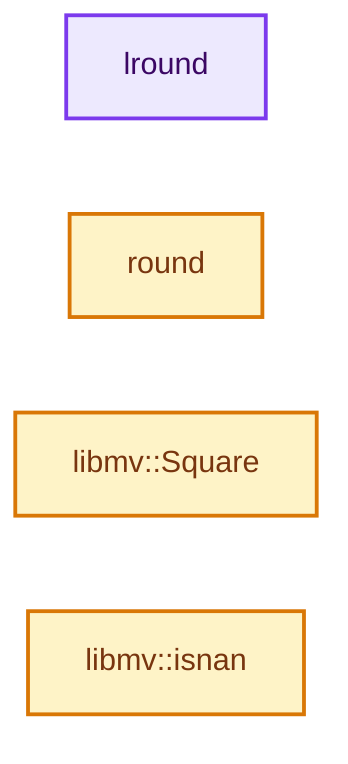
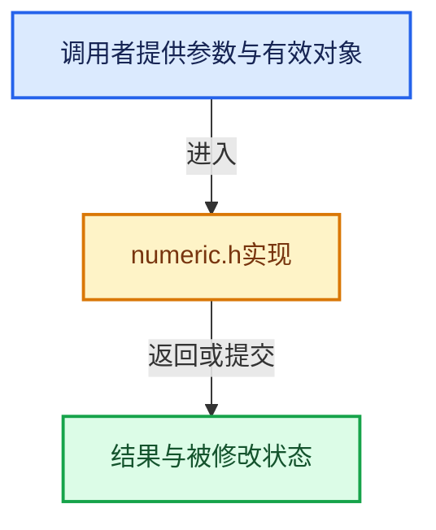

# 实现依赖专题：intern/libmv/libmv/numeric/numeric.h

[方向导航](README.md) · [符号索引](../%E7%AC%A6%E5%8F%B7%E4%BE%9D%E8%B5%96%E4%B8%8E%E5%AE%9E%E7%8E%B0%E7%B4%A2%E5%BC%95.md)

本专题从正文实际调用进入，集中保存共享实现。函数有稳定锚点，可从调用处直接跳到对应完整函数；递归与互相调用通过回链组织。

## 本文件的实现关系






## 完整成员与函数实现

<a id="f-c5c613b2e026681d"></a>

### `lround`

实现位置：[intern/libmv/libmv/numeric/numeric.h](../../../../../intern/libmv/libmv/numeric/numeric.h) · L49—L51。

接口参数：

- `double d`

**教学注释版**

<!-- annotated:6eb9330de0296a -->

```cpp
inline long lround(double d) {
  return (long)(d > 0 ? d + 0.5 : ceil(d - 0.5));
}
```

<details>
<summary>核对原始源码：intern/libmv/libmv/numeric/numeric.h · L49—L51</summary>

<!-- original:6eb9330de0296a:intern/libmv/libmv/numeric/numeric.h:49:51 -->

```cpp
inline long lround(double d) {
  return (long)(d > 0 ? d + 0.5 : ceil(d - 0.5));
}
```

</details>

**结果出口**

- `return (long)(d > 0 ? d + 0.5 : ceil(d - 0.5));`

**继续追踪实现**

- `ceil` → [外部契约](https://eel.is/c++draft/)：这个边界按实际表达式及所属类型核对参数、返回值、寿命与失败行为。这里提供接口入口，不声称已解释该第三方版本的内部实现。

<a id="f-91ec2681e5d3a786"></a>

### `round`

实现位置：[intern/libmv/libmv/numeric/numeric.h](../../../../../intern/libmv/libmv/numeric/numeric.h) · L53—L55。

接口参数：

- `double d`

**教学注释版**

<!-- annotated:0b36948432abba -->

```cpp
inline int round(double d) {
  return (d > 0) ? int(d + 0.5) : int(d - 0.5);
}
```

<details>
<summary>核对原始源码：intern/libmv/libmv/numeric/numeric.h · L53—L55</summary>

<!-- original:0b36948432abba:intern/libmv/libmv/numeric/numeric.h:53:55 -->

```cpp
inline int round(double d) {
  return (d > 0) ? int(d + 0.5) : int(d - 0.5);
}
```

</details>

**结果出口**

- `return (d > 0) ? int(d + 0.5) : int(d - 0.5);`

**继续追踪实现**

本实现没有需要继续展开的显式调用；检查返回表达式、对象转换和调用者前置条件。

<a id="f-6ac689468cda6aca"></a>

### `libmv::Square`

实现位置：[intern/libmv/libmv/numeric/numeric.h](../../../../../intern/libmv/libmv/numeric/numeric.h) · L250—L253。

接口参数：

- `T x`

**教学注释版**

<!-- annotated:26ae9dd24e0aee -->

```cpp
template <typename T>
inline T Square(T x) {
  return x * x;
}
```

<details>
<summary>核对原始源码：intern/libmv/libmv/numeric/numeric.h · L250—L253</summary>

<!-- original:26ae9dd24e0aee:intern/libmv/libmv/numeric/numeric.h:250:253 -->

```cpp
template <typename T>
inline T Square(T x) {
  return x * x;
}
```

</details>

**结果出口**

- `return x * x;`

**继续追踪实现**

本实现没有需要继续展开的显式调用；检查返回表达式、对象转换和调用者前置条件。

<a id="f-0f35a40c65fd5fae"></a>

### `libmv::isnan`

实现位置：[intern/libmv/libmv/numeric/numeric.h](../../../../../intern/libmv/libmv/numeric/numeric.h) · L455—L461。

接口参数：

- `double i`

**教学注释版**

<!-- annotated:adae8e405f4058 -->

```cpp
inline bool isnan(double i) {
#ifdef WIN32
  return _isnan(i) > 0;
#else
  return std::isnan(i);
#endif
}
```

<details>
<summary>核对原始源码：intern/libmv/libmv/numeric/numeric.h · L455—L461</summary>

<!-- original:adae8e405f4058:intern/libmv/libmv/numeric/numeric.h:455:461 -->

```cpp
inline bool isnan(double i) {
#ifdef WIN32
  return _isnan(i) > 0;
#else
  return std::isnan(i);
#endif
}
```

</details>

**结果出口**

- `return _isnan(i) > 0;`
- `return std::isnan(i);`

**继续追踪实现**

- `_isnan` → [调用协议](../%E6%A8%A1%E6%9D%BF%E5%AE%8F%E4%B8%8E%E5%8A%A8%E6%80%81%E5%88%86%E6%B4%BE%E5%8D%8F%E8%AE%AE.md)：函数指针、局部可调用对象或未展开的宏；必须结合调用者环境。调用位置L457。
- `std::isnan` → [外部契约](https://eel.is/c++draft/)：这个边界按实际表达式及所属类型核对参数、返回值、寿命与失败行为。这里提供接口入口，不声称已解释该第三方版本的内部实现。
