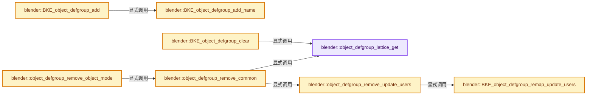
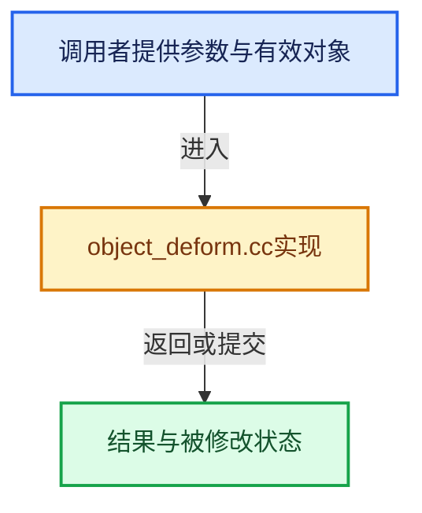

# 实现依赖专题：source/blender/blenkernel/intern/object_deform.cc

[方向导航](README.md) · [符号索引](../%E7%AC%A6%E5%8F%B7%E4%BE%9D%E8%B5%96%E4%B8%8E%E5%AE%9E%E7%8E%B0%E7%B4%A2%E5%BC%95.md)

本专题从正文实际调用进入，集中保存共享实现。函数有稳定锚点，可从调用处直接跳到对应完整函数；递归与互相调用通过回链组织。

## 本文件的实现关系






## 完整成员与函数实现

<a id="f-830beb050db14c32"></a>

### `blender::object_defgroup_lattice_get`

实现位置：[source/blender/blenkernel/intern/object_deform.cc](../../../../../source/blender/blenkernel/intern/object_deform.cc) · L50—L55。

接口参数：

- `ID *id`

**教学注释版**

<!-- annotated:28f1b3322c2f02 -->

```cpp
static Lattice *object_defgroup_lattice_get(ID *id)
{
  Lattice *lt = id_cast<Lattice *>(id);
  BLI_assert(GS(id->name) == ID_LT);
  return (lt->editlatt) ? lt->editlatt->latt : lt;
}
```

<details>
<summary>核对原始源码：source/blender/blenkernel/intern/object_deform.cc · L50—L55</summary>

<!-- original:28f1b3322c2f02:source/blender/blenkernel/intern/object_deform.cc:50:55 -->

```cpp
static Lattice *object_defgroup_lattice_get(ID *id)
{
  Lattice *lt = id_cast<Lattice *>(id);
  BLI_assert(GS(id->name) == ID_LT);
  return (lt->editlatt) ? lt->editlatt->latt : lt;
}
```

</details>

**结果出口**

- `return (lt->editlatt) ? lt->editlatt->latt : lt;`

**继续追踪实现**

- `id_cast<Lattice *>` → [blender::id_cast · L1417](%E4%BE%9D%E8%B5%96-DNA_ID-3eb091.md#f-6c8ac6412850ac5a)。
- `BLI_assert` → [BLI_assert · L48](../01-%E5%9F%BA%E7%A1%80%E5%AE%B9%E5%99%A8%E4%B8%8E%E7%8E%B0%E4%BB%A3CPP/%E4%BE%9D%E8%B5%96-BLI_assert-cc98e8.md#m-57a88495704d)；[BLI_assert · L63](../01-%E5%9F%BA%E7%A1%80%E5%AE%B9%E5%99%A8%E4%B8%8E%E7%8E%B0%E4%BB%A3CPP/%E4%BE%9D%E8%B5%96-BLI_assert-cc98e8.md#m-d07050020cb5)。宏定义由构建条件选择。
- `GS` → [blender::GS · L410](%E4%BE%9D%E8%B5%96-DNA_ID-3eb091.md#f-c3ff509f79f21b05)。

<a id="f-8106e3fa1d1a6668"></a>

### `blender::BKE_object_defgroup_remap_update_users`

实现位置：[source/blender/blenkernel/intern/object_deform.cc](../../../../../source/blender/blenkernel/intern/object_deform.cc) · L57—L95。

接口参数：

- `Object *ob`
- `const int *map`

**教学注释版**

<!-- annotated:c40b9ab7d9239e -->

```cpp
void BKE_object_defgroup_remap_update_users(Object *ob, const int *map)
{
  /* these cases don't use names to refer to vertex groups, so when
   * they get removed the numbers get out of sync, this corrects that */

  if (ob->soft) {
    ob->soft->vertgroup = map[ob->soft->vertgroup];
  }

  for (ModifierData &md : ob->modifiers) {
    if (md.type == eModifierType_Explode) {
      ExplodeModifierData *emd = reinterpret_cast<ExplodeModifierData *>(&md);
      emd->vgroup = map[emd->vgroup];
    }
    else if (md.type == eModifierType_Cloth) {
      ClothModifierData *clmd = reinterpret_cast<ClothModifierData *>(&md);
      ClothSimSettings *clsim = clmd->sim_parms;
      ClothCollSettings *clcoll = clmd->coll_parms;

      if (clsim) {
        clsim->vgroup_mass = map[clsim->vgroup_mass];
        clsim->vgroup_shrink = map[clsim->vgroup_shrink];
        clsim->vgroup_struct = map[clsim->vgroup_struct];
        clsim->vgroup_shear = map[clsim->vgroup_shear];
        clsim->vgroup_bend = map[clsim->vgroup_bend];
        clsim->vgroup_intern = map[clsim->vgroup_intern];
        clsim->vgroup_pressure = map[clsim->vgroup_pressure];
        clcoll->vgroup_selfcol = map[clcoll->vgroup_selfcol];
        clcoll->vgroup_objcol = map[clcoll->vgroup_objcol];
      }
    }
  }

  for (ParticleSystem &psys : ob->particlesystem) {
    for (int a = 0; a < PSYS_TOT_VG; a++) {
      psys.vgroup[a] = map[psys.vgroup[a]];
    }
  }
}
```

<details>
<summary>核对原始源码：source/blender/blenkernel/intern/object_deform.cc · L57—L95</summary>

<!-- original:c40b9ab7d9239e:source/blender/blenkernel/intern/object_deform.cc:57:95 -->

```cpp
void BKE_object_defgroup_remap_update_users(Object *ob, const int *map)
{
  /* these cases don't use names to refer to vertex groups, so when
   * they get removed the numbers get out of sync, this corrects that */

  if (ob->soft) {
    ob->soft->vertgroup = map[ob->soft->vertgroup];
  }

  for (ModifierData &md : ob->modifiers) {
    if (md.type == eModifierType_Explode) {
      ExplodeModifierData *emd = reinterpret_cast<ExplodeModifierData *>(&md);
      emd->vgroup = map[emd->vgroup];
    }
    else if (md.type == eModifierType_Cloth) {
      ClothModifierData *clmd = reinterpret_cast<ClothModifierData *>(&md);
      ClothSimSettings *clsim = clmd->sim_parms;
      ClothCollSettings *clcoll = clmd->coll_parms;

      if (clsim) {
        clsim->vgroup_mass = map[clsim->vgroup_mass];
        clsim->vgroup_shrink = map[clsim->vgroup_shrink];
        clsim->vgroup_struct = map[clsim->vgroup_struct];
        clsim->vgroup_shear = map[clsim->vgroup_shear];
        clsim->vgroup_bend = map[clsim->vgroup_bend];
        clsim->vgroup_intern = map[clsim->vgroup_intern];
        clsim->vgroup_pressure = map[clsim->vgroup_pressure];
        clcoll->vgroup_selfcol = map[clcoll->vgroup_selfcol];
        clcoll->vgroup_objcol = map[clcoll->vgroup_objcol];
      }
    }
  }

  for (ParticleSystem &psys : ob->particlesystem) {
    for (int a = 0; a < PSYS_TOT_VG; a++) {
      psys.vgroup[a] = map[psys.vgroup[a]];
    }
  }
}
```

</details>

**沿实际写入检查状态**

- `ob->soft->vertgroup = map[ob->soft->vertgroup];`
- `emd->vgroup = map[emd->vgroup];`
- `clsim->vgroup_mass = map[clsim->vgroup_mass];`
- `clsim->vgroup_shrink = map[clsim->vgroup_shrink];`
- `clsim->vgroup_struct = map[clsim->vgroup_struct];`
- `clsim->vgroup_shear = map[clsim->vgroup_shear];`
- `clsim->vgroup_bend = map[clsim->vgroup_bend];`
- `clsim->vgroup_intern = map[clsim->vgroup_intern];`
- `clsim->vgroup_pressure = map[clsim->vgroup_pressure];`
- `clcoll->vgroup_selfcol = map[clcoll->vgroup_selfcol];`
- `clcoll->vgroup_objcol = map[clcoll->vgroup_objcol];`
- `psys.vgroup[a] = map[psys.vgroup[a]];`

**继续追踪实现**

本实现没有需要继续展开的显式调用；检查返回表达式、对象转换和调用者前置条件。

<a id="f-24549590d5f51a9f"></a>

### `blender::BKE_object_defgroup_add_name`

实现位置：[source/blender/blenkernel/intern/object_deform.cc](../../../../../source/blender/blenkernel/intern/object_deform.cc) · L103—L115。

接口参数：

- `Object *ob`
- `const char *name`

**教学注释版**

<!-- annotated:6f5626de6b4ffc -->

```cpp
bDeformGroup *BKE_object_defgroup_add_name(Object *ob, const char *name)
{
  bDeformGroup *defgroup;

  if (!ob || !OB_TYPE_SUPPORT_VGROUP(ob->type)) {
    return nullptr;
  }

  defgroup = BKE_object_defgroup_new(ob, name);
  BKE_object_defgroup_active_index_set(ob, BKE_object_defgroup_count(ob));

  return defgroup;
}
```

<details>
<summary>核对原始源码：source/blender/blenkernel/intern/object_deform.cc · L103—L115</summary>

<!-- original:6f5626de6b4ffc:source/blender/blenkernel/intern/object_deform.cc:103:115 -->

```cpp
bDeformGroup *BKE_object_defgroup_add_name(Object *ob, const char *name)
{
  bDeformGroup *defgroup;

  if (!ob || !OB_TYPE_SUPPORT_VGROUP(ob->type)) {
    return nullptr;
  }

  defgroup = BKE_object_defgroup_new(ob, name);
  BKE_object_defgroup_active_index_set(ob, BKE_object_defgroup_count(ob));

  return defgroup;
}
```

</details>

**沿实际写入检查状态**

- `defgroup = BKE_object_defgroup_new(ob, name);`

**结果出口**

- `return nullptr;`
- `return defgroup;`

**继续追踪实现**

- `OB_TYPE_SUPPORT_VGROUP` → [OB_TYPE_SUPPORT_VGROUP · L734](%E4%BE%9D%E8%B5%96-DNA_object_types-2c8fa3.md#m-418d8ceae920)。宏定义由构建条件选择。
- `BKE_object_defgroup_new` → [blender::BKE_object_defgroup_new · L51](%E4%BE%9D%E8%B5%96-deform-6949f4.md#f-04ecee4c92a3f378)。
- `BKE_object_defgroup_active_index_set` → [blender::BKE_object_defgroup_active_index_set · L618](%E4%BE%9D%E8%B5%96-deform-6949f4.md#f-ce6a7bad4f150255)。
- `BKE_object_defgroup_count` → [blender::BKE_object_defgroup_count · L608](%E4%BE%9D%E8%B5%96-deform-6949f4.md#f-2c43dbe7747d64a1)。

<a id="f-65454a953f2aa1af"></a>

### `blender::BKE_object_defgroup_add`

实现位置：[source/blender/blenkernel/intern/object_deform.cc](../../../../../source/blender/blenkernel/intern/object_deform.cc) · L117—L120。

接口参数：

- `Object *ob`

**教学注释版**

<!-- annotated:09cf0cf7b674bf -->

```cpp
bDeformGroup *BKE_object_defgroup_add(Object *ob)
{
  return BKE_object_defgroup_add_name(ob, DATA_("Group"));
}
```

<details>
<summary>核对原始源码：source/blender/blenkernel/intern/object_deform.cc · L117—L120</summary>

<!-- original:09cf0cf7b674bf:source/blender/blenkernel/intern/object_deform.cc:117:120 -->

```cpp
bDeformGroup *BKE_object_defgroup_add(Object *ob)
{
  return BKE_object_defgroup_add_name(ob, DATA_("Group"));
}
```

</details>

**结果出口**

- `return BKE_object_defgroup_add_name(ob, DATA_("Group"));`

**继续追踪实现**

- `BKE_object_defgroup_add_name` → [blender::BKE_object_defgroup_add_name · L103](%E4%BE%9D%E8%B5%96-object_deform-506d0f.md#f-24549590d5f51a9f)。
- `DATA_` → [DATA_ · L52](%E4%BE%9D%E8%B5%96-BLT_translation-c89e58.md#m-178736083f83)。宏定义由构建条件选择。

<a id="f-8f0a0e9b2267c300"></a>

### `blender::BKE_object_defgroup_clear`

实现位置：[source/blender/blenkernel/intern/object_deform.cc](../../../../../source/blender/blenkernel/intern/object_deform.cc) · L143—L213。

接口参数：

- `Object *ob`
- `bDeformGroup *dg`
- `const bool use_selection`

**教学注释版**

<!-- annotated:cc9dcfcf17a3e2 -->

```cpp
bool BKE_object_defgroup_clear(Object *ob, bDeformGroup *dg, const bool use_selection)
{
  using namespace blender::bke;
  MDeformVert *dv;
  const ListBaseT<bDeformGroup> *defbase = BKE_object_defgroup_list(ob);
  const int def_nr = BLI_findindex(defbase, dg);
  bool changed = false;

  if (ob->type == OB_MESH) {
    Mesh *mesh = id_cast<Mesh *>(ob->data);

    if (BMesh *bm = BKE_editmesh_bmesh_get_for_write(mesh)) {
      const int cd_dvert_offset = CustomData_get_offset(&bm->vdata, CD_MDEFORMVERT);

      if (cd_dvert_offset != -1) {
        BMVert *eve;
        BMIter iter;

        BM_ITER_MESH (eve, &iter, bm, BM_VERTS_OF_MESH) {
          dv = static_cast<MDeformVert *>(BM_ELEM_CD_GET_VOID_P(eve, cd_dvert_offset));

          if (dv && dv->dw && (!use_selection || BM_elem_flag_test(eve, BM_ELEM_SELECT))) {
            MDeformWeight *dw = BKE_defvert_find_index(dv, def_nr);
            BKE_defvert_remove_group(dv, dw); /* dw can be nullptr */
            changed = true;
          }
        }
      }
    }
    else {
      if (mesh->deform_verts().data()) {
        const AttributeAccessor attributes = mesh->attributes();
        const VArray select_vert = *attributes.lookup_or_default<bool>(
            ".select_vert", AttrDomain::Point, false);
        int i;

        dv = mesh->deform_verts_for_write().data();

        for (i = 0; i < mesh->verts_num; i++, dv++) {
          if (dv->dw && (!use_selection || select_vert[i])) {
            MDeformWeight *dw = BKE_defvert_find_index(dv, def_nr);
            BKE_defvert_remove_group(dv, dw); /* dw can be nullptr */
            changed = true;
          }
        }
      }
    }
  }
  else if (ob->type == OB_LATTICE) {
    Lattice *lt = object_defgroup_lattice_get(ob->data);

    if (lt->dvert) {
      BPoint *bp;
      int i, tot = lt->pntsu * lt->pntsv * lt->pntsw;

      for (i = 0, bp = lt->def; i < tot; i++, bp++) {
        if (!use_selection || (bp->f1 & SELECT)) {
          MDeformWeight *dw;

          dv = &lt->dvert[i];

          dw = BKE_defvert_find_index(dv, def_nr);
          BKE_defvert_remove_group(dv, dw); /* dw can be nullptr */
          changed = true;
        }
      }
    }
  }

  return changed;
}
```

<details>
<summary>核对原始源码：source/blender/blenkernel/intern/object_deform.cc · L143—L213</summary>

<!-- original:cc9dcfcf17a3e2:source/blender/blenkernel/intern/object_deform.cc:143:213 -->

```cpp
bool BKE_object_defgroup_clear(Object *ob, bDeformGroup *dg, const bool use_selection)
{
  using namespace blender::bke;
  MDeformVert *dv;
  const ListBaseT<bDeformGroup> *defbase = BKE_object_defgroup_list(ob);
  const int def_nr = BLI_findindex(defbase, dg);
  bool changed = false;

  if (ob->type == OB_MESH) {
    Mesh *mesh = id_cast<Mesh *>(ob->data);

    if (BMesh *bm = BKE_editmesh_bmesh_get_for_write(mesh)) {
      const int cd_dvert_offset = CustomData_get_offset(&bm->vdata, CD_MDEFORMVERT);

      if (cd_dvert_offset != -1) {
        BMVert *eve;
        BMIter iter;

        BM_ITER_MESH (eve, &iter, bm, BM_VERTS_OF_MESH) {
          dv = static_cast<MDeformVert *>(BM_ELEM_CD_GET_VOID_P(eve, cd_dvert_offset));

          if (dv && dv->dw && (!use_selection || BM_elem_flag_test(eve, BM_ELEM_SELECT))) {
            MDeformWeight *dw = BKE_defvert_find_index(dv, def_nr);
            BKE_defvert_remove_group(dv, dw); /* dw can be nullptr */
            changed = true;
          }
        }
      }
    }
    else {
      if (mesh->deform_verts().data()) {
        const AttributeAccessor attributes = mesh->attributes();
        const VArray select_vert = *attributes.lookup_or_default<bool>(
            ".select_vert", AttrDomain::Point, false);
        int i;

        dv = mesh->deform_verts_for_write().data();

        for (i = 0; i < mesh->verts_num; i++, dv++) {
          if (dv->dw && (!use_selection || select_vert[i])) {
            MDeformWeight *dw = BKE_defvert_find_index(dv, def_nr);
            BKE_defvert_remove_group(dv, dw); /* dw can be nullptr */
            changed = true;
          }
        }
      }
    }
  }
  else if (ob->type == OB_LATTICE) {
    Lattice *lt = object_defgroup_lattice_get(ob->data);

    if (lt->dvert) {
      BPoint *bp;
      int i, tot = lt->pntsu * lt->pntsv * lt->pntsw;

      for (i = 0, bp = lt->def; i < tot; i++, bp++) {
        if (!use_selection || (bp->f1 & SELECT)) {
          MDeformWeight *dw;

          dv = &lt->dvert[i];

          dw = BKE_defvert_find_index(dv, def_nr);
          BKE_defvert_remove_group(dv, dw); /* dw can be nullptr */
          changed = true;
        }
      }
    }
  }

  return changed;
}
```

</details>

**沿实际写入检查状态**

- `dv = static_cast<MDeformVert *>(BM_ELEM_CD_GET_VOID_P(eve, cd_dvert_offset));`
- `changed = true;`
- `dv = mesh->deform_verts_for_write().data();`
- `dv = &lt->dvert[i];`
- `dw = BKE_defvert_find_index(dv, def_nr);`

**结果出口**

- `return changed;`

**继续追踪实现**

- `BKE_object_defgroup_list` → [blender::BKE_object_defgroup_list · L591](%E4%BE%9D%E8%B5%96-deform-6949f4.md#f-26f2f33daee59e8d)。
- `BLI_findindex` → [blender::BLI_findindex · L593](../01-%E5%9F%BA%E7%A1%80%E5%AE%B9%E5%99%A8%E4%B8%8E%E7%8E%B0%E4%BB%A3CPP/%E4%BE%9D%E8%B5%96-listbase-2816d9.md#f-cb9036f12bd486b7)。
- `id_cast<Mesh *>` → [blender::id_cast · L1417](%E4%BE%9D%E8%B5%96-DNA_ID-3eb091.md#f-6c8ac6412850ac5a)。
- `BKE_editmesh_bmesh_get_for_write` → [blender::BKE_editmesh_bmesh_get_for_write · L79](%E4%BE%9D%E8%B5%96-editmesh-1ee56f.md#f-fa556ba8fafc4b41)；[blender::BKE_editmesh_bmesh_get_for_write · L87](%E4%BE%9D%E8%B5%96-editmesh-1ee56f.md#f-6137590869c86e48)。同名重载需按实参类型选择。
- `CustomData_get_offset` → [blender::CustomData_get_offset · L3379](%E4%BE%9D%E8%B5%96-customdata-2eef81.md#f-e0e230c6120acc9a)。
- `BM_ITER_MESH` → [BM_ITER_MESH · L72](%E4%BE%9D%E8%B5%96-bmesh_iterators-13971c.md#m-cfc837c73218)。宏定义由构建条件选择。
- `BM_ELEM_CD_GET_VOID_P` → [BM_ELEM_CD_GET_VOID_P · L610](%E4%BE%9D%E8%B5%96-bmesh_class-4cf146.md#m-cdfe9f3023fa)；[BM_ELEM_CD_GET_VOID_P · L618](%E4%BE%9D%E8%B5%96-bmesh_class-4cf146.md#m-126b1260772d)。宏定义由构建条件选择。
- `BM_elem_flag_test` → [BM_elem_flag_test · L21](%E4%BE%9D%E8%B5%96-bmesh_inline-74f1be.md#m-2431d1179b41)。宏定义由构建条件选择。
- `BKE_defvert_find_index` → [blender::BKE_defvert_find_index · L811](%E4%BE%9D%E8%B5%96-deform-6949f4.md#f-d8c22e4305ac3d34)。
- `BKE_defvert_remove_group` → [blender::BKE_defvert_remove_group · L885](%E4%BE%9D%E8%B5%96-deform-6949f4.md#f-ece6b12afaa3769e)。
- `mesh->deform_verts().data` → [调用协议](../%E6%A8%A1%E6%9D%BF%E5%AE%8F%E4%B8%8E%E5%8A%A8%E6%80%81%E5%88%86%E6%B4%BE%E5%8D%8F%E8%AE%AE.md)：接收对象类型依赖auto、返回值或模板实例；不按同名猜测目标。调用位置L173。
- `mesh->deform_verts` → [Mesh::deform_verts · L1266](03-MPoly%E8%BF%81%E7%A7%BB%E4%B8%8E%E5%85%BC%E5%AE%B9.md#f-4c0433aad24aa301)。
- `mesh->attributes` → [Mesh::attributes · L1298](03-MPoly%E8%BF%81%E7%A7%BB%E4%B8%8E%E5%85%BC%E5%AE%B9.md#f-607bbfe3e57cfc7f)。
- `attributes.lookup_or_default<bool>` → [blender::bke::AttributeAccessor::lookup_or_default · L415](%E4%BE%9D%E8%B5%96-attribute_access-bceef3.md#f-a0cc3e316f1da4bd)。
- `mesh->deform_verts_for_write().data` → [调用协议](../%E6%A8%A1%E6%9D%BF%E5%AE%8F%E4%B8%8E%E5%8A%A8%E6%80%81%E5%88%86%E6%B4%BE%E5%8D%8F%E8%AE%AE.md)：接收对象类型依赖auto、返回值或模板实例；不按同名猜测目标。调用位置L179。
- `mesh->deform_verts_for_write` → [Mesh::deform_verts_for_write · L1275](03-MPoly%E8%BF%81%E7%A7%BB%E4%B8%8E%E5%85%BC%E5%AE%B9.md#f-7f671db4897482dc)。
- `object_defgroup_lattice_get` → [blender::object_defgroup_lattice_get · L50](%E4%BE%9D%E8%B5%96-object_deform-506d0f.md#f-830beb050db14c32)。

<a id="f-8f86ad6dc095749c"></a>

### `blender::object_defgroup_remove_update_users`

实现位置：[source/blender/blenkernel/intern/object_deform.cc](../../../../../source/blender/blenkernel/intern/object_deform.cc) · L236—L251。

接口参数：

- `Object *ob`
- `const int idx`

**教学注释版**

<!-- annotated:e0d3eb5ed721af -->

```cpp
static void object_defgroup_remove_update_users(Object *ob, const int idx)
{
  int i, defbase_tot = BKE_object_defgroup_count(ob) + 1;
  int *map = MEM_new_array_uninitialized<int>(size_t(defbase_tot), "vgroup del");

  map[idx] = map[0] = 0;
  for (i = 1; i < idx; i++) {
    map[i] = i;
  }
  for (i = idx + 1; i < defbase_tot; i++) {
    map[i] = i - 1;
  }

  BKE_object_defgroup_remap_update_users(ob, map);
  MEM_delete(map);
}
```

<details>
<summary>核对原始源码：source/blender/blenkernel/intern/object_deform.cc · L236—L251</summary>

<!-- original:e0d3eb5ed721af:source/blender/blenkernel/intern/object_deform.cc:236:251 -->

```cpp
static void object_defgroup_remove_update_users(Object *ob, const int idx)
{
  int i, defbase_tot = BKE_object_defgroup_count(ob) + 1;
  int *map = MEM_new_array_uninitialized<int>(size_t(defbase_tot), "vgroup del");

  map[idx] = map[0] = 0;
  for (i = 1; i < idx; i++) {
    map[i] = i;
  }
  for (i = idx + 1; i < defbase_tot; i++) {
    map[i] = i - 1;
  }

  BKE_object_defgroup_remap_update_users(ob, map);
  MEM_delete(map);
}
```

</details>

**沿实际写入检查状态**

- `map[idx] = map[0] = 0;`
- `map[i] = i;`
- `map[i] = i - 1;`

**继续追踪实现**

- `BKE_object_defgroup_count` → [blender::BKE_object_defgroup_count · L608](%E4%BE%9D%E8%B5%96-deform-6949f4.md#f-2c43dbe7747d64a1)。
- `MEM_new_array_uninitialized<int>` → [MEM_new_array_uninitialized · L608](../03-%E5%86%85%E5%AD%98%E5%88%86%E9%85%8D%E4%B8%8E%E8%BF%90%E8%A1%8C%E6%97%B6%E7%B1%BB%E5%9E%8B/%E4%BE%9D%E8%B5%96-MEM_guardedalloc-b54eca.md#f-b7103eae8eb57b05)；[MEM_new_array_uninitialized · L129](../03-%E5%86%85%E5%AD%98%E5%88%86%E9%85%8D%E4%B8%8E%E8%BF%90%E8%A1%8C%E6%97%B6%E7%B1%BB%E5%9E%8B/%E4%BE%9D%E8%B5%96-mallocn-afdcd4.md#f-bf6ef4ddcfb6e5df)。同名重载需按实参类型选择。
- `BKE_object_defgroup_remap_update_users` → [blender::BKE_object_defgroup_remap_update_users · L57](%E4%BE%9D%E8%B5%96-object_deform-506d0f.md#f-8106e3fa1d1a6668)。
- `MEM_delete` → [MEM_delete · L400](../03-%E5%86%85%E5%AD%98%E5%88%86%E9%85%8D%E4%B8%8E%E8%BF%90%E8%A1%8C%E6%97%B6%E7%B1%BB%E5%9E%8B/%E4%BE%9D%E8%B5%96-MEM_guardedalloc-b54eca.md#f-9049ffdd1682887c)。

<a id="f-7d8e906e692bc0bb"></a>

### `blender::object_defgroup_remove_common`

实现位置：[source/blender/blenkernel/intern/object_deform.cc](../../../../../source/blender/blenkernel/intern/object_deform.cc) · L253—L287。

接口参数：

- `Object *ob`
- `bDeformGroup *dg`
- `const int def_nr`

**教学注释版**

<!-- annotated:2e6bbc1966714c -->

```cpp
static void object_defgroup_remove_common(Object *ob, bDeformGroup *dg, const int def_nr)
{
  object_defgroup_remove_update_users(ob, def_nr + 1);

  /* Remove the group */
  ListBaseT<bDeformGroup> *defbase = BKE_object_defgroup_list_mutable(ob);

  BLI_freelinkN(defbase, dg);

  /* Update the active deform index if necessary */
  const int active_index = BKE_object_defgroup_active_index_get(ob);
  if (active_index > def_nr) {
    BKE_object_defgroup_active_index_set(ob, active_index - 1);
  }

  /* Remove all deform-verts. */
  if (defbase->is_empty()) {
    if (ob->type == OB_MESH) {
      Mesh *mesh = id_cast<Mesh *>(ob->data);
      CustomData_free_layer_active(&mesh->vert_data, CD_MDEFORMVERT);
    }
    else if (ob->type == OB_LATTICE) {
      Lattice *lt = object_defgroup_lattice_get(ob->data);
      MEM_SAFE_DELETE(lt->dvert);
    }
    else if (ob->type == OB_GREASE_PENCIL) {
      GreasePencil *grease_pencil = id_cast<GreasePencil *>(ob->data);
      bke::greasepencil::clear_vertex_groups(*grease_pencil);
    }
  }
  else if (BKE_object_defgroup_active_index_get(ob) < 1) {
    /* Keep a valid active index if we still have some vgroups. */
    BKE_object_defgroup_active_index_set(ob, 1);
  }
}
```

<details>
<summary>核对原始源码：source/blender/blenkernel/intern/object_deform.cc · L253—L287</summary>

<!-- original:2e6bbc1966714c:source/blender/blenkernel/intern/object_deform.cc:253:287 -->

```cpp
static void object_defgroup_remove_common(Object *ob, bDeformGroup *dg, const int def_nr)
{
  object_defgroup_remove_update_users(ob, def_nr + 1);

  /* Remove the group */
  ListBaseT<bDeformGroup> *defbase = BKE_object_defgroup_list_mutable(ob);

  BLI_freelinkN(defbase, dg);

  /* Update the active deform index if necessary */
  const int active_index = BKE_object_defgroup_active_index_get(ob);
  if (active_index > def_nr) {
    BKE_object_defgroup_active_index_set(ob, active_index - 1);
  }

  /* Remove all deform-verts. */
  if (defbase->is_empty()) {
    if (ob->type == OB_MESH) {
      Mesh *mesh = id_cast<Mesh *>(ob->data);
      CustomData_free_layer_active(&mesh->vert_data, CD_MDEFORMVERT);
    }
    else if (ob->type == OB_LATTICE) {
      Lattice *lt = object_defgroup_lattice_get(ob->data);
      MEM_SAFE_DELETE(lt->dvert);
    }
    else if (ob->type == OB_GREASE_PENCIL) {
      GreasePencil *grease_pencil = id_cast<GreasePencil *>(ob->data);
      bke::greasepencil::clear_vertex_groups(*grease_pencil);
    }
  }
  else if (BKE_object_defgroup_active_index_get(ob) < 1) {
    /* Keep a valid active index if we still have some vgroups. */
    BKE_object_defgroup_active_index_set(ob, 1);
  }
}
```

</details>

**继续追踪实现**

- `object_defgroup_remove_update_users` → [blender::object_defgroup_remove_update_users · L236](%E4%BE%9D%E8%B5%96-object_deform-506d0f.md#f-8f86ad6dc095749c)。
- `BKE_object_defgroup_list_mutable` → [blender::BKE_object_defgroup_list_mutable · L602](%E4%BE%9D%E8%B5%96-deform-6949f4.md#f-44acd6000881023d)。
- `BLI_freelinkN` → [blender::BLI_freelinkN · L277](../01-%E5%9F%BA%E7%A1%80%E5%AE%B9%E5%99%A8%E4%B8%8E%E7%8E%B0%E4%BB%A3CPP/%E4%BE%9D%E8%B5%96-listbase-2816d9.md#f-c7719591852af7da)。
- `BKE_object_defgroup_active_index_get` → [blender::BKE_object_defgroup_active_index_get · L613](%E4%BE%9D%E8%B5%96-deform-6949f4.md#f-40a8a7738f44a93a)。
- `BKE_object_defgroup_active_index_set` → [blender::BKE_object_defgroup_active_index_set · L618](%E4%BE%9D%E8%B5%96-deform-6949f4.md#f-ce6a7bad4f150255)。
- `defbase->is_empty` → [blender::ListBaseT::is_empty · L54](%E4%BE%9D%E8%B5%96-DNA_listBase-48dbc9.md#f-189938e5bf0f989b)。
- `id_cast<Mesh *>` → [blender::id_cast · L1417](%E4%BE%9D%E8%B5%96-DNA_ID-3eb091.md#f-6c8ac6412850ac5a)。
- `CustomData_free_layer_active` → [blender::CustomData_free_layer_active · L2979](%E4%BE%9D%E8%B5%96-customdata-2eef81.md#f-54464fd63c2facd7)。
- `object_defgroup_lattice_get` → [blender::object_defgroup_lattice_get · L50](%E4%BE%9D%E8%B5%96-object_deform-506d0f.md#f-830beb050db14c32)。
- `MEM_SAFE_DELETE` → [MEM_SAFE_DELETE · L436](../03-%E5%86%85%E5%AD%98%E5%88%86%E9%85%8D%E4%B8%8E%E8%BF%90%E8%A1%8C%E6%97%B6%E7%B1%BB%E5%9E%8B/%E4%BE%9D%E8%B5%96-MEM_guardedalloc-b54eca.md#m-eadb3bc5b902)。宏定义由构建条件选择。
- `id_cast<GreasePencil *>` → [blender::id_cast · L1417](%E4%BE%9D%E8%B5%96-DNA_ID-3eb091.md#f-6c8ac6412850ac5a)。
- `bke::greasepencil::clear_vertex_groups` → [blender::bke::greasepencil::clear_vertex_groups · L158](%E4%BE%9D%E8%B5%96-grease_pencil_vertex_groups-f8b0e1.md#f-630a526cbb7f2773)。

<a id="f-dac0d5bcb21b6aad"></a>

### `blender::object_defgroup_remove_object_mode`

实现位置：[source/blender/blenkernel/intern/object_deform.cc](../../../../../source/blender/blenkernel/intern/object_deform.cc) · L289—L321。

接口参数：

- `Object *ob`
- `bDeformGroup *dg`

**教学注释版**

<!-- annotated:30af143956162c -->

```cpp
static void object_defgroup_remove_object_mode(Object *ob, bDeformGroup *dg)
{
  MDeformVert *dvert_array = nullptr;
  int dvert_tot = 0;
  const ListBaseT<bDeformGroup> *defbase = BKE_object_defgroup_list(ob);

  const int def_nr = BLI_findindex(defbase, dg);

  BLI_assert(def_nr != -1);

  BKE_object_defgroup_array_get(ob->data, &dvert_array, &dvert_tot);

  if (dvert_array) {
    int i, j;
    MDeformVert *dv;
    for (i = 0, dv = dvert_array; i < dvert_tot; i++, dv++) {
      MDeformWeight *dw;

      dw = BKE_defvert_find_index(dv, def_nr);
      BKE_defvert_remove_group(dv, dw); /* dw can be nullptr */

      /* inline, make into a function if anything else needs to do this */
      for (j = 0; j < dv->totweight; j++) {
        if (dv->dw[j].def_nr > def_nr) {
          dv->dw[j].def_nr--;
        }
      }
      /* done */
    }
  }

  object_defgroup_remove_common(ob, dg, def_nr);
}
```

<details>
<summary>核对原始源码：source/blender/blenkernel/intern/object_deform.cc · L289—L321</summary>

<!-- original:30af143956162c:source/blender/blenkernel/intern/object_deform.cc:289:321 -->

```cpp
static void object_defgroup_remove_object_mode(Object *ob, bDeformGroup *dg)
{
  MDeformVert *dvert_array = nullptr;
  int dvert_tot = 0;
  const ListBaseT<bDeformGroup> *defbase = BKE_object_defgroup_list(ob);

  const int def_nr = BLI_findindex(defbase, dg);

  BLI_assert(def_nr != -1);

  BKE_object_defgroup_array_get(ob->data, &dvert_array, &dvert_tot);

  if (dvert_array) {
    int i, j;
    MDeformVert *dv;
    for (i = 0, dv = dvert_array; i < dvert_tot; i++, dv++) {
      MDeformWeight *dw;

      dw = BKE_defvert_find_index(dv, def_nr);
      BKE_defvert_remove_group(dv, dw); /* dw can be nullptr */

      /* inline, make into a function if anything else needs to do this */
      for (j = 0; j < dv->totweight; j++) {
        if (dv->dw[j].def_nr > def_nr) {
          dv->dw[j].def_nr--;
        }
      }
      /* done */
    }
  }

  object_defgroup_remove_common(ob, dg, def_nr);
}
```

</details>

**沿实际写入检查状态**

- `dw = BKE_defvert_find_index(dv, def_nr);`

**继续追踪实现**

- `BKE_object_defgroup_list` → [blender::BKE_object_defgroup_list · L591](%E4%BE%9D%E8%B5%96-deform-6949f4.md#f-26f2f33daee59e8d)。
- `BLI_findindex` → [blender::BLI_findindex · L593](../01-%E5%9F%BA%E7%A1%80%E5%AE%B9%E5%99%A8%E4%B8%8E%E7%8E%B0%E4%BB%A3CPP/%E4%BE%9D%E8%B5%96-listbase-2816d9.md#f-cb9036f12bd486b7)。
- `BLI_assert` → [BLI_assert · L48](../01-%E5%9F%BA%E7%A1%80%E5%AE%B9%E5%99%A8%E4%B8%8E%E7%8E%B0%E4%BB%A3CPP/%E4%BE%9D%E8%B5%96-BLI_assert-cc98e8.md#m-57a88495704d)；[BLI_assert · L63](../01-%E5%9F%BA%E7%A1%80%E5%AE%B9%E5%99%A8%E4%B8%8E%E7%8E%B0%E4%BB%A3CPP/%E4%BE%9D%E8%B5%96-BLI_assert-cc98e8.md#m-d07050020cb5)。宏定义由构建条件选择。
- `BKE_object_defgroup_array_get` → [blender::BKE_object_defgroup_array_get · L509](%E4%BE%9D%E8%B5%96-object_deform-506d0f.md#f-b8b77f3b66d0f291)。
- `BKE_defvert_find_index` → [blender::BKE_defvert_find_index · L811](%E4%BE%9D%E8%B5%96-deform-6949f4.md#f-d8c22e4305ac3d34)。
- `BKE_defvert_remove_group` → [blender::BKE_defvert_remove_group · L885](%E4%BE%9D%E8%B5%96-deform-6949f4.md#f-ece6b12afaa3769e)。
- `object_defgroup_remove_common` → [blender::object_defgroup_remove_common · L253](%E4%BE%9D%E8%B5%96-object_deform-506d0f.md#f-7d8e906e692bc0bb)。

<a id="f-56357ca09abb9bed"></a>

### `blender::object_defgroup_remove_edit_mode`

实现位置：[source/blender/blenkernel/intern/object_deform.cc](../../../../../source/blender/blenkernel/intern/object_deform.cc) · L323—L376。

接口参数：

- `Object *ob`
- `bDeformGroup *dg`

**教学注释版**

<!-- annotated:0c81f0a2298b35 -->

```cpp
static void object_defgroup_remove_edit_mode(Object *ob, bDeformGroup *dg)
{
  int i;
  const ListBaseT<bDeformGroup> *defbase = BKE_object_defgroup_list(ob);
  const int def_nr = BLI_findindex(defbase, dg);

  BLI_assert(def_nr != -1);

  /* Make sure that no verts are using this group - if none were removed,
   * we can skip next per-vert update. */
  if (!BKE_object_defgroup_clear(ob, dg, false)) {
    /* Nothing to do. */
  }
  /* Else, make sure that any groups with higher indices are adjusted accordingly */
  else if (ob->type == OB_MESH) {
    Mesh *mesh = id_cast<Mesh *>(ob->data);
    BMesh *bm = BKE_editmesh_bmesh_get_for_write(mesh);
    const int cd_dvert_offset = CustomData_get_offset(&bm->vdata, CD_MDEFORMVERT);

    BMIter iter;
    BMVert *eve;
    MDeformVert *dvert;

    BM_ITER_MESH (eve, &iter, bm, BM_VERTS_OF_MESH) {
      dvert = static_cast<MDeformVert *>(BM_ELEM_CD_GET_VOID_P(eve, cd_dvert_offset));

      if (dvert) {
        for (i = 0; i < dvert->totweight; i++) {
          if (dvert->dw[i].def_nr > def_nr) {
            dvert->dw[i].def_nr--;
          }
        }
      }
    }
  }
  else if (ob->type == OB_LATTICE) {
    Lattice *lt = (id_cast<Lattice *>(ob->data))->editlatt->latt;
    MDeformVert *dvert = lt->dvert;
    int a, tot;

    if (dvert) {
      tot = lt->pntsu * lt->pntsv * lt->pntsw;
      for (a = 0; a < tot; a++, dvert++) {
        for (i = 0; i < dvert->totweight; i++) {
          if (dvert->dw[i].def_nr > def_nr) {
            dvert->dw[i].def_nr--;
          }
        }
      }
    }
  }

  object_defgroup_remove_common(ob, dg, def_nr);
}
```

<details>
<summary>核对原始源码：source/blender/blenkernel/intern/object_deform.cc · L323—L376</summary>

<!-- original:0c81f0a2298b35:source/blender/blenkernel/intern/object_deform.cc:323:376 -->

```cpp
static void object_defgroup_remove_edit_mode(Object *ob, bDeformGroup *dg)
{
  int i;
  const ListBaseT<bDeformGroup> *defbase = BKE_object_defgroup_list(ob);
  const int def_nr = BLI_findindex(defbase, dg);

  BLI_assert(def_nr != -1);

  /* Make sure that no verts are using this group - if none were removed,
   * we can skip next per-vert update. */
  if (!BKE_object_defgroup_clear(ob, dg, false)) {
    /* Nothing to do. */
  }
  /* Else, make sure that any groups with higher indices are adjusted accordingly */
  else if (ob->type == OB_MESH) {
    Mesh *mesh = id_cast<Mesh *>(ob->data);
    BMesh *bm = BKE_editmesh_bmesh_get_for_write(mesh);
    const int cd_dvert_offset = CustomData_get_offset(&bm->vdata, CD_MDEFORMVERT);

    BMIter iter;
    BMVert *eve;
    MDeformVert *dvert;

    BM_ITER_MESH (eve, &iter, bm, BM_VERTS_OF_MESH) {
      dvert = static_cast<MDeformVert *>(BM_ELEM_CD_GET_VOID_P(eve, cd_dvert_offset));

      if (dvert) {
        for (i = 0; i < dvert->totweight; i++) {
          if (dvert->dw[i].def_nr > def_nr) {
            dvert->dw[i].def_nr--;
          }
        }
      }
    }
  }
  else if (ob->type == OB_LATTICE) {
    Lattice *lt = (id_cast<Lattice *>(ob->data))->editlatt->latt;
    MDeformVert *dvert = lt->dvert;
    int a, tot;

    if (dvert) {
      tot = lt->pntsu * lt->pntsv * lt->pntsw;
      for (a = 0; a < tot; a++, dvert++) {
        for (i = 0; i < dvert->totweight; i++) {
          if (dvert->dw[i].def_nr > def_nr) {
            dvert->dw[i].def_nr--;
          }
        }
      }
    }
  }

  object_defgroup_remove_common(ob, dg, def_nr);
}
```

</details>

**沿实际写入检查状态**

- `dvert = static_cast<MDeformVert *>(BM_ELEM_CD_GET_VOID_P(eve, cd_dvert_offset));`
- `tot = lt->pntsu * lt->pntsv * lt->pntsw;`

**继续追踪实现**

- `BKE_object_defgroup_list` → [blender::BKE_object_defgroup_list · L591](%E4%BE%9D%E8%B5%96-deform-6949f4.md#f-26f2f33daee59e8d)。
- `BLI_findindex` → [blender::BLI_findindex · L593](../01-%E5%9F%BA%E7%A1%80%E5%AE%B9%E5%99%A8%E4%B8%8E%E7%8E%B0%E4%BB%A3CPP/%E4%BE%9D%E8%B5%96-listbase-2816d9.md#f-cb9036f12bd486b7)。
- `BLI_assert` → [BLI_assert · L48](../01-%E5%9F%BA%E7%A1%80%E5%AE%B9%E5%99%A8%E4%B8%8E%E7%8E%B0%E4%BB%A3CPP/%E4%BE%9D%E8%B5%96-BLI_assert-cc98e8.md#m-57a88495704d)；[BLI_assert · L63](../01-%E5%9F%BA%E7%A1%80%E5%AE%B9%E5%99%A8%E4%B8%8E%E7%8E%B0%E4%BB%A3CPP/%E4%BE%9D%E8%B5%96-BLI_assert-cc98e8.md#m-d07050020cb5)。宏定义由构建条件选择。
- `BKE_object_defgroup_clear` → [blender::BKE_object_defgroup_clear · L143](%E4%BE%9D%E8%B5%96-object_deform-506d0f.md#f-8f0a0e9b2267c300)。
- `id_cast<Mesh *>` → [blender::id_cast · L1417](%E4%BE%9D%E8%B5%96-DNA_ID-3eb091.md#f-6c8ac6412850ac5a)。
- `BKE_editmesh_bmesh_get_for_write` → [blender::BKE_editmesh_bmesh_get_for_write · L79](%E4%BE%9D%E8%B5%96-editmesh-1ee56f.md#f-fa556ba8fafc4b41)；[blender::BKE_editmesh_bmesh_get_for_write · L87](%E4%BE%9D%E8%B5%96-editmesh-1ee56f.md#f-6137590869c86e48)。同名重载需按实参类型选择。
- `CustomData_get_offset` → [blender::CustomData_get_offset · L3379](%E4%BE%9D%E8%B5%96-customdata-2eef81.md#f-e0e230c6120acc9a)。
- `BM_ITER_MESH` → [BM_ITER_MESH · L72](%E4%BE%9D%E8%B5%96-bmesh_iterators-13971c.md#m-cfc837c73218)。宏定义由构建条件选择。
- `BM_ELEM_CD_GET_VOID_P` → [BM_ELEM_CD_GET_VOID_P · L610](%E4%BE%9D%E8%B5%96-bmesh_class-4cf146.md#m-cdfe9f3023fa)；[BM_ELEM_CD_GET_VOID_P · L618](%E4%BE%9D%E8%B5%96-bmesh_class-4cf146.md#m-126b1260772d)。宏定义由构建条件选择。
- `id_cast<Lattice *>` → [blender::id_cast · L1417](%E4%BE%9D%E8%B5%96-DNA_ID-3eb091.md#f-6c8ac6412850ac5a)。
- `object_defgroup_remove_common` → [blender::object_defgroup_remove_common · L253](%E4%BE%9D%E8%B5%96-object_deform-506d0f.md#f-7d8e906e692bc0bb)。

<a id="f-39dbd4223f5e30e9"></a>

### `blender::BKE_object_defgroup_remove`

实现位置：[source/blender/blenkernel/intern/object_deform.cc](../../../../../source/blender/blenkernel/intern/object_deform.cc) · L378—L392。

接口参数：

- `Object *ob`
- `bDeformGroup *defgroup`

**教学注释版**

<!-- annotated:404d5b2b7e38e8 -->

```cpp
void BKE_object_defgroup_remove(Object *ob, bDeformGroup *defgroup)
{
  if (BKE_object_is_in_editmode_vgroup(ob)) {
    object_defgroup_remove_edit_mode(ob, defgroup);
  }
  else {
    object_defgroup_remove_object_mode(ob, defgroup);
  }

  if (ob->type == OB_GREASE_PENCIL) {
    bke::greasepencil::validate_drawing_vertex_groups(*id_cast<GreasePencil *>(ob->data));
  }

  BKE_object_batch_cache_dirty_tag(ob);
}
```

<details>
<summary>核对原始源码：source/blender/blenkernel/intern/object_deform.cc · L378—L392</summary>

<!-- original:404d5b2b7e38e8:source/blender/blenkernel/intern/object_deform.cc:378:392 -->

```cpp
void BKE_object_defgroup_remove(Object *ob, bDeformGroup *defgroup)
{
  if (BKE_object_is_in_editmode_vgroup(ob)) {
    object_defgroup_remove_edit_mode(ob, defgroup);
  }
  else {
    object_defgroup_remove_object_mode(ob, defgroup);
  }

  if (ob->type == OB_GREASE_PENCIL) {
    bke::greasepencil::validate_drawing_vertex_groups(*id_cast<GreasePencil *>(ob->data));
  }

  BKE_object_batch_cache_dirty_tag(ob);
}
```

</details>

**继续追踪实现**

- `BKE_object_is_in_editmode_vgroup` → [blender::BKE_object_is_in_editmode_vgroup · L1927](%E4%BE%9D%E8%B5%96-object-843689.md#f-fa56b3ba4ed64eaf)。
- `object_defgroup_remove_edit_mode` → [blender::object_defgroup_remove_edit_mode · L323](%E4%BE%9D%E8%B5%96-object_deform-506d0f.md#f-56357ca09abb9bed)。
- `object_defgroup_remove_object_mode` → [blender::object_defgroup_remove_object_mode · L289](%E4%BE%9D%E8%B5%96-object_deform-506d0f.md#f-dac0d5bcb21b6aad)。
- `bke::greasepencil::validate_drawing_vertex_groups` → [blender::bke::greasepencil::validate_drawing_vertex_groups · L26](%E4%BE%9D%E8%B5%96-grease_pencil_vertex_groups-f8b0e1.md#f-eacafd3f78cf4dfa)。
- `id_cast<GreasePencil *>` → [blender::id_cast · L1417](%E4%BE%9D%E8%B5%96-DNA_ID-3eb091.md#f-6c8ac6412850ac5a)。
- `BKE_object_batch_cache_dirty_tag` → [blender::BKE_object_batch_cache_dirty_tag · L331](%E4%BE%9D%E8%B5%96-object_update-7d4f1a.md#f-baf3fb231ac79e37)。

<a id="f-110180c925536f18"></a>

### `blender::BKE_object_defgroup_remove_all_ex`

实现位置：[source/blender/blenkernel/intern/object_deform.cc](../../../../../source/blender/blenkernel/intern/object_deform.cc) · L394—L434。

接口参数：

- `Object *ob`
- `bool only_unlocked`

**教学注释版**

<!-- annotated:930fc33ed55b04 -->

```cpp
void BKE_object_defgroup_remove_all_ex(Object *ob, bool only_unlocked)
{
  ListBaseT<bDeformGroup> *defbase = BKE_object_defgroup_list_mutable(ob);

  bDeformGroup *dg = defbase->first();
  const bool edit_mode = BKE_object_is_in_editmode_vgroup(ob);

  if (dg) {
    while (dg) {
      bDeformGroup *next_dg = dg->next;

      if (!only_unlocked || (dg->flag & DG_LOCK_WEIGHT) == 0) {
        if (edit_mode) {
          object_defgroup_remove_edit_mode(ob, dg);
        }
        else {
          object_defgroup_remove_object_mode(ob, dg);
        }
      }

      dg = next_dg;
    }
  }
  else { /* `defbase` is empty. */
    /* Remove all deform-verts. */
    if (ob->type == OB_MESH) {
      Mesh *mesh = id_cast<Mesh *>(ob->data);
      CustomData_free_layer_active(&mesh->vert_data, CD_MDEFORMVERT);
    }
    else if (ob->type == OB_LATTICE) {
      Lattice *lt = object_defgroup_lattice_get(ob->data);
      MEM_SAFE_DELETE(lt->dvert);
    }
    else if (ob->type == OB_GREASE_PENCIL) {
      GreasePencil *grease_pencil = id_cast<GreasePencil *>(ob->data);
      bke::greasepencil::clear_vertex_groups(*grease_pencil);
    }
    /* Fix counters/indices */
    BKE_object_defgroup_active_index_set(ob, 0);
  }
}
```

<details>
<summary>核对原始源码：source/blender/blenkernel/intern/object_deform.cc · L394—L434</summary>

<!-- original:930fc33ed55b04:source/blender/blenkernel/intern/object_deform.cc:394:434 -->

```cpp
void BKE_object_defgroup_remove_all_ex(Object *ob, bool only_unlocked)
{
  ListBaseT<bDeformGroup> *defbase = BKE_object_defgroup_list_mutable(ob);

  bDeformGroup *dg = defbase->first();
  const bool edit_mode = BKE_object_is_in_editmode_vgroup(ob);

  if (dg) {
    while (dg) {
      bDeformGroup *next_dg = dg->next;

      if (!only_unlocked || (dg->flag & DG_LOCK_WEIGHT) == 0) {
        if (edit_mode) {
          object_defgroup_remove_edit_mode(ob, dg);
        }
        else {
          object_defgroup_remove_object_mode(ob, dg);
        }
      }

      dg = next_dg;
    }
  }
  else { /* `defbase` is empty. */
    /* Remove all deform-verts. */
    if (ob->type == OB_MESH) {
      Mesh *mesh = id_cast<Mesh *>(ob->data);
      CustomData_free_layer_active(&mesh->vert_data, CD_MDEFORMVERT);
    }
    else if (ob->type == OB_LATTICE) {
      Lattice *lt = object_defgroup_lattice_get(ob->data);
      MEM_SAFE_DELETE(lt->dvert);
    }
    else if (ob->type == OB_GREASE_PENCIL) {
      GreasePencil *grease_pencil = id_cast<GreasePencil *>(ob->data);
      bke::greasepencil::clear_vertex_groups(*grease_pencil);
    }
    /* Fix counters/indices */
    BKE_object_defgroup_active_index_set(ob, 0);
  }
}
```

</details>

**沿实际写入检查状态**

- `dg = next_dg;`

**继续追踪实现**

- `BKE_object_defgroup_list_mutable` → [blender::BKE_object_defgroup_list_mutable · L602](%E4%BE%9D%E8%B5%96-deform-6949f4.md#f-44acd6000881023d)。
- `defbase->first` → [blender::ListBaseT::first · L102](%E4%BE%9D%E8%B5%96-DNA_listBase-48dbc9.md#f-3d12ff35da057c9e)；[blender::ListBaseT::first · L106](%E4%BE%9D%E8%B5%96-DNA_listBase-48dbc9.md#f-0df87c3480e059f9)。同名重载需按实参类型选择。
- `BKE_object_is_in_editmode_vgroup` → [blender::BKE_object_is_in_editmode_vgroup · L1927](%E4%BE%9D%E8%B5%96-object-843689.md#f-fa56b3ba4ed64eaf)。
- `object_defgroup_remove_edit_mode` → [blender::object_defgroup_remove_edit_mode · L323](%E4%BE%9D%E8%B5%96-object_deform-506d0f.md#f-56357ca09abb9bed)。
- `object_defgroup_remove_object_mode` → [blender::object_defgroup_remove_object_mode · L289](%E4%BE%9D%E8%B5%96-object_deform-506d0f.md#f-dac0d5bcb21b6aad)。
- `id_cast<Mesh *>` → [blender::id_cast · L1417](%E4%BE%9D%E8%B5%96-DNA_ID-3eb091.md#f-6c8ac6412850ac5a)。
- `CustomData_free_layer_active` → [blender::CustomData_free_layer_active · L2979](%E4%BE%9D%E8%B5%96-customdata-2eef81.md#f-54464fd63c2facd7)。
- `object_defgroup_lattice_get` → [blender::object_defgroup_lattice_get · L50](%E4%BE%9D%E8%B5%96-object_deform-506d0f.md#f-830beb050db14c32)。
- `MEM_SAFE_DELETE` → [MEM_SAFE_DELETE · L436](../03-%E5%86%85%E5%AD%98%E5%88%86%E9%85%8D%E4%B8%8E%E8%BF%90%E8%A1%8C%E6%97%B6%E7%B1%BB%E5%9E%8B/%E4%BE%9D%E8%B5%96-MEM_guardedalloc-b54eca.md#m-eadb3bc5b902)。宏定义由构建条件选择。
- `id_cast<GreasePencil *>` → [blender::id_cast · L1417](%E4%BE%9D%E8%B5%96-DNA_ID-3eb091.md#f-6c8ac6412850ac5a)。
- `bke::greasepencil::clear_vertex_groups` → [blender::bke::greasepencil::clear_vertex_groups · L158](%E4%BE%9D%E8%B5%96-grease_pencil_vertex_groups-f8b0e1.md#f-630a526cbb7f2773)。
- `BKE_object_defgroup_active_index_set` → [blender::BKE_object_defgroup_active_index_set · L618](%E4%BE%9D%E8%B5%96-deform-6949f4.md#f-ce6a7bad4f150255)。

<a id="f-b4ae7addd5e334b5"></a>

### `blender::BKE_object_defgroup_remove_all`

实现位置：[source/blender/blenkernel/intern/object_deform.cc](../../../../../source/blender/blenkernel/intern/object_deform.cc) · L436—L439。

接口参数：

- `Object *ob`

**教学注释版**

<!-- annotated:8823aeb811e8c8 -->

```cpp
void BKE_object_defgroup_remove_all(Object *ob)
{
  BKE_object_defgroup_remove_all_ex(ob, false);
}
```

<details>
<summary>核对原始源码：source/blender/blenkernel/intern/object_deform.cc · L436—L439</summary>

<!-- original:8823aeb811e8c8:source/blender/blenkernel/intern/object_deform.cc:436:439 -->

```cpp
void BKE_object_defgroup_remove_all(Object *ob)
{
  BKE_object_defgroup_remove_all_ex(ob, false);
}
```

</details>

**继续追踪实现**

- `BKE_object_defgroup_remove_all_ex` → [blender::BKE_object_defgroup_remove_all_ex · L394](%E4%BE%9D%E8%B5%96-object_deform-506d0f.md#f-110180c925536f18)。

<a id="f-3aa7ebe215ef103d"></a>

### `blender::BKE_object_defgroup_index_map_create`

实现位置：[source/blender/blenkernel/intern/object_deform.cc](../../../../../source/blender/blenkernel/intern/object_deform.cc) · L441—L471。

接口参数：

- `Object *ob_src`
- `Object *ob_dst`
- `int *r_map_len`

**教学注释版**

<!-- annotated:a2de5bb344a562 -->

```cpp
int *BKE_object_defgroup_index_map_create(Object *ob_src, Object *ob_dst, int *r_map_len)
{
  const ListBaseT<bDeformGroup> *src_defbase = BKE_object_defgroup_list(ob_src);
  const ListBaseT<bDeformGroup> *dst_defbase = BKE_object_defgroup_list(ob_dst);

  /* Build src to merged mapping of vgroup indices. */
  if (src_defbase->is_empty() || dst_defbase->is_empty()) {
    *r_map_len = 0;
    return nullptr;
  }

  bDeformGroup *dg_src;
  *r_map_len = src_defbase->count();
  int *vgroup_index_map = MEM_new_array_uninitialized<int>(size_t(*r_map_len),
                                                           "defgroup index map create");
  bool is_vgroup_remap_needed = false;
  int i;

  for (dg_src = src_defbase->first(), i = 0; dg_src; dg_src = dg_src->next, i++) {
    vgroup_index_map[i] = BKE_object_defgroup_name_index(ob_dst, dg_src->name);
    is_vgroup_remap_needed = is_vgroup_remap_needed || (vgroup_index_map[i] != i);
  }

  if (!is_vgroup_remap_needed) {
    MEM_delete(vgroup_index_map);
    vgroup_index_map = nullptr;
    *r_map_len = 0;
  }

  return vgroup_index_map;
}
```

<details>
<summary>核对原始源码：source/blender/blenkernel/intern/object_deform.cc · L441—L471</summary>

<!-- original:a2de5bb344a562:source/blender/blenkernel/intern/object_deform.cc:441:471 -->

```cpp
int *BKE_object_defgroup_index_map_create(Object *ob_src, Object *ob_dst, int *r_map_len)
{
  const ListBaseT<bDeformGroup> *src_defbase = BKE_object_defgroup_list(ob_src);
  const ListBaseT<bDeformGroup> *dst_defbase = BKE_object_defgroup_list(ob_dst);

  /* Build src to merged mapping of vgroup indices. */
  if (src_defbase->is_empty() || dst_defbase->is_empty()) {
    *r_map_len = 0;
    return nullptr;
  }

  bDeformGroup *dg_src;
  *r_map_len = src_defbase->count();
  int *vgroup_index_map = MEM_new_array_uninitialized<int>(size_t(*r_map_len),
                                                           "defgroup index map create");
  bool is_vgroup_remap_needed = false;
  int i;

  for (dg_src = src_defbase->first(), i = 0; dg_src; dg_src = dg_src->next, i++) {
    vgroup_index_map[i] = BKE_object_defgroup_name_index(ob_dst, dg_src->name);
    is_vgroup_remap_needed = is_vgroup_remap_needed || (vgroup_index_map[i] != i);
  }

  if (!is_vgroup_remap_needed) {
    MEM_delete(vgroup_index_map);
    vgroup_index_map = nullptr;
    *r_map_len = 0;
  }

  return vgroup_index_map;
}
```

</details>

**沿实际写入检查状态**

- `vgroup_index_map[i] = BKE_object_defgroup_name_index(ob_dst, dg_src->name);`
- `is_vgroup_remap_needed = is_vgroup_remap_needed || (vgroup_index_map[i] != i);`
- `vgroup_index_map = nullptr;`

**结果出口**

- `return nullptr;`
- `return vgroup_index_map;`

**继续追踪实现**

- `BKE_object_defgroup_list` → [blender::BKE_object_defgroup_list · L591](%E4%BE%9D%E8%B5%96-deform-6949f4.md#f-26f2f33daee59e8d)。
- `src_defbase->is_empty` → [blender::ListBaseT::is_empty · L54](%E4%BE%9D%E8%B5%96-DNA_listBase-48dbc9.md#f-189938e5bf0f989b)。
- `dst_defbase->is_empty` → [blender::ListBaseT::is_empty · L54](%E4%BE%9D%E8%B5%96-DNA_listBase-48dbc9.md#f-189938e5bf0f989b)。
- `src_defbase->count` → [blender::ListBaseT::count · L92](%E4%BE%9D%E8%B5%96-DNA_listBase-48dbc9.md#f-7d243d006ac4c693)。
- `MEM_new_array_uninitialized<int>` → [MEM_new_array_uninitialized · L608](../03-%E5%86%85%E5%AD%98%E5%88%86%E9%85%8D%E4%B8%8E%E8%BF%90%E8%A1%8C%E6%97%B6%E7%B1%BB%E5%9E%8B/%E4%BE%9D%E8%B5%96-MEM_guardedalloc-b54eca.md#f-b7103eae8eb57b05)；[MEM_new_array_uninitialized · L129](../03-%E5%86%85%E5%AD%98%E5%88%86%E9%85%8D%E4%B8%8E%E8%BF%90%E8%A1%8C%E6%97%B6%E7%B1%BB%E5%9E%8B/%E4%BE%9D%E8%B5%96-mallocn-afdcd4.md#f-bf6ef4ddcfb6e5df)。同名重载需按实参类型选择。
- `src_defbase->first` → [blender::ListBaseT::first · L102](%E4%BE%9D%E8%B5%96-DNA_listBase-48dbc9.md#f-3d12ff35da057c9e)；[blender::ListBaseT::first · L106](%E4%BE%9D%E8%B5%96-DNA_listBase-48dbc9.md#f-0df87c3480e059f9)。同名重载需按实参类型选择。
- `BKE_object_defgroup_name_index` → [blender::BKE_object_defgroup_name_index · L597](%E4%BE%9D%E8%B5%96-deform-6949f4.md#f-ad856e5bba5cd758)。
- `MEM_delete` → [MEM_delete · L400](../03-%E5%86%85%E5%AD%98%E5%88%86%E9%85%8D%E4%B8%8E%E8%BF%90%E8%A1%8C%E6%97%B6%E7%B1%BB%E5%9E%8B/%E4%BE%9D%E8%B5%96-MEM_guardedalloc-b54eca.md#f-9049ffdd1682887c)。

<a id="f-290b27a58cc9efac"></a>

### `blender::BKE_object_defgroup_index_map_apply`

实现位置：[source/blender/blenkernel/intern/object_deform.cc](../../../../../source/blender/blenkernel/intern/object_deform.cc) · L473—L507。

接口参数：

- `MDeformVert *dvert`
- `int dvert_len`
- `const int *map`
- `int map_len`

**教学注释版**

<!-- annotated:f2ff2b193a3417 -->

```cpp
void BKE_object_defgroup_index_map_apply(MDeformVert *dvert,
                                         int dvert_len,
                                         const int *map,
                                         int map_len)
{
  if (map == nullptr || map_len == 0) {
    return;
  }

  MDeformVert *dv = dvert;
  for (int i = 0; i < dvert_len; i++, dv++) {
    int totweight = dv->totweight;
    for (int j = 0; j < totweight; j++) {
      int def_nr = dv->dw[j].def_nr;
      if (uint(def_nr) < uint(map_len) && map[def_nr] != -1) {
        dv->dw[j].def_nr = map[def_nr];
      }
      else {
        totweight--;
        dv->dw[j] = dv->dw[totweight];
        j--;
      }
    }
    if (totweight != dv->totweight) {
      if (totweight) {
        dv->dw = static_cast<MDeformWeight *>(
            MEM_realloc_uninitialized(dv->dw, sizeof(*dv->dw) * totweight));
      }
      else {
        MEM_SAFE_DELETE(dv->dw);
      }
      dv->totweight = totweight;
    }
  }
}
```

<details>
<summary>核对原始源码：source/blender/blenkernel/intern/object_deform.cc · L473—L507</summary>

<!-- original:f2ff2b193a3417:source/blender/blenkernel/intern/object_deform.cc:473:507 -->

```cpp
void BKE_object_defgroup_index_map_apply(MDeformVert *dvert,
                                         int dvert_len,
                                         const int *map,
                                         int map_len)
{
  if (map == nullptr || map_len == 0) {
    return;
  }

  MDeformVert *dv = dvert;
  for (int i = 0; i < dvert_len; i++, dv++) {
    int totweight = dv->totweight;
    for (int j = 0; j < totweight; j++) {
      int def_nr = dv->dw[j].def_nr;
      if (uint(def_nr) < uint(map_len) && map[def_nr] != -1) {
        dv->dw[j].def_nr = map[def_nr];
      }
      else {
        totweight--;
        dv->dw[j] = dv->dw[totweight];
        j--;
      }
    }
    if (totweight != dv->totweight) {
      if (totweight) {
        dv->dw = static_cast<MDeformWeight *>(
            MEM_realloc_uninitialized(dv->dw, sizeof(*dv->dw) * totweight));
      }
      else {
        MEM_SAFE_DELETE(dv->dw);
      }
      dv->totweight = totweight;
    }
  }
}
```

</details>

**沿实际写入检查状态**

- `dv->dw[j].def_nr = map[def_nr];`
- `dv->dw[j] = dv->dw[totweight];`
- `dv->dw = static_cast<MDeformWeight *>(`
- `dv->totweight = totweight;`

**继续追踪实现**

- `MEM_realloc_uninitialized` → [MEM_realloc_uninitialized · L118](../03-%E5%86%85%E5%AD%98%E5%88%86%E9%85%8D%E4%B8%8E%E8%BF%90%E8%A1%8C%E6%97%B6%E7%B1%BB%E5%9E%8B/%E4%BE%9D%E8%B5%96-MEM_guardedalloc-b54eca.md#m-813b7cd3fcff)。宏定义由构建条件选择。
- `MEM_SAFE_DELETE` → [MEM_SAFE_DELETE · L436](../03-%E5%86%85%E5%AD%98%E5%88%86%E9%85%8D%E4%B8%8E%E8%BF%90%E8%A1%8C%E6%97%B6%E7%B1%BB%E5%9E%8B/%E4%BE%9D%E8%B5%96-MEM_guardedalloc-b54eca.md#m-eadb3bc5b902)。宏定义由构建条件选择。

<a id="f-b8b77f3b66d0f291"></a>

### `blender::BKE_object_defgroup_array_get`

实现位置：[source/blender/blenkernel/intern/object_deform.cc](../../../../../source/blender/blenkernel/intern/object_deform.cc) · L509—L537。

接口参数：

- `ID *id`
- `MDeformVert **dvert_arr`
- `int *dvert_tot`

**教学注释版**

<!-- annotated:d8f45c789deb1d -->

```cpp
bool BKE_object_defgroup_array_get(ID *id, MDeformVert **dvert_arr, int *dvert_tot)
{
  if (id) {
    switch (GS(id->name)) {
      case ID_ME: {
        Mesh *mesh = id_cast<Mesh *>(id);
        *dvert_arr = mesh->deform_verts_for_write().data();
        *dvert_tot = mesh->verts_num;
        return true;
      }
      case ID_LT: {
        Lattice *lt = object_defgroup_lattice_get(id);
        *dvert_arr = lt->dvert;
        *dvert_tot = lt->pntsu * lt->pntsv * lt->pntsw;
        return true;
      }
      case ID_GP:
        /* Should not be used with grease pencil objects. */
        dvert_arr = nullptr;
        return false;
      default:
        break;
    }
  }

  *dvert_arr = nullptr;
  *dvert_tot = 0;
  return false;
}
```

<details>
<summary>核对原始源码：source/blender/blenkernel/intern/object_deform.cc · L509—L537</summary>

<!-- original:d8f45c789deb1d:source/blender/blenkernel/intern/object_deform.cc:509:537 -->

```cpp
bool BKE_object_defgroup_array_get(ID *id, MDeformVert **dvert_arr, int *dvert_tot)
{
  if (id) {
    switch (GS(id->name)) {
      case ID_ME: {
        Mesh *mesh = id_cast<Mesh *>(id);
        *dvert_arr = mesh->deform_verts_for_write().data();
        *dvert_tot = mesh->verts_num;
        return true;
      }
      case ID_LT: {
        Lattice *lt = object_defgroup_lattice_get(id);
        *dvert_arr = lt->dvert;
        *dvert_tot = lt->pntsu * lt->pntsv * lt->pntsw;
        return true;
      }
      case ID_GP:
        /* Should not be used with grease pencil objects. */
        dvert_arr = nullptr;
        return false;
      default:
        break;
    }
  }

  *dvert_arr = nullptr;
  *dvert_tot = 0;
  return false;
}
```

</details>

**沿实际写入检查状态**

- `dvert_arr = nullptr;`

**结果出口**

- `return true;`
- `return false;`

**继续追踪实现**

- `GS` → [blender::GS · L410](%E4%BE%9D%E8%B5%96-DNA_ID-3eb091.md#f-c3ff509f79f21b05)。
- `id_cast<Mesh *>` → [blender::id_cast · L1417](%E4%BE%9D%E8%B5%96-DNA_ID-3eb091.md#f-6c8ac6412850ac5a)。
- `mesh->deform_verts_for_write().data` → [调用协议](../%E6%A8%A1%E6%9D%BF%E5%AE%8F%E4%B8%8E%E5%8A%A8%E6%80%81%E5%88%86%E6%B4%BE%E5%8D%8F%E8%AE%AE.md)：接收对象类型依赖auto、返回值或模板实例；不按同名猜测目标。调用位置L515。
- `mesh->deform_verts_for_write` → [Mesh::deform_verts_for_write · L1275](03-MPoly%E8%BF%81%E7%A7%BB%E4%B8%8E%E5%85%BC%E5%AE%B9.md#f-7f671db4897482dc)。
- `object_defgroup_lattice_get` → [blender::object_defgroup_lattice_get · L50](%E4%BE%9D%E8%B5%96-object_deform-506d0f.md#f-830beb050db14c32)。

<a id="f-b5ded32c590732ab"></a>

### `blender::BKE_object_defgroup_lock_flags_get`

实现位置：[source/blender/blenkernel/intern/object_deform.cc](../../../../../source/blender/blenkernel/intern/object_deform.cc) · L543—L563。

接口参数：

- `Object *ob`
- `const int defbase_tot`

**教学注释版**

<!-- annotated:d189cd8263fecc -->

```cpp
bool *BKE_object_defgroup_lock_flags_get(Object *ob, const int defbase_tot)
{
  bool is_locked = false;
  int i;
  ListBaseT<bDeformGroup> *defbase = BKE_object_defgroup_list_mutable(ob);
  bool *lock_flags = MEM_new_array_uninitialized<bool>(size_t(defbase_tot), "defflags");
  bDeformGroup *defgroup;

  for (i = 0, defgroup = defbase->first(); i < defbase_tot && defgroup;
       defgroup = defgroup->next, i++)
  {
    lock_flags[i] = ((defgroup->flag & DG_LOCK_WEIGHT) != 0);
    is_locked |= lock_flags[i];
  }
  if (is_locked) {
    return lock_flags;
  }

  MEM_delete(lock_flags);
  return nullptr;
}
```

<details>
<summary>核对原始源码：source/blender/blenkernel/intern/object_deform.cc · L543—L563</summary>

<!-- original:d189cd8263fecc:source/blender/blenkernel/intern/object_deform.cc:543:563 -->

```cpp
bool *BKE_object_defgroup_lock_flags_get(Object *ob, const int defbase_tot)
{
  bool is_locked = false;
  int i;
  ListBaseT<bDeformGroup> *defbase = BKE_object_defgroup_list_mutable(ob);
  bool *lock_flags = MEM_new_array_uninitialized<bool>(size_t(defbase_tot), "defflags");
  bDeformGroup *defgroup;

  for (i = 0, defgroup = defbase->first(); i < defbase_tot && defgroup;
       defgroup = defgroup->next, i++)
  {
    lock_flags[i] = ((defgroup->flag & DG_LOCK_WEIGHT) != 0);
    is_locked |= lock_flags[i];
  }
  if (is_locked) {
    return lock_flags;
  }

  MEM_delete(lock_flags);
  return nullptr;
}
```

</details>

**沿实际写入检查状态**

- `defgroup = defgroup->next, i++)`
- `lock_flags[i] = ((defgroup->flag & DG_LOCK_WEIGHT) != 0);`
- `is_locked |= lock_flags[i];`

**结果出口**

- `return lock_flags;`
- `return nullptr;`

**继续追踪实现**

- `BKE_object_defgroup_list_mutable` → [blender::BKE_object_defgroup_list_mutable · L602](%E4%BE%9D%E8%B5%96-deform-6949f4.md#f-44acd6000881023d)。
- `MEM_new_array_uninitialized<bool>` → [MEM_new_array_uninitialized · L608](../03-%E5%86%85%E5%AD%98%E5%88%86%E9%85%8D%E4%B8%8E%E8%BF%90%E8%A1%8C%E6%97%B6%E7%B1%BB%E5%9E%8B/%E4%BE%9D%E8%B5%96-MEM_guardedalloc-b54eca.md#f-b7103eae8eb57b05)；[MEM_new_array_uninitialized · L129](../03-%E5%86%85%E5%AD%98%E5%88%86%E9%85%8D%E4%B8%8E%E8%BF%90%E8%A1%8C%E6%97%B6%E7%B1%BB%E5%9E%8B/%E4%BE%9D%E8%B5%96-mallocn-afdcd4.md#f-bf6ef4ddcfb6e5df)。同名重载需按实参类型选择。
- `defbase->first` → [blender::ListBaseT::first · L102](%E4%BE%9D%E8%B5%96-DNA_listBase-48dbc9.md#f-3d12ff35da057c9e)；[blender::ListBaseT::first · L106](%E4%BE%9D%E8%B5%96-DNA_listBase-48dbc9.md#f-0df87c3480e059f9)。同名重载需按实参类型选择。
- `MEM_delete` → [MEM_delete · L400](../03-%E5%86%85%E5%AD%98%E5%88%86%E9%85%8D%E4%B8%8E%E8%BF%90%E8%A1%8C%E6%97%B6%E7%B1%BB%E5%9E%8B/%E4%BE%9D%E8%B5%96-MEM_guardedalloc-b54eca.md#f-9049ffdd1682887c)。

<a id="f-fe1ab0f8c63fa02e"></a>

### `blender::BKE_object_defgroup_validmap_get`

实现位置：[source/blender/blenkernel/intern/object_deform.cc](../../../../../source/blender/blenkernel/intern/object_deform.cc) · L565—L632。

接口参数：

- `Object *ob`
- `const int defbase_tot`

**教学注释版**

<!-- annotated:81b107bcbd69f6 -->

```cpp
bool *BKE_object_defgroup_validmap_get(Object *ob, const int defbase_tot)
{
  bDeformGroup *dg;
  ModifierData *md;
  bool *defgroup_validmap;
  GHash *gh;
  int i, step1 = 1;
  const ListBaseT<bDeformGroup> *defbase = BKE_object_defgroup_list(ob);
  VirtualModifierData virtual_modifier_data;

  if (defbase->is_empty()) {
    return nullptr;
  }

  gh = BLI_ghash_str_new_ex(__func__, defbase_tot);

  /* add all names to a hash table */
  for (bDeformGroup &dg : *defbase) {
    BLI_ghash_insert(gh, dg.name, nullptr);
  }

  BLI_assert(BLI_ghash_len(gh) == defbase_tot);

  /* now loop through the armature modifiers and identify deform bones */
  for (md = ob->modifiers.first(); md; md = !md->next && step1 ? (step1 = 0),
      BKE_modifiers_get_virtual_modifierlist(ob, &virtual_modifier_data) :
                                       md->next)
  {
    if (!(md->mode & (eModifierMode_Realtime | eModifierMode_Virtual))) {
      continue;
    }

    if (ELEM(md->type, eModifierType_Armature, eModifierType_GreasePencilArmature)) {
      Object *object = (md->type == eModifierType_Armature) ?
                           (reinterpret_cast<ArmatureModifierData *>(md))->object :
                           (reinterpret_cast<GreasePencilArmatureModifierData *>(md))->object;
      if (object && object->pose) {
        bPose *pose = object->pose;
        bArmature *armature = id_cast<bArmature *>(object->data);
        BKE_pose_ensure_bone_indices(*object);
        for (bPoseChannel &chan : pose->chanbase) {
          void **val_p;
          if (chan.bone_get(*armature)->flag & BONE_NO_DEFORM) {
            continue;
          }

          val_p = BLI_ghash_lookup_p(gh, chan.name);
          if (val_p) {
            *val_p = POINTER_FROM_INT(1);
          }
        }
      }
    }
  }

  defgroup_validmap = MEM_new_array_uninitialized<bool>(size_t(defbase_tot), "wpaint valid map");

  /* add all names to a hash table */
  for (dg = defbase->first(), i = 0; dg; dg = dg->next, i++) {
    defgroup_validmap[i] = (BLI_ghash_lookup(gh, dg->name) != nullptr);
  }

  BLI_assert(i == BLI_ghash_len(gh));

  BLI_ghash_free(gh, nullptr, nullptr);

  return defgroup_validmap;
}
```

<details>
<summary>核对原始源码：source/blender/blenkernel/intern/object_deform.cc · L565—L632</summary>

<!-- original:81b107bcbd69f6:source/blender/blenkernel/intern/object_deform.cc:565:632 -->

```cpp
bool *BKE_object_defgroup_validmap_get(Object *ob, const int defbase_tot)
{
  bDeformGroup *dg;
  ModifierData *md;
  bool *defgroup_validmap;
  GHash *gh;
  int i, step1 = 1;
  const ListBaseT<bDeformGroup> *defbase = BKE_object_defgroup_list(ob);
  VirtualModifierData virtual_modifier_data;

  if (defbase->is_empty()) {
    return nullptr;
  }

  gh = BLI_ghash_str_new_ex(__func__, defbase_tot);

  /* add all names to a hash table */
  for (bDeformGroup &dg : *defbase) {
    BLI_ghash_insert(gh, dg.name, nullptr);
  }

  BLI_assert(BLI_ghash_len(gh) == defbase_tot);

  /* now loop through the armature modifiers and identify deform bones */
  for (md = ob->modifiers.first(); md; md = !md->next && step1 ? (step1 = 0),
      BKE_modifiers_get_virtual_modifierlist(ob, &virtual_modifier_data) :
                                       md->next)
  {
    if (!(md->mode & (eModifierMode_Realtime | eModifierMode_Virtual))) {
      continue;
    }

    if (ELEM(md->type, eModifierType_Armature, eModifierType_GreasePencilArmature)) {
      Object *object = (md->type == eModifierType_Armature) ?
                           (reinterpret_cast<ArmatureModifierData *>(md))->object :
                           (reinterpret_cast<GreasePencilArmatureModifierData *>(md))->object;
      if (object && object->pose) {
        bPose *pose = object->pose;
        bArmature *armature = id_cast<bArmature *>(object->data);
        BKE_pose_ensure_bone_indices(*object);
        for (bPoseChannel &chan : pose->chanbase) {
          void **val_p;
          if (chan.bone_get(*armature)->flag & BONE_NO_DEFORM) {
            continue;
          }

          val_p = BLI_ghash_lookup_p(gh, chan.name);
          if (val_p) {
            *val_p = POINTER_FROM_INT(1);
          }
        }
      }
    }
  }

  defgroup_validmap = MEM_new_array_uninitialized<bool>(size_t(defbase_tot), "wpaint valid map");

  /* add all names to a hash table */
  for (dg = defbase->first(), i = 0; dg; dg = dg->next, i++) {
    defgroup_validmap[i] = (BLI_ghash_lookup(gh, dg->name) != nullptr);
  }

  BLI_assert(i == BLI_ghash_len(gh));

  BLI_ghash_free(gh, nullptr, nullptr);

  return defgroup_validmap;
}
```

</details>

**沿实际写入检查状态**

- `gh = BLI_ghash_str_new_ex(__func__, defbase_tot);`
- `val_p = BLI_ghash_lookup_p(gh, chan.name);`
- `defgroup_validmap = MEM_new_array_uninitialized<bool>(size_t(defbase_tot), "wpaint valid map");`
- `defgroup_validmap[i] = (BLI_ghash_lookup(gh, dg->name) != nullptr);`

**结果出口**

- `return nullptr;`
- `return defgroup_validmap;`

**继续追踪实现**

- `BKE_object_defgroup_list` → [blender::BKE_object_defgroup_list · L591](%E4%BE%9D%E8%B5%96-deform-6949f4.md#f-26f2f33daee59e8d)。
- `defbase->is_empty` → [blender::ListBaseT::is_empty · L54](%E4%BE%9D%E8%B5%96-DNA_listBase-48dbc9.md#f-189938e5bf0f989b)。
- `BLI_ghash_str_new_ex` → [blender::BLI_ghash_str_new_ex · L200](../02-%E5%93%88%E5%B8%8C%E8%A1%A8%E4%B8%8E%E5%85%B3%E8%81%94%E6%95%B0%E6%8D%AE%E7%BB%93%E6%9E%84/%E4%BE%9D%E8%B5%96-BLI_ghash_utils-cd85d4.md#f-a86774f09da01c8f)。
- `BLI_ghash_insert` → [blender::BLI_ghash_insert · L711](../02-%E5%93%88%E5%B8%8C%E8%A1%A8%E4%B8%8E%E5%85%B3%E8%81%94%E6%95%B0%E6%8D%AE%E7%BB%93%E6%9E%84/%E4%BE%9D%E8%B5%96-BLI_ghash-ceaea0.md#f-b42d4e109f8d76f5)。
- `BLI_assert` → [BLI_assert · L48](../01-%E5%9F%BA%E7%A1%80%E5%AE%B9%E5%99%A8%E4%B8%8E%E7%8E%B0%E4%BB%A3CPP/%E4%BE%9D%E8%B5%96-BLI_assert-cc98e8.md#m-57a88495704d)；[BLI_assert · L63](../01-%E5%9F%BA%E7%A1%80%E5%AE%B9%E5%99%A8%E4%B8%8E%E7%8E%B0%E4%BB%A3CPP/%E4%BE%9D%E8%B5%96-BLI_assert-cc98e8.md#m-d07050020cb5)。宏定义由构建条件选择。
- `BLI_ghash_len` → [blender::BLI_ghash_len · L706](../02-%E5%93%88%E5%B8%8C%E8%A1%A8%E4%B8%8E%E5%85%B3%E8%81%94%E6%95%B0%E6%8D%AE%E7%BB%93%E6%9E%84/%E4%BE%9D%E8%B5%96-BLI_ghash-ceaea0.md#f-39953bb4c11ba1a1)。
- `ob->modifiers.first` → [调用协议](../%E6%A8%A1%E6%9D%BF%E5%AE%8F%E4%B8%8E%E5%8A%A8%E6%80%81%E5%88%86%E6%B4%BE%E5%8D%8F%E8%AE%AE.md)：接收对象类型依赖auto、返回值或模板实例；不按同名猜测目标。调用位置L589。
- `BKE_modifiers_get_virtual_modifierlist` → [blender::BKE_modifiers_get_virtual_modifierlist · L620](%E4%BE%9D%E8%B5%96-modifier-ab0273.md#f-47967058788364c5)。
- `ELEM` → [ELEM · L88](%E4%BE%9D%E8%B5%96-GHOST_utildefines-34b996.md#m-d28724a15928)；[ELEM · L135](../01-%E5%9F%BA%E7%A1%80%E5%AE%B9%E5%99%A8%E4%B8%8E%E7%8E%B0%E4%BB%A3CPP/%E4%BE%9D%E8%B5%96-BLI_utildefines-293a0a.md#m-d6572de7cae0)。宏定义由构建条件选择。
- `id_cast<bArmature *>` → [blender::id_cast · L1417](%E4%BE%9D%E8%B5%96-DNA_ID-3eb091.md#f-6c8ac6412850ac5a)。
- `BKE_pose_ensure_bone_indices` → [blender::BKE_pose_ensure_bone_indices · L3103](%E4%BE%9D%E8%B5%96-armature-cc8366.md#f-642aaede7e1310c6)。
- `chan.bone_get` → [调用协议](../%E6%A8%A1%E6%9D%BF%E5%AE%8F%E4%B8%8E%E5%8A%A8%E6%80%81%E5%88%86%E6%B4%BE%E5%8D%8F%E8%AE%AE.md)：接收对象类型依赖auto、返回值或模板实例；不按同名猜测目标。调用位置L607。
- `BLI_ghash_lookup_p` → [blender::BLI_ghash_lookup_p · L749](../02-%E5%93%88%E5%B8%8C%E8%A1%A8%E4%B8%8E%E5%85%B3%E8%81%94%E6%95%B0%E6%8D%AE%E7%BB%93%E6%9E%84/%E4%BE%9D%E8%B5%96-BLI_ghash-ceaea0.md#f-244dae12ba65c503)。
- `POINTER_FROM_INT` → [POINTER_FROM_INT · L321](../01-%E5%9F%BA%E7%A1%80%E5%AE%B9%E5%99%A8%E4%B8%8E%E7%8E%B0%E4%BB%A3CPP/%E4%BE%9D%E8%B5%96-BLI_utildefines-293a0a.md#m-17841357bb5a)。宏定义由构建条件选择。
- `MEM_new_array_uninitialized<bool>` → [MEM_new_array_uninitialized · L608](../03-%E5%86%85%E5%AD%98%E5%88%86%E9%85%8D%E4%B8%8E%E8%BF%90%E8%A1%8C%E6%97%B6%E7%B1%BB%E5%9E%8B/%E4%BE%9D%E8%B5%96-MEM_guardedalloc-b54eca.md#f-b7103eae8eb57b05)；[MEM_new_array_uninitialized · L129](../03-%E5%86%85%E5%AD%98%E5%88%86%E9%85%8D%E4%B8%8E%E8%BF%90%E8%A1%8C%E6%97%B6%E7%B1%BB%E5%9E%8B/%E4%BE%9D%E8%B5%96-mallocn-afdcd4.md#f-bf6ef4ddcfb6e5df)。同名重载需按实参类型选择。
- `defbase->first` → [blender::ListBaseT::first · L102](%E4%BE%9D%E8%B5%96-DNA_listBase-48dbc9.md#f-3d12ff35da057c9e)；[blender::ListBaseT::first · L106](%E4%BE%9D%E8%B5%96-DNA_listBase-48dbc9.md#f-0df87c3480e059f9)。同名重载需按实参类型选择。
- `BLI_ghash_lookup` → [blender::BLI_ghash_lookup · L735](../02-%E5%93%88%E5%B8%8C%E8%A1%A8%E4%B8%8E%E5%85%B3%E8%81%94%E6%95%B0%E6%8D%AE%E7%BB%93%E6%9E%84/%E4%BE%9D%E8%B5%96-BLI_ghash-ceaea0.md#f-8937b91445541501)。
- `BLI_ghash_free` → [blender::BLI_ghash_free · L866](../02-%E5%93%88%E5%B8%8C%E8%A1%A8%E4%B8%8E%E5%85%B3%E8%81%94%E6%95%B0%E6%8D%AE%E7%BB%93%E6%9E%84/%E4%BE%9D%E8%B5%96-BLI_ghash-ceaea0.md#f-ab6fda2cc049587d)。

<a id="f-e7217f53b5006733"></a>

### `blender::BKE_object_defgroup_selected_get`

实现位置：[source/blender/blenkernel/intern/object_deform.cc](../../../../../source/blender/blenkernel/intern/object_deform.cc) · L634—L664。

接口参数：

- `Object *ob`
- `int defbase_tot`
- `int *r_dg_flags_sel_tot`

**教学注释版**

<!-- annotated:db0fb6772566c1 -->

```cpp
bool *BKE_object_defgroup_selected_get(Object *ob, int defbase_tot, int *r_dg_flags_sel_tot)
{
  bool *dg_selection = MEM_new_array_uninitialized<bool>(size_t(defbase_tot), __func__);
  bDeformGroup *defgroup;
  uint i;
  Object *armob = BKE_object_pose_armature_get(ob);
  (*r_dg_flags_sel_tot) = 0;

  const ListBaseT<bDeformGroup> *defbase = BKE_object_defgroup_list(ob);

  if (armob) {
    bPose *pose = armob->pose;
    for (i = 0, defgroup = defbase->first(); i < defbase_tot && defgroup;
         defgroup = defgroup->next, i++)
    {
      bPoseChannel *pchan = BKE_pose_channel_find_name(pose, defgroup->name);
      if (pchan && (pchan->flag & POSE_SELECTED)) {
        dg_selection[i] = true;
        (*r_dg_flags_sel_tot) += 1;
      }
      else {
        dg_selection[i] = false;
      }
    }
  }
  else {
    // [讲解] memset：填充字节，不调用T构造函数，也不保证任意类型的全零表示是合法或期望值。
    memset(dg_selection, false, sizeof(*dg_selection) * defbase_tot);
  }

  return dg_selection;
}
```

<details>
<summary>核对原始源码：source/blender/blenkernel/intern/object_deform.cc · L634—L664</summary>

<!-- original:db0fb6772566c1:source/blender/blenkernel/intern/object_deform.cc:634:664 -->

```cpp
bool *BKE_object_defgroup_selected_get(Object *ob, int defbase_tot, int *r_dg_flags_sel_tot)
{
  bool *dg_selection = MEM_new_array_uninitialized<bool>(size_t(defbase_tot), __func__);
  bDeformGroup *defgroup;
  uint i;
  Object *armob = BKE_object_pose_armature_get(ob);
  (*r_dg_flags_sel_tot) = 0;

  const ListBaseT<bDeformGroup> *defbase = BKE_object_defgroup_list(ob);

  if (armob) {
    bPose *pose = armob->pose;
    for (i = 0, defgroup = defbase->first(); i < defbase_tot && defgroup;
         defgroup = defgroup->next, i++)
    {
      bPoseChannel *pchan = BKE_pose_channel_find_name(pose, defgroup->name);
      if (pchan && (pchan->flag & POSE_SELECTED)) {
        dg_selection[i] = true;
        (*r_dg_flags_sel_tot) += 1;
      }
      else {
        dg_selection[i] = false;
      }
    }
  }
  else {
    memset(dg_selection, false, sizeof(*dg_selection) * defbase_tot);
  }

  return dg_selection;
}
```

</details>

**沿实际写入检查状态**

- `defgroup = defgroup->next, i++)`
- `dg_selection[i] = true;`
- `dg_selection[i] = false;`

**结果出口**

- `return dg_selection;`

**继续追踪实现**

- `MEM_new_array_uninitialized<bool>` → [MEM_new_array_uninitialized · L608](../03-%E5%86%85%E5%AD%98%E5%88%86%E9%85%8D%E4%B8%8E%E8%BF%90%E8%A1%8C%E6%97%B6%E7%B1%BB%E5%9E%8B/%E4%BE%9D%E8%B5%96-MEM_guardedalloc-b54eca.md#f-b7103eae8eb57b05)；[MEM_new_array_uninitialized · L129](../03-%E5%86%85%E5%AD%98%E5%88%86%E9%85%8D%E4%B8%8E%E8%BF%90%E8%A1%8C%E6%97%B6%E7%B1%BB%E5%9E%8B/%E4%BE%9D%E8%B5%96-mallocn-afdcd4.md#f-bf6ef4ddcfb6e5df)。同名重载需按实参类型选择。
- `BKE_object_pose_armature_get` → [blender::BKE_object_pose_armature_get · L2507](%E4%BE%9D%E8%B5%96-object-843689.md#f-ac9a069085076f90)。
- `BKE_object_defgroup_list` → [blender::BKE_object_defgroup_list · L591](%E4%BE%9D%E8%B5%96-deform-6949f4.md#f-26f2f33daee59e8d)。
- `defbase->first` → [blender::ListBaseT::first · L102](%E4%BE%9D%E8%B5%96-DNA_listBase-48dbc9.md#f-3d12ff35da057c9e)；[blender::ListBaseT::first · L106](%E4%BE%9D%E8%B5%96-DNA_listBase-48dbc9.md#f-0df87c3480e059f9)。同名重载需按实参类型选择。
- `BKE_pose_channel_find_name` → [blender::BKE_pose_channel_find_name · L895](%E4%BE%9D%E8%B5%96-action-b3a47a.md#f-5997206551bfc9f9)。
- `memset` → [外部契约](https://eel.is/c++draft/cstring.syn)：填充字节，不调用T构造函数，也不保证任意类型的全零表示是合法或期望值。

<a id="f-0fd2a788ebdad254"></a>

### `blender::BKE_object_defgroup_check_lock_relative`

实现位置：[source/blender/blenkernel/intern/object_deform.cc](../../../../../source/blender/blenkernel/intern/object_deform.cc) · L666—L671。

接口参数：

- `const bool *lock_flags`
- `const bool *validmap`
- `int index`

**教学注释版**

<!-- annotated:62733ba6a2ef9b -->

```cpp
bool BKE_object_defgroup_check_lock_relative(const bool *lock_flags,
                                             const bool *validmap,
                                             int index)
{
  return validmap && validmap[index] && !(lock_flags && lock_flags[index]);
}
```

<details>
<summary>核对原始源码：source/blender/blenkernel/intern/object_deform.cc · L666—L671</summary>

<!-- original:62733ba6a2ef9b:source/blender/blenkernel/intern/object_deform.cc:666:671 -->

```cpp
bool BKE_object_defgroup_check_lock_relative(const bool *lock_flags,
                                             const bool *validmap,
                                             int index)
{
  return validmap && validmap[index] && !(lock_flags && lock_flags[index]);
}
```

</details>

**结果出口**

- `return validmap && validmap[index] && !(lock_flags && lock_flags[index]);`

**继续追踪实现**

本实现没有需要继续展开的显式调用；检查返回表达式、对象转换和调用者前置条件。

<a id="f-943ade424162e947"></a>

### `blender::BKE_object_defgroup_check_lock_relative_multi`

实现位置：[source/blender/blenkernel/intern/object_deform.cc](../../../../../source/blender/blenkernel/intern/object_deform.cc) · L673—L693。

接口参数：

- `int defbase_tot`
- `const bool *lock_flags`
- `const bool *selected`
- `int sel_tot`

**教学注释版**

<!-- annotated:87c45397ccf8d9 -->

```cpp
bool BKE_object_defgroup_check_lock_relative_multi(int defbase_tot,
                                                   const bool *lock_flags,
                                                   const bool *selected,
                                                   int sel_tot)
{
  if (lock_flags == nullptr) {
    return true;
  }

  if (selected == nullptr || sel_tot <= 1) {
    return true;
  }

  for (int i = 0; i < defbase_tot; i++) {
    if (selected[i] && lock_flags[i]) {
      return false;
    }
  }

  return true;
}
```

<details>
<summary>核对原始源码：source/blender/blenkernel/intern/object_deform.cc · L673—L693</summary>

<!-- original:87c45397ccf8d9:source/blender/blenkernel/intern/object_deform.cc:673:693 -->

```cpp
bool BKE_object_defgroup_check_lock_relative_multi(int defbase_tot,
                                                   const bool *lock_flags,
                                                   const bool *selected,
                                                   int sel_tot)
{
  if (lock_flags == nullptr) {
    return true;
  }

  if (selected == nullptr || sel_tot <= 1) {
    return true;
  }

  for (int i = 0; i < defbase_tot; i++) {
    if (selected[i] && lock_flags[i]) {
      return false;
    }
  }

  return true;
}
```

</details>

**结果出口**

- `return true;`
- `return false;`

**继续追踪实现**

本实现没有需要继续展开的显式调用；检查返回表达式、对象转换和调用者前置条件。

<a id="f-e2273002af553934"></a>

### `blender::BKE_object_defgroup_split_locked_validmap`

实现位置：[source/blender/blenkernel/intern/object_deform.cc](../../../../../source/blender/blenkernel/intern/object_deform.cc) · L715—L735。

接口参数：

- `int defbase_tot`
- `const bool *locked`
- `const bool *deform`
- `bool *r_locked`
- `bool *r_unlocked`

**教学注释版**

<!-- annotated:d4fc86d1857223 -->

```cpp
void BKE_object_defgroup_split_locked_validmap(
    int defbase_tot, const bool *locked, const bool *deform, bool *r_locked, bool *r_unlocked)
{
  if (!locked) {
    if (r_unlocked != deform) {
      // [讲解] memcpy：复制字节，源与目标不应重叠。类型生命周期、对齐和可复制表示须由调用者证明，不是任意对象的复制构造。
      memcpy(r_unlocked, deform, sizeof(bool) * defbase_tot);
    }
    if (r_locked) {
      // [讲解] memset：填充字节，不调用T构造函数，也不保证任意类型的全零表示是合法或期望值。
      memset(r_locked, 0, sizeof(bool) * defbase_tot);
    }
    return;
  }

  for (int i = 0; i < defbase_tot; i++) {
    bool is_locked = locked[i];
    bool is_deform = deform[i];

    r_locked[i] = is_deform && is_locked;
    r_unlocked[i] = is_deform && !is_locked;
  }
}
```

<details>
<summary>核对原始源码：source/blender/blenkernel/intern/object_deform.cc · L715—L735</summary>

<!-- original:d4fc86d1857223:source/blender/blenkernel/intern/object_deform.cc:715:735 -->

```cpp
void BKE_object_defgroup_split_locked_validmap(
    int defbase_tot, const bool *locked, const bool *deform, bool *r_locked, bool *r_unlocked)
{
  if (!locked) {
    if (r_unlocked != deform) {
      memcpy(r_unlocked, deform, sizeof(bool) * defbase_tot);
    }
    if (r_locked) {
      memset(r_locked, 0, sizeof(bool) * defbase_tot);
    }
    return;
  }

  for (int i = 0; i < defbase_tot; i++) {
    bool is_locked = locked[i];
    bool is_deform = deform[i];

    r_locked[i] = is_deform && is_locked;
    r_unlocked[i] = is_deform && !is_locked;
  }
}
```

</details>

**沿实际写入检查状态**

- `r_locked[i] = is_deform && is_locked;`
- `r_unlocked[i] = is_deform && !is_locked;`

**继续追踪实现**

- `memcpy` → [外部契约](https://eel.is/c++draft/cstring.syn)：复制字节，源与目标不应重叠。类型生命周期、对齐和可复制表示须由调用者证明，不是任意对象的复制构造。
- `memset` → [外部契约](https://eel.is/c++draft/cstring.syn)：填充字节，不调用T构造函数，也不保证任意类型的全零表示是合法或期望值。

<a id="f-77ba3016f24e95a5"></a>

### `blender::BKE_object_defgroup_mirror_selection`

实现位置：[source/blender/blenkernel/intern/object_deform.cc](../../../../../source/blender/blenkernel/intern/object_deform.cc) · L737—L765。

接口参数：

- `Object *ob`
- `int defbase_tot`
- `const bool *dg_selection`
- `bool *dg_flags_sel`
- `int *r_dg_flags_sel_tot`

**教学注释版**

<!-- annotated:e5beef096ad498 -->

```cpp
void BKE_object_defgroup_mirror_selection(Object *ob,
                                          int defbase_tot,
                                          const bool *dg_selection,
                                          bool *dg_flags_sel,
                                          int *r_dg_flags_sel_tot)
{
  const ListBaseT<bDeformGroup> *defbase = BKE_object_defgroup_list(ob);

  bDeformGroup *defgroup;
  uint i;
  int i_mirr;

  for (i = 0, defgroup = defbase->first(); i < defbase_tot && defgroup;
       defgroup = defgroup->next, i++)
  {
    if (dg_selection[i]) {
      char name_flip[MAXBONENAME];

      BLI_string_flip_side_name(name_flip, defgroup->name, false, sizeof(name_flip));
      i_mirr = STREQ(name_flip, defgroup->name) ? i :
                                                  BKE_object_defgroup_name_index(ob, name_flip);

      if ((i_mirr >= 0 && i_mirr < defbase_tot) && (dg_flags_sel[i_mirr] == false)) {
        dg_flags_sel[i_mirr] = true;
        (*r_dg_flags_sel_tot) += 1;
      }
    }
  }
}
```

<details>
<summary>核对原始源码：source/blender/blenkernel/intern/object_deform.cc · L737—L765</summary>

<!-- original:e5beef096ad498:source/blender/blenkernel/intern/object_deform.cc:737:765 -->

```cpp
void BKE_object_defgroup_mirror_selection(Object *ob,
                                          int defbase_tot,
                                          const bool *dg_selection,
                                          bool *dg_flags_sel,
                                          int *r_dg_flags_sel_tot)
{
  const ListBaseT<bDeformGroup> *defbase = BKE_object_defgroup_list(ob);

  bDeformGroup *defgroup;
  uint i;
  int i_mirr;

  for (i = 0, defgroup = defbase->first(); i < defbase_tot && defgroup;
       defgroup = defgroup->next, i++)
  {
    if (dg_selection[i]) {
      char name_flip[MAXBONENAME];

      BLI_string_flip_side_name(name_flip, defgroup->name, false, sizeof(name_flip));
      i_mirr = STREQ(name_flip, defgroup->name) ? i :
                                                  BKE_object_defgroup_name_index(ob, name_flip);

      if ((i_mirr >= 0 && i_mirr < defbase_tot) && (dg_flags_sel[i_mirr] == false)) {
        dg_flags_sel[i_mirr] = true;
        (*r_dg_flags_sel_tot) += 1;
      }
    }
  }
}
```

</details>

**沿实际写入检查状态**

- `defgroup = defgroup->next, i++)`
- `i_mirr = STREQ(name_flip, defgroup->name) ? i :`
- `dg_flags_sel[i_mirr] = true;`

**继续追踪实现**

- `BKE_object_defgroup_list` → [blender::BKE_object_defgroup_list · L591](%E4%BE%9D%E8%B5%96-deform-6949f4.md#f-26f2f33daee59e8d)。
- `defbase->first` → [blender::ListBaseT::first · L102](%E4%BE%9D%E8%B5%96-DNA_listBase-48dbc9.md#f-3d12ff35da057c9e)；[blender::ListBaseT::first · L106](%E4%BE%9D%E8%B5%96-DNA_listBase-48dbc9.md#f-0df87c3480e059f9)。同名重载需按实参类型选择。
- `BLI_string_flip_side_name` → [blender::BLI_string_flip_side_name · L297](../01-%E5%9F%BA%E7%A1%80%E5%AE%B9%E5%99%A8%E4%B8%8E%E7%8E%B0%E4%BB%A3CPP/%E4%BE%9D%E8%B5%96-string_utils-bbfe0c.md#f-9a2252551f4dd7fb)。
- `STREQ` → [STREQ · L112](%E4%BE%9D%E8%B5%96-GHOST_utildefines-34b996.md#m-9549fb6aafd2)；[STREQ · L451](../01-%E5%9F%BA%E7%A1%80%E5%AE%B9%E5%99%A8%E4%B8%8E%E7%8E%B0%E4%BB%A3CPP/%E4%BE%9D%E8%B5%96-BLI_utildefines-293a0a.md#m-c7b745bcfad2)；[STREQ · L55](%E4%BE%9D%E8%B5%96-clog-a0bec8.md#m-96e78f386894)。宏定义由构建条件选择。
- `BKE_object_defgroup_name_index` → [blender::BKE_object_defgroup_name_index · L597](%E4%BE%9D%E8%B5%96-deform-6949f4.md#f-ad856e5bba5cd758)。

<a id="f-ca1a5355ddd41385"></a>

### `blender::BKE_object_defgroup_subset_from_select_type`

实现位置：[source/blender/blenkernel/intern/object_deform.cc](../../../../../source/blender/blenkernel/intern/object_deform.cc) · L767—L827。

接口参数：

- `Object *ob`
- `eVGroupSelect subset_type`
- `int *r_defgroup_tot`
- `int *r_subset_count`

**教学注释版**

<!-- annotated:c7d80441a6865a -->

```cpp
bool *BKE_object_defgroup_subset_from_select_type(Object *ob,
                                                  eVGroupSelect subset_type,
                                                  int *r_defgroup_tot,
                                                  int *r_subset_count)
{
  bool *defgroup_validmap = nullptr;

  *r_defgroup_tot = BKE_object_defgroup_count(ob);

  switch (subset_type) {
    case WT_VGROUP_ACTIVE: {
      const int def_nr_active = BKE_object_defgroup_active_index_get(ob) - 1;
      defgroup_validmap = MEM_new_array_uninitialized<bool>(size_t(*r_defgroup_tot), __func__);
      // [讲解] memset：填充字节，不调用T构造函数，也不保证任意类型的全零表示是合法或期望值。
      memset(defgroup_validmap, false, *r_defgroup_tot * sizeof(*defgroup_validmap));
      if ((def_nr_active >= 0) && (def_nr_active < *r_defgroup_tot)) {
        *r_subset_count = 1;
        defgroup_validmap[def_nr_active] = true;
      }
      else {
        *r_subset_count = 0;
      }
      break;
    }
    case WT_VGROUP_BONE_SELECT: {
      defgroup_validmap = BKE_object_defgroup_selected_get(ob, *r_defgroup_tot, r_subset_count);
      break;
    }
    case WT_VGROUP_BONE_DEFORM: {
      int i;
      defgroup_validmap = BKE_object_defgroup_validmap_get(ob, *r_defgroup_tot);
      *r_subset_count = 0;
      for (i = 0; i < *r_defgroup_tot; i++) {
        if (defgroup_validmap[i] == true) {
          *r_subset_count += 1;
        }
      }
      break;
    }
    case WT_VGROUP_BONE_DEFORM_OFF: {
      int i;
      defgroup_validmap = BKE_object_defgroup_validmap_get(ob, *r_defgroup_tot);
      *r_subset_count = 0;
      for (i = 0; i < *r_defgroup_tot; i++) {
        defgroup_validmap[i] = !defgroup_validmap[i];
        if (defgroup_validmap[i] == true) {
          *r_subset_count += 1;
        }
      }
      break;
    }
    case WT_VGROUP_ALL:
    default: {
      defgroup_validmap = MEM_new_array_uninitialized<bool>(size_t(*r_defgroup_tot), __func__);
      memset(defgroup_validmap, true, *r_defgroup_tot * sizeof(*defgroup_validmap));
      *r_subset_count = *r_defgroup_tot;
      break;
    }
  }

  return defgroup_validmap;
}
```

<details>
<summary>核对原始源码：source/blender/blenkernel/intern/object_deform.cc · L767—L827</summary>

<!-- original:c7d80441a6865a:source/blender/blenkernel/intern/object_deform.cc:767:827 -->

```cpp
bool *BKE_object_defgroup_subset_from_select_type(Object *ob,
                                                  eVGroupSelect subset_type,
                                                  int *r_defgroup_tot,
                                                  int *r_subset_count)
{
  bool *defgroup_validmap = nullptr;

  *r_defgroup_tot = BKE_object_defgroup_count(ob);

  switch (subset_type) {
    case WT_VGROUP_ACTIVE: {
      const int def_nr_active = BKE_object_defgroup_active_index_get(ob) - 1;
      defgroup_validmap = MEM_new_array_uninitialized<bool>(size_t(*r_defgroup_tot), __func__);
      memset(defgroup_validmap, false, *r_defgroup_tot * sizeof(*defgroup_validmap));
      if ((def_nr_active >= 0) && (def_nr_active < *r_defgroup_tot)) {
        *r_subset_count = 1;
        defgroup_validmap[def_nr_active] = true;
      }
      else {
        *r_subset_count = 0;
      }
      break;
    }
    case WT_VGROUP_BONE_SELECT: {
      defgroup_validmap = BKE_object_defgroup_selected_get(ob, *r_defgroup_tot, r_subset_count);
      break;
    }
    case WT_VGROUP_BONE_DEFORM: {
      int i;
      defgroup_validmap = BKE_object_defgroup_validmap_get(ob, *r_defgroup_tot);
      *r_subset_count = 0;
      for (i = 0; i < *r_defgroup_tot; i++) {
        if (defgroup_validmap[i] == true) {
          *r_subset_count += 1;
        }
      }
      break;
    }
    case WT_VGROUP_BONE_DEFORM_OFF: {
      int i;
      defgroup_validmap = BKE_object_defgroup_validmap_get(ob, *r_defgroup_tot);
      *r_subset_count = 0;
      for (i = 0; i < *r_defgroup_tot; i++) {
        defgroup_validmap[i] = !defgroup_validmap[i];
        if (defgroup_validmap[i] == true) {
          *r_subset_count += 1;
        }
      }
      break;
    }
    case WT_VGROUP_ALL:
    default: {
      defgroup_validmap = MEM_new_array_uninitialized<bool>(size_t(*r_defgroup_tot), __func__);
      memset(defgroup_validmap, true, *r_defgroup_tot * sizeof(*defgroup_validmap));
      *r_subset_count = *r_defgroup_tot;
      break;
    }
  }

  return defgroup_validmap;
}
```

</details>

**沿实际写入检查状态**

- `defgroup_validmap = MEM_new_array_uninitialized<bool>(size_t(*r_defgroup_tot), __func__);`
- `defgroup_validmap[def_nr_active] = true;`
- `defgroup_validmap = BKE_object_defgroup_selected_get(ob, *r_defgroup_tot, r_subset_count);`
- `defgroup_validmap = BKE_object_defgroup_validmap_get(ob, *r_defgroup_tot);`
- `defgroup_validmap[i] = !defgroup_validmap[i];`

**结果出口**

- `return defgroup_validmap;`

**继续追踪实现**

- `BKE_object_defgroup_count` → [blender::BKE_object_defgroup_count · L608](%E4%BE%9D%E8%B5%96-deform-6949f4.md#f-2c43dbe7747d64a1)。
- `BKE_object_defgroup_active_index_get` → [blender::BKE_object_defgroup_active_index_get · L613](%E4%BE%9D%E8%B5%96-deform-6949f4.md#f-40a8a7738f44a93a)。
- `MEM_new_array_uninitialized<bool>` → [MEM_new_array_uninitialized · L608](../03-%E5%86%85%E5%AD%98%E5%88%86%E9%85%8D%E4%B8%8E%E8%BF%90%E8%A1%8C%E6%97%B6%E7%B1%BB%E5%9E%8B/%E4%BE%9D%E8%B5%96-MEM_guardedalloc-b54eca.md#f-b7103eae8eb57b05)；[MEM_new_array_uninitialized · L129](../03-%E5%86%85%E5%AD%98%E5%88%86%E9%85%8D%E4%B8%8E%E8%BF%90%E8%A1%8C%E6%97%B6%E7%B1%BB%E5%9E%8B/%E4%BE%9D%E8%B5%96-mallocn-afdcd4.md#f-bf6ef4ddcfb6e5df)。同名重载需按实参类型选择。
- `memset` → [外部契约](https://eel.is/c++draft/cstring.syn)：填充字节，不调用T构造函数，也不保证任意类型的全零表示是合法或期望值。
- `BKE_object_defgroup_selected_get` → [blender::BKE_object_defgroup_selected_get · L634](%E4%BE%9D%E8%B5%96-object_deform-506d0f.md#f-e7217f53b5006733)。
- `BKE_object_defgroup_validmap_get` → [blender::BKE_object_defgroup_validmap_get · L565](%E4%BE%9D%E8%B5%96-object_deform-506d0f.md#f-fe1ab0f8c63fa02e)。
