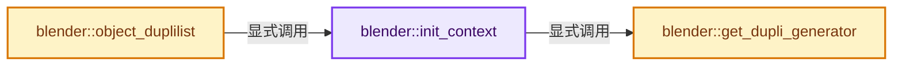
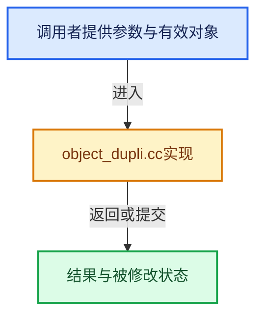

# 实现依赖专题：source/blender/blenkernel/intern/object_dupli.cc

[方向导航](README.md) · [符号索引](../%E7%AC%A6%E5%8F%B7%E4%BE%9D%E8%B5%96%E4%B8%8E%E5%AE%9E%E7%8E%B0%E7%B4%A2%E5%BC%95.md)

本专题从正文实际调用进入，集中保存共享实现。函数有稳定锚点，可从调用处直接跳到对应完整函数；递归与互相调用通过回链组织。

## 本文件的实现关系






## 完整成员与函数实现

<a id="f-fe1ccd179e484125"></a>

### `blender::init_context`

实现位置：[source/blender/blenkernel/intern/object_dupli.cc](../../../../../source/blender/blenkernel/intern/object_dupli.cc) · L148—L183。

接口参数：

- `DupliContext *r_ctx`
- `Depsgraph *depsgraph`
- `Object *ob`
- `const float space_mat[4][4]`
- `Set<const Object *> *include_objects`
- `Vector<Object *> &instance_stack`
- `Vector<short> &dupli_gen_type_stack`
- `DupliList &duplilist`

**教学注释版**

<!-- annotated:16df38219f0546 -->

```cpp
static void init_context(DupliContext *r_ctx,
                         Depsgraph *depsgraph,
                         Object *ob,
                         const float space_mat[4][4],
                         Set<const Object *> *include_objects,
                         Vector<Object *> &instance_stack,
                         Vector<short> &dupli_gen_type_stack,
                         DupliList &duplilist)
{
  r_ctx->depsgraph = depsgraph;
  r_ctx->collection = nullptr;

  r_ctx->root_object = ob;
  r_ctx->object = ob;
  r_ctx->obedit = OBEDIT_FROM_OBACT(ob);
  r_ctx->instance_stack = &instance_stack;
  r_ctx->dupli_gen_type_stack = &dupli_gen_type_stack;
  r_ctx->duplilist = &duplilist;
  if (space_mat) {
    copy_m4_m4(r_ctx->space_mat, space_mat);
  }
  else {
    unit_m4(r_ctx->space_mat);
  }
  r_ctx->level = 0;

  r_ctx->gen = get_dupli_generator(r_ctx);
  if (r_ctx->gen && r_ctx->gen->type != GEOMETRY_SET_DUPLI_GENERATOR_TYPE) {
    r_ctx->dupli_gen_type_stack->append(r_ctx->gen->type);
  }

  r_ctx->preview_instance_index = -1;
  r_ctx->preview_base_geometry = nullptr;

  r_ctx->include_objects = include_objects;
}
```

<details>
<summary>核对原始源码：source/blender/blenkernel/intern/object_dupli.cc · L148—L183</summary>

<!-- original:16df38219f0546:source/blender/blenkernel/intern/object_dupli.cc:148:183 -->

```cpp
static void init_context(DupliContext *r_ctx,
                         Depsgraph *depsgraph,
                         Object *ob,
                         const float space_mat[4][4],
                         Set<const Object *> *include_objects,
                         Vector<Object *> &instance_stack,
                         Vector<short> &dupli_gen_type_stack,
                         DupliList &duplilist)
{
  r_ctx->depsgraph = depsgraph;
  r_ctx->collection = nullptr;

  r_ctx->root_object = ob;
  r_ctx->object = ob;
  r_ctx->obedit = OBEDIT_FROM_OBACT(ob);
  r_ctx->instance_stack = &instance_stack;
  r_ctx->dupli_gen_type_stack = &dupli_gen_type_stack;
  r_ctx->duplilist = &duplilist;
  if (space_mat) {
    copy_m4_m4(r_ctx->space_mat, space_mat);
  }
  else {
    unit_m4(r_ctx->space_mat);
  }
  r_ctx->level = 0;

  r_ctx->gen = get_dupli_generator(r_ctx);
  if (r_ctx->gen && r_ctx->gen->type != GEOMETRY_SET_DUPLI_GENERATOR_TYPE) {
    r_ctx->dupli_gen_type_stack->append(r_ctx->gen->type);
  }

  r_ctx->preview_instance_index = -1;
  r_ctx->preview_base_geometry = nullptr;

  r_ctx->include_objects = include_objects;
}
```

</details>

**沿实际写入检查状态**

- `r_ctx->depsgraph = depsgraph;`
- `r_ctx->collection = nullptr;`
- `r_ctx->root_object = ob;`
- `r_ctx->object = ob;`
- `r_ctx->obedit = OBEDIT_FROM_OBACT(ob);`
- `r_ctx->instance_stack = &instance_stack;`
- `r_ctx->dupli_gen_type_stack = &dupli_gen_type_stack;`
- `r_ctx->duplilist = &duplilist;`
- `r_ctx->level = 0;`
- `r_ctx->gen = get_dupli_generator(r_ctx);`
- `r_ctx->preview_instance_index = -1;`
- `r_ctx->preview_base_geometry = nullptr;`
- `r_ctx->include_objects = include_objects;`

**继续追踪实现**

- `OBEDIT_FROM_OBACT` → [OBEDIT_FROM_OBACT · L3066](%E4%BE%9D%E8%B5%96-DNA_scene_types-6355de.md#m-4fa4561fd92d)。宏定义由构建条件选择。
- `copy_m4_m4` → [blender::copy_m4_m4 · L84](../12-%E7%A9%BA%E9%97%B4%E6%95%B0%E6%8D%AE%E7%BB%93%E6%9E%84%E4%B8%8E%E5%87%A0%E4%BD%95%E7%AE%97%E6%B3%95/%E4%BE%9D%E8%B5%96-math_matrix_c-004123.md#f-b4390cf8c94710f5)。
- `unit_m4` → [blender::unit_m4 · L55](../12-%E7%A9%BA%E9%97%B4%E6%95%B0%E6%8D%AE%E7%BB%93%E6%9E%84%E4%B8%8E%E5%87%A0%E4%BD%95%E7%AE%97%E6%B3%95/%E4%BE%9D%E8%B5%96-math_matrix_c-004123.md#f-e6cd812aae119176)。
- `get_dupli_generator` → [blender::get_dupli_generator · L1738](%E4%BE%9D%E8%B5%96-object_dupli-b38b8d.md#f-5b1e3c5832df60b4)。
- `r_ctx->dupli_gen_type_stack->append` → [调用协议](../%E6%A8%A1%E6%9D%BF%E5%AE%8F%E4%B8%8E%E5%8A%A8%E6%80%81%E5%88%86%E6%B4%BE%E5%8D%8F%E8%AE%AE.md)：接收对象类型依赖auto、返回值或模板实例；不按同名猜测目标。调用位置L176。

<a id="f-5b1e3c5832df60b4"></a>

### `blender::get_dupli_generator`

实现位置：[source/blender/blenkernel/intern/object_dupli.cc](../../../../../source/blender/blenkernel/intern/object_dupli.cc) · L1738—L1801。

接口参数：

- `const DupliContext *ctx`

**教学注释版**

<!-- annotated:082e44c7b44609 -->

```cpp
static const DupliGenerator *get_dupli_generator(const DupliContext *ctx)
{
  int transflag = ctx->object->transflag;
  int visibility_flag = ctx->object->visibility_flag;

  if ((transflag & OB_DUPLI) == 0 && ctx->object->runtime->geometry_set_eval == nullptr) {
    return nullptr;
  }

  /* Meta-ball objects can't create instances, but the dupli system is used to "instance" their
   * evaluated mesh to render engines. We need to exit early to avoid recursively instancing the
   * evaluated meta-ball mesh on meta-ball instances that already contribute to the basis. */
  if (ctx->object->type == OB_MBALL && ctx->level > 0) {
    return nullptr;
  }

  /* Should the dupli's be generated for this object? - Respect restrict flags. */
  if (DEG_get_mode(ctx->depsgraph) == DAG_EVAL_RENDER ? (visibility_flag & OB_HIDE_RENDER) :
                                                        (visibility_flag & OB_HIDE_VIEWPORT))
  {
    return nullptr;
  }

  /* Give "Object as Font" instances higher priority than geometry set instances, to retain
   * the behavior from before curve object meshes were processed as instances internally. */
  if (transflag & OB_DUPLIVERTS) {
    if (ctx->object->type == OB_FONT) {
      return &gen_dupli_verts_font;
    }
  }

  /* Collection instances could also use #gen_dupli_geometry_set but since it is more general, it
   * has an additional instance layer compared to #gen_dupli_collection. For
   * backward-compatibility, use #gen_dupli_collection when there are no modifiers. */
  if (ctx->object->type == OB_EMPTY && (transflag & OB_DUPLICOLLECTION) &&
      ctx->object->modifiers.is_empty())
  {
    return &gen_dupli_collection;
  }
  if (ctx->object->runtime->geometry_set_eval != nullptr) {
    if (bke::object_has_geometry_set_instances(*ctx->object)) {
      return &gen_dupli_geometry_set;
    }
  }

  if (transflag & OB_DUPLIPARTS) {
    return &gen_dupli_particles;
  }
  if (transflag & OB_DUPLIVERTS) {
    if (ctx->object->type == OB_MESH) {
      return &gen_dupli_verts;
    }
  }
  else if (transflag & OB_DUPLIFACES) {
    if (ctx->object->type == OB_MESH) {
      return &gen_dupli_faces;
    }
  }
  else if (transflag & OB_DUPLICOLLECTION) {
    return &gen_dupli_collection;
  }

  return nullptr;
}
```

<details>
<summary>核对原始源码：source/blender/blenkernel/intern/object_dupli.cc · L1738—L1801</summary>

<!-- original:082e44c7b44609:source/blender/blenkernel/intern/object_dupli.cc:1738:1801 -->

```cpp
static const DupliGenerator *get_dupli_generator(const DupliContext *ctx)
{
  int transflag = ctx->object->transflag;
  int visibility_flag = ctx->object->visibility_flag;

  if ((transflag & OB_DUPLI) == 0 && ctx->object->runtime->geometry_set_eval == nullptr) {
    return nullptr;
  }

  /* Meta-ball objects can't create instances, but the dupli system is used to "instance" their
   * evaluated mesh to render engines. We need to exit early to avoid recursively instancing the
   * evaluated meta-ball mesh on meta-ball instances that already contribute to the basis. */
  if (ctx->object->type == OB_MBALL && ctx->level > 0) {
    return nullptr;
  }

  /* Should the dupli's be generated for this object? - Respect restrict flags. */
  if (DEG_get_mode(ctx->depsgraph) == DAG_EVAL_RENDER ? (visibility_flag & OB_HIDE_RENDER) :
                                                        (visibility_flag & OB_HIDE_VIEWPORT))
  {
    return nullptr;
  }

  /* Give "Object as Font" instances higher priority than geometry set instances, to retain
   * the behavior from before curve object meshes were processed as instances internally. */
  if (transflag & OB_DUPLIVERTS) {
    if (ctx->object->type == OB_FONT) {
      return &gen_dupli_verts_font;
    }
  }

  /* Collection instances could also use #gen_dupli_geometry_set but since it is more general, it
   * has an additional instance layer compared to #gen_dupli_collection. For
   * backward-compatibility, use #gen_dupli_collection when there are no modifiers. */
  if (ctx->object->type == OB_EMPTY && (transflag & OB_DUPLICOLLECTION) &&
      ctx->object->modifiers.is_empty())
  {
    return &gen_dupli_collection;
  }
  if (ctx->object->runtime->geometry_set_eval != nullptr) {
    if (bke::object_has_geometry_set_instances(*ctx->object)) {
      return &gen_dupli_geometry_set;
    }
  }

  if (transflag & OB_DUPLIPARTS) {
    return &gen_dupli_particles;
  }
  if (transflag & OB_DUPLIVERTS) {
    if (ctx->object->type == OB_MESH) {
      return &gen_dupli_verts;
    }
  }
  else if (transflag & OB_DUPLIFACES) {
    if (ctx->object->type == OB_MESH) {
      return &gen_dupli_faces;
    }
  }
  else if (transflag & OB_DUPLICOLLECTION) {
    return &gen_dupli_collection;
  }

  return nullptr;
}
```

</details>

**结果出口**

- `return nullptr;`
- `return &gen_dupli_verts_font;`
- `return &gen_dupli_collection;`
- `return &gen_dupli_geometry_set;`
- `return &gen_dupli_particles;`
- `return &gen_dupli_verts;`
- `return &gen_dupli_faces;`

**继续追踪实现**

- `DEG_get_mode` → [blender::DEG_get_mode · L99](../11-Depsgraph%E4%B8%8E%E5%B9%B6%E8%A1%8C%E4%BB%BB%E5%8A%A1%E7%B3%BB%E7%BB%9F/%E4%BE%9D%E8%B5%96-depsgraph_query-e8b1e4.md#f-fa117f51322cd95c)。
- `ctx->object->modifiers.is_empty` → [调用协议](../%E6%A8%A1%E6%9D%BF%E5%AE%8F%E4%B8%8E%E5%8A%A8%E6%80%81%E5%88%86%E6%B4%BE%E5%8D%8F%E8%AE%AE.md)：接收对象类型依赖auto、返回值或模板实例；不按同名猜测目标。调用位置L1773。
- `bke::object_has_geometry_set_instances` → [blender::bke::object_has_geometry_set_instances · L815](../06-%E9%9A%90%E5%BC%8F%E5%85%B1%E4%BA%AB%E4%B8%8E%E7%BC%93%E5%AD%98%E7%B3%BB%E7%BB%9F/05-GeometrySet%E8%AF%BB%E5%86%99%E4%B8%8E%E5%A4%8D%E5%88%B6.md#f-e48d507dbfd856ee)。

<a id="f-c7a1cea399b12daf"></a>

### `blender::object_duplilist`

实现位置：[source/blender/blenkernel/intern/object_dupli.cc](../../../../../source/blender/blenkernel/intern/object_dupli.cc) · L1809—L1829。

接口参数：

- `Depsgraph *depsgraph`
- `Object *ob`
- `Set<const Object *> *include_objects`
- `DupliList &r_duplilist`

**教学注释版**

<!-- annotated:7f56cc0eb6c749 -->

```cpp
void object_duplilist(Depsgraph *depsgraph,
                      Object *ob,
                      Set<const Object *> *include_objects,
                      DupliList &r_duplilist)
{
  DupliContext ctx;
  Vector<Object *> instance_stack;
  Vector<short> dupli_gen_type_stack({0});
  // [讲解] instance_stack.append：在尾部建立新元素，必要时先扩大存储。
  instance_stack.append(ob);
  init_context(&ctx,
               depsgraph,
               ob,
               nullptr,
               include_objects,
               instance_stack,
               dupli_gen_type_stack,
               r_duplilist);
  if (ctx.gen) {
    ctx.gen->make_duplis(&ctx);
  }
}
```

<details>
<summary>核对原始源码：source/blender/blenkernel/intern/object_dupli.cc · L1809—L1829</summary>

<!-- original:7f56cc0eb6c749:source/blender/blenkernel/intern/object_dupli.cc:1809:1829 -->

```cpp
void object_duplilist(Depsgraph *depsgraph,
                      Object *ob,
                      Set<const Object *> *include_objects,
                      DupliList &r_duplilist)
{
  DupliContext ctx;
  Vector<Object *> instance_stack;
  Vector<short> dupli_gen_type_stack({0});
  instance_stack.append(ob);
  init_context(&ctx,
               depsgraph,
               ob,
               nullptr,
               include_objects,
               instance_stack,
               dupli_gen_type_stack,
               r_duplilist);
  if (ctx.gen) {
    ctx.gen->make_duplis(&ctx);
  }
}
```

</details>

**继续追踪实现**

- `instance_stack.append` → [blender::Vector::append · L498](../01-%E5%9F%BA%E7%A1%80%E5%AE%B9%E5%99%A8%E4%B8%8E%E7%8E%B0%E4%BB%A3CPP/11-Vector%E6%8F%92%E5%85%A5%E5%88%A0%E9%99%A4%E4%B8%8E%E9%87%8D%E6%8E%92.md#f-5bde268a69e443ec)；[blender::Vector::append · L502](../01-%E5%9F%BA%E7%A1%80%E5%AE%B9%E5%99%A8%E4%B8%8E%E7%8E%B0%E4%BB%A3CPP/11-Vector%E6%8F%92%E5%85%A5%E5%88%A0%E9%99%A4%E4%B8%8E%E9%87%8D%E6%8E%92.md#f-591e0b15e6308532)。同名重载需按实参类型选择。
- `init_context` → [blender::init_context · L148](%E4%BE%9D%E8%B5%96-object_dupli-b38b8d.md#f-fe1ccd179e484125)。
- `ctx.gen->make_duplis` → [调用协议](../%E6%A8%A1%E6%9D%BF%E5%AE%8F%E4%B8%8E%E5%8A%A8%E6%80%81%E5%88%86%E6%B4%BE%E5%8D%8F%E8%AE%AE.md)：接收对象类型依赖auto、返回值或模板实例；不按同名猜测目标。调用位置L1827。
