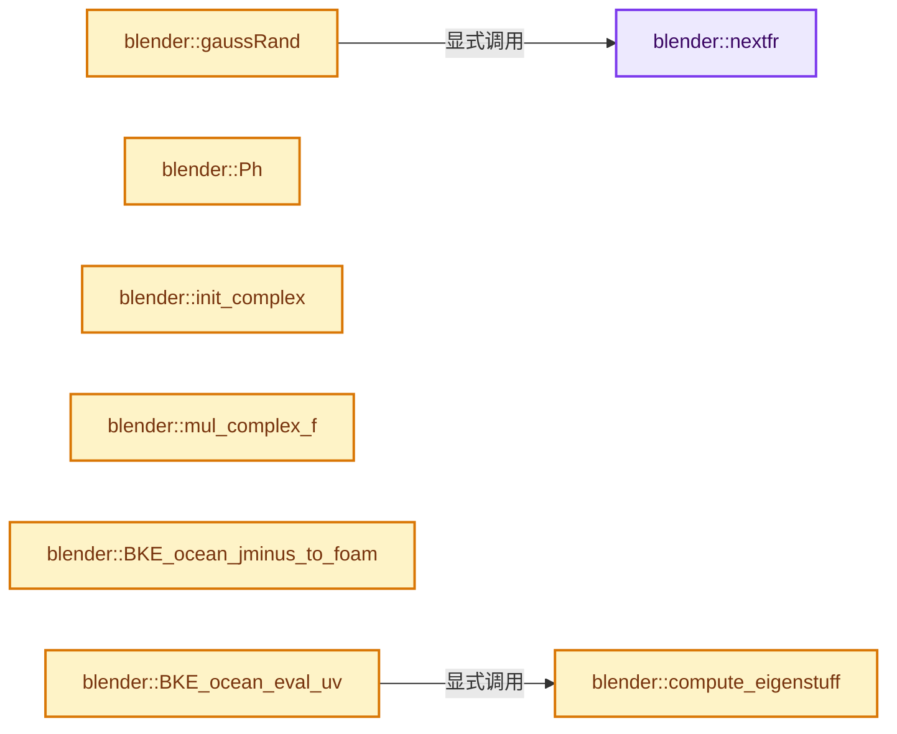
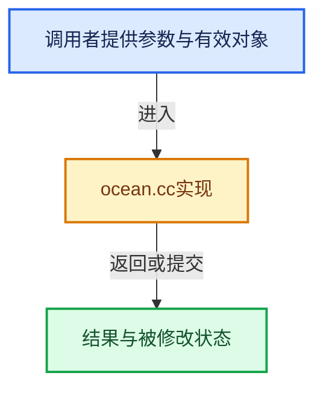

# 实现依赖专题：source/blender/blenkernel/intern/ocean.cc

[方向导航](README.md) · [符号索引](../%E7%AC%A6%E5%8F%B7%E4%BE%9D%E8%B5%96%E4%B8%8E%E5%AE%9E%E7%8E%B0%E7%B4%A2%E5%BC%95.md)

本专题从正文实际调用进入，集中保存共享实现。函数有稳定锚点，可从调用处直接跳到对应完整函数；递归与互相调用通过回链组织。

## 本文件的实现关系






## 完整成员与函数实现

<a id="f-c38df59887866a8d"></a>

### `blender::nextfr`

实现位置：[source/blender/blenkernel/intern/ocean.cc](../../../../../source/blender/blenkernel/intern/ocean.cc) · L48—L51。

接口参数：

- `RNG *rng`
- `float min`
- `float max`

**教学注释版**

<!-- annotated:395a5a8bef9ed2 -->

```cpp
static float nextfr(RNG *rng, float min, float max)
{
  return BLI_rng_get_float(rng) * (min - max) + max;
}
```

<details>
<summary>核对原始源码：source/blender/blenkernel/intern/ocean.cc · L48—L51</summary>

<!-- original:395a5a8bef9ed2:source/blender/blenkernel/intern/ocean.cc:48:51 -->

```cpp
static float nextfr(RNG *rng, float min, float max)
{
  return BLI_rng_get_float(rng) * (min - max) + max;
}
```

</details>

**结果出口**

- `return BLI_rng_get_float(rng) * (min - max) + max;`

**继续追踪实现**

- `BLI_rng_get_float` → [RNG::BLI_rng_get_float · L90](../01-%E5%9F%BA%E7%A1%80%E5%AE%B9%E5%99%A8%E4%B8%8E%E7%8E%B0%E4%BB%A3CPP/%E4%BE%9D%E8%B5%96-rand-171ca2.md#f-964cd94e36f95d8f)。

<a id="f-cedc93de4ef18391"></a>

### `blender::gaussRand`

实现位置：[source/blender/blenkernel/intern/ocean.cc](../../../../../source/blender/blenkernel/intern/ocean.cc) · L53—L69。

接口参数：

- `RNG *rng`

**教学注释版**

<!-- annotated:7f37b19db2b9c5 -->

```cpp
static float gaussRand(RNG *rng)
{
  /* NOTE: to avoid numerical problems with very small numbers, we make these variables
   * single-precision floats, but later we call the double-precision log() and sqrt() functions
   * instead of logf() and sqrtf(). */
  float x;
  float y;
  float length2;

  do {
    x = nextfr(rng, -1, 1);
    y = nextfr(rng, -1, 1);
    length2 = x * x + y * y;
  } while (length2 >= 1 || length2 == 0);

  return x * sqrtf(-2.0f * logf(length2) / length2);
}
```

<details>
<summary>核对原始源码：source/blender/blenkernel/intern/ocean.cc · L53—L69</summary>

<!-- original:7f37b19db2b9c5:source/blender/blenkernel/intern/ocean.cc:53:69 -->

```cpp
static float gaussRand(RNG *rng)
{
  /* NOTE: to avoid numerical problems with very small numbers, we make these variables
   * single-precision floats, but later we call the double-precision log() and sqrt() functions
   * instead of logf() and sqrtf(). */
  float x;
  float y;
  float length2;

  do {
    x = nextfr(rng, -1, 1);
    y = nextfr(rng, -1, 1);
    length2 = x * x + y * y;
  } while (length2 >= 1 || length2 == 0);

  return x * sqrtf(-2.0f * logf(length2) / length2);
}
```

</details>

**沿实际写入检查状态**

- `x = nextfr(rng, -1, 1);`
- `y = nextfr(rng, -1, 1);`
- `length2 = x * x + y * y;`

**结果出口**

- `return x * sqrtf(-2.0f * logf(length2) / length2);`

**继续追踪实现**

- `nextfr` → [blender::nextfr · L48](%E4%BE%9D%E8%B5%96-ocean-b0c3d0.md#f-c38df59887866a8d)。
- `sqrtf` → [外部契约](https://eel.is/c++draft/)：这个边界按实际表达式及所属类型核对参数、返回值、寿命与失败行为。这里提供接口入口，不声称已解释该第三方版本的内部实现。
- `logf` → [logf · L190](%E4%BE%9D%E8%B5%96-compat-56205c.md#m-f53da009c50d)；[logf · L292](%E4%BE%9D%E8%B5%96-compat-efe0e9.md#m-be890a2167de)；[logf · L97](%E4%BE%9D%E8%B5%96-compat-9e0a25.md#m-f421a8b23778)；[logf · L95](%E4%BE%9D%E8%B5%96-compat-e9eab7.md#m-3a440f80084c)。宏定义由构建条件选择。

<a id="f-bfd6d42b876a41d0"></a>

### `blender::Ph`

实现位置：[source/blender/blenkernel/intern/ocean.cc](../../../../../source/blender/blenkernel/intern/ocean.cc) · L86—L103。

接口参数：

- `Ocean *o`
- `float kx`
- `float kz`

**教学注释版**

<!-- annotated:82458a1aae4c13 -->

```cpp
static float Ph(Ocean *o, float kx, float kz)
{
  float tmp;
  float k2 = kx * kx + kz * kz;

  if (k2 == 0.0f) {
    return 0.0f; /* no DC component */
  }

  /* damp out the waves going in the direction opposite the wind */
  tmp = (o->_wx * kx + o->_wz * kz) / sqrtf(k2);
  if (tmp < 0) {
    tmp *= o->_damp_reflections;
  }

  return o->_A * expf(-1.0f / (k2 * (o->_L * o->_L))) * expf(-k2 * (o->_l * o->_l)) *
         powf(fabsf(tmp), o->_wind_alignment) / (k2 * k2);
}
```

<details>
<summary>核对原始源码：source/blender/blenkernel/intern/ocean.cc · L86—L103</summary>

<!-- original:82458a1aae4c13:source/blender/blenkernel/intern/ocean.cc:86:103 -->

```cpp
static float Ph(Ocean *o, float kx, float kz)
{
  float tmp;
  float k2 = kx * kx + kz * kz;

  if (k2 == 0.0f) {
    return 0.0f; /* no DC component */
  }

  /* damp out the waves going in the direction opposite the wind */
  tmp = (o->_wx * kx + o->_wz * kz) / sqrtf(k2);
  if (tmp < 0) {
    tmp *= o->_damp_reflections;
  }

  return o->_A * expf(-1.0f / (k2 * (o->_L * o->_L))) * expf(-k2 * (o->_l * o->_l)) *
         powf(fabsf(tmp), o->_wind_alignment) / (k2 * k2);
}
```

</details>

**沿实际写入检查状态**

- `tmp = (o->_wx * kx + o->_wz * kz) / sqrtf(k2);`
- `tmp *= o->_damp_reflections;`

**结果出口**

- `return 0.0f; /* no DC component */`
- `return o->_A * expf(-1.0f / (k2 * (o->_L * o->_L))) * expf(-k2 * (o->_l * o->_l)) *`

**继续追踪实现**

- `sqrtf` → [外部契约](https://eel.is/c++draft/)：这个边界按实际表达式及所属类型核对参数、返回值、寿命与失败行为。这里提供接口入口，不声称已解释该第三方版本的内部实现。
- `expf` → [expf · L191](%E4%BE%9D%E8%B5%96-compat-56205c.md#m-666ba7d423f9)；[expf · L290](%E4%BE%9D%E8%B5%96-compat-efe0e9.md#m-fd388a772c4f)；[expf · L98](%E4%BE%9D%E8%B5%96-compat-9e0a25.md#m-b7645a57fd6d)；[expf · L96](%E4%BE%9D%E8%B5%96-compat-e9eab7.md#m-2f79e4fe4305)；[expf · L52](%E4%BE%9D%E8%B5%96-GPU_shader_shared_utils-0adda3.md#m-84f40d996637)；[expf · L73](%E4%BE%9D%E8%B5%96-GPU_shader_shared_utils-0adda3.md#m-396d23c747d0)。宏定义由构建条件选择。
- `powf` → [powf · L188](%E4%BE%9D%E8%B5%96-compat-56205c.md#m-d8a2a165b5d3)；[powf · L264](%E4%BE%9D%E8%B5%96-compat-efe0e9.md#m-3de6a9230b53)；[powf · L95](%E4%BE%9D%E8%B5%96-compat-9e0a25.md#m-22a964b66221)；[powf · L93](%E4%BE%9D%E8%B5%96-compat-e9eab7.md#m-64340c9f6eb3)。宏定义由构建条件选择。
- `fabsf` → [fabsf · L21](%E4%BE%9D%E8%B5%96-radial_tiling_shared-98abf9.md#m-02cc4c69cfb3)；[fabsf · L43](%E4%BE%9D%E8%B5%96-radial_tiling_shared-98abf9.md#m-04effe61803b)；[fabsf · L74](%E4%BE%9D%E8%B5%96-radial_tiling_shared-98abf9.md#m-927dd4eba7dc)；[fabsf · L25](../01-%E5%9F%BA%E7%A1%80%E5%AE%B9%E5%99%A8%E4%B8%8E%E7%8E%B0%E4%BB%A3CPP/%E4%BE%9D%E8%B5%96-radial_tiling_shared-7989a4.md#m-8348d6b3d08f)；[fabsf · L47](../01-%E5%9F%BA%E7%A1%80%E5%AE%B9%E5%99%A8%E4%B8%8E%E7%8E%B0%E4%BB%A3CPP/%E4%BE%9D%E8%B5%96-radial_tiling_shared-7989a4.md#m-13b7e0b6d84f)；[fabsf · L78](../01-%E5%9F%BA%E7%A1%80%E5%AE%B9%E5%99%A8%E4%B8%8E%E7%8E%B0%E4%BB%A3CPP/%E4%BE%9D%E8%B5%96-radial_tiling_shared-7989a4.md#m-326c83464a0d)；[fabsf · L21](%E4%BE%9D%E8%B5%96-node_radial_tiling_shared-b14bc2.md#m-7c3ee12fc119)；[fabsf · L43](%E4%BE%9D%E8%B5%96-node_radial_tiling_shared-b14bc2.md#m-9112db0e2dd1)；[fabsf · L74](%E4%BE%9D%E8%B5%96-node_radial_tiling_shared-b14bc2.md#m-ee4e61908a6f)；[fabsf · L167](%E4%BE%9D%E8%B5%96-compat-56205c.md#m-b039ee6c1601)；[fabsf · L265](%E4%BE%9D%E8%B5%96-compat-efe0e9.md#m-6b21869e9f3f)。宏定义由构建条件选择。

<a id="f-252fc86929b6d364"></a>

### `blender::compute_eigenstuff`

实现位置：[source/blender/blenkernel/intern/ocean.cc](../../../../../source/blender/blenkernel/intern/ocean.cc) · L105—L127。

接口参数：

- `OceanResult *ocr`
- `float jxx`
- `float jzz`
- `float jxz`

**教学注释版**

<!-- annotated:63e244959d8057 -->

```cpp
static void compute_eigenstuff(OceanResult *ocr, float jxx, float jzz, float jxz)
{
  float a, b, qplus, qminus;
  a = jxx + jzz;
  b = sqrt((jxx - jzz) * (jxx - jzz) + 4 * jxz * jxz);

  ocr->Jminus = 0.5f * (a - b);
  ocr->Jplus = 0.5f * (a + b);

  qplus = (ocr->Jplus - jxx) / jxz;
  qminus = (ocr->Jminus - jxx) / jxz;

  a = sqrt(1 + qplus * qplus);
  b = sqrt(1 + qminus * qminus);

  ocr->Eplus[0] = 1.0f / a;
  ocr->Eplus[1] = 0.0f;
  ocr->Eplus[2] = qplus / a;

  ocr->Eminus[0] = 1.0f / b;
  ocr->Eminus[1] = 0.0f;
  ocr->Eminus[2] = qminus / b;
}
```

<details>
<summary>核对原始源码：source/blender/blenkernel/intern/ocean.cc · L105—L127</summary>

<!-- original:63e244959d8057:source/blender/blenkernel/intern/ocean.cc:105:127 -->

```cpp
static void compute_eigenstuff(OceanResult *ocr, float jxx, float jzz, float jxz)
{
  float a, b, qplus, qminus;
  a = jxx + jzz;
  b = sqrt((jxx - jzz) * (jxx - jzz) + 4 * jxz * jxz);

  ocr->Jminus = 0.5f * (a - b);
  ocr->Jplus = 0.5f * (a + b);

  qplus = (ocr->Jplus - jxx) / jxz;
  qminus = (ocr->Jminus - jxx) / jxz;

  a = sqrt(1 + qplus * qplus);
  b = sqrt(1 + qminus * qminus);

  ocr->Eplus[0] = 1.0f / a;
  ocr->Eplus[1] = 0.0f;
  ocr->Eplus[2] = qplus / a;

  ocr->Eminus[0] = 1.0f / b;
  ocr->Eminus[1] = 0.0f;
  ocr->Eminus[2] = qminus / b;
}
```

</details>

**沿实际写入检查状态**

- `a = jxx + jzz;`
- `b = sqrt((jxx - jzz) * (jxx - jzz) + 4 * jxz * jxz);`
- `ocr->Jminus = 0.5f * (a - b);`
- `ocr->Jplus = 0.5f * (a + b);`
- `qplus = (ocr->Jplus - jxx) / jxz;`
- `qminus = (ocr->Jminus - jxx) / jxz;`
- `a = sqrt(1 + qplus * qplus);`
- `b = sqrt(1 + qminus * qminus);`
- `ocr->Eplus[0] = 1.0f / a;`
- `ocr->Eplus[1] = 0.0f;`
- `ocr->Eplus[2] = qplus / a;`
- `ocr->Eminus[0] = 1.0f / b;`
- `ocr->Eminus[1] = 0.0f;`
- `ocr->Eminus[2] = qminus / b;`

**继续追踪实现**

- `sqrt` → [外部契约](https://eel.is/c++draft/)：这个边界按实际表达式及所属类型核对参数、返回值、寿命与失败行为。这里提供接口入口，不声称已解释该第三方版本的内部实现。

<a id="f-0017d40b43be69ac"></a>

### `blender::init_complex`

实现位置：[source/blender/blenkernel/intern/ocean.cc](../../../../../source/blender/blenkernel/intern/ocean.cc) · L134—L138。

接口参数：

- `fftw_complex cmpl`
- `float real`
- `float image`

**教学注释版**

<!-- annotated:089a86c0a0b342 -->

```cpp
static void init_complex(fftw_complex cmpl, float real, float image)
{
  cmpl[0] = real;
  cmpl[1] = image;
}
```

<details>
<summary>核对原始源码：source/blender/blenkernel/intern/ocean.cc · L134—L138</summary>

<!-- original:089a86c0a0b342:source/blender/blenkernel/intern/ocean.cc:134:138 -->

```cpp
static void init_complex(fftw_complex cmpl, float real, float image)
{
  cmpl[0] = real;
  cmpl[1] = image;
}
```

</details>

**沿实际写入检查状态**

- `cmpl[0] = real;`
- `cmpl[1] = image;`

**继续追踪实现**

本实现没有需要继续展开的显式调用；检查返回表达式、对象转换和调用者前置条件。

<a id="f-e4619bfa4c6ed93d"></a>

### `blender::mul_complex_f`

实现位置：[source/blender/blenkernel/intern/ocean.cc](../../../../../source/blender/blenkernel/intern/ocean.cc) · L146—L150。

接口参数：

- `fftw_complex res`
- `const fftw_complex cmpl`
- `float f`

**教学注释版**

<!-- annotated:8f4eee97a18d54 -->

```cpp
static void mul_complex_f(fftw_complex res, const fftw_complex cmpl, float f)
{
  res[0] = cmpl[0] * double(f);
  res[1] = cmpl[1] * double(f);
}
```

<details>
<summary>核对原始源码：source/blender/blenkernel/intern/ocean.cc · L146—L150</summary>

<!-- original:8f4eee97a18d54:source/blender/blenkernel/intern/ocean.cc:146:150 -->

```cpp
static void mul_complex_f(fftw_complex res, const fftw_complex cmpl, float f)
{
  res[0] = cmpl[0] * double(f);
  res[1] = cmpl[1] * double(f);
}
```

</details>

**沿实际写入检查状态**

- `res[0] = cmpl[0] * double(f);`
- `res[1] = cmpl[1] * double(f);`

**继续追踪实现**

本实现没有需要继续展开的显式调用；检查返回表达式、对象转换和调用者前置条件。

<a id="f-85bd7e632ca26fee"></a>

### `blender::BKE_ocean_jminus_to_foam`

实现位置：[source/blender/blenkernel/intern/ocean.cc](../../../../../source/blender/blenkernel/intern/ocean.cc) · L185—L190。

接口参数：

- `float jminus`
- `float coverage`

**教学注释版**

<!-- annotated:667ebcc9e72c09 -->

```cpp
float BKE_ocean_jminus_to_foam(float jminus, float coverage)
{
  float foam = jminus * -0.005f + coverage;
  CLAMP(foam, 0.0f, 1.0f);
  return foam;
}
```

<details>
<summary>核对原始源码：source/blender/blenkernel/intern/ocean.cc · L185—L190</summary>

<!-- original:667ebcc9e72c09:source/blender/blenkernel/intern/ocean.cc:185:190 -->

```cpp
float BKE_ocean_jminus_to_foam(float jminus, float coverage)
{
  float foam = jminus * -0.005f + coverage;
  CLAMP(foam, 0.0f, 1.0f);
  return foam;
}
```

</details>

**结果出口**

- `return foam;`

**继续追踪实现**

- `CLAMP` → [CLAMP · L200](../01-%E5%9F%BA%E7%A1%80%E5%AE%B9%E5%99%A8%E4%B8%8E%E7%8E%B0%E4%BB%A3CPP/%E4%BE%9D%E8%B5%96-BLI_utildefines-293a0a.md#m-69703e497120)。宏定义由构建条件选择。

<a id="f-5ae2f1a6e0336c6a"></a>

### `blender::BKE_ocean_eval_uv`

实现位置：[source/blender/blenkernel/intern/ocean.cc](../../../../../source/blender/blenkernel/intern/ocean.cc) · L192—L261。

接口参数：

- `Ocean *oc`
- `OceanResult *ocr`
- `float u`
- `float v`

**教学注释版**

<!-- annotated:1e71cb8dd9aef6 -->

```cpp
void BKE_ocean_eval_uv(Ocean *oc, OceanResult *ocr, float u, float v)
{
  int i0, i1, j0, j1;
  float frac_x, frac_z;
  float uu, vv;

  /* first wrap the texture so 0 <= (u, v) < 1 */
  u = fmodf(u, 1.0f);
  v = fmodf(v, 1.0f);

  if (u < 0) {
    u += 1.0f;
  }
  if (v < 0) {
    v += 1.0f;
  }

  BLI_rw_mutex_lock(&oc->oceanmutex, THREAD_LOCK_READ);

  uu = u * oc->_M;
  vv = v * oc->_N;

  i0 = int(floor(uu));
  j0 = int(floor(vv));

  i1 = (i0 + 1);
  j1 = (j0 + 1);

  frac_x = uu - i0;
  frac_z = vv - j0;

  i0 = i0 % oc->_M;
  j0 = j0 % oc->_N;

  i1 = i1 % oc->_M;
  j1 = j1 % oc->_N;

#  define BILERP(m) \
    interpf(interpf(m[i1 * oc->_N + j1], m[i0 * oc->_N + j1], frac_x), \
            interpf(m[i1 * oc->_N + j0], m[i0 * oc->_N + j0], frac_x), \
            frac_z)

  {
    if (oc->_do_disp_y) {
      ocr->disp[1] = BILERP(oc->_disp_y);
    }

    if (oc->_do_normals) {
      ocr->normal[0] = BILERP(oc->_N_x);
      ocr->normal[1] = oc->_N_y /* BILERP(oc->_N_y) (MEM01) */;
      ocr->normal[2] = BILERP(oc->_N_z);
    }

    if (oc->_do_chop) {
      ocr->disp[0] = BILERP(oc->_disp_x);
      ocr->disp[2] = BILERP(oc->_disp_z);
    }
    else {
      ocr->disp[0] = 0.0;
      ocr->disp[2] = 0.0;
    }

    if (oc->_do_jacobian) {
      compute_eigenstuff(ocr, BILERP(oc->_Jxx), BILERP(oc->_Jzz), BILERP(oc->_Jxz));
    }
  }
#  undef BILERP

  BLI_rw_mutex_unlock(&oc->oceanmutex);
}
```

<details>
<summary>核对原始源码：source/blender/blenkernel/intern/ocean.cc · L192—L261</summary>

<!-- original:1e71cb8dd9aef6:source/blender/blenkernel/intern/ocean.cc:192:261 -->

```cpp
void BKE_ocean_eval_uv(Ocean *oc, OceanResult *ocr, float u, float v)
{
  int i0, i1, j0, j1;
  float frac_x, frac_z;
  float uu, vv;

  /* first wrap the texture so 0 <= (u, v) < 1 */
  u = fmodf(u, 1.0f);
  v = fmodf(v, 1.0f);

  if (u < 0) {
    u += 1.0f;
  }
  if (v < 0) {
    v += 1.0f;
  }

  BLI_rw_mutex_lock(&oc->oceanmutex, THREAD_LOCK_READ);

  uu = u * oc->_M;
  vv = v * oc->_N;

  i0 = int(floor(uu));
  j0 = int(floor(vv));

  i1 = (i0 + 1);
  j1 = (j0 + 1);

  frac_x = uu - i0;
  frac_z = vv - j0;

  i0 = i0 % oc->_M;
  j0 = j0 % oc->_N;

  i1 = i1 % oc->_M;
  j1 = j1 % oc->_N;

#  define BILERP(m) \
    interpf(interpf(m[i1 * oc->_N + j1], m[i0 * oc->_N + j1], frac_x), \
            interpf(m[i1 * oc->_N + j0], m[i0 * oc->_N + j0], frac_x), \
            frac_z)

  {
    if (oc->_do_disp_y) {
      ocr->disp[1] = BILERP(oc->_disp_y);
    }

    if (oc->_do_normals) {
      ocr->normal[0] = BILERP(oc->_N_x);
      ocr->normal[1] = oc->_N_y /* BILERP(oc->_N_y) (MEM01) */;
      ocr->normal[2] = BILERP(oc->_N_z);
    }

    if (oc->_do_chop) {
      ocr->disp[0] = BILERP(oc->_disp_x);
      ocr->disp[2] = BILERP(oc->_disp_z);
    }
    else {
      ocr->disp[0] = 0.0;
      ocr->disp[2] = 0.0;
    }

    if (oc->_do_jacobian) {
      compute_eigenstuff(ocr, BILERP(oc->_Jxx), BILERP(oc->_Jzz), BILERP(oc->_Jxz));
    }
  }
#  undef BILERP

  BLI_rw_mutex_unlock(&oc->oceanmutex);
}
```

</details>

**沿实际写入检查状态**

- `u = fmodf(u, 1.0f);`
- `v = fmodf(v, 1.0f);`
- `u += 1.0f;`
- `v += 1.0f;`
- `uu = u * oc->_M;`
- `vv = v * oc->_N;`
- `i0 = int(floor(uu));`
- `j0 = int(floor(vv));`
- `i1 = (i0 + 1);`
- `j1 = (j0 + 1);`
- `frac_x = uu - i0;`
- `frac_z = vv - j0;`
- `i0 = i0 % oc->_M;`
- `j0 = j0 % oc->_N;`
- `i1 = i1 % oc->_M;`
- `j1 = j1 % oc->_N;`
- `ocr->disp[1] = BILERP(oc->_disp_y);`
- `ocr->normal[0] = BILERP(oc->_N_x);`
- `ocr->normal[1] = oc->_N_y /* BILERP(oc->_N_y) (MEM01) */;`
- `ocr->normal[2] = BILERP(oc->_N_z);`
- `ocr->disp[0] = BILERP(oc->_disp_x);`
- `ocr->disp[2] = BILERP(oc->_disp_z);`
- `ocr->disp[0] = 0.0;`
- `ocr->disp[2] = 0.0;`

**继续追踪实现**

- `fmodf` → [fmodf · L182](%E4%BE%9D%E8%B5%96-compat-56205c.md#m-56e5993ab048)；[fmodf · L277](%E4%BE%9D%E8%B5%96-compat-efe0e9.md#m-d7e7e2616aed)。宏定义由构建条件选择。
- `BLI_rw_mutex_lock` → [BLI_rw_mutex_lock · L470](../01-%E5%9F%BA%E7%A1%80%E5%AE%B9%E5%99%A8%E4%B8%8E%E7%8E%B0%E4%BB%A3CPP/%E4%BE%9D%E8%B5%96-threads-a036bf.md#f-567e78db2b1a0d53)。
- `floor` → [外部契约](https://eel.is/c++draft/)：这个边界按实际表达式及所属类型核对参数、返回值、寿命与失败行为。这里提供接口入口，不声称已解释该第三方版本的内部实现。
- `BILERP` → [调用协议](../%E6%A8%A1%E6%9D%BF%E5%AE%8F%E4%B8%8E%E5%8A%A8%E6%80%81%E5%88%86%E6%B4%BE%E5%8D%8F%E8%AE%AE.md)：函数指针、局部可调用对象或未展开的宏；必须结合调用者环境。调用位置L236。
- `compute_eigenstuff` → [blender::compute_eigenstuff · L105](%E4%BE%9D%E8%B5%96-ocean-b0c3d0.md#f-252fc86929b6d364)。
- `BLI_rw_mutex_unlock` → [BLI_rw_mutex_unlock · L480](../01-%E5%9F%BA%E7%A1%80%E5%AE%B9%E5%99%A8%E4%B8%8E%E7%8E%B0%E4%BB%A3CPP/%E4%BE%9D%E8%B5%96-threads-a036bf.md#f-2b8f406eaca6d7b7)。

<a id="f-9c1572da8ed4248d"></a>

### `blender::BKE_ocean_is_valid`

实现位置：[source/blender/blenkernel/intern/ocean.cc](../../../../../source/blender/blenkernel/intern/ocean.cc) · L640—L643。

接口参数：

- `const Ocean *o`

**教学注释版**

<!-- annotated:2f7f9d0d80f67a -->

```cpp
bool BKE_ocean_is_valid(const Ocean *o)
{
  return o->_k != nullptr;
}
```

<details>
<summary>核对原始源码：source/blender/blenkernel/intern/ocean.cc · L640—L643</summary>

<!-- original:2f7f9d0d80f67a:source/blender/blenkernel/intern/ocean.cc:640:643 -->

```cpp
bool BKE_ocean_is_valid(const Ocean *o)
{
  return o->_k != nullptr;
}
```

</details>

**结果出口**

- `return o->_k != nullptr;`

**继续追踪实现**

本实现没有需要继续展开的显式调用；检查返回表达式、对象转换和调用者前置条件。

<a id="f-7a552f56b3a14e21"></a>

### `blender::BKE_ocean_simulate`

实现位置：[source/blender/blenkernel/intern/ocean.cc](../../../../../source/blender/blenkernel/intern/ocean.cc) · L645—L701。

接口参数：

- `Ocean *o`
- `float t`
- `float scale`
- `float chop_amount`

**教学注释版**

<!-- annotated:5300231430e9a2 -->

```cpp
void BKE_ocean_simulate(Ocean *o, float t, float scale, float chop_amount)
{
  TaskPool *pool;

  OceanSimulateData osd;

  scale *= o->normalize_factor;

  osd.o = o;
  osd.t = t;
  osd.scale = scale;
  osd.chop_amount = chop_amount;

  pool = BLI_task_pool_create(&osd, TASK_PRIORITY_HIGH);

  BLI_rw_mutex_lock(&o->oceanmutex, THREAD_LOCK_WRITE);

  /* Note about multi-threading here: we have to run a first set of computations (htilda one)
   * before we can run all others, since they all depend on it.
   * So we make a first parallelized forloop run for htilda,
   * and then pack all other computations into a set of parallel tasks.
   * This is not optimal in all cases,
   * but remains reasonably simple and should be OK most of the time. */

  /* compute a new htilda */
  TaskParallelSettings settings;
  BLI_parallel_range_settings_defaults(&settings);
  settings.use_threading = (o->_M > 16);
  BLI_task_parallel_range(0, o->_M, &osd, ocean_compute_htilda, &settings);

  if (o->_do_disp_y) {
    BLI_task_pool_push(pool, ocean_compute_displacement_y, nullptr, false, nullptr);
  }

  if (o->_do_chop) {
    BLI_task_pool_push(pool, ocean_compute_displacement_x, nullptr, false, nullptr);
    BLI_task_pool_push(pool, ocean_compute_displacement_z, nullptr, false, nullptr);
  }

  if (o->_do_jacobian) {
    BLI_task_pool_push(pool, ocean_compute_jacobian_jxx, nullptr, false, nullptr);
    BLI_task_pool_push(pool, ocean_compute_jacobian_jzz, nullptr, false, nullptr);
    BLI_task_pool_push(pool, ocean_compute_jacobian_jxz, nullptr, false, nullptr);
  }

  if (o->_do_normals) {
    BLI_task_pool_push(pool, ocean_compute_normal_x, nullptr, false, nullptr);
    BLI_task_pool_push(pool, ocean_compute_normal_z, nullptr, false, nullptr);
    o->_N_y = 1.0f / scale;
  }

  BLI_task_pool_work_and_wait(pool);

  BLI_rw_mutex_unlock(&o->oceanmutex);

  BLI_task_pool_free(pool);
}
```

<details>
<summary>核对原始源码：source/blender/blenkernel/intern/ocean.cc · L645—L701</summary>

<!-- original:5300231430e9a2:source/blender/blenkernel/intern/ocean.cc:645:701 -->

```cpp
void BKE_ocean_simulate(Ocean *o, float t, float scale, float chop_amount)
{
  TaskPool *pool;

  OceanSimulateData osd;

  scale *= o->normalize_factor;

  osd.o = o;
  osd.t = t;
  osd.scale = scale;
  osd.chop_amount = chop_amount;

  pool = BLI_task_pool_create(&osd, TASK_PRIORITY_HIGH);

  BLI_rw_mutex_lock(&o->oceanmutex, THREAD_LOCK_WRITE);

  /* Note about multi-threading here: we have to run a first set of computations (htilda one)
   * before we can run all others, since they all depend on it.
   * So we make a first parallelized forloop run for htilda,
   * and then pack all other computations into a set of parallel tasks.
   * This is not optimal in all cases,
   * but remains reasonably simple and should be OK most of the time. */

  /* compute a new htilda */
  TaskParallelSettings settings;
  BLI_parallel_range_settings_defaults(&settings);
  settings.use_threading = (o->_M > 16);
  BLI_task_parallel_range(0, o->_M, &osd, ocean_compute_htilda, &settings);

  if (o->_do_disp_y) {
    BLI_task_pool_push(pool, ocean_compute_displacement_y, nullptr, false, nullptr);
  }

  if (o->_do_chop) {
    BLI_task_pool_push(pool, ocean_compute_displacement_x, nullptr, false, nullptr);
    BLI_task_pool_push(pool, ocean_compute_displacement_z, nullptr, false, nullptr);
  }

  if (o->_do_jacobian) {
    BLI_task_pool_push(pool, ocean_compute_jacobian_jxx, nullptr, false, nullptr);
    BLI_task_pool_push(pool, ocean_compute_jacobian_jzz, nullptr, false, nullptr);
    BLI_task_pool_push(pool, ocean_compute_jacobian_jxz, nullptr, false, nullptr);
  }

  if (o->_do_normals) {
    BLI_task_pool_push(pool, ocean_compute_normal_x, nullptr, false, nullptr);
    BLI_task_pool_push(pool, ocean_compute_normal_z, nullptr, false, nullptr);
    o->_N_y = 1.0f / scale;
  }

  BLI_task_pool_work_and_wait(pool);

  BLI_rw_mutex_unlock(&o->oceanmutex);

  BLI_task_pool_free(pool);
}
```

</details>

**沿实际写入检查状态**

- `scale *= o->normalize_factor;`
- `osd.o = o;`
- `osd.t = t;`
- `osd.scale = scale;`
- `osd.chop_amount = chop_amount;`
- `pool = BLI_task_pool_create(&osd, TASK_PRIORITY_HIGH);`
- `settings.use_threading = (o->_M > 16);`
- `o->_N_y = 1.0f / scale;`

**继续追踪实现**

- `BLI_task_pool_create` → [BLI_task_pool_create · L404](../11-Depsgraph%E4%B8%8E%E5%B9%B6%E8%A1%8C%E4%BB%BB%E5%8A%A1%E7%B3%BB%E7%BB%9F/07-%E4%BB%BB%E5%8A%A1%E6%B1%A0%E4%B8%8ETBB%E6%8E%A5%E5%85%A5.md#f-1bbb9c0703fd163c)。
- `BLI_rw_mutex_lock` → [BLI_rw_mutex_lock · L470](../01-%E5%9F%BA%E7%A1%80%E5%AE%B9%E5%99%A8%E4%B8%8E%E7%8E%B0%E4%BB%A3CPP/%E4%BE%9D%E8%B5%96-threads-a036bf.md#f-567e78db2b1a0d53)。
- `BLI_parallel_range_settings_defaults` → [blender::BLI_parallel_range_settings_defaults · L218](../01-%E5%9F%BA%E7%A1%80%E5%AE%B9%E5%99%A8%E4%B8%8E%E7%8E%B0%E4%BB%A3CPP/%E4%BE%9D%E8%B5%96-BLI_task_c-917a71.md#f-3858ad801a98e123)。
- `BLI_task_parallel_range` → [blender::BLI_task_parallel_range · L101](../11-Depsgraph%E4%B8%8E%E5%B9%B6%E8%A1%8C%E4%BB%BB%E5%8A%A1%E7%B3%BB%E7%BB%9F/08-%E4%BB%BB%E5%8A%A1%E9%9A%94%E7%A6%BB%E6%AD%BB%E9%94%81%E4%B8%8E%E5%AE%9E%E6%88%98.md#f-9d237d7e4e78d7e2)。
- `BLI_task_pool_push` → [BLI_task_pool_push · L446](../11-Depsgraph%E4%B8%8E%E5%B9%B6%E8%A1%8C%E4%BB%BB%E5%8A%A1%E7%B3%BB%E7%BB%9F/07-%E4%BB%BB%E5%8A%A1%E6%B1%A0%E4%B8%8ETBB%E6%8E%A5%E5%85%A5.md#f-16c248b3ea6653d2)。
- `BLI_task_pool_work_and_wait` → [BLI_task_pool_work_and_wait · L455](../11-Depsgraph%E4%B8%8E%E5%B9%B6%E8%A1%8C%E4%BB%BB%E5%8A%A1%E7%B3%BB%E7%BB%9F/07-%E4%BB%BB%E5%8A%A1%E6%B1%A0%E4%B8%8ETBB%E6%8E%A5%E5%85%A5.md#f-cece9e6aa22a9121)。
- `BLI_rw_mutex_unlock` → [BLI_rw_mutex_unlock · L480](../01-%E5%9F%BA%E7%A1%80%E5%AE%B9%E5%99%A8%E4%B8%8E%E7%8E%B0%E4%BB%A3CPP/%E4%BE%9D%E8%B5%96-threads-a036bf.md#f-2b8f406eaca6d7b7)。
- `BLI_task_pool_free` → [BLI_task_pool_free · L441](../11-Depsgraph%E4%B8%8E%E5%B9%B6%E8%A1%8C%E4%BB%BB%E5%8A%A1%E7%B3%BB%E7%BB%9F/07-%E4%BB%BB%E5%8A%A1%E6%B1%A0%E4%B8%8ETBB%E6%8E%A5%E5%85%A5.md#f-b9af08e8b1362aaa)。

<a id="f-507d80a1548b660d"></a>

### `blender::set_height_normalize_factor`

实现位置：[source/blender/blenkernel/intern/ocean.cc](../../../../../source/blender/blenkernel/intern/ocean.cc) · L703—L735。

接口参数：

- `Ocean *oc`

**教学注释版**

<!-- annotated:c692f2e954507a -->

```cpp
static void set_height_normalize_factor(Ocean *oc)
{
  float res = 1.0;
  float max_h = 0.0;

  int i, j;

  if (!oc->_do_disp_y) {
    return;
  }

  oc->normalize_factor = 1.0;

  BKE_ocean_simulate(oc, 0.0, 1.0, 0);

  BLI_rw_mutex_lock(&oc->oceanmutex, THREAD_LOCK_READ);

  for (i = 0; i < oc->_M; i++) {
    for (j = 0; j < oc->_N; j++) {
      // [讲解] std::max<double>：按比较关系选取较大值。本讲解中的增长公式同时满足最低请求和几何增长；若保存返回引用，还需注意实参寿命。
      max_h = std::max<double>(max_h, fabs(oc->_disp_y[i * oc->_N + j]));
    }
  }

  BLI_rw_mutex_unlock(&oc->oceanmutex);

  if (max_h == 0.0f) {
    max_h = 0.00001f; /* just in case ... */
  }

  res = 1.0f / (max_h);

  oc->normalize_factor = res;
}
```

<details>
<summary>核对原始源码：source/blender/blenkernel/intern/ocean.cc · L703—L735</summary>

<!-- original:c692f2e954507a:source/blender/blenkernel/intern/ocean.cc:703:735 -->

```cpp
static void set_height_normalize_factor(Ocean *oc)
{
  float res = 1.0;
  float max_h = 0.0;

  int i, j;

  if (!oc->_do_disp_y) {
    return;
  }

  oc->normalize_factor = 1.0;

  BKE_ocean_simulate(oc, 0.0, 1.0, 0);

  BLI_rw_mutex_lock(&oc->oceanmutex, THREAD_LOCK_READ);

  for (i = 0; i < oc->_M; i++) {
    for (j = 0; j < oc->_N; j++) {
      max_h = std::max<double>(max_h, fabs(oc->_disp_y[i * oc->_N + j]));
    }
  }

  BLI_rw_mutex_unlock(&oc->oceanmutex);

  if (max_h == 0.0f) {
    max_h = 0.00001f; /* just in case ... */
  }

  res = 1.0f / (max_h);

  oc->normalize_factor = res;
}
```

</details>

**沿实际写入检查状态**

- `oc->normalize_factor = 1.0;`
- `max_h = std::max<double>(max_h, fabs(oc->_disp_y[i * oc->_N + j]));`
- `max_h = 0.00001f; /* just in case ... */`
- `res = 1.0f / (max_h);`
- `oc->normalize_factor = res;`

**继续追踪实现**

- `BKE_ocean_simulate` → [blender::BKE_ocean_simulate · L645](%E4%BE%9D%E8%B5%96-ocean-b0c3d0.md#f-7a552f56b3a14e21)；[blender::BKE_ocean_simulate · L1581](%E4%BE%9D%E8%B5%96-ocean-b0c3d0.md#f-d4a0c8cab1f9d632)。同名重载需按实参类型选择。
- `BLI_rw_mutex_lock` → [BLI_rw_mutex_lock · L470](../01-%E5%9F%BA%E7%A1%80%E5%AE%B9%E5%99%A8%E4%B8%8E%E7%8E%B0%E4%BB%A3CPP/%E4%BE%9D%E8%B5%96-threads-a036bf.md#f-567e78db2b1a0d53)。
- `std::max<double>` → [外部契约](https://eel.is/c++draft/alg.min.max)：按比较关系选取较大值。本讲解中的增长公式同时满足最低请求和几何增长；若保存返回引用，还需注意实参寿命。
- `fabs` → [外部契约](https://eel.is/c++draft/)：这个边界按实际表达式及所属类型核对参数、返回值、寿命与失败行为。这里提供接口入口，不声称已解释该第三方版本的内部实现。
- `BLI_rw_mutex_unlock` → [BLI_rw_mutex_unlock · L480](../01-%E5%9F%BA%E7%A1%80%E5%AE%B9%E5%99%A8%E4%B8%8E%E7%8E%B0%E4%BB%A3CPP/%E4%BE%9D%E8%B5%96-threads-a036bf.md#f-2b8f406eaca6d7b7)。

<a id="f-60af45eac500e092"></a>

### `blender::BKE_ocean_add`

实现位置：[source/blender/blenkernel/intern/ocean.cc](../../../../../source/blender/blenkernel/intern/ocean.cc) · L737—L744。

**教学注释版**

<!-- annotated:8895e80cd1432f -->

```cpp
Ocean *BKE_ocean_add()
{
  Ocean *oc = MEM_new_zeroed<Ocean>("ocean sim data");

  BLI_rw_mutex_init(&oc->oceanmutex);

  return oc;
}
```

<details>
<summary>核对原始源码：source/blender/blenkernel/intern/ocean.cc · L737—L744</summary>

<!-- original:8895e80cd1432f:source/blender/blenkernel/intern/ocean.cc:737:744 -->

```cpp
Ocean *BKE_ocean_add()
{
  Ocean *oc = MEM_new_zeroed<Ocean>("ocean sim data");

  BLI_rw_mutex_init(&oc->oceanmutex);

  return oc;
}
```

</details>

**结果出口**

- `return oc;`

**继续追踪实现**

- `MEM_new_zeroed<Ocean>` → [MEM_new_zeroed · L550](../03-%E5%86%85%E5%AD%98%E5%88%86%E9%85%8D%E4%B8%8E%E8%BF%90%E8%A1%8C%E6%97%B6%E7%B1%BB%E5%9E%8B/%E4%BE%9D%E8%B5%96-MEM_guardedalloc-b54eca.md#f-eeb1e2a7f57dd231)；[MEM_new_zeroed · L114](../03-%E5%86%85%E5%AD%98%E5%88%86%E9%85%8D%E4%B8%8E%E8%BF%90%E8%A1%8C%E6%97%B6%E7%B1%BB%E5%9E%8B/%E4%BE%9D%E8%B5%96-mallocn-afdcd4.md#f-e04cf01c64c8b180)。同名重载需按实参类型选择。
- `BLI_rw_mutex_init` → [BLI_rw_mutex_init · L465](../01-%E5%9F%BA%E7%A1%80%E5%AE%B9%E5%99%A8%E4%B8%8E%E7%8E%B0%E4%BB%A3CPP/%E4%BE%9D%E8%B5%96-threads-a036bf.md#f-8dee1f89b3d86ffa)。

<a id="f-c0aa481cf787bc99"></a>

### `blender::BKE_ocean_ensure`

实现位置：[source/blender/blenkernel/intern/ocean.cc](../../../../../source/blender/blenkernel/intern/ocean.cc) · L746—L760。

接口参数：

- `OceanModifierData *omd`
- `const int resolution`

**教学注释版**

<!-- annotated:bb009461023b8d -->

```cpp
bool BKE_ocean_ensure(OceanModifierData *omd, const int resolution)
{
  if (omd->ocean) {
    /* Check that the ocean has the same resolution than we want now. */
    if (omd->ocean->_M == resolution * resolution) {
      return false;
    }

    BKE_ocean_free(omd->ocean);
  }

  omd->ocean = BKE_ocean_add();
  BKE_ocean_init_from_modifier(omd->ocean, omd, resolution);
  return true;
}
```

<details>
<summary>核对原始源码：source/blender/blenkernel/intern/ocean.cc · L746—L760</summary>

<!-- original:bb009461023b8d:source/blender/blenkernel/intern/ocean.cc:746:760 -->

```cpp
bool BKE_ocean_ensure(OceanModifierData *omd, const int resolution)
{
  if (omd->ocean) {
    /* Check that the ocean has the same resolution than we want now. */
    if (omd->ocean->_M == resolution * resolution) {
      return false;
    }

    BKE_ocean_free(omd->ocean);
  }

  omd->ocean = BKE_ocean_add();
  BKE_ocean_init_from_modifier(omd->ocean, omd, resolution);
  return true;
}
```

</details>

**沿实际写入检查状态**

- `omd->ocean = BKE_ocean_add();`

**结果出口**

- `return false;`
- `return true;`

**继续追踪实现**

- `BKE_ocean_free` → [blender::BKE_ocean_free · L1102](%E4%BE%9D%E8%B5%96-ocean-b0c3d0.md#f-1752ed059f8a24a5)；[blender::BKE_ocean_free · L1618](%E4%BE%9D%E8%B5%96-ocean-b0c3d0.md#f-f6b9e0fadc362e55)。同名重载需按实参类型选择。
- `BKE_ocean_add` → [blender::BKE_ocean_add · L737](%E4%BE%9D%E8%B5%96-ocean-b0c3d0.md#f-60af45eac500e092)；[blender::BKE_ocean_add · L1583](%E4%BE%9D%E8%B5%96-ocean-b0c3d0.md#f-c4d0689015258b5b)。同名重载需按实参类型选择。
- `BKE_ocean_init_from_modifier` → [blender::BKE_ocean_init_from_modifier · L762](%E4%BE%9D%E8%B5%96-ocean-b0c3d0.md#f-4458a64cce71384d)；[blender::BKE_ocean_init_from_modifier · L1673](%E4%BE%9D%E8%B5%96-ocean-b0c3d0.md#f-5808be70c0b77856)。同名重载需按实参类型选择。

<a id="f-4458a64cce71384d"></a>

### `blender::BKE_ocean_init_from_modifier`

实现位置：[source/blender/blenkernel/intern/ocean.cc](../../../../../source/blender/blenkernel/intern/ocean.cc) · L762—L796。

接口参数：

- `Ocean *ocean`
- `OceanModifierData const *omd`
- `const int resolution`

**教学注释版**

<!-- annotated:e7b7ab06b75ed6 -->

```cpp
bool BKE_ocean_init_from_modifier(Ocean *ocean, OceanModifierData const *omd, const int resolution)
{
  short do_heightfield, do_chop, do_normals, do_jacobian, do_spray;

  do_heightfield = true;
  do_chop = (omd->chop_amount > 0);
  do_normals = (omd->flag & MOD_OCEAN_GENERATE_NORMALS);
  do_jacobian = (omd->flag & MOD_OCEAN_GENERATE_FOAM);
  do_spray = do_jacobian && (omd->flag & MOD_OCEAN_GENERATE_SPRAY);

  BKE_ocean_free_data(ocean);

  return BKE_ocean_init(ocean,
                        resolution * resolution,
                        resolution * resolution,
                        omd->spatial_size,
                        omd->spatial_size,
                        omd->wind_velocity,
                        omd->smallest_wave,
                        1.0,
                        omd->wave_direction,
                        omd->damp,
                        omd->wave_alignment,
                        omd->depth,
                        omd->time,
                        omd->spectrum,
                        omd->fetch_jonswap,
                        omd->sharpen_peak_jonswap,
                        do_heightfield,
                        do_chop,
                        do_spray,
                        do_normals,
                        do_jacobian,
                        omd->seed);
}
```

<details>
<summary>核对原始源码：source/blender/blenkernel/intern/ocean.cc · L762—L796</summary>

<!-- original:e7b7ab06b75ed6:source/blender/blenkernel/intern/ocean.cc:762:796 -->

```cpp
bool BKE_ocean_init_from_modifier(Ocean *ocean, OceanModifierData const *omd, const int resolution)
{
  short do_heightfield, do_chop, do_normals, do_jacobian, do_spray;

  do_heightfield = true;
  do_chop = (omd->chop_amount > 0);
  do_normals = (omd->flag & MOD_OCEAN_GENERATE_NORMALS);
  do_jacobian = (omd->flag & MOD_OCEAN_GENERATE_FOAM);
  do_spray = do_jacobian && (omd->flag & MOD_OCEAN_GENERATE_SPRAY);

  BKE_ocean_free_data(ocean);

  return BKE_ocean_init(ocean,
                        resolution * resolution,
                        resolution * resolution,
                        omd->spatial_size,
                        omd->spatial_size,
                        omd->wind_velocity,
                        omd->smallest_wave,
                        1.0,
                        omd->wave_direction,
                        omd->damp,
                        omd->wave_alignment,
                        omd->depth,
                        omd->time,
                        omd->spectrum,
                        omd->fetch_jonswap,
                        omd->sharpen_peak_jonswap,
                        do_heightfield,
                        do_chop,
                        do_spray,
                        do_normals,
                        do_jacobian,
                        omd->seed);
}
```

</details>

**沿实际写入检查状态**

- `do_heightfield = true;`
- `do_chop = (omd->chop_amount > 0);`
- `do_normals = (omd->flag & MOD_OCEAN_GENERATE_NORMALS);`
- `do_jacobian = (omd->flag & MOD_OCEAN_GENERATE_FOAM);`
- `do_spray = do_jacobian && (omd->flag & MOD_OCEAN_GENERATE_SPRAY);`

**结果出口**

- `return BKE_ocean_init(ocean,`

**继续追踪实现**

- `BKE_ocean_free_data` → [blender::BKE_ocean_free_data · L1037](%E4%BE%9D%E8%B5%96-ocean-b0c3d0.md#f-3df18e56944eb7f4)；[blender::BKE_ocean_free_data · L1616](%E4%BE%9D%E8%B5%96-ocean-b0c3d0.md#f-9b0bd6387f1cc5a2)。同名重载需按实参类型选择。
- `BKE_ocean_init` → [blender::BKE_ocean_init · L798](%E4%BE%9D%E8%B5%96-ocean-b0c3d0.md#f-c27f594c42c60507)；[blender::BKE_ocean_init · L1590](%E4%BE%9D%E8%B5%96-ocean-b0c3d0.md#f-f7299868e4ffc8e2)。同名重载需按实参类型选择。

<a id="f-c27f594c42c60507"></a>

### `blender::BKE_ocean_init`

实现位置：[source/blender/blenkernel/intern/ocean.cc](../../../../../source/blender/blenkernel/intern/ocean.cc) · L798—L1035。

接口参数：

- `Ocean *o`
- `int M`
- `int N`
- `float Lx`
- `float Lz`
- `float V`
- `float l`
- `float A`
- `float w`
- `float damp`
- `float alignment`
- `float depth`
- `float time`
- `int spectrum`
- `float fetch_jonswap`
- `float sharpen_peak_jonswap`
- `short do_height_field`
- `short do_chop`
- `short do_spray`
- `short do_normals`
- `short do_jacobian`
- `int seed`

**教学注释版**

<!-- annotated:66336799065af2 -->

```cpp
bool BKE_ocean_init(Ocean *o,
                    int M,
                    int N,
                    float Lx,
                    float Lz,
                    float V,
                    float l,
                    float A,
                    float w,
                    float damp,
                    float alignment,
                    float depth,
                    float time,
                    int spectrum,
                    float fetch_jonswap,
                    float sharpen_peak_jonswap,
                    short do_height_field,
                    short do_chop,
                    short do_spray,
                    short do_normals,
                    short do_jacobian,
                    int seed)
{
  int i, j, ii;

  BLI_rw_mutex_lock(&o->oceanmutex, THREAD_LOCK_WRITE);

  o->_M = M;
  o->_N = N;
  o->_V = V;
  o->_l = l;
  o->_A = A;
  o->_w = w;
  o->_damp_reflections = 1.0f - damp;
  o->_wind_alignment = alignment * 10.0f;
  o->_depth = depth;
  o->_Lx = Lx;
  o->_Lz = Lz;
  o->_wx = cos(w);
  o->_wz = -sin(w);        /* wave direction */
  o->_L = V * V / GRAVITY; /* largest wave for a given velocity V */
  o->time = time;

  /* Spectrum to use. */
  o->_spectrum = spectrum;

  /* Common JONSWAP parameters. */
  o->_fetch_jonswap = fetch_jonswap;
  o->_sharpen_peak_jonswap = sharpen_peak_jonswap * 10.0f;

  /* NOTE: most modifiers don't account for failure to allocate.
   * In this case however a large resolution can easily perform large allocations that fail,
   * support early exiting in this case. */
  if ((o->_k = MEM_new_array_uninitialized<float>(size_t(M) * (1 + size_t(N) / 2), "ocean_k")) &&
      (o->_h0 = MEM_new_array_uninitialized<fftw_complex>(size_t(M) * size_t(N), "ocean_h0")) &&
      (o->_h0_minus = MEM_new_array_uninitialized<fftw_complex>(size_t(M) * size_t(N),
                                                                "ocean_h0_minus")) &&
      (o->_kx = MEM_new_array_uninitialized<float>(size_t(o->_M), "ocean_kx")) &&
      (o->_kz = MEM_new_array_uninitialized<float>(size_t(o->_N), "ocean_kz")))
  {
    /* Success. */
  }
  else {
    MEM_SAFE_DELETE(o->_k);
    MEM_SAFE_DELETE(o->_h0);
    MEM_SAFE_DELETE(o->_h0_minus);
    MEM_SAFE_DELETE(o->_kx);
    MEM_SAFE_DELETE(o->_kz);

    BLI_rw_mutex_unlock(&o->oceanmutex);
    return false;
  }

  o->_do_disp_y = do_height_field;
  o->_do_normals = do_normals;
  o->_do_spray = do_spray;
  o->_do_chop = do_chop;
  o->_do_jacobian = do_jacobian;

  /* make this robust in the face of erroneous usage */
  if (o->_Lx == 0.0f) {
    o->_Lx = 0.001f;
  }

  if (o->_Lz == 0.0f) {
    o->_Lz = 0.001f;
  }

  /* The +VE components and DC. */
  for (i = 0; i <= o->_M / 2; i++) {
    o->_kx[i] = 2.0f * float(M_PI) * i / o->_Lx;
  }

  /* The -VE components. */
  for (i = o->_M - 1, ii = 0; i > o->_M / 2; i--, ii++) {
    o->_kx[i] = -2.0f * float(M_PI) * ii / o->_Lx;
  }

  /* The +VE components and DC. */
  for (i = 0; i <= o->_N / 2; i++) {
    o->_kz[i] = 2.0f * float(M_PI) * i / o->_Lz;
  }

  /* The -VE components. */
  for (i = o->_N - 1, ii = 0; i > o->_N / 2; i--, ii++) {
    o->_kz[i] = -2.0f * float(M_PI) * ii / o->_Lz;
  }

  /* pre-calculate the k matrix */
  for (i = 0; i < o->_M; i++) {
    for (j = 0; j <= o->_N / 2; j++) {
      o->_k[size_t(i) * (1 + o->_N / 2) + j] = sqrt(o->_kx[i] * o->_kx[i] + o->_kz[j] * o->_kz[j]);
    }
  }

  RNG *rng = BLI_rng_new(seed);

  for (i = 0; i < o->_M; i++) {
    for (j = 0; j < o->_N; j++) {
      /* This ensures we get a value tied to the surface location, avoiding dramatic surface
       * change with changing resolution.
       * Explicitly cast to signed int first to ensure consistent behavior on all processors,
       * since behavior of `float` to `uint` cast is undefined in C. */
      const int hash_x = o->_kx[i] * 360.0f;
      const int hash_z = o->_kz[j] * 360.0f;
      int new_seed = seed + BLI_hash_int_2d(hash_x, hash_z);

      BLI_rng_seed(rng, new_seed);
      float r1 = gaussRand(rng);
      float r2 = gaussRand(rng);

      fftw_complex r1r2;
      init_complex(r1r2, r1, r2);
      switch (o->_spectrum) {
        case MOD_OCEAN_SPECTRUM_JONSWAP:
          mul_complex_f(o->_h0[i * o->_N + j],
                        r1r2,
                        sqrt(BLI_ocean_spectrum_jonswap(o, o->_kx[i], o->_kz[j]) / 2.0f));
          mul_complex_f(o->_h0_minus[i * o->_N + j],
                        r1r2,
                        sqrt(BLI_ocean_spectrum_jonswap(o, -o->_kx[i], -o->_kz[j]) / 2.0f));
          break;
        case MOD_OCEAN_SPECTRUM_TEXEL_MARSEN_ARSLOE:
          mul_complex_f(
              o->_h0[i * o->_N + j],
              r1r2,
              sqrt(BLI_ocean_spectrum_texelmarsenarsloe(o, o->_kx[i], o->_kz[j]) / 2.0f));
          mul_complex_f(
              o->_h0_minus[i * o->_N + j],
              r1r2,
              sqrt(BLI_ocean_spectrum_texelmarsenarsloe(o, -o->_kx[i], -o->_kz[j]) / 2.0f));
          break;
        case MOD_OCEAN_SPECTRUM_PIERSON_MOSKOWITZ:
          mul_complex_f(o->_h0[i * o->_N + j],
                        r1r2,
                        sqrt(BLI_ocean_spectrum_piersonmoskowitz(o, o->_kx[i], o->_kz[j]) / 2.0f));
          mul_complex_f(
              o->_h0_minus[i * o->_N + j],
              r1r2,
              sqrt(BLI_ocean_spectrum_piersonmoskowitz(o, -o->_kx[i], -o->_kz[j]) / 2.0f));
          break;
        default:
          mul_complex_f(o->_h0[i * o->_N + j], r1r2, sqrt(Ph(o, o->_kx[i], o->_kz[j]) / 2.0f));
          mul_complex_f(
              o->_h0_minus[i * o->_N + j], r1r2, sqrt(Ph(o, -o->_kx[i], -o->_kz[j]) / 2.0f));
          break;
      }
    }
  }

  o->_fft_in = MEM_new_array_uninitialized<fftw_complex>(size_t(o->_M) * (1 + size_t(o->_N) / 2),
                                                         "ocean_fft_in");
  o->_htilda = MEM_new_array_uninitialized<fftw_complex>(size_t(o->_M) * (1 + size_t(o->_N) / 2),
                                                         "ocean_htilda");

  BLI_thread_lock(LOCK_FFTW);

  if (o->_do_disp_y) {
    o->_disp_y = MEM_new_array_uninitialized<double>(size_t(o->_M) * size_t(o->_N),
                                                     "ocean_disp_y");
    o->_disp_y_plan = fftw_plan_dft_c2r_2d(o->_M, o->_N, o->_fft_in, o->_disp_y, FFTW_ESTIMATE);
  }

  if (o->_do_normals) {
    o->_fft_in_nx = MEM_new_array_uninitialized<fftw_complex>(
        size_t(o->_M) * (1 + size_t(o->_N) / 2), "ocean_fft_in_nx");
    o->_fft_in_nz = MEM_new_array_uninitialized<fftw_complex>(
        size_t(o->_M) * (1 + size_t(o->_N) / 2), "ocean_fft_in_nz");

    o->_N_x = MEM_new_array_uninitialized<double>(size_t(o->_M) * size_t(o->_N), "ocean_N_x");
    // o->_N_y = (float *) fftwf_malloc(o->_M * o->_N * sizeof(float)); /* (MEM01) */
    o->_N_z = MEM_new_array_uninitialized<double>(size_t(o->_M) * size_t(o->_N), "ocean_N_z");

    o->_N_x_plan = fftw_plan_dft_c2r_2d(o->_M, o->_N, o->_fft_in_nx, o->_N_x, FFTW_ESTIMATE);
    o->_N_z_plan = fftw_plan_dft_c2r_2d(o->_M, o->_N, o->_fft_in_nz, o->_N_z, FFTW_ESTIMATE);
  }

  if (o->_do_chop) {
    o->_fft_in_x = MEM_new_array_uninitialized<fftw_complex>(
        size_t(o->_M) * (1 + size_t(o->_N) / 2), "ocean_fft_in_x");
    o->_fft_in_z = MEM_new_array_uninitialized<fftw_complex>(
        size_t(o->_M) * (1 + size_t(o->_N) / 2), "ocean_fft_in_z");

    o->_disp_x = MEM_new_array_uninitialized<double>(size_t(o->_M) * size_t(o->_N),
                                                     "ocean_disp_x");
    o->_disp_z = MEM_new_array_uninitialized<double>(size_t(o->_M) * size_t(o->_N),
                                                     "ocean_disp_z");

    o->_disp_x_plan = fftw_plan_dft_c2r_2d(o->_M, o->_N, o->_fft_in_x, o->_disp_x, FFTW_ESTIMATE);
    o->_disp_z_plan = fftw_plan_dft_c2r_2d(o->_M, o->_N, o->_fft_in_z, o->_disp_z, FFTW_ESTIMATE);
  }
  if (o->_do_jacobian) {
    o->_fft_in_jxx = MEM_new_array_uninitialized<fftw_complex>(
        size_t(o->_M) * (1 + size_t(o->_N) / 2), "ocean_fft_in_jxx");
    o->_fft_in_jzz = MEM_new_array_uninitialized<fftw_complex>(
        size_t(o->_M) * (1 + size_t(o->_N) / 2), "ocean_fft_in_jzz");
    o->_fft_in_jxz = MEM_new_array_uninitialized<fftw_complex>(
        size_t(o->_M) * (1 + size_t(o->_N) / 2), "ocean_fft_in_jxz");

    o->_Jxx = MEM_new_array_uninitialized<double>(size_t(o->_M) * size_t(o->_N), "ocean_Jxx");
    o->_Jzz = MEM_new_array_uninitialized<double>(size_t(o->_M) * size_t(o->_N), "ocean_Jzz");
    o->_Jxz = MEM_new_array_uninitialized<double>(size_t(o->_M) * size_t(o->_N), "ocean_Jxz");

    o->_Jxx_plan = fftw_plan_dft_c2r_2d(o->_M, o->_N, o->_fft_in_jxx, o->_Jxx, FFTW_ESTIMATE);
    o->_Jzz_plan = fftw_plan_dft_c2r_2d(o->_M, o->_N, o->_fft_in_jzz, o->_Jzz, FFTW_ESTIMATE);
    o->_Jxz_plan = fftw_plan_dft_c2r_2d(o->_M, o->_N, o->_fft_in_jxz, o->_Jxz, FFTW_ESTIMATE);
  }

  BLI_thread_unlock(LOCK_FFTW);

  BLI_rw_mutex_unlock(&o->oceanmutex);

  set_height_normalize_factor(o);

  BLI_rng_free(rng);

  return true;
}
```

<details>
<summary>核对原始源码：source/blender/blenkernel/intern/ocean.cc · L798—L1035</summary>

<!-- original:66336799065af2:source/blender/blenkernel/intern/ocean.cc:798:1035 -->

```cpp
bool BKE_ocean_init(Ocean *o,
                    int M,
                    int N,
                    float Lx,
                    float Lz,
                    float V,
                    float l,
                    float A,
                    float w,
                    float damp,
                    float alignment,
                    float depth,
                    float time,
                    int spectrum,
                    float fetch_jonswap,
                    float sharpen_peak_jonswap,
                    short do_height_field,
                    short do_chop,
                    short do_spray,
                    short do_normals,
                    short do_jacobian,
                    int seed)
{
  int i, j, ii;

  BLI_rw_mutex_lock(&o->oceanmutex, THREAD_LOCK_WRITE);

  o->_M = M;
  o->_N = N;
  o->_V = V;
  o->_l = l;
  o->_A = A;
  o->_w = w;
  o->_damp_reflections = 1.0f - damp;
  o->_wind_alignment = alignment * 10.0f;
  o->_depth = depth;
  o->_Lx = Lx;
  o->_Lz = Lz;
  o->_wx = cos(w);
  o->_wz = -sin(w);        /* wave direction */
  o->_L = V * V / GRAVITY; /* largest wave for a given velocity V */
  o->time = time;

  /* Spectrum to use. */
  o->_spectrum = spectrum;

  /* Common JONSWAP parameters. */
  o->_fetch_jonswap = fetch_jonswap;
  o->_sharpen_peak_jonswap = sharpen_peak_jonswap * 10.0f;

  /* NOTE: most modifiers don't account for failure to allocate.
   * In this case however a large resolution can easily perform large allocations that fail,
   * support early exiting in this case. */
  if ((o->_k = MEM_new_array_uninitialized<float>(size_t(M) * (1 + size_t(N) / 2), "ocean_k")) &&
      (o->_h0 = MEM_new_array_uninitialized<fftw_complex>(size_t(M) * size_t(N), "ocean_h0")) &&
      (o->_h0_minus = MEM_new_array_uninitialized<fftw_complex>(size_t(M) * size_t(N),
                                                                "ocean_h0_minus")) &&
      (o->_kx = MEM_new_array_uninitialized<float>(size_t(o->_M), "ocean_kx")) &&
      (o->_kz = MEM_new_array_uninitialized<float>(size_t(o->_N), "ocean_kz")))
  {
    /* Success. */
  }
  else {
    MEM_SAFE_DELETE(o->_k);
    MEM_SAFE_DELETE(o->_h0);
    MEM_SAFE_DELETE(o->_h0_minus);
    MEM_SAFE_DELETE(o->_kx);
    MEM_SAFE_DELETE(o->_kz);

    BLI_rw_mutex_unlock(&o->oceanmutex);
    return false;
  }

  o->_do_disp_y = do_height_field;
  o->_do_normals = do_normals;
  o->_do_spray = do_spray;
  o->_do_chop = do_chop;
  o->_do_jacobian = do_jacobian;

  /* make this robust in the face of erroneous usage */
  if (o->_Lx == 0.0f) {
    o->_Lx = 0.001f;
  }

  if (o->_Lz == 0.0f) {
    o->_Lz = 0.001f;
  }

  /* The +VE components and DC. */
  for (i = 0; i <= o->_M / 2; i++) {
    o->_kx[i] = 2.0f * float(M_PI) * i / o->_Lx;
  }

  /* The -VE components. */
  for (i = o->_M - 1, ii = 0; i > o->_M / 2; i--, ii++) {
    o->_kx[i] = -2.0f * float(M_PI) * ii / o->_Lx;
  }

  /* The +VE components and DC. */
  for (i = 0; i <= o->_N / 2; i++) {
    o->_kz[i] = 2.0f * float(M_PI) * i / o->_Lz;
  }

  /* The -VE components. */
  for (i = o->_N - 1, ii = 0; i > o->_N / 2; i--, ii++) {
    o->_kz[i] = -2.0f * float(M_PI) * ii / o->_Lz;
  }

  /* pre-calculate the k matrix */
  for (i = 0; i < o->_M; i++) {
    for (j = 0; j <= o->_N / 2; j++) {
      o->_k[size_t(i) * (1 + o->_N / 2) + j] = sqrt(o->_kx[i] * o->_kx[i] + o->_kz[j] * o->_kz[j]);
    }
  }

  RNG *rng = BLI_rng_new(seed);

  for (i = 0; i < o->_M; i++) {
    for (j = 0; j < o->_N; j++) {
      /* This ensures we get a value tied to the surface location, avoiding dramatic surface
       * change with changing resolution.
       * Explicitly cast to signed int first to ensure consistent behavior on all processors,
       * since behavior of `float` to `uint` cast is undefined in C. */
      const int hash_x = o->_kx[i] * 360.0f;
      const int hash_z = o->_kz[j] * 360.0f;
      int new_seed = seed + BLI_hash_int_2d(hash_x, hash_z);

      BLI_rng_seed(rng, new_seed);
      float r1 = gaussRand(rng);
      float r2 = gaussRand(rng);

      fftw_complex r1r2;
      init_complex(r1r2, r1, r2);
      switch (o->_spectrum) {
        case MOD_OCEAN_SPECTRUM_JONSWAP:
          mul_complex_f(o->_h0[i * o->_N + j],
                        r1r2,
                        sqrt(BLI_ocean_spectrum_jonswap(o, o->_kx[i], o->_kz[j]) / 2.0f));
          mul_complex_f(o->_h0_minus[i * o->_N + j],
                        r1r2,
                        sqrt(BLI_ocean_spectrum_jonswap(o, -o->_kx[i], -o->_kz[j]) / 2.0f));
          break;
        case MOD_OCEAN_SPECTRUM_TEXEL_MARSEN_ARSLOE:
          mul_complex_f(
              o->_h0[i * o->_N + j],
              r1r2,
              sqrt(BLI_ocean_spectrum_texelmarsenarsloe(o, o->_kx[i], o->_kz[j]) / 2.0f));
          mul_complex_f(
              o->_h0_minus[i * o->_N + j],
              r1r2,
              sqrt(BLI_ocean_spectrum_texelmarsenarsloe(o, -o->_kx[i], -o->_kz[j]) / 2.0f));
          break;
        case MOD_OCEAN_SPECTRUM_PIERSON_MOSKOWITZ:
          mul_complex_f(o->_h0[i * o->_N + j],
                        r1r2,
                        sqrt(BLI_ocean_spectrum_piersonmoskowitz(o, o->_kx[i], o->_kz[j]) / 2.0f));
          mul_complex_f(
              o->_h0_minus[i * o->_N + j],
              r1r2,
              sqrt(BLI_ocean_spectrum_piersonmoskowitz(o, -o->_kx[i], -o->_kz[j]) / 2.0f));
          break;
        default:
          mul_complex_f(o->_h0[i * o->_N + j], r1r2, sqrt(Ph(o, o->_kx[i], o->_kz[j]) / 2.0f));
          mul_complex_f(
              o->_h0_minus[i * o->_N + j], r1r2, sqrt(Ph(o, -o->_kx[i], -o->_kz[j]) / 2.0f));
          break;
      }
    }
  }

  o->_fft_in = MEM_new_array_uninitialized<fftw_complex>(size_t(o->_M) * (1 + size_t(o->_N) / 2),
                                                         "ocean_fft_in");
  o->_htilda = MEM_new_array_uninitialized<fftw_complex>(size_t(o->_M) * (1 + size_t(o->_N) / 2),
                                                         "ocean_htilda");

  BLI_thread_lock(LOCK_FFTW);

  if (o->_do_disp_y) {
    o->_disp_y = MEM_new_array_uninitialized<double>(size_t(o->_M) * size_t(o->_N),
                                                     "ocean_disp_y");
    o->_disp_y_plan = fftw_plan_dft_c2r_2d(o->_M, o->_N, o->_fft_in, o->_disp_y, FFTW_ESTIMATE);
  }

  if (o->_do_normals) {
    o->_fft_in_nx = MEM_new_array_uninitialized<fftw_complex>(
        size_t(o->_M) * (1 + size_t(o->_N) / 2), "ocean_fft_in_nx");
    o->_fft_in_nz = MEM_new_array_uninitialized<fftw_complex>(
        size_t(o->_M) * (1 + size_t(o->_N) / 2), "ocean_fft_in_nz");

    o->_N_x = MEM_new_array_uninitialized<double>(size_t(o->_M) * size_t(o->_N), "ocean_N_x");
    // o->_N_y = (float *) fftwf_malloc(o->_M * o->_N * sizeof(float)); /* (MEM01) */
    o->_N_z = MEM_new_array_uninitialized<double>(size_t(o->_M) * size_t(o->_N), "ocean_N_z");

    o->_N_x_plan = fftw_plan_dft_c2r_2d(o->_M, o->_N, o->_fft_in_nx, o->_N_x, FFTW_ESTIMATE);
    o->_N_z_plan = fftw_plan_dft_c2r_2d(o->_M, o->_N, o->_fft_in_nz, o->_N_z, FFTW_ESTIMATE);
  }

  if (o->_do_chop) {
    o->_fft_in_x = MEM_new_array_uninitialized<fftw_complex>(
        size_t(o->_M) * (1 + size_t(o->_N) / 2), "ocean_fft_in_x");
    o->_fft_in_z = MEM_new_array_uninitialized<fftw_complex>(
        size_t(o->_M) * (1 + size_t(o->_N) / 2), "ocean_fft_in_z");

    o->_disp_x = MEM_new_array_uninitialized<double>(size_t(o->_M) * size_t(o->_N),
                                                     "ocean_disp_x");
    o->_disp_z = MEM_new_array_uninitialized<double>(size_t(o->_M) * size_t(o->_N),
                                                     "ocean_disp_z");

    o->_disp_x_plan = fftw_plan_dft_c2r_2d(o->_M, o->_N, o->_fft_in_x, o->_disp_x, FFTW_ESTIMATE);
    o->_disp_z_plan = fftw_plan_dft_c2r_2d(o->_M, o->_N, o->_fft_in_z, o->_disp_z, FFTW_ESTIMATE);
  }
  if (o->_do_jacobian) {
    o->_fft_in_jxx = MEM_new_array_uninitialized<fftw_complex>(
        size_t(o->_M) * (1 + size_t(o->_N) / 2), "ocean_fft_in_jxx");
    o->_fft_in_jzz = MEM_new_array_uninitialized<fftw_complex>(
        size_t(o->_M) * (1 + size_t(o->_N) / 2), "ocean_fft_in_jzz");
    o->_fft_in_jxz = MEM_new_array_uninitialized<fftw_complex>(
        size_t(o->_M) * (1 + size_t(o->_N) / 2), "ocean_fft_in_jxz");

    o->_Jxx = MEM_new_array_uninitialized<double>(size_t(o->_M) * size_t(o->_N), "ocean_Jxx");
    o->_Jzz = MEM_new_array_uninitialized<double>(size_t(o->_M) * size_t(o->_N), "ocean_Jzz");
    o->_Jxz = MEM_new_array_uninitialized<double>(size_t(o->_M) * size_t(o->_N), "ocean_Jxz");

    o->_Jxx_plan = fftw_plan_dft_c2r_2d(o->_M, o->_N, o->_fft_in_jxx, o->_Jxx, FFTW_ESTIMATE);
    o->_Jzz_plan = fftw_plan_dft_c2r_2d(o->_M, o->_N, o->_fft_in_jzz, o->_Jzz, FFTW_ESTIMATE);
    o->_Jxz_plan = fftw_plan_dft_c2r_2d(o->_M, o->_N, o->_fft_in_jxz, o->_Jxz, FFTW_ESTIMATE);
  }

  BLI_thread_unlock(LOCK_FFTW);

  BLI_rw_mutex_unlock(&o->oceanmutex);

  set_height_normalize_factor(o);

  BLI_rng_free(rng);

  return true;
}
```

</details>

**沿实际写入检查状态**

- `o->_M = M;`
- `o->_N = N;`
- `o->_V = V;`
- `o->_l = l;`
- `o->_A = A;`
- `o->_w = w;`
- `o->_damp_reflections = 1.0f - damp;`
- `o->_wind_alignment = alignment * 10.0f;`
- `o->_depth = depth;`
- `o->_Lx = Lx;`
- `o->_Lz = Lz;`
- `o->_wx = cos(w);`
- `o->_wz = -sin(w);        /* wave direction */`
- `o->_L = V * V / GRAVITY; /* largest wave for a given velocity V */`
- `o->time = time;`
- `o->_spectrum = spectrum;`
- `o->_fetch_jonswap = fetch_jonswap;`
- `o->_sharpen_peak_jonswap = sharpen_peak_jonswap * 10.0f;`
- `o->_do_disp_y = do_height_field;`
- `o->_do_normals = do_normals;`
- `o->_do_spray = do_spray;`
- `o->_do_chop = do_chop;`
- `o->_do_jacobian = do_jacobian;`
- `o->_Lx = 0.001f;`
- `o->_Lz = 0.001f;`
- `o->_kx[i] = 2.0f * float(M_PI) * i / o->_Lx;`
- `o->_kx[i] = -2.0f * float(M_PI) * ii / o->_Lx;`
- `o->_kz[i] = 2.0f * float(M_PI) * i / o->_Lz;`
- `o->_kz[i] = -2.0f * float(M_PI) * ii / o->_Lz;`
- `o->_fft_in = MEM_new_array_uninitialized<fftw_complex>(size_t(o->_M) * (1 + size_t(o->_N) / 2),`
- `o->_htilda = MEM_new_array_uninitialized<fftw_complex>(size_t(o->_M) * (1 + size_t(o->_N) / 2),`
- `o->_disp_y = MEM_new_array_uninitialized<double>(size_t(o->_M) * size_t(o->_N),`
- `o->_disp_y_plan = fftw_plan_dft_c2r_2d(o->_M, o->_N, o->_fft_in, o->_disp_y, FFTW_ESTIMATE);`
- `o->_fft_in_nx = MEM_new_array_uninitialized<fftw_complex>(`
- `o->_fft_in_nz = MEM_new_array_uninitialized<fftw_complex>(`
- `o->_N_x = MEM_new_array_uninitialized<double>(size_t(o->_M) * size_t(o->_N), "ocean_N_x");`
- `o->_N_z = MEM_new_array_uninitialized<double>(size_t(o->_M) * size_t(o->_N), "ocean_N_z");`
- `o->_N_x_plan = fftw_plan_dft_c2r_2d(o->_M, o->_N, o->_fft_in_nx, o->_N_x, FFTW_ESTIMATE);`
- `o->_N_z_plan = fftw_plan_dft_c2r_2d(o->_M, o->_N, o->_fft_in_nz, o->_N_z, FFTW_ESTIMATE);`
- `o->_fft_in_x = MEM_new_array_uninitialized<fftw_complex>(`
- `o->_fft_in_z = MEM_new_array_uninitialized<fftw_complex>(`
- `o->_disp_x = MEM_new_array_uninitialized<double>(size_t(o->_M) * size_t(o->_N),`
- `o->_disp_z = MEM_new_array_uninitialized<double>(size_t(o->_M) * size_t(o->_N),`
- `o->_disp_x_plan = fftw_plan_dft_c2r_2d(o->_M, o->_N, o->_fft_in_x, o->_disp_x, FFTW_ESTIMATE);`
- `o->_disp_z_plan = fftw_plan_dft_c2r_2d(o->_M, o->_N, o->_fft_in_z, o->_disp_z, FFTW_ESTIMATE);`
- `o->_fft_in_jxx = MEM_new_array_uninitialized<fftw_complex>(`
- `o->_fft_in_jzz = MEM_new_array_uninitialized<fftw_complex>(`
- `o->_fft_in_jxz = MEM_new_array_uninitialized<fftw_complex>(`
- `o->_Jxx = MEM_new_array_uninitialized<double>(size_t(o->_M) * size_t(o->_N), "ocean_Jxx");`
- `o->_Jzz = MEM_new_array_uninitialized<double>(size_t(o->_M) * size_t(o->_N), "ocean_Jzz");`
- `o->_Jxz = MEM_new_array_uninitialized<double>(size_t(o->_M) * size_t(o->_N), "ocean_Jxz");`
- `o->_Jxx_plan = fftw_plan_dft_c2r_2d(o->_M, o->_N, o->_fft_in_jxx, o->_Jxx, FFTW_ESTIMATE);`
- `o->_Jzz_plan = fftw_plan_dft_c2r_2d(o->_M, o->_N, o->_fft_in_jzz, o->_Jzz, FFTW_ESTIMATE);`
- `o->_Jxz_plan = fftw_plan_dft_c2r_2d(o->_M, o->_N, o->_fft_in_jxz, o->_Jxz, FFTW_ESTIMATE);`

**结果出口**

- `return false;`
- `return true;`

**继续追踪实现**

- `BLI_rw_mutex_lock` → [BLI_rw_mutex_lock · L470](../01-%E5%9F%BA%E7%A1%80%E5%AE%B9%E5%99%A8%E4%B8%8E%E7%8E%B0%E4%BB%A3CPP/%E4%BE%9D%E8%B5%96-threads-a036bf.md#f-567e78db2b1a0d53)。
- `cos` → [外部契约](https://eel.is/c++draft/)：这个边界按实际表达式及所属类型核对参数、返回值、寿命与失败行为。这里提供接口入口，不声称已解释该第三方版本的内部实现。
- `sin` → [外部契约](https://eel.is/c++draft/)：这个边界按实际表达式及所属类型核对参数、返回值、寿命与失败行为。这里提供接口入口，不声称已解释该第三方版本的内部实现。
- `MEM_new_array_uninitialized<float>` → [MEM_new_array_uninitialized · L608](../03-%E5%86%85%E5%AD%98%E5%88%86%E9%85%8D%E4%B8%8E%E8%BF%90%E8%A1%8C%E6%97%B6%E7%B1%BB%E5%9E%8B/%E4%BE%9D%E8%B5%96-MEM_guardedalloc-b54eca.md#f-b7103eae8eb57b05)；[MEM_new_array_uninitialized · L129](../03-%E5%86%85%E5%AD%98%E5%88%86%E9%85%8D%E4%B8%8E%E8%BF%90%E8%A1%8C%E6%97%B6%E7%B1%BB%E5%9E%8B/%E4%BE%9D%E8%B5%96-mallocn-afdcd4.md#f-bf6ef4ddcfb6e5df)。同名重载需按实参类型选择。
- `MEM_new_array_uninitialized<fftw_complex>` → [MEM_new_array_uninitialized · L608](../03-%E5%86%85%E5%AD%98%E5%88%86%E9%85%8D%E4%B8%8E%E8%BF%90%E8%A1%8C%E6%97%B6%E7%B1%BB%E5%9E%8B/%E4%BE%9D%E8%B5%96-MEM_guardedalloc-b54eca.md#f-b7103eae8eb57b05)；[MEM_new_array_uninitialized · L129](../03-%E5%86%85%E5%AD%98%E5%88%86%E9%85%8D%E4%B8%8E%E8%BF%90%E8%A1%8C%E6%97%B6%E7%B1%BB%E5%9E%8B/%E4%BE%9D%E8%B5%96-mallocn-afdcd4.md#f-bf6ef4ddcfb6e5df)。同名重载需按实参类型选择。
- `MEM_SAFE_DELETE` → [MEM_SAFE_DELETE · L436](../03-%E5%86%85%E5%AD%98%E5%88%86%E9%85%8D%E4%B8%8E%E8%BF%90%E8%A1%8C%E6%97%B6%E7%B1%BB%E5%9E%8B/%E4%BE%9D%E8%B5%96-MEM_guardedalloc-b54eca.md#m-eadb3bc5b902)。宏定义由构建条件选择。
- `BLI_rw_mutex_unlock` → [BLI_rw_mutex_unlock · L480](../01-%E5%9F%BA%E7%A1%80%E5%AE%B9%E5%99%A8%E4%B8%8E%E7%8E%B0%E4%BB%A3CPP/%E4%BE%9D%E8%B5%96-threads-a036bf.md#f-2b8f406eaca6d7b7)。
- `sqrt` → [外部契约](https://eel.is/c++draft/)：这个边界按实际表达式及所属类型核对参数、返回值、寿命与失败行为。这里提供接口入口，不声称已解释该第三方版本的内部实现。
- `BLI_rng_new` → [调用协议](../%E6%A8%A1%E6%9D%BF%E5%AE%8F%E4%B8%8E%E5%8A%A8%E6%80%81%E5%88%86%E6%B4%BE%E5%8D%8F%E8%AE%AE.md)：函数指针、局部可调用对象或未展开的宏；必须结合调用者环境。调用位置L913。
- `BLI_hash_int_2d` → [blender::BLI_hash_int_2d · L53](../02-%E5%93%88%E5%B8%8C%E8%A1%A8%E4%B8%8E%E5%85%B3%E8%81%94%E6%95%B0%E6%8D%AE%E7%BB%93%E6%9E%84/%E4%BE%9D%E8%B5%96-BLI_hash_c-2ab8ea.md#f-3257c3494717d4c4)。
- `BLI_rng_seed` → [RNG::BLI_rng_seed · L60](../01-%E5%9F%BA%E7%A1%80%E5%AE%B9%E5%99%A8%E4%B8%8E%E7%8E%B0%E4%BB%A3CPP/%E4%BE%9D%E8%B5%96-rand-171ca2.md#f-7c414939368dc8b5)。
- `gaussRand` → [blender::gaussRand · L53](%E4%BE%9D%E8%B5%96-ocean-b0c3d0.md#f-cedc93de4ef18391)。
- `init_complex` → [blender::init_complex · L134](%E4%BE%9D%E8%B5%96-ocean-b0c3d0.md#f-0017d40b43be69ac)。
- `mul_complex_f` → [blender::mul_complex_f · L146](%E4%BE%9D%E8%B5%96-ocean-b0c3d0.md#f-e4619bfa4c6ed93d)。
- `BLI_ocean_spectrum_jonswap` → [blender::BLI_ocean_spectrum_jonswap · L187](%E4%BE%9D%E8%B5%96-ocean_spectrum-874826.md#f-b25916de7f7816aa)。
- `BLI_ocean_spectrum_texelmarsenarsloe` → [blender::BLI_ocean_spectrum_texelmarsenarsloe · L155](%E4%BE%9D%E8%B5%96-ocean_spectrum-874826.md#f-89cfb5c031bb13fa)。
- `BLI_ocean_spectrum_piersonmoskowitz` → [blender::BLI_ocean_spectrum_piersonmoskowitz · L129](%E4%BE%9D%E8%B5%96-ocean_spectrum-874826.md#f-639b7c149ca01890)。
- `Ph` → [blender::Ph · L86](%E4%BE%9D%E8%B5%96-ocean-b0c3d0.md#f-bfd6d42b876a41d0)。
- `BLI_thread_lock` → [BLI_thread_lock · L331](../01-%E5%9F%BA%E7%A1%80%E5%AE%B9%E5%99%A8%E4%B8%8E%E7%8E%B0%E4%BB%A3CPP/%E4%BE%9D%E8%B5%96-threads-a036bf.md#f-a612114dd9e0cb82)。
- `MEM_new_array_uninitialized<double>` → [MEM_new_array_uninitialized · L608](../03-%E5%86%85%E5%AD%98%E5%88%86%E9%85%8D%E4%B8%8E%E8%BF%90%E8%A1%8C%E6%97%B6%E7%B1%BB%E5%9E%8B/%E4%BE%9D%E8%B5%96-MEM_guardedalloc-b54eca.md#f-b7103eae8eb57b05)；[MEM_new_array_uninitialized · L129](../03-%E5%86%85%E5%AD%98%E5%88%86%E9%85%8D%E4%B8%8E%E8%BF%90%E8%A1%8C%E6%97%B6%E7%B1%BB%E5%9E%8B/%E4%BE%9D%E8%B5%96-mallocn-afdcd4.md#f-bf6ef4ddcfb6e5df)。同名重载需按实参类型选择。
- `fftw_plan_dft_c2r_2d` → [调用协议](../%E6%A8%A1%E6%9D%BF%E5%AE%8F%E4%B8%8E%E5%8A%A8%E6%80%81%E5%88%86%E6%B4%BE%E5%8D%8F%E8%AE%AE.md)：函数指针、局部可调用对象或未展开的宏；必须结合调用者环境。调用位置L978。
- `BLI_thread_unlock` → [BLI_thread_unlock · L336](../01-%E5%9F%BA%E7%A1%80%E5%AE%B9%E5%99%A8%E4%B8%8E%E7%8E%B0%E4%BB%A3CPP/%E4%BE%9D%E8%B5%96-threads-a036bf.md#f-d747c2de72664b3f)。
- `set_height_normalize_factor` → [blender::set_height_normalize_factor · L703](%E4%BE%9D%E8%B5%96-ocean-b0c3d0.md#f-507d80a1548b660d)。
- `BLI_rng_free` → [RNG::BLI_rng_free · L55](../01-%E5%9F%BA%E7%A1%80%E5%AE%B9%E5%99%A8%E4%B8%8E%E7%8E%B0%E4%BB%A3CPP/%E4%BE%9D%E8%B5%96-rand-171ca2.md#f-366aa1dd842611e9)。

<a id="f-3df18e56944eb7f4"></a>

### `blender::BKE_ocean_free_data`

实现位置：[source/blender/blenkernel/intern/ocean.cc](../../../../../source/blender/blenkernel/intern/ocean.cc) · L1037—L1100。

接口参数：

- `Ocean *oc`

**教学注释版**

<!-- annotated:b22a70bb0940c2 -->

```cpp
void BKE_ocean_free_data(Ocean *oc)
{
  if (!oc) {
    return;
  }

  BLI_rw_mutex_lock(&oc->oceanmutex, THREAD_LOCK_WRITE);

  BLI_thread_lock(LOCK_FFTW);

  if (oc->_do_disp_y) {
    fftw_destroy_plan(oc->_disp_y_plan);
    MEM_delete(oc->_disp_y);
  }

  if (oc->_do_normals) {
    MEM_delete(oc->_fft_in_nx);
    MEM_delete(oc->_fft_in_nz);
    fftw_destroy_plan(oc->_N_x_plan);
    fftw_destroy_plan(oc->_N_z_plan);
    MEM_delete(oc->_N_x);
    // fftwf_free(oc->_N_y); /* (MEM01) */
    MEM_delete(oc->_N_z);
  }

  if (oc->_do_chop) {
    MEM_delete(oc->_fft_in_x);
    MEM_delete(oc->_fft_in_z);
    fftw_destroy_plan(oc->_disp_x_plan);
    fftw_destroy_plan(oc->_disp_z_plan);
    MEM_delete(oc->_disp_x);
    MEM_delete(oc->_disp_z);
  }

  if (oc->_do_jacobian) {
    MEM_delete(oc->_fft_in_jxx);
    MEM_delete(oc->_fft_in_jzz);
    MEM_delete(oc->_fft_in_jxz);
    fftw_destroy_plan(oc->_Jxx_plan);
    fftw_destroy_plan(oc->_Jzz_plan);
    fftw_destroy_plan(oc->_Jxz_plan);
    MEM_delete(oc->_Jxx);
    MEM_delete(oc->_Jzz);
    MEM_delete(oc->_Jxz);
  }

  BLI_thread_unlock(LOCK_FFTW);

  if (oc->_fft_in) {
    MEM_delete(oc->_fft_in);
  }

  /* check that ocean data has been initialized */
  if (oc->_htilda) {
    MEM_delete(oc->_htilda);
    MEM_delete(oc->_k);
    MEM_delete(oc->_h0);
    MEM_delete(oc->_h0_minus);
    MEM_delete(oc->_kx);
    MEM_delete(oc->_kz);
  }

  BLI_rw_mutex_unlock(&oc->oceanmutex);
}
```

<details>
<summary>核对原始源码：source/blender/blenkernel/intern/ocean.cc · L1037—L1100</summary>

<!-- original:b22a70bb0940c2:source/blender/blenkernel/intern/ocean.cc:1037:1100 -->

```cpp
void BKE_ocean_free_data(Ocean *oc)
{
  if (!oc) {
    return;
  }

  BLI_rw_mutex_lock(&oc->oceanmutex, THREAD_LOCK_WRITE);

  BLI_thread_lock(LOCK_FFTW);

  if (oc->_do_disp_y) {
    fftw_destroy_plan(oc->_disp_y_plan);
    MEM_delete(oc->_disp_y);
  }

  if (oc->_do_normals) {
    MEM_delete(oc->_fft_in_nx);
    MEM_delete(oc->_fft_in_nz);
    fftw_destroy_plan(oc->_N_x_plan);
    fftw_destroy_plan(oc->_N_z_plan);
    MEM_delete(oc->_N_x);
    // fftwf_free(oc->_N_y); /* (MEM01) */
    MEM_delete(oc->_N_z);
  }

  if (oc->_do_chop) {
    MEM_delete(oc->_fft_in_x);
    MEM_delete(oc->_fft_in_z);
    fftw_destroy_plan(oc->_disp_x_plan);
    fftw_destroy_plan(oc->_disp_z_plan);
    MEM_delete(oc->_disp_x);
    MEM_delete(oc->_disp_z);
  }

  if (oc->_do_jacobian) {
    MEM_delete(oc->_fft_in_jxx);
    MEM_delete(oc->_fft_in_jzz);
    MEM_delete(oc->_fft_in_jxz);
    fftw_destroy_plan(oc->_Jxx_plan);
    fftw_destroy_plan(oc->_Jzz_plan);
    fftw_destroy_plan(oc->_Jxz_plan);
    MEM_delete(oc->_Jxx);
    MEM_delete(oc->_Jzz);
    MEM_delete(oc->_Jxz);
  }

  BLI_thread_unlock(LOCK_FFTW);

  if (oc->_fft_in) {
    MEM_delete(oc->_fft_in);
  }

  /* check that ocean data has been initialized */
  if (oc->_htilda) {
    MEM_delete(oc->_htilda);
    MEM_delete(oc->_k);
    MEM_delete(oc->_h0);
    MEM_delete(oc->_h0_minus);
    MEM_delete(oc->_kx);
    MEM_delete(oc->_kz);
  }

  BLI_rw_mutex_unlock(&oc->oceanmutex);
}
```

</details>

**继续追踪实现**

- `BLI_rw_mutex_lock` → [BLI_rw_mutex_lock · L470](../01-%E5%9F%BA%E7%A1%80%E5%AE%B9%E5%99%A8%E4%B8%8E%E7%8E%B0%E4%BB%A3CPP/%E4%BE%9D%E8%B5%96-threads-a036bf.md#f-567e78db2b1a0d53)。
- `BLI_thread_lock` → [BLI_thread_lock · L331](../01-%E5%9F%BA%E7%A1%80%E5%AE%B9%E5%99%A8%E4%B8%8E%E7%8E%B0%E4%BB%A3CPP/%E4%BE%9D%E8%B5%96-threads-a036bf.md#f-a612114dd9e0cb82)。
- `fftw_destroy_plan` → [调用协议](../%E6%A8%A1%E6%9D%BF%E5%AE%8F%E4%B8%8E%E5%8A%A8%E6%80%81%E5%88%86%E6%B4%BE%E5%8D%8F%E8%AE%AE.md)：函数指针、局部可调用对象或未展开的宏；必须结合调用者环境。调用位置L1048。
- `MEM_delete` → [MEM_delete · L400](../03-%E5%86%85%E5%AD%98%E5%88%86%E9%85%8D%E4%B8%8E%E8%BF%90%E8%A1%8C%E6%97%B6%E7%B1%BB%E5%9E%8B/%E4%BE%9D%E8%B5%96-MEM_guardedalloc-b54eca.md#f-9049ffdd1682887c)。
- `BLI_thread_unlock` → [BLI_thread_unlock · L336](../01-%E5%9F%BA%E7%A1%80%E5%AE%B9%E5%99%A8%E4%B8%8E%E7%8E%B0%E4%BB%A3CPP/%E4%BE%9D%E8%B5%96-threads-a036bf.md#f-d747c2de72664b3f)。
- `BLI_rw_mutex_unlock` → [BLI_rw_mutex_unlock · L480](../01-%E5%9F%BA%E7%A1%80%E5%AE%B9%E5%99%A8%E4%B8%8E%E7%8E%B0%E4%BB%A3CPP/%E4%BE%9D%E8%B5%96-threads-a036bf.md#f-2b8f406eaca6d7b7)。

<a id="f-1752ed059f8a24a5"></a>

### `blender::BKE_ocean_free`

实现位置：[source/blender/blenkernel/intern/ocean.cc](../../../../../source/blender/blenkernel/intern/ocean.cc) · L1102—L1112。

接口参数：

- `Ocean *oc`

**教学注释版**

<!-- annotated:e6185e120a32ed -->

```cpp
void BKE_ocean_free(Ocean *oc)
{
  if (!oc) {
    return;
  }

  BKE_ocean_free_data(oc);
  BLI_rw_mutex_end(&oc->oceanmutex);

  MEM_delete(oc);
}
```

<details>
<summary>核对原始源码：source/blender/blenkernel/intern/ocean.cc · L1102—L1112</summary>

<!-- original:e6185e120a32ed:source/blender/blenkernel/intern/ocean.cc:1102:1112 -->

```cpp
void BKE_ocean_free(Ocean *oc)
{
  if (!oc) {
    return;
  }

  BKE_ocean_free_data(oc);
  BLI_rw_mutex_end(&oc->oceanmutex);

  MEM_delete(oc);
}
```

</details>

**继续追踪实现**

- `BKE_ocean_free_data` → [blender::BKE_ocean_free_data · L1037](%E4%BE%9D%E8%B5%96-ocean-b0c3d0.md#f-3df18e56944eb7f4)；[blender::BKE_ocean_free_data · L1616](%E4%BE%9D%E8%B5%96-ocean-b0c3d0.md#f-9b0bd6387f1cc5a2)。同名重载需按实参类型选择。
- `BLI_rw_mutex_end` → [BLI_rw_mutex_end · L485](../01-%E5%9F%BA%E7%A1%80%E5%AE%B9%E5%99%A8%E4%B8%8E%E7%8E%B0%E4%BB%A3CPP/%E4%BE%9D%E8%B5%96-threads-a036bf.md#f-7adb9555d0e9fd6b)。
- `MEM_delete` → [MEM_delete · L400](../03-%E5%86%85%E5%AD%98%E5%88%86%E9%85%8D%E4%B8%8E%E8%BF%90%E8%A1%8C%E6%97%B6%E7%B1%BB%E5%9E%8B/%E4%BE%9D%E8%B5%96-MEM_guardedalloc-b54eca.md#f-9049ffdd1682887c)。

<a id="f-11685f55cf74d7b6"></a>

### `blender::cache_filepath`

实现位置：[source/blender/blenkernel/intern/ocean.cc](../../../../../source/blender/blenkernel/intern/ocean.cc) · L1124—L1156。

接口参数：

- `char *filepath`
- `const char *dirname`
- `const char *relbase`
- `int frame`
- `int type`

**教学注释版**

<!-- annotated:5e585d99217162 -->

```cpp
static void cache_filepath(
    char *filepath, const char *dirname, const char *relbase, int frame, int type)
{
  char cachepath[FILE_MAX];
  const char *filename;

  switch (type) {
    case CACHE_TYPE_FOAM:
      filename = "foam_";
      break;
    case CACHE_TYPE_NORMAL:
      filename = "normal_";
      break;
    case CACHE_TYPE_SPRAY:
      filename = "spray_";
      break;
    case CACHE_TYPE_SPRAY_INVERSE:
      filename = "spray_inverse_";
      break;
    case CACHE_TYPE_DISPLACE:
    default:
      filename = "disp_";
      break;
  }

  BLI_path_join(cachepath, sizeof(cachepath), dirname, filename);

  const Vector<bke::path_templates::Error> errors = BKE_image_path_from_imtype(
      filepath, cachepath, relbase, nullptr, frame, R_IMF_IMTYPE_OPENEXR, true, true, "");
  BLI_assert_msg(errors.is_empty(),
                 "Path parsing errors should only occur when a variable map is provided.");
  UNUSED_VARS_NDEBUG(errors);
}
```

<details>
<summary>核对原始源码：source/blender/blenkernel/intern/ocean.cc · L1124—L1156</summary>

<!-- original:5e585d99217162:source/blender/blenkernel/intern/ocean.cc:1124:1156 -->

```cpp
static void cache_filepath(
    char *filepath, const char *dirname, const char *relbase, int frame, int type)
{
  char cachepath[FILE_MAX];
  const char *filename;

  switch (type) {
    case CACHE_TYPE_FOAM:
      filename = "foam_";
      break;
    case CACHE_TYPE_NORMAL:
      filename = "normal_";
      break;
    case CACHE_TYPE_SPRAY:
      filename = "spray_";
      break;
    case CACHE_TYPE_SPRAY_INVERSE:
      filename = "spray_inverse_";
      break;
    case CACHE_TYPE_DISPLACE:
    default:
      filename = "disp_";
      break;
  }

  BLI_path_join(cachepath, sizeof(cachepath), dirname, filename);

  const Vector<bke::path_templates::Error> errors = BKE_image_path_from_imtype(
      filepath, cachepath, relbase, nullptr, frame, R_IMF_IMTYPE_OPENEXR, true, true, "");
  BLI_assert_msg(errors.is_empty(),
                 "Path parsing errors should only occur when a variable map is provided.");
  UNUSED_VARS_NDEBUG(errors);
}
```

</details>

**沿实际写入检查状态**

- `filename = "foam_";`
- `filename = "normal_";`
- `filename = "spray_";`
- `filename = "spray_inverse_";`
- `filename = "disp_";`

**继续追踪实现**

- `BLI_path_join` → [BLI_path_join · L386](../01-%E5%9F%BA%E7%A1%80%E5%AE%B9%E5%99%A8%E4%B8%8E%E7%8E%B0%E4%BB%A3CPP/%E4%BE%9D%E8%B5%96-BLI_path_utils-130405.md#m-f3b1183fb80c)。宏定义由构建条件选择。
- `BKE_image_path_from_imtype` → [BKE_image_path_from_imtype · L723](%E4%BE%9D%E8%B5%96-image_format-a25a14.md#f-610c05842c99c247)。
- `BLI_assert_msg` → [BLI_assert_msg · L55](../01-%E5%9F%BA%E7%A1%80%E5%AE%B9%E5%99%A8%E4%B8%8E%E7%8E%B0%E4%BB%A3CPP/%E4%BE%9D%E8%B5%96-BLI_assert-cc98e8.md#m-695eed20dceb)；[BLI_assert_msg · L64](../01-%E5%9F%BA%E7%A1%80%E5%AE%B9%E5%99%A8%E4%B8%8E%E7%8E%B0%E4%BB%A3CPP/%E4%BE%9D%E8%B5%96-BLI_assert-cc98e8.md#m-7de5563de4db)。宏定义由构建条件选择。
- `errors.is_empty` → [blender::Vector::is_empty · L792](../01-%E5%9F%BA%E7%A1%80%E5%AE%B9%E5%99%A8%E4%B8%8E%E7%8E%B0%E4%BB%A3CPP/11-Vector%E6%8F%92%E5%85%A5%E5%88%A0%E9%99%A4%E4%B8%8E%E9%87%8D%E6%8E%92.md#f-937bbd9cb80bdcc8)。
- `UNUSED_VARS_NDEBUG` → [UNUSED_VARS_NDEBUG · L526](../01-%E5%9F%BA%E7%A1%80%E5%AE%B9%E5%99%A8%E4%B8%8E%E7%8E%B0%E4%BB%A3CPP/%E4%BE%9D%E8%B5%96-BLI_utildefines-293a0a.md#m-fea439f7d366)；[UNUSED_VARS_NDEBUG · L528](../01-%E5%9F%BA%E7%A1%80%E5%AE%B9%E5%99%A8%E4%B8%8E%E7%8E%B0%E4%BB%A3CPP/%E4%BE%9D%E8%B5%96-BLI_utildefines-293a0a.md#m-a8f8cfac06c0)。宏定义由构建条件选择。

<a id="f-fcfeb9df41c5bc61"></a>

### `blender::BKE_ocean_cache_eval_uv`

实现位置：[source/blender/blenkernel/intern/ocean.cc](../../../../../source/blender/blenkernel/intern/ocean.cc) · L1233—L1275。

接口参数：

- `OceanCache *och`
- `OceanResult *ocr`
- `int f`
- `float u`
- `float v`

**教学注释版**

<!-- annotated:552393103f56af -->

```cpp
void BKE_ocean_cache_eval_uv(OceanCache *och, OceanResult *ocr, int f, float u, float v)
{
  int res_x = och->resolution_x;
  int res_y = och->resolution_y;
  float result[4];

  u = fmod(u, 1.0);
  v = fmod(v, 1.0);

  if (u < 0) {
    u += 1.0f;
  }
  if (v < 0) {
    v += 1.0f;
  }

  const float texel_x = u * res_x - 0.5f;
  const float texel_y = v * res_y - 0.5f;
  if (och->ibufs_disp[f]) {
    imbuf::interpolate_bilinear_fl(och->ibufs_disp[f], result, texel_x, texel_y);
    copy_v3_v3(ocr->disp, result);
  }

  if (och->ibufs_foam[f]) {
    imbuf::interpolate_bilinear_fl(och->ibufs_foam[f], result, texel_x, texel_y);
    ocr->foam = result[0];
  }

  if (och->ibufs_spray[f]) {
    imbuf::interpolate_bilinear_fl(och->ibufs_spray[f], result, texel_x, texel_y);
    copy_v3_v3(ocr->Eplus, result);
  }

  if (och->ibufs_spray_inverse[f]) {
    imbuf::interpolate_bilinear_fl(och->ibufs_spray_inverse[f], result, texel_x, texel_y);
    copy_v3_v3(ocr->Eminus, result);
  }

  if (och->ibufs_norm[f]) {
    imbuf::interpolate_bilinear_fl(och->ibufs_norm[f], result, texel_x, texel_y);
    copy_v3_v3(ocr->normal, result);
  }
}
```

<details>
<summary>核对原始源码：source/blender/blenkernel/intern/ocean.cc · L1233—L1275</summary>

<!-- original:552393103f56af:source/blender/blenkernel/intern/ocean.cc:1233:1275 -->

```cpp
void BKE_ocean_cache_eval_uv(OceanCache *och, OceanResult *ocr, int f, float u, float v)
{
  int res_x = och->resolution_x;
  int res_y = och->resolution_y;
  float result[4];

  u = fmod(u, 1.0);
  v = fmod(v, 1.0);

  if (u < 0) {
    u += 1.0f;
  }
  if (v < 0) {
    v += 1.0f;
  }

  const float texel_x = u * res_x - 0.5f;
  const float texel_y = v * res_y - 0.5f;
  if (och->ibufs_disp[f]) {
    imbuf::interpolate_bilinear_fl(och->ibufs_disp[f], result, texel_x, texel_y);
    copy_v3_v3(ocr->disp, result);
  }

  if (och->ibufs_foam[f]) {
    imbuf::interpolate_bilinear_fl(och->ibufs_foam[f], result, texel_x, texel_y);
    ocr->foam = result[0];
  }

  if (och->ibufs_spray[f]) {
    imbuf::interpolate_bilinear_fl(och->ibufs_spray[f], result, texel_x, texel_y);
    copy_v3_v3(ocr->Eplus, result);
  }

  if (och->ibufs_spray_inverse[f]) {
    imbuf::interpolate_bilinear_fl(och->ibufs_spray_inverse[f], result, texel_x, texel_y);
    copy_v3_v3(ocr->Eminus, result);
  }

  if (och->ibufs_norm[f]) {
    imbuf::interpolate_bilinear_fl(och->ibufs_norm[f], result, texel_x, texel_y);
    copy_v3_v3(ocr->normal, result);
  }
}
```

</details>

**沿实际写入检查状态**

- `u = fmod(u, 1.0);`
- `v = fmod(v, 1.0);`
- `u += 1.0f;`
- `v += 1.0f;`
- `ocr->foam = result[0];`

**继续追踪实现**

- `fmod` → [fmod · L488](%E4%BE%9D%E8%B5%96-math_float4-2d91ea.md#f-0a8847d7bb4ae3b3)；[fmod · L383](%E4%BE%9D%E8%B5%96-math_float3-eb3e6f.md#f-752e4b11eb8a06e0)；[fmod · L399](%E4%BE%9D%E8%B5%96-math_float3-eb3e6f.md#f-cd2eb4989dc0822b)；[fmod · L231](%E4%BE%9D%E8%B5%96-math_float2-be3c03.md#f-9a1d0eb1fe2260e4)。同名重载需按实参类型选择。
- `imbuf::interpolate_bilinear_fl` → [blender::imbuf::interpolate_bilinear_fl · L59](%E4%BE%9D%E8%B5%96-IMB_interp-00373c.md#f-f1a4e816ba8d5adc)；[blender::imbuf::interpolate_bilinear_fl · L68](%E4%BE%9D%E8%B5%96-IMB_interp-00373c.md#f-f0734811fe8dbb7f)。同名重载需按实参类型选择。
- `copy_v3_v3` → [blender::copy_v3_v3 · L47](../12-%E7%A9%BA%E9%97%B4%E6%95%B0%E6%8D%AE%E7%BB%93%E6%9E%84%E4%B8%8E%E5%87%A0%E4%BD%95%E7%AE%97%E6%B3%95/%E4%BE%9D%E8%B5%96-math_vector_inline-0c8541.md#f-037a0d5fa5060bd6)。

<a id="f-08cd3051b3a050e5"></a>

### `blender::BKE_ocean_init_cache`

实现位置：[source/blender/blenkernel/intern/ocean.cc](../../../../../source/blender/blenkernel/intern/ocean.cc) · L1313—L1349。

接口参数：

- `const char *bakepath`
- `const char *relbase`
- `int start`
- `int end`
- `float wave_scale`
- `float chop_amount`
- `float foam_coverage`
- `float foam_fade`
- `int resolution`

**教学注释版**

<!-- annotated:30325cc700d315 -->

```cpp
OceanCache *BKE_ocean_init_cache(const char *bakepath,
                                 const char *relbase,
                                 int start,
                                 int end,
                                 float wave_scale,
                                 float chop_amount,
                                 float foam_coverage,
                                 float foam_fade,
                                 int resolution)
{
  OceanCache *och = MEM_new_zeroed<OceanCache>("ocean cache data");

  och->bakepath = bakepath;
  och->relbase = relbase;

  och->start = start;
  och->end = end;
  och->duration = (end - start) + 1;
  och->wave_scale = wave_scale;
  och->chop_amount = chop_amount;
  och->foam_coverage = foam_coverage;
  och->foam_fade = foam_fade;
  och->resolution_x = resolution * resolution;
  och->resolution_y = resolution * resolution;

  och->ibufs_disp = MEM_new_array_zeroed<ImBuf *>(och->duration,
                                                  "displacement imbuf pointer array");
  och->ibufs_foam = MEM_new_array_zeroed<ImBuf *>(och->duration, "foam imbuf pointer array");
  och->ibufs_spray = MEM_new_array_zeroed<ImBuf *>(och->duration, "spray imbuf pointer array");
  och->ibufs_spray_inverse = MEM_new_array_zeroed<ImBuf *>(och->duration,
                                                           "spray_inverse imbuf pointer array");
  och->ibufs_norm = MEM_new_array_zeroed<ImBuf *>(och->duration, "normal imbuf pointer array");

  och->time = nullptr;

  return och;
}
```

<details>
<summary>核对原始源码：source/blender/blenkernel/intern/ocean.cc · L1313—L1349</summary>

<!-- original:30325cc700d315:source/blender/blenkernel/intern/ocean.cc:1313:1349 -->

```cpp
OceanCache *BKE_ocean_init_cache(const char *bakepath,
                                 const char *relbase,
                                 int start,
                                 int end,
                                 float wave_scale,
                                 float chop_amount,
                                 float foam_coverage,
                                 float foam_fade,
                                 int resolution)
{
  OceanCache *och = MEM_new_zeroed<OceanCache>("ocean cache data");

  och->bakepath = bakepath;
  och->relbase = relbase;

  och->start = start;
  och->end = end;
  och->duration = (end - start) + 1;
  och->wave_scale = wave_scale;
  och->chop_amount = chop_amount;
  och->foam_coverage = foam_coverage;
  och->foam_fade = foam_fade;
  och->resolution_x = resolution * resolution;
  och->resolution_y = resolution * resolution;

  och->ibufs_disp = MEM_new_array_zeroed<ImBuf *>(och->duration,
                                                  "displacement imbuf pointer array");
  och->ibufs_foam = MEM_new_array_zeroed<ImBuf *>(och->duration, "foam imbuf pointer array");
  och->ibufs_spray = MEM_new_array_zeroed<ImBuf *>(och->duration, "spray imbuf pointer array");
  och->ibufs_spray_inverse = MEM_new_array_zeroed<ImBuf *>(och->duration,
                                                           "spray_inverse imbuf pointer array");
  och->ibufs_norm = MEM_new_array_zeroed<ImBuf *>(och->duration, "normal imbuf pointer array");

  och->time = nullptr;

  return och;
}
```

</details>

**沿实际写入检查状态**

- `och->bakepath = bakepath;`
- `och->relbase = relbase;`
- `och->start = start;`
- `och->end = end;`
- `och->duration = (end - start) + 1;`
- `och->wave_scale = wave_scale;`
- `och->chop_amount = chop_amount;`
- `och->foam_coverage = foam_coverage;`
- `och->foam_fade = foam_fade;`
- `och->resolution_x = resolution * resolution;`
- `och->resolution_y = resolution * resolution;`
- `och->ibufs_disp = MEM_new_array_zeroed<ImBuf *>(och->duration,`
- `och->ibufs_foam = MEM_new_array_zeroed<ImBuf *>(och->duration, "foam imbuf pointer array");`
- `och->ibufs_spray = MEM_new_array_zeroed<ImBuf *>(och->duration, "spray imbuf pointer array");`
- `och->ibufs_spray_inverse = MEM_new_array_zeroed<ImBuf *>(och->duration,`
- `och->ibufs_norm = MEM_new_array_zeroed<ImBuf *>(och->duration, "normal imbuf pointer array");`
- `och->time = nullptr;`

**结果出口**

- `return och;`

**继续追踪实现**

- `MEM_new_zeroed<OceanCache>` → [MEM_new_zeroed · L550](../03-%E5%86%85%E5%AD%98%E5%88%86%E9%85%8D%E4%B8%8E%E8%BF%90%E8%A1%8C%E6%97%B6%E7%B1%BB%E5%9E%8B/%E4%BE%9D%E8%B5%96-MEM_guardedalloc-b54eca.md#f-eeb1e2a7f57dd231)；[MEM_new_zeroed · L114](../03-%E5%86%85%E5%AD%98%E5%88%86%E9%85%8D%E4%B8%8E%E8%BF%90%E8%A1%8C%E6%97%B6%E7%B1%BB%E5%9E%8B/%E4%BE%9D%E8%B5%96-mallocn-afdcd4.md#f-e04cf01c64c8b180)。同名重载需按实参类型选择。
- `MEM_new_array_zeroed<ImBuf *>` → [MEM_new_array_zeroed · L566](../03-%E5%86%85%E5%AD%98%E5%88%86%E9%85%8D%E4%B8%8E%E8%BF%90%E8%A1%8C%E6%97%B6%E7%B1%BB%E5%9E%8B/%E4%BE%9D%E8%B5%96-MEM_guardedalloc-b54eca.md#f-3a0cf63fb5216500)；[MEM_new_array_zeroed · L119](../03-%E5%86%85%E5%AD%98%E5%88%86%E9%85%8D%E4%B8%8E%E8%BF%90%E8%A1%8C%E6%97%B6%E7%B1%BB%E5%9E%8B/%E4%BE%9D%E8%B5%96-mallocn-afdcd4.md#f-6825557da566fdbe)。同名重载需按实参类型选择。

<a id="f-47236fe1a9ae2706"></a>

### `blender::BKE_ocean_simulate_cache`

实现位置：[source/blender/blenkernel/intern/ocean.cc](../../../../../source/blender/blenkernel/intern/ocean.cc) · L1351—L1382。

接口参数：

- `OceanCache *och`
- `int frame`

**教学注释版**

<!-- annotated:fed4d7fd873ad8 -->

```cpp
void BKE_ocean_simulate_cache(OceanCache *och, int frame)
{
  char filepath[FILE_MAX];

  /* ibufs array is zero based, but filenames are based on frame numbers */
  /* still need to clamp frame numbers to valid range of images on disk though */
  CLAMP(frame, och->start, och->end);
  const int f = frame - och->start; /* shift to 0 based */

  /* if image is already loaded in mem, return */
  if (och->ibufs_disp[f] != nullptr) {
    return;
  }

  /* Use default color spaces since we know for sure cache
   * files were saved with default settings too. */

  cache_filepath(filepath, och->bakepath, och->relbase, frame, CACHE_TYPE_DISPLACE);
  och->ibufs_disp[f] = IMB_load_image_from_filepath(filepath, ImBufFlags::Zero);

  cache_filepath(filepath, och->bakepath, och->relbase, frame, CACHE_TYPE_FOAM);
  och->ibufs_foam[f] = IMB_load_image_from_filepath(filepath, ImBufFlags::Zero);

  cache_filepath(filepath, och->bakepath, och->relbase, frame, CACHE_TYPE_SPRAY);
  och->ibufs_spray[f] = IMB_load_image_from_filepath(filepath, ImBufFlags::Zero);

  cache_filepath(filepath, och->bakepath, och->relbase, frame, CACHE_TYPE_SPRAY_INVERSE);
  och->ibufs_spray_inverse[f] = IMB_load_image_from_filepath(filepath, ImBufFlags::Zero);

  cache_filepath(filepath, och->bakepath, och->relbase, frame, CACHE_TYPE_NORMAL);
  och->ibufs_norm[f] = IMB_load_image_from_filepath(filepath, ImBufFlags::Zero);
}
```

<details>
<summary>核对原始源码：source/blender/blenkernel/intern/ocean.cc · L1351—L1382</summary>

<!-- original:fed4d7fd873ad8:source/blender/blenkernel/intern/ocean.cc:1351:1382 -->

```cpp
void BKE_ocean_simulate_cache(OceanCache *och, int frame)
{
  char filepath[FILE_MAX];

  /* ibufs array is zero based, but filenames are based on frame numbers */
  /* still need to clamp frame numbers to valid range of images on disk though */
  CLAMP(frame, och->start, och->end);
  const int f = frame - och->start; /* shift to 0 based */

  /* if image is already loaded in mem, return */
  if (och->ibufs_disp[f] != nullptr) {
    return;
  }

  /* Use default color spaces since we know for sure cache
   * files were saved with default settings too. */

  cache_filepath(filepath, och->bakepath, och->relbase, frame, CACHE_TYPE_DISPLACE);
  och->ibufs_disp[f] = IMB_load_image_from_filepath(filepath, ImBufFlags::Zero);

  cache_filepath(filepath, och->bakepath, och->relbase, frame, CACHE_TYPE_FOAM);
  och->ibufs_foam[f] = IMB_load_image_from_filepath(filepath, ImBufFlags::Zero);

  cache_filepath(filepath, och->bakepath, och->relbase, frame, CACHE_TYPE_SPRAY);
  och->ibufs_spray[f] = IMB_load_image_from_filepath(filepath, ImBufFlags::Zero);

  cache_filepath(filepath, och->bakepath, och->relbase, frame, CACHE_TYPE_SPRAY_INVERSE);
  och->ibufs_spray_inverse[f] = IMB_load_image_from_filepath(filepath, ImBufFlags::Zero);

  cache_filepath(filepath, och->bakepath, och->relbase, frame, CACHE_TYPE_NORMAL);
  och->ibufs_norm[f] = IMB_load_image_from_filepath(filepath, ImBufFlags::Zero);
}
```

</details>

**沿实际写入检查状态**

- `och->ibufs_disp[f] = IMB_load_image_from_filepath(filepath, ImBufFlags::Zero);`
- `och->ibufs_foam[f] = IMB_load_image_from_filepath(filepath, ImBufFlags::Zero);`
- `och->ibufs_spray[f] = IMB_load_image_from_filepath(filepath, ImBufFlags::Zero);`
- `och->ibufs_spray_inverse[f] = IMB_load_image_from_filepath(filepath, ImBufFlags::Zero);`
- `och->ibufs_norm[f] = IMB_load_image_from_filepath(filepath, ImBufFlags::Zero);`

**继续追踪实现**

- `CLAMP` → [CLAMP · L200](../01-%E5%9F%BA%E7%A1%80%E5%AE%B9%E5%99%A8%E4%B8%8E%E7%8E%B0%E4%BB%A3CPP/%E4%BE%9D%E8%B5%96-BLI_utildefines-293a0a.md#m-69703e497120)。宏定义由构建条件选择。
- `cache_filepath` → [blender::cache_filepath · L1124](%E4%BE%9D%E8%B5%96-ocean-b0c3d0.md#f-11685f55cf74d7b6)。
- `IMB_load_image_from_filepath` → [blender::IMB_load_image_from_filepath · L201](%E4%BE%9D%E8%B5%96-readimage-322688.md#f-945c051623bb8454)。

<a id="f-2a78d0a6e204a53f"></a>

### `blender::BKE_ocean_jminus_to_foam`

实现位置：[source/blender/blenkernel/intern/ocean.cc](../../../../../source/blender/blenkernel/intern/ocean.cc) · L1565—L1568。

接口参数：

- `float`
- `float`

**教学注释版**

<!-- annotated:94df1cadd13711 -->

```cpp
float BKE_ocean_jminus_to_foam(float /*jminus*/, float /*coverage*/)
{
  return 0.0f;
}
```

<details>
<summary>核对原始源码：source/blender/blenkernel/intern/ocean.cc · L1565—L1568</summary>

<!-- original:94df1cadd13711:source/blender/blenkernel/intern/ocean.cc:1565:1568 -->

```cpp
float BKE_ocean_jminus_to_foam(float /*jminus*/, float /*coverage*/)
{
  return 0.0f;
}
```

</details>

**结果出口**

- `return 0.0f;`

**继续追踪实现**

本实现没有需要继续展开的显式调用；检查返回表达式、对象转换和调用者前置条件。

<a id="f-83f03fe31a735f6b"></a>

### `blender::BKE_ocean_eval_uv`

实现位置：[source/blender/blenkernel/intern/ocean.cc](../../../../../source/blender/blenkernel/intern/ocean.cc) · L1570—L1570。

接口参数：

- `Ocean *`
- `OceanResult *`
- `float`
- `float`

**教学注释版**

<!-- annotated:f1ce0391a2f82e -->

```cpp
void BKE_ocean_eval_uv(Ocean * /*oc*/, OceanResult * /*ocr*/, float /*u*/, float /*v*/) {}
```

<details>
<summary>核对原始源码：source/blender/blenkernel/intern/ocean.cc · L1570—L1570</summary>

<!-- original:f1ce0391a2f82e:source/blender/blenkernel/intern/ocean.cc:1570:1570 -->

```cpp
void BKE_ocean_eval_uv(Ocean * /*oc*/, OceanResult * /*ocr*/, float /*u*/, float /*v*/) {}
```

</details>

**继续追踪实现**

本实现没有需要继续展开的显式调用；检查返回表达式、对象转换和调用者前置条件。

<a id="f-d4a0c8cab1f9d632"></a>

### `blender::BKE_ocean_simulate`

实现位置：[source/blender/blenkernel/intern/ocean.cc](../../../../../source/blender/blenkernel/intern/ocean.cc) · L1581—L1581。

接口参数：

- `Ocean *`
- `float`
- `float`
- `float`

**教学注释版**

<!-- annotated:44c01592876162 -->

```cpp
void BKE_ocean_simulate(Ocean * /*o*/, float /*t*/, float /*scale*/, float /*chop_amount*/) {}
```

<details>
<summary>核对原始源码：source/blender/blenkernel/intern/ocean.cc · L1581—L1581</summary>

<!-- original:44c01592876162:source/blender/blenkernel/intern/ocean.cc:1581:1581 -->

```cpp
void BKE_ocean_simulate(Ocean * /*o*/, float /*t*/, float /*scale*/, float /*chop_amount*/) {}
```

</details>

**继续追踪实现**

本实现没有需要继续展开的显式调用；检查返回表达式、对象转换和调用者前置条件。

<a id="f-c4d0689015258b5b"></a>

### `blender::BKE_ocean_add`

实现位置：[source/blender/blenkernel/intern/ocean.cc](../../../../../source/blender/blenkernel/intern/ocean.cc) · L1583—L1588。

**教学注释版**

<!-- annotated:4ec2aa15bd6b6f -->

```cpp
Ocean *BKE_ocean_add()
{
  Ocean *oc = MEM_new_zeroed<Ocean>("ocean sim data");

  return oc;
}
```

<details>
<summary>核对原始源码：source/blender/blenkernel/intern/ocean.cc · L1583—L1588</summary>

<!-- original:4ec2aa15bd6b6f:source/blender/blenkernel/intern/ocean.cc:1583:1588 -->

```cpp
Ocean *BKE_ocean_add()
{
  Ocean *oc = MEM_new_zeroed<Ocean>("ocean sim data");

  return oc;
}
```

</details>

**结果出口**

- `return oc;`

**继续追踪实现**

- `MEM_new_zeroed<Ocean>` → [MEM_new_zeroed · L550](../03-%E5%86%85%E5%AD%98%E5%88%86%E9%85%8D%E4%B8%8E%E8%BF%90%E8%A1%8C%E6%97%B6%E7%B1%BB%E5%9E%8B/%E4%BE%9D%E8%B5%96-MEM_guardedalloc-b54eca.md#f-eeb1e2a7f57dd231)；[MEM_new_zeroed · L114](../03-%E5%86%85%E5%AD%98%E5%88%86%E9%85%8D%E4%B8%8E%E8%BF%90%E8%A1%8C%E6%97%B6%E7%B1%BB%E5%9E%8B/%E4%BE%9D%E8%B5%96-mallocn-afdcd4.md#f-e04cf01c64c8b180)。同名重载需按实参类型选择。

<a id="f-f7299868e4ffc8e2"></a>

### `blender::BKE_ocean_init`

实现位置：[source/blender/blenkernel/intern/ocean.cc](../../../../../source/blender/blenkernel/intern/ocean.cc) · L1590—L1614。

接口参数：

- `Ocean *`
- `int`
- `int`
- `float`
- `float`
- `float`
- `float`
- `float`
- `float`
- `float`
- `float`
- `float`
- `float`
- `int`
- `float`
- `float`
- `short`
- `short`
- `short`
- `short`
- `short`
- `int`

**教学注释版**

<!-- annotated:8dc9942d2c326a -->

```cpp
bool BKE_ocean_init(Ocean * /*o*/,
                    int /*M*/,
                    int /*N*/,
                    float /*Lx*/,
                    float /*Lz*/,
                    float /*V*/,
                    float /*l*/,
                    float /*A*/,
                    float /*w*/,
                    float /*damp*/,
                    float /*alignment*/,
                    float /*depth*/,
                    float /*time*/,
                    int /*spectrum*/,
                    float /*fetch_jonswap*/,
                    float /*sharpen_peak_jonswap*/,
                    short /*do_height_field*/,
                    short /*do_chop*/,
                    short /*do_spray*/,
                    short /*do_normals*/,
                    short /*do_jacobian*/,
                    int /*seed*/)
{
  return false;
}
```

<details>
<summary>核对原始源码：source/blender/blenkernel/intern/ocean.cc · L1590—L1614</summary>

<!-- original:8dc9942d2c326a:source/blender/blenkernel/intern/ocean.cc:1590:1614 -->

```cpp
bool BKE_ocean_init(Ocean * /*o*/,
                    int /*M*/,
                    int /*N*/,
                    float /*Lx*/,
                    float /*Lz*/,
                    float /*V*/,
                    float /*l*/,
                    float /*A*/,
                    float /*w*/,
                    float /*damp*/,
                    float /*alignment*/,
                    float /*depth*/,
                    float /*time*/,
                    int /*spectrum*/,
                    float /*fetch_jonswap*/,
                    float /*sharpen_peak_jonswap*/,
                    short /*do_height_field*/,
                    short /*do_chop*/,
                    short /*do_spray*/,
                    short /*do_normals*/,
                    short /*do_jacobian*/,
                    int /*seed*/)
{
  return false;
}
```

</details>

**结果出口**

- `return false;`

**继续追踪实现**

本实现没有需要继续展开的显式调用；检查返回表达式、对象转换和调用者前置条件。

<a id="f-9b0bd6387f1cc5a2"></a>

### `blender::BKE_ocean_free_data`

实现位置：[source/blender/blenkernel/intern/ocean.cc](../../../../../source/blender/blenkernel/intern/ocean.cc) · L1616—L1616。

接口参数：

- `Ocean *`

**教学注释版**

<!-- annotated:d235f2afb9d4a8 -->

```cpp
void BKE_ocean_free_data(Ocean * /*oc*/) {}
```

<details>
<summary>核对原始源码：source/blender/blenkernel/intern/ocean.cc · L1616—L1616</summary>

<!-- original:d235f2afb9d4a8:source/blender/blenkernel/intern/ocean.cc:1616:1616 -->

```cpp
void BKE_ocean_free_data(Ocean * /*oc*/) {}
```

</details>

**继续追踪实现**

本实现没有需要继续展开的显式调用；检查返回表达式、对象转换和调用者前置条件。

<a id="f-f6b9e0fadc362e55"></a>

### `blender::BKE_ocean_free`

实现位置：[source/blender/blenkernel/intern/ocean.cc](../../../../../source/blender/blenkernel/intern/ocean.cc) · L1618—L1624。

接口参数：

- `Ocean *oc`

**教学注释版**

<!-- annotated:01305d13a460dd -->

```cpp
void BKE_ocean_free(Ocean *oc)
{
  if (!oc) {
    return;
  }
  MEM_delete(oc);
}
```

<details>
<summary>核对原始源码：source/blender/blenkernel/intern/ocean.cc · L1618—L1624</summary>

<!-- original:01305d13a460dd:source/blender/blenkernel/intern/ocean.cc:1618:1624 -->

```cpp
void BKE_ocean_free(Ocean *oc)
{
  if (!oc) {
    return;
  }
  MEM_delete(oc);
}
```

</details>

**继续追踪实现**

- `MEM_delete` → [MEM_delete · L400](../03-%E5%86%85%E5%AD%98%E5%88%86%E9%85%8D%E4%B8%8E%E8%BF%90%E8%A1%8C%E6%97%B6%E7%B1%BB%E5%9E%8B/%E4%BE%9D%E8%B5%96-MEM_guardedalloc-b54eca.md#f-9049ffdd1682887c)。

<a id="f-726695bf2541e270"></a>

### `blender::BKE_ocean_cache_eval_uv`

实现位置：[source/blender/blenkernel/intern/ocean.cc](../../../../../source/blender/blenkernel/intern/ocean.cc) · L1637—L1640。

接口参数：

- `OceanCache *`
- `OceanResult *`
- `int`
- `float`
- `float`

**教学注释版**

<!-- annotated:9ec62669bc77a5 -->

```cpp
void BKE_ocean_cache_eval_uv(
    OceanCache * /*och*/, OceanResult * /*ocr*/, int /*f*/, float /*u*/, float /*v*/)
{
}
```

<details>
<summary>核对原始源码：source/blender/blenkernel/intern/ocean.cc · L1637—L1640</summary>

<!-- original:9ec62669bc77a5:source/blender/blenkernel/intern/ocean.cc:1637:1640 -->

```cpp
void BKE_ocean_cache_eval_uv(
    OceanCache * /*och*/, OceanResult * /*ocr*/, int /*f*/, float /*u*/, float /*v*/)
{
}
```

</details>

**继续追踪实现**

本实现没有需要继续展开的显式调用；检查返回表达式、对象转换和调用者前置条件。

<a id="f-c9193a51ddba1617"></a>

### `blender::BKE_ocean_init_cache`

实现位置：[source/blender/blenkernel/intern/ocean.cc](../../../../../source/blender/blenkernel/intern/ocean.cc) · L1647—L1660。

接口参数：

- `const char *`
- `const char *`
- `int`
- `int`
- `float`
- `float`
- `float`
- `float`
- `int`

**教学注释版**

<!-- annotated:f554213eae6735 -->

```cpp
OceanCache *BKE_ocean_init_cache(const char * /*bakepath*/,
                                 const char * /*relbase*/,
                                 int /*start*/,
                                 int /*end*/,
                                 float /*wave_scale*/,
                                 float /*chop_amount*/,
                                 float /*foam_coverage*/,
                                 float /*foam_fade*/,
                                 int /*resolution*/)
{
  OceanCache *och = MEM_new_zeroed<OceanCache>("ocean cache data");

  return och;
}
```

<details>
<summary>核对原始源码：source/blender/blenkernel/intern/ocean.cc · L1647—L1660</summary>

<!-- original:f554213eae6735:source/blender/blenkernel/intern/ocean.cc:1647:1660 -->

```cpp
OceanCache *BKE_ocean_init_cache(const char * /*bakepath*/,
                                 const char * /*relbase*/,
                                 int /*start*/,
                                 int /*end*/,
                                 float /*wave_scale*/,
                                 float /*chop_amount*/,
                                 float /*foam_coverage*/,
                                 float /*foam_fade*/,
                                 int /*resolution*/)
{
  OceanCache *och = MEM_new_zeroed<OceanCache>("ocean cache data");

  return och;
}
```

</details>

**结果出口**

- `return och;`

**继续追踪实现**

- `MEM_new_zeroed<OceanCache>` → [MEM_new_zeroed · L550](../03-%E5%86%85%E5%AD%98%E5%88%86%E9%85%8D%E4%B8%8E%E8%BF%90%E8%A1%8C%E6%97%B6%E7%B1%BB%E5%9E%8B/%E4%BE%9D%E8%B5%96-MEM_guardedalloc-b54eca.md#f-eeb1e2a7f57dd231)；[MEM_new_zeroed · L114](../03-%E5%86%85%E5%AD%98%E5%88%86%E9%85%8D%E4%B8%8E%E8%BF%90%E8%A1%8C%E6%97%B6%E7%B1%BB%E5%9E%8B/%E4%BE%9D%E8%B5%96-mallocn-afdcd4.md#f-e04cf01c64c8b180)。同名重载需按实参类型选择。

<a id="f-86ec81778c2b4d0b"></a>

### `blender::BKE_ocean_simulate_cache`

实现位置：[source/blender/blenkernel/intern/ocean.cc](../../../../../source/blender/blenkernel/intern/ocean.cc) · L1662—L1662。

接口参数：

- `OceanCache *`
- `int`

**教学注释版**

<!-- annotated:99201c0fb88e41 -->

```cpp
void BKE_ocean_simulate_cache(OceanCache * /*och*/, int /*frame*/) {}
```

<details>
<summary>核对原始源码：source/blender/blenkernel/intern/ocean.cc · L1662—L1662</summary>

<!-- original:99201c0fb88e41:source/blender/blenkernel/intern/ocean.cc:1662:1662 -->

```cpp
void BKE_ocean_simulate_cache(OceanCache * /*och*/, int /*frame*/) {}
```

</details>

**继续追踪实现**

本实现没有需要继续展开的显式调用；检查返回表达式、对象转换和调用者前置条件。

<a id="f-5808be70c0b77856"></a>

### `blender::BKE_ocean_init_from_modifier`

实现位置：[source/blender/blenkernel/intern/ocean.cc](../../../../../source/blender/blenkernel/intern/ocean.cc) · L1673—L1678。

接口参数：

- `Ocean *`
- `OceanModifierData const *`
- `int`

**教学注释版**

<!-- annotated:197af157a837e1 -->

```cpp
bool BKE_ocean_init_from_modifier(Ocean * /*ocean*/,
                                  OceanModifierData const * /*omd*/,
                                  int /*resolution*/)
{
  return true;
}
```

<details>
<summary>核对原始源码：source/blender/blenkernel/intern/ocean.cc · L1673—L1678</summary>

<!-- original:197af157a837e1:source/blender/blenkernel/intern/ocean.cc:1673:1678 -->

```cpp
bool BKE_ocean_init_from_modifier(Ocean * /*ocean*/,
                                  OceanModifierData const * /*omd*/,
                                  int /*resolution*/)
{
  return true;
}
```

</details>

**结果出口**

- `return true;`

**继续追踪实现**

本实现没有需要继续展开的显式调用；检查返回表达式、对象转换和调用者前置条件。
