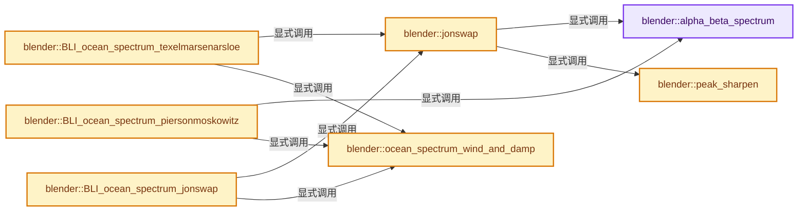

# 实现依赖专题：source/blender/blenkernel/intern/ocean_spectrum.cc

[方向导航](README.md) · [符号索引](../%E7%AC%A6%E5%8F%B7%E4%BE%9D%E8%B5%96%E4%B8%8E%E5%AE%9E%E7%8E%B0%E7%B4%A2%E5%BC%95.md)

本专题从正文实际调用进入，集中保存共享实现。函数有稳定锚点，可从调用处直接跳到对应完整函数；递归与互相调用通过回链组织。

## 本文件的实现关系




## 完整成员与函数实现

<a id="f-a01d0acc2813a18d"></a>

### `blender::alpha_beta_spectrum`

实现位置：[source/blender/blenkernel/intern/ocean_spectrum.cc](../../../../../source/blender/blenkernel/intern/ocean_spectrum.cc) · L44—L51。

接口参数：

- `const float alpha`
- `const float beta`
- `const float gamma`
- `const float omega`
- `const float peakomega`

**教学注释版**

<!-- annotated:9e6178acaf72eb -->

```cpp
static float alpha_beta_spectrum(const float alpha,
                                 const float beta,
                                 const float gamma,
                                 const float omega,
                                 const float peakomega)
{
  return (alpha * sqrt(gamma) / pow(omega, 5.0)) * exp(-beta * pow(peakomega / omega, 4.0));
}
```

<details>
<summary>核对原始源码：source/blender/blenkernel/intern/ocean_spectrum.cc · L44—L51</summary>

<!-- original:9e6178acaf72eb:source/blender/blenkernel/intern/ocean_spectrum.cc:44:51 -->

```cpp
static float alpha_beta_spectrum(const float alpha,
                                 const float beta,
                                 const float gamma,
                                 const float omega,
                                 const float peakomega)
{
  return (alpha * sqrt(gamma) / pow(omega, 5.0)) * exp(-beta * pow(peakomega / omega, 4.0));
}
```

</details>

**结果出口**

- `return (alpha * sqrt(gamma) / pow(omega, 5.0)) * exp(-beta * pow(peakomega / omega, 4.0));`

**继续追踪实现**

- `sqrt` → [外部契约](https://eel.is/c++draft/)：这个边界按实际表达式及所属类型核对参数、返回值、寿命与失败行为。这里提供接口入口，不声称已解释该第三方版本的内部实现。
- `pow` → [外部契约](https://eel.is/c++draft/)：这个边界按实际表达式及所属类型核对参数、返回值、寿命与失败行为。这里提供接口入口，不声称已解释该第三方版本的内部实现。
- `exp` → [exp · L106](%E4%BE%9D%E8%B5%96-gpu_shader_cxx_builtin-8ae191.md#m-dd7e1d600c32)。宏定义由构建条件选择。

<a id="f-7a758b3e6324f363"></a>

### `blender::peak_sharpen`

实现位置：[source/blender/blenkernel/intern/ocean_spectrum.cc](../../../../../source/blender/blenkernel/intern/ocean_spectrum.cc) · L53—L59。

接口参数：

- `const float omega`
- `const float peakomega`
- `const float gamma`

**教学注释版**

<!-- annotated:4789993fa6bd93 -->

```cpp
static float peak_sharpen(const float omega, const float peakomega, const float gamma)
{
  using math::square;
  const float sigma = (omega < peakomega) ? 0.07 : 0.09;
  const float exponent = -square((omega - peakomega) / (sigma * peakomega)) / 2.0;
  return pow(gamma, exp(exponent));
}
```

<details>
<summary>核对原始源码：source/blender/blenkernel/intern/ocean_spectrum.cc · L53—L59</summary>

<!-- original:4789993fa6bd93:source/blender/blenkernel/intern/ocean_spectrum.cc:53:59 -->

```cpp
static float peak_sharpen(const float omega, const float peakomega, const float gamma)
{
  using math::square;
  const float sigma = (omega < peakomega) ? 0.07 : 0.09;
  const float exponent = -square((omega - peakomega) / (sigma * peakomega)) / 2.0;
  return pow(gamma, exp(exponent));
}
```

</details>

**结果出口**

- `return pow(gamma, exp(exponent));`

**继续追踪实现**

- `square` → [调用协议](../%E6%A8%A1%E6%9D%BF%E5%AE%8F%E4%B8%8E%E5%8A%A8%E6%80%81%E5%88%86%E6%B4%BE%E5%8D%8F%E8%AE%AE.md)：函数指针、局部可调用对象或未展开的宏；必须结合调用者环境。调用位置L57。
- `pow` → [外部契约](https://eel.is/c++draft/)：这个边界按实际表达式及所属类型核对参数、返回值、寿命与失败行为。这里提供接口入口，不声称已解释该第三方版本的内部实现。
- `exp` → [exp · L106](%E4%BE%9D%E8%B5%96-gpu_shader_cxx_builtin-8ae191.md#m-dd7e1d600c32)。宏定义由构建条件选择。

<a id="f-f58ea388608b0f3e"></a>

### `blender::ocean_spectrum_wind_and_damp`

实现位置：[source/blender/blenkernel/intern/ocean_spectrum.cc](../../../../../source/blender/blenkernel/intern/ocean_spectrum.cc) · L64—L87。

接口参数：

- `const Ocean *oc`
- `const float kx`
- `const float kz`
- `const float val`

**教学注释版**

<!-- annotated:be6f81c6d4ee9e -->

```cpp
static float ocean_spectrum_wind_and_damp(const Ocean *oc,
                                          const float kx,
                                          const float kz,
                                          const float val)
{
  const float k2 = kx * kx + kz * kz;
  const float k_mag_inv = 1.0f / k2;
  const float k_dot_w = (kx * k_mag_inv * oc->_wx) + (kz * k_mag_inv * oc->_wz);

  /* Bias towards wind direction. */
  float newval = val * pow(fabs(k_dot_w), oc->_wind_alignment);

  /* Eliminate wavelengths smaller than cutoff. */
  // val *= exp(-k2 * m_cutoff);

  /* Reduce reflected waves. */
  if (k_dot_w < 0.0f) {
    if (oc->_wind_alignment > 0.0) {
      newval *= oc->_damp_reflections;
    }
  }

  return newval;
}
```

<details>
<summary>核对原始源码：source/blender/blenkernel/intern/ocean_spectrum.cc · L64—L87</summary>

<!-- original:be6f81c6d4ee9e:source/blender/blenkernel/intern/ocean_spectrum.cc:64:87 -->

```cpp
static float ocean_spectrum_wind_and_damp(const Ocean *oc,
                                          const float kx,
                                          const float kz,
                                          const float val)
{
  const float k2 = kx * kx + kz * kz;
  const float k_mag_inv = 1.0f / k2;
  const float k_dot_w = (kx * k_mag_inv * oc->_wx) + (kz * k_mag_inv * oc->_wz);

  /* Bias towards wind direction. */
  float newval = val * pow(fabs(k_dot_w), oc->_wind_alignment);

  /* Eliminate wavelengths smaller than cutoff. */
  // val *= exp(-k2 * m_cutoff);

  /* Reduce reflected waves. */
  if (k_dot_w < 0.0f) {
    if (oc->_wind_alignment > 0.0) {
      newval *= oc->_damp_reflections;
    }
  }

  return newval;
}
```

</details>

**沿实际写入检查状态**

- `newval *= oc->_damp_reflections;`

**结果出口**

- `return newval;`

**继续追踪实现**

- `pow` → [外部契约](https://eel.is/c++draft/)：这个边界按实际表达式及所属类型核对参数、返回值、寿命与失败行为。这里提供接口入口，不声称已解释该第三方版本的内部实现。
- `fabs` → [外部契约](https://eel.is/c++draft/)：这个边界按实际表达式及所属类型核对参数、返回值、寿命与失败行为。这里提供接口入口，不声称已解释该第三方版本的内部实现。

<a id="f-c8b649771ca1e637"></a>

### `blender::jonswap`

实现位置：[source/blender/blenkernel/intern/ocean_spectrum.cc](../../../../../source/blender/blenkernel/intern/ocean_spectrum.cc) · L89—L127。

接口参数：

- `const Ocean *oc`
- `const float k2`

**教学注释版**

<!-- annotated:77d97df529a575 -->

```cpp
static float jonswap(const Ocean *oc, const float k2)
{
  /* Get our basic JONSWAP value from #alpha_beta_spectrum. */
  const float k_mag = sqrt(k2);

  const float m_omega = GRAVITY * k_mag * tanh(k_mag * oc->_depth);
  const float omega = sqrt(m_omega);

  const float m_fetch = oc->_fetch_jonswap;

  /* Strictly, this should be a random value from a Gaussian (mean 3.3, variance 0.67),
   * clamped 1.0 to 6.0. */
  float m_gamma = oc->_sharpen_peak_jonswap;
  // [讲解] std::max<double>：按比较关系选取较大值。本讲解中的增长公式同时满足最低请求和几何增长；若保存返回引用，还需注意实参寿命。
  m_gamma = std::max<double>(m_gamma, 1.0);
  // [讲解] std::min<double>：按比较关系选取较小值；截断范围时还需先满足非负和可表示范围，min本身不会证明边界安全。
  m_gamma = std::min<double>(m_gamma, 6.0);

  const float m_windspeed = oc->_V;

  /* NOTE(@ideasman42): from upstream project in: `src/EncinoWaves/Spectra.h`,
   * `square(m_windspeed)` is used, *not* `sqrt(m_windspeed)`, this change makes geometry
   * significantly more *choppy* as well as causing this spectrum to differed significantly
   * from the "Established Ocean". Keep as is unless a larger refactor/validation of this
   * algorithm is undertaken. */
  const float m_dimensionlessFetch = fabs(GRAVITY * m_fetch / sqrt(m_windspeed));
  const float m_alpha = 0.076 * pow(m_dimensionlessFetch, -0.22);

  const float m_tau = M_PI * 2;
  const float m_peakomega = m_tau * 3.5 * fabs(GRAVITY / oc->_V) *
                            pow(m_dimensionlessFetch, -0.33);

  const float beta = 1.25f;

  float val = alpha_beta_spectrum(m_alpha, beta, GRAVITY, omega, m_peakomega);

  /* Peak sharpening. */
  val *= peak_sharpen(omega, m_peakomega, m_gamma);

  return val;
}
```

<details>
<summary>核对原始源码：source/blender/blenkernel/intern/ocean_spectrum.cc · L89—L127</summary>

<!-- original:77d97df529a575:source/blender/blenkernel/intern/ocean_spectrum.cc:89:127 -->

```cpp
static float jonswap(const Ocean *oc, const float k2)
{
  /* Get our basic JONSWAP value from #alpha_beta_spectrum. */
  const float k_mag = sqrt(k2);

  const float m_omega = GRAVITY * k_mag * tanh(k_mag * oc->_depth);
  const float omega = sqrt(m_omega);

  const float m_fetch = oc->_fetch_jonswap;

  /* Strictly, this should be a random value from a Gaussian (mean 3.3, variance 0.67),
   * clamped 1.0 to 6.0. */
  float m_gamma = oc->_sharpen_peak_jonswap;
  m_gamma = std::max<double>(m_gamma, 1.0);
  m_gamma = std::min<double>(m_gamma, 6.0);

  const float m_windspeed = oc->_V;

  /* NOTE(@ideasman42): from upstream project in: `src/EncinoWaves/Spectra.h`,
   * `square(m_windspeed)` is used, *not* `sqrt(m_windspeed)`, this change makes geometry
   * significantly more *choppy* as well as causing this spectrum to differed significantly
   * from the "Established Ocean". Keep as is unless a larger refactor/validation of this
   * algorithm is undertaken. */
  const float m_dimensionlessFetch = fabs(GRAVITY * m_fetch / sqrt(m_windspeed));
  const float m_alpha = 0.076 * pow(m_dimensionlessFetch, -0.22);

  const float m_tau = M_PI * 2;
  const float m_peakomega = m_tau * 3.5 * fabs(GRAVITY / oc->_V) *
                            pow(m_dimensionlessFetch, -0.33);

  const float beta = 1.25f;

  float val = alpha_beta_spectrum(m_alpha, beta, GRAVITY, omega, m_peakomega);

  /* Peak sharpening. */
  val *= peak_sharpen(omega, m_peakomega, m_gamma);

  return val;
}
```

</details>

**沿实际写入检查状态**

- `m_gamma = std::max<double>(m_gamma, 1.0);`
- `m_gamma = std::min<double>(m_gamma, 6.0);`
- `val *= peak_sharpen(omega, m_peakomega, m_gamma);`

**结果出口**

- `return val;`

**继续追踪实现**

- `sqrt` → [外部契约](https://eel.is/c++draft/)：这个边界按实际表达式及所属类型核对参数、返回值、寿命与失败行为。这里提供接口入口，不声称已解释该第三方版本的内部实现。
- `tanh` → [tanh · L132](%E4%BE%9D%E8%B5%96-gpu_shader_cxx_builtin-8ae191.md#m-0ffd01e7f752)。宏定义由构建条件选择。
- `std::max<double>` → [外部契约](https://eel.is/c++draft/alg.min.max)：按比较关系选取较大值。本讲解中的增长公式同时满足最低请求和几何增长；若保存返回引用，还需注意实参寿命。
- `std::min<double>` → [外部契约](https://eel.is/c++draft/alg.min.max)：按比较关系选取较小值；截断范围时还需先满足非负和可表示范围，min本身不会证明边界安全。
- `fabs` → [外部契约](https://eel.is/c++draft/)：这个边界按实际表达式及所属类型核对参数、返回值、寿命与失败行为。这里提供接口入口，不声称已解释该第三方版本的内部实现。
- `pow` → [外部契约](https://eel.is/c++draft/)：这个边界按实际表达式及所属类型核对参数、返回值、寿命与失败行为。这里提供接口入口，不声称已解释该第三方版本的内部实现。
- `alpha_beta_spectrum` → [blender::alpha_beta_spectrum · L44](%E4%BE%9D%E8%B5%96-ocean_spectrum-874826.md#f-a01d0acc2813a18d)。
- `peak_sharpen` → [blender::peak_sharpen · L53](%E4%BE%9D%E8%B5%96-ocean_spectrum-874826.md#f-7a758b3e6324f363)。

<a id="f-639b7c149ca01890"></a>

### `blender::BLI_ocean_spectrum_piersonmoskowitz`

实现位置：[source/blender/blenkernel/intern/ocean_spectrum.cc](../../../../../source/blender/blenkernel/intern/ocean_spectrum.cc) · L129—L153。

接口参数：

- `const Ocean *oc`
- `const float kx`
- `const float kz`

**教学注释版**

<!-- annotated:884b854a6d6319 -->

```cpp
float BLI_ocean_spectrum_piersonmoskowitz(const Ocean *oc, const float kx, const float kz)
{
  const float k2 = kx * kx + kz * kz;

  if (k2 == 0.0f) {
    /* No DC component. */
    return 0.0f;
  }

  /* Get Pierson-Moskowitz value from #alpha_beta_spectrum. */
  const float peak_omega_PM = 0.87f * GRAVITY / oc->_V;

  const float k_mag = sqrt(k2);
  const float m_omega = GRAVITY * k_mag * tanh(k_mag * oc->_depth);

  const float omega = sqrt(m_omega);
  const float alpha = 0.0081f;
  const float beta = 1.291f;

  float val = alpha_beta_spectrum(alpha, beta, GRAVITY, omega, peak_omega_PM);

  val = ocean_spectrum_wind_and_damp(oc, kx, kz, val);

  return val;
}
```

<details>
<summary>核对原始源码：source/blender/blenkernel/intern/ocean_spectrum.cc · L129—L153</summary>

<!-- original:884b854a6d6319:source/blender/blenkernel/intern/ocean_spectrum.cc:129:153 -->

```cpp
float BLI_ocean_spectrum_piersonmoskowitz(const Ocean *oc, const float kx, const float kz)
{
  const float k2 = kx * kx + kz * kz;

  if (k2 == 0.0f) {
    /* No DC component. */
    return 0.0f;
  }

  /* Get Pierson-Moskowitz value from #alpha_beta_spectrum. */
  const float peak_omega_PM = 0.87f * GRAVITY / oc->_V;

  const float k_mag = sqrt(k2);
  const float m_omega = GRAVITY * k_mag * tanh(k_mag * oc->_depth);

  const float omega = sqrt(m_omega);
  const float alpha = 0.0081f;
  const float beta = 1.291f;

  float val = alpha_beta_spectrum(alpha, beta, GRAVITY, omega, peak_omega_PM);

  val = ocean_spectrum_wind_and_damp(oc, kx, kz, val);

  return val;
}
```

</details>

**沿实际写入检查状态**

- `val = ocean_spectrum_wind_and_damp(oc, kx, kz, val);`

**结果出口**

- `return 0.0f;`
- `return val;`

**继续追踪实现**

- `sqrt` → [外部契约](https://eel.is/c++draft/)：这个边界按实际表达式及所属类型核对参数、返回值、寿命与失败行为。这里提供接口入口，不声称已解释该第三方版本的内部实现。
- `tanh` → [tanh · L132](%E4%BE%9D%E8%B5%96-gpu_shader_cxx_builtin-8ae191.md#m-0ffd01e7f752)。宏定义由构建条件选择。
- `alpha_beta_spectrum` → [blender::alpha_beta_spectrum · L44](%E4%BE%9D%E8%B5%96-ocean_spectrum-874826.md#f-a01d0acc2813a18d)。
- `ocean_spectrum_wind_and_damp` → [blender::ocean_spectrum_wind_and_damp · L64](%E4%BE%9D%E8%B5%96-ocean_spectrum-874826.md#f-f58ea388608b0f3e)。

<a id="f-89cfb5c031bb13fa"></a>

### `blender::BLI_ocean_spectrum_texelmarsenarsloe`

实现位置：[source/blender/blenkernel/intern/ocean_spectrum.cc](../../../../../source/blender/blenkernel/intern/ocean_spectrum.cc) · L155—L185。

接口参数：

- `const Ocean *oc`
- `const float kx`
- `const float kz`

**教学注释版**

<!-- annotated:1f3d280dfe5cda -->

```cpp
float BLI_ocean_spectrum_texelmarsenarsloe(const Ocean *oc, const float kx, const float kz)
{
  const float k2 = kx * kx + kz * kz;

  if (k2 == 0.0f) {
    /* No DC component. */
    return 0.0f;
  }

  float val = jonswap(oc, k2);

  val = ocean_spectrum_wind_and_damp(oc, kx, kz, val);

  /* TMA modifications to JONSWAP. */
  const float m_depth = oc->_depth;
  const float gain = sqrt(m_depth / GRAVITY);

  const float k_mag = sqrt(k2);

  const float m_omega = GRAVITY * k_mag * tanh(k_mag * oc->_depth);
  const float omega = sqrt(m_omega);

  const float kitaigorodskiiDepth_wh = omega * gain;
  const float kitaigorodskiiDepth = 0.5 + (0.5 * tanh(1.8 * (kitaigorodskiiDepth_wh - 1.125)));

  val *= kitaigorodskiiDepth;

  val = ocean_spectrum_wind_and_damp(oc, kx, kz, val);

  return val;
}
```

<details>
<summary>核对原始源码：source/blender/blenkernel/intern/ocean_spectrum.cc · L155—L185</summary>

<!-- original:1f3d280dfe5cda:source/blender/blenkernel/intern/ocean_spectrum.cc:155:185 -->

```cpp
float BLI_ocean_spectrum_texelmarsenarsloe(const Ocean *oc, const float kx, const float kz)
{
  const float k2 = kx * kx + kz * kz;

  if (k2 == 0.0f) {
    /* No DC component. */
    return 0.0f;
  }

  float val = jonswap(oc, k2);

  val = ocean_spectrum_wind_and_damp(oc, kx, kz, val);

  /* TMA modifications to JONSWAP. */
  const float m_depth = oc->_depth;
  const float gain = sqrt(m_depth / GRAVITY);

  const float k_mag = sqrt(k2);

  const float m_omega = GRAVITY * k_mag * tanh(k_mag * oc->_depth);
  const float omega = sqrt(m_omega);

  const float kitaigorodskiiDepth_wh = omega * gain;
  const float kitaigorodskiiDepth = 0.5 + (0.5 * tanh(1.8 * (kitaigorodskiiDepth_wh - 1.125)));

  val *= kitaigorodskiiDepth;

  val = ocean_spectrum_wind_and_damp(oc, kx, kz, val);

  return val;
}
```

</details>

**沿实际写入检查状态**

- `val = ocean_spectrum_wind_and_damp(oc, kx, kz, val);`
- `val *= kitaigorodskiiDepth;`

**结果出口**

- `return 0.0f;`
- `return val;`

**继续追踪实现**

- `jonswap` → [blender::jonswap · L89](%E4%BE%9D%E8%B5%96-ocean_spectrum-874826.md#f-c8b649771ca1e637)。
- `ocean_spectrum_wind_and_damp` → [blender::ocean_spectrum_wind_and_damp · L64](%E4%BE%9D%E8%B5%96-ocean_spectrum-874826.md#f-f58ea388608b0f3e)。
- `sqrt` → [外部契约](https://eel.is/c++draft/)：这个边界按实际表达式及所属类型核对参数、返回值、寿命与失败行为。这里提供接口入口，不声称已解释该第三方版本的内部实现。
- `tanh` → [tanh · L132](%E4%BE%9D%E8%B5%96-gpu_shader_cxx_builtin-8ae191.md#m-0ffd01e7f752)。宏定义由构建条件选择。

<a id="f-b25916de7f7816aa"></a>

### `blender::BLI_ocean_spectrum_jonswap`

实现位置：[source/blender/blenkernel/intern/ocean_spectrum.cc](../../../../../source/blender/blenkernel/intern/ocean_spectrum.cc) · L187—L201。

接口参数：

- `const Ocean *oc`
- `const float kx`
- `const float kz`

**教学注释版**

<!-- annotated:72a3ad8cf46e7c -->

```cpp
float BLI_ocean_spectrum_jonswap(const Ocean *oc, const float kx, const float kz)
{
  const float k2 = kx * kx + kz * kz;

  if (k2 == 0.0f) {
    /* No DC component. */
    return 0.0f;
  }

  float val = jonswap(oc, k2);

  val = ocean_spectrum_wind_and_damp(oc, kx, kz, val);

  return val;
}
```

<details>
<summary>核对原始源码：source/blender/blenkernel/intern/ocean_spectrum.cc · L187—L201</summary>

<!-- original:72a3ad8cf46e7c:source/blender/blenkernel/intern/ocean_spectrum.cc:187:201 -->

```cpp
float BLI_ocean_spectrum_jonswap(const Ocean *oc, const float kx, const float kz)
{
  const float k2 = kx * kx + kz * kz;

  if (k2 == 0.0f) {
    /* No DC component. */
    return 0.0f;
  }

  float val = jonswap(oc, k2);

  val = ocean_spectrum_wind_and_damp(oc, kx, kz, val);

  return val;
}
```

</details>

**沿实际写入检查状态**

- `val = ocean_spectrum_wind_and_damp(oc, kx, kz, val);`

**结果出口**

- `return 0.0f;`
- `return val;`

**继续追踪实现**

- `jonswap` → [blender::jonswap · L89](%E4%BE%9D%E8%B5%96-ocean_spectrum-874826.md#f-c8b649771ca1e637)。
- `ocean_spectrum_wind_and_damp` → [blender::ocean_spectrum_wind_and_damp · L64](%E4%BE%9D%E8%B5%96-ocean_spectrum-874826.md#f-f58ea388608b0f3e)。
