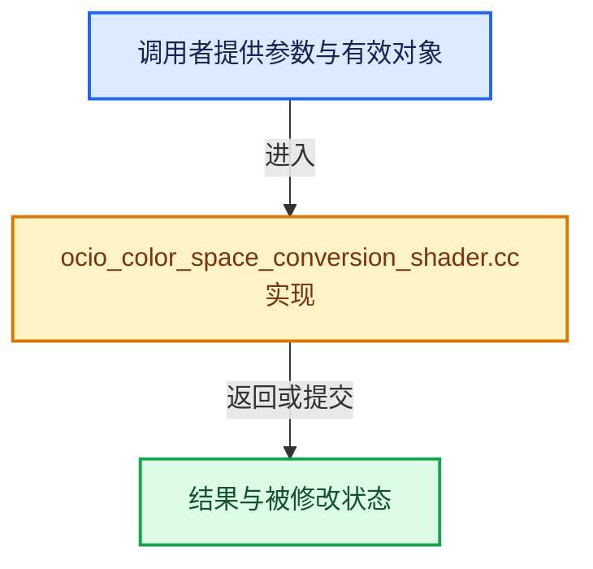

# 实现依赖专题：source/blender/compositor/cached_resources/intern/ocio_color_space_conversion_shader.cc

[方向导航](README.md) · [符号索引](../%E7%AC%A6%E5%8F%B7%E4%BE%9D%E8%B5%96%E4%B8%8E%E5%AE%9E%E7%8E%B0%E7%B4%A2%E5%BC%95.md)

本专题从正文实际调用进入，集中保存共享实现。函数有稳定锚点，可从调用处直接跳到对应完整函数；递归与互相调用通过回链组织。

## 本文件的实现关系





## 完整成员与函数实现

<a id="f-dff2dc03be8772d1"></a>

### `Create`

实现位置：[source/blender/compositor/cached_resources/intern/ocio_color_space_conversion_shader.cc](../../../../../source/blender/compositor/cached_resources/intern/ocio_color_space_conversion_shader.cc) · L59—L65。

接口参数：

- `ResultPrecision precision`

**教学注释版**

<!-- annotated:4b9976ba7c76c1 -->

```cpp
  static std::shared_ptr<GPUShaderCreator> Create(ResultPrecision precision)
  {
    // [讲解] std::make_shared<GPUShaderCreator>：构造由共享控制块管理的对象；共享寿命不自动使被指对象读写线程安全，强引用环需单独处理。
    std::shared_ptr<GPUShaderCreator> instance = std::make_shared<GPUShaderCreator>();
    instance->setLanguage(OCIO::GPU_LANGUAGE_GLSL_4_0);
    instance->precision_ = precision;
    return instance;
  }
```

<details>
<summary>核对原始源码：source/blender/compositor/cached_resources/intern/ocio_color_space_conversion_shader.cc · L59—L65</summary>

<!-- original:4b9976ba7c76c1:source/blender/compositor/cached_resources/intern/ocio_color_space_conversion_shader.cc:59:65 -->

```cpp
  static std::shared_ptr<GPUShaderCreator> Create(ResultPrecision precision)
  {
    std::shared_ptr<GPUShaderCreator> instance = std::make_shared<GPUShaderCreator>();
    instance->setLanguage(OCIO::GPU_LANGUAGE_GLSL_4_0);
    instance->precision_ = precision;
    return instance;
  }
```

</details>

**沿实际写入检查状态**

- `instance->precision_ = precision;`

**结果出口**

- `return instance;`

**继续追踪实现**

- `std::make_shared<GPUShaderCreator>` → [外部契约](https://eel.is/c++draft/util.smartptr.shared.create)：构造由共享控制块管理的对象；共享寿命不自动使被指对象读写线程安全，强引用环需单独处理。
- `instance->setLanguage` → [外部契约](https://eel.is/c++draft/)：这个边界按实际表达式及所属类型核对参数、返回值、寿命与失败行为。这里提供接口入口，不声称已解释该第三方版本的内部实现。
