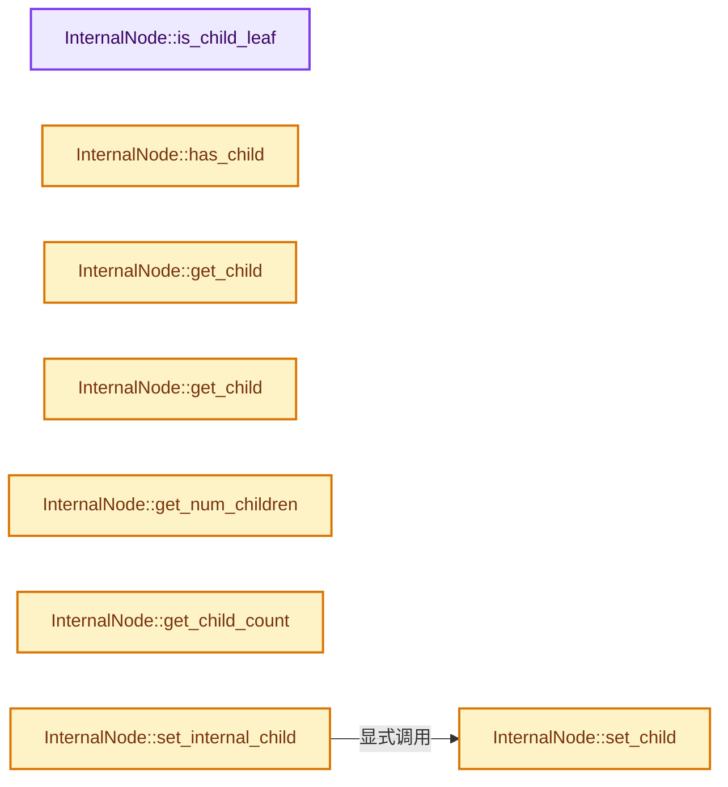
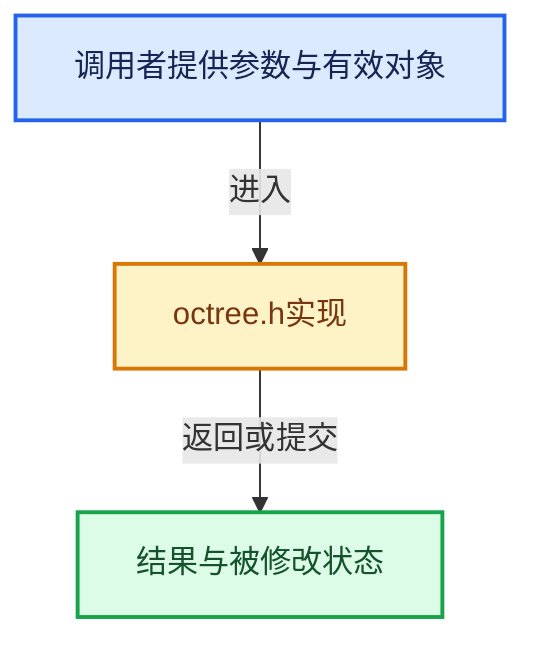

# 实现依赖专题：intern/dualcon/intern/octree.h

[方向导航](README.md) · [符号索引](../%E7%AC%A6%E5%8F%B7%E4%BE%9D%E8%B5%96%E4%B8%8E%E5%AE%9E%E7%8E%B0%E7%B4%A2%E5%BC%95.md)

本专题从正文实际调用进入，集中保存共享实现。函数有稳定锚点，可从调用处直接跳到对应完整函数；递归与互相调用通过回链组织。

## 本文件的实现关系






## 完整成员与函数实现

<a id="f-2904b082af29a286"></a>

### `InternalNode::is_child_leaf`

实现位置：[intern/dualcon/intern/octree.h](../../../../../intern/dualcon/intern/octree.h) · L55—L58。

接口参数：

- `int index`

**教学注释版**

<!-- annotated:edc6cc81a4d994 -->

```cpp
  int is_child_leaf(int index) const
  {
    return (child_is_leaf_bitfield >> index) & 1;
  }
```

<details>
<summary>核对原始源码：intern/dualcon/intern/octree.h · L55—L58</summary>

<!-- original:edc6cc81a4d994:intern/dualcon/intern/octree.h:55:58 -->

```cpp
  int is_child_leaf(int index) const
  {
    return (child_is_leaf_bitfield >> index) & 1;
  }
```

</details>

**结果出口**

- `return (child_is_leaf_bitfield >> index) & 1;`

**继续追踪实现**

本实现没有需要继续展开的显式调用；检查返回表达式、对象转换和调用者前置条件。

<a id="f-a0966d972255c04a"></a>

### `InternalNode::has_child`

实现位置：[intern/dualcon/intern/octree.h](../../../../../intern/dualcon/intern/octree.h) · L61—L64。

接口参数：

- `int index`

**教学注释版**

<!-- annotated:b4c1a2cc168355 -->

```cpp
  int has_child(int index) const
  {
    return (has_child_bitfield >> index) & 1;
  }
```

<details>
<summary>核对原始源码：intern/dualcon/intern/octree.h · L61—L64</summary>

<!-- original:b4c1a2cc168355:intern/dualcon/intern/octree.h:61:64 -->

```cpp
  int has_child(int index) const
  {
    return (has_child_bitfield >> index) & 1;
  }
```

</details>

**结果出口**

- `return (has_child_bitfield >> index) & 1;`

**继续追踪实现**

本实现没有需要继续展开的显式调用；检查返回表达式、对象转换和调用者前置条件。

<a id="f-45e0172f8cbb094b"></a>

### `InternalNode::get_child`

实现位置：[intern/dualcon/intern/octree.h](../../../../../intern/dualcon/intern/octree.h) · L67—L70。

接口参数：

- `int count`

**教学注释版**

<!-- annotated:1c9cc0af54cffe -->

```cpp
  Node *get_child(int count)
  {
    return children[count];
  }
```

<details>
<summary>核对原始源码：intern/dualcon/intern/octree.h · L67—L70</summary>

<!-- original:1c9cc0af54cffe:intern/dualcon/intern/octree.h:67:70 -->

```cpp
  Node *get_child(int count)
  {
    return children[count];
  }
```

</details>

**结果出口**

- `return children[count];`

**继续追踪实现**

本实现没有需要继续展开的显式调用；检查返回表达式、对象转换和调用者前置条件。

<a id="f-2855ce7f3ad00a2a"></a>

### `InternalNode::get_child`

实现位置：[intern/dualcon/intern/octree.h](../../../../../intern/dualcon/intern/octree.h) · L72—L75。

接口参数：

- `int count`

**教学注释版**

<!-- annotated:581aab9bfc0366 -->

```cpp
  const Node *get_child(int count) const
  {
    return children[count];
  }
```

<details>
<summary>核对原始源码：intern/dualcon/intern/octree.h · L72—L75</summary>

<!-- original:581aab9bfc0366:intern/dualcon/intern/octree.h:72:75 -->

```cpp
  const Node *get_child(int count) const
  {
    return children[count];
  }
```

</details>

**结果出口**

- `return children[count];`

**继续追踪实现**

本实现没有需要继续展开的显式调用；检查返回表达式、对象转换和调用者前置条件。

<a id="f-b10d8f9cac44c30a"></a>

### `InternalNode::get_num_children`

实现位置：[intern/dualcon/intern/octree.h](../../../../../intern/dualcon/intern/octree.h) · L78—L81。

**教学注释版**

<!-- annotated:4eb138592cbd2a -->

```cpp
  int get_num_children() const
  {
    return numChildrenTable[has_child_bitfield];
  }
```

<details>
<summary>核对原始源码：intern/dualcon/intern/octree.h · L78—L81</summary>

<!-- original:4eb138592cbd2a:intern/dualcon/intern/octree.h:78:81 -->

```cpp
  int get_num_children() const
  {
    return numChildrenTable[has_child_bitfield];
  }
```

</details>

**结果出口**

- `return numChildrenTable[has_child_bitfield];`

**继续追踪实现**

本实现没有需要继续展开的显式调用；检查返回表达式、对象转换和调用者前置条件。

<a id="f-ac0642fa5125380b"></a>

### `InternalNode::get_child_count`

实现位置：[intern/dualcon/intern/octree.h](../../../../../intern/dualcon/intern/octree.h) · L84—L87。

接口参数：

- `int index`

**教学注释版**

<!-- annotated:2a51148a1ed054 -->

```cpp
  int get_child_count(int index) const
  {
    return childrenCountTable[has_child_bitfield][index];
  }
```

<details>
<summary>核对原始源码：intern/dualcon/intern/octree.h · L84—L87</summary>

<!-- original:2a51148a1ed054:intern/dualcon/intern/octree.h:84:87 -->

```cpp
  int get_child_count(int index) const
  {
    return childrenCountTable[has_child_bitfield][index];
  }
```

</details>

**结果出口**

- `return childrenCountTable[has_child_bitfield][index];`

**继续追踪实现**

本实现没有需要继续展开的显式调用；检查返回表达式、对象转换和调用者前置条件。

<a id="f-981836a79259c460"></a>

### `InternalNode::set_child`

实现位置：[intern/dualcon/intern/octree.h](../../../../../intern/dualcon/intern/octree.h) · L115—L118。

接口参数：

- `int count`
- `Node *chd`

**教学注释版**

<!-- annotated:0da4cc0f71319b -->

```cpp
  void set_child(int count, Node *chd)
  {
    children[count] = chd;
  }
```

<details>
<summary>核对原始源码：intern/dualcon/intern/octree.h · L115—L118</summary>

<!-- original:0da4cc0f71319b:intern/dualcon/intern/octree.h:115:118 -->

```cpp
  void set_child(int count, Node *chd)
  {
    children[count] = chd;
  }
```

</details>

**沿实际写入检查状态**

- `children[count] = chd;`

**继续追踪实现**

本实现没有需要继续展开的显式调用；检查返回表达式、对象转换和调用者前置条件。

<a id="f-c046a677eb4411eb"></a>

### `InternalNode::set_internal_child`

实现位置：[intern/dualcon/intern/octree.h](../../../../../intern/dualcon/intern/octree.h) · L119—L123。

接口参数：

- `int index`
- `int count`
- `InternalNode *chd`

**教学注释版**

<!-- annotated:d772ae81a18a63 -->

```cpp
  void set_internal_child(int index, int count, InternalNode *chd)
  {
    set_child(count, (Node *)chd);
    has_child_bitfield |= (1 << index);
  }
```

<details>
<summary>核对原始源码：intern/dualcon/intern/octree.h · L119—L123</summary>

<!-- original:d772ae81a18a63:intern/dualcon/intern/octree.h:119:123 -->

```cpp
  void set_internal_child(int index, int count, InternalNode *chd)
  {
    set_child(count, (Node *)chd);
    has_child_bitfield |= (1 << index);
  }
```

</details>

**沿实际写入检查状态**

- `has_child_bitfield |= (1 << index);`

**继续追踪实现**

- `set_child` → [InternalNode::set_child · L115](%E4%BE%9D%E8%B5%96-octree-aa27b7.md#f-981836a79259c460)。

<a id="f-280de5329384508d"></a>

### `InternalNode::set_leaf_child`

实现位置：[intern/dualcon/intern/octree.h](../../../../../intern/dualcon/intern/octree.h) · L124—L129。

接口参数：

- `int index`
- `int count`
- `LeafNode *chd`

**教学注释版**

<!-- annotated:c53055522e8caf -->

```cpp
  void set_leaf_child(int index, int count, LeafNode *chd)
  {
    set_child(count, (Node *)chd);
    has_child_bitfield |= (1 << index);
    child_is_leaf_bitfield |= (1 << index);
  }
```

<details>
<summary>核对原始源码：intern/dualcon/intern/octree.h · L124—L129</summary>

<!-- original:c53055522e8caf:intern/dualcon/intern/octree.h:124:129 -->

```cpp
  void set_leaf_child(int index, int count, LeafNode *chd)
  {
    set_child(count, (Node *)chd);
    has_child_bitfield |= (1 << index);
    child_is_leaf_bitfield |= (1 << index);
  }
```

</details>

**沿实际写入检查状态**

- `has_child_bitfield |= (1 << index);`
- `child_is_leaf_bitfield |= (1 << index);`

**继续追踪实现**

- `set_child` → [InternalNode::set_child · L115](%E4%BE%9D%E8%B5%96-octree-aa27b7.md#f-981836a79259c460)。

<a id="f-40b7872ee42b46ff"></a>

### `Octree::getOutputMesh`

实现位置：[intern/dualcon/intern/octree.h](../../../../../intern/dualcon/intern/octree.h) · L279—L282。

**教学注释版**

<!-- annotated:89626aa197a14d -->

```cpp
  void *getOutputMesh()
  {
    return output_mesh;
  }
```

<details>
<summary>核对原始源码：intern/dualcon/intern/octree.h · L279—L282</summary>

<!-- original:89626aa197a14d:intern/dualcon/intern/octree.h:279:282 -->

```cpp
  void *getOutputMesh()
  {
    return output_mesh;
  }
```

</details>

**结果出口**

- `return output_mesh;`

**继续追踪实现**

本实现没有需要继续展开的显式调用；检查返回表达式、对象转换和调用者前置条件。

<a id="f-1ca0151e3f515f30"></a>

### `Octree::getSign`

实现位置：[intern/dualcon/intern/octree.h](../../../../../intern/dualcon/intern/octree.h) · L490—L500。

接口参数：

- `Node *node`
- `int height`
- `int index`

**教学注释版**

<!-- annotated:f9e88b8d79b6b1 -->

```cpp
  int getSign(Node *node, int height, int index)
  {
    if (height == 0) {
      return getSign(&node->leaf, index);
    }
    if (node->internal.has_child(index)) {
      return getSign(
          node->internal.get_child(node->internal.get_child_count(index)), height - 1, index);
    }
    return getSign(node->internal.get_child(0), height - 1, 7 - node->internal.get_child_index(0));
  }
```

<details>
<summary>核对原始源码：intern/dualcon/intern/octree.h · L490—L500</summary>

<!-- original:f9e88b8d79b6b1:intern/dualcon/intern/octree.h:490:500 -->

```cpp
  int getSign(Node *node, int height, int index)
  {
    if (height == 0) {
      return getSign(&node->leaf, index);
    }
    if (node->internal.has_child(index)) {
      return getSign(
          node->internal.get_child(node->internal.get_child_count(index)), height - 1, index);
    }
    return getSign(node->internal.get_child(0), height - 1, 7 - node->internal.get_child_index(0));
  }
```

</details>

**结果出口**

- `return getSign(&node->leaf, index);`
- `return getSign(`
- `return getSign(node->internal.get_child(0), height - 1, 7 - node->internal.get_child_index(0));`

**继续追踪实现**

- `getSign` → [Octree::getSign · L490](%E4%BE%9D%E8%B5%96-octree-aa27b7.md#f-1ca0151e3f515f30)；[Octree::getSign · L540](%E4%BE%9D%E8%B5%96-octree-aa27b7.md#f-65b3d12a2ad8962a)。同名重载需按实参类型选择。
- `node->internal.has_child` → [调用协议](../%E6%A8%A1%E6%9D%BF%E5%AE%8F%E4%B8%8E%E5%8A%A8%E6%80%81%E5%88%86%E6%B4%BE%E5%8D%8F%E8%AE%AE.md)：接收对象类型依赖auto、返回值或模板实例；不按同名猜测目标。调用位置L495。
- `node->internal.get_child` → [调用协议](../%E6%A8%A1%E6%9D%BF%E5%AE%8F%E4%B8%8E%E5%8A%A8%E6%80%81%E5%88%86%E6%B4%BE%E5%8D%8F%E8%AE%AE.md)：接收对象类型依赖auto、返回值或模板实例；不按同名猜测目标。调用位置L497。
- `node->internal.get_child_count` → [调用协议](../%E6%A8%A1%E6%9D%BF%E5%AE%8F%E4%B8%8E%E5%8A%A8%E6%80%81%E5%88%86%E6%B4%BE%E5%8D%8F%E8%AE%AE.md)：接收对象类型依赖auto、返回值或模板实例；不按同名猜测目标。调用位置L497。
- `node->internal.get_child_index` → [调用协议](../%E6%A8%A1%E6%9D%BF%E5%AE%8F%E4%B8%8E%E5%8A%A8%E6%80%81%E5%88%86%E6%B4%BE%E5%8D%8F%E8%AE%AE.md)：接收对象类型依赖auto、返回值或模板实例；不按同名猜测目标。调用位置L499。

<a id="f-65b3d12a2ad8962a"></a>

### `Octree::getSign`

实现位置：[intern/dualcon/intern/octree.h](../../../../../intern/dualcon/intern/octree.h) · L540—L543。

接口参数：

- `const LeafNode *leaf`
- `int index`

**教学注释版**

<!-- annotated:4af30402ea8753 -->

```cpp
  int getSign(const LeafNode *leaf, int index)
  {
    return ((leaf->signs >> index) & 1);
  }
```

<details>
<summary>核对原始源码：intern/dualcon/intern/octree.h · L540—L543</summary>

<!-- original:4af30402ea8753:intern/dualcon/intern/octree.h:540:543 -->

```cpp
  int getSign(const LeafNode *leaf, int index)
  {
    return ((leaf->signs >> index) & 1);
  }
```

</details>

**结果出口**

- `return ((leaf->signs >> index) & 1);`

**继续追踪实现**

本实现没有需要继续展开的显式调用；检查返回表达式、对象转换和调用者前置条件。

<a id="f-6a9c19fe617bdf0e"></a>

### `Octree::getSignMask`

实现位置：[intern/dualcon/intern/octree.h](../../../../../intern/dualcon/intern/octree.h) · L557—L560。

接口参数：

- `const LeafNode *leaf`

**教学注释版**

<!-- annotated:cb2607b49b241d -->

```cpp
  int getSignMask(const LeafNode *leaf) const
  {
    return leaf->signs;
  }
```

<details>
<summary>核对原始源码：intern/dualcon/intern/octree.h · L557—L560</summary>

<!-- original:cb2607b49b241d:intern/dualcon/intern/octree.h:557:560 -->

```cpp
  int getSignMask(const LeafNode *leaf) const
  {
    return leaf->signs;
  }
```

</details>

**结果出口**

- `return leaf->signs;`

**继续追踪实现**

本实现没有需要继续展开的显式调用；检查返回表达式、对象转换和调用者前置条件。

<a id="f-6aa2ea7764849867"></a>

### `Octree::setInProcessAll`

实现位置：[intern/dualcon/intern/octree.h](../../../../../intern/dualcon/intern/octree.h) · L562—L576。

接口参数：

- `const int st[3]`
- `int dir`

**教学注释版**

<!-- annotated:f3a190cd63a355 -->

```cpp
  void setInProcessAll(const int st[3], int dir)
  {
    int nst[3], eind;
    for (int i = 0; i < 4; i++) {
      nst[0] = st[0] + dirCell[dir][i][0] * mindimen;
      nst[1] = st[1] + dirCell[dir][i][1] * mindimen;
      nst[2] = st[2] + dirCell[dir][i][2] * mindimen;
      eind = dirEdge[dir][i];

      LeafNode *cell = locateLeafCheck(nst);
      // [讲解] assert：检查开发者预期条件，配置可能关闭；不承担完整输入处理或自动修复。
      assert(cell);

      setInProcess(cell, eind);
    }
  }
```

<details>
<summary>核对原始源码：intern/dualcon/intern/octree.h · L562—L576</summary>

<!-- original:f3a190cd63a355:intern/dualcon/intern/octree.h:562:576 -->

```cpp
  void setInProcessAll(const int st[3], int dir)
  {
    int nst[3], eind;
    for (int i = 0; i < 4; i++) {
      nst[0] = st[0] + dirCell[dir][i][0] * mindimen;
      nst[1] = st[1] + dirCell[dir][i][1] * mindimen;
      nst[2] = st[2] + dirCell[dir][i][2] * mindimen;
      eind = dirEdge[dir][i];

      LeafNode *cell = locateLeafCheck(nst);
      assert(cell);

      setInProcess(cell, eind);
    }
  }
```

</details>

**沿实际写入检查状态**

- `nst[0] = st[0] + dirCell[dir][i][0] * mindimen;`
- `nst[1] = st[1] + dirCell[dir][i][1] * mindimen;`
- `nst[2] = st[2] + dirCell[dir][i][2] * mindimen;`
- `eind = dirEdge[dir][i];`

**继续追踪实现**

- `locateLeafCheck` → [Octree::locateLeafCheck · L1210](%E4%BE%9D%E8%B5%96-octree-aa27b7.md#f-a36cd931a9eb8fcc)；[Octree::locateLeafCheck · L1224](%E4%BE%9D%E8%B5%96-octree-aa27b7.md#f-d7e2a32f962ef346)。同名重载需按实参类型选择。
- `assert` → [外部契约](https://eel.is/c++draft/assertions)：检查开发者预期条件，配置可能关闭；不承担完整输入处理或自动修复。
- `setInProcess` → [Octree::setInProcess · L592](%E4%BE%9D%E8%B5%96-octree-aa27b7.md#f-23a2e4b56f678d95)。

<a id="f-c86d9392cb8b22a6"></a>

### `Octree::flipParityAll`

实现位置：[intern/dualcon/intern/octree.h](../../../../../intern/dualcon/intern/octree.h) · L578—L590。

接口参数：

- `const int st[3]`
- `int dir`

**教学注释版**

<!-- annotated:c75a9ce202eb9e -->

```cpp
  void flipParityAll(const int st[3], int dir)
  {
    int nst[3], eind;
    for (int i = 0; i < 4; i++) {
      nst[0] = st[0] + dirCell[dir][i][0] * mindimen;
      nst[1] = st[1] + dirCell[dir][i][1] * mindimen;
      nst[2] = st[2] + dirCell[dir][i][2] * mindimen;
      eind = dirEdge[dir][i];

      LeafNode *cell = locateLeaf(nst);
      flipEdge(cell, eind);
    }
  }
```

<details>
<summary>核对原始源码：intern/dualcon/intern/octree.h · L578—L590</summary>

<!-- original:c75a9ce202eb9e:intern/dualcon/intern/octree.h:578:590 -->

```cpp
  void flipParityAll(const int st[3], int dir)
  {
    int nst[3], eind;
    for (int i = 0; i < 4; i++) {
      nst[0] = st[0] + dirCell[dir][i][0] * mindimen;
      nst[1] = st[1] + dirCell[dir][i][1] * mindimen;
      nst[2] = st[2] + dirCell[dir][i][2] * mindimen;
      eind = dirEdge[dir][i];

      LeafNode *cell = locateLeaf(nst);
      flipEdge(cell, eind);
    }
  }
```

</details>

**沿实际写入检查状态**

- `nst[0] = st[0] + dirCell[dir][i][0] * mindimen;`
- `nst[1] = st[1] + dirCell[dir][i][1] * mindimen;`
- `nst[2] = st[2] + dirCell[dir][i][2] * mindimen;`
- `eind = dirEdge[dir][i];`

**继续追踪实现**

- `locateLeaf` → [Octree::locateLeaf · L1176](%E4%BE%9D%E8%B5%96-octree-aa27b7.md#f-0695c0501720b309)；[Octree::locateLeaf · L1187](%E4%BE%9D%E8%B5%96-octree-aa27b7.md#f-b32875173c433c71)；[Octree::locateLeaf · L1198](%E4%BE%9D%E8%B5%96-octree-aa27b7.md#f-bfd97e7bac7db6fc)。同名重载需按实参类型选择。
- `flipEdge` → [Octree::flipEdge · L646](%E4%BE%9D%E8%B5%96-octree-aa27b7.md#f-03578e7a0fa7aadc)；[Octree::flipEdge · L689](%E4%BE%9D%E8%B5%96-octree-aa27b7.md#f-309677ed62c6ace4)。同名重载需按实参类型选择。

<a id="f-23a2e4b56f678d95"></a>

### `Octree::setInProcess`

实现位置：[intern/dualcon/intern/octree.h](../../../../../intern/dualcon/intern/octree.h) · L592—L597。

接口参数：

- `LeafNode *leaf`
- `int eind`

**教学注释版**

<!-- annotated:12208fdc9244d1 -->

```cpp
  void setInProcess(LeafNode *leaf, int eind)
  {
    // [讲解] assert：检查开发者预期条件，配置可能关闭；不承担完整输入处理或自动修复。
    assert(eind >= 0 && eind <= 11);

    leaf->flood_fill |= (1 << eind);
  }
```

<details>
<summary>核对原始源码：intern/dualcon/intern/octree.h · L592—L597</summary>

<!-- original:12208fdc9244d1:intern/dualcon/intern/octree.h:592:597 -->

```cpp
  void setInProcess(LeafNode *leaf, int eind)
  {
    assert(eind >= 0 && eind <= 11);

    leaf->flood_fill |= (1 << eind);
  }
```

</details>

**沿实际写入检查状态**

- `leaf->flood_fill |= (1 << eind);`

**继续追踪实现**

- `assert` → [外部契约](https://eel.is/c++draft/assertions)：检查开发者预期条件，配置可能关闭；不承担完整输入处理或自动修复。

<a id="f-4287ef050899a2b4"></a>

### `Octree::setOutProcess`

实现位置：[intern/dualcon/intern/octree.h](../../../../../intern/dualcon/intern/octree.h) · L599—L604。

接口参数：

- `LeafNode *leaf`
- `int eind`

**教学注释版**

<!-- annotated:5aba6ae4414553 -->

```cpp
  void setOutProcess(LeafNode *leaf, int eind)
  {
    // [讲解] assert：检查开发者预期条件，配置可能关闭；不承担完整输入处理或自动修复。
    assert(eind >= 0 && eind <= 11);

    leaf->flood_fill &= ~(1 << eind);
  }
```

<details>
<summary>核对原始源码：intern/dualcon/intern/octree.h · L599—L604</summary>

<!-- original:5aba6ae4414553:intern/dualcon/intern/octree.h:599:604 -->

```cpp
  void setOutProcess(LeafNode *leaf, int eind)
  {
    assert(eind >= 0 && eind <= 11);

    leaf->flood_fill &= ~(1 << eind);
  }
```

</details>

**沿实际写入检查状态**

- `leaf->flood_fill &= ~(1 << eind);`

**继续追踪实现**

- `assert` → [外部契约](https://eel.is/c++draft/assertions)：检查开发者预期条件，配置可能关闭；不承担完整输入处理或自动修复。

<a id="f-88df765fdb5a5a2c"></a>

### `Octree::isInProcess`

实现位置：[intern/dualcon/intern/octree.h](../../../../../intern/dualcon/intern/octree.h) · L606—L611。

接口参数：

- `LeafNode *leaf`
- `int eind`

**教学注释版**

<!-- annotated:263aedc5b9dd81 -->

```cpp
  int isInProcess(LeafNode *leaf, int eind)
  {
    // [讲解] assert：检查开发者预期条件，配置可能关闭；不承担完整输入处理或自动修复。
    assert(eind >= 0 && eind <= 11);

    return (leaf->flood_fill >> eind) & 1;
  }
```

<details>
<summary>核对原始源码：intern/dualcon/intern/octree.h · L606—L611</summary>

<!-- original:263aedc5b9dd81:intern/dualcon/intern/octree.h:606:611 -->

```cpp
  int isInProcess(LeafNode *leaf, int eind)
  {
    assert(eind >= 0 && eind <= 11);

    return (leaf->flood_fill >> eind) & 1;
  }
```

</details>

**结果出口**

- `return (leaf->flood_fill >> eind) & 1;`

**继续追踪实现**

- `assert` → [外部契约](https://eel.is/c++draft/assertions)：检查开发者预期条件，配置可能关闭；不承担完整输入处理或自动修复。

<a id="f-d234cf05b0032509"></a>

### `Octree::generateSigns`

实现位置：[intern/dualcon/intern/octree.h](../../../../../intern/dualcon/intern/octree.h) · L614—L621。

接口参数：

- `LeafNode *leaf`
- `const unsigned char table[]`
- `int start`

**教学注释版**

<!-- annotated:68fd13b3c39914 -->

```cpp
  void generateSigns(LeafNode *leaf, const unsigned char table[], int start)
  {
    leaf->signs = table[leaf->edge_parity];

    if ((start ^ leaf->signs) & 1) {
      leaf->signs = ~(leaf->signs);
    }
  }
```

<details>
<summary>核对原始源码：intern/dualcon/intern/octree.h · L614—L621</summary>

<!-- original:68fd13b3c39914:intern/dualcon/intern/octree.h:614:621 -->

```cpp
  void generateSigns(LeafNode *leaf, const unsigned char table[], int start)
  {
    leaf->signs = table[leaf->edge_parity];

    if ((start ^ leaf->signs) & 1) {
      leaf->signs = ~(leaf->signs);
    }
  }
```

</details>

**沿实际写入检查状态**

- `leaf->signs = table[leaf->edge_parity];`
- `leaf->signs = ~(leaf->signs);`

**继续追踪实现**

本实现没有需要继续展开的显式调用；检查返回表达式、对象转换和调用者前置条件。

<a id="f-ac7ecc1d5aadfc24"></a>

### `Octree::getEdgeParity`

实现位置：[intern/dualcon/intern/octree.h](../../../../../intern/dualcon/intern/octree.h) · L624—L629。

接口参数：

- `const LeafNode *leaf`
- `int index`

**教学注释版**

<!-- annotated:d8443c0dcd8e23 -->

```cpp
  int getEdgeParity(const LeafNode *leaf, int index) const
  {
    // [讲解] assert：检查开发者预期条件，配置可能关闭；不承担完整输入处理或自动修复。
    assert(index >= 0 && index <= 11);

    return (leaf->edge_parity >> index) & 1;
  }
```

<details>
<summary>核对原始源码：intern/dualcon/intern/octree.h · L624—L629</summary>

<!-- original:d8443c0dcd8e23:intern/dualcon/intern/octree.h:624:629 -->

```cpp
  int getEdgeParity(const LeafNode *leaf, int index) const
  {
    assert(index >= 0 && index <= 11);

    return (leaf->edge_parity >> index) & 1;
  }
```

</details>

**结果出口**

- `return (leaf->edge_parity >> index) & 1;`

**继续追踪实现**

- `assert` → [外部契约](https://eel.is/c++draft/assertions)：检查开发者预期条件，配置可能关闭；不承担完整输入处理或自动修复。

<a id="f-9a6a9633d776f790"></a>

### `Octree::getFaceParity`

实现位置：[intern/dualcon/intern/octree.h](../../../../../intern/dualcon/intern/octree.h) · L632—L637。

接口参数：

- `LeafNode *leaf`
- `int index`

**教学注释版**

<!-- annotated:04f656ce2700df -->

```cpp
  int getFaceParity(LeafNode *leaf, int index)
  {
    int a = getEdgeParity(leaf, faceMap[index][0]) + getEdgeParity(leaf, faceMap[index][1]) +
            getEdgeParity(leaf, faceMap[index][2]) + getEdgeParity(leaf, faceMap[index][3]);
    return (a & 1);
  }
```

<details>
<summary>核对原始源码：intern/dualcon/intern/octree.h · L632—L637</summary>

<!-- original:04f656ce2700df:intern/dualcon/intern/octree.h:632:637 -->

```cpp
  int getFaceParity(LeafNode *leaf, int index)
  {
    int a = getEdgeParity(leaf, faceMap[index][0]) + getEdgeParity(leaf, faceMap[index][1]) +
            getEdgeParity(leaf, faceMap[index][2]) + getEdgeParity(leaf, faceMap[index][3]);
    return (a & 1);
  }
```

</details>

**结果出口**

- `return (a & 1);`

**继续追踪实现**

- `getEdgeParity` → [Octree::getEdgeParity · L624](%E4%BE%9D%E8%B5%96-octree-aa27b7.md#f-ac7ecc1d5aadfc24)。

<a id="f-3976b59299c91cb1"></a>

### `Octree::getFaceEdgeNum`

实现位置：[intern/dualcon/intern/octree.h](../../../../../intern/dualcon/intern/octree.h) · L638—L643。

接口参数：

- `LeafNode *leaf`
- `int index`

**教学注释版**

<!-- annotated:a5137e797e93b1 -->

```cpp
  int getFaceEdgeNum(LeafNode *leaf, int index)
  {
    int a = getEdgeParity(leaf, faceMap[index][0]) + getEdgeParity(leaf, faceMap[index][1]) +
            getEdgeParity(leaf, faceMap[index][2]) + getEdgeParity(leaf, faceMap[index][3]);
    return a;
  }
```

<details>
<summary>核对原始源码：intern/dualcon/intern/octree.h · L638—L643</summary>

<!-- original:a5137e797e93b1:intern/dualcon/intern/octree.h:638:643 -->

```cpp
  int getFaceEdgeNum(LeafNode *leaf, int index)
  {
    int a = getEdgeParity(leaf, faceMap[index][0]) + getEdgeParity(leaf, faceMap[index][1]) +
            getEdgeParity(leaf, faceMap[index][2]) + getEdgeParity(leaf, faceMap[index][3]);
    return a;
  }
```

</details>

**结果出口**

- `return a;`

**继续追踪实现**

- `getEdgeParity` → [Octree::getEdgeParity · L624](%E4%BE%9D%E8%B5%96-octree-aa27b7.md#f-ac7ecc1d5aadfc24)。

<a id="f-03578e7a0fa7aadc"></a>

### `Octree::flipEdge`

实现位置：[intern/dualcon/intern/octree.h](../../../../../intern/dualcon/intern/octree.h) · L646—L651。

接口参数：

- `LeafNode *leaf`
- `int index`

**教学注释版**

<!-- annotated:121fb731601e57 -->

```cpp
  void flipEdge(LeafNode *leaf, int index)
  {
    // [讲解] assert：检查开发者预期条件，配置可能关闭；不承担完整输入处理或自动修复。
    assert(index >= 0 && index <= 11);

    leaf->edge_parity ^= (1 << index);
  }
```

<details>
<summary>核对原始源码：intern/dualcon/intern/octree.h · L646—L651</summary>

<!-- original:121fb731601e57:intern/dualcon/intern/octree.h:646:651 -->

```cpp
  void flipEdge(LeafNode *leaf, int index)
  {
    assert(index >= 0 && index <= 11);

    leaf->edge_parity ^= (1 << index);
  }
```

</details>

**继续追踪实现**

- `assert` → [外部契约](https://eel.is/c++draft/assertions)：检查开发者预期条件，配置可能关闭；不承担完整输入处理或自动修复。

<a id="f-9af1a6d6ed009e7c"></a>

### `Octree::setEdge`

实现位置：[intern/dualcon/intern/octree.h](../../../../../intern/dualcon/intern/octree.h) · L654—L659。

接口参数：

- `LeafNode *leaf`
- `int index`

**教学注释版**

<!-- annotated:ef86aeebf47210 -->

```cpp
  void setEdge(LeafNode *leaf, int index)
  {
    // [讲解] assert：检查开发者预期条件，配置可能关闭；不承担完整输入处理或自动修复。
    assert(index >= 0 && index <= 11);

    leaf->edge_parity |= (1 << index);
  }
```

<details>
<summary>核对原始源码：intern/dualcon/intern/octree.h · L654—L659</summary>

<!-- original:ef86aeebf47210:intern/dualcon/intern/octree.h:654:659 -->

```cpp
  void setEdge(LeafNode *leaf, int index)
  {
    assert(index >= 0 && index <= 11);

    leaf->edge_parity |= (1 << index);
  }
```

</details>

**沿实际写入检查状态**

- `leaf->edge_parity |= (1 << index);`

**继续追踪实现**

- `assert` → [外部契约](https://eel.is/c++draft/assertions)：检查开发者预期条件，配置可能关闭；不承担完整输入处理或自动修复。

<a id="f-38f09a776c28a983"></a>

### `Octree::createPrimalEdgesMask`

实现位置：[intern/dualcon/intern/octree.h](../../../../../intern/dualcon/intern/octree.h) · L670—L673。

接口参数：

- `LeafNode *leaf`

**教学注释版**

<!-- annotated:84bad47b13f202 -->

```cpp
  void createPrimalEdgesMask(LeafNode *leaf)
  {
    leaf->primary_edge_intersections = getPrimalEdgesMask2(leaf);
  }
```

<details>
<summary>核对原始源码：intern/dualcon/intern/octree.h · L670—L673</summary>

<!-- original:84bad47b13f202:intern/dualcon/intern/octree.h:670:673 -->

```cpp
  void createPrimalEdgesMask(LeafNode *leaf)
  {
    leaf->primary_edge_intersections = getPrimalEdgesMask2(leaf);
  }
```

</details>

**沿实际写入检查状态**

- `leaf->primary_edge_intersections = getPrimalEdgesMask2(leaf);`

**继续追踪实现**

- `getPrimalEdgesMask2` → [Octree::getPrimalEdgesMask2 · L784](%E4%BE%9D%E8%B5%96-octree-aa27b7.md#f-431b5d07eaa4edca)。

<a id="f-8d3d2ce55b6f832c"></a>

### `Octree::setStoredEdgesParity`

实现位置：[intern/dualcon/intern/octree.h](../../../../../intern/dualcon/intern/octree.h) · L675—L680。

接口参数：

- `LeafNode *leaf`
- `int pindex`

**教学注释版**

<!-- annotated:6dbcf46e260c42 -->

```cpp
  void setStoredEdgesParity(LeafNode *leaf, int pindex)
  {
    // [讲解] assert：检查开发者预期条件，配置可能关闭；不承担完整输入处理或自动修复。
    assert(pindex <= 2 && pindex >= 0);

    leaf->primary_edge_intersections |= (1 << pindex);
  }
```

<details>
<summary>核对原始源码：intern/dualcon/intern/octree.h · L675—L680</summary>

<!-- original:6dbcf46e260c42:intern/dualcon/intern/octree.h:675:680 -->

```cpp
  void setStoredEdgesParity(LeafNode *leaf, int pindex)
  {
    assert(pindex <= 2 && pindex >= 0);

    leaf->primary_edge_intersections |= (1 << pindex);
  }
```

</details>

**沿实际写入检查状态**

- `leaf->primary_edge_intersections |= (1 << pindex);`

**继续追踪实现**

- `assert` → [外部契约](https://eel.is/c++draft/assertions)：检查开发者预期条件，配置可能关闭；不承担完整输入处理或自动修复。

<a id="f-f623c68f29c3123d"></a>

### `Octree::getStoredEdgesParity`

实现位置：[intern/dualcon/intern/octree.h](../../../../../intern/dualcon/intern/octree.h) · L682—L687。

接口参数：

- `const LeafNode *leaf`
- `int pindex`

**教学注释版**

<!-- annotated:7cc713708fd6cb -->

```cpp
  int getStoredEdgesParity(const LeafNode *leaf, int pindex) const
  {
    // [讲解] assert：检查开发者预期条件，配置可能关闭；不承担完整输入处理或自动修复。
    assert(pindex <= 2 && pindex >= 0);

    return (leaf->primary_edge_intersections >> pindex) & 1;
  }
```

<details>
<summary>核对原始源码：intern/dualcon/intern/octree.h · L682—L687</summary>

<!-- original:7cc713708fd6cb:intern/dualcon/intern/octree.h:682:687 -->

```cpp
  int getStoredEdgesParity(const LeafNode *leaf, int pindex) const
  {
    assert(pindex <= 2 && pindex >= 0);

    return (leaf->primary_edge_intersections >> pindex) & 1;
  }
```

</details>

**结果出口**

- `return (leaf->primary_edge_intersections >> pindex) & 1;`

**继续追踪实现**

- `assert` → [外部契约](https://eel.is/c++draft/assertions)：检查开发者预期条件，配置可能关闭；不承担完整输入处理或自动修复。

<a id="f-309677ed62c6ace4"></a>

### `Octree::flipEdge`

实现位置：[intern/dualcon/intern/octree.h](../../../../../intern/dualcon/intern/octree.h) · L689—L726。

接口参数：

- `LeafNode *leaf`
- `int index`
- `float alpha`

**教学注释版**

<!-- annotated:60824145cf5042 -->

```cpp
  LeafNode *flipEdge(LeafNode *leaf, int index, float alpha)
  {
    flipEdge(leaf, index);

    if ((index & 3) == 0) {
      int ind = index / 4;
      if (getEdgeParity(leaf, index) && !getStoredEdgesParity(leaf, ind)) {
        /* Create a new node */
        int num = getNumEdges(leaf) + 1;
        setStoredEdgesParity(leaf, ind);
        int count = getEdgeCount(leaf, ind);
        LeafNode *nleaf = createLeaf(num);
        *nleaf = *leaf;

        setEdgeOffset(nleaf, alpha, count);

        if (num > 1) {
          float *pts = leaf->edge_intersections;
          float *npts = nleaf->edge_intersections;
          for (int i = 0; i < count; i++) {
            for (int j = 0; j < EDGE_FLOATS; j++) {
              npts[i * EDGE_FLOATS + j] = pts[i * EDGE_FLOATS + j];
            }
          }
          for (int i = count + 1; i < num; i++) {
            for (int j = 0; j < EDGE_FLOATS; j++) {
              npts[i * EDGE_FLOATS + j] = pts[(i - 1) * EDGE_FLOATS + j];
            }
          }
        }

        removeLeaf(num - 1, leaf);
        leaf = nleaf;
      }
    }

    return leaf;
  }
```

<details>
<summary>核对原始源码：intern/dualcon/intern/octree.h · L689—L726</summary>

<!-- original:60824145cf5042:intern/dualcon/intern/octree.h:689:726 -->

```cpp
  LeafNode *flipEdge(LeafNode *leaf, int index, float alpha)
  {
    flipEdge(leaf, index);

    if ((index & 3) == 0) {
      int ind = index / 4;
      if (getEdgeParity(leaf, index) && !getStoredEdgesParity(leaf, ind)) {
        /* Create a new node */
        int num = getNumEdges(leaf) + 1;
        setStoredEdgesParity(leaf, ind);
        int count = getEdgeCount(leaf, ind);
        LeafNode *nleaf = createLeaf(num);
        *nleaf = *leaf;

        setEdgeOffset(nleaf, alpha, count);

        if (num > 1) {
          float *pts = leaf->edge_intersections;
          float *npts = nleaf->edge_intersections;
          for (int i = 0; i < count; i++) {
            for (int j = 0; j < EDGE_FLOATS; j++) {
              npts[i * EDGE_FLOATS + j] = pts[i * EDGE_FLOATS + j];
            }
          }
          for (int i = count + 1; i < num; i++) {
            for (int j = 0; j < EDGE_FLOATS; j++) {
              npts[i * EDGE_FLOATS + j] = pts[(i - 1) * EDGE_FLOATS + j];
            }
          }
        }

        removeLeaf(num - 1, leaf);
        leaf = nleaf;
      }
    }

    return leaf;
  }
```

</details>

**沿实际写入检查状态**

- `leaf = nleaf;`

**结果出口**

- `return leaf;`

**继续追踪实现**

- `flipEdge` → [Octree::flipEdge · L646](%E4%BE%9D%E8%B5%96-octree-aa27b7.md#f-03578e7a0fa7aadc)；[Octree::flipEdge · L689](%E4%BE%9D%E8%B5%96-octree-aa27b7.md#f-309677ed62c6ace4)。同名重载需按实参类型选择。
- `getEdgeParity` → [Octree::getEdgeParity · L624](%E4%BE%9D%E8%B5%96-octree-aa27b7.md#f-ac7ecc1d5aadfc24)。
- `getStoredEdgesParity` → [Octree::getStoredEdgesParity · L682](%E4%BE%9D%E8%B5%96-octree-aa27b7.md#f-f623c68f29c3123d)。
- `getNumEdges` → [Octree::getNumEdges · L795](%E4%BE%9D%E8%B5%96-octree-aa27b7.md#f-0f1812e78eaa6464)。
- `setStoredEdgesParity` → [Octree::setStoredEdgesParity · L675](%E4%BE%9D%E8%B5%96-octree-aa27b7.md#f-8d3d2ce55b6f832c)。
- `getEdgeCount` → [Octree::getEdgeCount · L791](%E4%BE%9D%E8%B5%96-octree-aa27b7.md#f-639fc5cf839c1887)。
- `createLeaf` → [Octree::createLeaf · L1315](%E4%BE%9D%E8%B5%96-octree-aa27b7.md#f-9057d9c26089a2db)。
- `setEdgeOffset` → [Octree::setEdgeOffset · L806](%E4%BE%9D%E8%B5%96-octree-aa27b7.md#f-4a909014028e5d19)。
- `removeLeaf` → [Octree::removeLeaf · L1332](%E4%BE%9D%E8%B5%96-octree-aa27b7.md#f-a86ffb42ae6dadf8)。

<a id="f-06e46cacb1cbd6e5"></a>

### `Octree::updateParent`

实现位置：[intern/dualcon/intern/octree.h](../../../../../intern/dualcon/intern/octree.h) · L729—L737。

接口参数：

- `InternalNode *node`
- `int len`
- `int st[3]`
- `LeafNode *leaf`

**教学注释版**

<!-- annotated:e128b02ac1bbba -->

```cpp
  void updateParent(InternalNode *node, int len, int st[3], LeafNode *leaf)
  {
    /* First, locate the parent */
    int count;
    InternalNode *parent = locateParent(node, len, st, count);

    /* Update */
    parent->set_child(count, (Node *)leaf);
  }
```

<details>
<summary>核对原始源码：intern/dualcon/intern/octree.h · L729—L737</summary>

<!-- original:e128b02ac1bbba:intern/dualcon/intern/octree.h:729:737 -->

```cpp
  void updateParent(InternalNode *node, int len, int st[3], LeafNode *leaf)
  {
    /* First, locate the parent */
    int count;
    InternalNode *parent = locateParent(node, len, st, count);

    /* Update */
    parent->set_child(count, (Node *)leaf);
  }
```

</details>

**继续追踪实现**

- `locateParent` → [Octree::locateParent · L1238](%E4%BE%9D%E8%B5%96-octree-aa27b7.md#f-90d24493df53a20c)；[Octree::locateParent · L1253](%E4%BE%9D%E8%B5%96-octree-aa27b7.md#f-06f2cd36bb8b8657)。同名重载需按实参类型选择。
- `parent->set_child` → [InternalNode::set_child · L115](%E4%BE%9D%E8%B5%96-octree-aa27b7.md#f-981836a79259c460)。

<a id="f-05014d88823085cf"></a>

### `Octree::updateParent`

实现位置：[intern/dualcon/intern/octree.h](../../../../../intern/dualcon/intern/octree.h) · L739—L752。

接口参数：

- `InternalNode *node`
- `int len`
- `int st[3]`

**教学注释版**

<!-- annotated:8e15b04bf7ddea -->

```cpp
  void updateParent(InternalNode *node, int len, int st[3])
  {
    if (len == dimen) {
      root = (Node *)node;
      return;
    }

    /* First, locate the parent */
    int count;
    InternalNode *parent = locateParent(len, st, count);

    /* Update */
    parent->set_child(count, (Node *)node);
  }
```

<details>
<summary>核对原始源码：intern/dualcon/intern/octree.h · L739—L752</summary>

<!-- original:8e15b04bf7ddea:intern/dualcon/intern/octree.h:739:752 -->

```cpp
  void updateParent(InternalNode *node, int len, int st[3])
  {
    if (len == dimen) {
      root = (Node *)node;
      return;
    }

    /* First, locate the parent */
    int count;
    InternalNode *parent = locateParent(len, st, count);

    /* Update */
    parent->set_child(count, (Node *)node);
  }
```

</details>

**沿实际写入检查状态**

- `root = (Node *)node;`

**继续追踪实现**

- `locateParent` → [Octree::locateParent · L1238](%E4%BE%9D%E8%B5%96-octree-aa27b7.md#f-90d24493df53a20c)；[Octree::locateParent · L1253](%E4%BE%9D%E8%B5%96-octree-aa27b7.md#f-06f2cd36bb8b8657)。同名重载需按实参类型选择。
- `parent->set_child` → [InternalNode::set_child · L115](%E4%BE%9D%E8%B5%96-octree-aa27b7.md#f-981836a79259c460)。

<a id="f-3348f0a8533145b3"></a>

### `Octree::getEdgeIntersectionByIndex`

实现位置：[intern/dualcon/intern/octree.h](../../../../../intern/dualcon/intern/octree.h) · L755—L776。

接口参数：

- `int st[3]`
- `int index`
- `float pt[3]`
- `int check`

**教学注释版**

<!-- annotated:00c77f3273ec78 -->

```cpp
  int getEdgeIntersectionByIndex(int st[3], int index, float pt[3], int check) const
  {
    /* First, locate the leaf */
    const LeafNode *leaf;
    if (check) {
      leaf = locateLeafCheck(st);
    }
    else {
      leaf = locateLeaf(st);
    }

    if (leaf && getStoredEdgesParity(leaf, index)) {
      float off = getEdgeOffset(leaf, getEdgeCount(leaf, index));
      pt[0] = (float)st[0];
      pt[1] = (float)st[1];
      pt[2] = (float)st[2];
      pt[index] += off * mindimen;

      return 1;
    }
    return 0;
  }
```

<details>
<summary>核对原始源码：intern/dualcon/intern/octree.h · L755—L776</summary>

<!-- original:00c77f3273ec78:intern/dualcon/intern/octree.h:755:776 -->

```cpp
  int getEdgeIntersectionByIndex(int st[3], int index, float pt[3], int check) const
  {
    /* First, locate the leaf */
    const LeafNode *leaf;
    if (check) {
      leaf = locateLeafCheck(st);
    }
    else {
      leaf = locateLeaf(st);
    }

    if (leaf && getStoredEdgesParity(leaf, index)) {
      float off = getEdgeOffset(leaf, getEdgeCount(leaf, index));
      pt[0] = (float)st[0];
      pt[1] = (float)st[1];
      pt[2] = (float)st[2];
      pt[index] += off * mindimen;

      return 1;
    }
    return 0;
  }
```

</details>

**沿实际写入检查状态**

- `leaf = locateLeafCheck(st);`
- `leaf = locateLeaf(st);`
- `pt[0] = (float)st[0];`
- `pt[1] = (float)st[1];`
- `pt[2] = (float)st[2];`
- `pt[index] += off * mindimen;`

**结果出口**

- `return 1;`
- `return 0;`

**继续追踪实现**

- `locateLeafCheck` → [Octree::locateLeafCheck · L1210](%E4%BE%9D%E8%B5%96-octree-aa27b7.md#f-a36cd931a9eb8fcc)；[Octree::locateLeafCheck · L1224](%E4%BE%9D%E8%B5%96-octree-aa27b7.md#f-d7e2a32f962ef346)。同名重载需按实参类型选择。
- `locateLeaf` → [Octree::locateLeaf · L1176](%E4%BE%9D%E8%B5%96-octree-aa27b7.md#f-0695c0501720b309)；[Octree::locateLeaf · L1187](%E4%BE%9D%E8%B5%96-octree-aa27b7.md#f-b32875173c433c71)；[Octree::locateLeaf · L1198](%E4%BE%9D%E8%B5%96-octree-aa27b7.md#f-bfd97e7bac7db6fc)。同名重载需按实参类型选择。
- `getStoredEdgesParity` → [Octree::getStoredEdgesParity · L682](%E4%BE%9D%E8%B5%96-octree-aa27b7.md#f-f623c68f29c3123d)。
- `getEdgeOffset` → [Octree::getEdgeOffset · L825](%E4%BE%9D%E8%B5%96-octree-aa27b7.md#f-e68e3ee9b0c9081b)。
- `getEdgeCount` → [Octree::getEdgeCount · L791](%E4%BE%9D%E8%B5%96-octree-aa27b7.md#f-639fc5cf839c1887)。

<a id="f-615257e3a824a41e"></a>

### `Octree::getPrimalEdgesMask`

实现位置：[intern/dualcon/intern/octree.h](../../../../../intern/dualcon/intern/octree.h) · L779—L782。

接口参数：

- `const LeafNode *leaf`

**教学注释版**

<!-- annotated:ce3a482223118f -->

```cpp
  int getPrimalEdgesMask(const LeafNode *leaf) const
  {
    return leaf->primary_edge_intersections;
  }
```

<details>
<summary>核对原始源码：intern/dualcon/intern/octree.h · L779—L782</summary>

<!-- original:ce3a482223118f:intern/dualcon/intern/octree.h:779:782 -->

```cpp
  int getPrimalEdgesMask(const LeafNode *leaf) const
  {
    return leaf->primary_edge_intersections;
  }
```

</details>

**结果出口**

- `return leaf->primary_edge_intersections;`

**继续追踪实现**

本实现没有需要继续展开的显式调用；检查返回表达式、对象转换和调用者前置条件。

<a id="f-431b5d07eaa4edca"></a>

### `Octree::getPrimalEdgesMask2`

实现位置：[intern/dualcon/intern/octree.h](../../../../../intern/dualcon/intern/octree.h) · L784—L788。

接口参数：

- `LeafNode *leaf`

**教学注释版**

<!-- annotated:1633f7b26f0420 -->

```cpp
  int getPrimalEdgesMask2(LeafNode *leaf)
  {
    return (((leaf->edge_parity & 0x1) >> 0) | ((leaf->edge_parity & 0x10) >> 3) |
            ((leaf->edge_parity & 0x100) >> 6));
  }
```

<details>
<summary>核对原始源码：intern/dualcon/intern/octree.h · L784—L788</summary>

<!-- original:1633f7b26f0420:intern/dualcon/intern/octree.h:784:788 -->

```cpp
  int getPrimalEdgesMask2(LeafNode *leaf)
  {
    return (((leaf->edge_parity & 0x1) >> 0) | ((leaf->edge_parity & 0x10) >> 3) |
            ((leaf->edge_parity & 0x100) >> 6));
  }
```

</details>

**结果出口**

- `return (((leaf->edge_parity & 0x1) >> 0) | ((leaf->edge_parity & 0x10) >> 3) |`

**继续追踪实现**

本实现没有需要继续展开的显式调用；检查返回表达式、对象转换和调用者前置条件。

<a id="f-639fc5cf839c1887"></a>

### `Octree::getEdgeCount`

实现位置：[intern/dualcon/intern/octree.h](../../../../../intern/dualcon/intern/octree.h) · L791—L794。

接口参数：

- `const LeafNode *leaf`
- `int index`

**教学注释版**

<!-- annotated:8f74b337dca68d -->

```cpp
  int getEdgeCount(const LeafNode *leaf, int index) const
  {
    return edgeCountTable[getPrimalEdgesMask(leaf)][index];
  }
```

<details>
<summary>核对原始源码：intern/dualcon/intern/octree.h · L791—L794</summary>

<!-- original:8f74b337dca68d:intern/dualcon/intern/octree.h:791:794 -->

```cpp
  int getEdgeCount(const LeafNode *leaf, int index) const
  {
    return edgeCountTable[getPrimalEdgesMask(leaf)][index];
  }
```

</details>

**结果出口**

- `return edgeCountTable[getPrimalEdgesMask(leaf)][index];`

**继续追踪实现**

- `getPrimalEdgesMask` → [Octree::getPrimalEdgesMask · L779](%E4%BE%9D%E8%B5%96-octree-aa27b7.md#f-615257e3a824a41e)。

<a id="f-0f1812e78eaa6464"></a>

### `Octree::getNumEdges`

实现位置：[intern/dualcon/intern/octree.h](../../../../../intern/dualcon/intern/octree.h) · L795—L798。

接口参数：

- `LeafNode *leaf`

**教学注释版**

<!-- annotated:904ce7e4390ad9 -->

```cpp
  int getNumEdges(LeafNode *leaf)
  {
    return numEdgeTable[getPrimalEdgesMask(leaf)];
  }
```

<details>
<summary>核对原始源码：intern/dualcon/intern/octree.h · L795—L798</summary>

<!-- original:904ce7e4390ad9:intern/dualcon/intern/octree.h:795:798 -->

```cpp
  int getNumEdges(LeafNode *leaf)
  {
    return numEdgeTable[getPrimalEdgesMask(leaf)];
  }
```

</details>

**结果出口**

- `return numEdgeTable[getPrimalEdgesMask(leaf)];`

**继续追踪实现**

- `getPrimalEdgesMask` → [Octree::getPrimalEdgesMask · L779](%E4%BE%9D%E8%B5%96-octree-aa27b7.md#f-615257e3a824a41e)。

<a id="f-c4d5895cb186f74b"></a>

### `Octree::getNumEdges2`

实现位置：[intern/dualcon/intern/octree.h](../../../../../intern/dualcon/intern/octree.h) · L800—L803。

接口参数：

- `LeafNode *leaf`

**教学注释版**

<!-- annotated:d125d53db992d4 -->

```cpp
  int getNumEdges2(LeafNode *leaf)
  {
    return numEdgeTable[getPrimalEdgesMask2(leaf)];
  }
```

<details>
<summary>核对原始源码：intern/dualcon/intern/octree.h · L800—L803</summary>

<!-- original:d125d53db992d4:intern/dualcon/intern/octree.h:800:803 -->

```cpp
  int getNumEdges2(LeafNode *leaf)
  {
    return numEdgeTable[getPrimalEdgesMask2(leaf)];
  }
```

</details>

**结果出口**

- `return numEdgeTable[getPrimalEdgesMask2(leaf)];`

**继续追踪实现**

- `getPrimalEdgesMask2` → [Octree::getPrimalEdgesMask2 · L784](%E4%BE%9D%E8%B5%96-octree-aa27b7.md#f-431b5d07eaa4edca)。

<a id="f-4a909014028e5d19"></a>

### `Octree::setEdgeOffset`

实现位置：[intern/dualcon/intern/octree.h](../../../../../intern/dualcon/intern/octree.h) · L806—L813。

接口参数：

- `LeafNode *leaf`
- `float pt`
- `int count`

**教学注释版**

<!-- annotated:0934ee2855915f -->

```cpp
  void setEdgeOffset(LeafNode *leaf, float pt, int count)
  {
    float *pts = leaf->edge_intersections;
    pts[EDGE_FLOATS * count] = pt;
    pts[EDGE_FLOATS * count + 1] = 0;
    pts[EDGE_FLOATS * count + 2] = 0;
    pts[EDGE_FLOATS * count + 3] = 0;
  }
```

<details>
<summary>核对原始源码：intern/dualcon/intern/octree.h · L806—L813</summary>

<!-- original:0934ee2855915f:intern/dualcon/intern/octree.h:806:813 -->

```cpp
  void setEdgeOffset(LeafNode *leaf, float pt, int count)
  {
    float *pts = leaf->edge_intersections;
    pts[EDGE_FLOATS * count] = pt;
    pts[EDGE_FLOATS * count + 1] = 0;
    pts[EDGE_FLOATS * count + 2] = 0;
    pts[EDGE_FLOATS * count + 3] = 0;
  }
```

</details>

**继续追踪实现**

本实现没有需要继续展开的显式调用；检查返回表达式、对象转换和调用者前置条件。

<a id="f-e68e3ee9b0c9081b"></a>

### `Octree::getEdgeOffset`

实现位置：[intern/dualcon/intern/octree.h](../../../../../intern/dualcon/intern/octree.h) · L825—L828。

接口参数：

- `const LeafNode *leaf`
- `int count`

**教学注释版**

<!-- annotated:32e84785006a06 -->

```cpp
  float getEdgeOffset(const LeafNode *leaf, int count) const
  {
    return leaf->edge_intersections[4 * count];
  }
```

<details>
<summary>核对原始源码：intern/dualcon/intern/octree.h · L825—L828</summary>

<!-- original:32e84785006a06:intern/dualcon/intern/octree.h:825:828 -->

```cpp
  float getEdgeOffset(const LeafNode *leaf, int count) const
  {
    return leaf->edge_intersections[4 * count];
  }
```

</details>

**结果出口**

- `return leaf->edge_intersections[4 * count];`

**继续追踪实现**

本实现没有需要继续展开的显式调用；检查返回表达式、对象转换和调用者前置条件。

<a id="f-2ade6f2a3ab096a6"></a>

### `Octree::setMinimizerIndex`

实现位置：[intern/dualcon/intern/octree.h](../../../../../intern/dualcon/intern/octree.h) · L847—L850。

接口参数：

- `LeafNode *leaf`
- `int index`

**教学注释版**

<!-- annotated:efe76cbcf2f170 -->

```cpp
  void setMinimizerIndex(LeafNode *leaf, int index)
  {
    leaf->minimizer_index = index;
  }
```

<details>
<summary>核对原始源码：intern/dualcon/intern/octree.h · L847—L850</summary>

<!-- original:efe76cbcf2f170:intern/dualcon/intern/octree.h:847:850 -->

```cpp
  void setMinimizerIndex(LeafNode *leaf, int index)
  {
    leaf->minimizer_index = index;
  }
```

</details>

**沿实际写入检查状态**

- `leaf->minimizer_index = index;`

**继续追踪实现**

本实现没有需要继续展开的显式调用；检查返回表达式、对象转换和调用者前置条件。

<a id="f-f03bee569486687f"></a>

### `Octree::getMinimizerIndex`

实现位置：[intern/dualcon/intern/octree.h](../../../../../intern/dualcon/intern/octree.h) · L853—L856。

接口参数：

- `LeafNode *leaf`

**教学注释版**

<!-- annotated:29ade8f2c9db5a -->

```cpp
  int getMinimizerIndex(LeafNode *leaf)
  {
    return leaf->minimizer_index;
  }
```

<details>
<summary>核对原始源码：intern/dualcon/intern/octree.h · L853—L856</summary>

<!-- original:29ade8f2c9db5a:intern/dualcon/intern/octree.h:853:856 -->

```cpp
  int getMinimizerIndex(LeafNode *leaf)
  {
    return leaf->minimizer_index;
  }
```

</details>

**结果出口**

- `return leaf->minimizer_index;`

**继续追踪实现**

本实现没有需要继续展开的显式调用；检查返回表达式、对象转换和调用者前置条件。

<a id="f-c5a9cb850aacf58f"></a>

### `Octree::getMinimizerIndex`

实现位置：[intern/dualcon/intern/octree.h](../../../../../intern/dualcon/intern/octree.h) · L858—L863。

接口参数：

- `LeafNode *leaf`
- `int eind`

**教学注释版**

<!-- annotated:881b67d8de6b3b -->

```cpp
  int getMinimizerIndex(LeafNode *leaf, int eind)
  {
    int add = manifold_table[getSignMask(leaf)].pairs[eind][0] - 1;
    // [讲解] assert：检查开发者预期条件，配置可能关闭；不承担完整输入处理或自动修复。
    assert(add >= 0);
    return leaf->minimizer_index + add;
  }
```

<details>
<summary>核对原始源码：intern/dualcon/intern/octree.h · L858—L863</summary>

<!-- original:881b67d8de6b3b:intern/dualcon/intern/octree.h:858:863 -->

```cpp
  int getMinimizerIndex(LeafNode *leaf, int eind)
  {
    int add = manifold_table[getSignMask(leaf)].pairs[eind][0] - 1;
    assert(add >= 0);
    return leaf->minimizer_index + add;
  }
```

</details>

**结果出口**

- `return leaf->minimizer_index + add;`

**继续追踪实现**

- `getSignMask` → [Octree::getSignMask · L557](%E4%BE%9D%E8%B5%96-octree-aa27b7.md#f-6a9c19fe617bdf0e)。
- `assert` → [外部契约](https://eel.is/c++draft/assertions)：检查开发者预期条件，配置可能关闭；不承担完整输入处理或自动修复。

<a id="f-781e71d268a285c1"></a>

### `Octree::getMinimizerIndices`

实现位置：[intern/dualcon/intern/octree.h](../../../../../intern/dualcon/intern/octree.h) · L865—L875。

接口参数：

- `LeafNode *leaf`
- `int eind`
- `int inds[2]`

**教学注释版**

<!-- annotated:e0db50230f01fe -->

```cpp
  void getMinimizerIndices(LeafNode *leaf, int eind, int inds[2])
  {
    const int *add = manifold_table[getSignMask(leaf)].pairs[eind];
    inds[0] = leaf->minimizer_index + add[0] - 1;
    if (add[0] == add[1]) {
      inds[1] = -1;
    }
    else {
      inds[1] = leaf->minimizer_index + add[1] - 1;
    }
  }
```

<details>
<summary>核对原始源码：intern/dualcon/intern/octree.h · L865—L875</summary>

<!-- original:e0db50230f01fe:intern/dualcon/intern/octree.h:865:875 -->

```cpp
  void getMinimizerIndices(LeafNode *leaf, int eind, int inds[2])
  {
    const int *add = manifold_table[getSignMask(leaf)].pairs[eind];
    inds[0] = leaf->minimizer_index + add[0] - 1;
    if (add[0] == add[1]) {
      inds[1] = -1;
    }
    else {
      inds[1] = leaf->minimizer_index + add[1] - 1;
    }
  }
```

</details>

**沿实际写入检查状态**

- `inds[0] = leaf->minimizer_index + add[0] - 1;`
- `inds[1] = -1;`
- `inds[1] = leaf->minimizer_index + add[1] - 1;`

**继续追踪实现**

- `getSignMask` → [Octree::getSignMask · L557](%E4%BE%9D%E8%B5%96-octree-aa27b7.md#f-6a9c19fe617bdf0e)。

<a id="f-7cf6597033010962"></a>

### `Octree::getEdgeOffsetNormal`

实现位置：[intern/dualcon/intern/octree.h](../../../../../intern/dualcon/intern/octree.h) · L887—L894。

接口参数：

- `LeafNode *leaf`
- `int count`
- `float &a`
- `float &b`
- `float &c`

**教学注释版**

<!-- annotated:cfd26d84cfe0ba -->

```cpp
  float getEdgeOffsetNormal(LeafNode *leaf, int count, float &a, float &b, float &c)
  {
    float *pts = leaf->edge_intersections;
    a = pts[4 * count + 1];
    b = pts[4 * count + 2];
    c = pts[4 * count + 3];
    return pts[4 * count];
  }
```

<details>
<summary>核对原始源码：intern/dualcon/intern/octree.h · L887—L894</summary>

<!-- original:cfd26d84cfe0ba:intern/dualcon/intern/octree.h:887:894 -->

```cpp
  float getEdgeOffsetNormal(LeafNode *leaf, int count, float &a, float &b, float &c)
  {
    float *pts = leaf->edge_intersections;
    a = pts[4 * count + 1];
    b = pts[4 * count + 2];
    c = pts[4 * count + 3];
    return pts[4 * count];
  }
```

</details>

**沿实际写入检查状态**

- `a = pts[4 * count + 1];`
- `b = pts[4 * count + 2];`
- `c = pts[4 * count + 3];`

**结果出口**

- `return pts[4 * count];`

**继续追踪实现**

本实现没有需要继续展开的显式调用；检查返回表达式、对象转换和调用者前置条件。

<a id="f-2a77ca4eb01d6a6d"></a>

### `Octree::setEdgeOffsetsNormals`

实现位置：[intern/dualcon/intern/octree.h](../../../../../intern/dualcon/intern/octree.h) · L897—L910。

接口参数：

- `LeafNode *leaf`
- `const float pt[]`
- `const float a[]`
- `const float b[]`
- `const float c[]`
- `int len`

**教学注释版**

<!-- annotated:4cc481b53ade57 -->

```cpp
  void setEdgeOffsetsNormals(
      LeafNode *leaf, const float pt[], const float a[], const float b[], const float c[], int len)
  {
    float *pts = leaf->edge_intersections;
    for (int i = 0; i < len; i++) {
      if (pt[i] > 1 || pt[i] < 0) {
        printf("\noffset: %f\n", pt[i]);
      }
      pts[i * 4] = pt[i];
      pts[i * 4 + 1] = a[i];
      pts[i * 4 + 2] = b[i];
      pts[i * 4 + 3] = c[i];
    }
  }
```

<details>
<summary>核对原始源码：intern/dualcon/intern/octree.h · L897—L910</summary>

<!-- original:4cc481b53ade57:intern/dualcon/intern/octree.h:897:910 -->

```cpp
  void setEdgeOffsetsNormals(
      LeafNode *leaf, const float pt[], const float a[], const float b[], const float c[], int len)
  {
    float *pts = leaf->edge_intersections;
    for (int i = 0; i < len; i++) {
      if (pt[i] > 1 || pt[i] < 0) {
        printf("\noffset: %f\n", pt[i]);
      }
      pts[i * 4] = pt[i];
      pts[i * 4 + 1] = a[i];
      pts[i * 4 + 2] = b[i];
      pts[i * 4 + 3] = c[i];
    }
  }
```

</details>

**继续追踪实现**

- `printf` → [外部契约](https://eel.is/c++draft/)：这个边界按实际表达式及所属类型核对参数、返回值、寿命与失败行为。这里提供接口入口，不声称已解释该第三方版本的内部实现。

<a id="f-5820f2a6df2a5eb8"></a>

### `Octree::getEdgeIntersectionByIndex`

实现位置：[intern/dualcon/intern/octree.h](../../../../../intern/dualcon/intern/octree.h) · L913—L929。

接口参数：

- `const LeafNode *leaf`
- `int index`
- `const int st[3]`
- `int len`
- `float pt[3]`
- `float nm[3]`

**教学注释版**

<!-- annotated:1c98c9071ac7a0 -->

```cpp
  void getEdgeIntersectionByIndex(
      const LeafNode *leaf, int index, const int st[3], int len, float pt[3], float nm[3]) const
  {
    int count = getEdgeCount(leaf, index);
    const float *pts = leaf->edge_intersections;

    float off = pts[4 * count];

    pt[0] = (float)st[0];
    pt[1] = (float)st[1];
    pt[2] = (float)st[2];
    pt[index] += (off * len);

    nm[0] = pts[4 * count + 1];
    nm[1] = pts[4 * count + 2];
    nm[2] = pts[4 * count + 3];
  }
```

<details>
<summary>核对原始源码：intern/dualcon/intern/octree.h · L913—L929</summary>

<!-- original:1c98c9071ac7a0:intern/dualcon/intern/octree.h:913:929 -->

```cpp
  void getEdgeIntersectionByIndex(
      const LeafNode *leaf, int index, const int st[3], int len, float pt[3], float nm[3]) const
  {
    int count = getEdgeCount(leaf, index);
    const float *pts = leaf->edge_intersections;

    float off = pts[4 * count];

    pt[0] = (float)st[0];
    pt[1] = (float)st[1];
    pt[2] = (float)st[2];
    pt[index] += (off * len);

    nm[0] = pts[4 * count + 1];
    nm[1] = pts[4 * count + 2];
    nm[2] = pts[4 * count + 3];
  }
```

</details>

**沿实际写入检查状态**

- `pt[0] = (float)st[0];`
- `pt[1] = (float)st[1];`
- `pt[2] = (float)st[2];`
- `pt[index] += (off * len);`
- `nm[0] = pts[4 * count + 1];`
- `nm[1] = pts[4 * count + 2];`
- `nm[2] = pts[4 * count + 3];`

**继续追踪实现**

- `getEdgeCount` → [Octree::getEdgeCount · L791](%E4%BE%9D%E8%B5%96-octree-aa27b7.md#f-639fc5cf839c1887)。

<a id="f-d183f99358988b71"></a>

### `Octree::fillEdgeIntersections`

实现位置：[intern/dualcon/intern/octree.h](../../../../../intern/dualcon/intern/octree.h) · L945—L1003。

接口参数：

- `const LeafNode *leaf`
- `int st[3]`
- `int len`
- `float pts[12][3]`
- `float norms[12][3]`

**教学注释版**

<!-- annotated:c0aa0d3a6bc147 -->

```cpp
  void fillEdgeIntersections(
      const LeafNode *leaf, int st[3], int len, float pts[12][3], float norms[12][3]) const
  {
    int i;
    // int stt[3] = {0, 0, 0};

    // The three primal edges are easy
    int pmask[3] = {0, 4, 8};
    for (i = 0; i < 3; i++) {
      if (getEdgeParity(leaf, pmask[i])) {
        // getEdgeIntersectionByIndex(leaf, i, stt, 1, pts[pmask[i]], norms[pmask[i]]);
        getEdgeIntersectionByIndex(leaf, i, st, len, pts[pmask[i]], norms[pmask[i]]);
      }
    }

    // 3 face adjacent cubes
    int fmask[3][2] = {{6, 10}, {2, 9}, {1, 5}};
    int femask[3][2] = {{1, 2}, {0, 2}, {0, 1}};
    for (i = 0; i < 3; i++) {
      int e1 = getEdgeParity(leaf, fmask[i][0]);
      int e2 = getEdgeParity(leaf, fmask[i][1]);
      if (e1 || e2) {
        int nst[3] = {st[0], st[1], st[2]};
        nst[i] += len;
        // int nstt[3] = {0, 0, 0};
        // nstt[i] += 1;
        const LeafNode *node = locateLeaf(nst);

        if (e1) {
          // getEdgeIntersectionByIndex(node, femask[i][0], nstt, 1, pts[fmask[i][0]],
          // norms[fmask[i][0]]);
          getEdgeIntersectionByIndex(
              node, femask[i][0], nst, len, pts[fmask[i][0]], norms[fmask[i][0]]);
        }
        if (e2) {
          // getEdgeIntersectionByIndex(node, femask[i][1], nstt, 1, pts[fmask[i][1]],
          // norms[fmask[i][1]]);
          getEdgeIntersectionByIndex(
              node, femask[i][1], nst, len, pts[fmask[i][1]], norms[fmask[i][1]]);
        }
      }
    }

    // 3 edge adjacent cubes
    int emask[3] = {3, 7, 11};
    int eemask[3] = {0, 1, 2};
    for (i = 0; i < 3; i++) {
      if (getEdgeParity(leaf, emask[i])) {
        int nst[3] = {st[0] + len, st[1] + len, st[2] + len};
        nst[i] -= len;
        // int nstt[3] = {1, 1, 1};
        // nstt[i] -= 1;
        const LeafNode *node = locateLeaf(nst);

        // getEdgeIntersectionByIndex(node, eemask[i], nstt, 1, pts[emask[i]], norms[emask[i]]);
        getEdgeIntersectionByIndex(node, eemask[i], nst, len, pts[emask[i]], norms[emask[i]]);
      }
    }
  }
```

<details>
<summary>核对原始源码：intern/dualcon/intern/octree.h · L945—L1003</summary>

<!-- original:c0aa0d3a6bc147:intern/dualcon/intern/octree.h:945:1003 -->

```cpp
  void fillEdgeIntersections(
      const LeafNode *leaf, int st[3], int len, float pts[12][3], float norms[12][3]) const
  {
    int i;
    // int stt[3] = {0, 0, 0};

    // The three primal edges are easy
    int pmask[3] = {0, 4, 8};
    for (i = 0; i < 3; i++) {
      if (getEdgeParity(leaf, pmask[i])) {
        // getEdgeIntersectionByIndex(leaf, i, stt, 1, pts[pmask[i]], norms[pmask[i]]);
        getEdgeIntersectionByIndex(leaf, i, st, len, pts[pmask[i]], norms[pmask[i]]);
      }
    }

    // 3 face adjacent cubes
    int fmask[3][2] = {{6, 10}, {2, 9}, {1, 5}};
    int femask[3][2] = {{1, 2}, {0, 2}, {0, 1}};
    for (i = 0; i < 3; i++) {
      int e1 = getEdgeParity(leaf, fmask[i][0]);
      int e2 = getEdgeParity(leaf, fmask[i][1]);
      if (e1 || e2) {
        int nst[3] = {st[0], st[1], st[2]};
        nst[i] += len;
        // int nstt[3] = {0, 0, 0};
        // nstt[i] += 1;
        const LeafNode *node = locateLeaf(nst);

        if (e1) {
          // getEdgeIntersectionByIndex(node, femask[i][0], nstt, 1, pts[fmask[i][0]],
          // norms[fmask[i][0]]);
          getEdgeIntersectionByIndex(
              node, femask[i][0], nst, len, pts[fmask[i][0]], norms[fmask[i][0]]);
        }
        if (e2) {
          // getEdgeIntersectionByIndex(node, femask[i][1], nstt, 1, pts[fmask[i][1]],
          // norms[fmask[i][1]]);
          getEdgeIntersectionByIndex(
              node, femask[i][1], nst, len, pts[fmask[i][1]], norms[fmask[i][1]]);
        }
      }
    }

    // 3 edge adjacent cubes
    int emask[3] = {3, 7, 11};
    int eemask[3] = {0, 1, 2};
    for (i = 0; i < 3; i++) {
      if (getEdgeParity(leaf, emask[i])) {
        int nst[3] = {st[0] + len, st[1] + len, st[2] + len};
        nst[i] -= len;
        // int nstt[3] = {1, 1, 1};
        // nstt[i] -= 1;
        const LeafNode *node = locateLeaf(nst);

        // getEdgeIntersectionByIndex(node, eemask[i], nstt, 1, pts[emask[i]], norms[emask[i]]);
        getEdgeIntersectionByIndex(node, eemask[i], nst, len, pts[emask[i]], norms[emask[i]]);
      }
    }
  }
```

</details>

**沿实际写入检查状态**

- `nst[i] += len;`
- `nst[i] -= len;`

**继续追踪实现**

- `getEdgeParity` → [Octree::getEdgeParity · L624](%E4%BE%9D%E8%B5%96-octree-aa27b7.md#f-ac7ecc1d5aadfc24)。
- `getEdgeIntersectionByIndex` → [Octree::getEdgeIntersectionByIndex · L755](%E4%BE%9D%E8%B5%96-octree-aa27b7.md#f-3348f0a8533145b3)；[Octree::getEdgeIntersectionByIndex · L913](%E4%BE%9D%E8%B5%96-octree-aa27b7.md#f-5820f2a6df2a5eb8)。同名重载需按实参类型选择。
- `locateLeaf` → [Octree::locateLeaf · L1176](%E4%BE%9D%E8%B5%96-octree-aa27b7.md#f-0695c0501720b309)；[Octree::locateLeaf · L1187](%E4%BE%9D%E8%B5%96-octree-aa27b7.md#f-b32875173c433c71)；[Octree::locateLeaf · L1198](%E4%BE%9D%E8%B5%96-octree-aa27b7.md#f-bfd97e7bac7db6fc)。同名重载需按实参类型选择。

<a id="f-c8e7f1e44bd9f5d2"></a>

### `Octree::fillEdgeIntersections`

实现位置：[intern/dualcon/intern/octree.h](../../../../../intern/dualcon/intern/octree.h) · L1005—L1084。

接口参数：

- `const LeafNode *leaf`
- `int st[3]`
- `int len`
- `float pts[12][3]`
- `float norms[12][3]`
- `int parity[12]`

**教学注释版**

<!-- annotated:98baf81e3f787e -->

```cpp
  void fillEdgeIntersections(const LeafNode *leaf,
                             int st[3],
                             int len,
                             float pts[12][3],
                             float norms[12][3],
                             int parity[12]) const
  {
    int i;
    for (i = 0; i < 12; i++) {
      parity[i] = 0;
    }
    // int stt[3] = {0, 0, 0};

    // The three primal edges are easy
    int pmask[3] = {0, 4, 8};
    for (i = 0; i < 3; i++) {
      if (getStoredEdgesParity(leaf, i)) {
        // getEdgeIntersectionByIndex(leaf, i, stt, 1, pts[pmask[i]], norms[pmask[i]]);
        getEdgeIntersectionByIndex(leaf, i, st, len, pts[pmask[i]], norms[pmask[i]]);
        parity[pmask[i]] = 1;
      }
    }

    // 3 face adjacent cubes
    int fmask[3][2] = {{6, 10}, {2, 9}, {1, 5}};
    int femask[3][2] = {{1, 2}, {0, 2}, {0, 1}};
    for (i = 0; i < 3; i++) {
      {
        int nst[3] = {st[0], st[1], st[2]};
        nst[i] += len;
        // int nstt[3] = {0, 0, 0};
        // nstt[i] += 1;
        const LeafNode *node = locateLeafCheck(nst);
        if (node == nullptr) {
          continue;
        }

        int e1 = getStoredEdgesParity(node, femask[i][0]);
        int e2 = getStoredEdgesParity(node, femask[i][1]);

        if (e1) {
          // getEdgeIntersectionByIndex(node, femask[i][0], nstt, 1, pts[fmask[i][0]],
          // norms[fmask[i][0]]);
          getEdgeIntersectionByIndex(
              node, femask[i][0], nst, len, pts[fmask[i][0]], norms[fmask[i][0]]);
          parity[fmask[i][0]] = 1;
        }
        if (e2) {
          // getEdgeIntersectionByIndex(node, femask[i][1], nstt, 1, pts[fmask[i][1]],
          // norms[fmask[i][1]]);
          getEdgeIntersectionByIndex(
              node, femask[i][1], nst, len, pts[fmask[i][1]], norms[fmask[i][1]]);
          parity[fmask[i][1]] = 1;
        }
      }
    }

    // 3 edge adjacent cubes
    int emask[3] = {3, 7, 11};
    int eemask[3] = {0, 1, 2};
    for (i = 0; i < 3; i++) {
      //          if(getEdgeParity(leaf, emask[i]))
      {
        int nst[3] = {st[0] + len, st[1] + len, st[2] + len};
        nst[i] -= len;
        // int nstt[3] = {1, 1, 1};
        // nstt[i] -= 1;
        const LeafNode *node = locateLeafCheck(nst);
        if (node == nullptr) {
          continue;
        }

        if (getStoredEdgesParity(node, eemask[i])) {
          // getEdgeIntersectionByIndex(node, eemask[i], nstt, 1, pts[emask[i]], norms[emask[i]]);
          getEdgeIntersectionByIndex(node, eemask[i], nst, len, pts[emask[i]], norms[emask[i]]);
          parity[emask[i]] = 1;
        }
      }
    }
  }
```

<details>
<summary>核对原始源码：intern/dualcon/intern/octree.h · L1005—L1084</summary>

<!-- original:98baf81e3f787e:intern/dualcon/intern/octree.h:1005:1084 -->

```cpp
  void fillEdgeIntersections(const LeafNode *leaf,
                             int st[3],
                             int len,
                             float pts[12][3],
                             float norms[12][3],
                             int parity[12]) const
  {
    int i;
    for (i = 0; i < 12; i++) {
      parity[i] = 0;
    }
    // int stt[3] = {0, 0, 0};

    // The three primal edges are easy
    int pmask[3] = {0, 4, 8};
    for (i = 0; i < 3; i++) {
      if (getStoredEdgesParity(leaf, i)) {
        // getEdgeIntersectionByIndex(leaf, i, stt, 1, pts[pmask[i]], norms[pmask[i]]);
        getEdgeIntersectionByIndex(leaf, i, st, len, pts[pmask[i]], norms[pmask[i]]);
        parity[pmask[i]] = 1;
      }
    }

    // 3 face adjacent cubes
    int fmask[3][2] = {{6, 10}, {2, 9}, {1, 5}};
    int femask[3][2] = {{1, 2}, {0, 2}, {0, 1}};
    for (i = 0; i < 3; i++) {
      {
        int nst[3] = {st[0], st[1], st[2]};
        nst[i] += len;
        // int nstt[3] = {0, 0, 0};
        // nstt[i] += 1;
        const LeafNode *node = locateLeafCheck(nst);
        if (node == nullptr) {
          continue;
        }

        int e1 = getStoredEdgesParity(node, femask[i][0]);
        int e2 = getStoredEdgesParity(node, femask[i][1]);

        if (e1) {
          // getEdgeIntersectionByIndex(node, femask[i][0], nstt, 1, pts[fmask[i][0]],
          // norms[fmask[i][0]]);
          getEdgeIntersectionByIndex(
              node, femask[i][0], nst, len, pts[fmask[i][0]], norms[fmask[i][0]]);
          parity[fmask[i][0]] = 1;
        }
        if (e2) {
          // getEdgeIntersectionByIndex(node, femask[i][1], nstt, 1, pts[fmask[i][1]],
          // norms[fmask[i][1]]);
          getEdgeIntersectionByIndex(
              node, femask[i][1], nst, len, pts[fmask[i][1]], norms[fmask[i][1]]);
          parity[fmask[i][1]] = 1;
        }
      }
    }

    // 3 edge adjacent cubes
    int emask[3] = {3, 7, 11};
    int eemask[3] = {0, 1, 2};
    for (i = 0; i < 3; i++) {
      //          if(getEdgeParity(leaf, emask[i]))
      {
        int nst[3] = {st[0] + len, st[1] + len, st[2] + len};
        nst[i] -= len;
        // int nstt[3] = {1, 1, 1};
        // nstt[i] -= 1;
        const LeafNode *node = locateLeafCheck(nst);
        if (node == nullptr) {
          continue;
        }

        if (getStoredEdgesParity(node, eemask[i])) {
          // getEdgeIntersectionByIndex(node, eemask[i], nstt, 1, pts[emask[i]], norms[emask[i]]);
          getEdgeIntersectionByIndex(node, eemask[i], nst, len, pts[emask[i]], norms[emask[i]]);
          parity[emask[i]] = 1;
        }
      }
    }
  }
```

</details>

**沿实际写入检查状态**

- `parity[i] = 0;`
- `parity[pmask[i]] = 1;`
- `nst[i] += len;`
- `parity[fmask[i][0]] = 1;`
- `parity[fmask[i][1]] = 1;`
- `nst[i] -= len;`
- `parity[emask[i]] = 1;`

**继续追踪实现**

- `getStoredEdgesParity` → [Octree::getStoredEdgesParity · L682](%E4%BE%9D%E8%B5%96-octree-aa27b7.md#f-f623c68f29c3123d)。
- `getEdgeIntersectionByIndex` → [Octree::getEdgeIntersectionByIndex · L755](%E4%BE%9D%E8%B5%96-octree-aa27b7.md#f-3348f0a8533145b3)；[Octree::getEdgeIntersectionByIndex · L913](%E4%BE%9D%E8%B5%96-octree-aa27b7.md#f-5820f2a6df2a5eb8)。同名重载需按实参类型选择。
- `locateLeafCheck` → [Octree::locateLeafCheck · L1210](%E4%BE%9D%E8%B5%96-octree-aa27b7.md#f-a36cd931a9eb8fcc)；[Octree::locateLeafCheck · L1224](%E4%BE%9D%E8%B5%96-octree-aa27b7.md#f-d7e2a32f962ef346)。同名重载需按实参类型选择。

<a id="f-0d34237e3f319ea5"></a>

### `Octree::updateEdgeOffsetsNormals`

实现位置：[intern/dualcon/intern/octree.h](../../../../../intern/dualcon/intern/octree.h) · L1156—L1170。

接口参数：

- `LeafNode *leaf`
- `int oldlen`
- `int newlen`
- `float offs[3]`
- `float a[3]`
- `float b[3]`
- `float c[3]`

**教学注释版**

<!-- annotated:f3c0f6a15c337f -->

```cpp
  LeafNode *updateEdgeOffsetsNormals(
      LeafNode *leaf, int oldlen, int newlen, float offs[3], float a[3], float b[3], float c[3])
  {
    /* First, create a new leaf node */
    LeafNode *nleaf = createLeaf(newlen);
    *nleaf = *leaf;

    /* Next, fill in the offsets */
    setEdgeOffsetsNormals(nleaf, offs, a, b, c, newlen);

    /* Finally, delete the old leaf */
    removeLeaf(oldlen, leaf);

    return nleaf;
  }
```

<details>
<summary>核对原始源码：intern/dualcon/intern/octree.h · L1156—L1170</summary>

<!-- original:f3c0f6a15c337f:intern/dualcon/intern/octree.h:1156:1170 -->

```cpp
  LeafNode *updateEdgeOffsetsNormals(
      LeafNode *leaf, int oldlen, int newlen, float offs[3], float a[3], float b[3], float c[3])
  {
    /* First, create a new leaf node */
    LeafNode *nleaf = createLeaf(newlen);
    *nleaf = *leaf;

    /* Next, fill in the offsets */
    setEdgeOffsetsNormals(nleaf, offs, a, b, c, newlen);

    /* Finally, delete the old leaf */
    removeLeaf(oldlen, leaf);

    return nleaf;
  }
```

</details>

**结果出口**

- `return nleaf;`

**继续追踪实现**

- `createLeaf` → [Octree::createLeaf · L1315](%E4%BE%9D%E8%B5%96-octree-aa27b7.md#f-9057d9c26089a2db)。
- `setEdgeOffsetsNormals` → [Octree::setEdgeOffsetsNormals · L897](%E4%BE%9D%E8%B5%96-octree-aa27b7.md#f-2a77ca4eb01d6a6d)。
- `removeLeaf` → [Octree::removeLeaf · L1332](%E4%BE%9D%E8%B5%96-octree-aa27b7.md#f-a86ffb42ae6dadf8)。

<a id="f-0695c0501720b309"></a>

### `Octree::locateLeaf`

实现位置：[intern/dualcon/intern/octree.h](../../../../../intern/dualcon/intern/octree.h) · L1176—L1185。

接口参数：

- `const int st[3]`

**教学注释版**

<!-- annotated:8ebd771be13a63 -->

```cpp
  LeafNode *locateLeaf(const int st[3])
  {
    Node *node = root;
    for (int i = GRID_DIMENSION - 1; i > GRID_DIMENSION - maxDepth - 1; i--) {
      int index = (((st[0] >> i) & 1) << 2) | (((st[1] >> i) & 1) << 1) | (((st[2] >> i) & 1));
      node = node->internal.get_child(node->internal.get_child_count(index));
    }

    return &node->leaf;
  }
```

<details>
<summary>核对原始源码：intern/dualcon/intern/octree.h · L1176—L1185</summary>

<!-- original:8ebd771be13a63:intern/dualcon/intern/octree.h:1176:1185 -->

```cpp
  LeafNode *locateLeaf(const int st[3])
  {
    Node *node = root;
    for (int i = GRID_DIMENSION - 1; i > GRID_DIMENSION - maxDepth - 1; i--) {
      int index = (((st[0] >> i) & 1) << 2) | (((st[1] >> i) & 1) << 1) | (((st[2] >> i) & 1));
      node = node->internal.get_child(node->internal.get_child_count(index));
    }

    return &node->leaf;
  }
```

</details>

**沿实际写入检查状态**

- `node = node->internal.get_child(node->internal.get_child_count(index));`

**结果出口**

- `return &node->leaf;`

**继续追踪实现**

- `node->internal.get_child` → [调用协议](../%E6%A8%A1%E6%9D%BF%E5%AE%8F%E4%B8%8E%E5%8A%A8%E6%80%81%E5%88%86%E6%B4%BE%E5%8D%8F%E8%AE%AE.md)：接收对象类型依赖auto、返回值或模板实例；不按同名猜测目标。调用位置L1181。
- `node->internal.get_child_count` → [调用协议](../%E6%A8%A1%E6%9D%BF%E5%AE%8F%E4%B8%8E%E5%8A%A8%E6%80%81%E5%88%86%E6%B4%BE%E5%8D%8F%E8%AE%AE.md)：接收对象类型依赖auto、返回值或模板实例；不按同名猜测目标。调用位置L1181。

<a id="f-b32875173c433c71"></a>

### `Octree::locateLeaf`

实现位置：[intern/dualcon/intern/octree.h](../../../../../intern/dualcon/intern/octree.h) · L1187—L1196。

接口参数：

- `const int st[3]`

**教学注释版**

<!-- annotated:eaa46cea60a432 -->

```cpp
  const LeafNode *locateLeaf(const int st[3]) const
  {
    const Node *node = root;
    for (int i = GRID_DIMENSION - 1; i > GRID_DIMENSION - maxDepth - 1; i--) {
      int index = (((st[0] >> i) & 1) << 2) | (((st[1] >> i) & 1) << 1) | (((st[2] >> i) & 1));
      node = node->internal.get_child(node->internal.get_child_count(index));
    }

    return &node->leaf;
  }
```

<details>
<summary>核对原始源码：intern/dualcon/intern/octree.h · L1187—L1196</summary>

<!-- original:eaa46cea60a432:intern/dualcon/intern/octree.h:1187:1196 -->

```cpp
  const LeafNode *locateLeaf(const int st[3]) const
  {
    const Node *node = root;
    for (int i = GRID_DIMENSION - 1; i > GRID_DIMENSION - maxDepth - 1; i--) {
      int index = (((st[0] >> i) & 1) << 2) | (((st[1] >> i) & 1) << 1) | (((st[2] >> i) & 1));
      node = node->internal.get_child(node->internal.get_child_count(index));
    }

    return &node->leaf;
  }
```

</details>

**沿实际写入检查状态**

- `node = node->internal.get_child(node->internal.get_child_count(index));`

**结果出口**

- `return &node->leaf;`

**继续追踪实现**

- `node->internal.get_child` → [调用协议](../%E6%A8%A1%E6%9D%BF%E5%AE%8F%E4%B8%8E%E5%8A%A8%E6%80%81%E5%88%86%E6%B4%BE%E5%8D%8F%E8%AE%AE.md)：接收对象类型依赖auto、返回值或模板实例；不按同名猜测目标。调用位置L1192。
- `node->internal.get_child_count` → [调用协议](../%E6%A8%A1%E6%9D%BF%E5%AE%8F%E4%B8%8E%E5%8A%A8%E6%80%81%E5%88%86%E6%B4%BE%E5%8D%8F%E8%AE%AE.md)：接收对象类型依赖auto、返回值或模板实例；不按同名猜测目标。调用位置L1192。

<a id="f-bfd97e7bac7db6fc"></a>

### `Octree::locateLeaf`

实现位置：[intern/dualcon/intern/octree.h](../../../../../intern/dualcon/intern/octree.h) · L1198—L1208。

接口参数：

- `InternalNode *parent`
- `int len`
- `const int st[3]`

**教学注释版**

<!-- annotated:64ea809e60b75a -->

```cpp
  LeafNode *locateLeaf(InternalNode *parent, int len, const int st[3])
  {
    Node *node = (Node *)parent;
    int index;
    for (int i = len / 2; i >= mindimen; i >>= 1) {
      index = (((st[0] & i) ? 4 : 0) | ((st[1] & i) ? 2 : 0) | ((st[2] & i) ? 1 : 0));
      node = node->internal.get_child(node->internal.get_child_count(index));
    }

    return &node->leaf;
  }
```

<details>
<summary>核对原始源码：intern/dualcon/intern/octree.h · L1198—L1208</summary>

<!-- original:64ea809e60b75a:intern/dualcon/intern/octree.h:1198:1208 -->

```cpp
  LeafNode *locateLeaf(InternalNode *parent, int len, const int st[3])
  {
    Node *node = (Node *)parent;
    int index;
    for (int i = len / 2; i >= mindimen; i >>= 1) {
      index = (((st[0] & i) ? 4 : 0) | ((st[1] & i) ? 2 : 0) | ((st[2] & i) ? 1 : 0));
      node = node->internal.get_child(node->internal.get_child_count(index));
    }

    return &node->leaf;
  }
```

</details>

**沿实际写入检查状态**

- `index = (((st[0] & i) ? 4 : 0) | ((st[1] & i) ? 2 : 0) | ((st[2] & i) ? 1 : 0));`
- `node = node->internal.get_child(node->internal.get_child_count(index));`

**结果出口**

- `return &node->leaf;`

**继续追踪实现**

- `node->internal.get_child` → [调用协议](../%E6%A8%A1%E6%9D%BF%E5%AE%8F%E4%B8%8E%E5%8A%A8%E6%80%81%E5%88%86%E6%B4%BE%E5%8D%8F%E8%AE%AE.md)：接收对象类型依赖auto、返回值或模板实例；不按同名猜测目标。调用位置L1204。
- `node->internal.get_child_count` → [调用协议](../%E6%A8%A1%E6%9D%BF%E5%AE%8F%E4%B8%8E%E5%8A%A8%E6%80%81%E5%88%86%E6%B4%BE%E5%8D%8F%E8%AE%AE.md)：接收对象类型依赖auto、返回值或模板实例；不按同名猜测目标。调用位置L1204。

<a id="f-a36cd931a9eb8fcc"></a>

### `Octree::locateLeafCheck`

实现位置：[intern/dualcon/intern/octree.h](../../../../../intern/dualcon/intern/octree.h) · L1210—L1222。

接口参数：

- `const int st[3]`

**教学注释版**

<!-- annotated:e8fd2fddfd04f3 -->

```cpp
  LeafNode *locateLeafCheck(const int st[3])
  {
    Node *node = root;
    for (int i = GRID_DIMENSION - 1; i > GRID_DIMENSION - maxDepth - 1; i--) {
      int index = (((st[0] >> i) & 1) << 2) | (((st[1] >> i) & 1) << 1) | (((st[2] >> i) & 1));
      if (!node->internal.has_child(index)) {
        return nullptr;
      }
      node = node->internal.get_child(node->internal.get_child_count(index));
    }

    return &node->leaf;
  }
```

<details>
<summary>核对原始源码：intern/dualcon/intern/octree.h · L1210—L1222</summary>

<!-- original:e8fd2fddfd04f3:intern/dualcon/intern/octree.h:1210:1222 -->

```cpp
  LeafNode *locateLeafCheck(const int st[3])
  {
    Node *node = root;
    for (int i = GRID_DIMENSION - 1; i > GRID_DIMENSION - maxDepth - 1; i--) {
      int index = (((st[0] >> i) & 1) << 2) | (((st[1] >> i) & 1) << 1) | (((st[2] >> i) & 1));
      if (!node->internal.has_child(index)) {
        return nullptr;
      }
      node = node->internal.get_child(node->internal.get_child_count(index));
    }

    return &node->leaf;
  }
```

</details>

**沿实际写入检查状态**

- `node = node->internal.get_child(node->internal.get_child_count(index));`

**结果出口**

- `return nullptr;`
- `return &node->leaf;`

**继续追踪实现**

- `node->internal.has_child` → [调用协议](../%E6%A8%A1%E6%9D%BF%E5%AE%8F%E4%B8%8E%E5%8A%A8%E6%80%81%E5%88%86%E6%B4%BE%E5%8D%8F%E8%AE%AE.md)：接收对象类型依赖auto、返回值或模板实例；不按同名猜测目标。调用位置L1215。
- `node->internal.get_child` → [调用协议](../%E6%A8%A1%E6%9D%BF%E5%AE%8F%E4%B8%8E%E5%8A%A8%E6%80%81%E5%88%86%E6%B4%BE%E5%8D%8F%E8%AE%AE.md)：接收对象类型依赖auto、返回值或模板实例；不按同名猜测目标。调用位置L1218。
- `node->internal.get_child_count` → [调用协议](../%E6%A8%A1%E6%9D%BF%E5%AE%8F%E4%B8%8E%E5%8A%A8%E6%80%81%E5%88%86%E6%B4%BE%E5%8D%8F%E8%AE%AE.md)：接收对象类型依赖auto、返回值或模板实例；不按同名猜测目标。调用位置L1218。

<a id="f-d7e2a32f962ef346"></a>

### `Octree::locateLeafCheck`

实现位置：[intern/dualcon/intern/octree.h](../../../../../intern/dualcon/intern/octree.h) · L1224—L1236。

接口参数：

- `const int st[3]`

**教学注释版**

<!-- annotated:eb7ac393dce2b7 -->

```cpp
  const LeafNode *locateLeafCheck(const int st[3]) const
  {
    const Node *node = root;
    for (int i = GRID_DIMENSION - 1; i > GRID_DIMENSION - maxDepth - 1; i--) {
      int index = (((st[0] >> i) & 1) << 2) | (((st[1] >> i) & 1) << 1) | (((st[2] >> i) & 1));
      if (!node->internal.has_child(index)) {
        return nullptr;
      }
      node = node->internal.get_child(node->internal.get_child_count(index));
    }

    return &node->leaf;
  }
```

<details>
<summary>核对原始源码：intern/dualcon/intern/octree.h · L1224—L1236</summary>

<!-- original:eb7ac393dce2b7:intern/dualcon/intern/octree.h:1224:1236 -->

```cpp
  const LeafNode *locateLeafCheck(const int st[3]) const
  {
    const Node *node = root;
    for (int i = GRID_DIMENSION - 1; i > GRID_DIMENSION - maxDepth - 1; i--) {
      int index = (((st[0] >> i) & 1) << 2) | (((st[1] >> i) & 1) << 1) | (((st[2] >> i) & 1));
      if (!node->internal.has_child(index)) {
        return nullptr;
      }
      node = node->internal.get_child(node->internal.get_child_count(index));
    }

    return &node->leaf;
  }
```

</details>

**沿实际写入检查状态**

- `node = node->internal.get_child(node->internal.get_child_count(index));`

**结果出口**

- `return nullptr;`
- `return &node->leaf;`

**继续追踪实现**

- `node->internal.has_child` → [调用协议](../%E6%A8%A1%E6%9D%BF%E5%AE%8F%E4%B8%8E%E5%8A%A8%E6%80%81%E5%88%86%E6%B4%BE%E5%8D%8F%E8%AE%AE.md)：接收对象类型依赖auto、返回值或模板实例；不按同名猜测目标。调用位置L1229。
- `node->internal.get_child` → [调用协议](../%E6%A8%A1%E6%9D%BF%E5%AE%8F%E4%B8%8E%E5%8A%A8%E6%80%81%E5%88%86%E6%B4%BE%E5%8D%8F%E8%AE%AE.md)：接收对象类型依赖auto、返回值或模板实例；不按同名猜测目标。调用位置L1232。
- `node->internal.get_child_count` → [调用协议](../%E6%A8%A1%E6%9D%BF%E5%AE%8F%E4%B8%8E%E5%8A%A8%E6%80%81%E5%88%86%E6%B4%BE%E5%8D%8F%E8%AE%AE.md)：接收对象类型依赖auto、返回值或模板实例；不按同名猜测目标。调用位置L1232。

<a id="f-90d24493df53a20c"></a>

### `Octree::locateParent`

实现位置：[intern/dualcon/intern/octree.h](../../../../../intern/dualcon/intern/octree.h) · L1238—L1251。

接口参数：

- `int len`
- `const int st[3]`
- `int &count`

**教学注释版**

<!-- annotated:8b3d35d006c593 -->

```cpp
  InternalNode *locateParent(int len, const int st[3], int &count)
  {
    InternalNode *node = (InternalNode *)root;
    InternalNode *pre = nullptr;
    int index = 0;
    for (int i = dimen / 2; i >= len; i >>= 1) {
      index = (((st[0] & i) ? 4 : 0) | ((st[1] & i) ? 2 : 0) | ((st[2] & i) ? 1 : 0));
      pre = node;
      node = &node->get_child(node->get_child_count(index))->internal;
    }

    count = pre->get_child_count(index);
    return pre;
  }
```

<details>
<summary>核对原始源码：intern/dualcon/intern/octree.h · L1238—L1251</summary>

<!-- original:8b3d35d006c593:intern/dualcon/intern/octree.h:1238:1251 -->

```cpp
  InternalNode *locateParent(int len, const int st[3], int &count)
  {
    InternalNode *node = (InternalNode *)root;
    InternalNode *pre = nullptr;
    int index = 0;
    for (int i = dimen / 2; i >= len; i >>= 1) {
      index = (((st[0] & i) ? 4 : 0) | ((st[1] & i) ? 2 : 0) | ((st[2] & i) ? 1 : 0));
      pre = node;
      node = &node->get_child(node->get_child_count(index))->internal;
    }

    count = pre->get_child_count(index);
    return pre;
  }
```

</details>

**沿实际写入检查状态**

- `index = (((st[0] & i) ? 4 : 0) | ((st[1] & i) ? 2 : 0) | ((st[2] & i) ? 1 : 0));`
- `pre = node;`
- `node = &node->get_child(node->get_child_count(index))->internal;`
- `count = pre->get_child_count(index);`

**结果出口**

- `return pre;`

**继续追踪实现**

- `node->get_child` → [InternalNode::get_child · L67](%E4%BE%9D%E8%B5%96-octree-aa27b7.md#f-45e0172f8cbb094b)；[InternalNode::get_child · L72](%E4%BE%9D%E8%B5%96-octree-aa27b7.md#f-2855ce7f3ad00a2a)。同名重载需按实参类型选择。
- `node->get_child_count` → [InternalNode::get_child_count · L84](%E4%BE%9D%E8%B5%96-octree-aa27b7.md#f-ac0642fa5125380b)。
- `pre->get_child_count` → [InternalNode::get_child_count · L84](%E4%BE%9D%E8%B5%96-octree-aa27b7.md#f-ac0642fa5125380b)。

<a id="f-06f2cd36bb8b8657"></a>

### `Octree::locateParent`

实现位置：[intern/dualcon/intern/octree.h](../../../../../intern/dualcon/intern/octree.h) · L1253—L1266。

接口参数：

- `InternalNode *parent`
- `int len`
- `const int st[3]`
- `int &count`

**教学注释版**

<!-- annotated:190b378b6391c0 -->

```cpp
  InternalNode *locateParent(InternalNode *parent, int len, const int st[3], int &count)
  {
    InternalNode *node = parent;
    InternalNode *pre = nullptr;
    int index = 0;
    for (int i = len / 2; i >= mindimen; i >>= 1) {
      index = (((st[0] & i) ? 4 : 0) | ((st[1] & i) ? 2 : 0) | ((st[2] & i) ? 1 : 0));
      pre = node;
      node = &node->get_child(node->get_child_count(index))->internal;
    }

    count = pre->get_child_count(index);
    return pre;
  }
```

<details>
<summary>核对原始源码：intern/dualcon/intern/octree.h · L1253—L1266</summary>

<!-- original:190b378b6391c0:intern/dualcon/intern/octree.h:1253:1266 -->

```cpp
  InternalNode *locateParent(InternalNode *parent, int len, const int st[3], int &count)
  {
    InternalNode *node = parent;
    InternalNode *pre = nullptr;
    int index = 0;
    for (int i = len / 2; i >= mindimen; i >>= 1) {
      index = (((st[0] & i) ? 4 : 0) | ((st[1] & i) ? 2 : 0) | ((st[2] & i) ? 1 : 0));
      pre = node;
      node = &node->get_child(node->get_child_count(index))->internal;
    }

    count = pre->get_child_count(index);
    return pre;
  }
```

</details>

**沿实际写入检查状态**

- `index = (((st[0] & i) ? 4 : 0) | ((st[1] & i) ? 2 : 0) | ((st[2] & i) ? 1 : 0));`
- `pre = node;`
- `node = &node->get_child(node->get_child_count(index))->internal;`
- `count = pre->get_child_count(index);`

**结果出口**

- `return pre;`

**继续追踪实现**

- `node->get_child` → [InternalNode::get_child · L67](%E4%BE%9D%E8%B5%96-octree-aa27b7.md#f-45e0172f8cbb094b)；[InternalNode::get_child · L72](%E4%BE%9D%E8%B5%96-octree-aa27b7.md#f-2855ce7f3ad00a2a)。同名重载需按实参类型选择。
- `node->get_child_count` → [InternalNode::get_child_count · L84](%E4%BE%9D%E8%B5%96-octree-aa27b7.md#f-ac0642fa5125380b)。
- `pre->get_child_count` → [InternalNode::get_child_count · L84](%E4%BE%9D%E8%B5%96-octree-aa27b7.md#f-ac0642fa5125380b)。

<a id="f-05358c203aeb58b3"></a>

### `Octree::addChild`

实现位置：[intern/dualcon/intern/octree.h](../../../../../intern/dualcon/intern/octree.h) · L1271—L1304。

接口参数：

- `InternalNode *node`
- `int index`
- `Node *child`
- `int aLeaf`

**教学注释版**

<!-- annotated:c4da7213c97a64 -->

```cpp
  InternalNode *addChild(InternalNode *node, int index, Node *child, int aLeaf)
  {
    // Create new internal node
    int num = node->get_num_children();
    InternalNode *rnode = createInternal(num + 1);

    // Establish children
    int i;
    int count1 = 0, count2 = 0;
    for (i = 0; i < 8; i++) {
      if (i == index) {
        if (aLeaf) {
          rnode->set_leaf_child(i, count2, &child->leaf);
        }
        else {
          rnode->set_internal_child(i, count2, &child->internal);
        }
        count2++;
      }
      else if (node->has_child(i)) {
        if (node->is_child_leaf(i)) {
          rnode->set_leaf_child(i, count2, &node->get_child(count1)->leaf);
        }
        else {
          rnode->set_internal_child(i, count2, &node->get_child(count1)->internal);
        }
        count1++;
        count2++;
      }
    }

    removeInternal(num, node);
    return rnode;
  }
```

<details>
<summary>核对原始源码：intern/dualcon/intern/octree.h · L1271—L1304</summary>

<!-- original:c4da7213c97a64:intern/dualcon/intern/octree.h:1271:1304 -->

```cpp
  InternalNode *addChild(InternalNode *node, int index, Node *child, int aLeaf)
  {
    // Create new internal node
    int num = node->get_num_children();
    InternalNode *rnode = createInternal(num + 1);

    // Establish children
    int i;
    int count1 = 0, count2 = 0;
    for (i = 0; i < 8; i++) {
      if (i == index) {
        if (aLeaf) {
          rnode->set_leaf_child(i, count2, &child->leaf);
        }
        else {
          rnode->set_internal_child(i, count2, &child->internal);
        }
        count2++;
      }
      else if (node->has_child(i)) {
        if (node->is_child_leaf(i)) {
          rnode->set_leaf_child(i, count2, &node->get_child(count1)->leaf);
        }
        else {
          rnode->set_internal_child(i, count2, &node->get_child(count1)->internal);
        }
        count1++;
        count2++;
      }
    }

    removeInternal(num, node);
    return rnode;
  }
```

</details>

**结果出口**

- `return rnode;`

**继续追踪实现**

- `node->get_num_children` → [InternalNode::get_num_children · L78](%E4%BE%9D%E8%B5%96-octree-aa27b7.md#f-b10d8f9cac44c30a)。
- `createInternal` → [Octree::createInternal · L1307](%E4%BE%9D%E8%B5%96-octree-aa27b7.md#f-0dc00249da24d62a)。
- `rnode->set_leaf_child` → [InternalNode::set_leaf_child · L124](%E4%BE%9D%E8%B5%96-octree-aa27b7.md#f-280de5329384508d)。
- `rnode->set_internal_child` → [InternalNode::set_internal_child · L119](%E4%BE%9D%E8%B5%96-octree-aa27b7.md#f-c046a677eb4411eb)。
- `node->has_child` → [InternalNode::has_child · L61](%E4%BE%9D%E8%B5%96-octree-aa27b7.md#f-a0966d972255c04a)。
- `node->is_child_leaf` → [InternalNode::is_child_leaf · L55](%E4%BE%9D%E8%B5%96-octree-aa27b7.md#f-2904b082af29a286)。
- `node->get_child` → [InternalNode::get_child · L67](%E4%BE%9D%E8%B5%96-octree-aa27b7.md#f-45e0172f8cbb094b)；[InternalNode::get_child · L72](%E4%BE%9D%E8%B5%96-octree-aa27b7.md#f-2855ce7f3ad00a2a)。同名重载需按实参类型选择。
- `removeInternal` → [Octree::removeInternal · L1327](%E4%BE%9D%E8%B5%96-octree-aa27b7.md#f-d600fb1d3ebbd7dc)。

<a id="f-0dc00249da24d62a"></a>

### `Octree::createInternal`

实现位置：[intern/dualcon/intern/octree.h](../../../../../intern/dualcon/intern/octree.h) · L1307—L1313。

接口参数：

- `int length`

**教学注释版**

<!-- annotated:b96663d34360da -->

```cpp
  InternalNode *createInternal(int length)
  {
    InternalNode *inode = (InternalNode *)alloc[length]->allocate();
    inode->has_child_bitfield = 0;
    inode->child_is_leaf_bitfield = 0;
    return inode;
  }
```

<details>
<summary>核对原始源码：intern/dualcon/intern/octree.h · L1307—L1313</summary>

<!-- original:b96663d34360da:intern/dualcon/intern/octree.h:1307:1313 -->

```cpp
  InternalNode *createInternal(int length)
  {
    InternalNode *inode = (InternalNode *)alloc[length]->allocate();
    inode->has_child_bitfield = 0;
    inode->child_is_leaf_bitfield = 0;
    return inode;
  }
```

</details>

**沿实际写入检查状态**

- `inode->has_child_bitfield = 0;`
- `inode->child_is_leaf_bitfield = 0;`

**结果出口**

- `return inode;`

**继续追踪实现**

- `alloc[length]->allocate` → [调用协议](../%E6%A8%A1%E6%9D%BF%E5%AE%8F%E4%B8%8E%E5%8A%A8%E6%80%81%E5%88%86%E6%B4%BE%E5%8D%8F%E8%AE%AE.md)：接收对象类型依赖auto、返回值或模板实例；不按同名猜测目标。调用位置L1309。

<a id="f-9057d9c26089a2db"></a>

### `Octree::createLeaf`

实现位置：[intern/dualcon/intern/octree.h](../../../../../intern/dualcon/intern/octree.h) · L1315—L1325。

接口参数：

- `int length`

**教学注释版**

<!-- annotated:6098e4316342fd -->

```cpp
  LeafNode *createLeaf(int length)
  {
    // [讲解] assert：检查开发者预期条件，配置可能关闭；不承担完整输入处理或自动修复。
    assert(length <= 3);

    LeafNode *lnode = (LeafNode *)leafalloc[length]->allocate();
    lnode->edge_parity = 0;
    lnode->primary_edge_intersections = 0;
    lnode->signs = 0;

    return lnode;
  }
```

<details>
<summary>核对原始源码：intern/dualcon/intern/octree.h · L1315—L1325</summary>

<!-- original:6098e4316342fd:intern/dualcon/intern/octree.h:1315:1325 -->

```cpp
  LeafNode *createLeaf(int length)
  {
    assert(length <= 3);

    LeafNode *lnode = (LeafNode *)leafalloc[length]->allocate();
    lnode->edge_parity = 0;
    lnode->primary_edge_intersections = 0;
    lnode->signs = 0;

    return lnode;
  }
```

</details>

**沿实际写入检查状态**

- `lnode->edge_parity = 0;`
- `lnode->primary_edge_intersections = 0;`
- `lnode->signs = 0;`

**结果出口**

- `return lnode;`

**继续追踪实现**

- `assert` → [外部契约](https://eel.is/c++draft/assertions)：检查开发者预期条件，配置可能关闭；不承担完整输入处理或自动修复。
- `leafalloc[length]->allocate` → [调用协议](../%E6%A8%A1%E6%9D%BF%E5%AE%8F%E4%B8%8E%E5%8A%A8%E6%80%81%E5%88%86%E6%B4%BE%E5%8D%8F%E8%AE%AE.md)：接收对象类型依赖auto、返回值或模板实例；不按同名猜测目标。调用位置L1319。

<a id="f-d600fb1d3ebbd7dc"></a>

### `Octree::removeInternal`

实现位置：[intern/dualcon/intern/octree.h](../../../../../intern/dualcon/intern/octree.h) · L1327—L1330。

接口参数：

- `int num`
- `InternalNode *node`

**教学注释版**

<!-- annotated:4954284c5d8488 -->

```cpp
  void removeInternal(int num, InternalNode *node)
  {
    alloc[num]->deallocate(node);
  }
```

<details>
<summary>核对原始源码：intern/dualcon/intern/octree.h · L1327—L1330</summary>

<!-- original:4954284c5d8488:intern/dualcon/intern/octree.h:1327:1330 -->

```cpp
  void removeInternal(int num, InternalNode *node)
  {
    alloc[num]->deallocate(node);
  }
```

</details>

**继续追踪实现**

- `alloc[num]->deallocate` → [调用协议](../%E6%A8%A1%E6%9D%BF%E5%AE%8F%E4%B8%8E%E5%8A%A8%E6%80%81%E5%88%86%E6%B4%BE%E5%8D%8F%E8%AE%AE.md)：接收对象类型依赖auto、返回值或模板实例；不按同名猜测目标。调用位置L1329。

<a id="f-a86ffb42ae6dadf8"></a>

### `Octree::removeLeaf`

实现位置：[intern/dualcon/intern/octree.h](../../../../../intern/dualcon/intern/octree.h) · L1332—L1336。

接口参数：

- `int num`
- `LeafNode *leaf`

**教学注释版**

<!-- annotated:eee0175039c86d -->

```cpp
  void removeLeaf(int num, LeafNode *leaf)
  {
    // [讲解] assert：检查开发者预期条件，配置可能关闭；不承担完整输入处理或自动修复。
    assert(num >= 0 && num <= 3);
    leafalloc[num]->deallocate(leaf);
  }
```

<details>
<summary>核对原始源码：intern/dualcon/intern/octree.h · L1332—L1336</summary>

<!-- original:eee0175039c86d:intern/dualcon/intern/octree.h:1332:1336 -->

```cpp
  void removeLeaf(int num, LeafNode *leaf)
  {
    assert(num >= 0 && num <= 3);
    leafalloc[num]->deallocate(leaf);
  }
```

</details>

**继续追踪实现**

- `assert` → [外部契约](https://eel.is/c++draft/assertions)：检查开发者预期条件，配置可能关闭；不承担完整输入处理或自动修复。
- `leafalloc[num]->deallocate` → [调用协议](../%E6%A8%A1%E6%9D%BF%E5%AE%8F%E4%B8%8E%E5%8A%A8%E6%80%81%E5%88%86%E6%B4%BE%E5%8D%8F%E8%AE%AE.md)：接收对象类型依赖auto、返回值或模板实例；不按同名猜测目标。调用位置L1335。

<a id="f-967710f30dae5e19"></a>

### `Octree::addLeafChild`

实现位置：[intern/dualcon/intern/octree.h](../../../../../intern/dualcon/intern/octree.h) · L1339—L1361。

接口参数：

- `InternalNode *par`
- `int index`
- `int count`
- `LeafNode *leaf`

**教学注释版**

<!-- annotated:7cc227b32f5017 -->

```cpp
  InternalNode *addLeafChild(InternalNode *par, int index, int count, LeafNode *leaf)
  {
    int num = par->get_num_children() + 1;
    InternalNode *npar = createInternal(num);
    *npar = *par;

    if (num == 1) {
      npar->set_leaf_child(index, 0, leaf);
    }
    else {
      int i;
      for (i = 0; i < count; i++) {
        npar->set_child(i, par->get_child(i));
      }
      npar->set_leaf_child(index, count, leaf);
      for (i = count + 1; i < num; i++) {
        npar->set_child(i, par->get_child(i - 1));
      }
    }

    removeInternal(num - 1, par);
    return npar;
  }
```

<details>
<summary>核对原始源码：intern/dualcon/intern/octree.h · L1339—L1361</summary>

<!-- original:7cc227b32f5017:intern/dualcon/intern/octree.h:1339:1361 -->

```cpp
  InternalNode *addLeafChild(InternalNode *par, int index, int count, LeafNode *leaf)
  {
    int num = par->get_num_children() + 1;
    InternalNode *npar = createInternal(num);
    *npar = *par;

    if (num == 1) {
      npar->set_leaf_child(index, 0, leaf);
    }
    else {
      int i;
      for (i = 0; i < count; i++) {
        npar->set_child(i, par->get_child(i));
      }
      npar->set_leaf_child(index, count, leaf);
      for (i = count + 1; i < num; i++) {
        npar->set_child(i, par->get_child(i - 1));
      }
    }

    removeInternal(num - 1, par);
    return npar;
  }
```

</details>

**结果出口**

- `return npar;`

**继续追踪实现**

- `par->get_num_children` → [InternalNode::get_num_children · L78](%E4%BE%9D%E8%B5%96-octree-aa27b7.md#f-b10d8f9cac44c30a)。
- `createInternal` → [Octree::createInternal · L1307](%E4%BE%9D%E8%B5%96-octree-aa27b7.md#f-0dc00249da24d62a)。
- `npar->set_leaf_child` → [InternalNode::set_leaf_child · L124](%E4%BE%9D%E8%B5%96-octree-aa27b7.md#f-280de5329384508d)。
- `npar->set_child` → [InternalNode::set_child · L115](%E4%BE%9D%E8%B5%96-octree-aa27b7.md#f-981836a79259c460)。
- `par->get_child` → [InternalNode::get_child · L67](%E4%BE%9D%E8%B5%96-octree-aa27b7.md#f-45e0172f8cbb094b)；[InternalNode::get_child · L72](%E4%BE%9D%E8%B5%96-octree-aa27b7.md#f-2855ce7f3ad00a2a)。同名重载需按实参类型选择。
- `removeInternal` → [Octree::removeInternal · L1327](%E4%BE%9D%E8%B5%96-octree-aa27b7.md#f-d600fb1d3ebbd7dc)。

<a id="f-b3d7e82827f303ce"></a>

### `Octree::addInternalChild`

实现位置：[intern/dualcon/intern/octree.h](../../../../../intern/dualcon/intern/octree.h) · L1363—L1385。

接口参数：

- `InternalNode *par`
- `int index`
- `int count`
- `InternalNode *node`

**教学注释版**

<!-- annotated:3db1eb16d5d62a -->

```cpp
  InternalNode *addInternalChild(InternalNode *par, int index, int count, InternalNode *node)
  {
    int num = par->get_num_children() + 1;
    InternalNode *npar = createInternal(num);
    *npar = *par;

    if (num == 1) {
      npar->set_internal_child(index, 0, node);
    }
    else {
      int i;
      for (i = 0; i < count; i++) {
        npar->set_child(i, par->get_child(i));
      }
      npar->set_internal_child(index, count, node);
      for (i = count + 1; i < num; i++) {
        npar->set_child(i, par->get_child(i - 1));
      }
    }

    removeInternal(num - 1, par);
    return npar;
  }
```

<details>
<summary>核对原始源码：intern/dualcon/intern/octree.h · L1363—L1385</summary>

<!-- original:3db1eb16d5d62a:intern/dualcon/intern/octree.h:1363:1385 -->

```cpp
  InternalNode *addInternalChild(InternalNode *par, int index, int count, InternalNode *node)
  {
    int num = par->get_num_children() + 1;
    InternalNode *npar = createInternal(num);
    *npar = *par;

    if (num == 1) {
      npar->set_internal_child(index, 0, node);
    }
    else {
      int i;
      for (i = 0; i < count; i++) {
        npar->set_child(i, par->get_child(i));
      }
      npar->set_internal_child(index, count, node);
      for (i = count + 1; i < num; i++) {
        npar->set_child(i, par->get_child(i - 1));
      }
    }

    removeInternal(num - 1, par);
    return npar;
  }
```

</details>

**结果出口**

- `return npar;`

**继续追踪实现**

- `par->get_num_children` → [InternalNode::get_num_children · L78](%E4%BE%9D%E8%B5%96-octree-aa27b7.md#f-b10d8f9cac44c30a)。
- `createInternal` → [Octree::createInternal · L1307](%E4%BE%9D%E8%B5%96-octree-aa27b7.md#f-0dc00249da24d62a)。
- `npar->set_internal_child` → [InternalNode::set_internal_child · L119](%E4%BE%9D%E8%B5%96-octree-aa27b7.md#f-c046a677eb4411eb)。
- `npar->set_child` → [InternalNode::set_child · L115](%E4%BE%9D%E8%B5%96-octree-aa27b7.md#f-981836a79259c460)。
- `par->get_child` → [InternalNode::get_child · L67](%E4%BE%9D%E8%B5%96-octree-aa27b7.md#f-45e0172f8cbb094b)；[InternalNode::get_child · L72](%E4%BE%9D%E8%B5%96-octree-aa27b7.md#f-2855ce7f3ad00a2a)。同名重载需按实参类型选择。
- `removeInternal` → [Octree::removeInternal · L1327](%E4%BE%9D%E8%B5%96-octree-aa27b7.md#f-d600fb1d3ebbd7dc)。
