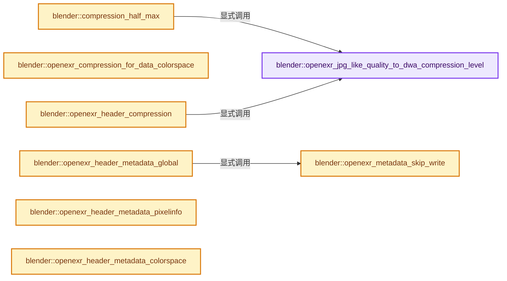
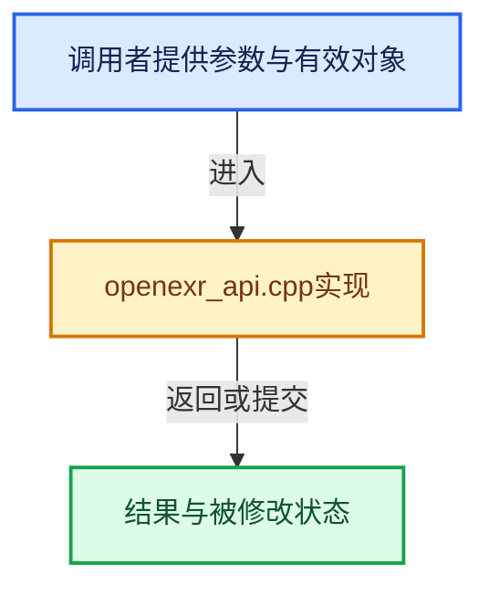

# 实现依赖专题：source/blender/imbuf/intern/openexr/openexr_api.cpp

[方向导航](README.md) · [符号索引](../%E7%AC%A6%E5%8F%B7%E4%BE%9D%E8%B5%96%E4%B8%8E%E5%AE%9E%E7%8E%B0%E7%B4%A2%E5%BC%95.md)

本专题从正文实际调用进入，集中保存共享实现。函数有稳定锚点，可从调用处直接跳到对应完整函数；递归与互相调用通过回链组织。

## 本文件的实现关系






## 完整成员与函数实现

<a id="f-5030d4ed891fbb07"></a>

### `blender::openexr_jpg_like_quality_to_dwa_compression_level`

实现位置：[source/blender/imbuf/intern/openexr/openexr_api.cpp](../../../../../source/blender/imbuf/intern/openexr/openexr_api.cpp) · L390—L401。

接口参数：

- `int q`

**教学注释版**

<!-- annotated:019e43a9d8a28f -->

```cpp
static int openexr_jpg_like_quality_to_dwa_compression_level(int q)
{
  q = math::clamp(q, 0, 100);

  /* Map default JPG quality of 90 to default DWA level of 45,
   * "lossless" JPG quality of 100 to DWA level of 0, and everything else
   * linearly based on those. */
  constexpr int x0 = 100, y0 = 0;
  constexpr int x1 = 90, y1 = 45;
  q = y0 + (q - x0) * (y1 - y0) / (x1 - x0);
  return q;
}
```

<details>
<summary>核对原始源码：source/blender/imbuf/intern/openexr/openexr_api.cpp · L390—L401</summary>

<!-- original:019e43a9d8a28f:source/blender/imbuf/intern/openexr/openexr_api.cpp:390:401 -->

```cpp
static int openexr_jpg_like_quality_to_dwa_compression_level(int q)
{
  q = math::clamp(q, 0, 100);

  /* Map default JPG quality of 90 to default DWA level of 45,
   * "lossless" JPG quality of 100 to DWA level of 0, and everything else
   * linearly based on those. */
  constexpr int x0 = 100, y0 = 0;
  constexpr int x1 = 90, y1 = 45;
  q = y0 + (q - x0) * (y1 - y0) / (x1 - x0);
  return q;
}
```

</details>

**沿实际写入检查状态**

- `q = math::clamp(q, 0, 100);`
- `q = y0 + (q - x0) * (y1 - y0) / (x1 - x0);`

**结果出口**

- `return q;`

**继续追踪实现**

- `math::clamp` → [blender::math::clamp · L118](../12-%E7%A9%BA%E9%97%B4%E6%95%B0%E6%8D%AE%E7%BB%93%E6%9E%84%E4%B8%8E%E5%87%A0%E4%BD%95%E7%AE%97%E6%B3%95/%E4%BE%9D%E8%B5%96-BLI_math_vector-906a87.md#f-65702e97e59fc41e)；[blender::math::clamp · L130](../12-%E7%A9%BA%E9%97%B4%E6%95%B0%E6%8D%AE%E7%BB%93%E6%9E%84%E4%B8%8E%E5%87%A0%E4%BD%95%E7%AE%97%E6%B3%95/%E4%BE%9D%E8%B5%96-BLI_math_vector-906a87.md#f-0365873940e23a11)；[blender::math::clamp · L69](../12-%E7%A9%BA%E9%97%B4%E6%95%B0%E6%8D%AE%E7%BB%93%E6%9E%84%E4%B8%8E%E5%87%A0%E4%BD%95%E7%AE%97%E6%B3%95/%E4%BE%9D%E8%B5%96-BLI_math_base-0728eb.md#f-9282cf5d06fa3723)。同名重载需按实参类型选择。

<a id="f-bd528d93674acd31"></a>

### `blender::compression_half_max`

实现位置：[source/blender/imbuf/intern/openexr/openexr_api.cpp](../../../../../source/blender/imbuf/intern/openexr/openexr_api.cpp) · L403—L419。

接口参数：

- `const int compression`
- `const int quality`

**教学注释版**

<!-- annotated:84e9e197497ae4 -->

```cpp
static float compression_half_max(const int compression, const int quality)
{
  if (ELEM(compression, R_IMF_EXR_CODEC_DWAA, R_IMF_EXR_CODEC_DWAB)) {
    /* Empirically determined margin to prevent DWAA/DWAB lossy compression
     * from overshooting to infinity. The DWA compression uses log2-luminance
     * DCT, and overshoot increases with the compression level.
     *
     * Tested with randomized pixel patterns across various compression levels
     * to find a tight bound. */
    const int level = openexr_jpg_like_quality_to_dwa_compression_level(quality);
    const float margin = (level <= 50) ? (2048.0f + 32.0f * level) :
                                         (3624.0f + 128.0f * (level - 50));
    return HALF_MAX - margin;
  }

  return HALF_MAX;
}
```

<details>
<summary>核对原始源码：source/blender/imbuf/intern/openexr/openexr_api.cpp · L403—L419</summary>

<!-- original:84e9e197497ae4:source/blender/imbuf/intern/openexr/openexr_api.cpp:403:419 -->

```cpp
static float compression_half_max(const int compression, const int quality)
{
  if (ELEM(compression, R_IMF_EXR_CODEC_DWAA, R_IMF_EXR_CODEC_DWAB)) {
    /* Empirically determined margin to prevent DWAA/DWAB lossy compression
     * from overshooting to infinity. The DWA compression uses log2-luminance
     * DCT, and overshoot increases with the compression level.
     *
     * Tested with randomized pixel patterns across various compression levels
     * to find a tight bound. */
    const int level = openexr_jpg_like_quality_to_dwa_compression_level(quality);
    const float margin = (level <= 50) ? (2048.0f + 32.0f * level) :
                                         (3624.0f + 128.0f * (level - 50));
    return HALF_MAX - margin;
  }

  return HALF_MAX;
}
```

</details>

**结果出口**

- `return HALF_MAX - margin;`
- `return HALF_MAX;`

**继续追踪实现**

- `ELEM` → [ELEM · L88](%E4%BE%9D%E8%B5%96-GHOST_utildefines-34b996.md#m-d28724a15928)；[ELEM · L135](../01-%E5%9F%BA%E7%A1%80%E5%AE%B9%E5%99%A8%E4%B8%8E%E7%8E%B0%E4%BB%A3CPP/%E4%BE%9D%E8%B5%96-BLI_utildefines-293a0a.md#m-d6572de7cae0)。宏定义由构建条件选择。
- `openexr_jpg_like_quality_to_dwa_compression_level` → [blender::openexr_jpg_like_quality_to_dwa_compression_level · L390](%E4%BE%9D%E8%B5%96-openexr_api-5c6bf8.md#f-5030d4ed891fbb07)。

<a id="f-9db5fbb1ff43db23"></a>

### `blender::openexr_compression_for_data_colorspace`

实现位置：[source/blender/imbuf/intern/openexr/openexr_api.cpp](../../../../../source/blender/imbuf/intern/openexr/openexr_api.cpp) · L421—L428。

接口参数：

- `const int compression`

**教学注释版**

<!-- annotated:e57500e7ceca3b -->

```cpp
static int openexr_compression_for_data_colorspace(const int compression)
{
  /* Still write data passes lossless when using lossy compression. */
  if (ELEM(compression, R_IMF_EXR_CODEC_DWAA, R_IMF_EXR_CODEC_DWAB)) {
    return R_IMF_EXR_CODEC_ZIP;
  }
  return compression;
}
```

<details>
<summary>核对原始源码：source/blender/imbuf/intern/openexr/openexr_api.cpp · L421—L428</summary>

<!-- original:e57500e7ceca3b:source/blender/imbuf/intern/openexr/openexr_api.cpp:421:428 -->

```cpp
static int openexr_compression_for_data_colorspace(const int compression)
{
  /* Still write data passes lossless when using lossy compression. */
  if (ELEM(compression, R_IMF_EXR_CODEC_DWAA, R_IMF_EXR_CODEC_DWAB)) {
    return R_IMF_EXR_CODEC_ZIP;
  }
  return compression;
}
```

</details>

**结果出口**

- `return R_IMF_EXR_CODEC_ZIP;`
- `return compression;`

**继续追踪实现**

- `ELEM` → [ELEM · L88](%E4%BE%9D%E8%B5%96-GHOST_utildefines-34b996.md#m-d28724a15928)；[ELEM · L135](../01-%E5%9F%BA%E7%A1%80%E5%AE%B9%E5%99%A8%E4%B8%8E%E7%8E%B0%E4%BB%A3CPP/%E4%BE%9D%E8%B5%96-BLI_utildefines-293a0a.md#m-d6572de7cae0)。宏定义由构建条件选择。

<a id="f-1c9a47f7d4fc4225"></a>

### `blender::openexr_header_compression`

实现位置：[source/blender/imbuf/intern/openexr/openexr_api.cpp](../../../../../source/blender/imbuf/intern/openexr/openexr_api.cpp) · L430—L478。

接口参数：

- `Header *header`
- `int compression`
- `int quality`

**教学注释版**

<!-- annotated:640260e2535b16 -->

```cpp
static void openexr_header_compression(Header *header, int compression, int quality)
{
  switch (compression) {
    case R_IMF_EXR_CODEC_NONE:
      header->compression() = NO_COMPRESSION;
      break;
    case R_IMF_EXR_CODEC_PXR24:
      header->compression() = PXR24_COMPRESSION;
      break;
    case R_IMF_EXR_CODEC_ZIP:
      header->compression() = ZIP_COMPRESSION;
      break;
    case R_IMF_EXR_CODEC_PIZ:
      header->compression() = PIZ_COMPRESSION;
      break;
    case R_IMF_EXR_CODEC_RLE:
      header->compression() = RLE_COMPRESSION;
      break;
    case R_IMF_EXR_CODEC_ZIPS:
      header->compression() = ZIPS_COMPRESSION;
      break;
    case R_IMF_EXR_CODEC_B44:
      header->compression() = B44_COMPRESSION;
      break;
    case R_IMF_EXR_CODEC_B44A:
      header->compression() = B44A_COMPRESSION;
      break;
#if OPENEXR_VERSION_MAJOR > 2 || (OPENEXR_VERSION_MAJOR >= 2 && OPENEXR_VERSION_MINOR >= 2)
    case R_IMF_EXR_CODEC_DWAA:
      header->compression() = DWAA_COMPRESSION;
      header->dwaCompressionLevel() = openexr_jpg_like_quality_to_dwa_compression_level(quality);
      break;
    case R_IMF_EXR_CODEC_DWAB:
      header->compression() = DWAB_COMPRESSION;
      header->dwaCompressionLevel() = openexr_jpg_like_quality_to_dwa_compression_level(quality);
      break;
#endif
#if COMBINED_OPENEXR_VERSION >= 30400
      /* Always writing 32 scan-lines for now, could add an option for 256 scan-lines
       * for slightly smaller files if there is demand for it. */
    case R_IMF_EXR_CODEC_HTJ2K:
      header->compression() = HTJ2K32_COMPRESSION;
      break;
#endif
    default:
      header->compression() = ZIP_COMPRESSION;
      break;
  }
}
```

<details>
<summary>核对原始源码：source/blender/imbuf/intern/openexr/openexr_api.cpp · L430—L478</summary>

<!-- original:640260e2535b16:source/blender/imbuf/intern/openexr/openexr_api.cpp:430:478 -->

```cpp
static void openexr_header_compression(Header *header, int compression, int quality)
{
  switch (compression) {
    case R_IMF_EXR_CODEC_NONE:
      header->compression() = NO_COMPRESSION;
      break;
    case R_IMF_EXR_CODEC_PXR24:
      header->compression() = PXR24_COMPRESSION;
      break;
    case R_IMF_EXR_CODEC_ZIP:
      header->compression() = ZIP_COMPRESSION;
      break;
    case R_IMF_EXR_CODEC_PIZ:
      header->compression() = PIZ_COMPRESSION;
      break;
    case R_IMF_EXR_CODEC_RLE:
      header->compression() = RLE_COMPRESSION;
      break;
    case R_IMF_EXR_CODEC_ZIPS:
      header->compression() = ZIPS_COMPRESSION;
      break;
    case R_IMF_EXR_CODEC_B44:
      header->compression() = B44_COMPRESSION;
      break;
    case R_IMF_EXR_CODEC_B44A:
      header->compression() = B44A_COMPRESSION;
      break;
#if OPENEXR_VERSION_MAJOR > 2 || (OPENEXR_VERSION_MAJOR >= 2 && OPENEXR_VERSION_MINOR >= 2)
    case R_IMF_EXR_CODEC_DWAA:
      header->compression() = DWAA_COMPRESSION;
      header->dwaCompressionLevel() = openexr_jpg_like_quality_to_dwa_compression_level(quality);
      break;
    case R_IMF_EXR_CODEC_DWAB:
      header->compression() = DWAB_COMPRESSION;
      header->dwaCompressionLevel() = openexr_jpg_like_quality_to_dwa_compression_level(quality);
      break;
#endif
#if COMBINED_OPENEXR_VERSION >= 30400
      /* Always writing 32 scan-lines for now, could add an option for 256 scan-lines
       * for slightly smaller files if there is demand for it. */
    case R_IMF_EXR_CODEC_HTJ2K:
      header->compression() = HTJ2K32_COMPRESSION;
      break;
#endif
    default:
      header->compression() = ZIP_COMPRESSION;
      break;
  }
}
```

</details>

**继续追踪实现**

- `header->compression` → [调用协议](../%E6%A8%A1%E6%9D%BF%E5%AE%8F%E4%B8%8E%E5%8A%A8%E6%80%81%E5%88%86%E6%B4%BE%E5%8D%8F%E8%AE%AE.md)：由接收对象具体类型或运行时策略提供实现。调用位置L434。
- `header->dwaCompressionLevel` → [调用协议](../%E6%A8%A1%E6%9D%BF%E5%AE%8F%E4%B8%8E%E5%8A%A8%E6%80%81%E5%88%86%E6%B4%BE%E5%8D%8F%E8%AE%AE.md)：由接收对象具体类型或运行时策略提供实现。调用位置L460。
- `openexr_jpg_like_quality_to_dwa_compression_level` → [blender::openexr_jpg_like_quality_to_dwa_compression_level · L390](%E4%BE%9D%E8%B5%96-openexr_api-5c6bf8.md#f-5030d4ed891fbb07)。

<a id="f-20d54baabf6cca4e"></a>

### `blender::openexr_metadata_skip_write`

实现位置：[source/blender/imbuf/intern/openexr/openexr_api.cpp](../../../../../source/blender/imbuf/intern/openexr/openexr_api.cpp) · L531—L541。

接口参数：

- `const char *name`
- `const bool is_multi`

**教学注释版**

<!-- annotated:cdbf910b9ff9b7 -->

```cpp
static bool openexr_metadata_skip_write(const char *name, const bool is_multi)
{
  /* Do not blindly pass along compression or colorInteropID, as they might have changed
   * and will already be written when appropriate. Same for metadata about the software
   * that wrote the file and the type (scanline, tiled, deep).
   *
   * Multi-layer name and view are skipped, see #openexr_metadata_skip_read. */
  return STR_ELEM(
             name, "compression", "colorInteropID", "Software", "BlenderMultiChannel", "type") ||
         (is_multi && STR_ELEM(name, "name", "view"));
}
```

<details>
<summary>核对原始源码：source/blender/imbuf/intern/openexr/openexr_api.cpp · L531—L541</summary>

<!-- original:cdbf910b9ff9b7:source/blender/imbuf/intern/openexr/openexr_api.cpp:531:541 -->

```cpp
static bool openexr_metadata_skip_write(const char *name, const bool is_multi)
{
  /* Do not blindly pass along compression or colorInteropID, as they might have changed
   * and will already be written when appropriate. Same for metadata about the software
   * that wrote the file and the type (scanline, tiled, deep).
   *
   * Multi-layer name and view are skipped, see #openexr_metadata_skip_read. */
  return STR_ELEM(
             name, "compression", "colorInteropID", "Software", "BlenderMultiChannel", "type") ||
         (is_multi && STR_ELEM(name, "name", "view"));
}
```

</details>

**结果出口**

- `return STR_ELEM(`

**继续追踪实现**

- `STR_ELEM` → [STR_ELEM · L658](../01-%E5%9F%BA%E7%A1%80%E5%AE%B9%E5%99%A8%E4%B8%8E%E7%8E%B0%E4%BB%A3CPP/%E4%BE%9D%E8%B5%96-BLI_string-b43058.md#m-101109e97582)。宏定义由构建条件选择。

<a id="f-b62f31f40480aceb"></a>

### `blender::openexr_header_metadata_global`

实现位置：[source/blender/imbuf/intern/openexr/openexr_api.cpp](../../../../../source/blender/imbuf/intern/openexr/openexr_api.cpp) · L543—L556。

接口参数：

- `Header *header`
- `const IDProperty *metadata`

**教学注释版**

<!-- annotated:503238e99f7072 -->

```cpp
static void openexr_header_metadata_global(Header *header, const IDProperty *metadata)
{
  header->insert(
      "Software",
      TypedAttribute<std::string>(std::string("Blender ") + BKE_blender_version_string()));

  if (metadata) {
    for (IDProperty &prop : metadata->data.group) {
      if ((prop.type == IDP_STRING) && !openexr_metadata_skip_write(prop.name, false)) {
        header->insert(prop.name, StringAttribute(IDP_string_get(&prop)));
      }
    }
  }
}
```

<details>
<summary>核对原始源码：source/blender/imbuf/intern/openexr/openexr_api.cpp · L543—L556</summary>

<!-- original:503238e99f7072:source/blender/imbuf/intern/openexr/openexr_api.cpp:543:556 -->

```cpp
static void openexr_header_metadata_global(Header *header, const IDProperty *metadata)
{
  header->insert(
      "Software",
      TypedAttribute<std::string>(std::string("Blender ") + BKE_blender_version_string()));

  if (metadata) {
    for (IDProperty &prop : metadata->data.group) {
      if ((prop.type == IDP_STRING) && !openexr_metadata_skip_write(prop.name, false)) {
        header->insert(prop.name, StringAttribute(IDP_string_get(&prop)));
      }
    }
  }
}
```

</details>

**继续追踪实现**

- `header->insert` → [blender::GLVaoCache::insert · L62](%E4%BE%9D%E8%B5%96-gl_batch-d8877a.md#f-4bede76b1421c1f7)。
- `TypedAttribute<std::string>` → [调用协议](../%E6%A8%A1%E6%9D%BF%E5%AE%8F%E4%B8%8E%E5%8A%A8%E6%80%81%E5%88%86%E6%B4%BE%E5%8D%8F%E8%AE%AE.md)：函数指针、局部可调用对象或未展开的宏；必须结合调用者环境。调用位置L547。
- `std::string` → [外部契约](https://eel.is/c++draft/)：这个边界按实际表达式及所属类型核对参数、返回值、寿命与失败行为。这里提供接口入口，不声称已解释该第三方版本的内部实现。
- `BKE_blender_version_string` → [blender::BKE_blender_version_string · L147](%E4%BE%9D%E8%B5%96-blender-0166ac.md#f-f8f50b9928d2bd67)。
- `openexr_metadata_skip_write` → [blender::openexr_metadata_skip_write · L531](%E4%BE%9D%E8%B5%96-openexr_api-5c6bf8.md#f-20d54baabf6cca4e)。
- `StringAttribute` → [调用协议](../%E6%A8%A1%E6%9D%BF%E5%AE%8F%E4%B8%8E%E5%8A%A8%E6%80%81%E5%88%86%E6%B4%BE%E5%8D%8F%E8%AE%AE.md)：函数指针、局部可调用对象或未展开的宏；必须结合调用者环境。调用位置L552。
- `IDP_string_get` → [IDP_string_get · L375](%E4%BE%9D%E8%B5%96-BKE_idprop-fe422c.md#m-bedef49dcb76)。宏定义由构建条件选择。

<a id="f-12da7e70ead85e06"></a>

### `blender::openexr_header_metadata_pixelinfo`

实现位置：[source/blender/imbuf/intern/openexr/openexr_api.cpp](../../../../../source/blender/imbuf/intern/openexr/openexr_api.cpp) · L558—L565。

接口参数：

- `Header *header`
- `const double ppm[2]`

**教学注释版**

<!-- annotated:075533501ca691 -->

```cpp
static void openexr_header_metadata_pixelinfo(Header *header, const double ppm[2])
{
  if (ppm[0] > 0.0 && ppm[1] > 0.0) {
    /* Convert meters to inches. */
    addXDensity(*header, ppm[0] * 0.0254);
    header->pixelAspectRatio() = math::safe_divide(ppm[1], ppm[0]);
  }
}
```

<details>
<summary>核对原始源码：source/blender/imbuf/intern/openexr/openexr_api.cpp · L558—L565</summary>

<!-- original:075533501ca691:source/blender/imbuf/intern/openexr/openexr_api.cpp:558:565 -->

```cpp
static void openexr_header_metadata_pixelinfo(Header *header, const double ppm[2])
{
  if (ppm[0] > 0.0 && ppm[1] > 0.0) {
    /* Convert meters to inches. */
    addXDensity(*header, ppm[0] * 0.0254);
    header->pixelAspectRatio() = math::safe_divide(ppm[1], ppm[0]);
  }
}
```

</details>

**继续追踪实现**

- `addXDensity` → [调用协议](../%E6%A8%A1%E6%9D%BF%E5%AE%8F%E4%B8%8E%E5%8A%A8%E6%80%81%E5%88%86%E6%B4%BE%E5%8D%8F%E8%AE%AE.md)：函数指针、局部可调用对象或未展开的宏；必须结合调用者环境。调用位置L562。
- `header->pixelAspectRatio` → [调用协议](../%E6%A8%A1%E6%9D%BF%E5%AE%8F%E4%B8%8E%E5%8A%A8%E6%80%81%E5%88%86%E6%B4%BE%E5%8D%8F%E8%AE%AE.md)：由接收对象具体类型或运行时策略提供实现。调用位置L563。
- `math::safe_divide` → [blender::math::safe_divide · L341](../12-%E7%A9%BA%E9%97%B4%E6%95%B0%E6%8D%AE%E7%BB%93%E6%9E%84%E4%B8%8E%E5%87%A0%E4%BD%95%E7%AE%97%E6%B3%95/%E4%BE%9D%E8%B5%96-BLI_math_vector-906a87.md#f-ab8c82f9a578f2d4)；[blender::math::safe_divide · L351](../12-%E7%A9%BA%E9%97%B4%E6%95%B0%E6%8D%AE%E7%BB%93%E6%9E%84%E4%B8%8E%E5%87%A0%E4%BD%95%E7%AE%97%E6%B3%95/%E4%BE%9D%E8%B5%96-BLI_math_vector-906a87.md#f-0d22d4b64f9b5c0e)；[blender::math::safe_divide · L107](../12-%E7%A9%BA%E9%97%B4%E6%95%B0%E6%8D%AE%E7%BB%93%E6%9E%84%E4%B8%8E%E5%87%A0%E4%BD%95%E7%AE%97%E6%B3%95/%E4%BE%9D%E8%B5%96-BLI_math_base-0728eb.md#f-a81537b8ea4660b0)。同名重载需按实参类型选择。

<a id="f-8f3c6cbd61803903"></a>

### `blender::openexr_header_metadata_colorspace`

实现位置：[source/blender/imbuf/intern/openexr/openexr_api.cpp](../../../../../source/blender/imbuf/intern/openexr/openexr_api.cpp) · L567—L588。

接口参数：

- `Header *header`
- `const ColorSpace *colorspace`

**教学注释版**

<!-- annotated:5618c720b7317a -->

```cpp
static void openexr_header_metadata_colorspace(Header *header, const ColorSpace *colorspace)
{
  if (colorspace == nullptr) {
    return;
  }

  const char *aces_colorspace = IMB_colormanagement_role_colorspace_name_get(
      COLOR_ROLE_ACES_INTERCHANGE);
  const char *ibuf_colorspace = IMB_colormanagement_colorspace_get_name(colorspace);

  /* Write chromaticities for ACES-2065-1, as required by ACES container format. */
  if (aces_colorspace && STREQ(aces_colorspace, ibuf_colorspace)) {
    header->insert("chromaticities", TypedAttribute<Chromaticities>(CHROMATICITIES_ACES_2065_1));
    header->insert("adoptedNeutral", TypedAttribute<V2f>(CHROMATICITIES_ACES_2065_1.white));
  }

  /* Write interop ID if available. */
  StringRefNull interop_id = IMB_colormanagement_space_get_interop_id(colorspace);
  if (!interop_id.is_empty()) {
    header->insert("colorInteropID", TypedAttribute<std::string>(interop_id));
  }
}
```

<details>
<summary>核对原始源码：source/blender/imbuf/intern/openexr/openexr_api.cpp · L567—L588</summary>

<!-- original:5618c720b7317a:source/blender/imbuf/intern/openexr/openexr_api.cpp:567:588 -->

```cpp
static void openexr_header_metadata_colorspace(Header *header, const ColorSpace *colorspace)
{
  if (colorspace == nullptr) {
    return;
  }

  const char *aces_colorspace = IMB_colormanagement_role_colorspace_name_get(
      COLOR_ROLE_ACES_INTERCHANGE);
  const char *ibuf_colorspace = IMB_colormanagement_colorspace_get_name(colorspace);

  /* Write chromaticities for ACES-2065-1, as required by ACES container format. */
  if (aces_colorspace && STREQ(aces_colorspace, ibuf_colorspace)) {
    header->insert("chromaticities", TypedAttribute<Chromaticities>(CHROMATICITIES_ACES_2065_1));
    header->insert("adoptedNeutral", TypedAttribute<V2f>(CHROMATICITIES_ACES_2065_1.white));
  }

  /* Write interop ID if available. */
  StringRefNull interop_id = IMB_colormanagement_space_get_interop_id(colorspace);
  if (!interop_id.is_empty()) {
    header->insert("colorInteropID", TypedAttribute<std::string>(interop_id));
  }
}
```

</details>

**继续追踪实现**

- `IMB_colormanagement_role_colorspace_name_get` → [blender::IMB_colormanagement_role_colorspace_name_get · L1247](%E4%BE%9D%E8%B5%96-colormanagement-d4733d.md#f-f2cf0e85682f0fd8)。
- `IMB_colormanagement_colorspace_get_name` → [blender::IMB_colormanagement_colorspace_get_name · L3153](%E4%BE%9D%E8%B5%96-colormanagement-d4733d.md#f-32fc2ecf4cf93fd6)。
- `STREQ` → [STREQ · L112](%E4%BE%9D%E8%B5%96-GHOST_utildefines-34b996.md#m-9549fb6aafd2)；[STREQ · L451](../01-%E5%9F%BA%E7%A1%80%E5%AE%B9%E5%99%A8%E4%B8%8E%E7%8E%B0%E4%BB%A3CPP/%E4%BE%9D%E8%B5%96-BLI_utildefines-293a0a.md#m-c7b745bcfad2)；[STREQ · L55](%E4%BE%9D%E8%B5%96-clog-a0bec8.md#m-96e78f386894)。宏定义由构建条件选择。
- `header->insert` → [blender::GLVaoCache::insert · L62](%E4%BE%9D%E8%B5%96-gl_batch-d8877a.md#f-4bede76b1421c1f7)。
- `TypedAttribute<Chromaticities>` → [调用协议](../%E6%A8%A1%E6%9D%BF%E5%AE%8F%E4%B8%8E%E5%8A%A8%E6%80%81%E5%88%86%E6%B4%BE%E5%8D%8F%E8%AE%AE.md)：函数指针、局部可调用对象或未展开的宏；必须结合调用者环境。调用位置L579。
- `TypedAttribute<V2f>` → [调用协议](../%E6%A8%A1%E6%9D%BF%E5%AE%8F%E4%B8%8E%E5%8A%A8%E6%80%81%E5%88%86%E6%B4%BE%E5%8D%8F%E8%AE%AE.md)：函数指针、局部可调用对象或未展开的宏；必须结合调用者环境。调用位置L580。
- `IMB_colormanagement_space_get_interop_id` → [blender::IMB_colormanagement_space_get_interop_id · L1693](%E4%BE%9D%E8%B5%96-colormanagement-d4733d.md#f-b8bd7e080e1520d5)。
- `interop_id.is_empty` → [blender::Bounds<T>::is_empty · L533](../12-%E7%A9%BA%E9%97%B4%E6%95%B0%E6%8D%AE%E7%BB%93%E6%9E%84%E4%B8%8E%E5%87%A0%E4%BD%95%E7%AE%97%E6%B3%95/07-Bounds%E4%B8%8EBVH%E5%AF%B9%E6%AF%94.md#f-55ac376b3d0a0944)；[blender::GVArrayCommon::is_empty · L767](../04-%E8%99%9A%E6%8B%9F%E6%95%B0%E7%BB%84%E4%B8%8E%E7%B4%A2%E5%BC%95%E9%80%89%E6%8B%A9/05-GVArray%E8%BF%90%E8%A1%8C%E6%97%B6%E7%B1%BB%E5%9E%8B.md#f-c1da602ffc5555f9)；[blender::StringRefBase::is_empty · L201](../01-%E5%9F%BA%E7%A1%80%E5%AE%B9%E5%99%A8%E4%B8%8E%E7%8E%B0%E4%BB%A3CPP/15-StringRef%E5%AD%97%E7%AC%A6%E4%B8%B2%E8%A7%86%E5%9B%BE.md#f-9f6c3d2da1cb1796)；[blender::KDTreeNew<T>::is_empty · L498](../12-%E7%A9%BA%E9%97%B4%E6%95%B0%E6%8D%AE%E7%BB%93%E6%9E%84%E4%B8%8E%E5%87%A0%E4%BD%95%E7%AE%97%E6%B3%95/05-K%E8%BF%91%E9%82%BB%E4%B8%8E%E8%8C%83%E5%9B%B4%E6%9F%A5%E8%AF%A2.md#f-67f0ff91cf00b00b)。同名重载需按实参类型选择。
- `TypedAttribute<std::string>` → [调用协议](../%E6%A8%A1%E6%9D%BF%E5%AE%8F%E4%B8%8E%E5%8A%A8%E6%80%81%E5%88%86%E6%B4%BE%E5%8D%8F%E8%AE%AE.md)：函数指针、局部可调用对象或未展开的宏；必须结合调用者环境。调用位置L586。

<a id="f-84f094109ccf6491"></a>

### `blender::openexr_header_metadata_colorspace`

实现位置：[source/blender/imbuf/intern/openexr/openexr_api.cpp](../../../../../source/blender/imbuf/intern/openexr/openexr_api.cpp) · L590—L606。

接口参数：

- `Header *header`
- `const ImBuf *ibuf`

**教学注释版**

<!-- annotated:6ca2518f7157de -->

```cpp
static void openexr_header_metadata_colorspace(Header *header, const ImBuf *ibuf)
{
  /* Get colorspace from image buffer. */
  const ColorSpace *colorspace = nullptr;
  if (ibuf->float_data()) {
    colorspace = ibuf->float_buffer.colorspace;
    if (colorspace == nullptr) {
      colorspace = IMB_colormanagement_space_get_named(
          IMB_colormanagement_role_colorspace_name_get(COLOR_ROLE_SCENE_LINEAR));
    }
  }
  else if (ibuf->byte_data()) {
    colorspace = ibuf->byte_buffer.colorspace;
  }

  openexr_header_metadata_colorspace(header, colorspace);
}
```

<details>
<summary>核对原始源码：source/blender/imbuf/intern/openexr/openexr_api.cpp · L590—L606</summary>

<!-- original:6ca2518f7157de:source/blender/imbuf/intern/openexr/openexr_api.cpp:590:606 -->

```cpp
static void openexr_header_metadata_colorspace(Header *header, const ImBuf *ibuf)
{
  /* Get colorspace from image buffer. */
  const ColorSpace *colorspace = nullptr;
  if (ibuf->float_data()) {
    colorspace = ibuf->float_buffer.colorspace;
    if (colorspace == nullptr) {
      colorspace = IMB_colormanagement_space_get_named(
          IMB_colormanagement_role_colorspace_name_get(COLOR_ROLE_SCENE_LINEAR));
    }
  }
  else if (ibuf->byte_data()) {
    colorspace = ibuf->byte_buffer.colorspace;
  }

  openexr_header_metadata_colorspace(header, colorspace);
}
```

</details>

**沿实际写入检查状态**

- `colorspace = ibuf->float_buffer.colorspace;`
- `colorspace = IMB_colormanagement_space_get_named(`
- `colorspace = ibuf->byte_buffer.colorspace;`

**继续追踪实现**

- `ibuf->float_data` → [blender::ImBuf::float_data · L358](%E4%BE%9D%E8%B5%96-IMB_imbuf_types-f69e60.md#f-2e52aa77544ffaee)。
- `IMB_colormanagement_space_get_named` → [blender::IMB_colormanagement_space_get_named · L1319](%E4%BE%9D%E8%B5%96-colormanagement-d4733d.md#f-686ba14e51262834)；[blender::IMB_colormanagement_space_get_named · L1323](%E4%BE%9D%E8%B5%96-colormanagement-d4733d.md#f-8171f67dd0b37997)。同名重载需按实参类型选择。
- `IMB_colormanagement_role_colorspace_name_get` → [blender::IMB_colormanagement_role_colorspace_name_get · L1247](%E4%BE%9D%E8%B5%96-colormanagement-d4733d.md#f-f2cf0e85682f0fd8)。
- `ibuf->byte_data` → [blender::ImBuf::byte_data · L353](%E4%BE%9D%E8%B5%96-IMB_imbuf_types-f69e60.md#f-2cdfc552156643fa)。
- `openexr_header_metadata_colorspace` → [blender::openexr_header_metadata_colorspace · L567](%E4%BE%9D%E8%B5%96-openexr_api-5c6bf8.md#f-8f3c6cbd61803903)；[blender::openexr_header_metadata_colorspace · L590](%E4%BE%9D%E8%B5%96-openexr_api-5c6bf8.md#f-84f094109ccf6491)。同名重载需按实参类型选择。

<a id="f-e7a019ffe61b0ed1"></a>

### `blender::IMB_exr_write_begin`

实现位置：[source/blender/imbuf/intern/openexr/openexr_api.cpp](../../../../../source/blender/imbuf/intern/openexr/openexr_api.cpp) · L893—L898。

接口参数：

- `const bool write_multipart`

**教学注释版**

<!-- annotated:597994aec14df6 -->

```cpp
ExrWriteHandle *IMB_exr_write_begin(const bool write_multipart)
{
  ExrWriteHandle *handle = MEM_new<ExrWriteHandle>("ExrWriteHandle");
  handle->write_multipart = write_multipart;
  return handle;
}
```

<details>
<summary>核对原始源码：source/blender/imbuf/intern/openexr/openexr_api.cpp · L893—L898</summary>

<!-- original:597994aec14df6:source/blender/imbuf/intern/openexr/openexr_api.cpp:893:898 -->

```cpp
ExrWriteHandle *IMB_exr_write_begin(const bool write_multipart)
{
  ExrWriteHandle *handle = MEM_new<ExrWriteHandle>("ExrWriteHandle");
  handle->write_multipart = write_multipart;
  return handle;
}
```

</details>

**沿实际写入检查状态**

- `handle->write_multipart = write_multipart;`

**结果出口**

- `return handle;`

**继续追踪实现**

- `MEM_new<ExrWriteHandle>` → [MEM_new · L351](../03-%E5%86%85%E5%AD%98%E5%88%86%E9%85%8D%E4%B8%8E%E8%BF%90%E8%A1%8C%E6%97%B6%E7%B1%BB%E5%9E%8B/%E4%BE%9D%E8%B5%96-MEM_guardedalloc-b54eca.md#f-115f9b6784f89912)。

<a id="f-98deab3ee1c0e0c6"></a>

### `blender::IMB_exr_write_view`

实现位置：[source/blender/imbuf/intern/openexr/openexr_api.cpp](../../../../../source/blender/imbuf/intern/openexr/openexr_api.cpp) · L902—L905。

接口参数：

- `ExrWriteHandle *handle`
- `const char *viewname`

**教学注释版**

<!-- annotated:cb75d5f22770b1 -->

```cpp
void IMB_exr_write_view(ExrWriteHandle *handle, const char *viewname)
{
  handle->views.emplace_back(viewname);
}
```

<details>
<summary>核对原始源码：source/blender/imbuf/intern/openexr/openexr_api.cpp · L902—L905</summary>

<!-- original:cb75d5f22770b1:source/blender/imbuf/intern/openexr/openexr_api.cpp:902:905 -->

```cpp
void IMB_exr_write_view(ExrWriteHandle *handle, const char *viewname)
{
  handle->views.emplace_back(viewname);
}
```

</details>

**继续追踪实现**

- `handle->views.emplace_back` → [调用协议](../%E6%A8%A1%E6%9D%BF%E5%AE%8F%E4%B8%8E%E5%8A%A8%E6%80%81%E5%88%86%E6%B4%BE%E5%8D%8F%E8%AE%AE.md)：接收对象类型依赖auto、返回值或模板实例；不按同名猜测目标。调用位置L904。

<a id="f-cdb0eedaedb3d0d4"></a>

### `blender::imb_exr_get_multiView_id`

实现位置：[source/blender/imbuf/intern/openexr/openexr_api.cpp](../../../../../source/blender/imbuf/intern/openexr/openexr_api.cpp) · L907—L920。

接口参数：

- `StringVector &views`
- `const std::string &name`

**教学注释版**

<!-- annotated:25897e59211bcd -->

```cpp
static int imb_exr_get_multiView_id(StringVector &views, const std::string &name)
{
  int count = 0;
  for (StringVector::const_iterator i = views.begin(); count < views.size(); ++i) {
    if (name == *i) {
      return count;
    }

    count++;
  }

  /* no views or wrong name */
  return -1;
}
```

<details>
<summary>核对原始源码：source/blender/imbuf/intern/openexr/openexr_api.cpp · L907—L920</summary>

<!-- original:25897e59211bcd:source/blender/imbuf/intern/openexr/openexr_api.cpp:907:920 -->

```cpp
static int imb_exr_get_multiView_id(StringVector &views, const std::string &name)
{
  int count = 0;
  for (StringVector::const_iterator i = views.begin(); count < views.size(); ++i) {
    if (name == *i) {
      return count;
    }

    count++;
  }

  /* no views or wrong name */
  return -1;
}
```

</details>

**结果出口**

- `return count;`
- `return -1;`

**继续追踪实现**

- `views.begin` → [blender::StringRefBase::begin · L233](../01-%E5%9F%BA%E7%A1%80%E5%AE%B9%E5%99%A8%E4%B8%8E%E7%8E%B0%E4%BB%A3CPP/15-StringRef%E5%AD%97%E7%AC%A6%E4%B8%B2%E8%A7%86%E5%9B%BE.md#f-0fa50fe40314532d)。
- `views.size` → [blender::Bounds<T>::size · L543](../12-%E7%A9%BA%E9%97%B4%E6%95%B0%E6%8D%AE%E7%BB%93%E6%9E%84%E4%B8%8E%E5%87%A0%E4%BD%95%E7%AE%97%E6%B3%95/07-Bounds%E4%B8%8EBVH%E5%AF%B9%E6%AF%94.md#f-fcce88c0824fcd97)；[blender::GVArrayImpl::size · L651](../04-%E8%99%9A%E6%8B%9F%E6%95%B0%E7%BB%84%E4%B8%8E%E7%B4%A2%E5%BC%95%E9%80%89%E6%8B%A9/05-GVArray%E8%BF%90%E8%A1%8C%E6%97%B6%E7%B1%BB%E5%9E%8B.md#f-f23d3d1f3b110f1e)；[blender::GVArrayCommon::size · L759](../04-%E8%99%9A%E6%8B%9F%E6%95%B0%E7%BB%84%E4%B8%8E%E7%B4%A2%E5%BC%95%E9%80%89%E6%8B%A9/05-GVArray%E8%BF%90%E8%A1%8C%E6%97%B6%E7%B1%BB%E5%9E%8B.md#f-0856784f4e4fd3c9)；[blender::StringRefBase::size · L196](../01-%E5%9F%BA%E7%A1%80%E5%AE%B9%E5%99%A8%E4%B8%8E%E7%8E%B0%E4%BB%A3CPP/15-StringRef%E5%AD%97%E7%AC%A6%E4%B8%B2%E8%A7%86%E5%9B%BE.md#f-60d4631c74931d2e)；[blender::KDTreeNew<T>::size · L493](../12-%E7%A9%BA%E9%97%B4%E6%95%B0%E6%8D%AE%E7%BB%93%E6%9E%84%E4%B8%8E%E5%87%A0%E4%BD%95%E7%AE%97%E6%B3%95/05-K%E8%BF%91%E9%82%BB%E4%B8%8E%E8%8C%83%E5%9B%B4%E6%9F%A5%E8%AF%A2.md#f-233c05ce6d5c8d39)；[blender::MainAllIDsIterator::size · L1291](%E4%BE%9D%E8%B5%96-main-ffa8b3.md#f-520d1311c646452f)；[blender::GLSourcesBaked::size · L1541](%E4%BE%9D%E8%B5%96-gl_shader-766737.md#f-5b5b539d533c6792)。同名重载需按实参类型选择。

<a id="f-fcd2ec148c7ad4a5"></a>

### `blender::imb_exr_get_views`

实现位置：[source/blender/imbuf/intern/openexr/openexr_api.cpp](../../../../../source/blender/imbuf/intern/openexr/openexr_api.cpp) · L922—L947。

接口参数：

- `MultiPartInputFile &file`

**教学注释版**

<!-- annotated:cadb567919e006 -->

```cpp
static StringVector imb_exr_get_views(MultiPartInputFile &file)
{
  StringVector views;

  for (int p = 0; p < file.parts(); p++) {
    /* Views stored in separate parts. */
    if (file.header(p).hasView()) {
      const std::string &view = file.header(p).view();
      if (imb_exr_get_multiView_id(views, view) == -1) {
        views.push_back(view);
      }
    }

    /* Part containing multiple views. */
    if (hasMultiView(file.header(p))) {
      StringVector multiview = multiView(file.header(p));
      for (const std::string &view : multiview) {
        if (imb_exr_get_multiView_id(views, view) == -1) {
          views.push_back(view);
        }
      }
    }
  }

  return views;
}
```

<details>
<summary>核对原始源码：source/blender/imbuf/intern/openexr/openexr_api.cpp · L922—L947</summary>

<!-- original:cadb567919e006:source/blender/imbuf/intern/openexr/openexr_api.cpp:922:947 -->

```cpp
static StringVector imb_exr_get_views(MultiPartInputFile &file)
{
  StringVector views;

  for (int p = 0; p < file.parts(); p++) {
    /* Views stored in separate parts. */
    if (file.header(p).hasView()) {
      const std::string &view = file.header(p).view();
      if (imb_exr_get_multiView_id(views, view) == -1) {
        views.push_back(view);
      }
    }

    /* Part containing multiple views. */
    if (hasMultiView(file.header(p))) {
      StringVector multiview = multiView(file.header(p));
      for (const std::string &view : multiview) {
        if (imb_exr_get_multiView_id(views, view) == -1) {
          views.push_back(view);
        }
      }
    }
  }

  return views;
}
```

</details>

**结果出口**

- `return views;`

**继续追踪实现**

- `file.parts` → [调用协议](../%E6%A8%A1%E6%9D%BF%E5%AE%8F%E4%B8%8E%E5%8A%A8%E6%80%81%E5%88%86%E6%B4%BE%E5%8D%8F%E8%AE%AE.md)：由接收对象具体类型或运行时策略提供实现。调用位置L926。
- `file.header(p).hasView` → [调用协议](../%E6%A8%A1%E6%9D%BF%E5%AE%8F%E4%B8%8E%E5%8A%A8%E6%80%81%E5%88%86%E6%B4%BE%E5%8D%8F%E8%AE%AE.md)：接收对象类型依赖auto、返回值或模板实例；不按同名猜测目标。调用位置L928。
- `file.header` → [调用协议](../%E6%A8%A1%E6%9D%BF%E5%AE%8F%E4%B8%8E%E5%8A%A8%E6%80%81%E5%88%86%E6%B4%BE%E5%8D%8F%E8%AE%AE.md)：由接收对象具体类型或运行时策略提供实现。调用位置L928。
- `file.header(p).view` → [调用协议](../%E6%A8%A1%E6%9D%BF%E5%AE%8F%E4%B8%8E%E5%8A%A8%E6%80%81%E5%88%86%E6%B4%BE%E5%8D%8F%E8%AE%AE.md)：接收对象类型依赖auto、返回值或模板实例；不按同名猜测目标。调用位置L929。
- `imb_exr_get_multiView_id` → [blender::imb_exr_get_multiView_id · L907](%E4%BE%9D%E8%B5%96-openexr_api-5c6bf8.md#f-cdb0eedaedb3d0d4)。
- `views.push_back` → [调用协议](../%E6%A8%A1%E6%9D%BF%E5%AE%8F%E4%B8%8E%E5%8A%A8%E6%80%81%E5%88%86%E6%B4%BE%E5%8D%8F%E8%AE%AE.md)：由接收对象具体类型或运行时策略提供实现。调用位置L931。
- `hasMultiView` → [调用协议](../%E6%A8%A1%E6%9D%BF%E5%AE%8F%E4%B8%8E%E5%8A%A8%E6%80%81%E5%88%86%E6%B4%BE%E5%8D%8F%E8%AE%AE.md)：函数指针、局部可调用对象或未展开的宏；必须结合调用者环境。调用位置L936。
- `multiView` → [调用协议](../%E6%A8%A1%E6%9D%BF%E5%AE%8F%E4%B8%8E%E5%8A%A8%E6%80%81%E5%88%86%E6%B4%BE%E5%8D%8F%E8%AE%AE.md)：函数指针、局部可调用对象或未展开的宏；必须结合调用者环境。调用位置L937。

<a id="f-edca421a9f0e3ee2"></a>

### `blender::IMB_exr_write_pass`

实现位置：[source/blender/imbuf/intern/openexr/openexr_api.cpp](../../../../../source/blender/imbuf/intern/openexr/openexr_api.cpp) · L949—L1013。

接口参数：

- `ExrWriteHandle *handle`
- `StringRefNull layerpassname`
- `StringRefNull channelnames`
- `StringRefNull viewname`
- `StringRefNull colorspace`
- `size_t xstride`
- `size_t ystride`
- `const float *rect`
- `bool use_half_float`

**教学注释版**

<!-- annotated:1b47a0cf601777 -->

```cpp
void IMB_exr_write_pass(ExrWriteHandle *handle,
                        StringRefNull layerpassname,
                        StringRefNull channelnames,
                        StringRefNull viewname,
                        StringRefNull colorspace,
                        size_t xstride,
                        size_t ystride,
                        const float *rect,
                        bool use_half_float)
{
  /* For multipart, part name includes view since part names must be unique. */
  std::string part_name;
  if (handle->write_multipart) {
    part_name = layerpassname;
    if (!viewname.is_empty()) {
      if (part_name.empty()) {
        part_name = viewname;
      }
      else {
        part_name = part_name + "-" + viewname;
      }
    }
  }

  /* If there are layer and pass names, we will write Blender multichannel metadata. */
  if (!layerpassname.is_empty()) {
    handle->has_layer_pass_names = true;
  }

  for (size_t channel = 0; channel < channelnames.size(); channel++) {
    /* Full channel name including view (when not using multipart) and channel. */
    std::string full_name = layerpassname;
    if (!handle->write_multipart && !viewname.is_empty()) {
      if (full_name.empty()) {
        full_name = viewname;
      }
      else {
        full_name = full_name + "." + viewname;
      }
    }
    if (full_name.empty()) {
      full_name = channelnames[channel];
    }
    else {
      full_name = full_name + "." + channelnames[channel];
    }

    handle->channels.append_as();
    ExrChannel &echan = handle->channels.last();

    echan.name = full_name;
    echan.internal_name = full_name;
    echan.part_name = part_name;
    echan.view = viewname;
    echan.colorspace = IMB_colormanagement_space_get_named(colorspace.c_str());

    echan.xstride = xstride;
    echan.ystride = ystride;
    /* This is used for writing, the data should not be modified. ????????? */
    echan.rect = const_cast<float *>(rect + channel);
    echan.use_half_float = use_half_float && !IMB_colormanagement_space_is_data(echan.colorspace);
  }

  CLOG_DEBUG(&LOG, "Added pass %s %s", layerpassname.c_str(), channelnames.c_str());
}
```

<details>
<summary>核对原始源码：source/blender/imbuf/intern/openexr/openexr_api.cpp · L949—L1013</summary>

<!-- original:1b47a0cf601777:source/blender/imbuf/intern/openexr/openexr_api.cpp:949:1013 -->

```cpp
void IMB_exr_write_pass(ExrWriteHandle *handle,
                        StringRefNull layerpassname,
                        StringRefNull channelnames,
                        StringRefNull viewname,
                        StringRefNull colorspace,
                        size_t xstride,
                        size_t ystride,
                        const float *rect,
                        bool use_half_float)
{
  /* For multipart, part name includes view since part names must be unique. */
  std::string part_name;
  if (handle->write_multipart) {
    part_name = layerpassname;
    if (!viewname.is_empty()) {
      if (part_name.empty()) {
        part_name = viewname;
      }
      else {
        part_name = part_name + "-" + viewname;
      }
    }
  }

  /* If there are layer and pass names, we will write Blender multichannel metadata. */
  if (!layerpassname.is_empty()) {
    handle->has_layer_pass_names = true;
  }

  for (size_t channel = 0; channel < channelnames.size(); channel++) {
    /* Full channel name including view (when not using multipart) and channel. */
    std::string full_name = layerpassname;
    if (!handle->write_multipart && !viewname.is_empty()) {
      if (full_name.empty()) {
        full_name = viewname;
      }
      else {
        full_name = full_name + "." + viewname;
      }
    }
    if (full_name.empty()) {
      full_name = channelnames[channel];
    }
    else {
      full_name = full_name + "." + channelnames[channel];
    }

    handle->channels.append_as();
    ExrChannel &echan = handle->channels.last();

    echan.name = full_name;
    echan.internal_name = full_name;
    echan.part_name = part_name;
    echan.view = viewname;
    echan.colorspace = IMB_colormanagement_space_get_named(colorspace.c_str());

    echan.xstride = xstride;
    echan.ystride = ystride;
    /* This is used for writing, the data should not be modified. ????????? */
    echan.rect = const_cast<float *>(rect + channel);
    echan.use_half_float = use_half_float && !IMB_colormanagement_space_is_data(echan.colorspace);
  }

  CLOG_DEBUG(&LOG, "Added pass %s %s", layerpassname.c_str(), channelnames.c_str());
}
```

</details>

**沿实际写入检查状态**

- `part_name = layerpassname;`
- `part_name = viewname;`
- `part_name = part_name + "-" + viewname;`
- `handle->has_layer_pass_names = true;`
- `full_name = viewname;`
- `full_name = full_name + "." + viewname;`
- `full_name = channelnames[channel];`
- `full_name = full_name + "." + channelnames[channel];`
- `echan.name = full_name;`
- `echan.internal_name = full_name;`
- `echan.part_name = part_name;`
- `echan.view = viewname;`
- `echan.colorspace = IMB_colormanagement_space_get_named(colorspace.c_str());`
- `echan.xstride = xstride;`
- `echan.ystride = ystride;`
- `echan.rect = const_cast<float *>(rect + channel);`
- `echan.use_half_float = use_half_float && !IMB_colormanagement_space_is_data(echan.colorspace);`

**继续追踪实现**

- `viewname.is_empty` → [blender::Bounds<T>::is_empty · L533](../12-%E7%A9%BA%E9%97%B4%E6%95%B0%E6%8D%AE%E7%BB%93%E6%9E%84%E4%B8%8E%E5%87%A0%E4%BD%95%E7%AE%97%E6%B3%95/07-Bounds%E4%B8%8EBVH%E5%AF%B9%E6%AF%94.md#f-55ac376b3d0a0944)；[blender::GVArrayCommon::is_empty · L767](../04-%E8%99%9A%E6%8B%9F%E6%95%B0%E7%BB%84%E4%B8%8E%E7%B4%A2%E5%BC%95%E9%80%89%E6%8B%A9/05-GVArray%E8%BF%90%E8%A1%8C%E6%97%B6%E7%B1%BB%E5%9E%8B.md#f-c1da602ffc5555f9)；[blender::StringRefBase::is_empty · L201](../01-%E5%9F%BA%E7%A1%80%E5%AE%B9%E5%99%A8%E4%B8%8E%E7%8E%B0%E4%BB%A3CPP/15-StringRef%E5%AD%97%E7%AC%A6%E4%B8%B2%E8%A7%86%E5%9B%BE.md#f-9f6c3d2da1cb1796)；[blender::KDTreeNew<T>::is_empty · L498](../12-%E7%A9%BA%E9%97%B4%E6%95%B0%E6%8D%AE%E7%BB%93%E6%9E%84%E4%B8%8E%E5%87%A0%E4%BD%95%E7%AE%97%E6%B3%95/05-K%E8%BF%91%E9%82%BB%E4%B8%8E%E8%8C%83%E5%9B%B4%E6%9F%A5%E8%AF%A2.md#f-67f0ff91cf00b00b)。同名重载需按实参类型选择。
- `part_name.empty` → [外部契约](https://eel.is/c++draft/)：这个边界按实际表达式及所属类型核对参数、返回值、寿命与失败行为。这里提供接口入口，不声称已解释该第三方版本的内部实现。
- `layerpassname.is_empty` → [blender::Bounds<T>::is_empty · L533](../12-%E7%A9%BA%E9%97%B4%E6%95%B0%E6%8D%AE%E7%BB%93%E6%9E%84%E4%B8%8E%E5%87%A0%E4%BD%95%E7%AE%97%E6%B3%95/07-Bounds%E4%B8%8EBVH%E5%AF%B9%E6%AF%94.md#f-55ac376b3d0a0944)；[blender::GVArrayCommon::is_empty · L767](../04-%E8%99%9A%E6%8B%9F%E6%95%B0%E7%BB%84%E4%B8%8E%E7%B4%A2%E5%BC%95%E9%80%89%E6%8B%A9/05-GVArray%E8%BF%90%E8%A1%8C%E6%97%B6%E7%B1%BB%E5%9E%8B.md#f-c1da602ffc5555f9)；[blender::StringRefBase::is_empty · L201](../01-%E5%9F%BA%E7%A1%80%E5%AE%B9%E5%99%A8%E4%B8%8E%E7%8E%B0%E4%BB%A3CPP/15-StringRef%E5%AD%97%E7%AC%A6%E4%B8%B2%E8%A7%86%E5%9B%BE.md#f-9f6c3d2da1cb1796)；[blender::KDTreeNew<T>::is_empty · L498](../12-%E7%A9%BA%E9%97%B4%E6%95%B0%E6%8D%AE%E7%BB%93%E6%9E%84%E4%B8%8E%E5%87%A0%E4%BD%95%E7%AE%97%E6%B3%95/05-K%E8%BF%91%E9%82%BB%E4%B8%8E%E8%8C%83%E5%9B%B4%E6%9F%A5%E8%AF%A2.md#f-67f0ff91cf00b00b)。同名重载需按实参类型选择。
- `channelnames.size` → [blender::Bounds<T>::size · L543](../12-%E7%A9%BA%E9%97%B4%E6%95%B0%E6%8D%AE%E7%BB%93%E6%9E%84%E4%B8%8E%E5%87%A0%E4%BD%95%E7%AE%97%E6%B3%95/07-Bounds%E4%B8%8EBVH%E5%AF%B9%E6%AF%94.md#f-fcce88c0824fcd97)；[blender::GVArrayImpl::size · L651](../04-%E8%99%9A%E6%8B%9F%E6%95%B0%E7%BB%84%E4%B8%8E%E7%B4%A2%E5%BC%95%E9%80%89%E6%8B%A9/05-GVArray%E8%BF%90%E8%A1%8C%E6%97%B6%E7%B1%BB%E5%9E%8B.md#f-f23d3d1f3b110f1e)；[blender::GVArrayCommon::size · L759](../04-%E8%99%9A%E6%8B%9F%E6%95%B0%E7%BB%84%E4%B8%8E%E7%B4%A2%E5%BC%95%E9%80%89%E6%8B%A9/05-GVArray%E8%BF%90%E8%A1%8C%E6%97%B6%E7%B1%BB%E5%9E%8B.md#f-0856784f4e4fd3c9)；[blender::StringRefBase::size · L196](../01-%E5%9F%BA%E7%A1%80%E5%AE%B9%E5%99%A8%E4%B8%8E%E7%8E%B0%E4%BB%A3CPP/15-StringRef%E5%AD%97%E7%AC%A6%E4%B8%B2%E8%A7%86%E5%9B%BE.md#f-60d4631c74931d2e)；[blender::KDTreeNew<T>::size · L493](../12-%E7%A9%BA%E9%97%B4%E6%95%B0%E6%8D%AE%E7%BB%93%E6%9E%84%E4%B8%8E%E5%87%A0%E4%BD%95%E7%AE%97%E6%B3%95/05-K%E8%BF%91%E9%82%BB%E4%B8%8E%E8%8C%83%E5%9B%B4%E6%9F%A5%E8%AF%A2.md#f-233c05ce6d5c8d39)；[blender::MainAllIDsIterator::size · L1291](%E4%BE%9D%E8%B5%96-main-ffa8b3.md#f-520d1311c646452f)；[blender::GLSourcesBaked::size · L1541](%E4%BE%9D%E8%B5%96-gl_shader-766737.md#f-5b5b539d533c6792)。同名重载需按实参类型选择。
- `full_name.empty` → [外部契约](https://eel.is/c++draft/)：这个边界按实际表达式及所属类型核对参数、返回值、寿命与失败行为。这里提供接口入口，不声称已解释该第三方版本的内部实现。
- `handle->channels.append_as` → [调用协议](../%E6%A8%A1%E6%9D%BF%E5%AE%8F%E4%B8%8E%E5%8A%A8%E6%80%81%E5%88%86%E6%B4%BE%E5%8D%8F%E8%AE%AE.md)：接收对象类型依赖auto、返回值或模板实例；不按同名猜测目标。调用位置L996。
- `handle->channels.last` → [调用协议](../%E6%A8%A1%E6%9D%BF%E5%AE%8F%E4%B8%8E%E5%8A%A8%E6%80%81%E5%88%86%E6%B4%BE%E5%8D%8F%E8%AE%AE.md)：接收对象类型依赖auto、返回值或模板实例；不按同名猜测目标。调用位置L997。
- `IMB_colormanagement_space_get_named` → [blender::IMB_colormanagement_space_get_named · L1319](%E4%BE%9D%E8%B5%96-colormanagement-d4733d.md#f-686ba14e51262834)；[blender::IMB_colormanagement_space_get_named · L1323](%E4%BE%9D%E8%B5%96-colormanagement-d4733d.md#f-8171f67dd0b37997)。同名重载需按实参类型选择。
- `colorspace.c_str` → [blender::StringRefNull::c_str · L544](../01-%E5%9F%BA%E7%A1%80%E5%AE%B9%E5%99%A8%E4%B8%8E%E7%8E%B0%E4%BB%A3CPP/15-StringRef%E5%AD%97%E7%AC%A6%E4%B8%B2%E8%A7%86%E5%9B%BE.md#f-4a8bbfe1e6d00757)。
- `IMB_colormanagement_space_is_data` → [blender::IMB_colormanagement_space_is_data · L1328](%E4%BE%9D%E8%B5%96-colormanagement-d4733d.md#f-25b377cc8f03ab18)。
- `CLOG_DEBUG` → [CLOG_DEBUG · L191](%E4%BE%9D%E8%B5%96-CLG_log-e9051b.md#m-e062f5f17675)。宏定义由构建条件选择。
- `layerpassname.c_str` → [blender::StringRefNull::c_str · L544](../01-%E5%9F%BA%E7%A1%80%E5%AE%B9%E5%99%A8%E4%B8%8E%E7%8E%B0%E4%BB%A3CPP/15-StringRef%E5%AD%97%E7%AC%A6%E4%B8%B2%E8%A7%86%E5%9B%BE.md#f-4a8bbfe1e6d00757)。
- `channelnames.c_str` → [blender::StringRefNull::c_str · L544](../01-%E5%9F%BA%E7%A1%80%E5%AE%B9%E5%99%A8%E4%B8%8E%E7%8E%B0%E4%BB%A3CPP/15-StringRef%E5%AD%97%E7%AC%A6%E4%B8%B2%E8%A7%86%E5%9B%BE.md#f-4a8bbfe1e6d00757)。

<a id="f-14a00e6d8806e81b"></a>

### `blender::openexr_header_metadata_multi`

实现位置：[source/blender/imbuf/intern/openexr/openexr_api.cpp](../../../../../source/blender/imbuf/intern/openexr/openexr_api.cpp) · L1015—L1036。

接口参数：

- `ExrWriteHandle *handle`
- `Header &header`
- `const StampData *stamp`

**教学注释版**

<!-- annotated:282f3ab5ab448c -->

```cpp
static void openexr_header_metadata_multi(ExrWriteHandle *handle,
                                          Header &header,
                                          const StampData *stamp)
{
  openexr_header_metadata_global(&header, nullptr);
  if (handle->has_layer_pass_names) {
    header.insert("BlenderMultiChannel", StringAttribute("Blender V2.55.1 and newer"));
  }
  if (!handle->write_multipart && !handle->views.empty() && !handle->views[0].empty()) {
    addMultiView(header, handle->views);
  }
  BKE_stamp_info_callback(
      &header,
      const_cast<StampData *>(stamp),
      [](void *data, const char *propname, char *prop, int /*len*/) {
        if (!openexr_metadata_skip_write(propname, true)) {
          Header *header = (Header *)data;
          header->insert(propname, StringAttribute(prop));
        }
      },
      false);
}
```

<details>
<summary>核对原始源码：source/blender/imbuf/intern/openexr/openexr_api.cpp · L1015—L1036</summary>

<!-- original:282f3ab5ab448c:source/blender/imbuf/intern/openexr/openexr_api.cpp:1015:1036 -->

```cpp
static void openexr_header_metadata_multi(ExrWriteHandle *handle,
                                          Header &header,
                                          const StampData *stamp)
{
  openexr_header_metadata_global(&header, nullptr);
  if (handle->has_layer_pass_names) {
    header.insert("BlenderMultiChannel", StringAttribute("Blender V2.55.1 and newer"));
  }
  if (!handle->write_multipart && !handle->views.empty() && !handle->views[0].empty()) {
    addMultiView(header, handle->views);
  }
  BKE_stamp_info_callback(
      &header,
      const_cast<StampData *>(stamp),
      [](void *data, const char *propname, char *prop, int /*len*/) {
        if (!openexr_metadata_skip_write(propname, true)) {
          Header *header = (Header *)data;
          header->insert(propname, StringAttribute(prop));
        }
      },
      false);
}
```

</details>

**继续追踪实现**

- `openexr_header_metadata_global` → [blender::openexr_header_metadata_global · L543](%E4%BE%9D%E8%B5%96-openexr_api-5c6bf8.md#f-b62f31f40480aceb)。
- `header.insert` → [blender::GLVaoCache::insert · L62](%E4%BE%9D%E8%B5%96-gl_batch-d8877a.md#f-4bede76b1421c1f7)。
- `StringAttribute` → [调用协议](../%E6%A8%A1%E6%9D%BF%E5%AE%8F%E4%B8%8E%E5%8A%A8%E6%80%81%E5%88%86%E6%B4%BE%E5%8D%8F%E8%AE%AE.md)：函数指针、局部可调用对象或未展开的宏；必须结合调用者环境。调用位置L1021。
- `handle->views.empty` → [调用协议](../%E6%A8%A1%E6%9D%BF%E5%AE%8F%E4%B8%8E%E5%8A%A8%E6%80%81%E5%88%86%E6%B4%BE%E5%8D%8F%E8%AE%AE.md)：接收对象类型依赖auto、返回值或模板实例；不按同名猜测目标。调用位置L1023。
- `handle->views[0].empty` → [调用协议](../%E6%A8%A1%E6%9D%BF%E5%AE%8F%E4%B8%8E%E5%8A%A8%E6%80%81%E5%88%86%E6%B4%BE%E5%8D%8F%E8%AE%AE.md)：接收对象类型依赖auto、返回值或模板实例；不按同名猜测目标。调用位置L1023。
- `addMultiView` → [调用协议](../%E6%A8%A1%E6%9D%BF%E5%AE%8F%E4%B8%8E%E5%8A%A8%E6%80%81%E5%88%86%E6%B4%BE%E5%8D%8F%E8%AE%AE.md)：函数指针、局部可调用对象或未展开的宏；必须结合调用者环境。调用位置L1024。
- `BKE_stamp_info_callback` → [blender::BKE_stamp_info_callback · L2666](%E4%BE%9D%E8%B5%96-image-4859ac.md#f-bab20ce55cd145a5)。
- `openexr_metadata_skip_write` → [blender::openexr_metadata_skip_write · L531](%E4%BE%9D%E8%B5%96-openexr_api-5c6bf8.md#f-20d54baabf6cca4e)。
- `header->insert` → [blender::GLVaoCache::insert · L62](%E4%BE%9D%E8%B5%96-gl_batch-d8877a.md#f-4bede76b1421c1f7)。

<a id="f-5ca5be04e1c58929"></a>

### `blender::IMB_exr_write_end`

实现位置：[source/blender/imbuf/intern/openexr/openexr_api.cpp](../../../../../source/blender/imbuf/intern/openexr/openexr_api.cpp) · L1038—L1156。

接口参数：

- `ExrWriteHandle *handle`
- `const char *filepath`
- `int width`
- `int height`
- `const double ppm[2]`
- `int compress`
- `int quality`
- `const StampData *stamp`

**教学注释版**

<!-- annotated:a4cf123a39eb94 -->

```cpp
bool IMB_exr_write_end(ExrWriteHandle *handle,
                       const char *filepath,
                       int width,
                       int height,
                       const double ppm[2],
                       int compress,
                       int quality,
                       const StampData *stamp)
{
  if (handle->channels.is_empty()) {
    CLOG_ERROR(&LOG, "Attempt to save MultiLayer without layers.");
    MEM_delete(handle);
    return false;
  }

  bool ok = true;

  try {
    Header header(width, height);

    handle->width = width;
    handle->height = height;

    openexr_header_compression(&header, compress, quality);
    handle->half_max_val = compression_half_max(compress, quality);

    openexr_header_metadata_pixelinfo(&header, ppm);

    if (!handle->write_multipart) {
      /* If we're writing single part, we can only add one colorspace even if there are
       * multiple passes with potentially different spaces. Prefer to write non-data
       * colorspace in that case, since readers can detect data passes based on
       * channels names being e.g. XYZ instead of RGB. */
      bool found = false;
      for (const ExrChannel &echan : handle->channels) {
        if (echan.colorspace && !IMB_colormanagement_space_is_data(echan.colorspace)) {
          openexr_header_metadata_colorspace(&header, echan.colorspace);
          found = true;
          break;
        }
      }
      if (!found) {
        if (const ColorSpace *colorspace = handle->channels[0].colorspace) {
          openexr_header_metadata_colorspace(&header, colorspace);
        }
      }
    }

    Vector<Header> part_headers;

    StringRefNull last_part_name;

    for (const ExrChannel &echan : handle->channels) {
      if (part_headers.is_empty() || last_part_name != echan.part_name) {
        Header part_header = header;

        /* Store global metadata in the first header only. Large metadata like cryptomatte would
         * be bad to duplicate many times. */
        if (part_headers.is_empty()) {
          openexr_header_metadata_multi(handle, part_header, stamp);
        }

        /* When writing multipart, set name, view, type and colorspace in each part.
         *
         * Note we do this after openexr_header_metadata_multi to replace any attributes with the
         * same name, because e.g. the part header name is really just a "name" attribute. */
        if (handle->write_multipart) {
          part_header.setName(echan.part_name);
          if (!echan.view.empty()) {
            part_header.insert("view", StringAttribute(echan.view));
          }
          part_header.insert("type", StringAttribute(SCANLINEIMAGE));
          openexr_header_metadata_colorspace(&part_header, echan.colorspace);

          if (echan.colorspace && IMB_colormanagement_space_is_data(echan.colorspace)) {
            openexr_header_compression(
                &part_header, openexr_compression_for_data_colorspace(compress), quality);
          }
        }

        // [讲解] part_headers.append：在尾部建立新元素，必要时先扩大存储。
        part_headers.append(std::move(part_header));
        last_part_name = echan.part_name;
      }

      // [讲解] part_headers.last：访问有效范围首端或末端元素。
      part_headers.last().channels().insert(
          echan.name, Channel(echan.use_half_float ? Imf::HALF : Imf::FLOAT));
    }

    // [讲解] part_headers.size：用end_减begin_得到活元素数量。
    BLI_assert(!(handle->write_multipart == false && part_headers.size() > 1));

    /* Manually create `ofstream`, so we can handle UTF8 file-paths on windows. */
    handle->ofile_stream = new OFileStream(filepath);
    if (handle->write_multipart) {
      handle->mpofile = new MultiPartOutputFile(
          // [讲解] part_headers.data：提供当前存储或有效范围的地址。
          *(handle->ofile_stream), part_headers.data(), part_headers.size());
    }
    else {
      handle->ofile = new OutputFile(*(handle->ofile_stream), part_headers[0]);
    }

    imb_exr_write_channels(handle);
  }
  catch (const std::exception &exc) {
    CLOG_ERROR(&LOG, "%s: %s", __func__, exc.what());
    ok = false;
  }
  catch (...) { /* Catch-all for RTTI or symbol visibility mismatches. */
    CLOG_ERROR(&LOG, "Unknown error in %s", __func__);
    ok = false;
  }

  delete handle->ofile;
  delete handle->mpofile;
  delete handle->ofile_stream;

  MEM_delete(handle);

  return ok;
}
```

<details>
<summary>核对原始源码：source/blender/imbuf/intern/openexr/openexr_api.cpp · L1038—L1156</summary>

<!-- original:a4cf123a39eb94:source/blender/imbuf/intern/openexr/openexr_api.cpp:1038:1156 -->

```cpp
bool IMB_exr_write_end(ExrWriteHandle *handle,
                       const char *filepath,
                       int width,
                       int height,
                       const double ppm[2],
                       int compress,
                       int quality,
                       const StampData *stamp)
{
  if (handle->channels.is_empty()) {
    CLOG_ERROR(&LOG, "Attempt to save MultiLayer without layers.");
    MEM_delete(handle);
    return false;
  }

  bool ok = true;

  try {
    Header header(width, height);

    handle->width = width;
    handle->height = height;

    openexr_header_compression(&header, compress, quality);
    handle->half_max_val = compression_half_max(compress, quality);

    openexr_header_metadata_pixelinfo(&header, ppm);

    if (!handle->write_multipart) {
      /* If we're writing single part, we can only add one colorspace even if there are
       * multiple passes with potentially different spaces. Prefer to write non-data
       * colorspace in that case, since readers can detect data passes based on
       * channels names being e.g. XYZ instead of RGB. */
      bool found = false;
      for (const ExrChannel &echan : handle->channels) {
        if (echan.colorspace && !IMB_colormanagement_space_is_data(echan.colorspace)) {
          openexr_header_metadata_colorspace(&header, echan.colorspace);
          found = true;
          break;
        }
      }
      if (!found) {
        if (const ColorSpace *colorspace = handle->channels[0].colorspace) {
          openexr_header_metadata_colorspace(&header, colorspace);
        }
      }
    }

    Vector<Header> part_headers;

    StringRefNull last_part_name;

    for (const ExrChannel &echan : handle->channels) {
      if (part_headers.is_empty() || last_part_name != echan.part_name) {
        Header part_header = header;

        /* Store global metadata in the first header only. Large metadata like cryptomatte would
         * be bad to duplicate many times. */
        if (part_headers.is_empty()) {
          openexr_header_metadata_multi(handle, part_header, stamp);
        }

        /* When writing multipart, set name, view, type and colorspace in each part.
         *
         * Note we do this after openexr_header_metadata_multi to replace any attributes with the
         * same name, because e.g. the part header name is really just a "name" attribute. */
        if (handle->write_multipart) {
          part_header.setName(echan.part_name);
          if (!echan.view.empty()) {
            part_header.insert("view", StringAttribute(echan.view));
          }
          part_header.insert("type", StringAttribute(SCANLINEIMAGE));
          openexr_header_metadata_colorspace(&part_header, echan.colorspace);

          if (echan.colorspace && IMB_colormanagement_space_is_data(echan.colorspace)) {
            openexr_header_compression(
                &part_header, openexr_compression_for_data_colorspace(compress), quality);
          }
        }

        part_headers.append(std::move(part_header));
        last_part_name = echan.part_name;
      }

      part_headers.last().channels().insert(
          echan.name, Channel(echan.use_half_float ? Imf::HALF : Imf::FLOAT));
    }

    BLI_assert(!(handle->write_multipart == false && part_headers.size() > 1));

    /* Manually create `ofstream`, so we can handle UTF8 file-paths on windows. */
    handle->ofile_stream = new OFileStream(filepath);
    if (handle->write_multipart) {
      handle->mpofile = new MultiPartOutputFile(
          *(handle->ofile_stream), part_headers.data(), part_headers.size());
    }
    else {
      handle->ofile = new OutputFile(*(handle->ofile_stream), part_headers[0]);
    }

    imb_exr_write_channels(handle);
  }
  catch (const std::exception &exc) {
    CLOG_ERROR(&LOG, "%s: %s", __func__, exc.what());
    ok = false;
  }
  catch (...) { /* Catch-all for RTTI or symbol visibility mismatches. */
    CLOG_ERROR(&LOG, "Unknown error in %s", __func__);
    ok = false;
  }

  delete handle->ofile;
  delete handle->mpofile;
  delete handle->ofile_stream;

  MEM_delete(handle);

  return ok;
}
```

</details>

**沿实际写入检查状态**

- `handle->width = width;`
- `handle->height = height;`
- `handle->half_max_val = compression_half_max(compress, quality);`
- `found = true;`
- `last_part_name = echan.part_name;`
- `handle->ofile_stream = new OFileStream(filepath);`
- `handle->mpofile = new MultiPartOutputFile(`
- `handle->ofile = new OutputFile(*(handle->ofile_stream), part_headers[0]);`
- `ok = false;`

**结果出口**

- `return false;`
- `return ok;`

**继续追踪实现**

- `handle->channels.is_empty` → [调用协议](../%E6%A8%A1%E6%9D%BF%E5%AE%8F%E4%B8%8E%E5%8A%A8%E6%80%81%E5%88%86%E6%B4%BE%E5%8D%8F%E8%AE%AE.md)：接收对象类型依赖auto、返回值或模板实例；不按同名猜测目标。调用位置L1047。
- `CLOG_ERROR` → [CLOG_ERROR · L188](%E4%BE%9D%E8%B5%96-CLG_log-e9051b.md#m-081575cdc8d0)。宏定义由构建条件选择。
- `MEM_delete` → [MEM_delete · L400](../03-%E5%86%85%E5%AD%98%E5%88%86%E9%85%8D%E4%B8%8E%E8%BF%90%E8%A1%8C%E6%97%B6%E7%B1%BB%E5%9E%8B/%E4%BE%9D%E8%B5%96-MEM_guardedalloc-b54eca.md#f-9049ffdd1682887c)。
- `openexr_header_compression` → [blender::openexr_header_compression · L430](%E4%BE%9D%E8%B5%96-openexr_api-5c6bf8.md#f-1c9a47f7d4fc4225)。
- `compression_half_max` → [blender::compression_half_max · L403](%E4%BE%9D%E8%B5%96-openexr_api-5c6bf8.md#f-bd528d93674acd31)。
- `openexr_header_metadata_pixelinfo` → [blender::openexr_header_metadata_pixelinfo · L558](%E4%BE%9D%E8%B5%96-openexr_api-5c6bf8.md#f-12da7e70ead85e06)。
- `IMB_colormanagement_space_is_data` → [blender::IMB_colormanagement_space_is_data · L1328](%E4%BE%9D%E8%B5%96-colormanagement-d4733d.md#f-25b377cc8f03ab18)。
- `openexr_header_metadata_colorspace` → [blender::openexr_header_metadata_colorspace · L567](%E4%BE%9D%E8%B5%96-openexr_api-5c6bf8.md#f-8f3c6cbd61803903)；[blender::openexr_header_metadata_colorspace · L590](%E4%BE%9D%E8%B5%96-openexr_api-5c6bf8.md#f-84f094109ccf6491)。同名重载需按实参类型选择。
- `part_headers.is_empty` → [blender::Vector::is_empty · L792](../01-%E5%9F%BA%E7%A1%80%E5%AE%B9%E5%99%A8%E4%B8%8E%E7%8E%B0%E4%BB%A3CPP/11-Vector%E6%8F%92%E5%85%A5%E5%88%A0%E9%99%A4%E4%B8%8E%E9%87%8D%E6%8E%92.md#f-937bbd9cb80bdcc8)。
- `openexr_header_metadata_multi` → [blender::openexr_header_metadata_multi · L1015](%E4%BE%9D%E8%B5%96-openexr_api-5c6bf8.md#f-14a00e6d8806e81b)。
- `part_header.setName` → [调用协议](../%E6%A8%A1%E6%9D%BF%E5%AE%8F%E4%B8%8E%E5%8A%A8%E6%80%81%E5%88%86%E6%B4%BE%E5%8D%8F%E8%AE%AE.md)：由接收对象具体类型或运行时策略提供实现。调用位置L1105。
- `echan.view.empty` → [调用协议](../%E6%A8%A1%E6%9D%BF%E5%AE%8F%E4%B8%8E%E5%8A%A8%E6%80%81%E5%88%86%E6%B4%BE%E5%8D%8F%E8%AE%AE.md)：接收对象类型依赖auto、返回值或模板实例；不按同名猜测目标。调用位置L1106。
- `part_header.insert` → [blender::GLVaoCache::insert · L62](%E4%BE%9D%E8%B5%96-gl_batch-d8877a.md#f-4bede76b1421c1f7)。
- `StringAttribute` → [调用协议](../%E6%A8%A1%E6%9D%BF%E5%AE%8F%E4%B8%8E%E5%8A%A8%E6%80%81%E5%88%86%E6%B4%BE%E5%8D%8F%E8%AE%AE.md)：函数指针、局部可调用对象或未展开的宏；必须结合调用者环境。调用位置L1107。
- `openexr_compression_for_data_colorspace` → [blender::openexr_compression_for_data_colorspace · L421](%E4%BE%9D%E8%B5%96-openexr_api-5c6bf8.md#f-9db5fbb1ff43db23)。
- `part_headers.append` → [blender::Vector::append · L498](../01-%E5%9F%BA%E7%A1%80%E5%AE%B9%E5%99%A8%E4%B8%8E%E7%8E%B0%E4%BB%A3CPP/11-Vector%E6%8F%92%E5%85%A5%E5%88%A0%E9%99%A4%E4%B8%8E%E9%87%8D%E6%8E%92.md#f-5bde268a69e443ec)；[blender::Vector::append · L502](../01-%E5%9F%BA%E7%A1%80%E5%AE%B9%E5%99%A8%E4%B8%8E%E7%8E%B0%E4%BB%A3CPP/11-Vector%E6%8F%92%E5%85%A5%E5%88%A0%E9%99%A4%E4%B8%8E%E9%87%8D%E6%8E%92.md#f-591e0b15e6308532)。同名重载需按实参类型选择。
- `std::move` → [外部契约](https://eel.is/c++draft/utility.forward)：把表达式转换成可供移动重载选择的值类别；不保证真的移动，不结束源对象寿命，对const值可能选择复制。
- `part_headers.last().channels().insert` → [调用协议](../%E6%A8%A1%E6%9D%BF%E5%AE%8F%E4%B8%8E%E5%8A%A8%E6%80%81%E5%88%86%E6%B4%BE%E5%8D%8F%E8%AE%AE.md)：接收对象类型依赖auto、返回值或模板实例；不按同名猜测目标。调用位置L1122。
- `part_headers.last().channels` → [调用协议](../%E6%A8%A1%E6%9D%BF%E5%AE%8F%E4%B8%8E%E5%8A%A8%E6%80%81%E5%88%86%E6%B4%BE%E5%8D%8F%E8%AE%AE.md)：接收对象类型依赖auto、返回值或模板实例；不按同名猜测目标。调用位置L1122。
- `part_headers.last` → [blender::Vector::last · L749](../01-%E5%9F%BA%E7%A1%80%E5%AE%B9%E5%99%A8%E4%B8%8E%E7%8E%B0%E4%BB%A3CPP/11-Vector%E6%8F%92%E5%85%A5%E5%88%A0%E9%99%A4%E4%B8%8E%E9%87%8D%E6%8E%92.md#f-d32e1fd895e766b4)；[blender::Vector::last · L755](../01-%E5%9F%BA%E7%A1%80%E5%AE%B9%E5%99%A8%E4%B8%8E%E7%8E%B0%E4%BB%A3CPP/11-Vector%E6%8F%92%E5%85%A5%E5%88%A0%E9%99%A4%E4%B8%8E%E9%87%8D%E6%8E%92.md#f-66b262993c080d9d)。同名重载需按实参类型选择。
- `Channel` → [mv::Marker::Channel](%E4%BE%9D%E8%B5%96-marker-f88969.md#t-21f9e84c637e)。
- `BLI_assert` → [BLI_assert · L48](../01-%E5%9F%BA%E7%A1%80%E5%AE%B9%E5%99%A8%E4%B8%8E%E7%8E%B0%E4%BB%A3CPP/%E4%BE%9D%E8%B5%96-BLI_assert-cc98e8.md#m-57a88495704d)；[BLI_assert · L63](../01-%E5%9F%BA%E7%A1%80%E5%AE%B9%E5%99%A8%E4%B8%8E%E7%8E%B0%E4%BB%A3CPP/%E4%BE%9D%E8%B5%96-BLI_assert-cc98e8.md#m-d07050020cb5)。宏定义由构建条件选择。
- `part_headers.size` → [blender::Vector::size · L780](../01-%E5%9F%BA%E7%A1%80%E5%AE%B9%E5%99%A8%E4%B8%8E%E7%8E%B0%E4%BB%A3CPP/11-Vector%E6%8F%92%E5%85%A5%E5%88%A0%E9%99%A4%E4%B8%8E%E9%87%8D%E6%8E%92.md#f-714773731767349c)。
- `part_headers.data` → [blender::Vector::data · L954](../01-%E5%9F%BA%E7%A1%80%E5%AE%B9%E5%99%A8%E4%B8%8E%E7%8E%B0%E4%BB%A3CPP/12-Vector%E5%BC%82%E5%B8%B8%E5%AE%89%E5%85%A8%E4%B8%8E%E8%BE%B9%E7%95%8C.md#f-6e441591404715bc)；[blender::Vector::data · L962](../01-%E5%9F%BA%E7%A1%80%E5%AE%B9%E5%99%A8%E4%B8%8E%E7%8E%B0%E4%BB%A3CPP/12-Vector%E5%BC%82%E5%B8%B8%E5%AE%89%E5%85%A8%E4%B8%8E%E8%BE%B9%E7%95%8C.md#f-4bc78d4954c1021a)。同名重载需按实参类型选择。
- `imb_exr_write_channels` → [blender::imb_exr_write_channels · L1200](%E4%BE%9D%E8%B5%96-openexr_api-5c6bf8.md#f-e0224efaa0fffdea)。
- `exc.what` → [外部契约](https://eel.is/c++draft/)：这个边界按实际表达式及所属类型核对参数、返回值、寿命与失败行为。这里提供接口入口，不声称已解释该第三方版本的内部实现。

<a id="f-c5fbae93641e523f"></a>

### `blender::IMB_exr_open`

实现位置：[source/blender/imbuf/intern/openexr/openexr_api.cpp](../../../../../source/blender/imbuf/intern/openexr/openexr_api.cpp) · L1158—L1198。

接口参数：

- `const char *filepath`

**教学注释版**

<!-- annotated:55ff20eb5af32b -->

```cpp
ExrReadHandle *IMB_exr_open(const char *filepath)
{
  /* 32 is arbitrary, but zero length files crashes exr. */
  if (!(BLI_exists(filepath) && BLI_file_size(filepath) > 32)) {
    return nullptr;
  }

  ExrReadHandle *handle = MEM_new<ExrReadHandle>("ExrReadHandle");
  bool ok = true;

  /* avoid crash/abort when we don't have permission to write here */
  try {
    handle->ifile_stream = new IFileStream(filepath);
    handle->ifile = new MultiPartInputFile(*(handle->ifile_stream));

    const Box2i dw = handle->ifile->header(0).dataWindow();
    handle->width = dw.max.x - dw.min.x + 1;
    handle->height = dw.max.y - dw.min.y + 1;
  }
  catch (const std::exception &exc) {
    CLOG_ERROR(&LOG, "%s: %s", __func__, exc.what());
    ok = false;
  }
  catch (...) { /* Catch-all for RTTI or symbol visibility mismatches. */
    CLOG_ERROR(&LOG, "Unknown error in %s", __func__);
    ok = false;
  }

  if (!ok) {
    delete handle->ifile;
    delete handle->ifile_stream;

    handle->ifile = nullptr;
    handle->ifile_stream = nullptr;

    IMB_exr_close(handle);
    return nullptr;
  }

  return handle;
}
```

<details>
<summary>核对原始源码：source/blender/imbuf/intern/openexr/openexr_api.cpp · L1158—L1198</summary>

<!-- original:55ff20eb5af32b:source/blender/imbuf/intern/openexr/openexr_api.cpp:1158:1198 -->

```cpp
ExrReadHandle *IMB_exr_open(const char *filepath)
{
  /* 32 is arbitrary, but zero length files crashes exr. */
  if (!(BLI_exists(filepath) && BLI_file_size(filepath) > 32)) {
    return nullptr;
  }

  ExrReadHandle *handle = MEM_new<ExrReadHandle>("ExrReadHandle");
  bool ok = true;

  /* avoid crash/abort when we don't have permission to write here */
  try {
    handle->ifile_stream = new IFileStream(filepath);
    handle->ifile = new MultiPartInputFile(*(handle->ifile_stream));

    const Box2i dw = handle->ifile->header(0).dataWindow();
    handle->width = dw.max.x - dw.min.x + 1;
    handle->height = dw.max.y - dw.min.y + 1;
  }
  catch (const std::exception &exc) {
    CLOG_ERROR(&LOG, "%s: %s", __func__, exc.what());
    ok = false;
  }
  catch (...) { /* Catch-all for RTTI or symbol visibility mismatches. */
    CLOG_ERROR(&LOG, "Unknown error in %s", __func__);
    ok = false;
  }

  if (!ok) {
    delete handle->ifile;
    delete handle->ifile_stream;

    handle->ifile = nullptr;
    handle->ifile_stream = nullptr;

    IMB_exr_close(handle);
    return nullptr;
  }

  return handle;
}
```

</details>

**沿实际写入检查状态**

- `handle->ifile_stream = new IFileStream(filepath);`
- `handle->ifile = new MultiPartInputFile(*(handle->ifile_stream));`
- `handle->width = dw.max.x - dw.min.x + 1;`
- `handle->height = dw.max.y - dw.min.y + 1;`
- `ok = false;`
- `handle->ifile = nullptr;`
- `handle->ifile_stream = nullptr;`

**结果出口**

- `return nullptr;`
- `return handle;`

**继续追踪实现**

- `BLI_exists` → [blender::BLI_exists · L404](../01-%E5%9F%BA%E7%A1%80%E5%AE%B9%E5%99%A8%E4%B8%8E%E7%8E%B0%E4%BB%A3CPP/%E4%BE%9D%E8%B5%96-storage-bda15e.md#f-a84afb14d0277334)。
- `BLI_file_size` → [blender::BLI_file_size · L228](../01-%E5%9F%BA%E7%A1%80%E5%AE%B9%E5%99%A8%E4%B8%8E%E7%8E%B0%E4%BB%A3CPP/%E4%BE%9D%E8%B5%96-storage-bda15e.md#f-146df239545e9b10)。
- `MEM_new<ExrReadHandle>` → [MEM_new · L351](../03-%E5%86%85%E5%AD%98%E5%88%86%E9%85%8D%E4%B8%8E%E8%BF%90%E8%A1%8C%E6%97%B6%E7%B1%BB%E5%9E%8B/%E4%BE%9D%E8%B5%96-MEM_guardedalloc-b54eca.md#f-115f9b6784f89912)。
- `handle->ifile->header(0).dataWindow` → [调用协议](../%E6%A8%A1%E6%9D%BF%E5%AE%8F%E4%B8%8E%E5%8A%A8%E6%80%81%E5%88%86%E6%B4%BE%E5%8D%8F%E8%AE%AE.md)：接收对象类型依赖auto、返回值或模板实例；不按同名猜测目标。调用位置L1173。
- `handle->ifile->header` → [调用协议](../%E6%A8%A1%E6%9D%BF%E5%AE%8F%E4%B8%8E%E5%8A%A8%E6%80%81%E5%88%86%E6%B4%BE%E5%8D%8F%E8%AE%AE.md)：接收对象类型依赖auto、返回值或模板实例；不按同名猜测目标。调用位置L1173。
- `CLOG_ERROR` → [CLOG_ERROR · L188](%E4%BE%9D%E8%B5%96-CLG_log-e9051b.md#m-081575cdc8d0)。宏定义由构建条件选择。
- `exc.what` → [外部契约](https://eel.is/c++draft/)：这个边界按实际表达式及所属类型核对参数、返回值、寿命与失败行为。这里提供接口入口，不声称已解释该第三方版本的内部实现。
- `IMB_exr_close` → [blender::IMB_exr_close · L1567](%E4%BE%9D%E8%B5%96-openexr_api-5c6bf8.md#f-729bc9b019eaf49f)。

<a id="f-e0224efaa0fffdea"></a>

### `blender::imb_exr_write_channels`

实现位置：[source/blender/imbuf/intern/openexr/openexr_api.cpp](../../../../../source/blender/imbuf/intern/openexr/openexr_api.cpp) · L1200—L1285。

接口参数：

- `ExrWriteHandle *handle`

**教学注释版**

<!-- annotated:4a9dbc2c5dfb49 -->

```cpp
static void imb_exr_write_channels(ExrWriteHandle *handle)
{
  if (handle->channels.is_empty()) {
    CLOG_ERROR(&LOG, "Attempt to save MultiLayer without layers.");
    return;
  }

  const size_t num_pixels = size_t(handle->width) * handle->height;
  const size_t num_parts = (handle->mpofile) ? handle->mpofile->parts() : 1;

  for (size_t part_num = 0; part_num < num_parts; part_num++) {
    const std::string &part_id = (handle->mpofile) ? handle->mpofile->header(part_num).name() : "";
    /* We allocate temporary storage for half pixels for all the channels at once. */
    int num_half_channels = 0;
    for (const ExrChannel &echan : handle->channels) {
      if (echan.part_name == part_id && echan.use_half_float) {
        num_half_channels++;
      }
    }

    Vector<uint16_t> rect_half;
    uint16_t *current_rect_half = nullptr;
    if (num_half_channels > 0) {
      // [讲解] rect_half.resize：把有效元素数调整为new_size。增长路径构造新元素，缩小路径销毁尾部对象，最后才提交新的end_。
      rect_half.resize(size_t(num_half_channels) * num_pixels);
      // [讲解] rect_half.data：提供当前存储或有效范围的地址。
      current_rect_half = rect_half.data();
    }

    FrameBuffer frameBuffer;

    for (const ExrChannel &echan : handle->channels) {
      /* Writing starts from last scan-line, stride negative. */
      if (echan.part_name != part_id) {
        continue;
      }

      if (echan.use_half_float) {
        const float *src_float = echan.rect;
        /* Convert & clamp input floats to half-floats. */
        threading::parallel_for(IndexRange(num_pixels), 16 * 1024, [&](IndexRange range) {
          // [讲解] range.size：读取连续区间或分组的边界信息。
          Array<float> gathered_floats(range.size());
          int64_t i = 0;
          for (int64_t index : range) {
            gathered_floats[i++] = src_float[index * echan.xstride];
          }
          math::float_to_half_clamp_array(gathered_floats.data(),
                                          // [讲解] range.first：读取范围两端的有效索引或值。
                                          current_rect_half + range.first(),
                                          range.size(),
                                          -handle->half_max_val,
                                          handle->half_max_val);
        });

        uint16_t *rect_to_write = current_rect_half + (handle->height - 1L) * handle->width;
        frameBuffer.insert(
            echan.name,
            Slice(Imf::HALF, (char *)rect_to_write, sizeof(half), -handle->width * sizeof(half)));
        current_rect_half += num_pixels;
      }
      else {
        float *rect = echan.rect + echan.xstride * (handle->height - 1L) * handle->width;
        frameBuffer.insert(echan.name,
                           Slice(Imf::FLOAT,
                                 (char *)rect,
                                 echan.xstride * sizeof(float),
                                 -echan.ystride * sizeof(float)));
      }
    }

    try {
      if (handle->mpofile) {
        OutputPart part(*handle->mpofile, part_num);
        part.setFrameBuffer(frameBuffer);
        part.writePixels(handle->height);
      }
      else {
        handle->ofile->setFrameBuffer(frameBuffer);
        handle->ofile->writePixels(handle->height);
      }
    }
    catch (const std::exception &exc) {
      CLOG_ERROR(&LOG, "%s: %s", __func__, exc.what());
    }
    catch (...) { /* Catch-all for RTTI or symbol visibility mismatches. */
      CLOG_ERROR(&LOG, "Unknown error in %s", __func__);
    }
  }
}
```

<details>
<summary>核对原始源码：source/blender/imbuf/intern/openexr/openexr_api.cpp · L1200—L1285</summary>

<!-- original:4a9dbc2c5dfb49:source/blender/imbuf/intern/openexr/openexr_api.cpp:1200:1285 -->

```cpp
static void imb_exr_write_channels(ExrWriteHandle *handle)
{
  if (handle->channels.is_empty()) {
    CLOG_ERROR(&LOG, "Attempt to save MultiLayer without layers.");
    return;
  }

  const size_t num_pixels = size_t(handle->width) * handle->height;
  const size_t num_parts = (handle->mpofile) ? handle->mpofile->parts() : 1;

  for (size_t part_num = 0; part_num < num_parts; part_num++) {
    const std::string &part_id = (handle->mpofile) ? handle->mpofile->header(part_num).name() : "";
    /* We allocate temporary storage for half pixels for all the channels at once. */
    int num_half_channels = 0;
    for (const ExrChannel &echan : handle->channels) {
      if (echan.part_name == part_id && echan.use_half_float) {
        num_half_channels++;
      }
    }

    Vector<uint16_t> rect_half;
    uint16_t *current_rect_half = nullptr;
    if (num_half_channels > 0) {
      rect_half.resize(size_t(num_half_channels) * num_pixels);
      current_rect_half = rect_half.data();
    }

    FrameBuffer frameBuffer;

    for (const ExrChannel &echan : handle->channels) {
      /* Writing starts from last scan-line, stride negative. */
      if (echan.part_name != part_id) {
        continue;
      }

      if (echan.use_half_float) {
        const float *src_float = echan.rect;
        /* Convert & clamp input floats to half-floats. */
        threading::parallel_for(IndexRange(num_pixels), 16 * 1024, [&](IndexRange range) {
          Array<float> gathered_floats(range.size());
          int64_t i = 0;
          for (int64_t index : range) {
            gathered_floats[i++] = src_float[index * echan.xstride];
          }
          math::float_to_half_clamp_array(gathered_floats.data(),
                                          current_rect_half + range.first(),
                                          range.size(),
                                          -handle->half_max_val,
                                          handle->half_max_val);
        });

        uint16_t *rect_to_write = current_rect_half + (handle->height - 1L) * handle->width;
        frameBuffer.insert(
            echan.name,
            Slice(Imf::HALF, (char *)rect_to_write, sizeof(half), -handle->width * sizeof(half)));
        current_rect_half += num_pixels;
      }
      else {
        float *rect = echan.rect + echan.xstride * (handle->height - 1L) * handle->width;
        frameBuffer.insert(echan.name,
                           Slice(Imf::FLOAT,
                                 (char *)rect,
                                 echan.xstride * sizeof(float),
                                 -echan.ystride * sizeof(float)));
      }
    }

    try {
      if (handle->mpofile) {
        OutputPart part(*handle->mpofile, part_num);
        part.setFrameBuffer(frameBuffer);
        part.writePixels(handle->height);
      }
      else {
        handle->ofile->setFrameBuffer(frameBuffer);
        handle->ofile->writePixels(handle->height);
      }
    }
    catch (const std::exception &exc) {
      CLOG_ERROR(&LOG, "%s: %s", __func__, exc.what());
    }
    catch (...) { /* Catch-all for RTTI or symbol visibility mismatches. */
      CLOG_ERROR(&LOG, "Unknown error in %s", __func__);
    }
  }
}
```

</details>

**沿实际写入检查状态**

- `current_rect_half = rect_half.data();`
- `current_rect_half += num_pixels;`

**继续追踪实现**

- `handle->channels.is_empty` → [调用协议](../%E6%A8%A1%E6%9D%BF%E5%AE%8F%E4%B8%8E%E5%8A%A8%E6%80%81%E5%88%86%E6%B4%BE%E5%8D%8F%E8%AE%AE.md)：接收对象类型依赖auto、返回值或模板实例；不按同名猜测目标。调用位置L1202。
- `CLOG_ERROR` → [CLOG_ERROR · L188](%E4%BE%9D%E8%B5%96-CLG_log-e9051b.md#m-081575cdc8d0)。宏定义由构建条件选择。
- `handle->mpofile->parts` → [调用协议](../%E6%A8%A1%E6%9D%BF%E5%AE%8F%E4%B8%8E%E5%8A%A8%E6%80%81%E5%88%86%E6%B4%BE%E5%8D%8F%E8%AE%AE.md)：接收对象类型依赖auto、返回值或模板实例；不按同名猜测目标。调用位置L1208。
- `handle->mpofile->header(part_num).name` → [调用协议](../%E6%A8%A1%E6%9D%BF%E5%AE%8F%E4%B8%8E%E5%8A%A8%E6%80%81%E5%88%86%E6%B4%BE%E5%8D%8F%E8%AE%AE.md)：接收对象类型依赖auto、返回值或模板实例；不按同名猜测目标。调用位置L1211。
- `handle->mpofile->header` → [调用协议](../%E6%A8%A1%E6%9D%BF%E5%AE%8F%E4%B8%8E%E5%8A%A8%E6%80%81%E5%88%86%E6%B4%BE%E5%8D%8F%E8%AE%AE.md)：接收对象类型依赖auto、返回值或模板实例；不按同名猜测目标。调用位置L1211。
- `rect_half.resize` → [blender::Vector::resize · L418](../01-%E5%9F%BA%E7%A1%80%E5%AE%B9%E5%99%A8%E4%B8%8E%E7%8E%B0%E4%BB%A3CPP/10-Vector%E6%89%A9%E5%AE%B9%E4%B8%8E%E5%A2%9E%E9%95%BF.md#f-059312cabb8abe3a)；[blender::Vector::resize · L439](../01-%E5%9F%BA%E7%A1%80%E5%AE%B9%E5%99%A8%E4%B8%8E%E7%8E%B0%E4%BB%A3CPP/10-Vector%E6%89%A9%E5%AE%B9%E4%B8%8E%E5%A2%9E%E9%95%BF.md#f-ab8f94924ebe2d12)。同名重载需按实参类型选择。
- `rect_half.data` → [blender::Vector::data · L954](../01-%E5%9F%BA%E7%A1%80%E5%AE%B9%E5%99%A8%E4%B8%8E%E7%8E%B0%E4%BB%A3CPP/12-Vector%E5%BC%82%E5%B8%B8%E5%AE%89%E5%85%A8%E4%B8%8E%E8%BE%B9%E7%95%8C.md#f-6e441591404715bc)；[blender::Vector::data · L962](../01-%E5%9F%BA%E7%A1%80%E5%AE%B9%E5%99%A8%E4%B8%8E%E7%8E%B0%E4%BB%A3CPP/12-Vector%E5%BC%82%E5%B8%B8%E5%AE%89%E5%85%A8%E4%B8%8E%E8%BE%B9%E7%95%8C.md#f-4bc78d4954c1021a)。同名重载需按实参类型选择。
- `threading::parallel_for` → [blender::threading::parallel_for · L68](../11-Depsgraph%E4%B8%8E%E5%B9%B6%E8%A1%8C%E4%BB%BB%E5%8A%A1%E7%B3%BB%E7%BB%9F/07-%E4%BB%BB%E5%8A%A1%E6%B1%A0%E4%B8%8ETBB%E6%8E%A5%E5%85%A5.md#f-838294754c24426c)。
- `IndexRange` → [blender::IndexRange](../01-%E5%9F%BA%E7%A1%80%E5%AE%B9%E5%99%A8%E4%B8%8E%E7%8E%B0%E4%BB%A3CPP/%E4%BE%9D%E8%B5%96-BLI_index_range-7d7cc5.md#t-caa3466d6776)；[blender::gpu::shader::parser::IndexRange](%E4%BE%9D%E8%B5%96-utils-06433d.md#t-82d2bd4ea71c)；[blender::IndexRange](%E4%BE%9D%E8%B5%96-DNA_node_types-6708b9.md#t-0448cc889d39)。
- `range.size` → [blender::IndexRange::size · L156](../01-%E5%9F%BA%E7%A1%80%E5%AE%B9%E5%99%A8%E4%B8%8E%E7%8E%B0%E4%BB%A3CPP/04-IndexRange%E8%BF%9E%E7%BB%AD%E6%95%B4%E6%95%B0%E5%8C%BA%E9%97%B4.md#f-05f66c3ebb2fdfec)。
- `math::float_to_half_clamp_array` → [blender::math::float_to_half_clamp_array · L292](../12-%E7%A9%BA%E9%97%B4%E6%95%B0%E6%8D%AE%E7%BB%93%E6%9E%84%E4%B8%8E%E5%87%A0%E4%BD%95%E7%AE%97%E6%B3%95/%E4%BE%9D%E8%B5%96-math_half-7f3d7c.md#f-3d6ee1224af46737)。
- `gathered_floats.data` → [blender::Array::data · L323](../01-%E5%9F%BA%E7%A1%80%E5%AE%B9%E5%99%A8%E4%B8%8E%E7%8E%B0%E4%BB%A3CPP/08-Array%E5%A4%8D%E5%88%B6%E7%A7%BB%E5%8A%A8%E4%B8%8E%E9%94%80%E6%AF%81.md#f-95648c799002f4ba)；[blender::Array::data · L327](../01-%E5%9F%BA%E7%A1%80%E5%AE%B9%E5%99%A8%E4%B8%8E%E7%8E%B0%E4%BB%A3CPP/08-Array%E5%A4%8D%E5%88%B6%E7%A7%BB%E5%8A%A8%E4%B8%8E%E9%94%80%E6%AF%81.md#f-50c18301f8c40f9e)。同名重载需按实参类型选择。
- `range.first` → [blender::IndexRange::first · L204](../01-%E5%9F%BA%E7%A1%80%E5%AE%B9%E5%99%A8%E4%B8%8E%E7%8E%B0%E4%BB%A3CPP/04-IndexRange%E8%BF%9E%E7%BB%AD%E6%95%B4%E6%95%B0%E5%8C%BA%E9%97%B4.md#f-ab443c94e531befa)。
- `frameBuffer.insert` → [blender::GLVaoCache::insert · L62](%E4%BE%9D%E8%B5%96-gl_batch-d8877a.md#f-4bede76b1421c1f7)。
- `Slice` → [调用协议](../%E6%A8%A1%E6%9D%BF%E5%AE%8F%E4%B8%8E%E5%8A%A8%E6%80%81%E5%88%86%E6%B4%BE%E5%8D%8F%E8%AE%AE.md)：函数指针、局部可调用对象或未展开的宏；必须结合调用者环境。调用位置L1254。
- `part.setFrameBuffer` → [调用协议](../%E6%A8%A1%E6%9D%BF%E5%AE%8F%E4%B8%8E%E5%8A%A8%E6%80%81%E5%88%86%E6%B4%BE%E5%8D%8F%E8%AE%AE.md)：由接收对象具体类型或运行时策略提供实现。调用位置L1270。
- `part.writePixels` → [writePixels · L160](%E4%BE%9D%E8%B5%96-render_buffer-3897e3.md#f-5899c2d3287c8046)。
- `handle->ofile->setFrameBuffer` → [调用协议](../%E6%A8%A1%E6%9D%BF%E5%AE%8F%E4%B8%8E%E5%8A%A8%E6%80%81%E5%88%86%E6%B4%BE%E5%8D%8F%E8%AE%AE.md)：接收对象类型依赖auto、返回值或模板实例；不按同名猜测目标。调用位置L1274。
- `handle->ofile->writePixels` → [调用协议](../%E6%A8%A1%E6%9D%BF%E5%AE%8F%E4%B8%8E%E5%8A%A8%E6%80%81%E5%88%86%E6%B4%BE%E5%8D%8F%E8%AE%AE.md)：接收对象类型依赖auto、返回值或模板实例；不按同名猜测目标。调用位置L1275。
- `exc.what` → [外部契约](https://eel.is/c++draft/)：这个边界按实际表达式及所属类型核对参数、返回值、寿命与失败行为。这里提供接口入口，不声称已解释该第三方版本的内部实现。

<a id="f-871bfb4544a7e94a"></a>

### `blender::imb_exr_read_channels`

实现位置：[source/blender/imbuf/intern/openexr/openexr_api.cpp](../../../../../source/blender/imbuf/intern/openexr/openexr_api.cpp) · L1288—L1385。

接口参数：

- `ExrReadHandle *handle`

**教学注释版**

<!-- annotated:88a9f037bc99b0 -->

```cpp
static void imb_exr_read_channels(ExrReadHandle *handle)
{
  try {
    int numparts = handle->ifile->parts();

    /* Check if EXR was saved with previous versions of blender which flipped images. */
    const StringAttribute *ta = handle->ifile->header(0).findTypedAttribute<StringAttribute>(
        "BlenderMultiChannel");

    /* 'previous multilayer attribute, flipped. */
    short flip = (ta && STRPREFIX(ta->value().c_str(), "Blender V2.43"));

    CLOG_DEBUG(&LOG,
               "\nIMB_exr_read_channels\n%s %-6s %-22s "
               "\"%s\"\n---------------------------------------------------------------------",
               "p",
               "view",
               "name",
               "internal_name");

    for (int i = 0; i < numparts; i++) {
      /* Skip parts from which we don't need any channel. */
      bool part_has_buffer = false;
      for (const ExrChannel &echan : handle->channels) {
        if (echan.part_number == i && echan.rect) {
          part_has_buffer = true;
          break;
        }
      }
      if (!part_has_buffer) {
        continue;
      }

      try {
        /* Read part header. */
        InputPart in(*handle->ifile, i);
        Header header = in.header();
        Box2i dw = header.dataWindow();

        /* Insert all matching channel into frame-buffer. */
        FrameBuffer frameBuffer;

        for (const ExrChannel &echan : handle->channels) {
          if (echan.part_number != i) {
            continue;
          }

          CLOG_DEBUG(&LOG,
                     "%d %-6s %-22s \"%s\"\n",
                     echan.part_number,
                     echan.view.c_str(),
                     echan.name.c_str(),
                     echan.internal_name.c_str());

          if (echan.rect) {
            float *rect = echan.rect;
            size_t xstride = echan.xstride * sizeof(float);
            size_t ystride = echan.ystride * sizeof(float);

            if (!flip) {
              /* Inverse correct first pixel for data-window coordinates. */
              rect -= echan.xstride * (dw.min.x - dw.min.y * handle->width);
              /* Move to last scan-line to flip to Blender convention. */
              rect += echan.xstride * (handle->height - 1) * handle->width;
              ystride = -ystride;
            }
            else {
              /* Inverse correct first pixel for data-window coordinates. */
              rect -= echan.xstride * (dw.min.x + dw.min.y * handle->width);
            }

            frameBuffer.insert(echan.internal_name,
                               Slice(Imf::FLOAT, (char *)rect, xstride, ystride));
          }
        }

        /* Read pixels. */
        in.setFrameBuffer(frameBuffer);
        CLOG_DEBUG(&LOG, "readPixels:readPixels[%d]: min.y: %d, max.y: %d", i, dw.min.y, dw.max.y);
        in.readPixels(dw.min.y, dw.max.y);
      }
      catch (const std::exception &exc) {
        CLOG_ERROR(&LOG, "%s: %s", __func__, exc.what());
        break;
      }
      catch (...) { /* Catch-all for RTTI or symbol visibility mismatches. */
        CLOG_ERROR(&LOG, "Unknown error in %s", __func__);
        break;
      }
    }
  }
  catch (const std::exception &exc) {
    CLOG_ERROR(&LOG, "%s: %s", __func__, exc.what());
  }
  catch (...) { /* Catch-all for RTTI or symbol visibility mismatches. */
    CLOG_ERROR(&LOG, "Unknown error in %s", __func__);
  }
}
```

<details>
<summary>核对原始源码：source/blender/imbuf/intern/openexr/openexr_api.cpp · L1288—L1385</summary>

<!-- original:88a9f037bc99b0:source/blender/imbuf/intern/openexr/openexr_api.cpp:1288:1385 -->

```cpp
static void imb_exr_read_channels(ExrReadHandle *handle)
{
  try {
    int numparts = handle->ifile->parts();

    /* Check if EXR was saved with previous versions of blender which flipped images. */
    const StringAttribute *ta = handle->ifile->header(0).findTypedAttribute<StringAttribute>(
        "BlenderMultiChannel");

    /* 'previous multilayer attribute, flipped. */
    short flip = (ta && STRPREFIX(ta->value().c_str(), "Blender V2.43"));

    CLOG_DEBUG(&LOG,
               "\nIMB_exr_read_channels\n%s %-6s %-22s "
               "\"%s\"\n---------------------------------------------------------------------",
               "p",
               "view",
               "name",
               "internal_name");

    for (int i = 0; i < numparts; i++) {
      /* Skip parts from which we don't need any channel. */
      bool part_has_buffer = false;
      for (const ExrChannel &echan : handle->channels) {
        if (echan.part_number == i && echan.rect) {
          part_has_buffer = true;
          break;
        }
      }
      if (!part_has_buffer) {
        continue;
      }

      try {
        /* Read part header. */
        InputPart in(*handle->ifile, i);
        Header header = in.header();
        Box2i dw = header.dataWindow();

        /* Insert all matching channel into frame-buffer. */
        FrameBuffer frameBuffer;

        for (const ExrChannel &echan : handle->channels) {
          if (echan.part_number != i) {
            continue;
          }

          CLOG_DEBUG(&LOG,
                     "%d %-6s %-22s \"%s\"\n",
                     echan.part_number,
                     echan.view.c_str(),
                     echan.name.c_str(),
                     echan.internal_name.c_str());

          if (echan.rect) {
            float *rect = echan.rect;
            size_t xstride = echan.xstride * sizeof(float);
            size_t ystride = echan.ystride * sizeof(float);

            if (!flip) {
              /* Inverse correct first pixel for data-window coordinates. */
              rect -= echan.xstride * (dw.min.x - dw.min.y * handle->width);
              /* Move to last scan-line to flip to Blender convention. */
              rect += echan.xstride * (handle->height - 1) * handle->width;
              ystride = -ystride;
            }
            else {
              /* Inverse correct first pixel for data-window coordinates. */
              rect -= echan.xstride * (dw.min.x + dw.min.y * handle->width);
            }

            frameBuffer.insert(echan.internal_name,
                               Slice(Imf::FLOAT, (char *)rect, xstride, ystride));
          }
        }

        /* Read pixels. */
        in.setFrameBuffer(frameBuffer);
        CLOG_DEBUG(&LOG, "readPixels:readPixels[%d]: min.y: %d, max.y: %d", i, dw.min.y, dw.max.y);
        in.readPixels(dw.min.y, dw.max.y);
      }
      catch (const std::exception &exc) {
        CLOG_ERROR(&LOG, "%s: %s", __func__, exc.what());
        break;
      }
      catch (...) { /* Catch-all for RTTI or symbol visibility mismatches. */
        CLOG_ERROR(&LOG, "Unknown error in %s", __func__);
        break;
      }
    }
  }
  catch (const std::exception &exc) {
    CLOG_ERROR(&LOG, "%s: %s", __func__, exc.what());
  }
  catch (...) { /* Catch-all for RTTI or symbol visibility mismatches. */
    CLOG_ERROR(&LOG, "Unknown error in %s", __func__);
  }
}
```

</details>

**沿实际写入检查状态**

- `part_has_buffer = true;`
- `rect -= echan.xstride * (dw.min.x - dw.min.y * handle->width);`
- `rect += echan.xstride * (handle->height - 1) * handle->width;`
- `ystride = -ystride;`
- `rect -= echan.xstride * (dw.min.x + dw.min.y * handle->width);`

**继续追踪实现**

- `handle->ifile->parts` → [调用协议](../%E6%A8%A1%E6%9D%BF%E5%AE%8F%E4%B8%8E%E5%8A%A8%E6%80%81%E5%88%86%E6%B4%BE%E5%8D%8F%E8%AE%AE.md)：接收对象类型依赖auto、返回值或模板实例；不按同名猜测目标。调用位置L1291。
- `handle->ifile->header(0).findTypedAttribute<StringAttribute>` → [调用协议](../%E6%A8%A1%E6%9D%BF%E5%AE%8F%E4%B8%8E%E5%8A%A8%E6%80%81%E5%88%86%E6%B4%BE%E5%8D%8F%E8%AE%AE.md)：接收对象类型依赖auto、返回值或模板实例；不按同名猜测目标。调用位置L1294。
- `handle->ifile->header` → [调用协议](../%E6%A8%A1%E6%9D%BF%E5%AE%8F%E4%B8%8E%E5%8A%A8%E6%80%81%E5%88%86%E6%B4%BE%E5%8D%8F%E8%AE%AE.md)：接收对象类型依赖auto、返回值或模板实例；不按同名猜测目标。调用位置L1294。
- `STRPREFIX` → [STRPREFIX · L117](%E4%BE%9D%E8%B5%96-GHOST_utildefines-34b996.md#m-f15302dd736a)；[STRPREFIX · L456](../01-%E5%9F%BA%E7%A1%80%E5%AE%B9%E5%99%A8%E4%B8%8E%E7%8E%B0%E4%BB%A3CPP/%E4%BE%9D%E8%B5%96-BLI_utildefines-293a0a.md#m-afbbeb066fe7)；[STRPREFIX · L18](%E4%BE%9D%E8%B5%96-datatoc-5ae3c3.md#m-cc9a805e5520)。宏定义由构建条件选择。
- `ta->value().c_str` → [调用协议](../%E6%A8%A1%E6%9D%BF%E5%AE%8F%E4%B8%8E%E5%8A%A8%E6%80%81%E5%88%86%E6%B4%BE%E5%8D%8F%E8%AE%AE.md)：接收对象类型依赖auto、返回值或模板实例；不按同名猜测目标。调用位置L1298。
- `ta->value` → [value · L137](%E4%BE%9D%E8%B5%96-node_noise-c645a4.md#m-944522861922)。宏定义由构建条件选择。
- `CLOG_DEBUG` → [CLOG_DEBUG · L191](%E4%BE%9D%E8%B5%96-CLG_log-e9051b.md#m-e062f5f17675)。宏定义由构建条件选择。
- `in.header` → [调用协议](../%E6%A8%A1%E6%9D%BF%E5%AE%8F%E4%B8%8E%E5%8A%A8%E6%80%81%E5%88%86%E6%B4%BE%E5%8D%8F%E8%AE%AE.md)：由接收对象具体类型或运行时策略提供实现。调用位置L1324。
- `header.dataWindow` → [调用协议](../%E6%A8%A1%E6%9D%BF%E5%AE%8F%E4%B8%8E%E5%8A%A8%E6%80%81%E5%88%86%E6%B4%BE%E5%8D%8F%E8%AE%AE.md)：由接收对象具体类型或运行时策略提供实现。调用位置L1325。
- `echan.view.c_str` → [调用协议](../%E6%A8%A1%E6%9D%BF%E5%AE%8F%E4%B8%8E%E5%8A%A8%E6%80%81%E5%88%86%E6%B4%BE%E5%8D%8F%E8%AE%AE.md)：接收对象类型依赖auto、返回值或模板实例；不按同名猜测目标。调用位置L1338。
- `echan.name.c_str` → [调用协议](../%E6%A8%A1%E6%9D%BF%E5%AE%8F%E4%B8%8E%E5%8A%A8%E6%80%81%E5%88%86%E6%B4%BE%E5%8D%8F%E8%AE%AE.md)：接收对象类型依赖auto、返回值或模板实例；不按同名猜测目标。调用位置L1339。
- `echan.internal_name.c_str` → [调用协议](../%E6%A8%A1%E6%9D%BF%E5%AE%8F%E4%B8%8E%E5%8A%A8%E6%80%81%E5%88%86%E6%B4%BE%E5%8D%8F%E8%AE%AE.md)：接收对象类型依赖auto、返回值或模板实例；不按同名猜测目标。调用位置L1340。
- `frameBuffer.insert` → [blender::GLVaoCache::insert · L62](%E4%BE%9D%E8%B5%96-gl_batch-d8877a.md#f-4bede76b1421c1f7)。
- `Slice` → [调用协议](../%E6%A8%A1%E6%9D%BF%E5%AE%8F%E4%B8%8E%E5%8A%A8%E6%80%81%E5%88%86%E6%B4%BE%E5%8D%8F%E8%AE%AE.md)：函数指针、局部可调用对象或未展开的宏；必须结合调用者环境。调用位置L1360。
- `in.setFrameBuffer` → [调用协议](../%E6%A8%A1%E6%9D%BF%E5%AE%8F%E4%B8%8E%E5%8A%A8%E6%80%81%E5%88%86%E6%B4%BE%E5%8D%8F%E8%AE%AE.md)：由接收对象具体类型或运行时策略提供实现。调用位置L1365。
- `in.readPixels` → [调用协议](../%E6%A8%A1%E6%9D%BF%E5%AE%8F%E4%B8%8E%E5%8A%A8%E6%80%81%E5%88%86%E6%B4%BE%E5%8D%8F%E8%AE%AE.md)：由接收对象具体类型或运行时策略提供实现。调用位置L1367。
- `CLOG_ERROR` → [CLOG_ERROR · L188](%E4%BE%9D%E8%B5%96-CLG_log-e9051b.md#m-081575cdc8d0)。宏定义由构建条件选择。
- `exc.what` → [外部契约](https://eel.is/c++draft/)：这个边界按实际表达式及所属类型核对参数、返回值、寿命与失败行为。这里提供接口入口，不声称已解释该第三方版本的内部实现。

<a id="f-9f764ab7e9c3fe0b"></a>

### `blender::IMB_exr_get_passes`

实现位置：[source/blender/imbuf/intern/openexr/openexr_api.cpp](../../../../../source/blender/imbuf/intern/openexr/openexr_api.cpp) · L1395—L1412。

接口参数：

- `ExrReadHandle *handle`

**教学注释版**

<!-- annotated:f8507382620d8f -->

```cpp
Vector<ExrPassInfo> IMB_exr_get_passes(ExrReadHandle *handle)
{
  imb_exr_multilayer_ensure_channels_parsed(handle);
  Vector<ExrPassInfo> out;
  for (ExrLayer &lay : handle->layers) {
    for (ExrPass &pass : lay.passes) {
      if (pass.totchan == 0) {
        continue;
      }
      // [讲解] out.append：在尾部建立新元素，必要时先扩大存储。
      out.append({.layer = lay.name,
                  .pass = pass.internal_name,
                  .view = pass.view,
                  .chan_id = StringRefNull(pass.chan_id, strnlen(pass.chan_id, EXR_PASS_MAXCHAN)),
                  .channels = pass.totchan});
    }
  }
  return out;
}
```

<details>
<summary>核对原始源码：source/blender/imbuf/intern/openexr/openexr_api.cpp · L1395—L1412</summary>

<!-- original:f8507382620d8f:source/blender/imbuf/intern/openexr/openexr_api.cpp:1395:1412 -->

```cpp
Vector<ExrPassInfo> IMB_exr_get_passes(ExrReadHandle *handle)
{
  imb_exr_multilayer_ensure_channels_parsed(handle);
  Vector<ExrPassInfo> out;
  for (ExrLayer &lay : handle->layers) {
    for (ExrPass &pass : lay.passes) {
      if (pass.totchan == 0) {
        continue;
      }
      out.append({.layer = lay.name,
                  .pass = pass.internal_name,
                  .view = pass.view,
                  .chan_id = StringRefNull(pass.chan_id, strnlen(pass.chan_id, EXR_PASS_MAXCHAN)),
                  .channels = pass.totchan});
    }
  }
  return out;
}
```

</details>

**沿实际写入检查状态**

- `.pass = pass.internal_name,`
- `.view = pass.view,`
- `.chan_id = StringRefNull(pass.chan_id, strnlen(pass.chan_id, EXR_PASS_MAXCHAN)),`
- `.channels = pass.totchan});`

**结果出口**

- `return out;`

**继续追踪实现**

- `imb_exr_multilayer_ensure_channels_parsed` → [blender::imb_exr_multilayer_ensure_channels_parsed · L1864](%E4%BE%9D%E8%B5%96-openexr_api-5c6bf8.md#f-f87d1a0bf5fd30f3)。
- `out.append` → [blender::Vector::append · L498](../01-%E5%9F%BA%E7%A1%80%E5%AE%B9%E5%99%A8%E4%B8%8E%E7%8E%B0%E4%BB%A3CPP/11-Vector%E6%8F%92%E5%85%A5%E5%88%A0%E9%99%A4%E4%B8%8E%E9%87%8D%E6%8E%92.md#f-5bde268a69e443ec)；[blender::Vector::append · L502](../01-%E5%9F%BA%E7%A1%80%E5%AE%B9%E5%99%A8%E4%B8%8E%E7%8E%B0%E4%BB%A3CPP/11-Vector%E6%8F%92%E5%85%A5%E5%88%A0%E9%99%A4%E4%B8%8E%E9%87%8D%E6%8E%92.md#f-591e0b15e6308532)。同名重载需按实参类型选择。
- `StringRefNull` → [blender::StringRefNull::StringRefNull · L496](../01-%E5%9F%BA%E7%A1%80%E5%AE%B9%E5%99%A8%E4%B8%8E%E7%8E%B0%E4%BB%A3CPP/15-StringRef%E5%AD%97%E7%AC%A6%E4%B8%B2%E8%A7%86%E5%9B%BE.md#f-936c98fc0d9ae39e)；[blender::StringRefNull::StringRefNull · L502](../01-%E5%9F%BA%E7%A1%80%E5%AE%B9%E5%99%A8%E4%B8%8E%E7%8E%B0%E4%BB%A3CPP/15-StringRef%E5%AD%97%E7%AC%A6%E4%B8%B2%E8%A7%86%E5%9B%BE.md#f-cf03ac0c28007ee0)；[blender::StringRefNull::StringRefNull · L512](../01-%E5%9F%BA%E7%A1%80%E5%AE%B9%E5%99%A8%E4%B8%8E%E7%8E%B0%E4%BB%A3CPP/15-StringRef%E5%AD%97%E7%AC%A6%E4%B8%B2%E8%A7%86%E5%9B%BE.md#f-8a14273318bc57e1)；[blender::StringRefNull::StringRefNull · L523](../01-%E5%9F%BA%E7%A1%80%E5%AE%B9%E5%99%A8%E4%B8%8E%E7%8E%B0%E4%BB%A3CPP/15-StringRef%E5%AD%97%E7%AC%A6%E4%B8%B2%E8%A7%86%E5%9B%BE.md#f-e1cc63a4ff92775b)。同名重载需按实参类型选择。
- `strnlen` → [调用协议](../%E6%A8%A1%E6%9D%BF%E5%AE%8F%E4%B8%8E%E5%8A%A8%E6%80%81%E5%88%86%E6%B4%BE%E5%8D%8F%E8%AE%AE.md)：函数指针、局部可调用对象或未展开的宏；必须结合调用者环境。调用位置L1407。

<a id="f-1fa6ab0c40eb07e2"></a>

### `blender::IMB_exr_get_views`

实现位置：[source/blender/imbuf/intern/openexr/openexr_api.cpp](../../../../../source/blender/imbuf/intern/openexr/openexr_api.cpp) · L1414—L1422。

接口参数：

- `ExrReadHandle *handle`

**教学注释版**

<!-- annotated:d68adf9f899a71 -->

```cpp
Vector<StringRefNull> IMB_exr_get_views(ExrReadHandle *handle)
{
  imb_exr_multilayer_ensure_channels_parsed(handle);
  Vector<StringRefNull> out;
  for (const std::string &view : handle->views) {
    // [讲解] out.append：在尾部建立新元素，必要时先扩大存储。
    out.append(view);
  }
  return out;
}
```

<details>
<summary>核对原始源码：source/blender/imbuf/intern/openexr/openexr_api.cpp · L1414—L1422</summary>

<!-- original:d68adf9f899a71:source/blender/imbuf/intern/openexr/openexr_api.cpp:1414:1422 -->

```cpp
Vector<StringRefNull> IMB_exr_get_views(ExrReadHandle *handle)
{
  imb_exr_multilayer_ensure_channels_parsed(handle);
  Vector<StringRefNull> out;
  for (const std::string &view : handle->views) {
    out.append(view);
  }
  return out;
}
```

</details>

**结果出口**

- `return out;`

**继续追踪实现**

- `imb_exr_multilayer_ensure_channels_parsed` → [blender::imb_exr_multilayer_ensure_channels_parsed · L1864](%E4%BE%9D%E8%B5%96-openexr_api-5c6bf8.md#f-f87d1a0bf5fd30f3)。
- `out.append` → [blender::Vector::append · L498](../01-%E5%9F%BA%E7%A1%80%E5%AE%B9%E5%99%A8%E4%B8%8E%E7%8E%B0%E4%BB%A3CPP/11-Vector%E6%8F%92%E5%85%A5%E5%88%A0%E9%99%A4%E4%B8%8E%E9%87%8D%E6%8E%92.md#f-5bde268a69e443ec)；[blender::Vector::append · L502](../01-%E5%9F%BA%E7%A1%80%E5%AE%B9%E5%99%A8%E4%B8%8E%E7%8E%B0%E4%BB%A3CPP/11-Vector%E6%8F%92%E5%85%A5%E5%88%A0%E9%99%A4%E4%B8%8E%E9%87%8D%E6%8E%92.md#f-591e0b15e6308532)。同名重载需按实参类型选择。

<a id="f-db2a6580ddb2f20c"></a>

### `blender::IMB_exr_read_passes`

实现位置：[source/blender/imbuf/intern/openexr/openexr_api.cpp](../../../../../source/blender/imbuf/intern/openexr/openexr_api.cpp) · L1424—L1531。

接口参数：

- `ExrReadHandle *handle`
- `MutableSpan<ExrPassInfo> entries`
- `const char *src_colorspace`
- `const bool predivide`

**教学注释版**

<!-- annotated:8c17bf7f3c362d -->

```cpp
void IMB_exr_read_passes(ExrReadHandle *handle,
                         MutableSpan<ExrPassInfo> entries,
                         const char *src_colorspace,
                         const bool predivide)
{
  // [讲解] entries.is_empty：查询视图长度或生成对应有效索引区间。
  if (handle == nullptr || entries.is_empty()) {
    return;
  }

  imb_exr_multilayer_ensure_channels_parsed(handle);

  const int width = handle->width;
  const int height = handle->height;

  /* Find matching layer and pass for every pass info to read. */
  for (ExrPassInfo &entry : entries) {
    bool found = false;
    for (ExrLayer &lay : handle->layers) {
      if (lay.name != entry.layer) {
        continue;
      }
      for (ExrPass &pass : lay.passes) {
        if (pass.internal_name != entry.pass || pass.view != entry.view) {
          continue;
        }

        /* Allocate a destination ImBuf if the caller didn't provide one. */
        if (entry.ibuf == nullptr) {
          entry.ibuf = IMB_allocImBuf(width, height, ImBufFlags::Zero);
          if (entry.ibuf == nullptr) {
            break;
          }
          entry.ibuf->color_mode = IMB_color_mode_from_channels(pass.totchan);
          if (!IMB_alloc_float_pixels(entry.ibuf, pass.totchan)) {
            IMB_freeImBuf(entry.ibuf);
            entry.ibuf = nullptr;
            found = true;
            break;
          }
        }
        else {
          BLI_assert(entry.ibuf->x == width && entry.ibuf->y == height);
        }

        /* Populate per channel pixel pointers.
         *
         * This allows different number of source and destination channels for th
         * RenderResult.load_from_file API, which has historically supported this. */
        float *data = entry.ibuf->float_data_for_write();
        for (int a = 0; a < pass.totchan; a++) {
          ExrChannel &echan = *pass.chan[a];
          if (echan.offset >= entry.ibuf->channels) {
            continue;
          }
          echan.xstride = entry.ibuf->channels;
          echan.ystride = width * entry.ibuf->channels;
          echan.rect = data + echan.offset;
        }
        found = true;
        break;
      }
      if (found) {
        break;
      }
    }
  }

  /* Read the requested channels. */
  imb_exr_read_channels(handle);

  /* Clear per channel pixel pointers again. */
  for (ExrLayer &lay : handle->layers) {
    for (ExrPass &pass : lay.passes) {
      for (int a = 0; a < pass.totchan; a++) {
        pass.chan[a]->rect = nullptr;
      }
    }
  }

  for (ExrPassInfo &entry : entries) {
    if (entry.ibuf == nullptr) {
      continue;
    }

    /* Add metadata. */
    imb_exr_set_ibuf_display_window(*handle->ifile, entry.ibuf);

    /* Convert and assign colorspace. */
    if (src_colorspace) {
      if (IMB_chan_id_is_color(entry.chan_id)) {
        const char *to_colorspace = IMB_colormanagement_role_colorspace_name_get(
            COLOR_ROLE_SCENE_LINEAR);
        IMB_colormanagement_transform_float(entry.ibuf->float_data_for_write(),
                                            entry.ibuf->x,
                                            entry.ibuf->y,
                                            entry.ibuf->channels,
                                            src_colorspace,
                                            to_colorspace,
                                            predivide);
      }
      else {
        const char *data_colorspace = IMB_colormanagement_role_colorspace_name_get(
            COLOR_ROLE_DATA);
        IMB_colormanagement_assign_float_colorspace(entry.ibuf, data_colorspace);
      }
    }
  }
}
```

<details>
<summary>核对原始源码：source/blender/imbuf/intern/openexr/openexr_api.cpp · L1424—L1531</summary>

<!-- original:8c17bf7f3c362d:source/blender/imbuf/intern/openexr/openexr_api.cpp:1424:1531 -->

```cpp
void IMB_exr_read_passes(ExrReadHandle *handle,
                         MutableSpan<ExrPassInfo> entries,
                         const char *src_colorspace,
                         const bool predivide)
{
  if (handle == nullptr || entries.is_empty()) {
    return;
  }

  imb_exr_multilayer_ensure_channels_parsed(handle);

  const int width = handle->width;
  const int height = handle->height;

  /* Find matching layer and pass for every pass info to read. */
  for (ExrPassInfo &entry : entries) {
    bool found = false;
    for (ExrLayer &lay : handle->layers) {
      if (lay.name != entry.layer) {
        continue;
      }
      for (ExrPass &pass : lay.passes) {
        if (pass.internal_name != entry.pass || pass.view != entry.view) {
          continue;
        }

        /* Allocate a destination ImBuf if the caller didn't provide one. */
        if (entry.ibuf == nullptr) {
          entry.ibuf = IMB_allocImBuf(width, height, ImBufFlags::Zero);
          if (entry.ibuf == nullptr) {
            break;
          }
          entry.ibuf->color_mode = IMB_color_mode_from_channels(pass.totchan);
          if (!IMB_alloc_float_pixels(entry.ibuf, pass.totchan)) {
            IMB_freeImBuf(entry.ibuf);
            entry.ibuf = nullptr;
            found = true;
            break;
          }
        }
        else {
          BLI_assert(entry.ibuf->x == width && entry.ibuf->y == height);
        }

        /* Populate per channel pixel pointers.
         *
         * This allows different number of source and destination channels for th
         * RenderResult.load_from_file API, which has historically supported this. */
        float *data = entry.ibuf->float_data_for_write();
        for (int a = 0; a < pass.totchan; a++) {
          ExrChannel &echan = *pass.chan[a];
          if (echan.offset >= entry.ibuf->channels) {
            continue;
          }
          echan.xstride = entry.ibuf->channels;
          echan.ystride = width * entry.ibuf->channels;
          echan.rect = data + echan.offset;
        }
        found = true;
        break;
      }
      if (found) {
        break;
      }
    }
  }

  /* Read the requested channels. */
  imb_exr_read_channels(handle);

  /* Clear per channel pixel pointers again. */
  for (ExrLayer &lay : handle->layers) {
    for (ExrPass &pass : lay.passes) {
      for (int a = 0; a < pass.totchan; a++) {
        pass.chan[a]->rect = nullptr;
      }
    }
  }

  for (ExrPassInfo &entry : entries) {
    if (entry.ibuf == nullptr) {
      continue;
    }

    /* Add metadata. */
    imb_exr_set_ibuf_display_window(*handle->ifile, entry.ibuf);

    /* Convert and assign colorspace. */
    if (src_colorspace) {
      if (IMB_chan_id_is_color(entry.chan_id)) {
        const char *to_colorspace = IMB_colormanagement_role_colorspace_name_get(
            COLOR_ROLE_SCENE_LINEAR);
        IMB_colormanagement_transform_float(entry.ibuf->float_data_for_write(),
                                            entry.ibuf->x,
                                            entry.ibuf->y,
                                            entry.ibuf->channels,
                                            src_colorspace,
                                            to_colorspace,
                                            predivide);
      }
      else {
        const char *data_colorspace = IMB_colormanagement_role_colorspace_name_get(
            COLOR_ROLE_DATA);
        IMB_colormanagement_assign_float_colorspace(entry.ibuf, data_colorspace);
      }
    }
  }
}
```

</details>

**沿实际写入检查状态**

- `entry.ibuf = IMB_allocImBuf(width, height, ImBufFlags::Zero);`
- `entry.ibuf->color_mode = IMB_color_mode_from_channels(pass.totchan);`
- `entry.ibuf = nullptr;`
- `found = true;`
- `echan.xstride = entry.ibuf->channels;`
- `echan.ystride = width * entry.ibuf->channels;`
- `echan.rect = data + echan.offset;`
- `pass.chan[a]->rect = nullptr;`

**继续追踪实现**

- `entries.is_empty` → [blender::MutableSpan::is_empty · L515](../01-%E5%9F%BA%E7%A1%80%E5%AE%B9%E5%99%A8%E4%B8%8E%E7%8E%B0%E4%BB%A3CPP/06-MutableSpan%E5%8F%AF%E5%86%99%E8%A7%86%E5%9B%BE.md#f-be88df1422757437)。
- `imb_exr_multilayer_ensure_channels_parsed` → [blender::imb_exr_multilayer_ensure_channels_parsed · L1864](%E4%BE%9D%E8%B5%96-openexr_api-5c6bf8.md#f-f87d1a0bf5fd30f3)。
- `IMB_allocImBuf` → [blender::IMB_allocImBuf · L367](%E4%BE%9D%E8%B5%96-allocimbuf-bc68dd.md#f-971d0005c46aad53)。
- `IMB_color_mode_from_channels` → [blender::IMB_color_mode_from_channels · L482](%E4%BE%9D%E8%B5%96-allocimbuf-bc68dd.md#f-5836c294813f1aa4)。
- `IMB_alloc_float_pixels` → [blender::IMB_alloc_float_pixels · L200](%E4%BE%9D%E8%B5%96-allocimbuf-bc68dd.md#f-ffd386ee67c57b36)。
- `IMB_freeImBuf` → [blender::IMB_freeImBuf · L144](%E4%BE%9D%E8%B5%96-allocimbuf-bc68dd.md#f-c830f56ede6f345b)。
- `BLI_assert` → [BLI_assert · L48](../01-%E5%9F%BA%E7%A1%80%E5%AE%B9%E5%99%A8%E4%B8%8E%E7%8E%B0%E4%BB%A3CPP/%E4%BE%9D%E8%B5%96-BLI_assert-cc98e8.md#m-57a88495704d)；[BLI_assert · L63](../01-%E5%9F%BA%E7%A1%80%E5%AE%B9%E5%99%A8%E4%B8%8E%E7%8E%B0%E4%BB%A3CPP/%E4%BE%9D%E8%B5%96-BLI_assert-cc98e8.md#m-d07050020cb5)。宏定义由构建条件选择。
- `entry.ibuf->float_data_for_write` → [调用协议](../%E6%A8%A1%E6%9D%BF%E5%AE%8F%E4%B8%8E%E5%8A%A8%E6%80%81%E5%88%86%E6%B4%BE%E5%8D%8F%E8%AE%AE.md)：接收对象类型依赖auto、返回值或模板实例；不按同名猜测目标。调用位置L1472。
- `imb_exr_read_channels` → [blender::imb_exr_read_channels · L1288](%E4%BE%9D%E8%B5%96-openexr_api-5c6bf8.md#f-871bfb4544a7e94a)。
- `imb_exr_set_ibuf_display_window` → [blender::imb_exr_set_ibuf_display_window · L2328](%E4%BE%9D%E8%B5%96-openexr_api-5c6bf8.md#f-d7dd7f2c20acd523)。
- `IMB_chan_id_is_color` → [blender::IMB_chan_id_is_color · L497](%E4%BE%9D%E8%B5%96-allocimbuf-bc68dd.md#f-8c601030e9901bfc)。
- `IMB_colormanagement_role_colorspace_name_get` → [blender::IMB_colormanagement_role_colorspace_name_get · L1247](%E4%BE%9D%E8%B5%96-colormanagement-d4733d.md#f-f2cf0e85682f0fd8)。
- `IMB_colormanagement_transform_float` → [blender::IMB_colormanagement_transform_float · L2282](%E4%BE%9D%E8%B5%96-colormanagement-d4733d.md#f-2e676a9b77f01d7b)。
- `IMB_colormanagement_assign_float_colorspace` → [blender::IMB_colormanagement_assign_float_colorspace · L1292](%E4%BE%9D%E8%B5%96-colormanagement-d4733d.md#f-3d136a349a596f82)。

<a id="f-729bc9b019eaf49f"></a>

### `blender::IMB_exr_close`

实现位置：[source/blender/imbuf/intern/openexr/openexr_api.cpp](../../../../../source/blender/imbuf/intern/openexr/openexr_api.cpp) · L1567—L1573。

接口参数：

- `ExrReadHandle *handle`

**教学注释版**

<!-- annotated:aa69828fb99293 -->

```cpp
void IMB_exr_close(ExrReadHandle *handle)
{
  delete handle->ifile;
  delete handle->ifile_stream;

  MEM_delete(handle);
}
```

<details>
<summary>核对原始源码：source/blender/imbuf/intern/openexr/openexr_api.cpp · L1567—L1573</summary>

<!-- original:aa69828fb99293:source/blender/imbuf/intern/openexr/openexr_api.cpp:1567:1573 -->

```cpp
void IMB_exr_close(ExrReadHandle *handle)
{
  delete handle->ifile;
  delete handle->ifile_stream;

  MEM_delete(handle);
}
```

</details>

**继续追踪实现**

- `MEM_delete` → [MEM_delete · L400](../03-%E5%86%85%E5%AD%98%E5%88%86%E9%85%8D%E4%B8%8E%E8%BF%90%E8%A1%8C%E6%97%B6%E7%B1%BB%E5%9E%8B/%E4%BE%9D%E8%B5%96-MEM_guardedalloc-b54eca.md#f-9049ffdd1682887c)。

<a id="f-9393b4a1955c5156"></a>

### `blender::imb_exr_split_token`

实现位置：[source/blender/imbuf/intern/openexr/openexr_api.cpp](../../../../../source/blender/imbuf/intern/openexr/openexr_api.cpp) · L1578—L1590。

接口参数：

- `const char *str`
- `const char *end`
- `const char **token`

**教学注释版**

<!-- annotated:86f8d7876e7429 -->

```cpp
static int imb_exr_split_token(const char *str, const char *end, const char **token)
{
  const char delims[] = {'.', '\0'};
  const char *sep;

  BLI_str_partition_ex(str, end, delims, &sep, token, true);

  if (!sep) {
    *token = str;
  }

  return int(end - *token);
}
```

<details>
<summary>核对原始源码：source/blender/imbuf/intern/openexr/openexr_api.cpp · L1578—L1590</summary>

<!-- original:86f8d7876e7429:source/blender/imbuf/intern/openexr/openexr_api.cpp:1578:1590 -->

```cpp
static int imb_exr_split_token(const char *str, const char *end, const char **token)
{
  const char delims[] = {'.', '\0'};
  const char *sep;

  BLI_str_partition_ex(str, end, delims, &sep, token, true);

  if (!sep) {
    *token = str;
  }

  return int(end - *token);
}
```

</details>

**结果出口**

- `return int(end - *token);`

**继续追踪实现**

- `BLI_str_partition_ex` → [blender::BLI_str_partition_ex · L1046](../01-%E5%9F%BA%E7%A1%80%E5%AE%B9%E5%99%A8%E4%B8%8E%E7%8E%B0%E4%BB%A3CPP/%E4%BE%9D%E8%B5%96-string-1d986f.md#f-45e5d1fbeee9fe3a)。

<a id="f-09a1d3a682cc2bd5"></a>

### `blender::imb_exr_pass_name_from_channel`

实现位置：[source/blender/imbuf/intern/openexr/openexr_api.cpp](../../../../../source/blender/imbuf/intern/openexr/openexr_api.cpp) · L1592—L1611。

接口参数：

- `char *passname`
- `const ExrChannel &echan`
- `const char *channelname`
- `const bool has_xyz_channels`

**教学注释版**

<!-- annotated:b30124b2444777 -->

```cpp
static void imb_exr_pass_name_from_channel(char *passname,
                                           const ExrChannel &echan,
                                           const char *channelname,
                                           const bool has_xyz_channels)
{
  const int passname_maxncpy = EXR_TOT_MAXNAME;

  if (echan.chan_id == 'Z' && (!has_xyz_channels || BLI_strcaseeq(channelname, "depth"))) {
    BLI_strncpy(passname, "Depth", passname_maxncpy);
  }
  else if (echan.chan_id == 'Y' && !has_xyz_channels) {
    BLI_strncpy(passname, channelname, passname_maxncpy);
  }
  else if (ELEM(echan.chan_id, 'R', 'G', 'B', 'A', 'V', 'X', 'Y', 'Z')) {
    BLI_strncpy(passname, "Combined", passname_maxncpy);
  }
  else {
    BLI_strncpy(passname, channelname, passname_maxncpy);
  }
}
```

<details>
<summary>核对原始源码：source/blender/imbuf/intern/openexr/openexr_api.cpp · L1592—L1611</summary>

<!-- original:b30124b2444777:source/blender/imbuf/intern/openexr/openexr_api.cpp:1592:1611 -->

```cpp
static void imb_exr_pass_name_from_channel(char *passname,
                                           const ExrChannel &echan,
                                           const char *channelname,
                                           const bool has_xyz_channels)
{
  const int passname_maxncpy = EXR_TOT_MAXNAME;

  if (echan.chan_id == 'Z' && (!has_xyz_channels || BLI_strcaseeq(channelname, "depth"))) {
    BLI_strncpy(passname, "Depth", passname_maxncpy);
  }
  else if (echan.chan_id == 'Y' && !has_xyz_channels) {
    BLI_strncpy(passname, channelname, passname_maxncpy);
  }
  else if (ELEM(echan.chan_id, 'R', 'G', 'B', 'A', 'V', 'X', 'Y', 'Z')) {
    BLI_strncpy(passname, "Combined", passname_maxncpy);
  }
  else {
    BLI_strncpy(passname, channelname, passname_maxncpy);
  }
}
```

</details>

**继续追踪实现**

- `BLI_strcaseeq` → [blender::BLI_strcaseeq · L553](../01-%E5%9F%BA%E7%A1%80%E5%AE%B9%E5%99%A8%E4%B8%8E%E7%8E%B0%E4%BB%A3CPP/%E4%BE%9D%E8%B5%96-string-1d986f.md#f-df629e7079ec951d)。
- `BLI_strncpy` → [blender::BLI_strncpy · L70](../01-%E5%9F%BA%E7%A1%80%E5%AE%B9%E5%99%A8%E4%B8%8E%E7%8E%B0%E4%BB%A3CPP/%E4%BE%9D%E8%B5%96-string-1d986f.md#f-6324147b0d116da1)。
- `ELEM` → [ELEM · L88](%E4%BE%9D%E8%B5%96-GHOST_utildefines-34b996.md#m-d28724a15928)；[ELEM · L135](../01-%E5%9F%BA%E7%A1%80%E5%AE%B9%E5%99%A8%E4%B8%8E%E7%8E%B0%E4%BB%A3CPP/%E4%BE%9D%E8%B5%96-BLI_utildefines-293a0a.md#m-d6572de7cae0)。宏定义由构建条件选择。

<a id="f-abcd2fabfc1395f2"></a>

### `blender::imb_exr_pass_name_from_channel_name`

实现位置：[source/blender/imbuf/intern/openexr/openexr_api.cpp](../../../../../source/blender/imbuf/intern/openexr/openexr_api.cpp) · L1613—L1626。

接口参数：

- `char *passname`
- `const ExrChannel &`
- `const char *channelname`
- `const bool`

**教学注释版**

<!-- annotated:554f4a49e6f340 -->

```cpp
static void imb_exr_pass_name_from_channel_name(char *passname,
                                                const ExrChannel & /*echan*/,
                                                const char *channelname,
                                                const bool /*has_xyz_channels*/)
{
  const int passname_maxncpy = EXR_TOT_MAXNAME;

  /* TODO: Are special tricks similar to imb_exr_pass_name_from_channel() needed here?
   * Note that unknown passes are default to chan_id='X'. The place where this function is called
   * is when the channel name is more than 1 character, so perhaps using just channel ID is not
   * fully correct here. */

  BLI_strncpy(passname, channelname, passname_maxncpy);
}
```

<details>
<summary>核对原始源码：source/blender/imbuf/intern/openexr/openexr_api.cpp · L1613—L1626</summary>

<!-- original:554f4a49e6f340:source/blender/imbuf/intern/openexr/openexr_api.cpp:1613:1626 -->

```cpp
static void imb_exr_pass_name_from_channel_name(char *passname,
                                                const ExrChannel & /*echan*/,
                                                const char *channelname,
                                                const bool /*has_xyz_channels*/)
{
  const int passname_maxncpy = EXR_TOT_MAXNAME;

  /* TODO: Are special tricks similar to imb_exr_pass_name_from_channel() needed here?
   * Note that unknown passes are default to chan_id='X'. The place where this function is called
   * is when the channel name is more than 1 character, so perhaps using just channel ID is not
   * fully correct here. */

  BLI_strncpy(passname, channelname, passname_maxncpy);
}
```

</details>

**继续追踪实现**

- `BLI_strncpy` → [blender::BLI_strncpy · L70](../01-%E5%9F%BA%E7%A1%80%E5%AE%B9%E5%99%A8%E4%B8%8E%E7%8E%B0%E4%BB%A3CPP/%E4%BE%9D%E8%B5%96-string-1d986f.md#f-6324147b0d116da1)。

<a id="f-81831cb213a219d8"></a>

### `blender::imb_exr_split_channel_name`

实现位置：[source/blender/imbuf/intern/openexr/openexr_api.cpp](../../../../../source/blender/imbuf/intern/openexr/openexr_api.cpp) · L1628—L1729。

接口参数：

- `ExrChannel &echan`
- `char *layname`
- `char *passname`
- `bool has_xyz_channels`

**教学注释版**

<!-- annotated:81b0dc2ce537c4 -->

```cpp
static int imb_exr_split_channel_name(ExrChannel &echan,
                                      char *layname,
                                      char *passname,
                                      bool has_xyz_channels)
{
  const int layname_maxncpy = EXR_TOT_MAXNAME;
  const char *name = echan.name.c_str();
  const char *end = name + strlen(name);
  const char *token;

  /* Some multi-layers have the combined buffer with names V, RGBA, or XYZ saved. Additionally, the
   * Z channel can be interpreted as a Depth channel, but we only detect it as such if no X and Y
   * channels exists, since the Z in this case is part of XYZ. The same goes for the Y channel,
   * which can be detected as a luminance channel with the same name. */
  if (name[1] == 0) {
    /* Notice that we will be comparing with this upper-case version of the channel name, so the
     * below comparisons are effectively not case sensitive, and would also consider lowercase
     * versions of the listed channels. */
    echan.chan_id = BLI_toupper_ascii(name[0]);
    layname[0] = '\0';
    imb_exr_pass_name_from_channel(passname, echan, name, has_xyz_channels);
    return 1;
  }

  /* last token is channel identifier */
  size_t len = imb_exr_split_token(name, end, &token);
  if (len == 0) {
    CLOG_ERROR(&LOG, "Multilayer read: bad channel name: %s", name);
    return 0;
  }

  char channelname[EXR_TOT_MAXNAME];
  // [讲解] std::min：按比较关系选取较小值；截断范围时还需先满足非负和可表示范围，min本身不会证明边界安全。
  BLI_strncpy(channelname, token, std::min(len + 1, sizeof(channelname)));

  if (len == 1) {
    echan.chan_id = BLI_toupper_ascii(channelname[0]);
  }
  else {
    BLI_assert(len > 1); /* Checks above ensure. */
    if (len == 2) {
      /* Some multi-layers are using two-letter channels name,
       * like, MX or NZ, which is basically has structure of
       *   <pass_prefix><component>
       *
       * This is a bit silly, but see file from #35658.
       *
       * Here we do some magic to distinguish such cases.
       */
      const char chan_id = BLI_toupper_ascii(channelname[1]);
      if (ELEM(chan_id, 'X', 'Y', 'Z', 'R', 'G', 'B', 'U', 'V', 'A')) {
        echan.chan_id = chan_id;
      }
      else {
        echan.chan_id = 'X'; /* Default to X if unknown. */
      }
    }
    else if (BLI_strcaseeq(channelname, "red")) {
      echan.chan_id = 'R';
    }
    else if (BLI_strcaseeq(channelname, "green")) {
      echan.chan_id = 'G';
    }
    else if (BLI_strcaseeq(channelname, "blue")) {
      echan.chan_id = 'B';
    }
    else if (BLI_strcaseeq(channelname, "alpha")) {
      echan.chan_id = 'A';
    }
    else if (BLI_strcaseeq(channelname, "depth")) {
      echan.chan_id = 'Z';
    }
    else {
      echan.chan_id = 'X'; /* Default to X if unknown. */
    }
  }
  end -= len + 1; /* +1 to skip '.' separator */

  if (end > name) {
    /* second token is pass name */
    len = imb_exr_split_token(name, end, &token);
    if (len == 0) {
      CLOG_ERROR(&LOG, "Multilayer read: bad channel name: %s", name);
      return 0;
    }
    BLI_strncpy(passname, token, len + 1);
    end -= len + 1; /* +1 to skip '.' separator */
  }
  else {
    /* Single token, determine pass name from channel name. */
    imb_exr_pass_name_from_channel_name(passname, echan, channelname, has_xyz_channels);
  }

  /* all preceding tokens combined as layer name */
  if (end > name) {
    BLI_strncpy(layname, name, std::min(layname_maxncpy, int(end - name) + 1));
  }
  else {
    layname[0] = '\0';
  }

  return 1;
}
```

<details>
<summary>核对原始源码：source/blender/imbuf/intern/openexr/openexr_api.cpp · L1628—L1729</summary>

<!-- original:81b0dc2ce537c4:source/blender/imbuf/intern/openexr/openexr_api.cpp:1628:1729 -->

```cpp
static int imb_exr_split_channel_name(ExrChannel &echan,
                                      char *layname,
                                      char *passname,
                                      bool has_xyz_channels)
{
  const int layname_maxncpy = EXR_TOT_MAXNAME;
  const char *name = echan.name.c_str();
  const char *end = name + strlen(name);
  const char *token;

  /* Some multi-layers have the combined buffer with names V, RGBA, or XYZ saved. Additionally, the
   * Z channel can be interpreted as a Depth channel, but we only detect it as such if no X and Y
   * channels exists, since the Z in this case is part of XYZ. The same goes for the Y channel,
   * which can be detected as a luminance channel with the same name. */
  if (name[1] == 0) {
    /* Notice that we will be comparing with this upper-case version of the channel name, so the
     * below comparisons are effectively not case sensitive, and would also consider lowercase
     * versions of the listed channels. */
    echan.chan_id = BLI_toupper_ascii(name[0]);
    layname[0] = '\0';
    imb_exr_pass_name_from_channel(passname, echan, name, has_xyz_channels);
    return 1;
  }

  /* last token is channel identifier */
  size_t len = imb_exr_split_token(name, end, &token);
  if (len == 0) {
    CLOG_ERROR(&LOG, "Multilayer read: bad channel name: %s", name);
    return 0;
  }

  char channelname[EXR_TOT_MAXNAME];
  BLI_strncpy(channelname, token, std::min(len + 1, sizeof(channelname)));

  if (len == 1) {
    echan.chan_id = BLI_toupper_ascii(channelname[0]);
  }
  else {
    BLI_assert(len > 1); /* Checks above ensure. */
    if (len == 2) {
      /* Some multi-layers are using two-letter channels name,
       * like, MX or NZ, which is basically has structure of
       *   <pass_prefix><component>
       *
       * This is a bit silly, but see file from #35658.
       *
       * Here we do some magic to distinguish such cases.
       */
      const char chan_id = BLI_toupper_ascii(channelname[1]);
      if (ELEM(chan_id, 'X', 'Y', 'Z', 'R', 'G', 'B', 'U', 'V', 'A')) {
        echan.chan_id = chan_id;
      }
      else {
        echan.chan_id = 'X'; /* Default to X if unknown. */
      }
    }
    else if (BLI_strcaseeq(channelname, "red")) {
      echan.chan_id = 'R';
    }
    else if (BLI_strcaseeq(channelname, "green")) {
      echan.chan_id = 'G';
    }
    else if (BLI_strcaseeq(channelname, "blue")) {
      echan.chan_id = 'B';
    }
    else if (BLI_strcaseeq(channelname, "alpha")) {
      echan.chan_id = 'A';
    }
    else if (BLI_strcaseeq(channelname, "depth")) {
      echan.chan_id = 'Z';
    }
    else {
      echan.chan_id = 'X'; /* Default to X if unknown. */
    }
  }
  end -= len + 1; /* +1 to skip '.' separator */

  if (end > name) {
    /* second token is pass name */
    len = imb_exr_split_token(name, end, &token);
    if (len == 0) {
      CLOG_ERROR(&LOG, "Multilayer read: bad channel name: %s", name);
      return 0;
    }
    BLI_strncpy(passname, token, len + 1);
    end -= len + 1; /* +1 to skip '.' separator */
  }
  else {
    /* Single token, determine pass name from channel name. */
    imb_exr_pass_name_from_channel_name(passname, echan, channelname, has_xyz_channels);
  }

  /* all preceding tokens combined as layer name */
  if (end > name) {
    BLI_strncpy(layname, name, std::min(layname_maxncpy, int(end - name) + 1));
  }
  else {
    layname[0] = '\0';
  }

  return 1;
}
```

</details>

**沿实际写入检查状态**

- `echan.chan_id = BLI_toupper_ascii(name[0]);`
- `layname[0] = '\0';`
- `echan.chan_id = BLI_toupper_ascii(channelname[0]);`
- `echan.chan_id = chan_id;`
- `echan.chan_id = 'X'; /* Default to X if unknown. */`
- `echan.chan_id = 'R';`
- `echan.chan_id = 'G';`
- `echan.chan_id = 'B';`
- `echan.chan_id = 'A';`
- `echan.chan_id = 'Z';`
- `end -= len + 1; /* +1 to skip '.' separator */`
- `len = imb_exr_split_token(name, end, &token);`

**结果出口**

- `return 1;`
- `return 0;`

**继续追踪实现**

- `echan.name.c_str` → [调用协议](../%E6%A8%A1%E6%9D%BF%E5%AE%8F%E4%B8%8E%E5%8A%A8%E6%80%81%E5%88%86%E6%B4%BE%E5%8D%8F%E8%AE%AE.md)：接收对象类型依赖auto、返回值或模板实例；不按同名猜测目标。调用位置L1634。
- `strlen` → [外部契约](https://eel.is/c++draft/)：这个边界按实际表达式及所属类型核对参数、返回值、寿命与失败行为。这里提供接口入口，不声称已解释该第三方版本的内部实现。
- `BLI_toupper_ascii` → [blender::BLI_toupper_ascii · L957](../01-%E5%9F%BA%E7%A1%80%E5%AE%B9%E5%99%A8%E4%B8%8E%E7%8E%B0%E4%BB%A3CPP/%E4%BE%9D%E8%B5%96-string-1d986f.md#f-bfa38e4de1c7c76b)。
- `imb_exr_pass_name_from_channel` → [blender::imb_exr_pass_name_from_channel · L1592](%E4%BE%9D%E8%B5%96-openexr_api-5c6bf8.md#f-09a1d3a682cc2bd5)。
- `imb_exr_split_token` → [blender::imb_exr_split_token · L1578](%E4%BE%9D%E8%B5%96-openexr_api-5c6bf8.md#f-9393b4a1955c5156)。
- `CLOG_ERROR` → [CLOG_ERROR · L188](%E4%BE%9D%E8%B5%96-CLG_log-e9051b.md#m-081575cdc8d0)。宏定义由构建条件选择。
- `BLI_strncpy` → [blender::BLI_strncpy · L70](../01-%E5%9F%BA%E7%A1%80%E5%AE%B9%E5%99%A8%E4%B8%8E%E7%8E%B0%E4%BB%A3CPP/%E4%BE%9D%E8%B5%96-string-1d986f.md#f-6324147b0d116da1)。
- `std::min` → [外部契约](https://eel.is/c++draft/alg.min.max)：按比较关系选取较小值；截断范围时还需先满足非负和可表示范围，min本身不会证明边界安全。
- `BLI_assert` → [BLI_assert · L48](../01-%E5%9F%BA%E7%A1%80%E5%AE%B9%E5%99%A8%E4%B8%8E%E7%8E%B0%E4%BB%A3CPP/%E4%BE%9D%E8%B5%96-BLI_assert-cc98e8.md#m-57a88495704d)；[BLI_assert · L63](../01-%E5%9F%BA%E7%A1%80%E5%AE%B9%E5%99%A8%E4%B8%8E%E7%8E%B0%E4%BB%A3CPP/%E4%BE%9D%E8%B5%96-BLI_assert-cc98e8.md#m-d07050020cb5)。宏定义由构建条件选择。
- `ELEM` → [ELEM · L88](%E4%BE%9D%E8%B5%96-GHOST_utildefines-34b996.md#m-d28724a15928)；[ELEM · L135](../01-%E5%9F%BA%E7%A1%80%E5%AE%B9%E5%99%A8%E4%B8%8E%E7%8E%B0%E4%BB%A3CPP/%E4%BE%9D%E8%B5%96-BLI_utildefines-293a0a.md#m-d6572de7cae0)。宏定义由构建条件选择。
- `BLI_strcaseeq` → [blender::BLI_strcaseeq · L553](../01-%E5%9F%BA%E7%A1%80%E5%AE%B9%E5%99%A8%E4%B8%8E%E7%8E%B0%E4%BB%A3CPP/%E4%BE%9D%E8%B5%96-string-1d986f.md#f-df629e7079ec951d)。
- `imb_exr_pass_name_from_channel_name` → [blender::imb_exr_pass_name_from_channel_name · L1613](%E4%BE%9D%E8%B5%96-openexr_api-5c6bf8.md#f-abcd2fabfc1395f2)。

<a id="f-e057a5da8173c38d"></a>

### `blender::imb_exr_get_layer`

实现位置：[source/blender/imbuf/intern/openexr/openexr_api.cpp](../../../../../source/blender/imbuf/intern/openexr/openexr_api.cpp) · L1731—L1743。

接口参数：

- `ExrReadHandle *handle`
- `const char *layname`

**教学注释版**

<!-- annotated:085830e1265a54 -->

```cpp
static ExrLayer *imb_exr_get_layer(ExrReadHandle *handle, const char *layname)
{
  for (ExrLayer &lay : handle->layers) {
    if (lay.name == layname) {
      return &lay;
    }
  }

  handle->layers.append_as();
  ExrLayer &lay = handle->layers.last();
  lay.name = layname;
  return &lay;
}
```

<details>
<summary>核对原始源码：source/blender/imbuf/intern/openexr/openexr_api.cpp · L1731—L1743</summary>

<!-- original:085830e1265a54:source/blender/imbuf/intern/openexr/openexr_api.cpp:1731:1743 -->

```cpp
static ExrLayer *imb_exr_get_layer(ExrReadHandle *handle, const char *layname)
{
  for (ExrLayer &lay : handle->layers) {
    if (lay.name == layname) {
      return &lay;
    }
  }

  handle->layers.append_as();
  ExrLayer &lay = handle->layers.last();
  lay.name = layname;
  return &lay;
}
```

</details>

**沿实际写入检查状态**

- `lay.name = layname;`

**结果出口**

- `return &lay;`

**继续追踪实现**

- `handle->layers.append_as` → [调用协议](../%E6%A8%A1%E6%9D%BF%E5%AE%8F%E4%B8%8E%E5%8A%A8%E6%80%81%E5%88%86%E6%B4%BE%E5%8D%8F%E8%AE%AE.md)：接收对象类型依赖auto、返回值或模板实例；不按同名猜测目标。调用位置L1739。
- `handle->layers.last` → [调用协议](../%E6%A8%A1%E6%9D%BF%E5%AE%8F%E4%B8%8E%E5%8A%A8%E6%80%81%E5%88%86%E6%B4%BE%E5%8D%8F%E8%AE%AE.md)：接收对象类型依赖auto、返回值或模板实例；不按同名猜测目标。调用位置L1740。

<a id="f-0b89963981d6fae6"></a>

### `blender::imb_exr_get_pass`

实现位置：[source/blender/imbuf/intern/openexr/openexr_api.cpp](../../../../../source/blender/imbuf/intern/openexr/openexr_api.cpp) · L1745—L1763。

接口参数：

- `ExrLayer &lay`
- `const char *passname`

**教学注释版**

<!-- annotated:ca8f53107fb41e -->

```cpp
static ExrPass *imb_exr_get_pass(ExrLayer &lay, const char *passname)
{
  for (ExrPass &pass : lay.passes) {
    if (pass.name == passname) {
      return &pass;
    }
  }

  ExrPass pass;
  pass.name = passname;

  if (STREQ(passname, "Combined")) {
    // [讲解] std::move：把表达式转换成可供移动重载选择的值类别；不保证真的移动，不结束源对象寿命，对const值可能选择复制。
    lay.passes.prepend(std::move(pass));
    return &lay.passes.first();
  }

  lay.passes.append(std::move(pass));
  return &lay.passes.last();
}
```

<details>
<summary>核对原始源码：source/blender/imbuf/intern/openexr/openexr_api.cpp · L1745—L1763</summary>

<!-- original:ca8f53107fb41e:source/blender/imbuf/intern/openexr/openexr_api.cpp:1745:1763 -->

```cpp
static ExrPass *imb_exr_get_pass(ExrLayer &lay, const char *passname)
{
  for (ExrPass &pass : lay.passes) {
    if (pass.name == passname) {
      return &pass;
    }
  }

  ExrPass pass;
  pass.name = passname;

  if (STREQ(passname, "Combined")) {
    lay.passes.prepend(std::move(pass));
    return &lay.passes.first();
  }

  lay.passes.append(std::move(pass));
  return &lay.passes.last();
}
```

</details>

**沿实际写入检查状态**

- `pass.name = passname;`

**结果出口**

- `return &pass;`
- `return &lay.passes.first();`
- `return &lay.passes.last();`

**继续追踪实现**

- `STREQ` → [STREQ · L112](%E4%BE%9D%E8%B5%96-GHOST_utildefines-34b996.md#m-9549fb6aafd2)；[STREQ · L451](../01-%E5%9F%BA%E7%A1%80%E5%AE%B9%E5%99%A8%E4%B8%8E%E7%8E%B0%E4%BB%A3CPP/%E4%BE%9D%E8%B5%96-BLI_utildefines-293a0a.md#m-c7b745bcfad2)；[STREQ · L55](%E4%BE%9D%E8%B5%96-clog-a0bec8.md#m-96e78f386894)。宏定义由构建条件选择。
- `lay.passes.prepend` → [调用协议](../%E6%A8%A1%E6%9D%BF%E5%AE%8F%E4%B8%8E%E5%8A%A8%E6%80%81%E5%88%86%E6%B4%BE%E5%8D%8F%E8%AE%AE.md)：接收对象类型依赖auto、返回值或模板实例；不按同名猜测目标。调用位置L1757。
- `std::move` → [外部契约](https://eel.is/c++draft/utility.forward)：把表达式转换成可供移动重载选择的值类别；不保证真的移动，不结束源对象寿命，对const值可能选择复制。
- `lay.passes.first` → [调用协议](../%E6%A8%A1%E6%9D%BF%E5%AE%8F%E4%B8%8E%E5%8A%A8%E6%80%81%E5%88%86%E6%B4%BE%E5%8D%8F%E8%AE%AE.md)：接收对象类型依赖auto、返回值或模板实例；不按同名猜测目标。调用位置L1758。
- `lay.passes.append` → [调用协议](../%E6%A8%A1%E6%9D%BF%E5%AE%8F%E4%B8%8E%E5%8A%A8%E6%80%81%E5%88%86%E6%B4%BE%E5%8D%8F%E8%AE%AE.md)：接收对象类型依赖auto、返回值或模板实例；不按同名猜测目标。调用位置L1761。
- `lay.passes.last` → [调用协议](../%E6%A8%A1%E6%9D%BF%E5%AE%8F%E4%B8%8E%E5%8A%A8%E6%80%81%E5%88%86%E6%B4%BE%E5%8D%8F%E8%AE%AE.md)：接收对象类型依赖auto、返回值或模板实例；不按同名猜测目标。调用位置L1762。

<a id="f-5e5f3cbef50ef115"></a>

### `blender::exr_has_xyz_channels`

实现位置：[source/blender/imbuf/intern/openexr/openexr_api.cpp](../../../../../source/blender/imbuf/intern/openexr/openexr_api.cpp) · L1765—L1783。

接口参数：

- `ExrReadHandle *exr_handle`

**教学注释版**

<!-- annotated:5aac7e2d1b11eb -->

```cpp
static bool exr_has_xyz_channels(ExrReadHandle *exr_handle)
{
  bool x_found = false;
  bool y_found = false;
  bool z_found = false;
  for (const ExrChannel &echan : exr_handle->channels) {
    if (ELEM(echan.name, "X", "x")) {
      x_found = true;
    }
    if (ELEM(echan.name, "Y", "y")) {
      y_found = true;
    }
    if (ELEM(echan.name, "Z", "z")) {
      z_found = true;
    }
  }

  return x_found && y_found && z_found;
}
```

<details>
<summary>核对原始源码：source/blender/imbuf/intern/openexr/openexr_api.cpp · L1765—L1783</summary>

<!-- original:5aac7e2d1b11eb:source/blender/imbuf/intern/openexr/openexr_api.cpp:1765:1783 -->

```cpp
static bool exr_has_xyz_channels(ExrReadHandle *exr_handle)
{
  bool x_found = false;
  bool y_found = false;
  bool z_found = false;
  for (const ExrChannel &echan : exr_handle->channels) {
    if (ELEM(echan.name, "X", "x")) {
      x_found = true;
    }
    if (ELEM(echan.name, "Y", "y")) {
      y_found = true;
    }
    if (ELEM(echan.name, "Z", "z")) {
      z_found = true;
    }
  }

  return x_found && y_found && z_found;
}
```

</details>

**沿实际写入检查状态**

- `x_found = true;`
- `y_found = true;`
- `z_found = true;`

**结果出口**

- `return x_found && y_found && z_found;`

**继续追踪实现**

- `ELEM` → [ELEM · L88](%E4%BE%9D%E8%B5%96-GHOST_utildefines-34b996.md#m-d28724a15928)；[ELEM · L135](../01-%E5%9F%BA%E7%A1%80%E5%AE%B9%E5%99%A8%E4%B8%8E%E7%8E%B0%E4%BB%A3CPP/%E4%BE%9D%E8%B5%96-BLI_utildefines-293a0a.md#m-d6572de7cae0)。宏定义由构建条件选择。

<a id="f-e5cf9bf948dc722a"></a>

### `blender::exr_channels_in_multi_part_file`

实现位置：[source/blender/imbuf/intern/openexr/openexr_api.cpp](../../../../../source/blender/imbuf/intern/openexr/openexr_api.cpp) · L1789—L1862。

接口参数：

- `const MultiPartInputFile &file`

**教学注释版**

<!-- annotated:6f01eac2c8bcb4 -->

```cpp
static Vector<ExrChannel> exr_channels_in_multi_part_file(const MultiPartInputFile &file)
{
  Vector<ExrChannel> channels;
  const ColorSpace *global_colorspace = imb_exr_part_colorspace(imb_exr_colorspace_header(file));

  /* Get channels from each part. */
  for (int p = 0; p < file.parts(); p++) {
    const ChannelList &c = file.header(p).channels();

    /* Parse color-space. Per part color-spaces are not currently used, but
     * might as well populate them for consistency with writing. */
    const ColorSpace *colorspace = imb_exr_part_colorspace(file.header(p));
    if (colorspace == nullptr) {
      colorspace = global_colorspace;
    }

    /* There are two ways of storing multi-view EXRs:
     * - Multiple views in part with multiView attribute.
     * - Each view in its own part with view attribute. */
    const bool has_multiple_views_in_part = hasMultiView(file.header(p));
    StringVector views_in_part;
    if (has_multiple_views_in_part) {
      views_in_part = multiView(file.header(p));
    }
    StringRef part_view;
    if (file.header(p).hasView()) {
      part_view = file.header(p).view();
    }

    /* Parse part name. */
    StringRef part_name;
    if (file.header(p).hasName()) {
      part_name = file.header(p).name();

      /* Strip view name suffix if views are stored in separate parts.
       * They need to be included to make the part names unique. */
      if (!has_multiple_views_in_part) {
        if (part_name.endswith("." + part_view)) {
          part_name = part_name.drop_known_suffix("." + part_view);
        }
        else if (part_name.endswith("-" + part_view)) {
          part_name = part_name.drop_known_suffix("-" + part_view);
        }
      }
    }

    /* Parse channels. */
    for (ChannelList::ConstIterator i = c.begin(); i != c.end(); i++) {
      ExrChannel echan;
      echan.name = std::string(i.name());
      echan.internal_name = echan.name;

      if (has_multiple_views_in_part) {
        echan.view = viewFromChannelName(echan.name, views_in_part);
        echan.name = removeViewName(echan.internal_name, echan.view);
      }
      else {
        echan.view = part_view;
      }

      /* Prepend part name as potential layer or pass name. According to OpenEXR docs
       * this should not be needed, but Houdini writes files like this. */
      if (!part_name.is_empty() && !StringRef(echan.name).startswith(part_name + ".")) {
        echan.name = part_name + "." + echan.name;
      }

      echan.part_number = p;
      echan.colorspace = colorspace;
      // [讲解] channels.append：在尾部建立新元素，必要时先扩大存储。
      channels.append(std::move(echan));
    }
  }

  return channels;
}
```

<details>
<summary>核对原始源码：source/blender/imbuf/intern/openexr/openexr_api.cpp · L1789—L1862</summary>

<!-- original:6f01eac2c8bcb4:source/blender/imbuf/intern/openexr/openexr_api.cpp:1789:1862 -->

```cpp
static Vector<ExrChannel> exr_channels_in_multi_part_file(const MultiPartInputFile &file)
{
  Vector<ExrChannel> channels;
  const ColorSpace *global_colorspace = imb_exr_part_colorspace(imb_exr_colorspace_header(file));

  /* Get channels from each part. */
  for (int p = 0; p < file.parts(); p++) {
    const ChannelList &c = file.header(p).channels();

    /* Parse color-space. Per part color-spaces are not currently used, but
     * might as well populate them for consistency with writing. */
    const ColorSpace *colorspace = imb_exr_part_colorspace(file.header(p));
    if (colorspace == nullptr) {
      colorspace = global_colorspace;
    }

    /* There are two ways of storing multi-view EXRs:
     * - Multiple views in part with multiView attribute.
     * - Each view in its own part with view attribute. */
    const bool has_multiple_views_in_part = hasMultiView(file.header(p));
    StringVector views_in_part;
    if (has_multiple_views_in_part) {
      views_in_part = multiView(file.header(p));
    }
    StringRef part_view;
    if (file.header(p).hasView()) {
      part_view = file.header(p).view();
    }

    /* Parse part name. */
    StringRef part_name;
    if (file.header(p).hasName()) {
      part_name = file.header(p).name();

      /* Strip view name suffix if views are stored in separate parts.
       * They need to be included to make the part names unique. */
      if (!has_multiple_views_in_part) {
        if (part_name.endswith("." + part_view)) {
          part_name = part_name.drop_known_suffix("." + part_view);
        }
        else if (part_name.endswith("-" + part_view)) {
          part_name = part_name.drop_known_suffix("-" + part_view);
        }
      }
    }

    /* Parse channels. */
    for (ChannelList::ConstIterator i = c.begin(); i != c.end(); i++) {
      ExrChannel echan;
      echan.name = std::string(i.name());
      echan.internal_name = echan.name;

      if (has_multiple_views_in_part) {
        echan.view = viewFromChannelName(echan.name, views_in_part);
        echan.name = removeViewName(echan.internal_name, echan.view);
      }
      else {
        echan.view = part_view;
      }

      /* Prepend part name as potential layer or pass name. According to OpenEXR docs
       * this should not be needed, but Houdini writes files like this. */
      if (!part_name.is_empty() && !StringRef(echan.name).startswith(part_name + ".")) {
        echan.name = part_name + "." + echan.name;
      }

      echan.part_number = p;
      echan.colorspace = colorspace;
      channels.append(std::move(echan));
    }
  }

  return channels;
}
```

</details>

**沿实际写入检查状态**

- `colorspace = global_colorspace;`
- `views_in_part = multiView(file.header(p));`
- `part_view = file.header(p).view();`
- `part_name = file.header(p).name();`
- `part_name = part_name.drop_known_suffix("." + part_view);`
- `part_name = part_name.drop_known_suffix("-" + part_view);`
- `echan.name = std::string(i.name());`
- `echan.internal_name = echan.name;`
- `echan.view = viewFromChannelName(echan.name, views_in_part);`
- `echan.name = removeViewName(echan.internal_name, echan.view);`
- `echan.view = part_view;`
- `echan.name = part_name + "." + echan.name;`
- `echan.part_number = p;`
- `echan.colorspace = colorspace;`

**结果出口**

- `return channels;`

**继续追踪实现**

- `imb_exr_part_colorspace` → [blender::imb_exr_part_colorspace · L2238](%E4%BE%9D%E8%B5%96-openexr_api-5c6bf8.md#f-74614a97b9ecc891)。
- `imb_exr_colorspace_header` → [blender::imb_exr_colorspace_header · L2245](%E4%BE%9D%E8%B5%96-openexr_api-5c6bf8.md#f-8e5179ff5d559bd2)。
- `file.parts` → [调用协议](../%E6%A8%A1%E6%9D%BF%E5%AE%8F%E4%B8%8E%E5%8A%A8%E6%80%81%E5%88%86%E6%B4%BE%E5%8D%8F%E8%AE%AE.md)：由接收对象具体类型或运行时策略提供实现。调用位置L1795。
- `file.header(p).channels` → [调用协议](../%E6%A8%A1%E6%9D%BF%E5%AE%8F%E4%B8%8E%E5%8A%A8%E6%80%81%E5%88%86%E6%B4%BE%E5%8D%8F%E8%AE%AE.md)：接收对象类型依赖auto、返回值或模板实例；不按同名猜测目标。调用位置L1796。
- `file.header` → [调用协议](../%E6%A8%A1%E6%9D%BF%E5%AE%8F%E4%B8%8E%E5%8A%A8%E6%80%81%E5%88%86%E6%B4%BE%E5%8D%8F%E8%AE%AE.md)：由接收对象具体类型或运行时策略提供实现。调用位置L1796。
- `hasMultiView` → [调用协议](../%E6%A8%A1%E6%9D%BF%E5%AE%8F%E4%B8%8E%E5%8A%A8%E6%80%81%E5%88%86%E6%B4%BE%E5%8D%8F%E8%AE%AE.md)：函数指针、局部可调用对象或未展开的宏；必须结合调用者环境。调用位置L1808。
- `multiView` → [调用协议](../%E6%A8%A1%E6%9D%BF%E5%AE%8F%E4%B8%8E%E5%8A%A8%E6%80%81%E5%88%86%E6%B4%BE%E5%8D%8F%E8%AE%AE.md)：函数指针、局部可调用对象或未展开的宏；必须结合调用者环境。调用位置L1811。
- `file.header(p).hasView` → [调用协议](../%E6%A8%A1%E6%9D%BF%E5%AE%8F%E4%B8%8E%E5%8A%A8%E6%80%81%E5%88%86%E6%B4%BE%E5%8D%8F%E8%AE%AE.md)：接收对象类型依赖auto、返回值或模板实例；不按同名猜测目标。调用位置L1814。
- `file.header(p).view` → [调用协议](../%E6%A8%A1%E6%9D%BF%E5%AE%8F%E4%B8%8E%E5%8A%A8%E6%80%81%E5%88%86%E6%B4%BE%E5%8D%8F%E8%AE%AE.md)：接收对象类型依赖auto、返回值或模板实例；不按同名猜测目标。调用位置L1815。
- `file.header(p).hasName` → [调用协议](../%E6%A8%A1%E6%9D%BF%E5%AE%8F%E4%B8%8E%E5%8A%A8%E6%80%81%E5%88%86%E6%B4%BE%E5%8D%8F%E8%AE%AE.md)：接收对象类型依赖auto、返回值或模板实例；不按同名猜测目标。调用位置L1820。
- `file.header(p).name` → [调用协议](../%E6%A8%A1%E6%9D%BF%E5%AE%8F%E4%B8%8E%E5%8A%A8%E6%80%81%E5%88%86%E6%B4%BE%E5%8D%8F%E8%AE%AE.md)：接收对象类型依赖auto、返回值或模板实例；不按同名猜测目标。调用位置L1821。
- `part_name.endswith` → [blender::StringRefBase::endswith · L285](../01-%E5%9F%BA%E7%A1%80%E5%AE%B9%E5%99%A8%E4%B8%8E%E7%8E%B0%E4%BB%A3CPP/15-StringRef%E5%AD%97%E7%AC%A6%E4%B8%B2%E8%A7%86%E5%9B%BE.md#f-9b23dbdd3afc9dbb)。
- `part_name.drop_known_suffix` → [blender::StringRef::drop_known_suffix · L611](../01-%E5%9F%BA%E7%A1%80%E5%AE%B9%E5%99%A8%E4%B8%8E%E7%8E%B0%E4%BB%A3CPP/15-StringRef%E5%AD%97%E7%AC%A6%E4%B8%B2%E8%A7%86%E5%9B%BE.md#f-84ac890d45be5f4f)。
- `c.begin` → [blender::StringRefBase::begin · L233](../01-%E5%9F%BA%E7%A1%80%E5%AE%B9%E5%99%A8%E4%B8%8E%E7%8E%B0%E4%BB%A3CPP/15-StringRef%E5%AD%97%E7%AC%A6%E4%B8%B2%E8%A7%86%E5%9B%BE.md#f-0fa50fe40314532d)。
- `c.end` → [blender::StringRefBase::end · L238](../01-%E5%9F%BA%E7%A1%80%E5%AE%B9%E5%99%A8%E4%B8%8E%E7%8E%B0%E4%BB%A3CPP/15-StringRef%E5%AD%97%E7%AC%A6%E4%B8%B2%E8%A7%86%E5%9B%BE.md#f-6197aad1986222a5)；[blender::GreasePencilFrame::end · L1077](%E4%BE%9D%E8%B5%96-BKE_grease_pencil-42a7a1.md#f-1293ef8adad46989)。同名重载需按实参类型选择。
- `std::string` → [外部契约](https://eel.is/c++draft/)：这个边界按实际表达式及所属类型核对参数、返回值、寿命与失败行为。这里提供接口入口，不声称已解释该第三方版本的内部实现。
- `i.name` → [blender::CPPType::name · L497](../03-%E5%86%85%E5%AD%98%E5%88%86%E9%85%8D%E4%B8%8E%E8%BF%90%E8%A1%8C%E6%97%B6%E7%B1%BB%E5%9E%8B/08-CPPType%E6%9E%84%E9%80%A0%E4%B8%8E%E6%9E%90%E6%9E%84.md#f-e5ab6239f7e97c8e)；[blender::bNodeTreeInterfaceSocket::name · L760](%E4%BE%9D%E8%B5%96-node_tree_interface-893d31.md#f-17b06c8fb888e080)；[blender::bNodeTreeInterfacePanel::name · L898](%E4%BE%9D%E8%B5%96-node_tree_interface-893d31.md#f-c2125cd86d6ecd9f)。同名重载需按实参类型选择。
- `viewFromChannelName` → [调用协议](../%E6%A8%A1%E6%9D%BF%E5%AE%8F%E4%B8%8E%E5%8A%A8%E6%80%81%E5%88%86%E6%B4%BE%E5%8D%8F%E8%AE%AE.md)：函数指针、局部可调用对象或未展开的宏；必须结合调用者环境。调用位置L1842。
- `removeViewName` → [调用协议](../%E6%A8%A1%E6%9D%BF%E5%AE%8F%E4%B8%8E%E5%8A%A8%E6%80%81%E5%88%86%E6%B4%BE%E5%8D%8F%E8%AE%AE.md)：函数指针、局部可调用对象或未展开的宏；必须结合调用者环境。调用位置L1843。
- `part_name.is_empty` → [blender::Bounds<T>::is_empty · L533](../12-%E7%A9%BA%E9%97%B4%E6%95%B0%E6%8D%AE%E7%BB%93%E6%9E%84%E4%B8%8E%E5%87%A0%E4%BD%95%E7%AE%97%E6%B3%95/07-Bounds%E4%B8%8EBVH%E5%AF%B9%E6%AF%94.md#f-55ac376b3d0a0944)；[blender::GVArrayCommon::is_empty · L767](../04-%E8%99%9A%E6%8B%9F%E6%95%B0%E7%BB%84%E4%B8%8E%E7%B4%A2%E5%BC%95%E9%80%89%E6%8B%A9/05-GVArray%E8%BF%90%E8%A1%8C%E6%97%B6%E7%B1%BB%E5%9E%8B.md#f-c1da602ffc5555f9)；[blender::StringRefBase::is_empty · L201](../01-%E5%9F%BA%E7%A1%80%E5%AE%B9%E5%99%A8%E4%B8%8E%E7%8E%B0%E4%BB%A3CPP/15-StringRef%E5%AD%97%E7%AC%A6%E4%B8%B2%E8%A7%86%E5%9B%BE.md#f-9f6c3d2da1cb1796)；[blender::KDTreeNew<T>::is_empty · L498](../12-%E7%A9%BA%E9%97%B4%E6%95%B0%E6%8D%AE%E7%BB%93%E6%9E%84%E4%B8%8E%E5%87%A0%E4%BD%95%E7%AE%97%E6%B3%95/05-K%E8%BF%91%E9%82%BB%E4%B8%8E%E8%8C%83%E5%9B%B4%E6%9F%A5%E8%AF%A2.md#f-67f0ff91cf00b00b)。同名重载需按实参类型选择。
- `StringRef(echan.name).startswith` → [调用协议](../%E6%A8%A1%E6%9D%BF%E5%AE%8F%E4%B8%8E%E5%8A%A8%E6%80%81%E5%88%86%E6%B4%BE%E5%8D%8F%E8%AE%AE.md)：接收对象类型依赖auto、返回值或模板实例；不按同名猜测目标。调用位置L1851。
- `StringRef` → [blender::StringRef::StringRef · L555](../01-%E5%9F%BA%E7%A1%80%E5%AE%B9%E5%99%A8%E4%B8%8E%E7%8E%B0%E4%BB%A3CPP/15-StringRef%E5%AD%97%E7%AC%A6%E4%B8%B2%E8%A7%86%E5%9B%BE.md#f-f6aca324a36faa7e)；[blender::StringRef::StringRef · L560](../01-%E5%9F%BA%E7%A1%80%E5%AE%B9%E5%99%A8%E4%B8%8E%E7%8E%B0%E4%BB%A3CPP/15-StringRef%E5%AD%97%E7%AC%A6%E4%B8%B2%E8%A7%86%E5%9B%BE.md#f-ab9714781ca51bac)；[blender::StringRef::StringRef · L565](../01-%E5%9F%BA%E7%A1%80%E5%AE%B9%E5%99%A8%E4%B8%8E%E7%8E%B0%E4%BB%A3CPP/15-StringRef%E5%AD%97%E7%AC%A6%E4%B8%B2%E8%A7%86%E5%9B%BE.md#f-95f0b483bbdd7739)；[blender::StringRef::StringRef · L570](../01-%E5%9F%BA%E7%A1%80%E5%AE%B9%E5%99%A8%E4%B8%8E%E7%8E%B0%E4%BB%A3CPP/15-StringRef%E5%AD%97%E7%AC%A6%E4%B8%B2%E8%A7%86%E5%9B%BE.md#f-808d05699cb33334)；[blender::StringRef::StringRef · L631](../01-%E5%9F%BA%E7%A1%80%E5%AE%B9%E5%99%A8%E4%B8%8E%E7%8E%B0%E4%BB%A3CPP/15-StringRef%E5%AD%97%E7%AC%A6%E4%B8%B2%E8%A7%86%E5%9B%BE.md#f-37788e5f3fa3b736)；[blender::StringRef::StringRef · L641](../01-%E5%9F%BA%E7%A1%80%E5%AE%B9%E5%99%A8%E4%B8%8E%E7%8E%B0%E4%BB%A3CPP/15-StringRef%E5%AD%97%E7%AC%A6%E4%B8%B2%E8%A7%86%E5%9B%BE.md#f-11abd0510fb6b926)；[blender::StringRef::StringRef · L646](../01-%E5%9F%BA%E7%A1%80%E5%AE%B9%E5%99%A8%E4%B8%8E%E7%8E%B0%E4%BB%A3CPP/15-StringRef%E5%AD%97%E7%AC%A6%E4%B8%B2%E8%A7%86%E5%9B%BE.md#f-8437dbd8a582eefd)；[blender::StringRef::StringRef · L651](../01-%E5%9F%BA%E7%A1%80%E5%AE%B9%E5%99%A8%E4%B8%8E%E7%8E%B0%E4%BB%A3CPP/15-StringRef%E5%AD%97%E7%AC%A6%E4%B8%B2%E8%A7%86%E5%9B%BE.md#f-70bcb338de0db978)。同名重载需按实参类型选择。
- `channels.append` → [blender::Vector::append · L498](../01-%E5%9F%BA%E7%A1%80%E5%AE%B9%E5%99%A8%E4%B8%8E%E7%8E%B0%E4%BB%A3CPP/11-Vector%E6%8F%92%E5%85%A5%E5%88%A0%E9%99%A4%E4%B8%8E%E9%87%8D%E6%8E%92.md#f-5bde268a69e443ec)；[blender::Vector::append · L502](../01-%E5%9F%BA%E7%A1%80%E5%AE%B9%E5%99%A8%E4%B8%8E%E7%8E%B0%E4%BB%A3CPP/11-Vector%E6%8F%92%E5%85%A5%E5%88%A0%E9%99%A4%E4%B8%8E%E9%87%8D%E6%8E%92.md#f-591e0b15e6308532)。同名重载需按实参类型选择。
- `std::move` → [外部契约](https://eel.is/c++draft/utility.forward)：把表达式转换成可供移动重载选择的值类别；不保证真的移动，不结束源对象寿命，对const值可能选择复制。

<a id="f-f87d1a0bf5fd30f3"></a>

### `blender::imb_exr_multilayer_ensure_channels_parsed`

实现位置：[source/blender/imbuf/intern/openexr/openexr_api.cpp](../../../../../source/blender/imbuf/intern/openexr/openexr_api.cpp) · L1864—L1978。

接口参数：

- `ExrReadHandle *handle`

**教学注释版**

<!-- annotated:2398f8dbc6c960 -->

```cpp
static bool imb_exr_multilayer_ensure_channels_parsed(ExrReadHandle *handle)
{
  if (handle->channels_parsed) {
    return !handle->layers.is_empty();
  }
  handle->channels_parsed = true;

  try {
    handle->views = imb_exr_get_views(*handle->ifile);
    handle->channels = exr_channels_in_multi_part_file(*handle->ifile);
  }
  catch (const std::exception &exc) {
    CLOG_ERROR(&LOG, "%s: %s", __func__, exc.what());
    handle->views.clear();
    handle->channels.clear();
    return false;
  }
  catch (...) { /* Catch-all for RTTI or symbol visibility mismatches. */
    CLOG_ERROR(&LOG, "Unknown error in %s", __func__);
    handle->views.clear();
    handle->channels.clear();
    return false;
  }

  const bool has_xyz_channels = exr_has_xyz_channels(handle);

  /* now try to sort out how to assign memory to the channels */
  /* first build hierarchical layer list */
  for (ExrChannel &echan : handle->channels) {
    char layname[EXR_TOT_MAXNAME], passname[EXR_TOT_MAXNAME];
    if (imb_exr_split_channel_name(echan, layname, passname, has_xyz_channels)) {
      const char *view = echan.view.c_str();
      std::string internal_name = passname;

      if (view[0] != '\0') {
        char tmp_pass[EXR_PASS_MAXNAME];
        SNPRINTF(tmp_pass, "%s.%s", passname, view);
        STRNCPY(passname, tmp_pass);
      }

      ExrLayer *lay = imb_exr_get_layer(handle, layname);
      ExrPass *pass = imb_exr_get_pass(*lay, passname);

      pass->chan[pass->totchan] = &echan;
      pass->totchan++;
      pass->view = view;
      pass->internal_name = internal_name;

      if (pass->totchan >= EXR_PASS_MAXCHAN) {
        CLOG_ERROR(&LOG, "Too many channels in one pass: %s", echan.name.c_str());
        return false;
      }
    }
  }

  /* With some heuristics, try to merge the channels into logical layers and passes. */
  for (ExrLayer &lay : handle->layers) {
    for (ExrPass &pass : lay.passes) {
      if (pass.totchan == 0) {
        continue;
      }
      if (pass.totchan == 1) {
        ExrChannel &echan = *pass.chan[0];
        echan.offset = 0;
        echan.xstride = 1;
        echan.ystride = handle->width;
        pass.chan_id[0] = echan.chan_id;
      }
      else {
        char lookup[256];

        // [讲解] memset：填充字节，不调用T构造函数，也不保证任意类型的全零表示是合法或期望值。
        memset(lookup, 0, sizeof(lookup));

        bool known_channel_layout = false;

        /* we can have RGB(A), XYZ(W), UVA */
        if (ELEM(pass.totchan, 3, 4)) {
          known_channel_layout = true;
          if (pass.chan[0]->chan_id == 'B' || pass.chan[1]->chan_id == 'B' ||
              pass.chan[2]->chan_id == 'B')
          {
            lookup[uint('R')] = 0;
            lookup[uint('G')] = 1;
            lookup[uint('B')] = 2;
            lookup[uint('A')] = 3;
          }
          else if (pass.chan[0]->chan_id == 'Y' || pass.chan[1]->chan_id == 'Y' ||
                   pass.chan[2]->chan_id == 'Y')
          {
            lookup[uint('X')] = 0;
            lookup[uint('Y')] = 1;
            lookup[uint('Z')] = 2;
            lookup[uint('W')] = 3;
          }
          else {
            lookup[uint('U')] = 0;
            lookup[uint('V')] = 1;
            lookup[uint('A')] = 2;
          }
        }

        for (int a = 0; a < pass.totchan; a++) {
          ExrChannel &echan = *pass.chan[a];
          const int offset = known_channel_layout ? lookup[uint(echan.chan_id)] : a;
          echan.offset = offset;
          echan.xstride = pass.totchan;
          echan.ystride = handle->width * pass.totchan;
          pass.chan_id[offset] = echan.chan_id;
        }
      }
    }
  }

  return true;
}
```

<details>
<summary>核对原始源码：source/blender/imbuf/intern/openexr/openexr_api.cpp · L1864—L1978</summary>

<!-- original:2398f8dbc6c960:source/blender/imbuf/intern/openexr/openexr_api.cpp:1864:1978 -->

```cpp
static bool imb_exr_multilayer_ensure_channels_parsed(ExrReadHandle *handle)
{
  if (handle->channels_parsed) {
    return !handle->layers.is_empty();
  }
  handle->channels_parsed = true;

  try {
    handle->views = imb_exr_get_views(*handle->ifile);
    handle->channels = exr_channels_in_multi_part_file(*handle->ifile);
  }
  catch (const std::exception &exc) {
    CLOG_ERROR(&LOG, "%s: %s", __func__, exc.what());
    handle->views.clear();
    handle->channels.clear();
    return false;
  }
  catch (...) { /* Catch-all for RTTI or symbol visibility mismatches. */
    CLOG_ERROR(&LOG, "Unknown error in %s", __func__);
    handle->views.clear();
    handle->channels.clear();
    return false;
  }

  const bool has_xyz_channels = exr_has_xyz_channels(handle);

  /* now try to sort out how to assign memory to the channels */
  /* first build hierarchical layer list */
  for (ExrChannel &echan : handle->channels) {
    char layname[EXR_TOT_MAXNAME], passname[EXR_TOT_MAXNAME];
    if (imb_exr_split_channel_name(echan, layname, passname, has_xyz_channels)) {
      const char *view = echan.view.c_str();
      std::string internal_name = passname;

      if (view[0] != '\0') {
        char tmp_pass[EXR_PASS_MAXNAME];
        SNPRINTF(tmp_pass, "%s.%s", passname, view);
        STRNCPY(passname, tmp_pass);
      }

      ExrLayer *lay = imb_exr_get_layer(handle, layname);
      ExrPass *pass = imb_exr_get_pass(*lay, passname);

      pass->chan[pass->totchan] = &echan;
      pass->totchan++;
      pass->view = view;
      pass->internal_name = internal_name;

      if (pass->totchan >= EXR_PASS_MAXCHAN) {
        CLOG_ERROR(&LOG, "Too many channels in one pass: %s", echan.name.c_str());
        return false;
      }
    }
  }

  /* With some heuristics, try to merge the channels into logical layers and passes. */
  for (ExrLayer &lay : handle->layers) {
    for (ExrPass &pass : lay.passes) {
      if (pass.totchan == 0) {
        continue;
      }
      if (pass.totchan == 1) {
        ExrChannel &echan = *pass.chan[0];
        echan.offset = 0;
        echan.xstride = 1;
        echan.ystride = handle->width;
        pass.chan_id[0] = echan.chan_id;
      }
      else {
        char lookup[256];

        memset(lookup, 0, sizeof(lookup));

        bool known_channel_layout = false;

        /* we can have RGB(A), XYZ(W), UVA */
        if (ELEM(pass.totchan, 3, 4)) {
          known_channel_layout = true;
          if (pass.chan[0]->chan_id == 'B' || pass.chan[1]->chan_id == 'B' ||
              pass.chan[2]->chan_id == 'B')
          {
            lookup[uint('R')] = 0;
            lookup[uint('G')] = 1;
            lookup[uint('B')] = 2;
            lookup[uint('A')] = 3;
          }
          else if (pass.chan[0]->chan_id == 'Y' || pass.chan[1]->chan_id == 'Y' ||
                   pass.chan[2]->chan_id == 'Y')
          {
            lookup[uint('X')] = 0;
            lookup[uint('Y')] = 1;
            lookup[uint('Z')] = 2;
            lookup[uint('W')] = 3;
          }
          else {
            lookup[uint('U')] = 0;
            lookup[uint('V')] = 1;
            lookup[uint('A')] = 2;
          }
        }

        for (int a = 0; a < pass.totchan; a++) {
          ExrChannel &echan = *pass.chan[a];
          const int offset = known_channel_layout ? lookup[uint(echan.chan_id)] : a;
          echan.offset = offset;
          echan.xstride = pass.totchan;
          echan.ystride = handle->width * pass.totchan;
          pass.chan_id[offset] = echan.chan_id;
        }
      }
    }
  }

  return true;
}
```

</details>

**沿实际写入检查状态**

- `handle->channels_parsed = true;`
- `handle->views = imb_exr_get_views(*handle->ifile);`
- `handle->channels = exr_channels_in_multi_part_file(*handle->ifile);`
- `pass->chan[pass->totchan] = &echan;`
- `pass->view = view;`
- `pass->internal_name = internal_name;`
- `echan.offset = 0;`
- `echan.xstride = 1;`
- `echan.ystride = handle->width;`
- `pass.chan_id[0] = echan.chan_id;`
- `known_channel_layout = true;`
- `echan.offset = offset;`
- `echan.xstride = pass.totchan;`
- `echan.ystride = handle->width * pass.totchan;`
- `pass.chan_id[offset] = echan.chan_id;`

**结果出口**

- `return !handle->layers.is_empty();`
- `return false;`
- `return true;`

**继续追踪实现**

- `handle->layers.is_empty` → [调用协议](../%E6%A8%A1%E6%9D%BF%E5%AE%8F%E4%B8%8E%E5%8A%A8%E6%80%81%E5%88%86%E6%B4%BE%E5%8D%8F%E8%AE%AE.md)：接收对象类型依赖auto、返回值或模板实例；不按同名猜测目标。调用位置L1867。
- `imb_exr_get_views` → [blender::imb_exr_get_views · L922](%E4%BE%9D%E8%B5%96-openexr_api-5c6bf8.md#f-fcd2ec148c7ad4a5)。
- `exr_channels_in_multi_part_file` → [blender::exr_channels_in_multi_part_file · L1789](%E4%BE%9D%E8%B5%96-openexr_api-5c6bf8.md#f-e5cf9bf948dc722a)。
- `CLOG_ERROR` → [CLOG_ERROR · L188](%E4%BE%9D%E8%B5%96-CLG_log-e9051b.md#m-081575cdc8d0)。宏定义由构建条件选择。
- `exc.what` → [外部契约](https://eel.is/c++draft/)：这个边界按实际表达式及所属类型核对参数、返回值、寿命与失败行为。这里提供接口入口，不声称已解释该第三方版本的内部实现。
- `handle->views.clear` → [调用协议](../%E6%A8%A1%E6%9D%BF%E5%AE%8F%E4%B8%8E%E5%8A%A8%E6%80%81%E5%88%86%E6%B4%BE%E5%8D%8F%E8%AE%AE.md)：接收对象类型依赖auto、返回值或模板实例；不按同名猜测目标。调用位置L1877。
- `handle->channels.clear` → [调用协议](../%E6%A8%A1%E6%9D%BF%E5%AE%8F%E4%B8%8E%E5%8A%A8%E6%80%81%E5%88%86%E6%B4%BE%E5%8D%8F%E8%AE%AE.md)：接收对象类型依赖auto、返回值或模板实例；不按同名猜测目标。调用位置L1878。
- `exr_has_xyz_channels` → [blender::exr_has_xyz_channels · L1765](%E4%BE%9D%E8%B5%96-openexr_api-5c6bf8.md#f-5e5f3cbef50ef115)。
- `imb_exr_split_channel_name` → [blender::imb_exr_split_channel_name · L1628](%E4%BE%9D%E8%B5%96-openexr_api-5c6bf8.md#f-81831cb213a219d8)。
- `echan.view.c_str` → [调用协议](../%E6%A8%A1%E6%9D%BF%E5%AE%8F%E4%B8%8E%E5%8A%A8%E6%80%81%E5%88%86%E6%B4%BE%E5%8D%8F%E8%AE%AE.md)：接收对象类型依赖auto、返回值或模板实例；不按同名猜测目标。调用位置L1895。
- `SNPRINTF` → [SNPRINTF · L601](../01-%E5%9F%BA%E7%A1%80%E5%AE%B9%E5%99%A8%E4%B8%8E%E7%8E%B0%E4%BB%A3CPP/%E4%BE%9D%E8%B5%96-BLI_string-b43058.md#m-6193d55b5ab8)。宏定义由构建条件选择。
- `STRNCPY` → [blender::STRNCPY · L690](../01-%E5%9F%BA%E7%A1%80%E5%AE%B9%E5%99%A8%E4%B8%8E%E7%8E%B0%E4%BB%A3CPP/%E4%BE%9D%E8%B5%96-BLI_string-b43058.md#f-6b2d861724026be6)。
- `imb_exr_get_layer` → [blender::imb_exr_get_layer · L1731](%E4%BE%9D%E8%B5%96-openexr_api-5c6bf8.md#f-e057a5da8173c38d)。
- `imb_exr_get_pass` → [blender::imb_exr_get_pass · L1745](%E4%BE%9D%E8%B5%96-openexr_api-5c6bf8.md#f-0b89963981d6fae6)。
- `echan.name.c_str` → [调用协议](../%E6%A8%A1%E6%9D%BF%E5%AE%8F%E4%B8%8E%E5%8A%A8%E6%80%81%E5%88%86%E6%B4%BE%E5%8D%8F%E8%AE%AE.md)：接收对象类型依赖auto、返回值或模板实例；不按同名猜测目标。调用位置L1913。
- `memset` → [外部契约](https://eel.is/c++draft/cstring.syn)：填充字节，不调用T构造函数，也不保证任意类型的全零表示是合法或期望值。
- `ELEM` → [ELEM · L88](%E4%BE%9D%E8%B5%96-GHOST_utildefines-34b996.md#m-d28724a15928)；[ELEM · L135](../01-%E5%9F%BA%E7%A1%80%E5%AE%B9%E5%99%A8%E4%B8%8E%E7%8E%B0%E4%BB%A3CPP/%E4%BE%9D%E8%B5%96-BLI_utildefines-293a0a.md#m-d6572de7cae0)。宏定义由构建条件选择。

<a id="f-e164cff0fefd8760"></a>

### `blender::imb_exr_is_multilayer_file`

实现位置：[source/blender/imbuf/intern/openexr/openexr_api.cpp](../../../../../source/blender/imbuf/intern/openexr/openexr_api.cpp) · L2117—L2127。

接口参数：

- `MultiPartInputFile &file`

**教学注释版**

<!-- annotated:71ef176e5f2b8c -->

```cpp
static bool imb_exr_is_multilayer_file(MultiPartInputFile &file)
{
  const ChannelList &channels = file.header(0).channels();
  std::set<std::string> layerNames;

  /* This will not include empty layer names, so files with just R/G/B/A
   * channels without a layer name will be single layer. */
  channels.layers(layerNames);

  return !layerNames.empty();
}
```

<details>
<summary>核对原始源码：source/blender/imbuf/intern/openexr/openexr_api.cpp · L2117—L2127</summary>

<!-- original:71ef176e5f2b8c:source/blender/imbuf/intern/openexr/openexr_api.cpp:2117:2127 -->

```cpp
static bool imb_exr_is_multilayer_file(MultiPartInputFile &file)
{
  const ChannelList &channels = file.header(0).channels();
  std::set<std::string> layerNames;

  /* This will not include empty layer names, so files with just R/G/B/A
   * channels without a layer name will be single layer. */
  channels.layers(layerNames);

  return !layerNames.empty();
}
```

</details>

**结果出口**

- `return !layerNames.empty();`

**继续追踪实现**

- `file.header(0).channels` → [调用协议](../%E6%A8%A1%E6%9D%BF%E5%AE%8F%E4%B8%8E%E5%8A%A8%E6%80%81%E5%88%86%E6%B4%BE%E5%8D%8F%E8%AE%AE.md)：接收对象类型依赖auto、返回值或模板实例；不按同名猜测目标。调用位置L2119。
- `file.header` → [调用协议](../%E6%A8%A1%E6%9D%BF%E5%AE%8F%E4%B8%8E%E5%8A%A8%E6%80%81%E5%88%86%E6%B4%BE%E5%8D%8F%E8%AE%AE.md)：由接收对象具体类型或运行时策略提供实现。调用位置L2119。
- `channels.layers` → [blender::GreasePencil::layers · L3983](%E4%BE%9D%E8%B5%96-grease_pencil-f750d6.md#f-15d64ed11a2babc0)。
- `layerNames.empty` → [外部契约](https://eel.is/c++draft/)：这个边界按实际表达式及所属类型核对参数、返回值、寿命与失败行为。这里提供接口入口，不声称已解释该第三方版本的内部实现。

<a id="f-aa36b2e6a3a1657b"></a>

### `blender::exr_has_multiview`

实现位置：[source/blender/imbuf/intern/openexr/openexr_api.cpp](../../../../../source/blender/imbuf/intern/openexr/openexr_api.cpp) · L2129—L2138。

接口参数：

- `MultiPartInputFile &file`

**教学注释版**

<!-- annotated:3a1d2038292e39 -->

```cpp
static bool exr_has_multiview(MultiPartInputFile &file)
{
  for (int p = 0; p < file.parts(); p++) {
    if (hasMultiView(file.header(p))) {
      return true;
    }
  }

  return false;
}
```

<details>
<summary>核对原始源码：source/blender/imbuf/intern/openexr/openexr_api.cpp · L2129—L2138</summary>

<!-- original:3a1d2038292e39:source/blender/imbuf/intern/openexr/openexr_api.cpp:2129:2138 -->

```cpp
static bool exr_has_multiview(MultiPartInputFile &file)
{
  for (int p = 0; p < file.parts(); p++) {
    if (hasMultiView(file.header(p))) {
      return true;
    }
  }

  return false;
}
```

</details>

**结果出口**

- `return true;`
- `return false;`

**继续追踪实现**

- `file.parts` → [调用协议](../%E6%A8%A1%E6%9D%BF%E5%AE%8F%E4%B8%8E%E5%8A%A8%E6%80%81%E5%88%86%E6%B4%BE%E5%8D%8F%E8%AE%AE.md)：由接收对象具体类型或运行时策略提供实现。调用位置L2131。
- `hasMultiView` → [调用协议](../%E6%A8%A1%E6%9D%BF%E5%AE%8F%E4%B8%8E%E5%8A%A8%E6%80%81%E5%88%86%E6%B4%BE%E5%8D%8F%E8%AE%AE.md)：函数指针、局部可调用对象或未展开的宏；必须结合调用者环境。调用位置L2132。
- `file.header` → [调用协议](../%E6%A8%A1%E6%9D%BF%E5%AE%8F%E4%B8%8E%E5%8A%A8%E6%80%81%E5%88%86%E6%B4%BE%E5%8D%8F%E8%AE%AE.md)：由接收对象具体类型或运行时策略提供实现。调用位置L2132。

<a id="f-b802d85eab1f10fe"></a>

### `blender::exr_has_multipart_file`

实现位置：[source/blender/imbuf/intern/openexr/openexr_api.cpp](../../../../../source/blender/imbuf/intern/openexr/openexr_api.cpp) · L2140—L2143。

接口参数：

- `MultiPartInputFile &file`

**教学注释版**

<!-- annotated:ea41f678e80c7e -->

```cpp
static bool exr_has_multipart_file(MultiPartInputFile &file)
{
  return file.parts() > 1;
}
```

<details>
<summary>核对原始源码：source/blender/imbuf/intern/openexr/openexr_api.cpp · L2140—L2143</summary>

<!-- original:ea41f678e80c7e:source/blender/imbuf/intern/openexr/openexr_api.cpp:2140:2143 -->

```cpp
static bool exr_has_multipart_file(MultiPartInputFile &file)
{
  return file.parts() > 1;
}
```

</details>

**结果出口**

- `return file.parts() > 1;`

**继续追踪实现**

- `file.parts` → [调用协议](../%E6%A8%A1%E6%9D%BF%E5%AE%8F%E4%B8%8E%E5%8A%A8%E6%80%81%E5%88%86%E6%B4%BE%E5%8D%8F%E8%AE%AE.md)：由接收对象具体类型或运行时策略提供实现。调用位置L2142。

<a id="f-4e937bc1c1c232bf"></a>

### `blender::imb_exr_is_multi`

实现位置：[source/blender/imbuf/intern/openexr/openexr_api.cpp](../../../../../source/blender/imbuf/intern/openexr/openexr_api.cpp) · L2146—L2171。

接口参数：

- `MultiPartInputFile &file`

**教学注释版**

<!-- annotated:c7baaf366fcb0f -->

```cpp
static bool imb_exr_is_multi(MultiPartInputFile &file)
{
  try {
    /* Multipart files are treated as multilayer in blender -
     * even if they are single layer openexr with multiview. */
    if (exr_has_multipart_file(file)) {
      return true;
    }

    if (exr_has_multiview(file)) {
      return true;
    }

    if (imb_exr_is_multilayer_file(file)) {
      return true;
    }
  }
  catch (const std::exception &exc) {
    CLOG_ERROR(&LOG, "%s: %s", __func__, exc.what());
  }
  catch (...) { /* Catch-all for RTTI or symbol visibility mismatches. */
    CLOG_ERROR(&LOG, "Unknown error in %s", __func__);
  }

  return false;
}
```

<details>
<summary>核对原始源码：source/blender/imbuf/intern/openexr/openexr_api.cpp · L2146—L2171</summary>

<!-- original:c7baaf366fcb0f:source/blender/imbuf/intern/openexr/openexr_api.cpp:2146:2171 -->

```cpp
static bool imb_exr_is_multi(MultiPartInputFile &file)
{
  try {
    /* Multipart files are treated as multilayer in blender -
     * even if they are single layer openexr with multiview. */
    if (exr_has_multipart_file(file)) {
      return true;
    }

    if (exr_has_multiview(file)) {
      return true;
    }

    if (imb_exr_is_multilayer_file(file)) {
      return true;
    }
  }
  catch (const std::exception &exc) {
    CLOG_ERROR(&LOG, "%s: %s", __func__, exc.what());
  }
  catch (...) { /* Catch-all for RTTI or symbol visibility mismatches. */
    CLOG_ERROR(&LOG, "Unknown error in %s", __func__);
  }

  return false;
}
```

</details>

**结果出口**

- `return true;`
- `return false;`

**继续追踪实现**

- `exr_has_multipart_file` → [blender::exr_has_multipart_file · L2140](%E4%BE%9D%E8%B5%96-openexr_api-5c6bf8.md#f-b802d85eab1f10fe)。
- `exr_has_multiview` → [blender::exr_has_multiview · L2129](%E4%BE%9D%E8%B5%96-openexr_api-5c6bf8.md#f-aa36b2e6a3a1657b)。
- `imb_exr_is_multilayer_file` → [blender::imb_exr_is_multilayer_file · L2117](%E4%BE%9D%E8%B5%96-openexr_api-5c6bf8.md#f-e164cff0fefd8760)。
- `CLOG_ERROR` → [CLOG_ERROR · L188](%E4%BE%9D%E8%B5%96-CLG_log-e9051b.md#m-081575cdc8d0)。宏定义由构建条件选择。
- `exc.what` → [外部契约](https://eel.is/c++draft/)：这个边界按实际表达式及所属类型核对参数、返回值、寿命与失败行为。这里提供接口入口，不声称已解释该第三方版本的内部实现。

<a id="f-8d9616453acbee7b"></a>

### `blender::imb_check_chromaticity_val`

实现位置：[source/blender/imbuf/intern/openexr/openexr_api.cpp](../../../../../source/blender/imbuf/intern/openexr/openexr_api.cpp) · L2173—L2177。

接口参数：

- `float test_v`
- `float ref_v`

**教学注释版**

<!-- annotated:79cd1e8ca81108 -->

```cpp
static bool imb_check_chromaticity_val(float test_v, float ref_v)
{
  const float tolerance_v = 0.000001f;
  return (test_v < (ref_v + tolerance_v)) && (test_v > (ref_v - tolerance_v));
}
```

<details>
<summary>核对原始源码：source/blender/imbuf/intern/openexr/openexr_api.cpp · L2173—L2177</summary>

<!-- original:79cd1e8ca81108:source/blender/imbuf/intern/openexr/openexr_api.cpp:2173:2177 -->

```cpp
static bool imb_check_chromaticity_val(float test_v, float ref_v)
{
  const float tolerance_v = 0.000001f;
  return (test_v < (ref_v + tolerance_v)) && (test_v > (ref_v - tolerance_v));
}
```

</details>

**结果出口**

- `return (test_v < (ref_v + tolerance_v)) && (test_v > (ref_v - tolerance_v));`

**继续追踪实现**

本实现没有需要继续展开的显式调用；检查返回表达式、对象转换和调用者前置条件。

<a id="f-5c92e03b190cb259"></a>

### `blender::imb_check_chromaticity_matches`

实现位置：[source/blender/imbuf/intern/openexr/openexr_api.cpp](../../../../../source/blender/imbuf/intern/openexr/openexr_api.cpp) · L2180—L2191。

接口参数：

- `const Imf::Chromaticities &a`
- `const Imf::Chromaticities &b`

**教学注释版**

<!-- annotated:9148276bff97df -->

```cpp
static bool imb_check_chromaticity_matches(const Imf::Chromaticities &a,
                                           const Imf::Chromaticities &b)
{
  return imb_check_chromaticity_val(a.red.x, b.red.x) &&
         imb_check_chromaticity_val(a.red.y, b.red.y) &&
         imb_check_chromaticity_val(a.green.x, b.green.x) &&
         imb_check_chromaticity_val(a.green.y, b.green.y) &&
         imb_check_chromaticity_val(a.blue.x, b.blue.x) &&
         imb_check_chromaticity_val(a.blue.y, b.blue.y) &&
         imb_check_chromaticity_val(a.white.x, b.white.x) &&
         imb_check_chromaticity_val(a.white.y, b.white.y);
}
```

<details>
<summary>核对原始源码：source/blender/imbuf/intern/openexr/openexr_api.cpp · L2180—L2191</summary>

<!-- original:9148276bff97df:source/blender/imbuf/intern/openexr/openexr_api.cpp:2180:2191 -->

```cpp
static bool imb_check_chromaticity_matches(const Imf::Chromaticities &a,
                                           const Imf::Chromaticities &b)
{
  return imb_check_chromaticity_val(a.red.x, b.red.x) &&
         imb_check_chromaticity_val(a.red.y, b.red.y) &&
         imb_check_chromaticity_val(a.green.x, b.green.x) &&
         imb_check_chromaticity_val(a.green.y, b.green.y) &&
         imb_check_chromaticity_val(a.blue.x, b.blue.x) &&
         imb_check_chromaticity_val(a.blue.y, b.blue.y) &&
         imb_check_chromaticity_val(a.white.x, b.white.x) &&
         imb_check_chromaticity_val(a.white.y, b.white.y);
}
```

</details>

**结果出口**

- `return imb_check_chromaticity_val(a.red.x, b.red.x) &&`

**继续追踪实现**

- `imb_check_chromaticity_val` → [blender::imb_check_chromaticity_val · L2173](%E4%BE%9D%E8%B5%96-openexr_api-5c6bf8.md#f-8d9616453acbee7b)。

<a id="f-a1f4f5364051f5dd"></a>

### `blender::imb_exr_set_known_colorspace`

实现位置：[source/blender/imbuf/intern/openexr/openexr_api.cpp](../../../../../source/blender/imbuf/intern/openexr/openexr_api.cpp) · L2193—L2236。

接口参数：

- `const Header &header`
- `ImFileColorSpace &r_colorspace`

**教学注释版**

<!-- annotated:54a5e5e06f563a -->

```cpp
static void imb_exr_set_known_colorspace(const Header &header, ImFileColorSpace &r_colorspace)
{
  r_colorspace.is_hdr_float = true;

  /* Read ACES container format metadata. */
  const IntAttribute *header_aces_container = header.findTypedAttribute<IntAttribute>(
      "acesImageContainerFlag");
  const ChromaticitiesAttribute *header_chromaticities =
      header.findTypedAttribute<ChromaticitiesAttribute>("chromaticities");

  if ((header_aces_container && header_aces_container->value() == 1) ||
      (header_chromaticities &&
       imb_check_chromaticity_matches(header_chromaticities->value(), CHROMATICITIES_ACES_2065_1)))
  {
    const char *known_colorspace = IMB_colormanagement_role_colorspace_name_get(
        COLOR_ROLE_ACES_INTERCHANGE);
    if (known_colorspace) {
      STRNCPY_UTF8(r_colorspace.metadata_colorspace, known_colorspace);
    }
    return;
  }

  const StringAttribute *header_interop_id = header.findTypedAttribute<StringAttribute>(
      "colorInteropID");

  /* Next try interop ID. */
  if (header_interop_id && !header_interop_id->value().empty()) {
    const ColorSpace *colorspace = IMB_colormanagement_space_from_interop_id(
        header_interop_id->value());
    if (colorspace) {
      STRNCPY_UTF8(r_colorspace.metadata_colorspace,
                   IMB_colormanagement_colorspace_get_name(colorspace));
      return;
    }
  }

  /* Try chromaticities. */
  if (header_chromaticities &&
      imb_check_chromaticity_matches(header_chromaticities->value(), CHROMATICITIES_XYZ_E))
  {
    /* Only works for the Blender default configuration due to fixed name. */
    STRNCPY_UTF8(r_colorspace.metadata_colorspace, "Linear CIE-XYZ E");
  }
}
```

<details>
<summary>核对原始源码：source/blender/imbuf/intern/openexr/openexr_api.cpp · L2193—L2236</summary>

<!-- original:54a5e5e06f563a:source/blender/imbuf/intern/openexr/openexr_api.cpp:2193:2236 -->

```cpp
static void imb_exr_set_known_colorspace(const Header &header, ImFileColorSpace &r_colorspace)
{
  r_colorspace.is_hdr_float = true;

  /* Read ACES container format metadata. */
  const IntAttribute *header_aces_container = header.findTypedAttribute<IntAttribute>(
      "acesImageContainerFlag");
  const ChromaticitiesAttribute *header_chromaticities =
      header.findTypedAttribute<ChromaticitiesAttribute>("chromaticities");

  if ((header_aces_container && header_aces_container->value() == 1) ||
      (header_chromaticities &&
       imb_check_chromaticity_matches(header_chromaticities->value(), CHROMATICITIES_ACES_2065_1)))
  {
    const char *known_colorspace = IMB_colormanagement_role_colorspace_name_get(
        COLOR_ROLE_ACES_INTERCHANGE);
    if (known_colorspace) {
      STRNCPY_UTF8(r_colorspace.metadata_colorspace, known_colorspace);
    }
    return;
  }

  const StringAttribute *header_interop_id = header.findTypedAttribute<StringAttribute>(
      "colorInteropID");

  /* Next try interop ID. */
  if (header_interop_id && !header_interop_id->value().empty()) {
    const ColorSpace *colorspace = IMB_colormanagement_space_from_interop_id(
        header_interop_id->value());
    if (colorspace) {
      STRNCPY_UTF8(r_colorspace.metadata_colorspace,
                   IMB_colormanagement_colorspace_get_name(colorspace));
      return;
    }
  }

  /* Try chromaticities. */
  if (header_chromaticities &&
      imb_check_chromaticity_matches(header_chromaticities->value(), CHROMATICITIES_XYZ_E))
  {
    /* Only works for the Blender default configuration due to fixed name. */
    STRNCPY_UTF8(r_colorspace.metadata_colorspace, "Linear CIE-XYZ E");
  }
}
```

</details>

**沿实际写入检查状态**

- `r_colorspace.is_hdr_float = true;`

**继续追踪实现**

- `header.findTypedAttribute<IntAttribute>` → [调用协议](../%E6%A8%A1%E6%9D%BF%E5%AE%8F%E4%B8%8E%E5%8A%A8%E6%80%81%E5%88%86%E6%B4%BE%E5%8D%8F%E8%AE%AE.md)：由接收对象具体类型或运行时策略提供实现。调用位置L2198。
- `header.findTypedAttribute<ChromaticitiesAttribute>` → [调用协议](../%E6%A8%A1%E6%9D%BF%E5%AE%8F%E4%B8%8E%E5%8A%A8%E6%80%81%E5%88%86%E6%B4%BE%E5%8D%8F%E8%AE%AE.md)：由接收对象具体类型或运行时策略提供实现。调用位置L2201。
- `header_aces_container->value` → [value · L137](%E4%BE%9D%E8%B5%96-node_noise-c645a4.md#m-944522861922)。宏定义由构建条件选择。
- `imb_check_chromaticity_matches` → [blender::imb_check_chromaticity_matches · L2180](%E4%BE%9D%E8%B5%96-openexr_api-5c6bf8.md#f-5c92e03b190cb259)。
- `header_chromaticities->value` → [value · L137](%E4%BE%9D%E8%B5%96-node_noise-c645a4.md#m-944522861922)。宏定义由构建条件选择。
- `IMB_colormanagement_role_colorspace_name_get` → [blender::IMB_colormanagement_role_colorspace_name_get · L1247](%E4%BE%9D%E8%B5%96-colormanagement-d4733d.md#f-f2cf0e85682f0fd8)。
- `STRNCPY_UTF8` → [STRNCPY_UTF8 · L335](../01-%E5%9F%BA%E7%A1%80%E5%AE%B9%E5%99%A8%E4%B8%8E%E7%8E%B0%E4%BB%A3CPP/%E4%BE%9D%E8%B5%96-BLI_string_utf8-bcc961.md#m-222967f0ab6a)。宏定义由构建条件选择。
- `header.findTypedAttribute<StringAttribute>` → [调用协议](../%E6%A8%A1%E6%9D%BF%E5%AE%8F%E4%B8%8E%E5%8A%A8%E6%80%81%E5%88%86%E6%B4%BE%E5%8D%8F%E8%AE%AE.md)：由接收对象具体类型或运行时策略提供实现。调用位置L2215。
- `header_interop_id->value().empty` → [调用协议](../%E6%A8%A1%E6%9D%BF%E5%AE%8F%E4%B8%8E%E5%8A%A8%E6%80%81%E5%88%86%E6%B4%BE%E5%8D%8F%E8%AE%AE.md)：接收对象类型依赖auto、返回值或模板实例；不按同名猜测目标。调用位置L2219。
- `header_interop_id->value` → [value · L137](%E4%BE%9D%E8%B5%96-node_noise-c645a4.md#m-944522861922)。宏定义由构建条件选择。
- `IMB_colormanagement_space_from_interop_id` → [blender::IMB_colormanagement_space_from_interop_id · L1698](%E4%BE%9D%E8%B5%96-colormanagement-d4733d.md#f-3ee500c0a7ec7563)。
- `IMB_colormanagement_colorspace_get_name` → [blender::IMB_colormanagement_colorspace_get_name · L3153](%E4%BE%9D%E8%B5%96-colormanagement-d4733d.md#f-32fc2ecf4cf93fd6)。

<a id="f-74614a97b9ecc891"></a>

### `blender::imb_exr_part_colorspace`

实现位置：[source/blender/imbuf/intern/openexr/openexr_api.cpp](../../../../../source/blender/imbuf/intern/openexr/openexr_api.cpp) · L2238—L2243。

接口参数：

- `const Header &header`

**教学注释版**

<!-- annotated:5e23be42888972 -->

```cpp
static const ColorSpace *imb_exr_part_colorspace(const Header &header)
{
  ImFileColorSpace colorspace;
  imb_exr_set_known_colorspace(header, colorspace);
  return IMB_colormanagement_space_get_named(colorspace.metadata_colorspace);
}
```

<details>
<summary>核对原始源码：source/blender/imbuf/intern/openexr/openexr_api.cpp · L2238—L2243</summary>

<!-- original:5e23be42888972:source/blender/imbuf/intern/openexr/openexr_api.cpp:2238:2243 -->

```cpp
static const ColorSpace *imb_exr_part_colorspace(const Header &header)
{
  ImFileColorSpace colorspace;
  imb_exr_set_known_colorspace(header, colorspace);
  return IMB_colormanagement_space_get_named(colorspace.metadata_colorspace);
}
```

</details>

**结果出口**

- `return IMB_colormanagement_space_get_named(colorspace.metadata_colorspace);`

**继续追踪实现**

- `imb_exr_set_known_colorspace` → [blender::imb_exr_set_known_colorspace · L2193](%E4%BE%9D%E8%B5%96-openexr_api-5c6bf8.md#f-a1f4f5364051f5dd)。
- `IMB_colormanagement_space_get_named` → [blender::IMB_colormanagement_space_get_named · L1319](%E4%BE%9D%E8%B5%96-colormanagement-d4733d.md#f-686ba14e51262834)；[blender::IMB_colormanagement_space_get_named · L1323](%E4%BE%9D%E8%B5%96-colormanagement-d4733d.md#f-8171f67dd0b37997)。同名重载需按实参类型选择。

<a id="f-8e5179ff5d559bd2"></a>

### `blender::imb_exr_colorspace_header`

实现位置：[source/blender/imbuf/intern/openexr/openexr_api.cpp](../../../../../source/blender/imbuf/intern/openexr/openexr_api.cpp) · L2245—L2263。

接口参数：

- `const MultiPartInputFile &file`

**教学注释版**

<!-- annotated:a70faf25c8dab4 -->

```cpp
static const Header &imb_exr_colorspace_header(const MultiPartInputFile &file)
{
  /* For multi-part files, find the first header with a non-data colorspace,
   * and use that as the colorspace for all color passes.
   *
   * The color interop forum recommendation say the colorInteropID of later
   * parts should not be different than the first part, except if it's missing
   * or set to data. This fits for Blender image datablocks, which also have
   * one colorspace but individual passes may be marked as data. */
  for (int p = 0; p < file.parts(); p++) {
    const ColorSpace *colorspace = imb_exr_part_colorspace(file.header(p));
    if (colorspace && !IMB_colormanagement_space_is_data(colorspace)) {
      return file.header(p);
    }
  }

  /* No representative colorspace found, fall back to the first header. */
  return file.header(0);
}
```

<details>
<summary>核对原始源码：source/blender/imbuf/intern/openexr/openexr_api.cpp · L2245—L2263</summary>

<!-- original:a70faf25c8dab4:source/blender/imbuf/intern/openexr/openexr_api.cpp:2245:2263 -->

```cpp
static const Header &imb_exr_colorspace_header(const MultiPartInputFile &file)
{
  /* For multi-part files, find the first header with a non-data colorspace,
   * and use that as the colorspace for all color passes.
   *
   * The color interop forum recommendation say the colorInteropID of later
   * parts should not be different than the first part, except if it's missing
   * or set to data. This fits for Blender image datablocks, which also have
   * one colorspace but individual passes may be marked as data. */
  for (int p = 0; p < file.parts(); p++) {
    const ColorSpace *colorspace = imb_exr_part_colorspace(file.header(p));
    if (colorspace && !IMB_colormanagement_space_is_data(colorspace)) {
      return file.header(p);
    }
  }

  /* No representative colorspace found, fall back to the first header. */
  return file.header(0);
}
```

</details>

**结果出口**

- `return file.header(p);`
- `return file.header(0);`

**继续追踪实现**

- `file.parts` → [调用协议](../%E6%A8%A1%E6%9D%BF%E5%AE%8F%E4%B8%8E%E5%8A%A8%E6%80%81%E5%88%86%E6%B4%BE%E5%8D%8F%E8%AE%AE.md)：由接收对象具体类型或运行时策略提供实现。调用位置L2254。
- `imb_exr_part_colorspace` → [blender::imb_exr_part_colorspace · L2238](%E4%BE%9D%E8%B5%96-openexr_api-5c6bf8.md#f-74614a97b9ecc891)。
- `file.header` → [调用协议](../%E6%A8%A1%E6%9D%BF%E5%AE%8F%E4%B8%8E%E5%8A%A8%E6%80%81%E5%88%86%E6%B4%BE%E5%8D%8F%E8%AE%AE.md)：由接收对象具体类型或运行时策略提供实现。调用位置L2255。
- `IMB_colormanagement_space_is_data` → [blender::IMB_colormanagement_space_is_data · L1328](%E4%BE%9D%E8%B5%96-colormanagement-d4733d.md#f-25b377cc8f03ab18)。

<a id="f-7e33c8bc35ab4b90"></a>

### `blender::exr_get_ppm`

实现位置：[source/blender/imbuf/intern/openexr/openexr_api.cpp](../../../../../source/blender/imbuf/intern/openexr/openexr_api.cpp) · L2265—L2284。

接口参数：

- `MultiPartInputFile &file`
- `double ppm[2]`

**教学注释版**

<!-- annotated:d3e4ad5062a800 -->

```cpp
static bool exr_get_ppm(MultiPartInputFile &file, double ppm[2])
{
  try {
    const Header &header = file.header(0);
    if (!hasXDensity(header)) {
      return false;
    }
    ppm[0] = double(xDensity(header)) / 0.0254;
    ppm[1] = ppm[0] * double(header.pixelAspectRatio());
    return true;
  }
  catch (const std::exception &exc) {
    CLOG_ERROR(&LOG, "%s: %s", __func__, exc.what());
    return false;
  }
  catch (...) { /* Catch-all for RTTI or symbol visibility mismatches. */
    CLOG_ERROR(&LOG, "Unknown error in %s", __func__);
    return false;
  }
}
```

<details>
<summary>核对原始源码：source/blender/imbuf/intern/openexr/openexr_api.cpp · L2265—L2284</summary>

<!-- original:d3e4ad5062a800:source/blender/imbuf/intern/openexr/openexr_api.cpp:2265:2284 -->

```cpp
static bool exr_get_ppm(MultiPartInputFile &file, double ppm[2])
{
  try {
    const Header &header = file.header(0);
    if (!hasXDensity(header)) {
      return false;
    }
    ppm[0] = double(xDensity(header)) / 0.0254;
    ppm[1] = ppm[0] * double(header.pixelAspectRatio());
    return true;
  }
  catch (const std::exception &exc) {
    CLOG_ERROR(&LOG, "%s: %s", __func__, exc.what());
    return false;
  }
  catch (...) { /* Catch-all for RTTI or symbol visibility mismatches. */
    CLOG_ERROR(&LOG, "Unknown error in %s", __func__);
    return false;
  }
}
```

</details>

**沿实际写入检查状态**

- `ppm[0] = double(xDensity(header)) / 0.0254;`
- `ppm[1] = ppm[0] * double(header.pixelAspectRatio());`

**结果出口**

- `return false;`
- `return true;`

**继续追踪实现**

- `file.header` → [调用协议](../%E6%A8%A1%E6%9D%BF%E5%AE%8F%E4%B8%8E%E5%8A%A8%E6%80%81%E5%88%86%E6%B4%BE%E5%8D%8F%E8%AE%AE.md)：由接收对象具体类型或运行时策略提供实现。调用位置L2268。
- `hasXDensity` → [调用协议](../%E6%A8%A1%E6%9D%BF%E5%AE%8F%E4%B8%8E%E5%8A%A8%E6%80%81%E5%88%86%E6%B4%BE%E5%8D%8F%E8%AE%AE.md)：函数指针、局部可调用对象或未展开的宏；必须结合调用者环境。调用位置L2269。
- `xDensity` → [调用协议](../%E6%A8%A1%E6%9D%BF%E5%AE%8F%E4%B8%8E%E5%8A%A8%E6%80%81%E5%88%86%E6%B4%BE%E5%8D%8F%E8%AE%AE.md)：函数指针、局部可调用对象或未展开的宏；必须结合调用者环境。调用位置L2272。
- `header.pixelAspectRatio` → [调用协议](../%E6%A8%A1%E6%9D%BF%E5%AE%8F%E4%B8%8E%E5%8A%A8%E6%80%81%E5%88%86%E6%B4%BE%E5%8D%8F%E8%AE%AE.md)：由接收对象具体类型或运行时策略提供实现。调用位置L2273。
- `CLOG_ERROR` → [CLOG_ERROR · L188](%E4%BE%9D%E8%B5%96-CLG_log-e9051b.md#m-081575cdc8d0)。宏定义由构建条件选择。
- `exc.what` → [外部契约](https://eel.is/c++draft/)：这个边界按实际表达式及所属类型核对参数、返回值、寿命与失败行为。这里提供接口入口，不声称已解释该第三方版本的内部实现。

<a id="f-1801a45ca84b8898"></a>

### `blender::IMB_exr_get_ppm`

实现位置：[source/blender/imbuf/intern/openexr/openexr_api.cpp](../../../../../source/blender/imbuf/intern/openexr/openexr_api.cpp) · L2286—L2289。

接口参数：

- `ExrReadHandle *handle`
- `double ppm[2]`

**教学注释版**

<!-- annotated:fe043a7c0ffc75 -->

```cpp
bool IMB_exr_get_ppm(ExrReadHandle *handle, double ppm[2])
{
  return exr_get_ppm(*handle->ifile, ppm);
}
```

<details>
<summary>核对原始源码：source/blender/imbuf/intern/openexr/openexr_api.cpp · L2286—L2289</summary>

<!-- original:fe043a7c0ffc75:source/blender/imbuf/intern/openexr/openexr_api.cpp:2286:2289 -->

```cpp
bool IMB_exr_get_ppm(ExrReadHandle *handle, double ppm[2])
{
  return exr_get_ppm(*handle->ifile, ppm);
}
```

</details>

**结果出口**

- `return exr_get_ppm(*handle->ifile, ppm);`

**继续追踪实现**

- `exr_get_ppm` → [blender::exr_get_ppm · L2265](%E4%BE%9D%E8%B5%96-openexr_api-5c6bf8.md#f-7e33c8bc35ab4b90)。

<a id="f-79d554abe595405f"></a>

### `blender::get_exr_display_window`

实现位置：[source/blender/imbuf/intern/openexr/openexr_api.cpp](../../../../../source/blender/imbuf/intern/openexr/openexr_api.cpp) · L2291—L2318。

接口参数：

- `const MultiPartInputFile &file`
- `int display_size[2]`
- `int display_offset[2]`
- `int data_offset[2]`

**教学注释版**

<!-- annotated:a6a0361b62fa4f -->

```cpp
static void get_exr_display_window(const MultiPartInputFile &file,
                                   int display_size[2],
                                   int display_offset[2],
                                   int data_offset[2])
{
  try {
    const Header &header = file.header(0);
    const Box2i data_window = header.dataWindow();
    const Box2i display_window = header.displayWindow();
    display_size[0] = display_window.size()[0] + 1;
    display_size[1] = display_window.size()[1] + 1;
    display_offset[0] = display_window.min[0];
    display_offset[1] = display_window.min[1];
    data_offset[0] = data_window.min[0] - display_window.min[0];
    data_offset[1] = data_window.min[1] - display_window.min[1];
    return;
  }
  catch (const std::exception &exc) {
    CLOG_ERROR(&LOG, "%s: %s", __func__, exc.what());
  }
  catch (...) { /* Catch-all for RTTI or symbol visibility mismatches. */
    CLOG_ERROR(&LOG, "Unknown error in %s", __func__);
  }

  display_size[0] = display_size[1] = 0;
  display_offset[0] = display_offset[1] = 0;
  data_offset[0] = data_offset[1] = 0;
}
```

<details>
<summary>核对原始源码：source/blender/imbuf/intern/openexr/openexr_api.cpp · L2291—L2318</summary>

<!-- original:a6a0361b62fa4f:source/blender/imbuf/intern/openexr/openexr_api.cpp:2291:2318 -->

```cpp
static void get_exr_display_window(const MultiPartInputFile &file,
                                   int display_size[2],
                                   int display_offset[2],
                                   int data_offset[2])
{
  try {
    const Header &header = file.header(0);
    const Box2i data_window = header.dataWindow();
    const Box2i display_window = header.displayWindow();
    display_size[0] = display_window.size()[0] + 1;
    display_size[1] = display_window.size()[1] + 1;
    display_offset[0] = display_window.min[0];
    display_offset[1] = display_window.min[1];
    data_offset[0] = data_window.min[0] - display_window.min[0];
    data_offset[1] = data_window.min[1] - display_window.min[1];
    return;
  }
  catch (const std::exception &exc) {
    CLOG_ERROR(&LOG, "%s: %s", __func__, exc.what());
  }
  catch (...) { /* Catch-all for RTTI or symbol visibility mismatches. */
    CLOG_ERROR(&LOG, "Unknown error in %s", __func__);
  }

  display_size[0] = display_size[1] = 0;
  display_offset[0] = display_offset[1] = 0;
  data_offset[0] = data_offset[1] = 0;
}
```

</details>

**沿实际写入检查状态**

- `display_size[0] = display_window.size()[0] + 1;`
- `display_size[1] = display_window.size()[1] + 1;`
- `display_offset[0] = display_window.min[0];`
- `display_offset[1] = display_window.min[1];`
- `data_offset[0] = data_window.min[0] - display_window.min[0];`
- `data_offset[1] = data_window.min[1] - display_window.min[1];`
- `display_size[0] = display_size[1] = 0;`
- `display_offset[0] = display_offset[1] = 0;`
- `data_offset[0] = data_offset[1] = 0;`

**继续追踪实现**

- `file.header` → [调用协议](../%E6%A8%A1%E6%9D%BF%E5%AE%8F%E4%B8%8E%E5%8A%A8%E6%80%81%E5%88%86%E6%B4%BE%E5%8D%8F%E8%AE%AE.md)：由接收对象具体类型或运行时策略提供实现。调用位置L2297。
- `header.dataWindow` → [调用协议](../%E6%A8%A1%E6%9D%BF%E5%AE%8F%E4%B8%8E%E5%8A%A8%E6%80%81%E5%88%86%E6%B4%BE%E5%8D%8F%E8%AE%AE.md)：由接收对象具体类型或运行时策略提供实现。调用位置L2298。
- `header.displayWindow` → [调用协议](../%E6%A8%A1%E6%9D%BF%E5%AE%8F%E4%B8%8E%E5%8A%A8%E6%80%81%E5%88%86%E6%B4%BE%E5%8D%8F%E8%AE%AE.md)：由接收对象具体类型或运行时策略提供实现。调用位置L2299。
- `display_window.size` → [blender::Bounds<T>::size · L543](../12-%E7%A9%BA%E9%97%B4%E6%95%B0%E6%8D%AE%E7%BB%93%E6%9E%84%E4%B8%8E%E5%87%A0%E4%BD%95%E7%AE%97%E6%B3%95/07-Bounds%E4%B8%8EBVH%E5%AF%B9%E6%AF%94.md#f-fcce88c0824fcd97)；[blender::GVArrayImpl::size · L651](../04-%E8%99%9A%E6%8B%9F%E6%95%B0%E7%BB%84%E4%B8%8E%E7%B4%A2%E5%BC%95%E9%80%89%E6%8B%A9/05-GVArray%E8%BF%90%E8%A1%8C%E6%97%B6%E7%B1%BB%E5%9E%8B.md#f-f23d3d1f3b110f1e)；[blender::GVArrayCommon::size · L759](../04-%E8%99%9A%E6%8B%9F%E6%95%B0%E7%BB%84%E4%B8%8E%E7%B4%A2%E5%BC%95%E9%80%89%E6%8B%A9/05-GVArray%E8%BF%90%E8%A1%8C%E6%97%B6%E7%B1%BB%E5%9E%8B.md#f-0856784f4e4fd3c9)；[blender::StringRefBase::size · L196](../01-%E5%9F%BA%E7%A1%80%E5%AE%B9%E5%99%A8%E4%B8%8E%E7%8E%B0%E4%BB%A3CPP/15-StringRef%E5%AD%97%E7%AC%A6%E4%B8%B2%E8%A7%86%E5%9B%BE.md#f-60d4631c74931d2e)；[blender::KDTreeNew<T>::size · L493](../12-%E7%A9%BA%E9%97%B4%E6%95%B0%E6%8D%AE%E7%BB%93%E6%9E%84%E4%B8%8E%E5%87%A0%E4%BD%95%E7%AE%97%E6%B3%95/05-K%E8%BF%91%E9%82%BB%E4%B8%8E%E8%8C%83%E5%9B%B4%E6%9F%A5%E8%AF%A2.md#f-233c05ce6d5c8d39)；[blender::MainAllIDsIterator::size · L1291](%E4%BE%9D%E8%B5%96-main-ffa8b3.md#f-520d1311c646452f)；[blender::GLSourcesBaked::size · L1541](%E4%BE%9D%E8%B5%96-gl_shader-766737.md#f-5b5b539d533c6792)。同名重载需按实参类型选择。
- `CLOG_ERROR` → [CLOG_ERROR · L188](%E4%BE%9D%E8%B5%96-CLG_log-e9051b.md#m-081575cdc8d0)。宏定义由构建条件选择。
- `exc.what` → [外部契约](https://eel.is/c++draft/)：这个边界按实际表达式及所属类型核对参数、返回值、寿命与失败行为。这里提供接口入口，不声称已解释该第三方版本的内部实现。

<a id="f-d7dd7f2c20acd523"></a>

### `blender::imb_exr_set_ibuf_display_window`

实现位置：[source/blender/imbuf/intern/openexr/openexr_api.cpp](../../../../../source/blender/imbuf/intern/openexr/openexr_api.cpp) · L2328—L2333。

接口参数：

- `MultiPartInputFile &file`
- `ImBuf *ibuf`

**教学注释版**

<!-- annotated:bfc268bd9892bf -->

```cpp
static void imb_exr_set_ibuf_display_window(MultiPartInputFile &file, ImBuf *ibuf)
{
  ibuf->flags |= ImBufFlags::HasDisplayWindow;
  get_exr_display_window(file, ibuf->display_size, ibuf->display_offset, ibuf->data_offset);
  exr_get_ppm(file, ibuf->ppm);
}
```

<details>
<summary>核对原始源码：source/blender/imbuf/intern/openexr/openexr_api.cpp · L2328—L2333</summary>

<!-- original:bfc268bd9892bf:source/blender/imbuf/intern/openexr/openexr_api.cpp:2328:2333 -->

```cpp
static void imb_exr_set_ibuf_display_window(MultiPartInputFile &file, ImBuf *ibuf)
{
  ibuf->flags |= ImBufFlags::HasDisplayWindow;
  get_exr_display_window(file, ibuf->display_size, ibuf->display_offset, ibuf->data_offset);
  exr_get_ppm(file, ibuf->ppm);
}
```

</details>

**沿实际写入检查状态**

- `ibuf->flags |= ImBufFlags::HasDisplayWindow;`

**继续追踪实现**

- `get_exr_display_window` → [blender::get_exr_display_window · L2291](%E4%BE%9D%E8%B5%96-openexr_api-5c6bf8.md#f-79d554abe595405f)。
- `exr_get_ppm` → [blender::exr_get_ppm · L2265](%E4%BE%9D%E8%B5%96-openexr_api-5c6bf8.md#f-7e33c8bc35ab4b90)。

<a id="f-1efcc3a88ce1b0b3"></a>

### `blender::IMB_exr_open_multilayer`

实现位置：[source/blender/imbuf/intern/openexr/openexr_api.cpp](../../../../../source/blender/imbuf/intern/openexr/openexr_api.cpp) · L2335—L2346。

接口参数：

- `const char *filepath`

**教学注释版**

<!-- annotated:bc0c01f716fca6 -->

```cpp
ExrReadHandle *IMB_exr_open_multilayer(const char *filepath)
{
  ExrReadHandle *handle = IMB_exr_open(filepath);
  if (handle == nullptr) {
    return nullptr;
  }
  if (!imb_exr_is_multi(*handle->ifile)) {
    IMB_exr_close(handle);
    return nullptr;
  }
  return handle;
}
```

<details>
<summary>核对原始源码：source/blender/imbuf/intern/openexr/openexr_api.cpp · L2335—L2346</summary>

<!-- original:bc0c01f716fca6:source/blender/imbuf/intern/openexr/openexr_api.cpp:2335:2346 -->

```cpp
ExrReadHandle *IMB_exr_open_multilayer(const char *filepath)
{
  ExrReadHandle *handle = IMB_exr_open(filepath);
  if (handle == nullptr) {
    return nullptr;
  }
  if (!imb_exr_is_multi(*handle->ifile)) {
    IMB_exr_close(handle);
    return nullptr;
  }
  return handle;
}
```

</details>

**结果出口**

- `return nullptr;`
- `return handle;`

**继续追踪实现**

- `IMB_exr_open` → [blender::IMB_exr_open · L1158](%E4%BE%9D%E8%B5%96-openexr_api-5c6bf8.md#f-c5fbae93641e523f)。
- `imb_exr_is_multi` → [blender::imb_exr_is_multi · L2146](%E4%BE%9D%E8%B5%96-openexr_api-5c6bf8.md#f-4e937bc1c1c232bf)。
- `IMB_exr_close` → [blender::IMB_exr_close · L1567](%E4%BE%9D%E8%B5%96-openexr_api-5c6bf8.md#f-729bc9b019eaf49f)。

<a id="f-28f12b877d15f746"></a>

### `blender::IMB_exr_open_multilayer_from_memory`

实现位置：[source/blender/imbuf/intern/openexr/openexr_api.cpp](../../../../../source/blender/imbuf/intern/openexr/openexr_api.cpp) · L2348—L2382。

接口参数：

- `const uchar *mem`
- `const size_t size`

**教学注释版**

<!-- annotated:5096f784a8563f -->

```cpp
ExrReadHandle *IMB_exr_open_multilayer_from_memory(const uchar *mem, const size_t size)
{
  IMemStream *membuf = nullptr;
  MultiPartInputFile *file = nullptr;

  try {
    membuf = new IMemStream(const_cast<uchar *>(mem), size);
    file = new MultiPartInputFile(*membuf);

    if (!imb_exr_is_multi(*file)) {
      delete file;
      delete membuf;
      return nullptr;
    }

    const Box2i dw = file->header(0).dataWindow();

    ExrReadHandle *handle = MEM_new<ExrReadHandle>("ExrReadHandle");
    handle->ifile_stream = membuf;
    handle->ifile = file;
    handle->width = dw.max.x - dw.min.x + 1;
    handle->height = dw.max.y - dw.min.y + 1;
    return handle;
  }
  catch (const std::exception &exc) {
    CLOG_ERROR(&LOG, "%s: %s", __func__, exc.what());
  }
  catch (...) { /* Catch-all for RTTI or symbol visibility mismatches. */
    CLOG_ERROR(&LOG, "Unknown error in %s", __func__);
  }

  delete file;
  delete membuf;
  return nullptr;
}
```

<details>
<summary>核对原始源码：source/blender/imbuf/intern/openexr/openexr_api.cpp · L2348—L2382</summary>

<!-- original:5096f784a8563f:source/blender/imbuf/intern/openexr/openexr_api.cpp:2348:2382 -->

```cpp
ExrReadHandle *IMB_exr_open_multilayer_from_memory(const uchar *mem, const size_t size)
{
  IMemStream *membuf = nullptr;
  MultiPartInputFile *file = nullptr;

  try {
    membuf = new IMemStream(const_cast<uchar *>(mem), size);
    file = new MultiPartInputFile(*membuf);

    if (!imb_exr_is_multi(*file)) {
      delete file;
      delete membuf;
      return nullptr;
    }

    const Box2i dw = file->header(0).dataWindow();

    ExrReadHandle *handle = MEM_new<ExrReadHandle>("ExrReadHandle");
    handle->ifile_stream = membuf;
    handle->ifile = file;
    handle->width = dw.max.x - dw.min.x + 1;
    handle->height = dw.max.y - dw.min.y + 1;
    return handle;
  }
  catch (const std::exception &exc) {
    CLOG_ERROR(&LOG, "%s: %s", __func__, exc.what());
  }
  catch (...) { /* Catch-all for RTTI or symbol visibility mismatches. */
    CLOG_ERROR(&LOG, "Unknown error in %s", __func__);
  }

  delete file;
  delete membuf;
  return nullptr;
}
```

</details>

**沿实际写入检查状态**

- `membuf = new IMemStream(const_cast<uchar *>(mem), size);`
- `file = new MultiPartInputFile(*membuf);`
- `handle->ifile_stream = membuf;`
- `handle->ifile = file;`
- `handle->width = dw.max.x - dw.min.x + 1;`
- `handle->height = dw.max.y - dw.min.y + 1;`

**结果出口**

- `return nullptr;`
- `return handle;`

**继续追踪实现**

- `imb_exr_is_multi` → [blender::imb_exr_is_multi · L2146](%E4%BE%9D%E8%B5%96-openexr_api-5c6bf8.md#f-4e937bc1c1c232bf)。
- `file->header(0).dataWindow` → [调用协议](../%E6%A8%A1%E6%9D%BF%E5%AE%8F%E4%B8%8E%E5%8A%A8%E6%80%81%E5%88%86%E6%B4%BE%E5%8D%8F%E8%AE%AE.md)：接收对象类型依赖auto、返回值或模板实例；不按同名猜测目标。调用位置L2363。
- `file->header` → [调用协议](../%E6%A8%A1%E6%9D%BF%E5%AE%8F%E4%B8%8E%E5%8A%A8%E6%80%81%E5%88%86%E6%B4%BE%E5%8D%8F%E8%AE%AE.md)：由接收对象具体类型或运行时策略提供实现。调用位置L2363。
- `MEM_new<ExrReadHandle>` → [MEM_new · L351](../03-%E5%86%85%E5%AD%98%E5%88%86%E9%85%8D%E4%B8%8E%E8%BF%90%E8%A1%8C%E6%97%B6%E7%B1%BB%E5%9E%8B/%E4%BE%9D%E8%B5%96-MEM_guardedalloc-b54eca.md#f-115f9b6784f89912)。
- `CLOG_ERROR` → [CLOG_ERROR · L188](%E4%BE%9D%E8%B5%96-CLG_log-e9051b.md#m-081575cdc8d0)。宏定义由构建条件选择。
- `exc.what` → [外部契约](https://eel.is/c++draft/)：这个边界按实际表达式及所属类型核对参数、返回值、寿命与失败行为。这里提供接口入口，不声称已解释该第三方版本的内部实现。
