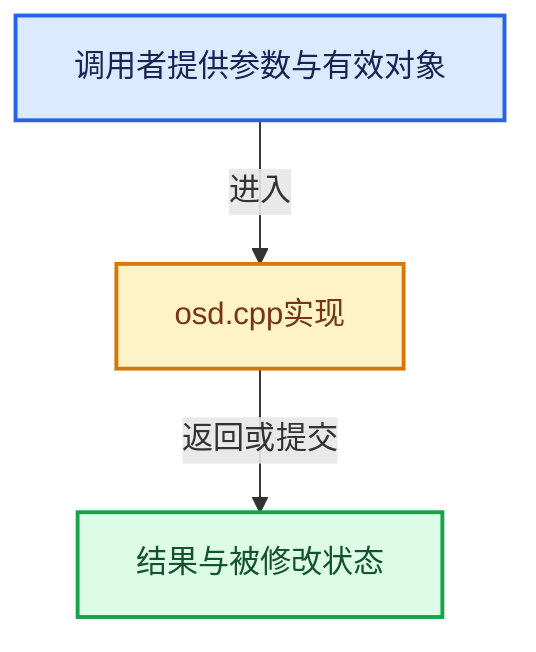

# 实现依赖专题：intern/cycles/subd/osd.cpp

[方向导航](README.md) · [符号索引](../%E7%AC%A6%E5%8F%B7%E4%BE%9D%E8%B5%96%E4%B8%8E%E5%AE%9E%E7%8E%B0%E7%B4%A2%E5%BC%95.md)

本专题从正文实际调用进入，集中保存共享实现。函数有稳定锚点，可从调用处直接跳到对应完整函数；递归与互相调用通过回链组织。

## 本文件的实现关系





## 完整成员与函数实现

<a id="f-56535a40cc9e477e"></a>

### `OsdPatch::eval`

实现位置：[intern/cycles/subd/osd.cpp](../../../../../intern/cycles/subd/osd.cpp) · L366—L402。

接口参数：

- `float3 *P`
- `float3 *dPdu`
- `float3 *dPdv`
- `float3 *N`
- `const float u`
- `const float v`

**教学注释版**

<!-- annotated:0c4d5fb5c88284 -->

```cpp
void OsdPatch::eval(
    float3 *P, float3 *dPdu, float3 *dPdv, float3 *N, const float u, const float v) const
{
  const Far::PatchTable::PatchHandle &handle = *osd_data.patch_map->FindPatch(
      patch_index, (double)u, (double)v);

  float p_weights[20], du_weights[20], dv_weights[20];
  osd_data.patch_table->EvaluateBasis(handle, u, v, p_weights, du_weights, dv_weights);

  const Far::ConstIndexArray cv = osd_data.patch_table->GetPatchVertices(handle);

  if (P) {
    *P = zero_float3();
  }
  float3 du = zero_float3();
  float3 dv = zero_float3();

  for (int i = 0; i < cv.size(); i++) {
    const float3 p = osd_data.refined_verts[cv[i]].value;

    if (P) {
      *P += p * p_weights[i];
    }
    du += p * du_weights[i];
    dv += p * dv_weights[i];
  }

  if (dPdu) {
    *dPdu = du;
  }
  if (dPdv) {
    *dPdv = dv;
  }
  if (N) {
    *N = safe_normalize_fallback(cross(du, dv), make_float3(0.0f, 0.0f, 1.0f));
  }
}
```

<details>
<summary>核对原始源码：intern/cycles/subd/osd.cpp · L366—L402</summary>

<!-- original:0c4d5fb5c88284:intern/cycles/subd/osd.cpp:366:402 -->

```cpp
void OsdPatch::eval(
    float3 *P, float3 *dPdu, float3 *dPdv, float3 *N, const float u, const float v) const
{
  const Far::PatchTable::PatchHandle &handle = *osd_data.patch_map->FindPatch(
      patch_index, (double)u, (double)v);

  float p_weights[20], du_weights[20], dv_weights[20];
  osd_data.patch_table->EvaluateBasis(handle, u, v, p_weights, du_weights, dv_weights);

  const Far::ConstIndexArray cv = osd_data.patch_table->GetPatchVertices(handle);

  if (P) {
    *P = zero_float3();
  }
  float3 du = zero_float3();
  float3 dv = zero_float3();

  for (int i = 0; i < cv.size(); i++) {
    const float3 p = osd_data.refined_verts[cv[i]].value;

    if (P) {
      *P += p * p_weights[i];
    }
    du += p * du_weights[i];
    dv += p * dv_weights[i];
  }

  if (dPdu) {
    *dPdu = du;
  }
  if (dPdv) {
    *dPdv = dv;
  }
  if (N) {
    *N = safe_normalize_fallback(cross(du, dv), make_float3(0.0f, 0.0f, 1.0f));
  }
}
```

</details>

**沿实际写入检查状态**

- `du += p * du_weights[i];`
- `dv += p * dv_weights[i];`

**继续追踪实现**

- `osd_data.patch_map->FindPatch` → [调用协议](../%E6%A8%A1%E6%9D%BF%E5%AE%8F%E4%B8%8E%E5%8A%A8%E6%80%81%E5%88%86%E6%B4%BE%E5%8D%8F%E8%AE%AE.md)：接收对象类型依赖auto、返回值或模板实例；不按同名猜测目标。调用位置L369。
- `osd_data.patch_table->EvaluateBasis` → [调用协议](../%E6%A8%A1%E6%9D%BF%E5%AE%8F%E4%B8%8E%E5%8A%A8%E6%80%81%E5%88%86%E6%B4%BE%E5%8D%8F%E8%AE%AE.md)：接收对象类型依赖auto、返回值或模板实例；不按同名猜测目标。调用位置L373。
- `osd_data.patch_table->GetPatchVertices` → [调用协议](../%E6%A8%A1%E6%9D%BF%E5%AE%8F%E4%B8%8E%E5%8A%A8%E6%80%81%E5%88%86%E6%B4%BE%E5%8D%8F%E8%AE%AE.md)：接收对象类型依赖auto、返回值或模板实例；不按同名猜测目标。调用位置L375。
- `zero_float3` → [zero_float3 · L15](%E4%BE%9D%E8%B5%96-math_float3-eb3e6f.md#f-0c16d9302091a334)。
- `cv.size` → [size · L64](%E4%BE%9D%E8%B5%96-unique_ptr_vector-b13772.md#f-d3b2dd87c6f8a696)；[size · L196](%E4%BE%9D%E8%B5%96-array-0b4e3f.md#f-5c1d85869b1a39ff)；[AttributeRequestSet::size · L1350](%E4%BE%9D%E8%B5%96-attribute-dd7b4e.md#f-3bc2ce0e765ca68d)；[size · L1450](%E4%BE%9D%E8%B5%96-DRW_gpu_wrapper-c80c4f.md#f-82bf5ab482066826)；[SocketType::size · L30](%E4%BE%9D%E8%B5%96-node_type-7c58a3.md#f-07d22bce254c9492)。同名重载需按实参类型选择。
- `safe_normalize_fallback` → [safe_normalize_fallback · L533](%E4%BE%9D%E8%B5%96-math_float3-eb3e6f.md#f-25df7a685dcb5e61)。
- `cross` → [cross · L436](%E4%BE%9D%E8%B5%96-math_float4-2d91ea.md#f-47c1848f44fe4b56)；[cross · L319](%E4%BE%9D%E8%B5%96-math_float3-eb3e6f.md#f-a89959ab21db0804)；[cross · L200](%E4%BE%9D%E8%B5%96-math_float2-be3c03.md#f-d4cf827d2d4b9025)；[cross · L284](%E4%BE%9D%E8%B5%96-math_dual-a0f3ee.md#f-8c812fdff783548f)；[cross · L291](%E4%BE%9D%E8%B5%96-math_dual-a0f3ee.md#f-fb4619a5864c3edc)；[cross · L296](%E4%BE%9D%E8%B5%96-math_dual-a0f3ee.md#f-d9964e9b2e1f70ab)。同名重载需按实参类型选择。
- `make_float3` → [make_float3 · L366](%E4%BE%9D%E8%B5%96-sky_math-8091a6.md#f-3f851295afb2572d)；[make_float3 · L108](%E4%BE%9D%E8%B5%96-types_float4-fe598f.md#f-f432d3f8358c1253)；[make_float3 · L77](%E4%BE%9D%E8%B5%96-types_float3-48c65a.md#f-a4d1c171bbd08a48)；[make_float3 · L90](%E4%BE%9D%E8%B5%96-types_float3-48c65a.md#f-ed934d00b79bfb67)；[make_float3 · L101](%E4%BE%9D%E8%B5%96-types_float3-48c65a.md#f-809d35d4555a4889)；[make_float3 · L106](%E4%BE%9D%E8%B5%96-types_float3-48c65a.md#f-5e61500b5e24e806)；[make_float3 · L111](%E4%BE%9D%E8%B5%96-types_float3-48c65a.md#f-a032cc39a6db84a8)；[make_float3 · L120](%E4%BE%9D%E8%B5%96-types_float3-48c65a.md#f-894b0e42a98a9c25)；[make_float3 · L153](%E4%BE%9D%E8%B5%96-types_dual-2ddd2c.md#f-f1b4dcf796f629d2)；[make_float3 · L160](%E4%BE%9D%E8%B5%96-types_dual-2ddd2c.md#f-bd8866e955c896b4)；[make_float3 · L80](%E4%BE%9D%E8%B5%96-math_quaternion-957b27.md#f-c614570b864bdc58)；[make_float3 · L80](%E4%BE%9D%E8%B5%96-guiding-98f15c.md#f-66dfcb6693fffff8)；[make_float3 · L206](%E4%BE%9D%E8%B5%96-compat-efe0e9.md#f-b8a1b1e293e9ec03)。同名重载需按实参类型选择。
