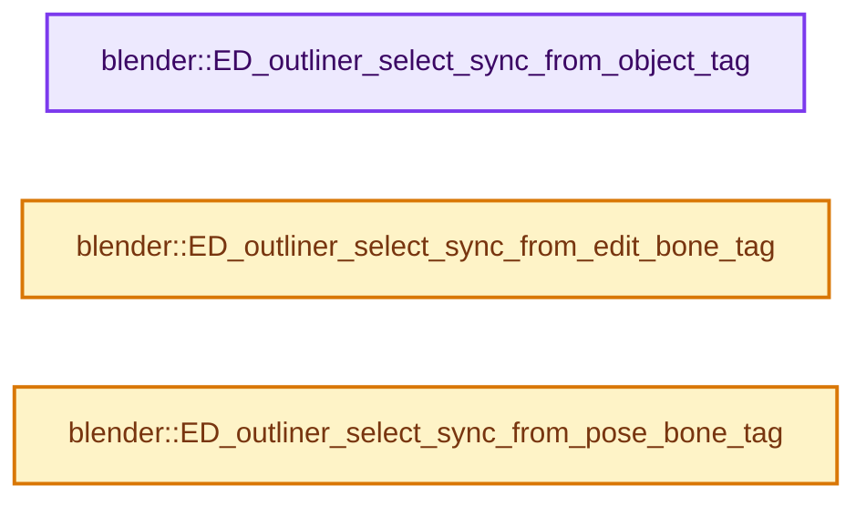
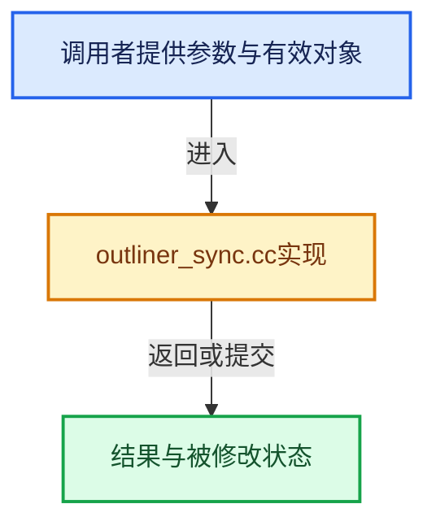

# 实现依赖专题：source/blender/editors/space_outliner/outliner_sync.cc

[方向导航](README.md) · [符号索引](../%E7%AC%A6%E5%8F%B7%E4%BE%9D%E8%B5%96%E4%B8%8E%E5%AE%9E%E7%8E%B0%E7%B4%A2%E5%BC%95.md)

本专题从正文实际调用进入，集中保存共享实现。函数有稳定锚点，可从调用处直接跳到对应完整函数；递归与互相调用通过回链组织。

## 本文件的实现关系






## 完整成员与函数实现

<a id="f-5825dbd6aa822a45"></a>

### `blender::ED_outliner_select_sync_from_object_tag`

实现位置：[source/blender/editors/space_outliner/outliner_sync.cc](../../../../../source/blender/editors/space_outliner/outliner_sync.cc) · L43—L47。

接口参数：

- `bContext *C`

**教学注释版**

<!-- annotated:84d3e47028a032 -->

```cpp
void ED_outliner_select_sync_from_object_tag(bContext *C)
{
  wmWindowManager *wm = CTX_wm_manager(C);
  wm->outliner_sync_select_dirty |= WM_OUTLINER_SYNC_SELECT_FROM_OBJECT;
}
```

<details>
<summary>核对原始源码：source/blender/editors/space_outliner/outliner_sync.cc · L43—L47</summary>

<!-- original:84d3e47028a032:source/blender/editors/space_outliner/outliner_sync.cc:43:47 -->

```cpp
void ED_outliner_select_sync_from_object_tag(bContext *C)
{
  wmWindowManager *wm = CTX_wm_manager(C);
  wm->outliner_sync_select_dirty |= WM_OUTLINER_SYNC_SELECT_FROM_OBJECT;
}
```

</details>

**沿实际写入检查状态**

- `wm->outliner_sync_select_dirty |= WM_OUTLINER_SYNC_SELECT_FROM_OBJECT;`

**继续追踪实现**

- `CTX_wm_manager` → [blender::CTX_wm_manager · L928](%E4%BE%9D%E8%B5%96-context-a929d9.md#f-158f36db7379fbe8)。

<a id="f-e15b16f7f79d3b20"></a>

### `blender::ED_outliner_select_sync_from_edit_bone_tag`

实现位置：[source/blender/editors/space_outliner/outliner_sync.cc](../../../../../source/blender/editors/space_outliner/outliner_sync.cc) · L49—L53。

接口参数：

- `bContext *C`

**教学注释版**

<!-- annotated:b6b06dc27d16be -->

```cpp
void ED_outliner_select_sync_from_edit_bone_tag(bContext *C)
{
  wmWindowManager *wm = CTX_wm_manager(C);
  wm->outliner_sync_select_dirty |= WM_OUTLINER_SYNC_SELECT_FROM_EDIT_BONE;
}
```

<details>
<summary>核对原始源码：source/blender/editors/space_outliner/outliner_sync.cc · L49—L53</summary>

<!-- original:b6b06dc27d16be:source/blender/editors/space_outliner/outliner_sync.cc:49:53 -->

```cpp
void ED_outliner_select_sync_from_edit_bone_tag(bContext *C)
{
  wmWindowManager *wm = CTX_wm_manager(C);
  wm->outliner_sync_select_dirty |= WM_OUTLINER_SYNC_SELECT_FROM_EDIT_BONE;
}
```

</details>

**沿实际写入检查状态**

- `wm->outliner_sync_select_dirty |= WM_OUTLINER_SYNC_SELECT_FROM_EDIT_BONE;`

**继续追踪实现**

- `CTX_wm_manager` → [blender::CTX_wm_manager · L928](%E4%BE%9D%E8%B5%96-context-a929d9.md#f-158f36db7379fbe8)。

<a id="f-1b9216da11a76328"></a>

### `blender::ED_outliner_select_sync_from_pose_bone_tag`

实现位置：[source/blender/editors/space_outliner/outliner_sync.cc](../../../../../source/blender/editors/space_outliner/outliner_sync.cc) · L55—L59。

接口参数：

- `bContext *C`

**教学注释版**

<!-- annotated:c692c0496df295 -->

```cpp
void ED_outliner_select_sync_from_pose_bone_tag(bContext *C)
{
  wmWindowManager *wm = CTX_wm_manager(C);
  wm->outliner_sync_select_dirty |= WM_OUTLINER_SYNC_SELECT_FROM_POSE_BONE;
}
```

<details>
<summary>核对原始源码：source/blender/editors/space_outliner/outliner_sync.cc · L55—L59</summary>

<!-- original:c692c0496df295:source/blender/editors/space_outliner/outliner_sync.cc:55:59 -->

```cpp
void ED_outliner_select_sync_from_pose_bone_tag(bContext *C)
{
  wmWindowManager *wm = CTX_wm_manager(C);
  wm->outliner_sync_select_dirty |= WM_OUTLINER_SYNC_SELECT_FROM_POSE_BONE;
}
```

</details>

**沿实际写入检查状态**

- `wm->outliner_sync_select_dirty |= WM_OUTLINER_SYNC_SELECT_FROM_POSE_BONE;`

**继续追踪实现**

- `CTX_wm_manager` → [blender::CTX_wm_manager · L928](%E4%BE%9D%E8%B5%96-context-a929d9.md#f-158f36db7379fbe8)。
