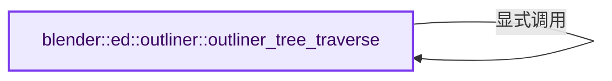
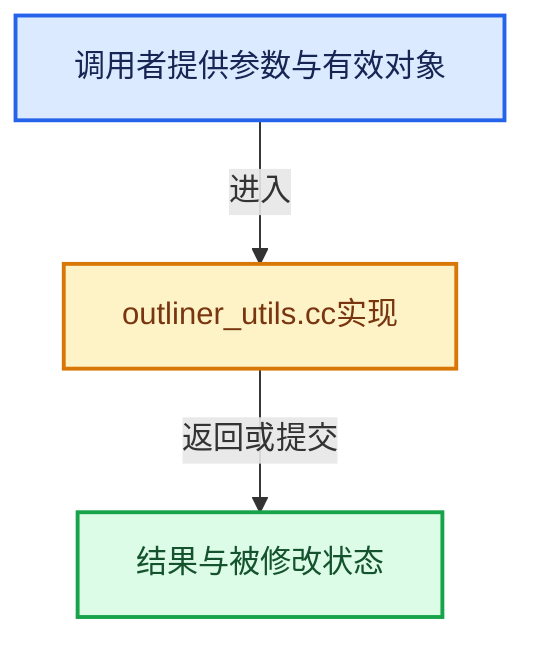

# 实现依赖专题：source/blender/editors/space_outliner/outliner_utils.cc

[方向导航](README.md) · [符号索引](../%E7%AC%A6%E5%8F%B7%E4%BE%9D%E8%B5%96%E4%B8%8E%E5%AE%9E%E7%8E%B0%E7%B4%A2%E5%BC%95.md)

本专题从正文实际调用进入，集中保存共享实现。函数有稳定锚点，可从调用处直接跳到对应完整函数；递归与互相调用通过回链组织。

## 本文件的实现关系






## 完整成员与函数实现

<a id="f-b61df82f59e25d78"></a>

### `blender::ed::outliner::outliner_tree_traverse`

实现位置：[source/blender/editors/space_outliner/outliner_utils.cc](../../../../../source/blender/editors/space_outliner/outliner_utils.cc) · L306—L346。

接口参数：

- `const SpaceOutliner *space_outliner`
- `ListBaseT<TreeElement> *tree`
- `int filter_te_flag`
- `int filter_tselem_flag`
- `TreeTraversalFunc func`
- `void *customdata`

**教学注释版**

<!-- annotated:868945d611cb21 -->

```cpp
bool outliner_tree_traverse(const SpaceOutliner *space_outliner,
                            ListBaseT<TreeElement> *tree,
                            int filter_te_flag,
                            int filter_tselem_flag,
                            TreeTraversalFunc func,
                            void *customdata)
{
  for (TreeElement *te = tree->first(), *te_next; te; te = te_next) {
    TreeTraversalAction func_retval = TRAVERSE_CONTINUE;
    /* in case te is freed in callback */
    TreeStoreElem *tselem = TREESTORE(te);
    ListBaseT<TreeElement> subtree = te->subtree;
    te_next = te->next;

    if (filter_te_flag && (te->flag & filter_te_flag) == 0) {
      /* skip */
    }
    else if (filter_tselem_flag && (tselem->flag & filter_tselem_flag) == 0) {
      /* skip */
    }
    else {
      func_retval = func(te, customdata);
    }
    /* Don't access te or tselem from now on! Might've been freed... */

    if (func_retval == TRAVERSE_BREAK) {
      return false;
    }

    if (func_retval == TRAVERSE_SKIP_CHILDS) {
      /* skip */
    }
    else if (!outliner_tree_traverse(
                 space_outliner, &subtree, filter_te_flag, filter_tselem_flag, func, customdata))
    {
      return false;
    }
  }

  return true;
}
```

<details>
<summary>核对原始源码：source/blender/editors/space_outliner/outliner_utils.cc · L306—L346</summary>

<!-- original:868945d611cb21:source/blender/editors/space_outliner/outliner_utils.cc:306:346 -->

```cpp
bool outliner_tree_traverse(const SpaceOutliner *space_outliner,
                            ListBaseT<TreeElement> *tree,
                            int filter_te_flag,
                            int filter_tselem_flag,
                            TreeTraversalFunc func,
                            void *customdata)
{
  for (TreeElement *te = tree->first(), *te_next; te; te = te_next) {
    TreeTraversalAction func_retval = TRAVERSE_CONTINUE;
    /* in case te is freed in callback */
    TreeStoreElem *tselem = TREESTORE(te);
    ListBaseT<TreeElement> subtree = te->subtree;
    te_next = te->next;

    if (filter_te_flag && (te->flag & filter_te_flag) == 0) {
      /* skip */
    }
    else if (filter_tselem_flag && (tselem->flag & filter_tselem_flag) == 0) {
      /* skip */
    }
    else {
      func_retval = func(te, customdata);
    }
    /* Don't access te or tselem from now on! Might've been freed... */

    if (func_retval == TRAVERSE_BREAK) {
      return false;
    }

    if (func_retval == TRAVERSE_SKIP_CHILDS) {
      /* skip */
    }
    else if (!outliner_tree_traverse(
                 space_outliner, &subtree, filter_te_flag, filter_tselem_flag, func, customdata))
    {
      return false;
    }
  }

  return true;
}
```

</details>

**沿实际写入检查状态**

- `te_next = te->next;`
- `func_retval = func(te, customdata);`

**结果出口**

- `return false;`
- `return true;`

**继续追踪实现**

- `tree->first` → [blender::ListBaseT::first · L102](%E4%BE%9D%E8%B5%96-DNA_listBase-48dbc9.md#f-3d12ff35da057c9e)；[blender::ListBaseT::first · L106](%E4%BE%9D%E8%B5%96-DNA_listBase-48dbc9.md#f-0df87c3480e059f9)。同名重载需按实参类型选择。
- `TREESTORE` → [TREESTORE · L197](%E4%BE%9D%E8%B5%96-outliner_intern-4daa15.md#m-e90e76fc5e4d)。宏定义由构建条件选择。
- `func` → [调用协议](../%E6%A8%A1%E6%9D%BF%E5%AE%8F%E4%B8%8E%E5%8A%A8%E6%80%81%E5%88%86%E6%B4%BE%E5%8D%8F%E8%AE%AE.md)：局部可调用对象，须结合其初始化与捕获环境。调用位置L327。
- `outliner_tree_traverse` → [blender::ed::outliner::outliner_tree_traverse · L306](%E4%BE%9D%E8%B5%96-outliner_utils-65e735.md#f-b61df82f59e25d78)。
