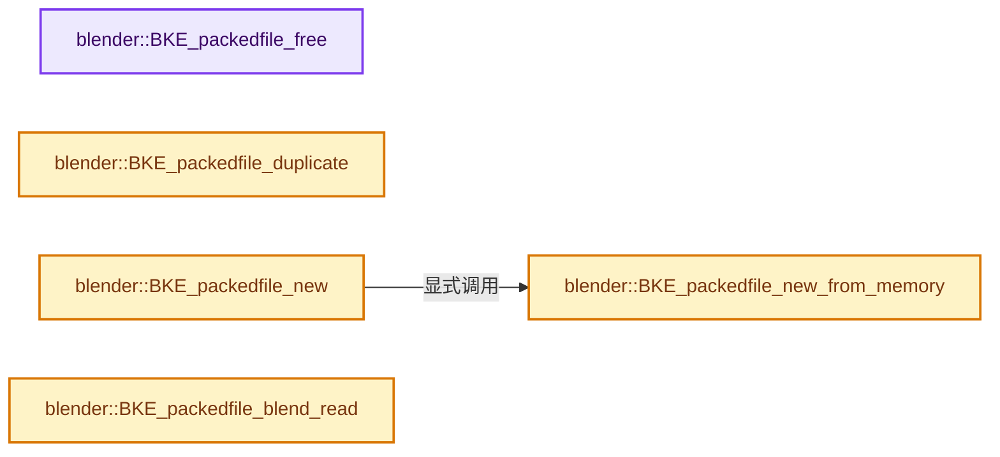
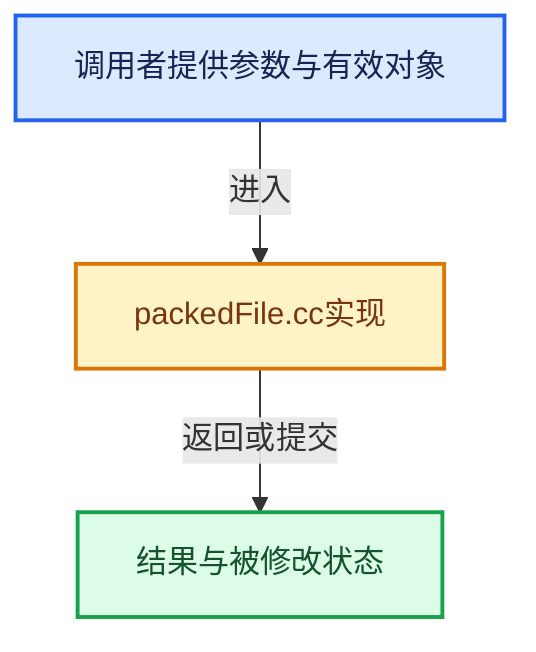

# 实现依赖专题：source/blender/blenkernel/intern/packedFile.cc

[方向导航](README.md) · [符号索引](../%E7%AC%A6%E5%8F%B7%E4%BE%9D%E8%B5%96%E4%B8%8E%E5%AE%9E%E7%8E%B0%E7%B4%A2%E5%BC%95.md)

本专题从正文实际调用进入，集中保存共享实现。函数有稳定锚点，可从调用处直接跳到对应完整函数；递归与互相调用通过回链组织。

## 本文件的实现关系






## 完整成员与函数实现

<a id="f-5228521c2c274fd1"></a>

### `blender::BKE_packedfile_free`

实现位置：[source/blender/blenkernel/intern/packedFile.cc](../../../../../source/blender/blenkernel/intern/packedFile.cc) · L175—L187。

接口参数：

- `PackedFile *pf`

**教学注释版**

<!-- annotated:401252c3d8bb72 -->

```cpp
void BKE_packedfile_free(PackedFile *pf)
{
  if (pf) {
    BLI_assert(pf->data != nullptr);
    BLI_assert(pf->sharing_info != nullptr);

    pf->sharing_info->remove_user_and_delete_if_last();
    MEM_delete(pf);
  }
  else {
    printf("%s: Trying to free a nullptr pointer\n", __func__);
  }
}
```

<details>
<summary>核对原始源码：source/blender/blenkernel/intern/packedFile.cc · L175—L187</summary>

<!-- original:401252c3d8bb72:source/blender/blenkernel/intern/packedFile.cc:175:187 -->

```cpp
void BKE_packedfile_free(PackedFile *pf)
{
  if (pf) {
    BLI_assert(pf->data != nullptr);
    BLI_assert(pf->sharing_info != nullptr);

    pf->sharing_info->remove_user_and_delete_if_last();
    MEM_delete(pf);
  }
  else {
    printf("%s: Trying to free a nullptr pointer\n", __func__);
  }
}
```

</details>

**继续追踪实现**

- `BLI_assert` → [BLI_assert · L48](../01-%E5%9F%BA%E7%A1%80%E5%AE%B9%E5%99%A8%E4%B8%8E%E7%8E%B0%E4%BB%A3CPP/%E4%BE%9D%E8%B5%96-BLI_assert-cc98e8.md#m-57a88495704d)；[BLI_assert · L63](../01-%E5%9F%BA%E7%A1%80%E5%AE%B9%E5%99%A8%E4%B8%8E%E7%8E%B0%E4%BB%A3CPP/%E4%BE%9D%E8%B5%96-BLI_assert-cc98e8.md#m-d07050020cb5)。宏定义由构建条件选择。
- `pf->sharing_info->remove_user_and_delete_if_last` → [调用协议](../%E6%A8%A1%E6%9D%BF%E5%AE%8F%E4%B8%8E%E5%8A%A8%E6%80%81%E5%88%86%E6%B4%BE%E5%8D%8F%E8%AE%AE.md)：接收对象类型依赖auto、返回值或模板实例；不按同名猜测目标。调用位置L181。
- `MEM_delete` → [MEM_delete · L400](../03-%E5%86%85%E5%AD%98%E5%88%86%E9%85%8D%E4%B8%8E%E8%BF%90%E8%A1%8C%E6%97%B6%E7%B1%BB%E5%9E%8B/%E4%BE%9D%E8%B5%96-MEM_guardedalloc-b54eca.md#f-9049ffdd1682887c)。
- `printf` → [外部契约](https://eel.is/c++draft/)：这个边界按实际表达式及所属类型核对参数、返回值、寿命与失败行为。这里提供接口入口，不声称已解释该第三方版本的内部实现。

<a id="f-eeb1e82915e6353c"></a>

### `blender::BKE_packedfile_duplicate`

实现位置：[source/blender/blenkernel/intern/packedFile.cc](../../../../../source/blender/blenkernel/intern/packedFile.cc) · L189—L200。

接口参数：

- `const PackedFile *pf_src`

**教学注释版**

<!-- annotated:e00983bf8bfded -->

```cpp
PackedFile *BKE_packedfile_duplicate(const PackedFile *pf_src)
{
  BLI_assert(pf_src != nullptr);
  BLI_assert(pf_src->data != nullptr);

  PackedFile *pf_dst;

  pf_dst = MEM_dupalloc(pf_src);
  pf_dst->sharing_info->add_user();

  return pf_dst;
}
```

<details>
<summary>核对原始源码：source/blender/blenkernel/intern/packedFile.cc · L189—L200</summary>

<!-- original:e00983bf8bfded:source/blender/blenkernel/intern/packedFile.cc:189:200 -->

```cpp
PackedFile *BKE_packedfile_duplicate(const PackedFile *pf_src)
{
  BLI_assert(pf_src != nullptr);
  BLI_assert(pf_src->data != nullptr);

  PackedFile *pf_dst;

  pf_dst = MEM_dupalloc(pf_src);
  pf_dst->sharing_info->add_user();

  return pf_dst;
}
```

</details>

**沿实际写入检查状态**

- `pf_dst = MEM_dupalloc(pf_src);`

**结果出口**

- `return pf_dst;`

**继续追踪实现**

- `BLI_assert` → [BLI_assert · L48](../01-%E5%9F%BA%E7%A1%80%E5%AE%B9%E5%99%A8%E4%B8%8E%E7%8E%B0%E4%BB%A3CPP/%E4%BE%9D%E8%B5%96-BLI_assert-cc98e8.md#m-57a88495704d)；[BLI_assert · L63](../01-%E5%9F%BA%E7%A1%80%E5%AE%B9%E5%99%A8%E4%B8%8E%E7%8E%B0%E4%BB%A3CPP/%E4%BE%9D%E8%B5%96-BLI_assert-cc98e8.md#m-d07050020cb5)。宏定义由构建条件选择。
- `MEM_dupalloc` → [MEM_dupalloc · L627](../03-%E5%86%85%E5%AD%98%E5%88%86%E9%85%8D%E4%B8%8E%E8%BF%90%E8%A1%8C%E6%97%B6%E7%B1%BB%E5%9E%8B/%E4%BE%9D%E8%B5%96-MEM_guardedalloc-b54eca.md#f-78a72b71e3c57010)。
- `pf_dst->sharing_info->add_user` → [调用协议](../%E6%A8%A1%E6%9D%BF%E5%AE%8F%E4%B8%8E%E5%8A%A8%E6%80%81%E5%88%86%E6%B4%BE%E5%8D%8F%E8%AE%AE.md)：接收对象类型依赖auto、返回值或模板实例；不按同名猜测目标。调用位置L197。

<a id="f-e94512fa9ca6a2bf"></a>

### `blender::BKE_packedfile_new_from_memory`

实现位置：[source/blender/blenkernel/intern/packedFile.cc](../../../../../source/blender/blenkernel/intern/packedFile.cc) · L202—L218。

接口参数：

- `const void *mem`
- `int memlen`
- `const ImplicitSharingInfo *sharing_info`

**教学注释版**

<!-- annotated:5f3ae57f681b5a -->

```cpp
PackedFile *BKE_packedfile_new_from_memory(const void *mem,
                                           int memlen,
                                           const ImplicitSharingInfo *sharing_info)
{
  BLI_assert(mem != nullptr);
  if (!sharing_info) {
    /* Assume we are the only owner of that memory currently. */
    sharing_info = implicit_sharing::info_for_mem_free(static_cast<const std::byte *>(mem));
  }

  PackedFile *pf = MEM_new<PackedFile>("PackedFile");
  pf->data = mem;
  pf->size = memlen;
  pf->sharing_info = sharing_info;

  return pf;
}
```

<details>
<summary>核对原始源码：source/blender/blenkernel/intern/packedFile.cc · L202—L218</summary>

<!-- original:5f3ae57f681b5a:source/blender/blenkernel/intern/packedFile.cc:202:218 -->

```cpp
PackedFile *BKE_packedfile_new_from_memory(const void *mem,
                                           int memlen,
                                           const ImplicitSharingInfo *sharing_info)
{
  BLI_assert(mem != nullptr);
  if (!sharing_info) {
    /* Assume we are the only owner of that memory currently. */
    sharing_info = implicit_sharing::info_for_mem_free(static_cast<const std::byte *>(mem));
  }

  PackedFile *pf = MEM_new<PackedFile>("PackedFile");
  pf->data = mem;
  pf->size = memlen;
  pf->sharing_info = sharing_info;

  return pf;
}
```

</details>

**沿实际写入检查状态**

- `sharing_info = implicit_sharing::info_for_mem_free(static_cast<const std::byte *>(mem));`
- `pf->data = mem;`
- `pf->size = memlen;`
- `pf->sharing_info = sharing_info;`

**结果出口**

- `return pf;`

**继续追踪实现**

- `BLI_assert` → [BLI_assert · L48](../01-%E5%9F%BA%E7%A1%80%E5%AE%B9%E5%99%A8%E4%B8%8E%E7%8E%B0%E4%BB%A3CPP/%E4%BE%9D%E8%B5%96-BLI_assert-cc98e8.md#m-57a88495704d)；[BLI_assert · L63](../01-%E5%9F%BA%E7%A1%80%E5%AE%B9%E5%99%A8%E4%B8%8E%E7%8E%B0%E4%BB%A3CPP/%E4%BE%9D%E8%B5%96-BLI_assert-cc98e8.md#m-d07050020cb5)。宏定义由构建条件选择。
- `implicit_sharing::info_for_mem_free` → [blender::implicit_sharing::info_for_mem_free · L301](../06-%E9%9A%90%E5%BC%8F%E5%85%B1%E4%BA%AB%E4%B8%8E%E7%BC%93%E5%AD%98%E7%B3%BB%E7%BB%9F/02-ImplicitSharingInfo%E8%AE%A1%E6%95%B0.md#f-7ad95caa930eb54d)。
- `MEM_new<PackedFile>` → [MEM_new · L351](../03-%E5%86%85%E5%AD%98%E5%88%86%E9%85%8D%E4%B8%8E%E8%BF%90%E8%A1%8C%E6%97%B6%E7%B1%BB%E5%9E%8B/%E4%BE%9D%E8%B5%96-MEM_guardedalloc-b54eca.md#f-115f9b6784f89912)。

<a id="f-85730863086cfecd"></a>

### `blender::BKE_packedfile_new`

实现位置：[source/blender/blenkernel/intern/packedFile.cc](../../../../../source/blender/blenkernel/intern/packedFile.cc) · L220—L271。

接口参数：

- `ReportList *reports`
- `const char *filepath_rel`
- `const char *basepath`

**教学注释版**

<!-- annotated:7cdb1c45a64e7c -->

```cpp
PackedFile *BKE_packedfile_new(ReportList *reports, const char *filepath_rel, const char *basepath)
{
  char filepath[FILE_MAX];

  /* render result has no filepath and can be ignored
   * any other files with no name can be ignored too */
  if (filepath_rel[0] == '\0') {
    return nullptr;
  }

  // XXX waitcursor(1);

  /* convert relative filenames to absolute filenames */

  STRNCPY(filepath, filepath_rel);
  BLI_path_abs(filepath, basepath);

  /* open the file
   * and create a PackedFile structure */

  const int file = BLI_open(filepath, O_BINARY | O_RDONLY, 0);
  if (file == -1) {
    BKE_reportf(reports, RPT_ERROR, "Unable to pack file, source path '%s' not found", filepath);
    return nullptr;
  }

  PackedFile *pf = nullptr;
  const size_t file_size = BLI_file_descriptor_size(file);
  if (file_size == size_t(-1)) {
    BKE_reportf(reports, RPT_ERROR, "Unable to access the size of, source path '%s'", filepath);
  }
  else if (file_size > PACKED_FILE_MAX_SIZE) {
    BKE_reportf(reports, RPT_ERROR, "Unable to pack files over 2gb, source path '%s'", filepath);
  }
  else {
    /* #MEM_new_uninitialized complains about `MEM_new_uninitialized(0, "...")`,
     * a single allocation is harmless and doesn't cause any complications. */
    // [讲解] std::max：按比较关系选取较大值。本讲解中的增长公式同时满足最低请求和几何增长；若保存返回引用，还需注意实参寿命。
    void *data = MEM_new_uninitialized(std::max(file_size, size_t(1)), "packFile");
    if (BLI_read(file, data, file_size) == file_size) {
      pf = BKE_packedfile_new_from_memory(data, file_size);
    }
    else {
      // [讲解] MEM_delete_void：以原始存储释放约定调用当前后端。
      MEM_delete_void(data);
    }
  }

  close(file);

  // XXX waitcursor(0);

  return pf;
}
```

<details>
<summary>核对原始源码：source/blender/blenkernel/intern/packedFile.cc · L220—L271</summary>

<!-- original:7cdb1c45a64e7c:source/blender/blenkernel/intern/packedFile.cc:220:271 -->

```cpp
PackedFile *BKE_packedfile_new(ReportList *reports, const char *filepath_rel, const char *basepath)
{
  char filepath[FILE_MAX];

  /* render result has no filepath and can be ignored
   * any other files with no name can be ignored too */
  if (filepath_rel[0] == '\0') {
    return nullptr;
  }

  // XXX waitcursor(1);

  /* convert relative filenames to absolute filenames */

  STRNCPY(filepath, filepath_rel);
  BLI_path_abs(filepath, basepath);

  /* open the file
   * and create a PackedFile structure */

  const int file = BLI_open(filepath, O_BINARY | O_RDONLY, 0);
  if (file == -1) {
    BKE_reportf(reports, RPT_ERROR, "Unable to pack file, source path '%s' not found", filepath);
    return nullptr;
  }

  PackedFile *pf = nullptr;
  const size_t file_size = BLI_file_descriptor_size(file);
  if (file_size == size_t(-1)) {
    BKE_reportf(reports, RPT_ERROR, "Unable to access the size of, source path '%s'", filepath);
  }
  else if (file_size > PACKED_FILE_MAX_SIZE) {
    BKE_reportf(reports, RPT_ERROR, "Unable to pack files over 2gb, source path '%s'", filepath);
  }
  else {
    /* #MEM_new_uninitialized complains about `MEM_new_uninitialized(0, "...")`,
     * a single allocation is harmless and doesn't cause any complications. */
    void *data = MEM_new_uninitialized(std::max(file_size, size_t(1)), "packFile");
    if (BLI_read(file, data, file_size) == file_size) {
      pf = BKE_packedfile_new_from_memory(data, file_size);
    }
    else {
      MEM_delete_void(data);
    }
  }

  close(file);

  // XXX waitcursor(0);

  return pf;
}
```

</details>

**沿实际写入检查状态**

- `pf = BKE_packedfile_new_from_memory(data, file_size);`

**结果出口**

- `return nullptr;`
- `return pf;`

**继续追踪实现**

- `STRNCPY` → [blender::STRNCPY · L690](../01-%E5%9F%BA%E7%A1%80%E5%AE%B9%E5%99%A8%E4%B8%8E%E7%8E%B0%E4%BB%A3CPP/%E4%BE%9D%E8%B5%96-BLI_string-b43058.md#f-6b2d861724026be6)。
- `BLI_path_abs` → [BLI_path_abs · L1164](../01-%E5%9F%BA%E7%A1%80%E5%AE%B9%E5%99%A8%E4%B8%8E%E7%8E%B0%E4%BB%A3CPP/%E4%BE%9D%E8%B5%96-path_utils-b4d26a.md#f-002380948c1caeb6)。
- `BLI_open` → [blender::BLI_open · L615](../01-%E5%9F%BA%E7%A1%80%E5%AE%B9%E5%99%A8%E4%B8%8E%E7%8E%B0%E4%BB%A3CPP/%E4%BE%9D%E8%B5%96-fileops_c-add581.md#f-5889504ee4df97d2)；[blender::BLI_open · L1199](../01-%E5%9F%BA%E7%A1%80%E5%AE%B9%E5%99%A8%E4%B8%8E%E7%8E%B0%E4%BB%A3CPP/%E4%BE%9D%E8%B5%96-fileops_c-add581.md#f-6144d5d080b79e94)。同名重载需按实参类型选择。
- `BKE_reportf` → [blender::BKE_reportf · L191](%E4%BE%9D%E8%B5%96-report-f916fd.md#f-e776fc632ffb42b3)。
- `BLI_file_descriptor_size` → [blender::BLI_file_descriptor_size · L219](../01-%E5%9F%BA%E7%A1%80%E5%AE%B9%E5%99%A8%E4%B8%8E%E7%8E%B0%E4%BB%A3CPP/%E4%BE%9D%E8%B5%96-storage-bda15e.md#f-d5e4fd24e28790db)。
- `MEM_new_uninitialized` → [MEM_new_uninitialized · L590](../03-%E5%86%85%E5%AD%98%E5%88%86%E9%85%8D%E4%B8%8E%E8%BF%90%E8%A1%8C%E6%97%B6%E7%B1%BB%E5%9E%8B/%E4%BE%9D%E8%B5%96-MEM_guardedalloc-b54eca.md#f-c773b2e5b8fe70e4)；[MEM_new_uninitialized · L124](../03-%E5%86%85%E5%AD%98%E5%88%86%E9%85%8D%E4%B8%8E%E8%BF%90%E8%A1%8C%E6%97%B6%E7%B1%BB%E5%9E%8B/%E4%BE%9D%E8%B5%96-mallocn-afdcd4.md#f-28a7e00a1e67f699)。同名重载需按实参类型选择。
- `std::max` → [外部契约](https://eel.is/c++draft/alg.min.max)：按比较关系选取较大值。本讲解中的增长公式同时满足最低请求和几何增长；若保存返回引用，还需注意实参寿命。
- `BLI_read` → [blender::BLI_read · L98](../01-%E5%9F%BA%E7%A1%80%E5%AE%B9%E5%99%A8%E4%B8%8E%E7%8E%B0%E4%BB%A3CPP/%E4%BE%9D%E8%B5%96-fileops_c-add581.md#f-79f42e0d965e29d7)。
- `BKE_packedfile_new_from_memory` → [blender::BKE_packedfile_new_from_memory · L202](%E4%BE%9D%E8%B5%96-packedFile-564564.md#f-e94512fa9ca6a2bf)。
- `MEM_delete_void` → [MEM_delete_void · L647](../03-%E5%86%85%E5%AD%98%E5%88%86%E9%85%8D%E4%B8%8E%E8%BF%90%E8%A1%8C%E6%97%B6%E7%B1%BB%E5%9E%8B/%E4%BE%9D%E8%B5%96-MEM_guardedalloc-b54eca.md#f-642896c7c62ff8b9)；[MEM_delete_void · L109](../03-%E5%86%85%E5%AD%98%E5%88%86%E9%85%8D%E4%B8%8E%E8%BF%90%E8%A1%8C%E6%97%B6%E7%B1%BB%E5%9E%8B/%E4%BE%9D%E8%B5%96-mallocn-afdcd4.md#f-9a07b26421f2bee6)。同名重载需按实参类型选择。
- `close` → [blender::RawWriteWrap::close · L214](%E4%BE%9D%E8%B5%96-writefile-3eb36f.md#f-919e29e563ebcf8c)；[blender::ZstdWriteWrap::close · L404](%E4%BE%9D%E8%B5%96-writefile-3eb36f.md#f-78aad228a13e69b9)。同名重载需按实参类型选择。

<a id="f-29de192f7799b10e"></a>

### `blender::BKE_packedfile_blend_read`

实现位置：[source/blender/blenkernel/intern/packedFile.cc](../../../../../source/blender/blenkernel/intern/packedFile.cc) · L952—L979。

接口参数：

- `BlendDataReader *reader`
- `PackedFile **pf_p`
- `StringRefNull filepath`

**教学注释版**

<!-- annotated:f21a8f35c62189 -->

```cpp
void BKE_packedfile_blend_read(BlendDataReader *reader, PackedFile **pf_p, StringRefNull filepath)
{
  BLO_read_struct(reader, PackedFile, pf_p);
  PackedFile *pf = *pf_p;
  if (pf == nullptr) {
    return;
  }
  /* NOTE: this is endianness-sensitive. */
  /* NOTE: there is no way to handle endianness switch here. */
  pf->sharing_info = BLO_read_shared(reader, &pf->data, [&]() {
    BLO_read_array_and_validate_size(
        reader, reinterpret_cast<std::byte **>(const_cast<void **>(&pf->data)), &pf->size);
    /* Do not create an implicit sharing if read data pointer is `nullptr`. */
    return pf->data ?
               implicit_sharing::info_for_mem_free(static_cast<const std::byte *>(pf->data)) :
               nullptr;
  });
  if (pf->data == nullptr) {
    /* We cannot allow a #PackedFile with a nullptr data field,
     * the whole code assumes this is not possible. See #70315. */
    CLOG_WARN(&LOG,
              "%s: nullptr packedfile data (source: '%s'), cleaning up...",
              __func__,
              filepath.c_str());
    BLI_assert(pf->sharing_info == nullptr);
    MEM_SAFE_DELETE(*pf_p);
  }
}
```

<details>
<summary>核对原始源码：source/blender/blenkernel/intern/packedFile.cc · L952—L979</summary>

<!-- original:f21a8f35c62189:source/blender/blenkernel/intern/packedFile.cc:952:979 -->

```cpp
void BKE_packedfile_blend_read(BlendDataReader *reader, PackedFile **pf_p, StringRefNull filepath)
{
  BLO_read_struct(reader, PackedFile, pf_p);
  PackedFile *pf = *pf_p;
  if (pf == nullptr) {
    return;
  }
  /* NOTE: this is endianness-sensitive. */
  /* NOTE: there is no way to handle endianness switch here. */
  pf->sharing_info = BLO_read_shared(reader, &pf->data, [&]() {
    BLO_read_array_and_validate_size(
        reader, reinterpret_cast<std::byte **>(const_cast<void **>(&pf->data)), &pf->size);
    /* Do not create an implicit sharing if read data pointer is `nullptr`. */
    return pf->data ?
               implicit_sharing::info_for_mem_free(static_cast<const std::byte *>(pf->data)) :
               nullptr;
  });
  if (pf->data == nullptr) {
    /* We cannot allow a #PackedFile with a nullptr data field,
     * the whole code assumes this is not possible. See #70315. */
    CLOG_WARN(&LOG,
              "%s: nullptr packedfile data (source: '%s'), cleaning up...",
              __func__,
              filepath.c_str());
    BLI_assert(pf->sharing_info == nullptr);
    MEM_SAFE_DELETE(*pf_p);
  }
}
```

</details>

**沿实际写入检查状态**

- `pf->sharing_info = BLO_read_shared(reader, &pf->data, [&]() {`

**结果出口**

- `return pf->data ?`

**继续追踪实现**

- `BLO_read_struct` → [BLO_read_struct · L477](%E4%BE%9D%E8%B5%96-BLO_read_write-a54308.md#m-d307fd6f7c0e)。宏定义由构建条件选择。
- `BLO_read_shared` → [blender::BLO_read_shared · L630](%E4%BE%9D%E8%B5%96-BLO_read_write-a54308.md#f-80b03c9e038d30eb)。
- `BLO_read_array_and_validate_size` → [blender::BLO_read_array_and_validate_size · L571](%E4%BE%9D%E8%B5%96-BLO_read_write-a54308.md#f-645e9600b66d0b15)。
- `implicit_sharing::info_for_mem_free` → [blender::implicit_sharing::info_for_mem_free · L301](../06-%E9%9A%90%E5%BC%8F%E5%85%B1%E4%BA%AB%E4%B8%8E%E7%BC%93%E5%AD%98%E7%B3%BB%E7%BB%9F/02-ImplicitSharingInfo%E8%AE%A1%E6%95%B0.md#f-7ad95caa930eb54d)。
- `CLOG_WARN` → [CLOG_WARN · L189](%E4%BE%9D%E8%B5%96-CLG_log-e9051b.md#m-9da21a06cdbe)。宏定义由构建条件选择。
- `filepath.c_str` → [blender::StringRefNull::c_str · L544](../01-%E5%9F%BA%E7%A1%80%E5%AE%B9%E5%99%A8%E4%B8%8E%E7%8E%B0%E4%BB%A3CPP/15-StringRef%E5%AD%97%E7%AC%A6%E4%B8%B2%E8%A7%86%E5%9B%BE.md#f-4a8bbfe1e6d00757)。
- `BLI_assert` → [BLI_assert · L48](../01-%E5%9F%BA%E7%A1%80%E5%AE%B9%E5%99%A8%E4%B8%8E%E7%8E%B0%E4%BB%A3CPP/%E4%BE%9D%E8%B5%96-BLI_assert-cc98e8.md#m-57a88495704d)；[BLI_assert · L63](../01-%E5%9F%BA%E7%A1%80%E5%AE%B9%E5%99%A8%E4%B8%8E%E7%8E%B0%E4%BB%A3CPP/%E4%BE%9D%E8%B5%96-BLI_assert-cc98e8.md#m-d07050020cb5)。宏定义由构建条件选择。
- `MEM_SAFE_DELETE` → [MEM_SAFE_DELETE · L436](../03-%E5%86%85%E5%AD%98%E5%88%86%E9%85%8D%E4%B8%8E%E8%BF%90%E8%A1%8C%E6%97%B6%E7%B1%BB%E5%9E%8B/%E4%BE%9D%E8%B5%96-MEM_guardedalloc-b54eca.md#m-eadb3bc5b902)。宏定义由构建条件选择。
