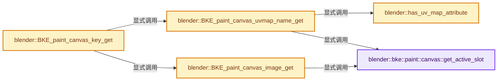
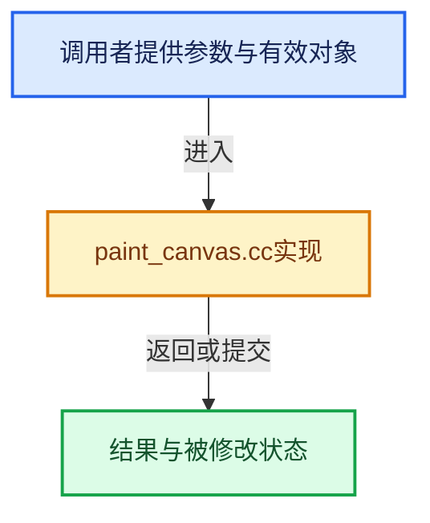

# 实现依赖专题：source/blender/blenkernel/intern/paint_canvas.cc

[方向导航](README.md) · [符号索引](../%E7%AC%A6%E5%8F%B7%E4%BE%9D%E8%B5%96%E4%B8%8E%E5%AE%9E%E7%8E%B0%E7%B4%A2%E5%BC%95.md)

本专题从正文实际调用进入，集中保存共享实现。函数有稳定锚点，可从调用处直接跳到对应完整函数；递归与互相调用通过回链组织。

## 本文件的实现关系






## 完整成员与函数实现

<a id="f-50456451a29360b3"></a>

### `blender::bke::paint::canvas::get_active_slot`

实现位置：[source/blender/blenkernel/intern/paint_canvas.cc](../../../../../source/blender/blenkernel/intern/paint_canvas.cc) · L30—L45。

接口参数：

- `Object *ob`

**教学注释版**

<!-- annotated:dbcfb63537010c -->

```cpp
static TexPaintSlot *get_active_slot(Object *ob)
{
  Material *mat = BKE_object_material_get(ob, ob->actcol);
  if (mat == nullptr) {
    return nullptr;
  }
  if (mat->texpaintslot == nullptr) {
    return nullptr;
  }
  if (mat->paint_active_slot >= mat->tot_slots) {
    return nullptr;
  }

  TexPaintSlot *slot = &mat->texpaintslot[mat->paint_active_slot];
  return slot;
}
```

<details>
<summary>核对原始源码：source/blender/blenkernel/intern/paint_canvas.cc · L30—L45</summary>

<!-- original:dbcfb63537010c:source/blender/blenkernel/intern/paint_canvas.cc:30:45 -->

```cpp
static TexPaintSlot *get_active_slot(Object *ob)
{
  Material *mat = BKE_object_material_get(ob, ob->actcol);
  if (mat == nullptr) {
    return nullptr;
  }
  if (mat->texpaintslot == nullptr) {
    return nullptr;
  }
  if (mat->paint_active_slot >= mat->tot_slots) {
    return nullptr;
  }

  TexPaintSlot *slot = &mat->texpaintslot[mat->paint_active_slot];
  return slot;
}
```

</details>

**结果出口**

- `return nullptr;`
- `return slot;`

**继续追踪实现**

- `BKE_object_material_get` → [blender::BKE_object_material_get · L759](%E4%BE%9D%E8%B5%96-material-aea8ec.md#f-9e9ad276ccef84b3)。

<a id="f-40ddf1a8f18dfb8f"></a>

### `blender::BKE_paint_canvas_image_get`

实现位置：[source/blender/blenkernel/intern/paint_canvas.cc](../../../../../source/blender/blenkernel/intern/paint_canvas.cc) · L51—L68。

接口参数：

- `const ImagePaintSettings &settings`
- `Object &object`

**教学注释版**

<!-- annotated:2e5c40d25d8cdc -->

```cpp
std::optional<CanvasImageData> BKE_paint_canvas_image_get(const ImagePaintSettings &settings,
                                                          Object &object)
{
  if (settings.mode == PAINT_CANVAS_SOURCE_MATERIAL) {
    TexPaintSlot *slot = get_active_slot(&object);
    if (slot == nullptr || slot->ima == nullptr) {
      return std::nullopt;
    }
    return std::make_optional<CanvasImageData>({slot->ima, slot->image_user});
  }
  if (settings.mode == PAINT_CANVAS_SOURCE_IMAGE) {
    if (settings.canvas == nullptr) {
      return std::nullopt;
    }
    return std::make_optional<CanvasImageData>({settings.canvas, ImageUser{}});
  }
  return std::nullopt;
}
```

<details>
<summary>核对原始源码：source/blender/blenkernel/intern/paint_canvas.cc · L51—L68</summary>

<!-- original:2e5c40d25d8cdc:source/blender/blenkernel/intern/paint_canvas.cc:51:68 -->

```cpp
std::optional<CanvasImageData> BKE_paint_canvas_image_get(const ImagePaintSettings &settings,
                                                          Object &object)
{
  if (settings.mode == PAINT_CANVAS_SOURCE_MATERIAL) {
    TexPaintSlot *slot = get_active_slot(&object);
    if (slot == nullptr || slot->ima == nullptr) {
      return std::nullopt;
    }
    return std::make_optional<CanvasImageData>({slot->ima, slot->image_user});
  }
  if (settings.mode == PAINT_CANVAS_SOURCE_IMAGE) {
    if (settings.canvas == nullptr) {
      return std::nullopt;
    }
    return std::make_optional<CanvasImageData>({settings.canvas, ImageUser{}});
  }
  return std::nullopt;
}
```

</details>

**结果出口**

- `return std::nullopt;`
- `return std::make_optional<CanvasImageData>({slot->ima, slot->image_user});`
- `return std::make_optional<CanvasImageData>({settings.canvas, ImageUser{}});`

**继续追踪实现**

- `get_active_slot` → [blender::bke::paint::canvas::get_active_slot · L30](%E4%BE%9D%E8%B5%96-paint_canvas-2d48f0.md#f-50456451a29360b3)。
- `std::make_optional<CanvasImageData>` → [外部契约](https://eel.is/c++draft/)：这个边界按实际表达式及所属类型核对参数、返回值、寿命与失败行为。这里提供接口入口，不声称已解释该第三方版本的内部实现。

<a id="f-3f1de9d1fac7b676"></a>

### `blender::has_uv_map_attribute`

实现位置：[source/blender/blenkernel/intern/paint_canvas.cc](../../../../../source/blender/blenkernel/intern/paint_canvas.cc) · L70—L73。

接口参数：

- `const Mesh &mesh`
- `const StringRef name`

**教学注释版**

<!-- annotated:e69907dd705898 -->

```cpp
static bool has_uv_map_attribute(const Mesh &mesh, const StringRef name)
{
  return bke::mesh::is_uv_map(mesh.attributes().lookup_meta_data(name));
}
```

<details>
<summary>核对原始源码：source/blender/blenkernel/intern/paint_canvas.cc · L70—L73</summary>

<!-- original:e69907dd705898:source/blender/blenkernel/intern/paint_canvas.cc:70:73 -->

```cpp
static bool has_uv_map_attribute(const Mesh &mesh, const StringRef name)
{
  return bke::mesh::is_uv_map(mesh.attributes().lookup_meta_data(name));
}
```

</details>

**结果出口**

- `return bke::mesh::is_uv_map(mesh.attributes().lookup_meta_data(name));`

**继续追踪实现**

- `bke::mesh::is_uv_map` → [bke::mesh::is_uv_map · L1390](03-MPoly%E8%BF%81%E7%A7%BB%E4%B8%8E%E5%85%BC%E5%AE%B9.md#f-d54e2b7387551a2a)；[bke::mesh::is_uv_map · L1395](03-MPoly%E8%BF%81%E7%A7%BB%E4%B8%8E%E5%85%BC%E5%AE%B9.md#f-ccba85e25e6455e3)。同名重载需按实参类型选择。
- `mesh.attributes().lookup_meta_data` → [调用协议](../%E6%A8%A1%E6%9D%BF%E5%AE%8F%E4%B8%8E%E5%8A%A8%E6%80%81%E5%88%86%E6%B4%BE%E5%8D%8F%E8%AE%AE.md)：接收对象类型依赖auto、返回值或模板实例；不按同名猜测目标。调用位置L72。
- `mesh.attributes` → [Mesh::attributes · L1298](03-MPoly%E8%BF%81%E7%A7%BB%E4%B8%8E%E5%85%BC%E5%AE%B9.md#f-607bbfe3e57cfc7f)。

<a id="f-10ffed30ab0faaab"></a>

### `blender::BKE_paint_canvas_uvmap_name_get`

实现位置：[source/blender/blenkernel/intern/paint_canvas.cc](../../../../../source/blender/blenkernel/intern/paint_canvas.cc) · L75—L114。

接口参数：

- `const ImagePaintSettings &settings`
- `Object *ob`

**教学注释版**

<!-- annotated:57098862d0476e -->

```cpp
std::optional<StringRef> BKE_paint_canvas_uvmap_name_get(const ImagePaintSettings &settings,
                                                         Object *ob)
{
  switch (settings.mode) {
    case PAINT_CANVAS_SOURCE_IMAGE: {
      /* Use active uv map of the object. */
      if (ob->type != OB_MESH) {
        return std::nullopt;
      }

      const Mesh *mesh = id_cast<Mesh *>(ob->data);
      if (!has_uv_map_attribute(*mesh, mesh->active_uv_map_name())) {
        return std::nullopt;
      }
      return mesh->active_uv_map_name();
    }
    case PAINT_CANVAS_SOURCE_MATERIAL: {
      /* Use uv map of the canvas. */
      TexPaintSlot *slot = get_active_slot(ob);
      if (slot == nullptr) {
        break;
      }

      if (ob->type != OB_MESH) {
        return std::nullopt;
      }

      if (slot->uvname == nullptr) {
        return std::nullopt;
      }

      const Mesh *mesh = id_cast<Mesh *>(ob->data);
      if (!has_uv_map_attribute(*mesh, slot->uvname)) {
        return std::nullopt;
      }
      return slot->uvname;
    }
  }
  return std::nullopt;
}
```

<details>
<summary>核对原始源码：source/blender/blenkernel/intern/paint_canvas.cc · L75—L114</summary>

<!-- original:57098862d0476e:source/blender/blenkernel/intern/paint_canvas.cc:75:114 -->

```cpp
std::optional<StringRef> BKE_paint_canvas_uvmap_name_get(const ImagePaintSettings &settings,
                                                         Object *ob)
{
  switch (settings.mode) {
    case PAINT_CANVAS_SOURCE_IMAGE: {
      /* Use active uv map of the object. */
      if (ob->type != OB_MESH) {
        return std::nullopt;
      }

      const Mesh *mesh = id_cast<Mesh *>(ob->data);
      if (!has_uv_map_attribute(*mesh, mesh->active_uv_map_name())) {
        return std::nullopt;
      }
      return mesh->active_uv_map_name();
    }
    case PAINT_CANVAS_SOURCE_MATERIAL: {
      /* Use uv map of the canvas. */
      TexPaintSlot *slot = get_active_slot(ob);
      if (slot == nullptr) {
        break;
      }

      if (ob->type != OB_MESH) {
        return std::nullopt;
      }

      if (slot->uvname == nullptr) {
        return std::nullopt;
      }

      const Mesh *mesh = id_cast<Mesh *>(ob->data);
      if (!has_uv_map_attribute(*mesh, slot->uvname)) {
        return std::nullopt;
      }
      return slot->uvname;
    }
  }
  return std::nullopt;
}
```

</details>

**结果出口**

- `return std::nullopt;`
- `return mesh->active_uv_map_name();`
- `return slot->uvname;`

**继续追踪实现**

- `id_cast<Mesh *>` → [blender::id_cast · L1417](%E4%BE%9D%E8%B5%96-DNA_ID-3eb091.md#f-6c8ac6412850ac5a)。
- `has_uv_map_attribute` → [blender::has_uv_map_attribute · L70](%E4%BE%9D%E8%B5%96-paint_canvas-2d48f0.md#f-3f1de9d1fac7b676)。
- `mesh->active_uv_map_name` → [Mesh::active_uv_map_name · L1319](03-MPoly%E8%BF%81%E7%A7%BB%E4%B8%8E%E5%85%BC%E5%AE%B9.md#f-9b4762e851836e79)。
- `get_active_slot` → [blender::bke::paint::canvas::get_active_slot · L30](%E4%BE%9D%E8%B5%96-paint_canvas-2d48f0.md#f-50456451a29360b3)。

<a id="f-0ae5c9050c1e7b8f"></a>

### `blender::BKE_paint_canvas_key_get`

实现位置：[source/blender/blenkernel/intern/paint_canvas.cc](../../../../../source/blender/blenkernel/intern/paint_canvas.cc) · L116—L158。

接口参数：

- `ImagePaintSettings &settings`
- `Object *ob`

**教学注释版**

<!-- annotated:35a4d5a8a1261d -->

```cpp
std::string BKE_paint_canvas_key_get(ImagePaintSettings &settings, Object *ob)
{
  std::stringstream ss;
  ss << "UV_MAP:" << BKE_paint_canvas_uvmap_name_get(settings, ob).value_or("");
  const Brush *brush = settings.paint.brush;
  const bool is_mask_brush = brush && brush->image_brush_type == IMAGE_PAINT_BRUSH_TYPE_MASK;

  Image *image = nullptr;
  ImageUser tile_user;

  if (is_mask_brush) {
    image = settings.stencil;
    tile_user = ImageUser{};
  }
  else if (std::optional<CanvasImageData> canvas_image_data = BKE_paint_canvas_image_get(settings,
                                                                                         *ob))
  {
    image = canvas_image_data->first;

    if (std::holds_alternative<ImageUser *>(canvas_image_data->second)) {
      tile_user = *std::get<ImageUser *>(canvas_image_data->second);
    }
    else {
      tile_user = std::get<ImageUser>(canvas_image_data->second);
    }
  }

  if (image) {
    ss << ",SEAM_MARGIN:" << image->seam_margin;
    for (ImageTile &image_tile : image->tiles) {
      tile_user.tile = image_tile.tile_number;
      ImBuf *image_buffer = BKE_image_acquire_ibuf(image, &tile_user, nullptr);
      if (!image_buffer) {
        continue;
      }
      ss << ",TILE_" << image_tile.tile_number;
      ss << "(" << image_buffer->x << "," << image_buffer->y << ")";
      BKE_image_release_ibuf(image, image_buffer, nullptr);
    }
  }

  return ss.str();
}
```

<details>
<summary>核对原始源码：source/blender/blenkernel/intern/paint_canvas.cc · L116—L158</summary>

<!-- original:35a4d5a8a1261d:source/blender/blenkernel/intern/paint_canvas.cc:116:158 -->

```cpp
std::string BKE_paint_canvas_key_get(ImagePaintSettings &settings, Object *ob)
{
  std::stringstream ss;
  ss << "UV_MAP:" << BKE_paint_canvas_uvmap_name_get(settings, ob).value_or("");
  const Brush *brush = settings.paint.brush;
  const bool is_mask_brush = brush && brush->image_brush_type == IMAGE_PAINT_BRUSH_TYPE_MASK;

  Image *image = nullptr;
  ImageUser tile_user;

  if (is_mask_brush) {
    image = settings.stencil;
    tile_user = ImageUser{};
  }
  else if (std::optional<CanvasImageData> canvas_image_data = BKE_paint_canvas_image_get(settings,
                                                                                         *ob))
  {
    image = canvas_image_data->first;

    if (std::holds_alternative<ImageUser *>(canvas_image_data->second)) {
      tile_user = *std::get<ImageUser *>(canvas_image_data->second);
    }
    else {
      tile_user = std::get<ImageUser>(canvas_image_data->second);
    }
  }

  if (image) {
    ss << ",SEAM_MARGIN:" << image->seam_margin;
    for (ImageTile &image_tile : image->tiles) {
      tile_user.tile = image_tile.tile_number;
      ImBuf *image_buffer = BKE_image_acquire_ibuf(image, &tile_user, nullptr);
      if (!image_buffer) {
        continue;
      }
      ss << ",TILE_" << image_tile.tile_number;
      ss << "(" << image_buffer->x << "," << image_buffer->y << ")";
      BKE_image_release_ibuf(image, image_buffer, nullptr);
    }
  }

  return ss.str();
}
```

</details>

**沿实际写入检查状态**

- `image = settings.stencil;`
- `tile_user = ImageUser{};`
- `image = canvas_image_data->first;`
- `tile_user = *std::get<ImageUser *>(canvas_image_data->second);`
- `tile_user = std::get<ImageUser>(canvas_image_data->second);`
- `tile_user.tile = image_tile.tile_number;`

**结果出口**

- `return ss.str();`

**继续追踪实现**

- `BKE_paint_canvas_uvmap_name_get(settings, ob).value_or` → [调用协议](../%E6%A8%A1%E6%9D%BF%E5%AE%8F%E4%B8%8E%E5%8A%A8%E6%80%81%E5%88%86%E6%B4%BE%E5%8D%8F%E8%AE%AE.md)：接收对象类型依赖auto、返回值或模板实例；不按同名猜测目标。调用位置L119。
- `BKE_paint_canvas_uvmap_name_get` → [blender::BKE_paint_canvas_uvmap_name_get · L75](%E4%BE%9D%E8%B5%96-paint_canvas-2d48f0.md#f-10ffed30ab0faaab)。
- `BKE_paint_canvas_image_get` → [blender::BKE_paint_canvas_image_get · L51](%E4%BE%9D%E8%B5%96-paint_canvas-2d48f0.md#f-40ddf1a8f18dfb8f)。
- `std::holds_alternative<ImageUser *>` → [外部契约](https://eel.is/c++draft/)：这个边界按实际表达式及所属类型核对参数、返回值、寿命与失败行为。这里提供接口入口，不声称已解释该第三方版本的内部实现。
- `std::get<ImageUser *>` → [外部契约](https://eel.is/c++draft/)：这个边界按实际表达式及所属类型核对参数、返回值、寿命与失败行为。这里提供接口入口，不声称已解释该第三方版本的内部实现。
- `std::get<ImageUser>` → [外部契约](https://eel.is/c++draft/)：这个边界按实际表达式及所属类型核对参数、返回值、寿命与失败行为。这里提供接口入口，不声称已解释该第三方版本的内部实现。
- `BKE_image_acquire_ibuf` → [blender::BKE_image_acquire_ibuf · L5032](%E4%BE%9D%E8%B5%96-image-4859ac.md#f-b6fae65bd4cf1a9a)。
- `BKE_image_release_ibuf` → [blender::BKE_image_release_ibuf · L5123](%E4%BE%9D%E8%B5%96-image-4859ac.md#f-c8c0b47bac00ca6f)。
- `ss.str` → [外部契约](https://eel.is/c++draft/)：这个边界按实际表达式及所属类型核对参数、返回值、寿命与失败行为。这里提供接口入口，不声称已解释该第三方版本的内部实现。
