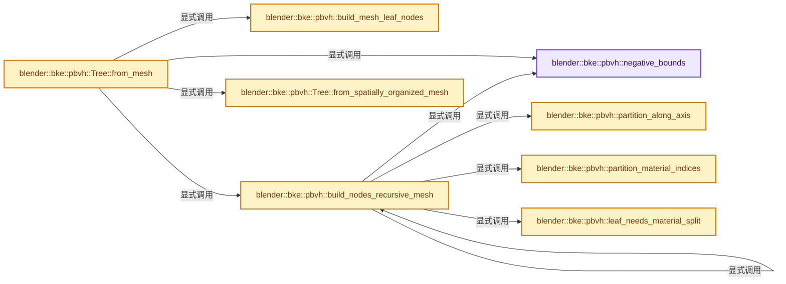
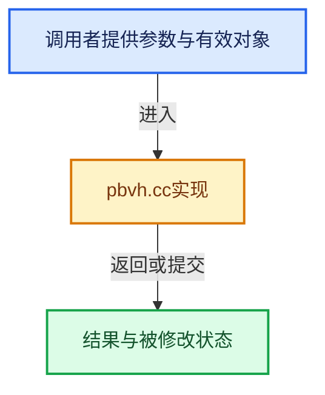

# 实现依赖专题：source/blender/blenkernel/intern/pbvh.cc

[方向导航](README.md) · [符号索引](../%E7%AC%A6%E5%8F%B7%E4%BE%9D%E8%B5%96%E4%B8%8E%E5%AE%9E%E7%8E%B0%E7%B4%A2%E5%BC%95.md)

本专题从正文实际调用进入，集中保存共享实现。函数有稳定锚点，可从调用处直接跳到对应完整函数；递归与互相调用通过回链组织。

## 本文件的实现关系






## 完整成员与函数实现

<a id="f-62f600c73d0b3b6f"></a>

### `blender::bke::pbvh::negative_bounds`

实现位置：[source/blender/blenkernel/intern/pbvh.cc](../../../../../source/blender/blenkernel/intern/pbvh.cc) · L52—L55。

**教学注释版**

<!-- annotated:ce6142804231d3 -->

```cpp
static Bounds<float3> negative_bounds()
{
  // [讲解] std::numeric_limits<float>::max：按比较关系选取较大值。本讲解中的增长公式同时满足最低请求和几何增长；若保存返回引用，还需注意实参寿命。
  return {float3(std::numeric_limits<float>::max()), float3(std::numeric_limits<float>::lowest())};
}
```

<details>
<summary>核对原始源码：source/blender/blenkernel/intern/pbvh.cc · L52—L55</summary>

<!-- original:ce6142804231d3:source/blender/blenkernel/intern/pbvh.cc:52:55 -->

```cpp
static Bounds<float3> negative_bounds()
{
  return {float3(std::numeric_limits<float>::max()), float3(std::numeric_limits<float>::lowest())};
}
```

</details>

**结果出口**

- `return {float3(std::numeric_limits<float>::max()), float3(std::numeric_limits<float>::lowest())};`

**继续追踪实现**

- `float3` → [float3 · L641](%E4%BE%9D%E8%B5%96-smaa-b67bc2.md#m-0ea8254cfdb4)。宏定义由构建条件选择。
- `std::numeric_limits<float>::max` → [外部契约](https://eel.is/c++draft/alg.min.max)：按比较关系选取较大值。本讲解中的增长公式同时满足最低请求和几何增长；若保存返回引用，还需注意实参寿命。
- `std::numeric_limits<float>::lowest` → [外部契约](https://eel.is/c++draft/)：这个边界按实际表达式及所属类型核对参数、返回值、寿命与失败行为。这里提供接口入口，不声称已解释该第三方版本的内部实现。

<a id="f-ae9fd987bee6a323"></a>

### `blender::bke::pbvh::partition_along_axis`

实现位置：[source/blender/blenkernel/intern/pbvh.cc](../../../../../source/blender/blenkernel/intern/pbvh.cc) · L62—L71。

接口参数：

- `const Span<float3> face_centers`
- `MutableSpan<int> faces`
- `const int axis`
- `const float middle`

**教学注释版**

<!-- annotated:6dcd18f6d21c8f -->

```cpp
int partition_along_axis(const Span<float3> face_centers,
                         MutableSpan<int> faces,
                         const int axis,
                         const float middle)
{
  // [讲解] faces.begin：返回借用范围的地址。
  const int *split = std::partition(faces.begin(), faces.end(), [&](const int face) {
    return face_centers[face][axis] >= middle;
  });
  return split - faces.begin();
}
```

<details>
<summary>核对原始源码：source/blender/blenkernel/intern/pbvh.cc · L62—L71</summary>

<!-- original:6dcd18f6d21c8f:source/blender/blenkernel/intern/pbvh.cc:62:71 -->

```cpp
int partition_along_axis(const Span<float3> face_centers,
                         MutableSpan<int> faces,
                         const int axis,
                         const float middle)
{
  const int *split = std::partition(faces.begin(), faces.end(), [&](const int face) {
    return face_centers[face][axis] >= middle;
  });
  return split - faces.begin();
}
```

</details>

**结果出口**

- `return face_centers[face][axis] >= middle;`
- `return split - faces.begin();`

**继续追踪实现**

- `std::partition` → [外部契约](https://eel.is/c++draft/)：这个边界按实际表达式及所属类型核对参数、返回值、寿命与失败行为。这里提供接口入口，不声称已解释该第三方版本的内部实现。
- `faces.begin` → [blender::MutableSpan::begin · L550](../01-%E5%9F%BA%E7%A1%80%E5%AE%B9%E5%99%A8%E4%B8%8E%E7%8E%B0%E4%BB%A3CPP/06-MutableSpan%E5%8F%AF%E5%86%99%E8%A7%86%E5%9B%BE.md#f-02a6b28889d59da1)；[blender::gpu::shader::parser::MutableSpan::begin · L97](%E4%BE%9D%E8%B5%96-utils-06433d.md#f-707ab8fcbd90899b)；[blender::gpu::shader::parser::MutableSpan::begin · L106](%E4%BE%9D%E8%B5%96-utils-06433d.md#f-24291c7b5f37860b)。同名重载需按实参类型选择。
- `faces.end` → [blender::MutableSpan::end · L554](../01-%E5%9F%BA%E7%A1%80%E5%AE%B9%E5%99%A8%E4%B8%8E%E7%8E%B0%E4%BB%A3CPP/06-MutableSpan%E5%8F%AF%E5%86%99%E8%A7%86%E5%9B%BE.md#f-4bf60034b9ddbc44)；[blender::gpu::shader::parser::MutableSpan::end · L101](%E4%BE%9D%E8%B5%96-utils-06433d.md#f-21cd00bb95944779)；[blender::gpu::shader::parser::MutableSpan::end · L110](%E4%BE%9D%E8%B5%96-utils-06433d.md#f-b75205cae5a07f2c)。同名重载需按实参类型选择。

<a id="f-a1add5883631ceb6"></a>

### `blender::bke::pbvh::partition_material_indices`

实现位置：[source/blender/blenkernel/intern/pbvh.cc](../../../../../source/blender/blenkernel/intern/pbvh.cc) · L73—L79。

接口参数：

- `const Span<int> material_indices`
- `MutableSpan<int> faces`

**教学注释版**

<!-- annotated:f0ad21d4be6834 -->

```cpp
int partition_material_indices(const Span<int> material_indices, MutableSpan<int> faces)
{
  // [讲解] faces.first：按视图边界访问元素。
  const int first = material_indices[faces.first()];
  const int *split = std::partition(
      // [讲解] faces.begin：返回借用范围的地址。
      faces.begin(), faces.end(), [&](const int face) { return material_indices[face] == first; });
  return split - faces.begin();
}
```

<details>
<summary>核对原始源码：source/blender/blenkernel/intern/pbvh.cc · L73—L79</summary>

<!-- original:f0ad21d4be6834:source/blender/blenkernel/intern/pbvh.cc:73:79 -->

```cpp
int partition_material_indices(const Span<int> material_indices, MutableSpan<int> faces)
{
  const int first = material_indices[faces.first()];
  const int *split = std::partition(
      faces.begin(), faces.end(), [&](const int face) { return material_indices[face] == first; });
  return split - faces.begin();
}
```

</details>

**结果出口**

- `return split - faces.begin();`

**继续追踪实现**

- `faces.first` → [blender::MutableSpan::first · L685](../01-%E5%9F%BA%E7%A1%80%E5%AE%B9%E5%99%A8%E4%B8%8E%E7%8E%B0%E4%BB%A3CPP/06-MutableSpan%E5%8F%AF%E5%86%99%E8%A7%86%E5%9B%BE.md#f-3126bab9f43cee1c)。
- `std::partition` → [外部契约](https://eel.is/c++draft/)：这个边界按实际表达式及所属类型核对参数、返回值、寿命与失败行为。这里提供接口入口，不声称已解释该第三方版本的内部实现。
- `faces.begin` → [blender::MutableSpan::begin · L550](../01-%E5%9F%BA%E7%A1%80%E5%AE%B9%E5%99%A8%E4%B8%8E%E7%8E%B0%E4%BB%A3CPP/06-MutableSpan%E5%8F%AF%E5%86%99%E8%A7%86%E5%9B%BE.md#f-02a6b28889d59da1)；[blender::gpu::shader::parser::MutableSpan::begin · L97](%E4%BE%9D%E8%B5%96-utils-06433d.md#f-707ab8fcbd90899b)；[blender::gpu::shader::parser::MutableSpan::begin · L106](%E4%BE%9D%E8%B5%96-utils-06433d.md#f-24291c7b5f37860b)。同名重载需按实参类型选择。
- `faces.end` → [blender::MutableSpan::end · L554](../01-%E5%9F%BA%E7%A1%80%E5%AE%B9%E5%99%A8%E4%B8%8E%E7%8E%B0%E4%BB%A3CPP/06-MutableSpan%E5%8F%AF%E5%86%99%E8%A7%86%E5%9B%BE.md#f-4bf60034b9ddbc44)；[blender::gpu::shader::parser::MutableSpan::end · L101](%E4%BE%9D%E8%B5%96-utils-06433d.md#f-21cd00bb95944779)；[blender::gpu::shader::parser::MutableSpan::end · L110](%E4%BE%9D%E8%B5%96-utils-06433d.md#f-b75205cae5a07f2c)。同名重载需按实参类型选择。

<a id="f-7b69e2f293ab512e"></a>

### `blender::bke::pbvh::build_mesh_leaf_nodes`

实现位置：[source/blender/blenkernel/intern/pbvh.cc](../../../../../source/blender/blenkernel/intern/pbvh.cc) · L81—L130。

接口参数：

- `const int verts_num`
- `const OffsetIndices<int> faces`
- `const Span<int> corner_verts`
- `MutableSpan<MeshNode> nodes`

**教学注释版**

<!-- annotated:d8889c085898f9 -->

```cpp
BLI_NOINLINE static void build_mesh_leaf_nodes(const int verts_num,
                                               const OffsetIndices<int> faces,
                                               const Span<int> corner_verts,
                                               MutableSpan<MeshNode> nodes)
{
  PRF_scope(ProfileCategory::Core);
  // [讲解] nodes.size：查询视图长度或生成对应有效索引区间。
  Array<Array<int>> verts_per_node(nodes.size(), NoInitialization());
  // [讲解] nodes.index_range：查询视图长度或生成对应有效索引区间。
  threading::parallel_for(nodes.index_range(), 8, [&](const IndexRange range) {
    Set<int> verts;
    for (const int i : range) {
      MeshNode &node = nodes[i];

      // [讲解] verts.clear：移除全部活项，并按接口决定是否归还存储。
      verts.clear();
      int corners_count = 0;
      for (const int face_index : node.face_indices_) {
        const IndexRange face = faces[face_index];
        // [讲解] corner_verts.slice：建立原连续范围的子视图。
        verts.add_multiple(corner_verts.slice(face));
        corners_count += face.size();
      }
      nodes[i].corners_num_ = corners_count;

      new (&verts_per_node[i]) Array<int>(verts.size());
      std::copy(verts.begin(), verts.end(), verts_per_node[i].begin());
      std::ranges::sort(verts_per_node[i]);
    }
  });

  Vector<int> owned_verts;
  Vector<int> shared_verts;
  BitVector<> vert_used(verts_num);
  for (const int i : nodes.index_range()) {
    MeshNode &node = nodes[i];

    owned_verts.clear();
    shared_verts.clear();
    for (const int vert : verts_per_node[i]) {
      if (vert_used[vert]) {
        // [讲解] shared_verts.append：在尾部建立新元素，必要时先扩大存储。
        shared_verts.append(vert);
      }
      else {
        vert_used[vert].set();
        owned_verts.append(vert);
      }
    }
    node.unique_verts_num_ = owned_verts.size();
    node.vert_indices_.reserve(owned_verts.size() + shared_verts.size());
    node.vert_indices_.add_multiple(owned_verts);
    node.vert_indices_.add_multiple(shared_verts);
  }
}
```

<details>
<summary>核对原始源码：source/blender/blenkernel/intern/pbvh.cc · L81—L130</summary>

<!-- original:d8889c085898f9:source/blender/blenkernel/intern/pbvh.cc:81:130 -->

```cpp
BLI_NOINLINE static void build_mesh_leaf_nodes(const int verts_num,
                                               const OffsetIndices<int> faces,
                                               const Span<int> corner_verts,
                                               MutableSpan<MeshNode> nodes)
{
  PRF_scope(ProfileCategory::Core);
  Array<Array<int>> verts_per_node(nodes.size(), NoInitialization());
  threading::parallel_for(nodes.index_range(), 8, [&](const IndexRange range) {
    Set<int> verts;
    for (const int i : range) {
      MeshNode &node = nodes[i];

      verts.clear();
      int corners_count = 0;
      for (const int face_index : node.face_indices_) {
        const IndexRange face = faces[face_index];
        verts.add_multiple(corner_verts.slice(face));
        corners_count += face.size();
      }
      nodes[i].corners_num_ = corners_count;

      new (&verts_per_node[i]) Array<int>(verts.size());
      std::copy(verts.begin(), verts.end(), verts_per_node[i].begin());
      std::ranges::sort(verts_per_node[i]);
    }
  });

  Vector<int> owned_verts;
  Vector<int> shared_verts;
  BitVector<> vert_used(verts_num);
  for (const int i : nodes.index_range()) {
    MeshNode &node = nodes[i];

    owned_verts.clear();
    shared_verts.clear();
    for (const int vert : verts_per_node[i]) {
      if (vert_used[vert]) {
        shared_verts.append(vert);
      }
      else {
        vert_used[vert].set();
        owned_verts.append(vert);
      }
    }
    node.unique_verts_num_ = owned_verts.size();
    node.vert_indices_.reserve(owned_verts.size() + shared_verts.size());
    node.vert_indices_.add_multiple(owned_verts);
    node.vert_indices_.add_multiple(shared_verts);
  }
}
```

</details>

**沿实际写入检查状态**

- `corners_count += face.size();`
- `nodes[i].corners_num_ = corners_count;`
- `node.unique_verts_num_ = owned_verts.size();`

**继续追踪实现**

- `PRF_scope` → [PRF_scope · L51](%E4%BE%9D%E8%B5%96-PRF_profile-5a3577.md#m-9f5e4ea0487b)；[PRF_scope · L90](%E4%BE%9D%E8%B5%96-PRF_profile-5a3577.md#m-8fc74ae4419e)。宏定义由构建条件选择。
- `nodes.size` → [blender::MutableSpan::size · L499](../01-%E5%9F%BA%E7%A1%80%E5%AE%B9%E5%99%A8%E4%B8%8E%E7%8E%B0%E4%BB%A3CPP/06-MutableSpan%E5%8F%AF%E5%86%99%E8%A7%86%E5%9B%BE.md#f-1de6a66839c304a8)；[blender::gpu::shader::parser::MutableSpan::size · L87](%E4%BE%9D%E8%B5%96-utils-06433d.md#f-5e684af6ee7990e9)。同名重载需按实参类型选择。
- `NoInitialization` → [blender::NoInitialization](../03-%E5%86%85%E5%AD%98%E5%88%86%E9%85%8D%E4%B8%8E%E8%BF%90%E8%A1%8C%E6%97%B6%E7%B1%BB%E5%9E%8B/%E4%BE%9D%E8%B5%96-BLI_memory_utils-e249c3.md#t-3502e11e3a54)。
- `threading::parallel_for` → [blender::threading::parallel_for · L68](../11-Depsgraph%E4%B8%8E%E5%B9%B6%E8%A1%8C%E4%BB%BB%E5%8A%A1%E7%B3%BB%E7%BB%9F/07-%E4%BB%BB%E5%8A%A1%E6%B1%A0%E4%B8%8ETBB%E6%8E%A5%E5%85%A5.md#f-838294754c24426c)。
- `nodes.index_range` → [blender::MutableSpan::index_range · L676](../01-%E5%9F%BA%E7%A1%80%E5%AE%B9%E5%99%A8%E4%B8%8E%E7%8E%B0%E4%BB%A3CPP/06-MutableSpan%E5%8F%AF%E5%86%99%E8%A7%86%E5%9B%BE.md#f-f9a9d59a69ca64b5)。
- `verts.clear` → [blender::Set::clear · L570](../02-%E5%93%88%E5%B8%8C%E8%A1%A8%E4%B8%8E%E5%85%B3%E8%81%94%E6%95%B0%E6%8D%AE%E7%BB%93%E6%9E%84/08-Set%E4%B8%8E%E9%9B%86%E5%90%88%E8%AF%AD%E4%B9%89.md#f-ca1071f7960a58f0)。
- `verts.add_multiple` → [blender::Set::add_multiple · L287](../02-%E5%93%88%E5%B8%8C%E8%A1%A8%E4%B8%8E%E5%85%B3%E8%81%94%E6%95%B0%E6%8D%AE%E7%BB%93%E6%9E%84/08-Set%E4%B8%8E%E9%9B%86%E5%90%88%E8%AF%AD%E4%B9%89.md#f-18a099a39b0fcf37)。
- `corner_verts.slice` → [blender::Span::slice · L141](../01-%E5%9F%BA%E7%A1%80%E5%AE%B9%E5%99%A8%E4%B8%8E%E7%8E%B0%E4%BB%A3CPP/05-Span%E5%8F%AA%E8%AF%BB%E8%BF%9E%E7%BB%AD%E8%A7%86%E5%9B%BE.md#f-380a0e8fdcbd53cc)；[blender::Span::slice · L149](../01-%E5%9F%BA%E7%A1%80%E5%AE%B9%E5%99%A8%E4%B8%8E%E7%8E%B0%E4%BB%A3CPP/05-Span%E5%8F%AA%E8%AF%BB%E8%BF%9E%E7%BB%AD%E8%A7%86%E5%9B%BE.md#f-9b9c15e78dd54eec)。同名重载需按实参类型选择。
- `face.size` → [blender::IndexRange::size · L156](../01-%E5%9F%BA%E7%A1%80%E5%AE%B9%E5%99%A8%E4%B8%8E%E7%8E%B0%E4%BB%A3CPP/04-IndexRange%E8%BF%9E%E7%BB%AD%E6%95%B4%E6%95%B0%E5%8C%BA%E9%97%B4.md#f-05f66c3ebb2fdfec)。
- `verts.size` → [blender::Set::size · L606](../02-%E5%93%88%E5%B8%8C%E8%A1%A8%E4%B8%8E%E5%85%B3%E8%81%94%E6%95%B0%E6%8D%AE%E7%BB%93%E6%9E%84/08-Set%E4%B8%8E%E9%9B%86%E5%90%88%E8%AF%AD%E4%B9%89.md#f-4f8f88fffeb44b15)。
- `std::copy` → [外部契约](https://eel.is/c++draft/)：这个边界按实际表达式及所属类型核对参数、返回值、寿命与失败行为。这里提供接口入口，不声称已解释该第三方版本的内部实现。
- `verts.begin` → [blender::Set::begin · L499](../02-%E5%93%88%E5%B8%8C%E8%A1%A8%E4%B8%8E%E5%85%B3%E8%81%94%E6%95%B0%E6%8D%AE%E7%BB%93%E6%9E%84/08-Set%E4%B8%8E%E9%9B%86%E5%90%88%E8%AF%AD%E4%B9%89.md#f-2885cc115ca7486f)。
- `verts.end` → [blender::Set::end · L509](../02-%E5%93%88%E5%B8%8C%E8%A1%A8%E4%B8%8E%E5%85%B3%E8%81%94%E6%95%B0%E6%8D%AE%E7%BB%93%E6%9E%84/08-Set%E4%B8%8E%E9%9B%86%E5%90%88%E8%AF%AD%E4%B9%89.md#f-553fc42e3d469eaa)。
- `verts_per_node[i].begin` → [调用协议](../%E6%A8%A1%E6%9D%BF%E5%AE%8F%E4%B8%8E%E5%8A%A8%E6%80%81%E5%88%86%E6%B4%BE%E5%8D%8F%E8%AE%AE.md)：接收对象类型依赖auto、返回值或模板实例；不按同名猜测目标。调用位置L103。
- `std::ranges::sort` → [外部契约](https://eel.is/c++draft/)：这个边界按实际表达式及所属类型核对参数、返回值、寿命与失败行为。这里提供接口入口，不声称已解释该第三方版本的内部实现。
- `owned_verts.clear` → [blender::Vector::clear · L468](../01-%E5%9F%BA%E7%A1%80%E5%AE%B9%E5%99%A8%E4%B8%8E%E7%8E%B0%E4%BB%A3CPP/10-Vector%E6%89%A9%E5%AE%B9%E4%B8%8E%E5%A2%9E%E9%95%BF.md#f-d051bebff5275a43)。
- `shared_verts.clear` → [blender::Vector::clear · L468](../01-%E5%9F%BA%E7%A1%80%E5%AE%B9%E5%99%A8%E4%B8%8E%E7%8E%B0%E4%BB%A3CPP/10-Vector%E6%89%A9%E5%AE%B9%E4%B8%8E%E5%A2%9E%E9%95%BF.md#f-d051bebff5275a43)。
- `shared_verts.append` → [blender::Vector::append · L498](../01-%E5%9F%BA%E7%A1%80%E5%AE%B9%E5%99%A8%E4%B8%8E%E7%8E%B0%E4%BB%A3CPP/11-Vector%E6%8F%92%E5%85%A5%E5%88%A0%E9%99%A4%E4%B8%8E%E9%87%8D%E6%8E%92.md#f-5bde268a69e443ec)；[blender::Vector::append · L502](../01-%E5%9F%BA%E7%A1%80%E5%AE%B9%E5%99%A8%E4%B8%8E%E7%8E%B0%E4%BB%A3CPP/11-Vector%E6%8F%92%E5%85%A5%E5%88%A0%E9%99%A4%E4%B8%8E%E9%87%8D%E6%8E%92.md#f-591e0b15e6308532)。同名重载需按实参类型选择。
- `vert_used[vert].set` → [调用协议](../%E6%A8%A1%E6%9D%BF%E5%AE%8F%E4%B8%8E%E5%8A%A8%E6%80%81%E5%88%86%E6%B4%BE%E5%8D%8F%E8%AE%AE.md)：接收对象类型依赖auto、返回值或模板实例；不按同名猜测目标。调用位置L121。
- `owned_verts.append` → [blender::Vector::append · L498](../01-%E5%9F%BA%E7%A1%80%E5%AE%B9%E5%99%A8%E4%B8%8E%E7%8E%B0%E4%BB%A3CPP/11-Vector%E6%8F%92%E5%85%A5%E5%88%A0%E9%99%A4%E4%B8%8E%E9%87%8D%E6%8E%92.md#f-5bde268a69e443ec)；[blender::Vector::append · L502](../01-%E5%9F%BA%E7%A1%80%E5%AE%B9%E5%99%A8%E4%B8%8E%E7%8E%B0%E4%BB%A3CPP/11-Vector%E6%8F%92%E5%85%A5%E5%88%A0%E9%99%A4%E4%B8%8E%E9%87%8D%E6%8E%92.md#f-591e0b15e6308532)。同名重载需按实参类型选择。
- `owned_verts.size` → [blender::Vector::size · L780](../01-%E5%9F%BA%E7%A1%80%E5%AE%B9%E5%99%A8%E4%B8%8E%E7%8E%B0%E4%BB%A3CPP/11-Vector%E6%8F%92%E5%85%A5%E5%88%A0%E9%99%A4%E4%B8%8E%E9%87%8D%E6%8E%92.md#f-714773731767349c)。
- `node.vert_indices_.reserve` → [调用协议](../%E6%A8%A1%E6%9D%BF%E5%AE%8F%E4%B8%8E%E5%8A%A8%E6%80%81%E5%88%86%E6%B4%BE%E5%8D%8F%E8%AE%AE.md)：接收对象类型依赖auto、返回值或模板实例；不按同名猜测目标。调用位置L126。
- `shared_verts.size` → [blender::Vector::size · L780](../01-%E5%9F%BA%E7%A1%80%E5%AE%B9%E5%99%A8%E4%B8%8E%E7%8E%B0%E4%BB%A3CPP/11-Vector%E6%8F%92%E5%85%A5%E5%88%A0%E9%99%A4%E4%B8%8E%E9%87%8D%E6%8E%92.md#f-714773731767349c)。
- `node.vert_indices_.add_multiple` → [调用协议](../%E6%A8%A1%E6%9D%BF%E5%AE%8F%E4%B8%8E%E5%8A%A8%E6%80%81%E5%88%86%E6%B4%BE%E5%8D%8F%E8%AE%AE.md)：接收对象类型依赖auto、返回值或模板实例；不按同名猜测目标。调用位置L127。

<a id="f-f86df6e34a2a5e9b"></a>

### `blender::bke::pbvh::leaf_needs_material_split`

实现位置：[source/blender/blenkernel/intern/pbvh.cc](../../../../../source/blender/blenkernel/intern/pbvh.cc) · L132—L140。

接口参数：

- `const Span<int> faces`
- `const Span<int> material_indices`

**教学注释版**

<!-- annotated:e8d051c41fe5b2 -->

```cpp
bool leaf_needs_material_split(const Span<int> faces, const Span<int> material_indices)
{
  // [讲解] material_indices.is_empty：查询视图长度或生成对应有效索引区间。
  if (material_indices.is_empty()) {
    return false;
  }
  // [讲解] faces.first：按视图边界访问元素。
  const int first = material_indices[faces.first()];
  return std::any_of(
      // [讲解] faces.begin：返回借用范围的地址。
      faces.begin(), faces.end(), [&](const int face) { return material_indices[face] != first; });
}
```

<details>
<summary>核对原始源码：source/blender/blenkernel/intern/pbvh.cc · L132—L140</summary>

<!-- original:e8d051c41fe5b2:source/blender/blenkernel/intern/pbvh.cc:132:140 -->

```cpp
bool leaf_needs_material_split(const Span<int> faces, const Span<int> material_indices)
{
  if (material_indices.is_empty()) {
    return false;
  }
  const int first = material_indices[faces.first()];
  return std::any_of(
      faces.begin(), faces.end(), [&](const int face) { return material_indices[face] != first; });
}
```

</details>

**结果出口**

- `return false;`
- `return std::any_of(`

**继续追踪实现**

- `material_indices.is_empty` → [blender::Span::is_empty · L264](../01-%E5%9F%BA%E7%A1%80%E5%AE%B9%E5%99%A8%E4%B8%8E%E7%8E%B0%E4%BB%A3CPP/05-Span%E5%8F%AA%E8%AF%BB%E8%BF%9E%E7%BB%AD%E8%A7%86%E5%9B%BE.md#f-8cc1d7ba8feb50e6)。
- `faces.first` → [blender::Span::first · L319](../01-%E5%9F%BA%E7%A1%80%E5%AE%B9%E5%99%A8%E4%B8%8E%E7%8E%B0%E4%BB%A3CPP/05-Span%E5%8F%AA%E8%AF%BB%E8%BF%9E%E7%BB%AD%E8%A7%86%E5%9B%BE.md#f-d8c9bcc3e9757248)。
- `std::any_of` → [外部契约](https://eel.is/c++draft/)：这个边界按实际表达式及所属类型核对参数、返回值、寿命与失败行为。这里提供接口入口，不声称已解释该第三方版本的内部实现。
- `faces.begin` → [blender::Span::begin · L224](../01-%E5%9F%BA%E7%A1%80%E5%AE%B9%E5%99%A8%E4%B8%8E%E7%8E%B0%E4%BB%A3CPP/05-Span%E5%8F%AA%E8%AF%BB%E8%BF%9E%E7%BB%AD%E8%A7%86%E5%9B%BE.md#f-415883b512284f46)。
- `faces.end` → [blender::Span::end · L228](../01-%E5%9F%BA%E7%A1%80%E5%AE%B9%E5%99%A8%E4%B8%8E%E7%8E%B0%E4%BB%A3CPP/05-Span%E5%8F%AA%E8%AF%BB%E8%BF%9E%E7%BB%AD%E8%A7%86%E5%9B%BE.md#f-a7d8b9e494c291a7)。

<a id="f-c8d7170d705f3aef"></a>

### `blender::bke::pbvh::build_nodes_recursive_mesh`

实现位置：[source/blender/blenkernel/intern/pbvh.cc](../../../../../source/blender/blenkernel/intern/pbvh.cc) · L142—L221。

接口参数：

- `const Span<int> material_indices`
- `const int leaf_limit`
- `const int node_index`
- `const int parent_index`
- `const std::optional<Bounds<float3>> &bounds_precalc`
- `const Span<float3> face_centers`
- `const int depth`
- `MutableSpan<int> faces`
- `Vector<MeshNode> &nodes`

**教学注释版**

<!-- annotated:a13246c1da2db4 -->

```cpp
static void build_nodes_recursive_mesh(const Span<int> material_indices,
                                       const int leaf_limit,
                                       const int node_index,
                                       const int parent_index,
                                       const std::optional<Bounds<float3>> &bounds_precalc,
                                       const Span<float3> face_centers,
                                       const int depth,
                                       MutableSpan<int> faces,
                                       Vector<MeshNode> &nodes)
{
  PRF_scope(ProfileCategory::Core);
  BLI_assert(parent_index >= -1);

  MeshNode &node = nodes[node_index];
  node.parent_ = parent_index;

  /* Decide whether this is a leaf or not */
  // [讲解] faces.size：查询视图长度或生成对应有效索引区间。
  const bool below_leaf_limit = faces.size() <= leaf_limit || depth >= STACK_FIXED_DEPTH - 1;
  if (below_leaf_limit) {
    if (!leaf_needs_material_split(faces, material_indices)) {
      node.flag_ |= Node::Leaf;
      node.face_indices_ = faces;
      return;
    }
  }

  /* Add two child nodes */
  nodes[node_index].children_offset_ = nodes.size();
  // [讲解] nodes.resize：把有效元素数调整为new_size。增长路径构造新元素，缩小路径销毁尾部对象，最后才提交新的end_。
  nodes.resize(nodes.size() + 2);

  int split;
  if (!below_leaf_limit) {
    Bounds<float3> bounds;
    if (bounds_precalc) {
      bounds = *bounds_precalc;
    }
    else {
      bounds = threading::parallel_reduce(
          // [讲解] faces.index_range：查询视图长度或生成对应有效索引区间。
          faces.index_range(),
          1024,
          negative_bounds(),
          [&](const IndexRange range, Bounds<float3> value) {
            // [讲解] faces.slice：建立原连续范围的子视图。
            for (const int face : faces.slice(range)) {
              math::min_max(face_centers[face], value.min, value.max);
            }
            return value;
          },
          merge_bounds);
    }
    const int axis = math::dominant_axis(bounds.max - bounds.min);

    /* Partition primitives along that axis */
    split = partition_along_axis(
        face_centers, faces, axis, math::midpoint(bounds.min[axis], bounds.max[axis]));
  }
  else {
    /* Partition primitives by material */
    split = partition_material_indices(material_indices, faces);
  }

  /* Build children */
  build_nodes_recursive_mesh(material_indices,
                             leaf_limit,
                             nodes[node_index].children_offset_,
                             node_index,
                             std::nullopt,
                             face_centers,
                             depth + 1,
                             // [讲解] faces.take_front：从两端裁去或选取一定数量元素形成新视图。
                             faces.take_front(split),
                             nodes);
  build_nodes_recursive_mesh(material_indices,
                             leaf_limit,
                             nodes[node_index].children_offset_ + 1,
                             node_index,
                             std::nullopt,
                             face_centers,
                             depth + 1,
                             // [讲解] faces.drop_front：从两端裁去或选取一定数量元素形成新视图。
                             faces.drop_front(split),
                             nodes);
}
```

<details>
<summary>核对原始源码：source/blender/blenkernel/intern/pbvh.cc · L142—L221</summary>

<!-- original:a13246c1da2db4:source/blender/blenkernel/intern/pbvh.cc:142:221 -->

```cpp
static void build_nodes_recursive_mesh(const Span<int> material_indices,
                                       const int leaf_limit,
                                       const int node_index,
                                       const int parent_index,
                                       const std::optional<Bounds<float3>> &bounds_precalc,
                                       const Span<float3> face_centers,
                                       const int depth,
                                       MutableSpan<int> faces,
                                       Vector<MeshNode> &nodes)
{
  PRF_scope(ProfileCategory::Core);
  BLI_assert(parent_index >= -1);

  MeshNode &node = nodes[node_index];
  node.parent_ = parent_index;

  /* Decide whether this is a leaf or not */
  const bool below_leaf_limit = faces.size() <= leaf_limit || depth >= STACK_FIXED_DEPTH - 1;
  if (below_leaf_limit) {
    if (!leaf_needs_material_split(faces, material_indices)) {
      node.flag_ |= Node::Leaf;
      node.face_indices_ = faces;
      return;
    }
  }

  /* Add two child nodes */
  nodes[node_index].children_offset_ = nodes.size();
  nodes.resize(nodes.size() + 2);

  int split;
  if (!below_leaf_limit) {
    Bounds<float3> bounds;
    if (bounds_precalc) {
      bounds = *bounds_precalc;
    }
    else {
      bounds = threading::parallel_reduce(
          faces.index_range(),
          1024,
          negative_bounds(),
          [&](const IndexRange range, Bounds<float3> value) {
            for (const int face : faces.slice(range)) {
              math::min_max(face_centers[face], value.min, value.max);
            }
            return value;
          },
          merge_bounds);
    }
    const int axis = math::dominant_axis(bounds.max - bounds.min);

    /* Partition primitives along that axis */
    split = partition_along_axis(
        face_centers, faces, axis, math::midpoint(bounds.min[axis], bounds.max[axis]));
  }
  else {
    /* Partition primitives by material */
    split = partition_material_indices(material_indices, faces);
  }

  /* Build children */
  build_nodes_recursive_mesh(material_indices,
                             leaf_limit,
                             nodes[node_index].children_offset_,
                             node_index,
                             std::nullopt,
                             face_centers,
                             depth + 1,
                             faces.take_front(split),
                             nodes);
  build_nodes_recursive_mesh(material_indices,
                             leaf_limit,
                             nodes[node_index].children_offset_ + 1,
                             node_index,
                             std::nullopt,
                             face_centers,
                             depth + 1,
                             faces.drop_front(split),
                             nodes);
}
```

</details>

**沿实际写入检查状态**

- `node.parent_ = parent_index;`
- `node.flag_ |= Node::Leaf;`
- `node.face_indices_ = faces;`
- `nodes[node_index].children_offset_ = nodes.size();`
- `bounds = *bounds_precalc;`
- `bounds = threading::parallel_reduce(`
- `split = partition_along_axis(`
- `split = partition_material_indices(material_indices, faces);`

**结果出口**

- `return value;`

**继续追踪实现**

- `PRF_scope` → [PRF_scope · L51](%E4%BE%9D%E8%B5%96-PRF_profile-5a3577.md#m-9f5e4ea0487b)；[PRF_scope · L90](%E4%BE%9D%E8%B5%96-PRF_profile-5a3577.md#m-8fc74ae4419e)。宏定义由构建条件选择。
- `BLI_assert` → [BLI_assert · L48](../01-%E5%9F%BA%E7%A1%80%E5%AE%B9%E5%99%A8%E4%B8%8E%E7%8E%B0%E4%BB%A3CPP/%E4%BE%9D%E8%B5%96-BLI_assert-cc98e8.md#m-57a88495704d)；[BLI_assert · L63](../01-%E5%9F%BA%E7%A1%80%E5%AE%B9%E5%99%A8%E4%B8%8E%E7%8E%B0%E4%BB%A3CPP/%E4%BE%9D%E8%B5%96-BLI_assert-cc98e8.md#m-d07050020cb5)。宏定义由构建条件选择。
- `faces.size` → [blender::MutableSpan::size · L499](../01-%E5%9F%BA%E7%A1%80%E5%AE%B9%E5%99%A8%E4%B8%8E%E7%8E%B0%E4%BB%A3CPP/06-MutableSpan%E5%8F%AF%E5%86%99%E8%A7%86%E5%9B%BE.md#f-1de6a66839c304a8)；[blender::gpu::shader::parser::MutableSpan::size · L87](%E4%BE%9D%E8%B5%96-utils-06433d.md#f-5e684af6ee7990e9)。同名重载需按实参类型选择。
- `leaf_needs_material_split` → [blender::bke::pbvh::leaf_needs_material_split · L132](%E4%BE%9D%E8%B5%96-pbvh-41a537.md#f-f86df6e34a2a5e9b)。
- `nodes.size` → [blender::Vector::size · L780](../01-%E5%9F%BA%E7%A1%80%E5%AE%B9%E5%99%A8%E4%B8%8E%E7%8E%B0%E4%BB%A3CPP/11-Vector%E6%8F%92%E5%85%A5%E5%88%A0%E9%99%A4%E4%B8%8E%E9%87%8D%E6%8E%92.md#f-714773731767349c)。
- `nodes.resize` → [blender::Vector::resize · L418](../01-%E5%9F%BA%E7%A1%80%E5%AE%B9%E5%99%A8%E4%B8%8E%E7%8E%B0%E4%BB%A3CPP/10-Vector%E6%89%A9%E5%AE%B9%E4%B8%8E%E5%A2%9E%E9%95%BF.md#f-059312cabb8abe3a)；[blender::Vector::resize · L439](../01-%E5%9F%BA%E7%A1%80%E5%AE%B9%E5%99%A8%E4%B8%8E%E7%8E%B0%E4%BB%A3CPP/10-Vector%E6%89%A9%E5%AE%B9%E4%B8%8E%E5%A2%9E%E9%95%BF.md#f-ab8f94924ebe2d12)。同名重载需按实参类型选择。
- `threading::parallel_reduce` → [blender::threading::parallel_reduce · L126](../11-Depsgraph%E4%B8%8E%E5%B9%B6%E8%A1%8C%E4%BB%BB%E5%8A%A1%E7%B3%BB%E7%BB%9F/07-%E4%BB%BB%E5%8A%A1%E6%B1%A0%E4%B8%8ETBB%E6%8E%A5%E5%85%A5.md#f-9225ddb5efb97fcc)。
- `faces.index_range` → [blender::MutableSpan::index_range · L676](../01-%E5%9F%BA%E7%A1%80%E5%AE%B9%E5%99%A8%E4%B8%8E%E7%8E%B0%E4%BB%A3CPP/06-MutableSpan%E5%8F%AF%E5%86%99%E8%A7%86%E5%9B%BE.md#f-f9a9d59a69ca64b5)。
- `negative_bounds` → [blender::bke::pbvh::negative_bounds · L52](%E4%BE%9D%E8%B5%96-pbvh-41a537.md#f-62f600c73d0b3b6f)。
- `faces.slice` → [blender::MutableSpan::slice · L579](../01-%E5%9F%BA%E7%A1%80%E5%AE%B9%E5%99%A8%E4%B8%8E%E7%8E%B0%E4%BB%A3CPP/06-MutableSpan%E5%8F%AF%E5%86%99%E8%A7%86%E5%9B%BE.md#f-6808b4aefbf58808)；[blender::MutableSpan::slice · L587](../01-%E5%9F%BA%E7%A1%80%E5%AE%B9%E5%99%A8%E4%B8%8E%E7%8E%B0%E4%BB%A3CPP/06-MutableSpan%E5%8F%AF%E5%86%99%E8%A7%86%E5%9B%BE.md#f-c05b010821861e4f)。同名重载需按实参类型选择。
- `math::min_max` → [blender::math::min_max · L331](../12-%E7%A9%BA%E9%97%B4%E6%95%B0%E6%8D%AE%E7%BB%93%E6%9E%84%E4%B8%8E%E5%87%A0%E4%BD%95%E7%AE%97%E6%B3%95/%E4%BE%9D%E8%B5%96-BLI_math_vector-906a87.md#f-d0ca25e982d9489c)；[blender::math::min_max · L99](../12-%E7%A9%BA%E9%97%B4%E6%95%B0%E6%8D%AE%E7%BB%93%E6%9E%84%E4%B8%8E%E5%87%A0%E4%BD%95%E7%AE%97%E6%B3%95/%E4%BE%9D%E8%B5%96-BLI_math_base-0728eb.md#f-d076aca4030981e7)。同名重载需按实参类型选择。
- `math::dominant_axis` → [blender::math::dominant_axis · L668](../12-%E7%A9%BA%E9%97%B4%E6%95%B0%E6%8D%AE%E7%BB%93%E6%9E%84%E4%B8%8E%E5%87%A0%E4%BD%95%E7%AE%97%E6%B3%95/%E4%BE%9D%E8%B5%96-BLI_math_vector-906a87.md#f-29bbd91a3e22182f)。
- `partition_along_axis` → [blender::bke::pbvh::partition_along_axis · L62](%E4%BE%9D%E8%B5%96-pbvh-41a537.md#f-ae9fd987bee6a323)。
- `math::midpoint` → [blender::math::midpoint · L647](../12-%E7%A9%BA%E9%97%B4%E6%95%B0%E6%8D%AE%E7%BB%93%E6%9E%84%E4%B8%8E%E5%87%A0%E4%BD%95%E7%AE%97%E6%B3%95/%E4%BE%9D%E8%B5%96-BLI_math_vector-906a87.md#f-383eeed0051cc8bd)；[blender::math::midpoint · L288](../12-%E7%A9%BA%E9%97%B4%E6%95%B0%E6%8D%AE%E7%BB%93%E6%9E%84%E4%B8%8E%E5%87%A0%E4%BD%95%E7%AE%97%E6%B3%95/%E4%BE%9D%E8%B5%96-BLI_math_base-0728eb.md#f-1a01baa0be6c0b84)。同名重载需按实参类型选择。
- `partition_material_indices` → [blender::bke::pbvh::partition_material_indices · L73](%E4%BE%9D%E8%B5%96-pbvh-41a537.md#f-a1add5883631ceb6)。
- `build_nodes_recursive_mesh` → [blender::bke::pbvh::build_nodes_recursive_mesh · L142](%E4%BE%9D%E8%B5%96-pbvh-41a537.md#f-c8d7170d705f3aef)。
- `faces.take_front` → [blender::MutableSpan::take_front · L635](../01-%E5%9F%BA%E7%A1%80%E5%AE%B9%E5%99%A8%E4%B8%8E%E7%8E%B0%E4%BB%A3CPP/06-MutableSpan%E5%8F%AF%E5%86%99%E8%A7%86%E5%9B%BE.md#f-0a0235d84ddc265d)。
- `faces.drop_front` → [blender::MutableSpan::drop_front · L613](../01-%E5%9F%BA%E7%A1%80%E5%AE%B9%E5%99%A8%E4%B8%8E%E7%8E%B0%E4%BB%A3CPP/06-MutableSpan%E5%8F%AF%E5%86%99%E8%A7%86%E5%9B%BE.md#f-3ed1464d2e0d1608)。

<a id="f-0ecde3e57335e8ba"></a>

### `blender::bke::pbvh::Tree::from_spatially_organized_mesh`

实现位置：[source/blender/blenkernel/intern/pbvh.cc](../../../../../source/blender/blenkernel/intern/pbvh.cc) · L223—L302。

接口参数：

- `const Mesh &mesh`

**教学注释版**

<!-- annotated:5fe78adca57b02 -->

```cpp
Tree Tree::from_spatially_organized_mesh(const Mesh &mesh)
{
  PRF_scope(ProfileCategory::Core);

  Tree pbvh(Type::Mesh);
  const Span<float3> vert_positions = mesh.vert_positions();

  const Span<MeshGroup> &spatial_groups = *mesh.runtime->spatial_groups;

  // [讲解] spatial_groups.is_empty：查询视图长度或生成对应有效索引区间。
  if (spatial_groups.is_empty()) {
    return pbvh;
  }

  Vector<MeshNode> &nodes = std::get<Vector<MeshNode>>(pbvh.nodes_);
  // [讲解] nodes.resize：把有效元素数调整为new_size。增长路径构造新元素，缩小路径销毁尾部对象，最后才提交新的end_。
  nodes.resize(spatial_groups.size());

  pbvh.prim_indices_.reinitialize(mesh.faces_num);
  array_utils::fill_index_range<int>(pbvh.prim_indices_);

  threading::parallel_for(nodes.index_range(), 8, [&](const IndexRange range) {
    for (const int node_idx : range) {
      MeshNode &pbvh_node = nodes[node_idx];
      pbvh_node.parent_ = spatial_groups[node_idx].parent;

      if (spatial_groups[node_idx].children_offset != 0) {
        pbvh_node.children_offset_ = spatial_groups[node_idx].children_offset;
      }
      else {
        pbvh_node.children_offset_ = 0;
        pbvh_node.flag_ = Node::Leaf;

        const IndexRange face_range = spatial_groups[node_idx].faces;
        // [讲解] face_range.size：读取连续区间或分组的边界信息。
        const int face_count = face_range.size();

        if (face_count > 0) {
          // [讲解] face_range.start：读取连续区间或分组的边界信息。
          pbvh_node.face_indices_ = Span<int>(&pbvh.prim_indices_[face_range.start()], face_count);

          pbvh_node.corners_num_ = spatial_groups[node_idx].corners_count;

          pbvh_node.unique_verts_num_ = spatial_groups[node_idx].unique_verts.size();

          pbvh_node.vert_indices_.reserve(spatial_groups[node_idx].unique_verts.size() +
                                          spatial_groups[node_idx].shared_verts.size());

          for (const int i : spatial_groups[node_idx].unique_verts.index_range()) {
            const int vert_idx = spatial_groups[node_idx].unique_verts.start() + i;
            pbvh_node.vert_indices_.add(vert_idx);
          }

          for (const int vert_idx : spatial_groups[node_idx].shared_verts) {
            pbvh_node.vert_indices_.add(vert_idx);
          }
        }
        else {
          pbvh_node.unique_verts_num_ = 0;
          pbvh_node.corners_num_ = 0;
        }
      }
    }
  });

  pbvh.tag_positions_changed(nodes.index_range());
  pbvh.update_bounds_mesh(vert_positions);
  store_bounds_orig(pbvh);

  const AttributeAccessor attributes = mesh.attributes();
  const VArraySpan hide_vert = *attributes.lookup<bool>(".hide_vert", AttrDomain::Point);

  if (!hide_vert.is_empty()) {
    threading::parallel_for(nodes.index_range(), 8, [&](const IndexRange range) {
      for (const int i : range) {
        node_update_visibility_mesh(hide_vert, nodes[i]);
      }
    });
  }

  update_mask_mesh(mesh, nodes.index_range(), pbvh);

  return pbvh;
}
```

<details>
<summary>核对原始源码：source/blender/blenkernel/intern/pbvh.cc · L223—L302</summary>

<!-- original:5fe78adca57b02:source/blender/blenkernel/intern/pbvh.cc:223:302 -->

```cpp
Tree Tree::from_spatially_organized_mesh(const Mesh &mesh)
{
  PRF_scope(ProfileCategory::Core);

  Tree pbvh(Type::Mesh);
  const Span<float3> vert_positions = mesh.vert_positions();

  const Span<MeshGroup> &spatial_groups = *mesh.runtime->spatial_groups;

  if (spatial_groups.is_empty()) {
    return pbvh;
  }

  Vector<MeshNode> &nodes = std::get<Vector<MeshNode>>(pbvh.nodes_);
  nodes.resize(spatial_groups.size());

  pbvh.prim_indices_.reinitialize(mesh.faces_num);
  array_utils::fill_index_range<int>(pbvh.prim_indices_);

  threading::parallel_for(nodes.index_range(), 8, [&](const IndexRange range) {
    for (const int node_idx : range) {
      MeshNode &pbvh_node = nodes[node_idx];
      pbvh_node.parent_ = spatial_groups[node_idx].parent;

      if (spatial_groups[node_idx].children_offset != 0) {
        pbvh_node.children_offset_ = spatial_groups[node_idx].children_offset;
      }
      else {
        pbvh_node.children_offset_ = 0;
        pbvh_node.flag_ = Node::Leaf;

        const IndexRange face_range = spatial_groups[node_idx].faces;
        const int face_count = face_range.size();

        if (face_count > 0) {
          pbvh_node.face_indices_ = Span<int>(&pbvh.prim_indices_[face_range.start()], face_count);

          pbvh_node.corners_num_ = spatial_groups[node_idx].corners_count;

          pbvh_node.unique_verts_num_ = spatial_groups[node_idx].unique_verts.size();

          pbvh_node.vert_indices_.reserve(spatial_groups[node_idx].unique_verts.size() +
                                          spatial_groups[node_idx].shared_verts.size());

          for (const int i : spatial_groups[node_idx].unique_verts.index_range()) {
            const int vert_idx = spatial_groups[node_idx].unique_verts.start() + i;
            pbvh_node.vert_indices_.add(vert_idx);
          }

          for (const int vert_idx : spatial_groups[node_idx].shared_verts) {
            pbvh_node.vert_indices_.add(vert_idx);
          }
        }
        else {
          pbvh_node.unique_verts_num_ = 0;
          pbvh_node.corners_num_ = 0;
        }
      }
    }
  });

  pbvh.tag_positions_changed(nodes.index_range());
  pbvh.update_bounds_mesh(vert_positions);
  store_bounds_orig(pbvh);

  const AttributeAccessor attributes = mesh.attributes();
  const VArraySpan hide_vert = *attributes.lookup<bool>(".hide_vert", AttrDomain::Point);

  if (!hide_vert.is_empty()) {
    threading::parallel_for(nodes.index_range(), 8, [&](const IndexRange range) {
      for (const int i : range) {
        node_update_visibility_mesh(hide_vert, nodes[i]);
      }
    });
  }

  update_mask_mesh(mesh, nodes.index_range(), pbvh);

  return pbvh;
}
```

</details>

**沿实际写入检查状态**

- `pbvh_node.parent_ = spatial_groups[node_idx].parent;`
- `pbvh_node.children_offset_ = spatial_groups[node_idx].children_offset;`
- `pbvh_node.children_offset_ = 0;`
- `pbvh_node.flag_ = Node::Leaf;`
- `pbvh_node.face_indices_ = Span<int>(&pbvh.prim_indices_[face_range.start()], face_count);`
- `pbvh_node.corners_num_ = spatial_groups[node_idx].corners_count;`
- `pbvh_node.unique_verts_num_ = spatial_groups[node_idx].unique_verts.size();`
- `pbvh_node.unique_verts_num_ = 0;`
- `pbvh_node.corners_num_ = 0;`

**结果出口**

- `return pbvh;`

**继续追踪实现**

- `PRF_scope` → [PRF_scope · L51](%E4%BE%9D%E8%B5%96-PRF_profile-5a3577.md#m-9f5e4ea0487b)；[PRF_scope · L90](%E4%BE%9D%E8%B5%96-PRF_profile-5a3577.md#m-8fc74ae4419e)。宏定义由构建条件选择。
- `mesh.vert_positions` → [Mesh::vert_positions · L1193](03-MPoly%E8%BF%81%E7%A7%BB%E4%B8%8E%E5%85%BC%E5%AE%B9.md#f-ae4177e5c5f2b371)。
- `spatial_groups.is_empty` → [blender::Span::is_empty · L264](../01-%E5%9F%BA%E7%A1%80%E5%AE%B9%E5%99%A8%E4%B8%8E%E7%8E%B0%E4%BB%A3CPP/05-Span%E5%8F%AA%E8%AF%BB%E8%BF%9E%E7%BB%AD%E8%A7%86%E5%9B%BE.md#f-8cc1d7ba8feb50e6)。
- `std::get<Vector<MeshNode>>` → [外部契约](https://eel.is/c++draft/)：这个边界按实际表达式及所属类型核对参数、返回值、寿命与失败行为。这里提供接口入口，不声称已解释该第三方版本的内部实现。
- `nodes.resize` → [blender::Vector::resize · L418](../01-%E5%9F%BA%E7%A1%80%E5%AE%B9%E5%99%A8%E4%B8%8E%E7%8E%B0%E4%BB%A3CPP/10-Vector%E6%89%A9%E5%AE%B9%E4%B8%8E%E5%A2%9E%E9%95%BF.md#f-059312cabb8abe3a)；[blender::Vector::resize · L439](../01-%E5%9F%BA%E7%A1%80%E5%AE%B9%E5%99%A8%E4%B8%8E%E7%8E%B0%E4%BB%A3CPP/10-Vector%E6%89%A9%E5%AE%B9%E4%B8%8E%E5%A2%9E%E9%95%BF.md#f-ab8f94924ebe2d12)。同名重载需按实参类型选择。
- `spatial_groups.size` → [blender::Span::size · L256](../01-%E5%9F%BA%E7%A1%80%E5%AE%B9%E5%99%A8%E4%B8%8E%E7%8E%B0%E4%BB%A3CPP/05-Span%E5%8F%AA%E8%AF%BB%E8%BF%9E%E7%BB%AD%E8%A7%86%E5%9B%BE.md#f-5f80fa006089c998)。
- `pbvh.prim_indices_.reinitialize` → [调用协议](../%E6%A8%A1%E6%9D%BF%E5%AE%8F%E4%B8%8E%E5%8A%A8%E6%80%81%E5%88%86%E6%B4%BE%E5%8D%8F%E8%AE%AE.md)：接收对象类型依赖auto、返回值或模板实例；不按同名猜测目标。调用位置L239。
- `array_utils::fill_index_range<int>` → [blender::array_utils::fill_index_range · L434](07-%E5%88%86%E7%BB%84%E8%AE%BF%E9%97%AE%E4%B8%8E%E5%8F%8D%E5%90%91%E7%B4%A2%E5%BC%95.md#f-f8128b104d76df0f)；[blender::array_utils::fill_index_range · L439](07-%E5%88%86%E7%BB%84%E8%AE%BF%E9%97%AE%E4%B8%8E%E5%8F%8D%E5%90%91%E7%B4%A2%E5%BC%95.md#f-95ca84458bfc7e7e)；[blender::array_utils::fill_index_range · L445](07-%E5%88%86%E7%BB%84%E8%AE%BF%E9%97%AE%E4%B8%8E%E5%8F%8D%E5%90%91%E7%B4%A2%E5%BC%95.md#f-c11b114c213cd61a)。同名重载需按实参类型选择。
- `threading::parallel_for` → [blender::threading::parallel_for · L68](../11-Depsgraph%E4%B8%8E%E5%B9%B6%E8%A1%8C%E4%BB%BB%E5%8A%A1%E7%B3%BB%E7%BB%9F/07-%E4%BB%BB%E5%8A%A1%E6%B1%A0%E4%B8%8ETBB%E6%8E%A5%E5%85%A5.md#f-838294754c24426c)。
- `nodes.index_range` → [blender::Vector::index_range · L1026](../01-%E5%9F%BA%E7%A1%80%E5%AE%B9%E5%99%A8%E4%B8%8E%E7%8E%B0%E4%BB%A3CPP/12-Vector%E5%BC%82%E5%B8%B8%E5%AE%89%E5%85%A8%E4%B8%8E%E8%BE%B9%E7%95%8C.md#f-ac29cf36ef185ab9)。
- `face_range.size` → [blender::IndexRange::size · L156](../01-%E5%9F%BA%E7%A1%80%E5%AE%B9%E5%99%A8%E4%B8%8E%E7%8E%B0%E4%BB%A3CPP/04-IndexRange%E8%BF%9E%E7%BB%AD%E6%95%B4%E6%95%B0%E5%8C%BA%E9%97%B4.md#f-05f66c3ebb2fdfec)。
- `Span<int>` → [blender::Span](../01-%E5%9F%BA%E7%A1%80%E5%AE%B9%E5%99%A8%E4%B8%8E%E7%8E%B0%E4%BB%A3CPP/%E4%BE%9D%E8%B5%96-BLI_span-6aa95f.md#t-8765a8e0c1d5)；[blender::Span](../01-%E5%9F%BA%E7%A1%80%E5%AE%B9%E5%99%A8%E4%B8%8E%E7%8E%B0%E4%BB%A3CPP/%E4%BE%9D%E8%B5%96-BLI_index_range-7d7cc5.md#t-86091874a1c0)；[blender::Span](%E4%BE%9D%E8%B5%96-DNA_pointcloud_types-cfb82c.md#t-112aa6ed842c)；[blender::Span](%E4%BE%9D%E8%B5%96-DNA_node_types-6708b9.md#t-49ec6fbb9b69)；[blender::Span](%E4%BE%9D%E8%B5%96-DNA_mesh_types-81f02e.md#t-184fd48fb638)；[blender::Span](%E4%BE%9D%E8%B5%96-DNA_anim_types-39c5d9.md#t-d841071994c2)；[blender::Span](%E4%BE%9D%E8%B5%96-RNA_path_fwd-79c989.md#t-4dbb08969e41)。
- `face_range.start` → [blender::IndexRange::start · L243](../01-%E5%9F%BA%E7%A1%80%E5%AE%B9%E5%99%A8%E4%B8%8E%E7%8E%B0%E4%BB%A3CPP/04-IndexRange%E8%BF%9E%E7%BB%AD%E6%95%B4%E6%95%B0%E5%8C%BA%E9%97%B4.md#f-99d2195bd9cfd1f0)。
- `spatial_groups[node_idx].unique_verts.size` → [调用协议](../%E6%A8%A1%E6%9D%BF%E5%AE%8F%E4%B8%8E%E5%8A%A8%E6%80%81%E5%88%86%E6%B4%BE%E5%8D%8F%E8%AE%AE.md)：接收对象类型依赖auto、返回值或模板实例；不按同名猜测目标。调用位置L262。
- `pbvh_node.vert_indices_.reserve` → [调用协议](../%E6%A8%A1%E6%9D%BF%E5%AE%8F%E4%B8%8E%E5%8A%A8%E6%80%81%E5%88%86%E6%B4%BE%E5%8D%8F%E8%AE%AE.md)：接收对象类型依赖auto、返回值或模板实例；不按同名猜测目标。调用位置L264。
- `spatial_groups[node_idx].shared_verts.size` → [调用协议](../%E6%A8%A1%E6%9D%BF%E5%AE%8F%E4%B8%8E%E5%8A%A8%E6%80%81%E5%88%86%E6%B4%BE%E5%8D%8F%E8%AE%AE.md)：接收对象类型依赖auto、返回值或模板实例；不按同名猜测目标。调用位置L265。
- `spatial_groups[node_idx].unique_verts.index_range` → [调用协议](../%E6%A8%A1%E6%9D%BF%E5%AE%8F%E4%B8%8E%E5%8A%A8%E6%80%81%E5%88%86%E6%B4%BE%E5%8D%8F%E8%AE%AE.md)：接收对象类型依赖auto、返回值或模板实例；不按同名猜测目标。调用位置L267。
- `spatial_groups[node_idx].unique_verts.start` → [调用协议](../%E6%A8%A1%E6%9D%BF%E5%AE%8F%E4%B8%8E%E5%8A%A8%E6%80%81%E5%88%86%E6%B4%BE%E5%8D%8F%E8%AE%AE.md)：接收对象类型依赖auto、返回值或模板实例；不按同名猜测目标。调用位置L268。
- `pbvh_node.vert_indices_.add` → [调用协议](../%E6%A8%A1%E6%9D%BF%E5%AE%8F%E4%B8%8E%E5%8A%A8%E6%80%81%E5%88%86%E6%B4%BE%E5%8D%8F%E8%AE%AE.md)：接收对象类型依赖auto、返回值或模板实例；不按同名猜测目标。调用位置L269。
- `pbvh.tag_positions_changed` → [blender::bke::pbvh::Tree::tag_positions_changed · L614](%E4%BE%9D%E8%B5%96-pbvh-41a537.md#f-89cd60ad894dff8b)。
- `pbvh.update_bounds_mesh` → [blender::bke::pbvh::Tree::update_bounds_mesh · L1268](%E4%BE%9D%E8%B5%96-pbvh-41a537.md#f-6e084eb912f0a1d9)。
- `store_bounds_orig` → [blender::bke::pbvh::store_bounds_orig · L1332](%E4%BE%9D%E8%B5%96-pbvh-41a537.md#f-1d202e4278216242)。
- `mesh.attributes` → [Mesh::attributes · L1298](03-MPoly%E8%BF%81%E7%A7%BB%E4%B8%8E%E5%85%BC%E5%AE%B9.md#f-607bbfe3e57cfc7f)。
- `attributes.lookup<bool>` → [blender::bke::AttributeAccessor::lookup · L401](%E4%BE%9D%E8%B5%96-attribute_access-bceef3.md#f-4673351b7bb3b651)。
- `hide_vert.is_empty` → [调用协议](../%E6%A8%A1%E6%9D%BF%E5%AE%8F%E4%B8%8E%E5%8A%A8%E6%80%81%E5%88%86%E6%B4%BE%E5%8D%8F%E8%AE%AE.md)：由接收对象具体类型或运行时策略提供实现。调用位置L291。
- `node_update_visibility_mesh` → [blender::bke::pbvh::node_update_visibility_mesh · L1437](%E4%BE%9D%E8%B5%96-pbvh-41a537.md#f-964ce7fd037a6b06)。
- `update_mask_mesh` → [blender::bke::pbvh::update_mask_mesh · L1356](%E4%BE%9D%E8%B5%96-pbvh-41a537.md#f-fd3a29d5e3c73184)。

<a id="f-fb1858830e3611d6"></a>

### `blender::bke::pbvh::Tree::from_mesh`

实现位置：[source/blender/blenkernel/intern/pbvh.cc](../../../../../source/blender/blenkernel/intern/pbvh.cc) · L304—L370。

接口参数：

- `const Mesh &mesh`

**教学注释版**

<!-- annotated:924b57e43a0d5d -->

```cpp
Tree Tree::from_mesh(const Mesh &mesh)
{
  PRF_scope(ProfileCategory::Core);
  if (mesh.runtime->spatial_groups) {
    return from_spatially_organized_mesh(mesh);
  }
  Tree pbvh(Type::Mesh);
  const Span<float3> vert_positions = mesh.vert_positions();
  const OffsetIndices<int> faces = mesh.faces();
  const Span<int> corner_verts = mesh.corner_verts();
  // [讲解] faces.is_empty：读取连续区间或分组的边界信息。
  if (faces.is_empty()) {
    return pbvh;
  }

  constexpr int leaf_limit = MESH_LEAF_LIMIT;
  // [讲解] std::numeric_limits<MeshNode::LocalVertMapIndexT>::max：按比较关系选取较大值。本讲解中的增长公式同时满足最低请求和几何增长；若保存返回引用，还需注意实参寿命。
  static_assert(leaf_limit < std::numeric_limits<MeshNode::LocalVertMapIndexT>::max());

  // [讲解] faces.size：读取连续区间或分组的边界信息。
  Array<float3> face_centers(faces.size());
  const Bounds<float3> bounds = threading::parallel_reduce(
      faces.index_range(),
      1024,
      negative_bounds(),
      [&](const IndexRange range, const Bounds<float3> &init) {
        Bounds<float3> current = init;
        for (const int face : range) {
          const Bounds<float3> bounds = calc_face_bounds(vert_positions,
                                                         // [讲解] corner_verts.slice：建立原连续范围的子视图。
                                                         corner_verts.slice(faces[face]));
          face_centers[face] = bounds.center();
          current = bounds::merge(current, bounds);
        }
        return current;
      },
      merge_bounds);

  const AttributeAccessor attributes = mesh.attributes();
  const VArraySpan hide_vert = *attributes.lookup<bool>(".hide_vert", AttrDomain::Point);
  const VArraySpan material_index = *attributes.lookup<int>("material_index", AttrDomain::Face);

  pbvh.prim_indices_.reinitialize(faces.size());
  array_utils::fill_index_range<int>(pbvh.prim_indices_);

  Vector<MeshNode> &nodes = std::get<Vector<MeshNode>>(pbvh.nodes_);
  // [讲解] nodes.resize：把有效元素数调整为new_size。增长路径构造新元素，缩小路径销毁尾部对象，最后才提交新的end_。
  nodes.resize(1);
  {
    build_nodes_recursive_mesh(
        material_index, leaf_limit, 0, -1, bounds, face_centers, 0, pbvh.prim_indices_, nodes);
  }

  build_mesh_leaf_nodes(mesh.verts_num, faces, corner_verts, nodes);

  pbvh.tag_positions_changed(nodes.index_range());

  pbvh.update_bounds_mesh(vert_positions);
  store_bounds_orig(pbvh);

  if (!hide_vert.is_empty()) {
    threading::parallel_for(nodes.index_range(), 8, [&](const IndexRange range) {
      for (const int i : range) {
        node_update_visibility_mesh(hide_vert, nodes[i]);
      }
    });
  }

  update_mask_mesh(mesh, nodes.index_range(), pbvh);

  return pbvh;
}
```

<details>
<summary>核对原始源码：source/blender/blenkernel/intern/pbvh.cc · L304—L370</summary>

<!-- original:924b57e43a0d5d:source/blender/blenkernel/intern/pbvh.cc:304:370 -->

```cpp
Tree Tree::from_mesh(const Mesh &mesh)
{
  PRF_scope(ProfileCategory::Core);
  if (mesh.runtime->spatial_groups) {
    return from_spatially_organized_mesh(mesh);
  }
  Tree pbvh(Type::Mesh);
  const Span<float3> vert_positions = mesh.vert_positions();
  const OffsetIndices<int> faces = mesh.faces();
  const Span<int> corner_verts = mesh.corner_verts();
  if (faces.is_empty()) {
    return pbvh;
  }

  constexpr int leaf_limit = MESH_LEAF_LIMIT;
  static_assert(leaf_limit < std::numeric_limits<MeshNode::LocalVertMapIndexT>::max());

  Array<float3> face_centers(faces.size());
  const Bounds<float3> bounds = threading::parallel_reduce(
      faces.index_range(),
      1024,
      negative_bounds(),
      [&](const IndexRange range, const Bounds<float3> &init) {
        Bounds<float3> current = init;
        for (const int face : range) {
          const Bounds<float3> bounds = calc_face_bounds(vert_positions,
                                                         corner_verts.slice(faces[face]));
          face_centers[face] = bounds.center();
          current = bounds::merge(current, bounds);
        }
        return current;
      },
      merge_bounds);

  const AttributeAccessor attributes = mesh.attributes();
  const VArraySpan hide_vert = *attributes.lookup<bool>(".hide_vert", AttrDomain::Point);
  const VArraySpan material_index = *attributes.lookup<int>("material_index", AttrDomain::Face);

  pbvh.prim_indices_.reinitialize(faces.size());
  array_utils::fill_index_range<int>(pbvh.prim_indices_);

  Vector<MeshNode> &nodes = std::get<Vector<MeshNode>>(pbvh.nodes_);
  nodes.resize(1);
  {
    build_nodes_recursive_mesh(
        material_index, leaf_limit, 0, -1, bounds, face_centers, 0, pbvh.prim_indices_, nodes);
  }

  build_mesh_leaf_nodes(mesh.verts_num, faces, corner_verts, nodes);

  pbvh.tag_positions_changed(nodes.index_range());

  pbvh.update_bounds_mesh(vert_positions);
  store_bounds_orig(pbvh);

  if (!hide_vert.is_empty()) {
    threading::parallel_for(nodes.index_range(), 8, [&](const IndexRange range) {
      for (const int i : range) {
        node_update_visibility_mesh(hide_vert, nodes[i]);
      }
    });
  }

  update_mask_mesh(mesh, nodes.index_range(), pbvh);

  return pbvh;
}
```

</details>

**沿实际写入检查状态**

- `face_centers[face] = bounds.center();`
- `current = bounds::merge(current, bounds);`

**结果出口**

- `return from_spatially_organized_mesh(mesh);`
- `return pbvh;`
- `return current;`

**继续追踪实现**

- `PRF_scope` → [PRF_scope · L51](%E4%BE%9D%E8%B5%96-PRF_profile-5a3577.md#m-9f5e4ea0487b)；[PRF_scope · L90](%E4%BE%9D%E8%B5%96-PRF_profile-5a3577.md#m-8fc74ae4419e)。宏定义由构建条件选择。
- `from_spatially_organized_mesh` → [blender::bke::pbvh::Tree::from_spatially_organized_mesh · L223](%E4%BE%9D%E8%B5%96-pbvh-41a537.md#f-0ecde3e57335e8ba)。
- `mesh.vert_positions` → [Mesh::vert_positions · L1193](03-MPoly%E8%BF%81%E7%A7%BB%E4%B8%8E%E5%85%BC%E5%AE%B9.md#f-ae4177e5c5f2b371)。
- `mesh.faces` → [Mesh::faces · L1217](03-MPoly%E8%BF%81%E7%A7%BB%E4%B8%8E%E5%85%BC%E5%AE%B9.md#f-ea444760154e17b2)。
- `mesh.corner_verts` → [Mesh::corner_verts · L1238](03-MPoly%E8%BF%81%E7%A7%BB%E4%B8%8E%E5%85%BC%E5%AE%B9.md#f-a59c61f583b64bc4)。
- `faces.is_empty` → [blender::offset_indices::OffsetIndices::is_empty · L72](02-OffsetIndices%E5%AE%8C%E6%95%B4%E6%8E%A5%E5%8F%A3.md#f-e348e19b62d50b3e)。
- `std::numeric_limits<MeshNode::LocalVertMapIndexT>::max` → [外部契约](https://eel.is/c++draft/alg.min.max)：按比较关系选取较大值。本讲解中的增长公式同时满足最低请求和几何增长；若保存返回引用，还需注意实参寿命。
- `faces.size` → [blender::offset_indices::OffsetIndices::size · L67](02-OffsetIndices%E5%AE%8C%E6%95%B4%E6%8E%A5%E5%8F%A3.md#f-e238abc62ed42abd)。
- `threading::parallel_reduce` → [blender::threading::parallel_reduce · L126](../11-Depsgraph%E4%B8%8E%E5%B9%B6%E8%A1%8C%E4%BB%BB%E5%8A%A1%E7%B3%BB%E7%BB%9F/07-%E4%BB%BB%E5%8A%A1%E6%B1%A0%E4%B8%8ETBB%E6%8E%A5%E5%85%A5.md#f-9225ddb5efb97fcc)。
- `faces.index_range` → [blender::offset_indices::OffsetIndices::index_range · L77](02-OffsetIndices%E5%AE%8C%E6%95%B4%E6%8E%A5%E5%8F%A3.md#f-19b5ca1456de007d)。
- `negative_bounds` → [blender::bke::pbvh::negative_bounds · L52](%E4%BE%9D%E8%B5%96-pbvh-41a537.md#f-62f600c73d0b3b6f)。
- `calc_face_bounds` → [blender::bke::pbvh::calc_face_bounds · L351](%E4%BE%9D%E8%B5%96-BKE_paint_bvh-80f563.md#f-d81ecbaa32a5dce1)。
- `corner_verts.slice` → [blender::Span::slice · L141](../01-%E5%9F%BA%E7%A1%80%E5%AE%B9%E5%99%A8%E4%B8%8E%E7%8E%B0%E4%BB%A3CPP/05-Span%E5%8F%AA%E8%AF%BB%E8%BF%9E%E7%BB%AD%E8%A7%86%E5%9B%BE.md#f-380a0e8fdcbd53cc)；[blender::Span::slice · L149](../01-%E5%9F%BA%E7%A1%80%E5%AE%B9%E5%99%A8%E4%B8%8E%E7%8E%B0%E4%BB%A3CPP/05-Span%E5%8F%AA%E8%AF%BB%E8%BF%9E%E7%BB%AD%E8%A7%86%E5%9B%BE.md#f-9b9c15e78dd54eec)。同名重载需按实参类型选择。
- `bounds.center` → [blender::Bounds<T>::center · L538](../12-%E7%A9%BA%E9%97%B4%E6%95%B0%E6%8D%AE%E7%BB%93%E6%9E%84%E4%B8%8E%E5%87%A0%E4%BD%95%E7%AE%97%E6%B3%95/07-Bounds%E4%B8%8EBVH%E5%AF%B9%E6%AF%94.md#f-7b998bf9d20cb6a5)。
- `bounds::merge` → [blender::bounds::merge · L27](../12-%E7%A9%BA%E9%97%B4%E6%95%B0%E6%8D%AE%E7%BB%93%E6%9E%84%E4%B8%8E%E5%87%A0%E4%BD%95%E7%AE%97%E6%B3%95/07-Bounds%E4%B8%8EBVH%E5%AF%B9%E6%AF%94.md#f-26dade32771df176)；[blender::bounds::merge · L32](../12-%E7%A9%BA%E9%97%B4%E6%95%B0%E6%8D%AE%E7%BB%93%E6%9E%84%E4%B8%8E%E5%87%A0%E4%BD%95%E7%AE%97%E6%B3%95/07-Bounds%E4%B8%8EBVH%E5%AF%B9%E6%AF%94.md#f-f539fea5d229191a)；[blender::bounds::merge · L48](../12-%E7%A9%BA%E9%97%B4%E6%95%B0%E6%8D%AE%E7%BB%93%E6%9E%84%E4%B8%8E%E5%87%A0%E4%BD%95%E7%AE%97%E6%B3%95/07-Bounds%E4%B8%8EBVH%E5%AF%B9%E6%AF%94.md#f-34b53687690dd2a5)。同名重载需按实参类型选择。
- `mesh.attributes` → [Mesh::attributes · L1298](03-MPoly%E8%BF%81%E7%A7%BB%E4%B8%8E%E5%85%BC%E5%AE%B9.md#f-607bbfe3e57cfc7f)。
- `attributes.lookup<bool>` → [blender::bke::AttributeAccessor::lookup · L401](%E4%BE%9D%E8%B5%96-attribute_access-bceef3.md#f-4673351b7bb3b651)。
- `attributes.lookup<int>` → [blender::bke::AttributeAccessor::lookup · L401](%E4%BE%9D%E8%B5%96-attribute_access-bceef3.md#f-4673351b7bb3b651)。
- `pbvh.prim_indices_.reinitialize` → [调用协议](../%E6%A8%A1%E6%9D%BF%E5%AE%8F%E4%B8%8E%E5%8A%A8%E6%80%81%E5%88%86%E6%B4%BE%E5%8D%8F%E8%AE%AE.md)：接收对象类型依赖auto、返回值或模板实例；不按同名猜测目标。调用位置L342。
- `array_utils::fill_index_range<int>` → [blender::array_utils::fill_index_range · L434](07-%E5%88%86%E7%BB%84%E8%AE%BF%E9%97%AE%E4%B8%8E%E5%8F%8D%E5%90%91%E7%B4%A2%E5%BC%95.md#f-f8128b104d76df0f)；[blender::array_utils::fill_index_range · L439](07-%E5%88%86%E7%BB%84%E8%AE%BF%E9%97%AE%E4%B8%8E%E5%8F%8D%E5%90%91%E7%B4%A2%E5%BC%95.md#f-95ca84458bfc7e7e)；[blender::array_utils::fill_index_range · L445](07-%E5%88%86%E7%BB%84%E8%AE%BF%E9%97%AE%E4%B8%8E%E5%8F%8D%E5%90%91%E7%B4%A2%E5%BC%95.md#f-c11b114c213cd61a)。同名重载需按实参类型选择。
- `std::get<Vector<MeshNode>>` → [外部契约](https://eel.is/c++draft/)：这个边界按实际表达式及所属类型核对参数、返回值、寿命与失败行为。这里提供接口入口，不声称已解释该第三方版本的内部实现。
- `nodes.resize` → [blender::Vector::resize · L418](../01-%E5%9F%BA%E7%A1%80%E5%AE%B9%E5%99%A8%E4%B8%8E%E7%8E%B0%E4%BB%A3CPP/10-Vector%E6%89%A9%E5%AE%B9%E4%B8%8E%E5%A2%9E%E9%95%BF.md#f-059312cabb8abe3a)；[blender::Vector::resize · L439](../01-%E5%9F%BA%E7%A1%80%E5%AE%B9%E5%99%A8%E4%B8%8E%E7%8E%B0%E4%BB%A3CPP/10-Vector%E6%89%A9%E5%AE%B9%E4%B8%8E%E5%A2%9E%E9%95%BF.md#f-ab8f94924ebe2d12)。同名重载需按实参类型选择。
- `build_nodes_recursive_mesh` → [blender::bke::pbvh::build_nodes_recursive_mesh · L142](%E4%BE%9D%E8%B5%96-pbvh-41a537.md#f-c8d7170d705f3aef)。
- `build_mesh_leaf_nodes` → [blender::bke::pbvh::build_mesh_leaf_nodes · L81](%E4%BE%9D%E8%B5%96-pbvh-41a537.md#f-7b69e2f293ab512e)。
- `pbvh.tag_positions_changed` → [blender::bke::pbvh::Tree::tag_positions_changed · L614](%E4%BE%9D%E8%B5%96-pbvh-41a537.md#f-89cd60ad894dff8b)。
- `nodes.index_range` → [blender::Vector::index_range · L1026](../01-%E5%9F%BA%E7%A1%80%E5%AE%B9%E5%99%A8%E4%B8%8E%E7%8E%B0%E4%BB%A3CPP/12-Vector%E5%BC%82%E5%B8%B8%E5%AE%89%E5%85%A8%E4%B8%8E%E8%BE%B9%E7%95%8C.md#f-ac29cf36ef185ab9)。
- `pbvh.update_bounds_mesh` → [blender::bke::pbvh::Tree::update_bounds_mesh · L1268](%E4%BE%9D%E8%B5%96-pbvh-41a537.md#f-6e084eb912f0a1d9)。
- `store_bounds_orig` → [blender::bke::pbvh::store_bounds_orig · L1332](%E4%BE%9D%E8%B5%96-pbvh-41a537.md#f-1d202e4278216242)。
- `hide_vert.is_empty` → [调用协议](../%E6%A8%A1%E6%9D%BF%E5%AE%8F%E4%B8%8E%E5%8A%A8%E6%80%81%E5%88%86%E6%B4%BE%E5%8D%8F%E8%AE%AE.md)：由接收对象具体类型或运行时策略提供实现。调用位置L359。
- `threading::parallel_for` → [blender::threading::parallel_for · L68](../11-Depsgraph%E4%B8%8E%E5%B9%B6%E8%A1%8C%E4%BB%BB%E5%8A%A1%E7%B3%BB%E7%BB%9F/07-%E4%BB%BB%E5%8A%A1%E6%B1%A0%E4%B8%8ETBB%E6%8E%A5%E5%85%A5.md#f-838294754c24426c)。
- `node_update_visibility_mesh` → [blender::bke::pbvh::node_update_visibility_mesh · L1437](%E4%BE%9D%E8%B5%96-pbvh-41a537.md#f-964ce7fd037a6b06)。
- `update_mask_mesh` → [blender::bke::pbvh::update_mask_mesh · L1356](%E4%BE%9D%E8%B5%96-pbvh-41a537.md#f-fd3a29d5e3c73184)。

<a id="f-8b10ade5edc42bd4"></a>

### `blender::bke::pbvh::build_nodes_recursive_grids`

实现位置：[source/blender/blenkernel/intern/pbvh.cc](../../../../../source/blender/blenkernel/intern/pbvh.cc) · L372—L451。

接口参数：

- `const Span<int> material_indices`
- `const int leaf_limit`
- `const int node_index`
- `const int parent_index`
- `const std::optional<Bounds<float3>> &bounds_precalc`
- `const Span<float3> face_centers`
- `const int depth`
- `MutableSpan<int> faces`
- `Vector<GridsNode> &nodes`

**教学注释版**

<!-- annotated:eb155a3531b344 -->

```cpp
static void build_nodes_recursive_grids(const Span<int> material_indices,
                                        const int leaf_limit,
                                        const int node_index,
                                        const int parent_index,
                                        const std::optional<Bounds<float3>> &bounds_precalc,
                                        const Span<float3> face_centers,
                                        const int depth,
                                        MutableSpan<int> faces,
                                        Vector<GridsNode> &nodes)
{
  PRF_scope(ProfileCategory::Core);
  BLI_assert(parent_index >= -1);

  GridsNode &node = nodes[node_index];
  node.parent_ = parent_index;

  /* Decide whether this is a leaf or not */
  // [讲解] faces.size：查询视图长度或生成对应有效索引区间。
  const bool below_leaf_limit = faces.size() <= leaf_limit || depth >= STACK_FIXED_DEPTH - 1;
  if (below_leaf_limit) {
    if (!leaf_needs_material_split(faces, material_indices)) {
      node.flag_ |= Node::Leaf;
      node.prim_indices_ = faces;
      return;
    }
  }

  /* Add two child nodes */
  nodes[node_index].children_offset_ = nodes.size();
  // [讲解] nodes.resize：把有效元素数调整为new_size。增长路径构造新元素，缩小路径销毁尾部对象，最后才提交新的end_。
  nodes.resize(nodes.size() + 2);

  int split;
  if (!below_leaf_limit) {
    Bounds<float3> bounds;
    if (bounds_precalc) {
      bounds = *bounds_precalc;
    }
    else {
      bounds = threading::parallel_reduce(
          // [讲解] faces.index_range：查询视图长度或生成对应有效索引区间。
          faces.index_range(),
          1024,
          negative_bounds(),
          [&](const IndexRange range, Bounds<float3> value) {
            // [讲解] faces.slice：建立原连续范围的子视图。
            for (const int face : faces.slice(range)) {
              math::min_max(face_centers[face], value.min, value.max);
            }
            return value;
          },
          merge_bounds);
    }
    const int axis = math::dominant_axis(bounds.max - bounds.min);

    /* Partition primitives along that axis */
    split = partition_along_axis(
        face_centers, faces, axis, math::midpoint(bounds.min[axis], bounds.max[axis]));
  }
  else {
    /* Partition primitives by material */
    split = partition_material_indices(material_indices, faces);
  }

  /* Build children */
  build_nodes_recursive_grids(material_indices,
                              leaf_limit,
                              nodes[node_index].children_offset_,
                              node_index,
                              std::nullopt,
                              face_centers,
                              depth + 1,
                              // [讲解] faces.take_front：从两端裁去或选取一定数量元素形成新视图。
                              faces.take_front(split),
                              nodes);
  build_nodes_recursive_grids(material_indices,
                              leaf_limit,
                              nodes[node_index].children_offset_ + 1,
                              node_index,
                              std::nullopt,
                              face_centers,
                              depth + 1,
                              // [讲解] faces.drop_front：从两端裁去或选取一定数量元素形成新视图。
                              faces.drop_front(split),
                              nodes);
}
```

<details>
<summary>核对原始源码：source/blender/blenkernel/intern/pbvh.cc · L372—L451</summary>

<!-- original:eb155a3531b344:source/blender/blenkernel/intern/pbvh.cc:372:451 -->

```cpp
static void build_nodes_recursive_grids(const Span<int> material_indices,
                                        const int leaf_limit,
                                        const int node_index,
                                        const int parent_index,
                                        const std::optional<Bounds<float3>> &bounds_precalc,
                                        const Span<float3> face_centers,
                                        const int depth,
                                        MutableSpan<int> faces,
                                        Vector<GridsNode> &nodes)
{
  PRF_scope(ProfileCategory::Core);
  BLI_assert(parent_index >= -1);

  GridsNode &node = nodes[node_index];
  node.parent_ = parent_index;

  /* Decide whether this is a leaf or not */
  const bool below_leaf_limit = faces.size() <= leaf_limit || depth >= STACK_FIXED_DEPTH - 1;
  if (below_leaf_limit) {
    if (!leaf_needs_material_split(faces, material_indices)) {
      node.flag_ |= Node::Leaf;
      node.prim_indices_ = faces;
      return;
    }
  }

  /* Add two child nodes */
  nodes[node_index].children_offset_ = nodes.size();
  nodes.resize(nodes.size() + 2);

  int split;
  if (!below_leaf_limit) {
    Bounds<float3> bounds;
    if (bounds_precalc) {
      bounds = *bounds_precalc;
    }
    else {
      bounds = threading::parallel_reduce(
          faces.index_range(),
          1024,
          negative_bounds(),
          [&](const IndexRange range, Bounds<float3> value) {
            for (const int face : faces.slice(range)) {
              math::min_max(face_centers[face], value.min, value.max);
            }
            return value;
          },
          merge_bounds);
    }
    const int axis = math::dominant_axis(bounds.max - bounds.min);

    /* Partition primitives along that axis */
    split = partition_along_axis(
        face_centers, faces, axis, math::midpoint(bounds.min[axis], bounds.max[axis]));
  }
  else {
    /* Partition primitives by material */
    split = partition_material_indices(material_indices, faces);
  }

  /* Build children */
  build_nodes_recursive_grids(material_indices,
                              leaf_limit,
                              nodes[node_index].children_offset_,
                              node_index,
                              std::nullopt,
                              face_centers,
                              depth + 1,
                              faces.take_front(split),
                              nodes);
  build_nodes_recursive_grids(material_indices,
                              leaf_limit,
                              nodes[node_index].children_offset_ + 1,
                              node_index,
                              std::nullopt,
                              face_centers,
                              depth + 1,
                              faces.drop_front(split),
                              nodes);
}
```

</details>

**沿实际写入检查状态**

- `node.parent_ = parent_index;`
- `node.flag_ |= Node::Leaf;`
- `node.prim_indices_ = faces;`
- `nodes[node_index].children_offset_ = nodes.size();`
- `bounds = *bounds_precalc;`
- `bounds = threading::parallel_reduce(`
- `split = partition_along_axis(`
- `split = partition_material_indices(material_indices, faces);`

**结果出口**

- `return value;`

**继续追踪实现**

- `PRF_scope` → [PRF_scope · L51](%E4%BE%9D%E8%B5%96-PRF_profile-5a3577.md#m-9f5e4ea0487b)；[PRF_scope · L90](%E4%BE%9D%E8%B5%96-PRF_profile-5a3577.md#m-8fc74ae4419e)。宏定义由构建条件选择。
- `BLI_assert` → [BLI_assert · L48](../01-%E5%9F%BA%E7%A1%80%E5%AE%B9%E5%99%A8%E4%B8%8E%E7%8E%B0%E4%BB%A3CPP/%E4%BE%9D%E8%B5%96-BLI_assert-cc98e8.md#m-57a88495704d)；[BLI_assert · L63](../01-%E5%9F%BA%E7%A1%80%E5%AE%B9%E5%99%A8%E4%B8%8E%E7%8E%B0%E4%BB%A3CPP/%E4%BE%9D%E8%B5%96-BLI_assert-cc98e8.md#m-d07050020cb5)。宏定义由构建条件选择。
- `faces.size` → [blender::MutableSpan::size · L499](../01-%E5%9F%BA%E7%A1%80%E5%AE%B9%E5%99%A8%E4%B8%8E%E7%8E%B0%E4%BB%A3CPP/06-MutableSpan%E5%8F%AF%E5%86%99%E8%A7%86%E5%9B%BE.md#f-1de6a66839c304a8)；[blender::gpu::shader::parser::MutableSpan::size · L87](%E4%BE%9D%E8%B5%96-utils-06433d.md#f-5e684af6ee7990e9)。同名重载需按实参类型选择。
- `leaf_needs_material_split` → [blender::bke::pbvh::leaf_needs_material_split · L132](%E4%BE%9D%E8%B5%96-pbvh-41a537.md#f-f86df6e34a2a5e9b)。
- `nodes.size` → [blender::Vector::size · L780](../01-%E5%9F%BA%E7%A1%80%E5%AE%B9%E5%99%A8%E4%B8%8E%E7%8E%B0%E4%BB%A3CPP/11-Vector%E6%8F%92%E5%85%A5%E5%88%A0%E9%99%A4%E4%B8%8E%E9%87%8D%E6%8E%92.md#f-714773731767349c)。
- `nodes.resize` → [blender::Vector::resize · L418](../01-%E5%9F%BA%E7%A1%80%E5%AE%B9%E5%99%A8%E4%B8%8E%E7%8E%B0%E4%BB%A3CPP/10-Vector%E6%89%A9%E5%AE%B9%E4%B8%8E%E5%A2%9E%E9%95%BF.md#f-059312cabb8abe3a)；[blender::Vector::resize · L439](../01-%E5%9F%BA%E7%A1%80%E5%AE%B9%E5%99%A8%E4%B8%8E%E7%8E%B0%E4%BB%A3CPP/10-Vector%E6%89%A9%E5%AE%B9%E4%B8%8E%E5%A2%9E%E9%95%BF.md#f-ab8f94924ebe2d12)。同名重载需按实参类型选择。
- `threading::parallel_reduce` → [blender::threading::parallel_reduce · L126](../11-Depsgraph%E4%B8%8E%E5%B9%B6%E8%A1%8C%E4%BB%BB%E5%8A%A1%E7%B3%BB%E7%BB%9F/07-%E4%BB%BB%E5%8A%A1%E6%B1%A0%E4%B8%8ETBB%E6%8E%A5%E5%85%A5.md#f-9225ddb5efb97fcc)。
- `faces.index_range` → [blender::MutableSpan::index_range · L676](../01-%E5%9F%BA%E7%A1%80%E5%AE%B9%E5%99%A8%E4%B8%8E%E7%8E%B0%E4%BB%A3CPP/06-MutableSpan%E5%8F%AF%E5%86%99%E8%A7%86%E5%9B%BE.md#f-f9a9d59a69ca64b5)。
- `negative_bounds` → [blender::bke::pbvh::negative_bounds · L52](%E4%BE%9D%E8%B5%96-pbvh-41a537.md#f-62f600c73d0b3b6f)。
- `faces.slice` → [blender::MutableSpan::slice · L579](../01-%E5%9F%BA%E7%A1%80%E5%AE%B9%E5%99%A8%E4%B8%8E%E7%8E%B0%E4%BB%A3CPP/06-MutableSpan%E5%8F%AF%E5%86%99%E8%A7%86%E5%9B%BE.md#f-6808b4aefbf58808)；[blender::MutableSpan::slice · L587](../01-%E5%9F%BA%E7%A1%80%E5%AE%B9%E5%99%A8%E4%B8%8E%E7%8E%B0%E4%BB%A3CPP/06-MutableSpan%E5%8F%AF%E5%86%99%E8%A7%86%E5%9B%BE.md#f-c05b010821861e4f)。同名重载需按实参类型选择。
- `math::min_max` → [blender::math::min_max · L331](../12-%E7%A9%BA%E9%97%B4%E6%95%B0%E6%8D%AE%E7%BB%93%E6%9E%84%E4%B8%8E%E5%87%A0%E4%BD%95%E7%AE%97%E6%B3%95/%E4%BE%9D%E8%B5%96-BLI_math_vector-906a87.md#f-d0ca25e982d9489c)；[blender::math::min_max · L99](../12-%E7%A9%BA%E9%97%B4%E6%95%B0%E6%8D%AE%E7%BB%93%E6%9E%84%E4%B8%8E%E5%87%A0%E4%BD%95%E7%AE%97%E6%B3%95/%E4%BE%9D%E8%B5%96-BLI_math_base-0728eb.md#f-d076aca4030981e7)。同名重载需按实参类型选择。
- `math::dominant_axis` → [blender::math::dominant_axis · L668](../12-%E7%A9%BA%E9%97%B4%E6%95%B0%E6%8D%AE%E7%BB%93%E6%9E%84%E4%B8%8E%E5%87%A0%E4%BD%95%E7%AE%97%E6%B3%95/%E4%BE%9D%E8%B5%96-BLI_math_vector-906a87.md#f-29bbd91a3e22182f)。
- `partition_along_axis` → [blender::bke::pbvh::partition_along_axis · L62](%E4%BE%9D%E8%B5%96-pbvh-41a537.md#f-ae9fd987bee6a323)。
- `math::midpoint` → [blender::math::midpoint · L647](../12-%E7%A9%BA%E9%97%B4%E6%95%B0%E6%8D%AE%E7%BB%93%E6%9E%84%E4%B8%8E%E5%87%A0%E4%BD%95%E7%AE%97%E6%B3%95/%E4%BE%9D%E8%B5%96-BLI_math_vector-906a87.md#f-383eeed0051cc8bd)；[blender::math::midpoint · L288](../12-%E7%A9%BA%E9%97%B4%E6%95%B0%E6%8D%AE%E7%BB%93%E6%9E%84%E4%B8%8E%E5%87%A0%E4%BD%95%E7%AE%97%E6%B3%95/%E4%BE%9D%E8%B5%96-BLI_math_base-0728eb.md#f-1a01baa0be6c0b84)。同名重载需按实参类型选择。
- `partition_material_indices` → [blender::bke::pbvh::partition_material_indices · L73](%E4%BE%9D%E8%B5%96-pbvh-41a537.md#f-a1add5883631ceb6)。
- `build_nodes_recursive_grids` → [blender::bke::pbvh::build_nodes_recursive_grids · L372](%E4%BE%9D%E8%B5%96-pbvh-41a537.md#f-8b10ade5edc42bd4)。
- `faces.take_front` → [blender::MutableSpan::take_front · L635](../01-%E5%9F%BA%E7%A1%80%E5%AE%B9%E5%99%A8%E4%B8%8E%E7%8E%B0%E4%BB%A3CPP/06-MutableSpan%E5%8F%AF%E5%86%99%E8%A7%86%E5%9B%BE.md#f-0a0235d84ddc265d)。
- `faces.drop_front` → [blender::MutableSpan::drop_front · L613](../01-%E5%9F%BA%E7%A1%80%E5%AE%B9%E5%99%A8%E4%B8%8E%E7%8E%B0%E4%BB%A3CPP/06-MutableSpan%E5%8F%AF%E5%86%99%E8%A7%86%E5%9B%BE.md#f-3ed1464d2e0d1608)。

<a id="f-db0f9d8c41a99814"></a>

### `blender::bke::pbvh::calc_face_grid_bounds`

实现位置：[source/blender/blenkernel/intern/pbvh.cc](../../../../../source/blender/blenkernel/intern/pbvh.cc) · L453—L463。

接口参数：

- `const OffsetIndices<int> faces`
- `const Span<float3> positions`
- `const CCGKey &key`
- `const int face`

**教学注释版**

<!-- annotated:96befb688517d8 -->

```cpp
static Bounds<float3> calc_face_grid_bounds(const OffsetIndices<int> faces,
                                            const Span<float3> positions,
                                            const CCGKey &key,
                                            const int face)
{
  Bounds<float3> bounds = negative_bounds();
  // [讲解] positions.slice：建立原连续范围的子视图。
  for (const float3 &position : positions.slice(ccg::face_range(faces, key, face))) {
    math::min_max(position, bounds.min, bounds.max);
  }
  return bounds;
}
```

<details>
<summary>核对原始源码：source/blender/blenkernel/intern/pbvh.cc · L453—L463</summary>

<!-- original:96befb688517d8:source/blender/blenkernel/intern/pbvh.cc:453:463 -->

```cpp
static Bounds<float3> calc_face_grid_bounds(const OffsetIndices<int> faces,
                                            const Span<float3> positions,
                                            const CCGKey &key,
                                            const int face)
{
  Bounds<float3> bounds = negative_bounds();
  for (const float3 &position : positions.slice(ccg::face_range(faces, key, face))) {
    math::min_max(position, bounds.min, bounds.max);
  }
  return bounds;
}
```

</details>

**结果出口**

- `return bounds;`

**继续追踪实现**

- `negative_bounds` → [blender::bke::pbvh::negative_bounds · L52](%E4%BE%9D%E8%B5%96-pbvh-41a537.md#f-62f600c73d0b3b6f)。
- `positions.slice` → [blender::Span::slice · L141](../01-%E5%9F%BA%E7%A1%80%E5%AE%B9%E5%99%A8%E4%B8%8E%E7%8E%B0%E4%BB%A3CPP/05-Span%E5%8F%AA%E8%AF%BB%E8%BF%9E%E7%BB%AD%E8%A7%86%E5%9B%BE.md#f-380a0e8fdcbd53cc)；[blender::Span::slice · L149](../01-%E5%9F%BA%E7%A1%80%E5%AE%B9%E5%99%A8%E4%B8%8E%E7%8E%B0%E4%BB%A3CPP/05-Span%E5%8F%AA%E8%AF%BB%E8%BF%9E%E7%BB%AD%E8%A7%86%E5%9B%BE.md#f-9b9c15e78dd54eec)。同名重载需按实参类型选择。
- `ccg::face_range` → [blender::bke::ccg::face_range · L364](%E4%BE%9D%E8%B5%96-BKE_subdiv_ccg-b67d4c.md#f-78b24d819fe4a31b)；[blender::bke::ccg::face_range · L369](%E4%BE%9D%E8%B5%96-BKE_subdiv_ccg-b67d4c.md#f-d7b174f2cd49b454)。同名重载需按实参类型选择。
- `math::min_max` → [blender::math::min_max · L331](../12-%E7%A9%BA%E9%97%B4%E6%95%B0%E6%8D%AE%E7%BB%93%E6%9E%84%E4%B8%8E%E5%87%A0%E4%BD%95%E7%AE%97%E6%B3%95/%E4%BE%9D%E8%B5%96-BLI_math_vector-906a87.md#f-d0ca25e982d9489c)；[blender::math::min_max · L99](../12-%E7%A9%BA%E9%97%B4%E6%95%B0%E6%8D%AE%E7%BB%93%E6%9E%84%E4%B8%8E%E5%87%A0%E4%BD%95%E7%AE%97%E6%B3%95/%E4%BE%9D%E8%B5%96-BLI_math_base-0728eb.md#f-d076aca4030981e7)。同名重载需按实参类型选择。

<a id="f-465ebca66d5a0e5e"></a>

### `blender::bke::pbvh::Tree::from_grids`

实现位置：[source/blender/blenkernel/intern/pbvh.cc](../../../../../source/blender/blenkernel/intern/pbvh.cc) · L465—L562。

接口参数：

- `const Mesh &base_mesh`
- `const SubdivCCG &subdiv_ccg`

**教学注释版**

<!-- annotated:621b7ff42b1ef3 -->

```cpp
Tree Tree::from_grids(const Mesh &base_mesh, const SubdivCCG &subdiv_ccg)
{
  PRF_scope(ProfileCategory::Core);
  Tree pbvh(Type::Grids);
  const OffsetIndices faces = base_mesh.faces();
  // [讲解] faces.is_empty：读取连续区间或分组的边界信息。
  if (faces.is_empty()) {
    return pbvh;
  }

  const CCGKey key = BKE_subdiv_ccg_key_top_level(subdiv_ccg);
  const Span<float3> positions = subdiv_ccg.positions;
  if (positions.is_empty()) {
    return pbvh;
  }

  /* We use a lower value here compared to regular mesh sculpting because the number of elements is
   * on average 4x as many due to the prim_indices_ being associated with face corners, not faces.
   */
  constexpr int base_limit = 800;
  // [讲解] std::max：按比较关系选取较大值。本讲解中的增长公式同时满足最低请求和几何增长；若保存返回引用，还需注意实参寿命。
  const int leaf_limit = std::max(base_limit / key.grid_area, 1);

  // [讲解] faces.size：读取连续区间或分组的边界信息。
  Array<float3> face_centers(faces.size());
  const Bounds<float3> bounds = threading::parallel_reduce(
      faces.index_range(),
      leaf_limit,
      negative_bounds(),
      [&](const IndexRange range, const Bounds<float3> &init) {
        Bounds<float3> current = init;
        for (const int face : range) {
          const Bounds<float3> bounds = calc_face_grid_bounds(faces, positions, key, face);
          face_centers[face] = bounds.center();
          current = bounds::merge(current, bounds);
        }
        return current;
      },
      merge_bounds);

  const AttributeAccessor attributes = base_mesh.attributes();
  const VArraySpan material_index = *attributes.lookup<int>("material_index", AttrDomain::Face);

  Array<int> face_indices(faces.size());
  array_utils::fill_index_range<int>(face_indices);

  Vector<GridsNode> &nodes = std::get<Vector<GridsNode>>(pbvh.nodes_);
  // [讲解] nodes.resize：把有效元素数调整为new_size。增长路径构造新元素，缩小路径销毁尾部对象，最后才提交新的end_。
  nodes.resize(1);
  {
    build_nodes_recursive_grids(
        material_index, leaf_limit, 0, -1, bounds, face_centers, 0, face_indices, nodes);
  }

  /* Convert face indices into grid indices. */
  pbvh.prim_indices_.reinitialize(faces.total_size());
  {
    int offset = 0;
    for (const int i : nodes.index_range()) {
      for (const int face : nodes[i].prim_indices_) {
        for (const int corner : faces[face]) {
          pbvh.prim_indices_[offset] = corner;
          offset++;
        }
      }
    }
  }

  /* Change the nodes to reference the BVH prim_indices array instead of the local face indices. */
  Array<int> node_grids_num(nodes.size() + 1);
  threading::parallel_for(nodes.index_range(), 16, [&](const IndexRange range) {
    for (const int i : range) {
      node_grids_num[i] = offset_indices::sum_group_sizes(faces, nodes[i].prim_indices_);
    }
  });
  const OffsetIndices<int> node_grid_offsets = offset_indices::accumulate_counts_to_offsets(
      node_grids_num);

  threading::parallel_for(nodes.index_range(), 512, [&](const IndexRange range) {
    for (const int i : range) {
      nodes[i].prim_indices_ = pbvh.prim_indices_.as_span().slice(node_grid_offsets[i]);
    }
  });

  pbvh.tag_positions_changed(nodes.index_range());

  pbvh.update_bounds_grids(positions, key.grid_area);
  store_bounds_orig(pbvh);

  const BitGroupVector<> &grid_hidden = subdiv_ccg.grid_hidden;
  if (!grid_hidden.is_empty()) {
    threading::parallel_for(nodes.index_range(), 8, [&](const IndexRange range) {
      for (const int i : range) {
        node_update_visibility_grids(grid_hidden, nodes[i]);
      }
    });
  }

  update_mask_grids(subdiv_ccg, nodes.index_range(), pbvh);

  return pbvh;
}
```

<details>
<summary>核对原始源码：source/blender/blenkernel/intern/pbvh.cc · L465—L562</summary>

<!-- original:621b7ff42b1ef3:source/blender/blenkernel/intern/pbvh.cc:465:562 -->

```cpp
Tree Tree::from_grids(const Mesh &base_mesh, const SubdivCCG &subdiv_ccg)
{
  PRF_scope(ProfileCategory::Core);
  Tree pbvh(Type::Grids);
  const OffsetIndices faces = base_mesh.faces();
  if (faces.is_empty()) {
    return pbvh;
  }

  const CCGKey key = BKE_subdiv_ccg_key_top_level(subdiv_ccg);
  const Span<float3> positions = subdiv_ccg.positions;
  if (positions.is_empty()) {
    return pbvh;
  }

  /* We use a lower value here compared to regular mesh sculpting because the number of elements is
   * on average 4x as many due to the prim_indices_ being associated with face corners, not faces.
   */
  constexpr int base_limit = 800;
  const int leaf_limit = std::max(base_limit / key.grid_area, 1);

  Array<float3> face_centers(faces.size());
  const Bounds<float3> bounds = threading::parallel_reduce(
      faces.index_range(),
      leaf_limit,
      negative_bounds(),
      [&](const IndexRange range, const Bounds<float3> &init) {
        Bounds<float3> current = init;
        for (const int face : range) {
          const Bounds<float3> bounds = calc_face_grid_bounds(faces, positions, key, face);
          face_centers[face] = bounds.center();
          current = bounds::merge(current, bounds);
        }
        return current;
      },
      merge_bounds);

  const AttributeAccessor attributes = base_mesh.attributes();
  const VArraySpan material_index = *attributes.lookup<int>("material_index", AttrDomain::Face);

  Array<int> face_indices(faces.size());
  array_utils::fill_index_range<int>(face_indices);

  Vector<GridsNode> &nodes = std::get<Vector<GridsNode>>(pbvh.nodes_);
  nodes.resize(1);
  {
    build_nodes_recursive_grids(
        material_index, leaf_limit, 0, -1, bounds, face_centers, 0, face_indices, nodes);
  }

  /* Convert face indices into grid indices. */
  pbvh.prim_indices_.reinitialize(faces.total_size());
  {
    int offset = 0;
    for (const int i : nodes.index_range()) {
      for (const int face : nodes[i].prim_indices_) {
        for (const int corner : faces[face]) {
          pbvh.prim_indices_[offset] = corner;
          offset++;
        }
      }
    }
  }

  /* Change the nodes to reference the BVH prim_indices array instead of the local face indices. */
  Array<int> node_grids_num(nodes.size() + 1);
  threading::parallel_for(nodes.index_range(), 16, [&](const IndexRange range) {
    for (const int i : range) {
      node_grids_num[i] = offset_indices::sum_group_sizes(faces, nodes[i].prim_indices_);
    }
  });
  const OffsetIndices<int> node_grid_offsets = offset_indices::accumulate_counts_to_offsets(
      node_grids_num);

  threading::parallel_for(nodes.index_range(), 512, [&](const IndexRange range) {
    for (const int i : range) {
      nodes[i].prim_indices_ = pbvh.prim_indices_.as_span().slice(node_grid_offsets[i]);
    }
  });

  pbvh.tag_positions_changed(nodes.index_range());

  pbvh.update_bounds_grids(positions, key.grid_area);
  store_bounds_orig(pbvh);

  const BitGroupVector<> &grid_hidden = subdiv_ccg.grid_hidden;
  if (!grid_hidden.is_empty()) {
    threading::parallel_for(nodes.index_range(), 8, [&](const IndexRange range) {
      for (const int i : range) {
        node_update_visibility_grids(grid_hidden, nodes[i]);
      }
    });
  }

  update_mask_grids(subdiv_ccg, nodes.index_range(), pbvh);

  return pbvh;
}
```

</details>

**沿实际写入检查状态**

- `face_centers[face] = bounds.center();`
- `current = bounds::merge(current, bounds);`
- `pbvh.prim_indices_[offset] = corner;`
- `node_grids_num[i] = offset_indices::sum_group_sizes(faces, nodes[i].prim_indices_);`
- `nodes[i].prim_indices_ = pbvh.prim_indices_.as_span().slice(node_grid_offsets[i]);`

**结果出口**

- `return pbvh;`
- `return current;`

**继续追踪实现**

- `PRF_scope` → [PRF_scope · L51](%E4%BE%9D%E8%B5%96-PRF_profile-5a3577.md#m-9f5e4ea0487b)；[PRF_scope · L90](%E4%BE%9D%E8%B5%96-PRF_profile-5a3577.md#m-8fc74ae4419e)。宏定义由构建条件选择。
- `base_mesh.faces` → [Mesh::faces · L1217](03-MPoly%E8%BF%81%E7%A7%BB%E4%B8%8E%E5%85%BC%E5%AE%B9.md#f-ea444760154e17b2)。
- `faces.is_empty` → [blender::offset_indices::OffsetIndices::is_empty · L72](02-OffsetIndices%E5%AE%8C%E6%95%B4%E6%8E%A5%E5%8F%A3.md#f-e348e19b62d50b3e)。
- `BKE_subdiv_ccg_key_top_level` → [blender::BKE_subdiv_ccg_key_top_level · L466](%E4%BE%9D%E8%B5%96-subdiv_ccg-2071ed.md#f-2ead292e3dd583bd)。
- `positions.is_empty` → [blender::Span::is_empty · L264](../01-%E5%9F%BA%E7%A1%80%E5%AE%B9%E5%99%A8%E4%B8%8E%E7%8E%B0%E4%BB%A3CPP/05-Span%E5%8F%AA%E8%AF%BB%E8%BF%9E%E7%BB%AD%E8%A7%86%E5%9B%BE.md#f-8cc1d7ba8feb50e6)。
- `std::max` → [外部契约](https://eel.is/c++draft/alg.min.max)：按比较关系选取较大值。本讲解中的增长公式同时满足最低请求和几何增长；若保存返回引用，还需注意实参寿命。
- `faces.size` → [blender::offset_indices::OffsetIndices::size · L67](02-OffsetIndices%E5%AE%8C%E6%95%B4%E6%8E%A5%E5%8F%A3.md#f-e238abc62ed42abd)。
- `threading::parallel_reduce` → [blender::threading::parallel_reduce · L126](../11-Depsgraph%E4%B8%8E%E5%B9%B6%E8%A1%8C%E4%BB%BB%E5%8A%A1%E7%B3%BB%E7%BB%9F/07-%E4%BB%BB%E5%8A%A1%E6%B1%A0%E4%B8%8ETBB%E6%8E%A5%E5%85%A5.md#f-9225ddb5efb97fcc)。
- `faces.index_range` → [blender::offset_indices::OffsetIndices::index_range · L77](02-OffsetIndices%E5%AE%8C%E6%95%B4%E6%8E%A5%E5%8F%A3.md#f-19b5ca1456de007d)。
- `negative_bounds` → [blender::bke::pbvh::negative_bounds · L52](%E4%BE%9D%E8%B5%96-pbvh-41a537.md#f-62f600c73d0b3b6f)。
- `calc_face_grid_bounds` → [blender::bke::pbvh::calc_face_grid_bounds · L453](%E4%BE%9D%E8%B5%96-pbvh-41a537.md#f-db0f9d8c41a99814)。
- `bounds.center` → [blender::Bounds<T>::center · L538](../12-%E7%A9%BA%E9%97%B4%E6%95%B0%E6%8D%AE%E7%BB%93%E6%9E%84%E4%B8%8E%E5%87%A0%E4%BD%95%E7%AE%97%E6%B3%95/07-Bounds%E4%B8%8EBVH%E5%AF%B9%E6%AF%94.md#f-7b998bf9d20cb6a5)。
- `bounds::merge` → [blender::bounds::merge · L27](../12-%E7%A9%BA%E9%97%B4%E6%95%B0%E6%8D%AE%E7%BB%93%E6%9E%84%E4%B8%8E%E5%87%A0%E4%BD%95%E7%AE%97%E6%B3%95/07-Bounds%E4%B8%8EBVH%E5%AF%B9%E6%AF%94.md#f-26dade32771df176)；[blender::bounds::merge · L32](../12-%E7%A9%BA%E9%97%B4%E6%95%B0%E6%8D%AE%E7%BB%93%E6%9E%84%E4%B8%8E%E5%87%A0%E4%BD%95%E7%AE%97%E6%B3%95/07-Bounds%E4%B8%8EBVH%E5%AF%B9%E6%AF%94.md#f-f539fea5d229191a)；[blender::bounds::merge · L48](../12-%E7%A9%BA%E9%97%B4%E6%95%B0%E6%8D%AE%E7%BB%93%E6%9E%84%E4%B8%8E%E5%87%A0%E4%BD%95%E7%AE%97%E6%B3%95/07-Bounds%E4%B8%8EBVH%E5%AF%B9%E6%AF%94.md#f-34b53687690dd2a5)。同名重载需按实参类型选择。
- `base_mesh.attributes` → [Mesh::attributes · L1298](03-MPoly%E8%BF%81%E7%A7%BB%E4%B8%8E%E5%85%BC%E5%AE%B9.md#f-607bbfe3e57cfc7f)。
- `attributes.lookup<int>` → [blender::bke::AttributeAccessor::lookup · L401](%E4%BE%9D%E8%B5%96-attribute_access-bceef3.md#f-4673351b7bb3b651)。
- `array_utils::fill_index_range<int>` → [blender::array_utils::fill_index_range · L434](07-%E5%88%86%E7%BB%84%E8%AE%BF%E9%97%AE%E4%B8%8E%E5%8F%8D%E5%90%91%E7%B4%A2%E5%BC%95.md#f-f8128b104d76df0f)；[blender::array_utils::fill_index_range · L439](07-%E5%88%86%E7%BB%84%E8%AE%BF%E9%97%AE%E4%B8%8E%E5%8F%8D%E5%90%91%E7%B4%A2%E5%BC%95.md#f-95ca84458bfc7e7e)；[blender::array_utils::fill_index_range · L445](07-%E5%88%86%E7%BB%84%E8%AE%BF%E9%97%AE%E4%B8%8E%E5%8F%8D%E5%90%91%E7%B4%A2%E5%BC%95.md#f-c11b114c213cd61a)。同名重载需按实参类型选择。
- `std::get<Vector<GridsNode>>` → [外部契约](https://eel.is/c++draft/)：这个边界按实际表达式及所属类型核对参数、返回值、寿命与失败行为。这里提供接口入口，不声称已解释该第三方版本的内部实现。
- `nodes.resize` → [blender::Vector::resize · L418](../01-%E5%9F%BA%E7%A1%80%E5%AE%B9%E5%99%A8%E4%B8%8E%E7%8E%B0%E4%BB%A3CPP/10-Vector%E6%89%A9%E5%AE%B9%E4%B8%8E%E5%A2%9E%E9%95%BF.md#f-059312cabb8abe3a)；[blender::Vector::resize · L439](../01-%E5%9F%BA%E7%A1%80%E5%AE%B9%E5%99%A8%E4%B8%8E%E7%8E%B0%E4%BB%A3CPP/10-Vector%E6%89%A9%E5%AE%B9%E4%B8%8E%E5%A2%9E%E9%95%BF.md#f-ab8f94924ebe2d12)。同名重载需按实参类型选择。
- `build_nodes_recursive_grids` → [blender::bke::pbvh::build_nodes_recursive_grids · L372](%E4%BE%9D%E8%B5%96-pbvh-41a537.md#f-8b10ade5edc42bd4)。
- `pbvh.prim_indices_.reinitialize` → [调用协议](../%E6%A8%A1%E6%9D%BF%E5%AE%8F%E4%B8%8E%E5%8A%A8%E6%80%81%E5%88%86%E6%B4%BE%E5%8D%8F%E8%AE%AE.md)：接收对象类型依赖auto、返回值或模板实例；不按同名猜测目标。调用位置L516。
- `faces.total_size` → [blender::offset_indices::OffsetIndices::total_size · L58](02-OffsetIndices%E5%AE%8C%E6%95%B4%E6%8E%A5%E5%8F%A3.md#f-c111ffdac7a19248)。
- `nodes.index_range` → [blender::Vector::index_range · L1026](../01-%E5%9F%BA%E7%A1%80%E5%AE%B9%E5%99%A8%E4%B8%8E%E7%8E%B0%E4%BB%A3CPP/12-Vector%E5%BC%82%E5%B8%B8%E5%AE%89%E5%85%A8%E4%B8%8E%E8%BE%B9%E7%95%8C.md#f-ac29cf36ef185ab9)。
- `nodes.size` → [blender::Vector::size · L780](../01-%E5%9F%BA%E7%A1%80%E5%AE%B9%E5%99%A8%E4%B8%8E%E7%8E%B0%E4%BB%A3CPP/11-Vector%E6%8F%92%E5%85%A5%E5%88%A0%E9%99%A4%E4%B8%8E%E9%87%8D%E6%8E%92.md#f-714773731767349c)。
- `threading::parallel_for` → [blender::threading::parallel_for · L68](../11-Depsgraph%E4%B8%8E%E5%B9%B6%E8%A1%8C%E4%BB%BB%E5%8A%A1%E7%B3%BB%E7%BB%9F/07-%E4%BB%BB%E5%8A%A1%E6%B1%A0%E4%B8%8ETBB%E6%8E%A5%E5%85%A5.md#f-838294754c24426c)。
- `offset_indices::sum_group_sizes` → [blender::offset_indices::sum_group_sizes · L110](05-%E9%82%BB%E6%8E%A5%E5%85%B3%E7%B3%BB%E4%B8%8E%E5%89%8D%E7%BC%80%E5%92%8C.md#f-89e81645a99e1102)；[blender::offset_indices::sum_group_sizes · L119](05-%E9%82%BB%E6%8E%A5%E5%85%B3%E7%B3%BB%E4%B8%8E%E5%89%8D%E7%BC%80%E5%92%8C.md#f-2d8c42ca6d454833)。同名重载需按实参类型选择。
- `offset_indices::accumulate_counts_to_offsets` → [blender::offset_indices::accumulate_counts_to_offsets · L24](05-%E9%82%BB%E6%8E%A5%E5%85%B3%E7%B3%BB%E4%B8%8E%E5%89%8D%E7%BC%80%E5%92%8C.md#f-cfa9fbd186afcdd5)。
- `pbvh.prim_indices_.as_span().slice` → [调用协议](../%E6%A8%A1%E6%9D%BF%E5%AE%8F%E4%B8%8E%E5%8A%A8%E6%80%81%E5%88%86%E6%B4%BE%E5%8D%8F%E8%AE%AE.md)：接收对象类型依赖auto、返回值或模板实例；不按同名猜测目标。调用位置L541。
- `pbvh.prim_indices_.as_span` → [调用协议](../%E6%A8%A1%E6%9D%BF%E5%AE%8F%E4%B8%8E%E5%8A%A8%E6%80%81%E5%88%86%E6%B4%BE%E5%8D%8F%E8%AE%AE.md)：接收对象类型依赖auto、返回值或模板实例；不按同名猜测目标。调用位置L541。
- `pbvh.tag_positions_changed` → [blender::bke::pbvh::Tree::tag_positions_changed · L614](%E4%BE%9D%E8%B5%96-pbvh-41a537.md#f-89cd60ad894dff8b)。
- `pbvh.update_bounds_grids` → [blender::bke::pbvh::Tree::update_bounds_grids · L1282](%E4%BE%9D%E8%B5%96-pbvh-41a537.md#f-cd473fed5431a586)。
- `store_bounds_orig` → [blender::bke::pbvh::store_bounds_orig · L1332](%E4%BE%9D%E8%B5%96-pbvh-41a537.md#f-1d202e4278216242)。
- `grid_hidden.is_empty` → [blender::bits::BitGroupVector::is_empty · L117](../01-%E5%9F%BA%E7%A1%80%E5%AE%B9%E5%99%A8%E4%B8%8E%E7%8E%B0%E4%BB%A3CPP/%E4%BE%9D%E8%B5%96-BLI_bit_group_vector-b34190.md#f-b4e944d06689089d)。
- `node_update_visibility_grids` → [blender::bke::pbvh::node_update_visibility_grids · L1461](%E4%BE%9D%E8%B5%96-pbvh-41a537.md#f-72ceefb5383a9e92)。
- `update_mask_grids` → [blender::bke::pbvh::update_mask_grids · L1387](%E4%BE%9D%E8%B5%96-pbvh-41a537.md#f-4955ef0cadb45f98)。

<a id="f-dc0877700cd9c9ab"></a>

### `blender::bke::pbvh::Tree::nodes_num`

实现位置：[source/blender/blenkernel/intern/pbvh.cc](../../../../../source/blender/blenkernel/intern/pbvh.cc) · L579—L582。

**教学注释版**

<!-- annotated:deabf9dcd3559f -->

```cpp
int Tree::nodes_num() const
{
  // [讲解] std::visit：按variant当前活动分支调用访客；所有候选分支的类型要求需满足，不能读取非活动分支的对象表示。
  return std::visit([](const auto &nodes) { return nodes.size(); }, this->nodes_);
}
```

<details>
<summary>核对原始源码：source/blender/blenkernel/intern/pbvh.cc · L579—L582</summary>

<!-- original:deabf9dcd3559f:source/blender/blenkernel/intern/pbvh.cc:579:582 -->

```cpp
int Tree::nodes_num() const
{
  return std::visit([](const auto &nodes) { return nodes.size(); }, this->nodes_);
}
```

</details>

**结果出口**

- `return std::visit([](const auto &nodes) { return nodes.size(); }, this->nodes_);`

**继续追踪实现**

- `std::visit` → [外部契约](https://eel.is/c++draft/variant.visit)：按variant当前活动分支调用访客；所有候选分支的类型要求需满足，不能读取非活动分支的对象表示。
- `nodes.size` → [调用协议](../%E6%A8%A1%E6%9D%BF%E5%AE%8F%E4%B8%8E%E5%8A%A8%E6%80%81%E5%88%86%E6%B4%BE%E5%8D%8F%E8%AE%AE.md)：接收对象类型依赖auto、返回值或模板实例；不按同名猜测目标。调用位置L581。

<a id="f-663f289ebea16e59"></a>

### `blender::bke::pbvh::Tree::nodes`

实现位置：[source/blender/blenkernel/intern/pbvh.cc](../../../../../source/blender/blenkernel/intern/pbvh.cc) · L584—L587。

**教学注释版**

<!-- annotated:de9f9ed3b8f6bb -->

```cpp
template<> Span<MeshNode> Tree::nodes() const
{
  return std::get<Vector<MeshNode>>(this->nodes_);
}
```

<details>
<summary>核对原始源码：source/blender/blenkernel/intern/pbvh.cc · L584—L587</summary>

<!-- original:de9f9ed3b8f6bb:source/blender/blenkernel/intern/pbvh.cc:584:587 -->

```cpp
template<> Span<MeshNode> Tree::nodes() const
{
  return std::get<Vector<MeshNode>>(this->nodes_);
}
```

</details>

**结果出口**

- `return std::get<Vector<MeshNode>>(this->nodes_);`

**继续追踪实现**

- `std::get<Vector<MeshNode>>` → [外部契约](https://eel.is/c++draft/)：这个边界按实际表达式及所属类型核对参数、返回值、寿命与失败行为。这里提供接口入口，不声称已解释该第三方版本的内部实现。

<a id="f-50703e7cf53b4d1c"></a>

### `blender::bke::pbvh::Tree::nodes`

实现位置：[source/blender/blenkernel/intern/pbvh.cc](../../../../../source/blender/blenkernel/intern/pbvh.cc) · L588—L591。

**教学注释版**

<!-- annotated:a9ba9a956e2fba -->

```cpp
template<> Span<GridsNode> Tree::nodes() const
{
  return std::get<Vector<GridsNode>>(this->nodes_);
}
```

<details>
<summary>核对原始源码：source/blender/blenkernel/intern/pbvh.cc · L588—L591</summary>

<!-- original:a9ba9a956e2fba:source/blender/blenkernel/intern/pbvh.cc:588:591 -->

```cpp
template<> Span<GridsNode> Tree::nodes() const
{
  return std::get<Vector<GridsNode>>(this->nodes_);
}
```

</details>

**结果出口**

- `return std::get<Vector<GridsNode>>(this->nodes_);`

**继续追踪实现**

- `std::get<Vector<GridsNode>>` → [外部契约](https://eel.is/c++draft/)：这个边界按实际表达式及所属类型核对参数、返回值、寿命与失败行为。这里提供接口入口，不声称已解释该第三方版本的内部实现。

<a id="f-d9221c845e25f9af"></a>

### `blender::bke::pbvh::Tree::nodes`

实现位置：[source/blender/blenkernel/intern/pbvh.cc](../../../../../source/blender/blenkernel/intern/pbvh.cc) · L592—L595。

**教学注释版**

<!-- annotated:5127a58dd6c07b -->

```cpp
template<> Span<BMeshNode> Tree::nodes() const
{
  return std::get<Vector<BMeshNode>>(this->nodes_);
}
```

<details>
<summary>核对原始源码：source/blender/blenkernel/intern/pbvh.cc · L592—L595</summary>

<!-- original:5127a58dd6c07b:source/blender/blenkernel/intern/pbvh.cc:592:595 -->

```cpp
template<> Span<BMeshNode> Tree::nodes() const
{
  return std::get<Vector<BMeshNode>>(this->nodes_);
}
```

</details>

**结果出口**

- `return std::get<Vector<BMeshNode>>(this->nodes_);`

**继续追踪实现**

- `std::get<Vector<BMeshNode>>` → [外部契约](https://eel.is/c++draft/)：这个边界按实际表达式及所属类型核对参数、返回值、寿命与失败行为。这里提供接口入口，不声称已解释该第三方版本的内部实现。

<a id="f-ec75be38023af56b"></a>

### `blender::bke::pbvh::Tree::nodes`

实现位置：[source/blender/blenkernel/intern/pbvh.cc](../../../../../source/blender/blenkernel/intern/pbvh.cc) · L596—L599。

**教学注释版**

<!-- annotated:d21da2141a4098 -->

```cpp
template<> MutableSpan<MeshNode> Tree::nodes()
{
  return std::get<Vector<MeshNode>>(this->nodes_);
}
```

<details>
<summary>核对原始源码：source/blender/blenkernel/intern/pbvh.cc · L596—L599</summary>

<!-- original:d21da2141a4098:source/blender/blenkernel/intern/pbvh.cc:596:599 -->

```cpp
template<> MutableSpan<MeshNode> Tree::nodes()
{
  return std::get<Vector<MeshNode>>(this->nodes_);
}
```

</details>

**结果出口**

- `return std::get<Vector<MeshNode>>(this->nodes_);`

**继续追踪实现**

- `std::get<Vector<MeshNode>>` → [外部契约](https://eel.is/c++draft/)：这个边界按实际表达式及所属类型核对参数、返回值、寿命与失败行为。这里提供接口入口，不声称已解释该第三方版本的内部实现。

<a id="f-77d63d7d2fc007e2"></a>

### `blender::bke::pbvh::Tree::nodes`

实现位置：[source/blender/blenkernel/intern/pbvh.cc](../../../../../source/blender/blenkernel/intern/pbvh.cc) · L600—L603。

**教学注释版**

<!-- annotated:05481184980e9a -->

```cpp
template<> MutableSpan<GridsNode> Tree::nodes()
{
  return std::get<Vector<GridsNode>>(this->nodes_);
}
```

<details>
<summary>核对原始源码：source/blender/blenkernel/intern/pbvh.cc · L600—L603</summary>

<!-- original:05481184980e9a:source/blender/blenkernel/intern/pbvh.cc:600:603 -->

```cpp
template<> MutableSpan<GridsNode> Tree::nodes()
{
  return std::get<Vector<GridsNode>>(this->nodes_);
}
```

</details>

**结果出口**

- `return std::get<Vector<GridsNode>>(this->nodes_);`

**继续追踪实现**

- `std::get<Vector<GridsNode>>` → [外部契约](https://eel.is/c++draft/)：这个边界按实际表达式及所属类型核对参数、返回值、寿命与失败行为。这里提供接口入口，不声称已解释该第三方版本的内部实现。

<a id="f-fcfca3ad8c2580dc"></a>

### `blender::bke::pbvh::Tree::nodes`

实现位置：[source/blender/blenkernel/intern/pbvh.cc](../../../../../source/blender/blenkernel/intern/pbvh.cc) · L604—L607。

**教学注释版**

<!-- annotated:e2618382cad2a9 -->

```cpp
template<> MutableSpan<BMeshNode> Tree::nodes()
{
  return std::get<Vector<BMeshNode>>(this->nodes_);
}
```

<details>
<summary>核对原始源码：source/blender/blenkernel/intern/pbvh.cc · L604—L607</summary>

<!-- original:e2618382cad2a9:source/blender/blenkernel/intern/pbvh.cc:604:607 -->

```cpp
template<> MutableSpan<BMeshNode> Tree::nodes()
{
  return std::get<Vector<BMeshNode>>(this->nodes_);
}
```

</details>

**结果出口**

- `return std::get<Vector<BMeshNode>>(this->nodes_);`

**继续追踪实现**

- `std::get<Vector<BMeshNode>>` → [外部契约](https://eel.is/c++draft/)：这个边界按实际表达式及所属类型核对参数、返回值、寿命与失败行为。这里提供接口入口，不声称已解释该第三方版本的内部实现。

<a id="f-89cd60ad894dff8b"></a>

### `blender::bke::pbvh::Tree::tag_positions_changed`

实现位置：[source/blender/blenkernel/intern/pbvh.cc](../../../../../source/blender/blenkernel/intern/pbvh.cc) · L614—L623。

接口参数：

- `const IndexMask &node_mask`

**教学注释版**

<!-- annotated:8293699e74e6aa -->

```cpp
void Tree::tag_positions_changed(const IndexMask &node_mask)
{
  // [讲解] std::max：按比较关系选取较大值。本讲解中的增长公式同时满足最低请求和几何增长；若保存返回引用，还需注意实参寿命。
  bounds_dirty_.resize(std::max(bounds_dirty_.size(), node_mask.min_array_size()), false);
  normals_dirty_.resize(std::max(normals_dirty_.size(), node_mask.min_array_size()), false);
  node_mask.set_bits(bounds_dirty_);
  node_mask.set_bits(normals_dirty_);
  if (this->draw_data) {
    this->draw_data->tag_positions_changed(node_mask);
  }
}
```

<details>
<summary>核对原始源码：source/blender/blenkernel/intern/pbvh.cc · L614—L623</summary>

<!-- original:8293699e74e6aa:source/blender/blenkernel/intern/pbvh.cc:614:623 -->

```cpp
void Tree::tag_positions_changed(const IndexMask &node_mask)
{
  bounds_dirty_.resize(std::max(bounds_dirty_.size(), node_mask.min_array_size()), false);
  normals_dirty_.resize(std::max(normals_dirty_.size(), node_mask.min_array_size()), false);
  node_mask.set_bits(bounds_dirty_);
  node_mask.set_bits(normals_dirty_);
  if (this->draw_data) {
    this->draw_data->tag_positions_changed(node_mask);
  }
}
```

</details>

**继续追踪实现**

- `bounds_dirty_.resize` → [调用协议](../%E6%A8%A1%E6%9D%BF%E5%AE%8F%E4%B8%8E%E5%8A%A8%E6%80%81%E5%88%86%E6%B4%BE%E5%8D%8F%E8%AE%AE.md)：接收对象类型依赖auto、返回值或模板实例；不按同名猜测目标。调用位置L616。
- `std::max` → [外部契约](https://eel.is/c++draft/alg.min.max)：按比较关系选取较大值。本讲解中的增长公式同时满足最低请求和几何增长；若保存返回引用，还需注意实参寿命。
- `bounds_dirty_.size` → [调用协议](../%E6%A8%A1%E6%9D%BF%E5%AE%8F%E4%B8%8E%E5%8A%A8%E6%80%81%E5%88%86%E6%B4%BE%E5%8D%8F%E8%AE%AE.md)：接收对象类型依赖auto、返回值或模板实例；不按同名猜测目标。调用位置L616。
- `node_mask.min_array_size` → [blender::index_mask::IndexMask::min_array_size · L782](../04-%E8%99%9A%E6%8B%9F%E6%95%B0%E7%BB%84%E4%B8%8E%E7%B4%A2%E5%BC%95%E9%80%89%E6%8B%A9/09-%E5%88%86%E6%AE%B5%E5%AD%98%E5%82%A8%E4%B8%8E%E9%81%8D%E5%8E%86.md#f-f3a460d74b4fc7d6)。
- `normals_dirty_.resize` → [调用协议](../%E6%A8%A1%E6%9D%BF%E5%AE%8F%E4%B8%8E%E5%8A%A8%E6%80%81%E5%88%86%E6%B4%BE%E5%8D%8F%E8%AE%AE.md)：接收对象类型依赖auto、返回值或模板实例；不按同名猜测目标。调用位置L617。
- `normals_dirty_.size` → [调用协议](../%E6%A8%A1%E6%9D%BF%E5%AE%8F%E4%B8%8E%E5%8A%A8%E6%80%81%E5%88%86%E6%B4%BE%E5%8D%8F%E8%AE%AE.md)：接收对象类型依赖auto、返回值或模板实例；不按同名猜测目标。调用位置L617。
- `node_mask.set_bits` → [blender::index_mask::IndexMask::set_bits · L776](../04-%E8%99%9A%E6%8B%9F%E6%95%B0%E7%BB%84%E4%B8%8E%E7%B4%A2%E5%BC%95%E9%80%89%E6%8B%A9/10-IndexMask%E6%9E%84%E5%BB%BA%E4%B8%8E%E5%B9%B6%E8%A1%8C.md#f-2e090ca8c15b5bf7)。
- `this->draw_data->tag_positions_changed` → [调用协议](../%E6%A8%A1%E6%9D%BF%E5%AE%8F%E4%B8%8E%E5%8A%A8%E6%80%81%E5%88%86%E6%B4%BE%E5%8D%8F%E8%AE%AE.md)：接收对象类型依赖auto、返回值或模板实例；不按同名猜测目标。调用位置L621。

<a id="f-1bd219b3ee3e0cf1"></a>

### `blender::bke::pbvh::mesh_topology_count_matches`

实现位置：[source/blender/blenkernel/intern/pbvh.cc](../../../../../source/blender/blenkernel/intern/pbvh.cc) · L792—L796。

接口参数：

- `const Mesh &a`
- `const Mesh &b`

**教学注释版**

<!-- annotated:861de66707893e -->

```cpp
static bool mesh_topology_count_matches(const Mesh &a, const Mesh &b)
{
  return a.faces_num == b.faces_num && a.corners_num == b.corners_num &&
         a.verts_num == b.verts_num;
}
```

<details>
<summary>核对原始源码：source/blender/blenkernel/intern/pbvh.cc · L792—L796</summary>

<!-- original:861de66707893e:source/blender/blenkernel/intern/pbvh.cc:792:796 -->

```cpp
static bool mesh_topology_count_matches(const Mesh &a, const Mesh &b)
{
  return a.faces_num == b.faces_num && a.corners_num == b.corners_num &&
         a.verts_num == b.verts_num;
}
```

</details>

**结果出口**

- `return a.faces_num == b.faces_num && a.corners_num == b.corners_num &&`

**继续追踪实现**

本实现没有需要继续展开的显式调用；检查返回表达式、对象转换和调用者前置条件。

<a id="f-a17c11dc2dac59a6"></a>

### `blender::bke::pbvh::cache_source_get`

实现位置：[source/blender/blenkernel/intern/pbvh.cc](../../../../../source/blender/blenkernel/intern/pbvh.cc) · L810—L836。

接口参数：

- `const Object &object_orig`
- `const Object &object_eval`

**教学注释版**

<!-- annotated:5021d08a099282 -->

```cpp
static PositionSourceResult cache_source_get(const Object &object_orig, const Object &object_eval)
{
  const SculptSession &ss = *object_orig.runtime->sculpt_session;
  const Mesh &mesh_orig = *id_cast<const Mesh *>(object_orig.data);
  BLI_assert(bke::object::pbvh_get(object_orig)->type() == Type::Mesh);
  if (object_orig.mode & (OB_MODE_VERTEX_PAINT | OB_MODE_WEIGHT_PAINT)) {
    if (const Mesh *mesh_eval = BKE_object_get_evaluated_mesh_no_subsurf(&object_eval)) {
      if (mesh_topology_count_matches(*mesh_eval, mesh_orig)) {
        return {PositionSource::Eval, mesh_eval};
      }
    }
    if (!ss.deform_cos.is_empty()) {
      BLI_assert(ss.deform_cos.size() == mesh_orig.verts_num);
      return {PositionSource::RuntimeDeform, nullptr};
    }
    if (const Mesh *mesh_eval = BKE_object_get_mesh_deform_eval(&object_eval)) {
      return {PositionSource::EvalDeform, mesh_eval};
    }
  }

  if (!ss.deform_cos.is_empty()) {
    BLI_assert(ss.deform_cos.size() == mesh_orig.verts_num);
    return {PositionSource::RuntimeDeform, nullptr};
  }

  return {PositionSource::Orig, nullptr};
}
```

<details>
<summary>核对原始源码：source/blender/blenkernel/intern/pbvh.cc · L810—L836</summary>

<!-- original:5021d08a099282:source/blender/blenkernel/intern/pbvh.cc:810:836 -->

```cpp
static PositionSourceResult cache_source_get(const Object &object_orig, const Object &object_eval)
{
  const SculptSession &ss = *object_orig.runtime->sculpt_session;
  const Mesh &mesh_orig = *id_cast<const Mesh *>(object_orig.data);
  BLI_assert(bke::object::pbvh_get(object_orig)->type() == Type::Mesh);
  if (object_orig.mode & (OB_MODE_VERTEX_PAINT | OB_MODE_WEIGHT_PAINT)) {
    if (const Mesh *mesh_eval = BKE_object_get_evaluated_mesh_no_subsurf(&object_eval)) {
      if (mesh_topology_count_matches(*mesh_eval, mesh_orig)) {
        return {PositionSource::Eval, mesh_eval};
      }
    }
    if (!ss.deform_cos.is_empty()) {
      BLI_assert(ss.deform_cos.size() == mesh_orig.verts_num);
      return {PositionSource::RuntimeDeform, nullptr};
    }
    if (const Mesh *mesh_eval = BKE_object_get_mesh_deform_eval(&object_eval)) {
      return {PositionSource::EvalDeform, mesh_eval};
    }
  }

  if (!ss.deform_cos.is_empty()) {
    BLI_assert(ss.deform_cos.size() == mesh_orig.verts_num);
    return {PositionSource::RuntimeDeform, nullptr};
  }

  return {PositionSource::Orig, nullptr};
}
```

</details>

**结果出口**

- `return {PositionSource::Eval, mesh_eval};`
- `return {PositionSource::RuntimeDeform, nullptr};`
- `return {PositionSource::EvalDeform, mesh_eval};`
- `return {PositionSource::Orig, nullptr};`

**继续追踪实现**

- `id_cast<const Mesh *>` → [blender::id_cast · L1417](%E4%BE%9D%E8%B5%96-DNA_ID-3eb091.md#f-6c8ac6412850ac5a)。
- `BLI_assert` → [BLI_assert · L48](../01-%E5%9F%BA%E7%A1%80%E5%AE%B9%E5%99%A8%E4%B8%8E%E7%8E%B0%E4%BB%A3CPP/%E4%BE%9D%E8%B5%96-BLI_assert-cc98e8.md#m-57a88495704d)；[BLI_assert · L63](../01-%E5%9F%BA%E7%A1%80%E5%AE%B9%E5%99%A8%E4%B8%8E%E7%8E%B0%E4%BB%A3CPP/%E4%BE%9D%E8%B5%96-BLI_assert-cc98e8.md#m-d07050020cb5)。宏定义由构建条件选择。
- `bke::object::pbvh_get(object_orig)->type` → [调用协议](../%E6%A8%A1%E6%9D%BF%E5%AE%8F%E4%B8%8E%E5%8A%A8%E6%80%81%E5%88%86%E6%B4%BE%E5%8D%8F%E8%AE%AE.md)：接收对象类型依赖auto、返回值或模板实例；不按同名猜测目标。调用位置L814。
- `bke::object::pbvh_get` → [blender::bke::object::pbvh_get · L2727](%E4%BE%9D%E8%B5%96-paint-dbafe0.md#f-39f0e75a118b3d6a)；[blender::bke::object::pbvh_get · L2735](%E4%BE%9D%E8%B5%96-paint-dbafe0.md#f-bf5e56d6c516443a)。同名重载需按实参类型选择。
- `BKE_object_get_evaluated_mesh_no_subsurf` → [blender::BKE_object_get_evaluated_mesh_no_subsurf · L4419](%E4%BE%9D%E8%B5%96-object-843689.md#f-7f352b57780250ef)。
- `mesh_topology_count_matches` → [blender::bke::pbvh::mesh_topology_count_matches · L792](%E4%BE%9D%E8%B5%96-pbvh-41a537.md#f-1bd219b3ee3e0cf1)。
- `ss.deform_cos.is_empty` → [调用协议](../%E6%A8%A1%E6%9D%BF%E5%AE%8F%E4%B8%8E%E5%8A%A8%E6%80%81%E5%88%86%E6%B4%BE%E5%8D%8F%E8%AE%AE.md)：接收对象类型依赖auto、返回值或模板实例；不按同名猜测目标。调用位置L821。
- `ss.deform_cos.size` → [调用协议](../%E6%A8%A1%E6%9D%BF%E5%AE%8F%E4%B8%8E%E5%8A%A8%E6%80%81%E5%88%86%E6%B4%BE%E5%8D%8F%E8%AE%AE.md)：接收对象类型依赖auto、返回值或模板实例；不按同名猜测目标。调用位置L822。
- `BKE_object_get_mesh_deform_eval` → [blender::BKE_object_get_mesh_deform_eval · L4519](%E4%BE%9D%E8%B5%96-object-843689.md#f-41fb97d04e1f9583)。

<a id="f-2411b7f8f7d294ad"></a>

### `blender::bke::pbvh::vert_normals_cache_eval`

实现位置：[source/blender/blenkernel/intern/pbvh.cc](../../../../../source/blender/blenkernel/intern/pbvh.cc) · L838—L858。

接口参数：

- `const Object &object_orig`
- `const Object &object_eval`

**教学注释版**

<!-- annotated:e2d88a775d185b -->

```cpp
static const SharedCache<Vector<float3>> &vert_normals_cache_eval(const Object &object_orig,
                                                                  const Object &object_eval)
{
  const SculptSession &ss = *object_orig.runtime->sculpt_session;
  const Mesh &mesh_orig = *id_cast<const Mesh *>(object_orig.data);
  BLI_assert(bke::object::pbvh_get(object_orig)->type() == Type::Mesh);

  const PositionSourceResult result = cache_source_get(object_orig, object_eval);
  switch (result.cache_source) {
    case PositionSource::EvalDeform:
      return result.mesh_eval->runtime->vert_normals_true_cache;
    case PositionSource::Eval:
      return result.mesh_eval->runtime->vert_normals_true_cache;
    case PositionSource::RuntimeDeform:
      return ss.vert_normals_deform;
    case PositionSource::Orig:
      return mesh_orig.runtime->vert_normals_true_cache;
  }
  BLI_assert_unreachable();
  return mesh_orig.runtime->vert_normals_true_cache;
}
```

<details>
<summary>核对原始源码：source/blender/blenkernel/intern/pbvh.cc · L838—L858</summary>

<!-- original:e2d88a775d185b:source/blender/blenkernel/intern/pbvh.cc:838:858 -->

```cpp
static const SharedCache<Vector<float3>> &vert_normals_cache_eval(const Object &object_orig,
                                                                  const Object &object_eval)
{
  const SculptSession &ss = *object_orig.runtime->sculpt_session;
  const Mesh &mesh_orig = *id_cast<const Mesh *>(object_orig.data);
  BLI_assert(bke::object::pbvh_get(object_orig)->type() == Type::Mesh);

  const PositionSourceResult result = cache_source_get(object_orig, object_eval);
  switch (result.cache_source) {
    case PositionSource::EvalDeform:
      return result.mesh_eval->runtime->vert_normals_true_cache;
    case PositionSource::Eval:
      return result.mesh_eval->runtime->vert_normals_true_cache;
    case PositionSource::RuntimeDeform:
      return ss.vert_normals_deform;
    case PositionSource::Orig:
      return mesh_orig.runtime->vert_normals_true_cache;
  }
  BLI_assert_unreachable();
  return mesh_orig.runtime->vert_normals_true_cache;
}
```

</details>

**结果出口**

- `return result.mesh_eval->runtime->vert_normals_true_cache;`
- `return ss.vert_normals_deform;`
- `return mesh_orig.runtime->vert_normals_true_cache;`

**继续追踪实现**

- `id_cast<const Mesh *>` → [blender::id_cast · L1417](%E4%BE%9D%E8%B5%96-DNA_ID-3eb091.md#f-6c8ac6412850ac5a)。
- `BLI_assert` → [BLI_assert · L48](../01-%E5%9F%BA%E7%A1%80%E5%AE%B9%E5%99%A8%E4%B8%8E%E7%8E%B0%E4%BB%A3CPP/%E4%BE%9D%E8%B5%96-BLI_assert-cc98e8.md#m-57a88495704d)；[BLI_assert · L63](../01-%E5%9F%BA%E7%A1%80%E5%AE%B9%E5%99%A8%E4%B8%8E%E7%8E%B0%E4%BB%A3CPP/%E4%BE%9D%E8%B5%96-BLI_assert-cc98e8.md#m-d07050020cb5)。宏定义由构建条件选择。
- `bke::object::pbvh_get(object_orig)->type` → [调用协议](../%E6%A8%A1%E6%9D%BF%E5%AE%8F%E4%B8%8E%E5%8A%A8%E6%80%81%E5%88%86%E6%B4%BE%E5%8D%8F%E8%AE%AE.md)：接收对象类型依赖auto、返回值或模板实例；不按同名猜测目标。调用位置L843。
- `bke::object::pbvh_get` → [blender::bke::object::pbvh_get · L2727](%E4%BE%9D%E8%B5%96-paint-dbafe0.md#f-39f0e75a118b3d6a)；[blender::bke::object::pbvh_get · L2735](%E4%BE%9D%E8%B5%96-paint-dbafe0.md#f-bf5e56d6c516443a)。同名重载需按实参类型选择。
- `cache_source_get` → [blender::bke::pbvh::cache_source_get · L810](%E4%BE%9D%E8%B5%96-pbvh-41a537.md#f-a17c11dc2dac59a6)。
- `BLI_assert_unreachable` → [BLI_assert_unreachable · L77](../01-%E5%9F%BA%E7%A1%80%E5%AE%B9%E5%99%A8%E4%B8%8E%E7%8E%B0%E4%BB%A3CPP/%E4%BE%9D%E8%B5%96-BLI_assert-cc98e8.md#m-7a2d91a67d8e)。宏定义由构建条件选择。

<a id="f-0bd1b808fee15925"></a>

### `blender::bke::pbvh::vert_normals_cache_eval_for_write`

实现位置：[source/blender/blenkernel/intern/pbvh.cc](../../../../../source/blender/blenkernel/intern/pbvh.cc) · L859—L864。

接口参数：

- `Object &object_orig`
- `Object &object_eval`

**教学注释版**

<!-- annotated:bb858b619a2f7e -->

```cpp
static SharedCache<Vector<float3>> &vert_normals_cache_eval_for_write(Object &object_orig,
                                                                      Object &object_eval)
{
  return const_cast<SharedCache<Vector<float3>> &>(
      vert_normals_cache_eval(object_orig, object_eval));
}
```

<details>
<summary>核对原始源码：source/blender/blenkernel/intern/pbvh.cc · L859—L864</summary>

<!-- original:bb858b619a2f7e:source/blender/blenkernel/intern/pbvh.cc:859:864 -->

```cpp
static SharedCache<Vector<float3>> &vert_normals_cache_eval_for_write(Object &object_orig,
                                                                      Object &object_eval)
{
  return const_cast<SharedCache<Vector<float3>> &>(
      vert_normals_cache_eval(object_orig, object_eval));
}
```

</details>

**结果出口**

- `return const_cast<SharedCache<Vector<float3>> &>(`

**继续追踪实现**

- `vert_normals_cache_eval` → [blender::bke::pbvh::vert_normals_cache_eval · L838](%E4%BE%9D%E8%B5%96-pbvh-41a537.md#f-2411b7f8f7d294ad)。

<a id="f-4e286614e401b6fe"></a>

### `blender::bke::pbvh::face_normals_cache_eval`

实现位置：[source/blender/blenkernel/intern/pbvh.cc](../../../../../source/blender/blenkernel/intern/pbvh.cc) · L866—L885。

接口参数：

- `const Object &object_orig`
- `const Object &object_eval`

**教学注释版**

<!-- annotated:6395173025baef -->

```cpp
static const SharedCache<Vector<float3>> &face_normals_cache_eval(const Object &object_orig,
                                                                  const Object &object_eval)
{
  const SculptSession &ss = *object_orig.runtime->sculpt_session;
  const Mesh &mesh_orig = *id_cast<const Mesh *>(object_orig.data);
  BLI_assert(bke::object::pbvh_get(object_orig)->type() == Type::Mesh);
  const PositionSourceResult result = cache_source_get(object_orig, object_eval);
  switch (result.cache_source) {
    case PositionSource::EvalDeform:
      return result.mesh_eval->runtime->face_normals_true_cache;
    case PositionSource::Eval:
      return result.mesh_eval->runtime->face_normals_true_cache;
    case PositionSource::RuntimeDeform:
      return ss.face_normals_deform;
    case PositionSource::Orig:
      return mesh_orig.runtime->face_normals_true_cache;
  }
  BLI_assert_unreachable();
  return mesh_orig.runtime->face_normals_true_cache;
}
```

<details>
<summary>核对原始源码：source/blender/blenkernel/intern/pbvh.cc · L866—L885</summary>

<!-- original:6395173025baef:source/blender/blenkernel/intern/pbvh.cc:866:885 -->

```cpp
static const SharedCache<Vector<float3>> &face_normals_cache_eval(const Object &object_orig,
                                                                  const Object &object_eval)
{
  const SculptSession &ss = *object_orig.runtime->sculpt_session;
  const Mesh &mesh_orig = *id_cast<const Mesh *>(object_orig.data);
  BLI_assert(bke::object::pbvh_get(object_orig)->type() == Type::Mesh);
  const PositionSourceResult result = cache_source_get(object_orig, object_eval);
  switch (result.cache_source) {
    case PositionSource::EvalDeform:
      return result.mesh_eval->runtime->face_normals_true_cache;
    case PositionSource::Eval:
      return result.mesh_eval->runtime->face_normals_true_cache;
    case PositionSource::RuntimeDeform:
      return ss.face_normals_deform;
    case PositionSource::Orig:
      return mesh_orig.runtime->face_normals_true_cache;
  }
  BLI_assert_unreachable();
  return mesh_orig.runtime->face_normals_true_cache;
}
```

</details>

**结果出口**

- `return result.mesh_eval->runtime->face_normals_true_cache;`
- `return ss.face_normals_deform;`
- `return mesh_orig.runtime->face_normals_true_cache;`

**继续追踪实现**

- `id_cast<const Mesh *>` → [blender::id_cast · L1417](%E4%BE%9D%E8%B5%96-DNA_ID-3eb091.md#f-6c8ac6412850ac5a)。
- `BLI_assert` → [BLI_assert · L48](../01-%E5%9F%BA%E7%A1%80%E5%AE%B9%E5%99%A8%E4%B8%8E%E7%8E%B0%E4%BB%A3CPP/%E4%BE%9D%E8%B5%96-BLI_assert-cc98e8.md#m-57a88495704d)；[BLI_assert · L63](../01-%E5%9F%BA%E7%A1%80%E5%AE%B9%E5%99%A8%E4%B8%8E%E7%8E%B0%E4%BB%A3CPP/%E4%BE%9D%E8%B5%96-BLI_assert-cc98e8.md#m-d07050020cb5)。宏定义由构建条件选择。
- `bke::object::pbvh_get(object_orig)->type` → [调用协议](../%E6%A8%A1%E6%9D%BF%E5%AE%8F%E4%B8%8E%E5%8A%A8%E6%80%81%E5%88%86%E6%B4%BE%E5%8D%8F%E8%AE%AE.md)：接收对象类型依赖auto、返回值或模板实例；不按同名猜测目标。调用位置L871。
- `bke::object::pbvh_get` → [blender::bke::object::pbvh_get · L2727](%E4%BE%9D%E8%B5%96-paint-dbafe0.md#f-39f0e75a118b3d6a)；[blender::bke::object::pbvh_get · L2735](%E4%BE%9D%E8%B5%96-paint-dbafe0.md#f-bf5e56d6c516443a)。同名重载需按实参类型选择。
- `cache_source_get` → [blender::bke::pbvh::cache_source_get · L810](%E4%BE%9D%E8%B5%96-pbvh-41a537.md#f-a17c11dc2dac59a6)。
- `BLI_assert_unreachable` → [BLI_assert_unreachable · L77](../01-%E5%9F%BA%E7%A1%80%E5%AE%B9%E5%99%A8%E4%B8%8E%E7%8E%B0%E4%BB%A3CPP/%E4%BE%9D%E8%B5%96-BLI_assert-cc98e8.md#m-7a2d91a67d8e)。宏定义由构建条件选择。

<a id="f-c56bb3e7a8124db6"></a>

### `blender::bke::pbvh::face_normals_cache_eval_for_write`

实现位置：[source/blender/blenkernel/intern/pbvh.cc](../../../../../source/blender/blenkernel/intern/pbvh.cc) · L886—L891。

接口参数：

- `Object &object_orig`
- `Object &object_eval`

**教学注释版**

<!-- annotated:e7f53d15916e63 -->

```cpp
static SharedCache<Vector<float3>> &face_normals_cache_eval_for_write(Object &object_orig,
                                                                      Object &object_eval)
{
  return const_cast<SharedCache<Vector<float3>> &>(
      face_normals_cache_eval(object_orig, object_eval));
}
```

<details>
<summary>核对原始源码：source/blender/blenkernel/intern/pbvh.cc · L886—L891</summary>

<!-- original:e7f53d15916e63:source/blender/blenkernel/intern/pbvh.cc:886:891 -->

```cpp
static SharedCache<Vector<float3>> &face_normals_cache_eval_for_write(Object &object_orig,
                                                                      Object &object_eval)
{
  return const_cast<SharedCache<Vector<float3>> &>(
      face_normals_cache_eval(object_orig, object_eval));
}
```

</details>

**结果出口**

- `return const_cast<SharedCache<Vector<float3>> &>(`

**继续追踪实现**

- `face_normals_cache_eval` → [blender::bke::pbvh::face_normals_cache_eval · L866](%E4%BE%9D%E8%B5%96-pbvh-41a537.md#f-4e286614e401b6fe)。

<a id="f-432b3c3c58125323"></a>

### `blender::bke::pbvh::vert_positions_eval`

实现位置：[source/blender/blenkernel/intern/pbvh.cc](../../../../../source/blender/blenkernel/intern/pbvh.cc) · L893—L911。

接口参数：

- `const Object &object_orig`
- `const Object &object_eval`

**教学注释版**

<!-- annotated:2d5c83d2ec3124 -->

```cpp
static Span<float3> vert_positions_eval(const Object &object_orig, const Object &object_eval)
{
  const SculptSession &ss = *object_orig.runtime->sculpt_session;
  const Mesh &mesh_orig = *id_cast<const Mesh *>(object_orig.data);
  BLI_assert(bke::object::pbvh_get(object_orig)->type() == Type::Mesh);
  const PositionSourceResult result = cache_source_get(object_orig, object_eval);
  switch (result.cache_source) {
    case PositionSource::EvalDeform:
      return result.mesh_eval->vert_positions();
    case PositionSource::Eval:
      return result.mesh_eval->vert_positions();
    case PositionSource::RuntimeDeform:
      return ss.deform_cos;
    case PositionSource::Orig:
      return mesh_orig.vert_positions();
  }
  BLI_assert_unreachable();
  return mesh_orig.vert_positions();
}
```

<details>
<summary>核对原始源码：source/blender/blenkernel/intern/pbvh.cc · L893—L911</summary>

<!-- original:2d5c83d2ec3124:source/blender/blenkernel/intern/pbvh.cc:893:911 -->

```cpp
static Span<float3> vert_positions_eval(const Object &object_orig, const Object &object_eval)
{
  const SculptSession &ss = *object_orig.runtime->sculpt_session;
  const Mesh &mesh_orig = *id_cast<const Mesh *>(object_orig.data);
  BLI_assert(bke::object::pbvh_get(object_orig)->type() == Type::Mesh);
  const PositionSourceResult result = cache_source_get(object_orig, object_eval);
  switch (result.cache_source) {
    case PositionSource::EvalDeform:
      return result.mesh_eval->vert_positions();
    case PositionSource::Eval:
      return result.mesh_eval->vert_positions();
    case PositionSource::RuntimeDeform:
      return ss.deform_cos;
    case PositionSource::Orig:
      return mesh_orig.vert_positions();
  }
  BLI_assert_unreachable();
  return mesh_orig.vert_positions();
}
```

</details>

**结果出口**

- `return result.mesh_eval->vert_positions();`
- `return ss.deform_cos;`
- `return mesh_orig.vert_positions();`

**继续追踪实现**

- `id_cast<const Mesh *>` → [blender::id_cast · L1417](%E4%BE%9D%E8%B5%96-DNA_ID-3eb091.md#f-6c8ac6412850ac5a)。
- `BLI_assert` → [BLI_assert · L48](../01-%E5%9F%BA%E7%A1%80%E5%AE%B9%E5%99%A8%E4%B8%8E%E7%8E%B0%E4%BB%A3CPP/%E4%BE%9D%E8%B5%96-BLI_assert-cc98e8.md#m-57a88495704d)；[BLI_assert · L63](../01-%E5%9F%BA%E7%A1%80%E5%AE%B9%E5%99%A8%E4%B8%8E%E7%8E%B0%E4%BB%A3CPP/%E4%BE%9D%E8%B5%96-BLI_assert-cc98e8.md#m-d07050020cb5)。宏定义由构建条件选择。
- `bke::object::pbvh_get(object_orig)->type` → [调用协议](../%E6%A8%A1%E6%9D%BF%E5%AE%8F%E4%B8%8E%E5%8A%A8%E6%80%81%E5%88%86%E6%B4%BE%E5%8D%8F%E8%AE%AE.md)：接收对象类型依赖auto、返回值或模板实例；不按同名猜测目标。调用位置L897。
- `bke::object::pbvh_get` → [blender::bke::object::pbvh_get · L2727](%E4%BE%9D%E8%B5%96-paint-dbafe0.md#f-39f0e75a118b3d6a)；[blender::bke::object::pbvh_get · L2735](%E4%BE%9D%E8%B5%96-paint-dbafe0.md#f-bf5e56d6c516443a)。同名重载需按实参类型选择。
- `cache_source_get` → [blender::bke::pbvh::cache_source_get · L810](%E4%BE%9D%E8%B5%96-pbvh-41a537.md#f-a17c11dc2dac59a6)。
- `result.mesh_eval->vert_positions` → [调用协议](../%E6%A8%A1%E6%9D%BF%E5%AE%8F%E4%B8%8E%E5%8A%A8%E6%80%81%E5%88%86%E6%B4%BE%E5%8D%8F%E8%AE%AE.md)：接收对象类型依赖auto、返回值或模板实例；不按同名猜测目标。调用位置L901。
- `mesh_orig.vert_positions` → [Mesh::vert_positions · L1193](03-MPoly%E8%BF%81%E7%A7%BB%E4%B8%8E%E5%85%BC%E5%AE%B9.md#f-ae4177e5c5f2b371)。
- `BLI_assert_unreachable` → [BLI_assert_unreachable · L77](../01-%E5%9F%BA%E7%A1%80%E5%AE%B9%E5%99%A8%E4%B8%8E%E7%8E%B0%E4%BB%A3CPP/%E4%BE%9D%E8%B5%96-BLI_assert-cc98e8.md#m-7a2d91a67d8e)。宏定义由构建条件选择。

<a id="f-773596f6a37e38d6"></a>

### `blender::bke::pbvh::vert_positions_eval`

实现位置：[source/blender/blenkernel/intern/pbvh.cc](../../../../../source/blender/blenkernel/intern/pbvh.cc) · L933—L937。

接口参数：

- `const Depsgraph &depsgraph`
- `const Object &object_orig`

**教学注释版**

<!-- annotated:4336ab65044176 -->

```cpp
Span<float3> vert_positions_eval(const Depsgraph &depsgraph, const Object &object_orig)
{
  const Object &object_eval = *DEG_get_evaluated(&depsgraph, &const_cast<Object &>(object_orig));
  return vert_positions_eval(object_orig, object_eval);
}
```

<details>
<summary>核对原始源码：source/blender/blenkernel/intern/pbvh.cc · L933—L937</summary>

<!-- original:4336ab65044176:source/blender/blenkernel/intern/pbvh.cc:933:937 -->

```cpp
Span<float3> vert_positions_eval(const Depsgraph &depsgraph, const Object &object_orig)
{
  const Object &object_eval = *DEG_get_evaluated(&depsgraph, &const_cast<Object &>(object_orig));
  return vert_positions_eval(object_orig, object_eval);
}
```

</details>

**结果出口**

- `return vert_positions_eval(object_orig, object_eval);`

**继续追踪实现**

- `DEG_get_evaluated` → [blender::DEG_get_evaluated · L106](../11-Depsgraph%E4%B8%8E%E5%B9%B6%E8%A1%8C%E4%BB%BB%E5%8A%A1%E7%B3%BB%E7%BB%9F/%E4%BE%9D%E8%B5%96-DEG_depsgraph_query-db0d31.md#f-e70143fa875363bf)；[blender::DEG_get_evaluated · L112](../11-Depsgraph%E4%B8%8E%E5%B9%B6%E8%A1%8C%E4%BB%BB%E5%8A%A1%E7%B3%BB%E7%BB%9F/%E4%BE%9D%E8%B5%96-DEG_depsgraph_query-db0d31.md#f-129df72cfb5a1bad)。同名重载需按实参类型选择。
- `vert_positions_eval` → [blender::bke::pbvh::vert_positions_eval · L893](%E4%BE%9D%E8%B5%96-pbvh-41a537.md#f-432b3c3c58125323)；[blender::bke::pbvh::vert_positions_eval · L933](%E4%BE%9D%E8%B5%96-pbvh-41a537.md#f-773596f6a37e38d6)。同名重载需按实参类型选择。

<a id="f-827092aea60a0f97"></a>

### `blender::bke::pbvh::vert_positions_eval_from_eval`

实现位置：[source/blender/blenkernel/intern/pbvh.cc](../../../../../source/blender/blenkernel/intern/pbvh.cc) · L939—L944。

接口参数：

- `const Object &object_eval`

**教学注释版**

<!-- annotated:6902eb0495d89e -->

```cpp
Span<float3> vert_positions_eval_from_eval(const Object &object_eval)
{
  BLI_assert(!DEG_is_original(&object_eval));
  const Object &object_orig = *DEG_get_original(&object_eval);
  return vert_positions_eval(object_orig, object_eval);
}
```

<details>
<summary>核对原始源码：source/blender/blenkernel/intern/pbvh.cc · L939—L944</summary>

<!-- original:6902eb0495d89e:source/blender/blenkernel/intern/pbvh.cc:939:944 -->

```cpp
Span<float3> vert_positions_eval_from_eval(const Object &object_eval)
{
  BLI_assert(!DEG_is_original(&object_eval));
  const Object &object_orig = *DEG_get_original(&object_eval);
  return vert_positions_eval(object_orig, object_eval);
}
```

</details>

**结果出口**

- `return vert_positions_eval(object_orig, object_eval);`

**继续追踪实现**

- `BLI_assert` → [BLI_assert · L48](../01-%E5%9F%BA%E7%A1%80%E5%AE%B9%E5%99%A8%E4%B8%8E%E7%8E%B0%E4%BB%A3CPP/%E4%BE%9D%E8%B5%96-BLI_assert-cc98e8.md#m-57a88495704d)；[BLI_assert · L63](../01-%E5%9F%BA%E7%A1%80%E5%AE%B9%E5%99%A8%E4%B8%8E%E7%8E%B0%E4%BB%A3CPP/%E4%BE%9D%E8%B5%96-BLI_assert-cc98e8.md#m-d07050020cb5)。宏定义由构建条件选择。
- `DEG_is_original` → [blender::DEG_is_original · L158](../11-Depsgraph%E4%B8%8E%E5%B9%B6%E8%A1%8C%E4%BB%BB%E5%8A%A1%E7%B3%BB%E7%BB%9F/%E4%BE%9D%E8%B5%96-DEG_depsgraph_query-db0d31.md#f-729ea058ec76a2a8)。
- `DEG_get_original` → [blender::DEG_get_original · L128](../11-Depsgraph%E4%B8%8E%E5%B9%B6%E8%A1%8C%E4%BB%BB%E5%8A%A1%E7%B3%BB%E7%BB%9F/%E4%BE%9D%E8%B5%96-DEG_depsgraph_query-db0d31.md#f-79782eab82a92d86)；[blender::DEG_get_original · L134](../11-Depsgraph%E4%B8%8E%E5%B9%B6%E8%A1%8C%E4%BB%BB%E5%8A%A1%E7%B3%BB%E7%BB%9F/%E4%BE%9D%E8%B5%96-DEG_depsgraph_query-db0d31.md#f-c032f06e9ef8f0cb)。同名重载需按实参类型选择。
- `vert_positions_eval` → [blender::bke::pbvh::vert_positions_eval · L893](%E4%BE%9D%E8%B5%96-pbvh-41a537.md#f-432b3c3c58125323)；[blender::bke::pbvh::vert_positions_eval · L933](%E4%BE%9D%E8%B5%96-pbvh-41a537.md#f-773596f6a37e38d6)。同名重载需按实参类型选择。

<a id="f-2c16e4b2569eef82"></a>

### `blender::bke::pbvh::normals_calc_faces`

实现位置：[source/blender/blenkernel/intern/pbvh.cc](../../../../../source/blender/blenkernel/intern/pbvh.cc) · L972—L982。

接口参数：

- `const Span<float3> positions`
- `const OffsetIndices<int> faces`
- `const Span<int> corner_verts`
- `const Span<int> face_indices`
- `MutableSpan<float3> face_normals`

**教学注释版**

<!-- annotated:b6a5c76957461b -->

```cpp
static void normals_calc_faces(const Span<float3> positions,
                               const OffsetIndices<int> faces,
                               const Span<int> corner_verts,
                               const Span<int> face_indices,
                               MutableSpan<float3> face_normals)
{
  PRF_scope(ProfileCategory::Core);
  for (const int i : face_indices) {
    // [讲解] corner_verts.slice：建立原连续范围的子视图。
    face_normals[i] = mesh::face_normal_calc(positions, corner_verts.slice(faces[i]));
  }
}
```

<details>
<summary>核对原始源码：source/blender/blenkernel/intern/pbvh.cc · L972—L982</summary>

<!-- original:b6a5c76957461b:source/blender/blenkernel/intern/pbvh.cc:972:982 -->

```cpp
static void normals_calc_faces(const Span<float3> positions,
                               const OffsetIndices<int> faces,
                               const Span<int> corner_verts,
                               const Span<int> face_indices,
                               MutableSpan<float3> face_normals)
{
  PRF_scope(ProfileCategory::Core);
  for (const int i : face_indices) {
    face_normals[i] = mesh::face_normal_calc(positions, corner_verts.slice(faces[i]));
  }
}
```

</details>

**沿实际写入检查状态**

- `face_normals[i] = mesh::face_normal_calc(positions, corner_verts.slice(faces[i]));`

**继续追踪实现**

- `PRF_scope` → [PRF_scope · L51](%E4%BE%9D%E8%B5%96-PRF_profile-5a3577.md#m-9f5e4ea0487b)；[PRF_scope · L90](%E4%BE%9D%E8%B5%96-PRF_profile-5a3577.md#m-8fc74ae4419e)。宏定义由构建条件选择。
- `mesh::face_normal_calc` → [blender::bke::mesh::face_normal_calc · L143](../06-%E9%9A%90%E5%BC%8F%E5%85%B1%E4%BA%AB%E4%B8%8E%E7%BC%93%E5%AD%98%E7%B3%BB%E7%BB%9F/08-%E6%B3%95%E7%BA%BF%E7%BC%93%E5%AD%98%E7%9A%84%E7%9C%9F%E5%AE%9E%E4%BE%9D%E8%B5%96.md#f-d62af7ecfb61b003)。
- `corner_verts.slice` → [blender::Span::slice · L141](../01-%E5%9F%BA%E7%A1%80%E5%AE%B9%E5%99%A8%E4%B8%8E%E7%8E%B0%E4%BB%A3CPP/05-Span%E5%8F%AA%E8%AF%BB%E8%BF%9E%E7%BB%AD%E8%A7%86%E5%9B%BE.md#f-380a0e8fdcbd53cc)；[blender::Span::slice · L149](../01-%E5%9F%BA%E7%A1%80%E5%AE%B9%E5%99%A8%E4%B8%8E%E7%8E%B0%E4%BB%A3CPP/05-Span%E5%8F%AA%E8%AF%BB%E8%BF%9E%E7%BB%AD%E8%A7%86%E5%9B%BE.md#f-9b9c15e78dd54eec)。同名重载需按实参类型选择。

<a id="f-adb98d3eb8973a1e"></a>

### `blender::bke::pbvh::calc_node_face_normals`

实现位置：[source/blender/blenkernel/intern/pbvh.cc](../../../../../source/blender/blenkernel/intern/pbvh.cc) · L984—L996。

接口参数：

- `const Span<float3> positions`
- `const OffsetIndices<int> faces`
- `const Span<int> corner_verts`
- `const Span<MeshNode> nodes`
- `const IndexMask &nodes_to_update`
- `MutableSpan<float3> face_normals`

**教学注释版**

<!-- annotated:7ba35ada00f974 -->

```cpp
static void calc_node_face_normals(const Span<float3> positions,
                                   const OffsetIndices<int> faces,
                                   const Span<int> corner_verts,
                                   const Span<MeshNode> nodes,
                                   const IndexMask &nodes_to_update,
                                   MutableSpan<float3> face_normals)
{
  nodes_to_update.foreach_index(
      [&](const int i) {
        normals_calc_faces(positions, faces, corner_verts, nodes[i].faces(), face_normals);
      },
      exec_mode::grain_size(1));
}
```

<details>
<summary>核对原始源码：source/blender/blenkernel/intern/pbvh.cc · L984—L996</summary>

<!-- original:7ba35ada00f974:source/blender/blenkernel/intern/pbvh.cc:984:996 -->

```cpp
static void calc_node_face_normals(const Span<float3> positions,
                                   const OffsetIndices<int> faces,
                                   const Span<int> corner_verts,
                                   const Span<MeshNode> nodes,
                                   const IndexMask &nodes_to_update,
                                   MutableSpan<float3> face_normals)
{
  nodes_to_update.foreach_index(
      [&](const int i) {
        normals_calc_faces(positions, faces, corner_verts, nodes[i].faces(), face_normals);
      },
      exec_mode::grain_size(1));
}
```

</details>

**继续追踪实现**

- `nodes_to_update.foreach_index` → [blender::index_mask::IndexMask::foreach_index · L855](../04-%E8%99%9A%E6%8B%9F%E6%95%B0%E7%BB%84%E4%B8%8E%E7%B4%A2%E5%BC%95%E9%80%89%E6%8B%A9/09-%E5%88%86%E6%AE%B5%E5%AD%98%E5%82%A8%E4%B8%8E%E9%81%8D%E5%8E%86.md#f-cd6cd317e2e2812c)。
- `normals_calc_faces` → [blender::bke::pbvh::normals_calc_faces · L972](%E4%BE%9D%E8%B5%96-pbvh-41a537.md#f-2c16e4b2569eef82)。
- `nodes[i].faces` → [调用协议](../%E6%A8%A1%E6%9D%BF%E5%AE%8F%E4%B8%8E%E5%8A%A8%E6%80%81%E5%88%86%E6%B4%BE%E5%8D%8F%E8%AE%AE.md)：接收对象类型依赖auto、返回值或模板实例；不按同名猜测目标。调用位置L993。
- `exec_mode::grain_size` → [blender::exec_mode::grain_size · L79](../01-%E5%9F%BA%E7%A1%80%E5%AE%B9%E5%99%A8%E4%B8%8E%E7%8E%B0%E4%BB%A3CPP/%E4%BE%9D%E8%B5%96-BLI_execution_mode-1528fb.md#f-0b4fc2f9fa6e66e7)。

<a id="f-601f6e5c651cd847"></a>

### `blender::bke::pbvh::normals_calc_verts_simple`

实现位置：[source/blender/blenkernel/intern/pbvh.cc](../../../../../source/blender/blenkernel/intern/pbvh.cc) · L998—L1015。

接口参数：

- `const GroupedSpan<int> vert_to_face_map`
- `const Span<float3> face_normals`
- `const Span<int> verts`
- `MutableSpan<float3> vert_normals`

**教学注释版**

<!-- annotated:8f42a8577078ca -->

```cpp
static void normals_calc_verts_simple(const GroupedSpan<int> vert_to_face_map,
                                      const Span<float3> face_normals,
                                      const Span<int> verts,
                                      MutableSpan<float3> vert_normals)
{
  PRF_scope(ProfileCategory::Core);
  for (const int vert : verts) {
    float3 normal(0.0f);
    for (const int face : vert_to_face_map[vert]) {
      normal += face_normals[face];
    }
    float length;
    vert_normals[vert] = math::normalize_and_get_length(normal, length);
    if (length == 0.0f) {
      vert_normals[vert] = float3(0, 0, 1);
    }
  }
}
```

<details>
<summary>核对原始源码：source/blender/blenkernel/intern/pbvh.cc · L998—L1015</summary>

<!-- original:8f42a8577078ca:source/blender/blenkernel/intern/pbvh.cc:998:1015 -->

```cpp
static void normals_calc_verts_simple(const GroupedSpan<int> vert_to_face_map,
                                      const Span<float3> face_normals,
                                      const Span<int> verts,
                                      MutableSpan<float3> vert_normals)
{
  PRF_scope(ProfileCategory::Core);
  for (const int vert : verts) {
    float3 normal(0.0f);
    for (const int face : vert_to_face_map[vert]) {
      normal += face_normals[face];
    }
    float length;
    vert_normals[vert] = math::normalize_and_get_length(normal, length);
    if (length == 0.0f) {
      vert_normals[vert] = float3(0, 0, 1);
    }
  }
}
```

</details>

**沿实际写入检查状态**

- `normal += face_normals[face];`
- `vert_normals[vert] = math::normalize_and_get_length(normal, length);`
- `vert_normals[vert] = float3(0, 0, 1);`

**继续追踪实现**

- `PRF_scope` → [PRF_scope · L51](%E4%BE%9D%E8%B5%96-PRF_profile-5a3577.md#m-9f5e4ea0487b)；[PRF_scope · L90](%E4%BE%9D%E8%B5%96-PRF_profile-5a3577.md#m-8fc74ae4419e)。宏定义由构建条件选择。
- `math::normalize_and_get_length` → [blender::math::normalize_and_get_length · L526](../12-%E7%A9%BA%E9%97%B4%E6%95%B0%E6%8D%AE%E7%BB%93%E6%9E%84%E4%B8%8E%E5%87%A0%E4%BD%95%E7%AE%97%E6%B3%95/%E4%BE%9D%E8%B5%96-BLI_math_vector-906a87.md#f-77d1393eb1349806)；[blender::math::normalize_and_get_length · L250](../12-%E7%A9%BA%E9%97%B4%E6%95%B0%E6%8D%AE%E7%BB%93%E6%9E%84%E4%B8%8E%E5%87%A0%E4%BD%95%E7%AE%97%E6%B3%95/%E4%BE%9D%E8%B5%96-BLI_math_quaternion-cf105d.md#f-6fcf25529d2136aa)。同名重载需按实参类型选择。
- `float3` → [float3 · L641](%E4%BE%9D%E8%B5%96-smaa-b67bc2.md#m-0ea8254cfdb4)。宏定义由构建条件选择。

<a id="f-501602ec602e5368"></a>

### `blender::bke::pbvh::calc_shared_vert_normals`

实现位置：[source/blender/blenkernel/intern/pbvh.cc](../../../../../source/blender/blenkernel/intern/pbvh.cc) · L1017—L1025。

接口参数：

- `const GroupedSpan<int> vert_to_face_map`
- `const Span<float3> face_normals`
- `const Span<int> verts`
- `MutableSpan<float3> vert_normals`

**教学注释版**

<!-- annotated:e8046640e11d0a -->

```cpp
static void calc_shared_vert_normals(const GroupedSpan<int> vert_to_face_map,
                                     const Span<float3> face_normals,
                                     const Span<int> verts,
                                     MutableSpan<float3> vert_normals)
{
  // [讲解] verts.index_range：查询视图长度或生成对应有效索引区间。
  threading::parallel_for(verts.index_range(), 1024, [&](const IndexRange range) {
    // [讲解] verts.slice：建立原连续范围的子视图。
    normals_calc_verts_simple(vert_to_face_map, face_normals, verts.slice(range), vert_normals);
  });
}
```

<details>
<summary>核对原始源码：source/blender/blenkernel/intern/pbvh.cc · L1017—L1025</summary>

<!-- original:e8046640e11d0a:source/blender/blenkernel/intern/pbvh.cc:1017:1025 -->

```cpp
static void calc_shared_vert_normals(const GroupedSpan<int> vert_to_face_map,
                                     const Span<float3> face_normals,
                                     const Span<int> verts,
                                     MutableSpan<float3> vert_normals)
{
  threading::parallel_for(verts.index_range(), 1024, [&](const IndexRange range) {
    normals_calc_verts_simple(vert_to_face_map, face_normals, verts.slice(range), vert_normals);
  });
}
```

</details>

**继续追踪实现**

- `threading::parallel_for` → [blender::threading::parallel_for · L68](../11-Depsgraph%E4%B8%8E%E5%B9%B6%E8%A1%8C%E4%BB%BB%E5%8A%A1%E7%B3%BB%E7%BB%9F/07-%E4%BB%BB%E5%8A%A1%E6%B1%A0%E4%B8%8ETBB%E6%8E%A5%E5%85%A5.md#f-838294754c24426c)。
- `verts.index_range` → [blender::Span::index_range · L405](../01-%E5%9F%BA%E7%A1%80%E5%AE%B9%E5%99%A8%E4%B8%8E%E7%8E%B0%E4%BB%A3CPP/05-Span%E5%8F%AA%E8%AF%BB%E8%BF%9E%E7%BB%AD%E8%A7%86%E5%9B%BE.md#f-caaa9b06e13e53e0)。
- `normals_calc_verts_simple` → [blender::bke::pbvh::normals_calc_verts_simple · L998](%E4%BE%9D%E8%B5%96-pbvh-41a537.md#f-601f6e5c651cd847)。
- `verts.slice` → [blender::Span::slice · L141](../01-%E5%9F%BA%E7%A1%80%E5%AE%B9%E5%99%A8%E4%B8%8E%E7%8E%B0%E4%BB%A3CPP/05-Span%E5%8F%AA%E8%AF%BB%E8%BF%9E%E7%BB%AD%E8%A7%86%E5%9B%BE.md#f-380a0e8fdcbd53cc)；[blender::Span::slice · L149](../01-%E5%9F%BA%E7%A1%80%E5%AE%B9%E5%99%A8%E4%B8%8E%E7%8E%B0%E4%BB%A3CPP/05-Span%E5%8F%AA%E8%AF%BB%E8%BF%9E%E7%BB%AD%E8%A7%86%E5%9B%BE.md#f-9b9c15e78dd54eec)。同名重载需按实参类型选择。

<a id="f-590ed1be9db3cdf4"></a>

### `blender::bke::pbvh::calc_node_vert_normals`

实现位置：[source/blender/blenkernel/intern/pbvh.cc](../../../../../source/blender/blenkernel/intern/pbvh.cc) · L1027—L1038。

接口参数：

- `const GroupedSpan<int> vert_to_face_map`
- `const Span<float3> face_normals`
- `const Span<MeshNode> nodes`
- `const IndexMask &nodes_to_update`
- `MutableSpan<float3> vert_normals`

**教学注释版**

<!-- annotated:b0f43765097f62 -->

```cpp
static void calc_node_vert_normals(const GroupedSpan<int> vert_to_face_map,
                                   const Span<float3> face_normals,
                                   const Span<MeshNode> nodes,
                                   const IndexMask &nodes_to_update,
                                   MutableSpan<float3> vert_normals)
{
  nodes_to_update.foreach_index(
      [&](const int i) {
        normals_calc_verts_simple(vert_to_face_map, face_normals, nodes[i].verts(), vert_normals);
      },
      exec_mode::grain_size(1));
}
```

<details>
<summary>核对原始源码：source/blender/blenkernel/intern/pbvh.cc · L1027—L1038</summary>

<!-- original:b0f43765097f62:source/blender/blenkernel/intern/pbvh.cc:1027:1038 -->

```cpp
static void calc_node_vert_normals(const GroupedSpan<int> vert_to_face_map,
                                   const Span<float3> face_normals,
                                   const Span<MeshNode> nodes,
                                   const IndexMask &nodes_to_update,
                                   MutableSpan<float3> vert_normals)
{
  nodes_to_update.foreach_index(
      [&](const int i) {
        normals_calc_verts_simple(vert_to_face_map, face_normals, nodes[i].verts(), vert_normals);
      },
      exec_mode::grain_size(1));
}
```

</details>

**继续追踪实现**

- `nodes_to_update.foreach_index` → [blender::index_mask::IndexMask::foreach_index · L855](../04-%E8%99%9A%E6%8B%9F%E6%95%B0%E7%BB%84%E4%B8%8E%E7%B4%A2%E5%BC%95%E9%80%89%E6%8B%A9/09-%E5%88%86%E6%AE%B5%E5%AD%98%E5%82%A8%E4%B8%8E%E9%81%8D%E5%8E%86.md#f-cd6cd317e2e2812c)。
- `normals_calc_verts_simple` → [blender::bke::pbvh::normals_calc_verts_simple · L998](%E4%BE%9D%E8%B5%96-pbvh-41a537.md#f-601f6e5c651cd847)。
- `nodes[i].verts` → [调用协议](../%E6%A8%A1%E6%9D%BF%E5%AE%8F%E4%B8%8E%E5%8A%A8%E6%80%81%E5%88%86%E6%B4%BE%E5%8D%8F%E8%AE%AE.md)：接收对象类型依赖auto、返回值或模板实例；不按同名猜测目标。调用位置L1035。
- `exec_mode::grain_size` → [blender::exec_mode::grain_size · L79](../01-%E5%9F%BA%E7%A1%80%E5%AE%B9%E5%99%A8%E4%B8%8E%E7%8E%B0%E4%BB%A3CPP/%E4%BE%9D%E8%B5%96-BLI_execution_mode-1528fb.md#f-0b4fc2f9fa6e66e7)。

<a id="f-ec5461be79c5abb3"></a>

### `blender::bke::pbvh::gather_shared_verts`

实现位置：[source/blender/blenkernel/intern/pbvh.cc](../../../../../source/blender/blenkernel/intern/pbvh.cc) · L1045—L1077。

接口参数：

- `const Span<MeshNode> nodes`
- `const IndexMask &nodes_to_update`
- `const int verts_num`

**教学注释版**

<!-- annotated:8f4d03acf9264b -->

```cpp
static Vector<int> gather_shared_verts(const Span<MeshNode> nodes,
                                       const IndexMask &nodes_to_update,
                                       const int verts_num)
{
  PRF_scope_with_name("shared_verts", ProfileCategory::Core);
  int shared_verts_num = 0;
  nodes_to_update.foreach_index(
      [&](const int i) { shared_verts_num += nodes[i].shared_verts().size(); });

  /* Avoid the overhead of a mesh-sized BitVector when the final number of indices is very small.
   * Though that overhead is quite low, so our threshold to use a BitVector instead is low. */
  if (int64_t(shared_verts_num) * 1024 < verts_num) {
    VectorSet<int> verts;
    // [讲解] verts.reserve：确保可容纳至少min_capacity个元素；当前size和已有元素值不因容量请求本身而增加。
    verts.reserve(shared_verts_num);
    nodes_to_update.foreach_index(
        [&](const int i) { verts.add_multiple(nodes[i].shared_verts()); });
    return verts.extract_vector();
  }

  Vector<int> verts;
  verts.reserve(shared_verts_num);
  BitVector<> visited(verts_num);
  nodes_to_update.foreach_index([&](const int i) {
    for (const int vert : nodes[i].shared_verts()) {
      MutableBitRef visited_vert = visited[vert];
      if (!visited_vert) {
        visited_vert.set();
        // [讲解] verts.append_unchecked：在调用者已保证容量足够的条件下扩展尾部。
        verts.append_unchecked(vert);
      }
    }
  });
  return verts;
}
```

<details>
<summary>核对原始源码：source/blender/blenkernel/intern/pbvh.cc · L1045—L1077</summary>

<!-- original:8f4d03acf9264b:source/blender/blenkernel/intern/pbvh.cc:1045:1077 -->

```cpp
static Vector<int> gather_shared_verts(const Span<MeshNode> nodes,
                                       const IndexMask &nodes_to_update,
                                       const int verts_num)
{
  PRF_scope_with_name("shared_verts", ProfileCategory::Core);
  int shared_verts_num = 0;
  nodes_to_update.foreach_index(
      [&](const int i) { shared_verts_num += nodes[i].shared_verts().size(); });

  /* Avoid the overhead of a mesh-sized BitVector when the final number of indices is very small.
   * Though that overhead is quite low, so our threshold to use a BitVector instead is low. */
  if (int64_t(shared_verts_num) * 1024 < verts_num) {
    VectorSet<int> verts;
    verts.reserve(shared_verts_num);
    nodes_to_update.foreach_index(
        [&](const int i) { verts.add_multiple(nodes[i].shared_verts()); });
    return verts.extract_vector();
  }

  Vector<int> verts;
  verts.reserve(shared_verts_num);
  BitVector<> visited(verts_num);
  nodes_to_update.foreach_index([&](const int i) {
    for (const int vert : nodes[i].shared_verts()) {
      MutableBitRef visited_vert = visited[vert];
      if (!visited_vert) {
        visited_vert.set();
        verts.append_unchecked(vert);
      }
    }
  });
  return verts;
}
```

</details>

**结果出口**

- `return verts.extract_vector();`
- `return verts;`

**继续追踪实现**

- `PRF_scope_with_name` → [PRF_scope_with_name · L52](%E4%BE%9D%E8%B5%96-PRF_profile-5a3577.md#m-adc22c3a3f8c)；[PRF_scope_with_name · L91](%E4%BE%9D%E8%B5%96-PRF_profile-5a3577.md#m-3cbbaddb89c4)。宏定义由构建条件选择。
- `nodes_to_update.foreach_index` → [blender::index_mask::IndexMask::foreach_index · L855](../04-%E8%99%9A%E6%8B%9F%E6%95%B0%E7%BB%84%E4%B8%8E%E7%B4%A2%E5%BC%95%E9%80%89%E6%8B%A9/09-%E5%88%86%E6%AE%B5%E5%AD%98%E5%82%A8%E4%B8%8E%E9%81%8D%E5%8E%86.md#f-cd6cd317e2e2812c)。
- `nodes[i].shared_verts().size` → [调用协议](../%E6%A8%A1%E6%9D%BF%E5%AE%8F%E4%B8%8E%E5%8A%A8%E6%80%81%E5%88%86%E6%B4%BE%E5%8D%8F%E8%AE%AE.md)：接收对象类型依赖auto、返回值或模板实例；不按同名猜测目标。调用位置L1052。
- `nodes[i].shared_verts` → [调用协议](../%E6%A8%A1%E6%9D%BF%E5%AE%8F%E4%B8%8E%E5%8A%A8%E6%80%81%E5%88%86%E6%B4%BE%E5%8D%8F%E8%AE%AE.md)：接收对象类型依赖auto、返回值或模板实例；不按同名猜测目标。调用位置L1052。
- `verts.reserve` → [blender::Vector::reserve · L405](../01-%E5%9F%BA%E7%A1%80%E5%AE%B9%E5%99%A8%E4%B8%8E%E7%8E%B0%E4%BB%A3CPP/10-Vector%E6%89%A9%E5%AE%B9%E4%B8%8E%E5%A2%9E%E9%95%BF.md#f-4cf9c0f00e01102e)。
- `verts.add_multiple` → [调用协议](../%E6%A8%A1%E6%9D%BF%E5%AE%8F%E4%B8%8E%E5%8A%A8%E6%80%81%E5%88%86%E6%B4%BE%E5%8D%8F%E8%AE%AE.md)：由接收对象具体类型或运行时策略提供实现。调用位置L1060。
- `verts.extract_vector` → [blender::VectorSet::extract_vector · L715](../01-%E5%9F%BA%E7%A1%80%E5%AE%B9%E5%99%A8%E4%B8%8E%E7%8E%B0%E4%BB%A3CPP/14-VectorSet%E7%A8%B3%E5%AE%9A%E7%B4%A2%E5%BC%95%E4%B8%8E%E5%8E%BB%E9%87%8D.md#f-26ac9184814b0784)。
- `visited_vert.set` → [blender::bits::MutableBitRef::set · L176](../01-%E5%9F%BA%E7%A1%80%E5%AE%B9%E5%99%A8%E4%B8%8E%E7%8E%B0%E4%BB%A3CPP/%E4%BE%9D%E8%B5%96-BLI_bit_ref-359167.md#f-598a402a4d1cd233)；[blender::bits::MutableBitRef::set · L193](../01-%E5%9F%BA%E7%A1%80%E5%AE%B9%E5%99%A8%E4%B8%8E%E7%8E%B0%E4%BB%A3CPP/%E4%BE%9D%E8%B5%96-BLI_bit_ref-359167.md#f-aefc2b6946e75707)。同名重载需按实参类型选择。
- `verts.append_unchecked` → [blender::Vector::append_unchecked · L549](../01-%E5%9F%BA%E7%A1%80%E5%AE%B9%E5%99%A8%E4%B8%8E%E7%8E%B0%E4%BB%A3CPP/11-Vector%E6%8F%92%E5%85%A5%E5%88%A0%E9%99%A4%E4%B8%8E%E9%87%8D%E6%8E%92.md#f-b24d60bc615a7ccd)；[blender::Vector::append_unchecked · L553](../01-%E5%9F%BA%E7%A1%80%E5%AE%B9%E5%99%A8%E4%B8%8E%E7%8E%B0%E4%BB%A3CPP/11-Vector%E6%8F%92%E5%85%A5%E5%88%A0%E9%99%A4%E4%B8%8E%E9%87%8D%E6%8E%92.md#f-415919ea0bfd674a)。同名重载需按实参类型选择。

<a id="f-e63f04712b89a190"></a>

### `blender::bke::pbvh::update_normals_mesh`

实现位置：[source/blender/blenkernel/intern/pbvh.cc](../../../../../source/blender/blenkernel/intern/pbvh.cc) · L1079—L1148。

接口参数：

- `Object &object_orig`
- `Object &object_eval`
- `const Span<MeshNode> nodes`
- `const IndexMask &nodes_to_update`

**教学注释版**

<!-- annotated:5168975d75d09a -->

```cpp
static void update_normals_mesh(Object &object_orig,
                                Object &object_eval,
                                const Span<MeshNode> nodes,
                                const IndexMask &nodes_to_update)
{
  PRF_scope(ProfileCategory::Core);
  /* Position changes are tracked on a per-node level, so all the vertex and face normals for every
   * affected node are recalculated.
   *
   * Node bounds are built from #MeshNode::all_verts(), and nodes are tagged whenever their bounds
   * intersect the changed region. Therefore every face touching a moved vertex is inside a tagged
   * node. Callers that tag nodes without a bounds intersection test must uphold the same
   * guarantee.
   *
   * A face normal only depends on the positions of its own vertices, so the faces of the tagged
   * nodes are exactly the faces with changed normals.
   *
   * A vertex normal depends on the normals of the surrounding faces though, so every vertex of
   * those faces changes, including vertices that didn't move themselves. Such a vertex is still
   * part of the tagged node containing the changed face, but only #MeshNode::verts() is
   * recalculated for each node, which skips the vertices owned by a different node. That owner may
   * not be tagged, since it doesn't necessarily contain a face touching a moved vertex. So the
   * shared vertices of the tagged nodes are gathered and updated separately. */
  Mesh &mesh = *id_cast<Mesh *>(object_orig.data);
  const Span<float3> positions = bke::pbvh::vert_positions_eval_from_eval(object_eval);
  const OffsetIndices faces = mesh.faces();
  const Span<int> corner_verts = mesh.corner_verts();
  const GroupedSpan<int> vert_to_face_map = mesh.vert_to_face_map();

  SharedCache<Vector<float3>> &vert_normals_cache = vert_normals_cache_eval_for_write(object_orig,
                                                                                      object_eval);
  SharedCache<Vector<float3>> &face_normals_cache = face_normals_cache_eval_for_write(object_orig,
                                                                                      object_eval);

  Vector<int> shared_verts;

  threading::parallel_invoke(
      [&]() {
        // [讲解] face_normals_cache.is_dirty：读取结果或查询有效状态。
        if (face_normals_cache.is_dirty()) {
          // [讲解] face_normals_cache.ensure：按缓存有效状态决定是否计算并发布结果。
          face_normals_cache.ensure([&](Vector<float3> &r_data) {
            // [讲解] r_data.resize：把有效元素数调整为new_size。增长路径构造新元素，缩小路径销毁尾部对象，最后才提交新的end_。
            r_data.resize(faces.size());
            bke::mesh::normals_calc_faces(positions, faces, corner_verts, r_data);
          });
        }
        else {
          // [讲解] face_normals_cache.update：保留旧数据并运行局部更新。
          face_normals_cache.update([&](Vector<float3> &r_data) {
            calc_node_face_normals(positions, faces, corner_verts, nodes, nodes_to_update, r_data);
          });
        }
      },
      // [讲解] positions.size：查询视图长度或生成对应有效索引区间。
      [&]() { shared_verts = gather_shared_verts(nodes, nodes_to_update, positions.size()); });
  // [讲解] face_normals_cache.data：读取结果或查询有效状态。
  const Span<float3> face_normals = face_normals_cache.data();

  if (vert_normals_cache.is_dirty()) {
    vert_normals_cache.ensure([&](Vector<float3> &r_data) {
      r_data.resize(positions.size());
      mesh::normals_calc_verts(
          positions, faces, corner_verts, vert_to_face_map, face_normals, r_data);
    });
  }
  else {
    vert_normals_cache.update([&](Vector<float3> &r_data) {
      calc_node_vert_normals(vert_to_face_map, face_normals, nodes, nodes_to_update, r_data);
      /* Calculated after the node vertices on purpose: a shared vertex may also be owned by
       * another tagged node, in which case its normal is calculated twice rather than from two
       * threads at the same time. */
      calc_shared_vert_normals(vert_to_face_map, face_normals, shared_verts, r_data);
    });
  }
}
```

<details>
<summary>核对原始源码：source/blender/blenkernel/intern/pbvh.cc · L1079—L1148</summary>

<!-- original:5168975d75d09a:source/blender/blenkernel/intern/pbvh.cc:1079:1148 -->

```cpp
static void update_normals_mesh(Object &object_orig,
                                Object &object_eval,
                                const Span<MeshNode> nodes,
                                const IndexMask &nodes_to_update)
{
  PRF_scope(ProfileCategory::Core);
  /* Position changes are tracked on a per-node level, so all the vertex and face normals for every
   * affected node are recalculated.
   *
   * Node bounds are built from #MeshNode::all_verts(), and nodes are tagged whenever their bounds
   * intersect the changed region. Therefore every face touching a moved vertex is inside a tagged
   * node. Callers that tag nodes without a bounds intersection test must uphold the same
   * guarantee.
   *
   * A face normal only depends on the positions of its own vertices, so the faces of the tagged
   * nodes are exactly the faces with changed normals.
   *
   * A vertex normal depends on the normals of the surrounding faces though, so every vertex of
   * those faces changes, including vertices that didn't move themselves. Such a vertex is still
   * part of the tagged node containing the changed face, but only #MeshNode::verts() is
   * recalculated for each node, which skips the vertices owned by a different node. That owner may
   * not be tagged, since it doesn't necessarily contain a face touching a moved vertex. So the
   * shared vertices of the tagged nodes are gathered and updated separately. */
  Mesh &mesh = *id_cast<Mesh *>(object_orig.data);
  const Span<float3> positions = bke::pbvh::vert_positions_eval_from_eval(object_eval);
  const OffsetIndices faces = mesh.faces();
  const Span<int> corner_verts = mesh.corner_verts();
  const GroupedSpan<int> vert_to_face_map = mesh.vert_to_face_map();

  SharedCache<Vector<float3>> &vert_normals_cache = vert_normals_cache_eval_for_write(object_orig,
                                                                                      object_eval);
  SharedCache<Vector<float3>> &face_normals_cache = face_normals_cache_eval_for_write(object_orig,
                                                                                      object_eval);

  Vector<int> shared_verts;

  threading::parallel_invoke(
      [&]() {
        if (face_normals_cache.is_dirty()) {
          face_normals_cache.ensure([&](Vector<float3> &r_data) {
            r_data.resize(faces.size());
            bke::mesh::normals_calc_faces(positions, faces, corner_verts, r_data);
          });
        }
        else {
          face_normals_cache.update([&](Vector<float3> &r_data) {
            calc_node_face_normals(positions, faces, corner_verts, nodes, nodes_to_update, r_data);
          });
        }
      },
      [&]() { shared_verts = gather_shared_verts(nodes, nodes_to_update, positions.size()); });
  const Span<float3> face_normals = face_normals_cache.data();

  if (vert_normals_cache.is_dirty()) {
    vert_normals_cache.ensure([&](Vector<float3> &r_data) {
      r_data.resize(positions.size());
      mesh::normals_calc_verts(
          positions, faces, corner_verts, vert_to_face_map, face_normals, r_data);
    });
  }
  else {
    vert_normals_cache.update([&](Vector<float3> &r_data) {
      calc_node_vert_normals(vert_to_face_map, face_normals, nodes, nodes_to_update, r_data);
      /* Calculated after the node vertices on purpose: a shared vertex may also be owned by
       * another tagged node, in which case its normal is calculated twice rather than from two
       * threads at the same time. */
      calc_shared_vert_normals(vert_to_face_map, face_normals, shared_verts, r_data);
    });
  }
}
```

</details>

**继续追踪实现**

- `PRF_scope` → [PRF_scope · L51](%E4%BE%9D%E8%B5%96-PRF_profile-5a3577.md#m-9f5e4ea0487b)；[PRF_scope · L90](%E4%BE%9D%E8%B5%96-PRF_profile-5a3577.md#m-8fc74ae4419e)。宏定义由构建条件选择。
- `id_cast<Mesh *>` → [blender::id_cast · L1417](%E4%BE%9D%E8%B5%96-DNA_ID-3eb091.md#f-6c8ac6412850ac5a)。
- `bke::pbvh::vert_positions_eval_from_eval` → [blender::bke::pbvh::vert_positions_eval_from_eval · L939](%E4%BE%9D%E8%B5%96-pbvh-41a537.md#f-827092aea60a0f97)。
- `mesh.faces` → [Mesh::faces · L1217](03-MPoly%E8%BF%81%E7%A7%BB%E4%B8%8E%E5%85%BC%E5%AE%B9.md#f-ea444760154e17b2)。
- `mesh.corner_verts` → [Mesh::corner_verts · L1238](03-MPoly%E8%BF%81%E7%A7%BB%E4%B8%8E%E5%85%BC%E5%AE%B9.md#f-a59c61f583b64bc4)。
- `mesh.vert_to_face_map` → [blender::Mesh::vert_to_face_map · L119](../06-%E9%9A%90%E5%BC%8F%E5%85%B1%E4%BA%AB%E4%B8%8E%E7%BC%93%E5%AD%98%E7%B3%BB%E7%BB%9F/10-%E5%B1%80%E9%83%A8%E6%9B%B4%E6%96%B0%E4%B8%8E%E5%A4%B1%E6%95%88%E4%BF%AE%E5%A4%8D.md#f-343af7b6eb5a9239)。
- `vert_normals_cache_eval_for_write` → [blender::bke::pbvh::vert_normals_cache_eval_for_write · L859](%E4%BE%9D%E8%B5%96-pbvh-41a537.md#f-0bd1b808fee15925)。
- `face_normals_cache_eval_for_write` → [blender::bke::pbvh::face_normals_cache_eval_for_write · L886](%E4%BE%9D%E8%B5%96-pbvh-41a537.md#f-c56bb3e7a8124db6)。
- `threading::parallel_invoke` → [blender::threading::parallel_invoke · L197](../11-Depsgraph%E4%B8%8E%E5%B9%B6%E8%A1%8C%E4%BB%BB%E5%8A%A1%E7%B3%BB%E7%BB%9F/07-%E4%BB%BB%E5%8A%A1%E6%B1%A0%E4%B8%8ETBB%E6%8E%A5%E5%85%A5.md#f-82fe32e383788161)；[blender::threading::parallel_invoke · L211](../11-Depsgraph%E4%B8%8E%E5%B9%B6%E8%A1%8C%E4%BB%BB%E5%8A%A1%E7%B3%BB%E7%BB%9F/07-%E4%BB%BB%E5%8A%A1%E6%B1%A0%E4%B8%8ETBB%E6%8E%A5%E5%85%A5.md#f-8600ab96e862d7e4)。同名重载需按实参类型选择。
- `face_normals_cache.is_dirty` → [blender::SharedCache::is_dirty · L98](../06-%E9%9A%90%E5%BC%8F%E5%85%B1%E4%BA%AB%E4%B8%8E%E7%BC%93%E5%AD%98%E7%B3%BB%E7%BB%9F/07-SharedCache%E8%B7%A8%E5%AF%B9%E8%B1%A1%E5%A4%8D%E7%94%A8.md#f-38169051f5542da4)。
- `face_normals_cache.ensure` → [blender::SharedCache::ensure · L66](../06-%E9%9A%90%E5%BC%8F%E5%85%B1%E4%BA%AB%E4%B8%8E%E7%BC%93%E5%AD%98%E7%B3%BB%E7%BB%9F/07-SharedCache%E8%B7%A8%E5%AF%B9%E8%B1%A1%E5%A4%8D%E7%94%A8.md#f-09a50e4006926b3b)。
- `r_data.resize` → [blender::Vector::resize · L418](../01-%E5%9F%BA%E7%A1%80%E5%AE%B9%E5%99%A8%E4%B8%8E%E7%8E%B0%E4%BB%A3CPP/10-Vector%E6%89%A9%E5%AE%B9%E4%B8%8E%E5%A2%9E%E9%95%BF.md#f-059312cabb8abe3a)；[blender::Vector::resize · L439](../01-%E5%9F%BA%E7%A1%80%E5%AE%B9%E5%99%A8%E4%B8%8E%E7%8E%B0%E4%BB%A3CPP/10-Vector%E6%89%A9%E5%AE%B9%E4%B8%8E%E5%A2%9E%E9%95%BF.md#f-ab8f94924ebe2d12)。同名重载需按实参类型选择。
- `faces.size` → [blender::offset_indices::OffsetIndices::size · L67](02-OffsetIndices%E5%AE%8C%E6%95%B4%E6%8E%A5%E5%8F%A3.md#f-e238abc62ed42abd)。
- `bke::mesh::normals_calc_faces` → [blender::bke::pbvh::normals_calc_faces · L972](%E4%BE%9D%E8%B5%96-pbvh-41a537.md#f-2c16e4b2569eef82)。
- `face_normals_cache.update` → [blender::SharedCache::update · L77](../06-%E9%9A%90%E5%BC%8F%E5%85%B1%E4%BA%AB%E4%B8%8E%E7%BC%93%E5%AD%98%E7%B3%BB%E7%BB%9F/07-SharedCache%E8%B7%A8%E5%AF%B9%E8%B1%A1%E5%A4%8D%E7%94%A8.md#f-54ddcb8d4790b9a0)。
- `calc_node_face_normals` → [blender::bke::pbvh::calc_node_face_normals · L984](%E4%BE%9D%E8%B5%96-pbvh-41a537.md#f-adb98d3eb8973a1e)。
- `gather_shared_verts` → [blender::bke::pbvh::gather_shared_verts · L1045](%E4%BE%9D%E8%B5%96-pbvh-41a537.md#f-ec5461be79c5abb3)。
- `positions.size` → [blender::Span::size · L256](../01-%E5%9F%BA%E7%A1%80%E5%AE%B9%E5%99%A8%E4%B8%8E%E7%8E%B0%E4%BB%A3CPP/05-Span%E5%8F%AA%E8%AF%BB%E8%BF%9E%E7%BB%AD%E8%A7%86%E5%9B%BE.md#f-5f80fa006089c998)。
- `face_normals_cache.data` → [blender::SharedCache::data · L89](../06-%E9%9A%90%E5%BC%8F%E5%85%B1%E4%BA%AB%E4%B8%8E%E7%BC%93%E5%AD%98%E7%B3%BB%E7%BB%9F/07-SharedCache%E8%B7%A8%E5%AF%B9%E8%B1%A1%E5%A4%8D%E7%94%A8.md#f-e889dc636bce7d8d)。
- `vert_normals_cache.is_dirty` → [blender::SharedCache::is_dirty · L98](../06-%E9%9A%90%E5%BC%8F%E5%85%B1%E4%BA%AB%E4%B8%8E%E7%BC%93%E5%AD%98%E7%B3%BB%E7%BB%9F/07-SharedCache%E8%B7%A8%E5%AF%B9%E8%B1%A1%E5%A4%8D%E7%94%A8.md#f-38169051f5542da4)。
- `vert_normals_cache.ensure` → [blender::SharedCache::ensure · L66](../06-%E9%9A%90%E5%BC%8F%E5%85%B1%E4%BA%AB%E4%B8%8E%E7%BC%93%E5%AD%98%E7%B3%BB%E7%BB%9F/07-SharedCache%E8%B7%A8%E5%AF%B9%E8%B1%A1%E5%A4%8D%E7%94%A8.md#f-09a50e4006926b3b)。
- `mesh::normals_calc_verts` → [blender::bke::mesh::normals_calc_verts · L194](../06-%E9%9A%90%E5%BC%8F%E5%85%B1%E4%BA%AB%E4%B8%8E%E7%BC%93%E5%AD%98%E7%B3%BB%E7%BB%9F/08-%E6%B3%95%E7%BA%BF%E7%BC%93%E5%AD%98%E7%9A%84%E7%9C%9F%E5%AE%9E%E4%BE%9D%E8%B5%96.md#f-d32a150778e2a1da)。
- `vert_normals_cache.update` → [blender::SharedCache::update · L77](../06-%E9%9A%90%E5%BC%8F%E5%85%B1%E4%BA%AB%E4%B8%8E%E7%BC%93%E5%AD%98%E7%B3%BB%E7%BB%9F/07-SharedCache%E8%B7%A8%E5%AF%B9%E8%B1%A1%E5%A4%8D%E7%94%A8.md#f-54ddcb8d4790b9a0)。
- `calc_node_vert_normals` → [blender::bke::pbvh::calc_node_vert_normals · L1027](%E4%BE%9D%E8%B5%96-pbvh-41a537.md#f-590ed1be9db3cdf4)。
- `calc_shared_vert_normals` → [blender::bke::pbvh::calc_shared_vert_normals · L1017](%E4%BE%9D%E8%B5%96-pbvh-41a537.md#f-501602ec602e5368)。

<a id="f-3ab71ef3cf9219b1"></a>

### `blender::bke::pbvh::Tree::update_normals`

实现位置：[source/blender/blenkernel/intern/pbvh.cc](../../../../../source/blender/blenkernel/intern/pbvh.cc) · L1150—L1177。

接口参数：

- `Object &object_orig`
- `Object &object_eval`

**教学注释版**

<!-- annotated:8da9a571d2d0c8 -->

```cpp
void Tree::update_normals(Object &object_orig, Object &object_eval)
{
  PRF_scope(ProfileCategory::Core);
  IndexMaskMemory memory;
  const IndexMask nodes_to_update = IndexMask::from_bits(normals_dirty_, memory);

  switch (this->type()) {
    case Type::Mesh: {
      update_normals_mesh(object_orig, object_eval, this->nodes<MeshNode>(), nodes_to_update);
      break;
    }
    case Type::Grids: {
      SculptSession &ss = *object_orig.runtime->sculpt_session;
      SubdivCCG &subdiv_ccg = *ss.subdiv_ccg;
      MutableSpan<GridsNode> nodes = this->nodes<GridsNode>();
      IndexMaskMemory memory;
      const IndexMask faces_to_update = nodes_to_face_selection_grids(
          subdiv_ccg, nodes, nodes_to_update, memory);
      BKE_subdiv_ccg_update_normals(subdiv_ccg, faces_to_update);
      break;
    }
    case Type::BMesh: {
      bmesh_normals_update(*this, nodes_to_update);
      break;
    }
  }
  normals_dirty_.clear_and_shrink();
}
```

<details>
<summary>核对原始源码：source/blender/blenkernel/intern/pbvh.cc · L1150—L1177</summary>

<!-- original:8da9a571d2d0c8:source/blender/blenkernel/intern/pbvh.cc:1150:1177 -->

```cpp
void Tree::update_normals(Object &object_orig, Object &object_eval)
{
  PRF_scope(ProfileCategory::Core);
  IndexMaskMemory memory;
  const IndexMask nodes_to_update = IndexMask::from_bits(normals_dirty_, memory);

  switch (this->type()) {
    case Type::Mesh: {
      update_normals_mesh(object_orig, object_eval, this->nodes<MeshNode>(), nodes_to_update);
      break;
    }
    case Type::Grids: {
      SculptSession &ss = *object_orig.runtime->sculpt_session;
      SubdivCCG &subdiv_ccg = *ss.subdiv_ccg;
      MutableSpan<GridsNode> nodes = this->nodes<GridsNode>();
      IndexMaskMemory memory;
      const IndexMask faces_to_update = nodes_to_face_selection_grids(
          subdiv_ccg, nodes, nodes_to_update, memory);
      BKE_subdiv_ccg_update_normals(subdiv_ccg, faces_to_update);
      break;
    }
    case Type::BMesh: {
      bmesh_normals_update(*this, nodes_to_update);
      break;
    }
  }
  normals_dirty_.clear_and_shrink();
}
```

</details>

**继续追踪实现**

- `PRF_scope` → [PRF_scope · L51](%E4%BE%9D%E8%B5%96-PRF_profile-5a3577.md#m-9f5e4ea0487b)；[PRF_scope · L90](%E4%BE%9D%E8%B5%96-PRF_profile-5a3577.md#m-8fc74ae4419e)。宏定义由构建条件选择。
- `IndexMask::from_bits` → [blender::index_mask::IndexMask::from_bits · L452](../04-%E8%99%9A%E6%8B%9F%E6%95%B0%E7%BB%84%E4%B8%8E%E7%B4%A2%E5%BC%95%E9%80%89%E6%8B%A9/10-IndexMask%E6%9E%84%E5%BB%BA%E4%B8%8E%E5%B9%B6%E8%A1%8C.md#f-793d0ba2aa866e11)；[blender::index_mask::IndexMask::from_bits · L485](../04-%E8%99%9A%E6%8B%9F%E6%95%B0%E7%BB%84%E4%B8%8E%E7%B4%A2%E5%BC%95%E9%80%89%E6%8B%A9/10-IndexMask%E6%9E%84%E5%BB%BA%E4%B8%8E%E5%B9%B6%E8%A1%8C.md#f-c64648e6798fe52e)。同名重载需按实参类型选择。
- `this->type` → [blender::bke::pbvh::Tree::type · L673](%E4%BE%9D%E8%B5%96-BKE_paint_bvh-80f563.md#f-137ce3483b4da62c)。
- `update_normals_mesh` → [blender::bke::pbvh::update_normals_mesh · L1079](%E4%BE%9D%E8%B5%96-pbvh-41a537.md#f-e63f04712b89a190)。
- `this->nodes<MeshNode>` → [blender::bke::pbvh::Tree::nodes · L584](%E4%BE%9D%E8%B5%96-pbvh-41a537.md#f-663f289ebea16e59)；[blender::bke::pbvh::Tree::nodes · L588](%E4%BE%9D%E8%B5%96-pbvh-41a537.md#f-50703e7cf53b4d1c)；[blender::bke::pbvh::Tree::nodes · L592](%E4%BE%9D%E8%B5%96-pbvh-41a537.md#f-d9221c845e25f9af)；[blender::bke::pbvh::Tree::nodes · L596](%E4%BE%9D%E8%B5%96-pbvh-41a537.md#f-ec75be38023af56b)；[blender::bke::pbvh::Tree::nodes · L600](%E4%BE%9D%E8%B5%96-pbvh-41a537.md#f-77d63d7d2fc007e2)；[blender::bke::pbvh::Tree::nodes · L604](%E4%BE%9D%E8%B5%96-pbvh-41a537.md#f-fcfca3ad8c2580dc)。同名重载需按实参类型选择。
- `this->nodes<GridsNode>` → [blender::bke::pbvh::Tree::nodes · L584](%E4%BE%9D%E8%B5%96-pbvh-41a537.md#f-663f289ebea16e59)；[blender::bke::pbvh::Tree::nodes · L588](%E4%BE%9D%E8%B5%96-pbvh-41a537.md#f-50703e7cf53b4d1c)；[blender::bke::pbvh::Tree::nodes · L592](%E4%BE%9D%E8%B5%96-pbvh-41a537.md#f-d9221c845e25f9af)；[blender::bke::pbvh::Tree::nodes · L596](%E4%BE%9D%E8%B5%96-pbvh-41a537.md#f-ec75be38023af56b)；[blender::bke::pbvh::Tree::nodes · L600](%E4%BE%9D%E8%B5%96-pbvh-41a537.md#f-77d63d7d2fc007e2)；[blender::bke::pbvh::Tree::nodes · L604](%E4%BE%9D%E8%B5%96-pbvh-41a537.md#f-fcfca3ad8c2580dc)。同名重载需按实参类型选择。
- `nodes_to_face_selection_grids` → [blender::bke::pbvh::nodes_to_face_selection_grids · L1570](%E4%BE%9D%E8%B5%96-pbvh-41a537.md#f-08bc772c58e60c80)。
- `BKE_subdiv_ccg_update_normals` → [blender::BKE_subdiv_ccg_update_normals · L585](%E4%BE%9D%E8%B5%96-subdiv_ccg-2071ed.md#f-875014cdc06f56b5)。
- `bmesh_normals_update` → [blender::bke::pbvh::bmesh_normals_update · L1902](%E4%BE%9D%E8%B5%96-pbvh_bmesh-6963fe.md#f-502b35dc5a8da919)。
- `normals_dirty_.clear_and_shrink` → [调用协议](../%E6%A8%A1%E6%9D%BF%E5%AE%8F%E4%B8%8E%E5%8A%A8%E6%80%81%E5%88%86%E6%B4%BE%E5%8D%8F%E8%AE%AE.md)：接收对象类型依赖auto、返回值或模板实例；不按同名猜测目标。调用位置L1176。

<a id="f-4dd6265b50971917"></a>

### `blender::bke::pbvh::update_normals`

实现位置：[source/blender/blenkernel/intern/pbvh.cc](../../../../../source/blender/blenkernel/intern/pbvh.cc) · L1179—L1184。

接口参数：

- `const Depsgraph &depsgraph`
- `Object &object_orig`
- `Tree &pbvh`

**教学注释版**

<!-- annotated:1ec9cbf2e35a0c -->

```cpp
void update_normals(const Depsgraph &depsgraph, Object &object_orig, Tree &pbvh)
{
  BLI_assert(DEG_is_original(&object_orig));
  Object &object_eval = *DEG_get_evaluated(&depsgraph, &object_orig);
  pbvh.update_normals(object_orig, object_eval);
}
```

<details>
<summary>核对原始源码：source/blender/blenkernel/intern/pbvh.cc · L1179—L1184</summary>

<!-- original:1ec9cbf2e35a0c:source/blender/blenkernel/intern/pbvh.cc:1179:1184 -->

```cpp
void update_normals(const Depsgraph &depsgraph, Object &object_orig, Tree &pbvh)
{
  BLI_assert(DEG_is_original(&object_orig));
  Object &object_eval = *DEG_get_evaluated(&depsgraph, &object_orig);
  pbvh.update_normals(object_orig, object_eval);
}
```

</details>

**继续追踪实现**

- `BLI_assert` → [BLI_assert · L48](../01-%E5%9F%BA%E7%A1%80%E5%AE%B9%E5%99%A8%E4%B8%8E%E7%8E%B0%E4%BB%A3CPP/%E4%BE%9D%E8%B5%96-BLI_assert-cc98e8.md#m-57a88495704d)；[BLI_assert · L63](../01-%E5%9F%BA%E7%A1%80%E5%AE%B9%E5%99%A8%E4%B8%8E%E7%8E%B0%E4%BB%A3CPP/%E4%BE%9D%E8%B5%96-BLI_assert-cc98e8.md#m-d07050020cb5)。宏定义由构建条件选择。
- `DEG_is_original` → [blender::DEG_is_original · L158](../11-Depsgraph%E4%B8%8E%E5%B9%B6%E8%A1%8C%E4%BB%BB%E5%8A%A1%E7%B3%BB%E7%BB%9F/%E4%BE%9D%E8%B5%96-DEG_depsgraph_query-db0d31.md#f-729ea058ec76a2a8)。
- `DEG_get_evaluated` → [blender::DEG_get_evaluated · L106](../11-Depsgraph%E4%B8%8E%E5%B9%B6%E8%A1%8C%E4%BB%BB%E5%8A%A1%E7%B3%BB%E7%BB%9F/%E4%BE%9D%E8%B5%96-DEG_depsgraph_query-db0d31.md#f-e70143fa875363bf)；[blender::DEG_get_evaluated · L112](../11-Depsgraph%E4%B8%8E%E5%B9%B6%E8%A1%8C%E4%BB%BB%E5%8A%A1%E7%B3%BB%E7%BB%9F/%E4%BE%9D%E8%B5%96-DEG_depsgraph_query-db0d31.md#f-129df72cfb5a1bad)。同名重载需按实参类型选择。
- `pbvh.update_normals` → [blender::bke::pbvh::Tree::update_normals · L1150](%E4%BE%9D%E8%B5%96-pbvh-41a537.md#f-3ab71ef3cf9219b1)。

<a id="f-a037a9ea0440f339"></a>

### `blender::bke::pbvh::update_normals_from_eval`

实现位置：[source/blender/blenkernel/intern/pbvh.cc](../../../../../source/blender/blenkernel/intern/pbvh.cc) · L1186—L1194。

接口参数：

- `Object &object_eval`
- `Tree &pbvh`

**教学注释版**

<!-- annotated:5911bc80a9468a -->

```cpp
void update_normals_from_eval(Object &object_eval, Tree &pbvh)
{
  /* Updating the original object's mesh normals caches is necessary because we skip dependency
   * graph updates for sculpt deformations in some cases (so the evaluated object doesn't contain
   * their result), and also because (currently) sculpt deformations skip tagging the mesh normals
   * caches dirty. */
  Object &object_orig = *DEG_get_original(&object_eval);
  pbvh.update_normals(object_orig, object_eval);
}
```

<details>
<summary>核对原始源码：source/blender/blenkernel/intern/pbvh.cc · L1186—L1194</summary>

<!-- original:5911bc80a9468a:source/blender/blenkernel/intern/pbvh.cc:1186:1194 -->

```cpp
void update_normals_from_eval(Object &object_eval, Tree &pbvh)
{
  /* Updating the original object's mesh normals caches is necessary because we skip dependency
   * graph updates for sculpt deformations in some cases (so the evaluated object doesn't contain
   * their result), and also because (currently) sculpt deformations skip tagging the mesh normals
   * caches dirty. */
  Object &object_orig = *DEG_get_original(&object_eval);
  pbvh.update_normals(object_orig, object_eval);
}
```

</details>

**继续追踪实现**

- `DEG_get_original` → [blender::DEG_get_original · L128](../11-Depsgraph%E4%B8%8E%E5%B9%B6%E8%A1%8C%E4%BB%BB%E5%8A%A1%E7%B3%BB%E7%BB%9F/%E4%BE%9D%E8%B5%96-DEG_depsgraph_query-db0d31.md#f-79782eab82a92d86)；[blender::DEG_get_original · L134](../11-Depsgraph%E4%B8%8E%E5%B9%B6%E8%A1%8C%E4%BB%BB%E5%8A%A1%E7%B3%BB%E7%BB%9F/%E4%BE%9D%E8%B5%96-DEG_depsgraph_query-db0d31.md#f-c032f06e9ef8f0cb)。同名重载需按实参类型选择。
- `pbvh.update_normals` → [blender::bke::pbvh::Tree::update_normals · L1150](%E4%BE%9D%E8%B5%96-pbvh-41a537.md#f-3ab71ef3cf9219b1)。

<a id="f-a2760bb5b8bb98d2"></a>

### `blender::bke::pbvh::update_node_bounds_mesh`

实现位置：[source/blender/blenkernel/intern/pbvh.cc](../../../../../source/blender/blenkernel/intern/pbvh.cc) · L1196—L1203。

接口参数：

- `const Span<float3> positions`
- `MeshNode &node`

**教学注释版**

<!-- annotated:0fc9cd24339931 -->

```cpp
void update_node_bounds_mesh(const Span<float3> positions, MeshNode &node)
{
  Bounds<float3> bounds = negative_bounds();
  for (const int vert : node.all_verts()) {
    math::min_max(positions[vert], bounds.min, bounds.max);
  }
  node.bounds_ = bounds;
}
```

<details>
<summary>核对原始源码：source/blender/blenkernel/intern/pbvh.cc · L1196—L1203</summary>

<!-- original:0fc9cd24339931:source/blender/blenkernel/intern/pbvh.cc:1196:1203 -->

```cpp
void update_node_bounds_mesh(const Span<float3> positions, MeshNode &node)
{
  Bounds<float3> bounds = negative_bounds();
  for (const int vert : node.all_verts()) {
    math::min_max(positions[vert], bounds.min, bounds.max);
  }
  node.bounds_ = bounds;
}
```

</details>

**沿实际写入检查状态**

- `node.bounds_ = bounds;`

**继续追踪实现**

- `negative_bounds` → [blender::bke::pbvh::negative_bounds · L52](%E4%BE%9D%E8%B5%96-pbvh-41a537.md#f-62f600c73d0b3b6f)。
- `node.all_verts` → [blender::bke::pbvh::MeshNode::all_verts · L659](%E4%BE%9D%E8%B5%96-BKE_paint_bvh-80f563.md#f-d2ea42ec93b129ff)。
- `math::min_max` → [blender::math::min_max · L331](../12-%E7%A9%BA%E9%97%B4%E6%95%B0%E6%8D%AE%E7%BB%93%E6%9E%84%E4%B8%8E%E5%87%A0%E4%BD%95%E7%AE%97%E6%B3%95/%E4%BE%9D%E8%B5%96-BLI_math_vector-906a87.md#f-d0ca25e982d9489c)；[blender::math::min_max · L99](../12-%E7%A9%BA%E9%97%B4%E6%95%B0%E6%8D%AE%E7%BB%93%E6%9E%84%E4%B8%8E%E5%87%A0%E4%BD%95%E7%AE%97%E6%B3%95/%E4%BE%9D%E8%B5%96-BLI_math_base-0728eb.md#f-d076aca4030981e7)。同名重载需按实参类型选择。

<a id="f-35b878be7156677b"></a>

### `blender::bke::pbvh::update_node_bounds_grids`

实现位置：[source/blender/blenkernel/intern/pbvh.cc](../../../../../source/blender/blenkernel/intern/pbvh.cc) · L1205—L1214。

接口参数：

- `const int grid_area`
- `const Span<float3> positions`
- `GridsNode &node`

**教学注释版**

<!-- annotated:ecbab02f8c7a12 -->

```cpp
void update_node_bounds_grids(const int grid_area, const Span<float3> positions, GridsNode &node)
{
  Bounds<float3> bounds = negative_bounds();
  for (const int grid : node.grids()) {
    // [讲解] positions.slice：建立原连续范围的子视图。
    for (const float3 &position : positions.slice(bke::ccg::grid_range(grid_area, grid))) {
      math::min_max(position, bounds.min, bounds.max);
    }
  }
  node.bounds_ = bounds;
}
```

<details>
<summary>核对原始源码：source/blender/blenkernel/intern/pbvh.cc · L1205—L1214</summary>

<!-- original:ecbab02f8c7a12:source/blender/blenkernel/intern/pbvh.cc:1205:1214 -->

```cpp
void update_node_bounds_grids(const int grid_area, const Span<float3> positions, GridsNode &node)
{
  Bounds<float3> bounds = negative_bounds();
  for (const int grid : node.grids()) {
    for (const float3 &position : positions.slice(bke::ccg::grid_range(grid_area, grid))) {
      math::min_max(position, bounds.min, bounds.max);
    }
  }
  node.bounds_ = bounds;
}
```

</details>

**沿实际写入检查状态**

- `node.bounds_ = bounds;`

**继续追踪实现**

- `negative_bounds` → [blender::bke::pbvh::negative_bounds · L52](%E4%BE%9D%E8%B5%96-pbvh-41a537.md#f-62f600c73d0b3b6f)。
- `node.grids` → [blender::bke::pbvh::GridsNode::grids · L668](%E4%BE%9D%E8%B5%96-BKE_paint_bvh-80f563.md#f-1ec586e8a88fbcbd)。
- `positions.slice` → [blender::Span::slice · L141](../01-%E5%9F%BA%E7%A1%80%E5%AE%B9%E5%99%A8%E4%B8%8E%E7%8E%B0%E4%BB%A3CPP/05-Span%E5%8F%AA%E8%AF%BB%E8%BF%9E%E7%BB%AD%E8%A7%86%E5%9B%BE.md#f-380a0e8fdcbd53cc)；[blender::Span::slice · L149](../01-%E5%9F%BA%E7%A1%80%E5%AE%B9%E5%99%A8%E4%B8%8E%E7%8E%B0%E4%BB%A3CPP/05-Span%E5%8F%AA%E8%AF%BB%E8%BF%9E%E7%BB%AD%E8%A7%86%E5%9B%BE.md#f-9b9c15e78dd54eec)。同名重载需按实参类型选择。
- `bke::ccg::grid_range` → [blender::bke::ccg::grid_range · L354](%E4%BE%9D%E8%B5%96-BKE_subdiv_ccg-b67d4c.md#f-9bddb2329ec72943)；[blender::bke::ccg::grid_range · L358](%E4%BE%9D%E8%B5%96-BKE_subdiv_ccg-b67d4c.md#f-7249652bbdaf1279)。同名重载需按实参类型选择。
- `math::min_max` → [blender::math::min_max · L331](../12-%E7%A9%BA%E9%97%B4%E6%95%B0%E6%8D%AE%E7%BB%93%E6%9E%84%E4%B8%8E%E5%87%A0%E4%BD%95%E7%AE%97%E6%B3%95/%E4%BE%9D%E8%B5%96-BLI_math_vector-906a87.md#f-d0ca25e982d9489c)；[blender::math::min_max · L99](../12-%E7%A9%BA%E9%97%B4%E6%95%B0%E6%8D%AE%E7%BB%93%E6%9E%84%E4%B8%8E%E5%87%A0%E4%BD%95%E7%AE%97%E6%B3%95/%E4%BE%9D%E8%B5%96-BLI_math_base-0728eb.md#f-d076aca4030981e7)。同名重载需按实参类型选择。

<a id="f-e6f9d065bbd1c1b3"></a>

### `blender::bke::pbvh::update_node_bounds_bmesh`

实现位置：[source/blender/blenkernel/intern/pbvh.cc](../../../../../source/blender/blenkernel/intern/pbvh.cc) · L1216—L1226。

接口参数：

- `BMeshNode &node`

**教学注释版**

<!-- annotated:3477f591bc1127 -->

```cpp
void update_node_bounds_bmesh(BMeshNode &node)
{
  Bounds<float3> bounds = negative_bounds();
  for (const BMVert *vert : node.bm_unique_verts_) {
    math::min_max(float3(vert->co), bounds.min, bounds.max);
  }
  for (const BMVert *vert : node.bm_other_verts_) {
    math::min_max(float3(vert->co), bounds.min, bounds.max);
  }
  node.bounds_ = bounds;
}
```

<details>
<summary>核对原始源码：source/blender/blenkernel/intern/pbvh.cc · L1216—L1226</summary>

<!-- original:3477f591bc1127:source/blender/blenkernel/intern/pbvh.cc:1216:1226 -->

```cpp
void update_node_bounds_bmesh(BMeshNode &node)
{
  Bounds<float3> bounds = negative_bounds();
  for (const BMVert *vert : node.bm_unique_verts_) {
    math::min_max(float3(vert->co), bounds.min, bounds.max);
  }
  for (const BMVert *vert : node.bm_other_verts_) {
    math::min_max(float3(vert->co), bounds.min, bounds.max);
  }
  node.bounds_ = bounds;
}
```

</details>

**沿实际写入检查状态**

- `node.bounds_ = bounds;`

**继续追踪实现**

- `negative_bounds` → [blender::bke::pbvh::negative_bounds · L52](%E4%BE%9D%E8%B5%96-pbvh-41a537.md#f-62f600c73d0b3b6f)。
- `math::min_max` → [blender::math::min_max · L331](../12-%E7%A9%BA%E9%97%B4%E6%95%B0%E6%8D%AE%E7%BB%93%E6%9E%84%E4%B8%8E%E5%87%A0%E4%BD%95%E7%AE%97%E6%B3%95/%E4%BE%9D%E8%B5%96-BLI_math_vector-906a87.md#f-d0ca25e982d9489c)；[blender::math::min_max · L99](../12-%E7%A9%BA%E9%97%B4%E6%95%B0%E6%8D%AE%E7%BB%93%E6%9E%84%E4%B8%8E%E5%87%A0%E4%BD%95%E7%AE%97%E6%B3%95/%E4%BE%9D%E8%B5%96-BLI_math_base-0728eb.md#f-d076aca4030981e7)。同名重载需按实参类型选择。
- `float3` → [float3 · L641](%E4%BE%9D%E8%B5%96-smaa-b67bc2.md#m-0ea8254cfdb4)。宏定义由构建条件选择。

<a id="f-14a068412bfc21b6"></a>

### `blender::bke::pbvh::Tree::flush_bounds_to_parents`

实现位置：[source/blender/blenkernel/intern/pbvh.cc](../../../../../source/blender/blenkernel/intern/pbvh.cc) · L1228—L1266。

**教学注释版**

<!-- annotated:b106eb3fe52f7f -->

```cpp
void Tree::flush_bounds_to_parents()
{
  IndexMaskMemory memory;
  const IndexMask node_mask = IndexMask::from_bits(bounds_dirty_, memory);

  // [讲解] std::visit：按variant当前活动分支调用访客；所有候选分支的类型要求需满足，不能读取非活动分支的对象表示。
  std::visit(
      [&](auto &nodes) {
        Set<int> nodes_to_update;
        // [讲解] nodes_to_update.reserve：重新组织槽位或准备容量。
        nodes_to_update.reserve(node_mask.size());

        node_mask.foreach_index([&](int i) {
          if (std::optional<int> parent = nodes[i].parent()) {
            // [讲解] nodes_to_update.add：按哈希与相等关系加入键或键值。
            nodes_to_update.add(*parent);
          }
        });

        // [讲解] nodes_to_update.is_empty：查询活项数量或键是否存在。
        while (!nodes_to_update.is_empty()) {
          const int node_index = *nodes_to_update.begin();
          // [讲解] nodes_to_update.remove：移除占用项并维护探测状态。
          nodes_to_update.remove(node_index);

          auto &node = nodes[node_index];
          const Bounds<float3> old_bounds = node.bounds_;

          const Bounds<float3> bounds1 = nodes[node.children_offset_].bounds_;
          const Bounds<float3> bounds2 = nodes[node.children_offset_ + 1].bounds_;
          node.bounds_ = bounds::merge(bounds1, bounds2);

          const std::optional<int> parent = node.parent();
          const bool bounds_changed = node.bounds_.min != old_bounds.min ||
                                      node.bounds_.max != old_bounds.max;

          if (bounds_changed && parent) {
            nodes_to_update.add(*parent);
          }
        }
      },
      this->nodes_);
  bounds_dirty_.clear_and_shrink();
}
```

<details>
<summary>核对原始源码：source/blender/blenkernel/intern/pbvh.cc · L1228—L1266</summary>

<!-- original:b106eb3fe52f7f:source/blender/blenkernel/intern/pbvh.cc:1228:1266 -->

```cpp
void Tree::flush_bounds_to_parents()
{
  IndexMaskMemory memory;
  const IndexMask node_mask = IndexMask::from_bits(bounds_dirty_, memory);

  std::visit(
      [&](auto &nodes) {
        Set<int> nodes_to_update;
        nodes_to_update.reserve(node_mask.size());

        node_mask.foreach_index([&](int i) {
          if (std::optional<int> parent = nodes[i].parent()) {
            nodes_to_update.add(*parent);
          }
        });

        while (!nodes_to_update.is_empty()) {
          const int node_index = *nodes_to_update.begin();
          nodes_to_update.remove(node_index);

          auto &node = nodes[node_index];
          const Bounds<float3> old_bounds = node.bounds_;

          const Bounds<float3> bounds1 = nodes[node.children_offset_].bounds_;
          const Bounds<float3> bounds2 = nodes[node.children_offset_ + 1].bounds_;
          node.bounds_ = bounds::merge(bounds1, bounds2);

          const std::optional<int> parent = node.parent();
          const bool bounds_changed = node.bounds_.min != old_bounds.min ||
                                      node.bounds_.max != old_bounds.max;

          if (bounds_changed && parent) {
            nodes_to_update.add(*parent);
          }
        }
      },
      this->nodes_);
  bounds_dirty_.clear_and_shrink();
}
```

</details>

**沿实际写入检查状态**

- `node.bounds_ = bounds::merge(bounds1, bounds2);`

**继续追踪实现**

- `IndexMask::from_bits` → [blender::index_mask::IndexMask::from_bits · L452](../04-%E8%99%9A%E6%8B%9F%E6%95%B0%E7%BB%84%E4%B8%8E%E7%B4%A2%E5%BC%95%E9%80%89%E6%8B%A9/10-IndexMask%E6%9E%84%E5%BB%BA%E4%B8%8E%E5%B9%B6%E8%A1%8C.md#f-793d0ba2aa866e11)；[blender::index_mask::IndexMask::from_bits · L485](../04-%E8%99%9A%E6%8B%9F%E6%95%B0%E7%BB%84%E4%B8%8E%E7%B4%A2%E5%BC%95%E9%80%89%E6%8B%A9/10-IndexMask%E6%9E%84%E5%BB%BA%E4%B8%8E%E5%B9%B6%E8%A1%8C.md#f-c64648e6798fe52e)。同名重载需按实参类型选择。
- `std::visit` → [外部契约](https://eel.is/c++draft/variant.visit)：按variant当前活动分支调用访客；所有候选分支的类型要求需满足，不能读取非活动分支的对象表示。
- `nodes_to_update.reserve` → [blender::Set::reserve · L656](../02-%E5%93%88%E5%B8%8C%E8%A1%A8%E4%B8%8E%E5%85%B3%E8%81%94%E6%95%B0%E6%8D%AE%E7%BB%93%E6%9E%84/08-Set%E4%B8%8E%E9%9B%86%E5%90%88%E8%AF%AD%E4%B9%89.md#f-95bdc8ebdf9331d4)。
- `node_mask.size` → [blender::index_mask::IndexMask::size · L743](../04-%E8%99%9A%E6%8B%9F%E6%95%B0%E7%BB%84%E4%B8%8E%E7%B4%A2%E5%BC%95%E9%80%89%E6%8B%A9/09-%E5%88%86%E6%AE%B5%E5%AD%98%E5%82%A8%E4%B8%8E%E9%81%8D%E5%8E%86.md#f-0163b32abc9a0d9c)。
- `node_mask.foreach_index` → [blender::index_mask::IndexMask::foreach_index · L855](../04-%E8%99%9A%E6%8B%9F%E6%95%B0%E7%BB%84%E4%B8%8E%E7%B4%A2%E5%BC%95%E9%80%89%E6%8B%A9/09-%E5%88%86%E6%AE%B5%E5%AD%98%E5%82%A8%E4%B8%8E%E9%81%8D%E5%8E%86.md#f-cd6cd317e2e2812c)。
- `nodes[i].parent` → [调用协议](../%E6%A8%A1%E6%9D%BF%E5%AE%8F%E4%B8%8E%E5%8A%A8%E6%80%81%E5%88%86%E6%B4%BE%E5%8D%8F%E8%AE%AE.md)：接收对象类型依赖auto、返回值或模板实例；不按同名猜测目标。调用位置L1239。
- `nodes_to_update.add` → [blender::Set::add · L248](../02-%E5%93%88%E5%B8%8C%E8%A1%A8%E4%B8%8E%E5%85%B3%E8%81%94%E6%95%B0%E6%8D%AE%E7%BB%93%E6%9E%84/08-Set%E4%B8%8E%E9%9B%86%E5%90%88%E8%AF%AD%E4%B9%89.md#f-c7498809c2327fba)；[blender::Set::add · L252](../02-%E5%93%88%E5%B8%8C%E8%A1%A8%E4%B8%8E%E5%85%B3%E8%81%94%E6%95%B0%E6%8D%AE%E7%BB%93%E6%9E%84/08-Set%E4%B8%8E%E9%9B%86%E5%90%88%E8%AF%AD%E4%B9%89.md#f-e3ac8d1c52c03c2b)。同名重载需按实参类型选择。
- `nodes_to_update.is_empty` → [blender::Set::is_empty · L614](../02-%E5%93%88%E5%B8%8C%E8%A1%A8%E4%B8%8E%E5%85%B3%E8%81%94%E6%95%B0%E6%8D%AE%E7%BB%93%E6%9E%84/08-Set%E4%B8%8E%E9%9B%86%E5%90%88%E8%AF%AD%E4%B9%89.md#f-5f91040461f7120c)。
- `nodes_to_update.begin` → [blender::Set::begin · L499](../02-%E5%93%88%E5%B8%8C%E8%A1%A8%E4%B8%8E%E5%85%B3%E8%81%94%E6%95%B0%E6%8D%AE%E7%BB%93%E6%9E%84/08-Set%E4%B8%8E%E9%9B%86%E5%90%88%E8%AF%AD%E4%B9%89.md#f-2885cc115ca7486f)。
- `nodes_to_update.remove` → [blender::Set::remove · L404](../02-%E5%93%88%E5%B8%8C%E8%A1%A8%E4%B8%8E%E5%85%B3%E8%81%94%E6%95%B0%E6%8D%AE%E7%BB%93%E6%9E%84/08-Set%E4%B8%8E%E9%9B%86%E5%90%88%E8%AF%AD%E4%B9%89.md#f-15d39dbe8a968718)；[blender::Set::remove · L519](../02-%E5%93%88%E5%B8%8C%E8%A1%A8%E4%B8%8E%E5%85%B3%E8%81%94%E6%95%B0%E6%8D%AE%E7%BB%93%E6%9E%84/08-Set%E4%B8%8E%E9%9B%86%E5%90%88%E8%AF%AD%E4%B9%89.md#f-c9547a19dae5001b)。同名重载需按实参类型选择。
- `bounds::merge` → [blender::bounds::merge · L27](../12-%E7%A9%BA%E9%97%B4%E6%95%B0%E6%8D%AE%E7%BB%93%E6%9E%84%E4%B8%8E%E5%87%A0%E4%BD%95%E7%AE%97%E6%B3%95/07-Bounds%E4%B8%8EBVH%E5%AF%B9%E6%AF%94.md#f-26dade32771df176)；[blender::bounds::merge · L32](../12-%E7%A9%BA%E9%97%B4%E6%95%B0%E6%8D%AE%E7%BB%93%E6%9E%84%E4%B8%8E%E5%87%A0%E4%BD%95%E7%AE%97%E6%B3%95/07-Bounds%E4%B8%8EBVH%E5%AF%B9%E6%AF%94.md#f-f539fea5d229191a)；[blender::bounds::merge · L48](../12-%E7%A9%BA%E9%97%B4%E6%95%B0%E6%8D%AE%E7%BB%93%E6%9E%84%E4%B8%8E%E5%87%A0%E4%BD%95%E7%AE%97%E6%B3%95/07-Bounds%E4%B8%8EBVH%E5%AF%B9%E6%AF%94.md#f-34b53687690dd2a5)。同名重载需按实参类型选择。
- `node.parent` → [调用协议](../%E6%A8%A1%E6%9D%BF%E5%AE%8F%E4%B8%8E%E5%8A%A8%E6%80%81%E5%88%86%E6%B4%BE%E5%8D%8F%E8%AE%AE.md)：接收对象类型依赖auto、返回值或模板实例；不按同名猜测目标。调用位置L1255。
- `bounds_dirty_.clear_and_shrink` → [调用协议](../%E6%A8%A1%E6%9D%BF%E5%AE%8F%E4%B8%8E%E5%8A%A8%E6%80%81%E5%88%86%E6%B4%BE%E5%8D%8F%E8%AE%AE.md)：接收对象类型依赖auto、返回值或模板实例；不按同名猜测目标。调用位置L1265。

<a id="f-6e084eb912f0a1d9"></a>

### `blender::bke::pbvh::Tree::update_bounds_mesh`

实现位置：[source/blender/blenkernel/intern/pbvh.cc](../../../../../source/blender/blenkernel/intern/pbvh.cc) · L1268—L1280。

接口参数：

- `const Span<float3> vert_positions`

**教学注释版**

<!-- annotated:d861b1535910a6 -->

```cpp
void Tree::update_bounds_mesh(const Span<float3> vert_positions)
{
  IndexMaskMemory memory;
  const IndexMask nodes_to_update = IndexMask::from_bits(bounds_dirty_, memory);
  if (nodes_to_update.is_empty()) {
    return;
  }
  MutableSpan<MeshNode> nodes = this->nodes<MeshNode>();
  nodes_to_update.foreach_index(
      [&](const int i) { update_node_bounds_mesh(vert_positions, nodes[i]); },
      exec_mode::grain_size(1));
  this->flush_bounds_to_parents();
}
```

<details>
<summary>核对原始源码：source/blender/blenkernel/intern/pbvh.cc · L1268—L1280</summary>

<!-- original:d861b1535910a6:source/blender/blenkernel/intern/pbvh.cc:1268:1280 -->

```cpp
void Tree::update_bounds_mesh(const Span<float3> vert_positions)
{
  IndexMaskMemory memory;
  const IndexMask nodes_to_update = IndexMask::from_bits(bounds_dirty_, memory);
  if (nodes_to_update.is_empty()) {
    return;
  }
  MutableSpan<MeshNode> nodes = this->nodes<MeshNode>();
  nodes_to_update.foreach_index(
      [&](const int i) { update_node_bounds_mesh(vert_positions, nodes[i]); },
      exec_mode::grain_size(1));
  this->flush_bounds_to_parents();
}
```

</details>

**继续追踪实现**

- `IndexMask::from_bits` → [blender::index_mask::IndexMask::from_bits · L452](../04-%E8%99%9A%E6%8B%9F%E6%95%B0%E7%BB%84%E4%B8%8E%E7%B4%A2%E5%BC%95%E9%80%89%E6%8B%A9/10-IndexMask%E6%9E%84%E5%BB%BA%E4%B8%8E%E5%B9%B6%E8%A1%8C.md#f-793d0ba2aa866e11)；[blender::index_mask::IndexMask::from_bits · L485](../04-%E8%99%9A%E6%8B%9F%E6%95%B0%E7%BB%84%E4%B8%8E%E7%B4%A2%E5%BC%95%E9%80%89%E6%8B%A9/10-IndexMask%E6%9E%84%E5%BB%BA%E4%B8%8E%E5%B9%B6%E8%A1%8C.md#f-c64648e6798fe52e)。同名重载需按实参类型选择。
- `nodes_to_update.is_empty` → [blender::index_mask::IndexMask::is_empty · L748](../04-%E8%99%9A%E6%8B%9F%E6%95%B0%E7%BB%84%E4%B8%8E%E7%B4%A2%E5%BC%95%E9%80%89%E6%8B%A9/09-%E5%88%86%E6%AE%B5%E5%AD%98%E5%82%A8%E4%B8%8E%E9%81%8D%E5%8E%86.md#f-190ac996386064f4)。
- `this->nodes<MeshNode>` → [blender::bke::pbvh::Tree::nodes · L584](%E4%BE%9D%E8%B5%96-pbvh-41a537.md#f-663f289ebea16e59)；[blender::bke::pbvh::Tree::nodes · L588](%E4%BE%9D%E8%B5%96-pbvh-41a537.md#f-50703e7cf53b4d1c)；[blender::bke::pbvh::Tree::nodes · L592](%E4%BE%9D%E8%B5%96-pbvh-41a537.md#f-d9221c845e25f9af)；[blender::bke::pbvh::Tree::nodes · L596](%E4%BE%9D%E8%B5%96-pbvh-41a537.md#f-ec75be38023af56b)；[blender::bke::pbvh::Tree::nodes · L600](%E4%BE%9D%E8%B5%96-pbvh-41a537.md#f-77d63d7d2fc007e2)；[blender::bke::pbvh::Tree::nodes · L604](%E4%BE%9D%E8%B5%96-pbvh-41a537.md#f-fcfca3ad8c2580dc)。同名重载需按实参类型选择。
- `nodes_to_update.foreach_index` → [blender::index_mask::IndexMask::foreach_index · L855](../04-%E8%99%9A%E6%8B%9F%E6%95%B0%E7%BB%84%E4%B8%8E%E7%B4%A2%E5%BC%95%E9%80%89%E6%8B%A9/09-%E5%88%86%E6%AE%B5%E5%AD%98%E5%82%A8%E4%B8%8E%E9%81%8D%E5%8E%86.md#f-cd6cd317e2e2812c)。
- `update_node_bounds_mesh` → [blender::bke::pbvh::update_node_bounds_mesh · L1196](%E4%BE%9D%E8%B5%96-pbvh-41a537.md#f-a2760bb5b8bb98d2)。
- `exec_mode::grain_size` → [blender::exec_mode::grain_size · L79](../01-%E5%9F%BA%E7%A1%80%E5%AE%B9%E5%99%A8%E4%B8%8E%E7%8E%B0%E4%BB%A3CPP/%E4%BE%9D%E8%B5%96-BLI_execution_mode-1528fb.md#f-0b4fc2f9fa6e66e7)。
- `this->flush_bounds_to_parents` → [blender::bke::pbvh::Tree::flush_bounds_to_parents · L1228](%E4%BE%9D%E8%B5%96-pbvh-41a537.md#f-14a068412bfc21b6)。

<a id="f-cd473fed5431a586"></a>

### `blender::bke::pbvh::Tree::update_bounds_grids`

实现位置：[source/blender/blenkernel/intern/pbvh.cc](../../../../../source/blender/blenkernel/intern/pbvh.cc) · L1282—L1294。

接口参数：

- `const Span<float3> positions`
- `const int grid_area`

**教学注释版**

<!-- annotated:6d57017bc57216 -->

```cpp
void Tree::update_bounds_grids(const Span<float3> positions, const int grid_area)
{
  IndexMaskMemory memory;
  const IndexMask nodes_to_update = IndexMask::from_bits(bounds_dirty_, memory);
  if (nodes_to_update.is_empty()) {
    return;
  }
  MutableSpan<GridsNode> nodes = this->nodes<GridsNode>();
  nodes_to_update.foreach_index(
      [&](const int i) { update_node_bounds_grids(grid_area, positions, nodes[i]); },
      exec_mode::grain_size(1));
  this->flush_bounds_to_parents();
}
```

<details>
<summary>核对原始源码：source/blender/blenkernel/intern/pbvh.cc · L1282—L1294</summary>

<!-- original:6d57017bc57216:source/blender/blenkernel/intern/pbvh.cc:1282:1294 -->

```cpp
void Tree::update_bounds_grids(const Span<float3> positions, const int grid_area)
{
  IndexMaskMemory memory;
  const IndexMask nodes_to_update = IndexMask::from_bits(bounds_dirty_, memory);
  if (nodes_to_update.is_empty()) {
    return;
  }
  MutableSpan<GridsNode> nodes = this->nodes<GridsNode>();
  nodes_to_update.foreach_index(
      [&](const int i) { update_node_bounds_grids(grid_area, positions, nodes[i]); },
      exec_mode::grain_size(1));
  this->flush_bounds_to_parents();
}
```

</details>

**继续追踪实现**

- `IndexMask::from_bits` → [blender::index_mask::IndexMask::from_bits · L452](../04-%E8%99%9A%E6%8B%9F%E6%95%B0%E7%BB%84%E4%B8%8E%E7%B4%A2%E5%BC%95%E9%80%89%E6%8B%A9/10-IndexMask%E6%9E%84%E5%BB%BA%E4%B8%8E%E5%B9%B6%E8%A1%8C.md#f-793d0ba2aa866e11)；[blender::index_mask::IndexMask::from_bits · L485](../04-%E8%99%9A%E6%8B%9F%E6%95%B0%E7%BB%84%E4%B8%8E%E7%B4%A2%E5%BC%95%E9%80%89%E6%8B%A9/10-IndexMask%E6%9E%84%E5%BB%BA%E4%B8%8E%E5%B9%B6%E8%A1%8C.md#f-c64648e6798fe52e)。同名重载需按实参类型选择。
- `nodes_to_update.is_empty` → [blender::index_mask::IndexMask::is_empty · L748](../04-%E8%99%9A%E6%8B%9F%E6%95%B0%E7%BB%84%E4%B8%8E%E7%B4%A2%E5%BC%95%E9%80%89%E6%8B%A9/09-%E5%88%86%E6%AE%B5%E5%AD%98%E5%82%A8%E4%B8%8E%E9%81%8D%E5%8E%86.md#f-190ac996386064f4)。
- `this->nodes<GridsNode>` → [blender::bke::pbvh::Tree::nodes · L584](%E4%BE%9D%E8%B5%96-pbvh-41a537.md#f-663f289ebea16e59)；[blender::bke::pbvh::Tree::nodes · L588](%E4%BE%9D%E8%B5%96-pbvh-41a537.md#f-50703e7cf53b4d1c)；[blender::bke::pbvh::Tree::nodes · L592](%E4%BE%9D%E8%B5%96-pbvh-41a537.md#f-d9221c845e25f9af)；[blender::bke::pbvh::Tree::nodes · L596](%E4%BE%9D%E8%B5%96-pbvh-41a537.md#f-ec75be38023af56b)；[blender::bke::pbvh::Tree::nodes · L600](%E4%BE%9D%E8%B5%96-pbvh-41a537.md#f-77d63d7d2fc007e2)；[blender::bke::pbvh::Tree::nodes · L604](%E4%BE%9D%E8%B5%96-pbvh-41a537.md#f-fcfca3ad8c2580dc)。同名重载需按实参类型选择。
- `nodes_to_update.foreach_index` → [blender::index_mask::IndexMask::foreach_index · L855](../04-%E8%99%9A%E6%8B%9F%E6%95%B0%E7%BB%84%E4%B8%8E%E7%B4%A2%E5%BC%95%E9%80%89%E6%8B%A9/09-%E5%88%86%E6%AE%B5%E5%AD%98%E5%82%A8%E4%B8%8E%E9%81%8D%E5%8E%86.md#f-cd6cd317e2e2812c)。
- `update_node_bounds_grids` → [blender::bke::pbvh::update_node_bounds_grids · L1205](%E4%BE%9D%E8%B5%96-pbvh-41a537.md#f-35b878be7156677b)。
- `exec_mode::grain_size` → [blender::exec_mode::grain_size · L79](../01-%E5%9F%BA%E7%A1%80%E5%AE%B9%E5%99%A8%E4%B8%8E%E7%8E%B0%E4%BB%A3CPP/%E4%BE%9D%E8%B5%96-BLI_execution_mode-1528fb.md#f-0b4fc2f9fa6e66e7)。
- `this->flush_bounds_to_parents` → [blender::bke::pbvh::Tree::flush_bounds_to_parents · L1228](%E4%BE%9D%E8%B5%96-pbvh-41a537.md#f-14a068412bfc21b6)。

<a id="f-a28b375cd3b337ad"></a>

### `blender::bke::pbvh::Tree::update_bounds_bmesh`

实现位置：[source/blender/blenkernel/intern/pbvh.cc](../../../../../source/blender/blenkernel/intern/pbvh.cc) · L1296—L1307。

接口参数：

- `const BMesh &`

**教学注释版**

<!-- annotated:9ff51166b1d378 -->

```cpp
void Tree::update_bounds_bmesh(const BMesh & /*bm*/)
{
  IndexMaskMemory memory;
  const IndexMask nodes_to_update = IndexMask::from_bits(bounds_dirty_, memory);
  if (nodes_to_update.is_empty()) {
    return;
  }
  MutableSpan<BMeshNode> nodes = this->nodes<BMeshNode>();
  nodes_to_update.foreach_index([&](const int i) { update_node_bounds_bmesh(nodes[i]); },
                                exec_mode::grain_size(1));
  this->flush_bounds_to_parents();
}
```

<details>
<summary>核对原始源码：source/blender/blenkernel/intern/pbvh.cc · L1296—L1307</summary>

<!-- original:9ff51166b1d378:source/blender/blenkernel/intern/pbvh.cc:1296:1307 -->

```cpp
void Tree::update_bounds_bmesh(const BMesh & /*bm*/)
{
  IndexMaskMemory memory;
  const IndexMask nodes_to_update = IndexMask::from_bits(bounds_dirty_, memory);
  if (nodes_to_update.is_empty()) {
    return;
  }
  MutableSpan<BMeshNode> nodes = this->nodes<BMeshNode>();
  nodes_to_update.foreach_index([&](const int i) { update_node_bounds_bmesh(nodes[i]); },
                                exec_mode::grain_size(1));
  this->flush_bounds_to_parents();
}
```

</details>

**继续追踪实现**

- `IndexMask::from_bits` → [blender::index_mask::IndexMask::from_bits · L452](../04-%E8%99%9A%E6%8B%9F%E6%95%B0%E7%BB%84%E4%B8%8E%E7%B4%A2%E5%BC%95%E9%80%89%E6%8B%A9/10-IndexMask%E6%9E%84%E5%BB%BA%E4%B8%8E%E5%B9%B6%E8%A1%8C.md#f-793d0ba2aa866e11)；[blender::index_mask::IndexMask::from_bits · L485](../04-%E8%99%9A%E6%8B%9F%E6%95%B0%E7%BB%84%E4%B8%8E%E7%B4%A2%E5%BC%95%E9%80%89%E6%8B%A9/10-IndexMask%E6%9E%84%E5%BB%BA%E4%B8%8E%E5%B9%B6%E8%A1%8C.md#f-c64648e6798fe52e)。同名重载需按实参类型选择。
- `nodes_to_update.is_empty` → [blender::index_mask::IndexMask::is_empty · L748](../04-%E8%99%9A%E6%8B%9F%E6%95%B0%E7%BB%84%E4%B8%8E%E7%B4%A2%E5%BC%95%E9%80%89%E6%8B%A9/09-%E5%88%86%E6%AE%B5%E5%AD%98%E5%82%A8%E4%B8%8E%E9%81%8D%E5%8E%86.md#f-190ac996386064f4)。
- `this->nodes<BMeshNode>` → [blender::bke::pbvh::Tree::nodes · L584](%E4%BE%9D%E8%B5%96-pbvh-41a537.md#f-663f289ebea16e59)；[blender::bke::pbvh::Tree::nodes · L588](%E4%BE%9D%E8%B5%96-pbvh-41a537.md#f-50703e7cf53b4d1c)；[blender::bke::pbvh::Tree::nodes · L592](%E4%BE%9D%E8%B5%96-pbvh-41a537.md#f-d9221c845e25f9af)；[blender::bke::pbvh::Tree::nodes · L596](%E4%BE%9D%E8%B5%96-pbvh-41a537.md#f-ec75be38023af56b)；[blender::bke::pbvh::Tree::nodes · L600](%E4%BE%9D%E8%B5%96-pbvh-41a537.md#f-77d63d7d2fc007e2)；[blender::bke::pbvh::Tree::nodes · L604](%E4%BE%9D%E8%B5%96-pbvh-41a537.md#f-fcfca3ad8c2580dc)。同名重载需按实参类型选择。
- `nodes_to_update.foreach_index` → [blender::index_mask::IndexMask::foreach_index · L855](../04-%E8%99%9A%E6%8B%9F%E6%95%B0%E7%BB%84%E4%B8%8E%E7%B4%A2%E5%BC%95%E9%80%89%E6%8B%A9/09-%E5%88%86%E6%AE%B5%E5%AD%98%E5%82%A8%E4%B8%8E%E9%81%8D%E5%8E%86.md#f-cd6cd317e2e2812c)。
- `update_node_bounds_bmesh` → [blender::bke::pbvh::update_node_bounds_bmesh · L1216](%E4%BE%9D%E8%B5%96-pbvh-41a537.md#f-e6f9d065bbd1c1b3)。
- `exec_mode::grain_size` → [blender::exec_mode::grain_size · L79](../01-%E5%9F%BA%E7%A1%80%E5%AE%B9%E5%99%A8%E4%B8%8E%E7%8E%B0%E4%BB%A3CPP/%E4%BE%9D%E8%B5%96-BLI_execution_mode-1528fb.md#f-0b4fc2f9fa6e66e7)。
- `this->flush_bounds_to_parents` → [blender::bke::pbvh::Tree::flush_bounds_to_parents · L1228](%E4%BE%9D%E8%B5%96-pbvh-41a537.md#f-14a068412bfc21b6)。

<a id="f-1d202e4278216242"></a>

### `blender::bke::pbvh::store_bounds_orig`

实现位置：[source/blender/blenkernel/intern/pbvh.cc](../../../../../source/blender/blenkernel/intern/pbvh.cc) · L1332—L1343。

接口参数：

- `Tree &pbvh`

**教学注释版**

<!-- annotated:e7188c3a95c05b -->

```cpp
void store_bounds_orig(Tree &pbvh)
{
  // [讲解] std::visit：按variant当前活动分支调用访客；所有候选分支的类型要求需满足，不能读取非活动分支的对象表示。
  std::visit(
      [](auto &nodes) {
        threading::parallel_for(nodes.index_range(), 256, [&](const IndexRange range) {
          for (const int i : range) {
            nodes[i].bounds_orig_ = nodes[i].bounds_;
          }
        });
      },
      pbvh.nodes_);
}
```

<details>
<summary>核对原始源码：source/blender/blenkernel/intern/pbvh.cc · L1332—L1343</summary>

<!-- original:e7188c3a95c05b:source/blender/blenkernel/intern/pbvh.cc:1332:1343 -->

```cpp
void store_bounds_orig(Tree &pbvh)
{
  std::visit(
      [](auto &nodes) {
        threading::parallel_for(nodes.index_range(), 256, [&](const IndexRange range) {
          for (const int i : range) {
            nodes[i].bounds_orig_ = nodes[i].bounds_;
          }
        });
      },
      pbvh.nodes_);
}
```

</details>

**沿实际写入检查状态**

- `nodes[i].bounds_orig_ = nodes[i].bounds_;`

**继续追踪实现**

- `std::visit` → [外部契约](https://eel.is/c++draft/variant.visit)：按variant当前活动分支调用访客；所有候选分支的类型要求需满足，不能读取非活动分支的对象表示。
- `threading::parallel_for` → [blender::threading::parallel_for · L68](../11-Depsgraph%E4%B8%8E%E5%B9%B6%E8%A1%8C%E4%BB%BB%E5%8A%A1%E7%B3%BB%E7%BB%9F/07-%E4%BB%BB%E5%8A%A1%E6%B1%A0%E4%B8%8ETBB%E6%8E%A5%E5%85%A5.md#f-838294754c24426c)。
- `nodes.index_range` → [调用协议](../%E6%A8%A1%E6%9D%BF%E5%AE%8F%E4%B8%8E%E5%8A%A8%E6%80%81%E5%88%86%E6%B4%BE%E5%8D%8F%E8%AE%AE.md)：接收对象类型依赖auto、返回值或模板实例；不按同名猜测目标。调用位置L1336。

<a id="f-785fd6eb3e3efd8c"></a>

### `blender::bke::pbvh::node_update_mask_mesh`

实现位置：[source/blender/blenkernel/intern/pbvh.cc](../../../../../source/blender/blenkernel/intern/pbvh.cc) · L1345—L1354。

接口参数：

- `const Span<float> mask`
- `MeshNode &node`

**教学注释版**

<!-- annotated:84892ce89bac99 -->

```cpp
void node_update_mask_mesh(const Span<float> mask, MeshNode &node)
{
  const Span<int> verts = node.all_verts();
  const bool fully_masked = std::all_of(
      // [讲解] verts.begin：返回借用范围的地址。
      verts.begin(), verts.end(), [&](const int vert) { return mask[vert] == 1.0f; });
  const bool fully_unmasked = std::all_of(
      // [讲解] verts.end：返回借用范围的地址。
      verts.begin(), verts.end(), [&](const int vert) { return mask[vert] <= 0.0f; });
  SET_FLAG_FROM_TEST(node.flag_, fully_masked, Node::FullyMasked);
  SET_FLAG_FROM_TEST(node.flag_, fully_unmasked, Node::FullyUnmasked);
}
```

<details>
<summary>核对原始源码：source/blender/blenkernel/intern/pbvh.cc · L1345—L1354</summary>

<!-- original:84892ce89bac99:source/blender/blenkernel/intern/pbvh.cc:1345:1354 -->

```cpp
void node_update_mask_mesh(const Span<float> mask, MeshNode &node)
{
  const Span<int> verts = node.all_verts();
  const bool fully_masked = std::all_of(
      verts.begin(), verts.end(), [&](const int vert) { return mask[vert] == 1.0f; });
  const bool fully_unmasked = std::all_of(
      verts.begin(), verts.end(), [&](const int vert) { return mask[vert] <= 0.0f; });
  SET_FLAG_FROM_TEST(node.flag_, fully_masked, Node::FullyMasked);
  SET_FLAG_FROM_TEST(node.flag_, fully_unmasked, Node::FullyUnmasked);
}
```

</details>

**继续追踪实现**

- `node.all_verts` → [blender::bke::pbvh::MeshNode::all_verts · L659](%E4%BE%9D%E8%B5%96-BKE_paint_bvh-80f563.md#f-d2ea42ec93b129ff)。
- `std::all_of` → [外部契约](https://eel.is/c++draft/)：这个边界按实际表达式及所属类型核对参数、返回值、寿命与失败行为。这里提供接口入口，不声称已解释该第三方版本的内部实现。
- `verts.begin` → [blender::Span::begin · L224](../01-%E5%9F%BA%E7%A1%80%E5%AE%B9%E5%99%A8%E4%B8%8E%E7%8E%B0%E4%BB%A3CPP/05-Span%E5%8F%AA%E8%AF%BB%E8%BF%9E%E7%BB%AD%E8%A7%86%E5%9B%BE.md#f-415883b512284f46)。
- `verts.end` → [blender::Span::end · L228](../01-%E5%9F%BA%E7%A1%80%E5%AE%B9%E5%99%A8%E4%B8%8E%E7%8E%B0%E4%BB%A3CPP/05-Span%E5%8F%AA%E8%AF%BB%E8%BF%9E%E7%BB%AD%E8%A7%86%E5%9B%BE.md#f-a7d8b9e494c291a7)。
- `SET_FLAG_FROM_TEST` → [SET_FLAG_FROM_TEST · L557](../01-%E5%9F%BA%E7%A1%80%E5%AE%B9%E5%99%A8%E4%B8%8E%E7%8E%B0%E4%BB%A3CPP/%E4%BE%9D%E8%B5%96-BLI_utildefines-293a0a.md#m-8e0dc83e01a8)。宏定义由构建条件选择。

<a id="f-fd3a29d5e3c73184"></a>

### `blender::bke::pbvh::update_mask_mesh`

实现位置：[source/blender/blenkernel/intern/pbvh.cc](../../../../../source/blender/blenkernel/intern/pbvh.cc) · L1356—L1371。

接口参数：

- `const Mesh &mesh`
- `const IndexMask &node_mask`
- `Tree &pbvh`

**教学注释版**

<!-- annotated:d064cc00f63e2a -->

```cpp
void update_mask_mesh(const Mesh &mesh, const IndexMask &node_mask, Tree &pbvh)
{
  const MutableSpan<MeshNode> nodes = pbvh.nodes<MeshNode>();
  const AttributeAccessor attributes = mesh.attributes();
  const VArraySpan<float> mask = *attributes.lookup<float>(".sculpt_mask", AttrDomain::Point);
  if (mask.is_empty()) {
    node_mask.foreach_index([&](const int i) {
      nodes[i].flag_ &= ~Node::FullyMasked;
      nodes[i].flag_ |= Node::FullyUnmasked;
    });
    return;
  }

  node_mask.foreach_index([&](const int i) { node_update_mask_mesh(mask, nodes[i]); },
                          exec_mode::grain_size(1));
}
```

<details>
<summary>核对原始源码：source/blender/blenkernel/intern/pbvh.cc · L1356—L1371</summary>

<!-- original:d064cc00f63e2a:source/blender/blenkernel/intern/pbvh.cc:1356:1371 -->

```cpp
void update_mask_mesh(const Mesh &mesh, const IndexMask &node_mask, Tree &pbvh)
{
  const MutableSpan<MeshNode> nodes = pbvh.nodes<MeshNode>();
  const AttributeAccessor attributes = mesh.attributes();
  const VArraySpan<float> mask = *attributes.lookup<float>(".sculpt_mask", AttrDomain::Point);
  if (mask.is_empty()) {
    node_mask.foreach_index([&](const int i) {
      nodes[i].flag_ &= ~Node::FullyMasked;
      nodes[i].flag_ |= Node::FullyUnmasked;
    });
    return;
  }

  node_mask.foreach_index([&](const int i) { node_update_mask_mesh(mask, nodes[i]); },
                          exec_mode::grain_size(1));
}
```

</details>

**沿实际写入检查状态**

- `nodes[i].flag_ &= ~Node::FullyMasked;`
- `nodes[i].flag_ |= Node::FullyUnmasked;`

**继续追踪实现**

- `pbvh.nodes<MeshNode>` → [blender::bke::pbvh::Tree::nodes · L584](%E4%BE%9D%E8%B5%96-pbvh-41a537.md#f-663f289ebea16e59)；[blender::bke::pbvh::Tree::nodes · L588](%E4%BE%9D%E8%B5%96-pbvh-41a537.md#f-50703e7cf53b4d1c)；[blender::bke::pbvh::Tree::nodes · L592](%E4%BE%9D%E8%B5%96-pbvh-41a537.md#f-d9221c845e25f9af)；[blender::bke::pbvh::Tree::nodes · L596](%E4%BE%9D%E8%B5%96-pbvh-41a537.md#f-ec75be38023af56b)；[blender::bke::pbvh::Tree::nodes · L600](%E4%BE%9D%E8%B5%96-pbvh-41a537.md#f-77d63d7d2fc007e2)；[blender::bke::pbvh::Tree::nodes · L604](%E4%BE%9D%E8%B5%96-pbvh-41a537.md#f-fcfca3ad8c2580dc)。同名重载需按实参类型选择。
- `mesh.attributes` → [Mesh::attributes · L1298](03-MPoly%E8%BF%81%E7%A7%BB%E4%B8%8E%E5%85%BC%E5%AE%B9.md#f-607bbfe3e57cfc7f)。
- `attributes.lookup<float>` → [blender::bke::AttributeAccessor::lookup · L401](%E4%BE%9D%E8%B5%96-attribute_access-bceef3.md#f-4673351b7bb3b651)。
- `mask.is_empty` → [调用协议](../%E6%A8%A1%E6%9D%BF%E5%AE%8F%E4%B8%8E%E5%8A%A8%E6%80%81%E5%88%86%E6%B4%BE%E5%8D%8F%E8%AE%AE.md)：由接收对象具体类型或运行时策略提供实现。调用位置L1361。
- `node_mask.foreach_index` → [blender::index_mask::IndexMask::foreach_index · L855](../04-%E8%99%9A%E6%8B%9F%E6%95%B0%E7%BB%84%E4%B8%8E%E7%B4%A2%E5%BC%95%E9%80%89%E6%8B%A9/09-%E5%88%86%E6%AE%B5%E5%AD%98%E5%82%A8%E4%B8%8E%E9%81%8D%E5%8E%86.md#f-cd6cd317e2e2812c)。
- `node_update_mask_mesh` → [blender::bke::pbvh::node_update_mask_mesh · L1345](%E4%BE%9D%E8%B5%96-pbvh-41a537.md#f-785fd6eb3e3efd8c)。
- `exec_mode::grain_size` → [blender::exec_mode::grain_size · L79](../01-%E5%9F%BA%E7%A1%80%E5%AE%B9%E5%99%A8%E4%B8%8E%E7%8E%B0%E4%BB%A3CPP/%E4%BE%9D%E8%B5%96-BLI_execution_mode-1528fb.md#f-0b4fc2f9fa6e66e7)。

<a id="f-e9462c1e7e13488d"></a>

### `blender::bke::pbvh::node_update_mask_grids`

实现位置：[source/blender/blenkernel/intern/pbvh.cc](../../../../../source/blender/blenkernel/intern/pbvh.cc) · L1373—L1385。

接口参数：

- `const CCGKey &key`
- `const Span<float> masks`
- `GridsNode &node`

**教学注释版**

<!-- annotated:b994d2da60189a -->

```cpp
void node_update_mask_grids(const CCGKey &key, const Span<float> masks, GridsNode &node)
{
  bool fully_masked = true;
  bool fully_unmasked = true;
  for (const int grid : node.grids()) {
    // [讲解] masks.slice：建立原连续范围的子视图。
    for (const float mask : masks.slice(bke::ccg::grid_range(key, grid))) {
      fully_masked &= mask == 1.0f;
      fully_unmasked &= mask <= 0.0f;
    }
  }
  SET_FLAG_FROM_TEST(node.flag_, fully_masked, Node::FullyMasked);
  SET_FLAG_FROM_TEST(node.flag_, fully_unmasked, Node::FullyUnmasked);
}
```

<details>
<summary>核对原始源码：source/blender/blenkernel/intern/pbvh.cc · L1373—L1385</summary>

<!-- original:b994d2da60189a:source/blender/blenkernel/intern/pbvh.cc:1373:1385 -->

```cpp
void node_update_mask_grids(const CCGKey &key, const Span<float> masks, GridsNode &node)
{
  bool fully_masked = true;
  bool fully_unmasked = true;
  for (const int grid : node.grids()) {
    for (const float mask : masks.slice(bke::ccg::grid_range(key, grid))) {
      fully_masked &= mask == 1.0f;
      fully_unmasked &= mask <= 0.0f;
    }
  }
  SET_FLAG_FROM_TEST(node.flag_, fully_masked, Node::FullyMasked);
  SET_FLAG_FROM_TEST(node.flag_, fully_unmasked, Node::FullyUnmasked);
}
```

</details>

**沿实际写入检查状态**

- `fully_masked &= mask == 1.0f;`
- `fully_unmasked &= mask <= 0.0f;`

**继续追踪实现**

- `node.grids` → [blender::bke::pbvh::GridsNode::grids · L668](%E4%BE%9D%E8%B5%96-BKE_paint_bvh-80f563.md#f-1ec586e8a88fbcbd)。
- `masks.slice` → [blender::Span::slice · L141](../01-%E5%9F%BA%E7%A1%80%E5%AE%B9%E5%99%A8%E4%B8%8E%E7%8E%B0%E4%BB%A3CPP/05-Span%E5%8F%AA%E8%AF%BB%E8%BF%9E%E7%BB%AD%E8%A7%86%E5%9B%BE.md#f-380a0e8fdcbd53cc)；[blender::Span::slice · L149](../01-%E5%9F%BA%E7%A1%80%E5%AE%B9%E5%99%A8%E4%B8%8E%E7%8E%B0%E4%BB%A3CPP/05-Span%E5%8F%AA%E8%AF%BB%E8%BF%9E%E7%BB%AD%E8%A7%86%E5%9B%BE.md#f-9b9c15e78dd54eec)。同名重载需按实参类型选择。
- `bke::ccg::grid_range` → [blender::bke::ccg::grid_range · L354](%E4%BE%9D%E8%B5%96-BKE_subdiv_ccg-b67d4c.md#f-9bddb2329ec72943)；[blender::bke::ccg::grid_range · L358](%E4%BE%9D%E8%B5%96-BKE_subdiv_ccg-b67d4c.md#f-7249652bbdaf1279)。同名重载需按实参类型选择。
- `SET_FLAG_FROM_TEST` → [SET_FLAG_FROM_TEST · L557](../01-%E5%9F%BA%E7%A1%80%E5%AE%B9%E5%99%A8%E4%B8%8E%E7%8E%B0%E4%BB%A3CPP/%E4%BE%9D%E8%B5%96-BLI_utildefines-293a0a.md#m-8e0dc83e01a8)。宏定义由构建条件选择。

<a id="f-4955ef0cadb45f98"></a>

### `blender::bke::pbvh::update_mask_grids`

实现位置：[source/blender/blenkernel/intern/pbvh.cc](../../../../../source/blender/blenkernel/intern/pbvh.cc) · L1387—L1402。

接口参数：

- `const SubdivCCG &subdiv_ccg`
- `const IndexMask &node_mask`
- `Tree &pbvh`

**教学注释版**

<!-- annotated:415dd0a75c29e9 -->

```cpp
void update_mask_grids(const SubdivCCG &subdiv_ccg, const IndexMask &node_mask, Tree &pbvh)
{
  const MutableSpan<GridsNode> nodes = pbvh.nodes<GridsNode>();
  const CCGKey key = BKE_subdiv_ccg_key_top_level(subdiv_ccg);
  if (subdiv_ccg.masks.is_empty()) {
    node_mask.foreach_index([&](const int i) {
      nodes[i].flag_ &= ~Node::FullyMasked;
      nodes[i].flag_ |= Node::FullyUnmasked;
    });
    return;
  }

  node_mask.foreach_index(
      [&](const int i) { node_update_mask_grids(key, subdiv_ccg.masks, nodes[i]); },
      exec_mode::grain_size(1));
}
```

<details>
<summary>核对原始源码：source/blender/blenkernel/intern/pbvh.cc · L1387—L1402</summary>

<!-- original:415dd0a75c29e9:source/blender/blenkernel/intern/pbvh.cc:1387:1402 -->

```cpp
void update_mask_grids(const SubdivCCG &subdiv_ccg, const IndexMask &node_mask, Tree &pbvh)
{
  const MutableSpan<GridsNode> nodes = pbvh.nodes<GridsNode>();
  const CCGKey key = BKE_subdiv_ccg_key_top_level(subdiv_ccg);
  if (subdiv_ccg.masks.is_empty()) {
    node_mask.foreach_index([&](const int i) {
      nodes[i].flag_ &= ~Node::FullyMasked;
      nodes[i].flag_ |= Node::FullyUnmasked;
    });
    return;
  }

  node_mask.foreach_index(
      [&](const int i) { node_update_mask_grids(key, subdiv_ccg.masks, nodes[i]); },
      exec_mode::grain_size(1));
}
```

</details>

**沿实际写入检查状态**

- `nodes[i].flag_ &= ~Node::FullyMasked;`
- `nodes[i].flag_ |= Node::FullyUnmasked;`

**继续追踪实现**

- `pbvh.nodes<GridsNode>` → [blender::bke::pbvh::Tree::nodes · L584](%E4%BE%9D%E8%B5%96-pbvh-41a537.md#f-663f289ebea16e59)；[blender::bke::pbvh::Tree::nodes · L588](%E4%BE%9D%E8%B5%96-pbvh-41a537.md#f-50703e7cf53b4d1c)；[blender::bke::pbvh::Tree::nodes · L592](%E4%BE%9D%E8%B5%96-pbvh-41a537.md#f-d9221c845e25f9af)；[blender::bke::pbvh::Tree::nodes · L596](%E4%BE%9D%E8%B5%96-pbvh-41a537.md#f-ec75be38023af56b)；[blender::bke::pbvh::Tree::nodes · L600](%E4%BE%9D%E8%B5%96-pbvh-41a537.md#f-77d63d7d2fc007e2)；[blender::bke::pbvh::Tree::nodes · L604](%E4%BE%9D%E8%B5%96-pbvh-41a537.md#f-fcfca3ad8c2580dc)。同名重载需按实参类型选择。
- `BKE_subdiv_ccg_key_top_level` → [blender::BKE_subdiv_ccg_key_top_level · L466](%E4%BE%9D%E8%B5%96-subdiv_ccg-2071ed.md#f-2ead292e3dd583bd)。
- `subdiv_ccg.masks.is_empty` → [调用协议](../%E6%A8%A1%E6%9D%BF%E5%AE%8F%E4%B8%8E%E5%8A%A8%E6%80%81%E5%88%86%E6%B4%BE%E5%8D%8F%E8%AE%AE.md)：接收对象类型依赖auto、返回值或模板实例；不按同名猜测目标。调用位置L1391。
- `node_mask.foreach_index` → [blender::index_mask::IndexMask::foreach_index · L855](../04-%E8%99%9A%E6%8B%9F%E6%95%B0%E7%BB%84%E4%B8%8E%E7%B4%A2%E5%BC%95%E9%80%89%E6%8B%A9/09-%E5%88%86%E6%AE%B5%E5%AD%98%E5%82%A8%E4%B8%8E%E9%81%8D%E5%8E%86.md#f-cd6cd317e2e2812c)。
- `node_update_mask_grids` → [blender::bke::pbvh::node_update_mask_grids · L1373](%E4%BE%9D%E8%B5%96-pbvh-41a537.md#f-e9462c1e7e13488d)。
- `exec_mode::grain_size` → [blender::exec_mode::grain_size · L79](../01-%E5%9F%BA%E7%A1%80%E5%AE%B9%E5%99%A8%E4%B8%8E%E7%8E%B0%E4%BB%A3CPP/%E4%BE%9D%E8%B5%96-BLI_execution_mode-1528fb.md#f-0b4fc2f9fa6e66e7)。

<a id="f-1bab99b3d2166859"></a>

### `blender::bke::pbvh::node_update_mask_bmesh`

实现位置：[source/blender/blenkernel/intern/pbvh.cc](../../../../../source/blender/blenkernel/intern/pbvh.cc) · L1404—L1419。

接口参数：

- `const int mask_offset`
- `BMeshNode &node`

**教学注释版**

<!-- annotated:843371b6c6c64f -->

```cpp
void node_update_mask_bmesh(const int mask_offset, BMeshNode &node)
{
  BLI_assert(mask_offset != -1);
  bool fully_masked = true;
  bool fully_unmasked = true;
  for (const BMVert *vert : node.bm_unique_verts_) {
    fully_masked &= BM_ELEM_CD_GET_FLOAT(vert, mask_offset) == 1.0f;
    fully_unmasked &= BM_ELEM_CD_GET_FLOAT(vert, mask_offset) <= 0.0f;
  }
  for (const BMVert *vert : node.bm_other_verts_) {
    fully_masked &= BM_ELEM_CD_GET_FLOAT(vert, mask_offset) == 1.0f;
    fully_unmasked &= BM_ELEM_CD_GET_FLOAT(vert, mask_offset) <= 0.0f;
  }
  SET_FLAG_FROM_TEST(node.flag_, fully_masked, Node::FullyMasked);
  SET_FLAG_FROM_TEST(node.flag_, fully_unmasked, Node::FullyUnmasked);
}
```

<details>
<summary>核对原始源码：source/blender/blenkernel/intern/pbvh.cc · L1404—L1419</summary>

<!-- original:843371b6c6c64f:source/blender/blenkernel/intern/pbvh.cc:1404:1419 -->

```cpp
void node_update_mask_bmesh(const int mask_offset, BMeshNode &node)
{
  BLI_assert(mask_offset != -1);
  bool fully_masked = true;
  bool fully_unmasked = true;
  for (const BMVert *vert : node.bm_unique_verts_) {
    fully_masked &= BM_ELEM_CD_GET_FLOAT(vert, mask_offset) == 1.0f;
    fully_unmasked &= BM_ELEM_CD_GET_FLOAT(vert, mask_offset) <= 0.0f;
  }
  for (const BMVert *vert : node.bm_other_verts_) {
    fully_masked &= BM_ELEM_CD_GET_FLOAT(vert, mask_offset) == 1.0f;
    fully_unmasked &= BM_ELEM_CD_GET_FLOAT(vert, mask_offset) <= 0.0f;
  }
  SET_FLAG_FROM_TEST(node.flag_, fully_masked, Node::FullyMasked);
  SET_FLAG_FROM_TEST(node.flag_, fully_unmasked, Node::FullyUnmasked);
}
```

</details>

**沿实际写入检查状态**

- `fully_masked &= BM_ELEM_CD_GET_FLOAT(vert, mask_offset) == 1.0f;`
- `fully_unmasked &= BM_ELEM_CD_GET_FLOAT(vert, mask_offset) <= 0.0f;`

**继续追踪实现**

- `BLI_assert` → [BLI_assert · L48](../01-%E5%9F%BA%E7%A1%80%E5%AE%B9%E5%99%A8%E4%B8%8E%E7%8E%B0%E4%BB%A3CPP/%E4%BE%9D%E8%B5%96-BLI_assert-cc98e8.md#m-57a88495704d)；[BLI_assert · L63](../01-%E5%9F%BA%E7%A1%80%E5%AE%B9%E5%99%A8%E4%B8%8E%E7%8E%B0%E4%BB%A3CPP/%E4%BE%9D%E8%B5%96-BLI_assert-cc98e8.md#m-d07050020cb5)。宏定义由构建条件选择。
- `BM_ELEM_CD_GET_FLOAT` → [BM_ELEM_CD_GET_FLOAT · L630](%E4%BE%9D%E8%B5%96-bmesh_class-4cf146.md#m-f02a9920f7a0)。宏定义由构建条件选择。
- `SET_FLAG_FROM_TEST` → [SET_FLAG_FROM_TEST · L557](../01-%E5%9F%BA%E7%A1%80%E5%AE%B9%E5%99%A8%E4%B8%8E%E7%8E%B0%E4%BB%A3CPP/%E4%BE%9D%E8%B5%96-BLI_utildefines-293a0a.md#m-8e0dc83e01a8)。宏定义由构建条件选择。

<a id="f-c718aff093f818f3"></a>

### `blender::bke::pbvh::update_mask_bmesh`

实现位置：[source/blender/blenkernel/intern/pbvh.cc](../../../../../source/blender/blenkernel/intern/pbvh.cc) · L1421—L1435。

接口参数：

- `const BMesh &bm`
- `const IndexMask &node_mask`
- `Tree &pbvh`

**教学注释版**

<!-- annotated:18be891a5c0f8f -->

```cpp
void update_mask_bmesh(const BMesh &bm, const IndexMask &node_mask, Tree &pbvh)
{
  const MutableSpan<BMeshNode> nodes = pbvh.nodes<BMeshNode>();
  const int offset = CustomData_get_offset_named(&bm.vdata, CD_PROP_FLOAT, ".sculpt_mask");
  if (offset == -1) {
    node_mask.foreach_index([&](const int i) {
      nodes[i].flag_ &= ~Node::FullyMasked;
      nodes[i].flag_ |= Node::FullyUnmasked;
    });
    return;
  }

  node_mask.foreach_index([&](const int i) { node_update_mask_bmesh(offset, nodes[i]); },
                          exec_mode::grain_size(1));
}
```

<details>
<summary>核对原始源码：source/blender/blenkernel/intern/pbvh.cc · L1421—L1435</summary>

<!-- original:18be891a5c0f8f:source/blender/blenkernel/intern/pbvh.cc:1421:1435 -->

```cpp
void update_mask_bmesh(const BMesh &bm, const IndexMask &node_mask, Tree &pbvh)
{
  const MutableSpan<BMeshNode> nodes = pbvh.nodes<BMeshNode>();
  const int offset = CustomData_get_offset_named(&bm.vdata, CD_PROP_FLOAT, ".sculpt_mask");
  if (offset == -1) {
    node_mask.foreach_index([&](const int i) {
      nodes[i].flag_ &= ~Node::FullyMasked;
      nodes[i].flag_ |= Node::FullyUnmasked;
    });
    return;
  }

  node_mask.foreach_index([&](const int i) { node_update_mask_bmesh(offset, nodes[i]); },
                          exec_mode::grain_size(1));
}
```

</details>

**沿实际写入检查状态**

- `nodes[i].flag_ &= ~Node::FullyMasked;`
- `nodes[i].flag_ |= Node::FullyUnmasked;`

**继续追踪实现**

- `pbvh.nodes<BMeshNode>` → [blender::bke::pbvh::Tree::nodes · L584](%E4%BE%9D%E8%B5%96-pbvh-41a537.md#f-663f289ebea16e59)；[blender::bke::pbvh::Tree::nodes · L588](%E4%BE%9D%E8%B5%96-pbvh-41a537.md#f-50703e7cf53b4d1c)；[blender::bke::pbvh::Tree::nodes · L592](%E4%BE%9D%E8%B5%96-pbvh-41a537.md#f-d9221c845e25f9af)；[blender::bke::pbvh::Tree::nodes · L596](%E4%BE%9D%E8%B5%96-pbvh-41a537.md#f-ec75be38023af56b)；[blender::bke::pbvh::Tree::nodes · L600](%E4%BE%9D%E8%B5%96-pbvh-41a537.md#f-77d63d7d2fc007e2)；[blender::bke::pbvh::Tree::nodes · L604](%E4%BE%9D%E8%B5%96-pbvh-41a537.md#f-fcfca3ad8c2580dc)。同名重载需按实参类型选择。
- `CustomData_get_offset_named` → [blender::CustomData_get_offset_named · L3398](%E4%BE%9D%E8%B5%96-customdata-2eef81.md#f-fe199f3da62e9c30)。
- `node_mask.foreach_index` → [blender::index_mask::IndexMask::foreach_index · L855](../04-%E8%99%9A%E6%8B%9F%E6%95%B0%E7%BB%84%E4%B8%8E%E7%B4%A2%E5%BC%95%E9%80%89%E6%8B%A9/09-%E5%88%86%E6%AE%B5%E5%AD%98%E5%82%A8%E4%B8%8E%E9%81%8D%E5%8E%86.md#f-cd6cd317e2e2812c)。
- `node_update_mask_bmesh` → [blender::bke::pbvh::node_update_mask_bmesh · L1404](%E4%BE%9D%E8%B5%96-pbvh-41a537.md#f-1bab99b3d2166859)。
- `exec_mode::grain_size` → [blender::exec_mode::grain_size · L79](../01-%E5%9F%BA%E7%A1%80%E5%AE%B9%E5%99%A8%E4%B8%8E%E7%8E%B0%E4%BB%A3CPP/%E4%BE%9D%E8%B5%96-BLI_execution_mode-1528fb.md#f-0b4fc2f9fa6e66e7)。

<a id="f-964ce7fd037a6b06"></a>

### `blender::bke::pbvh::node_update_visibility_mesh`

实现位置：[source/blender/blenkernel/intern/pbvh.cc](../../../../../source/blender/blenkernel/intern/pbvh.cc) · L1437—L1444。

接口参数：

- `const Span<bool> hide_vert`
- `MeshNode &node`

**教学注释版**

<!-- annotated:03b11aa82e19c4 -->

```cpp
void node_update_visibility_mesh(const Span<bool> hide_vert, MeshNode &node)
{
  // [讲解] hide_vert.is_empty：查询视图长度或生成对应有效索引区间。
  BLI_assert(!hide_vert.is_empty());
  const Span<int> verts = node.all_verts();
  const bool fully_hidden = std::all_of(
      // [讲解] verts.begin：返回借用范围的地址。
      verts.begin(), verts.end(), [&](const int vert) { return hide_vert[vert]; });
  SET_FLAG_FROM_TEST(node.flag_, fully_hidden, Node::FullyHidden);
}
```

<details>
<summary>核对原始源码：source/blender/blenkernel/intern/pbvh.cc · L1437—L1444</summary>

<!-- original:03b11aa82e19c4:source/blender/blenkernel/intern/pbvh.cc:1437:1444 -->

```cpp
void node_update_visibility_mesh(const Span<bool> hide_vert, MeshNode &node)
{
  BLI_assert(!hide_vert.is_empty());
  const Span<int> verts = node.all_verts();
  const bool fully_hidden = std::all_of(
      verts.begin(), verts.end(), [&](const int vert) { return hide_vert[vert]; });
  SET_FLAG_FROM_TEST(node.flag_, fully_hidden, Node::FullyHidden);
}
```

</details>

**继续追踪实现**

- `BLI_assert` → [BLI_assert · L48](../01-%E5%9F%BA%E7%A1%80%E5%AE%B9%E5%99%A8%E4%B8%8E%E7%8E%B0%E4%BB%A3CPP/%E4%BE%9D%E8%B5%96-BLI_assert-cc98e8.md#m-57a88495704d)；[BLI_assert · L63](../01-%E5%9F%BA%E7%A1%80%E5%AE%B9%E5%99%A8%E4%B8%8E%E7%8E%B0%E4%BB%A3CPP/%E4%BE%9D%E8%B5%96-BLI_assert-cc98e8.md#m-d07050020cb5)。宏定义由构建条件选择。
- `hide_vert.is_empty` → [blender::Span::is_empty · L264](../01-%E5%9F%BA%E7%A1%80%E5%AE%B9%E5%99%A8%E4%B8%8E%E7%8E%B0%E4%BB%A3CPP/05-Span%E5%8F%AA%E8%AF%BB%E8%BF%9E%E7%BB%AD%E8%A7%86%E5%9B%BE.md#f-8cc1d7ba8feb50e6)。
- `node.all_verts` → [blender::bke::pbvh::MeshNode::all_verts · L659](%E4%BE%9D%E8%B5%96-BKE_paint_bvh-80f563.md#f-d2ea42ec93b129ff)。
- `std::all_of` → [外部契约](https://eel.is/c++draft/)：这个边界按实际表达式及所属类型核对参数、返回值、寿命与失败行为。这里提供接口入口，不声称已解释该第三方版本的内部实现。
- `verts.begin` → [blender::Span::begin · L224](../01-%E5%9F%BA%E7%A1%80%E5%AE%B9%E5%99%A8%E4%B8%8E%E7%8E%B0%E4%BB%A3CPP/05-Span%E5%8F%AA%E8%AF%BB%E8%BF%9E%E7%BB%AD%E8%A7%86%E5%9B%BE.md#f-415883b512284f46)。
- `verts.end` → [blender::Span::end · L228](../01-%E5%9F%BA%E7%A1%80%E5%AE%B9%E5%99%A8%E4%B8%8E%E7%8E%B0%E4%BB%A3CPP/05-Span%E5%8F%AA%E8%AF%BB%E8%BF%9E%E7%BB%AD%E8%A7%86%E5%9B%BE.md#f-a7d8b9e494c291a7)。
- `SET_FLAG_FROM_TEST` → [SET_FLAG_FROM_TEST · L557](../01-%E5%9F%BA%E7%A1%80%E5%AE%B9%E5%99%A8%E4%B8%8E%E7%8E%B0%E4%BB%A3CPP/%E4%BE%9D%E8%B5%96-BLI_utildefines-293a0a.md#m-8e0dc83e01a8)。宏定义由构建条件选择。

<a id="f-72ceefb5383a9e92"></a>

### `blender::bke::pbvh::node_update_visibility_grids`

实现位置：[source/blender/blenkernel/intern/pbvh.cc](../../../../../source/blender/blenkernel/intern/pbvh.cc) · L1461—L1469。

接口参数：

- `const BitGroupVector<> &grid_hidden`
- `GridsNode &node`

**教学注释版**

<!-- annotated:169e50c0a25ea7 -->

```cpp
void node_update_visibility_grids(const BitGroupVector<> &grid_hidden, GridsNode &node)
{
  BLI_assert(!grid_hidden.is_empty());
  const bool fully_hidden = std::none_of(
      node.prim_indices_.begin(), node.prim_indices_.end(), [&](const int grid) {
        return bits::any_bit_unset(grid_hidden[grid]);
      });
  SET_FLAG_FROM_TEST(node.flag_, fully_hidden, Node::FullyHidden);
}
```

<details>
<summary>核对原始源码：source/blender/blenkernel/intern/pbvh.cc · L1461—L1469</summary>

<!-- original:169e50c0a25ea7:source/blender/blenkernel/intern/pbvh.cc:1461:1469 -->

```cpp
void node_update_visibility_grids(const BitGroupVector<> &grid_hidden, GridsNode &node)
{
  BLI_assert(!grid_hidden.is_empty());
  const bool fully_hidden = std::none_of(
      node.prim_indices_.begin(), node.prim_indices_.end(), [&](const int grid) {
        return bits::any_bit_unset(grid_hidden[grid]);
      });
  SET_FLAG_FROM_TEST(node.flag_, fully_hidden, Node::FullyHidden);
}
```

</details>

**结果出口**

- `return bits::any_bit_unset(grid_hidden[grid]);`

**继续追踪实现**

- `BLI_assert` → [BLI_assert · L48](../01-%E5%9F%BA%E7%A1%80%E5%AE%B9%E5%99%A8%E4%B8%8E%E7%8E%B0%E4%BB%A3CPP/%E4%BE%9D%E8%B5%96-BLI_assert-cc98e8.md#m-57a88495704d)；[BLI_assert · L63](../01-%E5%9F%BA%E7%A1%80%E5%AE%B9%E5%99%A8%E4%B8%8E%E7%8E%B0%E4%BB%A3CPP/%E4%BE%9D%E8%B5%96-BLI_assert-cc98e8.md#m-d07050020cb5)。宏定义由构建条件选择。
- `grid_hidden.is_empty` → [blender::bits::BitGroupVector::is_empty · L117](../01-%E5%9F%BA%E7%A1%80%E5%AE%B9%E5%99%A8%E4%B8%8E%E7%8E%B0%E4%BB%A3CPP/%E4%BE%9D%E8%B5%96-BLI_bit_group_vector-b34190.md#f-b4e944d06689089d)。
- `std::none_of` → [外部契约](https://eel.is/c++draft/)：这个边界按实际表达式及所属类型核对参数、返回值、寿命与失败行为。这里提供接口入口，不声称已解释该第三方版本的内部实现。
- `node.prim_indices_.begin` → [调用协议](../%E6%A8%A1%E6%9D%BF%E5%AE%8F%E4%B8%8E%E5%8A%A8%E6%80%81%E5%88%86%E6%B4%BE%E5%8D%8F%E8%AE%AE.md)：接收对象类型依赖auto、返回值或模板实例；不按同名猜测目标。调用位置L1465。
- `node.prim_indices_.end` → [调用协议](../%E6%A8%A1%E6%9D%BF%E5%AE%8F%E4%B8%8E%E5%8A%A8%E6%80%81%E5%88%86%E6%B4%BE%E5%8D%8F%E8%AE%AE.md)：接收对象类型依赖auto、返回值或模板实例；不按同名猜测目标。调用位置L1465。
- `bits::any_bit_unset` → [blender::bits::any_bit_unset · L314](../01-%E5%9F%BA%E7%A1%80%E5%AE%B9%E5%99%A8%E4%B8%8E%E7%8E%B0%E4%BB%A3CPP/%E4%BE%9D%E8%B5%96-BLI_bit_span_ops-63a2e2.md#f-b4fb62cec73511be)。
- `SET_FLAG_FROM_TEST` → [SET_FLAG_FROM_TEST · L557](../01-%E5%9F%BA%E7%A1%80%E5%AE%B9%E5%99%A8%E4%B8%8E%E7%8E%B0%E4%BB%A3CPP/%E4%BE%9D%E8%B5%96-BLI_utildefines-293a0a.md#m-8e0dc83e01a8)。宏定义由构建条件选择。

<a id="f-08bc772c58e60c80"></a>

### `blender::bke::pbvh::nodes_to_face_selection_grids`

实现位置：[source/blender/blenkernel/intern/pbvh.cc](../../../../../source/blender/blenkernel/intern/pbvh.cc) · L1570—L1588。

接口参数：

- `const SubdivCCG &subdiv_ccg`
- `const Span<GridsNode> nodes`
- `const IndexMask &nodes_mask`
- `IndexMaskMemory &memory`

**教学注释版**

<!-- annotated:5540fddfa5b060 -->

```cpp
IndexMask nodes_to_face_selection_grids(const SubdivCCG &subdiv_ccg,
                                        const Span<GridsNode> nodes,
                                        const IndexMask &nodes_mask,
                                        IndexMaskMemory &memory)
{
  const Span<int> grid_to_face_map = subdiv_ccg.grid_to_face_map;
  /* Using a #VectorSet for index deduplication would also work, but the performance gets much
   * worse with large selections since the loop would be single-threaded. A boolean array has an
   * overhead regardless of selection size, but that is small. */
  Array<bool> faces_to_update(subdiv_ccg.faces.size(), false);
  nodes_mask.foreach_index(
      [&](const int i) {
        for (const int grid : nodes[i].grids()) {
          faces_to_update[grid_to_face_map[grid]] = true;
        }
      },
      exec_mode::grain_size(1));
  return IndexMask::from_bools(faces_to_update, memory);
}
```

<details>
<summary>核对原始源码：source/blender/blenkernel/intern/pbvh.cc · L1570—L1588</summary>

<!-- original:5540fddfa5b060:source/blender/blenkernel/intern/pbvh.cc:1570:1588 -->

```cpp
IndexMask nodes_to_face_selection_grids(const SubdivCCG &subdiv_ccg,
                                        const Span<GridsNode> nodes,
                                        const IndexMask &nodes_mask,
                                        IndexMaskMemory &memory)
{
  const Span<int> grid_to_face_map = subdiv_ccg.grid_to_face_map;
  /* Using a #VectorSet for index deduplication would also work, but the performance gets much
   * worse with large selections since the loop would be single-threaded. A boolean array has an
   * overhead regardless of selection size, but that is small. */
  Array<bool> faces_to_update(subdiv_ccg.faces.size(), false);
  nodes_mask.foreach_index(
      [&](const int i) {
        for (const int grid : nodes[i].grids()) {
          faces_to_update[grid_to_face_map[grid]] = true;
        }
      },
      exec_mode::grain_size(1));
  return IndexMask::from_bools(faces_to_update, memory);
}
```

</details>

**沿实际写入检查状态**

- `faces_to_update[grid_to_face_map[grid]] = true;`

**结果出口**

- `return IndexMask::from_bools(faces_to_update, memory);`

**继续追踪实现**

- `subdiv_ccg.faces.size` → [调用协议](../%E6%A8%A1%E6%9D%BF%E5%AE%8F%E4%B8%8E%E5%8A%A8%E6%80%81%E5%88%86%E6%B4%BE%E5%8D%8F%E8%AE%AE.md)：接收对象类型依赖auto、返回值或模板实例；不按同名猜测目标。调用位置L1579。
- `nodes_mask.foreach_index` → [blender::index_mask::IndexMask::foreach_index · L855](../04-%E8%99%9A%E6%8B%9F%E6%95%B0%E7%BB%84%E4%B8%8E%E7%B4%A2%E5%BC%95%E9%80%89%E6%8B%A9/09-%E5%88%86%E6%AE%B5%E5%AD%98%E5%82%A8%E4%B8%8E%E9%81%8D%E5%8E%86.md#f-cd6cd317e2e2812c)。
- `nodes[i].grids` → [调用协议](../%E6%A8%A1%E6%9D%BF%E5%AE%8F%E4%B8%8E%E5%8A%A8%E6%80%81%E5%88%86%E6%B4%BE%E5%8D%8F%E8%AE%AE.md)：接收对象类型依赖auto、返回值或模板实例；不按同名猜测目标。调用位置L1582。
- `exec_mode::grain_size` → [blender::exec_mode::grain_size · L79](../01-%E5%9F%BA%E7%A1%80%E5%AE%B9%E5%99%A8%E4%B8%8E%E7%8E%B0%E4%BB%A3CPP/%E4%BE%9D%E8%B5%96-BLI_execution_mode-1528fb.md#f-0b4fc2f9fa6e66e7)。
- `IndexMask::from_bools` → [blender::index_mask::IndexMask::from_bools · L593](../04-%E8%99%9A%E6%8B%9F%E6%95%B0%E7%BB%84%E4%B8%8E%E7%B4%A2%E5%BC%95%E9%80%89%E6%8B%A9/10-IndexMask%E6%9E%84%E5%BB%BA%E4%B8%8E%E5%B9%B6%E8%A1%8C.md#f-1eccbfd39b11c6bc)；[blender::index_mask::IndexMask::from_bools · L598](../04-%E8%99%9A%E6%8B%9F%E6%95%B0%E7%BB%84%E4%B8%8E%E7%B4%A2%E5%BC%95%E9%80%89%E6%8B%A9/10-IndexMask%E6%9E%84%E5%BB%BA%E4%B8%8E%E5%B9%B6%E8%A1%8C.md#f-3962fd5fd5aee616)；[blender::index_mask::IndexMask::from_bools · L613](../04-%E8%99%9A%E6%8B%9F%E6%95%B0%E7%BB%84%E4%B8%8E%E7%B4%A2%E5%BC%95%E9%80%89%E6%8B%A9/10-IndexMask%E6%9E%84%E5%BB%BA%E4%B8%8E%E5%B9%B6%E8%A1%8C.md#f-5f32581e6bbdca9e)；[blender::index_mask::IndexMask::from_bools · L649](../04-%E8%99%9A%E6%8B%9F%E6%95%B0%E7%BB%84%E4%B8%8E%E7%B4%A2%E5%BC%95%E9%80%89%E6%8B%A9/10-IndexMask%E6%9E%84%E5%BB%BA%E4%B8%8E%E5%B9%B6%E8%A1%8C.md#f-89ee3d007144c267)。同名重载需按实参类型选择。

<a id="f-f26af7f6072ce3ab"></a>

### `blender::BKE_pbvh_mark_rebuild_pixels`

实现位置：[source/blender/blenkernel/intern/pbvh.cc](../../../../../source/blender/blenkernel/intern/pbvh.cc) · L1606—L1611。

接口参数：

- `bke::pbvh::Tree &pbvh`

**教学注释版**

<!-- annotated:9cc3bfa4624976 -->

```cpp
void BKE_pbvh_mark_rebuild_pixels(bke::pbvh::Tree &pbvh)
{
  if (pbvh.pixels_) {
    pbvh.pixels_->flags.dirty = true;
  }
}
```

<details>
<summary>核对原始源码：source/blender/blenkernel/intern/pbvh.cc · L1606—L1611</summary>

<!-- original:9cc3bfa4624976:source/blender/blenkernel/intern/pbvh.cc:1606:1611 -->

```cpp
void BKE_pbvh_mark_rebuild_pixels(bke::pbvh::Tree &pbvh)
{
  if (pbvh.pixels_) {
    pbvh.pixels_->flags.dirty = true;
  }
}
```

</details>

**沿实际写入检查状态**

- `pbvh.pixels_->flags.dirty = true;`

**继续追踪实现**

本实现没有需要继续展开的显式调用；检查返回表达式、对象转换和调用者前置条件。

<a id="f-ea65df223a951ac2"></a>

### `blender::BKE_pbvh_vert_coords_apply`

实现位置：[source/blender/blenkernel/intern/pbvh.cc](../../../../../source/blender/blenkernel/intern/pbvh.cc) · L2428—L2434。

接口参数：

- `bke::pbvh::Tree &pbvh`
- `const Span<float3> vert_positions`

**教学注释版**

<!-- annotated:7961228fbfe331 -->

```cpp
void BKE_pbvh_vert_coords_apply(bke::pbvh::Tree &pbvh, const Span<float3> vert_positions)
{
  using namespace blender::bke::pbvh;
  pbvh.tag_positions_changed(IndexRange(pbvh.nodes_num()));
  pbvh.update_bounds_mesh(vert_positions);
  store_bounds_orig(pbvh);
}
```

<details>
<summary>核对原始源码：source/blender/blenkernel/intern/pbvh.cc · L2428—L2434</summary>

<!-- original:7961228fbfe331:source/blender/blenkernel/intern/pbvh.cc:2428:2434 -->

```cpp
void BKE_pbvh_vert_coords_apply(bke::pbvh::Tree &pbvh, const Span<float3> vert_positions)
{
  using namespace blender::bke::pbvh;
  pbvh.tag_positions_changed(IndexRange(pbvh.nodes_num()));
  pbvh.update_bounds_mesh(vert_positions);
  store_bounds_orig(pbvh);
}
```

</details>

**继续追踪实现**

- `pbvh.tag_positions_changed` → [blender::bke::pbvh::Tree::tag_positions_changed · L614](%E4%BE%9D%E8%B5%96-pbvh-41a537.md#f-89cd60ad894dff8b)。
- `IndexRange` → [blender::IndexRange](../01-%E5%9F%BA%E7%A1%80%E5%AE%B9%E5%99%A8%E4%B8%8E%E7%8E%B0%E4%BB%A3CPP/%E4%BE%9D%E8%B5%96-BLI_index_range-7d7cc5.md#t-caa3466d6776)；[blender::gpu::shader::parser::IndexRange](%E4%BE%9D%E8%B5%96-utils-06433d.md#t-82d2bd4ea71c)；[blender::IndexRange](%E4%BE%9D%E8%B5%96-DNA_node_types-6708b9.md#t-0448cc889d39)。
- `pbvh.nodes_num` → [blender::bke::pbvh::Tree::nodes_num · L579](%E4%BE%9D%E8%B5%96-pbvh-41a537.md#f-dc0877700cd9c9ab)。
- `pbvh.update_bounds_mesh` → [blender::bke::pbvh::Tree::update_bounds_mesh · L1268](%E4%BE%9D%E8%B5%96-pbvh-41a537.md#f-6e084eb912f0a1d9)。
- `store_bounds_orig` → [blender::bke::pbvh::store_bounds_orig · L1332](%E4%BE%9D%E8%B5%96-pbvh-41a537.md#f-1d202e4278216242)。

<a id="f-3d16c9e7efc3509c"></a>

### `blender::bke::pbvh::all_leaf_nodes`

实现位置：[source/blender/blenkernel/intern/pbvh.cc](../../../../../source/blender/blenkernel/intern/pbvh.cc) · L2522—L2531。

接口参数：

- `const Tree &pbvh`
- `IndexMaskMemory &memory`

**教学注释版**

<!-- annotated:b4d3ede05e7d05 -->

```cpp
IndexMask all_leaf_nodes(const Tree &pbvh, IndexMaskMemory &memory)
{
  // [讲解] std::visit：按variant当前活动分支调用访客；所有候选分支的类型要求需满足，不能读取非活动分支的对象表示。
  return std::visit(
      [&](const auto &nodes) {
        return IndexMask::from_predicate(nodes.index_range(), memory, [&](const int i) {
          return (nodes[i].flag_ & Node::Leaf) != 0;
        });
      },
      pbvh.nodes_);
}
```

<details>
<summary>核对原始源码：source/blender/blenkernel/intern/pbvh.cc · L2522—L2531</summary>

<!-- original:b4d3ede05e7d05:source/blender/blenkernel/intern/pbvh.cc:2522:2531 -->

```cpp
IndexMask all_leaf_nodes(const Tree &pbvh, IndexMaskMemory &memory)
{
  return std::visit(
      [&](const auto &nodes) {
        return IndexMask::from_predicate(nodes.index_range(), memory, [&](const int i) {
          return (nodes[i].flag_ & Node::Leaf) != 0;
        });
      },
      pbvh.nodes_);
}
```

</details>

**结果出口**

- `return std::visit(`
- `return IndexMask::from_predicate(nodes.index_range(), memory, [&](const int i) {`
- `return (nodes[i].flag_ & Node::Leaf) != 0;`

**继续追踪实现**

- `std::visit` → [外部契约](https://eel.is/c++draft/variant.visit)：按variant当前活动分支调用访客；所有候选分支的类型要求需满足，不能读取非活动分支的对象表示。
- `IndexMask::from_predicate` → [blender::index_mask::IndexMask::from_predicate · L1073](../04-%E8%99%9A%E6%8B%9F%E6%95%B0%E7%BB%84%E4%B8%8E%E7%B4%A2%E5%BC%95%E9%80%89%E6%8B%A9/12-%E9%87%8D%E6%9E%84%E5%8E%86%E5%8F%B2%E4%B8%8E%E5%9F%BA%E5%87%86%E7%BB%83%E4%B9%A0.md#f-3864daa059098df8)。
- `nodes.index_range` → [调用协议](../%E6%A8%A1%E6%9D%BF%E5%AE%8F%E4%B8%8E%E5%8A%A8%E6%80%81%E5%88%86%E6%B4%BE%E5%8D%8F%E8%AE%AE.md)：接收对象类型依赖auto、返回值或模板实例；不按同名猜测目标。调用位置L2526。
