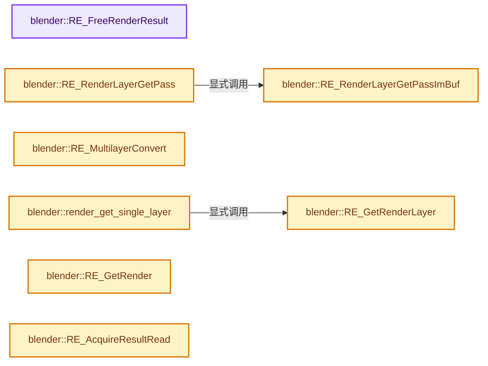
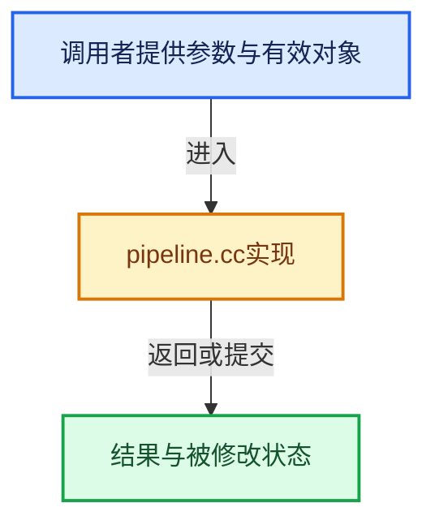

# 实现依赖专题：source/blender/render/intern/pipeline.cc

[方向导航](README.md) · [符号索引](../%E7%AC%A6%E5%8F%B7%E4%BE%9D%E8%B5%96%E4%B8%8E%E5%AE%9E%E7%8E%B0%E7%B4%A2%E5%BC%95.md)

本专题从正文实际调用进入，集中保存共享实现。函数有稳定锚点，可从调用处直接跳到对应完整函数；递归与互相调用通过回链组织。

## 本文件的实现关系






## 完整成员与函数实现

<a id="f-1c0991e0bb79fe25"></a>

### `blender::RE_FreeRenderResult`

实现位置：[source/blender/render/intern/pipeline.cc](../../../../../source/blender/render/intern/pipeline.cc) · L232—L235。

接口参数：

- `RenderResult *rr`

**教学注释版**

<!-- annotated:72c43701306bf2 -->

```cpp
void RE_FreeRenderResult(RenderResult *rr)
{
  render_result_free(rr);
}
```

<details>
<summary>核对原始源码：source/blender/render/intern/pipeline.cc · L232—L235</summary>

<!-- original:72c43701306bf2:source/blender/render/intern/pipeline.cc:232:235 -->

```cpp
void RE_FreeRenderResult(RenderResult *rr)
{
  render_result_free(rr);
}
```

</details>

**继续追踪实现**

- `render_result_free` → [blender::render_result_free · L65](%E4%BE%9D%E8%B5%96-render_result-8cc813.md#f-ee9de2547c9f9bc9)。

<a id="f-59dc32f25a302596"></a>

### `blender::RE_RenderLayerGetPassImBuf`

实现位置：[source/blender/render/intern/pipeline.cc](../../../../../source/blender/render/intern/pipeline.cc) · L237—L241。

接口参数：

- `RenderLayer *rl`
- `const char *name`
- `const char *viewname`

**教学注释版**

<!-- annotated:469990f770f1b2 -->

```cpp
ImBuf *RE_RenderLayerGetPassImBuf(RenderLayer *rl, const char *name, const char *viewname)
{
  RenderPass *rpass = RE_pass_find_by_name(rl, name, viewname);
  return rpass ? rpass->ibuf : nullptr;
}
```

<details>
<summary>核对原始源码：source/blender/render/intern/pipeline.cc · L237—L241</summary>

<!-- original:469990f770f1b2:source/blender/render/intern/pipeline.cc:237:241 -->

```cpp
ImBuf *RE_RenderLayerGetPassImBuf(RenderLayer *rl, const char *name, const char *viewname)
{
  RenderPass *rpass = RE_pass_find_by_name(rl, name, viewname);
  return rpass ? rpass->ibuf : nullptr;
}
```

</details>

**结果出口**

- `return rpass ? rpass->ibuf : nullptr;`

**继续追踪实现**

- `RE_pass_find_by_name` → [blender::RE_pass_find_by_name · L2891](%E4%BE%9D%E8%B5%96-pipeline-340e5b.md#f-a7386bb28c89daf6)。

<a id="f-e04ae8eebc5a9f52"></a>

### `blender::RE_RenderLayerGetPass`

实现位置：[source/blender/render/intern/pipeline.cc](../../../../../source/blender/render/intern/pipeline.cc) · L243—L247。

接口参数：

- `RenderLayer *rl`
- `const char *name`
- `const char *viewname`

**教学注释版**

<!-- annotated:9455f619449312 -->

```cpp
float *RE_RenderLayerGetPass(RenderLayer *rl, const char *name, const char *viewname)
{
  ImBuf *ibuf = RE_RenderLayerGetPassImBuf(rl, name, viewname);
  return ibuf ? ibuf->float_data_for_write() : nullptr;
}
```

<details>
<summary>核对原始源码：source/blender/render/intern/pipeline.cc · L243—L247</summary>

<!-- original:9455f619449312:source/blender/render/intern/pipeline.cc:243:247 -->

```cpp
float *RE_RenderLayerGetPass(RenderLayer *rl, const char *name, const char *viewname)
{
  ImBuf *ibuf = RE_RenderLayerGetPassImBuf(rl, name, viewname);
  return ibuf ? ibuf->float_data_for_write() : nullptr;
}
```

</details>

**结果出口**

- `return ibuf ? ibuf->float_data_for_write() : nullptr;`

**继续追踪实现**

- `RE_RenderLayerGetPassImBuf` → [blender::RE_RenderLayerGetPassImBuf · L237](%E4%BE%9D%E8%B5%96-pipeline-340e5b.md#f-59dc32f25a302596)。
- `ibuf->float_data_for_write` → [blender::ImBuf::float_data_for_write · L79](%E4%BE%9D%E8%B5%96-allocimbuf-bc68dd.md#f-1956ac4db88ed3eb)。

<a id="f-96213b04c74f7e5d"></a>

### `blender::RE_GetRenderLayer`

实现位置：[source/blender/render/intern/pipeline.cc](../../../../../source/blender/render/intern/pipeline.cc) · L249—L257。

接口参数：

- `RenderResult *rr`
- `const char *name`

**教学注释版**

<!-- annotated:0ba848e3a150d7 -->

```cpp
RenderLayer *RE_GetRenderLayer(RenderResult *rr, const char *name)
{
  if (rr == nullptr) {
    return nullptr;
  }

  return static_cast<RenderLayer *>(
      BLI_findstring(&rr->layers, name, offsetof(RenderLayer, name)));
}
```

<details>
<summary>核对原始源码：source/blender/render/intern/pipeline.cc · L249—L257</summary>

<!-- original:0ba848e3a150d7:source/blender/render/intern/pipeline.cc:249:257 -->

```cpp
RenderLayer *RE_GetRenderLayer(RenderResult *rr, const char *name)
{
  if (rr == nullptr) {
    return nullptr;
  }

  return static_cast<RenderLayer *>(
      BLI_findstring(&rr->layers, name, offsetof(RenderLayer, name)));
}
```

</details>

**结果出口**

- `return nullptr;`
- `return static_cast<RenderLayer *>(`

**继续追踪实现**

- `BLI_findstring` → [blender::BLI_findstring · L615](../01-%E5%9F%BA%E7%A1%80%E5%AE%B9%E5%99%A8%E4%B8%8E%E7%8E%B0%E4%BB%A3CPP/%E4%BE%9D%E8%B5%96-listbase-2816d9.md#f-d913b13b2651348e)。

<a id="f-389a51cf663dc96a"></a>

### `blender::RE_MultilayerConvert`

实现位置：[source/blender/render/intern/pipeline.cc](../../../../../source/blender/render/intern/pipeline.cc) · L264—L268。

接口参数：

- `ExrReadHandle *exrhandle`
- `const char *colorspace`
- `bool predivide`
- `int rectx`
- `int recty`

**教学注释版**

<!-- annotated:d7e2cc56d583e4 -->

```cpp
RenderResult *RE_MultilayerConvert(
    ExrReadHandle *exrhandle, const char *colorspace, bool predivide, int rectx, int recty)
{
  return render_result_new_from_exr(exrhandle, colorspace, predivide, rectx, recty);
}
```

<details>
<summary>核对原始源码：source/blender/render/intern/pipeline.cc · L264—L268</summary>

<!-- original:d7e2cc56d583e4:source/blender/render/intern/pipeline.cc:264:268 -->

```cpp
RenderResult *RE_MultilayerConvert(
    ExrReadHandle *exrhandle, const char *colorspace, bool predivide, int rectx, int recty)
{
  return render_result_new_from_exr(exrhandle, colorspace, predivide, rectx, recty);
}
```

</details>

**结果出口**

- `return render_result_new_from_exr(exrhandle, colorspace, predivide, rectx, recty);`

**继续追踪实现**

- `render_result_new_from_exr` → [blender::render_result_new_from_exr · L590](%E4%BE%9D%E8%B5%96-render_result-8cc813.md#f-d62c789367198f3f)。

<a id="f-7c41acb0cbe00d0b"></a>

### `blender::render_get_single_layer`

实现位置：[source/blender/render/intern/pipeline.cc](../../../../../source/blender/render/intern/pipeline.cc) · L270—L281。

接口参数：

- `Render *re`
- `RenderResult *rr`

**教学注释版**

<!-- annotated:9f1e3ca77e33df -->

```cpp
RenderLayer *render_get_single_layer(Render *re, RenderResult *rr)
{
  if (re->single_view_layer[0]) {
    RenderLayer *rl = RE_GetRenderLayer(rr, re->single_view_layer);

    if (rl) {
      return rl;
    }
  }

  return rr->layers.first();
}
```

<details>
<summary>核对原始源码：source/blender/render/intern/pipeline.cc · L270—L281</summary>

<!-- original:9f1e3ca77e33df:source/blender/render/intern/pipeline.cc:270:281 -->

```cpp
RenderLayer *render_get_single_layer(Render *re, RenderResult *rr)
{
  if (re->single_view_layer[0]) {
    RenderLayer *rl = RE_GetRenderLayer(rr, re->single_view_layer);

    if (rl) {
      return rl;
    }
  }

  return rr->layers.first();
}
```

</details>

**结果出口**

- `return rl;`
- `return rr->layers.first();`

**继续追踪实现**

- `RE_GetRenderLayer` → [blender::RE_GetRenderLayer · L249](%E4%BE%9D%E8%B5%96-pipeline-340e5b.md#f-96213b04c74f7e5d)。
- `rr->layers.first` → [调用协议](../%E6%A8%A1%E6%9D%BF%E5%AE%8F%E4%B8%8E%E5%8A%A8%E6%80%81%E5%88%86%E6%B4%BE%E5%8D%8F%E8%AE%AE.md)：接收对象类型依赖auto、返回值或模板实例；不按同名猜测目标。调用位置L280。

<a id="f-f57303b1ed01f30e"></a>

### `blender::RE_GetRender`

实现位置：[source/blender/render/intern/pipeline.cc](../../../../../source/blender/render/intern/pipeline.cc) · L303—L313。

接口参数：

- `const void *owner`

**教学注释版**

<!-- annotated:32491905a20304 -->

```cpp
Render *RE_GetRender(const void *owner)
{
  /* search for existing renders */
  for (Render *re : RenderGlobal.render_list) {
    if (re->owner == owner) {
      return re;
    }
  }

  return nullptr;
}
```

<details>
<summary>核对原始源码：source/blender/render/intern/pipeline.cc · L303—L313</summary>

<!-- original:32491905a20304:source/blender/render/intern/pipeline.cc:303:313 -->

```cpp
Render *RE_GetRender(const void *owner)
{
  /* search for existing renders */
  for (Render *re : RenderGlobal.render_list) {
    if (re->owner == owner) {
      return re;
    }
  }

  return nullptr;
}
```

</details>

**结果出口**

- `return re;`
- `return nullptr;`

**继续追踪实现**

本实现没有需要继续展开的显式调用；检查返回表达式、对象转换和调用者前置条件。

<a id="f-532195deb597de61"></a>

### `blender::RE_AcquireResultRead`

实现位置：[source/blender/render/intern/pipeline.cc](../../../../../source/blender/render/intern/pipeline.cc) · L315—L323。

接口参数：

- `Render *re`

**教学注释版**

<!-- annotated:eb9727f4e75e88 -->

```cpp
RenderResult *RE_AcquireResultRead(Render *re)
{
  if (re) {
    BLI_rw_mutex_lock(&re->resultmutex, THREAD_LOCK_READ);
    return re->result;
  }

  return nullptr;
}
```

<details>
<summary>核对原始源码：source/blender/render/intern/pipeline.cc · L315—L323</summary>

<!-- original:eb9727f4e75e88:source/blender/render/intern/pipeline.cc:315:323 -->

```cpp
RenderResult *RE_AcquireResultRead(Render *re)
{
  if (re) {
    BLI_rw_mutex_lock(&re->resultmutex, THREAD_LOCK_READ);
    return re->result;
  }

  return nullptr;
}
```

</details>

**结果出口**

- `return re->result;`
- `return nullptr;`

**继续追踪实现**

- `BLI_rw_mutex_lock` → [BLI_rw_mutex_lock · L470](../01-%E5%9F%BA%E7%A1%80%E5%AE%B9%E5%99%A8%E4%B8%8E%E7%8E%B0%E4%BB%A3CPP/%E4%BE%9D%E8%B5%96-threads-a036bf.md#f-567e78db2b1a0d53)。

<a id="f-9b9e72395c5a05ff"></a>

### `blender::RE_AcquireResultWrite`

实现位置：[source/blender/render/intern/pipeline.cc](../../../../../source/blender/render/intern/pipeline.cc) · L325—L334。

接口参数：

- `Render *re`

**教学注释版**

<!-- annotated:298342cb2e9fc7 -->

```cpp
RenderResult *RE_AcquireResultWrite(Render *re)
{
  if (re) {
    BLI_rw_mutex_lock(&re->resultmutex, THREAD_LOCK_WRITE);
    render_result_passes_allocated_ensure(re->result);
    return re->result;
  }

  return nullptr;
}
```

<details>
<summary>核对原始源码：source/blender/render/intern/pipeline.cc · L325—L334</summary>

<!-- original:298342cb2e9fc7:source/blender/render/intern/pipeline.cc:325:334 -->

```cpp
RenderResult *RE_AcquireResultWrite(Render *re)
{
  if (re) {
    BLI_rw_mutex_lock(&re->resultmutex, THREAD_LOCK_WRITE);
    render_result_passes_allocated_ensure(re->result);
    return re->result;
  }

  return nullptr;
}
```

</details>

**结果出口**

- `return re->result;`
- `return nullptr;`

**继续追踪实现**

- `BLI_rw_mutex_lock` → [BLI_rw_mutex_lock · L470](../01-%E5%9F%BA%E7%A1%80%E5%AE%B9%E5%99%A8%E4%B8%8E%E7%8E%B0%E4%BB%A3CPP/%E4%BE%9D%E8%B5%96-threads-a036bf.md#f-567e78db2b1a0d53)。
- `render_result_passes_allocated_ensure` → [blender::render_result_passes_allocated_ensure · L351](%E4%BE%9D%E8%B5%96-render_result-8cc813.md#f-930e96366bcc8ebd)。

<a id="f-0f9ec0b05735f99c"></a>

### `blender::RE_ReleaseResult`

实现位置：[source/blender/render/intern/pipeline.cc](../../../../../source/blender/render/intern/pipeline.cc) · L353—L358。

接口参数：

- `Render *re`

**教学注释版**

<!-- annotated:10cd353d7753d4 -->

```cpp
void RE_ReleaseResult(Render *re)
{
  if (re) {
    BLI_rw_mutex_unlock(&re->resultmutex);
  }
}
```

<details>
<summary>核对原始源码：source/blender/render/intern/pipeline.cc · L353—L358</summary>

<!-- original:10cd353d7753d4:source/blender/render/intern/pipeline.cc:353:358 -->

```cpp
void RE_ReleaseResult(Render *re)
{
  if (re) {
    BLI_rw_mutex_unlock(&re->resultmutex);
  }
}
```

</details>

**继续追踪实现**

- `BLI_rw_mutex_unlock` → [BLI_rw_mutex_unlock · L480](../01-%E5%9F%BA%E7%A1%80%E5%AE%B9%E5%99%A8%E4%B8%8E%E7%8E%B0%E4%BB%A3CPP/%E4%BE%9D%E8%B5%96-threads-a036bf.md#f-2b8f406eaca6d7b7)。

<a id="f-00f400d6d6797ef9"></a>

### `blender::RE_SetScene`

实现位置：[source/blender/render/intern/pipeline.cc](../../../../../source/blender/render/intern/pipeline.cc) · L368—L373。

接口参数：

- `Render *re`
- `Scene *sce`

**教学注释版**

<!-- annotated:fce7945e457705 -->

```cpp
void RE_SetScene(Render *re, Scene *sce)
{
  if (re) {
    re->scene = sce;
  }
}
```

<details>
<summary>核对原始源码：source/blender/render/intern/pipeline.cc · L368—L373</summary>

<!-- original:fce7945e457705:source/blender/render/intern/pipeline.cc:368:373 -->

```cpp
void RE_SetScene(Render *re, Scene *sce)
{
  if (re) {
    re->scene = sce;
  }
}
```

</details>

**沿实际写入检查状态**

- `re->scene = sce;`

**继续追踪实现**

本实现没有需要继续展开的显式调用；检查返回表达式、对象转换和调用者前置条件。

<a id="f-f44a9cbfeeb3d423"></a>

### `blender::RE_AcquireResultImageViews`

实现位置：[source/blender/render/intern/pipeline.cc](../../../../../source/blender/render/intern/pipeline.cc) · L375—L412。

接口参数：

- `Render *re`
- `RenderResult *rr`

**教学注释版**

<!-- annotated:a0408cc7ecc65c -->

```cpp
void RE_AcquireResultImageViews(Render *re, RenderResult *rr)
{
  *rr = RenderResult();

  if (re) {
    BLI_rw_mutex_lock(&re->resultmutex, THREAD_LOCK_READ);

    if (re->result) {
      rr->rectx = re->result->rectx;
      rr->recty = re->result->recty;

      copy_v2_v2_db(rr->ppm, re->result->ppm);

      /* creates a temporary duplication of views */
      render_result_views_shallowcopy(rr, re->result);

      RenderView *rv = rr->views.first();
      rr->have_combined = (rv->ibuf != nullptr);

      /* single layer */
      RenderLayer *rl = render_get_single_layer(re, re->result);

      /* The render result uses shallow initialization, and the caller is not expected to
       * explicitly free it. So simply assign the buffers as a shallow copy here as well. */

      if (rl) {
        if (rv->ibuf == nullptr) {
          for (RenderView &rview : rr->views) {
            rview.ibuf = RE_RenderLayerGetPassImBuf(rl, RE_PASSNAME_COMBINED, rview.name);
          }
        }
      }

      rr->layers = re->result->layers;
      rr->stamp_data = re->result->stamp_data;
    }
  }
}
```

<details>
<summary>核对原始源码：source/blender/render/intern/pipeline.cc · L375—L412</summary>

<!-- original:a0408cc7ecc65c:source/blender/render/intern/pipeline.cc:375:412 -->

```cpp
void RE_AcquireResultImageViews(Render *re, RenderResult *rr)
{
  *rr = RenderResult();

  if (re) {
    BLI_rw_mutex_lock(&re->resultmutex, THREAD_LOCK_READ);

    if (re->result) {
      rr->rectx = re->result->rectx;
      rr->recty = re->result->recty;

      copy_v2_v2_db(rr->ppm, re->result->ppm);

      /* creates a temporary duplication of views */
      render_result_views_shallowcopy(rr, re->result);

      RenderView *rv = rr->views.first();
      rr->have_combined = (rv->ibuf != nullptr);

      /* single layer */
      RenderLayer *rl = render_get_single_layer(re, re->result);

      /* The render result uses shallow initialization, and the caller is not expected to
       * explicitly free it. So simply assign the buffers as a shallow copy here as well. */

      if (rl) {
        if (rv->ibuf == nullptr) {
          for (RenderView &rview : rr->views) {
            rview.ibuf = RE_RenderLayerGetPassImBuf(rl, RE_PASSNAME_COMBINED, rview.name);
          }
        }
      }

      rr->layers = re->result->layers;
      rr->stamp_data = re->result->stamp_data;
    }
  }
}
```

</details>

**沿实际写入检查状态**

- `rr->rectx = re->result->rectx;`
- `rr->recty = re->result->recty;`
- `rr->have_combined = (rv->ibuf != nullptr);`
- `rview.ibuf = RE_RenderLayerGetPassImBuf(rl, RE_PASSNAME_COMBINED, rview.name);`
- `rr->layers = re->result->layers;`
- `rr->stamp_data = re->result->stamp_data;`

**继续追踪实现**

- `RenderResult` → [blender::RenderResult](%E4%BE%9D%E8%B5%96-prefetch-f1454a.md#t-9e0b2b56afb9)；[blender::RenderResult](%E4%BE%9D%E8%B5%96-RE_pipeline-65f431.md#t-8ff75565da18)；[blender::RenderResult](%E4%BE%9D%E8%B5%96-RE_pipeline-65f431.md#t-84d949508520)；[blender::RenderResult::RenderResult](%E4%BE%9D%E8%B5%96-RE_pipeline-65f431.md#t-72e14c60c58c)；[blender::RenderResult](%E4%BE%9D%E8%B5%96-RE_pipeline-65f431.md#t-f433c3f2af06)；[blender::RenderResult](%E4%BE%9D%E8%B5%96-RE_pipeline-65f431.md#t-058762f937b4)；[blender::RenderResult](%E4%BE%9D%E8%B5%96-RE_pipeline-65f431.md#t-70e9d825ee41)；[blender::RenderResult](%E4%BE%9D%E8%B5%96-RE_pipeline-65f431.md#t-162d1b06922f)；[blender::RenderResult](%E4%BE%9D%E8%B5%96-RE_pipeline-65f431.md#t-9c4fb7a6809e)；[blender::RenderResult](%E4%BE%9D%E8%B5%96-RE_pipeline-65f431.md#t-3ed440b1b0ea)；[blender::RenderResult](%E4%BE%9D%E8%B5%96-RE_pipeline-65f431.md#t-80ed9776dce2)；[blender::RenderResult](%E4%BE%9D%E8%B5%96-RE_pipeline-65f431.md#t-7e39b6bff6f5)；[blender::RenderResult](%E4%BE%9D%E8%B5%96-RE_pipeline-65f431.md#t-0e96157f2f21)；[blender::RenderResult](%E4%BE%9D%E8%B5%96-RE_pipeline-65f431.md#t-19a1b304cc84)；[blender::RenderResult](%E4%BE%9D%E8%B5%96-RE_pipeline-65f431.md#t-16b5d7af1e1d)；[blender::RenderResult](%E4%BE%9D%E8%B5%96-RE_pipeline-65f431.md#t-33d11811ca6c)；[blender::RenderResult](%E4%BE%9D%E8%B5%96-RE_pipeline-65f431.md#t-4fba0c79749c)；[blender::RenderResult](%E4%BE%9D%E8%B5%96-RE_pipeline-65f431.md#t-cb1646fe982b)；[blender::RenderResult](%E4%BE%9D%E8%B5%96-RE_pipeline-65f431.md#t-e8a9f362dc1f)；[blender::RenderResult](%E4%BE%9D%E8%B5%96-RE_pipeline-65f431.md#t-c551b2723497)；[blender::RenderResult](%E4%BE%9D%E8%B5%96-RE_pipeline-65f431.md#t-9c499f6bcdfc)；[blender::RenderResult](%E4%BE%9D%E8%B5%96-RE_pipeline-65f431.md#t-a8a3172a671f)；[blender::RenderResult](%E4%BE%9D%E8%B5%96-RE_pipeline-65f431.md#t-e00efa15648c)；[blender::RenderResult](%E4%BE%9D%E8%B5%96-RE_engine-1717fd.md#t-45dc7f5625af)；[blender::RenderResult](%E4%BE%9D%E8%B5%96-RE_engine-1717fd.md#t-3f2fbae88578)；[blender::RenderResult](%E4%BE%9D%E8%B5%96-RE_engine-1717fd.md#t-9ff6b87f71e7)；[blender::RenderResult](%E4%BE%9D%E8%B5%96-RE_engine-1717fd.md#t-82ebb19657af)；[blender::RenderResult](%E4%BE%9D%E8%B5%96-RE_engine-1717fd.md#t-f9d5ae50dc1a)；[blender::RenderResult](%E4%BE%9D%E8%B5%96-RE_engine-1717fd.md#t-bd6bb70bce36)；[blender::RenderResult](%E4%BE%9D%E8%B5%96-tile_highlight-cc5a47.md#t-fb1a94a57511)；[blender::RenderResult](%E4%BE%9D%E8%B5%96-render_result-617dfa.md#t-ede9f87e01f5)；[blender::RenderResult](%E4%BE%9D%E8%B5%96-render_result-617dfa.md#t-c2c5b02dc7bb)；[blender::RenderResult](%E4%BE%9D%E8%B5%96-render_result-617dfa.md#t-75333e50b778)；[blender::RenderResult](%E4%BE%9D%E8%B5%96-render_result-617dfa.md#t-7ca5d8f3de46)；[blender::RenderResult](%E4%BE%9D%E8%B5%96-render_result-617dfa.md#t-5862974b859f)；[blender::RenderResult](%E4%BE%9D%E8%B5%96-render_result-617dfa.md#t-bb339516e931)；[blender::RenderResult](%E4%BE%9D%E8%B5%96-render_result-617dfa.md#t-3296d0792ce7)；[blender::RenderResult](%E4%BE%9D%E8%B5%96-render_result-617dfa.md#t-3296d0792ce7)；[blender::RenderResult](%E4%BE%9D%E8%B5%96-render_result-617dfa.md#t-c58b10f54114)；[blender::RenderResult](%E4%BE%9D%E8%B5%96-render_result-617dfa.md#t-49363be57849)；[blender::RenderResult](%E4%BE%9D%E8%B5%96-render_result-617dfa.md#t-4a8e51805a94)；[blender::RenderResult](%E4%BE%9D%E8%B5%96-render_result-617dfa.md#t-09b66e48bdbe)；[blender::RenderResult](%E4%BE%9D%E8%B5%96-render_result-617dfa.md#t-0059671169f6)；[blender::RenderResult](%E4%BE%9D%E8%B5%96-render_result-617dfa.md#t-f6c1e045cec6)；[blender::RenderResult](%E4%BE%9D%E8%B5%96-render_result-617dfa.md#t-083968d4fc57)；[blender::RenderResult](%E4%BE%9D%E8%B5%96-render_result-617dfa.md#t-8ff3e8c66449)；[blender::RenderResult](%E4%BE%9D%E8%B5%96-render_result-617dfa.md#t-00399139f631)；[blender::RenderResult](%E4%BE%9D%E8%B5%96-render_result-617dfa.md#t-00399139f631)；[blender::RenderResult](%E4%BE%9D%E8%B5%96-render_result-617dfa.md#t-e07c3c95f5f0)；[blender::RenderResult](%E4%BE%9D%E8%B5%96-render_result-617dfa.md#t-b0a8dae5c376)；[blender::RenderResult](%E4%BE%9D%E8%B5%96-pipeline-111fd4.md#t-9439ca03c0a5)；[blender::RenderResult](%E4%BE%9D%E8%B5%96-BKE_image_save-03ca2c.md#t-aa36ec9ddb9a)；[blender::RenderResult](%E4%BE%9D%E8%B5%96-BKE_image-10b63f.md#t-88c86ad83429)；[blender::RenderResult](%E4%BE%9D%E8%B5%96-BKE_image-10b63f.md#t-d533d14cc06b)；[blender::RenderResult](%E4%BE%9D%E8%B5%96-BKE_cryptomatte-b220b9.md#t-803c1ff40f3d)；[blender::RenderResult](%E4%BE%9D%E8%B5%96-BKE_cryptomatte-b220b9.md#t-2e6e174dfbbe)；[blender::RenderResult](%E4%BE%9D%E8%B5%96-BKE_cryptomatte-b220b9.md#t-d59dcca910ca)；[blender::RenderResult](%E4%BE%9D%E8%B5%96-DRW_render-2c5210.md#t-64f637499984)；[blender::RenderResult](%E4%BE%9D%E8%B5%96-DNA_image_types-447487.md#t-13c34fbdad51)；[blender::RenderSlot::RenderResult](%E4%BE%9D%E8%B5%96-DNA_image_types-447487.md#t-267c0c358f50)；[blender::Image::RenderResult](%E4%BE%9D%E8%B5%96-DNA_image_types-447487.md#t-bddf26b23dfb)；[blender::RenderResult](%E4%BE%9D%E8%B5%96-COM_render_context-c3f0a8.md#t-3a7d025a85a6)。
- `BLI_rw_mutex_lock` → [BLI_rw_mutex_lock · L470](../01-%E5%9F%BA%E7%A1%80%E5%AE%B9%E5%99%A8%E4%B8%8E%E7%8E%B0%E4%BB%A3CPP/%E4%BE%9D%E8%B5%96-threads-a036bf.md#f-567e78db2b1a0d53)。
- `copy_v2_v2_db` → [blender::copy_v2_v2_db · L152](../12-%E7%A9%BA%E9%97%B4%E6%95%B0%E6%8D%AE%E7%BB%93%E6%9E%84%E4%B8%8E%E5%87%A0%E4%BD%95%E7%AE%97%E6%B3%95/%E4%BE%9D%E8%B5%96-math_vector_inline-0c8541.md#f-4117eb991b478458)。
- `render_result_views_shallowcopy` → [blender::render_result_views_shallowcopy · L140](%E4%BE%9D%E8%B5%96-render_result-8cc813.md#f-5af3543ebb732b61)。
- `rr->views.first` → [调用协议](../%E6%A8%A1%E6%9D%BF%E5%AE%8F%E4%B8%8E%E5%8A%A8%E6%80%81%E5%88%86%E6%B4%BE%E5%8D%8F%E8%AE%AE.md)：接收对象类型依赖auto、返回值或模板实例；不按同名猜测目标。调用位置L391。
- `render_get_single_layer` → [blender::render_get_single_layer · L270](%E4%BE%9D%E8%B5%96-pipeline-340e5b.md#f-7c41acb0cbe00d0b)。
- `RE_RenderLayerGetPassImBuf` → [blender::RE_RenderLayerGetPassImBuf · L237](%E4%BE%9D%E8%B5%96-pipeline-340e5b.md#f-59dc32f25a302596)。

<a id="f-aaff6bcd834d3471"></a>

### `blender::RE_ReleaseResultImageViews`

实现位置：[source/blender/render/intern/pipeline.cc](../../../../../source/blender/render/intern/pipeline.cc) · L414—L422。

接口参数：

- `Render *re`
- `RenderResult *rr`

**教学注释版**

<!-- annotated:f1583c17cf8e74 -->

```cpp
void RE_ReleaseResultImageViews(Render *re, RenderResult *rr)
{
  if (re) {
    if (rr) {
      render_result_views_shallowdelete(rr);
    }
    BLI_rw_mutex_unlock(&re->resultmutex);
  }
}
```

<details>
<summary>核对原始源码：source/blender/render/intern/pipeline.cc · L414—L422</summary>

<!-- original:f1583c17cf8e74:source/blender/render/intern/pipeline.cc:414:422 -->

```cpp
void RE_ReleaseResultImageViews(Render *re, RenderResult *rr)
{
  if (re) {
    if (rr) {
      render_result_views_shallowdelete(rr);
    }
    BLI_rw_mutex_unlock(&re->resultmutex);
  }
}
```

</details>

**继续追踪实现**

- `render_result_views_shallowdelete` → [blender::render_result_views_shallowdelete · L158](%E4%BE%9D%E8%B5%96-render_result-8cc813.md#f-4826f18fb4a6ef6b)。
- `BLI_rw_mutex_unlock` → [BLI_rw_mutex_unlock · L480](../01-%E5%9F%BA%E7%A1%80%E5%AE%B9%E5%99%A8%E4%B8%8E%E7%8E%B0%E4%BB%A3CPP/%E4%BE%9D%E8%B5%96-threads-a036bf.md#f-2b8f406eaca6d7b7)。

<a id="f-c5ddb39c773d9ca7"></a>

### `blender::RE_AcquireResultImage`

实现位置：[source/blender/render/intern/pipeline.cc](../../../../../source/blender/render/intern/pipeline.cc) · L424—L464。

接口参数：

- `Render *re`
- `RenderResult *rr`
- `const int view_id`

**教学注释版**

<!-- annotated:742d7ca5dea70c -->

```cpp
void RE_AcquireResultImage(Render *re, RenderResult *rr, const int view_id)
{
  *rr = RenderResult();

  if (re) {
    BLI_rw_mutex_lock(&re->resultmutex, THREAD_LOCK_READ);

    if (re->result) {
      RenderLayer *rl;
      RenderView *rv;

      rr->rectx = re->result->rectx;
      rr->recty = re->result->recty;

      copy_v2_v2_db(rr->ppm, re->result->ppm);

      /* `scene.rd.actview` view. */
      rv = RE_RenderViewGetById(re->result, view_id);
      rr->have_combined = (rv->ibuf != nullptr);

      /* The render result uses shallow initialization, and the caller is not expected to
       * explicitly free it. So simply assign the buffers as a shallow copy here as well.
       *
       * The thread safety is ensured via the `re->resultmutex`. */
      rr->ibuf = rv->ibuf;

      /* active layer */
      rl = render_get_single_layer(re, re->result);

      if (rl) {
        if (rv->ibuf == nullptr) {
          rr->ibuf = RE_RenderLayerGetPassImBuf(rl, RE_PASSNAME_COMBINED, rv->name);
        }
      }

      rr->layers = re->result->layers;
      rr->views = re->result->views;
      rr->stamp_data = re->result->stamp_data;
    }
  }
}
```

<details>
<summary>核对原始源码：source/blender/render/intern/pipeline.cc · L424—L464</summary>

<!-- original:742d7ca5dea70c:source/blender/render/intern/pipeline.cc:424:464 -->

```cpp
void RE_AcquireResultImage(Render *re, RenderResult *rr, const int view_id)
{
  *rr = RenderResult();

  if (re) {
    BLI_rw_mutex_lock(&re->resultmutex, THREAD_LOCK_READ);

    if (re->result) {
      RenderLayer *rl;
      RenderView *rv;

      rr->rectx = re->result->rectx;
      rr->recty = re->result->recty;

      copy_v2_v2_db(rr->ppm, re->result->ppm);

      /* `scene.rd.actview` view. */
      rv = RE_RenderViewGetById(re->result, view_id);
      rr->have_combined = (rv->ibuf != nullptr);

      /* The render result uses shallow initialization, and the caller is not expected to
       * explicitly free it. So simply assign the buffers as a shallow copy here as well.
       *
       * The thread safety is ensured via the `re->resultmutex`. */
      rr->ibuf = rv->ibuf;

      /* active layer */
      rl = render_get_single_layer(re, re->result);

      if (rl) {
        if (rv->ibuf == nullptr) {
          rr->ibuf = RE_RenderLayerGetPassImBuf(rl, RE_PASSNAME_COMBINED, rv->name);
        }
      }

      rr->layers = re->result->layers;
      rr->views = re->result->views;
      rr->stamp_data = re->result->stamp_data;
    }
  }
}
```

</details>

**沿实际写入检查状态**

- `rr->rectx = re->result->rectx;`
- `rr->recty = re->result->recty;`
- `rv = RE_RenderViewGetById(re->result, view_id);`
- `rr->have_combined = (rv->ibuf != nullptr);`
- `rr->ibuf = rv->ibuf;`
- `rl = render_get_single_layer(re, re->result);`
- `rr->ibuf = RE_RenderLayerGetPassImBuf(rl, RE_PASSNAME_COMBINED, rv->name);`
- `rr->layers = re->result->layers;`
- `rr->views = re->result->views;`
- `rr->stamp_data = re->result->stamp_data;`

**继续追踪实现**

- `RenderResult` → [blender::RenderResult](%E4%BE%9D%E8%B5%96-prefetch-f1454a.md#t-9e0b2b56afb9)；[blender::RenderResult](%E4%BE%9D%E8%B5%96-RE_pipeline-65f431.md#t-8ff75565da18)；[blender::RenderResult](%E4%BE%9D%E8%B5%96-RE_pipeline-65f431.md#t-84d949508520)；[blender::RenderResult::RenderResult](%E4%BE%9D%E8%B5%96-RE_pipeline-65f431.md#t-72e14c60c58c)；[blender::RenderResult](%E4%BE%9D%E8%B5%96-RE_pipeline-65f431.md#t-f433c3f2af06)；[blender::RenderResult](%E4%BE%9D%E8%B5%96-RE_pipeline-65f431.md#t-058762f937b4)；[blender::RenderResult](%E4%BE%9D%E8%B5%96-RE_pipeline-65f431.md#t-70e9d825ee41)；[blender::RenderResult](%E4%BE%9D%E8%B5%96-RE_pipeline-65f431.md#t-162d1b06922f)；[blender::RenderResult](%E4%BE%9D%E8%B5%96-RE_pipeline-65f431.md#t-9c4fb7a6809e)；[blender::RenderResult](%E4%BE%9D%E8%B5%96-RE_pipeline-65f431.md#t-3ed440b1b0ea)；[blender::RenderResult](%E4%BE%9D%E8%B5%96-RE_pipeline-65f431.md#t-80ed9776dce2)；[blender::RenderResult](%E4%BE%9D%E8%B5%96-RE_pipeline-65f431.md#t-7e39b6bff6f5)；[blender::RenderResult](%E4%BE%9D%E8%B5%96-RE_pipeline-65f431.md#t-0e96157f2f21)；[blender::RenderResult](%E4%BE%9D%E8%B5%96-RE_pipeline-65f431.md#t-19a1b304cc84)；[blender::RenderResult](%E4%BE%9D%E8%B5%96-RE_pipeline-65f431.md#t-16b5d7af1e1d)；[blender::RenderResult](%E4%BE%9D%E8%B5%96-RE_pipeline-65f431.md#t-33d11811ca6c)；[blender::RenderResult](%E4%BE%9D%E8%B5%96-RE_pipeline-65f431.md#t-4fba0c79749c)；[blender::RenderResult](%E4%BE%9D%E8%B5%96-RE_pipeline-65f431.md#t-cb1646fe982b)；[blender::RenderResult](%E4%BE%9D%E8%B5%96-RE_pipeline-65f431.md#t-e8a9f362dc1f)；[blender::RenderResult](%E4%BE%9D%E8%B5%96-RE_pipeline-65f431.md#t-c551b2723497)；[blender::RenderResult](%E4%BE%9D%E8%B5%96-RE_pipeline-65f431.md#t-9c499f6bcdfc)；[blender::RenderResult](%E4%BE%9D%E8%B5%96-RE_pipeline-65f431.md#t-a8a3172a671f)；[blender::RenderResult](%E4%BE%9D%E8%B5%96-RE_pipeline-65f431.md#t-e00efa15648c)；[blender::RenderResult](%E4%BE%9D%E8%B5%96-RE_engine-1717fd.md#t-45dc7f5625af)；[blender::RenderResult](%E4%BE%9D%E8%B5%96-RE_engine-1717fd.md#t-3f2fbae88578)；[blender::RenderResult](%E4%BE%9D%E8%B5%96-RE_engine-1717fd.md#t-9ff6b87f71e7)；[blender::RenderResult](%E4%BE%9D%E8%B5%96-RE_engine-1717fd.md#t-82ebb19657af)；[blender::RenderResult](%E4%BE%9D%E8%B5%96-RE_engine-1717fd.md#t-f9d5ae50dc1a)；[blender::RenderResult](%E4%BE%9D%E8%B5%96-RE_engine-1717fd.md#t-bd6bb70bce36)；[blender::RenderResult](%E4%BE%9D%E8%B5%96-tile_highlight-cc5a47.md#t-fb1a94a57511)；[blender::RenderResult](%E4%BE%9D%E8%B5%96-render_result-617dfa.md#t-ede9f87e01f5)；[blender::RenderResult](%E4%BE%9D%E8%B5%96-render_result-617dfa.md#t-c2c5b02dc7bb)；[blender::RenderResult](%E4%BE%9D%E8%B5%96-render_result-617dfa.md#t-75333e50b778)；[blender::RenderResult](%E4%BE%9D%E8%B5%96-render_result-617dfa.md#t-7ca5d8f3de46)；[blender::RenderResult](%E4%BE%9D%E8%B5%96-render_result-617dfa.md#t-5862974b859f)；[blender::RenderResult](%E4%BE%9D%E8%B5%96-render_result-617dfa.md#t-bb339516e931)；[blender::RenderResult](%E4%BE%9D%E8%B5%96-render_result-617dfa.md#t-3296d0792ce7)；[blender::RenderResult](%E4%BE%9D%E8%B5%96-render_result-617dfa.md#t-3296d0792ce7)；[blender::RenderResult](%E4%BE%9D%E8%B5%96-render_result-617dfa.md#t-c58b10f54114)；[blender::RenderResult](%E4%BE%9D%E8%B5%96-render_result-617dfa.md#t-49363be57849)；[blender::RenderResult](%E4%BE%9D%E8%B5%96-render_result-617dfa.md#t-4a8e51805a94)；[blender::RenderResult](%E4%BE%9D%E8%B5%96-render_result-617dfa.md#t-09b66e48bdbe)；[blender::RenderResult](%E4%BE%9D%E8%B5%96-render_result-617dfa.md#t-0059671169f6)；[blender::RenderResult](%E4%BE%9D%E8%B5%96-render_result-617dfa.md#t-f6c1e045cec6)；[blender::RenderResult](%E4%BE%9D%E8%B5%96-render_result-617dfa.md#t-083968d4fc57)；[blender::RenderResult](%E4%BE%9D%E8%B5%96-render_result-617dfa.md#t-8ff3e8c66449)；[blender::RenderResult](%E4%BE%9D%E8%B5%96-render_result-617dfa.md#t-00399139f631)；[blender::RenderResult](%E4%BE%9D%E8%B5%96-render_result-617dfa.md#t-00399139f631)；[blender::RenderResult](%E4%BE%9D%E8%B5%96-render_result-617dfa.md#t-e07c3c95f5f0)；[blender::RenderResult](%E4%BE%9D%E8%B5%96-render_result-617dfa.md#t-b0a8dae5c376)；[blender::RenderResult](%E4%BE%9D%E8%B5%96-pipeline-111fd4.md#t-9439ca03c0a5)；[blender::RenderResult](%E4%BE%9D%E8%B5%96-BKE_image_save-03ca2c.md#t-aa36ec9ddb9a)；[blender::RenderResult](%E4%BE%9D%E8%B5%96-BKE_image-10b63f.md#t-88c86ad83429)；[blender::RenderResult](%E4%BE%9D%E8%B5%96-BKE_image-10b63f.md#t-d533d14cc06b)；[blender::RenderResult](%E4%BE%9D%E8%B5%96-BKE_cryptomatte-b220b9.md#t-803c1ff40f3d)；[blender::RenderResult](%E4%BE%9D%E8%B5%96-BKE_cryptomatte-b220b9.md#t-2e6e174dfbbe)；[blender::RenderResult](%E4%BE%9D%E8%B5%96-BKE_cryptomatte-b220b9.md#t-d59dcca910ca)；[blender::RenderResult](%E4%BE%9D%E8%B5%96-DRW_render-2c5210.md#t-64f637499984)；[blender::RenderResult](%E4%BE%9D%E8%B5%96-DNA_image_types-447487.md#t-13c34fbdad51)；[blender::RenderSlot::RenderResult](%E4%BE%9D%E8%B5%96-DNA_image_types-447487.md#t-267c0c358f50)；[blender::Image::RenderResult](%E4%BE%9D%E8%B5%96-DNA_image_types-447487.md#t-bddf26b23dfb)；[blender::RenderResult](%E4%BE%9D%E8%B5%96-COM_render_context-c3f0a8.md#t-3a7d025a85a6)。
- `BLI_rw_mutex_lock` → [BLI_rw_mutex_lock · L470](../01-%E5%9F%BA%E7%A1%80%E5%AE%B9%E5%99%A8%E4%B8%8E%E7%8E%B0%E4%BB%A3CPP/%E4%BE%9D%E8%B5%96-threads-a036bf.md#f-567e78db2b1a0d53)。
- `copy_v2_v2_db` → [blender::copy_v2_v2_db · L152](../12-%E7%A9%BA%E9%97%B4%E6%95%B0%E6%8D%AE%E7%BB%93%E6%9E%84%E4%B8%8E%E5%87%A0%E4%BD%95%E7%AE%97%E6%B3%95/%E4%BE%9D%E8%B5%96-math_vector_inline-0c8541.md#f-4117eb991b478458)。
- `RE_RenderViewGetById` → [blender::RE_RenderViewGetById · L1198](%E4%BE%9D%E8%B5%96-render_result-8cc813.md#f-16fcb74202917492)。
- `render_get_single_layer` → [blender::render_get_single_layer · L270](%E4%BE%9D%E8%B5%96-pipeline-340e5b.md#f-7c41acb0cbe00d0b)。
- `RE_RenderLayerGetPassImBuf` → [blender::RE_RenderLayerGetPassImBuf · L237](%E4%BE%9D%E8%B5%96-pipeline-340e5b.md#f-59dc32f25a302596)。

<a id="f-ea1fc4e7f9ffc6d1"></a>

### `blender::RE_ReleaseResultImage`

实现位置：[source/blender/render/intern/pipeline.cc](../../../../../source/blender/render/intern/pipeline.cc) · L466—L471。

接口参数：

- `Render *re`

**教学注释版**

<!-- annotated:10c001325a0b66 -->

```cpp
void RE_ReleaseResultImage(Render *re)
{
  if (re) {
    BLI_rw_mutex_unlock(&re->resultmutex);
  }
}
```

<details>
<summary>核对原始源码：source/blender/render/intern/pipeline.cc · L466—L471</summary>

<!-- original:10c001325a0b66:source/blender/render/intern/pipeline.cc:466:471 -->

```cpp
void RE_ReleaseResultImage(Render *re)
{
  if (re) {
    BLI_rw_mutex_unlock(&re->resultmutex);
  }
}
```

</details>

**继续追踪实现**

- `BLI_rw_mutex_unlock` → [BLI_rw_mutex_unlock · L480](../01-%E5%9F%BA%E7%A1%80%E5%AE%B9%E5%99%A8%E4%B8%8E%E7%8E%B0%E4%BB%A3CPP/%E4%BE%9D%E8%B5%96-threads-a036bf.md#f-2b8f406eaca6d7b7)。

<a id="f-646f3d2770e20a0a"></a>

### `blender::RE_ResultGet32`

实现位置：[source/blender/render/intern/pipeline.cc](../../../../../source/blender/render/intern/pipeline.cc) · L473—L487。

接口参数：

- `Render *re`
- `uint8_t *dst`

**教学注释版**

<!-- annotated:7fdf381cd5d7cb -->

```cpp
void RE_ResultGet32(Render *re, uint8_t *dst)
{
  RenderResult rres;
  const int view_id = BKE_scene_multiview_view_id_get(&re->r, re->viewname);

  RE_AcquireResultImageViews(re, &rres);
  render_result_rect_get_pixels(&rres,
                                dst,
                                re->rectx,
                                re->recty,
                                &re->scene->view_settings,
                                &re->scene->display_settings,
                                view_id);
  RE_ReleaseResultImageViews(re, &rres);
}
```

<details>
<summary>核对原始源码：source/blender/render/intern/pipeline.cc · L473—L487</summary>

<!-- original:7fdf381cd5d7cb:source/blender/render/intern/pipeline.cc:473:487 -->

```cpp
void RE_ResultGet32(Render *re, uint8_t *dst)
{
  RenderResult rres;
  const int view_id = BKE_scene_multiview_view_id_get(&re->r, re->viewname);

  RE_AcquireResultImageViews(re, &rres);
  render_result_rect_get_pixels(&rres,
                                dst,
                                re->rectx,
                                re->recty,
                                &re->scene->view_settings,
                                &re->scene->display_settings,
                                view_id);
  RE_ReleaseResultImageViews(re, &rres);
}
```

</details>

**继续追踪实现**

- `BKE_scene_multiview_view_id_get` → [blender::BKE_scene_multiview_view_id_get · L3345](%E4%BE%9D%E8%B5%96-scene-94f43c.md#f-4bf5631622aca64e)。
- `RE_AcquireResultImageViews` → [blender::RE_AcquireResultImageViews · L375](%E4%BE%9D%E8%B5%96-pipeline-340e5b.md#f-f44a9cbfeeb3d423)。
- `render_result_rect_get_pixels` → [blender::render_result_rect_get_pixels · L1125](%E4%BE%9D%E8%B5%96-render_result-8cc813.md#f-1aa04836cb8f7d87)。
- `RE_ReleaseResultImageViews` → [blender::RE_ReleaseResultImageViews · L414](%E4%BE%9D%E8%B5%96-pipeline-340e5b.md#f-aaff6bcd834d3471)。

<a id="f-1ac27f19c17229d6"></a>

### `blender::RE_NewRender`

实现位置：[source/blender/render/intern/pipeline.cc](../../../../../source/blender/render/intern/pipeline.cc) · L500—L517。

接口参数：

- `const void *owner`

**教学注释版**

<!-- annotated:6eaf08dc9067b1 -->

```cpp
Render *RE_NewRender(const void *owner)
{
  Render *re;

  /* only one render per name exists */
  re = RE_GetRender(owner);
  if (re == nullptr) {

    /* new render data struct */
    re = MEM_new<Render>("new render");
    RenderGlobal.render_list.push_front(re);
    re->owner = owner;
  }

  RE_display_init(re);

  return re;
}
```

<details>
<summary>核对原始源码：source/blender/render/intern/pipeline.cc · L500—L517</summary>

<!-- original:6eaf08dc9067b1:source/blender/render/intern/pipeline.cc:500:517 -->

```cpp
Render *RE_NewRender(const void *owner)
{
  Render *re;

  /* only one render per name exists */
  re = RE_GetRender(owner);
  if (re == nullptr) {

    /* new render data struct */
    re = MEM_new<Render>("new render");
    RenderGlobal.render_list.push_front(re);
    re->owner = owner;
  }

  RE_display_init(re);

  return re;
}
```

</details>

**沿实际写入检查状态**

- `re = RE_GetRender(owner);`
- `re = MEM_new<Render>("new render");`
- `re->owner = owner;`

**结果出口**

- `return re;`

**继续追踪实现**

- `RE_GetRender` → [blender::RE_GetRender · L303](%E4%BE%9D%E8%B5%96-pipeline-340e5b.md#f-f57303b1ed01f30e)。
- `MEM_new<Render>` → [MEM_new · L351](../03-%E5%86%85%E5%AD%98%E5%88%86%E9%85%8D%E4%B8%8E%E8%BF%90%E8%A1%8C%E6%97%B6%E7%B1%BB%E5%9E%8B/%E4%BE%9D%E8%B5%96-MEM_guardedalloc-b54eca.md#f-115f9b6784f89912)。
- `RenderGlobal.render_list.push_front` → [调用协议](../%E6%A8%A1%E6%9D%BF%E5%AE%8F%E4%B8%8E%E5%8A%A8%E6%80%81%E5%88%86%E6%B4%BE%E5%8D%8F%E8%AE%AE.md)：接收对象类型依赖auto、返回值或模板实例；不按同名猜测目标。调用位置L510。
- `RE_display_init` → [blender::RE_display_init · L940](%E4%BE%9D%E8%B5%96-pipeline-340e5b.md#f-770c9d9eaba9a903)。

<a id="f-340965d59b8103ee"></a>

### `blender::RE_GetSceneRender`

实现位置：[source/blender/render/intern/pipeline.cc](../../../../../source/blender/render/intern/pipeline.cc) · L526—L529。

接口参数：

- `const Scene *scene`

**教学注释版**

<!-- annotated:aedfe811957142 -->

```cpp
Render *RE_GetSceneRender(const Scene *scene)
{
  return RE_GetRender(DEG_get_original_id(&scene->id));
}
```

<details>
<summary>核对原始源码：source/blender/render/intern/pipeline.cc · L526—L529</summary>

<!-- original:aedfe811957142:source/blender/render/intern/pipeline.cc:526:529 -->

```cpp
Render *RE_GetSceneRender(const Scene *scene)
{
  return RE_GetRender(DEG_get_original_id(&scene->id));
}
```

</details>

**结果出口**

- `return RE_GetRender(DEG_get_original_id(&scene->id));`

**继续追踪实现**

- `RE_GetRender` → [blender::RE_GetRender · L303](%E4%BE%9D%E8%B5%96-pipeline-340e5b.md#f-f57303b1ed01f30e)。
- `DEG_get_original_id` → [blender::DEG_get_original_id · L303](../11-Depsgraph%E4%B8%8E%E5%B9%B6%E8%A1%8C%E4%BB%BB%E5%8A%A1%E7%B3%BB%E7%BB%9F/%E4%BE%9D%E8%B5%96-depsgraph_query-e8b1e4.md#f-1f63a05d72701296)；[blender::DEG_get_original_id · L308](../11-Depsgraph%E4%B8%8E%E5%B9%B6%E8%A1%8C%E4%BB%BB%E5%8A%A1%E7%B3%BB%E7%BB%9F/%E4%BE%9D%E8%B5%96-depsgraph_query-e8b1e4.md#f-0317557ec3e823ac)。同名重载需按实参类型选择。

<a id="f-45f9ccdefe880e91"></a>

### `blender::RE_FreeRender`

实现位置：[source/blender/render/intern/pipeline.cc](../../../../../source/blender/render/intern/pipeline.cc) · L547—L552。

接口参数：

- `Render *re`

**教学注释版**

<!-- annotated:8eccecf0d11a3e -->

```cpp
void RE_FreeRender(Render *re)
{
  RenderGlobal.render_list.remove(re);

  MEM_delete(re);
}
```

<details>
<summary>核对原始源码：source/blender/render/intern/pipeline.cc · L547—L552</summary>

<!-- original:8eccecf0d11a3e:source/blender/render/intern/pipeline.cc:547:552 -->

```cpp
void RE_FreeRender(Render *re)
{
  RenderGlobal.render_list.remove(re);

  MEM_delete(re);
}
```

</details>

**继续追踪实现**

- `RenderGlobal.render_list.remove` → [调用协议](../%E6%A8%A1%E6%9D%BF%E5%AE%8F%E4%B8%8E%E5%8A%A8%E6%80%81%E5%88%86%E6%B4%BE%E5%8D%8F%E8%AE%AE.md)：接收对象类型依赖auto、返回值或模板实例；不按同名猜测目标。调用位置L549。
- `MEM_delete` → [MEM_delete · L400](../03-%E5%86%85%E5%AD%98%E5%88%86%E9%85%8D%E4%B8%8E%E8%BF%90%E8%A1%8C%E6%97%B6%E7%B1%BB%E5%9E%8B/%E4%BE%9D%E8%B5%96-MEM_guardedalloc-b54eca.md#f-9049ffdd1682887c)。

<a id="f-f30a2e13c56238aa"></a>

### `blender::RE_FreeViewRender`

实现位置：[source/blender/render/intern/pipeline.cc](../../../../../source/blender/render/intern/pipeline.cc) · L554—L557。

接口参数：

- `ViewRender *view_render`

**教学注释版**

<!-- annotated:d68e41cdbea974 -->

```cpp
void RE_FreeViewRender(ViewRender *view_render)
{
  MEM_delete(view_render);
}
```

<details>
<summary>核对原始源码：source/blender/render/intern/pipeline.cc · L554—L557</summary>

<!-- original:d68e41cdbea974:source/blender/render/intern/pipeline.cc:554:557 -->

```cpp
void RE_FreeViewRender(ViewRender *view_render)
{
  MEM_delete(view_render);
}
```

</details>

**继续追踪实现**

- `MEM_delete` → [MEM_delete · L400](../03-%E5%86%85%E5%AD%98%E5%88%86%E9%85%8D%E4%B8%8E%E8%BF%90%E8%A1%8C%E6%97%B6%E7%B1%BB%E5%9E%8B/%E4%BE%9D%E8%B5%96-MEM_guardedalloc-b54eca.md#f-9049ffdd1682887c)。

<a id="f-f295a13222c228da"></a>

### `blender::re_free_persistent_data`

实现位置：[source/blender/render/intern/pipeline.cc](../../../../../source/blender/render/intern/pipeline.cc) · L710—L718。

接口参数：

- `Render *re`

**教学注释版**

<!-- annotated:2a0a1e691617a6 -->

```cpp
static void re_free_persistent_data(Render *re)
{
  /* If engine is currently rendering, just wait for it to be freed when it finishes rendering.
   */
  if (re->engine && !(re->engine->flag & RE_ENGINE_RENDERING)) {
    RE_engine_free(re->engine);
    re->engine = nullptr;
  }
}
```

<details>
<summary>核对原始源码：source/blender/render/intern/pipeline.cc · L710—L718</summary>

<!-- original:2a0a1e691617a6:source/blender/render/intern/pipeline.cc:710:718 -->

```cpp
static void re_free_persistent_data(Render *re)
{
  /* If engine is currently rendering, just wait for it to be freed when it finishes rendering.
   */
  if (re->engine && !(re->engine->flag & RE_ENGINE_RENDERING)) {
    RE_engine_free(re->engine);
    re->engine = nullptr;
  }
}
```

</details>

**沿实际写入检查状态**

- `re->engine = nullptr;`

**继续追踪实现**

- `RE_engine_free` → [blender::RE_engine_free · L170](%E4%BE%9D%E8%B5%96-engine-ac0ebe.md#f-30325d7527e2b3b7)。

<a id="f-744be12b767fcedf"></a>

### `blender::RE_FreePersistentData`

实现位置：[source/blender/render/intern/pipeline.cc](../../../../../source/blender/render/intern/pipeline.cc) · L720—L734。

接口参数：

- `const Scene *scene`

**教学注释版**

<!-- annotated:8033dc9b487a7e -->

```cpp
void RE_FreePersistentData(const Scene *scene)
{
  /* Render engines can be kept around for quick re-render, this clears all or one scene. */
  if (scene) {
    Render *re = RE_GetSceneRender(scene);
    if (re) {
      re_free_persistent_data(re);
    }
  }
  else {
    for (Render *re : RenderGlobal.render_list) {
      re_free_persistent_data(re);
    }
  }
}
```

<details>
<summary>核对原始源码：source/blender/render/intern/pipeline.cc · L720—L734</summary>

<!-- original:8033dc9b487a7e:source/blender/render/intern/pipeline.cc:720:734 -->

```cpp
void RE_FreePersistentData(const Scene *scene)
{
  /* Render engines can be kept around for quick re-render, this clears all or one scene. */
  if (scene) {
    Render *re = RE_GetSceneRender(scene);
    if (re) {
      re_free_persistent_data(re);
    }
  }
  else {
    for (Render *re : RenderGlobal.render_list) {
      re_free_persistent_data(re);
    }
  }
}
```

</details>

**继续追踪实现**

- `RE_GetSceneRender` → [blender::RE_GetSceneRender · L526](%E4%BE%9D%E8%B5%96-pipeline-340e5b.md#f-340965d59b8103ee)。
- `re_free_persistent_data` → [blender::re_free_persistent_data · L710](%E4%BE%9D%E8%B5%96-pipeline-340e5b.md#f-f295a13222c228da)。

<a id="f-08f10c6fc3104ff5"></a>

### `blender::re_init_resolution`

实现位置：[source/blender/render/intern/pipeline.cc](../../../../../source/blender/render/intern/pipeline.cc) · L742—L776。

接口参数：

- `Render *re`
- `Render *source`
- `int winx`
- `int winy`
- `const rcti *disprect`

**教学注释版**

<!-- annotated:6519ab0945f1b0 -->

```cpp
static void re_init_resolution(
    Render *re, Render *source, int winx, int winy, const rcti *disprect)
{
  re->winx = winx;
  re->winy = winy;
  if (source && (source->r.mode & R_BORDER)) {
    /* NOTE(@sergey): doesn't seem original bordered `disprect` is storing anywhere
     * after insertion on black happening in #do_render_engine(),
     * so for now simply re-calculate `disprect` using border from source renderer. */

    re->disprect.xmin = source->r.border.xmin * winx;
    re->disprect.xmax = source->r.border.xmax * winx;

    re->disprect.ymin = source->r.border.ymin * winy;
    re->disprect.ymax = source->r.border.ymax * winy;

    re->rectx = BLI_rcti_size_x(&re->disprect);
    re->recty = BLI_rcti_size_y(&re->disprect);

    /* copy border itself, since it could be used by external engines */
    re->r.border = source->r.border;
  }
  else if (disprect) {
    re->disprect = *disprect;
    re->rectx = BLI_rcti_size_x(&re->disprect);
    re->recty = BLI_rcti_size_y(&re->disprect);
  }
  else {
    re->disprect.xmin = re->disprect.ymin = 0;
    re->disprect.xmax = winx;
    re->disprect.ymax = winy;
    re->rectx = winx;
    re->recty = winy;
  }
}
```

<details>
<summary>核对原始源码：source/blender/render/intern/pipeline.cc · L742—L776</summary>

<!-- original:6519ab0945f1b0:source/blender/render/intern/pipeline.cc:742:776 -->

```cpp
static void re_init_resolution(
    Render *re, Render *source, int winx, int winy, const rcti *disprect)
{
  re->winx = winx;
  re->winy = winy;
  if (source && (source->r.mode & R_BORDER)) {
    /* NOTE(@sergey): doesn't seem original bordered `disprect` is storing anywhere
     * after insertion on black happening in #do_render_engine(),
     * so for now simply re-calculate `disprect` using border from source renderer. */

    re->disprect.xmin = source->r.border.xmin * winx;
    re->disprect.xmax = source->r.border.xmax * winx;

    re->disprect.ymin = source->r.border.ymin * winy;
    re->disprect.ymax = source->r.border.ymax * winy;

    re->rectx = BLI_rcti_size_x(&re->disprect);
    re->recty = BLI_rcti_size_y(&re->disprect);

    /* copy border itself, since it could be used by external engines */
    re->r.border = source->r.border;
  }
  else if (disprect) {
    re->disprect = *disprect;
    re->rectx = BLI_rcti_size_x(&re->disprect);
    re->recty = BLI_rcti_size_y(&re->disprect);
  }
  else {
    re->disprect.xmin = re->disprect.ymin = 0;
    re->disprect.xmax = winx;
    re->disprect.ymax = winy;
    re->rectx = winx;
    re->recty = winy;
  }
}
```

</details>

**沿实际写入检查状态**

- `re->winx = winx;`
- `re->winy = winy;`
- `re->disprect.xmin = source->r.border.xmin * winx;`
- `re->disprect.xmax = source->r.border.xmax * winx;`
- `re->disprect.ymin = source->r.border.ymin * winy;`
- `re->disprect.ymax = source->r.border.ymax * winy;`
- `re->rectx = BLI_rcti_size_x(&re->disprect);`
- `re->recty = BLI_rcti_size_y(&re->disprect);`
- `re->r.border = source->r.border;`
- `re->disprect = *disprect;`
- `re->disprect.xmin = re->disprect.ymin = 0;`
- `re->disprect.xmax = winx;`
- `re->disprect.ymax = winy;`
- `re->rectx = winx;`
- `re->recty = winy;`

**继续追踪实现**

- `BLI_rcti_size_x` → [blender::BLI_rcti_size_x · L203](../01-%E5%9F%BA%E7%A1%80%E5%AE%B9%E5%99%A8%E4%B8%8E%E7%8E%B0%E4%BB%A3CPP/%E4%BE%9D%E8%B5%96-BLI_rect-2996c6.md#f-7a8fb2c54a829be6)。
- `BLI_rcti_size_y` → [blender::BLI_rcti_size_y · L207](../01-%E5%9F%BA%E7%A1%80%E5%AE%B9%E5%99%A8%E4%B8%8E%E7%8E%B0%E4%BB%A3CPP/%E4%BE%9D%E8%B5%96-BLI_rect-2996c6.md#f-ac87d6c708d502ad)。

<a id="f-7f1f780d387e2726"></a>

### `blender::render_copy_renderdata`

实现位置：[source/blender/render/intern/pipeline.cc](../../../../../source/blender/render/intern/pipeline.cc) · L778—L786。

接口参数：

- `RenderData *to`
- `const RenderData *from`

**教学注释版**

<!-- annotated:8ca65801570cc4 -->

```cpp
void render_copy_renderdata(RenderData *to, const RenderData *from)
{
  /* Mostly shallow copy referencing pointers in scene renderdata. */
  BKE_curvemapping_free_data(&to->mblur_shutter_curve);

  *to = dna::shallow_copy(*from);

  BKE_curvemapping_copy_data(&to->mblur_shutter_curve, &from->mblur_shutter_curve);
}
```

<details>
<summary>核对原始源码：source/blender/render/intern/pipeline.cc · L778—L786</summary>

<!-- original:8ca65801570cc4:source/blender/render/intern/pipeline.cc:778:786 -->

```cpp
void render_copy_renderdata(RenderData *to, const RenderData *from)
{
  /* Mostly shallow copy referencing pointers in scene renderdata. */
  BKE_curvemapping_free_data(&to->mblur_shutter_curve);

  *to = dna::shallow_copy(*from);

  BKE_curvemapping_copy_data(&to->mblur_shutter_curve, &from->mblur_shutter_curve);
}
```

</details>

**继续追踪实现**

- `BKE_curvemapping_free_data` → [blender::BKE_curvemapping_free_data · L126](%E4%BE%9D%E8%B5%96-colortools-8bc37a.md#f-01d23d2310845327)。
- `dna::shallow_copy` → [blender::dna::shallow_copy · L146](%E4%BE%9D%E8%B5%96-DNA_defs-ed47fd.md#f-84b6eda95a1c994c)。
- `BKE_curvemapping_copy_data` → [blender::BKE_curvemapping_copy_data · L164](%E4%BE%9D%E8%B5%96-colortools-8bc37a.md#f-75ef85bc493a6195)。

<a id="f-d2c9e20511827283"></a>

### `blender::RE_InitState`

实现位置：[source/blender/render/intern/pipeline.cc](../../../../../source/blender/render/intern/pipeline.cc) · L788—L891。

接口参数：

- `Render *re`
- `Render *source`
- `const RenderData *rd`
- `ListBaseT<ViewLayer> *`
- `ViewLayer *single_layer`
- `int winx`
- `int winy`
- `const rcti *disprect`

**教学注释版**

<!-- annotated:c49040a227a39b -->

```cpp
void RE_InitState(Render *re,
                  Render *source,
                  const RenderData *rd,
                  ListBaseT<ViewLayer> * /*render_layers*/,
                  ViewLayer *single_layer,
                  int winx,
                  int winy,
                  const rcti *disprect)
{
  bool had_freestyle = (re->r.mode & R_EDGE_FRS) != 0;

  re->ok = true; /* maybe flag */

  re->i.starttime = BLI_time_now_seconds();

  /* copy render data and render layers for thread safety */
  render_copy_renderdata(&re->r, rd);
  re->single_view_layer[0] = '\0';

  if (source) {
    /* reuse border flags from source renderer */
    re->r.mode &= ~(R_BORDER | R_CROP);
    re->r.mode |= source->r.mode & (R_BORDER | R_CROP);

    /* dimensions shall be shared between all renderers */
    re->r.xsch = source->r.xsch;
    re->r.ysch = source->r.ysch;
    re->r.size = source->r.size;
  }

  re_init_resolution(re, source, winx, winy, disprect);

  /* disable border if it's a full render anyway */
  if (re->r.border.xmin == 0.0f && re->r.border.xmax == 1.0f && re->r.border.ymin == 0.0f &&
      re->r.border.ymax == 1.0f)
  {
    re->r.mode &= ~R_BORDER;
  }

  if (re->rectx < 1 || re->recty < 1 ||
      (BKE_imtype_is_movie(rd->im_format.imtype) && (re->rectx < 16 || re->recty < 16)))
  {
    BKE_report(re->reports, RPT_ERROR, "Image too small");
    re->ok = false;
    return;
  }

  if (single_layer) {
    STRNCPY_UTF8(re->single_view_layer, single_layer->name);
    re->r.scemode |= R_SINGLE_LAYER;
  }
  else {
    re->r.scemode &= ~R_SINGLE_LAYER;
  }

  /* if preview render, we try to keep old result */
  BLI_rw_mutex_lock(&re->resultmutex, THREAD_LOCK_WRITE);

  if (re->r.scemode & R_BUTS_PREVIEW) {
    if (had_freestyle || (re->r.mode & R_EDGE_FRS)) {
      /* freestyle manipulates render layers so always have to free */
      render_result_free(re->result);
      re->result = nullptr;
    }
    else if (re->result) {
      bool have_layer = false;

      if (re->single_view_layer[0] == '\0' && re->result->layers.first()) {
        have_layer = true;
      }
      else {
        for (RenderLayer &rl : re->result->layers) {
          if (STREQ(rl.name, re->single_view_layer)) {
            have_layer = true;
          }
        }
      }

      if (re->result->rectx == re->rectx && re->result->recty == re->recty && have_layer) {
        /* keep render result, this avoids flickering black tiles
         * when the preview changes */
      }
      else {
        /* free because resolution changed */
        render_result_free(re->result);
        re->result = nullptr;
      }
    }
  }
  else {

    /* make empty render result, so display callbacks can initialize */
    render_result_free(re->result);
    re->result = MEM_new<RenderResult>("new render result");
    re->result->rectx = re->rectx;
    re->result->recty = re->recty;
    BKE_scene_ppm_get(&re->r, re->result->ppm);
    render_result_view_new(re->result, "");
  }

  BLI_rw_mutex_unlock(&re->resultmutex);

  RE_init_threadcount(re);
}
```

<details>
<summary>核对原始源码：source/blender/render/intern/pipeline.cc · L788—L891</summary>

<!-- original:c49040a227a39b:source/blender/render/intern/pipeline.cc:788:891 -->

```cpp
void RE_InitState(Render *re,
                  Render *source,
                  const RenderData *rd,
                  ListBaseT<ViewLayer> * /*render_layers*/,
                  ViewLayer *single_layer,
                  int winx,
                  int winy,
                  const rcti *disprect)
{
  bool had_freestyle = (re->r.mode & R_EDGE_FRS) != 0;

  re->ok = true; /* maybe flag */

  re->i.starttime = BLI_time_now_seconds();

  /* copy render data and render layers for thread safety */
  render_copy_renderdata(&re->r, rd);
  re->single_view_layer[0] = '\0';

  if (source) {
    /* reuse border flags from source renderer */
    re->r.mode &= ~(R_BORDER | R_CROP);
    re->r.mode |= source->r.mode & (R_BORDER | R_CROP);

    /* dimensions shall be shared between all renderers */
    re->r.xsch = source->r.xsch;
    re->r.ysch = source->r.ysch;
    re->r.size = source->r.size;
  }

  re_init_resolution(re, source, winx, winy, disprect);

  /* disable border if it's a full render anyway */
  if (re->r.border.xmin == 0.0f && re->r.border.xmax == 1.0f && re->r.border.ymin == 0.0f &&
      re->r.border.ymax == 1.0f)
  {
    re->r.mode &= ~R_BORDER;
  }

  if (re->rectx < 1 || re->recty < 1 ||
      (BKE_imtype_is_movie(rd->im_format.imtype) && (re->rectx < 16 || re->recty < 16)))
  {
    BKE_report(re->reports, RPT_ERROR, "Image too small");
    re->ok = false;
    return;
  }

  if (single_layer) {
    STRNCPY_UTF8(re->single_view_layer, single_layer->name);
    re->r.scemode |= R_SINGLE_LAYER;
  }
  else {
    re->r.scemode &= ~R_SINGLE_LAYER;
  }

  /* if preview render, we try to keep old result */
  BLI_rw_mutex_lock(&re->resultmutex, THREAD_LOCK_WRITE);

  if (re->r.scemode & R_BUTS_PREVIEW) {
    if (had_freestyle || (re->r.mode & R_EDGE_FRS)) {
      /* freestyle manipulates render layers so always have to free */
      render_result_free(re->result);
      re->result = nullptr;
    }
    else if (re->result) {
      bool have_layer = false;

      if (re->single_view_layer[0] == '\0' && re->result->layers.first()) {
        have_layer = true;
      }
      else {
        for (RenderLayer &rl : re->result->layers) {
          if (STREQ(rl.name, re->single_view_layer)) {
            have_layer = true;
          }
        }
      }

      if (re->result->rectx == re->rectx && re->result->recty == re->recty && have_layer) {
        /* keep render result, this avoids flickering black tiles
         * when the preview changes */
      }
      else {
        /* free because resolution changed */
        render_result_free(re->result);
        re->result = nullptr;
      }
    }
  }
  else {

    /* make empty render result, so display callbacks can initialize */
    render_result_free(re->result);
    re->result = MEM_new<RenderResult>("new render result");
    re->result->rectx = re->rectx;
    re->result->recty = re->recty;
    BKE_scene_ppm_get(&re->r, re->result->ppm);
    render_result_view_new(re->result, "");
  }

  BLI_rw_mutex_unlock(&re->resultmutex);

  RE_init_threadcount(re);
}
```

</details>

**沿实际写入检查状态**

- `re->ok = true; /* maybe flag */`
- `re->i.starttime = BLI_time_now_seconds();`
- `re->single_view_layer[0] = '\0';`
- `re->r.mode &= ~(R_BORDER | R_CROP);`
- `re->r.mode |= source->r.mode & (R_BORDER | R_CROP);`
- `re->r.xsch = source->r.xsch;`
- `re->r.ysch = source->r.ysch;`
- `re->r.size = source->r.size;`
- `re->r.mode &= ~R_BORDER;`
- `re->ok = false;`
- `re->r.scemode |= R_SINGLE_LAYER;`
- `re->r.scemode &= ~R_SINGLE_LAYER;`
- `re->result = nullptr;`
- `have_layer = true;`
- `re->result = MEM_new<RenderResult>("new render result");`
- `re->result->rectx = re->rectx;`
- `re->result->recty = re->recty;`

**继续追踪实现**

- `BLI_time_now_seconds` → [blender::BLI_time_now_seconds · L30](../01-%E5%9F%BA%E7%A1%80%E5%AE%B9%E5%99%A8%E4%B8%8E%E7%8E%B0%E4%BB%A3CPP/%E4%BE%9D%E8%B5%96-time-be4317.md#f-78479f031bcc3c53)。
- `render_copy_renderdata` → [blender::render_copy_renderdata · L778](%E4%BE%9D%E8%B5%96-pipeline-340e5b.md#f-7f1f780d387e2726)。
- `re_init_resolution` → [blender::re_init_resolution · L742](%E4%BE%9D%E8%B5%96-pipeline-340e5b.md#f-08f10c6fc3104ff5)。
- `BKE_imtype_is_movie` → [blender::BKE_imtype_is_movie · L310](%E4%BE%9D%E8%B5%96-image_format-a25a14.md#f-ca6733d2a96cafbd)。
- `BKE_report` → [blender::BKE_report · L162](%E4%BE%9D%E8%B5%96-report-f916fd.md#f-56816f68adfe537b)。
- `STRNCPY_UTF8` → [STRNCPY_UTF8 · L335](../01-%E5%9F%BA%E7%A1%80%E5%AE%B9%E5%99%A8%E4%B8%8E%E7%8E%B0%E4%BB%A3CPP/%E4%BE%9D%E8%B5%96-BLI_string_utf8-bcc961.md#m-222967f0ab6a)。宏定义由构建条件选择。
- `BLI_rw_mutex_lock` → [BLI_rw_mutex_lock · L470](../01-%E5%9F%BA%E7%A1%80%E5%AE%B9%E5%99%A8%E4%B8%8E%E7%8E%B0%E4%BB%A3CPP/%E4%BE%9D%E8%B5%96-threads-a036bf.md#f-567e78db2b1a0d53)。
- `render_result_free` → [blender::render_result_free · L65](%E4%BE%9D%E8%B5%96-render_result-8cc813.md#f-ee9de2547c9f9bc9)。
- `re->result->layers.first` → [调用协议](../%E6%A8%A1%E6%9D%BF%E5%AE%8F%E4%B8%8E%E5%8A%A8%E6%80%81%E5%88%86%E6%B4%BE%E5%8D%8F%E8%AE%AE.md)：接收对象类型依赖auto、返回值或模板实例；不按同名猜测目标。调用位置L855。
- `STREQ` → [STREQ · L112](%E4%BE%9D%E8%B5%96-GHOST_utildefines-34b996.md#m-9549fb6aafd2)；[STREQ · L451](../01-%E5%9F%BA%E7%A1%80%E5%AE%B9%E5%99%A8%E4%B8%8E%E7%8E%B0%E4%BB%A3CPP/%E4%BE%9D%E8%B5%96-BLI_utildefines-293a0a.md#m-c7b745bcfad2)；[STREQ · L55](%E4%BE%9D%E8%B5%96-clog-a0bec8.md#m-96e78f386894)。宏定义由构建条件选择。
- `MEM_new<RenderResult>` → [MEM_new · L351](../03-%E5%86%85%E5%AD%98%E5%88%86%E9%85%8D%E4%B8%8E%E8%BF%90%E8%A1%8C%E6%97%B6%E7%B1%BB%E5%9E%8B/%E4%BE%9D%E8%B5%96-MEM_guardedalloc-b54eca.md#f-115f9b6784f89912)。
- `BKE_scene_ppm_get` → [blender::BKE_scene_ppm_get · L3497](%E4%BE%9D%E8%B5%96-scene-94f43c.md#f-de9d2fd37c89ba92)。
- `render_result_view_new` → [blender::render_result_view_new · L662](%E4%BE%9D%E8%B5%96-render_result-8cc813.md#f-6a34ef3419f9fa54)。
- `BLI_rw_mutex_unlock` → [BLI_rw_mutex_unlock · L480](../01-%E5%9F%BA%E7%A1%80%E5%AE%B9%E5%99%A8%E4%B8%8E%E7%8E%B0%E4%BB%A3CPP/%E4%BE%9D%E8%B5%96-threads-a036bf.md#f-2b8f406eaca6d7b7)。
- `RE_init_threadcount` → [blender::RE_init_threadcount · L2948](%E4%BE%9D%E8%B5%96-pipeline-340e5b.md#f-5651a80b28ecaebd)。

<a id="f-98299df51f64c310"></a>

### `blender::RE_display_update_cb`

实现位置：[source/blender/render/intern/pipeline.cc](../../../../../source/blender/render/intern/pipeline.cc) · L893—L897。

接口参数：

- `Render *re`
- `void *handle`
- `void (*f)(void *handle, RenderResult *rr)`
- `void *handle`
- `RenderResult *rr`

**教学注释版**

<!-- annotated:0fa07a89649007 -->

```cpp
void RE_display_update_cb(Render *re, void *handle, void (*f)(void *handle, RenderResult *rr))
{
  re->display->display_update_cb = f;
  re->display->duh = handle;
}
```

<details>
<summary>核对原始源码：source/blender/render/intern/pipeline.cc · L893—L897</summary>

<!-- original:0fa07a89649007:source/blender/render/intern/pipeline.cc:893:897 -->

```cpp
void RE_display_update_cb(Render *re, void *handle, void (*f)(void *handle, RenderResult *rr))
{
  re->display->display_update_cb = f;
  re->display->duh = handle;
}
```

</details>

**沿实际写入检查状态**

- `re->display->display_update_cb = f;`
- `re->display->duh = handle;`

**继续追踪实现**

本实现没有需要继续展开的显式调用；检查返回表达式、对象转换和调用者前置条件。

<a id="f-6e07fb478d2e51e9"></a>

### `blender::RE_test_break_cb`

实现位置：[source/blender/render/intern/pipeline.cc](../../../../../source/blender/render/intern/pipeline.cc) · L920—L924。

接口参数：

- `Render *re`
- `void *handle`
- `bool (*f)(void *handle)`
- `void *handle`

**教学注释版**

<!-- annotated:03fc67be731636 -->

```cpp
void RE_test_break_cb(Render *re, void *handle, bool (*f)(void *handle))
{
  re->display->test_break_cb = f;
  re->display->tbh = handle;
}
```

<details>
<summary>核对原始源码：source/blender/render/intern/pipeline.cc · L920—L924</summary>

<!-- original:03fc67be731636:source/blender/render/intern/pipeline.cc:920:924 -->

```cpp
void RE_test_break_cb(Render *re, void *handle, bool (*f)(void *handle))
{
  re->display->test_break_cb = f;
  re->display->tbh = handle;
}
```

</details>

**沿实际写入检查状态**

- `re->display->test_break_cb = f;`
- `re->display->tbh = handle;`

**继续追踪实现**

本实现没有需要继续展开的显式调用；检查返回表达式、对象转换和调用者前置条件。

<a id="f-770c9d9eaba9a903"></a>

### `blender::RE_display_init`

实现位置：[source/blender/render/intern/pipeline.cc](../../../../../source/blender/render/intern/pipeline.cc) · L940—L951。

接口参数：

- `Render *re`

**教学注释版**

<!-- annotated:545d1b04e602eb -->

```cpp
void RE_display_init(Render *re)
{
  re->display_shared = false;
  // [讲解] std::make_shared<RenderDisplay>：构造由共享控制块管理的对象；共享寿命不自动使被指对象读写线程安全，强引用环需单独处理。
  re->display = std::make_shared<RenderDisplay>();

  re->display->display_update_cb = result_rcti_nothing;
  re->display->current_scene_update_cb = current_scene_nothing;
  re->display->progress_cb = float_nothing;
  re->display->test_break_cb = default_break;
  re->display->stats_draw_cb = stats_update;
  re->display->sdh = re;
}
```

<details>
<summary>核对原始源码：source/blender/render/intern/pipeline.cc · L940—L951</summary>

<!-- original:545d1b04e602eb:source/blender/render/intern/pipeline.cc:940:951 -->

```cpp
void RE_display_init(Render *re)
{
  re->display_shared = false;
  re->display = std::make_shared<RenderDisplay>();

  re->display->display_update_cb = result_rcti_nothing;
  re->display->current_scene_update_cb = current_scene_nothing;
  re->display->progress_cb = float_nothing;
  re->display->test_break_cb = default_break;
  re->display->stats_draw_cb = stats_update;
  re->display->sdh = re;
}
```

</details>

**沿实际写入检查状态**

- `re->display_shared = false;`
- `re->display = std::make_shared<RenderDisplay>();`
- `re->display->display_update_cb = result_rcti_nothing;`
- `re->display->current_scene_update_cb = current_scene_nothing;`
- `re->display->progress_cb = float_nothing;`
- `re->display->test_break_cb = default_break;`
- `re->display->stats_draw_cb = stats_update;`
- `re->display->sdh = re;`

**继续追踪实现**

- `std::make_shared<RenderDisplay>` → [外部契约](https://eel.is/c++draft/util.smartptr.shared.create)：构造由共享控制块管理的对象；共享寿命不自动使被指对象读写线程安全，强引用环需单独处理。

<a id="f-cd9deef200668263"></a>

### `blender::RE_system_gpu_context_get`

实现位置：[source/blender/render/intern/pipeline.cc](../../../../../source/blender/render/intern/pipeline.cc) · L976—L980。

接口参数：

- `Render *re`

**教学注释版**

<!-- annotated:b04af2d2d48b58 -->

```cpp
GHOST_IContext *RE_system_gpu_context_get(Render *re)
{
  RenderDisplay *display = re->display.get();
  return display->system_gpu_context;
}
```

<details>
<summary>核对原始源码：source/blender/render/intern/pipeline.cc · L976—L980</summary>

<!-- original:b04af2d2d48b58:source/blender/render/intern/pipeline.cc:976:980 -->

```cpp
GHOST_IContext *RE_system_gpu_context_get(Render *re)
{
  RenderDisplay *display = re->display.get();
  return display->system_gpu_context;
}
```

</details>

**结果出口**

- `return display->system_gpu_context;`

**继续追踪实现**

- `re->display.get` → [调用协议](../%E6%A8%A1%E6%9D%BF%E5%AE%8F%E4%B8%8E%E5%8A%A8%E6%80%81%E5%88%86%E6%B4%BE%E5%8D%8F%E8%AE%AE.md)：接收对象类型依赖auto、返回值或模板实例；不按同名猜测目标。调用位置L978。

<a id="f-1b990556999c6477"></a>

### `blender::RE_blender_gpu_context_ensure`

实现位置：[source/blender/render/intern/pipeline.cc](../../../../../source/blender/render/intern/pipeline.cc) · L982—L986。

接口参数：

- `Render *re`

**教学注释版**

<!-- annotated:9015d878dbe218 -->

```cpp
void *RE_blender_gpu_context_ensure(Render *re)
{
  RenderDisplay *display = re->display.get();
  return display->ensure_blender_gpu_context();
}
```

<details>
<summary>核对原始源码：source/blender/render/intern/pipeline.cc · L982—L986</summary>

<!-- original:9015d878dbe218:source/blender/render/intern/pipeline.cc:982:986 -->

```cpp
void *RE_blender_gpu_context_ensure(Render *re)
{
  RenderDisplay *display = re->display.get();
  return display->ensure_blender_gpu_context();
}
```

</details>

**结果出口**

- `return display->ensure_blender_gpu_context();`

**继续追踪实现**

- `re->display.get` → [调用协议](../%E6%A8%A1%E6%9D%BF%E5%AE%8F%E4%B8%8E%E5%8A%A8%E6%80%81%E5%88%86%E6%B4%BE%E5%8D%8F%E8%AE%AE.md)：接收对象类型依赖auto、返回值或模板实例；不按同名猜测目标。调用位置L984。
- `display->ensure_blender_gpu_context` → [blender::RenderDisplay::ensure_blender_gpu_context · L124](%E4%BE%9D%E8%B5%96-render_types-a51bdc.md#f-6bd0a29818f0496f)。

<a id="f-e162ab4e05767f48"></a>

### `blender::RE_SetActiveRenderView`

实现位置：[source/blender/render/intern/pipeline.cc](../../../../../source/blender/render/intern/pipeline.cc) · L1870—L1873。

接口参数：

- `Render *re`
- `const char *viewname`

**教学注释版**

<!-- annotated:6fbb3a14420f4f -->

```cpp
void RE_SetActiveRenderView(Render *re, const char *viewname)
{
  STRNCPY(re->viewname, viewname);
}
```

<details>
<summary>核对原始源码：source/blender/render/intern/pipeline.cc · L1870—L1873</summary>

<!-- original:6fbb3a14420f4f:source/blender/render/intern/pipeline.cc:1870:1873 -->

```cpp
void RE_SetActiveRenderView(Render *re, const char *viewname)
{
  STRNCPY(re->viewname, viewname);
}
```

</details>

**继续追踪实现**

- `STRNCPY` → [blender::STRNCPY · L690](../01-%E5%9F%BA%E7%A1%80%E5%AE%B9%E5%99%A8%E4%B8%8E%E7%8E%B0%E4%BB%A3CPP/%E4%BE%9D%E8%B5%96-BLI_string-b43058.md#f-6b2d861724026be6)。

<a id="f-b0ba993700cb386b"></a>

### `blender::RE_GetActiveRenderView`

实现位置：[source/blender/render/intern/pipeline.cc](../../../../../source/blender/render/intern/pipeline.cc) · L1875—L1878。

接口参数：

- `Render *re`

**教学注释版**

<!-- annotated:affd958d69802f -->

```cpp
const char *RE_GetActiveRenderView(Render *re)
{
  return re->viewname;
}
```

<details>
<summary>核对原始源码：source/blender/render/intern/pipeline.cc · L1875—L1878</summary>

<!-- original:affd958d69802f:source/blender/render/intern/pipeline.cc:1875:1878 -->

```cpp
const char *RE_GetActiveRenderView(Render *re)
{
  return re->viewname;
}
```

</details>

**结果出口**

- `return re->viewname;`

**继续追踪实现**

本实现没有需要继续展开的显式调用；检查返回表达式、对象转换和调用者前置条件。

<a id="f-2d0299033a402210"></a>

### `blender::RE_RenderFreestyleExternal`

实现位置：[source/blender/render/intern/pipeline.cc](../../../../../source/blender/render/intern/pipeline.cc) · L2133—L2158。

接口参数：

- `Render *re`

**教学注释版**

<!-- annotated:5e705a6e21ae00 -->

```cpp
void RE_RenderFreestyleExternal(Render *re)
{
  if (re->display->test_break()) {
    return;
  }

  FRS_init_stroke_renderer(re);

  for (RenderView &rv : re->result->views) {
    RE_SetActiveRenderView(re, rv.name);

    FRS_begin_stroke_rendering(re);

    for (ViewLayer &view_layer : re->scene->view_layers) {
      if ((re->r.scemode & R_SINGLE_LAYER) && !STREQ(view_layer.name, re->single_view_layer)) {
        continue;
      }

      if (FRS_is_freestyle_enabled(&view_layer)) {
        FRS_do_stroke_rendering(re, &view_layer);
      }
    }

    FRS_end_stroke_rendering(re);
  }
}
```

<details>
<summary>核对原始源码：source/blender/render/intern/pipeline.cc · L2133—L2158</summary>

<!-- original:5e705a6e21ae00:source/blender/render/intern/pipeline.cc:2133:2158 -->

```cpp
void RE_RenderFreestyleExternal(Render *re)
{
  if (re->display->test_break()) {
    return;
  }

  FRS_init_stroke_renderer(re);

  for (RenderView &rv : re->result->views) {
    RE_SetActiveRenderView(re, rv.name);

    FRS_begin_stroke_rendering(re);

    for (ViewLayer &view_layer : re->scene->view_layers) {
      if ((re->r.scemode & R_SINGLE_LAYER) && !STREQ(view_layer.name, re->single_view_layer)) {
        continue;
      }

      if (FRS_is_freestyle_enabled(&view_layer)) {
        FRS_do_stroke_rendering(re, &view_layer);
      }
    }

    FRS_end_stroke_rendering(re);
  }
}
```

</details>

**继续追踪实现**

- `re->display->test_break` → [调用协议](../%E6%A8%A1%E6%9D%BF%E5%AE%8F%E4%B8%8E%E5%8A%A8%E6%80%81%E5%88%86%E6%B4%BE%E5%8D%8F%E8%AE%AE.md)：接收对象类型依赖auto、返回值或模板实例；不按同名猜测目标。调用位置L2135。
- `FRS_init_stroke_renderer` → [blender::FRS_init_stroke_renderer · L581](%E4%BE%9D%E8%B5%96-FRS_freestyle-f05ee5.md#f-c2361ba2ec80c33b)。
- `RE_SetActiveRenderView` → [blender::RE_SetActiveRenderView · L1870](%E4%BE%9D%E8%B5%96-pipeline-340e5b.md#f-e162ab4e05767f48)。
- `FRS_begin_stroke_rendering` → [blender::FRS_begin_stroke_rendering · L595](%E4%BE%9D%E8%B5%96-FRS_freestyle-f05ee5.md#f-b881333a157a53dc)。
- `STREQ` → [STREQ · L112](%E4%BE%9D%E8%B5%96-GHOST_utildefines-34b996.md#m-9549fb6aafd2)；[STREQ · L451](../01-%E5%9F%BA%E7%A1%80%E5%AE%B9%E5%99%A8%E4%B8%8E%E7%8E%B0%E4%BB%A3CPP/%E4%BE%9D%E8%B5%96-BLI_utildefines-293a0a.md#m-c7b745bcfad2)；[STREQ · L55](%E4%BE%9D%E8%B5%96-clog-a0bec8.md#m-96e78f386894)。宏定义由构建条件选择。
- `FRS_is_freestyle_enabled` → [blender::FRS_is_freestyle_enabled · L575](%E4%BE%9D%E8%B5%96-FRS_freestyle-f05ee5.md#f-6ad8a1a9d6661644)。
- `FRS_do_stroke_rendering` → [blender::FRS_do_stroke_rendering · L597](%E4%BE%9D%E8%B5%96-FRS_freestyle-f05ee5.md#f-445a4f3bf8e1c099)。
- `FRS_end_stroke_rendering` → [blender::FRS_end_stroke_rendering · L666](%E4%BE%9D%E8%B5%96-FRS_freestyle-f05ee5.md#f-413a1d64cfa2d19c)。

<a id="f-28dd169d3c60b82c"></a>

### `blender::RE_PreviewRender`

实现位置：[source/blender/render/intern/pipeline.cc](../../../../../source/blender/render/intern/pipeline.cc) · L2718—L2751。

接口参数：

- `Render *re`
- `Main *bmain`
- `Scene *sce`

**教学注释版**

<!-- annotated:daefff8341f94f -->

```cpp
void RE_PreviewRender(Render *re, Main *bmain, Scene *sce)
{
  /* Ensure within GPU render boundary. */
  const bool use_gpu = GPU_backend_get_type() != GPU_BACKEND_NONE;
  if (use_gpu) {
    GPU_render_begin();
  }

  Object *camera;
  int winx, winy;

  BKE_render_resolution(&sce->r, false, &winx, &winy);

  RE_InitState(re, nullptr, &sce->r, &sce->view_layers, nullptr, winx, winy, nullptr);

  re->main = bmain;
  re->scene = sce;

  camera = RE_GetCamera(re);
  RE_SetCamera(re, camera);

  RE_engine_render(re, false);

  /* No persistent data for preview render. */
  if (re->engine) {
    RE_engine_free(re->engine);
    re->engine = nullptr;
  }

  /* Close GPU render boundary. */
  if (use_gpu) {
    GPU_render_end();
  }
}
```

<details>
<summary>核对原始源码：source/blender/render/intern/pipeline.cc · L2718—L2751</summary>

<!-- original:daefff8341f94f:source/blender/render/intern/pipeline.cc:2718:2751 -->

```cpp
void RE_PreviewRender(Render *re, Main *bmain, Scene *sce)
{
  /* Ensure within GPU render boundary. */
  const bool use_gpu = GPU_backend_get_type() != GPU_BACKEND_NONE;
  if (use_gpu) {
    GPU_render_begin();
  }

  Object *camera;
  int winx, winy;

  BKE_render_resolution(&sce->r, false, &winx, &winy);

  RE_InitState(re, nullptr, &sce->r, &sce->view_layers, nullptr, winx, winy, nullptr);

  re->main = bmain;
  re->scene = sce;

  camera = RE_GetCamera(re);
  RE_SetCamera(re, camera);

  RE_engine_render(re, false);

  /* No persistent data for preview render. */
  if (re->engine) {
    RE_engine_free(re->engine);
    re->engine = nullptr;
  }

  /* Close GPU render boundary. */
  if (use_gpu) {
    GPU_render_end();
  }
}
```

</details>

**沿实际写入检查状态**

- `re->main = bmain;`
- `re->scene = sce;`
- `camera = RE_GetCamera(re);`
- `re->engine = nullptr;`

**继续追踪实现**

- `GPU_backend_get_type` → [blender::GPU_backend_get_type · L613](%E4%BE%9D%E8%B5%96-gpu_context-77a234.md#f-f6a2f10bf5fbee87)。
- `GPU_render_begin` → [blender::GPU_render_begin · L323](%E4%BE%9D%E8%B5%96-gpu_context-77a234.md#f-cce48be45b000520)。
- `BKE_render_resolution` → [blender::BKE_render_resolution · L3178](%E4%BE%9D%E8%B5%96-scene-94f43c.md#f-ecc3710832a4e09f)。
- `RE_InitState` → [blender::RE_InitState · L788](%E4%BE%9D%E8%B5%96-pipeline-340e5b.md#f-d2c9e20511827283)。
- `RE_GetCamera` → [blender::RE_GetCamera · L31](%E4%BE%9D%E8%B5%96-initrender-a27eba.md#f-c1bdb70ff4bf97c0)。
- `RE_SetCamera` → [blender::RE_SetCamera · L42](%E4%BE%9D%E8%B5%96-initrender-a27eba.md#f-77e5985544841338)。
- `RE_engine_render` → [blender::RE_engine_render · L1007](%E4%BE%9D%E8%B5%96-engine-ac0ebe.md#f-7ffd0552b66d8d3d)。
- `RE_engine_free` → [blender::RE_engine_free · L170](%E4%BE%9D%E8%B5%96-engine-ac0ebe.md#f-30325d7527e2b3b7)。
- `GPU_render_end` → [blender::GPU_render_end · L334](%E4%BE%9D%E8%B5%96-gpu_context-77a234.md#f-925f1716017348b4)。

<a id="f-a7386bb28c89daf6"></a>

### `blender::RE_pass_find_by_name`

实现位置：[source/blender/render/intern/pipeline.cc](../../../../../source/blender/render/intern/pipeline.cc) · L2891—L2904。

接口参数：

- `RenderLayer *rl`
- `const char *name`
- `const char *viewname`

**教学注释版**

<!-- annotated:39d80f85ccd8bf -->

```cpp
RenderPass *RE_pass_find_by_name(RenderLayer *rl, const char *name, const char *viewname)
{
  for (RenderPass &rp : rl->passes.items_reversed()) {
    if (STREQ(rp.name, name)) {
      if (viewname == nullptr || viewname[0] == '\0') {
        return &rp;
      }
      if (STREQ(rp.view, viewname)) {
        return &rp;
      }
    }
  }
  return nullptr;
}
```

<details>
<summary>核对原始源码：source/blender/render/intern/pipeline.cc · L2891—L2904</summary>

<!-- original:39d80f85ccd8bf:source/blender/render/intern/pipeline.cc:2891:2904 -->

```cpp
RenderPass *RE_pass_find_by_name(RenderLayer *rl, const char *name, const char *viewname)
{
  for (RenderPass &rp : rl->passes.items_reversed()) {
    if (STREQ(rp.name, name)) {
      if (viewname == nullptr || viewname[0] == '\0') {
        return &rp;
      }
      if (STREQ(rp.view, viewname)) {
        return &rp;
      }
    }
  }
  return nullptr;
}
```

</details>

**结果出口**

- `return &rp;`
- `return nullptr;`

**继续追踪实现**

- `rl->passes.items_reversed` → [调用协议](../%E6%A8%A1%E6%9D%BF%E5%AE%8F%E4%B8%8E%E5%8A%A8%E6%80%81%E5%88%86%E6%B4%BE%E5%8D%8F%E8%AE%AE.md)：接收对象类型依赖auto、返回值或模板实例；不按同名猜测目标。调用位置L2893。
- `STREQ` → [STREQ · L112](%E4%BE%9D%E8%B5%96-GHOST_utildefines-34b996.md#m-9549fb6aafd2)；[STREQ · L451](../01-%E5%9F%BA%E7%A1%80%E5%AE%B9%E5%99%A8%E4%B8%8E%E7%8E%B0%E4%BB%A3CPP/%E4%BE%9D%E8%B5%96-BLI_utildefines-293a0a.md#m-c7b745bcfad2)；[STREQ · L55](%E4%BE%9D%E8%B5%96-clog-a0bec8.md#m-96e78f386894)。宏定义由构建条件选择。

<a id="f-5651a80b28ecaebd"></a>

### `blender::RE_init_threadcount`

实现位置：[source/blender/render/intern/pipeline.cc](../../../../../source/blender/render/intern/pipeline.cc) · L2948—L2951。

接口参数：

- `Render *re`

**教学注释版**

<!-- annotated:13a31113d49217 -->

```cpp
void RE_init_threadcount(Render *re)
{
  re->r.threads = BKE_render_num_threads(&re->r);
}
```

<details>
<summary>核对原始源码：source/blender/render/intern/pipeline.cc · L2948—L2951</summary>

<!-- original:13a31113d49217:source/blender/render/intern/pipeline.cc:2948:2951 -->

```cpp
void RE_init_threadcount(Render *re)
{
  re->r.threads = BKE_render_num_threads(&re->r);
}
```

</details>

**沿实际写入检查状态**

- `re->r.threads = BKE_render_num_threads(&re->r);`

**继续追踪实现**

- `BKE_render_num_threads` → [blender::BKE_render_num_threads · L3151](%E4%BE%9D%E8%B5%96-scene-94f43c.md#f-d48728d4926748cc)。
