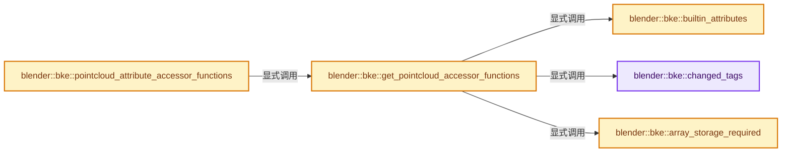
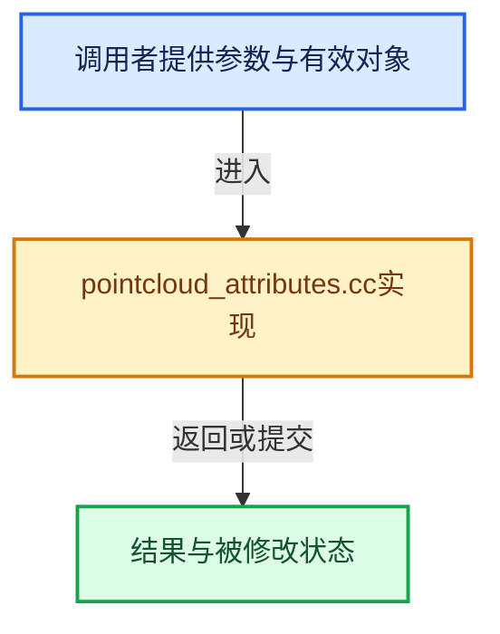

# 实现依赖专题：source/blender/blenkernel/intern/pointcloud_attributes.cc

[方向导航](README.md) · [符号索引](../%E7%AC%A6%E5%8F%B7%E4%BE%9D%E8%B5%96%E4%B8%8E%E5%AE%9E%E7%8E%B0%E7%B4%A2%E5%BC%95.md)

本专题从正文实际调用进入，集中保存共享实现。函数有稳定锚点，可从调用处直接跳到对应完整函数；递归与互相调用通过回链组织。

## 本文件的实现关系






## 完整成员与函数实现

<a id="f-28c204a550819f13"></a>

### `blender::bke::changed_tags`

实现位置：[source/blender/blenkernel/intern/pointcloud_attributes.cc](../../../../../source/blender/blenkernel/intern/pointcloud_attributes.cc) · L30—L35。

**教学注释版**

<!-- annotated:bd26f5085431f8 -->

```cpp
static const auto &changed_tags()
{
  static Map<StringRef, AttrUpdateOnChange> attributes{{"position", tag_position_changed},
                                                       {"radius", tag_radius_changed}};
  return attributes;
}
```

<details>
<summary>核对原始源码：source/blender/blenkernel/intern/pointcloud_attributes.cc · L30—L35</summary>

<!-- original:bd26f5085431f8:source/blender/blenkernel/intern/pointcloud_attributes.cc:30:35 -->

```cpp
static const auto &changed_tags()
{
  static Map<StringRef, AttrUpdateOnChange> attributes{{"position", tag_position_changed},
                                                       {"radius", tag_radius_changed}};
  return attributes;
}
```

</details>

**结果出口**

- `return attributes;`

**继续追踪实现**

本实现没有需要继续展开的显式调用；检查返回表达式、对象转换和调用者前置条件。

<a id="f-78e9436d2af8579a"></a>

### `blender::bke::builtin_attributes`

实现位置：[source/blender/blenkernel/intern/pointcloud_attributes.cc](../../../../../source/blender/blenkernel/intern/pointcloud_attributes.cc) · L37—L52。

**教学注释版**

<!-- annotated:6d52b7497f5b1e -->

```cpp
static const auto &builtin_attributes()
{
  static auto attributes = []() {
    Map<StringRef, AttrBuiltinInfo> map;

    AttrBuiltinInfo position(bke::AttrDomain::Point, bke::AttrType::Float3);
    position.deletable = false;
    // [讲解] map.add_new：按哈希与相等关系加入键或键值。
    map.add_new("position", std::move(position));

    AttrBuiltinInfo radius(bke::AttrDomain::Point, bke::AttrType::Float);
    // [讲解] std::move：把表达式转换成可供移动重载选择的值类别；不保证真的移动，不结束源对象寿命，对const值可能选择复制。
    map.add_new("radius", std::move(radius));

    return map;
  }();
  return attributes;
}
```

<details>
<summary>核对原始源码：source/blender/blenkernel/intern/pointcloud_attributes.cc · L37—L52</summary>

<!-- original:6d52b7497f5b1e:source/blender/blenkernel/intern/pointcloud_attributes.cc:37:52 -->

```cpp
static const auto &builtin_attributes()
{
  static auto attributes = []() {
    Map<StringRef, AttrBuiltinInfo> map;

    AttrBuiltinInfo position(bke::AttrDomain::Point, bke::AttrType::Float3);
    position.deletable = false;
    map.add_new("position", std::move(position));

    AttrBuiltinInfo radius(bke::AttrDomain::Point, bke::AttrType::Float);
    map.add_new("radius", std::move(radius));

    return map;
  }();
  return attributes;
}
```

</details>

**沿实际写入检查状态**

- `position.deletable = false;`

**结果出口**

- `return map;`
- `return attributes;`

**继续追踪实现**

- `[]() { Map<StringRef, AttrBuiltinInfo> map; AttrBuiltinInfo position(bke::AttrDomain::Point, bke::AttrType::Float3); position.deletable = false; map.add_new("position", std::move(p …（完整表达式见本函数源码）` → [调用协议](../%E6%A8%A1%E6%9D%BF%E5%AE%8F%E4%B8%8E%E5%8A%A8%E6%80%81%E5%88%86%E6%B4%BE%E5%8D%8F%E8%AE%AE.md)：函数指针、局部可调用对象或未展开的宏；必须结合调用者环境。调用位置L39。
- `map.add_new` → [blender::Map::add_new · L265](../02-%E5%93%88%E5%B8%8C%E8%A1%A8%E4%B8%8E%E5%85%B3%E8%81%94%E6%95%B0%E6%8D%AE%E7%BB%93%E6%9E%84/02-Map%E6%80%BB%E4%BD%93%E5%B8%83%E5%B1%80.md#f-521ff0865e8229d0)；[blender::Map::add_new · L269](../02-%E5%93%88%E5%B8%8C%E8%A1%A8%E4%B8%8E%E5%85%B3%E8%81%94%E6%95%B0%E6%8D%AE%E7%BB%93%E6%9E%84/02-Map%E6%80%BB%E4%BD%93%E5%B8%83%E5%B1%80.md#f-d89cee0e3d2848a0)；[blender::Map::add_new · L273](../02-%E5%93%88%E5%B8%8C%E8%A1%A8%E4%B8%8E%E5%85%B3%E8%81%94%E6%95%B0%E6%8D%AE%E7%BB%93%E6%9E%84/02-Map%E6%80%BB%E4%BD%93%E5%B8%83%E5%B1%80.md#f-c13142c32e703ebd)；[blender::Map::add_new · L277](../02-%E5%93%88%E5%B8%8C%E8%A1%A8%E4%B8%8E%E5%85%B3%E8%81%94%E6%95%B0%E6%8D%AE%E7%BB%93%E6%9E%84/04-Map%E6%9F%A5%E6%89%BE%E4%B8%8E%E9%94%AE%E8%AE%BF%E9%97%AE.md#f-da1e537f229db040)。同名重载需按实参类型选择。
- `std::move` → [外部契约](https://eel.is/c++draft/utility.forward)：把表达式转换成可供移动重载选择的值类别；不保证真的移动，不结束源对象寿命，对const值可能选择复制。

<a id="f-65f7e4cd80b8d737"></a>

### `blender::bke::array_storage_required`

实现位置：[source/blender/blenkernel/intern/pointcloud_attributes.cc](../../../../../source/blender/blenkernel/intern/pointcloud_attributes.cc) · L54—L58。

**教学注释版**

<!-- annotated:985df7e924a866 -->

```cpp
static const auto &array_storage_required()
{
  static Set<StringRef> attributes{"position"};
  return attributes;
}
```

<details>
<summary>核对原始源码：source/blender/blenkernel/intern/pointcloud_attributes.cc · L54—L58</summary>

<!-- original:985df7e924a866:source/blender/blenkernel/intern/pointcloud_attributes.cc:54:58 -->

```cpp
static const auto &array_storage_required()
{
  static Set<StringRef> attributes{"position"};
  return attributes;
}
```

</details>

**结果出口**

- `return attributes;`

**继续追踪实现**

本实现没有需要继续展开的显式调用；检查返回表达式、对象转换和调用者前置条件。

<a id="f-d24d254d0698c757"></a>

### `blender::bke::get_pointcloud_accessor_functions`

实现位置：[source/blender/blenkernel/intern/pointcloud_attributes.cc](../../../../../source/blender/blenkernel/intern/pointcloud_attributes.cc) · L60—L221。

**教学注释版**

<!-- annotated:720132078e494c -->

```cpp
static constexpr AttributeAccessorFunctions get_pointcloud_accessor_functions()
{
  AttributeAccessorFunctions fn{};
  fn.domain_supported = [](const void * /*owner*/, const AttrDomain domain) {
    return domain == AttrDomain::Point;
  };
  fn.domain_size = [](const void *owner, const AttrDomain domain) {
    return domain == AttrDomain::Point ? static_cast<const PointCloud *>(owner)->totpoint : 0;
  };
  fn.builtin_domain_and_type = [](const void * /*owner*/,
                                  const StringRef name) -> std::optional<AttributeDomainAndType> {
    const AttrBuiltinInfo *info = builtin_attributes().lookup_ptr(name);
    if (!info) {
      return std::nullopt;
    }
    return AttributeDomainAndType{info->domain, info->type};
  };
  fn.get_builtin_default = [](const void * /*owner*/, StringRef name) -> GPointer {
    const AttrBuiltinInfo &info = builtin_attributes().lookup(name);
    return info.default_value;
  };
  fn.lookup_meta_data = [](const void *owner, StringRef name) -> std::optional<AttributeMetaData> {
    const PointCloud &pointcloud = *static_cast<const PointCloud *>(owner);
    const AttributeStorage &storage = pointcloud.attribute_storage.wrap();
    const Attribute *attr = storage.lookup(name);
    if (!attr) {
      return std::nullopt;
    }
    return AttributeMetaData{attr->domain(), attr->data_type()};
  };
  fn.lookup = [](const void *owner, const StringRef name) -> GAttributeReader {
    const PointCloud &pointcloud = *static_cast<const PointCloud *>(owner);
    const AttributeStorage &storage = pointcloud.attribute_storage.wrap();
    const Attribute *attribute = storage.lookup(name);
    if (!attribute) {
      return {};
    }
    return attribute_to_reader(*attribute, AttrDomain::Point, pointcloud.totpoint);
  };
  fn.adapt_domain = [](const void * /*owner*/,
                       const GVArray &varray,
                       const AttrDomain from_domain,
                       const AttrDomain to_domain) {
    if (from_domain == to_domain && from_domain == AttrDomain::Point) {
      return varray;
    }
    return GVArray{};
  };
  fn.foreach_attribute = [](const void *owner,
                            const FunctionRef<void(const AttributeIter &)> fn,
                            const AttributeAccessor &accessor) {
    const PointCloud &pointcloud = *static_cast<const PointCloud *>(owner);
    const AttributeStorage &storage = pointcloud.attribute_storage.wrap();
    for (const Attribute &attribute : storage) {
      const auto get_fn = [&]() {
        return attribute_to_reader(attribute, AttrDomain::Point, pointcloud.totpoint);
      };
      AttributeIter iter(attribute.name(), attribute.domain(), attribute.data_type(), get_fn);
      iter.is_builtin = builtin_attributes().contains(attribute.name());
      iter.storage_type = attribute.storage_type();
      iter.accessor = &accessor;
      fn(iter);
      if (iter.is_stopped()) {
        break;
      }
    }
  };
  fn.lookup_validator = [](const void * /*owner*/, const StringRef name) -> AttributeValidator {
    const AttrBuiltinInfo *info = builtin_attributes().lookup_ptr(name);
    if (!info) {
      return {};
    }
    return info->validator;
  };
  fn.lookup_for_write = [](void *owner, const StringRef name) -> GAttributeWriter {
    PointCloud &pointcloud = *static_cast<PointCloud *>(owner);
    AttributeStorage &storage = pointcloud.attribute_storage.wrap();
    Attribute *attribute = storage.lookup(name);
    if (!attribute) {
      return {};
    }
    return attribute_to_writer(&pointcloud, changed_tags(), pointcloud.totpoint, *attribute);
  };
  fn.remove = [](void *owner, const StringRef name) -> bool {
    PointCloud &pointcloud = *static_cast<PointCloud *>(owner);
    AttributeStorage &storage = pointcloud.attribute_storage.wrap();
    if (const AttrBuiltinInfo *info = builtin_attributes().lookup_ptr(name)) {
      if (!info->deletable) {
        return false;
      }
    }
    const std::optional<AttrUpdateOnChange> fn = changed_tags().lookup_try(name);
    const bool removed = storage.remove(name);
    if (!removed) {
      return false;
    }
    if (fn) {
      (*fn)(owner);
    }
    return true;
  };
  fn.add = [](void *owner,
              const StringRef name,
              const AttrDomain domain,
              const bke::AttrType type,
              const AttributeInit &initializer) {
    PointCloud &pointcloud = *static_cast<PointCloud *>(owner);
    const int domain_size = pointcloud.totpoint;
    AttributeStorage &storage = pointcloud.attribute_storage.wrap();
    if (const AttrBuiltinInfo *info = builtin_attributes().lookup_ptr(name)) {
      if (info->domain != domain || info->type != type) {
        return false;
      }
    }
    if (storage.lookup(name)) {
      return false;
    }
    Attribute::DataVariant data = attribute_init_to_data(
        type, domain_size, initializer, array_storage_required().contains(name));
    // [讲解] std::move：把表达式转换成可供移动重载选择的值类别；不保证真的移动，不结束源对象寿命，对const值可能选择复制。
    storage.add(name, domain, type, std::move(data));
    if (initializer.type != AttributeInit::Type::Construct) {
      if (const std::optional<AttrUpdateOnChange> fn = changed_tags().lookup_try(name)) {
        (*fn)(owner);
      }
    }
    return true;
  };
  fn.rename = [](void *owner,
                 const Map<StringRef, StringRef> &name_map,
                 bool overwrite) -> Set<StringRef> {
    PointCloud &pointcloud = *static_cast<PointCloud *>(owner);
    return rename_attributes(pointcloud.attribute_storage.wrap(),
                             name_map,
                             overwrite,
                             builtin_attributes(),
                             array_storage_required(),
                             [&](const bke::AttrDomain /*domain*/) { return pointcloud.totpoint; },
                             std::nullopt,
                             {});
  };
  fn.assign_data = [](void *owner, StringRef name, const AttributeInit &initializer) {
    PointCloud &pointcloud = *static_cast<PointCloud *>(owner);
    AttributeStorage &storage = pointcloud.attribute_storage.wrap();
    Attribute *attr = storage.lookup(name);
    if (!attr) {
      return false;
    }
    Attribute::DataVariant data = attribute_init_to_data(attr->data_type(),
                                                         pointcloud.totpoint,
                                                         initializer,
                                                         array_storage_required().contains(name));
    attr->assign_data(std::move(data));
    if (initializer.type != AttributeInit::Type::Construct) {
      if (const std::optional<AttrUpdateOnChange> fn = changed_tags().lookup_try(name)) {
        (*fn)(owner);
      }
    }
    return true;
  };

  return fn;
}
```

<details>
<summary>核对原始源码：source/blender/blenkernel/intern/pointcloud_attributes.cc · L60—L221</summary>

<!-- original:720132078e494c:source/blender/blenkernel/intern/pointcloud_attributes.cc:60:221 -->

```cpp
static constexpr AttributeAccessorFunctions get_pointcloud_accessor_functions()
{
  AttributeAccessorFunctions fn{};
  fn.domain_supported = [](const void * /*owner*/, const AttrDomain domain) {
    return domain == AttrDomain::Point;
  };
  fn.domain_size = [](const void *owner, const AttrDomain domain) {
    return domain == AttrDomain::Point ? static_cast<const PointCloud *>(owner)->totpoint : 0;
  };
  fn.builtin_domain_and_type = [](const void * /*owner*/,
                                  const StringRef name) -> std::optional<AttributeDomainAndType> {
    const AttrBuiltinInfo *info = builtin_attributes().lookup_ptr(name);
    if (!info) {
      return std::nullopt;
    }
    return AttributeDomainAndType{info->domain, info->type};
  };
  fn.get_builtin_default = [](const void * /*owner*/, StringRef name) -> GPointer {
    const AttrBuiltinInfo &info = builtin_attributes().lookup(name);
    return info.default_value;
  };
  fn.lookup_meta_data = [](const void *owner, StringRef name) -> std::optional<AttributeMetaData> {
    const PointCloud &pointcloud = *static_cast<const PointCloud *>(owner);
    const AttributeStorage &storage = pointcloud.attribute_storage.wrap();
    const Attribute *attr = storage.lookup(name);
    if (!attr) {
      return std::nullopt;
    }
    return AttributeMetaData{attr->domain(), attr->data_type()};
  };
  fn.lookup = [](const void *owner, const StringRef name) -> GAttributeReader {
    const PointCloud &pointcloud = *static_cast<const PointCloud *>(owner);
    const AttributeStorage &storage = pointcloud.attribute_storage.wrap();
    const Attribute *attribute = storage.lookup(name);
    if (!attribute) {
      return {};
    }
    return attribute_to_reader(*attribute, AttrDomain::Point, pointcloud.totpoint);
  };
  fn.adapt_domain = [](const void * /*owner*/,
                       const GVArray &varray,
                       const AttrDomain from_domain,
                       const AttrDomain to_domain) {
    if (from_domain == to_domain && from_domain == AttrDomain::Point) {
      return varray;
    }
    return GVArray{};
  };
  fn.foreach_attribute = [](const void *owner,
                            const FunctionRef<void(const AttributeIter &)> fn,
                            const AttributeAccessor &accessor) {
    const PointCloud &pointcloud = *static_cast<const PointCloud *>(owner);
    const AttributeStorage &storage = pointcloud.attribute_storage.wrap();
    for (const Attribute &attribute : storage) {
      const auto get_fn = [&]() {
        return attribute_to_reader(attribute, AttrDomain::Point, pointcloud.totpoint);
      };
      AttributeIter iter(attribute.name(), attribute.domain(), attribute.data_type(), get_fn);
      iter.is_builtin = builtin_attributes().contains(attribute.name());
      iter.storage_type = attribute.storage_type();
      iter.accessor = &accessor;
      fn(iter);
      if (iter.is_stopped()) {
        break;
      }
    }
  };
  fn.lookup_validator = [](const void * /*owner*/, const StringRef name) -> AttributeValidator {
    const AttrBuiltinInfo *info = builtin_attributes().lookup_ptr(name);
    if (!info) {
      return {};
    }
    return info->validator;
  };
  fn.lookup_for_write = [](void *owner, const StringRef name) -> GAttributeWriter {
    PointCloud &pointcloud = *static_cast<PointCloud *>(owner);
    AttributeStorage &storage = pointcloud.attribute_storage.wrap();
    Attribute *attribute = storage.lookup(name);
    if (!attribute) {
      return {};
    }
    return attribute_to_writer(&pointcloud, changed_tags(), pointcloud.totpoint, *attribute);
  };
  fn.remove = [](void *owner, const StringRef name) -> bool {
    PointCloud &pointcloud = *static_cast<PointCloud *>(owner);
    AttributeStorage &storage = pointcloud.attribute_storage.wrap();
    if (const AttrBuiltinInfo *info = builtin_attributes().lookup_ptr(name)) {
      if (!info->deletable) {
        return false;
      }
    }
    const std::optional<AttrUpdateOnChange> fn = changed_tags().lookup_try(name);
    const bool removed = storage.remove(name);
    if (!removed) {
      return false;
    }
    if (fn) {
      (*fn)(owner);
    }
    return true;
  };
  fn.add = [](void *owner,
              const StringRef name,
              const AttrDomain domain,
              const bke::AttrType type,
              const AttributeInit &initializer) {
    PointCloud &pointcloud = *static_cast<PointCloud *>(owner);
    const int domain_size = pointcloud.totpoint;
    AttributeStorage &storage = pointcloud.attribute_storage.wrap();
    if (const AttrBuiltinInfo *info = builtin_attributes().lookup_ptr(name)) {
      if (info->domain != domain || info->type != type) {
        return false;
      }
    }
    if (storage.lookup(name)) {
      return false;
    }
    Attribute::DataVariant data = attribute_init_to_data(
        type, domain_size, initializer, array_storage_required().contains(name));
    storage.add(name, domain, type, std::move(data));
    if (initializer.type != AttributeInit::Type::Construct) {
      if (const std::optional<AttrUpdateOnChange> fn = changed_tags().lookup_try(name)) {
        (*fn)(owner);
      }
    }
    return true;
  };
  fn.rename = [](void *owner,
                 const Map<StringRef, StringRef> &name_map,
                 bool overwrite) -> Set<StringRef> {
    PointCloud &pointcloud = *static_cast<PointCloud *>(owner);
    return rename_attributes(pointcloud.attribute_storage.wrap(),
                             name_map,
                             overwrite,
                             builtin_attributes(),
                             array_storage_required(),
                             [&](const bke::AttrDomain /*domain*/) { return pointcloud.totpoint; },
                             std::nullopt,
                             {});
  };
  fn.assign_data = [](void *owner, StringRef name, const AttributeInit &initializer) {
    PointCloud &pointcloud = *static_cast<PointCloud *>(owner);
    AttributeStorage &storage = pointcloud.attribute_storage.wrap();
    Attribute *attr = storage.lookup(name);
    if (!attr) {
      return false;
    }
    Attribute::DataVariant data = attribute_init_to_data(attr->data_type(),
                                                         pointcloud.totpoint,
                                                         initializer,
                                                         array_storage_required().contains(name));
    attr->assign_data(std::move(data));
    if (initializer.type != AttributeInit::Type::Construct) {
      if (const std::optional<AttrUpdateOnChange> fn = changed_tags().lookup_try(name)) {
        (*fn)(owner);
      }
    }
    return true;
  };

  return fn;
}
```

</details>

**沿实际写入检查状态**

- `fn.domain_supported = [](const void * /*owner*/, const AttrDomain domain) {`
- `fn.domain_size = [](const void *owner, const AttrDomain domain) {`
- `fn.builtin_domain_and_type = [](const void * /*owner*/,`
- `fn.get_builtin_default = [](const void * /*owner*/, StringRef name) -> GPointer {`
- `fn.lookup_meta_data = [](const void *owner, StringRef name) -> std::optional<AttributeMetaData> {`
- `fn.lookup = [](const void *owner, const StringRef name) -> GAttributeReader {`
- `fn.adapt_domain = [](const void * /*owner*/,`
- `fn.foreach_attribute = [](const void *owner,`
- `iter.is_builtin = builtin_attributes().contains(attribute.name());`
- `iter.storage_type = attribute.storage_type();`
- `iter.accessor = &accessor;`
- `fn.lookup_validator = [](const void * /*owner*/, const StringRef name) -> AttributeValidator {`
- `fn.lookup_for_write = [](void *owner, const StringRef name) -> GAttributeWriter {`
- `fn.remove = [](void *owner, const StringRef name) -> bool {`
- `fn.add = [](void *owner,`
- `fn.rename = [](void *owner,`
- `fn.assign_data = [](void *owner, StringRef name, const AttributeInit &initializer) {`

**结果出口**

- `return domain == AttrDomain::Point;`
- `return domain == AttrDomain::Point ? static_cast<const PointCloud *>(owner)->totpoint : 0;`
- `return std::nullopt;`
- `return AttributeDomainAndType{info->domain, info->type};`
- `return info.default_value;`
- `return AttributeMetaData{attr->domain(), attr->data_type()};`
- `return {};`
- `return attribute_to_reader(*attribute, AttrDomain::Point, pointcloud.totpoint);`
- `return varray;`
- `return GVArray{};`
- `return attribute_to_reader(attribute, AttrDomain::Point, pointcloud.totpoint);`
- `return info->validator;`
- `return attribute_to_writer(&pointcloud, changed_tags(), pointcloud.totpoint, *attribute);`
- `return false;`
- `return true;`
- `return rename_attributes(pointcloud.attribute_storage.wrap(),`
- `return fn;`

**继续追踪实现**

- `builtin_attributes().lookup_ptr` → [调用协议](../%E6%A8%A1%E6%9D%BF%E5%AE%8F%E4%B8%8E%E5%8A%A8%E6%80%81%E5%88%86%E6%B4%BE%E5%8D%8F%E8%AE%AE.md)：接收对象类型依赖auto、返回值或模板实例；不按同名猜测目标。调用位置L71。
- `builtin_attributes` → [blender::bke::builtin_attributes · L37](%E4%BE%9D%E8%B5%96-pointcloud_attributes-5bb7c0.md#f-78e9436d2af8579a)。
- `builtin_attributes().lookup` → [调用协议](../%E6%A8%A1%E6%9D%BF%E5%AE%8F%E4%B8%8E%E5%8A%A8%E6%80%81%E5%88%86%E6%B4%BE%E5%8D%8F%E8%AE%AE.md)：接收对象类型依赖auto、返回值或模板实例；不按同名猜测目标。调用位置L78。
- `pointcloud.attribute_storage.wrap` → [调用协议](../%E6%A8%A1%E6%9D%BF%E5%AE%8F%E4%B8%8E%E5%8A%A8%E6%80%81%E5%88%86%E6%B4%BE%E5%8D%8F%E8%AE%AE.md)：接收对象类型依赖auto、返回值或模板实例；不按同名猜测目标。调用位置L83。
- `storage.lookup` → [blender::bke::AttributeStorage::lookup · L218](%E4%BE%9D%E8%B5%96-attribute_storage-1cb73b.md#f-7fdc83fb77004833)；[blender::bke::AttributeStorage::lookup · L228](%E4%BE%9D%E8%B5%96-attribute_storage-1cb73b.md#f-4c9ec35a31afcd06)。同名重载需按实参类型选择。
- `attr->domain` → [blender::bke::Attribute::domain · L286](10-%E5%B8%83%E5%B1%80%E5%85%BC%E5%AE%B9%E4%B8%8E%E5%87%A0%E4%BD%95%E5%AE%9E%E6%88%98.md#f-03667cd47954e9ff)。
- `attr->data_type` → [blender::bke::Attribute::data_type · L291](10-%E5%B8%83%E5%B1%80%E5%85%BC%E5%AE%B9%E4%B8%8E%E5%87%A0%E4%BD%95%E5%AE%9E%E6%88%98.md#f-d86548da166fa237)。
- `attribute_to_reader` → [blender::bke::attribute_to_reader · L21](%E4%BE%9D%E8%B5%96-attribute_storage_access-f9a095.md#f-163d13c9de0f1d4b)。
- `attribute.name` → [blender::bke::Attribute::name · L281](10-%E5%B8%83%E5%B1%80%E5%85%BC%E5%AE%B9%E4%B8%8E%E5%87%A0%E4%BD%95%E5%AE%9E%E6%88%98.md#f-673c10c3082f9df5)。
- `attribute.domain` → [blender::bke::Attribute::domain · L286](10-%E5%B8%83%E5%B1%80%E5%85%BC%E5%AE%B9%E4%B8%8E%E5%87%A0%E4%BD%95%E5%AE%9E%E6%88%98.md#f-03667cd47954e9ff)。
- `attribute.data_type` → [blender::bke::Attribute::data_type · L291](10-%E5%B8%83%E5%B1%80%E5%85%BC%E5%AE%B9%E4%B8%8E%E5%87%A0%E4%BD%95%E5%AE%9E%E6%88%98.md#f-d86548da166fa237)。
- `builtin_attributes().contains` → [调用协议](../%E6%A8%A1%E6%9D%BF%E5%AE%8F%E4%B8%8E%E5%8A%A8%E6%80%81%E5%88%86%E6%B4%BE%E5%8D%8F%E8%AE%AE.md)：接收对象类型依赖auto、返回值或模板实例；不按同名猜测目标。调用位置L118。
- `attribute.storage_type` → [blender::bke::Attribute::storage_type · L301](10-%E5%B8%83%E5%B1%80%E5%85%BC%E5%AE%B9%E4%B8%8E%E5%87%A0%E4%BD%95%E5%AE%9E%E6%88%98.md#f-e08ee0374bedc01d)。
- `fn` → [调用协议](../%E6%A8%A1%E6%9D%BF%E5%AE%8F%E4%B8%8E%E5%8A%A8%E6%80%81%E5%88%86%E6%B4%BE%E5%8D%8F%E8%AE%AE.md)：局部可调用对象，须结合其初始化与捕获环境。调用位置L121。
- `iter.is_stopped` → [blender::bke::AttributeIter::is_stopped · L419](08-AttributeAccessor%E6%8E%A5%E5%8F%A3.md#f-78d44598b8fa0c04)。
- `attribute_to_writer` → [blender::bke::attribute_to_writer · L44](%E4%BE%9D%E8%B5%96-attribute_storage_access-f9a095.md#f-75cf114d7fc03fa8)。
- `changed_tags` → [blender::bke::changed_tags · L30](%E4%BE%9D%E8%B5%96-pointcloud_attributes-5bb7c0.md#f-28c204a550819f13)。
- `changed_tags().lookup_try` → [调用协议](../%E6%A8%A1%E6%9D%BF%E5%AE%8F%E4%B8%8E%E5%8A%A8%E6%80%81%E5%88%86%E6%B4%BE%E5%8D%8F%E8%AE%AE.md)：接收对象类型依赖auto、返回值或模板实例；不按同名猜测目标。调用位置L151。
- `storage.remove` → [blender::bke::AttributeStorage::remove · L255](%E4%BE%9D%E8%B5%96-attribute_storage-1cb73b.md#f-65b1c61b542236ae)；[blender::bke::AttributeStorage::remove · L270](%E4%BE%9D%E8%B5%96-attribute_storage-1cb73b.md#f-10bfcc160f8e979a)；[blender::bke::AttributeStorage::remove · L277](%E4%BE%9D%E8%B5%96-attribute_storage-1cb73b.md#f-be56394a344a175b)。同名重载需按实参类型选择。
- `(*fn)` → [调用协议](../%E6%A8%A1%E6%9D%BF%E5%AE%8F%E4%B8%8E%E5%8A%A8%E6%80%81%E5%88%86%E6%B4%BE%E5%8D%8F%E8%AE%AE.md)：局部可调用对象，须结合其初始化与捕获环境。调用位置L157。
- `attribute_init_to_data` → [blender::bke::attribute_init_to_data · L80](%E4%BE%9D%E8%B5%96-attribute_storage_access-f9a095.md#f-34e72146abce4b23)。
- `array_storage_required().contains` → [调用协议](../%E6%A8%A1%E6%9D%BF%E5%AE%8F%E4%B8%8E%E5%8A%A8%E6%80%81%E5%88%86%E6%B4%BE%E5%8D%8F%E8%AE%AE.md)：接收对象类型依赖auto、返回值或模板实例；不按同名猜测目标。调用位置L178。
- `array_storage_required` → [blender::bke::array_storage_required · L54](%E4%BE%9D%E8%B5%96-pointcloud_attributes-5bb7c0.md#f-65f7e4cd80b8d737)。
- `storage.add` → [blender::bke::AttributeStorage::add · L238](%E4%BE%9D%E8%B5%96-attribute_storage-1cb73b.md#f-b78aa43de4dafd5f)。
- `std::move` → [外部契约](https://eel.is/c++draft/utility.forward)：把表达式转换成可供移动重载选择的值类别；不保证真的移动，不结束源对象寿命，对const值可能选择复制。
- `rename_attributes` → [blender::bke::rename_attributes · L286](%E4%BE%9D%E8%B5%96-attribute_storage_access-f9a095.md#f-3b17282afd84c493)。
- `attr->assign_data` → [blender::bke::Attribute::assign_data · L312](10-%E5%B8%83%E5%B1%80%E5%85%BC%E5%AE%B9%E4%B8%8E%E5%87%A0%E4%BD%95%E5%AE%9E%E6%88%98.md#f-9fcff5d02b6d8c44)。

<a id="f-02d141e3f2f6bcd3"></a>

### `blender::bke::pointcloud_attribute_accessor_functions`

实现位置：[source/blender/blenkernel/intern/pointcloud_attributes.cc](../../../../../source/blender/blenkernel/intern/pointcloud_attributes.cc) · L223—L227。

**教学注释版**

<!-- annotated:dd04225dc282f8 -->

```cpp
const AttributeAccessorFunctions &pointcloud_attribute_accessor_functions()
{
  static constexpr AttributeAccessorFunctions fn = get_pointcloud_accessor_functions();
  return fn;
}
```

<details>
<summary>核对原始源码：source/blender/blenkernel/intern/pointcloud_attributes.cc · L223—L227</summary>

<!-- original:dd04225dc282f8:source/blender/blenkernel/intern/pointcloud_attributes.cc:223:227 -->

```cpp
const AttributeAccessorFunctions &pointcloud_attribute_accessor_functions()
{
  static constexpr AttributeAccessorFunctions fn = get_pointcloud_accessor_functions();
  return fn;
}
```

</details>

**结果出口**

- `return fn;`

**继续追踪实现**

- `get_pointcloud_accessor_functions` → [blender::bke::get_pointcloud_accessor_functions · L60](%E4%BE%9D%E8%B5%96-pointcloud_attributes-5bb7c0.md#f-d24d254d0698c757)。
