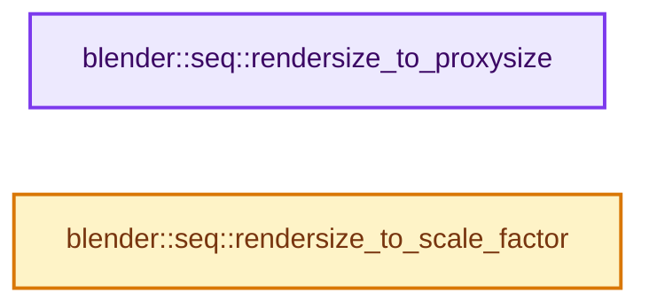
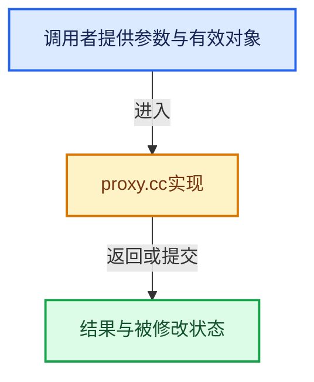

# 实现依赖专题：source/blender/sequencer/intern/proxy.cc

[方向导航](README.md) · [符号索引](../%E7%AC%A6%E5%8F%B7%E4%BE%9D%E8%B5%96%E4%B8%8E%E5%AE%9E%E7%8E%B0%E7%B4%A2%E5%BC%95.md)

本专题从正文实际调用进入，集中保存共享实现。函数有稳定锚点，可从调用处直接跳到对应完整函数；递归与互相调用通过回链组织。

## 本文件的实现关系






## 完整成员与函数实现

<a id="f-6dc1181f407c5fca"></a>

### `blender::seq::rendersize_to_proxysize`

实现位置：[source/blender/sequencer/intern/proxy.cc](../../../../../source/blender/sequencer/intern/proxy.cc) · L137—L151。

接口参数：

- `eSpaceSeq_Proxy_RenderSize render_size`

**教学注释版**

<!-- annotated:82cef59407cbc3 -->

```cpp
IMB_Proxy_Size rendersize_to_proxysize(eSpaceSeq_Proxy_RenderSize render_size)
{
  switch (render_size) {
    case SEQ_RENDER_SIZE_PROXY_25:
      return IMB_PROXY_25;
    case SEQ_RENDER_SIZE_PROXY_50:
      return IMB_PROXY_50;
    case SEQ_RENDER_SIZE_PROXY_75:
      return IMB_PROXY_75;
    case SEQ_RENDER_SIZE_PROXY_100:
      return IMB_PROXY_100;
    default:
      return IMB_PROXY_NONE;
  }
}
```

<details>
<summary>核对原始源码：source/blender/sequencer/intern/proxy.cc · L137—L151</summary>

<!-- original:82cef59407cbc3:source/blender/sequencer/intern/proxy.cc:137:151 -->

```cpp
IMB_Proxy_Size rendersize_to_proxysize(eSpaceSeq_Proxy_RenderSize render_size)
{
  switch (render_size) {
    case SEQ_RENDER_SIZE_PROXY_25:
      return IMB_PROXY_25;
    case SEQ_RENDER_SIZE_PROXY_50:
      return IMB_PROXY_50;
    case SEQ_RENDER_SIZE_PROXY_75:
      return IMB_PROXY_75;
    case SEQ_RENDER_SIZE_PROXY_100:
      return IMB_PROXY_100;
    default:
      return IMB_PROXY_NONE;
  }
}
```

</details>

**结果出口**

- `return IMB_PROXY_25;`
- `return IMB_PROXY_50;`
- `return IMB_PROXY_75;`
- `return IMB_PROXY_100;`
- `return IMB_PROXY_NONE;`

**继续追踪实现**

本实现没有需要继续展开的显式调用；检查返回表达式、对象转换和调用者前置条件。

<a id="f-12b59564fd33774e"></a>

### `blender::seq::rendersize_to_scale_factor`

实现位置：[source/blender/sequencer/intern/proxy.cc](../../../../../source/blender/sequencer/intern/proxy.cc) · L153—L165。

接口参数：

- `eSpaceSeq_Proxy_RenderSize render_size`

**教学注释版**

<!-- annotated:3ed23fd7e3b30d -->

```cpp
float rendersize_to_scale_factor(eSpaceSeq_Proxy_RenderSize render_size)
{
  switch (render_size) {
    case SEQ_RENDER_SIZE_PROXY_25:
      return 0.25f;
    case SEQ_RENDER_SIZE_PROXY_50:
      return 0.5f;
    case SEQ_RENDER_SIZE_PROXY_75:
      return 0.75f;
    default:
      return 1.0f;
  }
}
```

<details>
<summary>核对原始源码：source/blender/sequencer/intern/proxy.cc · L153—L165</summary>

<!-- original:3ed23fd7e3b30d:source/blender/sequencer/intern/proxy.cc:153:165 -->

```cpp
float rendersize_to_scale_factor(eSpaceSeq_Proxy_RenderSize render_size)
{
  switch (render_size) {
    case SEQ_RENDER_SIZE_PROXY_25:
      return 0.25f;
    case SEQ_RENDER_SIZE_PROXY_50:
      return 0.5f;
    case SEQ_RENDER_SIZE_PROXY_75:
      return 0.75f;
    default:
      return 1.0f;
  }
}
```

</details>

**结果出口**

- `return 0.25f;`
- `return 0.5f;`
- `return 0.75f;`
- `return 1.0f;`

**继续追踪实现**

本实现没有需要继续展开的显式调用；检查返回表达式、对象转换和调用者前置条件。
