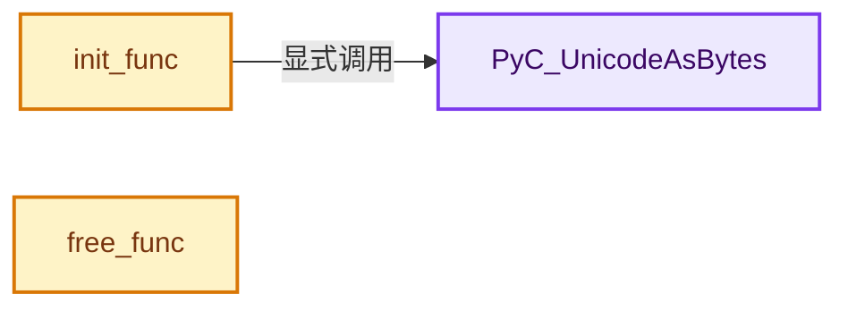
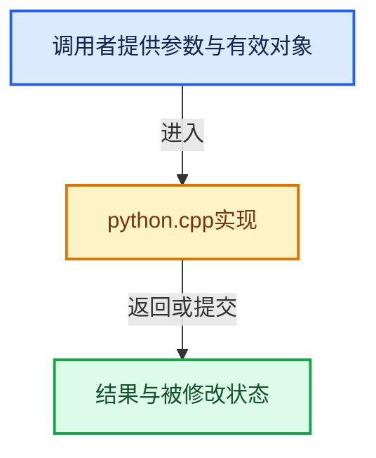

# 实现依赖专题：intern/cycles/blender/python.cpp

[方向导航](README.md) · [符号索引](../%E7%AC%A6%E5%8F%B7%E4%BE%9D%E8%B5%96%E4%B8%8E%E5%AE%9E%E7%8E%B0%E7%B4%A2%E5%BC%95.md)

本专题从正文实际调用进入，集中保存共享实现。函数有稳定锚点，可从调用处直接跳到对应完整函数；递归与互相调用通过回链组织。

## 本文件的实现关系






## 完整成员与函数实现

<a id="f-2745d15c175e86e6"></a>

### `PyC_UnicodeAsBytes`

实现位置：[intern/cycles/blender/python.cpp](../../../../../intern/cycles/blender/python.cpp) · L94—L117。

接口参数：

- `PyObject *py_str`
- `PyObject **coerce`

**教学注释版**

<!-- annotated:313c718e835ca1 -->

```cpp
static const char *PyC_UnicodeAsBytes(PyObject *py_str, PyObject **coerce)
{
  const char *result = PyUnicode_AsUTF8(py_str);
  if (result) {
    /* 99% of the time this is enough but we better support non unicode
     * chars since blender doesn't limit this.
     */
    return result;
  }
  PyErr_Clear();
  if (PyBytes_Check(py_str)) {
    return PyBytes_AS_STRING(py_str);
  }

  *coerce = PyUnicode_EncodeFSDefault(py_str);
  if (*coerce) {
    return PyBytes_AS_STRING(*coerce);
  }
  /* Clear the error, so Cycles can be at least used without
   * GPU and OSL support,
   */
  PyErr_Clear();
  return "";
}
```

<details>
<summary>核对原始源码：intern/cycles/blender/python.cpp · L94—L117</summary>

<!-- original:313c718e835ca1:intern/cycles/blender/python.cpp:94:117 -->

```cpp
static const char *PyC_UnicodeAsBytes(PyObject *py_str, PyObject **coerce)
{
  const char *result = PyUnicode_AsUTF8(py_str);
  if (result) {
    /* 99% of the time this is enough but we better support non unicode
     * chars since blender doesn't limit this.
     */
    return result;
  }
  PyErr_Clear();
  if (PyBytes_Check(py_str)) {
    return PyBytes_AS_STRING(py_str);
  }

  *coerce = PyUnicode_EncodeFSDefault(py_str);
  if (*coerce) {
    return PyBytes_AS_STRING(*coerce);
  }
  /* Clear the error, so Cycles can be at least used without
   * GPU and OSL support,
   */
  PyErr_Clear();
  return "";
}
```

</details>

**结果出口**

- `return result;`
- `return PyBytes_AS_STRING(py_str);`
- `return PyBytes_AS_STRING(*coerce);`
- `return "";`

**继续追踪实现**

- `PyUnicode_AsUTF8` → [调用协议](../%E6%A8%A1%E6%9D%BF%E5%AE%8F%E4%B8%8E%E5%8A%A8%E6%80%81%E5%88%86%E6%B4%BE%E5%8D%8F%E8%AE%AE.md)：配置相关检测或外部运行时接口。调用位置L96。
- `PyErr_Clear` → [调用协议](../%E6%A8%A1%E6%9D%BF%E5%AE%8F%E4%B8%8E%E5%8A%A8%E6%80%81%E5%88%86%E6%B4%BE%E5%8D%8F%E8%AE%AE.md)：配置相关检测或外部运行时接口。调用位置L103。
- `PyBytes_Check` → [调用协议](../%E6%A8%A1%E6%9D%BF%E5%AE%8F%E4%B8%8E%E5%8A%A8%E6%80%81%E5%88%86%E6%B4%BE%E5%8D%8F%E8%AE%AE.md)：配置相关检测或外部运行时接口。调用位置L104。
- `PyBytes_AS_STRING` → [调用协议](../%E6%A8%A1%E6%9D%BF%E5%AE%8F%E4%B8%8E%E5%8A%A8%E6%80%81%E5%88%86%E6%B4%BE%E5%8D%8F%E8%AE%AE.md)：配置相关检测或外部运行时接口。调用位置L105。
- `PyUnicode_EncodeFSDefault` → [调用协议](../%E6%A8%A1%E6%9D%BF%E5%AE%8F%E4%B8%8E%E5%8A%A8%E6%80%81%E5%88%86%E6%B4%BE%E5%8D%8F%E8%AE%AE.md)：配置相关检测或外部运行时接口。调用位置L108。

<a id="f-43e4140ed932d867"></a>

### `init_func`

实现位置：[intern/cycles/blender/python.cpp](../../../../../intern/cycles/blender/python.cpp) · L119—L146。

接口参数：

- `PyObject *`
- `PyObject *args`

**教学注释版**

<!-- annotated:86245d3677e3f9 -->

```cpp
static PyObject *init_func(PyObject * /*self*/, PyObject *args)
{
  PyObject *path;
  PyObject *user_path;
  int headless;

  if (!PyArg_ParseTuple(args,
                        "O" /* `path` */
                        "O" /* `user_path` */
                        "i" /* `headless` */,
                        &path,
                        &user_path,
                        &headless))
  {
    return nullptr;
  }

  PyObject *path_coerce = nullptr;
  PyObject *user_path_coerce = nullptr;
  path_init(PyC_UnicodeAsBytes(path, &path_coerce),
            PyC_UnicodeAsBytes(user_path, &user_path_coerce));
  Py_XDECREF(path_coerce);
  Py_XDECREF(user_path_coerce);

  BlenderSession::headless = headless;

  Py_RETURN_NONE;
}
```

<details>
<summary>核对原始源码：intern/cycles/blender/python.cpp · L119—L146</summary>

<!-- original:86245d3677e3f9:intern/cycles/blender/python.cpp:119:146 -->

```cpp
static PyObject *init_func(PyObject * /*self*/, PyObject *args)
{
  PyObject *path;
  PyObject *user_path;
  int headless;

  if (!PyArg_ParseTuple(args,
                        "O" /* `path` */
                        "O" /* `user_path` */
                        "i" /* `headless` */,
                        &path,
                        &user_path,
                        &headless))
  {
    return nullptr;
  }

  PyObject *path_coerce = nullptr;
  PyObject *user_path_coerce = nullptr;
  path_init(PyC_UnicodeAsBytes(path, &path_coerce),
            PyC_UnicodeAsBytes(user_path, &user_path_coerce));
  Py_XDECREF(path_coerce);
  Py_XDECREF(user_path_coerce);

  BlenderSession::headless = headless;

  Py_RETURN_NONE;
}
```

</details>

**沿实际写入检查状态**

- `BlenderSession::headless = headless;`

**结果出口**

- `return nullptr;`

**继续追踪实现**

- `PyArg_ParseTuple` → [调用协议](../%E6%A8%A1%E6%9D%BF%E5%AE%8F%E4%B8%8E%E5%8A%A8%E6%80%81%E5%88%86%E6%B4%BE%E5%8D%8F%E8%AE%AE.md)：配置相关检测或外部运行时接口。调用位置L125。
- `path_init` → [path_init · L343](%E4%BE%9D%E8%B5%96-path-126dbb.md#f-f8e2d36bd45cdb0b)。
- `PyC_UnicodeAsBytes` → [PyC_UnicodeAsBytes · L94](%E4%BE%9D%E8%B5%96-python-ee139d.md#f-2745d15c175e86e6)。
- `Py_XDECREF` → [调用协议](../%E6%A8%A1%E6%9D%BF%E5%AE%8F%E4%B8%8E%E5%8A%A8%E6%80%81%E5%88%86%E6%B4%BE%E5%8D%8F%E8%AE%AE.md)：配置相关检测或外部运行时接口。调用位置L140。

<a id="f-1fdac534bda17f3c"></a>

### `free_func`

实现位置：[intern/cycles/blender/python.cpp](../../../../../intern/cycles/blender/python.cpp) · L228—L233。

接口参数：

- `PyObject *`
- `PyObject *value`

**教学注释版**

<!-- annotated:95e22869a5f026 -->

```cpp
static PyObject *free_func(PyObject * /*self*/, PyObject *value)
{
  delete (BlenderSession *)PyLong_AsVoidPtr(value);

  Py_RETURN_NONE;
}
```

<details>
<summary>核对原始源码：intern/cycles/blender/python.cpp · L228—L233</summary>

<!-- original:95e22869a5f026:intern/cycles/blender/python.cpp:228:233 -->

```cpp
static PyObject *free_func(PyObject * /*self*/, PyObject *value)
{
  delete (BlenderSession *)PyLong_AsVoidPtr(value);

  Py_RETURN_NONE;
}
```

</details>

**继续追踪实现**

- `PyLong_AsVoidPtr` → [调用协议](../%E6%A8%A1%E6%9D%BF%E5%AE%8F%E4%B8%8E%E5%8A%A8%E6%80%81%E5%88%86%E6%B4%BE%E5%8D%8F%E8%AE%AE.md)：配置相关检测或外部运行时接口。调用位置L230。
