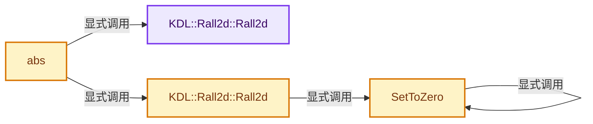
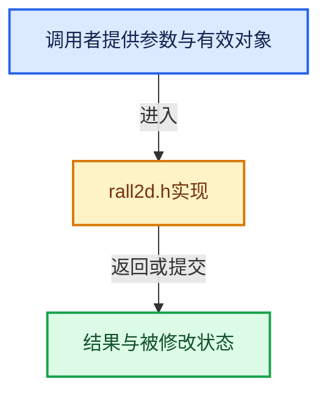

# 实现依赖专题：intern/itasc/kdl/utilities/rall2d.h

[方向导航](README.md) · [符号索引](../%E7%AC%A6%E5%8F%B7%E4%BE%9D%E8%B5%96%E4%B8%8E%E5%AE%9E%E7%8E%B0%E7%B4%A2%E5%BC%95.md)

本专题从正文实际调用进入，集中保存共享实现。函数有稳定锚点，可从调用处直接跳到对应完整函数；递归与互相调用通过回链组织。

## 本文件的实现关系






## 完整成员与函数实现

<a id="f-9dce8e57a69a2b0a"></a>

### `KDL::Rall2d::Rall2d`

实现位置：[intern/itasc/kdl/utilities/rall2d.h](../../../../../intern/itasc/kdl/utilities/rall2d.h) · L60—L60。

**教学注释版**

<!-- annotated:8e5bf3f6e1c12a -->

```cpp
        INLINE Rall2d() {}
```

<details>
<summary>核对原始源码：intern/itasc/kdl/utilities/rall2d.h · L60—L60</summary>

<!-- original:8e5bf3f6e1c12a:intern/itasc/kdl/utilities/rall2d.h:60:60 -->

```cpp
        INLINE Rall2d() {}
```

</details>

**继续追踪实现**

本实现没有需要继续展开的显式调用；检查返回表达式、对象转换和调用者前置条件。

<a id="f-ac68de34a47f5473"></a>

### `KDL::Rall2d::Rall2d`

实现位置：[intern/itasc/kdl/utilities/rall2d.h](../../../../../intern/itasc/kdl/utilities/rall2d.h) · L62—L63。

接口参数：

- `typename TI<T>::Arg c`

**教学注释版**

<!-- annotated:3e3d594ddb4879 -->

```cpp
        explicit INLINE  Rall2d(typename TI<T>::Arg c)
            {t=c;SetToZero(d);SetToZero(dd);}
```

<details>
<summary>核对原始源码：intern/itasc/kdl/utilities/rall2d.h · L62—L63</summary>

<!-- original:3e3d594ddb4879:intern/itasc/kdl/utilities/rall2d.h:62:63 -->

```cpp
        explicit INLINE  Rall2d(typename TI<T>::Arg c)
            {t=c;SetToZero(d);SetToZero(dd);}
```

</details>

**继续追踪实现**

- `SetToZero` → [SetToZero · L507](%E4%BE%9D%E8%B5%96-rall2d-144372.md#f-4d626152b2b2d551)。

<a id="f-81abb9af901caddd"></a>

### `abs`

实现位置：[intern/itasc/kdl/utilities/rall2d.h](../../../../../intern/itasc/kdl/utilities/rall2d.h) · L462—L467。

接口参数：

- `const Rall2d<T,V,S>& x`

**教学注释版**

<!-- annotated:7f9809899fae88 -->

```cpp
template <class T,class V,class S>
INLINE  Rall2d<T,V,S> abs(const Rall2d<T,V,S>& x)
{
    T v(Sign(x));
    return Rall2d<T,V,S>(v*x,v*x.d,v*x.dd);
}
```

<details>
<summary>核对原始源码：intern/itasc/kdl/utilities/rall2d.h · L462—L467</summary>

<!-- original:7f9809899fae88:intern/itasc/kdl/utilities/rall2d.h:462:467 -->

```cpp
template <class T,class V,class S>
INLINE  Rall2d<T,V,S> abs(const Rall2d<T,V,S>& x)
{
    T v(Sign(x));
    return Rall2d<T,V,S>(v*x,v*x.d,v*x.dd);
}
```

</details>

**结果出口**

- `return Rall2d<T,V,S>(v*x,v*x.d,v*x.dd);`

**继续追踪实现**

- `Rall2d<T,V,S>` → [KDL::Rall2d::Rall2d · L60](%E4%BE%9D%E8%B5%96-rall2d-144372.md#f-9dce8e57a69a2b0a)；[KDL::Rall2d::Rall2d · L62](%E4%BE%9D%E8%B5%96-rall2d-144372.md#f-ac68de34a47f5473)。同名重载需按实参类型选择。

<a id="f-4d626152b2b2d551"></a>

### `SetToZero`

实现位置：[intern/itasc/kdl/utilities/rall2d.h](../../../../../intern/itasc/kdl/utilities/rall2d.h) · L507—L513。

接口参数：

- `Rall2d<T,V,S>& value`

**教学注释版**

<!-- annotated:e5a32c0870734b -->

```cpp
template <class T,class V,class S>
INLINE  void SetToZero(Rall2d<T,V,S>& value)
    {
    SetToZero(value.t);
    SetToZero(value.d);
    SetToZero(value.dd);
    }
```

<details>
<summary>核对原始源码：intern/itasc/kdl/utilities/rall2d.h · L507—L513</summary>

<!-- original:e5a32c0870734b:intern/itasc/kdl/utilities/rall2d.h:507:513 -->

```cpp
template <class T,class V,class S>
INLINE  void SetToZero(Rall2d<T,V,S>& value)
    {
    SetToZero(value.t);
    SetToZero(value.d);
    SetToZero(value.dd);
    }
```

</details>

**继续追踪实现**

- `SetToZero` → [SetToZero · L507](%E4%BE%9D%E8%B5%96-rall2d-144372.md#f-4d626152b2b2d551)。
