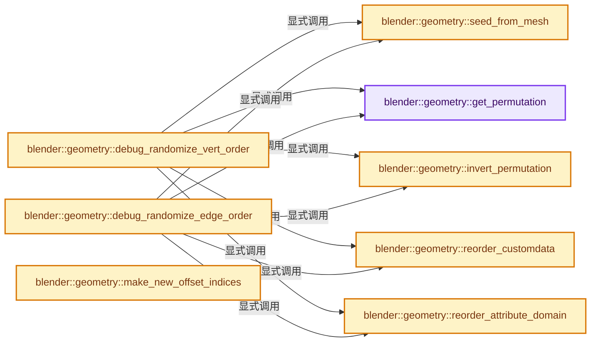
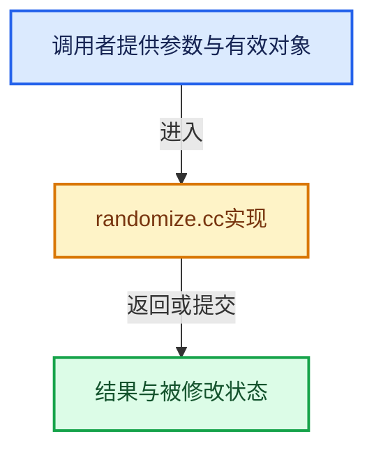

# 实现依赖专题：source/blender/geometry/intern/randomize.cc

[方向导航](README.md) · [符号索引](../%E7%AC%A6%E5%8F%B7%E4%BE%9D%E8%B5%96%E4%B8%8E%E5%AE%9E%E7%8E%B0%E7%B4%A2%E5%BC%95.md)

本专题从正文实际调用进入，集中保存共享实现。函数有稳定锚点，可从调用处直接跳到对应完整函数；递归与互相调用通过回链组织。

## 本文件的实现关系






## 完整成员与函数实现

<a id="f-d3562994846781b4"></a>

### `blender::geometry::get_permutation`

实现位置：[source/blender/geometry/intern/randomize.cc](../../../../../source/blender/geometry/intern/randomize.cc) · L29—L37。

接口参数：

- `const int length`
- `const int seed`

**教学注释版**

<!-- annotated:d3294e9750e410 -->

```cpp
static Array<int> get_permutation(const int length, const int seed)
{
  Array<int> data(length);
  for (const int i : IndexRange(length)) {
    data[i] = i;
  }
  // [讲解] data.begin：提供数组的借用访问入口。
  std::shuffle(data.begin(), data.end(), std::default_random_engine(seed));
  return data;
}
```

<details>
<summary>核对原始源码：source/blender/geometry/intern/randomize.cc · L29—L37</summary>

<!-- original:d3294e9750e410:source/blender/geometry/intern/randomize.cc:29:37 -->

```cpp
static Array<int> get_permutation(const int length, const int seed)
{
  Array<int> data(length);
  for (const int i : IndexRange(length)) {
    data[i] = i;
  }
  std::shuffle(data.begin(), data.end(), std::default_random_engine(seed));
  return data;
}
```

</details>

**沿实际写入检查状态**

- `data[i] = i;`

**结果出口**

- `return data;`

**继续追踪实现**

- `IndexRange` → [blender::IndexRange](../01-%E5%9F%BA%E7%A1%80%E5%AE%B9%E5%99%A8%E4%B8%8E%E7%8E%B0%E4%BB%A3CPP/%E4%BE%9D%E8%B5%96-BLI_index_range-7d7cc5.md#t-caa3466d6776)；[blender::gpu::shader::parser::IndexRange](%E4%BE%9D%E8%B5%96-utils-06433d.md#t-82d2bd4ea71c)；[blender::IndexRange](%E4%BE%9D%E8%B5%96-DNA_node_types-6708b9.md#t-0448cc889d39)。
- `std::shuffle` → [外部契约](https://eel.is/c++draft/)：这个边界按实际表达式及所属类型核对参数、返回值、寿命与失败行为。这里提供接口入口，不声称已解释该第三方版本的内部实现。
- `data.begin` → [blender::Array::begin · L332](../01-%E5%9F%BA%E7%A1%80%E5%AE%B9%E5%99%A8%E4%B8%8E%E7%8E%B0%E4%BB%A3CPP/08-Array%E5%A4%8D%E5%88%B6%E7%A7%BB%E5%8A%A8%E4%B8%8E%E9%94%80%E6%AF%81.md#f-c8883b490929edac)；[blender::Array::begin · L341](../01-%E5%9F%BA%E7%A1%80%E5%AE%B9%E5%99%A8%E4%B8%8E%E7%8E%B0%E4%BB%A3CPP/08-Array%E5%A4%8D%E5%88%B6%E7%A7%BB%E5%8A%A8%E4%B8%8E%E9%94%80%E6%AF%81.md#f-62d7e9ae6a7826e8)。同名重载需按实参类型选择。
- `data.end` → [blender::Array::end · L336](../01-%E5%9F%BA%E7%A1%80%E5%AE%B9%E5%99%A8%E4%B8%8E%E7%8E%B0%E4%BB%A3CPP/08-Array%E5%A4%8D%E5%88%B6%E7%A7%BB%E5%8A%A8%E4%B8%8E%E9%94%80%E6%AF%81.md#f-3b7a7433862ab426)；[blender::Array::end · L345](../01-%E5%9F%BA%E7%A1%80%E5%AE%B9%E5%99%A8%E4%B8%8E%E7%8E%B0%E4%BB%A3CPP/08-Array%E5%A4%8D%E5%88%B6%E7%A7%BB%E5%8A%A8%E4%B8%8E%E9%94%80%E6%AF%81.md#f-c97b06b19f45e8ec)。同名重载需按实参类型选择。
- `std::default_random_engine` → [外部契约](https://eel.is/c++draft/)：这个边界按实际表达式及所属类型核对参数、返回值、寿命与失败行为。这里提供接口入口，不声称已解释该第三方版本的内部实现。

<a id="f-c015e5f2ed3f5a80"></a>

### `blender::geometry::invert_permutation`

实现位置：[source/blender/geometry/intern/randomize.cc](../../../../../source/blender/geometry/intern/randomize.cc) · L39—L46。

接口参数：

- `const Span<int> permutation`

**教学注释版**

<!-- annotated:d046f634e4679e -->

```cpp
static Array<int> invert_permutation(const Span<int> permutation)
{
  // [讲解] permutation.size：查询视图长度或生成对应有效索引区间。
  Array<int> data(permutation.size());
  // [讲解] permutation.index_range：查询视图长度或生成对应有效索引区间。
  for (const int i : permutation.index_range()) {
    data[permutation[i]] = i;
  }
  return data;
}
```

<details>
<summary>核对原始源码：source/blender/geometry/intern/randomize.cc · L39—L46</summary>

<!-- original:d046f634e4679e:source/blender/geometry/intern/randomize.cc:39:46 -->

```cpp
static Array<int> invert_permutation(const Span<int> permutation)
{
  Array<int> data(permutation.size());
  for (const int i : permutation.index_range()) {
    data[permutation[i]] = i;
  }
  return data;
}
```

</details>

**沿实际写入检查状态**

- `data[permutation[i]] = i;`

**结果出口**

- `return data;`

**继续追踪实现**

- `permutation.size` → [blender::Span::size · L256](../01-%E5%9F%BA%E7%A1%80%E5%AE%B9%E5%99%A8%E4%B8%8E%E7%8E%B0%E4%BB%A3CPP/05-Span%E5%8F%AA%E8%AF%BB%E8%BF%9E%E7%BB%AD%E8%A7%86%E5%9B%BE.md#f-5f80fa006089c998)。
- `permutation.index_range` → [blender::Span::index_range · L405](../01-%E5%9F%BA%E7%A1%80%E5%AE%B9%E5%99%A8%E4%B8%8E%E7%8E%B0%E4%BB%A3CPP/05-Span%E5%8F%AA%E8%AF%BB%E8%BF%9E%E7%BB%AD%E8%A7%86%E5%9B%BE.md#f-caaa9b06e13e53e0)。

<a id="f-97ba3bad8d494ab7"></a>

### `blender::geometry::seed_from_mesh`

实现位置：[source/blender/geometry/intern/randomize.cc](../../../../../source/blender/geometry/intern/randomize.cc) · L56—L59。

接口参数：

- `const Mesh &mesh`

**教学注释版**

<!-- annotated:173419dcb2735d -->

```cpp
static int seed_from_mesh(const Mesh &mesh)
{
  return mesh.verts_num;
}
```

<details>
<summary>核对原始源码：source/blender/geometry/intern/randomize.cc · L56—L59</summary>

<!-- original:173419dcb2735d:source/blender/geometry/intern/randomize.cc:56:59 -->

```cpp
static int seed_from_mesh(const Mesh &mesh)
{
  return mesh.verts_num;
}
```

</details>

**结果出口**

- `return mesh.verts_num;`

**继续追踪实现**

本实现没有需要继续展开的显式调用；检查返回表达式、对象转换和调用者前置条件。

<a id="f-0527e57919121d99"></a>

### `blender::geometry::reorder_customdata`

实现位置：[source/blender/geometry/intern/randomize.cc](../../../../../source/blender/geometry/intern/randomize.cc) · L76—L87。

接口参数：

- `CustomData &data`
- `const Span<int> new_by_old_map`

**教学注释版**

<!-- annotated:df0d9460d9ab2d -->

```cpp
static void reorder_customdata(CustomData &data, const Span<int> new_by_old_map)
{
  CustomData new_data;
  // [讲解] new_by_old_map.size：查询视图长度或生成对应有效索引区间。
  CustomData_init_layout_from(&data, &new_data, CD_MASK_ALL, CD_CONSTRUCT, new_by_old_map.size());

  // [讲解] new_by_old_map.index_range：查询视图长度或生成对应有效索引区间。
  for (const int old_i : new_by_old_map.index_range()) {
    const int new_i = new_by_old_map[old_i];
    CustomData_copy_data(&data, &new_data, old_i, new_i, 1);
  }
  CustomData_free(&data);
  data = new_data;
}
```

<details>
<summary>核对原始源码：source/blender/geometry/intern/randomize.cc · L76—L87</summary>

<!-- original:df0d9460d9ab2d:source/blender/geometry/intern/randomize.cc:76:87 -->

```cpp
static void reorder_customdata(CustomData &data, const Span<int> new_by_old_map)
{
  CustomData new_data;
  CustomData_init_layout_from(&data, &new_data, CD_MASK_ALL, CD_CONSTRUCT, new_by_old_map.size());

  for (const int old_i : new_by_old_map.index_range()) {
    const int new_i = new_by_old_map[old_i];
    CustomData_copy_data(&data, &new_data, old_i, new_i, 1);
  }
  CustomData_free(&data);
  data = new_data;
}
```

</details>

**沿实际写入检查状态**

- `data = new_data;`

**继续追踪实现**

- `CustomData_init_layout_from` → [blender::CustomData_init_layout_from · L2462](%E4%BE%9D%E8%B5%96-customdata-2eef81.md#f-eca3e47bb8d9590e)。
- `new_by_old_map.size` → [blender::Span::size · L256](../01-%E5%9F%BA%E7%A1%80%E5%AE%B9%E5%99%A8%E4%B8%8E%E7%8E%B0%E4%BB%A3CPP/05-Span%E5%8F%AA%E8%AF%BB%E8%BF%9E%E7%BB%AD%E8%A7%86%E5%9B%BE.md#f-5f80fa006089c998)。
- `new_by_old_map.index_range` → [blender::Span::index_range · L405](../01-%E5%9F%BA%E7%A1%80%E5%AE%B9%E5%99%A8%E4%B8%8E%E7%8E%B0%E4%BB%A3CPP/05-Span%E5%8F%AA%E8%AF%BB%E8%BF%9E%E7%BB%AD%E8%A7%86%E5%9B%BE.md#f-caaa9b06e13e53e0)。
- `CustomData_copy_data` → [blender::CustomData_copy_data · L3115](%E4%BE%9D%E8%B5%96-customdata-2eef81.md#f-02b97940f7d20d25)。
- `CustomData_free` → [blender::CustomData_free · L2501](%E4%BE%9D%E8%B5%96-customdata-2eef81.md#f-af45329c2d7b60ae)。

<a id="f-3f6912e14a970e96"></a>

### `blender::geometry::reorder_attribute_domain`

实现位置：[source/blender/geometry/intern/randomize.cc](../../../../../source/blender/geometry/intern/randomize.cc) · L89—L113。

接口参数：

- `bke::AttributeStorage &data`
- `const bke::AttrDomain domain`
- `const Span<int> new_by_old_map`

**教学注释版**

<!-- annotated:566c5d81184250 -->

```cpp
static void reorder_attribute_domain(bke::AttributeStorage &data,
                                     const bke::AttrDomain domain,
                                     const Span<int> new_by_old_map)
{
  for (bke::Attribute &attr : data) {
    if (attr.domain() != domain) {
      continue;
    }
    const CPPType &type = bke::attribute_type_to_cpp_type(attr.data_type());
    switch (attr.storage_type()) {
      case bke::AttrStorageType::Array: {
        const auto &data = std::get<bke::Attribute::ArrayData>(attr.data());
        // [讲解] new_by_old_map.size：查询视图长度或生成对应有效索引区间。
        auto new_data = bke::Attribute::ArrayData::from_constructed(type, new_by_old_map.size());
        bke::attribute_math::gather(GSpan(type, data.data, data.size),
                                    new_by_old_map,
                                    GMutableSpan(type, new_data.data, new_data.size));
        // [讲解] std::move：把表达式转换成可供移动重载选择的值类别；不保证真的移动，不结束源对象寿命，对const值可能选择复制。
        attr.assign_data(std::move(new_data));
        break;
      }
      case bke::AttrStorageType::Single: {
        break;
      }
    }
  }
}
```

<details>
<summary>核对原始源码：source/blender/geometry/intern/randomize.cc · L89—L113</summary>

<!-- original:566c5d81184250:source/blender/geometry/intern/randomize.cc:89:113 -->

```cpp
static void reorder_attribute_domain(bke::AttributeStorage &data,
                                     const bke::AttrDomain domain,
                                     const Span<int> new_by_old_map)
{
  for (bke::Attribute &attr : data) {
    if (attr.domain() != domain) {
      continue;
    }
    const CPPType &type = bke::attribute_type_to_cpp_type(attr.data_type());
    switch (attr.storage_type()) {
      case bke::AttrStorageType::Array: {
        const auto &data = std::get<bke::Attribute::ArrayData>(attr.data());
        auto new_data = bke::Attribute::ArrayData::from_constructed(type, new_by_old_map.size());
        bke::attribute_math::gather(GSpan(type, data.data, data.size),
                                    new_by_old_map,
                                    GMutableSpan(type, new_data.data, new_data.size));
        attr.assign_data(std::move(new_data));
        break;
      }
      case bke::AttrStorageType::Single: {
        break;
      }
    }
  }
}
```

</details>

**继续追踪实现**

- `attr.domain` → [调用协议](../%E6%A8%A1%E6%9D%BF%E5%AE%8F%E4%B8%8E%E5%8A%A8%E6%80%81%E5%88%86%E6%B4%BE%E5%8D%8F%E8%AE%AE.md)：接收对象类型依赖auto、返回值或模板实例；不按同名猜测目标。调用位置L94。
- `bke::attribute_type_to_cpp_type` → [blender::bke::attribute_type_to_cpp_type · L44](%E4%BE%9D%E8%B5%96-attribute_access-bceef3.md#f-69deacfd0fca6244)。
- `attr.data_type` → [调用协议](../%E6%A8%A1%E6%9D%BF%E5%AE%8F%E4%B8%8E%E5%8A%A8%E6%80%81%E5%88%86%E6%B4%BE%E5%8D%8F%E8%AE%AE.md)：接收对象类型依赖auto、返回值或模板实例；不按同名猜测目标。调用位置L97。
- `attr.storage_type` → [调用协议](../%E6%A8%A1%E6%9D%BF%E5%AE%8F%E4%B8%8E%E5%8A%A8%E6%80%81%E5%88%86%E6%B4%BE%E5%8D%8F%E8%AE%AE.md)：接收对象类型依赖auto、返回值或模板实例；不按同名猜测目标。调用位置L98。
- `std::get<bke::Attribute::ArrayData>` → [外部契约](https://eel.is/c++draft/)：这个边界按实际表达式及所属类型核对参数、返回值、寿命与失败行为。这里提供接口入口，不声称已解释该第三方版本的内部实现。
- `attr.data` → [调用协议](../%E6%A8%A1%E6%9D%BF%E5%AE%8F%E4%B8%8E%E5%8A%A8%E6%80%81%E5%88%86%E6%B4%BE%E5%8D%8F%E8%AE%AE.md)：接收对象类型依赖auto、返回值或模板实例；不按同名猜测目标。调用位置L100。
- `bke::Attribute::ArrayData::from_constructed` → [blender::bke::Attribute::ArrayData::from_constructed · L97](%E4%BE%9D%E8%B5%96-attribute_storage-1cb73b.md#f-8977de43b9b5ba5f)。
- `new_by_old_map.size` → [blender::Span::size · L256](../01-%E5%9F%BA%E7%A1%80%E5%AE%B9%E5%99%A8%E4%B8%8E%E7%8E%B0%E4%BB%A3CPP/05-Span%E5%8F%AA%E8%AF%BB%E8%BF%9E%E7%BB%AD%E8%A7%86%E5%9B%BE.md#f-5f80fa006089c998)。
- `bke::attribute_math::gather` → [blender::bke::attribute_math::gather · L423](%E4%BE%9D%E8%B5%96-attribute_math-ecaf96.md#f-b6baceb74af92359)；[blender::bke::attribute_math::gather · L428](%E4%BE%9D%E8%B5%96-attribute_math-ecaf96.md#f-2516f95595549791)；[blender::bke::attribute_math::gather · L433](%E4%BE%9D%E8%B5%96-attribute_math-ecaf96.md#f-a5162715f16ef3e5)；[blender::bke::attribute_math::gather · L438](%E4%BE%9D%E8%B5%96-attribute_math-ecaf96.md#f-dda898f8cb8735c3)。同名重载需按实参类型选择。
- `GSpan` → [blender::GSpan::GSpan · L26](../03-%E5%86%85%E5%AD%98%E5%88%86%E9%85%8D%E4%B8%8E%E8%BF%90%E8%A1%8C%E6%97%B6%E7%B1%BB%E5%9E%8B/11-GSpan%E4%B8%8EGArray.md#f-9d0c95702007eea6)；[blender::GSpan::GSpan · L28](../03-%E5%86%85%E5%AD%98%E5%88%86%E9%85%8D%E4%B8%8E%E8%BF%90%E8%A1%8C%E6%97%B6%E7%B1%BB%E5%9E%8B/11-GSpan%E4%B8%8EGArray.md#f-6650bd08c7eecc66)；[blender::GSpan::GSpan · L37](../03-%E5%86%85%E5%AD%98%E5%88%86%E9%85%8D%E4%B8%8E%E8%BF%90%E8%A1%8C%E6%97%B6%E7%B1%BB%E5%9E%8B/11-GSpan%E4%B8%8EGArray.md#f-bf180950832673fb)；[blender::GSpan::GSpan · L39](../03-%E5%86%85%E5%AD%98%E5%88%86%E9%85%8D%E4%B8%8E%E8%BF%90%E8%A1%8C%E6%97%B6%E7%B1%BB%E5%9E%8B/11-GSpan%E4%B8%8EGArray.md#f-cf949d5590ea9ab6)；[blender::GSpan::GSpan · L41](../03-%E5%86%85%E5%AD%98%E5%88%86%E9%85%8D%E4%B8%8E%E8%BF%90%E8%A1%8C%E6%97%B6%E7%B1%BB%E5%9E%8B/11-GSpan%E4%B8%8EGArray.md#f-a66ab52ee0842aee)；[blender::GSpan::GSpan · L43](../03-%E5%86%85%E5%AD%98%E5%88%86%E9%85%8D%E4%B8%8E%E8%BF%90%E8%A1%8C%E6%97%B6%E7%B1%BB%E5%9E%8B/11-GSpan%E4%B8%8EGArray.md#f-d9084fa10964390f)；[blender::GSpan::GSpan · L49](../03-%E5%86%85%E5%AD%98%E5%88%86%E9%85%8D%E4%B8%8E%E8%BF%90%E8%A1%8C%E6%97%B6%E7%B1%BB%E5%9E%8B/11-GSpan%E4%B8%8EGArray.md#f-76e3de3cc3d65761)。同名重载需按实参类型选择。
- `GMutableSpan` → [blender::GMutableSpan::GMutableSpan · L152](../03-%E5%86%85%E5%AD%98%E5%88%86%E9%85%8D%E4%B8%8E%E8%BF%90%E8%A1%8C%E6%97%B6%E7%B1%BB%E5%9E%8B/11-GSpan%E4%B8%8EGArray.md#f-b4ef5399177eeedd)；[blender::GMutableSpan::GMutableSpan · L154](../03-%E5%86%85%E5%AD%98%E5%88%86%E9%85%8D%E4%B8%8E%E8%BF%90%E8%A1%8C%E6%97%B6%E7%B1%BB%E5%9E%8B/11-GSpan%E4%B8%8EGArray.md#f-6439a40f33c7a2e5)；[blender::GMutableSpan::GMutableSpan · L163](../03-%E5%86%85%E5%AD%98%E5%88%86%E9%85%8D%E4%B8%8E%E8%BF%90%E8%A1%8C%E6%97%B6%E7%B1%BB%E5%9E%8B/11-GSpan%E4%B8%8EGArray.md#f-6054339faadc1405)；[blender::GMutableSpan::GMutableSpan · L167](../03-%E5%86%85%E5%AD%98%E5%88%86%E9%85%8D%E4%B8%8E%E8%BF%90%E8%A1%8C%E6%97%B6%E7%B1%BB%E5%9E%8B/11-GSpan%E4%B8%8EGArray.md#f-d1333b42c7982310)；[blender::GMutableSpan::GMutableSpan · L169](../03-%E5%86%85%E5%AD%98%E5%88%86%E9%85%8D%E4%B8%8E%E8%BF%90%E8%A1%8C%E6%97%B6%E7%B1%BB%E5%9E%8B/11-GSpan%E4%B8%8EGArray.md#f-3584f997d0fe9a96)；[blender::GMutableSpan::GMutableSpan · L171](../03-%E5%86%85%E5%AD%98%E5%88%86%E9%85%8D%E4%B8%8E%E8%BF%90%E8%A1%8C%E6%97%B6%E7%B1%BB%E5%9E%8B/11-GSpan%E4%B8%8EGArray.md#f-3074afdbe5232417)。同名重载需按实参类型选择。
- `attr.assign_data` → [调用协议](../%E6%A8%A1%E6%9D%BF%E5%AE%8F%E4%B8%8E%E5%8A%A8%E6%80%81%E5%88%86%E6%B4%BE%E5%8D%8F%E8%AE%AE.md)：接收对象类型依赖auto、返回值或模板实例；不按同名猜测目标。调用位置L105。
- `std::move` → [外部契约](https://eel.is/c++draft/utility.forward)：把表达式转换成可供移动重载选择的值类别；不保证真的移动，不结束源对象寿命，对const值可能选择复制。

<a id="f-4844842af648a38c"></a>

### `blender::geometry::debug_randomize_vert_order`

实现位置：[source/blender/geometry/intern/randomize.cc](../../../../../source/blender/geometry/intern/randomize.cc) · L115—L136。

接口参数：

- `Mesh *mesh`

**教学注释版**

<!-- annotated:bfc30ebd6dc51b -->

```cpp
void debug_randomize_vert_order(Mesh *mesh)
{
  if (mesh == nullptr || !use_debug_randomization()) {
    return;
  }

  const int seed = seed_from_mesh(*mesh);
  const Array<int> new_by_old_map = get_permutation(mesh->verts_num, seed);
  const Array<int> old_by_new_map = invert_permutation(new_by_old_map);

  reorder_customdata(mesh->vert_data, new_by_old_map);
  reorder_attribute_domain(mesh->attribute_storage.wrap(), bke::AttrDomain::Point, old_by_new_map);

  for (int &v : mesh->edges_for_write().cast<int>()) {
    v = new_by_old_map[v];
  }
  for (int &v : mesh->corner_verts_for_write()) {
    v = new_by_old_map[v];
  }

  mesh->tag_topology_changed();
}
```

<details>
<summary>核对原始源码：source/blender/geometry/intern/randomize.cc · L115—L136</summary>

<!-- original:bfc30ebd6dc51b:source/blender/geometry/intern/randomize.cc:115:136 -->

```cpp
void debug_randomize_vert_order(Mesh *mesh)
{
  if (mesh == nullptr || !use_debug_randomization()) {
    return;
  }

  const int seed = seed_from_mesh(*mesh);
  const Array<int> new_by_old_map = get_permutation(mesh->verts_num, seed);
  const Array<int> old_by_new_map = invert_permutation(new_by_old_map);

  reorder_customdata(mesh->vert_data, new_by_old_map);
  reorder_attribute_domain(mesh->attribute_storage.wrap(), bke::AttrDomain::Point, old_by_new_map);

  for (int &v : mesh->edges_for_write().cast<int>()) {
    v = new_by_old_map[v];
  }
  for (int &v : mesh->corner_verts_for_write()) {
    v = new_by_old_map[v];
  }

  mesh->tag_topology_changed();
}
```

</details>

**沿实际写入检查状态**

- `v = new_by_old_map[v];`

**继续追踪实现**

- `use_debug_randomization` → [blender::geometry::use_debug_randomization · L328](%E4%BE%9D%E8%B5%96-randomize-2d10a6.md#f-7976b763e4e390bb)。
- `seed_from_mesh` → [blender::geometry::seed_from_mesh · L56](%E4%BE%9D%E8%B5%96-randomize-2d10a6.md#f-97ba3bad8d494ab7)。
- `get_permutation` → [blender::geometry::get_permutation · L29](%E4%BE%9D%E8%B5%96-randomize-2d10a6.md#f-d3562994846781b4)。
- `invert_permutation` → [blender::geometry::invert_permutation · L39](%E4%BE%9D%E8%B5%96-randomize-2d10a6.md#f-c015e5f2ed3f5a80)。
- `reorder_customdata` → [blender::geometry::reorder_customdata · L76](%E4%BE%9D%E8%B5%96-randomize-2d10a6.md#f-0527e57919121d99)。
- `reorder_attribute_domain` → [blender::geometry::reorder_attribute_domain · L89](%E4%BE%9D%E8%B5%96-randomize-2d10a6.md#f-3f6912e14a970e96)。
- `mesh->attribute_storage.wrap` → [调用协议](../%E6%A8%A1%E6%9D%BF%E5%AE%8F%E4%B8%8E%E5%8A%A8%E6%80%81%E5%88%86%E6%B4%BE%E5%8D%8F%E8%AE%AE.md)：接收对象类型依赖auto、返回值或模板实例；不按同名猜测目标。调用位置L126。
- `mesh->edges_for_write().cast<int>` → [调用协议](../%E6%A8%A1%E6%9D%BF%E5%AE%8F%E4%B8%8E%E5%8A%A8%E6%80%81%E5%88%86%E6%B4%BE%E5%8D%8F%E8%AE%AE.md)：接收对象类型依赖auto、返回值或模板实例；不按同名猜测目标。调用位置L128。
- `mesh->edges_for_write` → [Mesh::edges_for_write · L1211](03-MPoly%E8%BF%81%E7%A7%BB%E4%B8%8E%E5%85%BC%E5%AE%B9.md#f-a4c919c44eeede7c)。
- `mesh->corner_verts_for_write` → [Mesh::corner_verts_for_write · L1246](03-MPoly%E8%BF%81%E7%A7%BB%E4%B8%8E%E5%85%BC%E5%AE%B9.md#f-6dfaf316a81ba215)。
- `mesh->tag_topology_changed` → [blender::Mesh::tag_topology_changed · L433](../06-%E9%9A%90%E5%BC%8F%E5%85%B1%E4%BA%AB%E4%B8%8E%E7%BC%93%E5%AD%98%E7%B3%BB%E7%BB%9F/10-%E5%B1%80%E9%83%A8%E6%9B%B4%E6%96%B0%E4%B8%8E%E5%A4%B1%E6%95%88%E4%BF%AE%E5%A4%8D.md#f-fab19a295d0a1a6b)。

<a id="f-73f6fcd3e3e1edfd"></a>

### `blender::geometry::debug_randomize_edge_order`

实现位置：[source/blender/geometry/intern/randomize.cc](../../../../../source/blender/geometry/intern/randomize.cc) · L138—L156。

接口参数：

- `Mesh *mesh`

**教学注释版**

<!-- annotated:268a8e66c801f6 -->

```cpp
void debug_randomize_edge_order(Mesh *mesh)
{
  if (mesh == nullptr || !use_debug_randomization()) {
    return;
  }

  const int seed = seed_from_mesh(*mesh);
  const Array<int> new_by_old_map = get_permutation(mesh->edges_num, seed);
  const Array<int> old_by_new_map = invert_permutation(new_by_old_map);

  reorder_customdata(mesh->edge_data, new_by_old_map);
  reorder_attribute_domain(mesh->attribute_storage.wrap(), bke::AttrDomain::Edge, old_by_new_map);

  for (int &e : mesh->corner_edges_for_write()) {
    e = new_by_old_map[e];
  }

  mesh->tag_topology_changed();
}
```

<details>
<summary>核对原始源码：source/blender/geometry/intern/randomize.cc · L138—L156</summary>

<!-- original:268a8e66c801f6:source/blender/geometry/intern/randomize.cc:138:156 -->

```cpp
void debug_randomize_edge_order(Mesh *mesh)
{
  if (mesh == nullptr || !use_debug_randomization()) {
    return;
  }

  const int seed = seed_from_mesh(*mesh);
  const Array<int> new_by_old_map = get_permutation(mesh->edges_num, seed);
  const Array<int> old_by_new_map = invert_permutation(new_by_old_map);

  reorder_customdata(mesh->edge_data, new_by_old_map);
  reorder_attribute_domain(mesh->attribute_storage.wrap(), bke::AttrDomain::Edge, old_by_new_map);

  for (int &e : mesh->corner_edges_for_write()) {
    e = new_by_old_map[e];
  }

  mesh->tag_topology_changed();
}
```

</details>

**沿实际写入检查状态**

- `e = new_by_old_map[e];`

**继续追踪实现**

- `use_debug_randomization` → [blender::geometry::use_debug_randomization · L328](%E4%BE%9D%E8%B5%96-randomize-2d10a6.md#f-7976b763e4e390bb)。
- `seed_from_mesh` → [blender::geometry::seed_from_mesh · L56](%E4%BE%9D%E8%B5%96-randomize-2d10a6.md#f-97ba3bad8d494ab7)。
- `get_permutation` → [blender::geometry::get_permutation · L29](%E4%BE%9D%E8%B5%96-randomize-2d10a6.md#f-d3562994846781b4)。
- `invert_permutation` → [blender::geometry::invert_permutation · L39](%E4%BE%9D%E8%B5%96-randomize-2d10a6.md#f-c015e5f2ed3f5a80)。
- `reorder_customdata` → [blender::geometry::reorder_customdata · L76](%E4%BE%9D%E8%B5%96-randomize-2d10a6.md#f-0527e57919121d99)。
- `reorder_attribute_domain` → [blender::geometry::reorder_attribute_domain · L89](%E4%BE%9D%E8%B5%96-randomize-2d10a6.md#f-3f6912e14a970e96)。
- `mesh->attribute_storage.wrap` → [调用协议](../%E6%A8%A1%E6%9D%BF%E5%AE%8F%E4%B8%8E%E5%8A%A8%E6%80%81%E5%88%86%E6%B4%BE%E5%8D%8F%E8%AE%AE.md)：接收对象类型依赖auto、返回值或模板实例；不按同名猜测目标。调用位置L149。
- `mesh->corner_edges_for_write` → [Mesh::corner_edges_for_write · L1260](03-MPoly%E8%BF%81%E7%A7%BB%E4%B8%8E%E5%85%BC%E5%AE%B9.md#f-51e939a4353adb83)。
- `mesh->tag_topology_changed` → [blender::Mesh::tag_topology_changed · L433](../06-%E9%9A%90%E5%BC%8F%E5%85%B1%E4%BA%AB%E4%B8%8E%E7%BC%93%E5%AD%98%E7%B3%BB%E7%BB%9F/10-%E5%B1%80%E9%83%A8%E6%9B%B4%E6%96%B0%E4%B8%8E%E5%A4%B1%E6%95%88%E4%BF%AE%E5%A4%8D.md#f-fab19a295d0a1a6b)。

<a id="f-12249e5468acff11"></a>

### `blender::geometry::make_new_offset_indices`

实现位置：[source/blender/geometry/intern/randomize.cc](../../../../../source/blender/geometry/intern/randomize.cc) · L158—L165。

接口参数：

- `const OffsetIndices<int> old_offsets`
- `const Span<int> old_by_new_map`

**教学注释版**

<!-- annotated:404d75b6c38994 -->

```cpp
static Array<int> make_new_offset_indices(const OffsetIndices<int> old_offsets,
                                          const Span<int> old_by_new_map)
{
  // [讲解] old_offsets.size：读取连续区间或分组的边界信息。
  Array<int> new_offsets(old_offsets.size() + 1);
  offset_indices::gather_group_sizes(old_offsets, old_by_new_map, new_offsets);
  // [讲解] new_offsets.as_mutable_span：提供数组的借用访问入口。
  offset_indices::accumulate_counts_to_offsets(new_offsets.as_mutable_span());
  return new_offsets;
}
```

<details>
<summary>核对原始源码：source/blender/geometry/intern/randomize.cc · L158—L165</summary>

<!-- original:404d75b6c38994:source/blender/geometry/intern/randomize.cc:158:165 -->

```cpp
static Array<int> make_new_offset_indices(const OffsetIndices<int> old_offsets,
                                          const Span<int> old_by_new_map)
{
  Array<int> new_offsets(old_offsets.size() + 1);
  offset_indices::gather_group_sizes(old_offsets, old_by_new_map, new_offsets);
  offset_indices::accumulate_counts_to_offsets(new_offsets.as_mutable_span());
  return new_offsets;
}
```

</details>

**结果出口**

- `return new_offsets;`

**继续追踪实现**

- `old_offsets.size` → [blender::offset_indices::OffsetIndices::size · L67](02-OffsetIndices%E5%AE%8C%E6%95%B4%E6%8E%A5%E5%8F%A3.md#f-e238abc62ed42abd)。
- `offset_indices::gather_group_sizes` → [blender::offset_indices::gather_group_sizes · L87](05-%E9%82%BB%E6%8E%A5%E5%85%B3%E7%B3%BB%E4%B8%8E%E5%89%8D%E7%BC%80%E5%92%8C.md#f-19204b84ba6992bb)；[blender::offset_indices::gather_group_sizes · L96](05-%E9%82%BB%E6%8E%A5%E5%85%B3%E7%B3%BB%E4%B8%8E%E5%89%8D%E7%BC%80%E5%92%8C.md#f-4bb5520e88589c9b)。同名重载需按实参类型选择。
- `offset_indices::accumulate_counts_to_offsets` → [blender::offset_indices::accumulate_counts_to_offsets · L24](05-%E9%82%BB%E6%8E%A5%E5%85%B3%E7%B3%BB%E4%B8%8E%E5%89%8D%E7%BC%80%E5%92%8C.md#f-cfa9fbd186afcdd5)。
- `new_offsets.as_mutable_span` → [blender::Array::as_mutable_span · L259](../01-%E5%9F%BA%E7%A1%80%E5%AE%B9%E5%99%A8%E4%B8%8E%E7%8E%B0%E4%BB%A3CPP/08-Array%E5%A4%8D%E5%88%B6%E7%A7%BB%E5%8A%A8%E4%B8%8E%E9%94%80%E6%AF%81.md#f-4e91de9f1337c144)。

<a id="f-a8b43dda4d7a4d09"></a>

### `blender::geometry::reorder_customdata_groups`

实现位置：[source/blender/geometry/intern/randomize.cc](../../../../../source/blender/geometry/intern/randomize.cc) · L167—L185。

接口参数：

- `CustomData &data`
- `const OffsetIndices<int> old_offsets`
- `const OffsetIndices<int> new_offsets`
- `const Span<int> new_by_old_map`

**教学注释版**

<!-- annotated:60acf44dbfd19c -->

```cpp
static void reorder_customdata_groups(CustomData &data,
                                      const OffsetIndices<int> old_offsets,
                                      const OffsetIndices<int> new_offsets,
                                      const Span<int> new_by_old_map)
{
  const int elements_num = new_offsets.total_size();
  // [讲解] new_by_old_map.size：查询视图长度或生成对应有效索引区间。
  const int groups_num = new_by_old_map.size();
  CustomData new_data;
  CustomData_init_layout_from(&data, &new_data, CD_MASK_ALL, CD_CONSTRUCT, elements_num);
  for (const int old_i : IndexRange(groups_num)) {
    const int new_i = new_by_old_map[old_i];
    const IndexRange old_range = old_offsets[old_i];
    const IndexRange new_range = new_offsets[new_i];
    BLI_assert(old_range.size() == new_range.size());
    // [讲解] old_range.start：读取连续区间或分组的边界信息。
    CustomData_copy_data(&data, &new_data, old_range.start(), new_range.start(), old_range.size());
  }
  CustomData_free(&data);
  data = new_data;
}
```

<details>
<summary>核对原始源码：source/blender/geometry/intern/randomize.cc · L167—L185</summary>

<!-- original:60acf44dbfd19c:source/blender/geometry/intern/randomize.cc:167:185 -->

```cpp
static void reorder_customdata_groups(CustomData &data,
                                      const OffsetIndices<int> old_offsets,
                                      const OffsetIndices<int> new_offsets,
                                      const Span<int> new_by_old_map)
{
  const int elements_num = new_offsets.total_size();
  const int groups_num = new_by_old_map.size();
  CustomData new_data;
  CustomData_init_layout_from(&data, &new_data, CD_MASK_ALL, CD_CONSTRUCT, elements_num);
  for (const int old_i : IndexRange(groups_num)) {
    const int new_i = new_by_old_map[old_i];
    const IndexRange old_range = old_offsets[old_i];
    const IndexRange new_range = new_offsets[new_i];
    BLI_assert(old_range.size() == new_range.size());
    CustomData_copy_data(&data, &new_data, old_range.start(), new_range.start(), old_range.size());
  }
  CustomData_free(&data);
  data = new_data;
}
```

</details>

**沿实际写入检查状态**

- `data = new_data;`

**继续追踪实现**

- `new_offsets.total_size` → [blender::offset_indices::OffsetIndices::total_size · L58](02-OffsetIndices%E5%AE%8C%E6%95%B4%E6%8E%A5%E5%8F%A3.md#f-c111ffdac7a19248)。
- `new_by_old_map.size` → [blender::Span::size · L256](../01-%E5%9F%BA%E7%A1%80%E5%AE%B9%E5%99%A8%E4%B8%8E%E7%8E%B0%E4%BB%A3CPP/05-Span%E5%8F%AA%E8%AF%BB%E8%BF%9E%E7%BB%AD%E8%A7%86%E5%9B%BE.md#f-5f80fa006089c998)。
- `CustomData_init_layout_from` → [blender::CustomData_init_layout_from · L2462](%E4%BE%9D%E8%B5%96-customdata-2eef81.md#f-eca3e47bb8d9590e)。
- `IndexRange` → [blender::IndexRange](../01-%E5%9F%BA%E7%A1%80%E5%AE%B9%E5%99%A8%E4%B8%8E%E7%8E%B0%E4%BB%A3CPP/%E4%BE%9D%E8%B5%96-BLI_index_range-7d7cc5.md#t-caa3466d6776)；[blender::gpu::shader::parser::IndexRange](%E4%BE%9D%E8%B5%96-utils-06433d.md#t-82d2bd4ea71c)；[blender::IndexRange](%E4%BE%9D%E8%B5%96-DNA_node_types-6708b9.md#t-0448cc889d39)。
- `BLI_assert` → [BLI_assert · L48](../01-%E5%9F%BA%E7%A1%80%E5%AE%B9%E5%99%A8%E4%B8%8E%E7%8E%B0%E4%BB%A3CPP/%E4%BE%9D%E8%B5%96-BLI_assert-cc98e8.md#m-57a88495704d)；[BLI_assert · L63](../01-%E5%9F%BA%E7%A1%80%E5%AE%B9%E5%99%A8%E4%B8%8E%E7%8E%B0%E4%BB%A3CPP/%E4%BE%9D%E8%B5%96-BLI_assert-cc98e8.md#m-d07050020cb5)。宏定义由构建条件选择。
- `old_range.size` → [blender::IndexRange::size · L156](../01-%E5%9F%BA%E7%A1%80%E5%AE%B9%E5%99%A8%E4%B8%8E%E7%8E%B0%E4%BB%A3CPP/04-IndexRange%E8%BF%9E%E7%BB%AD%E6%95%B4%E6%95%B0%E5%8C%BA%E9%97%B4.md#f-05f66c3ebb2fdfec)。
- `new_range.size` → [blender::IndexRange::size · L156](../01-%E5%9F%BA%E7%A1%80%E5%AE%B9%E5%99%A8%E4%B8%8E%E7%8E%B0%E4%BB%A3CPP/04-IndexRange%E8%BF%9E%E7%BB%AD%E6%95%B4%E6%95%B0%E5%8C%BA%E9%97%B4.md#f-05f66c3ebb2fdfec)。
- `CustomData_copy_data` → [blender::CustomData_copy_data · L3115](%E4%BE%9D%E8%B5%96-customdata-2eef81.md#f-02b97940f7d20d25)。
- `old_range.start` → [blender::IndexRange::start · L243](../01-%E5%9F%BA%E7%A1%80%E5%AE%B9%E5%99%A8%E4%B8%8E%E7%8E%B0%E4%BB%A3CPP/04-IndexRange%E8%BF%9E%E7%BB%AD%E6%95%B4%E6%95%B0%E5%8C%BA%E9%97%B4.md#f-99d2195bd9cfd1f0)。
- `new_range.start` → [blender::IndexRange::start · L243](../01-%E5%9F%BA%E7%A1%80%E5%AE%B9%E5%99%A8%E4%B8%8E%E7%8E%B0%E4%BB%A3CPP/04-IndexRange%E8%BF%9E%E7%BB%AD%E6%95%B4%E6%95%B0%E5%8C%BA%E9%97%B4.md#f-99d2195bd9cfd1f0)。
- `CustomData_free` → [blender::CustomData_free · L2501](%E4%BE%9D%E8%B5%96-customdata-2eef81.md#f-af45329c2d7b60ae)。

<a id="f-17e20cdcfe9396d0"></a>

### `blender::geometry::reorder_attribute_groups`

实现位置：[source/blender/geometry/intern/randomize.cc](../../../../../source/blender/geometry/intern/randomize.cc) · L187—L227。

接口参数：

- `bke::AttributeStorage &storage`
- `const bke::AttrDomain domain`
- `const OffsetIndices<int> old_offsets`
- `const OffsetIndices<int> new_offsets`
- `const Span<int> new_by_old_map`

**教学注释版**

<!-- annotated:05de2a5e22e354 -->

```cpp
static void reorder_attribute_groups(bke::AttributeStorage &storage,
                                     const bke::AttrDomain domain,
                                     const OffsetIndices<int> old_offsets,
                                     const OffsetIndices<int> new_offsets,
                                     const Span<int> new_by_old_map)
{
  // [讲解] new_by_old_map.size：查询视图长度或生成对应有效索引区间。
  const int groups_num = new_by_old_map.size();
  BLI_assert(old_offsets.size() == groups_num);
  BLI_assert(new_offsets.size() == groups_num);
  for (bke::Attribute &attr : storage) {
    if (attr.domain() != domain) {
      continue;
    }
    const CPPType &type = bke::attribute_type_to_cpp_type(attr.data_type());
    switch (attr.storage_type()) {
      case bke::AttrStorageType::Array: {
        const auto &data = std::get<bke::Attribute::ArrayData>(attr.data());

        auto new_data = bke::Attribute::ArrayData::from_uninitialized(type,
                                                                      new_offsets.total_size());
        threading::parallel_for(IndexRange(groups_num), 1024, [&](const IndexRange range) {
          for (const int old_i : range) {
            const int new_i = new_by_old_map[old_i];
            const IndexRange old_range = old_offsets[old_i];
            const IndexRange new_range = new_offsets[new_i];
            BLI_assert(old_range.size() == new_range.size());
            // [讲解] old_range.start：读取连续区间或分组的边界信息。
            type.copy_construct_n(POINTER_OFFSET(data.data, old_range.start() * type.size),
                                  POINTER_OFFSET(new_data.data, new_range.start() * type.size),
                                  old_range.size());
          }
        });

        // [讲解] std::move：把表达式转换成可供移动重载选择的值类别；不保证真的移动，不结束源对象寿命，对const值可能选择复制。
        attr.assign_data(std::move(new_data));
        break;
      }
      case bke::AttrStorageType::Single: {
        break;
      }
    }
  }
}
```

<details>
<summary>核对原始源码：source/blender/geometry/intern/randomize.cc · L187—L227</summary>

<!-- original:05de2a5e22e354:source/blender/geometry/intern/randomize.cc:187:227 -->

```cpp
static void reorder_attribute_groups(bke::AttributeStorage &storage,
                                     const bke::AttrDomain domain,
                                     const OffsetIndices<int> old_offsets,
                                     const OffsetIndices<int> new_offsets,
                                     const Span<int> new_by_old_map)
{
  const int groups_num = new_by_old_map.size();
  BLI_assert(old_offsets.size() == groups_num);
  BLI_assert(new_offsets.size() == groups_num);
  for (bke::Attribute &attr : storage) {
    if (attr.domain() != domain) {
      continue;
    }
    const CPPType &type = bke::attribute_type_to_cpp_type(attr.data_type());
    switch (attr.storage_type()) {
      case bke::AttrStorageType::Array: {
        const auto &data = std::get<bke::Attribute::ArrayData>(attr.data());

        auto new_data = bke::Attribute::ArrayData::from_uninitialized(type,
                                                                      new_offsets.total_size());
        threading::parallel_for(IndexRange(groups_num), 1024, [&](const IndexRange range) {
          for (const int old_i : range) {
            const int new_i = new_by_old_map[old_i];
            const IndexRange old_range = old_offsets[old_i];
            const IndexRange new_range = new_offsets[new_i];
            BLI_assert(old_range.size() == new_range.size());
            type.copy_construct_n(POINTER_OFFSET(data.data, old_range.start() * type.size),
                                  POINTER_OFFSET(new_data.data, new_range.start() * type.size),
                                  old_range.size());
          }
        });

        attr.assign_data(std::move(new_data));
        break;
      }
      case bke::AttrStorageType::Single: {
        break;
      }
    }
  }
}
```

</details>

**继续追踪实现**

- `new_by_old_map.size` → [blender::Span::size · L256](../01-%E5%9F%BA%E7%A1%80%E5%AE%B9%E5%99%A8%E4%B8%8E%E7%8E%B0%E4%BB%A3CPP/05-Span%E5%8F%AA%E8%AF%BB%E8%BF%9E%E7%BB%AD%E8%A7%86%E5%9B%BE.md#f-5f80fa006089c998)。
- `BLI_assert` → [BLI_assert · L48](../01-%E5%9F%BA%E7%A1%80%E5%AE%B9%E5%99%A8%E4%B8%8E%E7%8E%B0%E4%BB%A3CPP/%E4%BE%9D%E8%B5%96-BLI_assert-cc98e8.md#m-57a88495704d)；[BLI_assert · L63](../01-%E5%9F%BA%E7%A1%80%E5%AE%B9%E5%99%A8%E4%B8%8E%E7%8E%B0%E4%BB%A3CPP/%E4%BE%9D%E8%B5%96-BLI_assert-cc98e8.md#m-d07050020cb5)。宏定义由构建条件选择。
- `old_offsets.size` → [blender::offset_indices::OffsetIndices::size · L67](02-OffsetIndices%E5%AE%8C%E6%95%B4%E6%8E%A5%E5%8F%A3.md#f-e238abc62ed42abd)。
- `new_offsets.size` → [blender::offset_indices::OffsetIndices::size · L67](02-OffsetIndices%E5%AE%8C%E6%95%B4%E6%8E%A5%E5%8F%A3.md#f-e238abc62ed42abd)。
- `attr.domain` → [调用协议](../%E6%A8%A1%E6%9D%BF%E5%AE%8F%E4%B8%8E%E5%8A%A8%E6%80%81%E5%88%86%E6%B4%BE%E5%8D%8F%E8%AE%AE.md)：接收对象类型依赖auto、返回值或模板实例；不按同名猜测目标。调用位置L197。
- `bke::attribute_type_to_cpp_type` → [blender::bke::attribute_type_to_cpp_type · L44](%E4%BE%9D%E8%B5%96-attribute_access-bceef3.md#f-69deacfd0fca6244)。
- `attr.data_type` → [调用协议](../%E6%A8%A1%E6%9D%BF%E5%AE%8F%E4%B8%8E%E5%8A%A8%E6%80%81%E5%88%86%E6%B4%BE%E5%8D%8F%E8%AE%AE.md)：接收对象类型依赖auto、返回值或模板实例；不按同名猜测目标。调用位置L200。
- `attr.storage_type` → [调用协议](../%E6%A8%A1%E6%9D%BF%E5%AE%8F%E4%B8%8E%E5%8A%A8%E6%80%81%E5%88%86%E6%B4%BE%E5%8D%8F%E8%AE%AE.md)：接收对象类型依赖auto、返回值或模板实例；不按同名猜测目标。调用位置L201。
- `std::get<bke::Attribute::ArrayData>` → [外部契约](https://eel.is/c++draft/)：这个边界按实际表达式及所属类型核对参数、返回值、寿命与失败行为。这里提供接口入口，不声称已解释该第三方版本的内部实现。
- `attr.data` → [调用协议](../%E6%A8%A1%E6%9D%BF%E5%AE%8F%E4%B8%8E%E5%8A%A8%E6%80%81%E5%88%86%E6%B4%BE%E5%8D%8F%E8%AE%AE.md)：接收对象类型依赖auto、返回值或模板实例；不按同名猜测目标。调用位置L203。
- `bke::Attribute::ArrayData::from_uninitialized` → [blender::bke::Attribute::ArrayData::from_uninitialized · L91](%E4%BE%9D%E8%B5%96-attribute_storage-1cb73b.md#f-303c463a30d7d1ff)。
- `new_offsets.total_size` → [blender::offset_indices::OffsetIndices::total_size · L58](02-OffsetIndices%E5%AE%8C%E6%95%B4%E6%8E%A5%E5%8F%A3.md#f-c111ffdac7a19248)。
- `threading::parallel_for` → [blender::threading::parallel_for · L68](../11-Depsgraph%E4%B8%8E%E5%B9%B6%E8%A1%8C%E4%BB%BB%E5%8A%A1%E7%B3%BB%E7%BB%9F/07-%E4%BB%BB%E5%8A%A1%E6%B1%A0%E4%B8%8ETBB%E6%8E%A5%E5%85%A5.md#f-838294754c24426c)。
- `IndexRange` → [blender::IndexRange](../01-%E5%9F%BA%E7%A1%80%E5%AE%B9%E5%99%A8%E4%B8%8E%E7%8E%B0%E4%BB%A3CPP/%E4%BE%9D%E8%B5%96-BLI_index_range-7d7cc5.md#t-caa3466d6776)；[blender::gpu::shader::parser::IndexRange](%E4%BE%9D%E8%B5%96-utils-06433d.md#t-82d2bd4ea71c)；[blender::IndexRange](%E4%BE%9D%E8%B5%96-DNA_node_types-6708b9.md#t-0448cc889d39)。
- `old_range.size` → [blender::IndexRange::size · L156](../01-%E5%9F%BA%E7%A1%80%E5%AE%B9%E5%99%A8%E4%B8%8E%E7%8E%B0%E4%BB%A3CPP/04-IndexRange%E8%BF%9E%E7%BB%AD%E6%95%B4%E6%95%B0%E5%8C%BA%E9%97%B4.md#f-05f66c3ebb2fdfec)。
- `new_range.size` → [blender::IndexRange::size · L156](../01-%E5%9F%BA%E7%A1%80%E5%AE%B9%E5%99%A8%E4%B8%8E%E7%8E%B0%E4%BB%A3CPP/04-IndexRange%E8%BF%9E%E7%BB%AD%E6%95%B4%E6%95%B0%E5%8C%BA%E9%97%B4.md#f-05f66c3ebb2fdfec)。
- `type.copy_construct_n` → [blender::CPPType::copy_construct_n · L599](../03-%E5%86%85%E5%AD%98%E5%88%86%E9%85%8D%E4%B8%8E%E8%BF%90%E8%A1%8C%E6%97%B6%E7%B1%BB%E5%9E%8B/09-CPPType%E5%A4%8D%E5%88%B6%E7%A7%BB%E5%8A%A8%E9%87%8D%E5%AE%9A%E4%BD%8D.md#f-3676f00cc2bda6e3)。
- `POINTER_OFFSET` → [POINTER_OFFSET · L316](../01-%E5%9F%BA%E7%A1%80%E5%AE%B9%E5%99%A8%E4%B8%8E%E7%8E%B0%E4%BB%A3CPP/%E4%BE%9D%E8%B5%96-BLI_utildefines-293a0a.md#m-c812e199f26c)。宏定义由构建条件选择。
- `old_range.start` → [blender::IndexRange::start · L243](../01-%E5%9F%BA%E7%A1%80%E5%AE%B9%E5%99%A8%E4%B8%8E%E7%8E%B0%E4%BB%A3CPP/04-IndexRange%E8%BF%9E%E7%BB%AD%E6%95%B4%E6%95%B0%E5%8C%BA%E9%97%B4.md#f-99d2195bd9cfd1f0)。
- `new_range.start` → [blender::IndexRange::start · L243](../01-%E5%9F%BA%E7%A1%80%E5%AE%B9%E5%99%A8%E4%B8%8E%E7%8E%B0%E4%BB%A3CPP/04-IndexRange%E8%BF%9E%E7%BB%AD%E6%95%B4%E6%95%B0%E5%8C%BA%E9%97%B4.md#f-99d2195bd9cfd1f0)。
- `attr.assign_data` → [调用协议](../%E6%A8%A1%E6%9D%BF%E5%AE%8F%E4%B8%8E%E5%8A%A8%E6%80%81%E5%88%86%E6%B4%BE%E5%8D%8F%E8%AE%AE.md)：接收对象类型依赖auto、返回值或模板实例；不按同名猜测目标。调用位置L219。
- `std::move` → [外部契约](https://eel.is/c++draft/utility.forward)：把表达式转换成可供移动重载选择的值类别；不保证真的移动，不结束源对象寿命，对const值可能选择复制。

<a id="f-7d7bf70dab87849b"></a>

### `blender::geometry::debug_randomize_face_order`

实现位置：[source/blender/geometry/intern/randomize.cc](../../../../../source/blender/geometry/intern/randomize.cc) · L229—L256。

接口参数：

- `Mesh *mesh`

**教学注释版**

<!-- annotated:365e56a74621be -->

```cpp
void debug_randomize_face_order(Mesh *mesh)
{
  if (mesh == nullptr || mesh->faces_num == 0 || !use_debug_randomization()) {
    return;
  }

  const int seed = seed_from_mesh(*mesh);
  const Array<int> new_by_old_map = get_permutation(mesh->faces_num, seed);
  const Array<int> old_by_new_map = invert_permutation(new_by_old_map);

  reorder_customdata(mesh->face_data, new_by_old_map);
  reorder_attribute_domain(mesh->attribute_storage.wrap(), bke::AttrDomain::Face, old_by_new_map);

  const OffsetIndices old_faces = mesh->faces();
  Array<int> new_face_offsets = make_new_offset_indices(old_faces, old_by_new_map);
  // [讲解] new_face_offsets.as_span：提供数组的借用访问入口。
  const OffsetIndices<int> new_faces = new_face_offsets.as_span();

  reorder_customdata_groups(mesh->corner_data, old_faces, new_faces, new_by_old_map);
  reorder_attribute_groups(mesh->attribute_storage.wrap(),
                           bke::AttrDomain::Corner,
                           old_faces,
                           new_faces,
                           new_by_old_map);

  mesh->face_offsets_for_write().copy_from(new_face_offsets);

  mesh->tag_topology_changed();
}
```

<details>
<summary>核对原始源码：source/blender/geometry/intern/randomize.cc · L229—L256</summary>

<!-- original:365e56a74621be:source/blender/geometry/intern/randomize.cc:229:256 -->

```cpp
void debug_randomize_face_order(Mesh *mesh)
{
  if (mesh == nullptr || mesh->faces_num == 0 || !use_debug_randomization()) {
    return;
  }

  const int seed = seed_from_mesh(*mesh);
  const Array<int> new_by_old_map = get_permutation(mesh->faces_num, seed);
  const Array<int> old_by_new_map = invert_permutation(new_by_old_map);

  reorder_customdata(mesh->face_data, new_by_old_map);
  reorder_attribute_domain(mesh->attribute_storage.wrap(), bke::AttrDomain::Face, old_by_new_map);

  const OffsetIndices old_faces = mesh->faces();
  Array<int> new_face_offsets = make_new_offset_indices(old_faces, old_by_new_map);
  const OffsetIndices<int> new_faces = new_face_offsets.as_span();

  reorder_customdata_groups(mesh->corner_data, old_faces, new_faces, new_by_old_map);
  reorder_attribute_groups(mesh->attribute_storage.wrap(),
                           bke::AttrDomain::Corner,
                           old_faces,
                           new_faces,
                           new_by_old_map);

  mesh->face_offsets_for_write().copy_from(new_face_offsets);

  mesh->tag_topology_changed();
}
```

</details>

**继续追踪实现**

- `use_debug_randomization` → [blender::geometry::use_debug_randomization · L328](%E4%BE%9D%E8%B5%96-randomize-2d10a6.md#f-7976b763e4e390bb)。
- `seed_from_mesh` → [blender::geometry::seed_from_mesh · L56](%E4%BE%9D%E8%B5%96-randomize-2d10a6.md#f-97ba3bad8d494ab7)。
- `get_permutation` → [blender::geometry::get_permutation · L29](%E4%BE%9D%E8%B5%96-randomize-2d10a6.md#f-d3562994846781b4)。
- `invert_permutation` → [blender::geometry::invert_permutation · L39](%E4%BE%9D%E8%B5%96-randomize-2d10a6.md#f-c015e5f2ed3f5a80)。
- `reorder_customdata` → [blender::geometry::reorder_customdata · L76](%E4%BE%9D%E8%B5%96-randomize-2d10a6.md#f-0527e57919121d99)。
- `reorder_attribute_domain` → [blender::geometry::reorder_attribute_domain · L89](%E4%BE%9D%E8%B5%96-randomize-2d10a6.md#f-3f6912e14a970e96)。
- `mesh->attribute_storage.wrap` → [调用协议](../%E6%A8%A1%E6%9D%BF%E5%AE%8F%E4%B8%8E%E5%8A%A8%E6%80%81%E5%88%86%E6%B4%BE%E5%8D%8F%E8%AE%AE.md)：接收对象类型依赖auto、返回值或模板实例；不按同名猜测目标。调用位置L240。
- `mesh->faces` → [Mesh::faces · L1217](03-MPoly%E8%BF%81%E7%A7%BB%E4%B8%8E%E5%85%BC%E5%AE%B9.md#f-ea444760154e17b2)。
- `make_new_offset_indices` → [blender::geometry::make_new_offset_indices · L158](%E4%BE%9D%E8%B5%96-randomize-2d10a6.md#f-12249e5468acff11)。
- `new_face_offsets.as_span` → [blender::Array::as_span · L254](../01-%E5%9F%BA%E7%A1%80%E5%AE%B9%E5%99%A8%E4%B8%8E%E7%8E%B0%E4%BB%A3CPP/08-Array%E5%A4%8D%E5%88%B6%E7%A7%BB%E5%8A%A8%E4%B8%8E%E9%94%80%E6%AF%81.md#f-05fc77056a242032)。
- `reorder_customdata_groups` → [blender::geometry::reorder_customdata_groups · L167](%E4%BE%9D%E8%B5%96-randomize-2d10a6.md#f-a8b43dda4d7a4d09)。
- `reorder_attribute_groups` → [blender::geometry::reorder_attribute_groups · L187](%E4%BE%9D%E8%B5%96-randomize-2d10a6.md#f-17e20cdcfe9396d0)。
- `mesh->face_offsets_for_write().copy_from` → [调用协议](../%E6%A8%A1%E6%9D%BF%E5%AE%8F%E4%B8%8E%E5%8A%A8%E6%80%81%E5%88%86%E6%B4%BE%E5%8D%8F%E8%AE%AE.md)：接收对象类型依赖auto、返回值或模板实例；不按同名猜测目标。调用位置L253。
- `mesh->face_offsets_for_write` → [Mesh::face_offsets_for_write · L1228](03-MPoly%E8%BF%81%E7%A7%BB%E4%B8%8E%E5%85%BC%E5%AE%B9.md#f-483f42747ab436a2)。
- `mesh->tag_topology_changed` → [blender::Mesh::tag_topology_changed · L433](../06-%E9%9A%90%E5%BC%8F%E5%85%B1%E4%BA%AB%E4%B8%8E%E7%BC%93%E5%AD%98%E7%B3%BB%E7%BB%9F/10-%E5%B1%80%E9%83%A8%E6%9B%B4%E6%96%B0%E4%B8%8E%E5%A4%B1%E6%95%88%E4%BF%AE%E5%A4%8D.md#f-fab19a295d0a1a6b)。

<a id="f-268bd8d8f3608806"></a>

### `blender::geometry::debug_randomize_mesh_order`

实现位置：[source/blender/geometry/intern/randomize.cc](../../../../../source/blender/geometry/intern/randomize.cc) · L305—L314。

接口参数：

- `Mesh *mesh`

**教学注释版**

<!-- annotated:64416b48b55053 -->

```cpp
void debug_randomize_mesh_order(Mesh *mesh)
{
  if (mesh == nullptr || !use_debug_randomization()) {
    return;
  }

  debug_randomize_vert_order(mesh);
  debug_randomize_edge_order(mesh);
  debug_randomize_face_order(mesh);
}
```

<details>
<summary>核对原始源码：source/blender/geometry/intern/randomize.cc · L305—L314</summary>

<!-- original:64416b48b55053:source/blender/geometry/intern/randomize.cc:305:314 -->

```cpp
void debug_randomize_mesh_order(Mesh *mesh)
{
  if (mesh == nullptr || !use_debug_randomization()) {
    return;
  }

  debug_randomize_vert_order(mesh);
  debug_randomize_edge_order(mesh);
  debug_randomize_face_order(mesh);
}
```

</details>

**继续追踪实现**

- `use_debug_randomization` → [blender::geometry::use_debug_randomization · L328](%E4%BE%9D%E8%B5%96-randomize-2d10a6.md#f-7976b763e4e390bb)。
- `debug_randomize_vert_order` → [blender::geometry::debug_randomize_vert_order · L115](%E4%BE%9D%E8%B5%96-randomize-2d10a6.md#f-4844842af648a38c)。
- `debug_randomize_edge_order` → [blender::geometry::debug_randomize_edge_order · L138](%E4%BE%9D%E8%B5%96-randomize-2d10a6.md#f-73f6fcd3e3e1edfd)。
- `debug_randomize_face_order` → [blender::geometry::debug_randomize_face_order · L229](%E4%BE%9D%E8%B5%96-randomize-2d10a6.md#f-7d7bf70dab87849b)。

<a id="f-7976b763e4e390bb"></a>

### `blender::geometry::use_debug_randomization`

实现位置：[source/blender/geometry/intern/randomize.cc](../../../../../source/blender/geometry/intern/randomize.cc) · L328—L331。

**教学注释版**

<!-- annotated:da5b2d5c45ddd1 -->

```cpp
bool use_debug_randomization()
{
  return G.randomize_geometry_element_order;
}
```

<details>
<summary>核对原始源码：source/blender/geometry/intern/randomize.cc · L328—L331</summary>

<!-- original:da5b2d5c45ddd1:source/blender/geometry/intern/randomize.cc:328:331 -->

```cpp
bool use_debug_randomization()
{
  return G.randomize_geometry_element_order;
}
```

</details>

**结果出口**

- `return G.randomize_geometry_element_order;`

**继续追踪实现**

本实现没有需要继续展开的显式调用；检查返回表达式、对象转换和调用者前置条件。
