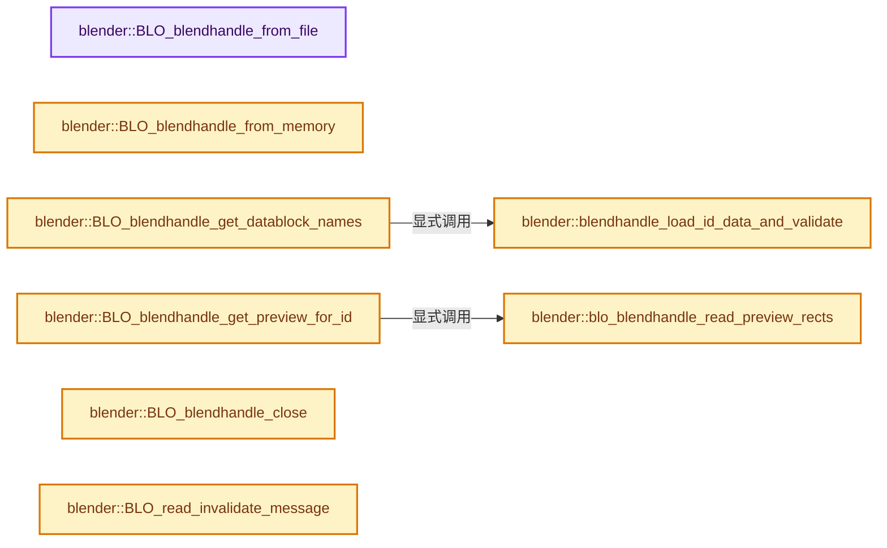
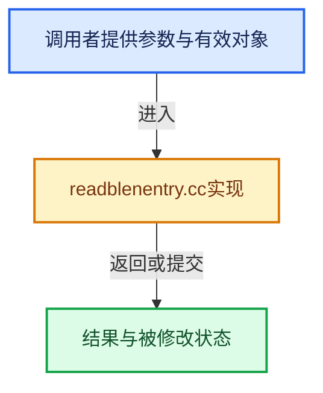

# 实现依赖专题：source/blender/blenloader/intern/readblenentry.cc

[方向导航](README.md) · [符号索引](../%E7%AC%A6%E5%8F%B7%E4%BE%9D%E8%B5%96%E4%B8%8E%E5%AE%9E%E7%8E%B0%E7%B4%A2%E5%BC%95.md)

本专题从正文实际调用进入，集中保存共享实现。函数有稳定锚点，可从调用处直接跳到对应完整函数；递归与互相调用通过回链组织。

## 本文件的实现关系






## 完整成员与函数实现

<a id="f-829b88c9d3187dde"></a>

### `blender::BLO_blendhandle_from_file`

实现位置：[source/blender/blenloader/intern/readblenentry.cc](../../../../../source/blender/blenloader/intern/readblenentry.cc) · L61—L68。

接口参数：

- `const char *filepath`
- `BlendFileReadReport *reports`

**教学注释版**

<!-- annotated:8f97dc43a2cad4 -->

```cpp
BlendHandle *BLO_blendhandle_from_file(const char *filepath, BlendFileReadReport *reports)
{
  BlendHandle *bh;

  bh = reinterpret_cast<BlendHandle *>(blo_filedata_from_file(filepath, reports));

  return bh;
}
```

<details>
<summary>核对原始源码：source/blender/blenloader/intern/readblenentry.cc · L61—L68</summary>

<!-- original:8f97dc43a2cad4:source/blender/blenloader/intern/readblenentry.cc:61:68 -->

```cpp
BlendHandle *BLO_blendhandle_from_file(const char *filepath, BlendFileReadReport *reports)
{
  BlendHandle *bh;

  bh = reinterpret_cast<BlendHandle *>(blo_filedata_from_file(filepath, reports));

  return bh;
}
```

</details>

**沿实际写入检查状态**

- `bh = reinterpret_cast<BlendHandle *>(blo_filedata_from_file(filepath, reports));`

**结果出口**

- `return bh;`

**继续追踪实现**

- `blo_filedata_from_file` → [blo_filedata_from_file · L1314](%E4%BE%9D%E8%B5%96-readfile-05cc37.md#f-f824698e23f33891)。

<a id="f-30126a0defb78ce4"></a>

### `blender::BLO_blendhandle_from_memory`

实现位置：[source/blender/blenloader/intern/readblenentry.cc](../../../../../source/blender/blenloader/intern/readblenentry.cc) · L70—L79。

接口参数：

- `const void *mem`
- `int memsize`
- `BlendFileReadReport *reports`

**教学注释版**

<!-- annotated:caf12f12a239e4 -->

```cpp
BlendHandle *BLO_blendhandle_from_memory(const void *mem,
                                         int memsize,
                                         BlendFileReadReport *reports)
{
  BlendHandle *bh;

  bh = reinterpret_cast<BlendHandle *>(blo_filedata_from_memory(mem, memsize, reports));

  return bh;
}
```

<details>
<summary>核对原始源码：source/blender/blenloader/intern/readblenentry.cc · L70—L79</summary>

<!-- original:caf12f12a239e4:source/blender/blenloader/intern/readblenentry.cc:70:79 -->

```cpp
BlendHandle *BLO_blendhandle_from_memory(const void *mem,
                                         int memsize,
                                         BlendFileReadReport *reports)
{
  BlendHandle *bh;

  bh = reinterpret_cast<BlendHandle *>(blo_filedata_from_memory(mem, memsize, reports));

  return bh;
}
```

</details>

**沿实际写入检查状态**

- `bh = reinterpret_cast<BlendHandle *>(blo_filedata_from_memory(mem, memsize, reports));`

**结果出口**

- `return bh;`

**继续追踪实现**

- `blo_filedata_from_memory` → [blo_filedata_from_memory · L1344](%E4%BE%9D%E8%B5%96-readfile-05cc37.md#f-3d06d34c969ca1ae)。

<a id="f-2ae128ae6169d2f1"></a>

### `blender::blendhandle_load_id_data_and_validate`

实现位置：[source/blender/blenloader/intern/readblenentry.cc](../../../../../source/blender/blenloader/intern/readblenentry.cc) · L89—L118。

接口参数：

- `FileData *fd`
- `BHead *bhead`
- `bool use_assets_only`
- `const char *&r_idname`
- `short &r_idflag`
- `AssetMetaData *&r_asset_meta_data`
- `BLODataBlockInfo::Library *r_library_data`

**教学注释版**

<!-- annotated:78a1086320a3cc -->

```cpp
static bool blendhandle_load_id_data_and_validate(FileData *fd,
                                                  BHead *bhead,
                                                  bool use_assets_only,
                                                  const char *&r_idname,
                                                  short &r_idflag,
                                                  AssetMetaData *&r_asset_meta_data,
                                                  BLODataBlockInfo::Library *r_library_data)
{
  r_idname = blo_bhead_id_name(fd, bhead);
  if (!r_idname || r_idname[0] == '\0') {
    return false;
  }
  r_idflag = blo_bhead_id_flag(fd, bhead);
  if (r_library_data) {
    r_library_data->filepath = blo_bhead_library_filepath(fd, bhead);
    r_library_data->flag = blo_bhead_library_flag(fd, bhead);
  }
  /* Do not list (and therefore allow direct linking of) packed data.
   * While supporting this is conceptually possible, it would require significant changes in
   * the UI (file browser) and UX (link operation) to convey this concept and handle it
   * correctly. */
  if (r_idflag & ID_FLAG_LINKED_AND_PACKED) {
    return false;
  }
  r_asset_meta_data = blo_bhead_id_asset_data_address(fd, bhead);
  if (use_assets_only && r_asset_meta_data == nullptr) {
    return false;
  }
  return true;
}
```

<details>
<summary>核对原始源码：source/blender/blenloader/intern/readblenentry.cc · L89—L118</summary>

<!-- original:78a1086320a3cc:source/blender/blenloader/intern/readblenentry.cc:89:118 -->

```cpp
static bool blendhandle_load_id_data_and_validate(FileData *fd,
                                                  BHead *bhead,
                                                  bool use_assets_only,
                                                  const char *&r_idname,
                                                  short &r_idflag,
                                                  AssetMetaData *&r_asset_meta_data,
                                                  BLODataBlockInfo::Library *r_library_data)
{
  r_idname = blo_bhead_id_name(fd, bhead);
  if (!r_idname || r_idname[0] == '\0') {
    return false;
  }
  r_idflag = blo_bhead_id_flag(fd, bhead);
  if (r_library_data) {
    r_library_data->filepath = blo_bhead_library_filepath(fd, bhead);
    r_library_data->flag = blo_bhead_library_flag(fd, bhead);
  }
  /* Do not list (and therefore allow direct linking of) packed data.
   * While supporting this is conceptually possible, it would require significant changes in
   * the UI (file browser) and UX (link operation) to convey this concept and handle it
   * correctly. */
  if (r_idflag & ID_FLAG_LINKED_AND_PACKED) {
    return false;
  }
  r_asset_meta_data = blo_bhead_id_asset_data_address(fd, bhead);
  if (use_assets_only && r_asset_meta_data == nullptr) {
    return false;
  }
  return true;
}
```

</details>

**沿实际写入检查状态**

- `r_idname = blo_bhead_id_name(fd, bhead);`
- `r_idflag = blo_bhead_id_flag(fd, bhead);`
- `r_library_data->filepath = blo_bhead_library_filepath(fd, bhead);`
- `r_library_data->flag = blo_bhead_library_flag(fd, bhead);`
- `r_asset_meta_data = blo_bhead_id_asset_data_address(fd, bhead);`

**结果出口**

- `return false;`
- `return true;`

**继续追踪实现**

- `blo_bhead_id_name` → [blo_bhead_id_name · L795](%E4%BE%9D%E8%B5%96-readfile-05cc37.md#f-0a880946900541f9)。
- `blo_bhead_id_flag` → [blo_bhead_id_flag · L809](%E4%BE%9D%E8%B5%96-readfile-05cc37.md#f-da79cb9902bb4c5f)。
- `blo_bhead_library_filepath` → [blo_bhead_library_filepath · L842](%E4%BE%9D%E8%B5%96-readfile-05cc37.md#f-e46c56b092003418)。
- `blo_bhead_library_flag` → [blo_bhead_library_flag · L852](%E4%BE%9D%E8%B5%96-readfile-05cc37.md#f-789d36dab92c8231)。
- `blo_bhead_id_asset_data_address` → [blo_bhead_id_asset_data_address · L819](%E4%BE%9D%E8%B5%96-readfile-05cc37.md#f-bdd26d623913247b)。

<a id="f-917b69a8a6f34d1e"></a>

### `blender::BLO_blendhandle_get_datablock_names`

实现位置：[source/blender/blenloader/intern/readblenentry.cc](../../../../../source/blender/blenloader/intern/readblenentry.cc) · L120—L151。

接口参数：

- `BlendHandle *bh`
- `int ofblocktype`
- `const bool use_assets_only`
- `int *r_tot_names`

**教学注释版**

<!-- annotated:d42fa290d21a37 -->

```cpp
LinkNode *BLO_blendhandle_get_datablock_names(BlendHandle *bh,
                                              int ofblocktype,
                                              const bool use_assets_only,
                                              int *r_tot_names)
{
  FileData *fd = reinterpret_cast<FileData *>(bh);
  LinkNode *names = nullptr;
  BHead *bhead;
  int tot = 0;

  for (bhead = blo_bhead_first(fd); bhead; bhead = blo_bhead_next(fd, bhead)) {
    if (bhead->code == ofblocktype) {
      const char *idname;
      short idflag;
      AssetMetaData *asset_meta_data;
      if (!blendhandle_load_id_data_and_validate(
              fd, bhead, use_assets_only, idname, idflag, asset_meta_data, nullptr))
      {
        continue;
      }

      BLI_linklist_prepend(&names, BLI_strdup(idname + 2));
      tot++;
    }
    else if (bhead->code == BLO_CODE_ENDB) {
      break;
    }
  }

  *r_tot_names = tot;
  return names;
}
```

<details>
<summary>核对原始源码：source/blender/blenloader/intern/readblenentry.cc · L120—L151</summary>

<!-- original:d42fa290d21a37:source/blender/blenloader/intern/readblenentry.cc:120:151 -->

```cpp
LinkNode *BLO_blendhandle_get_datablock_names(BlendHandle *bh,
                                              int ofblocktype,
                                              const bool use_assets_only,
                                              int *r_tot_names)
{
  FileData *fd = reinterpret_cast<FileData *>(bh);
  LinkNode *names = nullptr;
  BHead *bhead;
  int tot = 0;

  for (bhead = blo_bhead_first(fd); bhead; bhead = blo_bhead_next(fd, bhead)) {
    if (bhead->code == ofblocktype) {
      const char *idname;
      short idflag;
      AssetMetaData *asset_meta_data;
      if (!blendhandle_load_id_data_and_validate(
              fd, bhead, use_assets_only, idname, idflag, asset_meta_data, nullptr))
      {
        continue;
      }

      BLI_linklist_prepend(&names, BLI_strdup(idname + 2));
      tot++;
    }
    else if (bhead->code == BLO_CODE_ENDB) {
      break;
    }
  }

  *r_tot_names = tot;
  return names;
}
```

</details>

**结果出口**

- `return names;`

**继续追踪实现**

- `blo_bhead_first` → [blo_bhead_first · L695](%E4%BE%9D%E8%B5%96-readfile-05cc37.md#f-e0798146be6c7f24)。
- `blo_bhead_next` → [blo_bhead_next · L723](%E4%BE%9D%E8%B5%96-readfile-05cc37.md#f-f34734add532cb74)。
- `blendhandle_load_id_data_and_validate` → [blender::blendhandle_load_id_data_and_validate · L89](%E4%BE%9D%E8%B5%96-readblenentry-9e660c.md#f-2ae128ae6169d2f1)。
- `BLI_linklist_prepend` → [blender::BLI_linklist_prepend · L163](../01-%E5%9F%BA%E7%A1%80%E5%AE%B9%E5%99%A8%E4%B8%8E%E7%8E%B0%E4%BB%A3CPP/%E4%BE%9D%E8%B5%96-BLI_linklist-23c475.md#f-b35d8489bdf7cbce)。
- `BLI_strdup` → [blender::BLI_strdup · L43](../01-%E5%9F%BA%E7%A1%80%E5%AE%B9%E5%99%A8%E4%B8%8E%E7%8E%B0%E4%BB%A3CPP/%E4%BE%9D%E8%B5%96-string-1d986f.md#f-7e6d5c696c20c0e1)。

<a id="f-39764b42c9f4da29"></a>

### `blender::blo_blendhandle_read_preview_rects`

实现位置：[source/blender/blenloader/intern/readblenentry.cc](../../../../../source/blender/blenloader/intern/readblenentry.cc) · L243—L271。

接口参数：

- `FileData *fd`
- `BHead *bhead`
- `PreviewImage *result`
- `const PreviewImage *preview_from_file`

**教学注释版**

<!-- annotated:2f334c9fdf40ac -->

```cpp
static BHead *blo_blendhandle_read_preview_rects(FileData *fd,
                                                 BHead *bhead,
                                                 PreviewImage *result,
                                                 const PreviewImage *preview_from_file)
{
  for (int preview_index = 0; preview_index < NUM_ICON_SIZES; preview_index++) {
    if (preview_from_file->rect[preview_index] && preview_from_file->w[preview_index] &&
        preview_from_file->h[preview_index])
    {
      bhead = blo_bhead_next(fd, bhead);
      BLI_assert((preview_from_file->w[preview_index] * preview_from_file->h[preview_index] *
                  sizeof(uint)) == bhead->len);
      result->rect[preview_index] = static_cast<uint *>(
          BLO_library_read_struct(fd, bhead, "PreviewImage Icon Rect"));
    }
    else {
      /* This should not be needed, but can happen in 'broken' .blend files,
       * better handle this gracefully than crashing. */
      BLI_assert(preview_from_file->rect[preview_index] == nullptr &&
                 preview_from_file->w[preview_index] == 0 &&
                 preview_from_file->h[preview_index] == 0);
      result->rect[preview_index] = nullptr;
      result->w[preview_index] = result->h[preview_index] = 0;
    }
    result->flag[preview_index] &= ~PRV_RENDERING;
  }

  return bhead;
}
```

<details>
<summary>核对原始源码：source/blender/blenloader/intern/readblenentry.cc · L243—L271</summary>

<!-- original:2f334c9fdf40ac:source/blender/blenloader/intern/readblenentry.cc:243:271 -->

```cpp
static BHead *blo_blendhandle_read_preview_rects(FileData *fd,
                                                 BHead *bhead,
                                                 PreviewImage *result,
                                                 const PreviewImage *preview_from_file)
{
  for (int preview_index = 0; preview_index < NUM_ICON_SIZES; preview_index++) {
    if (preview_from_file->rect[preview_index] && preview_from_file->w[preview_index] &&
        preview_from_file->h[preview_index])
    {
      bhead = blo_bhead_next(fd, bhead);
      BLI_assert((preview_from_file->w[preview_index] * preview_from_file->h[preview_index] *
                  sizeof(uint)) == bhead->len);
      result->rect[preview_index] = static_cast<uint *>(
          BLO_library_read_struct(fd, bhead, "PreviewImage Icon Rect"));
    }
    else {
      /* This should not be needed, but can happen in 'broken' .blend files,
       * better handle this gracefully than crashing. */
      BLI_assert(preview_from_file->rect[preview_index] == nullptr &&
                 preview_from_file->w[preview_index] == 0 &&
                 preview_from_file->h[preview_index] == 0);
      result->rect[preview_index] = nullptr;
      result->w[preview_index] = result->h[preview_index] = 0;
    }
    result->flag[preview_index] &= ~PRV_RENDERING;
  }

  return bhead;
}
```

</details>

**沿实际写入检查状态**

- `bhead = blo_bhead_next(fd, bhead);`
- `result->rect[preview_index] = static_cast<uint *>(`
- `result->rect[preview_index] = nullptr;`
- `result->w[preview_index] = result->h[preview_index] = 0;`
- `result->flag[preview_index] &= ~PRV_RENDERING;`

**结果出口**

- `return bhead;`

**继续追踪实现**

- `blo_bhead_next` → [blo_bhead_next · L723](%E4%BE%9D%E8%B5%96-readfile-05cc37.md#f-f34734add532cb74)。
- `BLI_assert` → [BLI_assert · L48](../01-%E5%9F%BA%E7%A1%80%E5%AE%B9%E5%99%A8%E4%B8%8E%E7%8E%B0%E4%BB%A3CPP/%E4%BE%9D%E8%B5%96-BLI_assert-cc98e8.md#m-57a88495704d)；[BLI_assert · L63](../01-%E5%9F%BA%E7%A1%80%E5%AE%B9%E5%99%A8%E4%B8%8E%E7%8E%B0%E4%BB%A3CPP/%E4%BE%9D%E8%B5%96-BLI_assert-cc98e8.md#m-d07050020cb5)。宏定义由构建条件选择。
- `BLO_library_read_struct` → [BLO_library_read_struct · L5774](%E4%BE%9D%E8%B5%96-readfile-05cc37.md#f-1a77b8d70c83e276)。

<a id="f-45f38e7678117279"></a>

### `blender::BLO_blendhandle_get_preview_for_id`

实现位置：[source/blender/blenloader/intern/readblenentry.cc](../../../../../source/blender/blenloader/intern/readblenentry.cc) · L273—L312。

接口参数：

- `BlendHandle *bh`
- `int ofblocktype`
- `const char *name`

**教学注释版**

<!-- annotated:73f6140286b94e -->

```cpp
PreviewImage *BLO_blendhandle_get_preview_for_id(BlendHandle *bh,
                                                 int ofblocktype,
                                                 const char *name)
{
  FileData *fd = reinterpret_cast<FileData *>(bh);
  bool looking = false;
  const int sdna_preview_image = DNA_struct_find_with_alias(fd->filesdna.get(), "PreviewImage");

  for (BHead *bhead = blo_bhead_first(fd); bhead; bhead = blo_bhead_next(fd, bhead)) {
    if (bhead->code == BLO_CODE_DATA) {
      if (looking && bhead->SDNAnr == sdna_preview_image) {
        PreviewImage *preview_from_file = static_cast<PreviewImage *>(
            BLO_library_read_struct(fd, bhead, "PreviewImage"));

        if (preview_from_file == nullptr) {
          break;
        }

        PreviewImage *result = MEM_dupalloc(preview_from_file);
        result->runtime = MEM_new<bke::PreviewImageRuntime>(__func__);
        bhead = blo_blendhandle_read_preview_rects(fd, bhead, result, preview_from_file);
        MEM_delete(preview_from_file);
        return result;
      }
    }
    else if (looking || bhead->code == BLO_CODE_ENDB) {
      /* We were looking for a preview image, but didn't find any belonging to block. So it doesn't
       * exist. */
      break;
    }
    else if (bhead->code == ofblocktype) {
      const char *idname = blo_bhead_id_name(fd, bhead);
      if (idname && STREQ(&idname[2], name)) {
        looking = true;
      }
    }
  }

  return nullptr;
}
```

<details>
<summary>核对原始源码：source/blender/blenloader/intern/readblenentry.cc · L273—L312</summary>

<!-- original:73f6140286b94e:source/blender/blenloader/intern/readblenentry.cc:273:312 -->

```cpp
PreviewImage *BLO_blendhandle_get_preview_for_id(BlendHandle *bh,
                                                 int ofblocktype,
                                                 const char *name)
{
  FileData *fd = reinterpret_cast<FileData *>(bh);
  bool looking = false;
  const int sdna_preview_image = DNA_struct_find_with_alias(fd->filesdna.get(), "PreviewImage");

  for (BHead *bhead = blo_bhead_first(fd); bhead; bhead = blo_bhead_next(fd, bhead)) {
    if (bhead->code == BLO_CODE_DATA) {
      if (looking && bhead->SDNAnr == sdna_preview_image) {
        PreviewImage *preview_from_file = static_cast<PreviewImage *>(
            BLO_library_read_struct(fd, bhead, "PreviewImage"));

        if (preview_from_file == nullptr) {
          break;
        }

        PreviewImage *result = MEM_dupalloc(preview_from_file);
        result->runtime = MEM_new<bke::PreviewImageRuntime>(__func__);
        bhead = blo_blendhandle_read_preview_rects(fd, bhead, result, preview_from_file);
        MEM_delete(preview_from_file);
        return result;
      }
    }
    else if (looking || bhead->code == BLO_CODE_ENDB) {
      /* We were looking for a preview image, but didn't find any belonging to block. So it doesn't
       * exist. */
      break;
    }
    else if (bhead->code == ofblocktype) {
      const char *idname = blo_bhead_id_name(fd, bhead);
      if (idname && STREQ(&idname[2], name)) {
        looking = true;
      }
    }
  }

  return nullptr;
}
```

</details>

**沿实际写入检查状态**

- `result->runtime = MEM_new<bke::PreviewImageRuntime>(__func__);`
- `bhead = blo_blendhandle_read_preview_rects(fd, bhead, result, preview_from_file);`
- `looking = true;`

**结果出口**

- `return result;`
- `return nullptr;`

**继续追踪实现**

- `DNA_struct_find_with_alias` → [blender::DNA_struct_find_with_alias · L260](%E4%BE%9D%E8%B5%96-dna_genfile-f567f8.md#f-f3b3eeba5ac5b125)。
- `fd->filesdna.get` → [调用协议](../%E6%A8%A1%E6%9D%BF%E5%AE%8F%E4%B8%8E%E5%8A%A8%E6%80%81%E5%88%86%E6%B4%BE%E5%8D%8F%E8%AE%AE.md)：接收对象类型依赖auto、返回值或模板实例；不按同名猜测目标。调用位置L279。
- `blo_bhead_first` → [blo_bhead_first · L695](%E4%BE%9D%E8%B5%96-readfile-05cc37.md#f-e0798146be6c7f24)。
- `blo_bhead_next` → [blo_bhead_next · L723](%E4%BE%9D%E8%B5%96-readfile-05cc37.md#f-f34734add532cb74)。
- `BLO_library_read_struct` → [BLO_library_read_struct · L5774](%E4%BE%9D%E8%B5%96-readfile-05cc37.md#f-1a77b8d70c83e276)。
- `MEM_dupalloc` → [MEM_dupalloc · L627](../03-%E5%86%85%E5%AD%98%E5%88%86%E9%85%8D%E4%B8%8E%E8%BF%90%E8%A1%8C%E6%97%B6%E7%B1%BB%E5%9E%8B/%E4%BE%9D%E8%B5%96-MEM_guardedalloc-b54eca.md#f-78a72b71e3c57010)。
- `MEM_new<bke::PreviewImageRuntime>` → [MEM_new · L351](../03-%E5%86%85%E5%AD%98%E5%88%86%E9%85%8D%E4%B8%8E%E8%BF%90%E8%A1%8C%E6%97%B6%E7%B1%BB%E5%9E%8B/%E4%BE%9D%E8%B5%96-MEM_guardedalloc-b54eca.md#f-115f9b6784f89912)。
- `blo_blendhandle_read_preview_rects` → [blender::blo_blendhandle_read_preview_rects · L243](%E4%BE%9D%E8%B5%96-readblenentry-9e660c.md#f-39764b42c9f4da29)。
- `MEM_delete` → [MEM_delete · L400](../03-%E5%86%85%E5%AD%98%E5%88%86%E9%85%8D%E4%B8%8E%E8%BF%90%E8%A1%8C%E6%97%B6%E7%B1%BB%E5%9E%8B/%E4%BE%9D%E8%B5%96-MEM_guardedalloc-b54eca.md#f-9049ffdd1682887c)。
- `blo_bhead_id_name` → [blo_bhead_id_name · L795](%E4%BE%9D%E8%B5%96-readfile-05cc37.md#f-0a880946900541f9)。
- `STREQ` → [STREQ · L112](%E4%BE%9D%E8%B5%96-GHOST_utildefines-34b996.md#m-9549fb6aafd2)；[STREQ · L451](../01-%E5%9F%BA%E7%A1%80%E5%AE%B9%E5%99%A8%E4%B8%8E%E7%8E%B0%E4%BB%A3CPP/%E4%BE%9D%E8%B5%96-BLI_utildefines-293a0a.md#m-c7b745bcfad2)；[STREQ · L55](%E4%BE%9D%E8%B5%96-clog-a0bec8.md#m-96e78f386894)。宏定义由构建条件选择。

<a id="f-033840da4970db23"></a>

### `blender::BLO_blendhandle_close`

实现位置：[source/blender/blenloader/intern/readblenentry.cc](../../../../../source/blender/blenloader/intern/readblenentry.cc) · L339—L344。

接口参数：

- `BlendHandle *bh`

**教学注释版**

<!-- annotated:8685a75b4a585a -->

```cpp
void BLO_blendhandle_close(BlendHandle *bh)
{
  FileData *fd = reinterpret_cast<FileData *>(bh);

  blo_filedata_free(fd);
}
```

<details>
<summary>核对原始源码：source/blender/blenloader/intern/readblenentry.cc · L339—L344</summary>

<!-- original:8685a75b4a585a:source/blender/blenloader/intern/readblenentry.cc:339:344 -->

```cpp
void BLO_blendhandle_close(BlendHandle *bh)
{
  FileData *fd = reinterpret_cast<FileData *>(bh);

  blo_filedata_free(fd);
}
```

</details>

**继续追踪实现**

- `blo_filedata_free` → [blo_filedata_free · L1382](%E4%BE%9D%E8%B5%96-readfile-05cc37.md#f-208087b37a794bda)。

<a id="f-7551c9d6bf93b021"></a>

### `blender::BLO_read_invalidate_message`

实现位置：[source/blender/blenloader/intern/readblenentry.cc](../../../../../source/blender/blenloader/intern/readblenentry.cc) · L346—L351。

接口参数：

- `BlendHandle *bh`
- `Main *bmain`
- `const char *message`

**教学注释版**

<!-- annotated:dcd02172cad6f5 -->

```cpp
void BLO_read_invalidate_message(BlendHandle *bh, Main *bmain, const char *message)
{
  FileData *fd = reinterpret_cast<FileData *>(bh);

  blo_readfile_invalidate(fd, bmain, message);
}
```

<details>
<summary>核对原始源码：source/blender/blenloader/intern/readblenentry.cc · L346—L351</summary>

<!-- original:dcd02172cad6f5:source/blender/blenloader/intern/readblenentry.cc:346:351 -->

```cpp
void BLO_read_invalidate_message(BlendHandle *bh, Main *bmain, const char *message)
{
  FileData *fd = reinterpret_cast<FileData *>(bh);

  blo_readfile_invalidate(fd, bmain, message);
}
```

</details>

**继续追踪实现**

- `blo_readfile_invalidate` → [blender::blo_readfile_invalidate · L580](%E4%BE%9D%E8%B5%96-readfile-05cc37.md#f-91d82310e0ee1436)。

<a id="f-e71f699269b652f7"></a>

### `blender::BLO_read_from_memory`

实现位置：[source/blender/blenloader/intern/readblenentry.cc](../../../../../source/blender/blenloader/intern/readblenentry.cc) · L375—L393。

接口参数：

- `const void *mem`
- `int memsize`
- `eBLOReadSkip skip_flags`
- `ReportList *reports`

**教学注释版**

<!-- annotated:9ed3d7363eef77 -->

```cpp
BlendFileData *BLO_read_from_memory(const void *mem,
                                    int memsize,
                                    eBLOReadSkip skip_flags,
                                    ReportList *reports)
{
  BlendFileData *bfd = nullptr;
  FileData *fd;
  BlendFileReadReport bf_reports{};
  bf_reports.reports = reports;

  fd = blo_filedata_from_memory(mem, memsize, &bf_reports);
  if (fd) {
    fd->skip_flags = skip_flags;
    bfd = blo_read_file_internal(fd, "");
    blo_filedata_free(fd);
  }

  return bfd;
}
```

<details>
<summary>核对原始源码：source/blender/blenloader/intern/readblenentry.cc · L375—L393</summary>

<!-- original:9ed3d7363eef77:source/blender/blenloader/intern/readblenentry.cc:375:393 -->

```cpp
BlendFileData *BLO_read_from_memory(const void *mem,
                                    int memsize,
                                    eBLOReadSkip skip_flags,
                                    ReportList *reports)
{
  BlendFileData *bfd = nullptr;
  FileData *fd;
  BlendFileReadReport bf_reports{};
  bf_reports.reports = reports;

  fd = blo_filedata_from_memory(mem, memsize, &bf_reports);
  if (fd) {
    fd->skip_flags = skip_flags;
    bfd = blo_read_file_internal(fd, "");
    blo_filedata_free(fd);
  }

  return bfd;
}
```

</details>

**沿实际写入检查状态**

- `bf_reports.reports = reports;`
- `fd = blo_filedata_from_memory(mem, memsize, &bf_reports);`
- `fd->skip_flags = skip_flags;`
- `bfd = blo_read_file_internal(fd, "");`

**结果出口**

- `return bfd;`

**继续追踪实现**

- `blo_filedata_from_memory` → [blo_filedata_from_memory · L1344](%E4%BE%9D%E8%B5%96-readfile-05cc37.md#f-3d06d34c969ca1ae)。
- `blo_read_file_internal` → [blo_read_file_internal · L4285](%E4%BE%9D%E8%B5%96-readfile-05cc37.md#f-d6babff9a15bfc5b)。
- `blo_filedata_free` → [blo_filedata_free · L1382](%E4%BE%9D%E8%B5%96-readfile-05cc37.md#f-208087b37a794bda)。

<a id="f-57e6642e7d216aa5"></a>

### `blender::BLO_read_do_version_after_setup`

实现位置：[source/blender/blenloader/intern/readblenentry.cc](../../../../../source/blender/blenloader/intern/readblenentry.cc) · L463—L468。

接口参数：

- `Main *new_bmain`
- `BlendfileLinkAppendContext *lapp_context`
- `BlendFileReadReport *reports`

**教学注释版**

<!-- annotated:4b6b509934b117 -->

```cpp
void BLO_read_do_version_after_setup(Main *new_bmain,
                                     BlendfileLinkAppendContext *lapp_context,
                                     BlendFileReadReport *reports)
{
  do_versions_after_setup(new_bmain, lapp_context, reports);
}
```

<details>
<summary>核对原始源码：source/blender/blenloader/intern/readblenentry.cc · L463—L468</summary>

<!-- original:4b6b509934b117:source/blender/blenloader/intern/readblenentry.cc:463:468 -->

```cpp
void BLO_read_do_version_after_setup(Main *new_bmain,
                                     BlendfileLinkAppendContext *lapp_context,
                                     BlendFileReadReport *reports)
{
  do_versions_after_setup(new_bmain, lapp_context, reports);
}
```

</details>

**继续追踪实现**

- `do_versions_after_setup` → [blender::do_versions_after_setup · L806](%E4%BE%9D%E8%B5%96-versioning_common-5f7e5c.md#f-ec47e2f892361910)。
