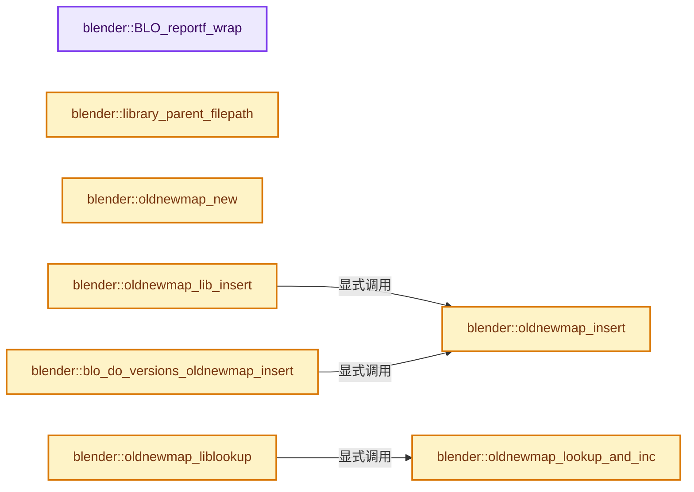
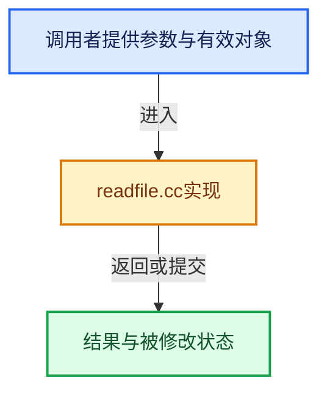

# 实现依赖专题：source/blender/blenloader/intern/readfile.cc

[方向导航](README.md) · [符号索引](../%E7%AC%A6%E5%8F%B7%E4%BE%9D%E8%B5%96%E4%B8%8E%E5%AE%9E%E7%8E%B0%E7%B4%A2%E5%BC%95.md)

本专题从正文实际调用进入，集中保存共享实现。函数有稳定锚点，可从调用处直接跳到对应完整函数；递归与互相调用通过回链组织。

## 本文件的实现关系






<a id="m-104cd1569bff"></a>

## 宏 `BHEADN_FROM_BHEAD`

<!-- annotated:a53c08ba944b35 -->

```cpp
#define BHEADN_FROM_BHEAD(bh) ((BHeadN *)POINTER_OFFSET(bh, -int(offsetof(BHeadN, bhead))))

```

<details>
<summary>核对原始源码：source/blender/blenloader/intern/readfile.cc · L216—L217</summary>

<!-- original:a53c08ba944b35:source/blender/blenloader/intern/readfile.cc:216:217 -->

```cpp
#define BHEADN_FROM_BHEAD(bh) ((BHeadN *)POINTER_OFFSET(bh, -int(offsetof(BHeadN, bhead))))

```

</details>

宏在预处理阶段展开，参数替换、重复求值和条件编译应直接从该定义检查。与普通函数不同，宏不会自动提供参数类型检查；构建配置选择哪个定义需结合外围条件。

<a id="m-51242d6de2e4"></a>

## 宏 `BHEAD_USE_READ_ON_DEMAND`

<!-- annotated:a1d14699cfe199 -->

```cpp
#define BHEAD_USE_READ_ON_DEMAND(bhead) ((bhead)->code == BLO_CODE_DATA)

```

<details>
<summary>核对原始源码：source/blender/blenloader/intern/readfile.cc · L222—L223</summary>

<!-- original:a1d14699cfe199:source/blender/blenloader/intern/readfile.cc:222:223 -->

```cpp
#define BHEAD_USE_READ_ON_DEMAND(bhead) ((bhead)->code == BLO_CODE_DATA)

```

</details>

宏在预处理阶段展开，参数替换、重复求值和条件编译应直接从该定义检查。与普通函数不同，宏不会自动提供参数类型检查；构建配置选择哪个定义需结合外围条件。

## 完整成员与函数实现

<a id="f-404ef4f090c5be59"></a>

### `blender::BLO_reportf_wrap`

实现位置：[source/blender/blenloader/intern/readfile.cc](../../../../../source/blender/blenloader/intern/readfile.cc) · L228—L248。

接口参数：

- `BlendFileReadReport *reports`
- `const eReportType type`
- `const char *format`

**教学注释版**

<!-- annotated:e0bb1e7cda7f22 -->

```cpp
void BLO_reportf_wrap(BlendFileReadReport *reports,
                      const eReportType type,
                      const char *format,
                      ...)
{
  char fixed_buf[1024]; /* should be long enough */

  va_list args;

  va_start(args, format);
  vsnprintf(fixed_buf, sizeof(fixed_buf), format, args);
  va_end(args);

  fixed_buf[sizeof(fixed_buf) - 1] = '\0';

  BKE_report(reports->reports, type, fixed_buf);

  if (G.background == 0) {
    BKE_report_log(type, fixed_buf, &LOG);
  }
}
```

<details>
<summary>核对原始源码：source/blender/blenloader/intern/readfile.cc · L228—L248</summary>

<!-- original:e0bb1e7cda7f22:source/blender/blenloader/intern/readfile.cc:228:248 -->

```cpp
void BLO_reportf_wrap(BlendFileReadReport *reports,
                      const eReportType type,
                      const char *format,
                      ...)
{
  char fixed_buf[1024]; /* should be long enough */

  va_list args;

  va_start(args, format);
  vsnprintf(fixed_buf, sizeof(fixed_buf), format, args);
  va_end(args);

  fixed_buf[sizeof(fixed_buf) - 1] = '\0';

  BKE_report(reports->reports, type, fixed_buf);

  if (G.background == 0) {
    BKE_report_log(type, fixed_buf, &LOG);
  }
}
```

</details>

**继续追踪实现**

- `va_start` → [调用协议](../%E6%A8%A1%E6%9D%BF%E5%AE%8F%E4%B8%8E%E5%8A%A8%E6%80%81%E5%88%86%E6%B4%BE%E5%8D%8F%E8%AE%AE.md)：函数指针、局部可调用对象或未展开的宏；必须结合调用者环境。调用位置L237。
- `vsnprintf` → [外部契约](https://eel.is/c++draft/)：这个边界按实际表达式及所属类型核对参数、返回值、寿命与失败行为。这里提供接口入口，不声称已解释该第三方版本的内部实现。
- `va_end` → [调用协议](../%E6%A8%A1%E6%9D%BF%E5%AE%8F%E4%B8%8E%E5%8A%A8%E6%80%81%E5%88%86%E6%B4%BE%E5%8D%8F%E8%AE%AE.md)：函数指针、局部可调用对象或未展开的宏；必须结合调用者环境。调用位置L239。
- `BKE_report` → [blender::BKE_report · L162](%E4%BE%9D%E8%B5%96-report-f916fd.md#f-56816f68adfe537b)。
- `BKE_report_log` → [blender::BKE_report_log · L42](%E4%BE%9D%E8%B5%96-report-f916fd.md#f-330829acc3b50256)。

<a id="f-21066f5d9b7fada1"></a>

### `blender::library_parent_filepath`

实现位置：[source/blender/blenloader/intern/readfile.cc](../../../../../source/blender/blenloader/intern/readfile.cc) · L251—L254。

接口参数：

- `Library *lib`

**教学注释版**

<!-- annotated:c8a441e15a8420 -->

```cpp
static const char *library_parent_filepath(Library *lib)
{
  return lib->runtime->parent ? lib->runtime->parent->runtime->filepath_abs : "<direct>";
}
```

<details>
<summary>核对原始源码：source/blender/blenloader/intern/readfile.cc · L251—L254</summary>

<!-- original:c8a441e15a8420:source/blender/blenloader/intern/readfile.cc:251:254 -->

```cpp
static const char *library_parent_filepath(Library *lib)
{
  return lib->runtime->parent ? lib->runtime->parent->runtime->filepath_abs : "<direct>";
}
```

</details>

**结果出口**

- `return lib->runtime->parent ? lib->runtime->parent->runtime->filepath_abs : "<direct>";`

**继续追踪实现**

本实现没有需要继续展开的显式调用；检查返回表达式、对象转换和调用者前置条件。

<a id="f-e6a69d54200af849"></a>

### `blender::oldnewmap_new`

实现位置：[source/blender/blenloader/intern/readfile.cc](../../../../../source/blender/blenloader/intern/readfile.cc) · L281—L284。

**教学注释版**

<!-- annotated:b9dcda14dbd9a1 -->

```cpp
static OldNewMap *oldnewmap_new()
{
  return MEM_new<OldNewMap>(__func__);
}
```

<details>
<summary>核对原始源码：source/blender/blenloader/intern/readfile.cc · L281—L284</summary>

<!-- original:b9dcda14dbd9a1:source/blender/blenloader/intern/readfile.cc:281:284 -->

```cpp
static OldNewMap *oldnewmap_new()
{
  return MEM_new<OldNewMap>(__func__);
}
```

</details>

**结果出口**

- `return MEM_new<OldNewMap>(__func__);`

**继续追踪实现**

- `MEM_new<OldNewMap>` → [MEM_new · L351](../03-%E5%86%85%E5%AD%98%E5%88%86%E9%85%8D%E4%B8%8E%E8%BF%90%E8%A1%8C%E6%97%B6%E7%B1%BB%E5%9E%8B/%E4%BE%9D%E8%B5%96-MEM_guardedalloc-b54eca.md#f-115f9b6784f89912)。

<a id="f-29ce47003e938b4b"></a>

### `blender::oldnewmap_insert`

实现位置：[source/blender/blenloader/intern/readfile.cc](../../../../../source/blender/blenloader/intern/readfile.cc) · L290—L298。

接口参数：

- `OldNewMap *onm`
- `const void *oldaddr`
- `void *newaddr`
- `const int nr`
- `const int64_t alloc_len = 0`

**教学注释版**

<!-- annotated:ac9ee18040df88 -->

```cpp
static bool oldnewmap_insert(
    OldNewMap *onm, const void *oldaddr, void *newaddr, const int nr, const int64_t alloc_len = 0)
{
  if (oldaddr == nullptr || newaddr == nullptr) {
    return false;
  }

  return onm->map.add_overwrite(oldaddr, NewAddress{newaddr, alloc_len, nr});
}
```

<details>
<summary>核对原始源码：source/blender/blenloader/intern/readfile.cc · L290—L298</summary>

<!-- original:ac9ee18040df88:source/blender/blenloader/intern/readfile.cc:290:298 -->

```cpp
static bool oldnewmap_insert(
    OldNewMap *onm, const void *oldaddr, void *newaddr, const int nr, const int64_t alloc_len = 0)
{
  if (oldaddr == nullptr || newaddr == nullptr) {
    return false;
  }

  return onm->map.add_overwrite(oldaddr, NewAddress{newaddr, alloc_len, nr});
}
```

</details>

**结果出口**

- `return false;`
- `return onm->map.add_overwrite(oldaddr, NewAddress{newaddr, alloc_len, nr});`

**继续追踪实现**

- `onm->map.add_overwrite` → [调用协议](../%E6%A8%A1%E6%9D%BF%E5%AE%8F%E4%B8%8E%E5%8A%A8%E6%80%81%E5%88%86%E6%B4%BE%E5%8D%8F%E8%AE%AE.md)：接收对象类型依赖auto、返回值或模板实例；不按同名猜测目标。调用位置L297。

<a id="f-e188ed0b42ab4d60"></a>

### `blender::oldnewmap_lib_insert`

实现位置：[source/blender/blenloader/intern/readfile.cc](../../../../../source/blender/blenloader/intern/readfile.cc) · L300—L303。

接口参数：

- `FileData *fd`
- `const void *oldaddr`
- `ID *newaddr`
- `const int id_code`

**教学注释版**

<!-- annotated:8627021a0923a5 -->

```cpp
static void oldnewmap_lib_insert(FileData *fd, const void *oldaddr, ID *newaddr, const int id_code)
{
  oldnewmap_insert(fd->libmap, oldaddr, newaddr, id_code);
}
```

<details>
<summary>核对原始源码：source/blender/blenloader/intern/readfile.cc · L300—L303</summary>

<!-- original:8627021a0923a5:source/blender/blenloader/intern/readfile.cc:300:303 -->

```cpp
static void oldnewmap_lib_insert(FileData *fd, const void *oldaddr, ID *newaddr, const int id_code)
{
  oldnewmap_insert(fd->libmap, oldaddr, newaddr, id_code);
}
```

</details>

**继续追踪实现**

- `oldnewmap_insert` → [blender::oldnewmap_insert · L290](%E4%BE%9D%E8%B5%96-readfile-05cc37.md#f-29ce47003e938b4b)。

<a id="f-4799f7d63cd90c37"></a>

### `blender::blo_do_versions_oldnewmap_insert`

实现位置：[source/blender/blenloader/intern/readfile.cc](../../../../../source/blender/blenloader/intern/readfile.cc) · L305—L311。

接口参数：

- `OldNewMap *onm`
- `const void *oldaddr`
- `void *newaddr`
- `const int nr`

**教学注释版**

<!-- annotated:578e988f3210c3 -->

```cpp
void blo_do_versions_oldnewmap_insert(OldNewMap *onm,
                                      const void *oldaddr,
                                      void *newaddr,
                                      const int nr)
{
  oldnewmap_insert(onm, oldaddr, newaddr, nr);
}
```

<details>
<summary>核对原始源码：source/blender/blenloader/intern/readfile.cc · L305—L311</summary>

<!-- original:578e988f3210c3:source/blender/blenloader/intern/readfile.cc:305:311 -->

```cpp
void blo_do_versions_oldnewmap_insert(OldNewMap *onm,
                                      const void *oldaddr,
                                      void *newaddr,
                                      const int nr)
{
  oldnewmap_insert(onm, oldaddr, newaddr, nr);
}
```

</details>

**继续追踪实现**

- `oldnewmap_insert` → [blender::oldnewmap_insert · L290](%E4%BE%9D%E8%B5%96-readfile-05cc37.md#f-29ce47003e938b4b)。

<a id="f-a7cd915edc626cef"></a>

### `blender::oldnewmap_lookup_and_inc`

实现位置：[source/blender/blenloader/intern/readfile.cc](../../../../../source/blender/blenloader/intern/readfile.cc) · L313—L329。

接口参数：

- `OldNewMap *onm`
- `const void *addr`
- `const bool increase_users`
- `int64_t *r_alloc_len = nullptr`

**教学注释版**

<!-- annotated:6c4ae7226fea9b -->

```cpp
static void *oldnewmap_lookup_and_inc(OldNewMap *onm,
                                      const void *addr,
                                      const bool increase_users,
                                      int64_t *r_alloc_len = nullptr)
{
  NewAddress *entry = onm->map.lookup_ptr(addr);
  if (entry == nullptr) {
    return nullptr;
  }
  if (increase_users) {
    entry->nr++;
  }
  if (r_alloc_len) {
    *r_alloc_len = entry->alloc_len;
  }
  return entry->newp;
}
```

<details>
<summary>核对原始源码：source/blender/blenloader/intern/readfile.cc · L313—L329</summary>

<!-- original:6c4ae7226fea9b:source/blender/blenloader/intern/readfile.cc:313:329 -->

```cpp
static void *oldnewmap_lookup_and_inc(OldNewMap *onm,
                                      const void *addr,
                                      const bool increase_users,
                                      int64_t *r_alloc_len = nullptr)
{
  NewAddress *entry = onm->map.lookup_ptr(addr);
  if (entry == nullptr) {
    return nullptr;
  }
  if (increase_users) {
    entry->nr++;
  }
  if (r_alloc_len) {
    *r_alloc_len = entry->alloc_len;
  }
  return entry->newp;
}
```

</details>

**结果出口**

- `return nullptr;`
- `return entry->newp;`

**继续追踪实现**

- `onm->map.lookup_ptr` → [调用协议](../%E6%A8%A1%E6%9D%BF%E5%AE%8F%E4%B8%8E%E5%8A%A8%E6%80%81%E5%88%86%E6%B4%BE%E5%8D%8F%E8%AE%AE.md)：接收对象类型依赖auto、返回值或模板实例；不按同名猜测目标。调用位置L318。

<a id="f-4ab5663bad4be20e"></a>

### `blender::oldnewmap_liblookup`

实现位置：[source/blender/blenloader/intern/readfile.cc](../../../../../source/blender/blenloader/intern/readfile.cc) · L332—L346。

接口参数：

- `OldNewMap *onm`
- `const void *addr`
- `const bool is_linked_only`

**教学注释版**

<!-- annotated:529100397e526c -->

```cpp
static void *oldnewmap_liblookup(OldNewMap *onm, const void *addr, const bool is_linked_only)
{
  if (addr == nullptr) {
    return nullptr;
  }

  ID *id = static_cast<ID *>(oldnewmap_lookup_and_inc(onm, addr, false));
  if (id == nullptr) {
    return nullptr;
  }
  if (!is_linked_only || ID_IS_LINKED(id)) {
    return id;
  }
  return nullptr;
}
```

<details>
<summary>核对原始源码：source/blender/blenloader/intern/readfile.cc · L332—L346</summary>

<!-- original:529100397e526c:source/blender/blenloader/intern/readfile.cc:332:346 -->

```cpp
static void *oldnewmap_liblookup(OldNewMap *onm, const void *addr, const bool is_linked_only)
{
  if (addr == nullptr) {
    return nullptr;
  }

  ID *id = static_cast<ID *>(oldnewmap_lookup_and_inc(onm, addr, false));
  if (id == nullptr) {
    return nullptr;
  }
  if (!is_linked_only || ID_IS_LINKED(id)) {
    return id;
  }
  return nullptr;
}
```

</details>

**结果出口**

- `return nullptr;`
- `return id;`

**继续追踪实现**

- `oldnewmap_lookup_and_inc` → [blender::oldnewmap_lookup_and_inc · L313](%E4%BE%9D%E8%B5%96-readfile-05cc37.md#f-a7cd915edc626cef)。
- `ID_IS_LINKED` → [ID_IS_LINKED · L697](%E4%BE%9D%E8%B5%96-DNA_ID-3eb091.md#m-7e1e1e9b20e6)。宏定义由构建条件选择。

<a id="f-d25abf725327ad86"></a>

### `blender::oldnewmap_clear`

实现位置：[source/blender/blenloader/intern/readfile.cc](../../../../../source/blender/blenloader/intern/readfile.cc) · L348—L357。

接口参数：

- `OldNewMap *onm`

**教学注释版**

<!-- annotated:90b7004f488a89 -->

```cpp
static void oldnewmap_clear(OldNewMap *onm)
{
  /* Free unused data. */
  for (NewAddress &new_addr : onm->map.values()) {
    if (new_addr.nr == 0) {
      // [讲解] MEM_delete_void：以原始存储释放约定调用当前后端。
      MEM_delete_void(new_addr.newp);
    }
  }
  onm->map.clear();
}
```

<details>
<summary>核对原始源码：source/blender/blenloader/intern/readfile.cc · L348—L357</summary>

<!-- original:90b7004f488a89:source/blender/blenloader/intern/readfile.cc:348:357 -->

```cpp
static void oldnewmap_clear(OldNewMap *onm)
{
  /* Free unused data. */
  for (NewAddress &new_addr : onm->map.values()) {
    if (new_addr.nr == 0) {
      MEM_delete_void(new_addr.newp);
    }
  }
  onm->map.clear();
}
```

</details>

**继续追踪实现**

- `onm->map.values` → [调用协议](../%E6%A8%A1%E6%9D%BF%E5%AE%8F%E4%B8%8E%E5%8A%A8%E6%80%81%E5%88%86%E6%B4%BE%E5%8D%8F%E8%AE%AE.md)：接收对象类型依赖auto、返回值或模板实例；不按同名猜测目标。调用位置L351。
- `MEM_delete_void` → [MEM_delete_void · L647](../03-%E5%86%85%E5%AD%98%E5%88%86%E9%85%8D%E4%B8%8E%E8%BF%90%E8%A1%8C%E6%97%B6%E7%B1%BB%E5%9E%8B/%E4%BE%9D%E8%B5%96-MEM_guardedalloc-b54eca.md#f-642896c7c62ff8b9)；[MEM_delete_void · L109](../03-%E5%86%85%E5%AD%98%E5%88%86%E9%85%8D%E4%B8%8E%E8%BF%90%E8%A1%8C%E6%97%B6%E7%B1%BB%E5%9E%8B/%E4%BE%9D%E8%B5%96-mallocn-afdcd4.md#f-9a07b26421f2bee6)。同名重载需按实参类型选择。
- `onm->map.clear` → [调用协议](../%E6%A8%A1%E6%9D%BF%E5%AE%8F%E4%B8%8E%E5%8A%A8%E6%80%81%E5%88%86%E6%B4%BE%E5%8D%8F%E8%AE%AE.md)：接收对象类型依赖auto、返回值或模板实例；不按同名猜测目标。调用位置L356。

<a id="f-39dfa775c26e8b0a"></a>

### `blender::oldnewmap_free`

实现位置：[source/blender/blenloader/intern/readfile.cc](../../../../../source/blender/blenloader/intern/readfile.cc) · L359—L362。

接口参数：

- `OldNewMap *onm`

**教学注释版**

<!-- annotated:be1b54c0baa033 -->

```cpp
static void oldnewmap_free(OldNewMap *onm)
{
  MEM_delete(onm);
}
```

<details>
<summary>核对原始源码：source/blender/blenloader/intern/readfile.cc · L359—L362</summary>

<!-- original:be1b54c0baa033:source/blender/blenloader/intern/readfile.cc:359:362 -->

```cpp
static void oldnewmap_free(OldNewMap *onm)
{
  MEM_delete(onm);
}
```

</details>

**继续追踪实现**

- `MEM_delete` → [MEM_delete · L400](../03-%E5%86%85%E5%AD%98%E5%88%86%E9%85%8D%E4%B8%8E%E8%BF%90%E8%A1%8C%E6%97%B6%E7%B1%BB%E5%9E%8B/%E4%BE%9D%E8%B5%96-MEM_guardedalloc-b54eca.md#f-9049ffdd1682887c)。

<a id="f-43508b0de55f0104"></a>

### `blender::add_main_to_main`

实现位置：[source/blender/blenloader/intern/readfile.cc](../../../../../source/blender/blenloader/intern/readfile.cc) · L370—L382。

接口参数：

- `Main *mainvar`
- `Main *from`

**教学注释版**

<!-- annotated:27097c70f673a1 -->

```cpp
static void add_main_to_main(Main *mainvar, Main *from)
{
  if (from->is_read_invalid) {
    mainvar->is_read_invalid = true;
  }

  MainListsArray lbarray = BKE_main_lists_get(*mainvar);
  MainListsArray fromarray = BKE_main_lists_get(*from);
  int a = fromarray.size();
  while (a--) {
    BLI_movelisttolist(lbarray[a], fromarray[a]);
  }
}
```

<details>
<summary>核对原始源码：source/blender/blenloader/intern/readfile.cc · L370—L382</summary>

<!-- original:27097c70f673a1:source/blender/blenloader/intern/readfile.cc:370:382 -->

```cpp
static void add_main_to_main(Main *mainvar, Main *from)
{
  if (from->is_read_invalid) {
    mainvar->is_read_invalid = true;
  }

  MainListsArray lbarray = BKE_main_lists_get(*mainvar);
  MainListsArray fromarray = BKE_main_lists_get(*from);
  int a = fromarray.size();
  while (a--) {
    BLI_movelisttolist(lbarray[a], fromarray[a]);
  }
}
```

</details>

**沿实际写入检查状态**

- `mainvar->is_read_invalid = true;`

**继续追踪实现**

- `BKE_main_lists_get` → [blender::BKE_main_lists_get · L1158](%E4%BE%9D%E8%B5%96-main-ffa8b3.md#f-908cb8449aa99c35)。
- `fromarray.size` → [blender::Bounds<T>::size · L543](../12-%E7%A9%BA%E9%97%B4%E6%95%B0%E6%8D%AE%E7%BB%93%E6%9E%84%E4%B8%8E%E5%87%A0%E4%BD%95%E7%AE%97%E6%B3%95/07-Bounds%E4%B8%8EBVH%E5%AF%B9%E6%AF%94.md#f-fcce88c0824fcd97)；[blender::GVArrayImpl::size · L651](../04-%E8%99%9A%E6%8B%9F%E6%95%B0%E7%BB%84%E4%B8%8E%E7%B4%A2%E5%BC%95%E9%80%89%E6%8B%A9/05-GVArray%E8%BF%90%E8%A1%8C%E6%97%B6%E7%B1%BB%E5%9E%8B.md#f-f23d3d1f3b110f1e)；[blender::GVArrayCommon::size · L759](../04-%E8%99%9A%E6%8B%9F%E6%95%B0%E7%BB%84%E4%B8%8E%E7%B4%A2%E5%BC%95%E9%80%89%E6%8B%A9/05-GVArray%E8%BF%90%E8%A1%8C%E6%97%B6%E7%B1%BB%E5%9E%8B.md#f-0856784f4e4fd3c9)；[blender::StringRefBase::size · L196](../01-%E5%9F%BA%E7%A1%80%E5%AE%B9%E5%99%A8%E4%B8%8E%E7%8E%B0%E4%BB%A3CPP/15-StringRef%E5%AD%97%E7%AC%A6%E4%B8%B2%E8%A7%86%E5%9B%BE.md#f-60d4631c74931d2e)；[blender::KDTreeNew<T>::size · L493](../12-%E7%A9%BA%E9%97%B4%E6%95%B0%E6%8D%AE%E7%BB%93%E6%9E%84%E4%B8%8E%E5%87%A0%E4%BD%95%E7%AE%97%E6%B3%95/05-K%E8%BF%91%E9%82%BB%E4%B8%8E%E8%8C%83%E5%9B%B4%E6%9F%A5%E8%AF%A2.md#f-233c05ce6d5c8d39)；[blender::MainAllIDsIterator::size · L1291](%E4%BE%9D%E8%B5%96-main-ffa8b3.md#f-520d1311c646452f)；[blender::GLSourcesBaked::size · L1541](%E4%BE%9D%E8%B5%96-gl_shader-766737.md#f-5b5b539d533c6792)。同名重载需按实参类型选择。
- `BLI_movelisttolist` → [blender::BLI_movelisttolist · L32](../01-%E5%9F%BA%E7%A1%80%E5%AE%B9%E5%99%A8%E4%B8%8E%E7%8E%B0%E4%BB%A3CPP/%E4%BE%9D%E8%B5%96-listbase-2816d9.md#f-c7a706073038a4be)。

<a id="f-f972c334c9e4e4e6"></a>

### `blender::blo_join_main`

实现位置：[source/blender/blenloader/intern/readfile.cc](../../../../../source/blender/blenloader/intern/readfile.cc) · L384—L416。

接口参数：

- `Main *bmain`

**教学注释版**

<!-- annotated:7abb5c3906a578 -->

```cpp
void blo_join_main(Main *bmain)
{
  BLI_assert(bmain->split_mains);
  /* For now, we could relax this requirement in the future if needed. */
  BLI_assert((*bmain->split_mains)[0] == bmain);

  if (bmain->split_mains->size() == 1) {
    bmain->split_mains.reset();
    return;
  }

  if (bmain->id_map != nullptr) {
    /* Cannot keep this since we add some IDs from joined mains. */
    BKE_main_idmap_destroy(bmain->id_map);
    bmain->id_map = nullptr;
  }
  /* Will no longer be valid after joining. */
  BKE_main_namemap_clear(*bmain);

  for (Main *tojoin : *bmain->split_mains) {
    if (tojoin == bmain) {
      continue;
    }
    BLI_assert(((tojoin->curlib->runtime->tag & LIBRARY_IS_ASSET_EDIT_FILE) != 0) ==
               tojoin->is_asset_edit_file);
    add_main_to_main(bmain, tojoin);
    tojoin->split_mains.reset();
    BKE_main_free(tojoin);
  }

  BLI_assert(bmain->split_mains.use_count() == 1);
  bmain->split_mains.reset();
}
```

<details>
<summary>核对原始源码：source/blender/blenloader/intern/readfile.cc · L384—L416</summary>

<!-- original:7abb5c3906a578:source/blender/blenloader/intern/readfile.cc:384:416 -->

```cpp
void blo_join_main(Main *bmain)
{
  BLI_assert(bmain->split_mains);
  /* For now, we could relax this requirement in the future if needed. */
  BLI_assert((*bmain->split_mains)[0] == bmain);

  if (bmain->split_mains->size() == 1) {
    bmain->split_mains.reset();
    return;
  }

  if (bmain->id_map != nullptr) {
    /* Cannot keep this since we add some IDs from joined mains. */
    BKE_main_idmap_destroy(bmain->id_map);
    bmain->id_map = nullptr;
  }
  /* Will no longer be valid after joining. */
  BKE_main_namemap_clear(*bmain);

  for (Main *tojoin : *bmain->split_mains) {
    if (tojoin == bmain) {
      continue;
    }
    BLI_assert(((tojoin->curlib->runtime->tag & LIBRARY_IS_ASSET_EDIT_FILE) != 0) ==
               tojoin->is_asset_edit_file);
    add_main_to_main(bmain, tojoin);
    tojoin->split_mains.reset();
    BKE_main_free(tojoin);
  }

  BLI_assert(bmain->split_mains.use_count() == 1);
  bmain->split_mains.reset();
}
```

</details>

**沿实际写入检查状态**

- `bmain->id_map = nullptr;`

**继续追踪实现**

- `BLI_assert` → [BLI_assert · L48](../01-%E5%9F%BA%E7%A1%80%E5%AE%B9%E5%99%A8%E4%B8%8E%E7%8E%B0%E4%BB%A3CPP/%E4%BE%9D%E8%B5%96-BLI_assert-cc98e8.md#m-57a88495704d)；[BLI_assert · L63](../01-%E5%9F%BA%E7%A1%80%E5%AE%B9%E5%99%A8%E4%B8%8E%E7%8E%B0%E4%BB%A3CPP/%E4%BE%9D%E8%B5%96-BLI_assert-cc98e8.md#m-d07050020cb5)。宏定义由构建条件选择。
- `bmain->split_mains->size` → [调用协议](../%E6%A8%A1%E6%9D%BF%E5%AE%8F%E4%B8%8E%E5%8A%A8%E6%80%81%E5%88%86%E6%B4%BE%E5%8D%8F%E8%AE%AE.md)：接收对象类型依赖auto、返回值或模板实例；不按同名猜测目标。调用位置L390。
- `bmain->split_mains.reset` → [调用协议](../%E6%A8%A1%E6%9D%BF%E5%AE%8F%E4%B8%8E%E5%8A%A8%E6%80%81%E5%88%86%E6%B4%BE%E5%8D%8F%E8%AE%AE.md)：接收对象类型依赖auto、返回值或模板实例；不按同名猜测目标。调用位置L391。
- `BKE_main_idmap_destroy` → [blender::BKE_main_idmap_destroy · L269](%E4%BE%9D%E8%B5%96-main_idmap-d73128.md#f-7f50dd5ba5e79c0d)。
- `BKE_main_namemap_clear` → [blender::BKE_main_namemap_clear · L358](%E4%BE%9D%E8%B5%96-main_namemap-dbe2fc.md#f-bd5a891ea90138e9)。
- `add_main_to_main` → [blender::add_main_to_main · L370](%E4%BE%9D%E8%B5%96-readfile-05cc37.md#f-43508b0de55f0104)。
- `tojoin->split_mains.reset` → [调用协议](../%E6%A8%A1%E6%9D%BF%E5%AE%8F%E4%B8%8E%E5%8A%A8%E6%80%81%E5%88%86%E6%B4%BE%E5%8D%8F%E8%AE%AE.md)：接收对象类型依赖auto、返回值或模板实例；不按同名猜测目标。调用位置L410。
- `BKE_main_free` → [blender::BKE_main_free · L202](%E4%BE%9D%E8%B5%96-main-ffa8b3.md#f-1d1a39a52bc33bac)。
- `bmain->split_mains.use_count` → [调用协议](../%E6%A8%A1%E6%9D%BF%E5%AE%8F%E4%B8%8E%E5%8A%A8%E6%80%81%E5%88%86%E6%B4%BE%E5%8D%8F%E8%AE%AE.md)：接收对象类型依赖auto、返回值或模板实例；不按同名猜测目标。调用位置L414。

<a id="f-2cac8a32c718e1e4"></a>

### `blender::split_libdata`

实现位置：[source/blender/blenloader/intern/readfile.cc](../../../../../source/blender/blenloader/intern/readfile.cc) · L418—L438。

接口参数：

- `ListBaseT<ID> *lb_src`
- `Vector<Main *> &lib_main_array`
- `const bool do_split_packed_ids`

**教学注释版**

<!-- annotated:8d944bb4f8221f -->

```cpp
static void split_libdata(ListBaseT<ID> *lb_src,
                          Vector<Main *> &lib_main_array,
                          const bool do_split_packed_ids)
{
  for (ID *id = lb_src->first(), *idnext; id; id = idnext) {
    idnext = static_cast<ID *>(id->next);

    if (id->lib && (do_split_packed_ids || (id->lib->flag & LIBRARY_FLAG_IS_ARCHIVE) == 0)) {
      // [讲解] lib_main_array.size：用end_减begin_得到活元素数量。
      if (uint(id->lib->runtime->temp_index) < lib_main_array.size()) {
        Main *mainvar = lib_main_array[id->lib->runtime->temp_index];
        BLI_assert(mainvar->curlib == id->lib);
        ListBaseT<ID> *lb_dst = which_libbase(mainvar, id->id_type());
        BLI_remlink(lb_src, id);
        BLI_addtail(lb_dst, id);
      }
      else {
        CLOG_ERROR(&LOG, "Invalid library for '%s'", id->name);
      }
    }
  }
}
```

<details>
<summary>核对原始源码：source/blender/blenloader/intern/readfile.cc · L418—L438</summary>

<!-- original:8d944bb4f8221f:source/blender/blenloader/intern/readfile.cc:418:438 -->

```cpp
static void split_libdata(ListBaseT<ID> *lb_src,
                          Vector<Main *> &lib_main_array,
                          const bool do_split_packed_ids)
{
  for (ID *id = lb_src->first(), *idnext; id; id = idnext) {
    idnext = static_cast<ID *>(id->next);

    if (id->lib && (do_split_packed_ids || (id->lib->flag & LIBRARY_FLAG_IS_ARCHIVE) == 0)) {
      if (uint(id->lib->runtime->temp_index) < lib_main_array.size()) {
        Main *mainvar = lib_main_array[id->lib->runtime->temp_index];
        BLI_assert(mainvar->curlib == id->lib);
        ListBaseT<ID> *lb_dst = which_libbase(mainvar, id->id_type());
        BLI_remlink(lb_src, id);
        BLI_addtail(lb_dst, id);
      }
      else {
        CLOG_ERROR(&LOG, "Invalid library for '%s'", id->name);
      }
    }
  }
}
```

</details>

**沿实际写入检查状态**

- `idnext = static_cast<ID *>(id->next);`

**继续追踪实现**

- `lb_src->first` → [blender::ListBaseT::first · L102](%E4%BE%9D%E8%B5%96-DNA_listBase-48dbc9.md#f-3d12ff35da057c9e)；[blender::ListBaseT::first · L106](%E4%BE%9D%E8%B5%96-DNA_listBase-48dbc9.md#f-0df87c3480e059f9)。同名重载需按实参类型选择。
- `lib_main_array.size` → [blender::Vector::size · L780](../01-%E5%9F%BA%E7%A1%80%E5%AE%B9%E5%99%A8%E4%B8%8E%E7%8E%B0%E4%BB%A3CPP/11-Vector%E6%8F%92%E5%85%A5%E5%88%A0%E9%99%A4%E4%B8%8E%E9%87%8D%E6%8E%92.md#f-714773731767349c)。
- `BLI_assert` → [BLI_assert · L48](../01-%E5%9F%BA%E7%A1%80%E5%AE%B9%E5%99%A8%E4%B8%8E%E7%8E%B0%E4%BB%A3CPP/%E4%BE%9D%E8%B5%96-BLI_assert-cc98e8.md#m-57a88495704d)；[BLI_assert · L63](../01-%E5%9F%BA%E7%A1%80%E5%AE%B9%E5%99%A8%E4%B8%8E%E7%8E%B0%E4%BB%A3CPP/%E4%BE%9D%E8%B5%96-BLI_assert-cc98e8.md#m-d07050020cb5)。宏定义由构建条件选择。
- `which_libbase` → [blender::which_libbase · L1073](%E4%BE%9D%E8%B5%96-main-ffa8b3.md#f-87eb528420a3faf0)。
- `id->id_type` → [blender::ID::id_type · L544](%E4%BE%9D%E8%B5%96-DNA_ID-3eb091.md#f-ee8fe63f3948aa47)。
- `BLI_remlink` → [blender::BLI_remlink · L138](../01-%E5%9F%BA%E7%A1%80%E5%AE%B9%E5%99%A8%E4%B8%8E%E7%8E%B0%E4%BB%A3CPP/%E4%BE%9D%E8%B5%96-listbase-2816d9.md#f-120d80f281ca4cb7)。
- `BLI_addtail` → [blender::BLI_addtail · L118](../01-%E5%9F%BA%E7%A1%80%E5%AE%B9%E5%99%A8%E4%B8%8E%E7%8E%B0%E4%BB%A3CPP/%E4%BE%9D%E8%B5%96-listbase-2816d9.md#f-4fb027713fa3115b)。
- `CLOG_ERROR` → [CLOG_ERROR · L188](%E4%BE%9D%E8%B5%96-CLG_log-e9051b.md#m-081575cdc8d0)。宏定义由构建条件选择。

<a id="f-e630905327ded67c"></a>

### `blender::blo_split_main`

实现位置：[source/blender/blenloader/intern/readfile.cc](../../../../../source/blender/blenloader/intern/readfile.cc) · L440—L495。

接口参数：

- `Main *bmain`
- `const bool do_split_packed_ids`

**教学注释版**

<!-- annotated:75094fe08c293c -->

```cpp
void blo_split_main(Main *bmain, const bool do_split_packed_ids)
{
  BLI_assert(!bmain->split_mains);
  // [讲解] std::make_shared<VectorSet<Main *>>：构造由共享控制块管理的对象；共享寿命不自动使被指对象读写线程安全，强引用环需单独处理。
  bmain->split_mains = std::make_shared<VectorSet<Main *>>();
  bmain->split_mains->add_new(bmain);

  if (bmain->libraries.is_empty()) {
    return;
  }

  if (bmain->id_map != nullptr) {
    /* Cannot keep this since we remove some IDs from given main. */
    BKE_main_idmap_destroy(bmain->id_map);
    bmain->id_map = nullptr;
  }

  /* Will no longer be valid after splitting. */
  BKE_main_namemap_clear(*bmain);

  /* (Library.temp_index -> Main), lookup table */
  Vector<Main *> lib_main_array;

  int i = 0;
  int lib_index = 0;
  for (Library *lib = bmain->libraries.first(); lib;
       lib = static_cast<Library *>(lib->id.next), i++)
  {
    if (!do_split_packed_ids && (lib->flag & LIBRARY_FLAG_IS_ARCHIVE) != 0) {
      continue;
    }
    Main *libmain = BKE_main_new();
    libmain->curlib = lib;
    libmain->versionfile = lib->runtime->versionfile;
    libmain->subversionfile = lib->runtime->subversionfile;
    libmain->has_forward_compatibility_issues = !MAIN_VERSION_FILE_OLDER_OR_EQUAL(
        libmain, BLENDER_FILE_VERSION, BLENDER_FILE_SUBVERSION);
    libmain->is_asset_edit_file = (lib->runtime->tag & LIBRARY_IS_ASSET_EDIT_FILE) != 0;
    libmain->colorspace = lib->runtime->colorspace;
    bmain->split_mains->add_new(libmain);
    libmain->split_mains = bmain->split_mains;
    lib->runtime->temp_index = lib_index;
    // [讲解] lib_main_array.append：在尾部建立新元素，必要时先扩大存储。
    lib_main_array.append(libmain);
    lib_index++;
  }

  MainListsArray lbarray = BKE_main_lists_get(*bmain);
  i = lbarray.size();
  while (i--) {
    ID *id = lbarray[i]->first();
    if (id == nullptr || id->id_type() == ID_LI) {
      /* No ID_LI data-block should ever be linked anyway, but just in case, better be explicit. */
      continue;
    }
    split_libdata(lbarray[i], lib_main_array, do_split_packed_ids);
  }
}
```

<details>
<summary>核对原始源码：source/blender/blenloader/intern/readfile.cc · L440—L495</summary>

<!-- original:75094fe08c293c:source/blender/blenloader/intern/readfile.cc:440:495 -->

```cpp
void blo_split_main(Main *bmain, const bool do_split_packed_ids)
{
  BLI_assert(!bmain->split_mains);
  bmain->split_mains = std::make_shared<VectorSet<Main *>>();
  bmain->split_mains->add_new(bmain);

  if (bmain->libraries.is_empty()) {
    return;
  }

  if (bmain->id_map != nullptr) {
    /* Cannot keep this since we remove some IDs from given main. */
    BKE_main_idmap_destroy(bmain->id_map);
    bmain->id_map = nullptr;
  }

  /* Will no longer be valid after splitting. */
  BKE_main_namemap_clear(*bmain);

  /* (Library.temp_index -> Main), lookup table */
  Vector<Main *> lib_main_array;

  int i = 0;
  int lib_index = 0;
  for (Library *lib = bmain->libraries.first(); lib;
       lib = static_cast<Library *>(lib->id.next), i++)
  {
    if (!do_split_packed_ids && (lib->flag & LIBRARY_FLAG_IS_ARCHIVE) != 0) {
      continue;
    }
    Main *libmain = BKE_main_new();
    libmain->curlib = lib;
    libmain->versionfile = lib->runtime->versionfile;
    libmain->subversionfile = lib->runtime->subversionfile;
    libmain->has_forward_compatibility_issues = !MAIN_VERSION_FILE_OLDER_OR_EQUAL(
        libmain, BLENDER_FILE_VERSION, BLENDER_FILE_SUBVERSION);
    libmain->is_asset_edit_file = (lib->runtime->tag & LIBRARY_IS_ASSET_EDIT_FILE) != 0;
    libmain->colorspace = lib->runtime->colorspace;
    bmain->split_mains->add_new(libmain);
    libmain->split_mains = bmain->split_mains;
    lib->runtime->temp_index = lib_index;
    lib_main_array.append(libmain);
    lib_index++;
  }

  MainListsArray lbarray = BKE_main_lists_get(*bmain);
  i = lbarray.size();
  while (i--) {
    ID *id = lbarray[i]->first();
    if (id == nullptr || id->id_type() == ID_LI) {
      /* No ID_LI data-block should ever be linked anyway, but just in case, better be explicit. */
      continue;
    }
    split_libdata(lbarray[i], lib_main_array, do_split_packed_ids);
  }
}
```

</details>

**沿实际写入检查状态**

- `bmain->split_mains = std::make_shared<VectorSet<Main *>>();`
- `bmain->id_map = nullptr;`
- `lib = static_cast<Library *>(lib->id.next), i++)`
- `libmain->curlib = lib;`
- `libmain->versionfile = lib->runtime->versionfile;`
- `libmain->subversionfile = lib->runtime->subversionfile;`
- `libmain->has_forward_compatibility_issues = !MAIN_VERSION_FILE_OLDER_OR_EQUAL(`
- `libmain->is_asset_edit_file = (lib->runtime->tag & LIBRARY_IS_ASSET_EDIT_FILE) != 0;`
- `libmain->colorspace = lib->runtime->colorspace;`
- `libmain->split_mains = bmain->split_mains;`
- `lib->runtime->temp_index = lib_index;`
- `i = lbarray.size();`

**继续追踪实现**

- `BLI_assert` → [BLI_assert · L48](../01-%E5%9F%BA%E7%A1%80%E5%AE%B9%E5%99%A8%E4%B8%8E%E7%8E%B0%E4%BB%A3CPP/%E4%BE%9D%E8%B5%96-BLI_assert-cc98e8.md#m-57a88495704d)；[BLI_assert · L63](../01-%E5%9F%BA%E7%A1%80%E5%AE%B9%E5%99%A8%E4%B8%8E%E7%8E%B0%E4%BB%A3CPP/%E4%BE%9D%E8%B5%96-BLI_assert-cc98e8.md#m-d07050020cb5)。宏定义由构建条件选择。
- `std::make_shared<VectorSet<Main *>>` → [外部契约](https://eel.is/c++draft/util.smartptr.shared.create)：构造由共享控制块管理的对象；共享寿命不自动使被指对象读写线程安全，强引用环需单独处理。
- `bmain->split_mains->add_new` → [调用协议](../%E6%A8%A1%E6%9D%BF%E5%AE%8F%E4%B8%8E%E5%8A%A8%E6%80%81%E5%88%86%E6%B4%BE%E5%8D%8F%E8%AE%AE.md)：接收对象类型依赖auto、返回值或模板实例；不按同名猜测目标。调用位置L444。
- `bmain->libraries.is_empty` → [调用协议](../%E6%A8%A1%E6%9D%BF%E5%AE%8F%E4%B8%8E%E5%8A%A8%E6%80%81%E5%88%86%E6%B4%BE%E5%8D%8F%E8%AE%AE.md)：接收对象类型依赖auto、返回值或模板实例；不按同名猜测目标。调用位置L446。
- `BKE_main_idmap_destroy` → [blender::BKE_main_idmap_destroy · L269](%E4%BE%9D%E8%B5%96-main_idmap-d73128.md#f-7f50dd5ba5e79c0d)。
- `BKE_main_namemap_clear` → [blender::BKE_main_namemap_clear · L358](%E4%BE%9D%E8%B5%96-main_namemap-dbe2fc.md#f-bd5a891ea90138e9)。
- `bmain->libraries.first` → [调用协议](../%E6%A8%A1%E6%9D%BF%E5%AE%8F%E4%B8%8E%E5%8A%A8%E6%80%81%E5%88%86%E6%B4%BE%E5%8D%8F%E8%AE%AE.md)：接收对象类型依赖auto、返回值或模板实例；不按同名猜测目标。调用位置L464。
- `BKE_main_new` → [blender::BKE_main_new · L93](%E4%BE%9D%E8%B5%96-main-ffa8b3.md#f-1498afa664771383)。
- `MAIN_VERSION_FILE_OLDER_OR_EQUAL` → [MAIN_VERSION_FILE_OLDER_OR_EQUAL · L954](%E4%BE%9D%E8%B5%96-BKE_main-626d8f.md#m-fdc26cbc11e2)。宏定义由构建条件选择。
- `lib_main_array.append` → [blender::Vector::append · L498](../01-%E5%9F%BA%E7%A1%80%E5%AE%B9%E5%99%A8%E4%B8%8E%E7%8E%B0%E4%BB%A3CPP/11-Vector%E6%8F%92%E5%85%A5%E5%88%A0%E9%99%A4%E4%B8%8E%E9%87%8D%E6%8E%92.md#f-5bde268a69e443ec)；[blender::Vector::append · L502](../01-%E5%9F%BA%E7%A1%80%E5%AE%B9%E5%99%A8%E4%B8%8E%E7%8E%B0%E4%BB%A3CPP/11-Vector%E6%8F%92%E5%85%A5%E5%88%A0%E9%99%A4%E4%B8%8E%E9%87%8D%E6%8E%92.md#f-591e0b15e6308532)。同名重载需按实参类型选择。
- `BKE_main_lists_get` → [blender::BKE_main_lists_get · L1158](%E4%BE%9D%E8%B5%96-main-ffa8b3.md#f-908cb8449aa99c35)。
- `lbarray.size` → [blender::Bounds<T>::size · L543](../12-%E7%A9%BA%E9%97%B4%E6%95%B0%E6%8D%AE%E7%BB%93%E6%9E%84%E4%B8%8E%E5%87%A0%E4%BD%95%E7%AE%97%E6%B3%95/07-Bounds%E4%B8%8EBVH%E5%AF%B9%E6%AF%94.md#f-fcce88c0824fcd97)；[blender::GVArrayImpl::size · L651](../04-%E8%99%9A%E6%8B%9F%E6%95%B0%E7%BB%84%E4%B8%8E%E7%B4%A2%E5%BC%95%E9%80%89%E6%8B%A9/05-GVArray%E8%BF%90%E8%A1%8C%E6%97%B6%E7%B1%BB%E5%9E%8B.md#f-f23d3d1f3b110f1e)；[blender::GVArrayCommon::size · L759](../04-%E8%99%9A%E6%8B%9F%E6%95%B0%E7%BB%84%E4%B8%8E%E7%B4%A2%E5%BC%95%E9%80%89%E6%8B%A9/05-GVArray%E8%BF%90%E8%A1%8C%E6%97%B6%E7%B1%BB%E5%9E%8B.md#f-0856784f4e4fd3c9)；[blender::StringRefBase::size · L196](../01-%E5%9F%BA%E7%A1%80%E5%AE%B9%E5%99%A8%E4%B8%8E%E7%8E%B0%E4%BB%A3CPP/15-StringRef%E5%AD%97%E7%AC%A6%E4%B8%B2%E8%A7%86%E5%9B%BE.md#f-60d4631c74931d2e)；[blender::KDTreeNew<T>::size · L493](../12-%E7%A9%BA%E9%97%B4%E6%95%B0%E6%8D%AE%E7%BB%93%E6%9E%84%E4%B8%8E%E5%87%A0%E4%BD%95%E7%AE%97%E6%B3%95/05-K%E8%BF%91%E9%82%BB%E4%B8%8E%E8%8C%83%E5%9B%B4%E6%9F%A5%E8%AF%A2.md#f-233c05ce6d5c8d39)；[blender::MainAllIDsIterator::size · L1291](%E4%BE%9D%E8%B5%96-main-ffa8b3.md#f-520d1311c646452f)；[blender::GLSourcesBaked::size · L1541](%E4%BE%9D%E8%B5%96-gl_shader-766737.md#f-5b5b539d533c6792)。同名重载需按实参类型选择。
- `lbarray[i]->first` → [调用协议](../%E6%A8%A1%E6%9D%BF%E5%AE%8F%E4%B8%8E%E5%8A%A8%E6%80%81%E5%88%86%E6%B4%BE%E5%8D%8F%E8%AE%AE.md)：接收对象类型依赖auto、返回值或模板实例；不按同名猜测目标。调用位置L488。
- `id->id_type` → [blender::ID::id_type · L544](%E4%BE%9D%E8%B5%96-DNA_ID-3eb091.md#f-ee8fe63f3948aa47)。
- `split_libdata` → [blender::split_libdata · L418](%E4%BE%9D%E8%B5%96-readfile-05cc37.md#f-2cac8a32c718e1e4)。

<a id="f-9d3b50dccd9dcd46"></a>

### `blender::read_file_version_and_colorspace`

实现位置：[source/blender/blenloader/intern/readfile.cc](../../../../../source/blender/blenloader/intern/readfile.cc) · L497—L534。

接口参数：

- `FileData *fd`
- `Main *main`

**教学注释版**

<!-- annotated:cae1a873638206 -->

```cpp
static void read_file_version_and_colorspace(FileData *fd, Main *main)
{
  BHead *bhead;

  for (bhead = blo_bhead_first(fd); bhead; bhead = blo_bhead_next(fd, bhead)) {
    if (bhead->code == BLO_CODE_GLOB) {
      FileGlobal *fg = static_cast<FileGlobal *>(
          read_struct(fd, bhead, "Data from Global block", INDEX_ID_NULL));
      if (fg) {
        if (main->versionfile != fd->fileversion) {
          /* `versionfile` remains unset when linking from a new library (`main` has then just be
           * created by `blo_find_main`). */
          BLI_assert(main->versionfile == 0);
          main->versionfile = short(fd->fileversion);
        }
        main->subversionfile = fg->subversion;
        main->minversionfile = fg->minversion;
        main->minsubversionfile = fg->minsubversion;
        main->has_forward_compatibility_issues = !MAIN_VERSION_FILE_OLDER_OR_EQUAL(
            main, BLENDER_FILE_VERSION, BLENDER_FILE_SUBVERSION);
        main->is_asset_edit_file = (fg->fileflags & G_FILE_ASSET_EDIT_FILE) != 0;
        STRNCPY(main->colorspace.scene_linear_name, fg->colorspace_scene_linear_name);
        main->colorspace.scene_linear_to_xyz = float3x3(fg->colorspace_scene_linear_to_xyz);
        MEM_delete(fg);
      }
      else if (bhead->code == BLO_CODE_ENDB) {
        break;
      }
    }
  }
  if (main->curlib) {
    main->curlib->runtime->versionfile = main->versionfile;
    main->curlib->runtime->subversionfile = main->subversionfile;
    SET_FLAG_FROM_TEST(
        main->curlib->runtime->tag, main->is_asset_edit_file, LIBRARY_IS_ASSET_EDIT_FILE);
    main->curlib->runtime->colorspace = main->colorspace;
  }
}
```

<details>
<summary>核对原始源码：source/blender/blenloader/intern/readfile.cc · L497—L534</summary>

<!-- original:cae1a873638206:source/blender/blenloader/intern/readfile.cc:497:534 -->

```cpp
static void read_file_version_and_colorspace(FileData *fd, Main *main)
{
  BHead *bhead;

  for (bhead = blo_bhead_first(fd); bhead; bhead = blo_bhead_next(fd, bhead)) {
    if (bhead->code == BLO_CODE_GLOB) {
      FileGlobal *fg = static_cast<FileGlobal *>(
          read_struct(fd, bhead, "Data from Global block", INDEX_ID_NULL));
      if (fg) {
        if (main->versionfile != fd->fileversion) {
          /* `versionfile` remains unset when linking from a new library (`main` has then just be
           * created by `blo_find_main`). */
          BLI_assert(main->versionfile == 0);
          main->versionfile = short(fd->fileversion);
        }
        main->subversionfile = fg->subversion;
        main->minversionfile = fg->minversion;
        main->minsubversionfile = fg->minsubversion;
        main->has_forward_compatibility_issues = !MAIN_VERSION_FILE_OLDER_OR_EQUAL(
            main, BLENDER_FILE_VERSION, BLENDER_FILE_SUBVERSION);
        main->is_asset_edit_file = (fg->fileflags & G_FILE_ASSET_EDIT_FILE) != 0;
        STRNCPY(main->colorspace.scene_linear_name, fg->colorspace_scene_linear_name);
        main->colorspace.scene_linear_to_xyz = float3x3(fg->colorspace_scene_linear_to_xyz);
        MEM_delete(fg);
      }
      else if (bhead->code == BLO_CODE_ENDB) {
        break;
      }
    }
  }
  if (main->curlib) {
    main->curlib->runtime->versionfile = main->versionfile;
    main->curlib->runtime->subversionfile = main->subversionfile;
    SET_FLAG_FROM_TEST(
        main->curlib->runtime->tag, main->is_asset_edit_file, LIBRARY_IS_ASSET_EDIT_FILE);
    main->curlib->runtime->colorspace = main->colorspace;
  }
}
```

</details>

**沿实际写入检查状态**

- `main->versionfile = short(fd->fileversion);`
- `main->subversionfile = fg->subversion;`
- `main->minversionfile = fg->minversion;`
- `main->minsubversionfile = fg->minsubversion;`
- `main->has_forward_compatibility_issues = !MAIN_VERSION_FILE_OLDER_OR_EQUAL(`
- `main->is_asset_edit_file = (fg->fileflags & G_FILE_ASSET_EDIT_FILE) != 0;`
- `main->colorspace.scene_linear_to_xyz = float3x3(fg->colorspace_scene_linear_to_xyz);`
- `main->curlib->runtime->versionfile = main->versionfile;`
- `main->curlib->runtime->subversionfile = main->subversionfile;`
- `main->curlib->runtime->colorspace = main->colorspace;`

**继续追踪实现**

- `blo_bhead_first` → [blo_bhead_first · L695](%E4%BE%9D%E8%B5%96-readfile-05cc37.md#f-e0798146be6c7f24)。
- `blo_bhead_next` → [blo_bhead_next · L723](%E4%BE%9D%E8%B5%96-readfile-05cc37.md#f-f34734add532cb74)。
- `read_struct` → [read_struct · L1836](%E4%BE%9D%E8%B5%96-readfile-05cc37.md#f-d0bdd13282d5adde)。
- `BLI_assert` → [BLI_assert · L48](../01-%E5%9F%BA%E7%A1%80%E5%AE%B9%E5%99%A8%E4%B8%8E%E7%8E%B0%E4%BB%A3CPP/%E4%BE%9D%E8%B5%96-BLI_assert-cc98e8.md#m-57a88495704d)；[BLI_assert · L63](../01-%E5%9F%BA%E7%A1%80%E5%AE%B9%E5%99%A8%E4%B8%8E%E7%8E%B0%E4%BB%A3CPP/%E4%BE%9D%E8%B5%96-BLI_assert-cc98e8.md#m-d07050020cb5)。宏定义由构建条件选择。
- `MAIN_VERSION_FILE_OLDER_OR_EQUAL` → [MAIN_VERSION_FILE_OLDER_OR_EQUAL · L954](%E4%BE%9D%E8%B5%96-BKE_main-626d8f.md#m-fdc26cbc11e2)。宏定义由构建条件选择。
- `STRNCPY` → [blender::STRNCPY · L690](../01-%E5%9F%BA%E7%A1%80%E5%AE%B9%E5%99%A8%E4%B8%8E%E7%8E%B0%E4%BB%A3CPP/%E4%BE%9D%E8%B5%96-BLI_string-b43058.md#f-6b2d861724026be6)。
- `float3x3` → [调用协议](../%E6%A8%A1%E6%9D%BF%E5%AE%8F%E4%B8%8E%E5%8A%A8%E6%80%81%E5%88%86%E6%B4%BE%E5%8D%8F%E8%AE%AE.md)：函数指针、局部可调用对象或未展开的宏；必须结合调用者环境。调用位置L519。
- `MEM_delete` → [MEM_delete · L400](../03-%E5%86%85%E5%AD%98%E5%88%86%E9%85%8D%E4%B8%8E%E8%BF%90%E8%A1%8C%E6%97%B6%E7%B1%BB%E5%9E%8B/%E4%BE%9D%E8%B5%96-MEM_guardedalloc-b54eca.md#f-9049ffdd1682887c)。
- `SET_FLAG_FROM_TEST` → [SET_FLAG_FROM_TEST · L557](../01-%E5%9F%BA%E7%A1%80%E5%AE%B9%E5%99%A8%E4%B8%8E%E7%8E%B0%E4%BB%A3CPP/%E4%BE%9D%E8%B5%96-BLI_utildefines-293a0a.md#m-8e0dc83e01a8)。宏定义由构建条件选择。

<a id="f-dca10c410592d2a9"></a>

### `blender::blo_bhead_is_id`

实现位置：[source/blender/blenloader/intern/readfile.cc](../../../../../source/blender/blenloader/intern/readfile.cc) · L536—L541。

接口参数：

- `const BHead *bhead`

**教学注释版**

<!-- annotated:98fca2469394a8 -->

```cpp
static bool blo_bhead_is_id(const BHead *bhead)
{
  /* BHead codes are four bytes (like 'ENDB', 'TEST', etc.), but if the two most-significant bytes
   * are zero, the values actually indicate an ID type. */
  return bhead->code <= 0xFFFF;
}
```

<details>
<summary>核对原始源码：source/blender/blenloader/intern/readfile.cc · L536—L541</summary>

<!-- original:98fca2469394a8:source/blender/blenloader/intern/readfile.cc:536:541 -->

```cpp
static bool blo_bhead_is_id(const BHead *bhead)
{
  /* BHead codes are four bytes (like 'ENDB', 'TEST', etc.), but if the two most-significant bytes
   * are zero, the values actually indicate an ID type. */
  return bhead->code <= 0xFFFF;
}
```

</details>

**结果出口**

- `return bhead->code <= 0xFFFF;`

**继续追踪实现**

本实现没有需要继续展开的显式调用；检查返回表达式、对象转换和调用者前置条件。

<a id="f-7ed239301723a01b"></a>

### `blender::blo_bhead_is_id_valid_type`

实现位置：[source/blender/blenloader/intern/readfile.cc](../../../../../source/blender/blenloader/intern/readfile.cc) · L543—L551。

接口参数：

- `const BHead *bhead`

**教学注释版**

<!-- annotated:db050b9c69e196 -->

```cpp
static bool blo_bhead_is_id_valid_type(const BHead *bhead)
{
  if (!blo_bhead_is_id(bhead)) {
    return false;
  }

  const short id_type_code = bhead->code & 0xFFFF;
  return BKE_idtype_idcode_is_valid(id_type_code);
}
```

<details>
<summary>核对原始源码：source/blender/blenloader/intern/readfile.cc · L543—L551</summary>

<!-- original:db050b9c69e196:source/blender/blenloader/intern/readfile.cc:543:551 -->

```cpp
static bool blo_bhead_is_id_valid_type(const BHead *bhead)
{
  if (!blo_bhead_is_id(bhead)) {
    return false;
  }

  const short id_type_code = bhead->code & 0xFFFF;
  return BKE_idtype_idcode_is_valid(id_type_code);
}
```

</details>

**结果出口**

- `return false;`
- `return BKE_idtype_idcode_is_valid(id_type_code);`

**继续追踪实现**

- `blo_bhead_is_id` → [blender::blo_bhead_is_id · L536](%E4%BE%9D%E8%B5%96-readfile-05cc37.md#f-dca10c410592d2a9)。
- `BKE_idtype_idcode_is_valid` → [blender::BKE_idtype_idcode_is_valid · L302](%E4%BE%9D%E8%B5%96-idtype-cbba99.md#f-fa266119018a266a)。

<a id="f-969490c56376bb07"></a>

### `blender::read_file_bhead_idname_map_create`

实现位置：[source/blender/blenloader/intern/readfile.cc](../../../../../source/blender/blenloader/intern/readfile.cc) · L553—L578。

接口参数：

- `FileData *fd`

**教学注释版**

<!-- annotated:5645f4ec06cf05 -->

```cpp
static void read_file_bhead_idname_map_create(FileData *fd)
{
  /* dummy values */
  bool is_link = false;
  int code_prev = BLO_CODE_ENDB;

  fd->bhead_idname_map.emplace();
  for (BHead *bhead = blo_bhead_first(fd); bhead; bhead = blo_bhead_next(fd, bhead)) {
    if (code_prev != bhead->code) {
      code_prev = bhead->code;
      is_link = blo_bhead_is_id_valid_type(bhead) ?
                    BKE_idtype_idcode_is_linkable(short(code_prev)) :
                    false;
    }

    if (is_link) {
      /* #idname may be null in case the ID name of the given BHead is detected as invalid (e.g.
       * because it comes from a future version of Blender allowing for longer ID names). These
       * 'invalid-named IDs' are skipped here, which will e.g. prevent them from being linked. */
      const char *idname = blo_bhead_id_name(fd, bhead);
      if (idname) {
        fd->bhead_idname_map->add(idname, bhead);
      }
    }
  }
}
```

<details>
<summary>核对原始源码：source/blender/blenloader/intern/readfile.cc · L553—L578</summary>

<!-- original:5645f4ec06cf05:source/blender/blenloader/intern/readfile.cc:553:578 -->

```cpp
static void read_file_bhead_idname_map_create(FileData *fd)
{
  /* dummy values */
  bool is_link = false;
  int code_prev = BLO_CODE_ENDB;

  fd->bhead_idname_map.emplace();
  for (BHead *bhead = blo_bhead_first(fd); bhead; bhead = blo_bhead_next(fd, bhead)) {
    if (code_prev != bhead->code) {
      code_prev = bhead->code;
      is_link = blo_bhead_is_id_valid_type(bhead) ?
                    BKE_idtype_idcode_is_linkable(short(code_prev)) :
                    false;
    }

    if (is_link) {
      /* #idname may be null in case the ID name of the given BHead is detected as invalid (e.g.
       * because it comes from a future version of Blender allowing for longer ID names). These
       * 'invalid-named IDs' are skipped here, which will e.g. prevent them from being linked. */
      const char *idname = blo_bhead_id_name(fd, bhead);
      if (idname) {
        fd->bhead_idname_map->add(idname, bhead);
      }
    }
  }
}
```

</details>

**沿实际写入检查状态**

- `code_prev = bhead->code;`
- `is_link = blo_bhead_is_id_valid_type(bhead) ?`

**继续追踪实现**

- `fd->bhead_idname_map.emplace` → [调用协议](../%E6%A8%A1%E6%9D%BF%E5%AE%8F%E4%B8%8E%E5%8A%A8%E6%80%81%E5%88%86%E6%B4%BE%E5%8D%8F%E8%AE%AE.md)：接收对象类型依赖auto、返回值或模板实例；不按同名猜测目标。调用位置L559。
- `blo_bhead_first` → [blo_bhead_first · L695](%E4%BE%9D%E8%B5%96-readfile-05cc37.md#f-e0798146be6c7f24)。
- `blo_bhead_next` → [blo_bhead_next · L723](%E4%BE%9D%E8%B5%96-readfile-05cc37.md#f-f34734add532cb74)。
- `blo_bhead_is_id_valid_type` → [blender::blo_bhead_is_id_valid_type · L543](%E4%BE%9D%E8%B5%96-readfile-05cc37.md#f-7ed239301723a01b)。
- `BKE_idtype_idcode_is_linkable` → [blender::BKE_idtype_idcode_is_linkable · L307](%E4%BE%9D%E8%B5%96-idtype-cbba99.md#f-1e2659e8f278ceeb)。
- `blo_bhead_id_name` → [blo_bhead_id_name · L795](%E4%BE%9D%E8%B5%96-readfile-05cc37.md#f-0a880946900541f9)。
- `fd->bhead_idname_map->add` → [调用协议](../%E6%A8%A1%E6%9D%BF%E5%AE%8F%E4%B8%8E%E5%8A%A8%E6%80%81%E5%88%86%E6%B4%BE%E5%8D%8F%E8%AE%AE.md)：接收对象类型依赖auto、返回值或模板实例；不按同名猜测目标。调用位置L574。

<a id="f-91d82310e0ee1436"></a>

### `blender::blo_readfile_invalidate`

实现位置：[source/blender/blenloader/intern/readfile.cc](../../../../../source/blender/blenloader/intern/readfile.cc) · L580—L593。

接口参数：

- `FileData *fd`
- `Main *bmain`
- `const char *message`

**教学注释版**

<!-- annotated:73dfb841db2df6 -->

```cpp
void blo_readfile_invalidate(FileData *fd, Main *bmain, const char *message)
{
  /* Tag given `bmain`, and 'root 'local' main one (in case given one is a library one) as invalid.
   */
  bmain->is_read_invalid = true;
  if (bmain->split_mains) {
    (*bmain->split_mains)[0]->is_read_invalid = true;
  }

  BLO_reportf_wrap(fd->reports,
                   RPT_ERROR,
                   "A critical error happened (the blend file is likely corrupted): %s",
                   message);
}
```

<details>
<summary>核对原始源码：source/blender/blenloader/intern/readfile.cc · L580—L593</summary>

<!-- original:73dfb841db2df6:source/blender/blenloader/intern/readfile.cc:580:593 -->

```cpp
void blo_readfile_invalidate(FileData *fd, Main *bmain, const char *message)
{
  /* Tag given `bmain`, and 'root 'local' main one (in case given one is a library one) as invalid.
   */
  bmain->is_read_invalid = true;
  if (bmain->split_mains) {
    (*bmain->split_mains)[0]->is_read_invalid = true;
  }

  BLO_reportf_wrap(fd->reports,
                   RPT_ERROR,
                   "A critical error happened (the blend file is likely corrupted): %s",
                   message);
}
```

</details>

**沿实际写入检查状态**

- `bmain->is_read_invalid = true;`

**继续追踪实现**

- `BLO_reportf_wrap` → [blender::BLO_reportf_wrap · L228](%E4%BE%9D%E8%B5%96-readfile-05cc37.md#f-404ef4f090c5be59)。

<a id="f-440a13e716751986"></a>

### `blender::get_bhead`

实现位置：[source/blender/blenloader/intern/readfile.cc](../../../../../source/blender/blenloader/intern/readfile.cc) · L601—L683。

接口参数：

- `FileData *fd`

**教学注释版**

<!-- annotated:d02aa3658fe10c -->

```cpp
static BHeadN *get_bhead(FileData *fd)
{
  BHeadN *new_bhead = nullptr;

  if (fd) {
    if (!fd->is_eof) {
      std::optional<BHead> bhead_opt = BLO_readfile_read_bhead(fd->file,
                                                               fd->blender_header.bhead_type());
      BHead *bhead = nullptr;
      if (!bhead_opt.has_value()) {
        fd->is_eof = true;
      }
      else if (bhead_opt->len < 0) {
        /* Make sure people are not trying to parse bad blend files. */
        fd->is_eof = true;
      }
      else {
        bhead = &bhead_opt.value();
      }

      /* bhead now contains the (converted) bhead structure. Now read
       * the associated data and put everything in a BHeadN (creative naming !)
       */
      if (fd->is_eof) {
        /* pass */
      }
#ifdef USE_BHEAD_READ_ON_DEMAND
      else if (fd->file->seek != nullptr && BHEAD_USE_READ_ON_DEMAND(bhead)) {
        /* Delay reading bhead content. */
        new_bhead = MEM_new_uninitialized<BHeadN>("new_bhead");
        if (new_bhead) {
          new_bhead->next = new_bhead->prev = nullptr;
          new_bhead->file_offset = fd->file->offset;
          new_bhead->has_data = false;
          new_bhead->is_memchunk_identical = false;
          new_bhead->bhead = *bhead;
          const off64_t seek_new = fd->file->seek(fd->file, bhead->len, SEEK_CUR);
          if (seek_new == -1) [[unlikely]] {
            fd->is_eof = true;
            MEM_delete(new_bhead);
            new_bhead = nullptr;
          }
          else {
            BLI_assert(fd->file->offset == seek_new);
          }
        }
        else {
          fd->is_eof = true;
        }
      }
#endif
      else {
        new_bhead = static_cast<BHeadN *>(
            MEM_new_uninitialized(sizeof(BHeadN) + size_t(bhead->len), "new_bhead"));
        if (new_bhead) {
          new_bhead->next = new_bhead->prev = nullptr;
#ifdef USE_BHEAD_READ_ON_DEMAND
          new_bhead->file_offset = 0; /* don't seek. */
          new_bhead->has_data = true;
#endif
          new_bhead->is_memchunk_identical = false;
          new_bhead->bhead = *bhead;

          const int64_t readsize = fd->file->read(fd->file, new_bhead + 1, size_t(bhead->len));

          if (readsize != bhead->len) [[unlikely]] {
            fd->is_eof = true;
            MEM_delete(new_bhead);
            new_bhead = nullptr;
          }
          else {
            if (fd->flags & FD_FLAGS_IS_MEMFILE) {
              new_bhead->is_memchunk_identical =
                  (reinterpret_cast<UndoReader *>(fd->file))->memchunk_identical;
            }
          }
        }
        else {
          fd->is_eof = true;
        }
      }
    }
  }
```

<details>
<summary>核对原始源码：source/blender/blenloader/intern/readfile.cc · L601—L683</summary>

<!-- original:d02aa3658fe10c:source/blender/blenloader/intern/readfile.cc:601:683 -->

```cpp
static BHeadN *get_bhead(FileData *fd)
{
  BHeadN *new_bhead = nullptr;

  if (fd) {
    if (!fd->is_eof) {
      std::optional<BHead> bhead_opt = BLO_readfile_read_bhead(fd->file,
                                                               fd->blender_header.bhead_type());
      BHead *bhead = nullptr;
      if (!bhead_opt.has_value()) {
        fd->is_eof = true;
      }
      else if (bhead_opt->len < 0) {
        /* Make sure people are not trying to parse bad blend files. */
        fd->is_eof = true;
      }
      else {
        bhead = &bhead_opt.value();
      }

      /* bhead now contains the (converted) bhead structure. Now read
       * the associated data and put everything in a BHeadN (creative naming !)
       */
      if (fd->is_eof) {
        /* pass */
      }
#ifdef USE_BHEAD_READ_ON_DEMAND
      else if (fd->file->seek != nullptr && BHEAD_USE_READ_ON_DEMAND(bhead)) {
        /* Delay reading bhead content. */
        new_bhead = MEM_new_uninitialized<BHeadN>("new_bhead");
        if (new_bhead) {
          new_bhead->next = new_bhead->prev = nullptr;
          new_bhead->file_offset = fd->file->offset;
          new_bhead->has_data = false;
          new_bhead->is_memchunk_identical = false;
          new_bhead->bhead = *bhead;
          const off64_t seek_new = fd->file->seek(fd->file, bhead->len, SEEK_CUR);
          if (seek_new == -1) [[unlikely]] {
            fd->is_eof = true;
            MEM_delete(new_bhead);
            new_bhead = nullptr;
          }
          else {
            BLI_assert(fd->file->offset == seek_new);
          }
        }
        else {
          fd->is_eof = true;
        }
      }
#endif
      else {
        new_bhead = static_cast<BHeadN *>(
            MEM_new_uninitialized(sizeof(BHeadN) + size_t(bhead->len), "new_bhead"));
        if (new_bhead) {
          new_bhead->next = new_bhead->prev = nullptr;
#ifdef USE_BHEAD_READ_ON_DEMAND
          new_bhead->file_offset = 0; /* don't seek. */
          new_bhead->has_data = true;
#endif
          new_bhead->is_memchunk_identical = false;
          new_bhead->bhead = *bhead;

          const int64_t readsize = fd->file->read(fd->file, new_bhead + 1, size_t(bhead->len));

          if (readsize != bhead->len) [[unlikely]] {
            fd->is_eof = true;
            MEM_delete(new_bhead);
            new_bhead = nullptr;
          }
          else {
            if (fd->flags & FD_FLAGS_IS_MEMFILE) {
              new_bhead->is_memchunk_identical =
                  (reinterpret_cast<UndoReader *>(fd->file))->memchunk_identical;
            }
          }
        }
        else {
          fd->is_eof = true;
        }
      }
    }
  }
```

</details>

**沿实际写入检查状态**

- `fd->is_eof = true;`
- `bhead = &bhead_opt.value();`
- `new_bhead = MEM_new_uninitialized<BHeadN>("new_bhead");`
- `new_bhead->next = new_bhead->prev = nullptr;`
- `new_bhead->file_offset = fd->file->offset;`
- `new_bhead->has_data = false;`
- `new_bhead->is_memchunk_identical = false;`
- `new_bhead->bhead = *bhead;`
- `new_bhead = nullptr;`
- `new_bhead = static_cast<BHeadN *>(`
- `new_bhead->file_offset = 0; /* don't seek. */`
- `new_bhead->has_data = true;`
- `new_bhead->is_memchunk_identical =`

**继续追踪实现**

- `BLO_readfile_read_bhead` → [blender::BLO_readfile_read_bhead · L54](%E4%BE%9D%E8%B5%96-blo_core_bhead-87df7d.md#f-4f8b1983330311a0)。
- `fd->blender_header.bhead_type` → [调用协议](../%E6%A8%A1%E6%9D%BF%E5%AE%8F%E4%B8%8E%E5%8A%A8%E6%80%81%E5%88%86%E6%B4%BE%E5%8D%8F%E8%AE%AE.md)：接收对象类型依赖auto、返回值或模板实例；不按同名猜测目标。调用位置L608。
- `bhead_opt.has_value` → [外部契约](https://eel.is/c++draft/)：这个边界按实际表达式及所属类型核对参数、返回值、寿命与失败行为。这里提供接口入口，不声称已解释该第三方版本的内部实现。
- `bhead_opt.value` → [外部契约](https://eel.is/c++draft/)：这个边界按实际表达式及所属类型核对参数、返回值、寿命与失败行为。这里提供接口入口，不声称已解释该第三方版本的内部实现。
- `BHEAD_USE_READ_ON_DEMAND` → [BHEAD_USE_READ_ON_DEMAND · L222](%E4%BE%9D%E8%B5%96-readfile-05cc37.md#m-51242d6de2e4)。宏定义由构建条件选择。
- `MEM_new_uninitialized<BHeadN>` → [MEM_new_uninitialized · L590](../03-%E5%86%85%E5%AD%98%E5%88%86%E9%85%8D%E4%B8%8E%E8%BF%90%E8%A1%8C%E6%97%B6%E7%B1%BB%E5%9E%8B/%E4%BE%9D%E8%B5%96-MEM_guardedalloc-b54eca.md#f-c773b2e5b8fe70e4)；[MEM_new_uninitialized · L124](../03-%E5%86%85%E5%AD%98%E5%88%86%E9%85%8D%E4%B8%8E%E8%BF%90%E8%A1%8C%E6%97%B6%E7%B1%BB%E5%9E%8B/%E4%BE%9D%E8%B5%96-mallocn-afdcd4.md#f-28a7e00a1e67f699)。同名重载需按实参类型选择。
- `fd->file->seek` → [调用协议](../%E6%A8%A1%E6%9D%BF%E5%AE%8F%E4%B8%8E%E5%8A%A8%E6%80%81%E5%88%86%E6%B4%BE%E5%8D%8F%E8%AE%AE.md)：接收对象类型依赖auto、返回值或模板实例；不按同名猜测目标。调用位置L637。
- `MEM_delete` → [MEM_delete · L400](../03-%E5%86%85%E5%AD%98%E5%88%86%E9%85%8D%E4%B8%8E%E8%BF%90%E8%A1%8C%E6%97%B6%E7%B1%BB%E5%9E%8B/%E4%BE%9D%E8%B5%96-MEM_guardedalloc-b54eca.md#f-9049ffdd1682887c)。
- `BLI_assert` → [BLI_assert · L48](../01-%E5%9F%BA%E7%A1%80%E5%AE%B9%E5%99%A8%E4%B8%8E%E7%8E%B0%E4%BB%A3CPP/%E4%BE%9D%E8%B5%96-BLI_assert-cc98e8.md#m-57a88495704d)；[BLI_assert · L63](../01-%E5%9F%BA%E7%A1%80%E5%AE%B9%E5%99%A8%E4%B8%8E%E7%8E%B0%E4%BB%A3CPP/%E4%BE%9D%E8%B5%96-BLI_assert-cc98e8.md#m-d07050020cb5)。宏定义由构建条件选择。
- `MEM_new_uninitialized` → [MEM_new_uninitialized · L590](../03-%E5%86%85%E5%AD%98%E5%88%86%E9%85%8D%E4%B8%8E%E8%BF%90%E8%A1%8C%E6%97%B6%E7%B1%BB%E5%9E%8B/%E4%BE%9D%E8%B5%96-MEM_guardedalloc-b54eca.md#f-c773b2e5b8fe70e4)；[MEM_new_uninitialized · L124](../03-%E5%86%85%E5%AD%98%E5%88%86%E9%85%8D%E4%B8%8E%E8%BF%90%E8%A1%8C%E6%97%B6%E7%B1%BB%E5%9E%8B/%E4%BE%9D%E8%B5%96-mallocn-afdcd4.md#f-28a7e00a1e67f699)。同名重载需按实参类型选择。
- `fd->file->read` → [调用协议](../%E6%A8%A1%E6%9D%BF%E5%AE%8F%E4%B8%8E%E5%8A%A8%E6%80%81%E5%88%86%E6%B4%BE%E5%8D%8F%E8%AE%AE.md)：接收对象类型依赖auto、返回值或模板实例；不按同名猜测目标。调用位置L664。

<a id="f-e0798146be6c7f24"></a>

### `blo_bhead_first`

实现位置：[source/blender/blenloader/intern/readfile.cc](../../../../../source/blender/blenloader/intern/readfile.cc) · L695—L713。

接口参数：

- `FileData *fd`

**教学注释版**

<!-- annotated:2e2125b01a9373 -->

```cpp
BHead *blo_bhead_first(FileData *fd)
{
  BHeadN *new_bhead;
  BHead *bhead = nullptr;

  /* Rewind the file
   * Read in a new block if necessary
   */
  new_bhead = fd->bhead_list.first();
  if (new_bhead == nullptr) {
    new_bhead = get_bhead(fd);
  }

  if (new_bhead) {
    bhead = &new_bhead->bhead;
  }

  return bhead;
}
```

<details>
<summary>核对原始源码：source/blender/blenloader/intern/readfile.cc · L695—L713</summary>

<!-- original:2e2125b01a9373:source/blender/blenloader/intern/readfile.cc:695:713 -->

```cpp
BHead *blo_bhead_first(FileData *fd)
{
  BHeadN *new_bhead;
  BHead *bhead = nullptr;

  /* Rewind the file
   * Read in a new block if necessary
   */
  new_bhead = fd->bhead_list.first();
  if (new_bhead == nullptr) {
    new_bhead = get_bhead(fd);
  }

  if (new_bhead) {
    bhead = &new_bhead->bhead;
  }

  return bhead;
}
```

</details>

**沿实际写入检查状态**

- `new_bhead = fd->bhead_list.first();`
- `new_bhead = get_bhead(fd);`
- `bhead = &new_bhead->bhead;`

**结果出口**

- `return bhead;`

**继续追踪实现**

- `fd->bhead_list.first` → [调用协议](../%E6%A8%A1%E6%9D%BF%E5%AE%8F%E4%B8%8E%E5%8A%A8%E6%80%81%E5%88%86%E6%B4%BE%E5%8D%8F%E8%AE%AE.md)：接收对象类型依赖auto、返回值或模板实例；不按同名猜测目标。调用位置L703。
- `get_bhead` → [blender::get_bhead · L601](%E4%BE%9D%E8%B5%96-readfile-05cc37.md#f-440a13e716751986)。

<a id="f-f34734add532cb74"></a>

### `blo_bhead_next`

实现位置：[source/blender/blenloader/intern/readfile.cc](../../../../../source/blender/blenloader/intern/readfile.cc) · L723—L747。

接口参数：

- `FileData *fd`
- `BHead *thisblock`

**教学注释版**

<!-- annotated:ab8e376eb4eb51 -->

```cpp
BHead *blo_bhead_next(FileData *fd, BHead *thisblock)
{
  BHeadN *new_bhead = nullptr;
  BHead *bhead = nullptr;

  if (thisblock) {
    /* bhead is actually a sub part of BHeadN
     * We calculate the BHeadN pointer from the BHead pointer below */
    new_bhead = BHEADN_FROM_BHEAD(thisblock);

    /* get the next BHeadN. If it doesn't exist we read in the next one */
    new_bhead = new_bhead->next;
    if (new_bhead == nullptr) {
      new_bhead = get_bhead(fd);
    }
  }

  if (new_bhead) {
    /* here we do the reverse:
     * go from the BHeadN pointer to the BHead pointer */
    bhead = &new_bhead->bhead;
  }

  return bhead;
}
```

<details>
<summary>核对原始源码：source/blender/blenloader/intern/readfile.cc · L723—L747</summary>

<!-- original:ab8e376eb4eb51:source/blender/blenloader/intern/readfile.cc:723:747 -->

```cpp
BHead *blo_bhead_next(FileData *fd, BHead *thisblock)
{
  BHeadN *new_bhead = nullptr;
  BHead *bhead = nullptr;

  if (thisblock) {
    /* bhead is actually a sub part of BHeadN
     * We calculate the BHeadN pointer from the BHead pointer below */
    new_bhead = BHEADN_FROM_BHEAD(thisblock);

    /* get the next BHeadN. If it doesn't exist we read in the next one */
    new_bhead = new_bhead->next;
    if (new_bhead == nullptr) {
      new_bhead = get_bhead(fd);
    }
  }

  if (new_bhead) {
    /* here we do the reverse:
     * go from the BHeadN pointer to the BHead pointer */
    bhead = &new_bhead->bhead;
  }

  return bhead;
}
```

</details>

**沿实际写入检查状态**

- `new_bhead = BHEADN_FROM_BHEAD(thisblock);`
- `new_bhead = new_bhead->next;`
- `new_bhead = get_bhead(fd);`
- `bhead = &new_bhead->bhead;`

**结果出口**

- `return bhead;`

**继续追踪实现**

- `BHEADN_FROM_BHEAD` → [BHEADN_FROM_BHEAD · L216](%E4%BE%9D%E8%B5%96-readfile-05cc37.md#m-104cd1569bff)。宏定义由构建条件选择。
- `get_bhead` → [blender::get_bhead · L601](%E4%BE%9D%E8%B5%96-readfile-05cc37.md#f-440a13e716751986)。

<a id="f-75278d6860fdedcb"></a>

### `blo_bhead_read_data`

实现位置：[source/blender/blenloader/intern/readfile.cc](../../../../../source/blender/blenloader/intern/readfile.cc) · L750—L776。

接口参数：

- `FileData *fd`
- `BHead *thisblock`
- `void *buf`

**教学注释版**

<!-- annotated:aa16757bd23b4a -->

```cpp
static bool blo_bhead_read_data(FileData *fd, BHead *thisblock, void *buf)
{
  bool success = true;
  BHeadN *new_bhead = BHEADN_FROM_BHEAD(thisblock);
  BLI_assert(new_bhead->has_data == false && new_bhead->file_offset != 0);
  off64_t offset_backup = fd->file->offset;
  if (fd->file->seek(fd->file, new_bhead->file_offset, SEEK_SET) == -1) [[unlikely]] {
    success = false;
  }
  else {
    if (fd->file->read(fd->file, buf, size_t(new_bhead->bhead.len)) != new_bhead->bhead.len)
        [[unlikely]]
    {
      success = false;
    }
    else {
      if (fd->flags & FD_FLAGS_IS_MEMFILE) {
        new_bhead->is_memchunk_identical =
            (reinterpret_cast<UndoReader *>(fd->file))->memchunk_identical;
      }
    }
  }
  if (fd->file->seek(fd->file, offset_backup, SEEK_SET) == -1) {
    success = false;
  }
  return success;
}
```

<details>
<summary>核对原始源码：source/blender/blenloader/intern/readfile.cc · L750—L776</summary>

<!-- original:aa16757bd23b4a:source/blender/blenloader/intern/readfile.cc:750:776 -->

```cpp
static bool blo_bhead_read_data(FileData *fd, BHead *thisblock, void *buf)
{
  bool success = true;
  BHeadN *new_bhead = BHEADN_FROM_BHEAD(thisblock);
  BLI_assert(new_bhead->has_data == false && new_bhead->file_offset != 0);
  off64_t offset_backup = fd->file->offset;
  if (fd->file->seek(fd->file, new_bhead->file_offset, SEEK_SET) == -1) [[unlikely]] {
    success = false;
  }
  else {
    if (fd->file->read(fd->file, buf, size_t(new_bhead->bhead.len)) != new_bhead->bhead.len)
        [[unlikely]]
    {
      success = false;
    }
    else {
      if (fd->flags & FD_FLAGS_IS_MEMFILE) {
        new_bhead->is_memchunk_identical =
            (reinterpret_cast<UndoReader *>(fd->file))->memchunk_identical;
      }
    }
  }
  if (fd->file->seek(fd->file, offset_backup, SEEK_SET) == -1) {
    success = false;
  }
  return success;
}
```

</details>

**沿实际写入检查状态**

- `success = false;`
- `new_bhead->is_memchunk_identical =`

**结果出口**

- `return success;`

**继续追踪实现**

- `BHEADN_FROM_BHEAD` → [BHEADN_FROM_BHEAD · L216](%E4%BE%9D%E8%B5%96-readfile-05cc37.md#m-104cd1569bff)。宏定义由构建条件选择。
- `BLI_assert` → [BLI_assert · L48](../01-%E5%9F%BA%E7%A1%80%E5%AE%B9%E5%99%A8%E4%B8%8E%E7%8E%B0%E4%BB%A3CPP/%E4%BE%9D%E8%B5%96-BLI_assert-cc98e8.md#m-57a88495704d)；[BLI_assert · L63](../01-%E5%9F%BA%E7%A1%80%E5%AE%B9%E5%99%A8%E4%B8%8E%E7%8E%B0%E4%BB%A3CPP/%E4%BE%9D%E8%B5%96-BLI_assert-cc98e8.md#m-d07050020cb5)。宏定义由构建条件选择。
- `fd->file->seek` → [调用协议](../%E6%A8%A1%E6%9D%BF%E5%AE%8F%E4%B8%8E%E5%8A%A8%E6%80%81%E5%88%86%E6%B4%BE%E5%8D%8F%E8%AE%AE.md)：接收对象类型依赖auto、返回值或模板实例；不按同名猜测目标。调用位置L756。
- `fd->file->read` → [调用协议](../%E6%A8%A1%E6%9D%BF%E5%AE%8F%E4%B8%8E%E5%8A%A8%E6%80%81%E5%88%86%E6%B4%BE%E5%8D%8F%E8%AE%AE.md)：接收对象类型依赖auto、返回值或模板实例；不按同名猜测目标。调用位置L760。

<a id="f-5835f2f731f031fc"></a>

### `blo_bhead_read_full`

实现位置：[source/blender/blenloader/intern/readfile.cc](../../../../../source/blender/blenloader/intern/readfile.cc) · L778—L792。

接口参数：

- `FileData *fd`
- `BHead *thisblock`

**教学注释版**

<!-- annotated:904caa1d423089 -->

```cpp
static BHead *blo_bhead_read_full(FileData *fd, BHead *thisblock)
{
  BHeadN *new_bhead = BHEADN_FROM_BHEAD(thisblock);
  BHeadN *new_bhead_data = static_cast<BHeadN *>(
      MEM_new_uninitialized(sizeof(BHeadN) + new_bhead->bhead.len, "new_bhead"));
  new_bhead_data->bhead = new_bhead->bhead;
  new_bhead_data->file_offset = new_bhead->file_offset;
  new_bhead_data->has_data = true;
  new_bhead_data->is_memchunk_identical = false;
  if (!blo_bhead_read_data(fd, thisblock, new_bhead_data + 1)) {
    MEM_delete(new_bhead_data);
    return nullptr;
  }
  return &new_bhead_data->bhead;
}
```

<details>
<summary>核对原始源码：source/blender/blenloader/intern/readfile.cc · L778—L792</summary>

<!-- original:904caa1d423089:source/blender/blenloader/intern/readfile.cc:778:792 -->

```cpp
static BHead *blo_bhead_read_full(FileData *fd, BHead *thisblock)
{
  BHeadN *new_bhead = BHEADN_FROM_BHEAD(thisblock);
  BHeadN *new_bhead_data = static_cast<BHeadN *>(
      MEM_new_uninitialized(sizeof(BHeadN) + new_bhead->bhead.len, "new_bhead"));
  new_bhead_data->bhead = new_bhead->bhead;
  new_bhead_data->file_offset = new_bhead->file_offset;
  new_bhead_data->has_data = true;
  new_bhead_data->is_memchunk_identical = false;
  if (!blo_bhead_read_data(fd, thisblock, new_bhead_data + 1)) {
    MEM_delete(new_bhead_data);
    return nullptr;
  }
  return &new_bhead_data->bhead;
}
```

</details>

**沿实际写入检查状态**

- `new_bhead_data->bhead = new_bhead->bhead;`
- `new_bhead_data->file_offset = new_bhead->file_offset;`
- `new_bhead_data->has_data = true;`
- `new_bhead_data->is_memchunk_identical = false;`

**结果出口**

- `return nullptr;`
- `return &new_bhead_data->bhead;`

**继续追踪实现**

- `BHEADN_FROM_BHEAD` → [BHEADN_FROM_BHEAD · L216](%E4%BE%9D%E8%B5%96-readfile-05cc37.md#m-104cd1569bff)。宏定义由构建条件选择。
- `MEM_new_uninitialized` → [MEM_new_uninitialized · L590](../03-%E5%86%85%E5%AD%98%E5%88%86%E9%85%8D%E4%B8%8E%E8%BF%90%E8%A1%8C%E6%97%B6%E7%B1%BB%E5%9E%8B/%E4%BE%9D%E8%B5%96-MEM_guardedalloc-b54eca.md#f-c773b2e5b8fe70e4)；[MEM_new_uninitialized · L124](../03-%E5%86%85%E5%AD%98%E5%88%86%E9%85%8D%E4%B8%8E%E8%BF%90%E8%A1%8C%E6%97%B6%E7%B1%BB%E5%9E%8B/%E4%BE%9D%E8%B5%96-mallocn-afdcd4.md#f-28a7e00a1e67f699)。同名重载需按实参类型选择。
- `blo_bhead_read_data` → [blo_bhead_read_data · L750](%E4%BE%9D%E8%B5%96-readfile-05cc37.md#f-75278d6860fdedcb)。
- `MEM_delete` → [MEM_delete · L400](../03-%E5%86%85%E5%AD%98%E5%88%86%E9%85%8D%E4%B8%8E%E8%BF%90%E8%A1%8C%E6%97%B6%E7%B1%BB%E5%9E%8B/%E4%BE%9D%E8%B5%96-MEM_guardedalloc-b54eca.md#f-9049ffdd1682887c)。

<a id="f-0a880946900541f9"></a>

### `blo_bhead_id_name`

实现位置：[source/blender/blenloader/intern/readfile.cc](../../../../../source/blender/blenloader/intern/readfile.cc) · L795—L807。

接口参数：

- `FileData *fd`
- `const BHead *bhead`

**教学注释版**

<!-- annotated:dd5626f045b2f7 -->

```cpp
const char *blo_bhead_id_name(FileData *fd, const BHead *bhead)
{
  BLI_assert(blo_bhead_is_id(bhead));
  const char *id_name = reinterpret_cast<const char *>(
      POINTER_OFFSET(bhead, sizeof(*bhead) + fd->id_name_offset));
  if (std::memchr(id_name, '\0', MAX_ID_NAME)) {
    return id_name;
  }

  /* ID name longer than MAX_ID_NAME - 1, or otherwise corrupted. */
  fd->flags |= FD_FLAGS_HAS_INVALID_ID_NAMES;
  return nullptr;
}
```

<details>
<summary>核对原始源码：source/blender/blenloader/intern/readfile.cc · L795—L807</summary>

<!-- original:dd5626f045b2f7:source/blender/blenloader/intern/readfile.cc:795:807 -->

```cpp
const char *blo_bhead_id_name(FileData *fd, const BHead *bhead)
{
  BLI_assert(blo_bhead_is_id(bhead));
  const char *id_name = reinterpret_cast<const char *>(
      POINTER_OFFSET(bhead, sizeof(*bhead) + fd->id_name_offset));
  if (std::memchr(id_name, '\0', MAX_ID_NAME)) {
    return id_name;
  }

  /* ID name longer than MAX_ID_NAME - 1, or otherwise corrupted. */
  fd->flags |= FD_FLAGS_HAS_INVALID_ID_NAMES;
  return nullptr;
}
```

</details>

**沿实际写入检查状态**

- `fd->flags |= FD_FLAGS_HAS_INVALID_ID_NAMES;`

**结果出口**

- `return id_name;`
- `return nullptr;`

**继续追踪实现**

- `BLI_assert` → [BLI_assert · L48](../01-%E5%9F%BA%E7%A1%80%E5%AE%B9%E5%99%A8%E4%B8%8E%E7%8E%B0%E4%BB%A3CPP/%E4%BE%9D%E8%B5%96-BLI_assert-cc98e8.md#m-57a88495704d)；[BLI_assert · L63](../01-%E5%9F%BA%E7%A1%80%E5%AE%B9%E5%99%A8%E4%B8%8E%E7%8E%B0%E4%BB%A3CPP/%E4%BE%9D%E8%B5%96-BLI_assert-cc98e8.md#m-d07050020cb5)。宏定义由构建条件选择。
- `blo_bhead_is_id` → [blender::blo_bhead_is_id · L536](%E4%BE%9D%E8%B5%96-readfile-05cc37.md#f-dca10c410592d2a9)。
- `POINTER_OFFSET` → [POINTER_OFFSET · L316](../01-%E5%9F%BA%E7%A1%80%E5%AE%B9%E5%99%A8%E4%B8%8E%E7%8E%B0%E4%BB%A3CPP/%E4%BE%9D%E8%B5%96-BLI_utildefines-293a0a.md#m-c812e199f26c)。宏定义由构建条件选择。
- `std::memchr` → [外部契约](https://eel.is/c++draft/)：这个边界按实际表达式及所属类型核对参数、返回值、寿命与失败行为。这里提供接口入口，不声称已解释该第三方版本的内部实现。

<a id="f-da79cb9902bb4c5f"></a>

### `blo_bhead_id_flag`

实现位置：[source/blender/blenloader/intern/readfile.cc](../../../../../source/blender/blenloader/intern/readfile.cc) · L809—L817。

接口参数：

- `const FileData *fd`
- `const BHead *bhead`

**教学注释版**

<!-- annotated:058d313bc4b162 -->

```cpp
short blo_bhead_id_flag(const FileData *fd, const BHead *bhead)
{
  BLI_assert(blo_bhead_is_id(bhead));
  if (fd->id_flag_offset < 0) {
    return 0;
  }
  return *reinterpret_cast<const short *>(
      POINTER_OFFSET(bhead, sizeof(*bhead) + fd->id_flag_offset));
}
```

<details>
<summary>核对原始源码：source/blender/blenloader/intern/readfile.cc · L809—L817</summary>

<!-- original:058d313bc4b162:source/blender/blenloader/intern/readfile.cc:809:817 -->

```cpp
short blo_bhead_id_flag(const FileData *fd, const BHead *bhead)
{
  BLI_assert(blo_bhead_is_id(bhead));
  if (fd->id_flag_offset < 0) {
    return 0;
  }
  return *reinterpret_cast<const short *>(
      POINTER_OFFSET(bhead, sizeof(*bhead) + fd->id_flag_offset));
}
```

</details>

**结果出口**

- `return 0;`
- `return *reinterpret_cast<const short *>(`

**继续追踪实现**

- `BLI_assert` → [BLI_assert · L48](../01-%E5%9F%BA%E7%A1%80%E5%AE%B9%E5%99%A8%E4%B8%8E%E7%8E%B0%E4%BB%A3CPP/%E4%BE%9D%E8%B5%96-BLI_assert-cc98e8.md#m-57a88495704d)；[BLI_assert · L63](../01-%E5%9F%BA%E7%A1%80%E5%AE%B9%E5%99%A8%E4%B8%8E%E7%8E%B0%E4%BB%A3CPP/%E4%BE%9D%E8%B5%96-BLI_assert-cc98e8.md#m-d07050020cb5)。宏定义由构建条件选择。
- `blo_bhead_is_id` → [blender::blo_bhead_is_id · L536](%E4%BE%9D%E8%B5%96-readfile-05cc37.md#f-dca10c410592d2a9)。
- `POINTER_OFFSET` → [POINTER_OFFSET · L316](../01-%E5%9F%BA%E7%A1%80%E5%AE%B9%E5%99%A8%E4%B8%8E%E7%8E%B0%E4%BB%A3CPP/%E4%BE%9D%E8%B5%96-BLI_utildefines-293a0a.md#m-c812e199f26c)。宏定义由构建条件选择。

<a id="f-bdd26d623913247b"></a>

### `blo_bhead_id_asset_data_address`

实现位置：[source/blender/blenloader/intern/readfile.cc](../../../../../source/blender/blenloader/intern/readfile.cc) · L819—L826。

接口参数：

- `const FileData *fd`
- `const BHead *bhead`

**教学注释版**

<!-- annotated:87fb9786e2edb7 -->

```cpp
AssetMetaData *blo_bhead_id_asset_data_address(const FileData *fd, const BHead *bhead)
{
  BLI_assert(blo_bhead_is_id_valid_type(bhead));
  return (fd->id_asset_data_offset >= 0) ?
             *reinterpret_cast<AssetMetaData **>(const_cast<BHead *>(
                 POINTER_OFFSET(bhead, sizeof(*bhead) + fd->id_asset_data_offset))) :
             nullptr;
}
```

<details>
<summary>核对原始源码：source/blender/blenloader/intern/readfile.cc · L819—L826</summary>

<!-- original:87fb9786e2edb7:source/blender/blenloader/intern/readfile.cc:819:826 -->

```cpp
AssetMetaData *blo_bhead_id_asset_data_address(const FileData *fd, const BHead *bhead)
{
  BLI_assert(blo_bhead_is_id_valid_type(bhead));
  return (fd->id_asset_data_offset >= 0) ?
             *reinterpret_cast<AssetMetaData **>(const_cast<BHead *>(
                 POINTER_OFFSET(bhead, sizeof(*bhead) + fd->id_asset_data_offset))) :
             nullptr;
}
```

</details>

**结果出口**

- `return (fd->id_asset_data_offset >= 0) ?`

**继续追踪实现**

- `BLI_assert` → [BLI_assert · L48](../01-%E5%9F%BA%E7%A1%80%E5%AE%B9%E5%99%A8%E4%B8%8E%E7%8E%B0%E4%BB%A3CPP/%E4%BE%9D%E8%B5%96-BLI_assert-cc98e8.md#m-57a88495704d)；[BLI_assert · L63](../01-%E5%9F%BA%E7%A1%80%E5%AE%B9%E5%99%A8%E4%B8%8E%E7%8E%B0%E4%BB%A3CPP/%E4%BE%9D%E8%B5%96-BLI_assert-cc98e8.md#m-d07050020cb5)。宏定义由构建条件选择。
- `blo_bhead_is_id_valid_type` → [blender::blo_bhead_is_id_valid_type · L543](%E4%BE%9D%E8%B5%96-readfile-05cc37.md#f-7ed239301723a01b)。
- `POINTER_OFFSET` → [POINTER_OFFSET · L316](../01-%E5%9F%BA%E7%A1%80%E5%AE%B9%E5%99%A8%E4%B8%8E%E7%8E%B0%E4%BB%A3CPP/%E4%BE%9D%E8%B5%96-BLI_utildefines-293a0a.md#m-c812e199f26c)。宏定义由构建条件选择。

<a id="f-c4aa297094998bf7"></a>

### `blo_bhead_id_deep_hash`

实现位置：[source/blender/blenloader/intern/readfile.cc](../../../../../source/blender/blenloader/intern/readfile.cc) · L828—L840。

接口参数：

- `const FileData *fd`
- `const BHead *bhead`

**教学注释版**

<!-- annotated:8d3d3dd93ae491 -->

```cpp
static const IDHash *blo_bhead_id_deep_hash(const FileData *fd, const BHead *bhead)
{
  BLI_assert(blo_bhead_is_id_valid_type(bhead));
  if (fd->id_flag_offset < 0 || fd->id_deep_hash_offset < 0) {
    return nullptr;
  }
  const short flag = blo_bhead_id_flag(fd, bhead);
  if (!(flag & ID_FLAG_LINKED_AND_PACKED)) {
    return nullptr;
  }
  return reinterpret_cast<const IDHash *>(
      POINTER_OFFSET(bhead, sizeof(*bhead) + fd->id_deep_hash_offset));
}
```

<details>
<summary>核对原始源码：source/blender/blenloader/intern/readfile.cc · L828—L840</summary>

<!-- original:8d3d3dd93ae491:source/blender/blenloader/intern/readfile.cc:828:840 -->

```cpp
static const IDHash *blo_bhead_id_deep_hash(const FileData *fd, const BHead *bhead)
{
  BLI_assert(blo_bhead_is_id_valid_type(bhead));
  if (fd->id_flag_offset < 0 || fd->id_deep_hash_offset < 0) {
    return nullptr;
  }
  const short flag = blo_bhead_id_flag(fd, bhead);
  if (!(flag & ID_FLAG_LINKED_AND_PACKED)) {
    return nullptr;
  }
  return reinterpret_cast<const IDHash *>(
      POINTER_OFFSET(bhead, sizeof(*bhead) + fd->id_deep_hash_offset));
}
```

</details>

**结果出口**

- `return nullptr;`
- `return reinterpret_cast<const IDHash *>(`

**继续追踪实现**

- `BLI_assert` → [BLI_assert · L48](../01-%E5%9F%BA%E7%A1%80%E5%AE%B9%E5%99%A8%E4%B8%8E%E7%8E%B0%E4%BB%A3CPP/%E4%BE%9D%E8%B5%96-BLI_assert-cc98e8.md#m-57a88495704d)；[BLI_assert · L63](../01-%E5%9F%BA%E7%A1%80%E5%AE%B9%E5%99%A8%E4%B8%8E%E7%8E%B0%E4%BB%A3CPP/%E4%BE%9D%E8%B5%96-BLI_assert-cc98e8.md#m-d07050020cb5)。宏定义由构建条件选择。
- `blo_bhead_is_id_valid_type` → [blender::blo_bhead_is_id_valid_type · L543](%E4%BE%9D%E8%B5%96-readfile-05cc37.md#f-7ed239301723a01b)。
- `blo_bhead_id_flag` → [blo_bhead_id_flag · L809](%E4%BE%9D%E8%B5%96-readfile-05cc37.md#f-da79cb9902bb4c5f)。
- `POINTER_OFFSET` → [POINTER_OFFSET · L316](../01-%E5%9F%BA%E7%A1%80%E5%AE%B9%E5%99%A8%E4%B8%8E%E7%8E%B0%E4%BB%A3CPP/%E4%BE%9D%E8%B5%96-BLI_utildefines-293a0a.md#m-c812e199f26c)。宏定义由构建条件选择。

<a id="f-e46c56b092003418"></a>

### `blo_bhead_library_filepath`

实现位置：[source/blender/blenloader/intern/readfile.cc](../../../../../source/blender/blenloader/intern/readfile.cc) · L842—L850。

接口参数：

- `const FileData *fd`
- `const BHead *bhead`

**教学注释版**

<!-- annotated:7a398ee14f2ea8 -->

```cpp
const char *blo_bhead_library_filepath(const FileData *fd, const BHead *bhead)
{
  BLI_assert(blo_bhead_is_id(bhead) && (bhead->code & 0xFFFF) == ID_LI);
  if (fd->library_filepath_offset < 0) {
    return nullptr;
  }
  return reinterpret_cast<const char *>(
      POINTER_OFFSET(bhead, sizeof(*bhead) + fd->library_filepath_offset));
}
```

<details>
<summary>核对原始源码：source/blender/blenloader/intern/readfile.cc · L842—L850</summary>

<!-- original:7a398ee14f2ea8:source/blender/blenloader/intern/readfile.cc:842:850 -->

```cpp
const char *blo_bhead_library_filepath(const FileData *fd, const BHead *bhead)
{
  BLI_assert(blo_bhead_is_id(bhead) && (bhead->code & 0xFFFF) == ID_LI);
  if (fd->library_filepath_offset < 0) {
    return nullptr;
  }
  return reinterpret_cast<const char *>(
      POINTER_OFFSET(bhead, sizeof(*bhead) + fd->library_filepath_offset));
}
```

</details>

**结果出口**

- `return nullptr;`
- `return reinterpret_cast<const char *>(`

**继续追踪实现**

- `BLI_assert` → [BLI_assert · L48](../01-%E5%9F%BA%E7%A1%80%E5%AE%B9%E5%99%A8%E4%B8%8E%E7%8E%B0%E4%BB%A3CPP/%E4%BE%9D%E8%B5%96-BLI_assert-cc98e8.md#m-57a88495704d)；[BLI_assert · L63](../01-%E5%9F%BA%E7%A1%80%E5%AE%B9%E5%99%A8%E4%B8%8E%E7%8E%B0%E4%BB%A3CPP/%E4%BE%9D%E8%B5%96-BLI_assert-cc98e8.md#m-d07050020cb5)。宏定义由构建条件选择。
- `blo_bhead_is_id` → [blender::blo_bhead_is_id · L536](%E4%BE%9D%E8%B5%96-readfile-05cc37.md#f-dca10c410592d2a9)。
- `POINTER_OFFSET` → [POINTER_OFFSET · L316](../01-%E5%9F%BA%E7%A1%80%E5%AE%B9%E5%99%A8%E4%B8%8E%E7%8E%B0%E4%BB%A3CPP/%E4%BE%9D%E8%B5%96-BLI_utildefines-293a0a.md#m-c812e199f26c)。宏定义由构建条件选择。

<a id="f-789d36dab92c8231"></a>

### `blo_bhead_library_flag`

实现位置：[source/blender/blenloader/intern/readfile.cc](../../../../../source/blender/blenloader/intern/readfile.cc) · L852—L860。

接口参数：

- `const FileData *fd`
- `const BHead *bhead`

**教学注释版**

<!-- annotated:180fce13357b50 -->

```cpp
LibraryFlag blo_bhead_library_flag(const FileData *fd, const BHead *bhead)
{
  BLI_assert(blo_bhead_is_id(bhead) && (bhead->code & 0xFFFF) == ID_LI);
  if (fd->library_flag_offset < 0) {
    return LibraryFlag(0);
  }
  return LibraryFlag(*reinterpret_cast<const uint16_t *>(
      POINTER_OFFSET(bhead, sizeof(*bhead) + fd->library_flag_offset)));
}
```

<details>
<summary>核对原始源码：source/blender/blenloader/intern/readfile.cc · L852—L860</summary>

<!-- original:180fce13357b50:source/blender/blenloader/intern/readfile.cc:852:860 -->

```cpp
LibraryFlag blo_bhead_library_flag(const FileData *fd, const BHead *bhead)
{
  BLI_assert(blo_bhead_is_id(bhead) && (bhead->code & 0xFFFF) == ID_LI);
  if (fd->library_flag_offset < 0) {
    return LibraryFlag(0);
  }
  return LibraryFlag(*reinterpret_cast<const uint16_t *>(
      POINTER_OFFSET(bhead, sizeof(*bhead) + fd->library_flag_offset)));
}
```

</details>

**结果出口**

- `return LibraryFlag(0);`
- `return LibraryFlag(*reinterpret_cast<const uint16_t *>(`

**继续追踪实现**

- `BLI_assert` → [BLI_assert · L48](../01-%E5%9F%BA%E7%A1%80%E5%AE%B9%E5%99%A8%E4%B8%8E%E7%8E%B0%E4%BB%A3CPP/%E4%BE%9D%E8%B5%96-BLI_assert-cc98e8.md#m-57a88495704d)；[BLI_assert · L63](../01-%E5%9F%BA%E7%A1%80%E5%AE%B9%E5%99%A8%E4%B8%8E%E7%8E%B0%E4%BB%A3CPP/%E4%BE%9D%E8%B5%96-BLI_assert-cc98e8.md#m-d07050020cb5)。宏定义由构建条件选择。
- `blo_bhead_is_id` → [blender::blo_bhead_is_id · L536](%E4%BE%9D%E8%B5%96-readfile-05cc37.md#f-dca10c410592d2a9)。
- `LibraryFlag` → [blender::LibraryFlag](%E4%BE%9D%E8%B5%96-DNA_ID_enums-437b66.md#t-fee8e790057b)。
- `POINTER_OFFSET` → [POINTER_OFFSET · L316](../01-%E5%9F%BA%E7%A1%80%E5%AE%B9%E5%99%A8%E4%B8%8E%E7%8E%B0%E4%BB%A3CPP/%E4%BE%9D%E8%B5%96-BLI_utildefines-293a0a.md#m-c812e199f26c)。宏定义由构建条件选择。

<a id="f-a1187f5d22b4a6e3"></a>

### `read_blender_header`

实现位置：[source/blender/blenloader/intern/readfile.cc](../../../../../source/blender/blenloader/intern/readfile.cc) · L862—L885。

接口参数：

- `FileData *fd`

**教学注释版**

<!-- annotated:c40d876dea8c43 -->

```cpp
static void read_blender_header(FileData *fd)
{
  const BlenderHeaderVariant header_variant = BLO_readfile_blender_header_decode(fd->file);
  if (std::holds_alternative<BlenderHeaderInvalid>(header_variant)) {
    return;
  }
  if (std::holds_alternative<BlenderHeaderUnknown>(header_variant)) {
    fd->flags |= FD_FLAGS_FILE_FUTURE;
    return;
  }
  const BlenderHeader &header = std::get<BlenderHeader>(header_variant);
  fd->flags |= FD_FLAGS_FILE_OK;
  if (header.pointer_size == 4) {
    fd->flags |= FD_FLAGS_FILE_POINTSIZE_IS_4;
  }
  if (header.pointer_size != sizeof(void *)) {
    fd->flags |= FD_FLAGS_POINTSIZE_DIFFERS;
  }
  if (header.endian != ENDIAN_ORDER) {
    fd->flags |= FD_FLAGS_SWITCH_ENDIAN;
  }
  fd->fileversion = header.file_version;
  fd->blender_header = header;
}
```

<details>
<summary>核对原始源码：source/blender/blenloader/intern/readfile.cc · L862—L885</summary>

<!-- original:c40d876dea8c43:source/blender/blenloader/intern/readfile.cc:862:885 -->

```cpp
static void read_blender_header(FileData *fd)
{
  const BlenderHeaderVariant header_variant = BLO_readfile_blender_header_decode(fd->file);
  if (std::holds_alternative<BlenderHeaderInvalid>(header_variant)) {
    return;
  }
  if (std::holds_alternative<BlenderHeaderUnknown>(header_variant)) {
    fd->flags |= FD_FLAGS_FILE_FUTURE;
    return;
  }
  const BlenderHeader &header = std::get<BlenderHeader>(header_variant);
  fd->flags |= FD_FLAGS_FILE_OK;
  if (header.pointer_size == 4) {
    fd->flags |= FD_FLAGS_FILE_POINTSIZE_IS_4;
  }
  if (header.pointer_size != sizeof(void *)) {
    fd->flags |= FD_FLAGS_POINTSIZE_DIFFERS;
  }
  if (header.endian != ENDIAN_ORDER) {
    fd->flags |= FD_FLAGS_SWITCH_ENDIAN;
  }
  fd->fileversion = header.file_version;
  fd->blender_header = header;
}
```

</details>

**沿实际写入检查状态**

- `fd->flags |= FD_FLAGS_FILE_FUTURE;`
- `fd->flags |= FD_FLAGS_FILE_OK;`
- `fd->flags |= FD_FLAGS_FILE_POINTSIZE_IS_4;`
- `fd->flags |= FD_FLAGS_POINTSIZE_DIFFERS;`
- `fd->flags |= FD_FLAGS_SWITCH_ENDIAN;`
- `fd->fileversion = header.file_version;`
- `fd->blender_header = header;`

**继续追踪实现**

- `BLO_readfile_blender_header_decode` → [blender::BLO_readfile_blender_header_decode · L29](%E4%BE%9D%E8%B5%96-blo_core_blend_header-a9cce8.md#f-3c2fe285c600d157)。
- `std::holds_alternative<BlenderHeaderInvalid>` → [外部契约](https://eel.is/c++draft/)：这个边界按实际表达式及所属类型核对参数、返回值、寿命与失败行为。这里提供接口入口，不声称已解释该第三方版本的内部实现。
- `std::holds_alternative<BlenderHeaderUnknown>` → [外部契约](https://eel.is/c++draft/)：这个边界按实际表达式及所属类型核对参数、返回值、寿命与失败行为。这里提供接口入口，不声称已解释该第三方版本的内部实现。
- `std::get<BlenderHeader>` → [外部契约](https://eel.is/c++draft/)：这个边界按实际表达式及所属类型核对参数、返回值、寿命与失败行为。这里提供接口入口，不声称已解释该第三方版本的内部实现。

<a id="f-e6bbf6e3cce56478"></a>

### `read_file_dna`

实现位置：[source/blender/blenloader/intern/readfile.cc](../../../../../source/blender/blenloader/intern/readfile.cc) · L890—L953。

接口参数：

- `FileData *fd`
- `const char **r_error_message`

**教学注释版**

<!-- annotated:31acc1aab7591f -->

```cpp
static bool read_file_dna(FileData *fd, const char **r_error_message)
{
  BHead *bhead;
  int subversion = 0;

  for (bhead = blo_bhead_first(fd); bhead; bhead = blo_bhead_next(fd, bhead)) {
    if (bhead->code == BLO_CODE_GLOB) {
      /* Before this, the subversion didn't exist in 'FileGlobal' so the subversion
       * value isn't accessible for the purpose of DNA versioning in this case. */
      if (fd->fileversion <= 242) {
        continue;
      }
      /* We can't use read_global because this needs 'DNA1' to be decoded,
       * however the first 4 chars are _always_ the subversion. */
      const FileGlobal *fg = reinterpret_cast<const FileGlobal *>(&bhead[1]);
      BLI_STATIC_ASSERT(offsetof(FileGlobal, subvstr) == 0, "Must be first: subvstr")
      char num[5];
      // [讲解] memcpy：复制字节，源与目标不应重叠。类型生命周期、对齐和可复制表示须由调用者证明，不是任意对象的复制构造。
      memcpy(num, fg->subvstr, 4);
      num[4] = 0;
      subversion = atoi(num);
    }
    else if (bhead->code == BLO_CODE_DNA1) {
      BLI_assert((fd->flags & FD_FLAGS_SWITCH_ENDIAN) == 0);
      const bool do_alias = false; /* Postpone until after #blo_do_versions_dna runs. */
      fd->filesdna = DNA_sdna_from_data(&bhead[1], bhead->len, true, do_alias, r_error_message);
      if (fd->filesdna) {
        blo_do_versions_dna(fd->filesdna.get(), fd->fileversion, subversion);
        /* Allow aliased lookups (must be after version patching DNA). */
        DNA_sdna_alias_data_ensure_structs_map(fd->filesdna.get());

        fd->compflags = DNA_struct_get_compareflags(fd->filesdna.get(), fd->memsdna);
        fd->reconstruct_info = DNA_reconstruct_info_create(
            fd->filesdna.get(), fd->memsdna, fd->compflags);
        /* used to retrieve ID names from (bhead+1) */
        fd->id_name_offset = DNA_struct_member_offset_by_name_with_alias(
            fd->filesdna.get(), "ID", "char", "name[]");
        BLI_assert(fd->id_name_offset != -1);
        fd->id_asset_data_offset = DNA_struct_member_offset_by_name_with_alias(
            fd->filesdna.get(), "ID", "AssetMetaData", "*asset_data");
        fd->id_flag_offset = DNA_struct_member_offset_by_name_with_alias(
            fd->filesdna.get(), "ID", "short", "flag");
        fd->id_deep_hash_offset = DNA_struct_member_offset_by_name_with_alias(
            fd->filesdna.get(), "ID", "IDHash", "deep_hash");

        fd->library_filepath_offset = DNA_struct_member_offset_by_name_with_alias(
            fd->filesdna.get(), "Library", "char", "filepath[]");
        fd->library_flag_offset = DNA_struct_member_offset_by_name_with_alias(
            fd->filesdna.get(), "Library", "ushort", "flag");

        fd->filesubversion = subversion;

        return true;
      }

      return false;
    }
    else if (bhead->code == BLO_CODE_ENDB) {
      break;
    }
  }

  *r_error_message = "Missing DNA block";
  return false;
}
```

<details>
<summary>核对原始源码：source/blender/blenloader/intern/readfile.cc · L890—L953</summary>

<!-- original:31acc1aab7591f:source/blender/blenloader/intern/readfile.cc:890:953 -->

```cpp
static bool read_file_dna(FileData *fd, const char **r_error_message)
{
  BHead *bhead;
  int subversion = 0;

  for (bhead = blo_bhead_first(fd); bhead; bhead = blo_bhead_next(fd, bhead)) {
    if (bhead->code == BLO_CODE_GLOB) {
      /* Before this, the subversion didn't exist in 'FileGlobal' so the subversion
       * value isn't accessible for the purpose of DNA versioning in this case. */
      if (fd->fileversion <= 242) {
        continue;
      }
      /* We can't use read_global because this needs 'DNA1' to be decoded,
       * however the first 4 chars are _always_ the subversion. */
      const FileGlobal *fg = reinterpret_cast<const FileGlobal *>(&bhead[1]);
      BLI_STATIC_ASSERT(offsetof(FileGlobal, subvstr) == 0, "Must be first: subvstr")
      char num[5];
      memcpy(num, fg->subvstr, 4);
      num[4] = 0;
      subversion = atoi(num);
    }
    else if (bhead->code == BLO_CODE_DNA1) {
      BLI_assert((fd->flags & FD_FLAGS_SWITCH_ENDIAN) == 0);
      const bool do_alias = false; /* Postpone until after #blo_do_versions_dna runs. */
      fd->filesdna = DNA_sdna_from_data(&bhead[1], bhead->len, true, do_alias, r_error_message);
      if (fd->filesdna) {
        blo_do_versions_dna(fd->filesdna.get(), fd->fileversion, subversion);
        /* Allow aliased lookups (must be after version patching DNA). */
        DNA_sdna_alias_data_ensure_structs_map(fd->filesdna.get());

        fd->compflags = DNA_struct_get_compareflags(fd->filesdna.get(), fd->memsdna);
        fd->reconstruct_info = DNA_reconstruct_info_create(
            fd->filesdna.get(), fd->memsdna, fd->compflags);
        /* used to retrieve ID names from (bhead+1) */
        fd->id_name_offset = DNA_struct_member_offset_by_name_with_alias(
            fd->filesdna.get(), "ID", "char", "name[]");
        BLI_assert(fd->id_name_offset != -1);
        fd->id_asset_data_offset = DNA_struct_member_offset_by_name_with_alias(
            fd->filesdna.get(), "ID", "AssetMetaData", "*asset_data");
        fd->id_flag_offset = DNA_struct_member_offset_by_name_with_alias(
            fd->filesdna.get(), "ID", "short", "flag");
        fd->id_deep_hash_offset = DNA_struct_member_offset_by_name_with_alias(
            fd->filesdna.get(), "ID", "IDHash", "deep_hash");

        fd->library_filepath_offset = DNA_struct_member_offset_by_name_with_alias(
            fd->filesdna.get(), "Library", "char", "filepath[]");
        fd->library_flag_offset = DNA_struct_member_offset_by_name_with_alias(
            fd->filesdna.get(), "Library", "ushort", "flag");

        fd->filesubversion = subversion;

        return true;
      }

      return false;
    }
    else if (bhead->code == BLO_CODE_ENDB) {
      break;
    }
  }

  *r_error_message = "Missing DNA block";
  return false;
}
```

</details>

**沿实际写入检查状态**

- `num[4] = 0;`
- `subversion = atoi(num);`
- `fd->filesdna = DNA_sdna_from_data(&bhead[1], bhead->len, true, do_alias, r_error_message);`
- `fd->compflags = DNA_struct_get_compareflags(fd->filesdna.get(), fd->memsdna);`
- `fd->reconstruct_info = DNA_reconstruct_info_create(`
- `fd->id_name_offset = DNA_struct_member_offset_by_name_with_alias(`
- `fd->id_asset_data_offset = DNA_struct_member_offset_by_name_with_alias(`
- `fd->id_flag_offset = DNA_struct_member_offset_by_name_with_alias(`
- `fd->id_deep_hash_offset = DNA_struct_member_offset_by_name_with_alias(`
- `fd->library_filepath_offset = DNA_struct_member_offset_by_name_with_alias(`
- `fd->library_flag_offset = DNA_struct_member_offset_by_name_with_alias(`
- `fd->filesubversion = subversion;`

**结果出口**

- `return true;`
- `return false;`

**继续追踪实现**

- `blo_bhead_first` → [blo_bhead_first · L695](%E4%BE%9D%E8%B5%96-readfile-05cc37.md#f-e0798146be6c7f24)。
- `blo_bhead_next` → [blo_bhead_next · L723](%E4%BE%9D%E8%B5%96-readfile-05cc37.md#f-f34734add532cb74)。
- `BLI_STATIC_ASSERT` → [BLI_STATIC_ASSERT · L68](../01-%E5%9F%BA%E7%A1%80%E5%AE%B9%E5%99%A8%E4%B8%8E%E7%8E%B0%E4%BB%A3CPP/%E4%BE%9D%E8%B5%96-BLI_assert-cc98e8.md#m-2847bd43464c)；[BLI_STATIC_ASSERT · L37](%E4%BE%9D%E8%B5%96-GPU_shader_shared_utils-0adda3.md#m-84775b53af8c)；[BLI_STATIC_ASSERT · L58](%E4%BE%9D%E8%B5%96-GPU_shader_shared_utils-0adda3.md#m-4227322768f0)。宏定义由构建条件选择。
- `memcpy` → [外部契约](https://eel.is/c++draft/cstring.syn)：复制字节，源与目标不应重叠。类型生命周期、对齐和可复制表示须由调用者证明，不是任意对象的复制构造。
- `atoi` → [调用协议](../%E6%A8%A1%E6%9D%BF%E5%AE%8F%E4%B8%8E%E5%8A%A8%E6%80%81%E5%88%86%E6%B4%BE%E5%8D%8F%E8%AE%AE.md)：函数指针、局部可调用对象或未展开的宏；必须结合调用者环境。调用位置L909。
- `BLI_assert` → [BLI_assert · L48](../01-%E5%9F%BA%E7%A1%80%E5%AE%B9%E5%99%A8%E4%B8%8E%E7%8E%B0%E4%BB%A3CPP/%E4%BE%9D%E8%B5%96-BLI_assert-cc98e8.md#m-57a88495704d)；[BLI_assert · L63](../01-%E5%9F%BA%E7%A1%80%E5%AE%B9%E5%99%A8%E4%B8%8E%E7%8E%B0%E4%BB%A3CPP/%E4%BE%9D%E8%B5%96-BLI_assert-cc98e8.md#m-d07050020cb5)。宏定义由构建条件选择。
- `DNA_sdna_from_data` → [blender::DNA_sdna_from_data · L663](%E4%BE%9D%E8%B5%96-dna_genfile-f567f8.md#f-258a8ce765c1f555)。
- `blo_do_versions_dna` → [blender::blo_do_versions_dna · L17](%E4%BE%9D%E8%B5%96-versioning_dna-c6a4b5.md#f-19b0b9b263924ffd)。
- `fd->filesdna.get` → [调用协议](../%E6%A8%A1%E6%9D%BF%E5%AE%8F%E4%B8%8E%E5%8A%A8%E6%80%81%E5%88%86%E6%B4%BE%E5%8D%8F%E8%AE%AE.md)：接收对象类型依赖auto、返回值或模板实例；不按同名猜测目标。调用位置L916。
- `DNA_sdna_alias_data_ensure_structs_map` → [blender::DNA_sdna_alias_data_ensure_structs_map · L2007](%E4%BE%9D%E8%B5%96-dna_genfile-f567f8.md#f-ae46e022545d5fad)。
- `DNA_struct_get_compareflags` → [blender::DNA_struct_get_compareflags · L793](%E4%BE%9D%E8%B5%96-dna_genfile-f567f8.md#f-315ad3b5ec8e26c3)。
- `DNA_reconstruct_info_create` → [blender::DNA_reconstruct_info_create · L1643](%E4%BE%9D%E8%B5%96-dna_genfile-f567f8.md#f-409b9bc1f1408a7c)。
- `DNA_struct_member_offset_by_name_with_alias` → [blender::DNA_struct_member_offset_by_name_with_alias · L1713](%E4%BE%9D%E8%B5%96-dna_genfile-f567f8.md#f-ff11d96e5a98f42e)。

<a id="f-3253f638459512a6"></a>

### `read_file_thumbnail`

实现位置：[source/blender/blenloader/intern/readfile.cc](../../../../../source/blender/blenloader/intern/readfile.cc) · L955—L988。

接口参数：

- `FileData *fd`

**教学注释版**

<!-- annotated:5efdafa6850834 -->

```cpp
static int *read_file_thumbnail(FileData *fd)
{
  BHead *bhead;
  int *blend_thumb = nullptr;

  for (bhead = blo_bhead_first(fd); bhead; bhead = blo_bhead_next(fd, bhead)) {
    if (bhead->code == BLO_CODE_TEST) {
      BLI_assert((fd->flags & FD_FLAGS_SWITCH_ENDIAN) == 0);
      int *data = reinterpret_cast<int *>(bhead + 1);

      if (bhead->len < sizeof(int[2])) {
        break;
      }

      const int width = data[0];
      const int height = data[1];
      if (!BLEN_THUMB_MEMSIZE_IS_VALID(width, height)) {
        break;
      }
      if (bhead->len < BLEN_THUMB_MEMSIZE_FILE(width, height)) {
        break;
      }

      blend_thumb = data;
      break;
    }
    if (bhead->code != BLO_CODE_REND) {
      /* Thumbnail is stored in TEST immediately after first REND... */
      break;
    }
  }

  return blend_thumb;
}
```

<details>
<summary>核对原始源码：source/blender/blenloader/intern/readfile.cc · L955—L988</summary>

<!-- original:5efdafa6850834:source/blender/blenloader/intern/readfile.cc:955:988 -->

```cpp
static int *read_file_thumbnail(FileData *fd)
{
  BHead *bhead;
  int *blend_thumb = nullptr;

  for (bhead = blo_bhead_first(fd); bhead; bhead = blo_bhead_next(fd, bhead)) {
    if (bhead->code == BLO_CODE_TEST) {
      BLI_assert((fd->flags & FD_FLAGS_SWITCH_ENDIAN) == 0);
      int *data = reinterpret_cast<int *>(bhead + 1);

      if (bhead->len < sizeof(int[2])) {
        break;
      }

      const int width = data[0];
      const int height = data[1];
      if (!BLEN_THUMB_MEMSIZE_IS_VALID(width, height)) {
        break;
      }
      if (bhead->len < BLEN_THUMB_MEMSIZE_FILE(width, height)) {
        break;
      }

      blend_thumb = data;
      break;
    }
    if (bhead->code != BLO_CODE_REND) {
      /* Thumbnail is stored in TEST immediately after first REND... */
      break;
    }
  }

  return blend_thumb;
}
```

</details>

**沿实际写入检查状态**

- `blend_thumb = data;`

**结果出口**

- `return blend_thumb;`

**继续追踪实现**

- `blo_bhead_first` → [blo_bhead_first · L695](%E4%BE%9D%E8%B5%96-readfile-05cc37.md#f-e0798146be6c7f24)。
- `blo_bhead_next` → [blo_bhead_next · L723](%E4%BE%9D%E8%B5%96-readfile-05cc37.md#f-f34734add532cb74)。
- `BLI_assert` → [BLI_assert · L48](../01-%E5%9F%BA%E7%A1%80%E5%AE%B9%E5%99%A8%E4%B8%8E%E7%8E%B0%E4%BB%A3CPP/%E4%BE%9D%E8%B5%96-BLI_assert-cc98e8.md#m-57a88495704d)；[BLI_assert · L63](../01-%E5%9F%BA%E7%A1%80%E5%AE%B9%E5%99%A8%E4%B8%8E%E7%8E%B0%E4%BB%A3CPP/%E4%BE%9D%E8%B5%96-BLI_assert-cc98e8.md#m-d07050020cb5)。宏定义由构建条件选择。
- `BLEN_THUMB_MEMSIZE_IS_VALID` → [BLEN_THUMB_MEMSIZE_IS_VALID · L979](%E4%BE%9D%E8%B5%96-BKE_main-626d8f.md#m-337aa10941bc)。宏定义由构建条件选择。
- `BLEN_THUMB_MEMSIZE_FILE` → [BLEN_THUMB_MEMSIZE_FILE · L637](%E4%BE%9D%E8%B5%96-BLO_readfile-7fd143.md#m-4e7d5e9f46de)。宏定义由构建条件选择。

<a id="f-185c11a01c0ab844"></a>

### `long_id_names_ensure_unique_id_names`

实现位置：[source/blender/blenloader/intern/readfile.cc](../../../../../source/blender/blenloader/intern/readfile.cc) · L1001—L1033。

接口参数：

- `Main *bmain`

**教学注释版**

<!-- annotated:26c7b7d4c8d663 -->

```cpp
static void long_id_names_ensure_unique_id_names(Main *bmain)
{
  ListBaseT<ID> *lb_iter;
  /* Using a set is needed, to avoid renaming names when there is no collision, and deal with IDs
   * being moved around in their list when renamed. A simple set is enough, since here only local
   * IDs are processed. */
  Set<StringRef> used_names;
  Set<ID *> processed_ids;

  FOREACH_MAIN_LISTBASE_BEGIN (bmain, lb_iter) {
    for (ID &id_iter : lb_iter->items_mutable()) {
      // [讲解] processed_ids.contains：查询活项数量或键是否存在。
      if (processed_ids.contains(&id_iter)) {
        continue;
      }
      // [讲解] processed_ids.add_new：按哈希与相等关系加入键或键值。
      processed_ids.add_new(&id_iter);
      /* Linked IDs can be fully ignored here, 'long names' IDs cannot be linked in any way. */
      if (ID_IS_LINKED(&id_iter)) {
        continue;
      }
      if (!used_names.contains(id_iter.name)) {
        used_names.add_new(id_iter.name);
        continue;
      }

      BKE_id_new_name_validate(
          *bmain, *lb_iter, id_iter, nullptr, IDNewNameMode::RenameExistingNever, false);
      BLI_assert(!used_names.contains(id_iter.name));
      used_names.add_new(id_iter.name);
      CLOG_DEBUG(&LOG, "ID name has been de-duplicated to '%s'", id_iter.name);
    }
  }
  FOREACH_MAIN_LISTBASE_END;
}
```

<details>
<summary>核对原始源码：source/blender/blenloader/intern/readfile.cc · L1001—L1033</summary>

<!-- original:26c7b7d4c8d663:source/blender/blenloader/intern/readfile.cc:1001:1033 -->

```cpp
static void long_id_names_ensure_unique_id_names(Main *bmain)
{
  ListBaseT<ID> *lb_iter;
  /* Using a set is needed, to avoid renaming names when there is no collision, and deal with IDs
   * being moved around in their list when renamed. A simple set is enough, since here only local
   * IDs are processed. */
  Set<StringRef> used_names;
  Set<ID *> processed_ids;

  FOREACH_MAIN_LISTBASE_BEGIN (bmain, lb_iter) {
    for (ID &id_iter : lb_iter->items_mutable()) {
      if (processed_ids.contains(&id_iter)) {
        continue;
      }
      processed_ids.add_new(&id_iter);
      /* Linked IDs can be fully ignored here, 'long names' IDs cannot be linked in any way. */
      if (ID_IS_LINKED(&id_iter)) {
        continue;
      }
      if (!used_names.contains(id_iter.name)) {
        used_names.add_new(id_iter.name);
        continue;
      }

      BKE_id_new_name_validate(
          *bmain, *lb_iter, id_iter, nullptr, IDNewNameMode::RenameExistingNever, false);
      BLI_assert(!used_names.contains(id_iter.name));
      used_names.add_new(id_iter.name);
      CLOG_DEBUG(&LOG, "ID name has been de-duplicated to '%s'", id_iter.name);
    }
  }
  FOREACH_MAIN_LISTBASE_END;
}
```

</details>

**继续追踪实现**

- `lb_iter->items_mutable` → [blender::ListBaseT::items_mutable · L163](%E4%BE%9D%E8%B5%96-DNA_listBase-48dbc9.md#f-cc603252f543d4ad)。
- `processed_ids.contains` → [blender::Set::contains · L310](../02-%E5%93%88%E5%B8%8C%E8%A1%A8%E4%B8%8E%E5%85%B3%E8%81%94%E6%95%B0%E6%8D%AE%E7%BB%93%E6%9E%84/08-Set%E4%B8%8E%E9%9B%86%E5%90%88%E8%AF%AD%E4%B9%89.md#f-af7099799494350e)。
- `processed_ids.add_new` → [blender::Set::add_new · L233](../02-%E5%93%88%E5%B8%8C%E8%A1%A8%E4%B8%8E%E5%85%B3%E8%81%94%E6%95%B0%E6%8D%AE%E7%BB%93%E6%9E%84/08-Set%E4%B8%8E%E9%9B%86%E5%90%88%E8%AF%AD%E4%B9%89.md#f-12f4dd65a3abaaac)；[blender::Set::add_new · L237](../02-%E5%93%88%E5%B8%8C%E8%A1%A8%E4%B8%8E%E5%85%B3%E8%81%94%E6%95%B0%E6%8D%AE%E7%BB%93%E6%9E%84/08-Set%E4%B8%8E%E9%9B%86%E5%90%88%E8%AF%AD%E4%B9%89.md#f-9c46c167cdd9bb73)。同名重载需按实参类型选择。
- `ID_IS_LINKED` → [ID_IS_LINKED · L697](%E4%BE%9D%E8%B5%96-DNA_ID-3eb091.md#m-7e1e1e9b20e6)。宏定义由构建条件选择。
- `used_names.contains` → [blender::Set::contains · L310](../02-%E5%93%88%E5%B8%8C%E8%A1%A8%E4%B8%8E%E5%85%B3%E8%81%94%E6%95%B0%E6%8D%AE%E7%BB%93%E6%9E%84/08-Set%E4%B8%8E%E9%9B%86%E5%90%88%E8%AF%AD%E4%B9%89.md#f-af7099799494350e)。
- `used_names.add_new` → [blender::Set::add_new · L233](../02-%E5%93%88%E5%B8%8C%E8%A1%A8%E4%B8%8E%E5%85%B3%E8%81%94%E6%95%B0%E6%8D%AE%E7%BB%93%E6%9E%84/08-Set%E4%B8%8E%E9%9B%86%E5%90%88%E8%AF%AD%E4%B9%89.md#f-12f4dd65a3abaaac)；[blender::Set::add_new · L237](../02-%E5%93%88%E5%B8%8C%E8%A1%A8%E4%B8%8E%E5%85%B3%E8%81%94%E6%95%B0%E6%8D%AE%E7%BB%93%E6%9E%84/08-Set%E4%B8%8E%E9%9B%86%E5%90%88%E8%AF%AD%E4%B9%89.md#f-9c46c167cdd9bb73)。同名重载需按实参类型选择。
- `BKE_id_new_name_validate` → [blender::BKE_id_new_name_validate · L1999](%E4%BE%9D%E8%B5%96-lib_id-d4e6bd.md#f-41b18cbf65cad8f7)。
- `BLI_assert` → [BLI_assert · L48](../01-%E5%9F%BA%E7%A1%80%E5%AE%B9%E5%99%A8%E4%B8%8E%E7%8E%B0%E4%BB%A3CPP/%E4%BE%9D%E8%B5%96-BLI_assert-cc98e8.md#m-57a88495704d)；[BLI_assert · L63](../01-%E5%9F%BA%E7%A1%80%E5%AE%B9%E5%99%A8%E4%B8%8E%E7%8E%B0%E4%BB%A3CPP/%E4%BE%9D%E8%B5%96-BLI_assert-cc98e8.md#m-d07050020cb5)。宏定义由构建条件选择。
- `CLOG_DEBUG` → [CLOG_DEBUG · L191](%E4%BE%9D%E8%B5%96-CLG_log-e9051b.md#m-e062f5f17675)。宏定义由构建条件选择。

<a id="f-fedb194a01f4cb17"></a>

### `long_id_names_process_action_slots_identifiers`

实现位置：[source/blender/blenloader/intern/readfile.cc](../../../../../source/blender/blenloader/intern/readfile.cc) · L1043—L1148。

接口参数：

- `Main *bmain`

**教学注释版**

<!-- annotated:341c4d4a49c08c -->

```cpp
static void long_id_names_process_action_slots_identifiers(Main *bmain)
{
  /* NOTE: A large part of this code follows a similar logic to
   * #foreach_action_slot_use_with_references.
   *
   * However, no slot identifier should ever be skipped here, even if it is not in use in any way,
   * since it is critical to remove all non-null terminated strings.
   */

  ID *id_iter;
  FOREACH_MAIN_ID_BEGIN (bmain, id_iter) {
    switch (id_iter->id_type()) {
      case ID_AC: {
        bool has_truncated_slot_identifier = false;
        bAction *act = reinterpret_cast<bAction *>(id_iter);
        for (int i = 0; i < act->slot_array_num; i++) {
          if (BLI_str_utf8_truncate_at_size(act->slot_array[i]->identifier, MAX_ID_NAME)) {
            CLOG_DEBUG(&LOG,
                       "Truncated too long action slot name to '%s'",
                       act->slot_array[i]->identifier);
            has_truncated_slot_identifier = true;
          }
        }
        if (!has_truncated_slot_identifier) {
          continue;
        }

        /* If there are truncated slots identifiers, ensuring their uniqueness must happen in a
         * second loop, to avoid e.g. an attempt to read a slot identifier that has not yet been
         * truncated. */
        for (int i = 0; i < act->slot_array_num; i++) {
          BLI_uniquename_cb(
              [&](const StringRef name) -> bool {
                for (int j = 0; j < act->slot_array_num; j++) {
                  if (i == j) {
                    continue;
                  }
                  if (act->slot_array[j]->identifier == name) {
                    return true;
                  }
                }
                return false;
              },
              "",
              '.',
              act->slot_array[i]->identifier,
              sizeof(act->slot_array[i]->identifier));
        }
        break;
      }
      case ID_OB: {
        auto visit_constraint = [](const bConstraint &constraint) -> bool {
          if (constraint.type != CONSTRAINT_TYPE_ACTION) {
            return true;
          }
          bActionConstraint *constraint_data = static_cast<bActionConstraint *>(constraint.data);
          if (BLI_str_utf8_truncate_at_size(constraint_data->last_slot_identifier, MAX_ID_NAME)) {
            CLOG_DEBUG(&LOG,
                       "Truncated too long bActionConstraint.last_slot_identifier to '%s'",
                       constraint_data->last_slot_identifier);
          }
          return true;
        };

        Object *object = reinterpret_cast<Object *>(id_iter);
        for (bConstraint &con : object->constraints) {
          visit_constraint(con);
        }
        if (object->pose) {
          for (bPoseChannel &pchan : object->pose->chanbase) {
            for (bConstraint &con : pchan.constraints) {
              visit_constraint(con);
            }
          }
        }
      }
        ATTR_FALLTHROUGH;
      default: {
        AnimData *anim_data = BKE_animdata_from_id(id_iter);
        if (anim_data) {
          if (BLI_str_utf8_truncate_at_size(anim_data->last_slot_identifier, MAX_ID_NAME)) {
            CLOG_DEBUG(&LOG,
                       "Truncated too long AnimData.last_slot_identifier to '%s'",
                       anim_data->last_slot_identifier);
          }
          if (BLI_str_utf8_truncate_at_size(anim_data->tmp_last_slot_identifier, MAX_ID_NAME)) {
            CLOG_DEBUG(&LOG,
                       "Truncated too long AnimData.tmp_last_slot_identifier to '%s'",
                       anim_data->tmp_last_slot_identifier);
          }

          bke::nla::foreach_strip_adt(*anim_data, [&](NlaStrip *strip) -> bool {
            if (BLI_str_utf8_truncate_at_size(strip->last_slot_identifier, MAX_ID_NAME)) {
              CLOG_DEBUG(&LOG,
                         "Truncated too long NlaStrip.last_slot_identifier to '%s'",
                         strip->last_slot_identifier);
            }

            return true;
          });
        }
      }
    }
    FOREACH_MAIN_ID_END;
  }
}
```

<details>
<summary>核对原始源码：source/blender/blenloader/intern/readfile.cc · L1043—L1148</summary>

<!-- original:341c4d4a49c08c:source/blender/blenloader/intern/readfile.cc:1043:1148 -->

```cpp
static void long_id_names_process_action_slots_identifiers(Main *bmain)
{
  /* NOTE: A large part of this code follows a similar logic to
   * #foreach_action_slot_use_with_references.
   *
   * However, no slot identifier should ever be skipped here, even if it is not in use in any way,
   * since it is critical to remove all non-null terminated strings.
   */

  ID *id_iter;
  FOREACH_MAIN_ID_BEGIN (bmain, id_iter) {
    switch (id_iter->id_type()) {
      case ID_AC: {
        bool has_truncated_slot_identifier = false;
        bAction *act = reinterpret_cast<bAction *>(id_iter);
        for (int i = 0; i < act->slot_array_num; i++) {
          if (BLI_str_utf8_truncate_at_size(act->slot_array[i]->identifier, MAX_ID_NAME)) {
            CLOG_DEBUG(&LOG,
                       "Truncated too long action slot name to '%s'",
                       act->slot_array[i]->identifier);
            has_truncated_slot_identifier = true;
          }
        }
        if (!has_truncated_slot_identifier) {
          continue;
        }

        /* If there are truncated slots identifiers, ensuring their uniqueness must happen in a
         * second loop, to avoid e.g. an attempt to read a slot identifier that has not yet been
         * truncated. */
        for (int i = 0; i < act->slot_array_num; i++) {
          BLI_uniquename_cb(
              [&](const StringRef name) -> bool {
                for (int j = 0; j < act->slot_array_num; j++) {
                  if (i == j) {
                    continue;
                  }
                  if (act->slot_array[j]->identifier == name) {
                    return true;
                  }
                }
                return false;
              },
              "",
              '.',
              act->slot_array[i]->identifier,
              sizeof(act->slot_array[i]->identifier));
        }
        break;
      }
      case ID_OB: {
        auto visit_constraint = [](const bConstraint &constraint) -> bool {
          if (constraint.type != CONSTRAINT_TYPE_ACTION) {
            return true;
          }
          bActionConstraint *constraint_data = static_cast<bActionConstraint *>(constraint.data);
          if (BLI_str_utf8_truncate_at_size(constraint_data->last_slot_identifier, MAX_ID_NAME)) {
            CLOG_DEBUG(&LOG,
                       "Truncated too long bActionConstraint.last_slot_identifier to '%s'",
                       constraint_data->last_slot_identifier);
          }
          return true;
        };

        Object *object = reinterpret_cast<Object *>(id_iter);
        for (bConstraint &con : object->constraints) {
          visit_constraint(con);
        }
        if (object->pose) {
          for (bPoseChannel &pchan : object->pose->chanbase) {
            for (bConstraint &con : pchan.constraints) {
              visit_constraint(con);
            }
          }
        }
      }
        ATTR_FALLTHROUGH;
      default: {
        AnimData *anim_data = BKE_animdata_from_id(id_iter);
        if (anim_data) {
          if (BLI_str_utf8_truncate_at_size(anim_data->last_slot_identifier, MAX_ID_NAME)) {
            CLOG_DEBUG(&LOG,
                       "Truncated too long AnimData.last_slot_identifier to '%s'",
                       anim_data->last_slot_identifier);
          }
          if (BLI_str_utf8_truncate_at_size(anim_data->tmp_last_slot_identifier, MAX_ID_NAME)) {
            CLOG_DEBUG(&LOG,
                       "Truncated too long AnimData.tmp_last_slot_identifier to '%s'",
                       anim_data->tmp_last_slot_identifier);
          }

          bke::nla::foreach_strip_adt(*anim_data, [&](NlaStrip *strip) -> bool {
            if (BLI_str_utf8_truncate_at_size(strip->last_slot_identifier, MAX_ID_NAME)) {
              CLOG_DEBUG(&LOG,
                         "Truncated too long NlaStrip.last_slot_identifier to '%s'",
                         strip->last_slot_identifier);
            }

            return true;
          });
        }
      }
    }
    FOREACH_MAIN_ID_END;
  }
}
```

</details>

**沿实际写入检查状态**

- `has_truncated_slot_identifier = true;`

**结果出口**

- `return true;`
- `return false;`

**继续追踪实现**

- `id_iter->id_type` → [blender::ID::id_type · L544](%E4%BE%9D%E8%B5%96-DNA_ID-3eb091.md#f-ee8fe63f3948aa47)。
- `BLI_str_utf8_truncate_at_size` → [blender::BLI_str_utf8_truncate_at_size · L1395](../01-%E5%9F%BA%E7%A1%80%E5%AE%B9%E5%99%A8%E4%B8%8E%E7%8E%B0%E4%BB%A3CPP/%E4%BE%9D%E8%B5%96-string_utf8-3c62ca.md#f-98a181fb66a04fca)。
- `CLOG_DEBUG` → [CLOG_DEBUG · L191](%E4%BE%9D%E8%B5%96-CLG_log-e9051b.md#m-e062f5f17675)。宏定义由构建条件选择。
- `BLI_uniquename_cb` → [blender::BLI_uniquename_cb · L421](../01-%E5%9F%BA%E7%A1%80%E5%AE%B9%E5%99%A8%E4%B8%8E%E7%8E%B0%E4%BB%A3CPP/%E4%BE%9D%E8%B5%96-string_utils-bbfe0c.md#f-651b82b9010ddef4)；[blender::BLI_uniquename_cb · L459](../01-%E5%9F%BA%E7%A1%80%E5%AE%B9%E5%99%A8%E4%B8%8E%E7%8E%B0%E4%BB%A3CPP/%E4%BE%9D%E8%B5%96-string_utils-bbfe0c.md#f-0e0b6725b5b90a92)。同名重载需按实参类型选择。
- `visit_constraint` → [调用协议](../%E6%A8%A1%E6%9D%BF%E5%AE%8F%E4%B8%8E%E5%8A%A8%E6%80%81%E5%88%86%E6%B4%BE%E5%8D%8F%E8%AE%AE.md)：局部可调用对象，须结合其初始化与捕获环境。调用位置L1109。
- `BKE_animdata_from_id` → [blender::BKE_animdata_from_id · L93](%E4%BE%9D%E8%B5%96-anim_data-56c81c.md#f-354e5421ff0a6c96)。
- `bke::nla::foreach_strip_adt` → [blender::bke::nla::foreach_strip_adt · L2824](%E4%BE%9D%E8%B5%96-nla-763f5d.md#f-1fed4174dab3e3dc)。

<a id="f-3e4bfa6448e19594"></a>

### `filedata_new`

实现位置：[source/blender/blenloader/intern/readfile.cc](../../../../../source/blender/blenloader/intern/readfile.cc) · L1156—L1172。

接口参数：

- `BlendFileReadReport *reports`

**教学注释版**

<!-- annotated:ed6106788b4bd4 -->

```cpp
static FileData *filedata_new(BlendFileReadReport *reports)
{
  BLI_assert(reports != nullptr);

  FileData *fd = MEM_new<FileData>(__func__);

  fd->memsdna = DNA_sdna_current_get();

  fd->datamap = oldnewmap_new();
  fd->globmap = oldnewmap_new();
  fd->libmap = oldnewmap_new();
  // [讲解] std::make_shared<Map<IDHash, ID *>>：构造由共享控制块管理的对象；共享寿命不自动使被指对象读写线程安全，强引用环需单独处理。
  fd->id_by_deep_hash = std::make_shared<Map<IDHash, ID *>>();

  fd->reports = reports;

  return fd;
}
```

<details>
<summary>核对原始源码：source/blender/blenloader/intern/readfile.cc · L1156—L1172</summary>

<!-- original:ed6106788b4bd4:source/blender/blenloader/intern/readfile.cc:1156:1172 -->

```cpp
static FileData *filedata_new(BlendFileReadReport *reports)
{
  BLI_assert(reports != nullptr);

  FileData *fd = MEM_new<FileData>(__func__);

  fd->memsdna = DNA_sdna_current_get();

  fd->datamap = oldnewmap_new();
  fd->globmap = oldnewmap_new();
  fd->libmap = oldnewmap_new();
  fd->id_by_deep_hash = std::make_shared<Map<IDHash, ID *>>();

  fd->reports = reports;

  return fd;
}
```

</details>

**沿实际写入检查状态**

- `fd->memsdna = DNA_sdna_current_get();`
- `fd->datamap = oldnewmap_new();`
- `fd->globmap = oldnewmap_new();`
- `fd->libmap = oldnewmap_new();`
- `fd->id_by_deep_hash = std::make_shared<Map<IDHash, ID *>>();`
- `fd->reports = reports;`

**结果出口**

- `return fd;`

**继续追踪实现**

- `BLI_assert` → [BLI_assert · L48](../01-%E5%9F%BA%E7%A1%80%E5%AE%B9%E5%99%A8%E4%B8%8E%E7%8E%B0%E4%BB%A3CPP/%E4%BE%9D%E8%B5%96-BLI_assert-cc98e8.md#m-57a88495704d)；[BLI_assert · L63](../01-%E5%9F%BA%E7%A1%80%E5%AE%B9%E5%99%A8%E4%B8%8E%E7%8E%B0%E4%BB%A3CPP/%E4%BE%9D%E8%B5%96-BLI_assert-cc98e8.md#m-d07050020cb5)。宏定义由构建条件选择。
- `MEM_new<FileData>` → [MEM_new · L351](../03-%E5%86%85%E5%AD%98%E5%88%86%E9%85%8D%E4%B8%8E%E8%BF%90%E8%A1%8C%E6%97%B6%E7%B1%BB%E5%9E%8B/%E4%BE%9D%E8%B5%96-MEM_guardedalloc-b54eca.md#f-115f9b6784f89912)。
- `DNA_sdna_current_get` → [blender::DNA_sdna_current_get · L699](%E4%BE%9D%E8%B5%96-dna_genfile-f567f8.md#f-0a8057180da2ac48)。
- `oldnewmap_new` → [blender::oldnewmap_new · L281](%E4%BE%9D%E8%B5%96-readfile-05cc37.md#f-e6a69d54200af849)。
- `std::make_shared<Map<IDHash, ID *>>` → [外部契约](https://eel.is/c++draft/util.smartptr.shared.create)：构造由共享控制块管理的对象；共享寿命不自动使被指对象读写线程安全，强引用环需单独处理。

<a id="f-582405a10343ac6e"></a>

### `is_minversion_older_than_blender`

实现位置：[source/blender/blenloader/intern/readfile.cc](../../../../../source/blender/blenloader/intern/readfile.cc) · L1182—L1230。

接口参数：

- `FileData *fd`
- `ReportList *reports`

**教学注释版**

<!-- annotated:c0a17e99d6afa4 -->

```cpp
static bool is_minversion_older_than_blender(FileData *fd, ReportList *reports)
{
  BLI_assert(fd->filesdna != nullptr);
  for (BHead *bhead = blo_bhead_first(fd); bhead; bhead = blo_bhead_next(fd, bhead)) {
    if (bhead->code != BLO_CODE_GLOB) {
      continue;
    }

    FileGlobal *fg = static_cast<FileGlobal *>(
        read_struct(fd, bhead, "Data from Global block", INDEX_ID_NULL));
    if (fg == nullptr) [[unlikely]] {
      BKE_reportf(reports, RPT_ERROR, "Blend file '%s' is corrupt, unable to read", fd->relabase);
      return true;
    }
    if ((fg->minversion > BLENDER_FILE_VERSION) ||
        (fg->minversion == BLENDER_FILE_VERSION && fg->minsubversion > BLENDER_FILE_SUBVERSION))
    {
      char writer_ver_str[16];
      char min_reader_ver_str[16];
      if (fd->fileversion == fg->minversion) {
        BKE_blender_version_blendfile_string_from_values(
            writer_ver_str, sizeof(writer_ver_str), short(fd->fileversion), fg->subversion);
        BKE_blender_version_blendfile_string_from_values(
            min_reader_ver_str, sizeof(min_reader_ver_str), fg->minversion, fg->minsubversion);
      }
      else {
        BKE_blender_version_blendfile_string_from_values(
            writer_ver_str, sizeof(writer_ver_str), short(fd->fileversion), -1);
        BKE_blender_version_blendfile_string_from_values(
            min_reader_ver_str, sizeof(min_reader_ver_str), fg->minversion, -1);
      }
      BKE_reportf(reports,
                  RPT_ERROR,
                  "The file was saved by a newer version, open it with Blender %s or later",
                  min_reader_ver_str);
      CLOG_WARN(&LOG,
                "%s: File saved by a newer version of Blender (%s), Blender %s or later is "
                "needed to open it.",
                fd->relabase,
                writer_ver_str,
                min_reader_ver_str);
      MEM_delete(fg);
      return true;
    }
    MEM_delete(fg);
    return false;
  }
  return false;
}
```

<details>
<summary>核对原始源码：source/blender/blenloader/intern/readfile.cc · L1182—L1230</summary>

<!-- original:c0a17e99d6afa4:source/blender/blenloader/intern/readfile.cc:1182:1230 -->

```cpp
static bool is_minversion_older_than_blender(FileData *fd, ReportList *reports)
{
  BLI_assert(fd->filesdna != nullptr);
  for (BHead *bhead = blo_bhead_first(fd); bhead; bhead = blo_bhead_next(fd, bhead)) {
    if (bhead->code != BLO_CODE_GLOB) {
      continue;
    }

    FileGlobal *fg = static_cast<FileGlobal *>(
        read_struct(fd, bhead, "Data from Global block", INDEX_ID_NULL));
    if (fg == nullptr) [[unlikely]] {
      BKE_reportf(reports, RPT_ERROR, "Blend file '%s' is corrupt, unable to read", fd->relabase);
      return true;
    }
    if ((fg->minversion > BLENDER_FILE_VERSION) ||
        (fg->minversion == BLENDER_FILE_VERSION && fg->minsubversion > BLENDER_FILE_SUBVERSION))
    {
      char writer_ver_str[16];
      char min_reader_ver_str[16];
      if (fd->fileversion == fg->minversion) {
        BKE_blender_version_blendfile_string_from_values(
            writer_ver_str, sizeof(writer_ver_str), short(fd->fileversion), fg->subversion);
        BKE_blender_version_blendfile_string_from_values(
            min_reader_ver_str, sizeof(min_reader_ver_str), fg->minversion, fg->minsubversion);
      }
      else {
        BKE_blender_version_blendfile_string_from_values(
            writer_ver_str, sizeof(writer_ver_str), short(fd->fileversion), -1);
        BKE_blender_version_blendfile_string_from_values(
            min_reader_ver_str, sizeof(min_reader_ver_str), fg->minversion, -1);
      }
      BKE_reportf(reports,
                  RPT_ERROR,
                  "The file was saved by a newer version, open it with Blender %s or later",
                  min_reader_ver_str);
      CLOG_WARN(&LOG,
                "%s: File saved by a newer version of Blender (%s), Blender %s or later is "
                "needed to open it.",
                fd->relabase,
                writer_ver_str,
                min_reader_ver_str);
      MEM_delete(fg);
      return true;
    }
    MEM_delete(fg);
    return false;
  }
  return false;
}
```

</details>

**结果出口**

- `return true;`
- `return false;`

**继续追踪实现**

- `BLI_assert` → [BLI_assert · L48](../01-%E5%9F%BA%E7%A1%80%E5%AE%B9%E5%99%A8%E4%B8%8E%E7%8E%B0%E4%BB%A3CPP/%E4%BE%9D%E8%B5%96-BLI_assert-cc98e8.md#m-57a88495704d)；[BLI_assert · L63](../01-%E5%9F%BA%E7%A1%80%E5%AE%B9%E5%99%A8%E4%B8%8E%E7%8E%B0%E4%BB%A3CPP/%E4%BE%9D%E8%B5%96-BLI_assert-cc98e8.md#m-d07050020cb5)。宏定义由构建条件选择。
- `blo_bhead_first` → [blo_bhead_first · L695](%E4%BE%9D%E8%B5%96-readfile-05cc37.md#f-e0798146be6c7f24)。
- `blo_bhead_next` → [blo_bhead_next · L723](%E4%BE%9D%E8%B5%96-readfile-05cc37.md#f-f34734add532cb74)。
- `read_struct` → [read_struct · L1836](%E4%BE%9D%E8%B5%96-readfile-05cc37.md#f-d0bdd13282d5adde)。
- `BKE_reportf` → [blender::BKE_reportf · L191](%E4%BE%9D%E8%B5%96-report-f916fd.md#f-e776fc632ffb42b3)。
- `BKE_blender_version_blendfile_string_from_values` → [blender::BKE_blender_version_blendfile_string_from_values · L157](%E4%BE%9D%E8%B5%96-blender-0166ac.md#f-7fc80dc35750ab13)。
- `CLOG_WARN` → [CLOG_WARN · L189](%E4%BE%9D%E8%B5%96-CLG_log-e9051b.md#m-9da21a06cdbe)。宏定义由构建条件选择。
- `MEM_delete` → [MEM_delete · L400](../03-%E5%86%85%E5%AD%98%E5%88%86%E9%85%8D%E4%B8%8E%E8%BF%90%E8%A1%8C%E6%97%B6%E7%B1%BB%E5%9E%8B/%E4%BE%9D%E8%B5%96-MEM_guardedalloc-b54eca.md#f-9049ffdd1682887c)。

<a id="f-0dddbc9b5d165806"></a>

### `blo_decode_and_check`

实现位置：[source/blender/blenloader/intern/readfile.cc](../../../../../source/blender/blenloader/intern/readfile.cc) · L1232—L1276。

接口参数：

- `FileData *fd`
- `ReportList *reports`

**教学注释版**

<!-- annotated:6215de719b8d4a -->

```cpp
static FileData *blo_decode_and_check(FileData *fd, ReportList *reports)
{
  read_blender_header(fd);

  if (fd->flags & FD_FLAGS_SWITCH_ENDIAN) {
    BLI_STATIC_ASSERT(ENDIAN_ORDER == L_ENDIAN, "Blender only builds on little endian systems")
    BKE_reportf(reports,
                RPT_ERROR,
                "Blend file '%s' created by a Big Endian version of Blender, support for "
                "these files has been removed in Blender 5.0, use an older version of Blender "
                "to open and convert it.",
                fd->relabase);
    blo_filedata_free(fd);
    fd = nullptr;
  }
  else if (fd->flags & FD_FLAGS_FILE_OK) {
    const char *error_message = nullptr;
    if (read_file_dna(fd, &error_message) == false) {
      BKE_reportf(
          reports, RPT_ERROR, "Failed to read blend file '%s': %s", fd->relabase, error_message);
      blo_filedata_free(fd);
      fd = nullptr;
    }
    else if (is_minversion_older_than_blender(fd, reports)) {
      blo_filedata_free(fd);
      fd = nullptr;
    }
  }
  else if (fd->flags & FD_FLAGS_FILE_FUTURE) {
    BKE_reportf(
        reports,
        RPT_ERROR,
        "Cannot read blend file '%s', incomplete header, may be from a newer version of Blender",
        fd->relabase);
    blo_filedata_free(fd);
    fd = nullptr;
  }
  else {
    BKE_reportf(reports, RPT_ERROR, "Failed to read file '%s', not a blend file", fd->relabase);
    blo_filedata_free(fd);
    fd = nullptr;
  }

  return fd;
}
```

<details>
<summary>核对原始源码：source/blender/blenloader/intern/readfile.cc · L1232—L1276</summary>

<!-- original:6215de719b8d4a:source/blender/blenloader/intern/readfile.cc:1232:1276 -->

```cpp
static FileData *blo_decode_and_check(FileData *fd, ReportList *reports)
{
  read_blender_header(fd);

  if (fd->flags & FD_FLAGS_SWITCH_ENDIAN) {
    BLI_STATIC_ASSERT(ENDIAN_ORDER == L_ENDIAN, "Blender only builds on little endian systems")
    BKE_reportf(reports,
                RPT_ERROR,
                "Blend file '%s' created by a Big Endian version of Blender, support for "
                "these files has been removed in Blender 5.0, use an older version of Blender "
                "to open and convert it.",
                fd->relabase);
    blo_filedata_free(fd);
    fd = nullptr;
  }
  else if (fd->flags & FD_FLAGS_FILE_OK) {
    const char *error_message = nullptr;
    if (read_file_dna(fd, &error_message) == false) {
      BKE_reportf(
          reports, RPT_ERROR, "Failed to read blend file '%s': %s", fd->relabase, error_message);
      blo_filedata_free(fd);
      fd = nullptr;
    }
    else if (is_minversion_older_than_blender(fd, reports)) {
      blo_filedata_free(fd);
      fd = nullptr;
    }
  }
  else if (fd->flags & FD_FLAGS_FILE_FUTURE) {
    BKE_reportf(
        reports,
        RPT_ERROR,
        "Cannot read blend file '%s', incomplete header, may be from a newer version of Blender",
        fd->relabase);
    blo_filedata_free(fd);
    fd = nullptr;
  }
  else {
    BKE_reportf(reports, RPT_ERROR, "Failed to read file '%s', not a blend file", fd->relabase);
    blo_filedata_free(fd);
    fd = nullptr;
  }

  return fd;
}
```

</details>

**沿实际写入检查状态**

- `fd = nullptr;`

**结果出口**

- `return fd;`

**继续追踪实现**

- `read_blender_header` → [read_blender_header · L862](%E4%BE%9D%E8%B5%96-readfile-05cc37.md#f-a1187f5d22b4a6e3)。
- `BLI_STATIC_ASSERT` → [BLI_STATIC_ASSERT · L68](../01-%E5%9F%BA%E7%A1%80%E5%AE%B9%E5%99%A8%E4%B8%8E%E7%8E%B0%E4%BB%A3CPP/%E4%BE%9D%E8%B5%96-BLI_assert-cc98e8.md#m-2847bd43464c)；[BLI_STATIC_ASSERT · L37](%E4%BE%9D%E8%B5%96-GPU_shader_shared_utils-0adda3.md#m-84775b53af8c)；[BLI_STATIC_ASSERT · L58](%E4%BE%9D%E8%B5%96-GPU_shader_shared_utils-0adda3.md#m-4227322768f0)。宏定义由构建条件选择。
- `BKE_reportf` → [blender::BKE_reportf · L191](%E4%BE%9D%E8%B5%96-report-f916fd.md#f-e776fc632ffb42b3)。
- `blo_filedata_free` → [blo_filedata_free · L1382](%E4%BE%9D%E8%B5%96-readfile-05cc37.md#f-208087b37a794bda)。
- `read_file_dna` → [read_file_dna · L890](%E4%BE%9D%E8%B5%96-readfile-05cc37.md#f-e6bbf6e3cce56478)。
- `is_minversion_older_than_blender` → [is_minversion_older_than_blender · L1182](%E4%BE%9D%E8%B5%96-readfile-05cc37.md#f-582405a10343ac6e)。

<a id="f-35cbada590c09393"></a>

### `blo_filedata_from_file_descriptor`

实现位置：[source/blender/blenloader/intern/readfile.cc](../../../../../source/blender/blenloader/intern/readfile.cc) · L1278—L1297。

接口参数：

- `const char *filepath`
- `BlendFileReadReport *reports`
- `const int filedes`

**教学注释版**

<!-- annotated:a0f715a3ed2a14 -->

```cpp
static FileData *blo_filedata_from_file_descriptor(const char *filepath,
                                                   BlendFileReadReport *reports,
                                                   const int filedes)
{
  FileReader *file = BLO_file_reader_uncompressed_from_descriptor(filedes);
  if (file == nullptr) {
    BKE_reportf(reports->reports, RPT_WARNING, "Unrecognized file format '%s'", filepath);
    return nullptr;
  }

  FileData *fd = filedata_new(reports);
  fd->file = file;

  BLI_stat_t stat;
  if (BLI_stat(filepath, &stat) != -1) {
    fd->file_stat = stat;
  }

  return fd;
}
```

<details>
<summary>核对原始源码：source/blender/blenloader/intern/readfile.cc · L1278—L1297</summary>

<!-- original:a0f715a3ed2a14:source/blender/blenloader/intern/readfile.cc:1278:1297 -->

```cpp
static FileData *blo_filedata_from_file_descriptor(const char *filepath,
                                                   BlendFileReadReport *reports,
                                                   const int filedes)
{
  FileReader *file = BLO_file_reader_uncompressed_from_descriptor(filedes);
  if (file == nullptr) {
    BKE_reportf(reports->reports, RPT_WARNING, "Unrecognized file format '%s'", filepath);
    return nullptr;
  }

  FileData *fd = filedata_new(reports);
  fd->file = file;

  BLI_stat_t stat;
  if (BLI_stat(filepath, &stat) != -1) {
    fd->file_stat = stat;
  }

  return fd;
}
```

</details>

**沿实际写入检查状态**

- `fd->file = file;`
- `fd->file_stat = stat;`

**结果出口**

- `return nullptr;`
- `return fd;`

**继续追踪实现**

- `BLO_file_reader_uncompressed_from_descriptor` → [blender::BLO_file_reader_uncompressed_from_descriptor · L21](%E4%BE%9D%E8%B5%96-blo_core_file_reader-6ad76d.md#f-7d26f58455fb679a)。
- `BKE_reportf` → [blender::BKE_reportf · L191](%E4%BE%9D%E8%B5%96-report-f916fd.md#f-e776fc632ffb42b3)。
- `filedata_new` → [filedata_new · L1156](%E4%BE%9D%E8%B5%96-readfile-05cc37.md#f-3e4bfa6448e19594)。
- `BLI_stat` → [blender::BLI_stat · L426](../01-%E5%9F%BA%E7%A1%80%E5%AE%B9%E5%99%A8%E4%B8%8E%E7%8E%B0%E4%BB%A3CPP/%E4%BE%9D%E8%B5%96-storage-bda15e.md#f-5b88a35ccd1bc680)；[blender::BLI_stat · L451](../01-%E5%9F%BA%E7%A1%80%E5%AE%B9%E5%99%A8%E4%B8%8E%E7%8E%B0%E4%BB%A3CPP/%E4%BE%9D%E8%B5%96-storage-bda15e.md#f-50297595484d5bcc)。同名重载需按实参类型选择。

<a id="f-2ae9d73ebd50be0e"></a>

### `blo_filedata_from_file_open`

实现位置：[source/blender/blenloader/intern/readfile.cc](../../../../../source/blender/blenloader/intern/readfile.cc) · L1299—L1312。

接口参数：

- `const char *filepath`
- `BlendFileReadReport *reports`

**教学注释版**

<!-- annotated:78fa81d92203e5 -->

```cpp
static FileData *blo_filedata_from_file_open(const char *filepath, BlendFileReadReport *reports)
{
  errno = 0;
  const int file = BLI_open(filepath, O_BINARY | O_RDONLY, 0);
  if (file == -1) {
    BKE_reportf(reports->reports,
                RPT_WARNING,
                "Unable to open '%s': %s",
                filepath,
                errno ? strerror(errno) : RPT_("unknown error reading file"));
    return nullptr;
  }
  return blo_filedata_from_file_descriptor(filepath, reports, file);
}
```

<details>
<summary>核对原始源码：source/blender/blenloader/intern/readfile.cc · L1299—L1312</summary>

<!-- original:78fa81d92203e5:source/blender/blenloader/intern/readfile.cc:1299:1312 -->

```cpp
static FileData *blo_filedata_from_file_open(const char *filepath, BlendFileReadReport *reports)
{
  errno = 0;
  const int file = BLI_open(filepath, O_BINARY | O_RDONLY, 0);
  if (file == -1) {
    BKE_reportf(reports->reports,
                RPT_WARNING,
                "Unable to open '%s': %s",
                filepath,
                errno ? strerror(errno) : RPT_("unknown error reading file"));
    return nullptr;
  }
  return blo_filedata_from_file_descriptor(filepath, reports, file);
}
```

</details>

**沿实际写入检查状态**

- `errno = 0;`

**结果出口**

- `return nullptr;`
- `return blo_filedata_from_file_descriptor(filepath, reports, file);`

**继续追踪实现**

- `BLI_open` → [blender::BLI_open · L615](../01-%E5%9F%BA%E7%A1%80%E5%AE%B9%E5%99%A8%E4%B8%8E%E7%8E%B0%E4%BB%A3CPP/%E4%BE%9D%E8%B5%96-fileops_c-add581.md#f-5889504ee4df97d2)；[blender::BLI_open · L1199](../01-%E5%9F%BA%E7%A1%80%E5%AE%B9%E5%99%A8%E4%B8%8E%E7%8E%B0%E4%BB%A3CPP/%E4%BE%9D%E8%B5%96-fileops_c-add581.md#f-6144d5d080b79e94)。同名重载需按实参类型选择。
- `BKE_reportf` → [blender::BKE_reportf · L191](%E4%BE%9D%E8%B5%96-report-f916fd.md#f-e776fc632ffb42b3)。
- `strerror` → [调用协议](../%E6%A8%A1%E6%9D%BF%E5%AE%8F%E4%B8%8E%E5%8A%A8%E6%80%81%E5%88%86%E6%B4%BE%E5%8D%8F%E8%AE%AE.md)：函数指针、局部可调用对象或未展开的宏；必须结合调用者环境。调用位置L1308。
- `RPT_` → [RPT_ · L51](%E4%BE%9D%E8%B5%96-BLT_translation-c89e58.md#m-c13f94a1a934)。宏定义由构建条件选择。
- `blo_filedata_from_file_descriptor` → [blo_filedata_from_file_descriptor · L1278](%E4%BE%9D%E8%B5%96-readfile-05cc37.md#f-35cbada590c09393)。

<a id="f-f824698e23f33891"></a>

### `blo_filedata_from_file`

实现位置：[source/blender/blenloader/intern/readfile.cc](../../../../../source/blender/blenloader/intern/readfile.cc) · L1314—L1324。

接口参数：

- `const char *filepath`
- `BlendFileReadReport *reports`

**教学注释版**

<!-- annotated:bb1f704f6c0163 -->

```cpp
FileData *blo_filedata_from_file(const char *filepath, BlendFileReadReport *reports)
{
  FileData *fd = blo_filedata_from_file_open(filepath, reports);
  if (fd != nullptr) {
    /* needed for library_append and read_libraries */
    STRNCPY(fd->relabase, filepath);

    return blo_decode_and_check(fd, reports->reports);
  }
  return nullptr;
}
```

<details>
<summary>核对原始源码：source/blender/blenloader/intern/readfile.cc · L1314—L1324</summary>

<!-- original:bb1f704f6c0163:source/blender/blenloader/intern/readfile.cc:1314:1324 -->

```cpp
FileData *blo_filedata_from_file(const char *filepath, BlendFileReadReport *reports)
{
  FileData *fd = blo_filedata_from_file_open(filepath, reports);
  if (fd != nullptr) {
    /* needed for library_append and read_libraries */
    STRNCPY(fd->relabase, filepath);

    return blo_decode_and_check(fd, reports->reports);
  }
  return nullptr;
}
```

</details>

**结果出口**

- `return blo_decode_and_check(fd, reports->reports);`
- `return nullptr;`

**继续追踪实现**

- `blo_filedata_from_file_open` → [blo_filedata_from_file_open · L1299](%E4%BE%9D%E8%B5%96-readfile-05cc37.md#f-2ae9d73ebd50be0e)。
- `STRNCPY` → [blender::STRNCPY · L690](../01-%E5%9F%BA%E7%A1%80%E5%AE%B9%E5%99%A8%E4%B8%8E%E7%8E%B0%E4%BB%A3CPP/%E4%BE%9D%E8%B5%96-BLI_string-b43058.md#f-6b2d861724026be6)。
- `blo_decode_and_check` → [blo_decode_and_check · L1232](%E4%BE%9D%E8%B5%96-readfile-05cc37.md#f-0dddbc9b5d165806)。

<a id="f-33127820e3501e43"></a>

### `blo_filedata_from_file_minimal`

实现位置：[source/blender/blenloader/intern/readfile.cc](../../../../../source/blender/blenloader/intern/readfile.cc) · L1330—L1342。

接口参数：

- `const char *filepath`

**教学注释版**

<!-- annotated:e4e8a546cc9c7d -->

```cpp
static FileData *blo_filedata_from_file_minimal(const char *filepath)
{
  BlendFileReadReport read_report{};
  FileData *fd = blo_filedata_from_file_open(filepath, &read_report);
  if (fd != nullptr) {
    read_blender_header(fd);
    if (fd->flags & FD_FLAGS_FILE_OK) {
      return fd;
    }
    blo_filedata_free(fd);
  }
  return nullptr;
}
```

<details>
<summary>核对原始源码：source/blender/blenloader/intern/readfile.cc · L1330—L1342</summary>

<!-- original:e4e8a546cc9c7d:source/blender/blenloader/intern/readfile.cc:1330:1342 -->

```cpp
static FileData *blo_filedata_from_file_minimal(const char *filepath)
{
  BlendFileReadReport read_report{};
  FileData *fd = blo_filedata_from_file_open(filepath, &read_report);
  if (fd != nullptr) {
    read_blender_header(fd);
    if (fd->flags & FD_FLAGS_FILE_OK) {
      return fd;
    }
    blo_filedata_free(fd);
  }
  return nullptr;
}
```

</details>

**结果出口**

- `return fd;`
- `return nullptr;`

**继续追踪实现**

- `blo_filedata_from_file_open` → [blo_filedata_from_file_open · L1299](%E4%BE%9D%E8%B5%96-readfile-05cc37.md#f-2ae9d73ebd50be0e)。
- `read_blender_header` → [read_blender_header · L862](%E4%BE%9D%E8%B5%96-readfile-05cc37.md#f-a1187f5d22b4a6e3)。
- `blo_filedata_free` → [blo_filedata_free · L1382](%E4%BE%9D%E8%B5%96-readfile-05cc37.md#f-208087b37a794bda)。

<a id="f-3d06d34c969ca1ae"></a>

### `blo_filedata_from_memory`

实现位置：[source/blender/blenloader/intern/readfile.cc](../../../../../source/blender/blenloader/intern/readfile.cc) · L1344—L1363。

接口参数：

- `const void *mem`
- `const int memsize`
- `BlendFileReadReport *reports`

**教学注释版**

<!-- annotated:355b73bc1d7689 -->

```cpp
FileData *blo_filedata_from_memory(const void *mem,
                                   const int memsize,
                                   BlendFileReadReport *reports)
{
  if (!mem || memsize < MIN_SIZEOFBLENDERHEADER) {
    BKE_report(
        reports->reports, RPT_WARNING, (mem) ? RPT_("Unable to read") : RPT_("Unable to open"));
    return nullptr;
  }

  FileReader *file = BLO_file_reader_uncompressed_from_memory(mem, memsize);
  if (!file) {
    return nullptr;
  }

  FileData *fd = filedata_new(reports);
  fd->file = file;

  return blo_decode_and_check(fd, reports->reports);
}
```

<details>
<summary>核对原始源码：source/blender/blenloader/intern/readfile.cc · L1344—L1363</summary>

<!-- original:355b73bc1d7689:source/blender/blenloader/intern/readfile.cc:1344:1363 -->

```cpp
FileData *blo_filedata_from_memory(const void *mem,
                                   const int memsize,
                                   BlendFileReadReport *reports)
{
  if (!mem || memsize < MIN_SIZEOFBLENDERHEADER) {
    BKE_report(
        reports->reports, RPT_WARNING, (mem) ? RPT_("Unable to read") : RPT_("Unable to open"));
    return nullptr;
  }

  FileReader *file = BLO_file_reader_uncompressed_from_memory(mem, memsize);
  if (!file) {
    return nullptr;
  }

  FileData *fd = filedata_new(reports);
  fd->file = file;

  return blo_decode_and_check(fd, reports->reports);
}
```

</details>

**沿实际写入检查状态**

- `fd->file = file;`

**结果出口**

- `return nullptr;`
- `return blo_decode_and_check(fd, reports->reports);`

**继续追踪实现**

- `BKE_report` → [blender::BKE_report · L162](%E4%BE%9D%E8%B5%96-report-f916fd.md#f-56816f68adfe537b)。
- `RPT_` → [RPT_ · L51](%E4%BE%9D%E8%B5%96-BLT_translation-c89e58.md#m-c13f94a1a934)。宏定义由构建条件选择。
- `BLO_file_reader_uncompressed_from_memory` → [blender::BLO_file_reader_uncompressed_from_memory · L31](%E4%BE%9D%E8%B5%96-blo_core_file_reader-6ad76d.md#f-ab47219c1c1ab4a6)。
- `filedata_new` → [filedata_new · L1156](%E4%BE%9D%E8%B5%96-readfile-05cc37.md#f-3e4bfa6448e19594)。
- `blo_decode_and_check` → [blo_decode_and_check · L1232](%E4%BE%9D%E8%B5%96-readfile-05cc37.md#f-0dddbc9b5d165806)。

<a id="f-208087b37a794bda"></a>

### `blo_filedata_free`

实现位置：[source/blender/blenloader/intern/readfile.cc](../../../../../source/blender/blenloader/intern/readfile.cc) · L1382—L1428。

接口参数：

- `FileData *fd`

**教学注释版**

<!-- annotated:352f5d5defa2d2 -->

```cpp
void blo_filedata_free(FileData *fd)
{
  /* Free all BHeadN data blocks */
#ifdef NDEBUG
  fd->bhead_list.free_no_destruct();
#else
  /* Sanity check we're not keeping memory we don't need. */
  for (BHeadN &new_bhead : fd->bhead_list.items_mutable()) {
#  ifdef USE_BHEAD_READ_ON_DEMAND
    if (fd->file->seek != nullptr && BHEAD_USE_READ_ON_DEMAND(&new_bhead.bhead)) {
      BLI_assert(new_bhead.has_data == 0);
    }
#  endif
    MEM_delete(&new_bhead);
  }
#endif
  fd->file->close(fd->file);

  if (fd->compflags) {
    MEM_delete(fd->compflags);
  }
  if (fd->reconstruct_info) {
    DNA_reconstruct_info_free(fd->reconstruct_info);
  }

  if (fd->datamap) {
    oldnewmap_free(fd->datamap);
  }
  if (fd->globmap) {
    oldnewmap_free(fd->globmap);
  }
  if (fd->libmap) {
    oldnewmap_free(fd->libmap);
  }
  if (fd->old_idmap_uid != nullptr) {
    BKE_main_idmap_destroy(fd->old_idmap_uid);
  }
  if (fd->new_idmap_uid != nullptr) {
    BKE_main_idmap_destroy(fd->new_idmap_uid);
  }
  blo_cache_storage_end(fd);
  if (fd->bheadmap) {
    MEM_delete(fd->bheadmap);
  }

  MEM_delete(fd);
}
```

<details>
<summary>核对原始源码：source/blender/blenloader/intern/readfile.cc · L1382—L1428</summary>

<!-- original:352f5d5defa2d2:source/blender/blenloader/intern/readfile.cc:1382:1428 -->

```cpp
void blo_filedata_free(FileData *fd)
{
  /* Free all BHeadN data blocks */
#ifdef NDEBUG
  fd->bhead_list.free_no_destruct();
#else
  /* Sanity check we're not keeping memory we don't need. */
  for (BHeadN &new_bhead : fd->bhead_list.items_mutable()) {
#  ifdef USE_BHEAD_READ_ON_DEMAND
    if (fd->file->seek != nullptr && BHEAD_USE_READ_ON_DEMAND(&new_bhead.bhead)) {
      BLI_assert(new_bhead.has_data == 0);
    }
#  endif
    MEM_delete(&new_bhead);
  }
#endif
  fd->file->close(fd->file);

  if (fd->compflags) {
    MEM_delete(fd->compflags);
  }
  if (fd->reconstruct_info) {
    DNA_reconstruct_info_free(fd->reconstruct_info);
  }

  if (fd->datamap) {
    oldnewmap_free(fd->datamap);
  }
  if (fd->globmap) {
    oldnewmap_free(fd->globmap);
  }
  if (fd->libmap) {
    oldnewmap_free(fd->libmap);
  }
  if (fd->old_idmap_uid != nullptr) {
    BKE_main_idmap_destroy(fd->old_idmap_uid);
  }
  if (fd->new_idmap_uid != nullptr) {
    BKE_main_idmap_destroy(fd->new_idmap_uid);
  }
  blo_cache_storage_end(fd);
  if (fd->bheadmap) {
    MEM_delete(fd->bheadmap);
  }

  MEM_delete(fd);
}
```

</details>

**继续追踪实现**

- `fd->bhead_list.free_no_destruct` → [调用协议](../%E6%A8%A1%E6%9D%BF%E5%AE%8F%E4%B8%8E%E5%8A%A8%E6%80%81%E5%88%86%E6%B4%BE%E5%8D%8F%E8%AE%AE.md)：接收对象类型依赖auto、返回值或模板实例；不按同名猜测目标。调用位置L1386。
- `fd->bhead_list.items_mutable` → [调用协议](../%E6%A8%A1%E6%9D%BF%E5%AE%8F%E4%B8%8E%E5%8A%A8%E6%80%81%E5%88%86%E6%B4%BE%E5%8D%8F%E8%AE%AE.md)：接收对象类型依赖auto、返回值或模板实例；不按同名猜测目标。调用位置L1389。
- `BHEAD_USE_READ_ON_DEMAND` → [BHEAD_USE_READ_ON_DEMAND · L222](%E4%BE%9D%E8%B5%96-readfile-05cc37.md#m-51242d6de2e4)。宏定义由构建条件选择。
- `BLI_assert` → [BLI_assert · L48](../01-%E5%9F%BA%E7%A1%80%E5%AE%B9%E5%99%A8%E4%B8%8E%E7%8E%B0%E4%BB%A3CPP/%E4%BE%9D%E8%B5%96-BLI_assert-cc98e8.md#m-57a88495704d)；[BLI_assert · L63](../01-%E5%9F%BA%E7%A1%80%E5%AE%B9%E5%99%A8%E4%B8%8E%E7%8E%B0%E4%BB%A3CPP/%E4%BE%9D%E8%B5%96-BLI_assert-cc98e8.md#m-d07050020cb5)。宏定义由构建条件选择。
- `MEM_delete` → [MEM_delete · L400](../03-%E5%86%85%E5%AD%98%E5%88%86%E9%85%8D%E4%B8%8E%E8%BF%90%E8%A1%8C%E6%97%B6%E7%B1%BB%E5%9E%8B/%E4%BE%9D%E8%B5%96-MEM_guardedalloc-b54eca.md#f-9049ffdd1682887c)。
- `fd->file->close` → [调用协议](../%E6%A8%A1%E6%9D%BF%E5%AE%8F%E4%B8%8E%E5%8A%A8%E6%80%81%E5%88%86%E6%B4%BE%E5%8D%8F%E8%AE%AE.md)：接收对象类型依赖auto、返回值或模板实例；不按同名猜测目标。调用位置L1398。
- `DNA_reconstruct_info_free` → [blender::DNA_reconstruct_info_free · L1690](%E4%BE%9D%E8%B5%96-dna_genfile-f567f8.md#f-b510c9b132c742f7)。
- `oldnewmap_free` → [blender::oldnewmap_free · L359](%E4%BE%9D%E8%B5%96-readfile-05cc37.md#f-39dfa775c26e8b0a)。
- `BKE_main_idmap_destroy` → [blender::BKE_main_idmap_destroy · L269](%E4%BE%9D%E8%B5%96-main_idmap-d73128.md#f-7f50dd5ba5e79c0d)。
- `blo_cache_storage_end` → [blo_cache_storage_end · L1738](%E4%BE%9D%E8%B5%96-readfile-05cc37.md#f-268e7b8be8868d80)。

<a id="f-f5990ae4922a1776"></a>

### `BLO_thumbnail_from_file`

实现位置：[source/blender/blenloader/intern/readfile.cc](../../../../../source/blender/blenloader/intern/readfile.cc) · L1436—L1461。

接口参数：

- `const char *filepath`

**教学注释版**

<!-- annotated:e3e00a84dc0e4f -->

```cpp
BlendThumbnail *BLO_thumbnail_from_file(const char *filepath)
{
  BlendThumbnail *data = nullptr;

  FileData *fd = blo_filedata_from_file_minimal(filepath);
  if (fd) {
    if (const int *fd_data = read_file_thumbnail(fd)) {
      const int width = fd_data[0];
      const int height = fd_data[1];
      if (BLEN_THUMB_MEMSIZE_IS_VALID(width, height)) {
        const size_t data_size = BLEN_THUMB_MEMSIZE(width, height);
        data = static_cast<BlendThumbnail *>(MEM_new_uninitialized(data_size, __func__));
        if (data) {
          BLI_assert((data_size - sizeof(*data)) ==
                     (BLEN_THUMB_MEMSIZE_FILE(width, height) - (sizeof(*fd_data) * 2)));
          data->width = width;
          data->height = height;
          // [讲解] memcpy：复制字节，源与目标不应重叠。类型生命周期、对齐和可复制表示须由调用者证明，不是任意对象的复制构造。
          memcpy(data->rect, &fd_data[2], data_size - sizeof(*data));
        }
      }
    }
    blo_filedata_free(fd);
  }

  return data;
}
```

<details>
<summary>核对原始源码：source/blender/blenloader/intern/readfile.cc · L1436—L1461</summary>

<!-- original:e3e00a84dc0e4f:source/blender/blenloader/intern/readfile.cc:1436:1461 -->

```cpp
BlendThumbnail *BLO_thumbnail_from_file(const char *filepath)
{
  BlendThumbnail *data = nullptr;

  FileData *fd = blo_filedata_from_file_minimal(filepath);
  if (fd) {
    if (const int *fd_data = read_file_thumbnail(fd)) {
      const int width = fd_data[0];
      const int height = fd_data[1];
      if (BLEN_THUMB_MEMSIZE_IS_VALID(width, height)) {
        const size_t data_size = BLEN_THUMB_MEMSIZE(width, height);
        data = static_cast<BlendThumbnail *>(MEM_new_uninitialized(data_size, __func__));
        if (data) {
          BLI_assert((data_size - sizeof(*data)) ==
                     (BLEN_THUMB_MEMSIZE_FILE(width, height) - (sizeof(*fd_data) * 2)));
          data->width = width;
          data->height = height;
          memcpy(data->rect, &fd_data[2], data_size - sizeof(*data));
        }
      }
    }
    blo_filedata_free(fd);
  }

  return data;
}
```

</details>

**沿实际写入检查状态**

- `data = static_cast<BlendThumbnail *>(MEM_new_uninitialized(data_size, __func__));`
- `data->width = width;`
- `data->height = height;`

**结果出口**

- `return data;`

**继续追踪实现**

- `blo_filedata_from_file_minimal` → [blo_filedata_from_file_minimal · L1330](%E4%BE%9D%E8%B5%96-readfile-05cc37.md#f-33127820e3501e43)。
- `read_file_thumbnail` → [read_file_thumbnail · L955](%E4%BE%9D%E8%B5%96-readfile-05cc37.md#f-3253f638459512a6)。
- `BLEN_THUMB_MEMSIZE_IS_VALID` → [BLEN_THUMB_MEMSIZE_IS_VALID · L979](%E4%BE%9D%E8%B5%96-BKE_main-626d8f.md#m-337aa10941bc)。宏定义由构建条件选择。
- `BLEN_THUMB_MEMSIZE` → [BLEN_THUMB_MEMSIZE · L976](%E4%BE%9D%E8%B5%96-BKE_main-626d8f.md#m-96f509d07a75)。宏定义由构建条件选择。
- `MEM_new_uninitialized` → [MEM_new_uninitialized · L590](../03-%E5%86%85%E5%AD%98%E5%88%86%E9%85%8D%E4%B8%8E%E8%BF%90%E8%A1%8C%E6%97%B6%E7%B1%BB%E5%9E%8B/%E4%BE%9D%E8%B5%96-MEM_guardedalloc-b54eca.md#f-c773b2e5b8fe70e4)；[MEM_new_uninitialized · L124](../03-%E5%86%85%E5%AD%98%E5%88%86%E9%85%8D%E4%B8%8E%E8%BF%90%E8%A1%8C%E6%97%B6%E7%B1%BB%E5%9E%8B/%E4%BE%9D%E8%B5%96-mallocn-afdcd4.md#f-28a7e00a1e67f699)。同名重载需按实参类型选择。
- `BLI_assert` → [BLI_assert · L48](../01-%E5%9F%BA%E7%A1%80%E5%AE%B9%E5%99%A8%E4%B8%8E%E7%8E%B0%E4%BB%A3CPP/%E4%BE%9D%E8%B5%96-BLI_assert-cc98e8.md#m-57a88495704d)；[BLI_assert · L63](../01-%E5%9F%BA%E7%A1%80%E5%AE%B9%E5%99%A8%E4%B8%8E%E7%8E%B0%E4%BB%A3CPP/%E4%BE%9D%E8%B5%96-BLI_assert-cc98e8.md#m-d07050020cb5)。宏定义由构建条件选择。
- `BLEN_THUMB_MEMSIZE_FILE` → [BLEN_THUMB_MEMSIZE_FILE · L637](%E4%BE%9D%E8%B5%96-BLO_readfile-7fd143.md#m-4e7d5e9f46de)。宏定义由构建条件选择。
- `memcpy` → [外部契约](https://eel.is/c++draft/cstring.syn)：复制字节，源与目标不应重叠。类型生命周期、对齐和可复制表示须由调用者证明，不是任意对象的复制构造。
- `blo_filedata_free` → [blo_filedata_free · L1382](%E4%BE%9D%E8%B5%96-readfile-05cc37.md#f-208087b37a794bda)。

<a id="f-7e8eac1043e9a834"></a>

### `newdataadr`

实现位置：[source/blender/blenloader/intern/readfile.cc](../../../../../source/blender/blenloader/intern/readfile.cc) · L1481—L1484。

接口参数：

- `FileData *fd`
- `const void *adr`
- `int64_t *r_alloc_len = nullptr`

**教学注释版**

<!-- annotated:0ad0f0cb0ea7f6 -->

```cpp
static void *newdataadr(FileData *fd, const void *adr, int64_t *r_alloc_len = nullptr)
{
  return oldnewmap_lookup_and_inc(fd->datamap, adr, true, r_alloc_len);
}
```

<details>
<summary>核对原始源码：source/blender/blenloader/intern/readfile.cc · L1481—L1484</summary>

<!-- original:0ad0f0cb0ea7f6:source/blender/blenloader/intern/readfile.cc:1481:1484 -->

```cpp
static void *newdataadr(FileData *fd, const void *adr, int64_t *r_alloc_len = nullptr)
{
  return oldnewmap_lookup_and_inc(fd->datamap, adr, true, r_alloc_len);
}
```

</details>

**结果出口**

- `return oldnewmap_lookup_and_inc(fd->datamap, adr, true, r_alloc_len);`

**继续追踪实现**

- `oldnewmap_lookup_and_inc` → [blender::oldnewmap_lookup_and_inc · L313](%E4%BE%9D%E8%B5%96-readfile-05cc37.md#f-a7cd915edc626cef)。

<a id="f-b06dc034354f136d"></a>

### `blo_read_get_new_globaldata_address`

实现位置：[source/blender/blenloader/intern/readfile.cc](../../../../../source/blender/blenloader/intern/readfile.cc) · L1492—L1495。

接口参数：

- `FileData *fd`
- `const void *adr`

**教学注释版**

<!-- annotated:64068bf2281e7e -->

```cpp
void *blo_read_get_new_globaldata_address(FileData *fd, const void *adr)
{
  return oldnewmap_lookup_and_inc(fd->globmap, adr, true);
}
```

<details>
<summary>核对原始源码：source/blender/blenloader/intern/readfile.cc · L1492—L1495</summary>

<!-- original:64068bf2281e7e:source/blender/blenloader/intern/readfile.cc:1492:1495 -->

```cpp
void *blo_read_get_new_globaldata_address(FileData *fd, const void *adr)
{
  return oldnewmap_lookup_and_inc(fd->globmap, adr, true);
}
```

</details>

**结果出口**

- `return oldnewmap_lookup_and_inc(fd->globmap, adr, true);`

**继续追踪实现**

- `oldnewmap_lookup_and_inc` → [blender::oldnewmap_lookup_and_inc · L313](%E4%BE%9D%E8%B5%96-readfile-05cc37.md#f-a7cd915edc626cef)。

<a id="f-5643b65ec1e70e79"></a>

### `newlibadr`

实现位置：[source/blender/blenloader/intern/readfile.cc](../../../../../source/blender/blenloader/intern/readfile.cc) · L1498—L1501。

接口参数：

- `FileData *fd`
- `ID *`
- `const bool is_linked_only`
- `const void *adr`

**教学注释版**

<!-- annotated:a5b26c597d838f -->

```cpp
static void *newlibadr(FileData *fd, ID * /*self_id*/, const bool is_linked_only, const void *adr)
{
  return oldnewmap_liblookup(fd->libmap, adr, is_linked_only);
}
```

<details>
<summary>核对原始源码：source/blender/blenloader/intern/readfile.cc · L1498—L1501</summary>

<!-- original:a5b26c597d838f:source/blender/blenloader/intern/readfile.cc:1498:1501 -->

```cpp
static void *newlibadr(FileData *fd, ID * /*self_id*/, const bool is_linked_only, const void *adr)
{
  return oldnewmap_liblookup(fd->libmap, adr, is_linked_only);
}
```

</details>

**结果出口**

- `return oldnewmap_liblookup(fd->libmap, adr, is_linked_only);`

**继续追踪实现**

- `oldnewmap_liblookup` → [blender::oldnewmap_liblookup · L332](%E4%BE%9D%E8%B5%96-readfile-05cc37.md#f-4ab5663bad4be20e)。

<a id="f-811939cbb5a0e459"></a>

### `blo_do_versions_newlibadr`

实现位置：[source/blender/blenloader/intern/readfile.cc](../../../../../source/blender/blenloader/intern/readfile.cc) · L1503—L1509。

接口参数：

- `FileData *fd`
- `ID *self_id`
- `const bool is_linked_only`
- `const void *adr`

**教学注释版**

<!-- annotated:1d459571f52896 -->

```cpp
void *blo_do_versions_newlibadr(FileData *fd,
                                ID *self_id,
                                const bool is_linked_only,
                                const void *adr)
{
  return newlibadr(fd, self_id, is_linked_only, adr);
}
```

<details>
<summary>核对原始源码：source/blender/blenloader/intern/readfile.cc · L1503—L1509</summary>

<!-- original:1d459571f52896:source/blender/blenloader/intern/readfile.cc:1503:1509 -->

```cpp
void *blo_do_versions_newlibadr(FileData *fd,
                                ID *self_id,
                                const bool is_linked_only,
                                const void *adr)
{
  return newlibadr(fd, self_id, is_linked_only, adr);
}
```

</details>

**结果出口**

- `return newlibadr(fd, self_id, is_linked_only, adr);`

**继续追踪实现**

- `newlibadr` → [newlibadr · L1498](%E4%BE%9D%E8%B5%96-readfile-05cc37.md#f-5643b65ec1e70e79)。

<a id="f-e776c8d103b6444a"></a>

### `change_link_placeholder_to_real_ID_pointer_fd`

实现位置：[source/blender/blenloader/intern/readfile.cc](../../../../../source/blender/blenloader/intern/readfile.cc) · L1512—L1524。

接口参数：

- `FileData *fd`
- `const void *old`
- `void *newp`

**教学注释版**

<!-- annotated:086d01c53c68f9 -->

```cpp
static void change_link_placeholder_to_real_ID_pointer_fd(FileData *fd,
                                                          const void *old,
                                                          void *newp)
{
  for (NewAddress &entry : fd->libmap->map.values()) {
    if (old == entry.newp && entry.nr == ID_LINK_PLACEHOLDER) {
      entry.newp = newp;
      if (newp) {
        entry.nr = ((ID *)newp)->id_type();
      }
    }
  }
}
```

<details>
<summary>核对原始源码：source/blender/blenloader/intern/readfile.cc · L1512—L1524</summary>

<!-- original:086d01c53c68f9:source/blender/blenloader/intern/readfile.cc:1512:1524 -->

```cpp
static void change_link_placeholder_to_real_ID_pointer_fd(FileData *fd,
                                                          const void *old,
                                                          void *newp)
{
  for (NewAddress &entry : fd->libmap->map.values()) {
    if (old == entry.newp && entry.nr == ID_LINK_PLACEHOLDER) {
      entry.newp = newp;
      if (newp) {
        entry.nr = ((ID *)newp)->id_type();
      }
    }
  }
}
```

</details>

**沿实际写入检查状态**

- `entry.newp = newp;`
- `entry.nr = ((ID *)newp)->id_type();`

**继续追踪实现**

- `fd->libmap->map.values` → [调用协议](../%E6%A8%A1%E6%9D%BF%E5%AE%8F%E4%B8%8E%E5%8A%A8%E6%80%81%E5%88%86%E6%B4%BE%E5%8D%8F%E8%AE%AE.md)：接收对象类型依赖auto、返回值或模板实例；不按同名猜测目标。调用位置L1516。
- `((ID *)newp)->id_type` → [调用协议](../%E6%A8%A1%E6%9D%BF%E5%AE%8F%E4%B8%8E%E5%8A%A8%E6%80%81%E5%88%86%E6%B4%BE%E5%8D%8F%E8%AE%AE.md)：接收对象类型依赖auto、返回值或模板实例；不按同名猜测目标。调用位置L1520。

<a id="f-95f0b2d3b1c442ce"></a>

### `change_ID_pointer_to_real_ID_pointer_fd`

实现位置：[source/blender/blenloader/intern/readfile.cc](../../../../../source/blender/blenloader/intern/readfile.cc) · L1530—L1541。

接口参数：

- `FileData *fd`
- `const void *old`
- `void *newp`

**教学注释版**

<!-- annotated:c8e9f0cb3a280e -->

```cpp
static void change_ID_pointer_to_real_ID_pointer_fd(FileData *fd, const void *old, void *newp)
{
  for (NewAddress &entry : fd->libmap->map.values()) {
    if (old == entry.newp) {
      BLI_assert(BKE_idtype_idcode_is_valid(short(entry.nr)));
      entry.newp = newp;
      if (newp) {
        entry.nr = ((ID *)newp)->id_type();
      }
    }
  }
}
```

<details>
<summary>核对原始源码：source/blender/blenloader/intern/readfile.cc · L1530—L1541</summary>

<!-- original:c8e9f0cb3a280e:source/blender/blenloader/intern/readfile.cc:1530:1541 -->

```cpp
static void change_ID_pointer_to_real_ID_pointer_fd(FileData *fd, const void *old, void *newp)
{
  for (NewAddress &entry : fd->libmap->map.values()) {
    if (old == entry.newp) {
      BLI_assert(BKE_idtype_idcode_is_valid(short(entry.nr)));
      entry.newp = newp;
      if (newp) {
        entry.nr = ((ID *)newp)->id_type();
      }
    }
  }
}
```

</details>

**沿实际写入检查状态**

- `entry.newp = newp;`
- `entry.nr = ((ID *)newp)->id_type();`

**继续追踪实现**

- `fd->libmap->map.values` → [调用协议](../%E6%A8%A1%E6%9D%BF%E5%AE%8F%E4%B8%8E%E5%8A%A8%E6%80%81%E5%88%86%E6%B4%BE%E5%8D%8F%E8%AE%AE.md)：接收对象类型依赖auto、返回值或模板实例；不按同名猜测目标。调用位置L1532。
- `BLI_assert` → [BLI_assert · L48](../01-%E5%9F%BA%E7%A1%80%E5%AE%B9%E5%99%A8%E4%B8%8E%E7%8E%B0%E4%BB%A3CPP/%E4%BE%9D%E8%B5%96-BLI_assert-cc98e8.md#m-57a88495704d)；[BLI_assert · L63](../01-%E5%9F%BA%E7%A1%80%E5%AE%B9%E5%99%A8%E4%B8%8E%E7%8E%B0%E4%BB%A3CPP/%E4%BE%9D%E8%B5%96-BLI_assert-cc98e8.md#m-d07050020cb5)。宏定义由构建条件选择。
- `BKE_idtype_idcode_is_valid` → [blender::BKE_idtype_idcode_is_valid · L302](%E4%BE%9D%E8%B5%96-idtype-cbba99.md#f-fa266119018a266a)。
- `((ID *)newp)->id_type` → [调用协议](../%E6%A8%A1%E6%9D%BF%E5%AE%8F%E4%B8%8E%E5%8A%A8%E6%80%81%E5%88%86%E6%B4%BE%E5%8D%8F%E8%AE%AE.md)：接收对象类型依赖auto、返回值或模板实例；不按同名猜测目标。调用位置L1537。

<a id="f-a5a65ad7f08e08f5"></a>

### `change_ID_link_filedata_get`

实现位置：[source/blender/blenloader/intern/readfile.cc](../../../../../source/blender/blenloader/intern/readfile.cc) · L1543—L1549。

接口参数：

- `Main *bmain`
- `FileData *basefd`

**教学注释版**

<!-- annotated:c296f853fb5670 -->

```cpp
static FileData *change_ID_link_filedata_get(Main *bmain, FileData *basefd)
{
  if (bmain->curlib) {
    return bmain->curlib->runtime->filedata;
  }
  return basefd;
}
```

<details>
<summary>核对原始源码：source/blender/blenloader/intern/readfile.cc · L1543—L1549</summary>

<!-- original:c296f853fb5670:source/blender/blenloader/intern/readfile.cc:1543:1549 -->

```cpp
static FileData *change_ID_link_filedata_get(Main *bmain, FileData *basefd)
{
  if (bmain->curlib) {
    return bmain->curlib->runtime->filedata;
  }
  return basefd;
}
```

</details>

**结果出口**

- `return bmain->curlib->runtime->filedata;`
- `return basefd;`

**继续追踪实现**

本实现没有需要继续展开的显式调用；检查返回表达式、对象转换和调用者前置条件。

<a id="f-f54e49c02bde9784"></a>

### `change_link_placeholder_to_real_ID_pointer`

实现位置：[source/blender/blenloader/intern/readfile.cc](../../../../../source/blender/blenloader/intern/readfile.cc) · L1551—L1561。

接口参数：

- `FileData *basefd`
- `const void *old`
- `void *newp`

**教学注释版**

<!-- annotated:0bf7c35c042c70 -->

```cpp
static void change_link_placeholder_to_real_ID_pointer(FileData *basefd,
                                                       const void *old,
                                                       void *newp)
{
  for (Main *mainptr : *basefd->bmain->split_mains) {
    FileData *fd = change_ID_link_filedata_get(mainptr, basefd);
    if (fd) {
      change_link_placeholder_to_real_ID_pointer_fd(fd, old, newp);
    }
  }
}
```

<details>
<summary>核对原始源码：source/blender/blenloader/intern/readfile.cc · L1551—L1561</summary>

<!-- original:0bf7c35c042c70:source/blender/blenloader/intern/readfile.cc:1551:1561 -->

```cpp
static void change_link_placeholder_to_real_ID_pointer(FileData *basefd,
                                                       const void *old,
                                                       void *newp)
{
  for (Main *mainptr : *basefd->bmain->split_mains) {
    FileData *fd = change_ID_link_filedata_get(mainptr, basefd);
    if (fd) {
      change_link_placeholder_to_real_ID_pointer_fd(fd, old, newp);
    }
  }
}
```

</details>

**继续追踪实现**

- `change_ID_link_filedata_get` → [change_ID_link_filedata_get · L1543](%E4%BE%9D%E8%B5%96-readfile-05cc37.md#f-a5a65ad7f08e08f5)。
- `change_link_placeholder_to_real_ID_pointer_fd` → [change_link_placeholder_to_real_ID_pointer_fd · L1512](%E4%BE%9D%E8%B5%96-readfile-05cc37.md#f-e776c8d103b6444a)。

<a id="f-f2c147aadb739abf"></a>

### `change_ID_pointer_to_real_ID_pointer`

实现位置：[source/blender/blenloader/intern/readfile.cc](../../../../../source/blender/blenloader/intern/readfile.cc) · L1563—L1571。

接口参数：

- `FileData *basefd`
- `const void *old`
- `void *newp`

**教学注释版**

<!-- annotated:696d5fa091b2da -->

```cpp
static void change_ID_pointer_to_real_ID_pointer(FileData *basefd, const void *old, void *newp)
{
  for (Main *mainptr : *basefd->bmain->split_mains) {
    FileData *fd = change_ID_link_filedata_get(mainptr, basefd);
    if (fd) {
      change_ID_pointer_to_real_ID_pointer_fd(fd, old, newp);
    }
  }
}
```

<details>
<summary>核对原始源码：source/blender/blenloader/intern/readfile.cc · L1563—L1571</summary>

<!-- original:696d5fa091b2da:source/blender/blenloader/intern/readfile.cc:1563:1571 -->

```cpp
static void change_ID_pointer_to_real_ID_pointer(FileData *basefd, const void *old, void *newp)
{
  for (Main *mainptr : *basefd->bmain->split_mains) {
    FileData *fd = change_ID_link_filedata_get(mainptr, basefd);
    if (fd) {
      change_ID_pointer_to_real_ID_pointer_fd(fd, old, newp);
    }
  }
}
```

</details>

**继续追踪实现**

- `change_ID_link_filedata_get` → [change_ID_link_filedata_get · L1543](%E4%BE%9D%E8%B5%96-readfile-05cc37.md#f-a5a65ad7f08e08f5)。
- `change_ID_pointer_to_real_ID_pointer_fd` → [change_ID_pointer_to_real_ID_pointer_fd · L1530](%E4%BE%9D%E8%B5%96-readfile-05cc37.md#f-95f0b2d3b1c442ce)。

<a id="f-268e7b8be8868d80"></a>

### `blo_cache_storage_end`

实现位置：[source/blender/blenloader/intern/readfile.cc](../../../../../source/blender/blenloader/intern/readfile.cc) · L1738—L1746。

接口参数：

- `FileData *fd`

**教学注释版**

<!-- annotated:fde4e2fcef8340 -->

```cpp
void blo_cache_storage_end(FileData *fd)
{
  if (fd->cache_storage != nullptr) {
    BLI_ghash_free(fd->cache_storage->cache_map, nullptr, nullptr);
    BLI_memarena_free(fd->cache_storage->memarena);
    MEM_delete(fd->cache_storage);
    fd->cache_storage = nullptr;
  }
}
```

<details>
<summary>核对原始源码：source/blender/blenloader/intern/readfile.cc · L1738—L1746</summary>

<!-- original:fde4e2fcef8340:source/blender/blenloader/intern/readfile.cc:1738:1746 -->

```cpp
void blo_cache_storage_end(FileData *fd)
{
  if (fd->cache_storage != nullptr) {
    BLI_ghash_free(fd->cache_storage->cache_map, nullptr, nullptr);
    BLI_memarena_free(fd->cache_storage->memarena);
    MEM_delete(fd->cache_storage);
    fd->cache_storage = nullptr;
  }
}
```

</details>

**沿实际写入检查状态**

- `fd->cache_storage = nullptr;`

**继续追踪实现**

- `BLI_ghash_free` → [blender::BLI_ghash_free · L866](../02-%E5%93%88%E5%B8%8C%E8%A1%A8%E4%B8%8E%E5%85%B3%E8%81%94%E6%95%B0%E6%8D%AE%E7%BB%93%E6%9E%84/%E4%BE%9D%E8%B5%96-BLI_ghash-ceaea0.md#f-ab6fda2cc049587d)。
- `BLI_memarena_free` → [blender::BLI_memarena_free · L103](../01-%E5%9F%BA%E7%A1%80%E5%AE%B9%E5%99%A8%E4%B8%8E%E7%8E%B0%E4%BB%A3CPP/%E4%BE%9D%E8%B5%96-BLI_memarena-aea32a.md#f-a655794ad41d1bdf)。
- `MEM_delete` → [MEM_delete · L400](../03-%E5%86%85%E5%AD%98%E5%88%86%E9%85%8D%E4%B8%8E%E8%BF%90%E8%A1%8C%E6%97%B6%E7%B1%BB%E5%9E%8B/%E4%BE%9D%E8%B5%96-MEM_guardedalloc-b54eca.md#f-9049ffdd1682887c)。

<a id="f-7d2910974e5537f1"></a>

### `get_alloc_name`

实现位置：[source/blender/blenloader/intern/readfile.cc](../../../../../source/blender/blenloader/intern/readfile.cc) · L1760—L1834。

接口参数：

- `FileData *fd`
- `BHead *bh`
- `const char *blockname`
- `const int id_type_index = INDEX_ID_NULL`

**教学注释版**

<!-- annotated:1dfe19f3d28525 -->

```cpp
static const char *get_alloc_name(FileData *fd,
                                  BHead *bh,
                                  const char *blockname,
                                  const int id_type_index = INDEX_ID_NULL)
{
#ifndef NDEBUG
  /* Storage key is a pair of (string , int), where the first is the concatenation of the 'owner
   * block' string and DNA struct type name, and the second the length of the array, as defined by
   * the #BHead.nr value. */
  using keyT = const std::pair<const std::string, const int>;
#else
  /* Storage key is simple int, which is the ID type index. */
  using keyT = int;
#endif
  constexpr std::string_view STORAGE_ID = "readfile";

  /* NOTE: This is thread_local storage, so as long as the handling of a same FileData is not
   * spread across threads (which is not supported at all currently), this is thread-safe. */
  if (!fd->storage_handle) {
    fd->storage_handle = &intern::memutil::alloc_string_storage_get<keyT, DefaultHash>(
        std::string(STORAGE_ID));
  }
  intern::memutil::AllocStringStorage<keyT, DefaultHash> &storage =
      *static_cast<intern::memutil::AllocStringStorage<keyT, DefaultHash> *>(fd->storage_handle);

  const bool is_id_data = !blockname && (id_type_index >= 0 && id_type_index < INDEX_ID_MAX);

#ifndef NDEBUG
  /* Local storage of id type names, for fast access to this info. */
  static const std::array<std::string, INDEX_ID_MAX> id_alloc_names = [] {
    auto n = decltype(id_alloc_names)();
    for (int idtype_index = 0; idtype_index < INDEX_ID_MAX; idtype_index++) {
      const IDTypeInfo *idtype_info = BKE_idtype_get_info_from_idtype_index(idtype_index);
      BLI_assert(idtype_info);
      if (idtype_index == INDEX_ID_NULL) {
        /* #INDEX_ID_NULL returns the #IDType_ID_LINK_PLACEHOLDER type info, here we will rather
         * use it for unknown/invalid ID types. */
        n[size_t(idtype_index)] = "UNKNWOWN";
      }
      else {
        n[size_t(idtype_index)] = idtype_info->name;
      }
    }
    return n;
  }();

  const std::string block_alloc_name = is_id_data ? id_alloc_names[id_type_index] : blockname;
  const std::string struct_name = DNA_struct_identifier(fd->filesdna.get(), bh->SDNAnr);
  keyT key{block_alloc_name + struct_name, bh->nr};
  if (!storage.contains(key)) {
    const std::string alloc_string = fmt::format(
        fmt::runtime(is_id_data ? "{}{} (for ID type '{}')" : "{}{} (for block '{}')"),
        struct_name,
        bh->nr > 1 ? fmt::format("[{}]", bh->nr) : "",
        block_alloc_name);
    return storage.insert(key, alloc_string);
  }
  return storage.find(key);
#else
  /* Simple storage for pure release builds, using integer as key, one entry for each ID type. */
  UNUSED_VARS_NDEBUG(bh);
  if (is_id_data) {
    if (!storage.contains(id_type_index)) [[unlikely]] {
      if (id_type_index == INDEX_ID_NULL) {
        return storage.insert(id_type_index, "Data from UNKNOWN");
      }
      const IDTypeInfo *id_type = BKE_idtype_get_info_from_idtype_index(id_type_index);
      const std::string alloc_string = fmt::format("Data from '{}' ID type", id_type->name);
      return storage.insert(id_type_index, alloc_string);
    }
    return storage.find(id_type_index);
  }
  return blockname;
#endif
}
```

<details>
<summary>核对原始源码：source/blender/blenloader/intern/readfile.cc · L1760—L1834</summary>

<!-- original:1dfe19f3d28525:source/blender/blenloader/intern/readfile.cc:1760:1834 -->

```cpp
static const char *get_alloc_name(FileData *fd,
                                  BHead *bh,
                                  const char *blockname,
                                  const int id_type_index = INDEX_ID_NULL)
{
#ifndef NDEBUG
  /* Storage key is a pair of (string , int), where the first is the concatenation of the 'owner
   * block' string and DNA struct type name, and the second the length of the array, as defined by
   * the #BHead.nr value. */
  using keyT = const std::pair<const std::string, const int>;
#else
  /* Storage key is simple int, which is the ID type index. */
  using keyT = int;
#endif
  constexpr std::string_view STORAGE_ID = "readfile";

  /* NOTE: This is thread_local storage, so as long as the handling of a same FileData is not
   * spread across threads (which is not supported at all currently), this is thread-safe. */
  if (!fd->storage_handle) {
    fd->storage_handle = &intern::memutil::alloc_string_storage_get<keyT, DefaultHash>(
        std::string(STORAGE_ID));
  }
  intern::memutil::AllocStringStorage<keyT, DefaultHash> &storage =
      *static_cast<intern::memutil::AllocStringStorage<keyT, DefaultHash> *>(fd->storage_handle);

  const bool is_id_data = !blockname && (id_type_index >= 0 && id_type_index < INDEX_ID_MAX);

#ifndef NDEBUG
  /* Local storage of id type names, for fast access to this info. */
  static const std::array<std::string, INDEX_ID_MAX> id_alloc_names = [] {
    auto n = decltype(id_alloc_names)();
    for (int idtype_index = 0; idtype_index < INDEX_ID_MAX; idtype_index++) {
      const IDTypeInfo *idtype_info = BKE_idtype_get_info_from_idtype_index(idtype_index);
      BLI_assert(idtype_info);
      if (idtype_index == INDEX_ID_NULL) {
        /* #INDEX_ID_NULL returns the #IDType_ID_LINK_PLACEHOLDER type info, here we will rather
         * use it for unknown/invalid ID types. */
        n[size_t(idtype_index)] = "UNKNWOWN";
      }
      else {
        n[size_t(idtype_index)] = idtype_info->name;
      }
    }
    return n;
  }();

  const std::string block_alloc_name = is_id_data ? id_alloc_names[id_type_index] : blockname;
  const std::string struct_name = DNA_struct_identifier(fd->filesdna.get(), bh->SDNAnr);
  keyT key{block_alloc_name + struct_name, bh->nr};
  if (!storage.contains(key)) {
    const std::string alloc_string = fmt::format(
        fmt::runtime(is_id_data ? "{}{} (for ID type '{}')" : "{}{} (for block '{}')"),
        struct_name,
        bh->nr > 1 ? fmt::format("[{}]", bh->nr) : "",
        block_alloc_name);
    return storage.insert(key, alloc_string);
  }
  return storage.find(key);
#else
  /* Simple storage for pure release builds, using integer as key, one entry for each ID type. */
  UNUSED_VARS_NDEBUG(bh);
  if (is_id_data) {
    if (!storage.contains(id_type_index)) [[unlikely]] {
      if (id_type_index == INDEX_ID_NULL) {
        return storage.insert(id_type_index, "Data from UNKNOWN");
      }
      const IDTypeInfo *id_type = BKE_idtype_get_info_from_idtype_index(id_type_index);
      const std::string alloc_string = fmt::format("Data from '{}' ID type", id_type->name);
      return storage.insert(id_type_index, alloc_string);
    }
    return storage.find(id_type_index);
  }
  return blockname;
#endif
}
```

</details>

**沿实际写入检查状态**

- `fd->storage_handle = &intern::memutil::alloc_string_storage_get<keyT, DefaultHash>(`

**结果出口**

- `return n;`
- `return storage.insert(key, alloc_string);`
- `return storage.find(key);`
- `return storage.insert(id_type_index, "Data from UNKNOWN");`
- `return storage.insert(id_type_index, alloc_string);`
- `return storage.find(id_type_index);`
- `return blockname;`

**继续追踪实现**

- `intern::memutil::alloc_string_storage_get<keyT, DefaultHash>` → [intern::memutil::alloc_string_storage_get · L110](%E4%BE%9D%E8%B5%96-MEM_alloc_string_storage-330cf5.md#f-5c7ac53e26caa644)。
- `std::string` → [外部契约](https://eel.is/c++draft/)：这个边界按实际表达式及所属类型核对参数、返回值、寿命与失败行为。这里提供接口入口，不声称已解释该第三方版本的内部实现。
- `[] { auto n = decltype(id_alloc_names)(); for (int idtype_index = 0; idtype_index < INDEX_ID_MAX; idtype_index++) { const IDTypeInfo *idtype_info = BKE_idtype_get_info_from_idtype_ …（完整表达式见本函数源码）` → [调用协议](../%E6%A8%A1%E6%9D%BF%E5%AE%8F%E4%B8%8E%E5%8A%A8%E6%80%81%E5%88%86%E6%B4%BE%E5%8D%8F%E8%AE%AE.md)：函数指针、局部可调用对象或未展开的宏；必须结合调用者环境。调用位置L1789。
- `BKE_idtype_get_info_from_idtype_index` → [blender::BKE_idtype_get_info_from_idtype_index · L213](%E4%BE%9D%E8%B5%96-idtype-cbba99.md#f-2a965bf37682e9c9)。
- `BLI_assert` → [BLI_assert · L48](../01-%E5%9F%BA%E7%A1%80%E5%AE%B9%E5%99%A8%E4%B8%8E%E7%8E%B0%E4%BB%A3CPP/%E4%BE%9D%E8%B5%96-BLI_assert-cc98e8.md#m-57a88495704d)；[BLI_assert · L63](../01-%E5%9F%BA%E7%A1%80%E5%AE%B9%E5%99%A8%E4%B8%8E%E7%8E%B0%E4%BB%A3CPP/%E4%BE%9D%E8%B5%96-BLI_assert-cc98e8.md#m-d07050020cb5)。宏定义由构建条件选择。
- `DNA_struct_identifier` → [blender::DNA_struct_identifier · L1799](%E4%BE%9D%E8%B5%96-dna_genfile-f567f8.md#f-6f26946d60e7e51f)。
- `fd->filesdna.get` → [调用协议](../%E6%A8%A1%E6%9D%BF%E5%AE%8F%E4%B8%8E%E5%8A%A8%E6%80%81%E5%88%86%E6%B4%BE%E5%8D%8F%E8%AE%AE.md)：接收对象类型依赖auto、返回值或模板实例；不按同名猜测目标。调用位置L1807。
- `storage.contains` → [intern::memutil::AllocStringStorage::contains · L34](%E4%BE%9D%E8%B5%96-MEM_alloc_string_storage-330cf5.md#f-7176a4213252c4b1)。
- `fmt::format` → [外部契约](https://fmt.dev/latest/api/)：按fmt接口的格式字符串与参数类型契约使用，格式化不改变被格式化对象的拥有关系。
- `fmt::runtime` → [外部契约](https://fmt.dev/latest/api/)：按fmt接口的格式字符串与参数类型契约使用，格式化不改变被格式化对象的拥有关系。
- `storage.insert` → [intern::memutil::AllocStringStorage::insert · L59](%E4%BE%9D%E8%B5%96-MEM_alloc_string_storage-330cf5.md#f-27aea5dcb73821c2)。
- `storage.find` → [intern::memutil::AllocStringStorage::find · L44](%E4%BE%9D%E8%B5%96-MEM_alloc_string_storage-330cf5.md#f-de08142e6efdfc68)。
- `UNUSED_VARS_NDEBUG` → [UNUSED_VARS_NDEBUG · L526](../01-%E5%9F%BA%E7%A1%80%E5%AE%B9%E5%99%A8%E4%B8%8E%E7%8E%B0%E4%BB%A3CPP/%E4%BE%9D%E8%B5%96-BLI_utildefines-293a0a.md#m-fea439f7d366)；[UNUSED_VARS_NDEBUG · L528](../01-%E5%9F%BA%E7%A1%80%E5%AE%B9%E5%99%A8%E4%B8%8E%E7%8E%B0%E4%BB%A3CPP/%E4%BE%9D%E8%B5%96-BLI_utildefines-293a0a.md#m-a8f8cfac06c0)。宏定义由构建条件选择。

<a id="f-d0bdd13282d5adde"></a>

### `read_struct`

实现位置：[source/blender/blenloader/intern/readfile.cc](../../../../../source/blender/blenloader/intern/readfile.cc) · L1836—L1936。

接口参数：

- `FileData *fd`
- `BHead *bh`
- `const char *blockname`
- `const int id_type_index`
- `int64_t *r_alloc_len`

**教学注释版**

<!-- annotated:1210de99455655 -->

```cpp
static void *read_struct(
    FileData *fd, BHead *bh, const char *blockname, const int id_type_index, int64_t *r_alloc_len)
{
  void *temp = nullptr;

  if (bh->len) {
#ifdef USE_BHEAD_READ_ON_DEMAND
    BHead *bh_orig = bh;
#endif

    /* A corrupt file could reference a struct index outside the file's SDNA, used below to index
     * the compare-flags, reconstruction & alignment tables. */
    if (bh->SDNAnr < 0 || bh->SDNAnr >= fd->filesdna->structs.size()) [[unlikely]] {
      fd->flags &= ~FD_FLAGS_FILE_OK;
      if (fd->bmain) {
        blo_readfile_invalidate(fd, fd->bmain, "Corrupt .blend file, invalid block struct index");
      }
      return nullptr;
    }

    /* Endianness switch is based on file DNA.
     *
     * NOTE: raw data (aka #SDNA_RAW_DATA_STRUCT_INDEX #SDNAnr) is not handled here, it's up to
     * the calling code to manage this. */
    BLI_assert((fd->flags & FD_FLAGS_SWITCH_ENDIAN) == 0);
    BLI_STATIC_ASSERT(SDNA_RAW_DATA_STRUCT_INDEX == 0, "'raw data' SDNA struct index should be 0")
    if (bh->SDNAnr > SDNA_RAW_DATA_STRUCT_INDEX && (fd->flags & FD_FLAGS_SWITCH_ENDIAN)) {
#ifdef USE_BHEAD_READ_ON_DEMAND
      if (BHEADN_FROM_BHEAD(bh)->has_data == false) {
        bh = blo_bhead_read_full(fd, bh);
        if (bh == nullptr) [[unlikely]] {
          fd->flags &= ~FD_FLAGS_FILE_OK;
          return nullptr;
        }
      }
#endif
    }

    if (fd->compflags[bh->SDNAnr] != SDNA_CMP_REMOVED) {
      const char *alloc_name = get_alloc_name(fd, bh, blockname, id_type_index);
      if (fd->compflags[bh->SDNAnr] == SDNA_CMP_NOT_EQUAL) {
        /* The block must be large enough to hold the number of structs it claims, otherwise
         * reconstruction (which strides the block by the file struct size) reads past its end.
         * Written as a division to avoid overflow in `nr * struct_size`. */
        const int64_t old_struct_size = DNA_struct_size(fd->filesdna.get(), bh->SDNAnr);
        if (bh->nr < 0 || (old_struct_size != 0 && bh->nr > bh->len / old_struct_size))
            [[unlikely]]
        {
          fd->flags &= ~FD_FLAGS_FILE_OK;
          if (fd->bmain) {
            blo_readfile_invalidate(fd, fd->bmain, "Corrupt .blend file, invalid block count");
          }
          return nullptr;
        }
#ifdef USE_BHEAD_READ_ON_DEMAND
        if (BHEADN_FROM_BHEAD(bh)->has_data == false) {
          bh = blo_bhead_read_full(fd, bh);
          if (bh == nullptr) [[unlikely]] {
            fd->flags &= ~FD_FLAGS_FILE_OK;
            return nullptr;
          }
        }
#endif
        temp = DNA_struct_reconstruct(
            fd->reconstruct_info, bh->SDNAnr, bh->nr, (bh + 1), alloc_name, r_alloc_len);
      }
      else {
        /* SDNA_CMP_EQUAL */
        const int alignment = DNA_struct_alignment(fd->filesdna.get(), bh->SDNAnr);
        // [讲解] MEM_new_uninitialized_aligned：把公开MEM分配接口转交给当前选择的对齐分配后端。
        temp = MEM_new_uninitialized_aligned(bh->len, alignment, alloc_name);
#ifdef USE_BHEAD_READ_ON_DEMAND
        if (BHEADN_FROM_BHEAD(bh)->has_data) {
          // [讲解] memcpy：复制字节，源与目标不应重叠。类型生命周期、对齐和可复制表示须由调用者证明，不是任意对象的复制构造。
          memcpy(temp, (bh + 1), bh->len);
        }
        else {
          /* Instead of allocating the bhead, then copying it,
           * read the data from the file directly into the memory. */
          if (!blo_bhead_read_data(fd, bh, temp)) [[unlikely]] {
            fd->flags &= ~FD_FLAGS_FILE_OK;
            // [讲解] MEM_delete_void：以原始存储释放约定调用当前后端。
            MEM_delete_void(temp);
            temp = nullptr;
          }
        }
#else
        memcpy(temp, (bh + 1), bh->len);
#endif
        if (r_alloc_len && temp) {
          *r_alloc_len = bh->len;
        }
      }
    }

#ifdef USE_BHEAD_READ_ON_DEMAND
    if (bh_orig != bh) {
      MEM_delete(BHEADN_FROM_BHEAD(bh));
    }
#endif
  }

  return temp;
}
```

<details>
<summary>核对原始源码：source/blender/blenloader/intern/readfile.cc · L1836—L1936</summary>

<!-- original:1210de99455655:source/blender/blenloader/intern/readfile.cc:1836:1936 -->

```cpp
static void *read_struct(
    FileData *fd, BHead *bh, const char *blockname, const int id_type_index, int64_t *r_alloc_len)
{
  void *temp = nullptr;

  if (bh->len) {
#ifdef USE_BHEAD_READ_ON_DEMAND
    BHead *bh_orig = bh;
#endif

    /* A corrupt file could reference a struct index outside the file's SDNA, used below to index
     * the compare-flags, reconstruction & alignment tables. */
    if (bh->SDNAnr < 0 || bh->SDNAnr >= fd->filesdna->structs.size()) [[unlikely]] {
      fd->flags &= ~FD_FLAGS_FILE_OK;
      if (fd->bmain) {
        blo_readfile_invalidate(fd, fd->bmain, "Corrupt .blend file, invalid block struct index");
      }
      return nullptr;
    }

    /* Endianness switch is based on file DNA.
     *
     * NOTE: raw data (aka #SDNA_RAW_DATA_STRUCT_INDEX #SDNAnr) is not handled here, it's up to
     * the calling code to manage this. */
    BLI_assert((fd->flags & FD_FLAGS_SWITCH_ENDIAN) == 0);
    BLI_STATIC_ASSERT(SDNA_RAW_DATA_STRUCT_INDEX == 0, "'raw data' SDNA struct index should be 0")
    if (bh->SDNAnr > SDNA_RAW_DATA_STRUCT_INDEX && (fd->flags & FD_FLAGS_SWITCH_ENDIAN)) {
#ifdef USE_BHEAD_READ_ON_DEMAND
      if (BHEADN_FROM_BHEAD(bh)->has_data == false) {
        bh = blo_bhead_read_full(fd, bh);
        if (bh == nullptr) [[unlikely]] {
          fd->flags &= ~FD_FLAGS_FILE_OK;
          return nullptr;
        }
      }
#endif
    }

    if (fd->compflags[bh->SDNAnr] != SDNA_CMP_REMOVED) {
      const char *alloc_name = get_alloc_name(fd, bh, blockname, id_type_index);
      if (fd->compflags[bh->SDNAnr] == SDNA_CMP_NOT_EQUAL) {
        /* The block must be large enough to hold the number of structs it claims, otherwise
         * reconstruction (which strides the block by the file struct size) reads past its end.
         * Written as a division to avoid overflow in `nr * struct_size`. */
        const int64_t old_struct_size = DNA_struct_size(fd->filesdna.get(), bh->SDNAnr);
        if (bh->nr < 0 || (old_struct_size != 0 && bh->nr > bh->len / old_struct_size))
            [[unlikely]]
        {
          fd->flags &= ~FD_FLAGS_FILE_OK;
          if (fd->bmain) {
            blo_readfile_invalidate(fd, fd->bmain, "Corrupt .blend file, invalid block count");
          }
          return nullptr;
        }
#ifdef USE_BHEAD_READ_ON_DEMAND
        if (BHEADN_FROM_BHEAD(bh)->has_data == false) {
          bh = blo_bhead_read_full(fd, bh);
          if (bh == nullptr) [[unlikely]] {
            fd->flags &= ~FD_FLAGS_FILE_OK;
            return nullptr;
          }
        }
#endif
        temp = DNA_struct_reconstruct(
            fd->reconstruct_info, bh->SDNAnr, bh->nr, (bh + 1), alloc_name, r_alloc_len);
      }
      else {
        /* SDNA_CMP_EQUAL */
        const int alignment = DNA_struct_alignment(fd->filesdna.get(), bh->SDNAnr);
        temp = MEM_new_uninitialized_aligned(bh->len, alignment, alloc_name);
#ifdef USE_BHEAD_READ_ON_DEMAND
        if (BHEADN_FROM_BHEAD(bh)->has_data) {
          memcpy(temp, (bh + 1), bh->len);
        }
        else {
          /* Instead of allocating the bhead, then copying it,
           * read the data from the file directly into the memory. */
          if (!blo_bhead_read_data(fd, bh, temp)) [[unlikely]] {
            fd->flags &= ~FD_FLAGS_FILE_OK;
            MEM_delete_void(temp);
            temp = nullptr;
          }
        }
#else
        memcpy(temp, (bh + 1), bh->len);
#endif
        if (r_alloc_len && temp) {
          *r_alloc_len = bh->len;
        }
      }
    }

#ifdef USE_BHEAD_READ_ON_DEMAND
    if (bh_orig != bh) {
      MEM_delete(BHEADN_FROM_BHEAD(bh));
    }
#endif
  }

  return temp;
}
```

</details>

**沿实际写入检查状态**

- `fd->flags &= ~FD_FLAGS_FILE_OK;`
- `bh = blo_bhead_read_full(fd, bh);`
- `temp = DNA_struct_reconstruct(`
- `temp = MEM_new_uninitialized_aligned(bh->len, alignment, alloc_name);`
- `temp = nullptr;`

**结果出口**

- `return nullptr;`
- `return temp;`

**继续追踪实现**

- `fd->filesdna->structs.size` → [调用协议](../%E6%A8%A1%E6%9D%BF%E5%AE%8F%E4%B8%8E%E5%8A%A8%E6%80%81%E5%88%86%E6%B4%BE%E5%8D%8F%E8%AE%AE.md)：接收对象类型依赖auto、返回值或模板实例；不按同名猜测目标。调用位置L1848。
- `blo_readfile_invalidate` → [blender::blo_readfile_invalidate · L580](%E4%BE%9D%E8%B5%96-readfile-05cc37.md#f-91d82310e0ee1436)。
- `BLI_assert` → [BLI_assert · L48](../01-%E5%9F%BA%E7%A1%80%E5%AE%B9%E5%99%A8%E4%B8%8E%E7%8E%B0%E4%BB%A3CPP/%E4%BE%9D%E8%B5%96-BLI_assert-cc98e8.md#m-57a88495704d)；[BLI_assert · L63](../01-%E5%9F%BA%E7%A1%80%E5%AE%B9%E5%99%A8%E4%B8%8E%E7%8E%B0%E4%BB%A3CPP/%E4%BE%9D%E8%B5%96-BLI_assert-cc98e8.md#m-d07050020cb5)。宏定义由构建条件选择。
- `BLI_STATIC_ASSERT` → [BLI_STATIC_ASSERT · L68](../01-%E5%9F%BA%E7%A1%80%E5%AE%B9%E5%99%A8%E4%B8%8E%E7%8E%B0%E4%BB%A3CPP/%E4%BE%9D%E8%B5%96-BLI_assert-cc98e8.md#m-2847bd43464c)；[BLI_STATIC_ASSERT · L37](%E4%BE%9D%E8%B5%96-GPU_shader_shared_utils-0adda3.md#m-84775b53af8c)；[BLI_STATIC_ASSERT · L58](%E4%BE%9D%E8%B5%96-GPU_shader_shared_utils-0adda3.md#m-4227322768f0)。宏定义由构建条件选择。
- `BHEADN_FROM_BHEAD` → [BHEADN_FROM_BHEAD · L216](%E4%BE%9D%E8%B5%96-readfile-05cc37.md#m-104cd1569bff)。宏定义由构建条件选择。
- `blo_bhead_read_full` → [blo_bhead_read_full · L778](%E4%BE%9D%E8%B5%96-readfile-05cc37.md#f-5835f2f731f031fc)。
- `get_alloc_name` → [get_alloc_name · L1760](%E4%BE%9D%E8%B5%96-readfile-05cc37.md#f-7d2910974e5537f1)。
- `DNA_struct_size` → [blender::DNA_struct_size · L132](%E4%BE%9D%E8%B5%96-dna_genfile-f567f8.md#f-2d896c5eb6e153ca)。
- `fd->filesdna.get` → [调用协议](../%E6%A8%A1%E6%9D%BF%E5%AE%8F%E4%B8%8E%E5%8A%A8%E6%80%81%E5%88%86%E6%B4%BE%E5%8D%8F%E8%AE%AE.md)：接收对象类型依赖auto、返回值或模板实例；不按同名猜测目标。调用位置L1880。
- `DNA_struct_reconstruct` → [blender::DNA_struct_reconstruct · L1327](%E4%BE%9D%E8%B5%96-dna_genfile-f567f8.md#f-48902ae7d0224a96)。
- `DNA_struct_alignment` → [blender::DNA_struct_alignment · L1794](%E4%BE%9D%E8%B5%96-dna_genfile-f567f8.md#f-a23bf40c9bb46617)。
- `MEM_new_uninitialized_aligned` → [MEM_new_uninitialized_aligned · L134](../03-%E5%86%85%E5%AD%98%E5%88%86%E9%85%8D%E4%B8%8E%E8%BF%90%E8%A1%8C%E6%97%B6%E7%B1%BB%E5%9E%8B/%E4%BE%9D%E8%B5%96-mallocn-afdcd4.md#f-9f3d21bd7da93c68)。
- `memcpy` → [外部契约](https://eel.is/c++draft/cstring.syn)：复制字节，源与目标不应重叠。类型生命周期、对齐和可复制表示须由调用者证明，不是任意对象的复制构造。
- `blo_bhead_read_data` → [blo_bhead_read_data · L750](%E4%BE%9D%E8%B5%96-readfile-05cc37.md#f-75278d6860fdedcb)。
- `MEM_delete_void` → [MEM_delete_void · L647](../03-%E5%86%85%E5%AD%98%E5%88%86%E9%85%8D%E4%B8%8E%E8%BF%90%E8%A1%8C%E6%97%B6%E7%B1%BB%E5%9E%8B/%E4%BE%9D%E8%B5%96-MEM_guardedalloc-b54eca.md#f-642896c7c62ff8b9)；[MEM_delete_void · L109](../03-%E5%86%85%E5%AD%98%E5%88%86%E9%85%8D%E4%B8%8E%E8%BF%90%E8%A1%8C%E6%97%B6%E7%B1%BB%E5%9E%8B/%E4%BE%9D%E8%B5%96-mallocn-afdcd4.md#f-9a07b26421f2bee6)。同名重载需按实参类型选择。
- `MEM_delete` → [MEM_delete · L400](../03-%E5%86%85%E5%AD%98%E5%88%86%E9%85%8D%E4%B8%8E%E8%BF%90%E8%A1%8C%E6%97%B6%E7%B1%BB%E5%9E%8B/%E4%BE%9D%E8%B5%96-MEM_guardedalloc-b54eca.md#f-9049ffdd1682887c)。

<a id="f-bde25907ce4bfcd8"></a>

### `read_id_struct`

实现位置：[source/blender/blenloader/intern/readfile.cc](../../../../../source/blender/blenloader/intern/readfile.cc) · L1938—L1956。

接口参数：

- `FileData *fd`
- `BHead *bh`
- `const char *blockname`
- `const int id_type_index`

**教学注释版**

<!-- annotated:3ace2c81d0b833 -->

```cpp
static ID *read_id_struct(FileData *fd, BHead *bh, const char *blockname, const int id_type_index)
{
  ID *id = static_cast<ID *>(read_struct(fd, bh, blockname, id_type_index));
  if (!id) {
    return id;
  }

  /* Invalid ID name (probably from 'too long' ID name from a future Blender version).
   *
   * They can only be truncated here, ensuring that all ID names remain unique happens later, after
   * reading all local IDs, but before linking them, see the call to
   * #long_id_names_ensure_unique_id_names in #blo_read_file_internal. */
  if (BLI_str_utf8_truncate_at_size(id->name + 2, MAX_ID_NAME - 2)) {
    fd->flags |= FD_FLAGS_HAS_INVALID_ID_NAMES;
    CLOG_DEBUG(&LOG, "Truncated too long ID name to '%s'", id->name);
  }

  return id;
}
```

<details>
<summary>核对原始源码：source/blender/blenloader/intern/readfile.cc · L1938—L1956</summary>

<!-- original:3ace2c81d0b833:source/blender/blenloader/intern/readfile.cc:1938:1956 -->

```cpp
static ID *read_id_struct(FileData *fd, BHead *bh, const char *blockname, const int id_type_index)
{
  ID *id = static_cast<ID *>(read_struct(fd, bh, blockname, id_type_index));
  if (!id) {
    return id;
  }

  /* Invalid ID name (probably from 'too long' ID name from a future Blender version).
   *
   * They can only be truncated here, ensuring that all ID names remain unique happens later, after
   * reading all local IDs, but before linking them, see the call to
   * #long_id_names_ensure_unique_id_names in #blo_read_file_internal. */
  if (BLI_str_utf8_truncate_at_size(id->name + 2, MAX_ID_NAME - 2)) {
    fd->flags |= FD_FLAGS_HAS_INVALID_ID_NAMES;
    CLOG_DEBUG(&LOG, "Truncated too long ID name to '%s'", id->name);
  }

  return id;
}
```

</details>

**沿实际写入检查状态**

- `fd->flags |= FD_FLAGS_HAS_INVALID_ID_NAMES;`

**结果出口**

- `return id;`

**继续追踪实现**

- `read_struct` → [read_struct · L1836](%E4%BE%9D%E8%B5%96-readfile-05cc37.md#f-d0bdd13282d5adde)。
- `BLI_str_utf8_truncate_at_size` → [blender::BLI_str_utf8_truncate_at_size · L1395](../01-%E5%9F%BA%E7%A1%80%E5%AE%B9%E5%99%A8%E4%B8%8E%E7%8E%B0%E4%BB%A3CPP/%E4%BE%9D%E8%B5%96-string_utf8-3c62ca.md#f-98a181fb66a04fca)。
- `CLOG_DEBUG` → [CLOG_DEBUG · L191](%E4%BE%9D%E8%B5%96-CLG_log-e9051b.md#m-e062f5f17675)。宏定义由构建条件选择。

<a id="f-cc015fd7664328f1"></a>

### `peek_struct_undo`

实现位置：[source/blender/blenloader/intern/readfile.cc](../../../../../source/blender/blenloader/intern/readfile.cc) · L1960—L1965。

接口参数：

- `FileData *fd`
- `BHead *bhead`

**教学注释版**

<!-- annotated:92b736b74c5db6 -->

```cpp
static const void *peek_struct_undo(FileData *fd, BHead *bhead)
{
  BLI_assert(fd->flags & FD_FLAGS_IS_MEMFILE);
  UNUSED_VARS_NDEBUG(fd);
  return (bhead->len) ? static_cast<const void *>(bhead + 1) : nullptr;
}
```

<details>
<summary>核对原始源码：source/blender/blenloader/intern/readfile.cc · L1960—L1965</summary>

<!-- original:92b736b74c5db6:source/blender/blenloader/intern/readfile.cc:1960:1965 -->

```cpp
static const void *peek_struct_undo(FileData *fd, BHead *bhead)
{
  BLI_assert(fd->flags & FD_FLAGS_IS_MEMFILE);
  UNUSED_VARS_NDEBUG(fd);
  return (bhead->len) ? static_cast<const void *>(bhead + 1) : nullptr;
}
```

</details>

**结果出口**

- `return (bhead->len) ? static_cast<const void *>(bhead + 1) : nullptr;`

**继续追踪实现**

- `BLI_assert` → [BLI_assert · L48](../01-%E5%9F%BA%E7%A1%80%E5%AE%B9%E5%99%A8%E4%B8%8E%E7%8E%B0%E4%BB%A3CPP/%E4%BE%9D%E8%B5%96-BLI_assert-cc98e8.md#m-57a88495704d)；[BLI_assert · L63](../01-%E5%9F%BA%E7%A1%80%E5%AE%B9%E5%99%A8%E4%B8%8E%E7%8E%B0%E4%BB%A3CPP/%E4%BE%9D%E8%B5%96-BLI_assert-cc98e8.md#m-d07050020cb5)。宏定义由构建条件选择。
- `UNUSED_VARS_NDEBUG` → [UNUSED_VARS_NDEBUG · L526](../01-%E5%9F%BA%E7%A1%80%E5%AE%B9%E5%99%A8%E4%B8%8E%E7%8E%B0%E4%BB%A3CPP/%E4%BE%9D%E8%B5%96-BLI_utildefines-293a0a.md#m-fea439f7d366)；[UNUSED_VARS_NDEBUG · L528](../01-%E5%9F%BA%E7%A1%80%E5%AE%B9%E5%99%A8%E4%B8%8E%E7%8E%B0%E4%BB%A3CPP/%E4%BE%9D%E8%B5%96-BLI_utildefines-293a0a.md#m-a8f8cfac06c0)。宏定义由构建条件选择。

<a id="f-f553de264bdbc524"></a>

### `after_liblink_id_embedded_id_process`

实现位置：[source/blender/blenloader/intern/readfile.cc](../../../../../source/blender/blenloader/intern/readfile.cc) · L2004—L2046。

接口参数：

- `BlendLibReader *reader`
- `ID *id`

**教学注释版**

<!-- annotated:057b776b138c87 -->

```cpp
static void after_liblink_id_embedded_id_process(BlendLibReader *reader, ID *id)
{

  /* Handle 'private IDs'. */
  bNodeTree *nodetree = bke::node_tree_from_id(id);
  if (nodetree != nullptr) {
    after_liblink_id_process(reader, &nodetree->id);

    if (nodetree->owner_id == nullptr) {
      CLOG_WARN(&LOG,
                "NULL owner_id pointer for embedded NodeTree of %s, should never happen",
                id->name);
      nodetree->owner_id = id;
    }
    else if (nodetree->owner_id != id) {
      CLOG_WARN(&LOG,
                "Inconsistent owner_id pointer for embedded NodeTree of %s, should never happen",
                id->name);
      nodetree->owner_id = id;
    }
  }

  if (id->id_type() == ID_SCE) {
    Scene *scene = id_cast<Scene *>(id);
    if (scene->master_collection != nullptr) {
      after_liblink_id_process(reader, &scene->master_collection->id);

      if (scene->master_collection->owner_id == nullptr) {
        CLOG_WARN(&LOG,
                  "NULL owner_id pointer for embedded Scene Collection of %s, should never happen",
                  id->name);
        scene->master_collection->owner_id = id;
      }
      else if (scene->master_collection->owner_id != id) {
        CLOG_WARN(&LOG,
                  "Inconsistent owner_id pointer for embedded Scene Collection of %s, should "
                  "never happen",
                  id->name);
        scene->master_collection->owner_id = id;
      }
    }
  }
}
```

<details>
<summary>核对原始源码：source/blender/blenloader/intern/readfile.cc · L2004—L2046</summary>

<!-- original:057b776b138c87:source/blender/blenloader/intern/readfile.cc:2004:2046 -->

```cpp
static void after_liblink_id_embedded_id_process(BlendLibReader *reader, ID *id)
{

  /* Handle 'private IDs'. */
  bNodeTree *nodetree = bke::node_tree_from_id(id);
  if (nodetree != nullptr) {
    after_liblink_id_process(reader, &nodetree->id);

    if (nodetree->owner_id == nullptr) {
      CLOG_WARN(&LOG,
                "NULL owner_id pointer for embedded NodeTree of %s, should never happen",
                id->name);
      nodetree->owner_id = id;
    }
    else if (nodetree->owner_id != id) {
      CLOG_WARN(&LOG,
                "Inconsistent owner_id pointer for embedded NodeTree of %s, should never happen",
                id->name);
      nodetree->owner_id = id;
    }
  }

  if (id->id_type() == ID_SCE) {
    Scene *scene = id_cast<Scene *>(id);
    if (scene->master_collection != nullptr) {
      after_liblink_id_process(reader, &scene->master_collection->id);

      if (scene->master_collection->owner_id == nullptr) {
        CLOG_WARN(&LOG,
                  "NULL owner_id pointer for embedded Scene Collection of %s, should never happen",
                  id->name);
        scene->master_collection->owner_id = id;
      }
      else if (scene->master_collection->owner_id != id) {
        CLOG_WARN(&LOG,
                  "Inconsistent owner_id pointer for embedded Scene Collection of %s, should "
                  "never happen",
                  id->name);
        scene->master_collection->owner_id = id;
      }
    }
  }
}
```

</details>

**沿实际写入检查状态**

- `nodetree->owner_id = id;`
- `scene->master_collection->owner_id = id;`

**继续追踪实现**

- `bke::node_tree_from_id` → [blender::bke::node_tree_from_id · L5337](%E4%BE%9D%E8%B5%96-node-89d753.md#f-9bb7511df53d8493)。
- `after_liblink_id_process` → [after_liblink_id_process · L2048](%E4%BE%9D%E8%B5%96-readfile-05cc37.md#f-d0c10839562a0be7)。
- `CLOG_WARN` → [CLOG_WARN · L189](%E4%BE%9D%E8%B5%96-CLG_log-e9051b.md#m-9da21a06cdbe)。宏定义由构建条件选择。
- `id->id_type` → [blender::ID::id_type · L544](%E4%BE%9D%E8%B5%96-DNA_ID-3eb091.md#f-ee8fe63f3948aa47)。
- `id_cast<Scene *>` → [blender::id_cast · L1417](%E4%BE%9D%E8%B5%96-DNA_ID-3eb091.md#f-6c8ac6412850ac5a)。

<a id="f-d0c10839562a0be7"></a>

### `after_liblink_id_process`

实现位置：[source/blender/blenloader/intern/readfile.cc](../../../../../source/blender/blenloader/intern/readfile.cc) · L2048—L2059。

接口参数：

- `BlendLibReader *reader`
- `ID *id`

**教学注释版**

<!-- annotated:d75c6a4d4497b2 -->

```cpp
static void after_liblink_id_process(BlendLibReader *reader, ID *id)
{
  /* NOTE: WM IDProperties are never written to file, hence they should always be nullptr here. */
  BLI_assert((id->id_type() != ID_WM) || id->properties == nullptr);

  after_liblink_id_embedded_id_process(reader, id);

  const IDTypeInfo *id_type = BKE_idtype_get_info_from_id(id);
  if (id_type->blend_read_after_liblink != nullptr) {
    id_type->blend_read_after_liblink(reader, id);
  }
}
```

<details>
<summary>核对原始源码：source/blender/blenloader/intern/readfile.cc · L2048—L2059</summary>

<!-- original:d75c6a4d4497b2:source/blender/blenloader/intern/readfile.cc:2048:2059 -->

```cpp
static void after_liblink_id_process(BlendLibReader *reader, ID *id)
{
  /* NOTE: WM IDProperties are never written to file, hence they should always be nullptr here. */
  BLI_assert((id->id_type() != ID_WM) || id->properties == nullptr);

  after_liblink_id_embedded_id_process(reader, id);

  const IDTypeInfo *id_type = BKE_idtype_get_info_from_id(id);
  if (id_type->blend_read_after_liblink != nullptr) {
    id_type->blend_read_after_liblink(reader, id);
  }
}
```

</details>

**继续追踪实现**

- `BLI_assert` → [BLI_assert · L48](../01-%E5%9F%BA%E7%A1%80%E5%AE%B9%E5%99%A8%E4%B8%8E%E7%8E%B0%E4%BB%A3CPP/%E4%BE%9D%E8%B5%96-BLI_assert-cc98e8.md#m-57a88495704d)；[BLI_assert · L63](../01-%E5%9F%BA%E7%A1%80%E5%AE%B9%E5%99%A8%E4%B8%8E%E7%8E%B0%E4%BB%A3CPP/%E4%BE%9D%E8%B5%96-BLI_assert-cc98e8.md#m-d07050020cb5)。宏定义由构建条件选择。
- `id->id_type` → [blender::ID::id_type · L544](%E4%BE%9D%E8%B5%96-DNA_ID-3eb091.md#f-ee8fe63f3948aa47)。
- `after_liblink_id_embedded_id_process` → [after_liblink_id_embedded_id_process · L2004](%E4%BE%9D%E8%B5%96-readfile-05cc37.md#f-f553de264bdbc524)。
- `BKE_idtype_get_info_from_id` → [blender::BKE_idtype_get_info_from_id · L232](%E4%BE%9D%E8%B5%96-idtype-cbba99.md#f-9b31985f4ea4750d)。
- `id_type->blend_read_after_liblink` → [调用协议](../%E6%A8%A1%E6%9D%BF%E5%AE%8F%E4%B8%8E%E5%8A%A8%E6%80%81%E5%88%86%E6%B4%BE%E5%8D%8F%E8%AE%AE.md)：由接收对象具体类型或运行时策略提供实现。调用位置L2057。

<a id="f-4142dc0c46e861bf"></a>

### `direct_link_id_override_property`

实现位置：[source/blender/blenloader/intern/readfile.cc](../../../../../source/blender/blenloader/intern/readfile.cc) · L2061—L2078。

接口参数：

- `BlendDataReader *reader`
- `IDOverrideLibraryProperty *op`

**教学注释版**

<!-- annotated:cb26c4178e4e7c -->

```cpp
static void direct_link_id_override_property(BlendDataReader *reader,
                                             IDOverrideLibraryProperty *op)
{
  BLO_read_string(reader, &op->rna_path);

  op->tag = {}; /* Runtime only. */

  BLO_read_struct_list(reader, IDOverrideLibraryPropertyOperation, &op->operations);

  for (IDOverrideLibraryPropertyOperation &opop : op->operations) {
    BLO_read_string(reader, &opop.subitem_reference_name);
    BLO_read_string(reader, &opop.subitem_local_name);
    BLO_read_string(reader, &opop.label);
    BLO_read_string(reader, &opop.tooltip);

    opop.tag = {}; /* Runtime only. */
  }
}
```

<details>
<summary>核对原始源码：source/blender/blenloader/intern/readfile.cc · L2061—L2078</summary>

<!-- original:cb26c4178e4e7c:source/blender/blenloader/intern/readfile.cc:2061:2078 -->

```cpp
static void direct_link_id_override_property(BlendDataReader *reader,
                                             IDOverrideLibraryProperty *op)
{
  BLO_read_string(reader, &op->rna_path);

  op->tag = {}; /* Runtime only. */

  BLO_read_struct_list(reader, IDOverrideLibraryPropertyOperation, &op->operations);

  for (IDOverrideLibraryPropertyOperation &opop : op->operations) {
    BLO_read_string(reader, &opop.subitem_reference_name);
    BLO_read_string(reader, &opop.subitem_local_name);
    BLO_read_string(reader, &opop.label);
    BLO_read_string(reader, &opop.tooltip);

    opop.tag = {}; /* Runtime only. */
  }
}
```

</details>

**沿实际写入检查状态**

- `op->tag = {}; /* Runtime only. */`
- `opop.tag = {}; /* Runtime only. */`

**继续追踪实现**

- `BLO_read_string` → [BLO_read_string · L6348](%E4%BE%9D%E8%B5%96-readfile-05cc37.md#f-b9cb42e390941235)；[BLO_read_string · L6370](%E4%BE%9D%E8%B5%96-readfile-05cc37.md#f-1bb75b8661d718d2)；[BLO_read_string · L6375](%E4%BE%9D%E8%B5%96-readfile-05cc37.md#f-5714da923b3ad83d)。同名重载需按实参类型选择。
- `BLO_read_struct_list` → [BLO_read_struct_list · L542](%E4%BE%9D%E8%B5%96-BLO_read_write-a54308.md#m-7f0b2171679f)。宏定义由构建条件选择。

<a id="f-6bc7ad14b0bb412f"></a>

### `direct_link_id_embedded_id`

实现位置：[source/blender/blenloader/intern/readfile.cc](../../../../../source/blender/blenloader/intern/readfile.cc) · L2087—L2151。

接口参数：

- `BlendDataReader *reader`
- `Library *current_library`
- `ID *id`
- `ID *id_old`

**教学注释版**

<!-- annotated:5ae471883160ee -->

```cpp
static void direct_link_id_embedded_id(BlendDataReader *reader,
                                       Library *current_library,
                                       ID *id,
                                       ID *id_old)
{
  /* Handle 'private IDs'. */
  if (id->id_type() == ID_SCE) {
    Scene *scene = id_cast<Scene *>(id);
    if (scene->compositing_node_group) {
      /* If `scene->compositing_node_group != nullptr`, then this means the blend file was created
       * by a version that wrote the compositing_node_group as its own ID datablock. Since
       * `scene->nodetree` was written for forward compatibility reasons only, we can ignore it. */
      scene->nodetree = nullptr;
    }
  }
  bNodeTree **nodetree = bke::node_tree_ptr_from_id(id);
  if (nodetree != nullptr && *nodetree != nullptr) {
    BLO_read_struct(reader, bNodeTree, nodetree);
    if (!*nodetree || !BKE_idtype_idcode_is_valid((*nodetree)->id.id_type())) {
      BLO_reportf_wrap(
          reader->fd->reports,
          RPT_ERROR,
          RPT_("Data-block '%s' had an invalid embedded node group, which has not been read"),
          id->name);
      MEM_SAFE_DELETE(*nodetree);
    }
    else {
      direct_link_id_common(reader,
                            current_library,
                            id_cast<ID *>(*nodetree),
                            id_old != nullptr ? id_cast<ID *>(bke::node_tree_from_id(id_old)) :
                                                nullptr,
                            {},
                            ID_Readfile_Data::Tags{});
      bke::node_tree_blend_read_data(reader, id, *nodetree);
    }
  }

  if (id->id_type() == ID_SCE) {
    Scene *scene = id_cast<Scene *>(id);
    if (scene->master_collection != nullptr) {
      BLO_read_struct(reader, Collection, &scene->master_collection);
      if (!scene->master_collection ||
          !BKE_idtype_idcode_is_valid(scene->master_collection->id.id_type()))
      {
        BLO_reportf_wrap(
            reader->fd->reports,
            RPT_ERROR,
            RPT_("Scene '%s' had an invalid root collection, which has not been read"),
            BKE_id_name(*id));
        MEM_SAFE_DELETE(scene->master_collection);
      }
      else {
        direct_link_id_common(
            reader,
            current_library,
            &scene->master_collection->id,
            id_old != nullptr ? &(id_cast<Scene *>(id_old))->master_collection->id : nullptr,
            {},
            ID_Readfile_Data::Tags{});
        BKE_collection_blend_read_data(reader, scene->master_collection, &scene->id);
      }
    }
  }
}
```

<details>
<summary>核对原始源码：source/blender/blenloader/intern/readfile.cc · L2087—L2151</summary>

<!-- original:5ae471883160ee:source/blender/blenloader/intern/readfile.cc:2087:2151 -->

```cpp
static void direct_link_id_embedded_id(BlendDataReader *reader,
                                       Library *current_library,
                                       ID *id,
                                       ID *id_old)
{
  /* Handle 'private IDs'. */
  if (id->id_type() == ID_SCE) {
    Scene *scene = id_cast<Scene *>(id);
    if (scene->compositing_node_group) {
      /* If `scene->compositing_node_group != nullptr`, then this means the blend file was created
       * by a version that wrote the compositing_node_group as its own ID datablock. Since
       * `scene->nodetree` was written for forward compatibility reasons only, we can ignore it. */
      scene->nodetree = nullptr;
    }
  }
  bNodeTree **nodetree = bke::node_tree_ptr_from_id(id);
  if (nodetree != nullptr && *nodetree != nullptr) {
    BLO_read_struct(reader, bNodeTree, nodetree);
    if (!*nodetree || !BKE_idtype_idcode_is_valid((*nodetree)->id.id_type())) {
      BLO_reportf_wrap(
          reader->fd->reports,
          RPT_ERROR,
          RPT_("Data-block '%s' had an invalid embedded node group, which has not been read"),
          id->name);
      MEM_SAFE_DELETE(*nodetree);
    }
    else {
      direct_link_id_common(reader,
                            current_library,
                            id_cast<ID *>(*nodetree),
                            id_old != nullptr ? id_cast<ID *>(bke::node_tree_from_id(id_old)) :
                                                nullptr,
                            {},
                            ID_Readfile_Data::Tags{});
      bke::node_tree_blend_read_data(reader, id, *nodetree);
    }
  }

  if (id->id_type() == ID_SCE) {
    Scene *scene = id_cast<Scene *>(id);
    if (scene->master_collection != nullptr) {
      BLO_read_struct(reader, Collection, &scene->master_collection);
      if (!scene->master_collection ||
          !BKE_idtype_idcode_is_valid(scene->master_collection->id.id_type()))
      {
        BLO_reportf_wrap(
            reader->fd->reports,
            RPT_ERROR,
            RPT_("Scene '%s' had an invalid root collection, which has not been read"),
            BKE_id_name(*id));
        MEM_SAFE_DELETE(scene->master_collection);
      }
      else {
        direct_link_id_common(
            reader,
            current_library,
            &scene->master_collection->id,
            id_old != nullptr ? &(id_cast<Scene *>(id_old))->master_collection->id : nullptr,
            {},
            ID_Readfile_Data::Tags{});
        BKE_collection_blend_read_data(reader, scene->master_collection, &scene->id);
      }
    }
  }
}
```

</details>

**沿实际写入检查状态**

- `scene->nodetree = nullptr;`

**继续追踪实现**

- `id->id_type` → [blender::ID::id_type · L544](%E4%BE%9D%E8%B5%96-DNA_ID-3eb091.md#f-ee8fe63f3948aa47)。
- `id_cast<Scene *>` → [blender::id_cast · L1417](%E4%BE%9D%E8%B5%96-DNA_ID-3eb091.md#f-6c8ac6412850ac5a)。
- `bke::node_tree_ptr_from_id` → [blender::bke::node_tree_ptr_from_id · L5312](%E4%BE%9D%E8%B5%96-node-89d753.md#f-6fe4dd9e6b4e65e2)。
- `BLO_read_struct` → [BLO_read_struct · L477](%E4%BE%9D%E8%B5%96-BLO_read_write-a54308.md#m-d307fd6f7c0e)。宏定义由构建条件选择。
- `BKE_idtype_idcode_is_valid` → [blender::BKE_idtype_idcode_is_valid · L302](%E4%BE%9D%E8%B5%96-idtype-cbba99.md#f-fa266119018a266a)。
- `(*nodetree)->id.id_type` → [调用协议](../%E6%A8%A1%E6%9D%BF%E5%AE%8F%E4%B8%8E%E5%8A%A8%E6%80%81%E5%88%86%E6%B4%BE%E5%8D%8F%E8%AE%AE.md)：接收对象类型依赖auto、返回值或模板实例；不按同名猜测目标。调用位置L2105。
- `BLO_reportf_wrap` → [blender::BLO_reportf_wrap · L228](%E4%BE%9D%E8%B5%96-readfile-05cc37.md#f-404ef4f090c5be59)。
- `RPT_` → [RPT_ · L51](%E4%BE%9D%E8%B5%96-BLT_translation-c89e58.md#m-c13f94a1a934)。宏定义由构建条件选择。
- `MEM_SAFE_DELETE` → [MEM_SAFE_DELETE · L436](../03-%E5%86%85%E5%AD%98%E5%88%86%E9%85%8D%E4%B8%8E%E8%BF%90%E8%A1%8C%E6%97%B6%E7%B1%BB%E5%9E%8B/%E4%BE%9D%E8%B5%96-MEM_guardedalloc-b54eca.md#m-eadb3bc5b902)。宏定义由构建条件选择。
- `direct_link_id_common` → [direct_link_id_common · L2262](%E4%BE%9D%E8%B5%96-readfile-05cc37.md#f-9dee5b3270cd9691)。
- `id_cast<ID *>` → [blender::id_cast · L1417](%E4%BE%9D%E8%B5%96-DNA_ID-3eb091.md#f-6c8ac6412850ac5a)。
- `bke::node_tree_from_id` → [blender::bke::node_tree_from_id · L5337](%E4%BE%9D%E8%B5%96-node-89d753.md#f-9bb7511df53d8493)。
- `bke::node_tree_blend_read_data` → [blender::bke::node_tree_blend_read_data · L2087](%E4%BE%9D%E8%B5%96-node-89d753.md#f-f209fc0225f55572)。
- `scene->master_collection->id.id_type` → [调用协议](../%E6%A8%A1%E6%9D%BF%E5%AE%8F%E4%B8%8E%E5%8A%A8%E6%80%81%E5%88%86%E6%B4%BE%E5%8D%8F%E8%AE%AE.md)：接收对象类型依赖auto、返回值或模板实例；不按同名猜测目标。调用位置L2130。
- `BKE_id_name` → [blender::BKE_id_name · L1001](%E4%BE%9D%E8%B5%96-BKE_lib_id-3c6ccd.md#f-b9397f1fe1fcc017)；[blender::BKE_id_name · L1005](%E4%BE%9D%E8%B5%96-BKE_lib_id-3c6ccd.md#f-c026427d13979145)。同名重载需按实参类型选择。
- `BKE_collection_blend_read_data` → [blender::BKE_collection_blend_read_data · L335](%E4%BE%9D%E8%B5%96-collection-e11dcd.md#f-e16e53b29c3d8b83)。

<a id="f-5ff0cdde00dcd72f"></a>

### `direct_link_id_restore_recalc_exceptions`

实现位置：[source/blender/blenloader/intern/readfile.cc](../../../../../source/blender/blenloader/intern/readfile.cc) · L2153—L2162。

接口参数：

- `const ID *id_current`

**教学注释版**

<!-- annotated:84c7e6922b9b5d -->

```cpp
static int direct_link_id_restore_recalc_exceptions(const ID *id_current)
{
  /* Exception for armature objects, where the pose has direct points to the
   * armature data-block. */
  if (id_current->id_type() == ID_OB && (id_cast<Object *>(const_cast<ID *>(id_current)))->pose) {
    return ID_RECALC_GEOMETRY;
  }

  return 0;
}
```

<details>
<summary>核对原始源码：source/blender/blenloader/intern/readfile.cc · L2153—L2162</summary>

<!-- original:84c7e6922b9b5d:source/blender/blenloader/intern/readfile.cc:2153:2162 -->

```cpp
static int direct_link_id_restore_recalc_exceptions(const ID *id_current)
{
  /* Exception for armature objects, where the pose has direct points to the
   * armature data-block. */
  if (id_current->id_type() == ID_OB && (id_cast<Object *>(const_cast<ID *>(id_current)))->pose) {
    return ID_RECALC_GEOMETRY;
  }

  return 0;
}
```

</details>

**结果出口**

- `return ID_RECALC_GEOMETRY;`
- `return 0;`

**继续追踪实现**

- `id_current->id_type` → [blender::ID::id_type · L544](%E4%BE%9D%E8%B5%96-DNA_ID-3eb091.md#f-ee8fe63f3948aa47)。
- `id_cast<Object *>` → [blender::id_cast · L1417](%E4%BE%9D%E8%B5%96-DNA_ID-3eb091.md#f-6c8ac6412850ac5a)。

<a id="f-1602bc9a0ee2df2e"></a>

### `direct_link_id_restore_recalc`

实现位置：[source/blender/blenloader/intern/readfile.cc](../../../../../source/blender/blenloader/intern/readfile.cc) · L2164—L2208。

接口参数：

- `const FileData *fd`
- `const ID *id_target`
- `const ID *id_current`
- `const bool is_identical`

**教学注释版**

<!-- annotated:a713552d00febc -->

```cpp
static int direct_link_id_restore_recalc(const FileData *fd,
                                         const ID *id_target,
                                         const ID *id_current,
                                         const bool is_identical)
{
  /* These are the evaluations that had not been performed yet at the time the
   * target undo state was written. These need to be done again, since they may
   * flush back changes to the original datablock. */
  int recalc = id_target->recalc;

  if (id_current == nullptr) {
    /* ID does not currently exist in the database, so also will not exist in
     * the dependency graphs. That means it will be newly created and as a
     * result also fully re-evaluated regardless of the recalc flag set here. */
    recalc |= ID_RECALC_ALL;
  }
  else {
    /* If the contents datablock changed, the depsgraph needs to copy the
     * datablock again to ensure it matches the original datablock. */
    if (!is_identical) {
      recalc |= ID_RECALC_SYNC_TO_EVAL;
    }

    /* Special exceptions. */
    recalc |= direct_link_id_restore_recalc_exceptions(id_current);

    /* Evaluations for the current state that have not been performed yet
     * by the time we are performing this undo step. */
    recalc |= id_current->recalc;

    /* Tags that were set between the target state and the current state,
     * that we need to perform again. */
    if (fd->undo_direction == STEP_UNDO) {
      /* Undo: tags from target to the current state. */
      recalc |= id_current->recalc_up_to_undo_push;
    }
    else {
      BLI_assert(fd->undo_direction == STEP_REDO);
      /* Redo: tags from current to the target state. */
      recalc |= id_target->recalc_up_to_undo_push;
    }
  }

  return recalc;
}
```

<details>
<summary>核对原始源码：source/blender/blenloader/intern/readfile.cc · L2164—L2208</summary>

<!-- original:a713552d00febc:source/blender/blenloader/intern/readfile.cc:2164:2208 -->

```cpp
static int direct_link_id_restore_recalc(const FileData *fd,
                                         const ID *id_target,
                                         const ID *id_current,
                                         const bool is_identical)
{
  /* These are the evaluations that had not been performed yet at the time the
   * target undo state was written. These need to be done again, since they may
   * flush back changes to the original datablock. */
  int recalc = id_target->recalc;

  if (id_current == nullptr) {
    /* ID does not currently exist in the database, so also will not exist in
     * the dependency graphs. That means it will be newly created and as a
     * result also fully re-evaluated regardless of the recalc flag set here. */
    recalc |= ID_RECALC_ALL;
  }
  else {
    /* If the contents datablock changed, the depsgraph needs to copy the
     * datablock again to ensure it matches the original datablock. */
    if (!is_identical) {
      recalc |= ID_RECALC_SYNC_TO_EVAL;
    }

    /* Special exceptions. */
    recalc |= direct_link_id_restore_recalc_exceptions(id_current);

    /* Evaluations for the current state that have not been performed yet
     * by the time we are performing this undo step. */
    recalc |= id_current->recalc;

    /* Tags that were set between the target state and the current state,
     * that we need to perform again. */
    if (fd->undo_direction == STEP_UNDO) {
      /* Undo: tags from target to the current state. */
      recalc |= id_current->recalc_up_to_undo_push;
    }
    else {
      BLI_assert(fd->undo_direction == STEP_REDO);
      /* Redo: tags from current to the target state. */
      recalc |= id_target->recalc_up_to_undo_push;
    }
  }

  return recalc;
}
```

</details>

**沿实际写入检查状态**

- `recalc |= ID_RECALC_ALL;`
- `recalc |= ID_RECALC_SYNC_TO_EVAL;`
- `recalc |= direct_link_id_restore_recalc_exceptions(id_current);`
- `recalc |= id_current->recalc;`
- `recalc |= id_current->recalc_up_to_undo_push;`
- `recalc |= id_target->recalc_up_to_undo_push;`

**结果出口**

- `return recalc;`

**继续追踪实现**

- `direct_link_id_restore_recalc_exceptions` → [direct_link_id_restore_recalc_exceptions · L2153](%E4%BE%9D%E8%B5%96-readfile-05cc37.md#f-5ff0cdde00dcd72f)。
- `BLI_assert` → [BLI_assert · L48](../01-%E5%9F%BA%E7%A1%80%E5%AE%B9%E5%99%A8%E4%B8%8E%E7%8E%B0%E4%BB%A3CPP/%E4%BE%9D%E8%B5%96-BLI_assert-cc98e8.md#m-57a88495704d)；[BLI_assert · L63](../01-%E5%9F%BA%E7%A1%80%E5%AE%B9%E5%99%A8%E4%B8%8E%E7%8E%B0%E4%BB%A3CPP/%E4%BE%9D%E8%B5%96-BLI_assert-cc98e8.md#m-d07050020cb5)。宏定义由构建条件选择。

<a id="f-1be89b16a387ee05"></a>

### `readfile_id_runtime_data_ensure`

实现位置：[source/blender/blenloader/intern/readfile.cc](../../../../../source/blender/blenloader/intern/readfile.cc) · L2210—L2216。

接口参数：

- `ID &id`

**教学注释版**

<!-- annotated:da196e914a3b45 -->

```cpp
static void readfile_id_runtime_data_ensure(ID &id)
{
  if (id.runtime->readfile_data) {
    return;
  }
  id.runtime->readfile_data = MEM_new_zeroed<ID_Readfile_Data>(__func__);
}
```

<details>
<summary>核对原始源码：source/blender/blenloader/intern/readfile.cc · L2210—L2216</summary>

<!-- original:da196e914a3b45:source/blender/blenloader/intern/readfile.cc:2210:2216 -->

```cpp
static void readfile_id_runtime_data_ensure(ID &id)
{
  if (id.runtime->readfile_data) {
    return;
  }
  id.runtime->readfile_data = MEM_new_zeroed<ID_Readfile_Data>(__func__);
}
```

</details>

**沿实际写入检查状态**

- `id.runtime->readfile_data = MEM_new_zeroed<ID_Readfile_Data>(__func__);`

**继续追踪实现**

- `MEM_new_zeroed<ID_Readfile_Data>` → [MEM_new_zeroed · L550](../03-%E5%86%85%E5%AD%98%E5%88%86%E9%85%8D%E4%B8%8E%E8%BF%90%E8%A1%8C%E6%97%B6%E7%B1%BB%E5%9E%8B/%E4%BE%9D%E8%B5%96-MEM_guardedalloc-b54eca.md#f-eeb1e2a7f57dd231)；[MEM_new_zeroed · L114](../03-%E5%86%85%E5%AD%98%E5%88%86%E9%85%8D%E4%B8%8E%E8%BF%90%E8%A1%8C%E6%97%B6%E7%B1%BB%E5%9E%8B/%E4%BE%9D%E8%B5%96-mallocn-afdcd4.md#f-e04cf01c64c8b180)。同名重载需按实参类型选择。

<a id="f-3a41f7f7c43b577e"></a>

### `BLO_readfile_id_runtime_tags`

实现位置：[source/blender/blenloader/intern/readfile.cc](../../../../../source/blender/blenloader/intern/readfile.cc) · L2218—L2226。

接口参数：

- `const ID &id`

**教学注释版**

<!-- annotated:3b84740c34de4e -->

```cpp
ID_Readfile_Data::Tags BLO_readfile_id_runtime_tags(const ID &id)
{
  /* NOTE: While usually not expected, there are some valid cases where ID::runtime will be nullptr
   * (e.g. for temporary buffers used as 'proxies' of actual IDs in writefile process). */
  if (!id.runtime || !id.runtime->readfile_data) {
    return ID_Readfile_Data::Tags{};
  }
  return id.runtime->readfile_data->tags;
}
```

<details>
<summary>核对原始源码：source/blender/blenloader/intern/readfile.cc · L2218—L2226</summary>

<!-- original:3b84740c34de4e:source/blender/blenloader/intern/readfile.cc:2218:2226 -->

```cpp
ID_Readfile_Data::Tags BLO_readfile_id_runtime_tags(const ID &id)
{
  /* NOTE: While usually not expected, there are some valid cases where ID::runtime will be nullptr
   * (e.g. for temporary buffers used as 'proxies' of actual IDs in writefile process). */
  if (!id.runtime || !id.runtime->readfile_data) {
    return ID_Readfile_Data::Tags{};
  }
  return id.runtime->readfile_data->tags;
}
```

</details>

**结果出口**

- `return ID_Readfile_Data::Tags{};`
- `return id.runtime->readfile_data->tags;`

**继续追踪实现**

本实现没有需要继续展开的显式调用；检查返回表达式、对象转换和调用者前置条件。

<a id="f-3efb1ecb13c2ac94"></a>

### `BLO_readfile_id_runtime_tags_for_write`

实现位置：[source/blender/blenloader/intern/readfile.cc](../../../../../source/blender/blenloader/intern/readfile.cc) · L2228—L2232。

接口参数：

- `ID &id`

**教学注释版**

<!-- annotated:f86f47ac20a4a4 -->

```cpp
ID_Readfile_Data::Tags &BLO_readfile_id_runtime_tags_for_write(ID &id)
{
  readfile_id_runtime_data_ensure(id);
  return id.runtime->readfile_data->tags;
}
```

<details>
<summary>核对原始源码：source/blender/blenloader/intern/readfile.cc · L2228—L2232</summary>

<!-- original:f86f47ac20a4a4:source/blender/blenloader/intern/readfile.cc:2228:2232 -->

```cpp
ID_Readfile_Data::Tags &BLO_readfile_id_runtime_tags_for_write(ID &id)
{
  readfile_id_runtime_data_ensure(id);
  return id.runtime->readfile_data->tags;
}
```

</details>

**结果出口**

- `return id.runtime->readfile_data->tags;`

**继续追踪实现**

- `readfile_id_runtime_data_ensure` → [readfile_id_runtime_data_ensure · L2210](%E4%BE%9D%E8%B5%96-readfile-05cc37.md#f-1be89b16a387ee05)。

<a id="f-7045b0b949b47801"></a>

### `BLO_readfile_id_runtime_data_free`

实现位置：[source/blender/blenloader/intern/readfile.cc](../../../../../source/blender/blenloader/intern/readfile.cc) · L2234—L2237。

接口参数：

- `ID &id`

**教学注释版**

<!-- annotated:ffb9405b16e818 -->

```cpp
void BLO_readfile_id_runtime_data_free(ID &id)
{
  MEM_SAFE_DELETE(id.runtime->readfile_data);
}
```

<details>
<summary>核对原始源码：source/blender/blenloader/intern/readfile.cc · L2234—L2237</summary>

<!-- original:ffb9405b16e818:source/blender/blenloader/intern/readfile.cc:2234:2237 -->

```cpp
void BLO_readfile_id_runtime_data_free(ID &id)
{
  MEM_SAFE_DELETE(id.runtime->readfile_data);
}
```

</details>

**继续追踪实现**

- `MEM_SAFE_DELETE` → [MEM_SAFE_DELETE · L436](../03-%E5%86%85%E5%AD%98%E5%88%86%E9%85%8D%E4%B8%8E%E8%BF%90%E8%A1%8C%E6%97%B6%E7%B1%BB%E5%9E%8B/%E4%BE%9D%E8%B5%96-MEM_guardedalloc-b54eca.md#m-eadb3bc5b902)。宏定义由构建条件选择。

<a id="f-9b76995cddf7b159"></a>

### `BLO_readfile_id_runtime_data_free_all`

实现位置：[source/blender/blenloader/intern/readfile.cc](../../../../../source/blender/blenloader/intern/readfile.cc) · L2239—L2260。

接口参数：

- `Main &bmain`

**教学注释版**

<!-- annotated:f13c3e5c6e8978 -->

```cpp
void BLO_readfile_id_runtime_data_free_all(Main &bmain)
{
  ID *id;
  FOREACH_MAIN_ID_BEGIN (&bmain, id) {
    /* Handle the ID itself. */
    BLO_readfile_id_runtime_data_free(*id);

    /* Handle its embedded IDs, because they do not get referenced by bmain. */
    if (id->id_type() == ID_SCE) {
      Collection *collection = reinterpret_cast<Scene *>(id)->master_collection;
      if (collection) {
        BLO_readfile_id_runtime_data_free(collection->id);
      }
    }

    bNodeTree *node_tree = bke::node_tree_from_id(id);
    if (node_tree) {
      BLO_readfile_id_runtime_data_free(node_tree->id);
    }
  }
  FOREACH_MAIN_ID_END;
}
```

<details>
<summary>核对原始源码：source/blender/blenloader/intern/readfile.cc · L2239—L2260</summary>

<!-- original:f13c3e5c6e8978:source/blender/blenloader/intern/readfile.cc:2239:2260 -->

```cpp
void BLO_readfile_id_runtime_data_free_all(Main &bmain)
{
  ID *id;
  FOREACH_MAIN_ID_BEGIN (&bmain, id) {
    /* Handle the ID itself. */
    BLO_readfile_id_runtime_data_free(*id);

    /* Handle its embedded IDs, because they do not get referenced by bmain. */
    if (id->id_type() == ID_SCE) {
      Collection *collection = reinterpret_cast<Scene *>(id)->master_collection;
      if (collection) {
        BLO_readfile_id_runtime_data_free(collection->id);
      }
    }

    bNodeTree *node_tree = bke::node_tree_from_id(id);
    if (node_tree) {
      BLO_readfile_id_runtime_data_free(node_tree->id);
    }
  }
  FOREACH_MAIN_ID_END;
}
```

</details>

**继续追踪实现**

- `FOREACH_MAIN_ID_BEGIN` → [FOREACH_MAIN_ID_BEGIN · L726](%E4%BE%9D%E8%B5%96-BKE_main-626d8f.md#m-66b3928ce408)。宏定义由构建条件选择。
- `BLO_readfile_id_runtime_data_free` → [BLO_readfile_id_runtime_data_free · L2234](%E4%BE%9D%E8%B5%96-readfile-05cc37.md#f-7045b0b949b47801)。
- `id->id_type` → [blender::ID::id_type · L544](%E4%BE%9D%E8%B5%96-DNA_ID-3eb091.md#f-ee8fe63f3948aa47)。
- `bke::node_tree_from_id` → [blender::bke::node_tree_from_id · L5337](%E4%BE%9D%E8%B5%96-node-89d753.md#f-9bb7511df53d8493)。

<a id="f-9dee5b3270cd9691"></a>

### `direct_link_id_common`

实现位置：[source/blender/blenloader/intern/readfile.cc](../../../../../source/blender/blenloader/intern/readfile.cc) · L2262—L2400。

接口参数：

- `BlendDataReader *reader`
- `Library *current_library`
- `ID *id`
- `ID *id_old`
- `const eID_Tag id_tag`
- `const ID_Readfile_Data::Tags id_read_tags`

**教学注释版**

<!-- annotated:6fe76464bbeb24 -->

```cpp
static void direct_link_id_common(BlendDataReader *reader,
                                  Library *current_library,
                                  ID *id,
                                  ID *id_old,
                                  const eID_Tag id_tag,
                                  const ID_Readfile_Data::Tags id_read_tags)
{
  /* This should have been caught already, either by a call to `#blo_bhead_is_id_valid_type` for
   * regular IDs, or in `#direct_link_id_embedded_id` for embedded ones. */
  BLI_assert_msg(BKE_idtype_idcode_is_valid(id->id_type()),
                 "Unknown or invalid ID type, this should never happen");

  BLI_assert(id->runtime == nullptr);
  BKE_libblock_runtime_ensure(*id);

  if (!BLO_read_data_is_undo(reader)) {
    /* When actually reading a file, we do want to reset/re-generate session UIDS.
     * In undo case, we want to re-use existing ones. */
    id->session_uid = MAIN_ID_SESSION_UID_UNSET;
  }

  id->lib = current_library;
  if (id->lib) {
    /* Always fully clear fake user flag for linked data. */
    id->flag &= ~ID_FLAG_FAKEUSER;
  }
  id->us = ID_FAKE_USERS(id);
  id->icon_id = 0;
  id->newid = nullptr; /* Needed because .blend may have been saved with crap value here... */
  id->orig_id = nullptr;
  id->py_instance = nullptr;

  /* Initialize with provided tag. */
  if (BLO_read_data_is_undo(reader)) {
    id->tag = (id_tag & ~ID_TAG_KEEP_ON_UNDO) | (id->tag & ID_TAG_KEEP_ON_UNDO);
  }
  else {
    id->tag = id_tag;
  }

  if (id->flag & ID_FLAG_LINKED_AND_PACKED) {
    if (!id->lib) {
      CLOG_ERROR(&LOG,
                 "Data-block '%s' flagged as packed, but without a valid library, fixing by "
                 "making fully local...",
                 id->name);
      id->tag &= ~(ID_TAG_INDIRECT | ID_TAG_EXTERN);
      id->flag &= ~(ID_FLAG_INDIRECT_WEAK_LINK | ID_FLAG_LINKED_AND_PACKED);
    }
    else if ((id->lib->flag & LIBRARY_FLAG_IS_ARCHIVE) == 0) {
      CLOG_ERROR(&LOG,
                 "Data-block '%s' flagged as packed, but using a regular library, fixing by "
                 "making fully indirectly linked...",
                 id->name);
      id->flag &= ~ID_FLAG_LINKED_AND_PACKED;
      if (id->tag & ID_TAG_EXTERN) {
        id->tag &= ~ID_TAG_EXTERN;
        id->tag |= ID_TAG_INDIRECT;
      }
    }
  }

  readfile_id_runtime_data_ensure(*id);
  id->runtime->readfile_data->tags = id_read_tags;

  if ((id_tag & ID_TAG_TEMP_MAIN) == 0) {
    BKE_lib_libblock_session_uid_ensure(id);
  }

  if (ID_IS_LINKED(id)) {
    id->library_weak_reference = nullptr;
  }
  else {
    BLO_read_struct(reader, LibraryWeakReference, &id->library_weak_reference);
  }

  if (BLO_readfile_id_runtime_tags(*id).is_link_placeholder) {
    /* For placeholder we only need to set the tag and properly initialize generic ID fields above,
     * no further data to read. */
    return;
  }

  BKE_animdata_blend_read_data(reader, id);

  if (id->asset_data) {
    BLO_read_struct(reader, AssetMetaData, &id->asset_data);
    BKE_asset_metadata_read(reader, id->asset_data);
    /* Restore runtime asset type info. */
    const IDTypeInfo *id_type = BKE_idtype_get_info_from_id(id);
    id->asset_data->local_type_info = id_type->asset_type_info;
  }

  /* Link direct data of ID properties. */
  if (id->properties) {
    BLO_read_struct(reader, IDProperty, &id->properties);
    /* this case means the data was written incorrectly, it should not happen */
    IDP_BlendDataRead(reader, &id->properties);
  }

  if (id->system_properties) {
    BLO_read_struct(reader, IDProperty, &id->system_properties);
    IDP_BlendDataRead(reader, &id->system_properties);
  }

  id->flag &= ~ID_FLAG_INDIRECT_WEAK_LINK;

  /* NOTE: It is important to not clear the recalc flags for undo/redo.
   * Preserving recalc flags on redo/undo is the only way to make dependency graph detect
   * that animation is to be evaluated on undo/redo. If this is not enforced by the recalc
   * flags dependency graph does not do animation update to avoid loss of unkeyed changes.,
   * which conflicts with undo/redo of changes to animation data itself.
   *
   * But for regular file load we clear the flag, since the flags might have been changed since
   * the version the file has been saved with. */
  if (!BLO_read_data_is_undo(reader)) {
    id->recalc = 0;
    id->recalc_after_undo_push = 0;
  }
  else if ((reader->fd->skip_flags & BLO_READ_SKIP_UNDO_OLD_MAIN) == 0) {
    id->recalc = direct_link_id_restore_recalc(reader->fd, id, id_old, false);
    id->recalc_after_undo_push = 0;
  }

  /* Link direct data of overrides. */
  if (id->override_library) {
    BLO_read_struct(reader, IDOverrideLibrary, &id->override_library);
    /* Work around file corruption on writing, see #86853. */
    if (id->override_library != nullptr) {
      BLO_read_struct_list(reader, IDOverrideLibraryProperty, &id->override_library->properties);
      for (IDOverrideLibraryProperty &op : id->override_library->properties) {
        direct_link_id_override_property(reader, &op);
      }
      id->override_library->runtime = nullptr;
    }
  }

  /* Handle 'private IDs'. */
  direct_link_id_embedded_id(reader, current_library, id, id_old);
}
```

<details>
<summary>核对原始源码：source/blender/blenloader/intern/readfile.cc · L2262—L2400</summary>

<!-- original:6fe76464bbeb24:source/blender/blenloader/intern/readfile.cc:2262:2400 -->

```cpp
static void direct_link_id_common(BlendDataReader *reader,
                                  Library *current_library,
                                  ID *id,
                                  ID *id_old,
                                  const eID_Tag id_tag,
                                  const ID_Readfile_Data::Tags id_read_tags)
{
  /* This should have been caught already, either by a call to `#blo_bhead_is_id_valid_type` for
   * regular IDs, or in `#direct_link_id_embedded_id` for embedded ones. */
  BLI_assert_msg(BKE_idtype_idcode_is_valid(id->id_type()),
                 "Unknown or invalid ID type, this should never happen");

  BLI_assert(id->runtime == nullptr);
  BKE_libblock_runtime_ensure(*id);

  if (!BLO_read_data_is_undo(reader)) {
    /* When actually reading a file, we do want to reset/re-generate session UIDS.
     * In undo case, we want to re-use existing ones. */
    id->session_uid = MAIN_ID_SESSION_UID_UNSET;
  }

  id->lib = current_library;
  if (id->lib) {
    /* Always fully clear fake user flag for linked data. */
    id->flag &= ~ID_FLAG_FAKEUSER;
  }
  id->us = ID_FAKE_USERS(id);
  id->icon_id = 0;
  id->newid = nullptr; /* Needed because .blend may have been saved with crap value here... */
  id->orig_id = nullptr;
  id->py_instance = nullptr;

  /* Initialize with provided tag. */
  if (BLO_read_data_is_undo(reader)) {
    id->tag = (id_tag & ~ID_TAG_KEEP_ON_UNDO) | (id->tag & ID_TAG_KEEP_ON_UNDO);
  }
  else {
    id->tag = id_tag;
  }

  if (id->flag & ID_FLAG_LINKED_AND_PACKED) {
    if (!id->lib) {
      CLOG_ERROR(&LOG,
                 "Data-block '%s' flagged as packed, but without a valid library, fixing by "
                 "making fully local...",
                 id->name);
      id->tag &= ~(ID_TAG_INDIRECT | ID_TAG_EXTERN);
      id->flag &= ~(ID_FLAG_INDIRECT_WEAK_LINK | ID_FLAG_LINKED_AND_PACKED);
    }
    else if ((id->lib->flag & LIBRARY_FLAG_IS_ARCHIVE) == 0) {
      CLOG_ERROR(&LOG,
                 "Data-block '%s' flagged as packed, but using a regular library, fixing by "
                 "making fully indirectly linked...",
                 id->name);
      id->flag &= ~ID_FLAG_LINKED_AND_PACKED;
      if (id->tag & ID_TAG_EXTERN) {
        id->tag &= ~ID_TAG_EXTERN;
        id->tag |= ID_TAG_INDIRECT;
      }
    }
  }

  readfile_id_runtime_data_ensure(*id);
  id->runtime->readfile_data->tags = id_read_tags;

  if ((id_tag & ID_TAG_TEMP_MAIN) == 0) {
    BKE_lib_libblock_session_uid_ensure(id);
  }

  if (ID_IS_LINKED(id)) {
    id->library_weak_reference = nullptr;
  }
  else {
    BLO_read_struct(reader, LibraryWeakReference, &id->library_weak_reference);
  }

  if (BLO_readfile_id_runtime_tags(*id).is_link_placeholder) {
    /* For placeholder we only need to set the tag and properly initialize generic ID fields above,
     * no further data to read. */
    return;
  }

  BKE_animdata_blend_read_data(reader, id);

  if (id->asset_data) {
    BLO_read_struct(reader, AssetMetaData, &id->asset_data);
    BKE_asset_metadata_read(reader, id->asset_data);
    /* Restore runtime asset type info. */
    const IDTypeInfo *id_type = BKE_idtype_get_info_from_id(id);
    id->asset_data->local_type_info = id_type->asset_type_info;
  }

  /* Link direct data of ID properties. */
  if (id->properties) {
    BLO_read_struct(reader, IDProperty, &id->properties);
    /* this case means the data was written incorrectly, it should not happen */
    IDP_BlendDataRead(reader, &id->properties);
  }

  if (id->system_properties) {
    BLO_read_struct(reader, IDProperty, &id->system_properties);
    IDP_BlendDataRead(reader, &id->system_properties);
  }

  id->flag &= ~ID_FLAG_INDIRECT_WEAK_LINK;

  /* NOTE: It is important to not clear the recalc flags for undo/redo.
   * Preserving recalc flags on redo/undo is the only way to make dependency graph detect
   * that animation is to be evaluated on undo/redo. If this is not enforced by the recalc
   * flags dependency graph does not do animation update to avoid loss of unkeyed changes.,
   * which conflicts with undo/redo of changes to animation data itself.
   *
   * But for regular file load we clear the flag, since the flags might have been changed since
   * the version the file has been saved with. */
  if (!BLO_read_data_is_undo(reader)) {
    id->recalc = 0;
    id->recalc_after_undo_push = 0;
  }
  else if ((reader->fd->skip_flags & BLO_READ_SKIP_UNDO_OLD_MAIN) == 0) {
    id->recalc = direct_link_id_restore_recalc(reader->fd, id, id_old, false);
    id->recalc_after_undo_push = 0;
  }

  /* Link direct data of overrides. */
  if (id->override_library) {
    BLO_read_struct(reader, IDOverrideLibrary, &id->override_library);
    /* Work around file corruption on writing, see #86853. */
    if (id->override_library != nullptr) {
      BLO_read_struct_list(reader, IDOverrideLibraryProperty, &id->override_library->properties);
      for (IDOverrideLibraryProperty &op : id->override_library->properties) {
        direct_link_id_override_property(reader, &op);
      }
      id->override_library->runtime = nullptr;
    }
  }

  /* Handle 'private IDs'. */
  direct_link_id_embedded_id(reader, current_library, id, id_old);
}
```

</details>

**沿实际写入检查状态**

- `id->session_uid = MAIN_ID_SESSION_UID_UNSET;`
- `id->lib = current_library;`
- `id->flag &= ~ID_FLAG_FAKEUSER;`
- `id->us = ID_FAKE_USERS(id);`
- `id->icon_id = 0;`
- `id->newid = nullptr; /* Needed because .blend may have been saved with crap value here... */`
- `id->orig_id = nullptr;`
- `id->py_instance = nullptr;`
- `id->tag = (id_tag & ~ID_TAG_KEEP_ON_UNDO) | (id->tag & ID_TAG_KEEP_ON_UNDO);`
- `id->tag = id_tag;`
- `id->tag &= ~(ID_TAG_INDIRECT | ID_TAG_EXTERN);`
- `id->flag &= ~(ID_FLAG_INDIRECT_WEAK_LINK | ID_FLAG_LINKED_AND_PACKED);`
- `id->flag &= ~ID_FLAG_LINKED_AND_PACKED;`
- `id->tag &= ~ID_TAG_EXTERN;`
- `id->tag |= ID_TAG_INDIRECT;`
- `id->runtime->readfile_data->tags = id_read_tags;`
- `id->library_weak_reference = nullptr;`
- `id->asset_data->local_type_info = id_type->asset_type_info;`
- `id->flag &= ~ID_FLAG_INDIRECT_WEAK_LINK;`
- `id->recalc = 0;`
- `id->recalc_after_undo_push = 0;`
- `id->recalc = direct_link_id_restore_recalc(reader->fd, id, id_old, false);`
- `id->override_library->runtime = nullptr;`

**继续追踪实现**

- `BLI_assert_msg` → [BLI_assert_msg · L55](../01-%E5%9F%BA%E7%A1%80%E5%AE%B9%E5%99%A8%E4%B8%8E%E7%8E%B0%E4%BB%A3CPP/%E4%BE%9D%E8%B5%96-BLI_assert-cc98e8.md#m-695eed20dceb)；[BLI_assert_msg · L64](../01-%E5%9F%BA%E7%A1%80%E5%AE%B9%E5%99%A8%E4%B8%8E%E7%8E%B0%E4%BB%A3CPP/%E4%BE%9D%E8%B5%96-BLI_assert-cc98e8.md#m-7de5563de4db)。宏定义由构建条件选择。
- `BKE_idtype_idcode_is_valid` → [blender::BKE_idtype_idcode_is_valid · L302](%E4%BE%9D%E8%B5%96-idtype-cbba99.md#f-fa266119018a266a)。
- `id->id_type` → [blender::ID::id_type · L544](%E4%BE%9D%E8%B5%96-DNA_ID-3eb091.md#f-ee8fe63f3948aa47)。
- `BLI_assert` → [BLI_assert · L48](../01-%E5%9F%BA%E7%A1%80%E5%AE%B9%E5%99%A8%E4%B8%8E%E7%8E%B0%E4%BB%A3CPP/%E4%BE%9D%E8%B5%96-BLI_assert-cc98e8.md#m-57a88495704d)；[BLI_assert · L63](../01-%E5%9F%BA%E7%A1%80%E5%AE%B9%E5%99%A8%E4%B8%8E%E7%8E%B0%E4%BB%A3CPP/%E4%BE%9D%E8%B5%96-BLI_assert-cc98e8.md#m-d07050020cb5)。宏定义由构建条件选择。
- `BKE_libblock_runtime_ensure` → [blender::BKE_libblock_runtime_ensure · L1403](%E4%BE%9D%E8%B5%96-lib_id-d4e6bd.md#f-77aa07005cf12f25)。
- `BLO_read_data_is_undo` → [BLO_read_data_is_undo · L6513](%E4%BE%9D%E8%B5%96-readfile-05cc37.md#f-dadc9d1bb69441cd)。
- `ID_FAKE_USERS` → [ID_FAKE_USERS · L658](%E4%BE%9D%E8%B5%96-DNA_ID-3eb091.md#m-eab64737860c)。宏定义由构建条件选择。
- `CLOG_ERROR` → [CLOG_ERROR · L188](%E4%BE%9D%E8%B5%96-CLG_log-e9051b.md#m-081575cdc8d0)。宏定义由构建条件选择。
- `readfile_id_runtime_data_ensure` → [readfile_id_runtime_data_ensure · L2210](%E4%BE%9D%E8%B5%96-readfile-05cc37.md#f-1be89b16a387ee05)。
- `BKE_lib_libblock_session_uid_ensure` → [blender::BKE_lib_libblock_session_uid_ensure · L1575](%E4%BE%9D%E8%B5%96-lib_id-d4e6bd.md#f-9cc19a6145626ae9)。
- `ID_IS_LINKED` → [ID_IS_LINKED · L697](%E4%BE%9D%E8%B5%96-DNA_ID-3eb091.md#m-7e1e1e9b20e6)。宏定义由构建条件选择。
- `BLO_read_struct` → [BLO_read_struct · L477](%E4%BE%9D%E8%B5%96-BLO_read_write-a54308.md#m-d307fd6f7c0e)。宏定义由构建条件选择。
- `BLO_readfile_id_runtime_tags` → [BLO_readfile_id_runtime_tags · L2218](%E4%BE%9D%E8%B5%96-readfile-05cc37.md#f-3a41f7f7c43b577e)。
- `BKE_animdata_blend_read_data` → [blender::BKE_animdata_blend_read_data · L1304](%E4%BE%9D%E8%B5%96-anim_data-56c81c.md#f-5b5f1560d58b5556)。
- `BKE_asset_metadata_read` → [blender::BKE_asset_metadata_read · L219](%E4%BE%9D%E8%B5%96-asset-354441.md#f-326b1169a2257789)。
- `BKE_idtype_get_info_from_id` → [blender::BKE_idtype_get_info_from_id · L232](%E4%BE%9D%E8%B5%96-idtype-cbba99.md#f-9b31985f4ea4750d)。
- `IDP_BlendDataRead` → [IDP_BlendDataRead · L430](%E4%BE%9D%E8%B5%96-BKE_idprop-fe422c.md#m-8b058cdaeb74)。宏定义由构建条件选择。
- `direct_link_id_restore_recalc` → [direct_link_id_restore_recalc · L2164](%E4%BE%9D%E8%B5%96-readfile-05cc37.md#f-1602bc9a0ee2df2e)。
- `BLO_read_struct_list` → [BLO_read_struct_list · L542](%E4%BE%9D%E8%B5%96-BLO_read_write-a54308.md#m-7f0b2171679f)。宏定义由构建条件选择。
- `direct_link_id_override_property` → [direct_link_id_override_property · L2061](%E4%BE%9D%E8%B5%96-readfile-05cc37.md#f-4142dc0c46e861bf)。
- `direct_link_id_embedded_id` → [direct_link_id_embedded_id · L2087](%E4%BE%9D%E8%B5%96-readfile-05cc37.md#f-6bc7ad14b0bb412f)。

<a id="f-1b52f2a9d6c7e322"></a>

### `blo_do_versions_key_uidgen`

实现位置：[source/blender/blenloader/intern/readfile.cc](../../../../../source/blender/blenloader/intern/readfile.cc) · L2414—L2420。

接口参数：

- `Key *key`

**教学注释版**

<!-- annotated:e99640d3e2b6c8 -->

```cpp
void blo_do_versions_key_uidgen(Key *key)
{
  key->uidgen = 1;
  for (KeyBlock &block : key->block) {
    block.uid = key->uidgen++;
  }
}
```

<details>
<summary>核对原始源码：source/blender/blenloader/intern/readfile.cc · L2414—L2420</summary>

<!-- original:e99640d3e2b6c8:source/blender/blenloader/intern/readfile.cc:2414:2420 -->

```cpp
void blo_do_versions_key_uidgen(Key *key)
{
  key->uidgen = 1;
  for (KeyBlock &block : key->block) {
    block.uid = key->uidgen++;
  }
}
```

</details>

**沿实际写入检查状态**

- `key->uidgen = 1;`
- `block.uid = key->uidgen++;`

**继续追踪实现**

本实现没有需要继续展开的显式调用；检查返回表达式、对象转换和调用者前置条件。

<a id="f-2af60d0adca8663e"></a>

### `scene_validate_setscene__liblink`

实现位置：[source/blender/blenloader/intern/readfile.cc](../../../../../source/blender/blenloader/intern/readfile.cc) · L2432—L2461。

接口参数：

- `Scene *sce`
- `const int totscene`

**教学注释版**

<!-- annotated:b89cb40172e3d9 -->

```cpp
static bool scene_validate_setscene__liblink(Scene *sce, const int totscene)
{
  Scene *sce_iter;
  int a;

  if (sce->set == nullptr) {
    return true;
  }

  for (a = 0, sce_iter = sce; sce_iter->set; sce_iter = sce_iter->set, a++) {
    /* This runs per library (before each libraries #Main has been joined),
     * so we can't step into other libraries since `totscene` is only for this library.
     *
     * Also, other libraries may not have been linked yet, while we could check for
     * #ID_Readfile_Data::Tags.needs_linking the library pointer check is sufficient. */
    if (sce->id.lib != sce_iter->id.lib) {
      return true;
    }
    if (sce_iter->flag & SCE_READFILE_LIBLINK_NEED_SETSCENE_CHECK) {
      return true;
    }

    if (a > totscene) {
      sce->set = nullptr;
      return false;
    }
  }

  return true;
}
```

<details>
<summary>核对原始源码：source/blender/blenloader/intern/readfile.cc · L2432—L2461</summary>

<!-- original:b89cb40172e3d9:source/blender/blenloader/intern/readfile.cc:2432:2461 -->

```cpp
static bool scene_validate_setscene__liblink(Scene *sce, const int totscene)
{
  Scene *sce_iter;
  int a;

  if (sce->set == nullptr) {
    return true;
  }

  for (a = 0, sce_iter = sce; sce_iter->set; sce_iter = sce_iter->set, a++) {
    /* This runs per library (before each libraries #Main has been joined),
     * so we can't step into other libraries since `totscene` is only for this library.
     *
     * Also, other libraries may not have been linked yet, while we could check for
     * #ID_Readfile_Data::Tags.needs_linking the library pointer check is sufficient. */
    if (sce->id.lib != sce_iter->id.lib) {
      return true;
    }
    if (sce_iter->flag & SCE_READFILE_LIBLINK_NEED_SETSCENE_CHECK) {
      return true;
    }

    if (a > totscene) {
      sce->set = nullptr;
      return false;
    }
  }

  return true;
}
```

</details>

**沿实际写入检查状态**

- `sce->set = nullptr;`

**结果出口**

- `return true;`
- `return false;`

**继续追踪实现**

本实现没有需要继续展开的显式调用；检查返回表达式、对象转换和调用者前置条件。

<a id="f-2b4b3e155b2bc19c"></a>

### `lib_link_scenes_check_set`

实现位置：[source/blender/blenloader/intern/readfile.cc](../../../../../source/blender/blenloader/intern/readfile.cc) · L2464—L2479。

接口参数：

- `Main *bmain`

**教学注释版**

<!-- annotated:cb4761c66c19d8 -->

```cpp
static void lib_link_scenes_check_set(Main *bmain)
{
#ifdef USE_SETSCENE_CHECK
  const int totscene = bmain->scenes.count();
  for (Scene &sce : bmain->scenes) {
    if (sce.flag & SCE_READFILE_LIBLINK_NEED_SETSCENE_CHECK) {
      sce.flag &= ~SCE_READFILE_LIBLINK_NEED_SETSCENE_CHECK;
      if (!scene_validate_setscene__liblink(&sce, totscene)) {
        CLOG_WARN(&LOG, "Found cyclic background scene when linking %s", sce.id.name + 2);
      }
    }
  }
#else
  UNUSED_VARS(bmain, totscene);
#endif
}
```

<details>
<summary>核对原始源码：source/blender/blenloader/intern/readfile.cc · L2464—L2479</summary>

<!-- original:cb4761c66c19d8:source/blender/blenloader/intern/readfile.cc:2464:2479 -->

```cpp
static void lib_link_scenes_check_set(Main *bmain)
{
#ifdef USE_SETSCENE_CHECK
  const int totscene = bmain->scenes.count();
  for (Scene &sce : bmain->scenes) {
    if (sce.flag & SCE_READFILE_LIBLINK_NEED_SETSCENE_CHECK) {
      sce.flag &= ~SCE_READFILE_LIBLINK_NEED_SETSCENE_CHECK;
      if (!scene_validate_setscene__liblink(&sce, totscene)) {
        CLOG_WARN(&LOG, "Found cyclic background scene when linking %s", sce.id.name + 2);
      }
    }
  }
#else
  UNUSED_VARS(bmain, totscene);
#endif
}
```

</details>

**沿实际写入检查状态**

- `sce.flag &= ~SCE_READFILE_LIBLINK_NEED_SETSCENE_CHECK;`

**继续追踪实现**

- `bmain->scenes.count` → [调用协议](../%E6%A8%A1%E6%9D%BF%E5%AE%8F%E4%B8%8E%E5%8A%A8%E6%80%81%E5%88%86%E6%B4%BE%E5%8D%8F%E8%AE%AE.md)：接收对象类型依赖auto、返回值或模板实例；不按同名猜测目标。调用位置L2467。
- `scene_validate_setscene__liblink` → [scene_validate_setscene__liblink · L2432](%E4%BE%9D%E8%B5%96-readfile-05cc37.md#f-2af60d0adca8663e)。
- `CLOG_WARN` → [CLOG_WARN · L189](%E4%BE%9D%E8%B5%96-CLG_log-e9051b.md#m-9da21a06cdbe)。宏定义由构建条件选择。
- `UNUSED_VARS` → [UNUSED_VARS · L522](../01-%E5%9F%BA%E7%A1%80%E5%AE%B9%E5%99%A8%E4%B8%8E%E7%8E%B0%E4%BB%A3CPP/%E4%BE%9D%E8%B5%96-BLI_utildefines-293a0a.md#m-013582537634)；[UNUSED_VARS · L41](%E4%BE%9D%E8%B5%96-GPU_shader_shared_utils-0adda3.md#m-05d9d7a33da0)；[UNUSED_VARS · L62](%E4%BE%9D%E8%B5%96-GPU_shader_shared_utils-0adda3.md#m-e12c683a4aca)。宏定义由构建条件选择。

<a id="f-7606dc974f542744"></a>

### `library_filedata_release`

实现位置：[source/blender/blenloader/intern/readfile.cc](../../../../../source/blender/blenloader/intern/readfile.cc) · L2489—L2503。

接口参数：

- `Library *lib`

**教学注释版**

<!-- annotated:6b77e77308d604 -->

```cpp
static void library_filedata_release(Library *lib)
{
  if (lib->runtime->filedata) {
    /* External libraries have no version info. */
    BLI_assert(lib->runtime->versionfile != 0 || (lib->flag & LIBRARY_FLAG_IS_EXTERNAL));
    BLI_assert_msg(!lib->runtime->is_filedata_owner || (lib->flag & LIBRARY_FLAG_IS_ARCHIVE) == 0,
                   "Packed Archive libraries should never own their filedata");
    if (lib->runtime->is_filedata_owner) {
      blo_filedata_free(lib->runtime->filedata);
    }

    lib->runtime->filedata = nullptr;
  }
  lib->runtime->is_filedata_owner = false;
}
```

<details>
<summary>核对原始源码：source/blender/blenloader/intern/readfile.cc · L2489—L2503</summary>

<!-- original:6b77e77308d604:source/blender/blenloader/intern/readfile.cc:2489:2503 -->

```cpp
static void library_filedata_release(Library *lib)
{
  if (lib->runtime->filedata) {
    /* External libraries have no version info. */
    BLI_assert(lib->runtime->versionfile != 0 || (lib->flag & LIBRARY_FLAG_IS_EXTERNAL));
    BLI_assert_msg(!lib->runtime->is_filedata_owner || (lib->flag & LIBRARY_FLAG_IS_ARCHIVE) == 0,
                   "Packed Archive libraries should never own their filedata");
    if (lib->runtime->is_filedata_owner) {
      blo_filedata_free(lib->runtime->filedata);
    }

    lib->runtime->filedata = nullptr;
  }
  lib->runtime->is_filedata_owner = false;
}
```

</details>

**沿实际写入检查状态**

- `lib->runtime->filedata = nullptr;`
- `lib->runtime->is_filedata_owner = false;`

**继续追踪实现**

- `BLI_assert` → [BLI_assert · L48](../01-%E5%9F%BA%E7%A1%80%E5%AE%B9%E5%99%A8%E4%B8%8E%E7%8E%B0%E4%BB%A3CPP/%E4%BE%9D%E8%B5%96-BLI_assert-cc98e8.md#m-57a88495704d)；[BLI_assert · L63](../01-%E5%9F%BA%E7%A1%80%E5%AE%B9%E5%99%A8%E4%B8%8E%E7%8E%B0%E4%BB%A3CPP/%E4%BE%9D%E8%B5%96-BLI_assert-cc98e8.md#m-d07050020cb5)。宏定义由构建条件选择。
- `BLI_assert_msg` → [BLI_assert_msg · L55](../01-%E5%9F%BA%E7%A1%80%E5%AE%B9%E5%99%A8%E4%B8%8E%E7%8E%B0%E4%BB%A3CPP/%E4%BE%9D%E8%B5%96-BLI_assert-cc98e8.md#m-695eed20dceb)；[BLI_assert_msg · L64](../01-%E5%9F%BA%E7%A1%80%E5%AE%B9%E5%99%A8%E4%B8%8E%E7%8E%B0%E4%BB%A3CPP/%E4%BE%9D%E8%B5%96-BLI_assert-cc98e8.md#m-7de5563de4db)。宏定义由构建条件选择。
- `blo_filedata_free` → [blo_filedata_free · L1382](%E4%BE%9D%E8%B5%96-readfile-05cc37.md#f-208087b37a794bda)。

<a id="f-3624441caf205e09"></a>

### `blo_add_main_for_library`

实现位置：[source/blender/blenloader/intern/readfile.cc](../../../../../source/blender/blenloader/intern/readfile.cc) · L2513—L2599。

接口参数：

- `FileData *fd`
- `const BHead *bheadlib`
- `Library *lib`
- `Library *reference_lib`
- `const char *lib_filepath`
- `char (&filepath_abs)[FILE_MAX]`
- `const bool is_packed_library`
- `const bool is_external_lib`

**教学注释版**

<!-- annotated:f0ecbae2455250 -->

```cpp
static Main *blo_add_main_for_library(FileData *fd,
                                      const BHead *bheadlib,
                                      Library *lib,
                                      Library *reference_lib,
                                      const char *lib_filepath,
                                      char (&filepath_abs)[FILE_MAX],
                                      const bool is_packed_library,
                                      const bool is_external_lib)
{
  Main *bmain = BKE_main_new();
  fd->bmain->split_mains->add_new(bmain);
  bmain->split_mains = fd->bmain->split_mains;

  if (!lib) {
    /* Add library data-block itself to 'main' Main, since libraries are **never** linked data.
     * Fixes bug where you could end with all ID_LI data-blocks having the same name... */
    lib = BKE_id_new<Library>(fd->bmain,
                              reference_lib ? BKE_id_name(reference_lib->id) :
                                              BLI_path_basename(lib_filepath));
    /* When a lib ID is created based on data from a BHead, ensure that this library BHead's old
     * pointer value is remapped to the actual new library. */
    if (bheadlib) {
      change_ID_pointer_to_real_ID_pointer(fd, bheadlib->old, lib);
    }

    /* Important, consistency with main ID reading code from read_libblock(). */
    lib->id.us = ID_FAKE_USERS(lib);

    /* Matches direct_link_library(). */
    id_us_ensure_real(&lib->id);

    STRNCPY(lib->filepath, lib_filepath);
    STRNCPY(lib->runtime->filepath_abs, filepath_abs);

    if (is_external_lib) {
      lib->flag |= LIBRARY_FLAG_IS_EXTERNAL;
    }

    if (is_packed_library) {
      /* FIXME: This logic is very similar to the code in BKE_library dealing with archived
       * libraries (e.g. #add_archive_library). Might be good to try to factorize it. */
      lib->archive_parent_library = reference_lib;
      constexpr uint16_t copy_flag = ~LIBRARY_FLAG_IS_ARCHIVE;
      lib->flag = (reference_lib->flag & copy_flag) | LIBRARY_FLAG_IS_ARCHIVE;

      lib->runtime->parent = reference_lib->runtime->parent;
      /* Only copy a subset of the reference library tags. E.g. an archive library should never be
       * considered as writable, so never copy #LIBRARY_ASSET_FILE_WRITABLE. This may need further
       * tweaking still. */
      constexpr uint16_t copy_tag = (LIBRARY_TAG_RESYNC_REQUIRED | LIBRARY_ASSET_EDITABLE |
                                     LIBRARY_IS_ASSET_EDIT_FILE);
      lib->runtime->tag = reference_lib->runtime->tag & copy_tag;

      /* The filedata of a packed archive library should always be the one of the blendfile which
       * defines the library ID and packs its linked IDs. */
      lib->runtime->filedata = fd;
      lib->runtime->is_filedata_owner = false;

      reference_lib->runtime->archived_libraries.append(lib);
    }
  }
  else {
    if (is_packed_library) {
      BLI_assert(lib->flag & LIBRARY_FLAG_IS_ARCHIVE);
      BLI_assert(lib->archive_parent_library == reference_lib);

      /* If there is already an archive library in the new set of Mains, but not a 'libmain' for it
       * yet, it is the first time that this archive library is effectively used to own a packed
       * ID. Since regular libraries have their list of owned archive libs cleared when reused on
       * undo, it means that this archive library should yet be listed in its regular owner one,
       * and needs to be added there. See also #read_undo_move_libmain_data. */
      BLI_assert(!reference_lib->runtime->archived_libraries.contains(lib));
      reference_lib->runtime->archived_libraries.append(lib);

      BLI_assert(lib->runtime->filedata == nullptr);
      lib->runtime->filedata = fd;
      lib->runtime->is_filedata_owner = false;
    }
    else {
      /* Should never happen currently. */
      BLI_assert_unreachable();
    }
  }

  bmain->curlib = lib;
  return bmain;
}
```

<details>
<summary>核对原始源码：source/blender/blenloader/intern/readfile.cc · L2513—L2599</summary>

<!-- original:f0ecbae2455250:source/blender/blenloader/intern/readfile.cc:2513:2599 -->

```cpp
static Main *blo_add_main_for_library(FileData *fd,
                                      const BHead *bheadlib,
                                      Library *lib,
                                      Library *reference_lib,
                                      const char *lib_filepath,
                                      char (&filepath_abs)[FILE_MAX],
                                      const bool is_packed_library,
                                      const bool is_external_lib)
{
  Main *bmain = BKE_main_new();
  fd->bmain->split_mains->add_new(bmain);
  bmain->split_mains = fd->bmain->split_mains;

  if (!lib) {
    /* Add library data-block itself to 'main' Main, since libraries are **never** linked data.
     * Fixes bug where you could end with all ID_LI data-blocks having the same name... */
    lib = BKE_id_new<Library>(fd->bmain,
                              reference_lib ? BKE_id_name(reference_lib->id) :
                                              BLI_path_basename(lib_filepath));
    /* When a lib ID is created based on data from a BHead, ensure that this library BHead's old
     * pointer value is remapped to the actual new library. */
    if (bheadlib) {
      change_ID_pointer_to_real_ID_pointer(fd, bheadlib->old, lib);
    }

    /* Important, consistency with main ID reading code from read_libblock(). */
    lib->id.us = ID_FAKE_USERS(lib);

    /* Matches direct_link_library(). */
    id_us_ensure_real(&lib->id);

    STRNCPY(lib->filepath, lib_filepath);
    STRNCPY(lib->runtime->filepath_abs, filepath_abs);

    if (is_external_lib) {
      lib->flag |= LIBRARY_FLAG_IS_EXTERNAL;
    }

    if (is_packed_library) {
      /* FIXME: This logic is very similar to the code in BKE_library dealing with archived
       * libraries (e.g. #add_archive_library). Might be good to try to factorize it. */
      lib->archive_parent_library = reference_lib;
      constexpr uint16_t copy_flag = ~LIBRARY_FLAG_IS_ARCHIVE;
      lib->flag = (reference_lib->flag & copy_flag) | LIBRARY_FLAG_IS_ARCHIVE;

      lib->runtime->parent = reference_lib->runtime->parent;
      /* Only copy a subset of the reference library tags. E.g. an archive library should never be
       * considered as writable, so never copy #LIBRARY_ASSET_FILE_WRITABLE. This may need further
       * tweaking still. */
      constexpr uint16_t copy_tag = (LIBRARY_TAG_RESYNC_REQUIRED | LIBRARY_ASSET_EDITABLE |
                                     LIBRARY_IS_ASSET_EDIT_FILE);
      lib->runtime->tag = reference_lib->runtime->tag & copy_tag;

      /* The filedata of a packed archive library should always be the one of the blendfile which
       * defines the library ID and packs its linked IDs. */
      lib->runtime->filedata = fd;
      lib->runtime->is_filedata_owner = false;

      reference_lib->runtime->archived_libraries.append(lib);
    }
  }
  else {
    if (is_packed_library) {
      BLI_assert(lib->flag & LIBRARY_FLAG_IS_ARCHIVE);
      BLI_assert(lib->archive_parent_library == reference_lib);

      /* If there is already an archive library in the new set of Mains, but not a 'libmain' for it
       * yet, it is the first time that this archive library is effectively used to own a packed
       * ID. Since regular libraries have their list of owned archive libs cleared when reused on
       * undo, it means that this archive library should yet be listed in its regular owner one,
       * and needs to be added there. See also #read_undo_move_libmain_data. */
      BLI_assert(!reference_lib->runtime->archived_libraries.contains(lib));
      reference_lib->runtime->archived_libraries.append(lib);

      BLI_assert(lib->runtime->filedata == nullptr);
      lib->runtime->filedata = fd;
      lib->runtime->is_filedata_owner = false;
    }
    else {
      /* Should never happen currently. */
      BLI_assert_unreachable();
    }
  }

  bmain->curlib = lib;
  return bmain;
}
```

</details>

**沿实际写入检查状态**

- `bmain->split_mains = fd->bmain->split_mains;`
- `lib = BKE_id_new<Library>(fd->bmain,`
- `lib->id.us = ID_FAKE_USERS(lib);`
- `lib->flag |= LIBRARY_FLAG_IS_EXTERNAL;`
- `lib->archive_parent_library = reference_lib;`
- `lib->flag = (reference_lib->flag & copy_flag) | LIBRARY_FLAG_IS_ARCHIVE;`
- `lib->runtime->parent = reference_lib->runtime->parent;`
- `lib->runtime->tag = reference_lib->runtime->tag & copy_tag;`
- `lib->runtime->filedata = fd;`
- `lib->runtime->is_filedata_owner = false;`
- `bmain->curlib = lib;`

**结果出口**

- `return bmain;`

**继续追踪实现**

- `BKE_main_new` → [blender::BKE_main_new · L93](%E4%BE%9D%E8%B5%96-main-ffa8b3.md#f-1498afa664771383)。
- `fd->bmain->split_mains->add_new` → [调用协议](../%E6%A8%A1%E6%9D%BF%E5%AE%8F%E4%B8%8E%E5%8A%A8%E6%80%81%E5%88%86%E6%B4%BE%E5%8D%8F%E8%AE%AE.md)：接收对象类型依赖auto、返回值或模板实例；不按同名猜测目标。调用位置L2523。
- `BKE_id_new<Library>` → [blender::BKE_id_new · L1612](%E4%BE%9D%E8%B5%96-lib_id-d4e6bd.md#f-5335c97ce0a8fbc8)；[blender::BKE_id_new · L188](%E4%BE%9D%E8%B5%96-BKE_lib_id-3c6ccd.md#f-ab121eff1c5b5325)。同名重载需按实参类型选择。
- `BKE_id_name` → [blender::BKE_id_name · L1001](%E4%BE%9D%E8%B5%96-BKE_lib_id-3c6ccd.md#f-b9397f1fe1fcc017)；[blender::BKE_id_name · L1005](%E4%BE%9D%E8%B5%96-BKE_lib_id-3c6ccd.md#f-c026427d13979145)。同名重载需按实参类型选择。
- `BLI_path_basename` → [BLI_path_basename · L1847](../01-%E5%9F%BA%E7%A1%80%E5%AE%B9%E5%99%A8%E4%B8%8E%E7%8E%B0%E4%BB%A3CPP/%E4%BE%9D%E8%B5%96-path_utils-b4d26a.md#f-1b9bc48bebf9dfcd)。
- `change_ID_pointer_to_real_ID_pointer` → [change_ID_pointer_to_real_ID_pointer · L1563](%E4%BE%9D%E8%B5%96-readfile-05cc37.md#f-f2c147aadb739abf)。
- `ID_FAKE_USERS` → [ID_FAKE_USERS · L658](%E4%BE%9D%E8%B5%96-DNA_ID-3eb091.md#m-eab64737860c)。宏定义由构建条件选择。
- `id_us_ensure_real` → [blender::id_us_ensure_real · L388](%E4%BE%9D%E8%B5%96-lib_id-d4e6bd.md#f-6faedd694354706a)。
- `STRNCPY` → [blender::STRNCPY · L690](../01-%E5%9F%BA%E7%A1%80%E5%AE%B9%E5%99%A8%E4%B8%8E%E7%8E%B0%E4%BB%A3CPP/%E4%BE%9D%E8%B5%96-BLI_string-b43058.md#f-6b2d861724026be6)。
- `reference_lib->runtime->archived_libraries.append` → [调用协议](../%E6%A8%A1%E6%9D%BF%E5%AE%8F%E4%B8%8E%E5%8A%A8%E6%80%81%E5%88%86%E6%B4%BE%E5%8D%8F%E8%AE%AE.md)：接收对象类型依赖auto、返回值或模板实例；不按同名猜测目标。调用位置L2571。
- `BLI_assert` → [BLI_assert · L48](../01-%E5%9F%BA%E7%A1%80%E5%AE%B9%E5%99%A8%E4%B8%8E%E7%8E%B0%E4%BB%A3CPP/%E4%BE%9D%E8%B5%96-BLI_assert-cc98e8.md#m-57a88495704d)；[BLI_assert · L63](../01-%E5%9F%BA%E7%A1%80%E5%AE%B9%E5%99%A8%E4%B8%8E%E7%8E%B0%E4%BB%A3CPP/%E4%BE%9D%E8%B5%96-BLI_assert-cc98e8.md#m-d07050020cb5)。宏定义由构建条件选择。
- `reference_lib->runtime->archived_libraries.contains` → [调用协议](../%E6%A8%A1%E6%9D%BF%E5%AE%8F%E4%B8%8E%E5%8A%A8%E6%80%81%E5%88%86%E6%B4%BE%E5%8D%8F%E8%AE%AE.md)：接收对象类型依赖auto、返回值或模板实例；不按同名猜测目标。调用位置L2584。
- `BLI_assert_unreachable` → [BLI_assert_unreachable · L77](../01-%E5%9F%BA%E7%A1%80%E5%AE%B9%E5%99%A8%E4%B8%8E%E7%8E%B0%E4%BB%A3CPP/%E4%BE%9D%E8%B5%96-BLI_assert-cc98e8.md#m-7a2d91a67d8e)。宏定义由构建条件选择。

<a id="f-ecb45f57bd785eca"></a>

### `direct_link_library`

实现位置：[source/blender/blenloader/intern/readfile.cc](../../../../../source/blender/blenloader/intern/readfile.cc) · L2601—L2714。

接口参数：

- `FileData *fd`
- `Library *lib`
- `Main *main`

**教学注释版**

<!-- annotated:0b2411da103bbd -->

```cpp
static void direct_link_library(FileData *fd, Library *lib, Main *main)
{
  /* Make sure we have full path in lib->runtime->filepath_abs */
  /* NOTE: Since existing libraries are searched by their absolute path, this has to be generated
   * before the lookup below. Otherwise, in case the stored absolute filepath is not 'correct' (may
   * be empty, or have been stored in a different 'relative path context'), the comparison below
   * will always fail, leading to creating duplicates IDs of a same library. */
  /* TODO: May be worth checking whether comparison below could use `lib->filepath` instead? */
  STRNCPY(lib->runtime->filepath_abs, lib->filepath);
  BLI_path_abs(lib->runtime->filepath_abs, fd->relabase);
  BLI_path_normalize(lib->runtime->filepath_abs);

  /* check if the library was already read */
  for (Main *newmain : *fd->bmain->split_mains) {
    if (!newmain->curlib) {
      continue;
    }
    if (newmain->curlib->flag & LIBRARY_FLAG_IS_ARCHIVE || lib->flag & LIBRARY_FLAG_IS_ARCHIVE) {
      /* Archive library should never be used to link new data, and there can be many such
       * archive libraries for a same 'real' blendfile one. */
      continue;
    }
    if (BLI_path_cmp(newmain->curlib->runtime->filepath_abs, lib->runtime->filepath_abs) == 0) {
      BLO_reportf_wrap(fd->reports,
                       RPT_WARNING,
                       RPT_("Library '%s', '%s' had multiple instances, save and reload!"),
                       lib->filepath,
                       lib->runtime->filepath_abs);

      change_ID_pointer_to_real_ID_pointer(fd, lib, newmain->curlib);
      // change_link_placeholder_to_real_ID_pointer_fd(fd, lib, newmain->curlib);

      BLI_remlink(&main->libraries, lib);
      MEM_delete(lib);

      /* Now, since Blender always expect **last** Main pointer from fd->bmain->split_mains
       * to be the active library Main pointer, where to add all non-library data-blocks found in
       * file next, we have to switch that 'dupli' found Main to latest position in the list!
       * Otherwise, you get weird disappearing linked data on a rather inconsistent basis.
       * See also #53977 for reproducible case. */
      /* Note: the change in order in `fd->bmain->split_mains` should not be an issue here, and we
       * return immediately. */
      fd->bmain->split_mains->remove_contained(newmain);
      fd->bmain->split_mains->add_new(newmain);
      BLI_assert((*fd->bmain->split_mains)[0] == fd->bmain);

      return;
    }
  }

  /* There are currently some cases where archive libraries have no 'real library' parent on file
   * opening (see e.g. #150275, #150147, #150375).
   *
   * This code detects such issues, reports them, and fixes them as best as possible by
   * re-generating an empty real parent library. */
  if (lib->flag & LIBRARY_FLAG_IS_ARCHIVE) {
    Library *parent_lib = static_cast<Library *>(
        newlibadr(fd, &lib->id, false, lib->archive_parent_library));

    if (!parent_lib) {
      BLO_reportf_wrap(fd->reports,
                       RPT_ERROR,
                       RPT_("Library '%s' ('%s') is an archive storage for packed data, but has "
                            "no real library parent."),
                       lib->filepath,
                       lib->runtime->filepath_abs);

      Main *parent_lib_bmain = blo_add_main_for_library(fd,
                                                        nullptr,
                                                        nullptr,
                                                        nullptr,
                                                        lib->filepath,
                                                        lib->runtime->filepath_abs,
                                                        false,
                                                        (lib->flag & LIBRARY_FLAG_IS_EXTERNAL) !=
                                                            0);
      parent_lib = parent_lib_bmain->curlib;
      BLI_assert(parent_lib);
      oldnewmap_lib_insert(fd, lib->archive_parent_library, &parent_lib->id, ID_LI);
    }
  }

  //  printf("direct_link_library: filepath %s\n", lib->filepath);
  //  printf("direct_link_library: filepath_abs %s\n", lib->runtime->filepath_abs);

  BlendDataReader reader = {fd};
  BKE_packedfile_blend_read(&reader, &lib->packedfile, lib->filepath);

  /* TODO: Replace most of this code by a call to #blo_add_main_for_library(). */
  /* new main */
  Main *newmain = BKE_main_new();
  fd->bmain->split_mains->add_new(newmain);
  newmain->split_mains = fd->bmain->split_mains;
  newmain->curlib = lib;

  if (lib->flag & LIBRARY_FLAG_IS_ARCHIVE) {
    /* Archive libraries contains only embedded linked IDs, which by definition have the same
     * fileversion as the blendfile that contains them. */
    lib->runtime->versionfile = newmain->versionfile = fd->bmain->versionfile;
    lib->runtime->subversionfile = newmain->subversionfile = fd->bmain->subversionfile;

    /* The filedata of a packed archive library should always be the one of the blendfile which
     * defines the library ID and packs its linked IDs. */
    lib->runtime->filedata = fd;
    lib->runtime->is_filedata_owner = false;
  }

  lib->runtime->parent = nullptr;

  id_us_ensure_real(&lib->id);

  /* Should always be null, Library IDs in Blender are always local. */
  lib->id.lib = nullptr;
}
```

<details>
<summary>核对原始源码：source/blender/blenloader/intern/readfile.cc · L2601—L2714</summary>

<!-- original:0b2411da103bbd:source/blender/blenloader/intern/readfile.cc:2601:2714 -->

```cpp
static void direct_link_library(FileData *fd, Library *lib, Main *main)
{
  /* Make sure we have full path in lib->runtime->filepath_abs */
  /* NOTE: Since existing libraries are searched by their absolute path, this has to be generated
   * before the lookup below. Otherwise, in case the stored absolute filepath is not 'correct' (may
   * be empty, or have been stored in a different 'relative path context'), the comparison below
   * will always fail, leading to creating duplicates IDs of a same library. */
  /* TODO: May be worth checking whether comparison below could use `lib->filepath` instead? */
  STRNCPY(lib->runtime->filepath_abs, lib->filepath);
  BLI_path_abs(lib->runtime->filepath_abs, fd->relabase);
  BLI_path_normalize(lib->runtime->filepath_abs);

  /* check if the library was already read */
  for (Main *newmain : *fd->bmain->split_mains) {
    if (!newmain->curlib) {
      continue;
    }
    if (newmain->curlib->flag & LIBRARY_FLAG_IS_ARCHIVE || lib->flag & LIBRARY_FLAG_IS_ARCHIVE) {
      /* Archive library should never be used to link new data, and there can be many such
       * archive libraries for a same 'real' blendfile one. */
      continue;
    }
    if (BLI_path_cmp(newmain->curlib->runtime->filepath_abs, lib->runtime->filepath_abs) == 0) {
      BLO_reportf_wrap(fd->reports,
                       RPT_WARNING,
                       RPT_("Library '%s', '%s' had multiple instances, save and reload!"),
                       lib->filepath,
                       lib->runtime->filepath_abs);

      change_ID_pointer_to_real_ID_pointer(fd, lib, newmain->curlib);
      // change_link_placeholder_to_real_ID_pointer_fd(fd, lib, newmain->curlib);

      BLI_remlink(&main->libraries, lib);
      MEM_delete(lib);

      /* Now, since Blender always expect **last** Main pointer from fd->bmain->split_mains
       * to be the active library Main pointer, where to add all non-library data-blocks found in
       * file next, we have to switch that 'dupli' found Main to latest position in the list!
       * Otherwise, you get weird disappearing linked data on a rather inconsistent basis.
       * See also #53977 for reproducible case. */
      /* Note: the change in order in `fd->bmain->split_mains` should not be an issue here, and we
       * return immediately. */
      fd->bmain->split_mains->remove_contained(newmain);
      fd->bmain->split_mains->add_new(newmain);
      BLI_assert((*fd->bmain->split_mains)[0] == fd->bmain);

      return;
    }
  }

  /* There are currently some cases where archive libraries have no 'real library' parent on file
   * opening (see e.g. #150275, #150147, #150375).
   *
   * This code detects such issues, reports them, and fixes them as best as possible by
   * re-generating an empty real parent library. */
  if (lib->flag & LIBRARY_FLAG_IS_ARCHIVE) {
    Library *parent_lib = static_cast<Library *>(
        newlibadr(fd, &lib->id, false, lib->archive_parent_library));

    if (!parent_lib) {
      BLO_reportf_wrap(fd->reports,
                       RPT_ERROR,
                       RPT_("Library '%s' ('%s') is an archive storage for packed data, but has "
                            "no real library parent."),
                       lib->filepath,
                       lib->runtime->filepath_abs);

      Main *parent_lib_bmain = blo_add_main_for_library(fd,
                                                        nullptr,
                                                        nullptr,
                                                        nullptr,
                                                        lib->filepath,
                                                        lib->runtime->filepath_abs,
                                                        false,
                                                        (lib->flag & LIBRARY_FLAG_IS_EXTERNAL) !=
                                                            0);
      parent_lib = parent_lib_bmain->curlib;
      BLI_assert(parent_lib);
      oldnewmap_lib_insert(fd, lib->archive_parent_library, &parent_lib->id, ID_LI);
    }
  }

  //  printf("direct_link_library: filepath %s\n", lib->filepath);
  //  printf("direct_link_library: filepath_abs %s\n", lib->runtime->filepath_abs);

  BlendDataReader reader = {fd};
  BKE_packedfile_blend_read(&reader, &lib->packedfile, lib->filepath);

  /* TODO: Replace most of this code by a call to #blo_add_main_for_library(). */
  /* new main */
  Main *newmain = BKE_main_new();
  fd->bmain->split_mains->add_new(newmain);
  newmain->split_mains = fd->bmain->split_mains;
  newmain->curlib = lib;

  if (lib->flag & LIBRARY_FLAG_IS_ARCHIVE) {
    /* Archive libraries contains only embedded linked IDs, which by definition have the same
     * fileversion as the blendfile that contains them. */
    lib->runtime->versionfile = newmain->versionfile = fd->bmain->versionfile;
    lib->runtime->subversionfile = newmain->subversionfile = fd->bmain->subversionfile;

    /* The filedata of a packed archive library should always be the one of the blendfile which
     * defines the library ID and packs its linked IDs. */
    lib->runtime->filedata = fd;
    lib->runtime->is_filedata_owner = false;
  }

  lib->runtime->parent = nullptr;

  id_us_ensure_real(&lib->id);

  /* Should always be null, Library IDs in Blender are always local. */
  lib->id.lib = nullptr;
}
```

</details>

**沿实际写入检查状态**

- `parent_lib = parent_lib_bmain->curlib;`
- `newmain->split_mains = fd->bmain->split_mains;`
- `newmain->curlib = lib;`
- `lib->runtime->versionfile = newmain->versionfile = fd->bmain->versionfile;`
- `lib->runtime->subversionfile = newmain->subversionfile = fd->bmain->subversionfile;`
- `lib->runtime->filedata = fd;`
- `lib->runtime->is_filedata_owner = false;`
- `lib->runtime->parent = nullptr;`
- `lib->id.lib = nullptr;`

**继续追踪实现**

- `STRNCPY` → [blender::STRNCPY · L690](../01-%E5%9F%BA%E7%A1%80%E5%AE%B9%E5%99%A8%E4%B8%8E%E7%8E%B0%E4%BB%A3CPP/%E4%BE%9D%E8%B5%96-BLI_string-b43058.md#f-6b2d861724026be6)。
- `BLI_path_abs` → [BLI_path_abs · L1164](../01-%E5%9F%BA%E7%A1%80%E5%AE%B9%E5%99%A8%E4%B8%8E%E7%8E%B0%E4%BB%A3CPP/%E4%BE%9D%E8%B5%96-path_utils-b4d26a.md#f-002380948c1caeb6)。
- `BLI_path_normalize` → [BLI_path_normalize · L377](../01-%E5%9F%BA%E7%A1%80%E5%AE%B9%E5%99%A8%E4%B8%8E%E7%8E%B0%E4%BB%A3CPP/%E4%BE%9D%E8%B5%96-path_utils-b4d26a.md#f-f17914e0f9704330)。
- `BLI_path_cmp` → [BLI_path_cmp · L542](../01-%E5%9F%BA%E7%A1%80%E5%AE%B9%E5%99%A8%E4%B8%8E%E7%8E%B0%E4%BB%A3CPP/%E4%BE%9D%E8%B5%96-BLI_path_utils-130405.md#m-fb8e9adb1664)；[BLI_path_cmp · L545](../01-%E5%9F%BA%E7%A1%80%E5%AE%B9%E5%99%A8%E4%B8%8E%E7%8E%B0%E4%BB%A3CPP/%E4%BE%9D%E8%B5%96-BLI_path_utils-130405.md#m-babc26dbf6dd)。宏定义由构建条件选择。
- `BLO_reportf_wrap` → [blender::BLO_reportf_wrap · L228](%E4%BE%9D%E8%B5%96-readfile-05cc37.md#f-404ef4f090c5be59)。
- `RPT_` → [RPT_ · L51](%E4%BE%9D%E8%B5%96-BLT_translation-c89e58.md#m-c13f94a1a934)。宏定义由构建条件选择。
- `change_ID_pointer_to_real_ID_pointer` → [change_ID_pointer_to_real_ID_pointer · L1563](%E4%BE%9D%E8%B5%96-readfile-05cc37.md#f-f2c147aadb739abf)。
- `BLI_remlink` → [blender::BLI_remlink · L138](../01-%E5%9F%BA%E7%A1%80%E5%AE%B9%E5%99%A8%E4%B8%8E%E7%8E%B0%E4%BB%A3CPP/%E4%BE%9D%E8%B5%96-listbase-2816d9.md#f-120d80f281ca4cb7)。
- `MEM_delete` → [MEM_delete · L400](../03-%E5%86%85%E5%AD%98%E5%88%86%E9%85%8D%E4%B8%8E%E8%BF%90%E8%A1%8C%E6%97%B6%E7%B1%BB%E5%9E%8B/%E4%BE%9D%E8%B5%96-MEM_guardedalloc-b54eca.md#f-9049ffdd1682887c)。
- `fd->bmain->split_mains->remove_contained` → [调用协议](../%E6%A8%A1%E6%9D%BF%E5%AE%8F%E4%B8%8E%E5%8A%A8%E6%80%81%E5%88%86%E6%B4%BE%E5%8D%8F%E8%AE%AE.md)：接收对象类型依赖auto、返回值或模板实例；不按同名猜测目标。调用位置L2643。
- `fd->bmain->split_mains->add_new` → [调用协议](../%E6%A8%A1%E6%9D%BF%E5%AE%8F%E4%B8%8E%E5%8A%A8%E6%80%81%E5%88%86%E6%B4%BE%E5%8D%8F%E8%AE%AE.md)：接收对象类型依赖auto、返回值或模板实例；不按同名猜测目标。调用位置L2644。
- `BLI_assert` → [BLI_assert · L48](../01-%E5%9F%BA%E7%A1%80%E5%AE%B9%E5%99%A8%E4%B8%8E%E7%8E%B0%E4%BB%A3CPP/%E4%BE%9D%E8%B5%96-BLI_assert-cc98e8.md#m-57a88495704d)；[BLI_assert · L63](../01-%E5%9F%BA%E7%A1%80%E5%AE%B9%E5%99%A8%E4%B8%8E%E7%8E%B0%E4%BB%A3CPP/%E4%BE%9D%E8%B5%96-BLI_assert-cc98e8.md#m-d07050020cb5)。宏定义由构建条件选择。
- `newlibadr` → [newlibadr · L1498](%E4%BE%9D%E8%B5%96-readfile-05cc37.md#f-5643b65ec1e70e79)。
- `blo_add_main_for_library` → [blo_add_main_for_library · L2513](%E4%BE%9D%E8%B5%96-readfile-05cc37.md#f-3624441caf205e09)。
- `oldnewmap_lib_insert` → [blender::oldnewmap_lib_insert · L300](%E4%BE%9D%E8%B5%96-readfile-05cc37.md#f-e188ed0b42ab4d60)。
- `BKE_packedfile_blend_read` → [blender::BKE_packedfile_blend_read · L952](%E4%BE%9D%E8%B5%96-packedFile-564564.md#f-29de192f7799b10e)。
- `BKE_main_new` → [blender::BKE_main_new · L93](%E4%BE%9D%E8%B5%96-main-ffa8b3.md#f-1498afa664771383)。
- `id_us_ensure_real` → [blender::id_us_ensure_real · L388](%E4%BE%9D%E8%B5%96-lib_id-d4e6bd.md#f-6faedd694354706a)。

<a id="f-a86eac158e22953d"></a>

### `fix_relpaths_library`

实现位置：[source/blender/blenloader/intern/readfile.cc](../../../../../source/blender/blenloader/intern/readfile.cc) · L2718—L2744。

接口参数：

- `const char *basepath`
- `Main *main`

**教学注释版**

<!-- annotated:2030c35965ba77 -->

```cpp
static void fix_relpaths_library(const char *basepath, Main *main)
{
  /* #BLO_read_from_memory uses a blank file-path. */
  if (basepath == nullptr || basepath[0] == '\0') {
    for (Library &lib : main->libraries) {
      /* when loading a linked lib into a file which has not been saved,
       * there is nothing we can be relative to, so instead we need to make
       * it absolute. This can happen when appending an object with a relative
       * link into an unsaved blend file. See #27405.
       * The remap relative option will make it relative again on save - campbell */
      if (BLI_path_is_rel(lib.filepath)) {
        STRNCPY(lib.filepath, lib.runtime->filepath_abs);
      }
    }
  }
  else {
    for (Library &lib : main->libraries) {
      /* Libraries store both relative and abs paths, recreate relative paths,
       * relative to the blend file since indirectly linked libraries will be
       * relative to their direct linked library. */
      if (BLI_path_is_rel(lib.filepath)) { /* if this is relative to begin with? */
        STRNCPY(lib.filepath, lib.runtime->filepath_abs);
        BLI_path_rel(lib.filepath, basepath);
      }
    }
  }
}
```

<details>
<summary>核对原始源码：source/blender/blenloader/intern/readfile.cc · L2718—L2744</summary>

<!-- original:2030c35965ba77:source/blender/blenloader/intern/readfile.cc:2718:2744 -->

```cpp
static void fix_relpaths_library(const char *basepath, Main *main)
{
  /* #BLO_read_from_memory uses a blank file-path. */
  if (basepath == nullptr || basepath[0] == '\0') {
    for (Library &lib : main->libraries) {
      /* when loading a linked lib into a file which has not been saved,
       * there is nothing we can be relative to, so instead we need to make
       * it absolute. This can happen when appending an object with a relative
       * link into an unsaved blend file. See #27405.
       * The remap relative option will make it relative again on save - campbell */
      if (BLI_path_is_rel(lib.filepath)) {
        STRNCPY(lib.filepath, lib.runtime->filepath_abs);
      }
    }
  }
  else {
    for (Library &lib : main->libraries) {
      /* Libraries store both relative and abs paths, recreate relative paths,
       * relative to the blend file since indirectly linked libraries will be
       * relative to their direct linked library. */
      if (BLI_path_is_rel(lib.filepath)) { /* if this is relative to begin with? */
        STRNCPY(lib.filepath, lib.runtime->filepath_abs);
        BLI_path_rel(lib.filepath, basepath);
      }
    }
  }
}
```

</details>

**继续追踪实现**

- `BLI_path_is_rel` → [BLI_path_is_rel · L536](../01-%E5%9F%BA%E7%A1%80%E5%AE%B9%E5%99%A8%E4%B8%8E%E7%8E%B0%E4%BB%A3CPP/%E4%BE%9D%E8%B5%96-path_utils-b4d26a.md#f-d938443d331ba72c)。
- `STRNCPY` → [blender::STRNCPY · L690](../01-%E5%9F%BA%E7%A1%80%E5%AE%B9%E5%99%A8%E4%B8%8E%E7%8E%B0%E4%BB%A3CPP/%E4%BE%9D%E8%B5%96-BLI_string-b43058.md#f-6b2d861724026be6)。
- `BLI_path_rel` → [BLI_path_rel · L820](../01-%E5%9F%BA%E7%A1%80%E5%AE%B9%E5%99%A8%E4%B8%8E%E7%8E%B0%E4%BB%A3CPP/%E4%BE%9D%E8%B5%96-path_utils-b4d26a.md#f-c7322285f3614f66)。

<a id="f-e126bbe04b8b0c28"></a>

### `create_placeholder`

实现位置：[source/blender/blenloader/intern/readfile.cc](../../../../../source/blender/blenloader/intern/readfile.cc) · L2752—L2792。

接口参数：

- `Main *mainvar`
- `const short idcode`
- `const char *idname`
- `const int tag`
- `const bool was_liboverride`

**教学注释版**

<!-- annotated:ea4a489f82bb7b -->

```cpp
static ID *create_placeholder(Main *mainvar,
                              const short idcode,
                              const char *idname,
                              const int tag,
                              const bool was_liboverride)
{
  ListBaseT<ID> *lb = which_libbase(mainvar, idcode);
  ID *ph_id = BKE_libblock_alloc_notest(idcode);
  /* Important to immediately set the library, as API like `BKE_libblock_init_empty` might rely on
   * it e.g. to allocate an embedded ID in the correct library too. */
  ph_id->lib = mainvar->curlib;
  BKE_libblock_runtime_ensure(*ph_id);

  *(reinterpret_cast<short *>(ph_id->name)) = idcode;
  BLI_strncpy(ph_id->name + 2, idname, sizeof(ph_id->name) - 2);
  BKE_libblock_init_empty(ph_id);
  ph_id->tag = tag | ID_TAG_MISSING;
  ph_id->us = ID_FAKE_USERS(ph_id);
  ph_id->icon_id = 0;

  if (was_liboverride) {
    /* 'Abuse' `ID_TAG_LIBOVERRIDE_NEED_RESYNC` to mark that placeholder missing linked ID as
     * being a liboverride.
     *
     * This will be used by the liboverride resync process, see #lib_override_library_resync. */
    ph_id->tag |= ID_TAG_LIBOVERRIDE_NEED_RESYNC;
  }

  BLI_addtail(lb, ph_id);
  id_sort_by_name(lb, ph_id, nullptr);

  if (mainvar->id_map != nullptr) {
    BKE_main_idmap_insert_id(mainvar->id_map, ph_id);
  }

  if ((tag & ID_TAG_TEMP_MAIN) == 0) {
    BKE_lib_libblock_session_uid_ensure(ph_id);
  }

  return ph_id;
}
```

<details>
<summary>核对原始源码：source/blender/blenloader/intern/readfile.cc · L2752—L2792</summary>

<!-- original:ea4a489f82bb7b:source/blender/blenloader/intern/readfile.cc:2752:2792 -->

```cpp
static ID *create_placeholder(Main *mainvar,
                              const short idcode,
                              const char *idname,
                              const int tag,
                              const bool was_liboverride)
{
  ListBaseT<ID> *lb = which_libbase(mainvar, idcode);
  ID *ph_id = BKE_libblock_alloc_notest(idcode);
  /* Important to immediately set the library, as API like `BKE_libblock_init_empty` might rely on
   * it e.g. to allocate an embedded ID in the correct library too. */
  ph_id->lib = mainvar->curlib;
  BKE_libblock_runtime_ensure(*ph_id);

  *(reinterpret_cast<short *>(ph_id->name)) = idcode;
  BLI_strncpy(ph_id->name + 2, idname, sizeof(ph_id->name) - 2);
  BKE_libblock_init_empty(ph_id);
  ph_id->tag = tag | ID_TAG_MISSING;
  ph_id->us = ID_FAKE_USERS(ph_id);
  ph_id->icon_id = 0;

  if (was_liboverride) {
    /* 'Abuse' `ID_TAG_LIBOVERRIDE_NEED_RESYNC` to mark that placeholder missing linked ID as
     * being a liboverride.
     *
     * This will be used by the liboverride resync process, see #lib_override_library_resync. */
    ph_id->tag |= ID_TAG_LIBOVERRIDE_NEED_RESYNC;
  }

  BLI_addtail(lb, ph_id);
  id_sort_by_name(lb, ph_id, nullptr);

  if (mainvar->id_map != nullptr) {
    BKE_main_idmap_insert_id(mainvar->id_map, ph_id);
  }

  if ((tag & ID_TAG_TEMP_MAIN) == 0) {
    BKE_lib_libblock_session_uid_ensure(ph_id);
  }

  return ph_id;
}
```

</details>

**沿实际写入检查状态**

- `ph_id->lib = mainvar->curlib;`
- `ph_id->tag = tag | ID_TAG_MISSING;`
- `ph_id->us = ID_FAKE_USERS(ph_id);`
- `ph_id->icon_id = 0;`
- `ph_id->tag |= ID_TAG_LIBOVERRIDE_NEED_RESYNC;`

**结果出口**

- `return ph_id;`

**继续追踪实现**

- `which_libbase` → [blender::which_libbase · L1073](%E4%BE%9D%E8%B5%96-main-ffa8b3.md#f-87eb528420a3faf0)。
- `BKE_libblock_alloc_notest` → [blender::BKE_libblock_alloc_notest · L1427](%E4%BE%9D%E8%B5%96-lib_id-d4e6bd.md#f-f52f7365ac6fd612)。
- `BKE_libblock_runtime_ensure` → [blender::BKE_libblock_runtime_ensure · L1403](%E4%BE%9D%E8%B5%96-lib_id-d4e6bd.md#f-77aa07005cf12f25)。
- `BLI_strncpy` → [blender::BLI_strncpy · L70](../01-%E5%9F%BA%E7%A1%80%E5%AE%B9%E5%99%A8%E4%B8%8E%E7%8E%B0%E4%BB%A3CPP/%E4%BE%9D%E8%B5%96-string-1d986f.md#f-6324147b0d116da1)。
- `BKE_libblock_init_empty` → [blender::BKE_libblock_init_empty · L1550](%E4%BE%9D%E8%B5%96-lib_id-d4e6bd.md#f-5036d15511807417)。
- `ID_FAKE_USERS` → [ID_FAKE_USERS · L658](%E4%BE%9D%E8%B5%96-DNA_ID-3eb091.md#m-eab64737860c)。宏定义由构建条件选择。
- `BLI_addtail` → [blender::BLI_addtail · L118](../01-%E5%9F%BA%E7%A1%80%E5%AE%B9%E5%99%A8%E4%B8%8E%E7%8E%B0%E4%BB%A3CPP/%E4%BE%9D%E8%B5%96-listbase-2816d9.md#f-4fb027713fa3115b)。
- `id_sort_by_name` → [blender::id_sort_by_name · L1888](%E4%BE%9D%E8%B5%96-lib_id-d4e6bd.md#f-5eca74a0911de674)。
- `BKE_main_idmap_insert_id` → [blender::BKE_main_idmap_insert_id · L125](%E4%BE%9D%E8%B5%96-main_idmap-d73128.md#f-e0c3d5c59b3df7d0)。
- `BKE_lib_libblock_session_uid_ensure` → [blender::BKE_lib_libblock_session_uid_ensure · L1575](%E4%BE%9D%E8%B5%96-lib_id-d4e6bd.md#f-9cc19a6145626ae9)。

<a id="f-8264e798bbe5e1e0"></a>

### `placeholders_ensure_valid`

实现位置：[source/blender/blenloader/intern/readfile.cc](../../../../../source/blender/blenloader/intern/readfile.cc) · L2794—L2804。

接口参数：

- `Main *bmain`

**教学注释版**

<!-- annotated:cf19916f8be777 -->

```cpp
static void placeholders_ensure_valid(Main *bmain)
{
  /* Placeholder ObData IDs won't have any material, we have to update their objects for that,
   * otherwise the inconsistency between both will lead to crashes (especially in Eevee?). */
  for (Object &ob : bmain->objects) {
    ID *obdata = ob.data;
    if (obdata != nullptr && obdata->tag & ID_TAG_MISSING) {
      BKE_object_materials_sync_length(bmain, &ob, obdata);
    }
  }
}
```

<details>
<summary>核对原始源码：source/blender/blenloader/intern/readfile.cc · L2794—L2804</summary>

<!-- original:cf19916f8be777:source/blender/blenloader/intern/readfile.cc:2794:2804 -->

```cpp
static void placeholders_ensure_valid(Main *bmain)
{
  /* Placeholder ObData IDs won't have any material, we have to update their objects for that,
   * otherwise the inconsistency between both will lead to crashes (especially in Eevee?). */
  for (Object &ob : bmain->objects) {
    ID *obdata = ob.data;
    if (obdata != nullptr && obdata->tag & ID_TAG_MISSING) {
      BKE_object_materials_sync_length(bmain, &ob, obdata);
    }
  }
}
```

</details>

**继续追踪实现**

- `BKE_object_materials_sync_length` → [blender::BKE_object_materials_sync_length · L1060](%E4%BE%9D%E8%B5%96-material-aea8ec.md#f-b879972e7f061cb6)。

<a id="f-065f398014934488"></a>

### `direct_link_id`

实现位置：[source/blender/blenloader/intern/readfile.cc](../../../../../source/blender/blenloader/intern/readfile.cc) · L2806—L2855。

接口参数：

- `FileData *fd`
- `Main *main`
- `const eID_Tag id_tag`
- `const ID_Readfile_Data::Tags id_read_tags`
- `ID *id`
- `ID *id_old`

**教学注释版**

<!-- annotated:4ba5b1573aec8c -->

```cpp
static bool direct_link_id(FileData *fd,
                           Main *main,
                           const eID_Tag id_tag,
                           const ID_Readfile_Data::Tags id_read_tags,
                           ID *id,
                           ID *id_old)
{
  BlendDataReader reader = {fd};
  /* Sharing is only allowed within individual data-blocks currently. The clearing is done
   * explicitly here, in case the `reader` is used by multiple IDs in the future. */
  reader.shared_data_by_stored_address.clear();

  /* Read part of datablock that is common between real and embedded datablocks. */
  direct_link_id_common(&reader, main->curlib, id, id_old, id_tag, id_read_tags);

  if (BLO_readfile_id_runtime_tags(*id).is_link_placeholder) {
    /* For placeholder we only need to set the tag, no further data to read. */
    id->tag = id_tag;
    return true;
  }

  const IDTypeInfo *id_type = BKE_idtype_get_info_from_id(id);
  if (id_type->blend_read_data != nullptr) {
    id_type->blend_read_data(&reader, id);
  }

  /* XXX Very weakly handled currently, see comment in read_libblock() before trying to
   * use it for anything new. */
  bool success = true;

  switch (id->id_type()) {
    case ID_SCR:
      success = BKE_screen_blend_read_data(&reader, id_cast<bScreen *>(id));
      break;
    case ID_LI:
      direct_link_library(fd, id_cast<Library *>(id), main);
      break;
    default:
      /* Do nothing. Handled by IDTypeInfo callback. */
      break;
  }

  /* try to restore (when undoing) or clear ID's cache pointers. */
  if (id_type->foreach_cache != nullptr) {
    BKE_idtype_id_foreach_cache(
        id, blo_cache_storage_entry_restore_in_new, reader.fd->cache_storage);
  }

  return success;
}
```

<details>
<summary>核对原始源码：source/blender/blenloader/intern/readfile.cc · L2806—L2855</summary>

<!-- original:4ba5b1573aec8c:source/blender/blenloader/intern/readfile.cc:2806:2855 -->

```cpp
static bool direct_link_id(FileData *fd,
                           Main *main,
                           const eID_Tag id_tag,
                           const ID_Readfile_Data::Tags id_read_tags,
                           ID *id,
                           ID *id_old)
{
  BlendDataReader reader = {fd};
  /* Sharing is only allowed within individual data-blocks currently. The clearing is done
   * explicitly here, in case the `reader` is used by multiple IDs in the future. */
  reader.shared_data_by_stored_address.clear();

  /* Read part of datablock that is common between real and embedded datablocks. */
  direct_link_id_common(&reader, main->curlib, id, id_old, id_tag, id_read_tags);

  if (BLO_readfile_id_runtime_tags(*id).is_link_placeholder) {
    /* For placeholder we only need to set the tag, no further data to read. */
    id->tag = id_tag;
    return true;
  }

  const IDTypeInfo *id_type = BKE_idtype_get_info_from_id(id);
  if (id_type->blend_read_data != nullptr) {
    id_type->blend_read_data(&reader, id);
  }

  /* XXX Very weakly handled currently, see comment in read_libblock() before trying to
   * use it for anything new. */
  bool success = true;

  switch (id->id_type()) {
    case ID_SCR:
      success = BKE_screen_blend_read_data(&reader, id_cast<bScreen *>(id));
      break;
    case ID_LI:
      direct_link_library(fd, id_cast<Library *>(id), main);
      break;
    default:
      /* Do nothing. Handled by IDTypeInfo callback. */
      break;
  }

  /* try to restore (when undoing) or clear ID's cache pointers. */
  if (id_type->foreach_cache != nullptr) {
    BKE_idtype_id_foreach_cache(
        id, blo_cache_storage_entry_restore_in_new, reader.fd->cache_storage);
  }

  return success;
}
```

</details>

**沿实际写入检查状态**

- `id->tag = id_tag;`
- `success = BKE_screen_blend_read_data(&reader, id_cast<bScreen *>(id));`

**结果出口**

- `return true;`
- `return success;`

**继续追踪实现**

- `reader.shared_data_by_stored_address.clear` → [调用协议](../%E6%A8%A1%E6%9D%BF%E5%AE%8F%E4%B8%8E%E5%8A%A8%E6%80%81%E5%88%86%E6%B4%BE%E5%8D%8F%E8%AE%AE.md)：接收对象类型依赖auto、返回值或模板实例；不按同名猜测目标。调用位置L2816。
- `direct_link_id_common` → [direct_link_id_common · L2262](%E4%BE%9D%E8%B5%96-readfile-05cc37.md#f-9dee5b3270cd9691)。
- `BLO_readfile_id_runtime_tags` → [BLO_readfile_id_runtime_tags · L2218](%E4%BE%9D%E8%B5%96-readfile-05cc37.md#f-3a41f7f7c43b577e)。
- `BKE_idtype_get_info_from_id` → [blender::BKE_idtype_get_info_from_id · L232](%E4%BE%9D%E8%B5%96-idtype-cbba99.md#f-9b31985f4ea4750d)。
- `id_type->blend_read_data` → [调用协议](../%E6%A8%A1%E6%9D%BF%E5%AE%8F%E4%B8%8E%E5%8A%A8%E6%80%81%E5%88%86%E6%B4%BE%E5%8D%8F%E8%AE%AE.md)：由接收对象具体类型或运行时策略提供实现。调用位置L2829。
- `id->id_type` → [blender::ID::id_type · L544](%E4%BE%9D%E8%B5%96-DNA_ID-3eb091.md#f-ee8fe63f3948aa47)。
- `BKE_screen_blend_read_data` → [blender::BKE_screen_blend_read_data · L238](%E4%BE%9D%E8%B5%96-screen-f062a7.md#f-b134409c919cf92f)。
- `id_cast<bScreen *>` → [blender::id_cast · L1417](%E4%BE%9D%E8%B5%96-DNA_ID-3eb091.md#f-6c8ac6412850ac5a)。
- `direct_link_library` → [direct_link_library · L2601](%E4%BE%9D%E8%B5%96-readfile-05cc37.md#f-ecb45f57bd785eca)。
- `id_cast<Library *>` → [blender::id_cast · L1417](%E4%BE%9D%E8%B5%96-DNA_ID-3eb091.md#f-6c8ac6412850ac5a)。
- `BKE_idtype_id_foreach_cache` → [blender::BKE_idtype_id_foreach_cache · L489](%E4%BE%9D%E8%B5%96-idtype-cbba99.md#f-106f25b5a8a70eae)。

<a id="f-c6e692a4e0944b53"></a>

### `read_data_into_datamap`

实现位置：[source/blender/blenloader/intern/readfile.cc](../../../../../source/blender/blenloader/intern/readfile.cc) · L2858—L2882。

接口参数：

- `FileData *fd`
- `BHead *bhead`
- `const char *allocname`
- `const int id_type_index`

**教学注释版**

<!-- annotated:1a0ecbc334154d -->

```cpp
static BHead *read_data_into_datamap(FileData *fd,
                                     BHead *bhead,
                                     const char *allocname,
                                     const int id_type_index)
{
  bhead = blo_bhead_next(fd, bhead);

  while (bhead && bhead->code == BLO_CODE_DATA) {
    int64_t alloc_len = 0;
    void *data = read_struct(fd, bhead, allocname, id_type_index, &alloc_len);
    if (data) {
      const bool is_new = oldnewmap_insert(fd->datamap, bhead->old, data, 0, alloc_len);
      if (!is_new) {
        CLOG_ERROR(&LOG,
                   "Blendfile corruption: Invalid, or multiple `bhead` with same old address "
                   "value (%p) for a given ID.",
                   bhead->old);
      }
    }

    bhead = blo_bhead_next(fd, bhead);
  }

  return bhead;
}
```

<details>
<summary>核对原始源码：source/blender/blenloader/intern/readfile.cc · L2858—L2882</summary>

<!-- original:1a0ecbc334154d:source/blender/blenloader/intern/readfile.cc:2858:2882 -->

```cpp
static BHead *read_data_into_datamap(FileData *fd,
                                     BHead *bhead,
                                     const char *allocname,
                                     const int id_type_index)
{
  bhead = blo_bhead_next(fd, bhead);

  while (bhead && bhead->code == BLO_CODE_DATA) {
    int64_t alloc_len = 0;
    void *data = read_struct(fd, bhead, allocname, id_type_index, &alloc_len);
    if (data) {
      const bool is_new = oldnewmap_insert(fd->datamap, bhead->old, data, 0, alloc_len);
      if (!is_new) {
        CLOG_ERROR(&LOG,
                   "Blendfile corruption: Invalid, or multiple `bhead` with same old address "
                   "value (%p) for a given ID.",
                   bhead->old);
      }
    }

    bhead = blo_bhead_next(fd, bhead);
  }

  return bhead;
}
```

</details>

**沿实际写入检查状态**

- `bhead = blo_bhead_next(fd, bhead);`

**结果出口**

- `return bhead;`

**继续追踪实现**

- `blo_bhead_next` → [blo_bhead_next · L723](%E4%BE%9D%E8%B5%96-readfile-05cc37.md#f-f34734add532cb74)。
- `read_struct` → [read_struct · L1836](%E4%BE%9D%E8%B5%96-readfile-05cc37.md#f-d0bdd13282d5adde)。
- `oldnewmap_insert` → [blender::oldnewmap_insert · L290](%E4%BE%9D%E8%B5%96-readfile-05cc37.md#f-29ce47003e938b4b)。
- `CLOG_ERROR` → [CLOG_ERROR · L188](%E4%BE%9D%E8%B5%96-CLG_log-e9051b.md#m-081575cdc8d0)。宏定义由构建条件选择。

<a id="f-7040fe2d927b2acf"></a>

### `read_libblock_is_identical`

实现位置：[source/blender/blenloader/intern/readfile.cc](../../../../../source/blender/blenloader/intern/readfile.cc) · L2885—L2904。

接口参数：

- `FileData *fd`
- `BHead *bhead`

**教学注释版**

<!-- annotated:029bfe6816dbb1 -->

```cpp
static bool read_libblock_is_identical(FileData *fd, BHead *bhead)
{
  /* Test ID itself. */
  if (bhead->len && !BHEADN_FROM_BHEAD(bhead)->is_memchunk_identical) {
    return false;
  }

  /* Test any other data that is part of ID (logic must match read_data_into_datamap). */
  bhead = blo_bhead_next(fd, bhead);

  while (bhead && bhead->code == BLO_CODE_DATA) {
    if (bhead->len && !BHEADN_FROM_BHEAD(bhead)->is_memchunk_identical) {
      return false;
    }

    bhead = blo_bhead_next(fd, bhead);
  }

  return true;
}
```

<details>
<summary>核对原始源码：source/blender/blenloader/intern/readfile.cc · L2885—L2904</summary>

<!-- original:029bfe6816dbb1:source/blender/blenloader/intern/readfile.cc:2885:2904 -->

```cpp
static bool read_libblock_is_identical(FileData *fd, BHead *bhead)
{
  /* Test ID itself. */
  if (bhead->len && !BHEADN_FROM_BHEAD(bhead)->is_memchunk_identical) {
    return false;
  }

  /* Test any other data that is part of ID (logic must match read_data_into_datamap). */
  bhead = blo_bhead_next(fd, bhead);

  while (bhead && bhead->code == BLO_CODE_DATA) {
    if (bhead->len && !BHEADN_FROM_BHEAD(bhead)->is_memchunk_identical) {
      return false;
    }

    bhead = blo_bhead_next(fd, bhead);
  }

  return true;
}
```

</details>

**沿实际写入检查状态**

- `bhead = blo_bhead_next(fd, bhead);`

**结果出口**

- `return false;`
- `return true;`

**继续追踪实现**

- `BHEADN_FROM_BHEAD` → [BHEADN_FROM_BHEAD · L216](%E4%BE%9D%E8%B5%96-readfile-05cc37.md#m-104cd1569bff)。宏定义由构建条件选择。
- `blo_bhead_next` → [blo_bhead_next · L723](%E4%BE%9D%E8%B5%96-readfile-05cc37.md#f-f34734add532cb74)。

<a id="f-f9ba37dbc5f24647"></a>

### `read_undo_tag_all_noundo_ids`

实现位置：[source/blender/blenloader/intern/readfile.cc](../../../../../source/blender/blenloader/intern/readfile.cc) · L2908—L2977。

接口参数：

- `FileData *fd`

**教学注释版**

<!-- annotated:f743b4b51e6e8a -->

```cpp
static void read_undo_tag_all_noundo_ids(FileData *fd)
{
  Main *old_bmain = fd->old_bmain;
  BLI_assert(old_bmain != nullptr);
  BLI_assert(old_bmain->curlib == nullptr);
  BLI_assert(old_bmain->split_mains);

  /* First find all 'no undo' IDs themselves. */
  std::deque<ID *> no_undo_ids;
  for (Main *old_bmain_iter : *old_bmain->split_mains) {
    MainListsArray lbarray = BKE_main_lists_get(*old_bmain_iter);
    int i = lbarray.size();
    while (i--) {
      if (BLI_listbase_is_empty(lbarray[i])) {
        continue;
      }

      ID *id = lbarray[i]->first();
      const IDTypeInfo *id_type = BKE_idtype_get_info_from_id(id);
      if ((id_type->flags & IDTYPE_FLAGS_NO_MEMFILE_UNDO) == 0) {
        continue;
      }

      if (old_bmain_iter->curlib) {
        BLO_readfile_id_runtime_tags_for_write(old_bmain_iter->curlib->id).used_by_no_undo_id =
            true;
      }
      ID *id_iter;
      FOREACH_MAIN_LISTBASE_ID_BEGIN (lbarray[i], id_iter) {
        BLO_readfile_id_runtime_tags_for_write(*id_iter).used_by_no_undo_id = true;
        no_undo_ids.push_back(id_iter);
      }
      FOREACH_MAIN_LISTBASE_ID_END;
    }
  }

  /* Now find all dependencies of the 'no undo' IDs. */
  while (!no_undo_ids.empty()) {
    ID *id_iter = no_undo_ids.front();
    no_undo_ids.pop_front();
    BKE_library_foreach_ID_link(
        nullptr,
        id_iter,
        [&no_undo_ids](LibraryIDLinkCallbackData *cb_data) -> int {
          ID *id_owner = cb_data->owner_id;
          ID *id = *cb_data->id_pointer;

          BLI_assert(BLO_readfile_id_runtime_tags(*id_owner).used_by_no_undo_id);
          UNUSED_VARS_NDEBUG(id_owner);
          if (!id || BLO_readfile_id_runtime_tags(*id).used_by_no_undo_id) {
            return IDWALK_RET_NOP;
          }

          if (cb_data->cb_flag &
              (IDWALK_CB_LOOPBACK | IDWALK_CB_EMBEDDED | IDWALK_CB_EMBEDDED_NOT_OWNING))
          {
            return IDWALK_RET_NOP;
          }

          BLO_readfile_id_runtime_tags_for_write(*id).used_by_no_undo_id = true;
          no_undo_ids.push_back(id);
          if (ID_IS_LINKED(id)) {
            BLO_readfile_id_runtime_tags_for_write(id->lib->id).used_by_no_undo_id = true;
          }
          return IDWALK_RET_NOP;
        },
        nullptr,
        IDWALK_READONLY);
  }
}
```

<details>
<summary>核对原始源码：source/blender/blenloader/intern/readfile.cc · L2908—L2977</summary>

<!-- original:f743b4b51e6e8a:source/blender/blenloader/intern/readfile.cc:2908:2977 -->

```cpp
static void read_undo_tag_all_noundo_ids(FileData *fd)
{
  Main *old_bmain = fd->old_bmain;
  BLI_assert(old_bmain != nullptr);
  BLI_assert(old_bmain->curlib == nullptr);
  BLI_assert(old_bmain->split_mains);

  /* First find all 'no undo' IDs themselves. */
  std::deque<ID *> no_undo_ids;
  for (Main *old_bmain_iter : *old_bmain->split_mains) {
    MainListsArray lbarray = BKE_main_lists_get(*old_bmain_iter);
    int i = lbarray.size();
    while (i--) {
      if (BLI_listbase_is_empty(lbarray[i])) {
        continue;
      }

      ID *id = lbarray[i]->first();
      const IDTypeInfo *id_type = BKE_idtype_get_info_from_id(id);
      if ((id_type->flags & IDTYPE_FLAGS_NO_MEMFILE_UNDO) == 0) {
        continue;
      }

      if (old_bmain_iter->curlib) {
        BLO_readfile_id_runtime_tags_for_write(old_bmain_iter->curlib->id).used_by_no_undo_id =
            true;
      }
      ID *id_iter;
      FOREACH_MAIN_LISTBASE_ID_BEGIN (lbarray[i], id_iter) {
        BLO_readfile_id_runtime_tags_for_write(*id_iter).used_by_no_undo_id = true;
        no_undo_ids.push_back(id_iter);
      }
      FOREACH_MAIN_LISTBASE_ID_END;
    }
  }

  /* Now find all dependencies of the 'no undo' IDs. */
  while (!no_undo_ids.empty()) {
    ID *id_iter = no_undo_ids.front();
    no_undo_ids.pop_front();
    BKE_library_foreach_ID_link(
        nullptr,
        id_iter,
        [&no_undo_ids](LibraryIDLinkCallbackData *cb_data) -> int {
          ID *id_owner = cb_data->owner_id;
          ID *id = *cb_data->id_pointer;

          BLI_assert(BLO_readfile_id_runtime_tags(*id_owner).used_by_no_undo_id);
          UNUSED_VARS_NDEBUG(id_owner);
          if (!id || BLO_readfile_id_runtime_tags(*id).used_by_no_undo_id) {
            return IDWALK_RET_NOP;
          }

          if (cb_data->cb_flag &
              (IDWALK_CB_LOOPBACK | IDWALK_CB_EMBEDDED | IDWALK_CB_EMBEDDED_NOT_OWNING))
          {
            return IDWALK_RET_NOP;
          }

          BLO_readfile_id_runtime_tags_for_write(*id).used_by_no_undo_id = true;
          no_undo_ids.push_back(id);
          if (ID_IS_LINKED(id)) {
            BLO_readfile_id_runtime_tags_for_write(id->lib->id).used_by_no_undo_id = true;
          }
          return IDWALK_RET_NOP;
        },
        nullptr,
        IDWALK_READONLY);
  }
}
```

</details>

**结果出口**

- `return IDWALK_RET_NOP;`

**继续追踪实现**

- `BLI_assert` → [BLI_assert · L48](../01-%E5%9F%BA%E7%A1%80%E5%AE%B9%E5%99%A8%E4%B8%8E%E7%8E%B0%E4%BB%A3CPP/%E4%BE%9D%E8%B5%96-BLI_assert-cc98e8.md#m-57a88495704d)；[BLI_assert · L63](../01-%E5%9F%BA%E7%A1%80%E5%AE%B9%E5%99%A8%E4%B8%8E%E7%8E%B0%E4%BB%A3CPP/%E4%BE%9D%E8%B5%96-BLI_assert-cc98e8.md#m-d07050020cb5)。宏定义由构建条件选择。
- `BKE_main_lists_get` → [blender::BKE_main_lists_get · L1158](%E4%BE%9D%E8%B5%96-main-ffa8b3.md#f-908cb8449aa99c35)。
- `lbarray.size` → [size · L64](%E4%BE%9D%E8%B5%96-unique_ptr_vector-b13772.md#f-d3b2dd87c6f8a696)；[size · L196](%E4%BE%9D%E8%B5%96-array-0b4e3f.md#f-5c1d85869b1a39ff)；[AttributeRequestSet::size · L1350](%E4%BE%9D%E8%B5%96-attribute-dd7b4e.md#f-3bc2ce0e765ca68d)；[size · L1450](%E4%BE%9D%E8%B5%96-DRW_gpu_wrapper-c80c4f.md#f-82bf5ab482066826)；[SocketType::size · L30](%E4%BE%9D%E8%B5%96-node_type-7c58a3.md#f-07d22bce254c9492)。同名重载需按实参类型选择。
- `BLI_listbase_is_empty` → [blender::BLI_listbase_is_empty · L302](../01-%E5%9F%BA%E7%A1%80%E5%AE%B9%E5%99%A8%E4%B8%8E%E7%8E%B0%E4%BB%A3CPP/%E4%BE%9D%E8%B5%96-BLI_listbase-7dbed3.md#f-b225ef49078904fd)。
- `lbarray[i]->first` → [调用协议](../%E6%A8%A1%E6%9D%BF%E5%AE%8F%E4%B8%8E%E5%8A%A8%E6%80%81%E5%88%86%E6%B4%BE%E5%8D%8F%E8%AE%AE.md)：接收对象类型依赖auto、返回值或模板实例；不按同名猜测目标。调用位置L2925。
- `BKE_idtype_get_info_from_id` → [blender::BKE_idtype_get_info_from_id · L232](%E4%BE%9D%E8%B5%96-idtype-cbba99.md#f-9b31985f4ea4750d)。
- `BLO_readfile_id_runtime_tags_for_write` → [BLO_readfile_id_runtime_tags_for_write · L2228](%E4%BE%9D%E8%B5%96-readfile-05cc37.md#f-3efb1ecb13c2ac94)。
- `no_undo_ids.push_back` → [外部契约](https://eel.is/c++draft/)：这个边界按实际表达式及所属类型核对参数、返回值、寿命与失败行为。这里提供接口入口，不声称已解释该第三方版本的内部实现。
- `no_undo_ids.empty` → [外部契约](https://eel.is/c++draft/)：这个边界按实际表达式及所属类型核对参数、返回值、寿命与失败行为。这里提供接口入口，不声称已解释该第三方版本的内部实现。
- `no_undo_ids.front` → [外部契约](https://eel.is/c++draft/)：这个边界按实际表达式及所属类型核对参数、返回值、寿命与失败行为。这里提供接口入口，不声称已解释该第三方版本的内部实现。
- `no_undo_ids.pop_front` → [外部契约](https://eel.is/c++draft/)：这个边界按实际表达式及所属类型核对参数、返回值、寿命与失败行为。这里提供接口入口，不声称已解释该第三方版本的内部实现。
- `BKE_library_foreach_ID_link` → [blender::BKE_library_foreach_ID_link · L449](%E4%BE%9D%E8%B5%96-lib_query-3f8b96.md#f-a52fd9a0ee74a026)。
- `BLO_readfile_id_runtime_tags` → [BLO_readfile_id_runtime_tags · L2218](%E4%BE%9D%E8%B5%96-readfile-05cc37.md#f-3a41f7f7c43b577e)。
- `UNUSED_VARS_NDEBUG` → [UNUSED_VARS_NDEBUG · L526](../01-%E5%9F%BA%E7%A1%80%E5%AE%B9%E5%99%A8%E4%B8%8E%E7%8E%B0%E4%BB%A3CPP/%E4%BE%9D%E8%B5%96-BLI_utildefines-293a0a.md#m-fea439f7d366)；[UNUSED_VARS_NDEBUG · L528](../01-%E5%9F%BA%E7%A1%80%E5%AE%B9%E5%99%A8%E4%B8%8E%E7%8E%B0%E4%BB%A3CPP/%E4%BE%9D%E8%B5%96-BLI_utildefines-293a0a.md#m-a8f8cfac06c0)。宏定义由构建条件选择。
- `ID_IS_LINKED` → [ID_IS_LINKED · L697](%E4%BE%9D%E8%B5%96-DNA_ID-3eb091.md#m-7e1e1e9b20e6)。宏定义由构建条件选择。

<a id="f-f2de35cf8c48fce7"></a>

### `read_undo_reuse_noundo_local_ids`

实现位置：[source/blender/blenloader/intern/readfile.cc](../../../../../source/blender/blenloader/intern/readfile.cc) · L2986—L3018。

接口参数：

- `FileData *fd`

**教学注释版**

<!-- annotated:675d8cd6f26dca -->

```cpp
static void read_undo_reuse_noundo_local_ids(FileData *fd)
{
  Main *new_bmain = fd->bmain;
  Main *old_bmain = fd->old_bmain;

  BLI_assert(old_bmain->curlib == nullptr);
  BLI_assert(old_bmain->split_mains);

  MainListsArray lbarray = BKE_main_lists_get(*old_bmain);
  int i = lbarray.size();
  while (i--) {
    if (BLI_listbase_is_empty(lbarray[i])) {
      continue;
    }

    /* Only move 'noundo' local IDs. */
    ID *id = lbarray[i]->first();
    const IDTypeInfo *id_type = BKE_idtype_get_info_from_id(id);
    if ((id_type->flags & IDTYPE_FLAGS_NO_MEMFILE_UNDO) == 0) {
      continue;
    }

    ListBaseT<ID> *new_lb = which_libbase(new_bmain, id_type->id_code);
    BLI_assert(new_lb->is_empty());
    BLI_movelisttolist(new_lb, lbarray[i]);

    /* Update mappings accordingly. */
    for (ID &id_iter : *new_lb) {
      BKE_main_idmap_insert_id(fd->new_idmap_uid, &id_iter);
      id_iter.tag |= ID_TAG_UNDO_OLD_ID_REUSED_NOUNDO;
    }
  }
}
```

<details>
<summary>核对原始源码：source/blender/blenloader/intern/readfile.cc · L2986—L3018</summary>

<!-- original:675d8cd6f26dca:source/blender/blenloader/intern/readfile.cc:2986:3018 -->

```cpp
static void read_undo_reuse_noundo_local_ids(FileData *fd)
{
  Main *new_bmain = fd->bmain;
  Main *old_bmain = fd->old_bmain;

  BLI_assert(old_bmain->curlib == nullptr);
  BLI_assert(old_bmain->split_mains);

  MainListsArray lbarray = BKE_main_lists_get(*old_bmain);
  int i = lbarray.size();
  while (i--) {
    if (BLI_listbase_is_empty(lbarray[i])) {
      continue;
    }

    /* Only move 'noundo' local IDs. */
    ID *id = lbarray[i]->first();
    const IDTypeInfo *id_type = BKE_idtype_get_info_from_id(id);
    if ((id_type->flags & IDTYPE_FLAGS_NO_MEMFILE_UNDO) == 0) {
      continue;
    }

    ListBaseT<ID> *new_lb = which_libbase(new_bmain, id_type->id_code);
    BLI_assert(new_lb->is_empty());
    BLI_movelisttolist(new_lb, lbarray[i]);

    /* Update mappings accordingly. */
    for (ID &id_iter : *new_lb) {
      BKE_main_idmap_insert_id(fd->new_idmap_uid, &id_iter);
      id_iter.tag |= ID_TAG_UNDO_OLD_ID_REUSED_NOUNDO;
    }
  }
}
```

</details>

**沿实际写入检查状态**

- `id_iter.tag |= ID_TAG_UNDO_OLD_ID_REUSED_NOUNDO;`

**继续追踪实现**

- `BLI_assert` → [BLI_assert · L48](../01-%E5%9F%BA%E7%A1%80%E5%AE%B9%E5%99%A8%E4%B8%8E%E7%8E%B0%E4%BB%A3CPP/%E4%BE%9D%E8%B5%96-BLI_assert-cc98e8.md#m-57a88495704d)；[BLI_assert · L63](../01-%E5%9F%BA%E7%A1%80%E5%AE%B9%E5%99%A8%E4%B8%8E%E7%8E%B0%E4%BB%A3CPP/%E4%BE%9D%E8%B5%96-BLI_assert-cc98e8.md#m-d07050020cb5)。宏定义由构建条件选择。
- `BKE_main_lists_get` → [blender::BKE_main_lists_get · L1158](%E4%BE%9D%E8%B5%96-main-ffa8b3.md#f-908cb8449aa99c35)。
- `lbarray.size` → [size · L64](%E4%BE%9D%E8%B5%96-unique_ptr_vector-b13772.md#f-d3b2dd87c6f8a696)；[size · L196](%E4%BE%9D%E8%B5%96-array-0b4e3f.md#f-5c1d85869b1a39ff)；[AttributeRequestSet::size · L1350](%E4%BE%9D%E8%B5%96-attribute-dd7b4e.md#f-3bc2ce0e765ca68d)；[size · L1450](%E4%BE%9D%E8%B5%96-DRW_gpu_wrapper-c80c4f.md#f-82bf5ab482066826)；[SocketType::size · L30](%E4%BE%9D%E8%B5%96-node_type-7c58a3.md#f-07d22bce254c9492)。同名重载需按实参类型选择。
- `BLI_listbase_is_empty` → [blender::BLI_listbase_is_empty · L302](../01-%E5%9F%BA%E7%A1%80%E5%AE%B9%E5%99%A8%E4%B8%8E%E7%8E%B0%E4%BB%A3CPP/%E4%BE%9D%E8%B5%96-BLI_listbase-7dbed3.md#f-b225ef49078904fd)。
- `lbarray[i]->first` → [调用协议](../%E6%A8%A1%E6%9D%BF%E5%AE%8F%E4%B8%8E%E5%8A%A8%E6%80%81%E5%88%86%E6%B4%BE%E5%8D%8F%E8%AE%AE.md)：接收对象类型依赖auto、返回值或模板实例；不按同名猜测目标。调用位置L3002。
- `BKE_idtype_get_info_from_id` → [blender::BKE_idtype_get_info_from_id · L232](%E4%BE%9D%E8%B5%96-idtype-cbba99.md#f-9b31985f4ea4750d)。
- `which_libbase` → [blender::which_libbase · L1073](%E4%BE%9D%E8%B5%96-main-ffa8b3.md#f-87eb528420a3faf0)。
- `new_lb->is_empty` → [blender::ListBaseT::is_empty · L54](%E4%BE%9D%E8%B5%96-DNA_listBase-48dbc9.md#f-189938e5bf0f989b)。
- `BLI_movelisttolist` → [blender::BLI_movelisttolist · L32](../01-%E5%9F%BA%E7%A1%80%E5%AE%B9%E5%99%A8%E4%B8%8E%E7%8E%B0%E4%BB%A3CPP/%E4%BE%9D%E8%B5%96-listbase-2816d9.md#f-c7a706073038a4be)。
- `BKE_main_idmap_insert_id` → [blender::BKE_main_idmap_insert_id · L125](%E4%BE%9D%E8%B5%96-main_idmap-d73128.md#f-e0c3d5c59b3df7d0)。

<a id="f-db35b7a364d15ff5"></a>

### `read_undo_move_libmain_data`

实现位置：[source/blender/blenloader/intern/readfile.cc](../../../../../source/blender/blenloader/intern/readfile.cc) · L3020—L3069。

接口参数：

- `FileData *fd`
- `Main *libmain`
- `BHead *bhead`

**教学注释版**

<!-- annotated:160034d9d7417e -->

```cpp
static void read_undo_move_libmain_data(FileData *fd, Main *libmain, BHead *bhead)
{
  Main *old_main = fd->old_bmain;
  Main *new_main = fd->bmain;
  Library *curlib = libmain->curlib;

  /* Archived libraries should never be processed here. */
  BLI_assert((curlib->flag & LIBRARY_FLAG_IS_ARCHIVE) == 0);

  /* NOTE: This may change the order of items in `old_main->split_mains`. So calling code cannot
   * directly iterate over it. */
  old_main->split_mains->remove_contained(libmain);
  BLI_remlink_safe(&old_main->libraries, curlib);
  new_main->split_mains->add_new(libmain);
  BLI_addtail(&new_main->libraries, curlib);

  /* Remove all references to the archive libraries owned by this 'regular' library. The
   * archive ones are only moved over into the new Main if some of their IDs are actually
   * re-used. Otherwise they are deleted, so the 'regular' library cannot keep references to
   * them at this point. See also #blo_add_main_for_library. */
  curlib->runtime->archived_libraries = {};

  curlib->id.tag |= ID_TAG_UNDO_OLD_ID_REUSED_NOUNDO;
  BKE_main_idmap_insert_id(fd->new_idmap_uid, &curlib->id);
  if (bhead != nullptr) {
    oldnewmap_lib_insert(fd, bhead->old, &curlib->id, curlib->id.id_type());
  }

  BLI_assert(curlib->runtime->unused_ids_on_undo.is_empty());
  ID *id_iter;
  FOREACH_MAIN_ID_BEGIN (libmain, id_iter) {
    /* There should never be any packed ID in a regular library. */
    BLI_assert(!ID_IS_PACKED(id_iter));
    BKE_main_idmap_insert_id(fd->new_idmap_uid, id_iter);
    /* Presume that all linked IDs moved from old to new Main are unused. The ones actually still
     * used in the loaded new Main will be removed from this set when their BHead is processed (see
     * #read_libblock_undo_restore_linked).
     *
     * 'No undo' ID types and their dependencies are never considered unused here, by definition.
     */
    const IDTypeInfo *id_type = BKE_idtype_get_info_from_id(id_iter);
    if (id_type->flags & IDTYPE_FLAGS_NO_MEMFILE_UNDO) {
      id_iter->tag |= ID_TAG_UNDO_OLD_ID_REUSED_NOUNDO;
    }
    else if (!BLO_readfile_id_runtime_tags(*id_iter).used_by_no_undo_id) {
      curlib->runtime->unused_ids_on_undo.add_new(id_iter);
    }
  }
  FOREACH_MAIN_ID_END;
}
```

<details>
<summary>核对原始源码：source/blender/blenloader/intern/readfile.cc · L3020—L3069</summary>

<!-- original:160034d9d7417e:source/blender/blenloader/intern/readfile.cc:3020:3069 -->

```cpp
static void read_undo_move_libmain_data(FileData *fd, Main *libmain, BHead *bhead)
{
  Main *old_main = fd->old_bmain;
  Main *new_main = fd->bmain;
  Library *curlib = libmain->curlib;

  /* Archived libraries should never be processed here. */
  BLI_assert((curlib->flag & LIBRARY_FLAG_IS_ARCHIVE) == 0);

  /* NOTE: This may change the order of items in `old_main->split_mains`. So calling code cannot
   * directly iterate over it. */
  old_main->split_mains->remove_contained(libmain);
  BLI_remlink_safe(&old_main->libraries, curlib);
  new_main->split_mains->add_new(libmain);
  BLI_addtail(&new_main->libraries, curlib);

  /* Remove all references to the archive libraries owned by this 'regular' library. The
   * archive ones are only moved over into the new Main if some of their IDs are actually
   * re-used. Otherwise they are deleted, so the 'regular' library cannot keep references to
   * them at this point. See also #blo_add_main_for_library. */
  curlib->runtime->archived_libraries = {};

  curlib->id.tag |= ID_TAG_UNDO_OLD_ID_REUSED_NOUNDO;
  BKE_main_idmap_insert_id(fd->new_idmap_uid, &curlib->id);
  if (bhead != nullptr) {
    oldnewmap_lib_insert(fd, bhead->old, &curlib->id, curlib->id.id_type());
  }

  BLI_assert(curlib->runtime->unused_ids_on_undo.is_empty());
  ID *id_iter;
  FOREACH_MAIN_ID_BEGIN (libmain, id_iter) {
    /* There should never be any packed ID in a regular library. */
    BLI_assert(!ID_IS_PACKED(id_iter));
    BKE_main_idmap_insert_id(fd->new_idmap_uid, id_iter);
    /* Presume that all linked IDs moved from old to new Main are unused. The ones actually still
     * used in the loaded new Main will be removed from this set when their BHead is processed (see
     * #read_libblock_undo_restore_linked).
     *
     * 'No undo' ID types and their dependencies are never considered unused here, by definition.
     */
    const IDTypeInfo *id_type = BKE_idtype_get_info_from_id(id_iter);
    if (id_type->flags & IDTYPE_FLAGS_NO_MEMFILE_UNDO) {
      id_iter->tag |= ID_TAG_UNDO_OLD_ID_REUSED_NOUNDO;
    }
    else if (!BLO_readfile_id_runtime_tags(*id_iter).used_by_no_undo_id) {
      curlib->runtime->unused_ids_on_undo.add_new(id_iter);
    }
  }
  FOREACH_MAIN_ID_END;
}
```

</details>

**沿实际写入检查状态**

- `curlib->runtime->archived_libraries = {};`
- `curlib->id.tag |= ID_TAG_UNDO_OLD_ID_REUSED_NOUNDO;`
- `id_iter->tag |= ID_TAG_UNDO_OLD_ID_REUSED_NOUNDO;`

**继续追踪实现**

- `BLI_assert` → [BLI_assert · L48](../01-%E5%9F%BA%E7%A1%80%E5%AE%B9%E5%99%A8%E4%B8%8E%E7%8E%B0%E4%BB%A3CPP/%E4%BE%9D%E8%B5%96-BLI_assert-cc98e8.md#m-57a88495704d)；[BLI_assert · L63](../01-%E5%9F%BA%E7%A1%80%E5%AE%B9%E5%99%A8%E4%B8%8E%E7%8E%B0%E4%BB%A3CPP/%E4%BE%9D%E8%B5%96-BLI_assert-cc98e8.md#m-d07050020cb5)。宏定义由构建条件选择。
- `old_main->split_mains->remove_contained` → [调用协议](../%E6%A8%A1%E6%9D%BF%E5%AE%8F%E4%B8%8E%E5%8A%A8%E6%80%81%E5%88%86%E6%B4%BE%E5%8D%8F%E8%AE%AE.md)：接收对象类型依赖auto、返回值或模板实例；不按同名猜测目标。调用位置L3031。
- `BLI_remlink_safe` → [blender::BLI_remlink_safe · L161](../01-%E5%9F%BA%E7%A1%80%E5%AE%B9%E5%99%A8%E4%B8%8E%E7%8E%B0%E4%BB%A3CPP/%E4%BE%9D%E8%B5%96-listbase-2816d9.md#f-2f9636b631270d33)。
- `new_main->split_mains->add_new` → [调用协议](../%E6%A8%A1%E6%9D%BF%E5%AE%8F%E4%B8%8E%E5%8A%A8%E6%80%81%E5%88%86%E6%B4%BE%E5%8D%8F%E8%AE%AE.md)：接收对象类型依赖auto、返回值或模板实例；不按同名猜测目标。调用位置L3033。
- `BLI_addtail` → [blender::BLI_addtail · L118](../01-%E5%9F%BA%E7%A1%80%E5%AE%B9%E5%99%A8%E4%B8%8E%E7%8E%B0%E4%BB%A3CPP/%E4%BE%9D%E8%B5%96-listbase-2816d9.md#f-4fb027713fa3115b)。
- `BKE_main_idmap_insert_id` → [blender::BKE_main_idmap_insert_id · L125](%E4%BE%9D%E8%B5%96-main_idmap-d73128.md#f-e0c3d5c59b3df7d0)。
- `oldnewmap_lib_insert` → [blender::oldnewmap_lib_insert · L300](%E4%BE%9D%E8%B5%96-readfile-05cc37.md#f-e188ed0b42ab4d60)。
- `curlib->id.id_type` → [调用协议](../%E6%A8%A1%E6%9D%BF%E5%AE%8F%E4%B8%8E%E5%8A%A8%E6%80%81%E5%88%86%E6%B4%BE%E5%8D%8F%E8%AE%AE.md)：接收对象类型依赖auto、返回值或模板实例；不按同名猜测目标。调用位置L3045。
- `curlib->runtime->unused_ids_on_undo.is_empty` → [调用协议](../%E6%A8%A1%E6%9D%BF%E5%AE%8F%E4%B8%8E%E5%8A%A8%E6%80%81%E5%88%86%E6%B4%BE%E5%8D%8F%E8%AE%AE.md)：接收对象类型依赖auto、返回值或模板实例；不按同名猜测目标。调用位置L3048。
- `ID_IS_PACKED` → [ID_IS_PACKED · L703](%E4%BE%9D%E8%B5%96-DNA_ID-3eb091.md#m-48f895e65dc3)。宏定义由构建条件选择。
- `BKE_idtype_get_info_from_id` → [blender::BKE_idtype_get_info_from_id · L232](%E4%BE%9D%E8%B5%96-idtype-cbba99.md#f-9b31985f4ea4750d)。
- `BLO_readfile_id_runtime_tags` → [BLO_readfile_id_runtime_tags · L2218](%E4%BE%9D%E8%B5%96-readfile-05cc37.md#f-3a41f7f7c43b577e)。
- `curlib->runtime->unused_ids_on_undo.add_new` → [调用协议](../%E6%A8%A1%E6%9D%BF%E5%AE%8F%E4%B8%8E%E5%8A%A8%E6%80%81%E5%88%86%E6%B4%BE%E5%8D%8F%E8%AE%AE.md)：接收对象类型依赖auto、返回值或模板实例；不按同名猜测目标。调用位置L3065。

<a id="f-3799ca342ccc3ce6"></a>

### `read_libblock_undo_restore_library`

实现位置：[source/blender/blenloader/intern/readfile.cc](../../../../../source/blender/blenloader/intern/readfile.cc) · L3072—L3119。

接口参数：

- `FileData *fd`
- `const ID *id`
- `ID *id_old`
- `BHead *bhead`

**教学注释版**

<!-- annotated:737c660e28bc6e -->

```cpp
static bool read_libblock_undo_restore_library(FileData *fd,
                                               const ID *id,
                                               ID *id_old,
                                               BHead *bhead)
{
  /* In undo case, most libraries and linked data should be kept as is from previous state
   * (see BLO_read_from_memfile).
   * However, some needed by the snapshot being read may have been removed in previous one,
   * and would go missing.
   * This leads e.g. to disappearing objects in some undo/redo case, see #34446.
   * That means we have to carefully check whether current lib or
   * libdata already exits in old main, if it does we merely copy it over into new main area,
   * otherwise we have to do a full read of that bhead... */
  CLOG_DEBUG(&LOG_UNDO, "UNDO: restore library %s", id->name);

  if (id_old == nullptr) {
    CLOG_DEBUG(&LOG_UNDO, "    -> NO match");
    return false;
  }

  /* Skip `oldmain` itself. */
  /* NOTE: Only one item is removed from `old_main->split_mains`, so it is safe to iterate directly
   * on it here. The fact that the order of the other mains contained in this split_mains may be
   * modified should not be an issue currently. */
  for (Main *libmain : fd->old_bmain->split_mains->as_span().drop_front(1)) {
    if (&libmain->curlib->id == id_old) {
      BLI_assert(libmain->curlib);
      BLI_assert((libmain->curlib->flag & LIBRARY_FLAG_IS_ARCHIVE) == 0);
      CLOG_DEBUG(&LOG_UNDO,
                 "    compare with %s -> match (existing libpath: %s)",
                 libmain->curlib->id.name,
                 libmain->curlib->runtime->filepath_abs);

      /* In case of a library, we need to re-add its main to fd->bmain->split_mains,
       * because if we have later a missing ID_LINK_PLACEHOLDER,
       * we need to get the correct lib it is linked to!
       * Order is crucial, we cannot bulk-add it in BLO_read_from_memfile()
       * like it used to be. */
      read_undo_move_libmain_data(fd, libmain, bhead);
      BLI_assert(fd->old_bmain->split_mains);
      BLI_assert(fd->old_bmain->split_mains->size() >= 1);
      BLI_assert((*fd->old_bmain->split_mains)[0] == fd->old_bmain);
      return true;
    }
  }

  return false;
}
```

<details>
<summary>核对原始源码：source/blender/blenloader/intern/readfile.cc · L3072—L3119</summary>

<!-- original:737c660e28bc6e:source/blender/blenloader/intern/readfile.cc:3072:3119 -->

```cpp
static bool read_libblock_undo_restore_library(FileData *fd,
                                               const ID *id,
                                               ID *id_old,
                                               BHead *bhead)
{
  /* In undo case, most libraries and linked data should be kept as is from previous state
   * (see BLO_read_from_memfile).
   * However, some needed by the snapshot being read may have been removed in previous one,
   * and would go missing.
   * This leads e.g. to disappearing objects in some undo/redo case, see #34446.
   * That means we have to carefully check whether current lib or
   * libdata already exits in old main, if it does we merely copy it over into new main area,
   * otherwise we have to do a full read of that bhead... */
  CLOG_DEBUG(&LOG_UNDO, "UNDO: restore library %s", id->name);

  if (id_old == nullptr) {
    CLOG_DEBUG(&LOG_UNDO, "    -> NO match");
    return false;
  }

  /* Skip `oldmain` itself. */
  /* NOTE: Only one item is removed from `old_main->split_mains`, so it is safe to iterate directly
   * on it here. The fact that the order of the other mains contained in this split_mains may be
   * modified should not be an issue currently. */
  for (Main *libmain : fd->old_bmain->split_mains->as_span().drop_front(1)) {
    if (&libmain->curlib->id == id_old) {
      BLI_assert(libmain->curlib);
      BLI_assert((libmain->curlib->flag & LIBRARY_FLAG_IS_ARCHIVE) == 0);
      CLOG_DEBUG(&LOG_UNDO,
                 "    compare with %s -> match (existing libpath: %s)",
                 libmain->curlib->id.name,
                 libmain->curlib->runtime->filepath_abs);

      /* In case of a library, we need to re-add its main to fd->bmain->split_mains,
       * because if we have later a missing ID_LINK_PLACEHOLDER,
       * we need to get the correct lib it is linked to!
       * Order is crucial, we cannot bulk-add it in BLO_read_from_memfile()
       * like it used to be. */
      read_undo_move_libmain_data(fd, libmain, bhead);
      BLI_assert(fd->old_bmain->split_mains);
      BLI_assert(fd->old_bmain->split_mains->size() >= 1);
      BLI_assert((*fd->old_bmain->split_mains)[0] == fd->old_bmain);
      return true;
    }
  }

  return false;
}
```

</details>

**结果出口**

- `return false;`
- `return true;`

**继续追踪实现**

- `CLOG_DEBUG` → [CLOG_DEBUG · L191](%E4%BE%9D%E8%B5%96-CLG_log-e9051b.md#m-e062f5f17675)。宏定义由构建条件选择。
- `fd->old_bmain->split_mains->as_span().drop_front` → [调用协议](../%E6%A8%A1%E6%9D%BF%E5%AE%8F%E4%B8%8E%E5%8A%A8%E6%80%81%E5%88%86%E6%B4%BE%E5%8D%8F%E8%AE%AE.md)：接收对象类型依赖auto、返回值或模板实例；不按同名猜测目标。调用位置L3096。
- `fd->old_bmain->split_mains->as_span` → [调用协议](../%E6%A8%A1%E6%9D%BF%E5%AE%8F%E4%B8%8E%E5%8A%A8%E6%80%81%E5%88%86%E6%B4%BE%E5%8D%8F%E8%AE%AE.md)：接收对象类型依赖auto、返回值或模板实例；不按同名猜测目标。调用位置L3096。
- `BLI_assert` → [BLI_assert · L48](../01-%E5%9F%BA%E7%A1%80%E5%AE%B9%E5%99%A8%E4%B8%8E%E7%8E%B0%E4%BB%A3CPP/%E4%BE%9D%E8%B5%96-BLI_assert-cc98e8.md#m-57a88495704d)；[BLI_assert · L63](../01-%E5%9F%BA%E7%A1%80%E5%AE%B9%E5%99%A8%E4%B8%8E%E7%8E%B0%E4%BB%A3CPP/%E4%BE%9D%E8%B5%96-BLI_assert-cc98e8.md#m-d07050020cb5)。宏定义由构建条件选择。
- `read_undo_move_libmain_data` → [read_undo_move_libmain_data · L3020](%E4%BE%9D%E8%B5%96-readfile-05cc37.md#f-db35b7a364d15ff5)。
- `fd->old_bmain->split_mains->size` → [调用协议](../%E6%A8%A1%E6%9D%BF%E5%AE%8F%E4%B8%8E%E5%8A%A8%E6%80%81%E5%88%86%E6%B4%BE%E5%8D%8F%E8%AE%AE.md)：接收对象类型依赖auto、返回值或模板实例；不按同名猜测目标。调用位置L3112。

<a id="f-78feb6efc6a9e850"></a>

### `read_undo_libraries_preserve_never_undo_libraries`

实现位置：[source/blender/blenloader/intern/readfile.cc](../../../../../source/blender/blenloader/intern/readfile.cc) · L3123—L3138。

接口参数：

- `FileData *fd`

**教学注释版**

<!-- annotated:122fed8f4831bb -->

```cpp
static void read_undo_libraries_preserve_never_undo_libraries(FileData *fd)
{
  Main *old_bmain = fd->old_bmain;
  BLI_assert(old_bmain != nullptr);
  BLI_assert(old_bmain->curlib == nullptr);
  BLI_assert(old_bmain->split_mains);
  /* Cannot iterate directly over `old_main->split_mains`, as this is likely going to remove some
   * of its items. */
  Vector<Main *> old_bmain_split_mains = {old_bmain->split_mains->as_span().drop_front(1)};
  for (Main *lib_bmain : old_bmain_split_mains) {
    BLI_assert(lib_bmain->curlib);
    if (BLO_readfile_id_runtime_tags(lib_bmain->curlib->id).used_by_no_undo_id) {
      read_undo_move_libmain_data(fd, lib_bmain, nullptr);
    }
  }
}
```

<details>
<summary>核对原始源码：source/blender/blenloader/intern/readfile.cc · L3123—L3138</summary>

<!-- original:122fed8f4831bb:source/blender/blenloader/intern/readfile.cc:3123:3138 -->

```cpp
static void read_undo_libraries_preserve_never_undo_libraries(FileData *fd)
{
  Main *old_bmain = fd->old_bmain;
  BLI_assert(old_bmain != nullptr);
  BLI_assert(old_bmain->curlib == nullptr);
  BLI_assert(old_bmain->split_mains);
  /* Cannot iterate directly over `old_main->split_mains`, as this is likely going to remove some
   * of its items. */
  Vector<Main *> old_bmain_split_mains = {old_bmain->split_mains->as_span().drop_front(1)};
  for (Main *lib_bmain : old_bmain_split_mains) {
    BLI_assert(lib_bmain->curlib);
    if (BLO_readfile_id_runtime_tags(lib_bmain->curlib->id).used_by_no_undo_id) {
      read_undo_move_libmain_data(fd, lib_bmain, nullptr);
    }
  }
}
```

</details>

**继续追踪实现**

- `BLI_assert` → [BLI_assert · L48](../01-%E5%9F%BA%E7%A1%80%E5%AE%B9%E5%99%A8%E4%B8%8E%E7%8E%B0%E4%BB%A3CPP/%E4%BE%9D%E8%B5%96-BLI_assert-cc98e8.md#m-57a88495704d)；[BLI_assert · L63](../01-%E5%9F%BA%E7%A1%80%E5%AE%B9%E5%99%A8%E4%B8%8E%E7%8E%B0%E4%BB%A3CPP/%E4%BE%9D%E8%B5%96-BLI_assert-cc98e8.md#m-d07050020cb5)。宏定义由构建条件选择。
- `old_bmain->split_mains->as_span().drop_front` → [调用协议](../%E6%A8%A1%E6%9D%BF%E5%AE%8F%E4%B8%8E%E5%8A%A8%E6%80%81%E5%88%86%E6%B4%BE%E5%8D%8F%E8%AE%AE.md)：接收对象类型依赖auto、返回值或模板实例；不按同名猜测目标。调用位置L3131。
- `old_bmain->split_mains->as_span` → [调用协议](../%E6%A8%A1%E6%9D%BF%E5%AE%8F%E4%B8%8E%E5%8A%A8%E6%80%81%E5%88%86%E6%B4%BE%E5%8D%8F%E8%AE%AE.md)：接收对象类型依赖auto、返回值或模板实例；不按同名猜测目标。调用位置L3131。
- `BLO_readfile_id_runtime_tags` → [BLO_readfile_id_runtime_tags · L2218](%E4%BE%9D%E8%B5%96-readfile-05cc37.md#f-3a41f7f7c43b577e)。
- `read_undo_move_libmain_data` → [read_undo_move_libmain_data · L3020](%E4%BE%9D%E8%B5%96-readfile-05cc37.md#f-db35b7a364d15ff5)。

<a id="f-c2cbcbaffb802212"></a>

### `read_undo_libraries_cleanup_unused_ids`

实现位置：[source/blender/blenloader/intern/readfile.cc](../../../../../source/blender/blenloader/intern/readfile.cc) · L3142—L3197。

接口参数：

- `FileData *fd`

**教学注释版**

<!-- annotated:392d7856d94448 -->

```cpp
static void read_undo_libraries_cleanup_unused_ids(FileData *fd)
{
  /* When writing undo memfile data, all regular linked IDs are written as placeholder (reference),
   * even if unused.
   *
   * This ensures that here, all regular linked IDs in the loaded undo step, that were still
   * present in the old Main libraries, have been accounted for, see #read_undo_move_libmain_data()
   * and #read_libblock_undo_restore_linked().
   *
   * So the libraries that remain in the old Main are not needed by newly loaded undo step, and can
   * be discarded with the rest of the old Main data.
   *
   * The IDs still listed in the `unused_ids_on_undo` set of libraries that were re-used (moved
   * from old to new Main) are also not needed in the new Main, and can be moved back into the old
   * Main (as mere local data, to simplify things).
   */

  Main *old_bmain = fd->old_bmain;
  BLI_assert(old_bmain != nullptr);
  BLI_assert(old_bmain->curlib == nullptr);
  BLI_assert(old_bmain->split_mains);

  Main *new_bmain = fd->bmain;
  BLI_assert(new_bmain != nullptr);
  BLI_assert(new_bmain->curlib == nullptr);
  BLI_assert(new_bmain->split_mains);

  for (Main *lib_bmain : new_bmain->split_mains->as_span().drop_front(1)) {
    BLI_assert(lib_bmain->curlib);
    if (lib_bmain->curlib->flag & LIBRARY_FLAG_IS_ARCHIVE) {
      /* Archived libraries are handled differently than regular libraries, and can be ignored
       * here. */
      continue;
    }
    for (ID *unused_id : lib_bmain->curlib->runtime->unused_ids_on_undo) {
      BLI_assert(ID_IS_LINKED(unused_id) && !ID_IS_PACKED(unused_id));

#ifndef NDEBUG
      const IDTypeInfo *id_type = BKE_idtype_get_info_from_id(unused_id);
      BLI_assert((id_type->flags & IDTYPE_FLAGS_NO_MEMFILE_UNDO) == 0);
#endif
      CLOG_DEBUG(&LOG_UNDO, "Unused linked ID '%s' will be discarded", unused_id->name);

      const short idcode = unused_id->id_type();
      ListBaseT<ID> *new_lb = which_libbase(lib_bmain, idcode);
      ListBaseT<ID> *old_lb = which_libbase(old_bmain, idcode);
      BLI_remlink(new_lb, unused_id);
      unused_id->lib = nullptr;
      BKE_main_idmap_remove_id(fd->new_idmap_uid, unused_id);
      BLI_addtail(old_lb, unused_id);
      /* NOTE: There should be no need to update ID pointers mapping (`fd->libmap`) here, as
       * these IDs should not be in there in the first place. */
    }
    lib_bmain->curlib->runtime->unused_ids_on_undo.clear();
  }
}
```

<details>
<summary>核对原始源码：source/blender/blenloader/intern/readfile.cc · L3142—L3197</summary>

<!-- original:392d7856d94448:source/blender/blenloader/intern/readfile.cc:3142:3197 -->

```cpp
static void read_undo_libraries_cleanup_unused_ids(FileData *fd)
{
  /* When writing undo memfile data, all regular linked IDs are written as placeholder (reference),
   * even if unused.
   *
   * This ensures that here, all regular linked IDs in the loaded undo step, that were still
   * present in the old Main libraries, have been accounted for, see #read_undo_move_libmain_data()
   * and #read_libblock_undo_restore_linked().
   *
   * So the libraries that remain in the old Main are not needed by newly loaded undo step, and can
   * be discarded with the rest of the old Main data.
   *
   * The IDs still listed in the `unused_ids_on_undo` set of libraries that were re-used (moved
   * from old to new Main) are also not needed in the new Main, and can be moved back into the old
   * Main (as mere local data, to simplify things).
   */

  Main *old_bmain = fd->old_bmain;
  BLI_assert(old_bmain != nullptr);
  BLI_assert(old_bmain->curlib == nullptr);
  BLI_assert(old_bmain->split_mains);

  Main *new_bmain = fd->bmain;
  BLI_assert(new_bmain != nullptr);
  BLI_assert(new_bmain->curlib == nullptr);
  BLI_assert(new_bmain->split_mains);

  for (Main *lib_bmain : new_bmain->split_mains->as_span().drop_front(1)) {
    BLI_assert(lib_bmain->curlib);
    if (lib_bmain->curlib->flag & LIBRARY_FLAG_IS_ARCHIVE) {
      /* Archived libraries are handled differently than regular libraries, and can be ignored
       * here. */
      continue;
    }
    for (ID *unused_id : lib_bmain->curlib->runtime->unused_ids_on_undo) {
      BLI_assert(ID_IS_LINKED(unused_id) && !ID_IS_PACKED(unused_id));

#ifndef NDEBUG
      const IDTypeInfo *id_type = BKE_idtype_get_info_from_id(unused_id);
      BLI_assert((id_type->flags & IDTYPE_FLAGS_NO_MEMFILE_UNDO) == 0);
#endif
      CLOG_DEBUG(&LOG_UNDO, "Unused linked ID '%s' will be discarded", unused_id->name);

      const short idcode = unused_id->id_type();
      ListBaseT<ID> *new_lb = which_libbase(lib_bmain, idcode);
      ListBaseT<ID> *old_lb = which_libbase(old_bmain, idcode);
      BLI_remlink(new_lb, unused_id);
      unused_id->lib = nullptr;
      BKE_main_idmap_remove_id(fd->new_idmap_uid, unused_id);
      BLI_addtail(old_lb, unused_id);
      /* NOTE: There should be no need to update ID pointers mapping (`fd->libmap`) here, as
       * these IDs should not be in there in the first place. */
    }
    lib_bmain->curlib->runtime->unused_ids_on_undo.clear();
  }
}
```

</details>

**沿实际写入检查状态**

- `unused_id->lib = nullptr;`

**继续追踪实现**

- `BLI_assert` → [BLI_assert · L48](../01-%E5%9F%BA%E7%A1%80%E5%AE%B9%E5%99%A8%E4%B8%8E%E7%8E%B0%E4%BB%A3CPP/%E4%BE%9D%E8%B5%96-BLI_assert-cc98e8.md#m-57a88495704d)；[BLI_assert · L63](../01-%E5%9F%BA%E7%A1%80%E5%AE%B9%E5%99%A8%E4%B8%8E%E7%8E%B0%E4%BB%A3CPP/%E4%BE%9D%E8%B5%96-BLI_assert-cc98e8.md#m-d07050020cb5)。宏定义由构建条件选择。
- `new_bmain->split_mains->as_span().drop_front` → [调用协议](../%E6%A8%A1%E6%9D%BF%E5%AE%8F%E4%B8%8E%E5%8A%A8%E6%80%81%E5%88%86%E6%B4%BE%E5%8D%8F%E8%AE%AE.md)：接收对象类型依赖auto、返回值或模板实例；不按同名猜测目标。调用位置L3169。
- `new_bmain->split_mains->as_span` → [调用协议](../%E6%A8%A1%E6%9D%BF%E5%AE%8F%E4%B8%8E%E5%8A%A8%E6%80%81%E5%88%86%E6%B4%BE%E5%8D%8F%E8%AE%AE.md)：接收对象类型依赖auto、返回值或模板实例；不按同名猜测目标。调用位置L3169。
- `ID_IS_LINKED` → [ID_IS_LINKED · L697](%E4%BE%9D%E8%B5%96-DNA_ID-3eb091.md#m-7e1e1e9b20e6)。宏定义由构建条件选择。
- `ID_IS_PACKED` → [ID_IS_PACKED · L703](%E4%BE%9D%E8%B5%96-DNA_ID-3eb091.md#m-48f895e65dc3)。宏定义由构建条件选择。
- `BKE_idtype_get_info_from_id` → [blender::BKE_idtype_get_info_from_id · L232](%E4%BE%9D%E8%B5%96-idtype-cbba99.md#f-9b31985f4ea4750d)。
- `CLOG_DEBUG` → [CLOG_DEBUG · L191](%E4%BE%9D%E8%B5%96-CLG_log-e9051b.md#m-e062f5f17675)。宏定义由构建条件选择。
- `unused_id->id_type` → [调用协议](../%E6%A8%A1%E6%9D%BF%E5%AE%8F%E4%B8%8E%E5%8A%A8%E6%80%81%E5%88%86%E6%B4%BE%E5%8D%8F%E8%AE%AE.md)：接收对象类型依赖auto、返回值或模板实例；不按同名猜测目标。调用位置L3185。
- `which_libbase` → [blender::which_libbase · L1073](%E4%BE%9D%E8%B5%96-main-ffa8b3.md#f-87eb528420a3faf0)。
- `BLI_remlink` → [blender::BLI_remlink · L138](../01-%E5%9F%BA%E7%A1%80%E5%AE%B9%E5%99%A8%E4%B8%8E%E7%8E%B0%E4%BB%A3CPP/%E4%BE%9D%E8%B5%96-listbase-2816d9.md#f-120d80f281ca4cb7)。
- `BKE_main_idmap_remove_id` → [blender::BKE_main_idmap_remove_id · L150](%E4%BE%9D%E8%B5%96-main_idmap-d73128.md#f-a927698f2d5b4a93)。
- `BLI_addtail` → [blender::BLI_addtail · L118](../01-%E5%9F%BA%E7%A1%80%E5%AE%B9%E5%99%A8%E4%B8%8E%E7%8E%B0%E4%BB%A3CPP/%E4%BE%9D%E8%B5%96-listbase-2816d9.md#f-4fb027713fa3115b)。
- `lib_bmain->curlib->runtime->unused_ids_on_undo.clear` → [调用协议](../%E6%A8%A1%E6%9D%BF%E5%AE%8F%E4%B8%8E%E5%8A%A8%E6%80%81%E5%88%86%E6%B4%BE%E5%8D%8F%E8%AE%AE.md)：接收对象类型依赖auto、返回值或模板实例；不按同名猜测目标。调用位置L3195。

<a id="f-3016d5080c61c663"></a>

### `read_libblock_undo_restore_linked`

实现位置：[source/blender/blenloader/intern/readfile.cc](../../../../../source/blender/blenloader/intern/readfile.cc) · L3206—L3251。

接口参数：

- `FileData *fd`
- `Main *libmain`
- `const ID *id`
- `ID **r_id_old`
- `BHead *bhead`

**教学注释版**

<!-- annotated:e126cd25c29138 -->

```cpp
static bool read_libblock_undo_restore_linked(
    FileData *fd, Main *libmain, const ID *id, ID **r_id_old, BHead *bhead)
{
  CLOG_DEBUG(&LOG_UNDO, "UNDO: restore linked datablock %s", id->name);

  if (*r_id_old == nullptr) {
    /* If the linked ID had to be re-read at some point, its session_uid may not be the same as
     * its reference stored in the memfile anymore. Do a search by name then. */
    *r_id_old = library_id_is_yet_read(fd, libmain, bhead);

    if (*r_id_old == nullptr) {
      CLOG_DEBUG(&LOG_UNDO,
                 "    from %s (%s): NOT found",
                 libmain->curlib ? libmain->curlib->id.name : "<nullptr>",
                 libmain->curlib ? libmain->curlib->filepath : "<nullptr>");
      return false;
    }

    CLOG_DEBUG(&LOG_UNDO,
               "    from %s (%s): found by name",
               libmain->curlib ? libmain->curlib->id.name : "<nullptr>",
               libmain->curlib ? libmain->curlib->filepath : "<nullptr>");
    /* The Library ID 'owning' this linked ID should already have been moved to new main by a call
     * to #read_libblock_undo_restore_library. */
    BLI_assert(*r_id_old == static_cast<ID *>(BKE_main_idmap_lookup_uid(
                                fd->new_idmap_uid, (*r_id_old)->session_uid)));
  }
  else {
    CLOG_DEBUG(&LOG_UNDO,
               "    from %s (%s): found by session_uid",
               libmain->curlib ? libmain->curlib->id.name : "<nullptr>",
               libmain->curlib ? libmain->curlib->filepath : "<nullptr>");
    /* The Library ID 'owning' this linked ID should already have been moved to new main by a call
     * to #read_libblock_undo_restore_library. */
    BLI_assert(*r_id_old ==
               static_cast<ID *>(BKE_main_idmap_lookup_uid(fd->new_idmap_uid, id->session_uid)));
  }

  oldnewmap_lib_insert(fd, bhead->old, *r_id_old, (*r_id_old)->id_type());
  /* This old linked ID is still being used. */
  libmain->curlib->runtime->unused_ids_on_undo.remove(*r_id_old);

  /* No need to do anything else for ID_LINK_PLACEHOLDER, it's assumed
   * already present in its lib's main. */
  return true;
}
```

<details>
<summary>核对原始源码：source/blender/blenloader/intern/readfile.cc · L3206—L3251</summary>

<!-- original:e126cd25c29138:source/blender/blenloader/intern/readfile.cc:3206:3251 -->

```cpp
static bool read_libblock_undo_restore_linked(
    FileData *fd, Main *libmain, const ID *id, ID **r_id_old, BHead *bhead)
{
  CLOG_DEBUG(&LOG_UNDO, "UNDO: restore linked datablock %s", id->name);

  if (*r_id_old == nullptr) {
    /* If the linked ID had to be re-read at some point, its session_uid may not be the same as
     * its reference stored in the memfile anymore. Do a search by name then. */
    *r_id_old = library_id_is_yet_read(fd, libmain, bhead);

    if (*r_id_old == nullptr) {
      CLOG_DEBUG(&LOG_UNDO,
                 "    from %s (%s): NOT found",
                 libmain->curlib ? libmain->curlib->id.name : "<nullptr>",
                 libmain->curlib ? libmain->curlib->filepath : "<nullptr>");
      return false;
    }

    CLOG_DEBUG(&LOG_UNDO,
               "    from %s (%s): found by name",
               libmain->curlib ? libmain->curlib->id.name : "<nullptr>",
               libmain->curlib ? libmain->curlib->filepath : "<nullptr>");
    /* The Library ID 'owning' this linked ID should already have been moved to new main by a call
     * to #read_libblock_undo_restore_library. */
    BLI_assert(*r_id_old == static_cast<ID *>(BKE_main_idmap_lookup_uid(
                                fd->new_idmap_uid, (*r_id_old)->session_uid)));
  }
  else {
    CLOG_DEBUG(&LOG_UNDO,
               "    from %s (%s): found by session_uid",
               libmain->curlib ? libmain->curlib->id.name : "<nullptr>",
               libmain->curlib ? libmain->curlib->filepath : "<nullptr>");
    /* The Library ID 'owning' this linked ID should already have been moved to new main by a call
     * to #read_libblock_undo_restore_library. */
    BLI_assert(*r_id_old ==
               static_cast<ID *>(BKE_main_idmap_lookup_uid(fd->new_idmap_uid, id->session_uid)));
  }

  oldnewmap_lib_insert(fd, bhead->old, *r_id_old, (*r_id_old)->id_type());
  /* This old linked ID is still being used. */
  libmain->curlib->runtime->unused_ids_on_undo.remove(*r_id_old);

  /* No need to do anything else for ID_LINK_PLACEHOLDER, it's assumed
   * already present in its lib's main. */
  return true;
}
```

</details>

**结果出口**

- `return false;`
- `return true;`

**继续追踪实现**

- `CLOG_DEBUG` → [CLOG_DEBUG · L191](%E4%BE%9D%E8%B5%96-CLG_log-e9051b.md#m-e062f5f17675)。宏定义由构建条件选择。
- `library_id_is_yet_read` → [library_id_is_yet_read · L4870](%E4%BE%9D%E8%B5%96-readfile-05cc37.md#f-3835a9629334f90e)。
- `BLI_assert` → [BLI_assert · L48](../01-%E5%9F%BA%E7%A1%80%E5%AE%B9%E5%99%A8%E4%B8%8E%E7%8E%B0%E4%BB%A3CPP/%E4%BE%9D%E8%B5%96-BLI_assert-cc98e8.md#m-57a88495704d)；[BLI_assert · L63](../01-%E5%9F%BA%E7%A1%80%E5%AE%B9%E5%99%A8%E4%B8%8E%E7%8E%B0%E4%BB%A3CPP/%E4%BE%9D%E8%B5%96-BLI_assert-cc98e8.md#m-d07050020cb5)。宏定义由构建条件选择。
- `BKE_main_idmap_lookup_uid` → [blender::BKE_main_idmap_lookup_uid · L243](%E4%BE%9D%E8%B5%96-main_idmap-d73128.md#f-bd82825004dcc6e7)。
- `oldnewmap_lib_insert` → [blender::oldnewmap_lib_insert · L300](%E4%BE%9D%E8%B5%96-readfile-05cc37.md#f-e188ed0b42ab4d60)。
- `(*r_id_old)->id_type` → [调用协议](../%E6%A8%A1%E6%9D%BF%E5%AE%8F%E4%B8%8E%E5%8A%A8%E6%80%81%E5%88%86%E6%B4%BE%E5%8D%8F%E8%AE%AE.md)：接收对象类型依赖auto、返回值或模板实例；不按同名猜测目标。调用位置L3244。
- `libmain->curlib->runtime->unused_ids_on_undo.remove` → [调用协议](../%E6%A8%A1%E6%9D%BF%E5%AE%8F%E4%B8%8E%E5%8A%A8%E6%80%81%E5%88%86%E6%B4%BE%E5%8D%8F%E8%AE%AE.md)：接收对象类型依赖auto、返回值或模板实例；不按同名猜测目标。调用位置L3246。

<a id="f-6378a032f89592a5"></a>

### `read_libblock_undo_restore_identical`

实现位置：[source/blender/blenloader/intern/readfile.cc](../../../../../source/blender/blenloader/intern/readfile.cc) · L3254—L3326。

接口参数：

- `FileData *fd`
- `Main *main`
- `const ID *`
- `ID *id_old`
- `BHead *bhead`
- `const eID_Tag id_tag`

**教学注释版**

<!-- annotated:f1a73cf94e56fe -->

```cpp
static void read_libblock_undo_restore_identical(
    FileData *fd, Main *main, const ID * /*id*/, ID *id_old, BHead *bhead, const eID_Tag id_tag)
{
  BLI_assert((fd->skip_flags & BLO_READ_SKIP_UNDO_OLD_MAIN) == 0);
  BLI_assert(id_old != nullptr);

  /* Do not add ID_TAG_NEW here, this should not be needed/used in undo case anyway (as
   * this is only for do_version-like code), but for sake of consistency, and also because
   * it will tell us which ID is re-used from old Main, and which one is actually newly read. */
  /* Also do not set #ID_Readfile_Data::Tags.needs_linking, this ID will never be re-liblinked,
   * hence that tag will never be cleared, leading to critical issue in link/append code. */
  /* Some tags need to be preserved here. */
  id_old->tag = ((id_tag | ID_TAG_UNDO_OLD_ID_REUSED_UNCHANGED) & ~ID_TAG_KEEP_ON_UNDO) |
                (id_old->tag & ID_TAG_KEEP_ON_UNDO);
  id_old->lib = main->curlib;
  id_old->us = ID_FAKE_USERS(id_old);
  /* Do not reset id->icon_id here, memory allocated for it remains valid. */
  /* Needed because .blend may have been saved with crap value here... */
  id_old->newid = nullptr;
  id_old->orig_id = nullptr;

  const short idcode = id_old->id_type();
  Main *old_bmain = fd->old_bmain;
  ListBaseT<ID> *old_lb = which_libbase(old_bmain, idcode);
  ListBaseT<ID> *new_lb = which_libbase(main, idcode);
  BLI_remlink(old_lb, id_old);
  BLI_addtail(new_lb, id_old);

  /* Recalc flags, mostly these just remain as they are. */
  id_old->recalc |= direct_link_id_restore_recalc_exceptions(id_old);
  id_old->recalc_after_undo_push = 0;

  /* Insert into library map for lookup by newly read datablocks (with pointer value bhead->old).
   * Note that existing datablocks in memory (which pointer value would be id_old) are not
   * remapped, so no need to store this info here. */
  oldnewmap_lib_insert(fd, bhead->old, id_old, bhead->code);

  BKE_main_idmap_insert_id(fd->new_idmap_uid, id_old);

  if (id_old->id_type() == ID_OB) {
    Object *ob = id_cast<Object *>(id_old);
    /* For undo we stay in object mode during undo presses, so keep editmode disabled for re-used
     * data-blocks too. */
    ob->mode &= ~OB_MODE_EDIT;
  }
  if (id_old->id_type() == ID_LI) {
    Library *lib = reinterpret_cast<Library *>(id_old);
    if (lib->flag & LIBRARY_FLAG_IS_ARCHIVE) {
      BLI_assert(lib->runtime->filedata == nullptr);
      BLI_assert(lib->archive_parent_library);
      /* The 'normal' parent of this archive library should already have been moved into the new
       * Main. */
      BLI_assert(BKE_main_idmap_lookup_uid(fd->new_idmap_uid,
                                           lib->archive_parent_library->id.session_uid) ==
                 &lib->archive_parent_library->id);
      /* The archive library ID has been moved in the new Main, but not its own old split main, as
       * these packed IDs should be handled like local ones in undo case. So a new split libmain
       * needs to be created to contain its packed IDs. */
      const bool is_external_lib = lib->flag & LIBRARY_FLAG_IS_EXTERNAL;
      blo_add_main_for_library(fd,
                               nullptr,
                               lib,
                               lib->archive_parent_library,
                               lib->filepath,
                               lib->runtime->filepath_abs,
                               true,
                               is_external_lib);
    }
    else {
      BLI_assert_unreachable();
    }
  }
}
```

<details>
<summary>核对原始源码：source/blender/blenloader/intern/readfile.cc · L3254—L3326</summary>

<!-- original:f1a73cf94e56fe:source/blender/blenloader/intern/readfile.cc:3254:3326 -->

```cpp
static void read_libblock_undo_restore_identical(
    FileData *fd, Main *main, const ID * /*id*/, ID *id_old, BHead *bhead, const eID_Tag id_tag)
{
  BLI_assert((fd->skip_flags & BLO_READ_SKIP_UNDO_OLD_MAIN) == 0);
  BLI_assert(id_old != nullptr);

  /* Do not add ID_TAG_NEW here, this should not be needed/used in undo case anyway (as
   * this is only for do_version-like code), but for sake of consistency, and also because
   * it will tell us which ID is re-used from old Main, and which one is actually newly read. */
  /* Also do not set #ID_Readfile_Data::Tags.needs_linking, this ID will never be re-liblinked,
   * hence that tag will never be cleared, leading to critical issue in link/append code. */
  /* Some tags need to be preserved here. */
  id_old->tag = ((id_tag | ID_TAG_UNDO_OLD_ID_REUSED_UNCHANGED) & ~ID_TAG_KEEP_ON_UNDO) |
                (id_old->tag & ID_TAG_KEEP_ON_UNDO);
  id_old->lib = main->curlib;
  id_old->us = ID_FAKE_USERS(id_old);
  /* Do not reset id->icon_id here, memory allocated for it remains valid. */
  /* Needed because .blend may have been saved with crap value here... */
  id_old->newid = nullptr;
  id_old->orig_id = nullptr;

  const short idcode = id_old->id_type();
  Main *old_bmain = fd->old_bmain;
  ListBaseT<ID> *old_lb = which_libbase(old_bmain, idcode);
  ListBaseT<ID> *new_lb = which_libbase(main, idcode);
  BLI_remlink(old_lb, id_old);
  BLI_addtail(new_lb, id_old);

  /* Recalc flags, mostly these just remain as they are. */
  id_old->recalc |= direct_link_id_restore_recalc_exceptions(id_old);
  id_old->recalc_after_undo_push = 0;

  /* Insert into library map for lookup by newly read datablocks (with pointer value bhead->old).
   * Note that existing datablocks in memory (which pointer value would be id_old) are not
   * remapped, so no need to store this info here. */
  oldnewmap_lib_insert(fd, bhead->old, id_old, bhead->code);

  BKE_main_idmap_insert_id(fd->new_idmap_uid, id_old);

  if (id_old->id_type() == ID_OB) {
    Object *ob = id_cast<Object *>(id_old);
    /* For undo we stay in object mode during undo presses, so keep editmode disabled for re-used
     * data-blocks too. */
    ob->mode &= ~OB_MODE_EDIT;
  }
  if (id_old->id_type() == ID_LI) {
    Library *lib = reinterpret_cast<Library *>(id_old);
    if (lib->flag & LIBRARY_FLAG_IS_ARCHIVE) {
      BLI_assert(lib->runtime->filedata == nullptr);
      BLI_assert(lib->archive_parent_library);
      /* The 'normal' parent of this archive library should already have been moved into the new
       * Main. */
      BLI_assert(BKE_main_idmap_lookup_uid(fd->new_idmap_uid,
                                           lib->archive_parent_library->id.session_uid) ==
                 &lib->archive_parent_library->id);
      /* The archive library ID has been moved in the new Main, but not its own old split main, as
       * these packed IDs should be handled like local ones in undo case. So a new split libmain
       * needs to be created to contain its packed IDs. */
      const bool is_external_lib = lib->flag & LIBRARY_FLAG_IS_EXTERNAL;
      blo_add_main_for_library(fd,
                               nullptr,
                               lib,
                               lib->archive_parent_library,
                               lib->filepath,
                               lib->runtime->filepath_abs,
                               true,
                               is_external_lib);
    }
    else {
      BLI_assert_unreachable();
    }
  }
}
```

</details>

**沿实际写入检查状态**

- `id_old->tag = ((id_tag | ID_TAG_UNDO_OLD_ID_REUSED_UNCHANGED) & ~ID_TAG_KEEP_ON_UNDO) |`
- `id_old->lib = main->curlib;`
- `id_old->us = ID_FAKE_USERS(id_old);`
- `id_old->newid = nullptr;`
- `id_old->orig_id = nullptr;`
- `id_old->recalc |= direct_link_id_restore_recalc_exceptions(id_old);`
- `id_old->recalc_after_undo_push = 0;`
- `ob->mode &= ~OB_MODE_EDIT;`

**继续追踪实现**

- `BLI_assert` → [BLI_assert · L48](../01-%E5%9F%BA%E7%A1%80%E5%AE%B9%E5%99%A8%E4%B8%8E%E7%8E%B0%E4%BB%A3CPP/%E4%BE%9D%E8%B5%96-BLI_assert-cc98e8.md#m-57a88495704d)；[BLI_assert · L63](../01-%E5%9F%BA%E7%A1%80%E5%AE%B9%E5%99%A8%E4%B8%8E%E7%8E%B0%E4%BB%A3CPP/%E4%BE%9D%E8%B5%96-BLI_assert-cc98e8.md#m-d07050020cb5)。宏定义由构建条件选择。
- `ID_FAKE_USERS` → [ID_FAKE_USERS · L658](%E4%BE%9D%E8%B5%96-DNA_ID-3eb091.md#m-eab64737860c)。宏定义由构建条件选择。
- `id_old->id_type` → [blender::ID::id_type · L544](%E4%BE%9D%E8%B5%96-DNA_ID-3eb091.md#f-ee8fe63f3948aa47)。
- `which_libbase` → [blender::which_libbase · L1073](%E4%BE%9D%E8%B5%96-main-ffa8b3.md#f-87eb528420a3faf0)。
- `BLI_remlink` → [blender::BLI_remlink · L138](../01-%E5%9F%BA%E7%A1%80%E5%AE%B9%E5%99%A8%E4%B8%8E%E7%8E%B0%E4%BB%A3CPP/%E4%BE%9D%E8%B5%96-listbase-2816d9.md#f-120d80f281ca4cb7)。
- `BLI_addtail` → [blender::BLI_addtail · L118](../01-%E5%9F%BA%E7%A1%80%E5%AE%B9%E5%99%A8%E4%B8%8E%E7%8E%B0%E4%BB%A3CPP/%E4%BE%9D%E8%B5%96-listbase-2816d9.md#f-4fb027713fa3115b)。
- `direct_link_id_restore_recalc_exceptions` → [direct_link_id_restore_recalc_exceptions · L2153](%E4%BE%9D%E8%B5%96-readfile-05cc37.md#f-5ff0cdde00dcd72f)。
- `oldnewmap_lib_insert` → [blender::oldnewmap_lib_insert · L300](%E4%BE%9D%E8%B5%96-readfile-05cc37.md#f-e188ed0b42ab4d60)。
- `BKE_main_idmap_insert_id` → [blender::BKE_main_idmap_insert_id · L125](%E4%BE%9D%E8%B5%96-main_idmap-d73128.md#f-e0c3d5c59b3df7d0)。
- `id_cast<Object *>` → [blender::id_cast · L1417](%E4%BE%9D%E8%B5%96-DNA_ID-3eb091.md#f-6c8ac6412850ac5a)。
- `BKE_main_idmap_lookup_uid` → [blender::BKE_main_idmap_lookup_uid · L243](%E4%BE%9D%E8%B5%96-main_idmap-d73128.md#f-bd82825004dcc6e7)。
- `blo_add_main_for_library` → [blo_add_main_for_library · L2513](%E4%BE%9D%E8%B5%96-readfile-05cc37.md#f-3624441caf205e09)。
- `BLI_assert_unreachable` → [BLI_assert_unreachable · L77](../01-%E5%9F%BA%E7%A1%80%E5%AE%B9%E5%99%A8%E4%B8%8E%E7%8E%B0%E4%BB%A3CPP/%E4%BE%9D%E8%B5%96-BLI_assert-cc98e8.md#m-7a2d91a67d8e)。宏定义由构建条件选择。

<a id="f-f6694103999b3413"></a>

### `read_libblock_undo_restore_at_old_address`

实现位置：[source/blender/blenloader/intern/readfile.cc](../../../../../source/blender/blenloader/intern/readfile.cc) · L3329—L3394。

接口参数：

- `FileData *fd`
- `Main *main`
- `ID *id`
- `ID *id_old`

**教学注释版**

<!-- annotated:5b018e78f5cda5 -->

```cpp
static void read_libblock_undo_restore_at_old_address(FileData *fd, Main *main, ID *id, ID *id_old)
{
  /* During memfile undo, if an ID changed and we cannot directly re-use existing one from old
   * bmain, we do a full read of the new id from the memfile, and then fully swap its content
   * with the old id. This allows us to keep the same pointer even for modified data, which
   * helps reducing further detected changes by the depsgraph (since unchanged IDs remain fully
   * unchanged, even if they are using/pointing to a changed one). */
  BLI_assert((fd->skip_flags & BLO_READ_SKIP_UNDO_OLD_MAIN) == 0);
  BLI_assert(id_old != nullptr);

  const short idcode = id->id_type();

  Main *old_bmain = fd->old_bmain;
  ListBaseT<ID> *old_lb = which_libbase(old_bmain, idcode);
  ListBaseT<ID> *new_lb = which_libbase(main, idcode);
  BLI_remlink(old_lb, id_old);
  BLI_remlink(new_lb, id);

  /* We do need remapping of internal pointers to the ID itself here.
   *
   * Passing a null #Main means that not all potential runtime data (like collections' parent
   * pointers etc.) will be up-to-date. However, this should not be a problem here, since these
   * data are re-generated later in file-read process anyway. */
  BKE_lib_id_swap_full(nullptr,
                       id,
                       id_old,
                       true,
                       (ID_REMAP_NO_ORIG_POINTERS_ACCESS | ID_REMAP_SKIP_NEVER_NULL_USAGE |
                        ID_REMAP_SKIP_UPDATE_TAGGING | ID_REMAP_SKIP_USER_REFCOUNT |
                        ID_REMAP_SKIP_USER_CLEAR));

  /* Special temporary usage of this pointer, necessary for the `undo_preserve` call after
   * lib-linking to restore some data that should never be affected by undo, e.g. the 3D cursor of
   * #Scene. */
  id_old->orig_id = id;
  id_old->tag |= ID_TAG_UNDO_OLD_ID_REREAD_IN_PLACE;
  BLO_readfile_id_runtime_tags_for_write(*id_old).needs_linking = true;

  BLI_addtail(new_lb, id_old);
  BLI_addtail(old_lb, id);

  /* In case a library has been re-read, it has added already its own split main to the new Main
   * (see #direct_link_library code).
   *
   * Since we are replacing it with the 'id_old' address, we need to update that Main::curlib
   * pointer accordingly.
   *
   * Note that:
   *   - This code is only for undo, and on undo we do not re-read regular libraries, only archive
   *     ones for packed data.
   *   - The new split main should still be empty at this stage (this code and adding the split
   *     Main in #direct_link_library are part of the same #read_libblock call).
   */
  if (id_old->id_type() == ID_LI) {
    Library *lib_old = id_cast<Library *>(id_old);
    Library *lib = id_cast<Library *>(id);
    BLI_assert(lib_old->flag & LIBRARY_FLAG_IS_ARCHIVE);

    for (Main *bmain_iter : *fd->bmain->split_mains) {
      if (bmain_iter->curlib == lib) {
        BLI_assert(BKE_main_is_empty(bmain_iter));
        bmain_iter->curlib = lib_old;
      }
    }
  }
}
```

<details>
<summary>核对原始源码：source/blender/blenloader/intern/readfile.cc · L3329—L3394</summary>

<!-- original:5b018e78f5cda5:source/blender/blenloader/intern/readfile.cc:3329:3394 -->

```cpp
static void read_libblock_undo_restore_at_old_address(FileData *fd, Main *main, ID *id, ID *id_old)
{
  /* During memfile undo, if an ID changed and we cannot directly re-use existing one from old
   * bmain, we do a full read of the new id from the memfile, and then fully swap its content
   * with the old id. This allows us to keep the same pointer even for modified data, which
   * helps reducing further detected changes by the depsgraph (since unchanged IDs remain fully
   * unchanged, even if they are using/pointing to a changed one). */
  BLI_assert((fd->skip_flags & BLO_READ_SKIP_UNDO_OLD_MAIN) == 0);
  BLI_assert(id_old != nullptr);

  const short idcode = id->id_type();

  Main *old_bmain = fd->old_bmain;
  ListBaseT<ID> *old_lb = which_libbase(old_bmain, idcode);
  ListBaseT<ID> *new_lb = which_libbase(main, idcode);
  BLI_remlink(old_lb, id_old);
  BLI_remlink(new_lb, id);

  /* We do need remapping of internal pointers to the ID itself here.
   *
   * Passing a null #Main means that not all potential runtime data (like collections' parent
   * pointers etc.) will be up-to-date. However, this should not be a problem here, since these
   * data are re-generated later in file-read process anyway. */
  BKE_lib_id_swap_full(nullptr,
                       id,
                       id_old,
                       true,
                       (ID_REMAP_NO_ORIG_POINTERS_ACCESS | ID_REMAP_SKIP_NEVER_NULL_USAGE |
                        ID_REMAP_SKIP_UPDATE_TAGGING | ID_REMAP_SKIP_USER_REFCOUNT |
                        ID_REMAP_SKIP_USER_CLEAR));

  /* Special temporary usage of this pointer, necessary for the `undo_preserve` call after
   * lib-linking to restore some data that should never be affected by undo, e.g. the 3D cursor of
   * #Scene. */
  id_old->orig_id = id;
  id_old->tag |= ID_TAG_UNDO_OLD_ID_REREAD_IN_PLACE;
  BLO_readfile_id_runtime_tags_for_write(*id_old).needs_linking = true;

  BLI_addtail(new_lb, id_old);
  BLI_addtail(old_lb, id);

  /* In case a library has been re-read, it has added already its own split main to the new Main
   * (see #direct_link_library code).
   *
   * Since we are replacing it with the 'id_old' address, we need to update that Main::curlib
   * pointer accordingly.
   *
   * Note that:
   *   - This code is only for undo, and on undo we do not re-read regular libraries, only archive
   *     ones for packed data.
   *   - The new split main should still be empty at this stage (this code and adding the split
   *     Main in #direct_link_library are part of the same #read_libblock call).
   */
  if (id_old->id_type() == ID_LI) {
    Library *lib_old = id_cast<Library *>(id_old);
    Library *lib = id_cast<Library *>(id);
    BLI_assert(lib_old->flag & LIBRARY_FLAG_IS_ARCHIVE);

    for (Main *bmain_iter : *fd->bmain->split_mains) {
      if (bmain_iter->curlib == lib) {
        BLI_assert(BKE_main_is_empty(bmain_iter));
        bmain_iter->curlib = lib_old;
      }
    }
  }
}
```

</details>

**沿实际写入检查状态**

- `id_old->orig_id = id;`
- `id_old->tag |= ID_TAG_UNDO_OLD_ID_REREAD_IN_PLACE;`
- `bmain_iter->curlib = lib_old;`

**继续追踪实现**

- `BLI_assert` → [BLI_assert · L48](../01-%E5%9F%BA%E7%A1%80%E5%AE%B9%E5%99%A8%E4%B8%8E%E7%8E%B0%E4%BB%A3CPP/%E4%BE%9D%E8%B5%96-BLI_assert-cc98e8.md#m-57a88495704d)；[BLI_assert · L63](../01-%E5%9F%BA%E7%A1%80%E5%AE%B9%E5%99%A8%E4%B8%8E%E7%8E%B0%E4%BB%A3CPP/%E4%BE%9D%E8%B5%96-BLI_assert-cc98e8.md#m-d07050020cb5)。宏定义由构建条件选择。
- `id->id_type` → [blender::ID::id_type · L544](%E4%BE%9D%E8%B5%96-DNA_ID-3eb091.md#f-ee8fe63f3948aa47)。
- `which_libbase` → [blender::which_libbase · L1073](%E4%BE%9D%E8%B5%96-main-ffa8b3.md#f-87eb528420a3faf0)。
- `BLI_remlink` → [blender::BLI_remlink · L138](../01-%E5%9F%BA%E7%A1%80%E5%AE%B9%E5%99%A8%E4%B8%8E%E7%8E%B0%E4%BB%A3CPP/%E4%BE%9D%E8%B5%96-listbase-2816d9.md#f-120d80f281ca4cb7)。
- `BKE_lib_id_swap_full` → [blender::BKE_lib_id_swap_full · L1136](%E4%BE%9D%E8%B5%96-lib_id-d4e6bd.md#f-dcd7dcc885db988d)。
- `BLO_readfile_id_runtime_tags_for_write` → [BLO_readfile_id_runtime_tags_for_write · L2228](%E4%BE%9D%E8%B5%96-readfile-05cc37.md#f-3efb1ecb13c2ac94)。
- `BLI_addtail` → [blender::BLI_addtail · L118](../01-%E5%9F%BA%E7%A1%80%E5%AE%B9%E5%99%A8%E4%B8%8E%E7%8E%B0%E4%BB%A3CPP/%E4%BE%9D%E8%B5%96-listbase-2816d9.md#f-4fb027713fa3115b)。
- `id_old->id_type` → [blender::ID::id_type · L544](%E4%BE%9D%E8%B5%96-DNA_ID-3eb091.md#f-ee8fe63f3948aa47)。
- `id_cast<Library *>` → [blender::id_cast · L1417](%E4%BE%9D%E8%B5%96-DNA_ID-3eb091.md#f-6c8ac6412850ac5a)。
- `BKE_main_is_empty` → [blender::BKE_main_is_empty · L637](%E4%BE%9D%E8%B5%96-main-ffa8b3.md#f-86a465b18d1d9277)。

<a id="f-717bfeded01a5fd1"></a>

### `read_libblock_undo_restore`

实现位置：[source/blender/blenloader/intern/readfile.cc](../../../../../source/blender/blenloader/intern/readfile.cc) · L3396—L3492。

接口参数：

- `FileData *fd`
- `Main *main`
- `BHead *bhead`
- `const eID_Tag id_tag`
- `ID **r_id_old`

**教学注释版**

<!-- annotated:a96cb6c11eb378 -->

```cpp
static bool read_libblock_undo_restore(
    FileData *fd, Main *main, BHead *bhead, const eID_Tag id_tag, ID **r_id_old)
{
  BLI_assert(fd->old_idmap_uid != nullptr);

  /* Get pointer to memory of new ID that we will be reading. */
  const ID *id = static_cast<const ID *>(peek_struct_undo(fd, bhead));
  const IDTypeInfo *id_type = BKE_idtype_get_info_from_id(id);

  const bool do_partial_undo = (fd->skip_flags & BLO_READ_SKIP_UNDO_OLD_MAIN) == 0;
#ifndef NDEBUG
  if (do_partial_undo && (bhead->code != ID_LINK_PLACEHOLDER) &&
      (blo_bhead_id_flag(fd, bhead) & ID_FLAG_LINKED_AND_PACKED) == 0)
  {
    /* This code should only ever be reached for local or packed data-blocks. */
    BLI_assert(main->curlib == nullptr);
  }
#endif

  /* Find the 'current' existing ID we want to reuse instead of the one we
   * would read from the undo memfile. */
  ID *id_old = (fd->old_idmap_uid != nullptr) ?
                   BKE_main_idmap_lookup_uid(fd->old_idmap_uid, id->session_uid) :
                   nullptr;

  if (bhead->code == ID_LI) {
    /* Restore library datablock, if possible.
     *
     * Never handle archive libraries and their packed IDs as normal ones. These are local data,
     * and need to be fully handled like local IDs. */
    if (id_old && (reinterpret_cast<Library *>(id_old)->flag & LIBRARY_FLAG_IS_ARCHIVE) == 0 &&
        read_libblock_undo_restore_library(fd, id, id_old, bhead))
    {
      return true;
    }
  }
  else if (bhead->code == ID_LINK_PLACEHOLDER) {
    /* Restore linked datablock. */
    if (read_libblock_undo_restore_linked(fd, main, id, &id_old, bhead)) {
      return true;
    }
  }
  else if (id_type->flags & IDTYPE_FLAGS_NO_MEMFILE_UNDO) {
    CLOG_DEBUG(
        &LOG_UNDO, "UNDO: skip restore datablock %s, 'NO_MEMFILE_UNDO' type of ID", id->name);

    /* If that local noundo ID still exists currently, the call to
     * #read_undo_reuse_noundo_local_ids at the beginning of #blo_read_file_internal will already
     * have moved it into the new main, and populated accordingly the new_idmap_uid.
     *
     * If this is the case, it can also be remapped for newly read data. Otherwise, this is 'lost'
     * data that cannot be restored on undo, so no remapping should exist for it in the ID
     * oldnewmap. */
    if (id_old) {
      BLI_assert(id_old ==
                 static_cast<ID *>(BKE_main_idmap_lookup_uid(fd->new_idmap_uid, id->session_uid)));
      oldnewmap_lib_insert(fd, bhead->old, id_old, bhead->code);
    }
    return true;
  }

  if (!do_partial_undo) {
    CLOG_DEBUG(&LOG_UNDO,
               "UNDO: read %s (uid %u) -> no partial undo, always read at new address",
               id->name,
               id->session_uid);
    return false;
  }

  /* Restore local datablocks. */
  if (id_old != nullptr && read_libblock_is_identical(fd, bhead)) {
    /* Local datablock was unchanged, restore from the old main. */
    CLOG_DEBUG(&LOG_UNDO,
               "UNDO: read %s (uid %u) -> keep identical data-block",
               id->name,
               id->session_uid);

    read_libblock_undo_restore_identical(fd, main, id, id_old, bhead, id_tag);

    *r_id_old = id_old;
    return true;
  }
  if (id_old != nullptr) {
    /* Local datablock was changed. Restore at the address of the old datablock. */
    CLOG_DEBUG(&LOG_UNDO,
               "UNDO: read %s (uid %u) -> read to old existing address",
               id->name,
               id->session_uid);
    *r_id_old = id_old;
    return false;
  }

  /* Local datablock does not exist in the undo step, so read from scratch. */
  CLOG_DEBUG(
      &LOG_UNDO, "UNDO: read %s (uid %u) -> read at new address", id->name, id->session_uid);
  return false;
}
```

<details>
<summary>核对原始源码：source/blender/blenloader/intern/readfile.cc · L3396—L3492</summary>

<!-- original:a96cb6c11eb378:source/blender/blenloader/intern/readfile.cc:3396:3492 -->

```cpp
static bool read_libblock_undo_restore(
    FileData *fd, Main *main, BHead *bhead, const eID_Tag id_tag, ID **r_id_old)
{
  BLI_assert(fd->old_idmap_uid != nullptr);

  /* Get pointer to memory of new ID that we will be reading. */
  const ID *id = static_cast<const ID *>(peek_struct_undo(fd, bhead));
  const IDTypeInfo *id_type = BKE_idtype_get_info_from_id(id);

  const bool do_partial_undo = (fd->skip_flags & BLO_READ_SKIP_UNDO_OLD_MAIN) == 0;
#ifndef NDEBUG
  if (do_partial_undo && (bhead->code != ID_LINK_PLACEHOLDER) &&
      (blo_bhead_id_flag(fd, bhead) & ID_FLAG_LINKED_AND_PACKED) == 0)
  {
    /* This code should only ever be reached for local or packed data-blocks. */
    BLI_assert(main->curlib == nullptr);
  }
#endif

  /* Find the 'current' existing ID we want to reuse instead of the one we
   * would read from the undo memfile. */
  ID *id_old = (fd->old_idmap_uid != nullptr) ?
                   BKE_main_idmap_lookup_uid(fd->old_idmap_uid, id->session_uid) :
                   nullptr;

  if (bhead->code == ID_LI) {
    /* Restore library datablock, if possible.
     *
     * Never handle archive libraries and their packed IDs as normal ones. These are local data,
     * and need to be fully handled like local IDs. */
    if (id_old && (reinterpret_cast<Library *>(id_old)->flag & LIBRARY_FLAG_IS_ARCHIVE) == 0 &&
        read_libblock_undo_restore_library(fd, id, id_old, bhead))
    {
      return true;
    }
  }
  else if (bhead->code == ID_LINK_PLACEHOLDER) {
    /* Restore linked datablock. */
    if (read_libblock_undo_restore_linked(fd, main, id, &id_old, bhead)) {
      return true;
    }
  }
  else if (id_type->flags & IDTYPE_FLAGS_NO_MEMFILE_UNDO) {
    CLOG_DEBUG(
        &LOG_UNDO, "UNDO: skip restore datablock %s, 'NO_MEMFILE_UNDO' type of ID", id->name);

    /* If that local noundo ID still exists currently, the call to
     * #read_undo_reuse_noundo_local_ids at the beginning of #blo_read_file_internal will already
     * have moved it into the new main, and populated accordingly the new_idmap_uid.
     *
     * If this is the case, it can also be remapped for newly read data. Otherwise, this is 'lost'
     * data that cannot be restored on undo, so no remapping should exist for it in the ID
     * oldnewmap. */
    if (id_old) {
      BLI_assert(id_old ==
                 static_cast<ID *>(BKE_main_idmap_lookup_uid(fd->new_idmap_uid, id->session_uid)));
      oldnewmap_lib_insert(fd, bhead->old, id_old, bhead->code);
    }
    return true;
  }

  if (!do_partial_undo) {
    CLOG_DEBUG(&LOG_UNDO,
               "UNDO: read %s (uid %u) -> no partial undo, always read at new address",
               id->name,
               id->session_uid);
    return false;
  }

  /* Restore local datablocks. */
  if (id_old != nullptr && read_libblock_is_identical(fd, bhead)) {
    /* Local datablock was unchanged, restore from the old main. */
    CLOG_DEBUG(&LOG_UNDO,
               "UNDO: read %s (uid %u) -> keep identical data-block",
               id->name,
               id->session_uid);

    read_libblock_undo_restore_identical(fd, main, id, id_old, bhead, id_tag);

    *r_id_old = id_old;
    return true;
  }
  if (id_old != nullptr) {
    /* Local datablock was changed. Restore at the address of the old datablock. */
    CLOG_DEBUG(&LOG_UNDO,
               "UNDO: read %s (uid %u) -> read to old existing address",
               id->name,
               id->session_uid);
    *r_id_old = id_old;
    return false;
  }

  /* Local datablock does not exist in the undo step, so read from scratch. */
  CLOG_DEBUG(
      &LOG_UNDO, "UNDO: read %s (uid %u) -> read at new address", id->name, id->session_uid);
  return false;
}
```

</details>

**结果出口**

- `return true;`
- `return false;`

**继续追踪实现**

- `BLI_assert` → [BLI_assert · L48](../01-%E5%9F%BA%E7%A1%80%E5%AE%B9%E5%99%A8%E4%B8%8E%E7%8E%B0%E4%BB%A3CPP/%E4%BE%9D%E8%B5%96-BLI_assert-cc98e8.md#m-57a88495704d)；[BLI_assert · L63](../01-%E5%9F%BA%E7%A1%80%E5%AE%B9%E5%99%A8%E4%B8%8E%E7%8E%B0%E4%BB%A3CPP/%E4%BE%9D%E8%B5%96-BLI_assert-cc98e8.md#m-d07050020cb5)。宏定义由构建条件选择。
- `peek_struct_undo` → [peek_struct_undo · L1960](%E4%BE%9D%E8%B5%96-readfile-05cc37.md#f-cc015fd7664328f1)。
- `BKE_idtype_get_info_from_id` → [blender::BKE_idtype_get_info_from_id · L232](%E4%BE%9D%E8%B5%96-idtype-cbba99.md#f-9b31985f4ea4750d)。
- `blo_bhead_id_flag` → [blo_bhead_id_flag · L809](%E4%BE%9D%E8%B5%96-readfile-05cc37.md#f-da79cb9902bb4c5f)。
- `BKE_main_idmap_lookup_uid` → [blender::BKE_main_idmap_lookup_uid · L243](%E4%BE%9D%E8%B5%96-main_idmap-d73128.md#f-bd82825004dcc6e7)。
- `read_libblock_undo_restore_library` → [read_libblock_undo_restore_library · L3072](%E4%BE%9D%E8%B5%96-readfile-05cc37.md#f-3799ca342ccc3ce6)。
- `read_libblock_undo_restore_linked` → [read_libblock_undo_restore_linked · L3206](%E4%BE%9D%E8%B5%96-readfile-05cc37.md#f-3016d5080c61c663)。
- `CLOG_DEBUG` → [CLOG_DEBUG · L191](%E4%BE%9D%E8%B5%96-CLG_log-e9051b.md#m-e062f5f17675)。宏定义由构建条件选择。
- `oldnewmap_lib_insert` → [blender::oldnewmap_lib_insert · L300](%E4%BE%9D%E8%B5%96-readfile-05cc37.md#f-e188ed0b42ab4d60)。
- `read_libblock_is_identical` → [read_libblock_is_identical · L2885](%E4%BE%9D%E8%B5%96-readfile-05cc37.md#f-7040fe2d927b2acf)。
- `read_libblock_undo_restore_identical` → [read_libblock_undo_restore_identical · L3254](%E4%BE%9D%E8%B5%96-readfile-05cc37.md#f-6378a032f89592a5)。

<a id="f-dbaaed96b8dabe0b"></a>

### `read_libblock`

实现位置：[source/blender/blenloader/intern/readfile.cc](../../../../../source/blender/blenloader/intern/readfile.cc) · L3501—L3652。

接口参数：

- `FileData *fd`
- `Main *main`
- `BHead *bhead`
- `eID_Tag id_tag`
- `ID_Readfile_Data::Tags id_read_tags`
- `const bool placeholder_set_indirect_extern`
- `ID **r_id`

**教学注释版**

<!-- annotated:a61571a1e08266 -->

```cpp
static BHead *read_libblock(FileData *fd,
                            Main *main,
                            BHead *bhead,
                            eID_Tag id_tag,
                            ID_Readfile_Data::Tags id_read_tags,
                            const bool placeholder_set_indirect_extern,
                            ID **r_id)
{
  const bool do_partial_undo = (fd->skip_flags & BLO_READ_SKIP_UNDO_OLD_MAIN) == 0;

  auto process_packed_id = [&fd, &main](ID &id) -> void {
    if (!ID_IS_PACKED(&id)) {
      return;
    }
    UNUSED_VARS_NDEBUG(main);
    BLI_assert(main->curlib);
    if ((id.lib->flag & LIBRARY_FLAG_IS_EXTERNAL) != 0) {
      /* External libraries should have a null deep hash. */
      BLI_assert(id.deep_hash == IDHash::get_null());
    }
    else {
      BLI_assert(id.deep_hash != IDHash::get_null());
      fd->id_by_deep_hash->add_new(id.deep_hash, &id);
    }
  };

  /* First attempt to restore existing datablocks for undo.
   * When datablocks are changed but still exist, we restore them at the old
   * address and inherit recalc flags for the dependency graph. */
  ID *id_old = nullptr;
  if (fd->flags & FD_FLAGS_IS_MEMFILE) {
    if (read_libblock_undo_restore(fd, main, bhead, id_tag, &id_old)) {
      if (r_id) {
        *r_id = id_old;
      }
      if (id_old != nullptr) {
        if (main->id_map != nullptr) {
          BKE_main_idmap_insert_id(main->id_map, id_old);
        }
        process_packed_id(*id_old);
      }

      return blo_bhead_next(fd, bhead);
    }
  }

  /* Read libblock struct. */
  const int id_type_index = BKE_idtype_idcode_to_index(bhead->code);
#ifndef NDEBUG
  const char *blockname = nullptr;
#else
  /* Avoid looking up in the mapping for all read BHead, since this only contains the ID type name
   * in release builds. */
  const char *blockname = get_alloc_name(fd, bhead, nullptr, id_type_index);
#endif
  ID *id = read_id_struct(fd, bhead, blockname, id_type_index);
  if (id == nullptr) {
    if (r_id) {
      *r_id = nullptr;
    }
    return blo_bhead_next(fd, bhead);
  }

  /* Determine ID type and add to main database list. */
  const short idcode = id->id_type();
  ListBaseT<ID> *lb = which_libbase(main, idcode);
  if (lb == nullptr) {
    /* Unknown ID type. */
    CLOG_WARN(&LOG, "Unknown id code '%c%c'", (idcode & 0xff), (idcode >> 8));
    MEM_delete(id);
    if (r_id) {
      *r_id = nullptr;
    }
    return blo_bhead_next(fd, bhead);
  }

  /* NOTE: id must be added to the list before direct_link_id(), since
   * direct_link_library() may remove it from there in case of duplicates. */
  BLI_addtail(lb, id);

  /* Insert into library map for lookup by newly read datablocks (with pointer value bhead->old).
   * Note that existing datablocks in memory (which pointer value would be id_old) are not remapped
   * remapped anymore, so no need to store this info here. */
  ID *id_target = (do_partial_undo && id_old != nullptr) ? id_old : id;
  oldnewmap_lib_insert(fd, bhead->old, id_target, bhead->code);

  if (r_id) {
    *r_id = id_target;
  }

  /* Set tag for new datablock to indicate lib linking and versioning needs
   * to be done still. */
  id_tag |= ID_TAG_NEW;
  id_read_tags.needs_linking = true;

  if (bhead->code == ID_LINK_PLACEHOLDER) {
    /* Read placeholder for linked datablock. */
    id_read_tags.is_link_placeholder = true;

    if (placeholder_set_indirect_extern) {
      if (id->flag & ID_FLAG_INDIRECT_WEAK_LINK) {
        id_tag |= ID_TAG_INDIRECT;
      }
      else {
        id_tag |= ID_TAG_EXTERN;
      }
    }

    direct_link_id(fd, main, id_tag, id_read_tags, id, id_old);

    if (main->id_map != nullptr) {
      BKE_main_idmap_insert_id(main->id_map, id);
    }

    return blo_bhead_next(fd, bhead);
  }

  /* Read datablock contents.
   * Use convenient malloc name for debugging and better memory link prints. */
  bhead = read_data_into_datamap(fd, bhead, blockname, id_type_index);
  const bool success = direct_link_id(fd, main, id_tag, id_read_tags, id, id_old);
  oldnewmap_clear(fd->datamap);

  if (!success) {
    /* XXX This is probably working OK currently given the very limited scope of that flag.
     * However, it is absolutely **not** handled correctly: it is freeing an ID pointer that has
     * been added to the fd->libmap mapping, which in theory could lead to nice crashes...
     * This should be properly solved at some point. */
    BKE_id_free(main, id);
    if (r_id != nullptr) {
      *r_id = nullptr;
    }
  }
  else {
    if (do_partial_undo && id_old != nullptr) {
      /* For undo, store contents read into id at id_old. */
      read_libblock_undo_restore_at_old_address(fd, main, id, id_old);
    }
    if (fd->new_idmap_uid != nullptr) {
      BKE_main_idmap_insert_id(fd->new_idmap_uid, id_target);
    }
    if (main->id_map != nullptr) {
      BKE_main_idmap_insert_id(main->id_map, id_target);
    }
    process_packed_id(*id_target);
    if (fd->file_stat) {
      id->runtime->src_blend_modifification_time = fd->file_stat->st_mtime;
    }
  }

  return bhead;
}
```

<details>
<summary>核对原始源码：source/blender/blenloader/intern/readfile.cc · L3501—L3652</summary>

<!-- original:a61571a1e08266:source/blender/blenloader/intern/readfile.cc:3501:3652 -->

```cpp
static BHead *read_libblock(FileData *fd,
                            Main *main,
                            BHead *bhead,
                            eID_Tag id_tag,
                            ID_Readfile_Data::Tags id_read_tags,
                            const bool placeholder_set_indirect_extern,
                            ID **r_id)
{
  const bool do_partial_undo = (fd->skip_flags & BLO_READ_SKIP_UNDO_OLD_MAIN) == 0;

  auto process_packed_id = [&fd, &main](ID &id) -> void {
    if (!ID_IS_PACKED(&id)) {
      return;
    }
    UNUSED_VARS_NDEBUG(main);
    BLI_assert(main->curlib);
    if ((id.lib->flag & LIBRARY_FLAG_IS_EXTERNAL) != 0) {
      /* External libraries should have a null deep hash. */
      BLI_assert(id.deep_hash == IDHash::get_null());
    }
    else {
      BLI_assert(id.deep_hash != IDHash::get_null());
      fd->id_by_deep_hash->add_new(id.deep_hash, &id);
    }
  };

  /* First attempt to restore existing datablocks for undo.
   * When datablocks are changed but still exist, we restore them at the old
   * address and inherit recalc flags for the dependency graph. */
  ID *id_old = nullptr;
  if (fd->flags & FD_FLAGS_IS_MEMFILE) {
    if (read_libblock_undo_restore(fd, main, bhead, id_tag, &id_old)) {
      if (r_id) {
        *r_id = id_old;
      }
      if (id_old != nullptr) {
        if (main->id_map != nullptr) {
          BKE_main_idmap_insert_id(main->id_map, id_old);
        }
        process_packed_id(*id_old);
      }

      return blo_bhead_next(fd, bhead);
    }
  }

  /* Read libblock struct. */
  const int id_type_index = BKE_idtype_idcode_to_index(bhead->code);
#ifndef NDEBUG
  const char *blockname = nullptr;
#else
  /* Avoid looking up in the mapping for all read BHead, since this only contains the ID type name
   * in release builds. */
  const char *blockname = get_alloc_name(fd, bhead, nullptr, id_type_index);
#endif
  ID *id = read_id_struct(fd, bhead, blockname, id_type_index);
  if (id == nullptr) {
    if (r_id) {
      *r_id = nullptr;
    }
    return blo_bhead_next(fd, bhead);
  }

  /* Determine ID type and add to main database list. */
  const short idcode = id->id_type();
  ListBaseT<ID> *lb = which_libbase(main, idcode);
  if (lb == nullptr) {
    /* Unknown ID type. */
    CLOG_WARN(&LOG, "Unknown id code '%c%c'", (idcode & 0xff), (idcode >> 8));
    MEM_delete(id);
    if (r_id) {
      *r_id = nullptr;
    }
    return blo_bhead_next(fd, bhead);
  }

  /* NOTE: id must be added to the list before direct_link_id(), since
   * direct_link_library() may remove it from there in case of duplicates. */
  BLI_addtail(lb, id);

  /* Insert into library map for lookup by newly read datablocks (with pointer value bhead->old).
   * Note that existing datablocks in memory (which pointer value would be id_old) are not remapped
   * remapped anymore, so no need to store this info here. */
  ID *id_target = (do_partial_undo && id_old != nullptr) ? id_old : id;
  oldnewmap_lib_insert(fd, bhead->old, id_target, bhead->code);

  if (r_id) {
    *r_id = id_target;
  }

  /* Set tag for new datablock to indicate lib linking and versioning needs
   * to be done still. */
  id_tag |= ID_TAG_NEW;
  id_read_tags.needs_linking = true;

  if (bhead->code == ID_LINK_PLACEHOLDER) {
    /* Read placeholder for linked datablock. */
    id_read_tags.is_link_placeholder = true;

    if (placeholder_set_indirect_extern) {
      if (id->flag & ID_FLAG_INDIRECT_WEAK_LINK) {
        id_tag |= ID_TAG_INDIRECT;
      }
      else {
        id_tag |= ID_TAG_EXTERN;
      }
    }

    direct_link_id(fd, main, id_tag, id_read_tags, id, id_old);

    if (main->id_map != nullptr) {
      BKE_main_idmap_insert_id(main->id_map, id);
    }

    return blo_bhead_next(fd, bhead);
  }

  /* Read datablock contents.
   * Use convenient malloc name for debugging and better memory link prints. */
  bhead = read_data_into_datamap(fd, bhead, blockname, id_type_index);
  const bool success = direct_link_id(fd, main, id_tag, id_read_tags, id, id_old);
  oldnewmap_clear(fd->datamap);

  if (!success) {
    /* XXX This is probably working OK currently given the very limited scope of that flag.
     * However, it is absolutely **not** handled correctly: it is freeing an ID pointer that has
     * been added to the fd->libmap mapping, which in theory could lead to nice crashes...
     * This should be properly solved at some point. */
    BKE_id_free(main, id);
    if (r_id != nullptr) {
      *r_id = nullptr;
    }
  }
  else {
    if (do_partial_undo && id_old != nullptr) {
      /* For undo, store contents read into id at id_old. */
      read_libblock_undo_restore_at_old_address(fd, main, id, id_old);
    }
    if (fd->new_idmap_uid != nullptr) {
      BKE_main_idmap_insert_id(fd->new_idmap_uid, id_target);
    }
    if (main->id_map != nullptr) {
      BKE_main_idmap_insert_id(main->id_map, id_target);
    }
    process_packed_id(*id_target);
    if (fd->file_stat) {
      id->runtime->src_blend_modifification_time = fd->file_stat->st_mtime;
    }
  }

  return bhead;
}
```

</details>

**沿实际写入检查状态**

- `id_tag |= ID_TAG_NEW;`
- `id_read_tags.needs_linking = true;`
- `id_read_tags.is_link_placeholder = true;`
- `id_tag |= ID_TAG_INDIRECT;`
- `id_tag |= ID_TAG_EXTERN;`
- `bhead = read_data_into_datamap(fd, bhead, blockname, id_type_index);`
- `id->runtime->src_blend_modifification_time = fd->file_stat->st_mtime;`

**结果出口**

- `return blo_bhead_next(fd, bhead);`
- `return bhead;`

**继续追踪实现**

- `ID_IS_PACKED` → [ID_IS_PACKED · L703](%E4%BE%9D%E8%B5%96-DNA_ID-3eb091.md#m-48f895e65dc3)。宏定义由构建条件选择。
- `UNUSED_VARS_NDEBUG` → [UNUSED_VARS_NDEBUG · L526](../01-%E5%9F%BA%E7%A1%80%E5%AE%B9%E5%99%A8%E4%B8%8E%E7%8E%B0%E4%BB%A3CPP/%E4%BE%9D%E8%B5%96-BLI_utildefines-293a0a.md#m-fea439f7d366)；[UNUSED_VARS_NDEBUG · L528](../01-%E5%9F%BA%E7%A1%80%E5%AE%B9%E5%99%A8%E4%B8%8E%E7%8E%B0%E4%BB%A3CPP/%E4%BE%9D%E8%B5%96-BLI_utildefines-293a0a.md#m-a8f8cfac06c0)。宏定义由构建条件选择。
- `BLI_assert` → [BLI_assert · L48](../01-%E5%9F%BA%E7%A1%80%E5%AE%B9%E5%99%A8%E4%B8%8E%E7%8E%B0%E4%BB%A3CPP/%E4%BE%9D%E8%B5%96-BLI_assert-cc98e8.md#m-57a88495704d)；[BLI_assert · L63](../01-%E5%9F%BA%E7%A1%80%E5%AE%B9%E5%99%A8%E4%B8%8E%E7%8E%B0%E4%BB%A3CPP/%E4%BE%9D%E8%B5%96-BLI_assert-cc98e8.md#m-d07050020cb5)。宏定义由构建条件选择。
- `IDHash::get_null` → [blender::IDHash::get_null · L387](%E4%BE%9D%E8%B5%96-DNA_ID-3eb091.md#f-ea644626c4fd615d)。
- `fd->id_by_deep_hash->add_new` → [调用协议](../%E6%A8%A1%E6%9D%BF%E5%AE%8F%E4%B8%8E%E5%8A%A8%E6%80%81%E5%88%86%E6%B4%BE%E5%8D%8F%E8%AE%AE.md)：接收对象类型依赖auto、返回值或模板实例；不按同名猜测目标。调用位置L3523。
- `read_libblock_undo_restore` → [read_libblock_undo_restore · L3396](%E4%BE%9D%E8%B5%96-readfile-05cc37.md#f-717bfeded01a5fd1)。
- `BKE_main_idmap_insert_id` → [blender::BKE_main_idmap_insert_id · L125](%E4%BE%9D%E8%B5%96-main_idmap-d73128.md#f-e0c3d5c59b3df7d0)。
- `process_packed_id` → [调用协议](../%E6%A8%A1%E6%9D%BF%E5%AE%8F%E4%B8%8E%E5%8A%A8%E6%80%81%E5%88%86%E6%B4%BE%E5%8D%8F%E8%AE%AE.md)：局部可调用对象，须结合其初始化与捕获环境。调用位置L3540。
- `blo_bhead_next` → [blo_bhead_next · L723](%E4%BE%9D%E8%B5%96-readfile-05cc37.md#f-f34734add532cb74)。
- `BKE_idtype_idcode_to_index` → [blender::BKE_idtype_idcode_to_index · L338](%E4%BE%9D%E8%B5%96-idtype-cbba99.md#f-ec4756d10e8e5ef0)。
- `get_alloc_name` → [get_alloc_name · L1760](%E4%BE%9D%E8%B5%96-readfile-05cc37.md#f-7d2910974e5537f1)。
- `read_id_struct` → [read_id_struct · L1938](%E4%BE%9D%E8%B5%96-readfile-05cc37.md#f-bde25907ce4bfcd8)。
- `id->id_type` → [blender::ID::id_type · L544](%E4%BE%9D%E8%B5%96-DNA_ID-3eb091.md#f-ee8fe63f3948aa47)。
- `which_libbase` → [blender::which_libbase · L1073](%E4%BE%9D%E8%B5%96-main-ffa8b3.md#f-87eb528420a3faf0)。
- `CLOG_WARN` → [CLOG_WARN · L189](%E4%BE%9D%E8%B5%96-CLG_log-e9051b.md#m-9da21a06cdbe)。宏定义由构建条件选择。
- `MEM_delete` → [MEM_delete · L400](../03-%E5%86%85%E5%AD%98%E5%88%86%E9%85%8D%E4%B8%8E%E8%BF%90%E8%A1%8C%E6%97%B6%E7%B1%BB%E5%9E%8B/%E4%BE%9D%E8%B5%96-MEM_guardedalloc-b54eca.md#f-9049ffdd1682887c)。
- `BLI_addtail` → [blender::BLI_addtail · L118](../01-%E5%9F%BA%E7%A1%80%E5%AE%B9%E5%99%A8%E4%B8%8E%E7%8E%B0%E4%BB%A3CPP/%E4%BE%9D%E8%B5%96-listbase-2816d9.md#f-4fb027713fa3115b)。
- `oldnewmap_lib_insert` → [blender::oldnewmap_lib_insert · L300](%E4%BE%9D%E8%B5%96-readfile-05cc37.md#f-e188ed0b42ab4d60)。
- `direct_link_id` → [direct_link_id · L2806](%E4%BE%9D%E8%B5%96-readfile-05cc37.md#f-065f398014934488)。
- `read_data_into_datamap` → [read_data_into_datamap · L2858](%E4%BE%9D%E8%B5%96-readfile-05cc37.md#f-c6e692a4e0944b53)。
- `oldnewmap_clear` → [blender::oldnewmap_clear · L348](%E4%BE%9D%E8%B5%96-readfile-05cc37.md#f-d25abf725327ad86)。
- `BKE_id_free` → [blender::BKE_id_free · L224](%E4%BE%9D%E8%B5%96-lib_id_delete-0cb33f.md#f-28ed02c41d0f2d5b)。
- `read_libblock_undo_restore_at_old_address` → [read_libblock_undo_restore_at_old_address · L3329](%E4%BE%9D%E8%B5%96-readfile-05cc37.md#f-f6694103999b3413)。

<a id="f-f3dc0372046b8766"></a>

### `read_global`

实现位置：[source/blender/blenloader/intern/readfile.cc](../../../../../source/blender/blenloader/intern/readfile.cc) · L3688—L3743。

接口参数：

- `BlendFileData *bfd`
- `FileData *fd`
- `BHead *bhead`

**教学注释版**

<!-- annotated:25a2a36926a420 -->

```cpp
static BHead *read_global(BlendFileData *bfd, FileData *fd, BHead *bhead)
{
  FileGlobal *fg = static_cast<FileGlobal *>(
      read_struct(fd, bhead, "Data from Global block", INDEX_ID_NULL));

  if (fg == nullptr) [[unlikely]] {
    blo_readfile_invalidate(fd, bfd->main, "Corrupt .blend file, missing global block");
    return nullptr;
  }

  /* NOTE: `bfd->main->versionfile` is supposed to have already been set from `fd->fileversion`
   * beforehand by calling code. */
  bfd->main->subversionfile = fg->subversion;
  bfd->main->has_forward_compatibility_issues = !MAIN_VERSION_FILE_OLDER_OR_EQUAL(
      bfd->main, BLENDER_FILE_VERSION, BLENDER_FILE_SUBVERSION);

  bfd->main->minversionfile = fg->minversion;
  bfd->main->minsubversionfile = fg->minsubversion;

  bfd->main->build_commit_timestamp = fg->build_commit_timestamp;
  STRNCPY(bfd->main->build_hash, fg->build_hash);
  bfd->main->is_asset_edit_file = (fg->fileflags & G_FILE_ASSET_EDIT_FILE) != 0;

  STRNCPY(bfd->main->colorspace.scene_linear_name, fg->colorspace_scene_linear_name);
  bfd->main->colorspace.scene_linear_to_xyz = float3x3(fg->colorspace_scene_linear_to_xyz);

  bfd->fileflags = fg->fileflags;
  bfd->globalf = fg->globalf;

  /* NOTE: since 88b24bc6bb, `fg->filepath` is only written for crash recovery and autosave files,
   * so only overwrite `fd->relabase` if it is not empty, in case a regular blendfile is opened
   * through one of the 'recover' operators.
   *
   * In all other cases, the path is just set to the current path of the blendfile being read, so
   * there is no need to handle anymore older files (pre-2.65) that did not store (correctly) their
   * path. */
  if (G.fileflags & G_FILE_RECOVER_READ) {
    if (fg->filepath[0] != '\0') {
      STRNCPY(fd->relabase, fg->filepath);
      /* Used to set expected original filepath in read Main, instead of the path of the recovery
       * file itself. */
      STRNCPY(bfd->filepath, fg->filepath);
    }
  }

  bfd->curscreen = fg->curscreen;
  bfd->curscene = fg->curscene;
  bfd->cur_view_layer = fg->cur_view_layer;

  MEM_delete(fg);

  fd->globalf = bfd->globalf;
  fd->fileflags = bfd->fileflags;

  return blo_bhead_next(fd, bhead);
}
```

<details>
<summary>核对原始源码：source/blender/blenloader/intern/readfile.cc · L3688—L3743</summary>

<!-- original:25a2a36926a420:source/blender/blenloader/intern/readfile.cc:3688:3743 -->

```cpp
static BHead *read_global(BlendFileData *bfd, FileData *fd, BHead *bhead)
{
  FileGlobal *fg = static_cast<FileGlobal *>(
      read_struct(fd, bhead, "Data from Global block", INDEX_ID_NULL));

  if (fg == nullptr) [[unlikely]] {
    blo_readfile_invalidate(fd, bfd->main, "Corrupt .blend file, missing global block");
    return nullptr;
  }

  /* NOTE: `bfd->main->versionfile` is supposed to have already been set from `fd->fileversion`
   * beforehand by calling code. */
  bfd->main->subversionfile = fg->subversion;
  bfd->main->has_forward_compatibility_issues = !MAIN_VERSION_FILE_OLDER_OR_EQUAL(
      bfd->main, BLENDER_FILE_VERSION, BLENDER_FILE_SUBVERSION);

  bfd->main->minversionfile = fg->minversion;
  bfd->main->minsubversionfile = fg->minsubversion;

  bfd->main->build_commit_timestamp = fg->build_commit_timestamp;
  STRNCPY(bfd->main->build_hash, fg->build_hash);
  bfd->main->is_asset_edit_file = (fg->fileflags & G_FILE_ASSET_EDIT_FILE) != 0;

  STRNCPY(bfd->main->colorspace.scene_linear_name, fg->colorspace_scene_linear_name);
  bfd->main->colorspace.scene_linear_to_xyz = float3x3(fg->colorspace_scene_linear_to_xyz);

  bfd->fileflags = fg->fileflags;
  bfd->globalf = fg->globalf;

  /* NOTE: since 88b24bc6bb, `fg->filepath` is only written for crash recovery and autosave files,
   * so only overwrite `fd->relabase` if it is not empty, in case a regular blendfile is opened
   * through one of the 'recover' operators.
   *
   * In all other cases, the path is just set to the current path of the blendfile being read, so
   * there is no need to handle anymore older files (pre-2.65) that did not store (correctly) their
   * path. */
  if (G.fileflags & G_FILE_RECOVER_READ) {
    if (fg->filepath[0] != '\0') {
      STRNCPY(fd->relabase, fg->filepath);
      /* Used to set expected original filepath in read Main, instead of the path of the recovery
       * file itself. */
      STRNCPY(bfd->filepath, fg->filepath);
    }
  }

  bfd->curscreen = fg->curscreen;
  bfd->curscene = fg->curscene;
  bfd->cur_view_layer = fg->cur_view_layer;

  MEM_delete(fg);

  fd->globalf = bfd->globalf;
  fd->fileflags = bfd->fileflags;

  return blo_bhead_next(fd, bhead);
}
```

</details>

**沿实际写入检查状态**

- `bfd->main->subversionfile = fg->subversion;`
- `bfd->main->has_forward_compatibility_issues = !MAIN_VERSION_FILE_OLDER_OR_EQUAL(`
- `bfd->main->minversionfile = fg->minversion;`
- `bfd->main->minsubversionfile = fg->minsubversion;`
- `bfd->main->build_commit_timestamp = fg->build_commit_timestamp;`
- `bfd->main->is_asset_edit_file = (fg->fileflags & G_FILE_ASSET_EDIT_FILE) != 0;`
- `bfd->main->colorspace.scene_linear_to_xyz = float3x3(fg->colorspace_scene_linear_to_xyz);`
- `bfd->fileflags = fg->fileflags;`
- `bfd->globalf = fg->globalf;`
- `bfd->curscreen = fg->curscreen;`
- `bfd->curscene = fg->curscene;`
- `bfd->cur_view_layer = fg->cur_view_layer;`
- `fd->globalf = bfd->globalf;`
- `fd->fileflags = bfd->fileflags;`

**结果出口**

- `return nullptr;`
- `return blo_bhead_next(fd, bhead);`

**继续追踪实现**

- `read_struct` → [read_struct · L1836](%E4%BE%9D%E8%B5%96-readfile-05cc37.md#f-d0bdd13282d5adde)。
- `blo_readfile_invalidate` → [blender::blo_readfile_invalidate · L580](%E4%BE%9D%E8%B5%96-readfile-05cc37.md#f-91d82310e0ee1436)。
- `MAIN_VERSION_FILE_OLDER_OR_EQUAL` → [MAIN_VERSION_FILE_OLDER_OR_EQUAL · L954](%E4%BE%9D%E8%B5%96-BKE_main-626d8f.md#m-fdc26cbc11e2)。宏定义由构建条件选择。
- `STRNCPY` → [blender::STRNCPY · L690](../01-%E5%9F%BA%E7%A1%80%E5%AE%B9%E5%99%A8%E4%B8%8E%E7%8E%B0%E4%BB%A3CPP/%E4%BE%9D%E8%B5%96-BLI_string-b43058.md#f-6b2d861724026be6)。
- `float3x3` → [float3x3 · L18](%E4%BE%9D%E8%B5%96-types_float3x3-79862d.md#f-3027a1a52a465e4d)。
- `MEM_delete` → [MEM_delete · L400](../03-%E5%86%85%E5%AD%98%E5%88%86%E9%85%8D%E4%B8%8E%E8%BF%90%E8%A1%8C%E6%97%B6%E7%B1%BB%E5%9E%8B/%E4%BE%9D%E8%B5%96-MEM_guardedalloc-b54eca.md#f-9049ffdd1682887c)。
- `blo_bhead_next` → [blo_bhead_next · L723](%E4%BE%9D%E8%B5%96-readfile-05cc37.md#f-f34734add532cb74)。

<a id="f-383b133993b9ed38"></a>

### `link_global`

实现位置：[source/blender/blenloader/intern/readfile.cc](../../../../../source/blender/blenloader/intern/readfile.cc) · L3746—L3761。

接口参数：

- `FileData *fd`
- `BlendFileData *bfd`

**教学注释版**

<!-- annotated:d724f9d67af696 -->

```cpp
static void link_global(FileData *fd, BlendFileData *bfd)
{
  bfd->cur_view_layer = static_cast<ViewLayer *>(
      blo_read_get_new_globaldata_address(fd, bfd->cur_view_layer));
  bfd->curscreen = static_cast<bScreen *>(newlibadr(fd, nullptr, false, bfd->curscreen));
  bfd->curscene = static_cast<Scene *>(newlibadr(fd, nullptr, false, bfd->curscene));
  /* this happens in files older than 2.35 */
  if (bfd->curscene == nullptr) {
    if (bfd->curscreen) {
      bfd->curscene = bfd->curscreen->scene;
    }
  }
  if (bfd->curscene == nullptr) {
    bfd->curscene = bfd->main->scenes.first();
  }
}
```

<details>
<summary>核对原始源码：source/blender/blenloader/intern/readfile.cc · L3746—L3761</summary>

<!-- original:d724f9d67af696:source/blender/blenloader/intern/readfile.cc:3746:3761 -->

```cpp
static void link_global(FileData *fd, BlendFileData *bfd)
{
  bfd->cur_view_layer = static_cast<ViewLayer *>(
      blo_read_get_new_globaldata_address(fd, bfd->cur_view_layer));
  bfd->curscreen = static_cast<bScreen *>(newlibadr(fd, nullptr, false, bfd->curscreen));
  bfd->curscene = static_cast<Scene *>(newlibadr(fd, nullptr, false, bfd->curscene));
  /* this happens in files older than 2.35 */
  if (bfd->curscene == nullptr) {
    if (bfd->curscreen) {
      bfd->curscene = bfd->curscreen->scene;
    }
  }
  if (bfd->curscene == nullptr) {
    bfd->curscene = bfd->main->scenes.first();
  }
}
```

</details>

**沿实际写入检查状态**

- `bfd->cur_view_layer = static_cast<ViewLayer *>(`
- `bfd->curscreen = static_cast<bScreen *>(newlibadr(fd, nullptr, false, bfd->curscreen));`
- `bfd->curscene = static_cast<Scene *>(newlibadr(fd, nullptr, false, bfd->curscene));`
- `bfd->curscene = bfd->curscreen->scene;`
- `bfd->curscene = bfd->main->scenes.first();`

**继续追踪实现**

- `blo_read_get_new_globaldata_address` → [blo_read_get_new_globaldata_address · L1492](%E4%BE%9D%E8%B5%96-readfile-05cc37.md#f-b06dc034354f136d)。
- `newlibadr` → [newlibadr · L1498](%E4%BE%9D%E8%B5%96-readfile-05cc37.md#f-5643b65ec1e70e79)。
- `bfd->main->scenes.first` → [调用协议](../%E6%A8%A1%E6%9D%BF%E5%AE%8F%E4%B8%8E%E5%8A%A8%E6%80%81%E5%88%86%E6%B4%BE%E5%8D%8F%E8%AE%AE.md)：接收对象类型依赖auto、返回值或模板实例；不按同名猜测目标。调用位置L3759。

<a id="f-05276e553e685468"></a>

### `do_versions_userdef`

实现位置：[source/blender/blenloader/intern/readfile.cc](../../../../../source/blender/blenloader/intern/readfile.cc) · L3769—L3778。

接口参数：

- `FileData *`
- `BlendFileData *bfd`

**教学注释版**

<!-- annotated:aa242ccff29abd -->

```cpp
static void do_versions_userdef(FileData * /*fd*/, BlendFileData *bfd)
{
  UserDef *user = bfd->user;

  if (user == nullptr) {
    return;
  }

  blo_do_versions_userdef(user);
}
```

<details>
<summary>核对原始源码：source/blender/blenloader/intern/readfile.cc · L3769—L3778</summary>

<!-- original:aa242ccff29abd:source/blender/blenloader/intern/readfile.cc:3769:3778 -->

```cpp
static void do_versions_userdef(FileData * /*fd*/, BlendFileData *bfd)
{
  UserDef *user = bfd->user;

  if (user == nullptr) {
    return;
  }

  blo_do_versions_userdef(user);
}
```

</details>

**继续追踪实现**

- `blo_do_versions_userdef` → [blender::blo_do_versions_userdef · L830](%E4%BE%9D%E8%B5%96-versioning_userdef-fdee9b.md#f-b539f6896e6eeea1)。

<a id="f-40fb2b8e1553dbf8"></a>

### `do_versions`

实现位置：[source/blender/blenloader/intern/readfile.cc](../../../../../source/blender/blenloader/intern/readfile.cc) · L3780—L3887。

接口参数：

- `FileData *fd`
- `Library *lib`
- `Main *main`

**教学注释版**

<!-- annotated:5a15be236c8868 -->

```cpp
static void do_versions(FileData *fd, Library *lib, Main *main)
{
  /* WATCH IT!!!: pointers from libdata have not been converted */

  /* Don't allow versioning to create new data-blocks. */
  main->is_locked_for_linking = true;

  /* Code ensuring conversion to/from new 'system IDProperties'. This needs to run before any other
   * data versioning. Otherwise, things like Cycles versioning code cannot work as expected. */
  if (!MAIN_VERSION_FILE_ATLEAST(main, 500, 27)) {
    /* Generate System IDProperties by copying the whole 'user-defined' historic IDProps into new
     * system-defined-only storage. While not optimal (as it also duplicates actual user-defined
     * IDProperties), this seems to be the only safe and sound way to handle the migration. */
    version_system_idprops_generate(main);
  }
  if (!MAIN_VERSION_FILE_ATLEAST(main, 500, 70)) {
    /* Same as above, but decision to keep user-defined (aka custom properties) in nodes was taken
     * later during 5.0 development process. */
    version_system_idprops_nodes_generate(main);
  }
  if (!MAIN_VERSION_FILE_ATLEAST(main, 500, 110)) {
    /* Same as above, but children bones were missed by initial versioning code, attempt to
     * transfer idprops data still in case they have no system properties defined yet. */
    version_system_idprops_children_bones_generate(main);
  }

  if (G.debug & G_DEBUG) {
    char build_commit_datetime[32];
    time_t temp_time = main->build_commit_timestamp;
    tm *tm = (temp_time) ? gmtime(&temp_time) : nullptr;
    if (tm) [[likely]] {
      strftime(build_commit_datetime, sizeof(build_commit_datetime), "%Y-%m-%d %H:%M", tm);
    }
    else {
      STRNCPY(build_commit_datetime, "unknown");
    }

    CLOG_INFO(&LOG, "Read file %s", fd->relabase);
    CLOG_INFO(&LOG,
              "    Version %d sub %d date %s hash %s",
              main->versionfile,
              main->subversionfile,
              build_commit_datetime,
              main->build_hash);
  }

  if (!main->is_read_invalid) {
    blo_do_versions_pre250(fd, lib, main);
  }
  if (!main->is_read_invalid) {
    blo_do_versions_250(fd, lib, main);
  }
  if (!main->is_read_invalid) {
    blo_do_versions_260(fd, lib, main);
  }
  if (!main->is_read_invalid) {
    blo_do_versions_270(fd, lib, main);
  }
  if (!main->is_read_invalid) {
    blo_do_versions_280(fd, lib, main);
  }
  if (!main->is_read_invalid) {
    blo_do_versions_290(fd, lib, main);
  }
  if (!main->is_read_invalid) {
    blo_do_versions_300(fd, lib, main);
  }
  if (!main->is_read_invalid) {
    blo_do_versions_400(fd, lib, main);
  }
  if (!main->is_read_invalid) {
    blo_do_versions_401(fd, lib, main);
  }
  if (!main->is_read_invalid) {
    blo_do_versions_402(fd, lib, main);
  }
  if (!main->is_read_invalid) {
    blo_do_versions_403(fd, lib, main);
  }
  if (!main->is_read_invalid) {
    blo_do_versions_404(fd, lib, main);
  }
  if (!main->is_read_invalid) {
    blo_do_versions_405(fd, lib, main);
  }
  if (!main->is_read_invalid) {
    blo_do_versions_500(fd, lib, main);
  }
  if (!main->is_read_invalid) {
    blo_do_versions_501(fd, lib, main);
  }
  if (!main->is_read_invalid) {
    blo_do_versions_502(fd, lib, main);
  }
  if (!main->is_read_invalid) {
    blo_do_versions_503(fd, lib, main);
  }
  if (!main->is_read_invalid) {
    blo_do_versions_504(fd, lib, main);
  }

  /* WATCH IT!!!: pointers from libdata have not been converted yet here! */
  /* WATCH IT 2!: #UserDef struct init see #do_versions_userdef() above! */

  /* don't forget to set version number in BKE_blender_version.h! */

  main->is_locked_for_linking = false;
}
```

<details>
<summary>核对原始源码：source/blender/blenloader/intern/readfile.cc · L3780—L3887</summary>

<!-- original:5a15be236c8868:source/blender/blenloader/intern/readfile.cc:3780:3887 -->

```cpp
static void do_versions(FileData *fd, Library *lib, Main *main)
{
  /* WATCH IT!!!: pointers from libdata have not been converted */

  /* Don't allow versioning to create new data-blocks. */
  main->is_locked_for_linking = true;

  /* Code ensuring conversion to/from new 'system IDProperties'. This needs to run before any other
   * data versioning. Otherwise, things like Cycles versioning code cannot work as expected. */
  if (!MAIN_VERSION_FILE_ATLEAST(main, 500, 27)) {
    /* Generate System IDProperties by copying the whole 'user-defined' historic IDProps into new
     * system-defined-only storage. While not optimal (as it also duplicates actual user-defined
     * IDProperties), this seems to be the only safe and sound way to handle the migration. */
    version_system_idprops_generate(main);
  }
  if (!MAIN_VERSION_FILE_ATLEAST(main, 500, 70)) {
    /* Same as above, but decision to keep user-defined (aka custom properties) in nodes was taken
     * later during 5.0 development process. */
    version_system_idprops_nodes_generate(main);
  }
  if (!MAIN_VERSION_FILE_ATLEAST(main, 500, 110)) {
    /* Same as above, but children bones were missed by initial versioning code, attempt to
     * transfer idprops data still in case they have no system properties defined yet. */
    version_system_idprops_children_bones_generate(main);
  }

  if (G.debug & G_DEBUG) {
    char build_commit_datetime[32];
    time_t temp_time = main->build_commit_timestamp;
    tm *tm = (temp_time) ? gmtime(&temp_time) : nullptr;
    if (tm) [[likely]] {
      strftime(build_commit_datetime, sizeof(build_commit_datetime), "%Y-%m-%d %H:%M", tm);
    }
    else {
      STRNCPY(build_commit_datetime, "unknown");
    }

    CLOG_INFO(&LOG, "Read file %s", fd->relabase);
    CLOG_INFO(&LOG,
              "    Version %d sub %d date %s hash %s",
              main->versionfile,
              main->subversionfile,
              build_commit_datetime,
              main->build_hash);
  }

  if (!main->is_read_invalid) {
    blo_do_versions_pre250(fd, lib, main);
  }
  if (!main->is_read_invalid) {
    blo_do_versions_250(fd, lib, main);
  }
  if (!main->is_read_invalid) {
    blo_do_versions_260(fd, lib, main);
  }
  if (!main->is_read_invalid) {
    blo_do_versions_270(fd, lib, main);
  }
  if (!main->is_read_invalid) {
    blo_do_versions_280(fd, lib, main);
  }
  if (!main->is_read_invalid) {
    blo_do_versions_290(fd, lib, main);
  }
  if (!main->is_read_invalid) {
    blo_do_versions_300(fd, lib, main);
  }
  if (!main->is_read_invalid) {
    blo_do_versions_400(fd, lib, main);
  }
  if (!main->is_read_invalid) {
    blo_do_versions_401(fd, lib, main);
  }
  if (!main->is_read_invalid) {
    blo_do_versions_402(fd, lib, main);
  }
  if (!main->is_read_invalid) {
    blo_do_versions_403(fd, lib, main);
  }
  if (!main->is_read_invalid) {
    blo_do_versions_404(fd, lib, main);
  }
  if (!main->is_read_invalid) {
    blo_do_versions_405(fd, lib, main);
  }
  if (!main->is_read_invalid) {
    blo_do_versions_500(fd, lib, main);
  }
  if (!main->is_read_invalid) {
    blo_do_versions_501(fd, lib, main);
  }
  if (!main->is_read_invalid) {
    blo_do_versions_502(fd, lib, main);
  }
  if (!main->is_read_invalid) {
    blo_do_versions_503(fd, lib, main);
  }
  if (!main->is_read_invalid) {
    blo_do_versions_504(fd, lib, main);
  }

  /* WATCH IT!!!: pointers from libdata have not been converted yet here! */
  /* WATCH IT 2!: #UserDef struct init see #do_versions_userdef() above! */

  /* don't forget to set version number in BKE_blender_version.h! */

  main->is_locked_for_linking = false;
}
```

</details>

**沿实际写入检查状态**

- `main->is_locked_for_linking = true;`
- `main->is_locked_for_linking = false;`

**继续追踪实现**

- `MAIN_VERSION_FILE_ATLEAST` → [MAIN_VERSION_FILE_ATLEAST · L946](%E4%BE%9D%E8%B5%96-BKE_main-626d8f.md#m-f0c0a8da9411)。宏定义由构建条件选择。
- `version_system_idprops_generate` → [blender::version_system_idprops_generate · L105](%E4%BE%9D%E8%B5%96-versioning_500-2c7b39.md#f-50a82a2141a30e9b)。
- `version_system_idprops_nodes_generate` → [blender::version_system_idprops_nodes_generate · L152](%E4%BE%9D%E8%B5%96-versioning_500-2c7b39.md#f-cc4c9365140ff42f)。
- `version_system_idprops_children_bones_generate` → [blender::version_system_idprops_children_bones_generate · L164](%E4%BE%9D%E8%B5%96-versioning_500-2c7b39.md#f-dea33075b7976a38)。
- `gmtime` → [调用协议](../%E6%A8%A1%E6%9D%BF%E5%AE%8F%E4%B8%8E%E5%8A%A8%E6%80%81%E5%88%86%E6%B4%BE%E5%8D%8F%E8%AE%AE.md)：函数指针、局部可调用对象或未展开的宏；必须结合调用者环境。调用位置L3809。
- `strftime` → [调用协议](../%E6%A8%A1%E6%9D%BF%E5%AE%8F%E4%B8%8E%E5%8A%A8%E6%80%81%E5%88%86%E6%B4%BE%E5%8D%8F%E8%AE%AE.md)：函数指针、局部可调用对象或未展开的宏；必须结合调用者环境。调用位置L3811。
- `STRNCPY` → [blender::STRNCPY · L690](../01-%E5%9F%BA%E7%A1%80%E5%AE%B9%E5%99%A8%E4%B8%8E%E7%8E%B0%E4%BB%A3CPP/%E4%BE%9D%E8%B5%96-BLI_string-b43058.md#f-6b2d861724026be6)。
- `CLOG_INFO` → [CLOG_INFO · L190](%E4%BE%9D%E8%B5%96-CLG_log-e9051b.md#m-f8b5efdfcc0f)。宏定义由构建条件选择。
- `blo_do_versions_pre250` → [blender::blo_do_versions_pre250 · L456](%E4%BE%9D%E8%B5%96-versioning_legacy-a53ac2.md#f-f1a7750fa52b6494)。
- `blo_do_versions_250` → [blender::blo_do_versions_250 · L667](%E4%BE%9D%E8%B5%96-versioning_250-efbc8e.md#f-b1fb60fb3a932cee)。
- `blo_do_versions_260` → [blender::blo_do_versions_260 · L1310](%E4%BE%9D%E8%B5%96-versioning_260-d1e553.md#f-04c4f3aba189a111)。
- `blo_do_versions_270` → [blender::blo_do_versions_270 · L503](%E4%BE%9D%E8%B5%96-versioning_270-96c673.md#f-234474f79c4ec687)。
- `blo_do_versions_280` → [blender::blo_do_versions_280 · L3020](%E4%BE%9D%E8%B5%96-versioning_280-a6e928.md#f-1c28278c7d19489a)。
- `blo_do_versions_290` → [blender::blo_do_versions_290 · L816](%E4%BE%9D%E8%B5%96-versioning_290-b94b68.md#f-60e40da62f8b7f0f)。
- `blo_do_versions_300` → [blender::blo_do_versions_300 · L2117](%E4%BE%9D%E8%B5%96-versioning_300-69de3d.md#f-a01ced6bdaa59099)。
- `blo_do_versions_400` → [blender::blo_do_versions_400 · L1194](%E4%BE%9D%E8%B5%96-versioning_400-f1a810.md#f-0104a2fe061a5ec7)。
- `blo_do_versions_401` → [blender::blo_do_versions_401 · L831](%E4%BE%9D%E8%B5%96-versioning_401-c439dd.md#f-dc329090be0521f8)。
- `blo_do_versions_402` → [blender::blo_do_versions_402 · L750](%E4%BE%9D%E8%B5%96-versioning_402-1ac42f.md#f-dc0620d6a5042da0)。
- `blo_do_versions_403` → [blender::blo_do_versions_403 · L208](%E4%BE%9D%E8%B5%96-versioning_403-1f2331.md#f-940974cdaa1cae88)。
- `blo_do_versions_404` → [blender::blo_do_versions_404 · L773](%E4%BE%9D%E8%B5%96-versioning_404-e80e83.md#f-e6d609f0d469a2d0)。
- `blo_do_versions_405` → [blender::blo_do_versions_405 · L4931](%E4%BE%9D%E8%B5%96-versioning_405-3c9d86.md#f-161092a06a3a6ee3)。
- `blo_do_versions_500` → [blender::blo_do_versions_500 · L3303](%E4%BE%9D%E8%B5%96-versioning_500-2c7b39.md#f-fdb8a6ee2e85b96b)。
- `blo_do_versions_501` → [blender::blo_do_versions_501 · L690](%E4%BE%9D%E8%B5%96-versioning_501-7e8d70.md#f-9966f53ddd3056a0)。
- `blo_do_versions_502` → [blender::blo_do_versions_502 · L546](%E4%BE%9D%E8%B5%96-versioning_502-aa3b8a.md#f-11ce5f2b2a6a2536)。
- `blo_do_versions_503` → [blender::blo_do_versions_503 · L322](%E4%BE%9D%E8%B5%96-versioning_503-33f61c.md#f-723af534e788e724)。
- `blo_do_versions_504` → [blender::blo_do_versions_504 · L37](%E4%BE%9D%E8%B5%96-versioning_504-c334ae.md#f-06c651dad9bc8a0e)。

<a id="f-549108070713c5d7"></a>

### `do_versions_after_linking`

实现位置：[source/blender/blenloader/intern/readfile.cc](../../../../../source/blender/blenloader/intern/readfile.cc) · L3889—L3956。

接口参数：

- `FileData *fd`
- `Main *main`

**教学注释版**

<!-- annotated:a5a87dad438909 -->

```cpp
static void do_versions_after_linking(FileData *fd, Main *main)
{
  BLI_assert(fd != nullptr);

  CLOG_DEBUG(&LOG,
             "Processing %s (%s), %d.%d",
             main->curlib ? main->curlib->filepath : main->filepath,
             main->curlib ? "LIB" : "MAIN",
             main->versionfile,
             main->subversionfile);

  /* Don't allow versioning to create new data-blocks. */
  main->is_locked_for_linking = true;

  if (!main->is_read_invalid) {
    do_versions_after_linking_250(main);
  }
  if (!main->is_read_invalid) {
    do_versions_after_linking_260(main);
  }
  if (!main->is_read_invalid) {
    do_versions_after_linking_270(main);
  }
  if (!main->is_read_invalid) {
    do_versions_after_linking_280(fd, main);
  }
  if (!main->is_read_invalid) {
    do_versions_after_linking_290(fd, main);
  }
  if (!main->is_read_invalid) {
    do_versions_after_linking_300(fd, main);
  }
  if (!main->is_read_invalid) {
    do_versions_after_linking_400(fd, main);
  }
  if (!main->is_read_invalid) {
    do_versions_after_linking_401(fd, main);
  }
  if (!main->is_read_invalid) {
    do_versions_after_linking_402(fd, main);
  }
  if (!main->is_read_invalid) {
    do_versions_after_linking_403(fd, main);
  }
  if (!main->is_read_invalid) {
    do_versions_after_linking_404(fd, main);
  }
  if (!main->is_read_invalid) {
    do_versions_after_linking_405(fd, main);
  }
  if (!main->is_read_invalid) {
    do_versions_after_linking_500(fd, main);
  }
  if (!main->is_read_invalid) {
    do_versions_after_linking_501(fd, main);
  }
  if (!main->is_read_invalid) {
    do_versions_after_linking_502(fd, main);
  }
  if (!main->is_read_invalid) {
    do_versions_after_linking_503(fd, main);
  }
  if (!main->is_read_invalid) {
    do_versions_after_linking_504(fd, main);
  }

  main->is_locked_for_linking = false;
}
```

<details>
<summary>核对原始源码：source/blender/blenloader/intern/readfile.cc · L3889—L3956</summary>

<!-- original:a5a87dad438909:source/blender/blenloader/intern/readfile.cc:3889:3956 -->

```cpp
static void do_versions_after_linking(FileData *fd, Main *main)
{
  BLI_assert(fd != nullptr);

  CLOG_DEBUG(&LOG,
             "Processing %s (%s), %d.%d",
             main->curlib ? main->curlib->filepath : main->filepath,
             main->curlib ? "LIB" : "MAIN",
             main->versionfile,
             main->subversionfile);

  /* Don't allow versioning to create new data-blocks. */
  main->is_locked_for_linking = true;

  if (!main->is_read_invalid) {
    do_versions_after_linking_250(main);
  }
  if (!main->is_read_invalid) {
    do_versions_after_linking_260(main);
  }
  if (!main->is_read_invalid) {
    do_versions_after_linking_270(main);
  }
  if (!main->is_read_invalid) {
    do_versions_after_linking_280(fd, main);
  }
  if (!main->is_read_invalid) {
    do_versions_after_linking_290(fd, main);
  }
  if (!main->is_read_invalid) {
    do_versions_after_linking_300(fd, main);
  }
  if (!main->is_read_invalid) {
    do_versions_after_linking_400(fd, main);
  }
  if (!main->is_read_invalid) {
    do_versions_after_linking_401(fd, main);
  }
  if (!main->is_read_invalid) {
    do_versions_after_linking_402(fd, main);
  }
  if (!main->is_read_invalid) {
    do_versions_after_linking_403(fd, main);
  }
  if (!main->is_read_invalid) {
    do_versions_after_linking_404(fd, main);
  }
  if (!main->is_read_invalid) {
    do_versions_after_linking_405(fd, main);
  }
  if (!main->is_read_invalid) {
    do_versions_after_linking_500(fd, main);
  }
  if (!main->is_read_invalid) {
    do_versions_after_linking_501(fd, main);
  }
  if (!main->is_read_invalid) {
    do_versions_after_linking_502(fd, main);
  }
  if (!main->is_read_invalid) {
    do_versions_after_linking_503(fd, main);
  }
  if (!main->is_read_invalid) {
    do_versions_after_linking_504(fd, main);
  }

  main->is_locked_for_linking = false;
}
```

</details>

**沿实际写入检查状态**

- `main->is_locked_for_linking = true;`
- `main->is_locked_for_linking = false;`

**继续追踪实现**

- `BLI_assert` → [BLI_assert · L48](../01-%E5%9F%BA%E7%A1%80%E5%AE%B9%E5%99%A8%E4%B8%8E%E7%8E%B0%E4%BB%A3CPP/%E4%BE%9D%E8%B5%96-BLI_assert-cc98e8.md#m-57a88495704d)；[BLI_assert · L63](../01-%E5%9F%BA%E7%A1%80%E5%AE%B9%E5%99%A8%E4%B8%8E%E7%8E%B0%E4%BB%A3CPP/%E4%BE%9D%E8%B5%96-BLI_assert-cc98e8.md#m-d07050020cb5)。宏定义由构建条件选择。
- `CLOG_DEBUG` → [CLOG_DEBUG · L191](%E4%BE%9D%E8%B5%96-CLG_log-e9051b.md#m-e062f5f17675)。宏定义由构建条件选择。
- `do_versions_after_linking_250` → [blender::do_versions_after_linking_250 · L2112](%E4%BE%9D%E8%B5%96-versioning_250-efbc8e.md#f-73b68c81be96a446)。
- `do_versions_after_linking_260` → [blender::do_versions_after_linking_260 · L3064](%E4%BE%9D%E8%B5%96-versioning_260-d1e553.md#f-071cfd08191375d8)。
- `do_versions_after_linking_270` → [blender::do_versions_after_linking_270 · L1649](%E4%BE%9D%E8%B5%96-versioning_270-96c673.md#f-f8814a3ecd73fe98)。
- `do_versions_after_linking_280` → [blender::do_versions_after_linking_280 · L2200](%E4%BE%9D%E8%B5%96-versioning_280-a6e928.md#f-b32b40b1541f80e1)。
- `do_versions_after_linking_290` → [blender::do_versions_after_linking_290 · L432](%E4%BE%9D%E8%B5%96-versioning_290-b94b68.md#f-8d14ae532d8a12a6)。
- `do_versions_after_linking_300` → [blender::do_versions_after_linking_300 · L1083](%E4%BE%9D%E8%B5%96-versioning_300-69de3d.md#f-6931e88e17a1f546)。
- `do_versions_after_linking_400` → [blender::do_versions_after_linking_400 · L319](%E4%BE%9D%E8%B5%96-versioning_400-f1a810.md#f-df2de2ad5983671d)。
- `do_versions_after_linking_401` → [blender::do_versions_after_linking_401 · L99](%E4%BE%9D%E8%B5%96-versioning_401-c439dd.md#f-8160bff1debeef53)。
- `do_versions_after_linking_402` → [blender::do_versions_after_linking_402 · L492](%E4%BE%9D%E8%B5%96-versioning_402-1ac42f.md#f-2929e43ec546eb32)。
- `do_versions_after_linking_403` → [blender::do_versions_after_linking_403 · L46](%E4%BE%9D%E8%B5%96-versioning_403-1f2331.md#f-5d1538456abf413a)。
- `do_versions_after_linking_404` → [blender::do_versions_after_linking_404 · L403](%E4%BE%9D%E8%B5%96-versioning_404-e80e83.md#f-a369683ae6133891)。
- `do_versions_after_linking_405` → [blender::do_versions_after_linking_405 · L4048](%E4%BE%9D%E8%B5%96-versioning_405-3c9d86.md#f-b86a26d2f957e636)。
- `do_versions_after_linking_500` → [blender::do_versions_after_linking_500 · L2750](%E4%BE%9D%E8%B5%96-versioning_500-2c7b39.md#f-d6783572e1ad684d)。
- `do_versions_after_linking_501` → [blender::do_versions_after_linking_501 · L617](%E4%BE%9D%E8%B5%96-versioning_501-7e8d70.md#f-dd2252775ab7c159)。
- `do_versions_after_linking_502` → [blender::do_versions_after_linking_502 · L467](%E4%BE%9D%E8%B5%96-versioning_502-aa3b8a.md#f-0624e8d6ba0aedc9)。
- `do_versions_after_linking_503` → [blender::do_versions_after_linking_503 · L217](%E4%BE%9D%E8%B5%96-versioning_503-33f61c.md#f-06df018efca81a20)。
- `do_versions_after_linking_504` → [blender::do_versions_after_linking_504 · L27](%E4%BE%9D%E8%B5%96-versioning_504-c334ae.md#f-60089f02cd14e28f)。

<a id="f-48f24e3cd2671db1"></a>

### `lib_link_all`

实现位置：[source/blender/blenloader/intern/readfile.cc](../../../../../source/blender/blenloader/intern/readfile.cc) · L3992—L4057。

接口参数：

- `FileData *fd`
- `Main *bmain`

**教学注释版**

<!-- annotated:0fab6417876ee9 -->

```cpp
static void lib_link_all(FileData *fd, Main *bmain)
{
  BlendLibReader reader = {fd, bmain};

  ID *id;
  FOREACH_MAIN_ID_BEGIN (bmain, id) {
    const IDTypeInfo *id_type = BKE_idtype_get_info_from_id(id);

    if ((id->tag & (ID_TAG_UNDO_OLD_ID_REUSED_UNCHANGED | ID_TAG_UNDO_OLD_ID_REUSED_NOUNDO)) != 0)
    {
      BLI_assert(fd->flags & FD_FLAGS_IS_MEMFILE);
      /* This ID has been re-used from 'old' bmain. Since it was therefore unchanged across
       * current undo step, and old IDs re-use their old memory address, we do not need to liblink
       * it at all. */
      BLI_assert(!BLO_readfile_id_runtime_tags(*id).needs_linking);

      /* Some data that should be persistent, like the 3DCursor or the tool settings, are
       * stored in IDs affected by undo, like Scene. So this requires some specific handling. */
      /* NOTE: even though the ID may have been detected as unchanged, the 'undo_preserve' may have
       * to actually change some of its ID pointers, it's e.g. the case with Scene's tool-settings
       * Brush/Palette pointers. This is the case where both new and old ID may be the same. */
      if (id_type->blend_read_undo_preserve != nullptr) {
        BLI_assert(fd->flags & FD_FLAGS_IS_MEMFILE);
        id_type->blend_read_undo_preserve(&reader, id, id->orig_id ? id->orig_id : id);
      }
      continue;
    }

    if (BLO_readfile_id_runtime_tags(*id).needs_linking) {
      /* Not all original pointer values can be considered as valid.
       * Handling of DNA deprecated data should never be needed in undo case. */
      const LibraryForeachIDFlag flag = IDWALK_NO_ORIG_POINTERS_ACCESS | IDWALK_INCLUDE_UI |
                                        ((fd->flags & FD_FLAGS_IS_MEMFILE) ?
                                             IDWALK_NOP :
                                             IDWALK_DO_DEPRECATED_POINTERS);
      BKE_library_foreach_ID_link(bmain, id, lib_link_cb, &reader, flag);

      after_liblink_id_process(&reader, id);

      BLO_readfile_id_runtime_tags_for_write(*id).needs_linking = false;
    }

    /* Some data that should be persistent, like the 3DCursor or the tool settings, are
     * stored in IDs affected by undo, like Scene. So this requires some specific handling. */
    if (id_type->blend_read_undo_preserve != nullptr && id->orig_id != nullptr) {
      BLI_assert(fd->flags & FD_FLAGS_IS_MEMFILE);
      id_type->blend_read_undo_preserve(&reader, id, id->orig_id);
    }
  }
  FOREACH_MAIN_ID_END;

  /* Cleanup `ID.orig_id`, this is now reserved for depsgraph/copy-on-eval usage only. */
  FOREACH_MAIN_ID_BEGIN (bmain, id) {
    id->orig_id = nullptr;
  }
  FOREACH_MAIN_ID_END;

#ifndef NDEBUG
  /* Double check we do not have any 'need link' tag remaining, this should never be the case once
   * this function has run. */
  FOREACH_MAIN_ID_BEGIN (bmain, id) {
    BLI_assert(!BLO_readfile_id_runtime_tags(*id).needs_linking);
  }
  FOREACH_MAIN_ID_END;
#endif
}
```

<details>
<summary>核对原始源码：source/blender/blenloader/intern/readfile.cc · L3992—L4057</summary>

<!-- original:0fab6417876ee9:source/blender/blenloader/intern/readfile.cc:3992:4057 -->

```cpp
static void lib_link_all(FileData *fd, Main *bmain)
{
  BlendLibReader reader = {fd, bmain};

  ID *id;
  FOREACH_MAIN_ID_BEGIN (bmain, id) {
    const IDTypeInfo *id_type = BKE_idtype_get_info_from_id(id);

    if ((id->tag & (ID_TAG_UNDO_OLD_ID_REUSED_UNCHANGED | ID_TAG_UNDO_OLD_ID_REUSED_NOUNDO)) != 0)
    {
      BLI_assert(fd->flags & FD_FLAGS_IS_MEMFILE);
      /* This ID has been re-used from 'old' bmain. Since it was therefore unchanged across
       * current undo step, and old IDs re-use their old memory address, we do not need to liblink
       * it at all. */
      BLI_assert(!BLO_readfile_id_runtime_tags(*id).needs_linking);

      /* Some data that should be persistent, like the 3DCursor or the tool settings, are
       * stored in IDs affected by undo, like Scene. So this requires some specific handling. */
      /* NOTE: even though the ID may have been detected as unchanged, the 'undo_preserve' may have
       * to actually change some of its ID pointers, it's e.g. the case with Scene's tool-settings
       * Brush/Palette pointers. This is the case where both new and old ID may be the same. */
      if (id_type->blend_read_undo_preserve != nullptr) {
        BLI_assert(fd->flags & FD_FLAGS_IS_MEMFILE);
        id_type->blend_read_undo_preserve(&reader, id, id->orig_id ? id->orig_id : id);
      }
      continue;
    }

    if (BLO_readfile_id_runtime_tags(*id).needs_linking) {
      /* Not all original pointer values can be considered as valid.
       * Handling of DNA deprecated data should never be needed in undo case. */
      const LibraryForeachIDFlag flag = IDWALK_NO_ORIG_POINTERS_ACCESS | IDWALK_INCLUDE_UI |
                                        ((fd->flags & FD_FLAGS_IS_MEMFILE) ?
                                             IDWALK_NOP :
                                             IDWALK_DO_DEPRECATED_POINTERS);
      BKE_library_foreach_ID_link(bmain, id, lib_link_cb, &reader, flag);

      after_liblink_id_process(&reader, id);

      BLO_readfile_id_runtime_tags_for_write(*id).needs_linking = false;
    }

    /* Some data that should be persistent, like the 3DCursor or the tool settings, are
     * stored in IDs affected by undo, like Scene. So this requires some specific handling. */
    if (id_type->blend_read_undo_preserve != nullptr && id->orig_id != nullptr) {
      BLI_assert(fd->flags & FD_FLAGS_IS_MEMFILE);
      id_type->blend_read_undo_preserve(&reader, id, id->orig_id);
    }
  }
  FOREACH_MAIN_ID_END;

  /* Cleanup `ID.orig_id`, this is now reserved for depsgraph/copy-on-eval usage only. */
  FOREACH_MAIN_ID_BEGIN (bmain, id) {
    id->orig_id = nullptr;
  }
  FOREACH_MAIN_ID_END;

#ifndef NDEBUG
  /* Double check we do not have any 'need link' tag remaining, this should never be the case once
   * this function has run. */
  FOREACH_MAIN_ID_BEGIN (bmain, id) {
    BLI_assert(!BLO_readfile_id_runtime_tags(*id).needs_linking);
  }
  FOREACH_MAIN_ID_END;
#endif
}
```

</details>

**沿实际写入检查状态**

- `id->orig_id = nullptr;`

**继续追踪实现**

- `BKE_idtype_get_info_from_id` → [blender::BKE_idtype_get_info_from_id · L232](%E4%BE%9D%E8%B5%96-idtype-cbba99.md#f-9b31985f4ea4750d)。
- `BLI_assert` → [BLI_assert · L48](../01-%E5%9F%BA%E7%A1%80%E5%AE%B9%E5%99%A8%E4%B8%8E%E7%8E%B0%E4%BB%A3CPP/%E4%BE%9D%E8%B5%96-BLI_assert-cc98e8.md#m-57a88495704d)；[BLI_assert · L63](../01-%E5%9F%BA%E7%A1%80%E5%AE%B9%E5%99%A8%E4%B8%8E%E7%8E%B0%E4%BB%A3CPP/%E4%BE%9D%E8%B5%96-BLI_assert-cc98e8.md#m-d07050020cb5)。宏定义由构建条件选择。
- `BLO_readfile_id_runtime_tags` → [BLO_readfile_id_runtime_tags · L2218](%E4%BE%9D%E8%B5%96-readfile-05cc37.md#f-3a41f7f7c43b577e)。
- `id_type->blend_read_undo_preserve` → [调用协议](../%E6%A8%A1%E6%9D%BF%E5%AE%8F%E4%B8%8E%E5%8A%A8%E6%80%81%E5%88%86%E6%B4%BE%E5%8D%8F%E8%AE%AE.md)：由接收对象具体类型或运行时策略提供实现。调用位置L4015。
- `BKE_library_foreach_ID_link` → [blender::BKE_library_foreach_ID_link · L449](%E4%BE%9D%E8%B5%96-lib_query-3f8b96.md#f-a52fd9a0ee74a026)。
- `after_liblink_id_process` → [after_liblink_id_process · L2048](%E4%BE%9D%E8%B5%96-readfile-05cc37.md#f-d0c10839562a0be7)。
- `BLO_readfile_id_runtime_tags_for_write` → [BLO_readfile_id_runtime_tags_for_write · L2228](%E4%BE%9D%E8%B5%96-readfile-05cc37.md#f-3efb1ecb13c2ac94)。

<a id="f-3cbf369ff67cde1d"></a>

### `after_liblink_merged_bmain_process`

实现位置：[source/blender/blenloader/intern/readfile.cc](../../../../../source/blender/blenloader/intern/readfile.cc) · L4064—L4090。

接口参数：

- `Main *bmain`
- `BlendFileReadReport *reports`

**教学注释版**

<!-- annotated:7fb461d626cb1f -->

```cpp
static void after_liblink_merged_bmain_process(Main *bmain, BlendFileReadReport *reports)
{
  /* We only expect a merged Main here, not a split one. */
  BLI_assert(!bmain->split_mains);

  if (!BKE_main_namemap_validate_and_fix(*bmain)) {
    BKE_report(
        reports ? reports->reports : nullptr,
        RPT_ERROR,
        "Critical blend-file corruption: Conflicts and/or otherwise invalid data-blocks names "
        "(see console for details)");
  }

  /* Check for possible cycles in scenes' 'set' background property. */
  lib_link_scenes_check_set(bmain);

  /* We could integrate that to mesh/curve/lattice lib_link, but this is really cheap process,
   * so simpler to just use it directly in this single call. */
  BLO_main_validate_shapekeys(bmain, reports ? reports->reports : nullptr);

  BLO_main_validate_embedded_flag(bmain, reports ? reports->reports : nullptr);
  BLO_main_validate_embedded_liboverrides(bmain, reports ? reports->reports : nullptr);

  /* We have to rebuild that runtime information *after* all data-blocks have been properly linked.
   */
  BKE_main_collections_parent_relations_rebuild(bmain);
}
```

<details>
<summary>核对原始源码：source/blender/blenloader/intern/readfile.cc · L4064—L4090</summary>

<!-- original:7fb461d626cb1f:source/blender/blenloader/intern/readfile.cc:4064:4090 -->

```cpp
static void after_liblink_merged_bmain_process(Main *bmain, BlendFileReadReport *reports)
{
  /* We only expect a merged Main here, not a split one. */
  BLI_assert(!bmain->split_mains);

  if (!BKE_main_namemap_validate_and_fix(*bmain)) {
    BKE_report(
        reports ? reports->reports : nullptr,
        RPT_ERROR,
        "Critical blend-file corruption: Conflicts and/or otherwise invalid data-blocks names "
        "(see console for details)");
  }

  /* Check for possible cycles in scenes' 'set' background property. */
  lib_link_scenes_check_set(bmain);

  /* We could integrate that to mesh/curve/lattice lib_link, but this is really cheap process,
   * so simpler to just use it directly in this single call. */
  BLO_main_validate_shapekeys(bmain, reports ? reports->reports : nullptr);

  BLO_main_validate_embedded_flag(bmain, reports ? reports->reports : nullptr);
  BLO_main_validate_embedded_liboverrides(bmain, reports ? reports->reports : nullptr);

  /* We have to rebuild that runtime information *after* all data-blocks have been properly linked.
   */
  BKE_main_collections_parent_relations_rebuild(bmain);
}
```

</details>

**继续追踪实现**

- `BLI_assert` → [BLI_assert · L48](../01-%E5%9F%BA%E7%A1%80%E5%AE%B9%E5%99%A8%E4%B8%8E%E7%8E%B0%E4%BB%A3CPP/%E4%BE%9D%E8%B5%96-BLI_assert-cc98e8.md#m-57a88495704d)；[BLI_assert · L63](../01-%E5%9F%BA%E7%A1%80%E5%AE%B9%E5%99%A8%E4%B8%8E%E7%8E%B0%E4%BB%A3CPP/%E4%BE%9D%E8%B5%96-BLI_assert-cc98e8.md#m-d07050020cb5)。宏定义由构建条件选择。
- `BKE_main_namemap_validate_and_fix` → [blender::BKE_main_namemap_validate_and_fix · L775](%E4%BE%9D%E8%B5%96-main_namemap-dbe2fc.md#f-7cabc7cfcf649303)。
- `BKE_report` → [blender::BKE_report · L162](%E4%BE%9D%E8%B5%96-report-f916fd.md#f-56816f68adfe537b)。
- `lib_link_scenes_check_set` → [lib_link_scenes_check_set · L2464](%E4%BE%9D%E8%B5%96-readfile-05cc37.md#f-2b4b3e155b2bc19c)。
- `BLO_main_validate_shapekeys` → [blender::BLO_main_validate_shapekeys · L161](%E4%BE%9D%E8%B5%96-blend_validate-f26671.md#f-5c0e40fb50254d4e)。
- `BLO_main_validate_embedded_flag` → [blender::BLO_main_validate_embedded_flag · L249](%E4%BE%9D%E8%B5%96-blend_validate-f26671.md#f-521dc351d45239e0)。
- `BLO_main_validate_embedded_liboverrides` → [blender::BLO_main_validate_embedded_liboverrides · L224](%E4%BE%9D%E8%B5%96-blend_validate-f26671.md#f-a715f3c4a0084e25)。
- `BKE_main_collections_parent_relations_rebuild` → [blender::BKE_main_collections_parent_relations_rebuild · L2234](%E4%BE%9D%E8%B5%96-collection-e11dcd.md#f-8e4df560b39c6dd5)。

<a id="f-30effb5d01eaba2d"></a>

### `direct_link_keymapitem`

实现位置：[source/blender/blenloader/intern/readfile.cc](../../../../../source/blender/blenloader/intern/readfile.cc) · L4098—L4104。

接口参数：

- `BlendDataReader *reader`
- `wmKeyMapItem *kmi`

**教学注释版**

<!-- annotated:debb668efdb10b -->

```cpp
static void direct_link_keymapitem(BlendDataReader *reader, wmKeyMapItem *kmi)
{
  BLO_read_struct(reader, IDProperty, &kmi->properties);
  IDP_BlendDataRead(reader, &kmi->properties);
  kmi->ptr = nullptr;
  kmi->flag &= ~KMI_UPDATE;
}
```

<details>
<summary>核对原始源码：source/blender/blenloader/intern/readfile.cc · L4098—L4104</summary>

<!-- original:debb668efdb10b:source/blender/blenloader/intern/readfile.cc:4098:4104 -->

```cpp
static void direct_link_keymapitem(BlendDataReader *reader, wmKeyMapItem *kmi)
{
  BLO_read_struct(reader, IDProperty, &kmi->properties);
  IDP_BlendDataRead(reader, &kmi->properties);
  kmi->ptr = nullptr;
  kmi->flag &= ~KMI_UPDATE;
}
```

</details>

**沿实际写入检查状态**

- `kmi->ptr = nullptr;`
- `kmi->flag &= ~KMI_UPDATE;`

**继续追踪实现**

- `BLO_read_struct` → [BLO_read_struct · L477](%E4%BE%9D%E8%B5%96-BLO_read_write-a54308.md#m-d307fd6f7c0e)。宏定义由构建条件选择。
- `IDP_BlendDataRead` → [IDP_BlendDataRead · L430](%E4%BE%9D%E8%B5%96-BKE_idprop-fe422c.md#m-8b058cdaeb74)。宏定义由构建条件选择。

<a id="f-5676a8f5e4302f94"></a>

### `read_userdef`

实现位置：[source/blender/blenloader/intern/readfile.cc](../../../../../source/blender/blenloader/intern/readfile.cc) · L4111—L4217。

接口参数：

- `BlendFileData *bfd`
- `FileData *fd`
- `BHead *bhead`

**教学注释版**

<!-- annotated:987e24627ea20f -->

```cpp
static BHead *read_userdef(BlendFileData *bfd, FileData *fd, BHead *bhead)
{
  UserDef *user;
  bfd->user = user = static_cast<UserDef *>(
      read_struct(fd, bhead, "Data for User Def", INDEX_ID_NULL));

  if (user == nullptr) [[unlikely]] {
    blo_readfile_invalidate(fd, bfd->main, "Corrupt .blend file, missing user-preferences block");
    return nullptr;
  }

  /* User struct has separate do-version handling */
  user->versionfile = bfd->main->versionfile;
  user->subversionfile = bfd->main->subversionfile;

  /* read all data into fd->datamap */
  bhead = read_data_into_datamap(fd, bhead, "Data for User Def", INDEX_ID_NULL);

  BlendDataReader reader_ = {fd};
  BlendDataReader *reader = &reader_;

  BLO_read_struct_list(reader, bTheme, &user->themes);
  BLO_read_struct_list(reader, wmKeyMap, &user->user_keymaps);
  BLO_read_struct_list(reader, wmKeyConfigPref, &user->user_keyconfig_prefs);
  BLO_read_struct_list(reader, bUserMenu, &user->user_menus);
  BLO_read_struct_list(reader, bAddon, &user->addons);
  BLO_read_struct_list(reader, bPathCompare, &user->autoexec_paths);
  BLO_read_struct_list(reader, bUserScriptDirectory, &user->script_directories);
  BLO_read_struct_list(reader, bUserAssetLibrary, &user->asset_libraries);
  BLO_read_struct_list(reader, bUserExtensionRepo, &user->extension_repos);
  BLO_read_struct_list(reader, bUserAssetShelfSettings, &user->asset_shelves_settings);

  for (wmKeyMap &keymap : user->user_keymaps) {
    keymap.modal_items = nullptr;
    keymap.poll = nullptr;
    keymap.flag &= ~KEYMAP_UPDATE;

    BLO_read_struct_list(reader, wmKeyMapDiffItem, &keymap.diff_items);
    BLO_read_struct_list(reader, wmKeyMapItem, &keymap.items);

    for (wmKeyMapDiffItem &kmdi : keymap.diff_items) {
      BLO_read_struct(reader, wmKeyMapItem, &kmdi.remove_item);
      BLO_read_struct(reader, wmKeyMapItem, &kmdi.add_item);

      if (kmdi.remove_item) {
        direct_link_keymapitem(reader, kmdi.remove_item);
      }
      if (kmdi.add_item) {
        direct_link_keymapitem(reader, kmdi.add_item);
      }
    }

    for (wmKeyMapItem &kmi : keymap.items) {
      direct_link_keymapitem(reader, &kmi);
    }
  }

  for (wmKeyConfigPref &kpt : user->user_keyconfig_prefs) {
    BLO_read_struct(reader, IDProperty, &kpt.prop);
    IDP_BlendDataRead(reader, &kpt.prop);
  }

  for (bUserMenu &um : user->user_menus) {
    BLO_read_struct_list(reader, bUserMenuItem, &um.items);
    for (bUserMenuItem &umi : um.items) {
      if (umi.type == USER_MENU_TYPE_OPERATOR) {
        bUserMenuItem_Op *umi_op = reinterpret_cast<bUserMenuItem_Op *>(&umi);
        BLO_read_struct(reader, IDProperty, &umi_op->prop);
        IDP_BlendDataRead(reader, &umi_op->prop);
      }
    }
  }

  for (bAddon &addon : user->addons) {
    BLO_read_struct(reader, IDProperty, &addon.prop);
    IDP_BlendDataRead(reader, &addon.prop);
  }

  for (bUserAssetLibrary &asset_library_ref : user->asset_libraries) {
    BKE_preferences_asset_library_read_data(reader, &asset_library_ref);
  }

  for (bUserExtensionRepo &repo_ref : user->extension_repos) {
    BKE_preferences_extension_repo_read_data(reader, &repo_ref);
  }

  for (bUserAssetShelfSettings &shelf_settings : user->asset_shelves_settings) {
    BKE_asset_catalog_path_list_blend_read_data(reader, shelf_settings.enabled_catalog_paths);
  }

  /* XXX */
  user->uifonts.first_ = user->uifonts.last_ = nullptr;

  BLO_read_struct_list(reader, uiStyle, &user->uistyles);

  /* Don't read the active app template, use the default one. */
  user->app_template[0] = '\0';

  /* Clear runtime data. */
  user->runtime.is_dirty = false;
  user->edit_studio_light = 0;

  /* free fd->datamap again */
  oldnewmap_clear(fd->datamap);

  return bhead;
}
```

<details>
<summary>核对原始源码：source/blender/blenloader/intern/readfile.cc · L4111—L4217</summary>

<!-- original:987e24627ea20f:source/blender/blenloader/intern/readfile.cc:4111:4217 -->

```cpp
static BHead *read_userdef(BlendFileData *bfd, FileData *fd, BHead *bhead)
{
  UserDef *user;
  bfd->user = user = static_cast<UserDef *>(
      read_struct(fd, bhead, "Data for User Def", INDEX_ID_NULL));

  if (user == nullptr) [[unlikely]] {
    blo_readfile_invalidate(fd, bfd->main, "Corrupt .blend file, missing user-preferences block");
    return nullptr;
  }

  /* User struct has separate do-version handling */
  user->versionfile = bfd->main->versionfile;
  user->subversionfile = bfd->main->subversionfile;

  /* read all data into fd->datamap */
  bhead = read_data_into_datamap(fd, bhead, "Data for User Def", INDEX_ID_NULL);

  BlendDataReader reader_ = {fd};
  BlendDataReader *reader = &reader_;

  BLO_read_struct_list(reader, bTheme, &user->themes);
  BLO_read_struct_list(reader, wmKeyMap, &user->user_keymaps);
  BLO_read_struct_list(reader, wmKeyConfigPref, &user->user_keyconfig_prefs);
  BLO_read_struct_list(reader, bUserMenu, &user->user_menus);
  BLO_read_struct_list(reader, bAddon, &user->addons);
  BLO_read_struct_list(reader, bPathCompare, &user->autoexec_paths);
  BLO_read_struct_list(reader, bUserScriptDirectory, &user->script_directories);
  BLO_read_struct_list(reader, bUserAssetLibrary, &user->asset_libraries);
  BLO_read_struct_list(reader, bUserExtensionRepo, &user->extension_repos);
  BLO_read_struct_list(reader, bUserAssetShelfSettings, &user->asset_shelves_settings);

  for (wmKeyMap &keymap : user->user_keymaps) {
    keymap.modal_items = nullptr;
    keymap.poll = nullptr;
    keymap.flag &= ~KEYMAP_UPDATE;

    BLO_read_struct_list(reader, wmKeyMapDiffItem, &keymap.diff_items);
    BLO_read_struct_list(reader, wmKeyMapItem, &keymap.items);

    for (wmKeyMapDiffItem &kmdi : keymap.diff_items) {
      BLO_read_struct(reader, wmKeyMapItem, &kmdi.remove_item);
      BLO_read_struct(reader, wmKeyMapItem, &kmdi.add_item);

      if (kmdi.remove_item) {
        direct_link_keymapitem(reader, kmdi.remove_item);
      }
      if (kmdi.add_item) {
        direct_link_keymapitem(reader, kmdi.add_item);
      }
    }

    for (wmKeyMapItem &kmi : keymap.items) {
      direct_link_keymapitem(reader, &kmi);
    }
  }

  for (wmKeyConfigPref &kpt : user->user_keyconfig_prefs) {
    BLO_read_struct(reader, IDProperty, &kpt.prop);
    IDP_BlendDataRead(reader, &kpt.prop);
  }

  for (bUserMenu &um : user->user_menus) {
    BLO_read_struct_list(reader, bUserMenuItem, &um.items);
    for (bUserMenuItem &umi : um.items) {
      if (umi.type == USER_MENU_TYPE_OPERATOR) {
        bUserMenuItem_Op *umi_op = reinterpret_cast<bUserMenuItem_Op *>(&umi);
        BLO_read_struct(reader, IDProperty, &umi_op->prop);
        IDP_BlendDataRead(reader, &umi_op->prop);
      }
    }
  }

  for (bAddon &addon : user->addons) {
    BLO_read_struct(reader, IDProperty, &addon.prop);
    IDP_BlendDataRead(reader, &addon.prop);
  }

  for (bUserAssetLibrary &asset_library_ref : user->asset_libraries) {
    BKE_preferences_asset_library_read_data(reader, &asset_library_ref);
  }

  for (bUserExtensionRepo &repo_ref : user->extension_repos) {
    BKE_preferences_extension_repo_read_data(reader, &repo_ref);
  }

  for (bUserAssetShelfSettings &shelf_settings : user->asset_shelves_settings) {
    BKE_asset_catalog_path_list_blend_read_data(reader, shelf_settings.enabled_catalog_paths);
  }

  /* XXX */
  user->uifonts.first_ = user->uifonts.last_ = nullptr;

  BLO_read_struct_list(reader, uiStyle, &user->uistyles);

  /* Don't read the active app template, use the default one. */
  user->app_template[0] = '\0';

  /* Clear runtime data. */
  user->runtime.is_dirty = false;
  user->edit_studio_light = 0;

  /* free fd->datamap again */
  oldnewmap_clear(fd->datamap);

  return bhead;
}
```

</details>

**沿实际写入检查状态**

- `bfd->user = user = static_cast<UserDef *>(`
- `user->versionfile = bfd->main->versionfile;`
- `user->subversionfile = bfd->main->subversionfile;`
- `bhead = read_data_into_datamap(fd, bhead, "Data for User Def", INDEX_ID_NULL);`
- `keymap.modal_items = nullptr;`
- `keymap.poll = nullptr;`
- `keymap.flag &= ~KEYMAP_UPDATE;`
- `user->uifonts.first_ = user->uifonts.last_ = nullptr;`
- `user->app_template[0] = '\0';`
- `user->runtime.is_dirty = false;`
- `user->edit_studio_light = 0;`

**结果出口**

- `return nullptr;`
- `return bhead;`

**继续追踪实现**

- `read_struct` → [read_struct · L1836](%E4%BE%9D%E8%B5%96-readfile-05cc37.md#f-d0bdd13282d5adde)。
- `blo_readfile_invalidate` → [blender::blo_readfile_invalidate · L580](%E4%BE%9D%E8%B5%96-readfile-05cc37.md#f-91d82310e0ee1436)。
- `read_data_into_datamap` → [read_data_into_datamap · L2858](%E4%BE%9D%E8%B5%96-readfile-05cc37.md#f-c6e692a4e0944b53)。
- `BLO_read_struct_list` → [BLO_read_struct_list · L542](%E4%BE%9D%E8%B5%96-BLO_read_write-a54308.md#m-7f0b2171679f)。宏定义由构建条件选择。
- `BLO_read_struct` → [BLO_read_struct · L477](%E4%BE%9D%E8%B5%96-BLO_read_write-a54308.md#m-d307fd6f7c0e)。宏定义由构建条件选择。
- `direct_link_keymapitem` → [direct_link_keymapitem · L4098](%E4%BE%9D%E8%B5%96-readfile-05cc37.md#f-30effb5d01eaba2d)。
- `IDP_BlendDataRead` → [IDP_BlendDataRead · L430](%E4%BE%9D%E8%B5%96-BKE_idprop-fe422c.md#m-8b058cdaeb74)。宏定义由构建条件选择。
- `BKE_preferences_asset_library_read_data` → [blender::BKE_preferences_asset_library_read_data · L233](../10-%E5%BC%95%E7%94%A8%E7%94%9F%E5%91%BD%E5%91%A8%E6%9C%9F%E4%B8%8EClosure/%E4%BE%9D%E8%B5%96-preferences-70091b.md#f-d9116ff5ccf1ab14)。
- `BKE_preferences_extension_repo_read_data` → [blender::BKE_preferences_extension_repo_read_data · L651](../10-%E5%BC%95%E7%94%A8%E7%94%9F%E5%91%BD%E5%91%A8%E6%9C%9F%E4%B8%8EClosure/%E4%BE%9D%E8%B5%96-preferences-70091b.md#f-127cbb56213b20a2)。
- `BKE_asset_catalog_path_list_blend_read_data` → [blender::BKE_asset_catalog_path_list_blend_read_data · L177](../10-%E5%BC%95%E7%94%A8%E7%94%9F%E5%91%BD%E5%91%A8%E6%9C%9F%E4%B8%8EClosure/%E4%BE%9D%E8%B5%96-asset_weak_reference-948455.md#f-3065ac6524bd4461)。
- `oldnewmap_clear` → [blender::oldnewmap_clear · L348](%E4%BE%9D%E8%B5%96-readfile-05cc37.md#f-d25abf725327ad86)。

<a id="f-1fb8a5548c7f3dbd"></a>

### `read_undo_remap_noundo_data`

实现位置：[source/blender/blenloader/intern/readfile.cc](../../../../../source/blender/blenloader/intern/readfile.cc) · L4247—L4263。

接口参数：

- `FileData *fd`

**教学注释版**

<!-- annotated:e8337e6b6d5b39 -->

```cpp
static void read_undo_remap_noundo_data(FileData *fd)
{
  Main *new_bmain = fd->bmain;
  ID *id_iter;
  FOREACH_MAIN_ID_BEGIN (new_bmain, id_iter) {
    if (ID_IS_LINKED(id_iter)) {
      continue;
    }
    if ((id_iter->tag & ID_TAG_UNDO_OLD_ID_REUSED_NOUNDO) == 0) {
      continue;
    }

    BKE_library_foreach_ID_link(
        new_bmain, id_iter, read_undo_remap_noundo_data_cb, fd->new_idmap_uid, IDWALK_INCLUDE_UI);
  }
  FOREACH_MAIN_ID_END;
}
```

<details>
<summary>核对原始源码：source/blender/blenloader/intern/readfile.cc · L4247—L4263</summary>

<!-- original:e8337e6b6d5b39:source/blender/blenloader/intern/readfile.cc:4247:4263 -->

```cpp
static void read_undo_remap_noundo_data(FileData *fd)
{
  Main *new_bmain = fd->bmain;
  ID *id_iter;
  FOREACH_MAIN_ID_BEGIN (new_bmain, id_iter) {
    if (ID_IS_LINKED(id_iter)) {
      continue;
    }
    if ((id_iter->tag & ID_TAG_UNDO_OLD_ID_REUSED_NOUNDO) == 0) {
      continue;
    }

    BKE_library_foreach_ID_link(
        new_bmain, id_iter, read_undo_remap_noundo_data_cb, fd->new_idmap_uid, IDWALK_INCLUDE_UI);
  }
  FOREACH_MAIN_ID_END;
}
```

</details>

**继续追踪实现**

- `ID_IS_LINKED` → [ID_IS_LINKED · L697](%E4%BE%9D%E8%B5%96-DNA_ID-3eb091.md#m-7e1e1e9b20e6)。宏定义由构建条件选择。
- `BKE_library_foreach_ID_link` → [blender::BKE_library_foreach_ID_link · L449](%E4%BE%9D%E8%B5%96-lib_query-3f8b96.md#f-a52fd9a0ee74a026)。

<a id="f-6a3480c58b4cdaed"></a>

### `blo_read_file_checks`

实现位置：[source/blender/blenloader/intern/readfile.cc](../../../../../source/blender/blenloader/intern/readfile.cc) · L4269—L4283。

接口参数：

- `Main *bmain`

**教学注释版**

<!-- annotated:36d2f3624e4c1e -->

```cpp
static void blo_read_file_checks(Main *bmain)
{
#ifndef NDEBUG
  BLI_assert(!bmain->split_mains);
  BLI_assert(!bmain->is_read_invalid);

  for (wmWindowManager &wm : bmain->wm) {
    for (wmWindow &win : wm.windows) {
      /* This pointer is deprecated and should always be nullptr. */
      BLI_assert(win.screen == nullptr);
    }
  }
#endif
  UNUSED_VARS_NDEBUG(bmain);
}
```

<details>
<summary>核对原始源码：source/blender/blenloader/intern/readfile.cc · L4269—L4283</summary>

<!-- original:36d2f3624e4c1e:source/blender/blenloader/intern/readfile.cc:4269:4283 -->

```cpp
static void blo_read_file_checks(Main *bmain)
{
#ifndef NDEBUG
  BLI_assert(!bmain->split_mains);
  BLI_assert(!bmain->is_read_invalid);

  for (wmWindowManager &wm : bmain->wm) {
    for (wmWindow &win : wm.windows) {
      /* This pointer is deprecated and should always be nullptr. */
      BLI_assert(win.screen == nullptr);
    }
  }
#endif
  UNUSED_VARS_NDEBUG(bmain);
}
```

</details>

**继续追踪实现**

- `BLI_assert` → [BLI_assert · L48](../01-%E5%9F%BA%E7%A1%80%E5%AE%B9%E5%99%A8%E4%B8%8E%E7%8E%B0%E4%BB%A3CPP/%E4%BE%9D%E8%B5%96-BLI_assert-cc98e8.md#m-57a88495704d)；[BLI_assert · L63](../01-%E5%9F%BA%E7%A1%80%E5%AE%B9%E5%99%A8%E4%B8%8E%E7%8E%B0%E4%BB%A3CPP/%E4%BE%9D%E8%B5%96-BLI_assert-cc98e8.md#m-d07050020cb5)。宏定义由构建条件选择。
- `UNUSED_VARS_NDEBUG` → [UNUSED_VARS_NDEBUG · L526](../01-%E5%9F%BA%E7%A1%80%E5%AE%B9%E5%99%A8%E4%B8%8E%E7%8E%B0%E4%BB%A3CPP/%E4%BE%9D%E8%B5%96-BLI_utildefines-293a0a.md#m-fea439f7d366)；[UNUSED_VARS_NDEBUG · L528](../01-%E5%9F%BA%E7%A1%80%E5%AE%B9%E5%99%A8%E4%B8%8E%E7%8E%B0%E4%BB%A3CPP/%E4%BE%9D%E8%B5%96-BLI_utildefines-293a0a.md#m-a8f8cfac06c0)。宏定义由构建条件选择。

<a id="f-d6babff9a15bfc5b"></a>

### `blo_read_file_internal`

实现位置：[source/blender/blenloader/intern/readfile.cc](../../../../../source/blender/blenloader/intern/readfile.cc) · L4285—L4717。

接口参数：

- `FileData *fd`
- `const char *filepath`

**教学注释版**

<!-- annotated:5424f4a57fd9af -->

```cpp
BlendFileData *blo_read_file_internal(FileData *fd, const char *filepath)
{
  BHead *bhead = blo_bhead_first(fd);
  BlendFileData *bfd;

  const bool is_undo = (fd->flags & FD_FLAGS_IS_MEMFILE) != 0;
  if (is_undo) {
    CLOG_DEBUG(&LOG_UNDO, "UNDO: read step");

    /* Find all 'no undo' IDs from the old Main. These will be moved (re-used) into the new Main.
     * Also find all of their dependencies (local ones are ignored currently, but linked ones are
     * also forced-moved into the new Main, even if they did not exist in the loaded memfile). */
    read_undo_tag_all_noundo_ids(fd);
  }

  bfd = MEM_new<BlendFileData>(__func__);

  bfd->main = BKE_main_new();
  bfd->main->versionfile = fd->fileversion;
  STRNCPY(bfd->filepath, filepath);

  /* Prevent any run of layer collections rebuild during readfile process, and the do_versions
   * calls.
   *
   * NOTE: Typically readfile code should not trigger such updates anyway. But some calls to
   * non-BLO functions (e.g. ID deletion) can indirectly trigger it. */
  BKE_layer_collection_resync_forbid(*bfd->main);

  fd->bmain = bfd->main;
  fd->fd_bmain = bfd->main;

  bfd->type = BLENFILETYPE_BLEND;

  if ((fd->skip_flags & BLO_READ_SKIP_DATA) == 0) {
    blo_split_main(bfd->main);
    STRNCPY(bfd->main->filepath, filepath);
  }

  if (G.background) {
    /* We only read & store .blend thumbnail in background mode
     * (because we cannot re-generate it, no OpenGL available).
     */
    const int *data = read_file_thumbnail(fd);

    if (data) {
      const int width = data[0];
      const int height = data[1];
      if (BLEN_THUMB_MEMSIZE_IS_VALID(width, height)) {
        const size_t data_size = BLEN_THUMB_MEMSIZE(width, height);
        bfd->main->blen_thumb = static_cast<BlendThumbnail *>(
            MEM_new_uninitialized(data_size, __func__));

        BLI_assert((data_size - sizeof(*bfd->main->blen_thumb)) ==
                   (BLEN_THUMB_MEMSIZE_FILE(width, height) - (sizeof(*data) * 2)));
        bfd->main->blen_thumb->width = width;
        bfd->main->blen_thumb->height = height;
        // [讲解] memcpy：复制字节，源与目标不应重叠。类型生命周期、对齐和可复制表示须由调用者证明，不是任意对象的复制构造。
        memcpy(bfd->main->blen_thumb->rect, &data[2], data_size - sizeof(*bfd->main->blen_thumb));
      }
    }
  }

  if (is_undo) {
    /* This idmap will store UIDs of all IDs ending up in the new main, whether they are newly
     * read, or re-used from the old main. */
    fd->new_idmap_uid = BKE_main_idmap_create(fd->bmain, false, nullptr, MAIN_IDMAP_TYPE_UID);

    /* Copy all 'no undo' local data from old to new bmain. */
    read_undo_reuse_noundo_local_ids(fd);
  }

  while (bhead) {
    /* If not-null after the `switch`, the BHead is an ID one and needs to be read. */
    Main *bmain_to_read_into = nullptr;
    bool placeholder_set_indirect_extern = false;
    bool is_linked_packed_id = false;

    switch (bhead->code) {
      case BLO_CODE_DATA:
      case BLO_CODE_DNA1:
      case BLO_CODE_TEST: /* used as preview since 2.5x */
      case BLO_CODE_REND:
        bhead = blo_bhead_next(fd, bhead);
        break;
      case BLO_CODE_GLOB:
        bhead = read_global(bfd, fd, bhead);
        break;
      case BLO_CODE_USER:
        if (fd->skip_flags & BLO_READ_SKIP_USERDEF) {
          bhead = blo_bhead_next(fd, bhead);
        }
        else {
          bhead = read_userdef(bfd, fd, bhead);
        }
        break;
      case BLO_CODE_ENDB:
        bhead = nullptr;
        break;

      case ID_LINK_PLACEHOLDER:
        if ((fd->skip_flags & BLO_READ_SKIP_DATA) != 0) {
          bhead = blo_bhead_next(fd, bhead);
          break;
        }
        /* Add link placeholder to the main of the library it belongs to.
         *
         * The library is the most recently loaded #ID_LI block, according to the file format
         * definition. So we can use the entry at the end of `fd->bmain->split_mains`, typically
         * the one last added in #direct_link_library. */
        bmain_to_read_into = (*fd->bmain->split_mains)[fd->bmain->split_mains->size() - 1];
        placeholder_set_indirect_extern = true;
        break;
      case ID_LI:
        if ((fd->skip_flags & BLO_READ_SKIP_DATA) != 0) {
          bhead = blo_bhead_next(fd, bhead);
          break;
        }
        /* Library IDs are always read into the first (aka 'local') Main, even if they are written
         * in 'library' blendfile-space (for archive libraries e.g.). */
        bmain_to_read_into = fd->bmain;
        break;
      case ID_SCRN:
        /* in 2.50+ files, the file identifier for screens is patched, forward compatibility */
        bhead->code = ID_SCR;
        /* pass on to default */
        ATTR_FALLTHROUGH;
      default: {
        if ((fd->skip_flags & BLO_READ_SKIP_DATA) != 0 || !blo_bhead_is_id_valid_type(bhead)) {
          bhead = blo_bhead_next(fd, bhead);
          break;
        }
        /* Put read real ID into the main of the library it belongs to.
         *
         * Local IDs should all be written before any Library in the blendfile, so this code will
         * always select `fd->bmain` for these.
         *
         * Packed linked IDs are real ID data in the currently read blendfile (unlike placeholders
         * for regular linked data). But they are in their archive library 'name space' and
         * 'blendfile space', so this follows the same logic as for placeholders to select the
         * Main.
         *
         * The library is the most recently loaded #ID_LI block, according to the file format
         * definition. So we can use the entry at the end of `fd->bmain->split_mains`, typically
         * the one last added in #direct_link_library. */
        bmain_to_read_into = (*fd->bmain->split_mains)[fd->bmain->split_mains->size() - 1];
        is_linked_packed_id = (blo_bhead_id_flag(fd, bhead) & ID_FLAG_LINKED_AND_PACKED) != 0;
        BLI_assert_msg((bmain_to_read_into == fd->bmain || is_linked_packed_id),
                       "Local IDs should always be put in the first Main split data-base, not in "
                       "a 'linked data' one");
      }
    }
    if (bmain_to_read_into) {
      const eID_Tag id_tag = is_linked_packed_id ? ID_TAG_EXTERN : ID_TAG_LOCAL;
      bhead = read_libblock(
          fd, bmain_to_read_into, bhead, id_tag, {}, placeholder_set_indirect_extern, nullptr);
    }

    /* It's not enough to check `bfd->main->is_read_invalid` because the error may have
     * occurred before the #Main struct is available, so it's important to check the flag here. */
    if (!(fd->flags & FD_FLAGS_FILE_OK)) [[unlikely]] {
      /* Skip when already invalidated - that error is more specific. */
      if (!bfd->main->is_read_invalid) {
        blo_readfile_invalidate(fd, bfd->main, "Corrupt .blend file, failed to read a block");
      }
    }

    if (bfd->main->is_read_invalid) {
      return bfd;
    }
  }

  if (is_undo) {
    /* Move remaining libraries containing 'no undo' IDs from old to new Main. */
    read_undo_libraries_preserve_never_undo_libraries(fd);
    /* Remove from the new Main regular linked IDs that are unused. */
    read_undo_libraries_cleanup_unused_ids(fd);
  }

  /* Ensure fully valid and unique ID names before calling first stage of versioning. */
  if (!is_undo && (fd->flags & FD_FLAGS_HAS_INVALID_ID_NAMES) != 0) {
    long_id_names_ensure_unique_id_names(bfd->main);

    if (bfd->main->has_forward_compatibility_issues) {
      BKE_reportf(fd->reports->reports,
                  RPT_WARNING,
                  "Blendfile '%s' was created by a future version of Blender and contains ID "
                  "names longer than currently supported. These have been truncated.",
                  bfd->filepath);
    }
    else {
      BKE_reportf(fd->reports->reports,
                  RPT_ERROR,
                  "Blendfile '%s' appears corrupted, it contains invalid ID names. These have "
                  "been truncated.",
                  bfd->filepath);
    }

    /* This part is only to ensure forward compatibility with 5.0+ blend-files in 4.5.
     * It will be removed in 5.0. */
    long_id_names_process_action_slots_identifiers(bfd->main);
  }
  else {
    /* Getting invalid ID names from memfile undo data would be a critical error. */
    BLI_assert((fd->flags & FD_FLAGS_HAS_INVALID_ID_NAMES) == 0);
    if ((fd->flags & FD_FLAGS_HAS_INVALID_ID_NAMES) != 0) {
      bfd->main->is_read_invalid = true;
    }
  }

  if (bfd->main->is_read_invalid) {
    return bfd;
  }

  /* Do versioning before read_libraries, but skip in undo case. */
  if (!is_undo) {
    if ((fd->skip_flags & BLO_READ_SKIP_DATA) == 0) {
      for (Main *bmain : *fd->bmain->split_mains) {
        /* Packed IDs are stored in the current .blend file, but belong to dedicated 'archive
         * library' Mains, not the first, 'local' Main. So they do need versioning here, as for
         * local IDs, which is why all the split Mains in the list need to be checked.
         *
         * Placeholders (of 'real' linked data) can't be versioned yet. Since they also belong to
         * dedicated 'library' Mains, and are not mixed with the 'packed' ones, these Mains can be
         * entirely skipped. */
        const bool contains_link_placeholder = (bmain->curlib != nullptr &&
                                                (bmain->curlib->flag & LIBRARY_FLAG_IS_ARCHIVE) ==
                                                    0);
#ifndef NDEBUG
        MainListsArray lbarray = BKE_main_lists_get(*bmain);
        for (ListBaseT<ID> *lb_array : lbarray) {
          for (ID &id : lb_array->items_mutable()) {
            BLI_assert_msg(
                (id.runtime->readfile_data->tags.is_link_placeholder == contains_link_placeholder),
                contains_link_placeholder ?
                    "Real Library split Main contains non-placeholder IDs" :
                    (bmain->curlib == nullptr ?
                         "Local data split Main contains placeholder IDs" :
                         "Archive Library split Main contains placeholder IDs"));
          }
        }
#endif
        if (contains_link_placeholder) {
          continue;
        }
        do_versions(fd, bmain->curlib, bmain);
      }
    }

    if ((fd->skip_flags & BLO_READ_SKIP_USERDEF) == 0) {
      do_versions_userdef(fd, bfd);
    }
  }

  if (bfd->main->is_read_invalid) {
    return bfd;
  }

  if ((fd->skip_flags & BLO_READ_SKIP_DATA) == 0) {
    fd->reports->duration.libraries = BLI_time_now_seconds();
    read_libraries(fd);
    if (bfd->main->is_read_invalid) {
      return bfd;
    }

    BLI_assert((*bfd->main->split_mains)[0] == bfd->main);
    blo_join_main(bfd->main);

    lib_link_all(fd, bfd->main);
    if (bfd->main->is_read_invalid) {
      return bfd;
    }

    after_liblink_merged_bmain_process(bfd->main, fd->reports);

    if (is_undo) {
      /* Ensure ID usages of reused 'no undo' IDs remain valid. */
      /* Although noundo data was reused as-is from the old main, it may have ID pointers to data
       * that has been removed, or that have a new address. */
      read_undo_remap_noundo_data(fd);
    }

    fd->reports->duration.libraries = BLI_time_now_seconds() - fd->reports->duration.libraries;

    /* Skip in undo case. */
    if (!is_undo) {
      /* Note that we can't recompute user-counts at this point in undo case, we play too much with
       * IDs from different memory realms, and Main database is not in a fully valid state yet.
       */
      /* Some versioning code does expect some proper user-reference-counting, e.g. in conversion
       * from groups to collections... We could optimize out that first call when we are reading a
       * current version file, but again this is really not a bottle neck currently.
       * So not worth it. */
      BKE_main_id_refcount_recompute(bfd->main, false);

      /* Necessary to allow 2.80 layer collections conversion code to work. */
      BKE_layer_collection_resync_allow(*bfd->main);

      /* Yep, second splitting... but this is a very cheap operation, so no big deal. */
      blo_split_main(bfd->main);
      for (Main *mainvar : *bfd->main->split_mains) {
        /* Do versioning for newly added linked data-blocks. If no data-blocks were read from a
         * library versionfile will still be zero and we can skip it. */
        if (mainvar->versionfile == 0) {
          continue;
        }
        do_versions_after_linking((mainvar->curlib && mainvar->curlib->runtime->filedata) ?
                                      mainvar->curlib->runtime->filedata :
                                      fd,
                                  mainvar);
        IMB_colormanagement_working_space_convert(mainvar, bfd->main);
      }
      blo_join_main(bfd->main);

      BKE_layer_collection_resync_forbid(*bfd->main);

      /* And we have to compute those user-reference-counts again, as `do_versions_after_linking()`
       * does not always properly handle user counts, and/or that function does not take into
       * account old, deprecated data. */
      BKE_main_id_refcount_recompute(bfd->main, false);
    }

    for (Library &lib : bfd->main->libraries.items_mutable()) {
      /* Now we can clear this runtime library filedata, it is not needed anymore.
       *
       * NOTE: This is also important to do for archive libraries. */
      library_filedata_release(&lib);
      /* If no data-blocks were read from a library (should only happen when all references to a
       * library's data are `ID_FLAG_INDIRECT_WEAK_LINK`), its versionfile will still be zero and
       * it can be deleted.
       *
       * NOTES:
       *  - In case the library blendfile exists but is missing all the referenced linked IDs, the
       *    placeholders IDs created will reference the library ID, and the library ID will have a
       *    valid version number as the file was read to search for the linked IDs.
       *  - In case the library blendfile does not exist, its local Library ID will get the version
       *    of the current local Main (i.e. the loaded blendfile).
       *  - In case it is a reference library for archived ones, its runtime #archived_libraries
       *    vector will not be empty, and it must be kept, even if no data is directly linked from
       *    it anymore.
       *  - External libraries never have versionfile info, so always skip them here.
       */
      if (lib.runtime->versionfile == 0 && lib.runtime->archived_libraries.is_empty() &&
          (lib.flag & LIBRARY_FLAG_IS_EXTERNAL) == 0)
      {
#ifndef NDEBUG
        ID *id_iter;
        FOREACH_MAIN_ID_BEGIN (bfd->main, id_iter) {
          BLI_assert(id_iter->lib != &lib);
        }
        FOREACH_MAIN_ID_END;
#endif
        BKE_id_delete(
            bfd->main,
            &lib,
            {.extra_remapping_flags = (ID_REMAP_FORCE_UI_POINTERS | ID_REMAP_SKIP_USER_REFCOUNT |
                                       ID_REMAP_SKIP_UPDATE_TAGGING | ID_REMAP_SKIP_USER_CLEAR)});
      }
    }

    if (bfd->main->is_read_invalid) {
      return bfd;
    }

    /* After all data has been read and versioned, uses ID_TAG_NEW. Theoretically this should
     * not be calculated in the undo case, but it is currently needed even on undo to recalculate
     * a cache. */
    bke::node_tree_update_all_new(*bfd->main);

    placeholders_ensure_valid(bfd->main);

    BKE_main_id_tag_all(bfd->main, ID_TAG_NEW, false);

    /* Must happen before applying liboverrides, as this process may fully invalidate e.g. view
     * layer pointers in case a Scene is a liboverride. */
    link_global(fd, bfd);

    /* Now that all our data-blocks are loaded,
     * we can re-generate overrides from their references. */
    if (!is_undo) {
      /* Do not apply in undo case! */
      fd->reports->duration.lib_overrides = BLI_time_now_seconds();

      std::string cur_view_layer_name = bfd->cur_view_layer != nullptr ?
                                            bfd->cur_view_layer->name :
                                            "";

      BKE_lib_override_library_main_validate(bfd->main, fd->reports->reports);
      BKE_lib_override_library_main_update(bfd->main);

      /* In case the current scene is a liboverride, while the ID pointer itself remains valid,
       * above update of liboverrides will have completely invalidated its old content, so the
       * current view-layer needs to be searched for again. */
      if (bfd->cur_view_layer != nullptr) {
        bfd->cur_view_layer = BKE_view_layer_find(bfd->curscene, cur_view_layer_name.c_str());
      }

      /* FIXME Temporary 'fix' to a problem in how temp ID are copied in
       * `BKE_lib_override_library_main_update`, see #103062.
       * Proper fix involves first addressing #90610. */
      BKE_main_collections_parent_relations_rebuild(bfd->main);

      /* Update invariants after re-generating overrides. */
      BKE_main_ensure_invariants(*bfd->main);

      /* Some versioning code can leave some ID link status tags in invalid state, due to low-level
       * manipulations of these instead of using API like `id_lib_extern`, which will be also fixed
       * by this call. */
      BKE_main_id_indirect_linked_update(*bfd->main);

      fd->reports->duration.lib_overrides = BLI_time_now_seconds() -
                                            fd->reports->duration.lib_overrides;
    }

    BKE_layer_collection_resync_allow(*bfd->main);

    BKE_collections_after_lib_link(bfd->main);

    /* Make all relative paths, relative to the open blend file. */
    fix_relpaths_library(fd->relabase, bfd->main);

    bfd->main->need_preview_render_restart = fd->need_preview_render_restart;
  }
  else {
    BKE_layer_collection_resync_allow(*bfd->main);
  }

  BLI_assert(!bfd->main->split_mains);
  BLI_assert(bfd->main->id_map == nullptr);

  /* Sanity checks. */
  blo_read_file_checks(bfd->main);

  return bfd;
}
```

<details>
<summary>核对原始源码：source/blender/blenloader/intern/readfile.cc · L4285—L4717</summary>

<!-- original:5424f4a57fd9af:source/blender/blenloader/intern/readfile.cc:4285:4717 -->

```cpp
BlendFileData *blo_read_file_internal(FileData *fd, const char *filepath)
{
  BHead *bhead = blo_bhead_first(fd);
  BlendFileData *bfd;

  const bool is_undo = (fd->flags & FD_FLAGS_IS_MEMFILE) != 0;
  if (is_undo) {
    CLOG_DEBUG(&LOG_UNDO, "UNDO: read step");

    /* Find all 'no undo' IDs from the old Main. These will be moved (re-used) into the new Main.
     * Also find all of their dependencies (local ones are ignored currently, but linked ones are
     * also forced-moved into the new Main, even if they did not exist in the loaded memfile). */
    read_undo_tag_all_noundo_ids(fd);
  }

  bfd = MEM_new<BlendFileData>(__func__);

  bfd->main = BKE_main_new();
  bfd->main->versionfile = fd->fileversion;
  STRNCPY(bfd->filepath, filepath);

  /* Prevent any run of layer collections rebuild during readfile process, and the do_versions
   * calls.
   *
   * NOTE: Typically readfile code should not trigger such updates anyway. But some calls to
   * non-BLO functions (e.g. ID deletion) can indirectly trigger it. */
  BKE_layer_collection_resync_forbid(*bfd->main);

  fd->bmain = bfd->main;
  fd->fd_bmain = bfd->main;

  bfd->type = BLENFILETYPE_BLEND;

  if ((fd->skip_flags & BLO_READ_SKIP_DATA) == 0) {
    blo_split_main(bfd->main);
    STRNCPY(bfd->main->filepath, filepath);
  }

  if (G.background) {
    /* We only read & store .blend thumbnail in background mode
     * (because we cannot re-generate it, no OpenGL available).
     */
    const int *data = read_file_thumbnail(fd);

    if (data) {
      const int width = data[0];
      const int height = data[1];
      if (BLEN_THUMB_MEMSIZE_IS_VALID(width, height)) {
        const size_t data_size = BLEN_THUMB_MEMSIZE(width, height);
        bfd->main->blen_thumb = static_cast<BlendThumbnail *>(
            MEM_new_uninitialized(data_size, __func__));

        BLI_assert((data_size - sizeof(*bfd->main->blen_thumb)) ==
                   (BLEN_THUMB_MEMSIZE_FILE(width, height) - (sizeof(*data) * 2)));
        bfd->main->blen_thumb->width = width;
        bfd->main->blen_thumb->height = height;
        memcpy(bfd->main->blen_thumb->rect, &data[2], data_size - sizeof(*bfd->main->blen_thumb));
      }
    }
  }

  if (is_undo) {
    /* This idmap will store UIDs of all IDs ending up in the new main, whether they are newly
     * read, or re-used from the old main. */
    fd->new_idmap_uid = BKE_main_idmap_create(fd->bmain, false, nullptr, MAIN_IDMAP_TYPE_UID);

    /* Copy all 'no undo' local data from old to new bmain. */
    read_undo_reuse_noundo_local_ids(fd);
  }

  while (bhead) {
    /* If not-null after the `switch`, the BHead is an ID one and needs to be read. */
    Main *bmain_to_read_into = nullptr;
    bool placeholder_set_indirect_extern = false;
    bool is_linked_packed_id = false;

    switch (bhead->code) {
      case BLO_CODE_DATA:
      case BLO_CODE_DNA1:
      case BLO_CODE_TEST: /* used as preview since 2.5x */
      case BLO_CODE_REND:
        bhead = blo_bhead_next(fd, bhead);
        break;
      case BLO_CODE_GLOB:
        bhead = read_global(bfd, fd, bhead);
        break;
      case BLO_CODE_USER:
        if (fd->skip_flags & BLO_READ_SKIP_USERDEF) {
          bhead = blo_bhead_next(fd, bhead);
        }
        else {
          bhead = read_userdef(bfd, fd, bhead);
        }
        break;
      case BLO_CODE_ENDB:
        bhead = nullptr;
        break;

      case ID_LINK_PLACEHOLDER:
        if ((fd->skip_flags & BLO_READ_SKIP_DATA) != 0) {
          bhead = blo_bhead_next(fd, bhead);
          break;
        }
        /* Add link placeholder to the main of the library it belongs to.
         *
         * The library is the most recently loaded #ID_LI block, according to the file format
         * definition. So we can use the entry at the end of `fd->bmain->split_mains`, typically
         * the one last added in #direct_link_library. */
        bmain_to_read_into = (*fd->bmain->split_mains)[fd->bmain->split_mains->size() - 1];
        placeholder_set_indirect_extern = true;
        break;
      case ID_LI:
        if ((fd->skip_flags & BLO_READ_SKIP_DATA) != 0) {
          bhead = blo_bhead_next(fd, bhead);
          break;
        }
        /* Library IDs are always read into the first (aka 'local') Main, even if they are written
         * in 'library' blendfile-space (for archive libraries e.g.). */
        bmain_to_read_into = fd->bmain;
        break;
      case ID_SCRN:
        /* in 2.50+ files, the file identifier for screens is patched, forward compatibility */
        bhead->code = ID_SCR;
        /* pass on to default */
        ATTR_FALLTHROUGH;
      default: {
        if ((fd->skip_flags & BLO_READ_SKIP_DATA) != 0 || !blo_bhead_is_id_valid_type(bhead)) {
          bhead = blo_bhead_next(fd, bhead);
          break;
        }
        /* Put read real ID into the main of the library it belongs to.
         *
         * Local IDs should all be written before any Library in the blendfile, so this code will
         * always select `fd->bmain` for these.
         *
         * Packed linked IDs are real ID data in the currently read blendfile (unlike placeholders
         * for regular linked data). But they are in their archive library 'name space' and
         * 'blendfile space', so this follows the same logic as for placeholders to select the
         * Main.
         *
         * The library is the most recently loaded #ID_LI block, according to the file format
         * definition. So we can use the entry at the end of `fd->bmain->split_mains`, typically
         * the one last added in #direct_link_library. */
        bmain_to_read_into = (*fd->bmain->split_mains)[fd->bmain->split_mains->size() - 1];
        is_linked_packed_id = (blo_bhead_id_flag(fd, bhead) & ID_FLAG_LINKED_AND_PACKED) != 0;
        BLI_assert_msg((bmain_to_read_into == fd->bmain || is_linked_packed_id),
                       "Local IDs should always be put in the first Main split data-base, not in "
                       "a 'linked data' one");
      }
    }
    if (bmain_to_read_into) {
      const eID_Tag id_tag = is_linked_packed_id ? ID_TAG_EXTERN : ID_TAG_LOCAL;
      bhead = read_libblock(
          fd, bmain_to_read_into, bhead, id_tag, {}, placeholder_set_indirect_extern, nullptr);
    }

    /* It's not enough to check `bfd->main->is_read_invalid` because the error may have
     * occurred before the #Main struct is available, so it's important to check the flag here. */
    if (!(fd->flags & FD_FLAGS_FILE_OK)) [[unlikely]] {
      /* Skip when already invalidated - that error is more specific. */
      if (!bfd->main->is_read_invalid) {
        blo_readfile_invalidate(fd, bfd->main, "Corrupt .blend file, failed to read a block");
      }
    }

    if (bfd->main->is_read_invalid) {
      return bfd;
    }
  }

  if (is_undo) {
    /* Move remaining libraries containing 'no undo' IDs from old to new Main. */
    read_undo_libraries_preserve_never_undo_libraries(fd);
    /* Remove from the new Main regular linked IDs that are unused. */
    read_undo_libraries_cleanup_unused_ids(fd);
  }

  /* Ensure fully valid and unique ID names before calling first stage of versioning. */
  if (!is_undo && (fd->flags & FD_FLAGS_HAS_INVALID_ID_NAMES) != 0) {
    long_id_names_ensure_unique_id_names(bfd->main);

    if (bfd->main->has_forward_compatibility_issues) {
      BKE_reportf(fd->reports->reports,
                  RPT_WARNING,
                  "Blendfile '%s' was created by a future version of Blender and contains ID "
                  "names longer than currently supported. These have been truncated.",
                  bfd->filepath);
    }
    else {
      BKE_reportf(fd->reports->reports,
                  RPT_ERROR,
                  "Blendfile '%s' appears corrupted, it contains invalid ID names. These have "
                  "been truncated.",
                  bfd->filepath);
    }

    /* This part is only to ensure forward compatibility with 5.0+ blend-files in 4.5.
     * It will be removed in 5.0. */
    long_id_names_process_action_slots_identifiers(bfd->main);
  }
  else {
    /* Getting invalid ID names from memfile undo data would be a critical error. */
    BLI_assert((fd->flags & FD_FLAGS_HAS_INVALID_ID_NAMES) == 0);
    if ((fd->flags & FD_FLAGS_HAS_INVALID_ID_NAMES) != 0) {
      bfd->main->is_read_invalid = true;
    }
  }

  if (bfd->main->is_read_invalid) {
    return bfd;
  }

  /* Do versioning before read_libraries, but skip in undo case. */
  if (!is_undo) {
    if ((fd->skip_flags & BLO_READ_SKIP_DATA) == 0) {
      for (Main *bmain : *fd->bmain->split_mains) {
        /* Packed IDs are stored in the current .blend file, but belong to dedicated 'archive
         * library' Mains, not the first, 'local' Main. So they do need versioning here, as for
         * local IDs, which is why all the split Mains in the list need to be checked.
         *
         * Placeholders (of 'real' linked data) can't be versioned yet. Since they also belong to
         * dedicated 'library' Mains, and are not mixed with the 'packed' ones, these Mains can be
         * entirely skipped. */
        const bool contains_link_placeholder = (bmain->curlib != nullptr &&
                                                (bmain->curlib->flag & LIBRARY_FLAG_IS_ARCHIVE) ==
                                                    0);
#ifndef NDEBUG
        MainListsArray lbarray = BKE_main_lists_get(*bmain);
        for (ListBaseT<ID> *lb_array : lbarray) {
          for (ID &id : lb_array->items_mutable()) {
            BLI_assert_msg(
                (id.runtime->readfile_data->tags.is_link_placeholder == contains_link_placeholder),
                contains_link_placeholder ?
                    "Real Library split Main contains non-placeholder IDs" :
                    (bmain->curlib == nullptr ?
                         "Local data split Main contains placeholder IDs" :
                         "Archive Library split Main contains placeholder IDs"));
          }
        }
#endif
        if (contains_link_placeholder) {
          continue;
        }
        do_versions(fd, bmain->curlib, bmain);
      }
    }

    if ((fd->skip_flags & BLO_READ_SKIP_USERDEF) == 0) {
      do_versions_userdef(fd, bfd);
    }
  }

  if (bfd->main->is_read_invalid) {
    return bfd;
  }

  if ((fd->skip_flags & BLO_READ_SKIP_DATA) == 0) {
    fd->reports->duration.libraries = BLI_time_now_seconds();
    read_libraries(fd);
    if (bfd->main->is_read_invalid) {
      return bfd;
    }

    BLI_assert((*bfd->main->split_mains)[0] == bfd->main);
    blo_join_main(bfd->main);

    lib_link_all(fd, bfd->main);
    if (bfd->main->is_read_invalid) {
      return bfd;
    }

    after_liblink_merged_bmain_process(bfd->main, fd->reports);

    if (is_undo) {
      /* Ensure ID usages of reused 'no undo' IDs remain valid. */
      /* Although noundo data was reused as-is from the old main, it may have ID pointers to data
       * that has been removed, or that have a new address. */
      read_undo_remap_noundo_data(fd);
    }

    fd->reports->duration.libraries = BLI_time_now_seconds() - fd->reports->duration.libraries;

    /* Skip in undo case. */
    if (!is_undo) {
      /* Note that we can't recompute user-counts at this point in undo case, we play too much with
       * IDs from different memory realms, and Main database is not in a fully valid state yet.
       */
      /* Some versioning code does expect some proper user-reference-counting, e.g. in conversion
       * from groups to collections... We could optimize out that first call when we are reading a
       * current version file, but again this is really not a bottle neck currently.
       * So not worth it. */
      BKE_main_id_refcount_recompute(bfd->main, false);

      /* Necessary to allow 2.80 layer collections conversion code to work. */
      BKE_layer_collection_resync_allow(*bfd->main);

      /* Yep, second splitting... but this is a very cheap operation, so no big deal. */
      blo_split_main(bfd->main);
      for (Main *mainvar : *bfd->main->split_mains) {
        /* Do versioning for newly added linked data-blocks. If no data-blocks were read from a
         * library versionfile will still be zero and we can skip it. */
        if (mainvar->versionfile == 0) {
          continue;
        }
        do_versions_after_linking((mainvar->curlib && mainvar->curlib->runtime->filedata) ?
                                      mainvar->curlib->runtime->filedata :
                                      fd,
                                  mainvar);
        IMB_colormanagement_working_space_convert(mainvar, bfd->main);
      }
      blo_join_main(bfd->main);

      BKE_layer_collection_resync_forbid(*bfd->main);

      /* And we have to compute those user-reference-counts again, as `do_versions_after_linking()`
       * does not always properly handle user counts, and/or that function does not take into
       * account old, deprecated data. */
      BKE_main_id_refcount_recompute(bfd->main, false);
    }

    for (Library &lib : bfd->main->libraries.items_mutable()) {
      /* Now we can clear this runtime library filedata, it is not needed anymore.
       *
       * NOTE: This is also important to do for archive libraries. */
      library_filedata_release(&lib);
      /* If no data-blocks were read from a library (should only happen when all references to a
       * library's data are `ID_FLAG_INDIRECT_WEAK_LINK`), its versionfile will still be zero and
       * it can be deleted.
       *
       * NOTES:
       *  - In case the library blendfile exists but is missing all the referenced linked IDs, the
       *    placeholders IDs created will reference the library ID, and the library ID will have a
       *    valid version number as the file was read to search for the linked IDs.
       *  - In case the library blendfile does not exist, its local Library ID will get the version
       *    of the current local Main (i.e. the loaded blendfile).
       *  - In case it is a reference library for archived ones, its runtime #archived_libraries
       *    vector will not be empty, and it must be kept, even if no data is directly linked from
       *    it anymore.
       *  - External libraries never have versionfile info, so always skip them here.
       */
      if (lib.runtime->versionfile == 0 && lib.runtime->archived_libraries.is_empty() &&
          (lib.flag & LIBRARY_FLAG_IS_EXTERNAL) == 0)
      {
#ifndef NDEBUG
        ID *id_iter;
        FOREACH_MAIN_ID_BEGIN (bfd->main, id_iter) {
          BLI_assert(id_iter->lib != &lib);
        }
        FOREACH_MAIN_ID_END;
#endif
        BKE_id_delete(
            bfd->main,
            &lib,
            {.extra_remapping_flags = (ID_REMAP_FORCE_UI_POINTERS | ID_REMAP_SKIP_USER_REFCOUNT |
                                       ID_REMAP_SKIP_UPDATE_TAGGING | ID_REMAP_SKIP_USER_CLEAR)});
      }
    }

    if (bfd->main->is_read_invalid) {
      return bfd;
    }

    /* After all data has been read and versioned, uses ID_TAG_NEW. Theoretically this should
     * not be calculated in the undo case, but it is currently needed even on undo to recalculate
     * a cache. */
    bke::node_tree_update_all_new(*bfd->main);

    placeholders_ensure_valid(bfd->main);

    BKE_main_id_tag_all(bfd->main, ID_TAG_NEW, false);

    /* Must happen before applying liboverrides, as this process may fully invalidate e.g. view
     * layer pointers in case a Scene is a liboverride. */
    link_global(fd, bfd);

    /* Now that all our data-blocks are loaded,
     * we can re-generate overrides from their references. */
    if (!is_undo) {
      /* Do not apply in undo case! */
      fd->reports->duration.lib_overrides = BLI_time_now_seconds();

      std::string cur_view_layer_name = bfd->cur_view_layer != nullptr ?
                                            bfd->cur_view_layer->name :
                                            "";

      BKE_lib_override_library_main_validate(bfd->main, fd->reports->reports);
      BKE_lib_override_library_main_update(bfd->main);

      /* In case the current scene is a liboverride, while the ID pointer itself remains valid,
       * above update of liboverrides will have completely invalidated its old content, so the
       * current view-layer needs to be searched for again. */
      if (bfd->cur_view_layer != nullptr) {
        bfd->cur_view_layer = BKE_view_layer_find(bfd->curscene, cur_view_layer_name.c_str());
      }

      /* FIXME Temporary 'fix' to a problem in how temp ID are copied in
       * `BKE_lib_override_library_main_update`, see #103062.
       * Proper fix involves first addressing #90610. */
      BKE_main_collections_parent_relations_rebuild(bfd->main);

      /* Update invariants after re-generating overrides. */
      BKE_main_ensure_invariants(*bfd->main);

      /* Some versioning code can leave some ID link status tags in invalid state, due to low-level
       * manipulations of these instead of using API like `id_lib_extern`, which will be also fixed
       * by this call. */
      BKE_main_id_indirect_linked_update(*bfd->main);

      fd->reports->duration.lib_overrides = BLI_time_now_seconds() -
                                            fd->reports->duration.lib_overrides;
    }

    BKE_layer_collection_resync_allow(*bfd->main);

    BKE_collections_after_lib_link(bfd->main);

    /* Make all relative paths, relative to the open blend file. */
    fix_relpaths_library(fd->relabase, bfd->main);

    bfd->main->need_preview_render_restart = fd->need_preview_render_restart;
  }
  else {
    BKE_layer_collection_resync_allow(*bfd->main);
  }

  BLI_assert(!bfd->main->split_mains);
  BLI_assert(bfd->main->id_map == nullptr);

  /* Sanity checks. */
  blo_read_file_checks(bfd->main);

  return bfd;
}
```

</details>

**沿实际写入检查状态**

- `bfd = MEM_new<BlendFileData>(__func__);`
- `bfd->main = BKE_main_new();`
- `bfd->main->versionfile = fd->fileversion;`
- `fd->bmain = bfd->main;`
- `fd->fd_bmain = bfd->main;`
- `bfd->type = BLENFILETYPE_BLEND;`
- `bfd->main->blen_thumb = static_cast<BlendThumbnail *>(`
- `bfd->main->blen_thumb->width = width;`
- `bfd->main->blen_thumb->height = height;`
- `fd->new_idmap_uid = BKE_main_idmap_create(fd->bmain, false, nullptr, MAIN_IDMAP_TYPE_UID);`
- `bhead = blo_bhead_next(fd, bhead);`
- `bhead = read_global(bfd, fd, bhead);`
- `bhead = read_userdef(bfd, fd, bhead);`
- `bhead = nullptr;`
- `bmain_to_read_into = (*fd->bmain->split_mains)[fd->bmain->split_mains->size() - 1];`
- `placeholder_set_indirect_extern = true;`
- `bmain_to_read_into = fd->bmain;`
- `bhead->code = ID_SCR;`
- `is_linked_packed_id = (blo_bhead_id_flag(fd, bhead) & ID_FLAG_LINKED_AND_PACKED) != 0;`
- `bhead = read_libblock(`
- `bfd->main->is_read_invalid = true;`
- `fd->reports->duration.libraries = BLI_time_now_seconds();`
- `fd->reports->duration.libraries = BLI_time_now_seconds() - fd->reports->duration.libraries;`
- `fd->reports->duration.lib_overrides = BLI_time_now_seconds();`
- `bfd->cur_view_layer = BKE_view_layer_find(bfd->curscene, cur_view_layer_name.c_str());`
- `fd->reports->duration.lib_overrides = BLI_time_now_seconds() -`
- `bfd->main->need_preview_render_restart = fd->need_preview_render_restart;`

**结果出口**

- `return bfd;`

**继续追踪实现**

- `blo_bhead_first` → [blo_bhead_first · L695](%E4%BE%9D%E8%B5%96-readfile-05cc37.md#f-e0798146be6c7f24)。
- `CLOG_DEBUG` → [CLOG_DEBUG · L191](%E4%BE%9D%E8%B5%96-CLG_log-e9051b.md#m-e062f5f17675)。宏定义由构建条件选择。
- `read_undo_tag_all_noundo_ids` → [read_undo_tag_all_noundo_ids · L2908](%E4%BE%9D%E8%B5%96-readfile-05cc37.md#f-f9ba37dbc5f24647)。
- `MEM_new<BlendFileData>` → [MEM_new · L351](../03-%E5%86%85%E5%AD%98%E5%88%86%E9%85%8D%E4%B8%8E%E8%BF%90%E8%A1%8C%E6%97%B6%E7%B1%BB%E5%9E%8B/%E4%BE%9D%E8%B5%96-MEM_guardedalloc-b54eca.md#f-115f9b6784f89912)。
- `BKE_main_new` → [blender::BKE_main_new · L93](%E4%BE%9D%E8%B5%96-main-ffa8b3.md#f-1498afa664771383)。
- `STRNCPY` → [blender::STRNCPY · L690](../01-%E5%9F%BA%E7%A1%80%E5%AE%B9%E5%99%A8%E4%B8%8E%E7%8E%B0%E4%BB%A3CPP/%E4%BE%9D%E8%B5%96-BLI_string-b43058.md#f-6b2d861724026be6)。
- `BKE_layer_collection_resync_forbid` → [blender::BKE_layer_collection_resync_forbid · L814](%E4%BE%9D%E8%B5%96-layer-0bc136.md#f-1e087ac17e5396d9)。
- `blo_split_main` → [blender::blo_split_main · L440](%E4%BE%9D%E8%B5%96-readfile-05cc37.md#f-e630905327ded67c)。
- `read_file_thumbnail` → [read_file_thumbnail · L955](%E4%BE%9D%E8%B5%96-readfile-05cc37.md#f-3253f638459512a6)。
- `BLEN_THUMB_MEMSIZE_IS_VALID` → [BLEN_THUMB_MEMSIZE_IS_VALID · L979](%E4%BE%9D%E8%B5%96-BKE_main-626d8f.md#m-337aa10941bc)。宏定义由构建条件选择。
- `BLEN_THUMB_MEMSIZE` → [BLEN_THUMB_MEMSIZE · L976](%E4%BE%9D%E8%B5%96-BKE_main-626d8f.md#m-96f509d07a75)。宏定义由构建条件选择。
- `MEM_new_uninitialized` → [MEM_new_uninitialized · L590](../03-%E5%86%85%E5%AD%98%E5%88%86%E9%85%8D%E4%B8%8E%E8%BF%90%E8%A1%8C%E6%97%B6%E7%B1%BB%E5%9E%8B/%E4%BE%9D%E8%B5%96-MEM_guardedalloc-b54eca.md#f-c773b2e5b8fe70e4)；[MEM_new_uninitialized · L124](../03-%E5%86%85%E5%AD%98%E5%88%86%E9%85%8D%E4%B8%8E%E8%BF%90%E8%A1%8C%E6%97%B6%E7%B1%BB%E5%9E%8B/%E4%BE%9D%E8%B5%96-mallocn-afdcd4.md#f-28a7e00a1e67f699)。同名重载需按实参类型选择。
- `BLI_assert` → [BLI_assert · L48](../01-%E5%9F%BA%E7%A1%80%E5%AE%B9%E5%99%A8%E4%B8%8E%E7%8E%B0%E4%BB%A3CPP/%E4%BE%9D%E8%B5%96-BLI_assert-cc98e8.md#m-57a88495704d)；[BLI_assert · L63](../01-%E5%9F%BA%E7%A1%80%E5%AE%B9%E5%99%A8%E4%B8%8E%E7%8E%B0%E4%BB%A3CPP/%E4%BE%9D%E8%B5%96-BLI_assert-cc98e8.md#m-d07050020cb5)。宏定义由构建条件选择。
- `BLEN_THUMB_MEMSIZE_FILE` → [BLEN_THUMB_MEMSIZE_FILE · L637](%E4%BE%9D%E8%B5%96-BLO_readfile-7fd143.md#m-4e7d5e9f46de)。宏定义由构建条件选择。
- `memcpy` → [外部契约](https://eel.is/c++draft/cstring.syn)：复制字节，源与目标不应重叠。类型生命周期、对齐和可复制表示须由调用者证明，不是任意对象的复制构造。
- `BKE_main_idmap_create` → [blender::BKE_main_idmap_create · L80](%E4%BE%9D%E8%B5%96-main_idmap-d73128.md#f-4777c27b08eeb641)。
- `read_undo_reuse_noundo_local_ids` → [read_undo_reuse_noundo_local_ids · L2986](%E4%BE%9D%E8%B5%96-readfile-05cc37.md#f-f2de35cf8c48fce7)。
- `blo_bhead_next` → [blo_bhead_next · L723](%E4%BE%9D%E8%B5%96-readfile-05cc37.md#f-f34734add532cb74)。
- `read_global` → [read_global · L3688](%E4%BE%9D%E8%B5%96-readfile-05cc37.md#f-f3dc0372046b8766)。
- `read_userdef` → [read_userdef · L4111](%E4%BE%9D%E8%B5%96-readfile-05cc37.md#f-5676a8f5e4302f94)。
- `fd->bmain->split_mains->size` → [调用协议](../%E6%A8%A1%E6%9D%BF%E5%AE%8F%E4%B8%8E%E5%8A%A8%E6%80%81%E5%88%86%E6%B4%BE%E5%8D%8F%E8%AE%AE.md)：接收对象类型依赖auto、返回值或模板实例；不按同名猜测目标。调用位置L4393。
- `blo_bhead_is_id_valid_type` → [blender::blo_bhead_is_id_valid_type · L543](%E4%BE%9D%E8%B5%96-readfile-05cc37.md#f-7ed239301723a01b)。
- `blo_bhead_id_flag` → [blo_bhead_id_flag · L809](%E4%BE%9D%E8%B5%96-readfile-05cc37.md#f-da79cb9902bb4c5f)。
- `BLI_assert_msg` → [BLI_assert_msg · L55](../01-%E5%9F%BA%E7%A1%80%E5%AE%B9%E5%99%A8%E4%B8%8E%E7%8E%B0%E4%BB%A3CPP/%E4%BE%9D%E8%B5%96-BLI_assert-cc98e8.md#m-695eed20dceb)；[BLI_assert_msg · L64](../01-%E5%9F%BA%E7%A1%80%E5%AE%B9%E5%99%A8%E4%B8%8E%E7%8E%B0%E4%BB%A3CPP/%E4%BE%9D%E8%B5%96-BLI_assert-cc98e8.md#m-7de5563de4db)。宏定义由构建条件选择。
- `read_libblock` → [read_libblock · L3501](%E4%BE%9D%E8%B5%96-readfile-05cc37.md#f-dbaaed96b8dabe0b)。
- `blo_readfile_invalidate` → [blender::blo_readfile_invalidate · L580](%E4%BE%9D%E8%B5%96-readfile-05cc37.md#f-91d82310e0ee1436)。
- `read_undo_libraries_preserve_never_undo_libraries` → [read_undo_libraries_preserve_never_undo_libraries · L3123](%E4%BE%9D%E8%B5%96-readfile-05cc37.md#f-78feb6efc6a9e850)。
- `read_undo_libraries_cleanup_unused_ids` → [read_undo_libraries_cleanup_unused_ids · L3142](%E4%BE%9D%E8%B5%96-readfile-05cc37.md#f-c2cbcbaffb802212)。
- `long_id_names_ensure_unique_id_names` → [long_id_names_ensure_unique_id_names · L1001](%E4%BE%9D%E8%B5%96-readfile-05cc37.md#f-185c11a01c0ab844)。
- `BKE_reportf` → [blender::BKE_reportf · L191](%E4%BE%9D%E8%B5%96-report-f916fd.md#f-e776fc632ffb42b3)。
- `long_id_names_process_action_slots_identifiers` → [long_id_names_process_action_slots_identifiers · L1043](%E4%BE%9D%E8%B5%96-readfile-05cc37.md#f-fedb194a01f4cb17)。
- `BKE_main_lists_get` → [blender::BKE_main_lists_get · L1158](%E4%BE%9D%E8%B5%96-main-ffa8b3.md#f-908cb8449aa99c35)。
- `lb_array->items_mutable` → [调用协议](../%E6%A8%A1%E6%9D%BF%E5%AE%8F%E4%B8%8E%E5%8A%A8%E6%80%81%E5%88%86%E6%B4%BE%E5%8D%8F%E8%AE%AE.md)：接收对象类型依赖auto、返回值或模板实例；不按同名猜测目标。调用位置L4514。
- `do_versions` → [do_versions · L3780](%E4%BE%9D%E8%B5%96-readfile-05cc37.md#f-40fb2b8e1553dbf8)。
- `do_versions_userdef` → [do_versions_userdef · L3769](%E4%BE%9D%E8%B5%96-readfile-05cc37.md#f-05276e553e685468)。
- `BLI_time_now_seconds` → [blender::BLI_time_now_seconds · L30](../01-%E5%9F%BA%E7%A1%80%E5%AE%B9%E5%99%A8%E4%B8%8E%E7%8E%B0%E4%BB%A3CPP/%E4%BE%9D%E8%B5%96-time-be4317.md#f-78479f031bcc3c53)。
- `read_libraries` → [read_libraries · L6048](%E4%BE%9D%E8%B5%96-readfile-05cc37.md#f-6f32bfefcc617bb8)。
- `blo_join_main` → [blender::blo_join_main · L384](%E4%BE%9D%E8%B5%96-readfile-05cc37.md#f-f972c334c9e4e4e6)。
- `lib_link_all` → [lib_link_all · L3992](%E4%BE%9D%E8%B5%96-readfile-05cc37.md#f-48f24e3cd2671db1)。
- `after_liblink_merged_bmain_process` → [after_liblink_merged_bmain_process · L4064](%E4%BE%9D%E8%B5%96-readfile-05cc37.md#f-3cbf369ff67cde1d)。
- `read_undo_remap_noundo_data` → [read_undo_remap_noundo_data · L4247](%E4%BE%9D%E8%B5%96-readfile-05cc37.md#f-1fb8a5548c7f3dbd)。
- `BKE_main_id_refcount_recompute` → [blender::BKE_main_id_refcount_recompute · L2131](%E4%BE%9D%E8%B5%96-lib_id-d4e6bd.md#f-e546dd4e23a861d2)。
- `BKE_layer_collection_resync_allow` → [blender::BKE_layer_collection_resync_allow · L821](%E4%BE%9D%E8%B5%96-layer-0bc136.md#f-f79cc5932b651227)。
- `do_versions_after_linking` → [do_versions_after_linking · L3889](%E4%BE%9D%E8%B5%96-readfile-05cc37.md#f-549108070713c5d7)。
- `IMB_colormanagement_working_space_convert` → [blender::IMB_colormanagement_working_space_convert · L3454](%E4%BE%9D%E8%B5%96-colormanagement-d4733d.md#f-82bbdbe934d68b75)；[blender::IMB_colormanagement_working_space_convert · L3612](%E4%BE%9D%E8%B5%96-colormanagement-d4733d.md#f-8f825bca56919636)。同名重载需按实参类型选择。
- `bfd->main->libraries.items_mutable` → [调用协议](../%E6%A8%A1%E6%9D%BF%E5%AE%8F%E4%B8%8E%E5%8A%A8%E6%80%81%E5%88%86%E6%B4%BE%E5%8D%8F%E8%AE%AE.md)：接收对象类型依赖auto、返回值或模板实例；不按同名猜测目标。调用位置L4605。
- `library_filedata_release` → [library_filedata_release · L2489](%E4%BE%9D%E8%B5%96-readfile-05cc37.md#f-7606dc974f542744)。
- `lib.runtime->archived_libraries.is_empty` → [调用协议](../%E6%A8%A1%E6%9D%BF%E5%AE%8F%E4%B8%8E%E5%8A%A8%E6%80%81%E5%88%86%E6%B4%BE%E5%8D%8F%E8%AE%AE.md)：接收对象类型依赖auto、返回值或模板实例；不按同名猜测目标。调用位置L4625。
- `FOREACH_MAIN_ID_BEGIN` → [FOREACH_MAIN_ID_BEGIN · L726](%E4%BE%9D%E8%B5%96-BKE_main-626d8f.md#m-66b3928ce408)。宏定义由构建条件选择。
- `BKE_id_delete` → [blender::BKE_id_delete · L406](%E4%BE%9D%E8%B5%96-lib_id_delete-0cb33f.md#f-1b08b3eb63e4686b)。
- `bke::node_tree_update_all_new` → [blender::bke::node_tree_update_all_new · L5677](%E4%BE%9D%E8%B5%96-node-89d753.md#f-aff1b0870c9acd86)。
- `placeholders_ensure_valid` → [placeholders_ensure_valid · L2794](%E4%BE%9D%E8%B5%96-readfile-05cc37.md#f-8264e798bbe5e1e0)。
- `BKE_main_id_tag_all` → [blender::BKE_main_id_tag_all · L1314](%E4%BE%9D%E8%B5%96-lib_id-d4e6bd.md#f-86eefd51ea761cc7)。
- `link_global` → [link_global · L3746](%E4%BE%9D%E8%B5%96-readfile-05cc37.md#f-383b133993b9ed38)。
- `BKE_lib_override_library_main_validate` → [blender::BKE_lib_override_library_main_validate · L4833](%E4%BE%9D%E8%B5%96-lib_override-90a5a9.md#f-c1533b4c69965c9b)。
- `BKE_lib_override_library_main_update` → [blender::BKE_lib_override_library_main_update · L5612](%E4%BE%9D%E8%B5%96-lib_override-90a5a9.md#f-15f19c71d56e8890)。
- `BKE_view_layer_find` → [blender::BKE_view_layer_find · L150](%E4%BE%9D%E8%B5%96-layer-0bc136.md#f-886c6c7025b5b68b)。
- `cur_view_layer_name.c_str` → [外部契约](https://eel.is/c++draft/)：这个边界按实际表达式及所属类型核对参数、返回值、寿命与失败行为。这里提供接口入口，不声称已解释该第三方版本的内部实现。
- `BKE_main_collections_parent_relations_rebuild` → [blender::BKE_main_collections_parent_relations_rebuild · L2234](%E4%BE%9D%E8%B5%96-collection-e11dcd.md#f-8e4df560b39c6dd5)。
- `BKE_main_ensure_invariants` → [blender::BKE_main_ensure_invariants · L83](%E4%BE%9D%E8%B5%96-main_invariants-daa29b.md#f-d000e07611ba6e47)；[blender::BKE_main_ensure_invariants · L88](%E4%BE%9D%E8%B5%96-main_invariants-daa29b.md#f-72ec2a2d72c96f20)。同名重载需按实参类型选择。
- `BKE_main_id_indirect_linked_update` → [blender::BKE_main_id_indirect_linked_update · L2211](%E4%BE%9D%E8%B5%96-lib_id-d4e6bd.md#f-0ce19ed07aabf656)。
- `BKE_collections_after_lib_link` → [blender::BKE_collections_after_lib_link · L1964](%E4%BE%9D%E8%B5%96-collection-e11dcd.md#f-ecbd2ed1e24939fc)。
- `fix_relpaths_library` → [fix_relpaths_library · L2718](%E4%BE%9D%E8%B5%96-readfile-05cc37.md#f-a86eac158e22953d)。
- `blo_read_file_checks` → [blo_read_file_checks · L4269](%E4%BE%9D%E8%B5%96-readfile-05cc37.md#f-6a3480c58b4cdaed)。

<a id="f-b294a3cb7e247f6c"></a>

### `find_bhead_from_code_name`

实现位置：[source/blender/blenloader/intern/readfile.cc](../../../../../source/blender/blenloader/intern/readfile.cc) · L4821—L4828。

接口参数：

- `FileData *fd`
- `const short idcode`
- `const char *name`

**教学注释版**

<!-- annotated:7e267463ac907a -->

```cpp
static BHead *find_bhead_from_code_name(FileData *fd, const short idcode, const char *name)
{
  char idname_full[MAX_ID_NAME];
  *(reinterpret_cast<short *>(idname_full)) = idcode;
  BLI_strncpy(idname_full + 2, name, sizeof(idname_full) - 2);

  return fd->bhead_idname_map->lookup_default(idname_full, nullptr);
}
```

<details>
<summary>核对原始源码：source/blender/blenloader/intern/readfile.cc · L4821—L4828</summary>

<!-- original:7e267463ac907a:source/blender/blenloader/intern/readfile.cc:4821:4828 -->

```cpp
static BHead *find_bhead_from_code_name(FileData *fd, const short idcode, const char *name)
{
  char idname_full[MAX_ID_NAME];
  *(reinterpret_cast<short *>(idname_full)) = idcode;
  BLI_strncpy(idname_full + 2, name, sizeof(idname_full) - 2);

  return fd->bhead_idname_map->lookup_default(idname_full, nullptr);
}
```

</details>

**结果出口**

- `return fd->bhead_idname_map->lookup_default(idname_full, nullptr);`

**继续追踪实现**

- `BLI_strncpy` → [blender::BLI_strncpy · L70](../01-%E5%9F%BA%E7%A1%80%E5%AE%B9%E5%99%A8%E4%B8%8E%E7%8E%B0%E4%BB%A3CPP/%E4%BE%9D%E8%B5%96-string-1d986f.md#f-6324147b0d116da1)。
- `fd->bhead_idname_map->lookup_default` → [调用协议](../%E6%A8%A1%E6%9D%BF%E5%AE%8F%E4%B8%8E%E5%8A%A8%E6%80%81%E5%88%86%E6%B4%BE%E5%8D%8F%E8%AE%AE.md)：接收对象类型依赖auto、返回值或模板实例；不按同名猜测目标。调用位置L4827。

<a id="f-e6c5061df41a572b"></a>

### `find_bhead_from_idname`

实现位置：[source/blender/blenloader/intern/readfile.cc](../../../../../source/blender/blenloader/intern/readfile.cc) · L4830—L4844。

接口参数：

- `FileData *fd`
- `const char *idname`

**教学注释版**

<!-- annotated:6b6e80ffb46fca -->

```cpp
static BHead *find_bhead_from_idname(FileData *fd, const char *idname)
{
  BHead *bhead = fd->bhead_idname_map->lookup_default(idname, nullptr);
  if (bhead) [[likely]] {
    return bhead;
  }

  /* Expected ID was not found, attempt to load the same name, but for an older, deprecated and
   * converted ID type. */
  const short id_code_old = do_versions_new_to_old_idcode_get(GS(idname));
  if (id_code_old == ID_LINK_PLACEHOLDER) {
    return bhead;
  }
  return find_bhead_from_code_name(fd, id_code_old, idname + 2);
}
```

<details>
<summary>核对原始源码：source/blender/blenloader/intern/readfile.cc · L4830—L4844</summary>

<!-- original:6b6e80ffb46fca:source/blender/blenloader/intern/readfile.cc:4830:4844 -->

```cpp
static BHead *find_bhead_from_idname(FileData *fd, const char *idname)
{
  BHead *bhead = fd->bhead_idname_map->lookup_default(idname, nullptr);
  if (bhead) [[likely]] {
    return bhead;
  }

  /* Expected ID was not found, attempt to load the same name, but for an older, deprecated and
   * converted ID type. */
  const short id_code_old = do_versions_new_to_old_idcode_get(GS(idname));
  if (id_code_old == ID_LINK_PLACEHOLDER) {
    return bhead;
  }
  return find_bhead_from_code_name(fd, id_code_old, idname + 2);
}
```

</details>

**结果出口**

- `return bhead;`
- `return find_bhead_from_code_name(fd, id_code_old, idname + 2);`

**继续追踪实现**

- `fd->bhead_idname_map->lookup_default` → [调用协议](../%E6%A8%A1%E6%9D%BF%E5%AE%8F%E4%B8%8E%E5%8A%A8%E6%80%81%E5%88%86%E6%B4%BE%E5%8D%8F%E8%AE%AE.md)：接收对象类型依赖auto、返回值或模板实例；不按同名猜测目标。调用位置L4832。
- `do_versions_new_to_old_idcode_get` → [blender::do_versions_new_to_old_idcode_get · L60](%E4%BE%9D%E8%B5%96-versioning_common-5f7e5c.md#f-5ae05937433cf098)。
- `GS` → [blender::GS · L410](%E4%BE%9D%E8%B5%96-DNA_ID-3eb091.md#f-c3ff509f79f21b05)。
- `find_bhead_from_code_name` → [find_bhead_from_code_name · L4821](%E4%BE%9D%E8%B5%96-readfile-05cc37.md#f-b294a3cb7e247f6c)。

<a id="f-fb3ef82754365d5c"></a>

### `library_id_is_yet_read_deep_hash`

实现位置：[source/blender/blenloader/intern/readfile.cc](../../../../../source/blender/blenloader/intern/readfile.cc) · L4846—L4854。

接口参数：

- `FileData *fd`
- `BHead *bhead`

**教学注释版**

<!-- annotated:c7182e1812bf6f -->

```cpp
static ID *library_id_is_yet_read_deep_hash(FileData *fd, BHead *bhead)
{
  if (const IDHash *deep_hash = blo_bhead_id_deep_hash(fd, bhead)) {
    if (ID *existing_id = fd->id_by_deep_hash->lookup_default(*deep_hash, nullptr)) {
      return existing_id;
    }
  }
  return nullptr;
}
```

<details>
<summary>核对原始源码：source/blender/blenloader/intern/readfile.cc · L4846—L4854</summary>

<!-- original:c7182e1812bf6f:source/blender/blenloader/intern/readfile.cc:4846:4854 -->

```cpp
static ID *library_id_is_yet_read_deep_hash(FileData *fd, BHead *bhead)
{
  if (const IDHash *deep_hash = blo_bhead_id_deep_hash(fd, bhead)) {
    if (ID *existing_id = fd->id_by_deep_hash->lookup_default(*deep_hash, nullptr)) {
      return existing_id;
    }
  }
  return nullptr;
}
```

</details>

**结果出口**

- `return existing_id;`
- `return nullptr;`

**继续追踪实现**

- `blo_bhead_id_deep_hash` → [blo_bhead_id_deep_hash · L828](%E4%BE%9D%E8%B5%96-readfile-05cc37.md#f-c4aa297094998bf7)。
- `fd->id_by_deep_hash->lookup_default` → [调用协议](../%E6%A8%A1%E6%9D%BF%E5%AE%8F%E4%B8%8E%E5%8A%A8%E6%80%81%E5%88%86%E6%B4%BE%E5%8D%8F%E8%AE%AE.md)：接收对象类型依赖auto、返回值或模板实例；不按同名猜测目标。调用位置L4849。

<a id="f-9203aa53da219deb"></a>

### `library_id_is_yet_read_main`

实现位置：[source/blender/blenloader/intern/readfile.cc](../../../../../source/blender/blenloader/intern/readfile.cc) · L4856—L4868。

接口参数：

- `Main *mainvar`
- `const char *idname`

**教学注释版**

<!-- annotated:9a754c2aa4f5e5 -->

```cpp
static ID *library_id_is_yet_read_main(Main *mainvar, const char *idname)
{
  if (mainvar->id_map == nullptr) {
    mainvar->id_map = BKE_main_idmap_create(mainvar, false, nullptr, MAIN_IDMAP_TYPE_NAME);
  }
  BLI_assert(BKE_main_idmap_main_get(mainvar->id_map) == mainvar);

  ID *existing_id = BKE_main_idmap_lookup_name(
      mainvar->id_map, GS(idname), idname + 2, mainvar->curlib);
  BLI_assert(existing_id ==
             BLI_findstring(which_libbase(mainvar, GS(idname)), idname, offsetof(ID, name)));
  return existing_id;
}
```

<details>
<summary>核对原始源码：source/blender/blenloader/intern/readfile.cc · L4856—L4868</summary>

<!-- original:9a754c2aa4f5e5:source/blender/blenloader/intern/readfile.cc:4856:4868 -->

```cpp
static ID *library_id_is_yet_read_main(Main *mainvar, const char *idname)
{
  if (mainvar->id_map == nullptr) {
    mainvar->id_map = BKE_main_idmap_create(mainvar, false, nullptr, MAIN_IDMAP_TYPE_NAME);
  }
  BLI_assert(BKE_main_idmap_main_get(mainvar->id_map) == mainvar);

  ID *existing_id = BKE_main_idmap_lookup_name(
      mainvar->id_map, GS(idname), idname + 2, mainvar->curlib);
  BLI_assert(existing_id ==
             BLI_findstring(which_libbase(mainvar, GS(idname)), idname, offsetof(ID, name)));
  return existing_id;
}
```

</details>

**沿实际写入检查状态**

- `mainvar->id_map = BKE_main_idmap_create(mainvar, false, nullptr, MAIN_IDMAP_TYPE_NAME);`

**结果出口**

- `return existing_id;`

**继续追踪实现**

- `BKE_main_idmap_create` → [blender::BKE_main_idmap_create · L80](%E4%BE%9D%E8%B5%96-main_idmap-d73128.md#f-4777c27b08eeb641)。
- `BLI_assert` → [BLI_assert · L48](../01-%E5%9F%BA%E7%A1%80%E5%AE%B9%E5%99%A8%E4%B8%8E%E7%8E%B0%E4%BB%A3CPP/%E4%BE%9D%E8%B5%96-BLI_assert-cc98e8.md#m-57a88495704d)；[BLI_assert · L63](../01-%E5%9F%BA%E7%A1%80%E5%AE%B9%E5%99%A8%E4%B8%8E%E7%8E%B0%E4%BB%A3CPP/%E4%BE%9D%E8%B5%96-BLI_assert-cc98e8.md#m-d07050020cb5)。宏定义由构建条件选择。
- `BKE_main_idmap_main_get` → [blender::BKE_main_idmap_main_get · L174](%E4%BE%9D%E8%B5%96-main_idmap-d73128.md#f-11f64d95a0c8b346)。
- `BKE_main_idmap_lookup_name` → [blender::BKE_main_idmap_lookup_name · L196](%E4%BE%9D%E8%B5%96-main_idmap-d73128.md#f-ab42aa463254757f)。
- `GS` → [blender::GS · L410](%E4%BE%9D%E8%B5%96-DNA_ID-3eb091.md#f-c3ff509f79f21b05)。
- `BLI_findstring` → [blender::BLI_findstring · L615](../01-%E5%9F%BA%E7%A1%80%E5%AE%B9%E5%99%A8%E4%B8%8E%E7%8E%B0%E4%BB%A3CPP/%E4%BE%9D%E8%B5%96-listbase-2816d9.md#f-d913b13b2651348e)。
- `which_libbase` → [blender::which_libbase · L1073](%E4%BE%9D%E8%B5%96-main-ffa8b3.md#f-87eb528420a3faf0)。

<a id="f-3835a9629334f90e"></a>

### `library_id_is_yet_read`

实现位置：[source/blender/blenloader/intern/readfile.cc](../../../../../source/blender/blenloader/intern/readfile.cc) · L4870—L4881。

接口参数：

- `FileData *fd`
- `Main *mainvar`
- `BHead *bhead`

**教学注释版**

<!-- annotated:8b1683f4f6d8d9 -->

```cpp
static ID *library_id_is_yet_read(FileData *fd, Main *mainvar, BHead *bhead)
{
  if (ID *existing_id = library_id_is_yet_read_deep_hash(fd, bhead)) {
    return existing_id;
  }

  const char *idname = blo_bhead_id_name(fd, bhead);
  if (!idname) {
    return nullptr;
  }
  return library_id_is_yet_read_main(mainvar, idname);
}
```

<details>
<summary>核对原始源码：source/blender/blenloader/intern/readfile.cc · L4870—L4881</summary>

<!-- original:8b1683f4f6d8d9:source/blender/blenloader/intern/readfile.cc:4870:4881 -->

```cpp
static ID *library_id_is_yet_read(FileData *fd, Main *mainvar, BHead *bhead)
{
  if (ID *existing_id = library_id_is_yet_read_deep_hash(fd, bhead)) {
    return existing_id;
  }

  const char *idname = blo_bhead_id_name(fd, bhead);
  if (!idname) {
    return nullptr;
  }
  return library_id_is_yet_read_main(mainvar, idname);
}
```

</details>

**结果出口**

- `return existing_id;`
- `return nullptr;`
- `return library_id_is_yet_read_main(mainvar, idname);`

**继续追踪实现**

- `library_id_is_yet_read_deep_hash` → [library_id_is_yet_read_deep_hash · L4846](%E4%BE%9D%E8%B5%96-readfile-05cc37.md#f-fb3ef82754365d5c)。
- `blo_bhead_id_name` → [blo_bhead_id_name · L795](%E4%BE%9D%E8%B5%96-readfile-05cc37.md#f-0a880946900541f9)。
- `library_id_is_yet_read_main` → [library_id_is_yet_read_main · L4856](%E4%BE%9D%E8%B5%96-readfile-05cc37.md#f-9203aa53da219deb)。

<a id="f-b4158be4ae0a204b"></a>

### `read_libraries_report_invalid_id_names`

实现位置：[source/blender/blenloader/intern/readfile.cc](../../../../../source/blender/blenloader/intern/readfile.cc) · L4883—L4906。

接口参数：

- `FileData *fd`
- `ReportList *reports`
- `const bool has_forward_compatibility_issues`
- `const char *filepath`

**教学注释版**

<!-- annotated:e1a903781a733b -->

```cpp
static void read_libraries_report_invalid_id_names(FileData *fd,
                                                   ReportList *reports,
                                                   const bool has_forward_compatibility_issues,
                                                   const char *filepath)
{
  if (!fd || (fd->flags & FD_FLAGS_HAS_INVALID_ID_NAMES) == 0) {
    return;
  }
  if (has_forward_compatibility_issues) {
    BKE_reportf(reports,
                RPT_WARNING,
                "Library '%s' was created by a future version of Blender and contains ID names "
                "longer than currently supported. This may cause missing linked data, consider "
                "opening and re-saving that library with the current Blender version.",
                filepath);
  }
  else {
    BKE_reportf(reports,
                RPT_ERROR,
                "Library '%s' appears corrupted, it contains invalid ID names. This may cause "
                "missing linked data.",
                filepath);
  }
}
```

<details>
<summary>核对原始源码：source/blender/blenloader/intern/readfile.cc · L4883—L4906</summary>

<!-- original:e1a903781a733b:source/blender/blenloader/intern/readfile.cc:4883:4906 -->

```cpp
static void read_libraries_report_invalid_id_names(FileData *fd,
                                                   ReportList *reports,
                                                   const bool has_forward_compatibility_issues,
                                                   const char *filepath)
{
  if (!fd || (fd->flags & FD_FLAGS_HAS_INVALID_ID_NAMES) == 0) {
    return;
  }
  if (has_forward_compatibility_issues) {
    BKE_reportf(reports,
                RPT_WARNING,
                "Library '%s' was created by a future version of Blender and contains ID names "
                "longer than currently supported. This may cause missing linked data, consider "
                "opening and re-saving that library with the current Blender version.",
                filepath);
  }
  else {
    BKE_reportf(reports,
                RPT_ERROR,
                "Library '%s' appears corrupted, it contains invalid ID names. This may cause "
                "missing linked data.",
                filepath);
  }
}
```

</details>

**继续追踪实现**

- `BKE_reportf` → [blender::BKE_reportf · L191](%E4%BE%9D%E8%B5%96-report-f916fd.md#f-e776fc632ffb42b3)。

<a id="f-c42276beb07d84b4"></a>

### `blo_find_main_for_library_and_idname`

实现位置：[source/blender/blenloader/intern/readfile.cc](../../../../../source/blender/blenloader/intern/readfile.cc) · L4938—L5077。

接口参数：

- `FileData *fd`
- `const BHead *bheadlib`
- `const char *lib_filepath`
- `const char *relabase`
- `const BHead *id_bhead`
- `const char *id_name`
- `const bool is_packed_id`
- `const bool is_external_lib`

**教学注释版**

<!-- annotated:971dff8e4cd622 -->

```cpp
static Main *blo_find_main_for_library_and_idname(FileData *fd,
                                                  const BHead *bheadlib,
                                                  const char *lib_filepath,
                                                  const char *relabase,
                                                  const BHead *id_bhead,
                                                  const char *id_name,
                                                  const bool is_packed_id,
                                                  const bool is_external_lib)
{
  Library *parent_lib = nullptr;
  char filepath_abs[FILE_MAX];

  STRNCPY(filepath_abs, lib_filepath);
  BLI_path_abs(filepath_abs, relabase);
  BLI_path_normalize(filepath_abs);

  for (Main *main_it : *fd->bmain->split_mains) {
    const char *libname = (main_it->curlib) ? main_it->curlib->runtime->filepath_abs :
                                              main_it->filepath;

    if (BLI_path_cmp(filepath_abs, libname) == 0) {
      CLOG_DEBUG(&LOG,
                 "Found library '%s' for file path '%s'",
                 main_it->curlib ? main_it->curlib->id.name : "<None>",
                 lib_filepath);
      /* Due to how parent and archive libraries are created and written in the blend-file,
       * the first library matching a given filepath should never be an archive one. */
      BLI_assert(!main_it->curlib || (main_it->curlib->flag & LIBRARY_FLAG_IS_ARCHIVE) == 0);
      if (!is_packed_id) {
        return main_it;
      }
      /* For packed IDs, the Main of the main owner library is not a valid one. Another loop is
       * needed into all the Mains matching the archive libraries of this main library. */
      BLI_assert(main_it->curlib);
      parent_lib = main_it->curlib;
      break;
    }
  }

  if (is_packed_id) {
    if (parent_lib) {
      /* Try to find an 'available' existing archive Main library, i.e. one that does not yet
       * contain an ID of the same type and name. */
      for (Main *main_it : *fd->bmain->split_mains) {
        if (!main_it->curlib || (main_it->curlib->flag & LIBRARY_FLAG_IS_ARCHIVE) == 0 ||
            main_it->curlib->archive_parent_library != parent_lib)
        {
          continue;
        }
        if (ID *packed_id = library_id_is_yet_read_main(main_it, id_name)) {
          /* Archive Main library already contains a 'same' ID - but it should have a different
           * deep_hash. Otherwise, a previous call to `library_id_is_yet_read()` should have
           * returned this ID, and this code should not be reached. */
          BLI_assert((packed_id->lib->flag & LIBRARY_FLAG_IS_EXTERNAL) ||
                     packed_id->deep_hash != *blo_bhead_id_deep_hash(fd, id_bhead));
          UNUSED_VARS_NDEBUG(packed_id, id_bhead);
          continue;
        }
        if (main_it->curlib->runtime->filedata) {
          /* If this Main was already used to read and store some packed data, it will have an
           * assigned (non-owned) FileData pointer.
           *
           * Even though that Main does not contain any version of the linked packed ID being
           * read, it cannot be used as its container if the FileData does not match.
           *
           * Otherwise, in complex cases, code can end up putting some packed IDs from libC, used
           * in (and read from) libA, into the same Main as other packed IDs from libC, read from
           * libB.
           *
           * This would result in 'stealing' the FileData of this Main, which will likely result in
           * liblink failure later on in reading process, as the old addresses of some packed data
           * in that Main will not be found anymore in the libmap of the currently assigned
           * FileData.
           */
          BLI_assert(main_it->curlib->runtime->is_filedata_owner == false);
          if (main_it->curlib->runtime->filedata != fd) {
            continue;
          }
        }
        /* Since an archive library is an abstract, local storage for packed data, in complex
         * production files with many layers of libraries, a single archive library may end up
         * 'containing' packed IDs from _different_ sources (reminder, packed IDs are stored in
         * their _user_ blend-files).
         *
         * This 'local merge' of all 'instances' of the same archive libraries and their packed IDs
         * across all of the dependencies means that, across several iterations of ID expanding
         * from several different real library dependencies, a same local archive library (and its
         * Main) may be re-used for different file-data.
         *
         * So asserting that `BLI_assert(ELEM(main_it->curlib->runtime->filedata, fd, nullptr));`
         * is not possible here (though _usually_ true). Instead, simply ensure that the chosen
         * archive library does not own its file-data (it never should!), before overriding it. */
        BLI_assert(!main_it->curlib->runtime->is_filedata_owner);
        main_it->curlib->runtime->filedata = fd;
        main_it->curlib->runtime->is_filedata_owner = false;
        BLI_assert(main_it->versionfile != 0);
        CLOG_DEBUG(&LOG,
                   "Found archive library '%s' for the packed ID '%s'",
                   main_it->curlib->id.name,
                   id_name);
        return main_it;
      }
    }
    else {
      /* An archive library requires an existing parent library, create an empty, 'virtual' one if
       * needed. */
      Main *reference_bmain = blo_add_main_for_library(
          fd, bheadlib, nullptr, nullptr, lib_filepath, filepath_abs, false, is_external_lib);
      parent_lib = reference_bmain->curlib;
      CLOG_DEBUG(&LOG,
                 "Added new parent library '%s' for file path '%s'",
                 parent_lib->id.name,
                 lib_filepath);
    }
  }
  BLI_assert(parent_lib || !is_packed_id);

  Main *bmain = blo_add_main_for_library(fd,
                                         bheadlib,
                                         nullptr,
                                         parent_lib,
                                         lib_filepath,
                                         filepath_abs,
                                         is_packed_id,
                                         is_external_lib);

  read_file_version_and_colorspace(fd, bmain);

  if (is_packed_id) {
    CLOG_DEBUG(&LOG,
               "Added new archive library '%s' for the packed ID '%s'",
               bmain->curlib->id.name,
               id_name);
  }
  else {
    CLOG_DEBUG(
        &LOG, "Added new library '%s' for file path '%s'", bmain->curlib->id.name, lib_filepath);
  }
  return bmain;
}
```

<details>
<summary>核对原始源码：source/blender/blenloader/intern/readfile.cc · L4938—L5077</summary>

<!-- original:971dff8e4cd622:source/blender/blenloader/intern/readfile.cc:4938:5077 -->

```cpp
static Main *blo_find_main_for_library_and_idname(FileData *fd,
                                                  const BHead *bheadlib,
                                                  const char *lib_filepath,
                                                  const char *relabase,
                                                  const BHead *id_bhead,
                                                  const char *id_name,
                                                  const bool is_packed_id,
                                                  const bool is_external_lib)
{
  Library *parent_lib = nullptr;
  char filepath_abs[FILE_MAX];

  STRNCPY(filepath_abs, lib_filepath);
  BLI_path_abs(filepath_abs, relabase);
  BLI_path_normalize(filepath_abs);

  for (Main *main_it : *fd->bmain->split_mains) {
    const char *libname = (main_it->curlib) ? main_it->curlib->runtime->filepath_abs :
                                              main_it->filepath;

    if (BLI_path_cmp(filepath_abs, libname) == 0) {
      CLOG_DEBUG(&LOG,
                 "Found library '%s' for file path '%s'",
                 main_it->curlib ? main_it->curlib->id.name : "<None>",
                 lib_filepath);
      /* Due to how parent and archive libraries are created and written in the blend-file,
       * the first library matching a given filepath should never be an archive one. */
      BLI_assert(!main_it->curlib || (main_it->curlib->flag & LIBRARY_FLAG_IS_ARCHIVE) == 0);
      if (!is_packed_id) {
        return main_it;
      }
      /* For packed IDs, the Main of the main owner library is not a valid one. Another loop is
       * needed into all the Mains matching the archive libraries of this main library. */
      BLI_assert(main_it->curlib);
      parent_lib = main_it->curlib;
      break;
    }
  }

  if (is_packed_id) {
    if (parent_lib) {
      /* Try to find an 'available' existing archive Main library, i.e. one that does not yet
       * contain an ID of the same type and name. */
      for (Main *main_it : *fd->bmain->split_mains) {
        if (!main_it->curlib || (main_it->curlib->flag & LIBRARY_FLAG_IS_ARCHIVE) == 0 ||
            main_it->curlib->archive_parent_library != parent_lib)
        {
          continue;
        }
        if (ID *packed_id = library_id_is_yet_read_main(main_it, id_name)) {
          /* Archive Main library already contains a 'same' ID - but it should have a different
           * deep_hash. Otherwise, a previous call to `library_id_is_yet_read()` should have
           * returned this ID, and this code should not be reached. */
          BLI_assert((packed_id->lib->flag & LIBRARY_FLAG_IS_EXTERNAL) ||
                     packed_id->deep_hash != *blo_bhead_id_deep_hash(fd, id_bhead));
          UNUSED_VARS_NDEBUG(packed_id, id_bhead);
          continue;
        }
        if (main_it->curlib->runtime->filedata) {
          /* If this Main was already used to read and store some packed data, it will have an
           * assigned (non-owned) FileData pointer.
           *
           * Even though that Main does not contain any version of the linked packed ID being
           * read, it cannot be used as its container if the FileData does not match.
           *
           * Otherwise, in complex cases, code can end up putting some packed IDs from libC, used
           * in (and read from) libA, into the same Main as other packed IDs from libC, read from
           * libB.
           *
           * This would result in 'stealing' the FileData of this Main, which will likely result in
           * liblink failure later on in reading process, as the old addresses of some packed data
           * in that Main will not be found anymore in the libmap of the currently assigned
           * FileData.
           */
          BLI_assert(main_it->curlib->runtime->is_filedata_owner == false);
          if (main_it->curlib->runtime->filedata != fd) {
            continue;
          }
        }
        /* Since an archive library is an abstract, local storage for packed data, in complex
         * production files with many layers of libraries, a single archive library may end up
         * 'containing' packed IDs from _different_ sources (reminder, packed IDs are stored in
         * their _user_ blend-files).
         *
         * This 'local merge' of all 'instances' of the same archive libraries and their packed IDs
         * across all of the dependencies means that, across several iterations of ID expanding
         * from several different real library dependencies, a same local archive library (and its
         * Main) may be re-used for different file-data.
         *
         * So asserting that `BLI_assert(ELEM(main_it->curlib->runtime->filedata, fd, nullptr));`
         * is not possible here (though _usually_ true). Instead, simply ensure that the chosen
         * archive library does not own its file-data (it never should!), before overriding it. */
        BLI_assert(!main_it->curlib->runtime->is_filedata_owner);
        main_it->curlib->runtime->filedata = fd;
        main_it->curlib->runtime->is_filedata_owner = false;
        BLI_assert(main_it->versionfile != 0);
        CLOG_DEBUG(&LOG,
                   "Found archive library '%s' for the packed ID '%s'",
                   main_it->curlib->id.name,
                   id_name);
        return main_it;
      }
    }
    else {
      /* An archive library requires an existing parent library, create an empty, 'virtual' one if
       * needed. */
      Main *reference_bmain = blo_add_main_for_library(
          fd, bheadlib, nullptr, nullptr, lib_filepath, filepath_abs, false, is_external_lib);
      parent_lib = reference_bmain->curlib;
      CLOG_DEBUG(&LOG,
                 "Added new parent library '%s' for file path '%s'",
                 parent_lib->id.name,
                 lib_filepath);
    }
  }
  BLI_assert(parent_lib || !is_packed_id);

  Main *bmain = blo_add_main_for_library(fd,
                                         bheadlib,
                                         nullptr,
                                         parent_lib,
                                         lib_filepath,
                                         filepath_abs,
                                         is_packed_id,
                                         is_external_lib);

  read_file_version_and_colorspace(fd, bmain);

  if (is_packed_id) {
    CLOG_DEBUG(&LOG,
               "Added new archive library '%s' for the packed ID '%s'",
               bmain->curlib->id.name,
               id_name);
  }
  else {
    CLOG_DEBUG(
        &LOG, "Added new library '%s' for file path '%s'", bmain->curlib->id.name, lib_filepath);
  }
  return bmain;
}
```

</details>

**沿实际写入检查状态**

- `parent_lib = main_it->curlib;`
- `main_it->curlib->runtime->filedata = fd;`
- `main_it->curlib->runtime->is_filedata_owner = false;`
- `parent_lib = reference_bmain->curlib;`

**结果出口**

- `return main_it;`
- `return bmain;`

**继续追踪实现**

- `STRNCPY` → [blender::STRNCPY · L690](../01-%E5%9F%BA%E7%A1%80%E5%AE%B9%E5%99%A8%E4%B8%8E%E7%8E%B0%E4%BB%A3CPP/%E4%BE%9D%E8%B5%96-BLI_string-b43058.md#f-6b2d861724026be6)。
- `BLI_path_abs` → [BLI_path_abs · L1164](../01-%E5%9F%BA%E7%A1%80%E5%AE%B9%E5%99%A8%E4%B8%8E%E7%8E%B0%E4%BB%A3CPP/%E4%BE%9D%E8%B5%96-path_utils-b4d26a.md#f-002380948c1caeb6)。
- `BLI_path_normalize` → [BLI_path_normalize · L377](../01-%E5%9F%BA%E7%A1%80%E5%AE%B9%E5%99%A8%E4%B8%8E%E7%8E%B0%E4%BB%A3CPP/%E4%BE%9D%E8%B5%96-path_utils-b4d26a.md#f-f17914e0f9704330)。
- `BLI_path_cmp` → [BLI_path_cmp · L542](../01-%E5%9F%BA%E7%A1%80%E5%AE%B9%E5%99%A8%E4%B8%8E%E7%8E%B0%E4%BB%A3CPP/%E4%BE%9D%E8%B5%96-BLI_path_utils-130405.md#m-fb8e9adb1664)；[BLI_path_cmp · L545](../01-%E5%9F%BA%E7%A1%80%E5%AE%B9%E5%99%A8%E4%B8%8E%E7%8E%B0%E4%BB%A3CPP/%E4%BE%9D%E8%B5%96-BLI_path_utils-130405.md#m-babc26dbf6dd)。宏定义由构建条件选择。
- `CLOG_DEBUG` → [CLOG_DEBUG · L191](%E4%BE%9D%E8%B5%96-CLG_log-e9051b.md#m-e062f5f17675)。宏定义由构建条件选择。
- `BLI_assert` → [BLI_assert · L48](../01-%E5%9F%BA%E7%A1%80%E5%AE%B9%E5%99%A8%E4%B8%8E%E7%8E%B0%E4%BB%A3CPP/%E4%BE%9D%E8%B5%96-BLI_assert-cc98e8.md#m-57a88495704d)；[BLI_assert · L63](../01-%E5%9F%BA%E7%A1%80%E5%AE%B9%E5%99%A8%E4%B8%8E%E7%8E%B0%E4%BB%A3CPP/%E4%BE%9D%E8%B5%96-BLI_assert-cc98e8.md#m-d07050020cb5)。宏定义由构建条件选择。
- `library_id_is_yet_read_main` → [library_id_is_yet_read_main · L4856](%E4%BE%9D%E8%B5%96-readfile-05cc37.md#f-9203aa53da219deb)。
- `blo_bhead_id_deep_hash` → [blo_bhead_id_deep_hash · L828](%E4%BE%9D%E8%B5%96-readfile-05cc37.md#f-c4aa297094998bf7)。
- `UNUSED_VARS_NDEBUG` → [UNUSED_VARS_NDEBUG · L526](../01-%E5%9F%BA%E7%A1%80%E5%AE%B9%E5%99%A8%E4%B8%8E%E7%8E%B0%E4%BB%A3CPP/%E4%BE%9D%E8%B5%96-BLI_utildefines-293a0a.md#m-fea439f7d366)；[UNUSED_VARS_NDEBUG · L528](../01-%E5%9F%BA%E7%A1%80%E5%AE%B9%E5%99%A8%E4%B8%8E%E7%8E%B0%E4%BB%A3CPP/%E4%BE%9D%E8%B5%96-BLI_utildefines-293a0a.md#m-a8f8cfac06c0)。宏定义由构建条件选择。
- `blo_add_main_for_library` → [blo_add_main_for_library · L2513](%E4%BE%9D%E8%B5%96-readfile-05cc37.md#f-3624441caf205e09)。
- `read_file_version_and_colorspace` → [blender::read_file_version_and_colorspace · L497](%E4%BE%9D%E8%B5%96-readfile-05cc37.md#f-9d3b50dccd9dcd46)。

<a id="f-ab70db7dcbce1b58"></a>

### `expand_main`

实现位置：[source/blender/blenloader/intern/readfile.cc](../../../../../source/blender/blenloader/intern/readfile.cc) · L5396—L5434。

接口参数：

- `void *fdhandle`
- `Main *mainvar`
- `BLOExpandDoitCallback callback`

**教学注释版**

<!-- annotated:1bf87653c99822 -->

```cpp
static void expand_main(void *fdhandle, Main *mainvar, BLOExpandDoitCallback callback)
{
  FileData *fd = static_cast<FileData *>(fdhandle);
  BlendExpander expander = {fd, {}, mainvar, callback};

  /* Note: Packed IDs are the only current case where IDs read/loaded from a library blendfile will
   * end up in another Main (outside of placeholders, which never need to be expanded). This is not
   * a problem for initialization of the 'to be expanded' queue though, as no packed ID can be
   * directly linked currently, they are only brought in indirectly, i.e. during the expansion
   * process itself.
   *
   * So just looping on the 'main'/root Main of the read library is fine here currently. */
  ID *id_iter;
  FOREACH_MAIN_ID_BEGIN (mainvar, id_iter) {
    if (BLO_readfile_id_runtime_tags(*id_iter).needs_expanding) {
      expander.ids_to_expand.push(id_iter);
    }
  }
  FOREACH_MAIN_ID_END;

  while (!expander.ids_to_expand.empty()) {
    id_iter = expander.ids_to_expand.front();
    expander.ids_to_expand.pop();
    BLI_assert(BLO_readfile_id_runtime_tags(*id_iter).needs_expanding);

    /* Original (current) ID pointer can be considered as valid, but _not_ its own pointers to
     * other IDs - the already loaded ones will be valid, but the yet-to-be-read ones will not.
     * Expanding should _not_ require processing of UI ID pointers.
     * Expanding should never modify ID pointers themselves.
     * Handling of DNA deprecated data should never be needed in undo case. */
    const LibraryForeachIDFlag flag = IDWALK_READONLY | IDWALK_NO_ORIG_POINTERS_ACCESS |
                                      ((!fd || (fd->flags & FD_FLAGS_IS_MEMFILE)) ?
                                           IDWALK_NOP :
                                           IDWALK_DO_DEPRECATED_POINTERS);
    BKE_library_foreach_ID_link(nullptr, id_iter, expand_cb, &expander, flag);

    BLO_readfile_id_runtime_tags_for_write(*id_iter).needs_expanding = false;
  }
}
```

<details>
<summary>核对原始源码：source/blender/blenloader/intern/readfile.cc · L5396—L5434</summary>

<!-- original:1bf87653c99822:source/blender/blenloader/intern/readfile.cc:5396:5434 -->

```cpp
static void expand_main(void *fdhandle, Main *mainvar, BLOExpandDoitCallback callback)
{
  FileData *fd = static_cast<FileData *>(fdhandle);
  BlendExpander expander = {fd, {}, mainvar, callback};

  /* Note: Packed IDs are the only current case where IDs read/loaded from a library blendfile will
   * end up in another Main (outside of placeholders, which never need to be expanded). This is not
   * a problem for initialization of the 'to be expanded' queue though, as no packed ID can be
   * directly linked currently, they are only brought in indirectly, i.e. during the expansion
   * process itself.
   *
   * So just looping on the 'main'/root Main of the read library is fine here currently. */
  ID *id_iter;
  FOREACH_MAIN_ID_BEGIN (mainvar, id_iter) {
    if (BLO_readfile_id_runtime_tags(*id_iter).needs_expanding) {
      expander.ids_to_expand.push(id_iter);
    }
  }
  FOREACH_MAIN_ID_END;

  while (!expander.ids_to_expand.empty()) {
    id_iter = expander.ids_to_expand.front();
    expander.ids_to_expand.pop();
    BLI_assert(BLO_readfile_id_runtime_tags(*id_iter).needs_expanding);

    /* Original (current) ID pointer can be considered as valid, but _not_ its own pointers to
     * other IDs - the already loaded ones will be valid, but the yet-to-be-read ones will not.
     * Expanding should _not_ require processing of UI ID pointers.
     * Expanding should never modify ID pointers themselves.
     * Handling of DNA deprecated data should never be needed in undo case. */
    const LibraryForeachIDFlag flag = IDWALK_READONLY | IDWALK_NO_ORIG_POINTERS_ACCESS |
                                      ((!fd || (fd->flags & FD_FLAGS_IS_MEMFILE)) ?
                                           IDWALK_NOP :
                                           IDWALK_DO_DEPRECATED_POINTERS);
    BKE_library_foreach_ID_link(nullptr, id_iter, expand_cb, &expander, flag);

    BLO_readfile_id_runtime_tags_for_write(*id_iter).needs_expanding = false;
  }
}
```

</details>

**沿实际写入检查状态**

- `id_iter = expander.ids_to_expand.front();`

**继续追踪实现**

- `BLO_readfile_id_runtime_tags` → [BLO_readfile_id_runtime_tags · L2218](%E4%BE%9D%E8%B5%96-readfile-05cc37.md#f-3a41f7f7c43b577e)。
- `expander.ids_to_expand.push` → [调用协议](../%E6%A8%A1%E6%9D%BF%E5%AE%8F%E4%B8%8E%E5%8A%A8%E6%80%81%E5%88%86%E6%B4%BE%E5%8D%8F%E8%AE%AE.md)：接收对象类型依赖auto、返回值或模板实例；不按同名猜测目标。调用位置L5411。
- `expander.ids_to_expand.empty` → [调用协议](../%E6%A8%A1%E6%9D%BF%E5%AE%8F%E4%B8%8E%E5%8A%A8%E6%80%81%E5%88%86%E6%B4%BE%E5%8D%8F%E8%AE%AE.md)：接收对象类型依赖auto、返回值或模板实例；不按同名猜测目标。调用位置L5416。
- `expander.ids_to_expand.front` → [调用协议](../%E6%A8%A1%E6%9D%BF%E5%AE%8F%E4%B8%8E%E5%8A%A8%E6%80%81%E5%88%86%E6%B4%BE%E5%8D%8F%E8%AE%AE.md)：接收对象类型依赖auto、返回值或模板实例；不按同名猜测目标。调用位置L5417。
- `expander.ids_to_expand.pop` → [调用协议](../%E6%A8%A1%E6%9D%BF%E5%AE%8F%E4%B8%8E%E5%8A%A8%E6%80%81%E5%88%86%E6%B4%BE%E5%8D%8F%E8%AE%AE.md)：接收对象类型依赖auto、返回值或模板实例；不按同名猜测目标。调用位置L5418。
- `BLI_assert` → [BLI_assert · L48](../01-%E5%9F%BA%E7%A1%80%E5%AE%B9%E5%99%A8%E4%B8%8E%E7%8E%B0%E4%BB%A3CPP/%E4%BE%9D%E8%B5%96-BLI_assert-cc98e8.md#m-57a88495704d)；[BLI_assert · L63](../01-%E5%9F%BA%E7%A1%80%E5%AE%B9%E5%99%A8%E4%B8%8E%E7%8E%B0%E4%BB%A3CPP/%E4%BE%9D%E8%B5%96-BLI_assert-cc98e8.md#m-d07050020cb5)。宏定义由构建条件选择。
- `BKE_library_foreach_ID_link` → [blender::BKE_library_foreach_ID_link · L449](%E4%BE%9D%E8%B5%96-lib_query-3f8b96.md#f-a52fd9a0ee74a026)。
- `BLO_readfile_id_runtime_tags_for_write` → [BLO_readfile_id_runtime_tags_for_write · L2228](%E4%BE%9D%E8%B5%96-readfile-05cc37.md#f-3efb1ecb13c2ac94)。

<a id="f-fcccaf80d2ed8b02"></a>

### `link_named_part`

实现位置：[source/blender/blenloader/intern/readfile.cc](../../../../../source/blender/blenloader/intern/readfile.cc) · L5444—L5494。

接口参数：

- `Main *mainl`
- `FileData *fd`
- `const short idcode`
- `const char *name`
- `const int flag`

**教学注释版**

<!-- annotated:102c0bbf3729c2 -->

```cpp
static ID *link_named_part(
    Main *mainl, FileData *fd, const short idcode, const char *name, const int flag)
{
  BHead *bhead = find_bhead_from_code_name(fd, idcode, name);
  ID *id;

  const bool use_placeholders = (flag & BLO_LIBLINK_USE_PLACEHOLDERS) != 0;
  const bool force_indirect = (flag & BLO_LIBLINK_FORCE_INDIRECT) != 0;

  BLI_assert(BKE_idtype_idcode_is_linkable(idcode) && BKE_idtype_idcode_is_valid(idcode));

  if (bhead && blo_bhead_is_id_valid_type(bhead)) {
    id = library_id_is_yet_read(fd, mainl, bhead);
    if (id == nullptr) {
      /* not read yet */
      const eID_Tag id_tag = eID_Tag((force_indirect ? ID_TAG_INDIRECT : ID_TAG_EXTERN) |
                                     fd->id_tag_extra);
      ID_Readfile_Data::Tags id_read_tags{};
      id_read_tags.needs_expanding = true;
      read_libblock(fd, mainl, bhead, id_tag, id_read_tags, false, &id);

      if (id) {
        /* sort by name in list */
        ListBaseT<ID> *lb = which_libbase(mainl, idcode);
        id_sort_by_name(lb, id, nullptr);
      }
    }
    else {
      /* already linked */
      CLOG_WARN(&LOG, "Append: ID '%s' is already linked", id->name);
      oldnewmap_lib_insert(fd, bhead->old, id, bhead->code);
      if (!force_indirect && (id->tag & ID_TAG_INDIRECT)) {
        id->tag &= ~ID_TAG_INDIRECT;
        id->flag &= ~ID_FLAG_INDIRECT_WEAK_LINK;
        id->tag |= ID_TAG_EXTERN;
      }
    }
  }
  else if (use_placeholders) {
    /* XXX flag part is weak! */
    id = create_placeholder(
        mainl, idcode, name, force_indirect ? ID_TAG_INDIRECT : ID_TAG_EXTERN, false);
  }
  else {
    id = nullptr;
  }

  /* NOTE: `id` may be `nullptr` even if a BHead was found, in case e.g. it is an invalid BHead. */

  return id;
}
```

<details>
<summary>核对原始源码：source/blender/blenloader/intern/readfile.cc · L5444—L5494</summary>

<!-- original:102c0bbf3729c2:source/blender/blenloader/intern/readfile.cc:5444:5494 -->

```cpp
static ID *link_named_part(
    Main *mainl, FileData *fd, const short idcode, const char *name, const int flag)
{
  BHead *bhead = find_bhead_from_code_name(fd, idcode, name);
  ID *id;

  const bool use_placeholders = (flag & BLO_LIBLINK_USE_PLACEHOLDERS) != 0;
  const bool force_indirect = (flag & BLO_LIBLINK_FORCE_INDIRECT) != 0;

  BLI_assert(BKE_idtype_idcode_is_linkable(idcode) && BKE_idtype_idcode_is_valid(idcode));

  if (bhead && blo_bhead_is_id_valid_type(bhead)) {
    id = library_id_is_yet_read(fd, mainl, bhead);
    if (id == nullptr) {
      /* not read yet */
      const eID_Tag id_tag = eID_Tag((force_indirect ? ID_TAG_INDIRECT : ID_TAG_EXTERN) |
                                     fd->id_tag_extra);
      ID_Readfile_Data::Tags id_read_tags{};
      id_read_tags.needs_expanding = true;
      read_libblock(fd, mainl, bhead, id_tag, id_read_tags, false, &id);

      if (id) {
        /* sort by name in list */
        ListBaseT<ID> *lb = which_libbase(mainl, idcode);
        id_sort_by_name(lb, id, nullptr);
      }
    }
    else {
      /* already linked */
      CLOG_WARN(&LOG, "Append: ID '%s' is already linked", id->name);
      oldnewmap_lib_insert(fd, bhead->old, id, bhead->code);
      if (!force_indirect && (id->tag & ID_TAG_INDIRECT)) {
        id->tag &= ~ID_TAG_INDIRECT;
        id->flag &= ~ID_FLAG_INDIRECT_WEAK_LINK;
        id->tag |= ID_TAG_EXTERN;
      }
    }
  }
  else if (use_placeholders) {
    /* XXX flag part is weak! */
    id = create_placeholder(
        mainl, idcode, name, force_indirect ? ID_TAG_INDIRECT : ID_TAG_EXTERN, false);
  }
  else {
    id = nullptr;
  }

  /* NOTE: `id` may be `nullptr` even if a BHead was found, in case e.g. it is an invalid BHead. */

  return id;
}
```

</details>

**沿实际写入检查状态**

- `id = library_id_is_yet_read(fd, mainl, bhead);`
- `id_read_tags.needs_expanding = true;`
- `id->tag &= ~ID_TAG_INDIRECT;`
- `id->flag &= ~ID_FLAG_INDIRECT_WEAK_LINK;`
- `id->tag |= ID_TAG_EXTERN;`
- `id = create_placeholder(`
- `id = nullptr;`

**结果出口**

- `return id;`

**继续追踪实现**

- `find_bhead_from_code_name` → [find_bhead_from_code_name · L4821](%E4%BE%9D%E8%B5%96-readfile-05cc37.md#f-b294a3cb7e247f6c)。
- `BLI_assert` → [BLI_assert · L48](../01-%E5%9F%BA%E7%A1%80%E5%AE%B9%E5%99%A8%E4%B8%8E%E7%8E%B0%E4%BB%A3CPP/%E4%BE%9D%E8%B5%96-BLI_assert-cc98e8.md#m-57a88495704d)；[BLI_assert · L63](../01-%E5%9F%BA%E7%A1%80%E5%AE%B9%E5%99%A8%E4%B8%8E%E7%8E%B0%E4%BB%A3CPP/%E4%BE%9D%E8%B5%96-BLI_assert-cc98e8.md#m-d07050020cb5)。宏定义由构建条件选择。
- `BKE_idtype_idcode_is_linkable` → [blender::BKE_idtype_idcode_is_linkable · L307](%E4%BE%9D%E8%B5%96-idtype-cbba99.md#f-1e2659e8f278ceeb)。
- `BKE_idtype_idcode_is_valid` → [blender::BKE_idtype_idcode_is_valid · L302](%E4%BE%9D%E8%B5%96-idtype-cbba99.md#f-fa266119018a266a)。
- `blo_bhead_is_id_valid_type` → [blender::blo_bhead_is_id_valid_type · L543](%E4%BE%9D%E8%B5%96-readfile-05cc37.md#f-7ed239301723a01b)。
- `library_id_is_yet_read` → [library_id_is_yet_read · L4870](%E4%BE%9D%E8%B5%96-readfile-05cc37.md#f-3835a9629334f90e)。
- `eID_Tag` → [blender::eID_Tag](%E4%BE%9D%E8%B5%96-DNA_ID-3eb091.md#t-40c4ccaf2a99)。
- `read_libblock` → [read_libblock · L3501](%E4%BE%9D%E8%B5%96-readfile-05cc37.md#f-dbaaed96b8dabe0b)。
- `which_libbase` → [blender::which_libbase · L1073](%E4%BE%9D%E8%B5%96-main-ffa8b3.md#f-87eb528420a3faf0)。
- `id_sort_by_name` → [blender::id_sort_by_name · L1888](%E4%BE%9D%E8%B5%96-lib_id-d4e6bd.md#f-5eca74a0911de674)。
- `CLOG_WARN` → [CLOG_WARN · L189](%E4%BE%9D%E8%B5%96-CLG_log-e9051b.md#m-9da21a06cdbe)。宏定义由构建条件选择。
- `oldnewmap_lib_insert` → [blender::oldnewmap_lib_insert · L300](%E4%BE%9D%E8%B5%96-readfile-05cc37.md#f-e188ed0b42ab4d60)。
- `create_placeholder` → [create_placeholder · L2752](%E4%BE%9D%E8%B5%96-readfile-05cc37.md#f-e126bbe04b8b0c28)。

<a id="f-fa12c81acc36ea00"></a>

### `BLO_library_link_named_part`

实现位置：[source/blender/blenloader/intern/readfile.cc](../../../../../source/blender/blenloader/intern/readfile.cc) · L5496—L5513。

接口参数：

- `Main *mainl`
- `BlendHandle **bh`
- `const short idcode`
- `const char *name`
- `const LibraryLink_Params *params`

**教学注释版**

<!-- annotated:7c79002ef20131 -->

```cpp
ID *BLO_library_link_named_part(Main *mainl,
                                BlendHandle **bh,
                                const short idcode,
                                const char *name,
                                const LibraryLink_Params *params)
{
  FileData *fd = reinterpret_cast<FileData *>(*bh);

  ID *ret_id = nullptr;
  if (!mainl->is_read_invalid) {
    ret_id = link_named_part(mainl, fd, idcode, name, params->flag);
  }

  if (mainl->is_read_invalid) {
    return nullptr;
  }
  return ret_id;
}
```

<details>
<summary>核对原始源码：source/blender/blenloader/intern/readfile.cc · L5496—L5513</summary>

<!-- original:7c79002ef20131:source/blender/blenloader/intern/readfile.cc:5496:5513 -->

```cpp
ID *BLO_library_link_named_part(Main *mainl,
                                BlendHandle **bh,
                                const short idcode,
                                const char *name,
                                const LibraryLink_Params *params)
{
  FileData *fd = reinterpret_cast<FileData *>(*bh);

  ID *ret_id = nullptr;
  if (!mainl->is_read_invalid) {
    ret_id = link_named_part(mainl, fd, idcode, name, params->flag);
  }

  if (mainl->is_read_invalid) {
    return nullptr;
  }
  return ret_id;
}
```

</details>

**沿实际写入检查状态**

- `ret_id = link_named_part(mainl, fd, idcode, name, params->flag);`

**结果出口**

- `return nullptr;`
- `return ret_id;`

**继续追踪实现**

- `link_named_part` → [link_named_part · L5444](%E4%BE%9D%E8%B5%96-readfile-05cc37.md#f-fcccaf80d2ed8b02)。

<a id="f-7f0e73946f14cbee"></a>

### `library_link_begin`

实现位置：[source/blender/blenloader/intern/readfile.cc](../../../../../source/blender/blenloader/intern/readfile.cc) · L5517—L5562。

接口参数：

- `Main *mainvar`
- `FileData *fd`
- `const char *filepath`
- `const eID_Tag id_tag_extra`

**教学注释版**

<!-- annotated:99681c7287c776 -->

```cpp
static Main *library_link_begin(Main *mainvar,
                                FileData *fd,
                                const char *filepath,
                                const eID_Tag id_tag_extra)
{
  Main *mainl;

  /* Only allow specific tags to be set as extra,
   * otherwise this could conflict with library loading logic.
   * Other flags can be added here, as long as they are safe. */
  BLI_assert((id_tag_extra & ~ID_TAG_TEMP_MAIN) == 0);

  fd->id_tag_extra = id_tag_extra;

  fd->bmain = mainvar;

  /* Add already existing packed data-blocks to map so that they are not loaded again. */
  ID *id;
  FOREACH_MAIN_ID_BEGIN (mainvar, id) {
    if (ID_IS_PACKED(id)) {
      fd->id_by_deep_hash->add(id->deep_hash, id);
    }
  }
  FOREACH_MAIN_ID_END;

  /* make mains */
  blo_split_main(mainvar);

  /* Find or create a Main matching the current library filepath. */
  /* Note: Directly linking packed IDs is not supported currently. */
  mainl = blo_find_main_for_library_and_idname(
      fd, nullptr, filepath, BKE_main_blendfile_path(mainvar), nullptr, nullptr, false, false);
  fd->fd_bmain = mainl;
  if (mainl->curlib) {
    mainl->curlib->runtime->filedata = fd;
    /* This filedata is owned and managed by the calling code. */
    mainl->curlib->runtime->is_filedata_owner = false;
  }

  /* needed for do_version */
  mainl->versionfile = short(fd->fileversion);
  read_file_version_and_colorspace(fd, mainl);
  read_file_bhead_idname_map_create(fd);

  return mainl;
}
```

<details>
<summary>核对原始源码：source/blender/blenloader/intern/readfile.cc · L5517—L5562</summary>

<!-- original:99681c7287c776:source/blender/blenloader/intern/readfile.cc:5517:5562 -->

```cpp
static Main *library_link_begin(Main *mainvar,
                                FileData *fd,
                                const char *filepath,
                                const eID_Tag id_tag_extra)
{
  Main *mainl;

  /* Only allow specific tags to be set as extra,
   * otherwise this could conflict with library loading logic.
   * Other flags can be added here, as long as they are safe. */
  BLI_assert((id_tag_extra & ~ID_TAG_TEMP_MAIN) == 0);

  fd->id_tag_extra = id_tag_extra;

  fd->bmain = mainvar;

  /* Add already existing packed data-blocks to map so that they are not loaded again. */
  ID *id;
  FOREACH_MAIN_ID_BEGIN (mainvar, id) {
    if (ID_IS_PACKED(id)) {
      fd->id_by_deep_hash->add(id->deep_hash, id);
    }
  }
  FOREACH_MAIN_ID_END;

  /* make mains */
  blo_split_main(mainvar);

  /* Find or create a Main matching the current library filepath. */
  /* Note: Directly linking packed IDs is not supported currently. */
  mainl = blo_find_main_for_library_and_idname(
      fd, nullptr, filepath, BKE_main_blendfile_path(mainvar), nullptr, nullptr, false, false);
  fd->fd_bmain = mainl;
  if (mainl->curlib) {
    mainl->curlib->runtime->filedata = fd;
    /* This filedata is owned and managed by the calling code. */
    mainl->curlib->runtime->is_filedata_owner = false;
  }

  /* needed for do_version */
  mainl->versionfile = short(fd->fileversion);
  read_file_version_and_colorspace(fd, mainl);
  read_file_bhead_idname_map_create(fd);

  return mainl;
}
```

</details>

**沿实际写入检查状态**

- `fd->id_tag_extra = id_tag_extra;`
- `fd->bmain = mainvar;`
- `mainl = blo_find_main_for_library_and_idname(`
- `fd->fd_bmain = mainl;`
- `mainl->curlib->runtime->filedata = fd;`
- `mainl->curlib->runtime->is_filedata_owner = false;`
- `mainl->versionfile = short(fd->fileversion);`

**结果出口**

- `return mainl;`

**继续追踪实现**

- `BLI_assert` → [BLI_assert · L48](../01-%E5%9F%BA%E7%A1%80%E5%AE%B9%E5%99%A8%E4%B8%8E%E7%8E%B0%E4%BB%A3CPP/%E4%BE%9D%E8%B5%96-BLI_assert-cc98e8.md#m-57a88495704d)；[BLI_assert · L63](../01-%E5%9F%BA%E7%A1%80%E5%AE%B9%E5%99%A8%E4%B8%8E%E7%8E%B0%E4%BB%A3CPP/%E4%BE%9D%E8%B5%96-BLI_assert-cc98e8.md#m-d07050020cb5)。宏定义由构建条件选择。
- `ID_IS_PACKED` → [ID_IS_PACKED · L703](%E4%BE%9D%E8%B5%96-DNA_ID-3eb091.md#m-48f895e65dc3)。宏定义由构建条件选择。
- `fd->id_by_deep_hash->add` → [调用协议](../%E6%A8%A1%E6%9D%BF%E5%AE%8F%E4%B8%8E%E5%8A%A8%E6%80%81%E5%88%86%E6%B4%BE%E5%8D%8F%E8%AE%AE.md)：接收对象类型依赖auto、返回值或模板实例；不按同名猜测目标。调用位置L5537。
- `blo_split_main` → [blender::blo_split_main · L440](%E4%BE%9D%E8%B5%96-readfile-05cc37.md#f-e630905327ded67c)。
- `blo_find_main_for_library_and_idname` → [blo_find_main_for_library_and_idname · L4938](%E4%BE%9D%E8%B5%96-readfile-05cc37.md#f-c42276beb07d84b4)。
- `BKE_main_blendfile_path` → [blender::BKE_main_blendfile_path · L1058](%E4%BE%9D%E8%B5%96-main-ffa8b3.md#f-5ff28b998fa003d7)。
- `read_file_version_and_colorspace` → [blender::read_file_version_and_colorspace · L497](%E4%BE%9D%E8%B5%96-readfile-05cc37.md#f-9d3b50dccd9dcd46)。
- `read_file_bhead_idname_map_create` → [blender::read_file_bhead_idname_map_create · L553](%E4%BE%9D%E8%B5%96-readfile-05cc37.md#f-969490c56376bb07)。

<a id="f-5ee23e909bbcd1ba"></a>

### `BLO_library_link_begin`

实现位置：[source/blender/blenloader/intern/readfile.cc](../../../../../source/blender/blenloader/intern/readfile.cc) · L5592—L5598。

接口参数：

- `BlendHandle **bh`
- `const char *filepath`
- `const LibraryLink_Params *params`

**教学注释版**

<!-- annotated:37ec87b6256f03 -->

```cpp
Main *BLO_library_link_begin(BlendHandle **bh,
                             const char *filepath,
                             const LibraryLink_Params *params)
{
  FileData *fd = reinterpret_cast<FileData *>(*bh);
  return library_link_begin(params->bmain, fd, filepath, eID_Tag(params->id_tag_extra));
}
```

<details>
<summary>核对原始源码：source/blender/blenloader/intern/readfile.cc · L5592—L5598</summary>

<!-- original:37ec87b6256f03:source/blender/blenloader/intern/readfile.cc:5592:5598 -->

```cpp
Main *BLO_library_link_begin(BlendHandle **bh,
                             const char *filepath,
                             const LibraryLink_Params *params)
{
  FileData *fd = reinterpret_cast<FileData *>(*bh);
  return library_link_begin(params->bmain, fd, filepath, eID_Tag(params->id_tag_extra));
}
```

</details>

**结果出口**

- `return library_link_begin(params->bmain, fd, filepath, eID_Tag(params->id_tag_extra));`

**继续追踪实现**

- `library_link_begin` → [library_link_begin · L5517](%E4%BE%9D%E8%B5%96-readfile-05cc37.md#f-7f0e73946f14cbee)。
- `eID_Tag` → [blender::eID_Tag](%E4%BE%9D%E8%B5%96-DNA_ID-3eb091.md#t-40c4ccaf2a99)。

<a id="f-1b2543d78aaee5ef"></a>

### `split_main_newid`

实现位置：[source/blender/blenloader/intern/readfile.cc](../../../../../source/blender/blenloader/intern/readfile.cc) · L5600—L5622。

接口参数：

- `Main *mainptr`
- `Main *main_newid`

**教学注释版**

<!-- annotated:828bbe3eecc294 -->

```cpp
static void split_main_newid(Main *mainptr, Main *main_newid)
{
  /* We only copy the necessary subset of data in this temp main. */
  main_newid->versionfile = mainptr->versionfile;
  main_newid->subversionfile = mainptr->subversionfile;
  STRNCPY(main_newid->filepath, mainptr->filepath);
  main_newid->curlib = mainptr->curlib;
  main_newid->colorspace = mainptr->colorspace;

  MainListsArray lbarray = BKE_main_lists_get(*mainptr);
  MainListsArray lbarray_newid = BKE_main_lists_get(*main_newid);
  int i = lbarray.size();
  while (i--) {
    BLI_listbase_clear(lbarray_newid[i]);

    for (ID &id : lbarray[i]->items_mutable()) {
      if (id.tag & ID_TAG_NEW) {
        BLI_remlink(lbarray[i], &id);
        BLI_addtail(lbarray_newid[i], &id);
      }
    }
  }
}
```

<details>
<summary>核对原始源码：source/blender/blenloader/intern/readfile.cc · L5600—L5622</summary>

<!-- original:828bbe3eecc294:source/blender/blenloader/intern/readfile.cc:5600:5622 -->

```cpp
static void split_main_newid(Main *mainptr, Main *main_newid)
{
  /* We only copy the necessary subset of data in this temp main. */
  main_newid->versionfile = mainptr->versionfile;
  main_newid->subversionfile = mainptr->subversionfile;
  STRNCPY(main_newid->filepath, mainptr->filepath);
  main_newid->curlib = mainptr->curlib;
  main_newid->colorspace = mainptr->colorspace;

  MainListsArray lbarray = BKE_main_lists_get(*mainptr);
  MainListsArray lbarray_newid = BKE_main_lists_get(*main_newid);
  int i = lbarray.size();
  while (i--) {
    BLI_listbase_clear(lbarray_newid[i]);

    for (ID &id : lbarray[i]->items_mutable()) {
      if (id.tag & ID_TAG_NEW) {
        BLI_remlink(lbarray[i], &id);
        BLI_addtail(lbarray_newid[i], &id);
      }
    }
  }
}
```

</details>

**沿实际写入检查状态**

- `main_newid->versionfile = mainptr->versionfile;`
- `main_newid->subversionfile = mainptr->subversionfile;`
- `main_newid->curlib = mainptr->curlib;`
- `main_newid->colorspace = mainptr->colorspace;`

**继续追踪实现**

- `STRNCPY` → [blender::STRNCPY · L690](../01-%E5%9F%BA%E7%A1%80%E5%AE%B9%E5%99%A8%E4%B8%8E%E7%8E%B0%E4%BB%A3CPP/%E4%BE%9D%E8%B5%96-BLI_string-b43058.md#f-6b2d861724026be6)。
- `BKE_main_lists_get` → [blender::BKE_main_lists_get · L1158](%E4%BE%9D%E8%B5%96-main-ffa8b3.md#f-908cb8449aa99c35)。
- `lbarray.size` → [size · L64](%E4%BE%9D%E8%B5%96-unique_ptr_vector-b13772.md#f-d3b2dd87c6f8a696)；[size · L196](%E4%BE%9D%E8%B5%96-array-0b4e3f.md#f-5c1d85869b1a39ff)；[AttributeRequestSet::size · L1350](%E4%BE%9D%E8%B5%96-attribute-dd7b4e.md#f-3bc2ce0e765ca68d)；[size · L1450](%E4%BE%9D%E8%B5%96-DRW_gpu_wrapper-c80c4f.md#f-82bf5ab482066826)；[SocketType::size · L30](%E4%BE%9D%E8%B5%96-node_type-7c58a3.md#f-07d22bce254c9492)。同名重载需按实参类型选择。
- `BLI_listbase_clear` → [blender::BLI_listbase_clear · L306](../01-%E5%9F%BA%E7%A1%80%E5%AE%B9%E5%99%A8%E4%B8%8E%E7%8E%B0%E4%BB%A3CPP/%E4%BE%9D%E8%B5%96-BLI_listbase-7dbed3.md#f-e7175128de2ddae7)。
- `lbarray[i]->items_mutable` → [调用协议](../%E6%A8%A1%E6%9D%BF%E5%AE%8F%E4%B8%8E%E5%8A%A8%E6%80%81%E5%88%86%E6%B4%BE%E5%8D%8F%E8%AE%AE.md)：接收对象类型依赖auto、返回值或模板实例；不按同名猜测目标。调用位置L5615。
- `BLI_remlink` → [blender::BLI_remlink · L138](../01-%E5%9F%BA%E7%A1%80%E5%AE%B9%E5%99%A8%E4%B8%8E%E7%8E%B0%E4%BB%A3CPP/%E4%BE%9D%E8%B5%96-listbase-2816d9.md#f-120d80f281ca4cb7)。
- `BLI_addtail` → [blender::BLI_addtail · L118](../01-%E5%9F%BA%E7%A1%80%E5%AE%B9%E5%99%A8%E4%B8%8E%E7%8E%B0%E4%BB%A3CPP/%E4%BE%9D%E8%B5%96-listbase-2816d9.md#f-4fb027713fa3115b)。

<a id="f-21bb0e0d7df14d65"></a>

### `library_link_end`

实现位置：[source/blender/blenloader/intern/readfile.cc](../../../../../source/blender/blenloader/intern/readfile.cc) · L5624—L5750。

接口参数：

- `Main *mainl`
- `FileData **fd`
- `const int flag`
- `ReportList *reports`

**教学注释版**

<!-- annotated:7b0a3997c4fed2 -->

```cpp
static void library_link_end(Main *mainl, FileData **fd, const int flag, ReportList *reports)
{
  Main *mainvar = (*fd)->bmain;
  Library *curlib;

  if (mainl->id_map == nullptr) {
    mainl->id_map = BKE_main_idmap_create(mainl, false, nullptr, MAIN_IDMAP_TYPE_NAME);
  }

  /* make main consistent */
  expand_main(*fd, mainl, expand_doit_library);

  read_libraries_report_invalid_id_names(
      *fd, reports, mainl->has_forward_compatibility_issues, mainl->curlib->runtime->filepath_abs);

  /* Do this when expand found other libraries. */
  read_libraries(*fd);

  curlib = mainl->curlib;

  /* make the lib path relative if required */
  if (flag & FILE_RELPATH) {
    /* use the full path, this could have been read by other library even */
    STRNCPY(curlib->filepath, curlib->runtime->filepath_abs);

    /* uses current .blend file as reference */
    BLI_path_rel(curlib->filepath, BKE_main_blendfile_path_from_global());
  }

  blo_join_main(mainvar);
  mainl = nullptr; /* blo_join_main free's mainl, can't use anymore */

  if (mainvar->is_read_invalid) {
    return;
  }

  lib_link_all(*fd, mainvar);
  if ((flag & BLO_LIBLINK_COLLECTION_NO_HIERARCHY_REBUILD) == 0) {
    after_liblink_merged_bmain_process(mainvar, (*fd)->reports);
  }

  /* Some versioning code does expect some proper userrefcounting, e.g. in conversion from
   * groups to collections... We could optimize out that first call when we are reading a
   * current version file, but again this is really not a bottle neck currently. So not worth
   * it. */
  BKE_main_id_refcount_recompute(mainvar, false);

  /* FIXME: This is suspiciously early call compared to similar process in
   * #blo_read_file_internal, where it is called towards the very end, after all do_version,
   * liboverride updates etc. have been done. */
  /* FIXME: Probably also need to forbid layer collections updates until this call, as done in
   * #blo_read_file_internal? */
  BKE_collections_after_lib_link(mainvar);

  /* Yep, second splitting... but this is a very cheap operation, so no big deal. */
  blo_split_main(mainvar);
  Main *main_newid = BKE_main_new();
  for (Main *mainlib : mainvar->split_mains->as_span().drop_front(1)) {

    BLI_assert(mainlib->versionfile != 0 || BKE_main_is_empty(mainlib));
    /* We need to split out IDs already existing,
     * or they will go again through do_versions - bad, very bad! */
    split_main_newid(mainlib, main_newid);

    do_versions_after_linking((main_newid->curlib && main_newid->curlib->runtime->filedata) ?
                                  main_newid->curlib->runtime->filedata :
                                  *fd,
                              main_newid);
    IMB_colormanagement_working_space_convert(main_newid, mainvar);

    add_main_to_main(mainlib, main_newid);

    if (mainlib->is_read_invalid) {
      break;
    }
  }

  blo_join_main(mainvar);

  if (mainvar->is_read_invalid) {
    BKE_main_free(main_newid);
    return;
  }

  /* This does not take into account old, deprecated data, so we also have to do it after
   * `do_versions_after_linking()`. */
  BKE_main_id_refcount_recompute(mainvar, false);

  /* After all data has been read and versioned, uses ID_TAG_NEW. */
  bke::node_tree_update_all_new(*mainvar);

  placeholders_ensure_valid(mainvar);

  /* Apply overrides of newly linked data if needed. Already existing IDs need to split out, to
   * avoid re-applying their own overrides. */
  BLI_assert(BKE_main_is_empty(main_newid));
  split_main_newid(mainvar, main_newid);
  BKE_lib_override_library_main_validate(main_newid, (*fd)->reports->reports);
  BKE_lib_override_library_main_update(main_newid);
  add_main_to_main(mainvar, main_newid);
  BKE_main_free(main_newid);

  BKE_main_id_tag_all(mainvar, ID_TAG_NEW, false);

  /* FIXME Temporary 'fix' to a problem in how temp ID are copied in
   * `BKE_lib_override_library_main_update`, see #103062.
   * Proper fix involves first addressing #90610. */
  if ((flag & BLO_LIBLINK_COLLECTION_NO_HIERARCHY_REBUILD) == 0) {
    BKE_main_collections_parent_relations_rebuild(mainvar);
  }

  /* Make all relative paths, relative to the open blend file. */
  fix_relpaths_library(BKE_main_blendfile_path(mainvar), mainvar);

  /* patch to prevent switch_endian happens twice */
  /* FIXME This is extremely bad design, #library_link_end should probably _always_ free the file
   * data? */
  if ((*fd)->flags & FD_FLAGS_SWITCH_ENDIAN) {
    /* Big Endian blend-files are not supported for linking. */
    BLI_assert_unreachable();
    blo_filedata_free(*fd);
    *fd = nullptr;
  }

  /* Sanity checks. */
  blo_read_file_checks(mainvar);
}
```

<details>
<summary>核对原始源码：source/blender/blenloader/intern/readfile.cc · L5624—L5750</summary>

<!-- original:7b0a3997c4fed2:source/blender/blenloader/intern/readfile.cc:5624:5750 -->

```cpp
static void library_link_end(Main *mainl, FileData **fd, const int flag, ReportList *reports)
{
  Main *mainvar = (*fd)->bmain;
  Library *curlib;

  if (mainl->id_map == nullptr) {
    mainl->id_map = BKE_main_idmap_create(mainl, false, nullptr, MAIN_IDMAP_TYPE_NAME);
  }

  /* make main consistent */
  expand_main(*fd, mainl, expand_doit_library);

  read_libraries_report_invalid_id_names(
      *fd, reports, mainl->has_forward_compatibility_issues, mainl->curlib->runtime->filepath_abs);

  /* Do this when expand found other libraries. */
  read_libraries(*fd);

  curlib = mainl->curlib;

  /* make the lib path relative if required */
  if (flag & FILE_RELPATH) {
    /* use the full path, this could have been read by other library even */
    STRNCPY(curlib->filepath, curlib->runtime->filepath_abs);

    /* uses current .blend file as reference */
    BLI_path_rel(curlib->filepath, BKE_main_blendfile_path_from_global());
  }

  blo_join_main(mainvar);
  mainl = nullptr; /* blo_join_main free's mainl, can't use anymore */

  if (mainvar->is_read_invalid) {
    return;
  }

  lib_link_all(*fd, mainvar);
  if ((flag & BLO_LIBLINK_COLLECTION_NO_HIERARCHY_REBUILD) == 0) {
    after_liblink_merged_bmain_process(mainvar, (*fd)->reports);
  }

  /* Some versioning code does expect some proper userrefcounting, e.g. in conversion from
   * groups to collections... We could optimize out that first call when we are reading a
   * current version file, but again this is really not a bottle neck currently. So not worth
   * it. */
  BKE_main_id_refcount_recompute(mainvar, false);

  /* FIXME: This is suspiciously early call compared to similar process in
   * #blo_read_file_internal, where it is called towards the very end, after all do_version,
   * liboverride updates etc. have been done. */
  /* FIXME: Probably also need to forbid layer collections updates until this call, as done in
   * #blo_read_file_internal? */
  BKE_collections_after_lib_link(mainvar);

  /* Yep, second splitting... but this is a very cheap operation, so no big deal. */
  blo_split_main(mainvar);
  Main *main_newid = BKE_main_new();
  for (Main *mainlib : mainvar->split_mains->as_span().drop_front(1)) {

    BLI_assert(mainlib->versionfile != 0 || BKE_main_is_empty(mainlib));
    /* We need to split out IDs already existing,
     * or they will go again through do_versions - bad, very bad! */
    split_main_newid(mainlib, main_newid);

    do_versions_after_linking((main_newid->curlib && main_newid->curlib->runtime->filedata) ?
                                  main_newid->curlib->runtime->filedata :
                                  *fd,
                              main_newid);
    IMB_colormanagement_working_space_convert(main_newid, mainvar);

    add_main_to_main(mainlib, main_newid);

    if (mainlib->is_read_invalid) {
      break;
    }
  }

  blo_join_main(mainvar);

  if (mainvar->is_read_invalid) {
    BKE_main_free(main_newid);
    return;
  }

  /* This does not take into account old, deprecated data, so we also have to do it after
   * `do_versions_after_linking()`. */
  BKE_main_id_refcount_recompute(mainvar, false);

  /* After all data has been read and versioned, uses ID_TAG_NEW. */
  bke::node_tree_update_all_new(*mainvar);

  placeholders_ensure_valid(mainvar);

  /* Apply overrides of newly linked data if needed. Already existing IDs need to split out, to
   * avoid re-applying their own overrides. */
  BLI_assert(BKE_main_is_empty(main_newid));
  split_main_newid(mainvar, main_newid);
  BKE_lib_override_library_main_validate(main_newid, (*fd)->reports->reports);
  BKE_lib_override_library_main_update(main_newid);
  add_main_to_main(mainvar, main_newid);
  BKE_main_free(main_newid);

  BKE_main_id_tag_all(mainvar, ID_TAG_NEW, false);

  /* FIXME Temporary 'fix' to a problem in how temp ID are copied in
   * `BKE_lib_override_library_main_update`, see #103062.
   * Proper fix involves first addressing #90610. */
  if ((flag & BLO_LIBLINK_COLLECTION_NO_HIERARCHY_REBUILD) == 0) {
    BKE_main_collections_parent_relations_rebuild(mainvar);
  }

  /* Make all relative paths, relative to the open blend file. */
  fix_relpaths_library(BKE_main_blendfile_path(mainvar), mainvar);

  /* patch to prevent switch_endian happens twice */
  /* FIXME This is extremely bad design, #library_link_end should probably _always_ free the file
   * data? */
  if ((*fd)->flags & FD_FLAGS_SWITCH_ENDIAN) {
    /* Big Endian blend-files are not supported for linking. */
    BLI_assert_unreachable();
    blo_filedata_free(*fd);
    *fd = nullptr;
  }

  /* Sanity checks. */
  blo_read_file_checks(mainvar);
}
```

</details>

**沿实际写入检查状态**

- `mainl->id_map = BKE_main_idmap_create(mainl, false, nullptr, MAIN_IDMAP_TYPE_NAME);`
- `curlib = mainl->curlib;`
- `mainl = nullptr; /* blo_join_main free's mainl, can't use anymore */`

**继续追踪实现**

- `BKE_main_idmap_create` → [blender::BKE_main_idmap_create · L80](%E4%BE%9D%E8%B5%96-main_idmap-d73128.md#f-4777c27b08eeb641)。
- `expand_main` → [expand_main · L5396](%E4%BE%9D%E8%B5%96-readfile-05cc37.md#f-ab70db7dcbce1b58)。
- `read_libraries_report_invalid_id_names` → [read_libraries_report_invalid_id_names · L4883](%E4%BE%9D%E8%B5%96-readfile-05cc37.md#f-b4158be4ae0a204b)。
- `read_libraries` → [read_libraries · L6048](%E4%BE%9D%E8%B5%96-readfile-05cc37.md#f-6f32bfefcc617bb8)。
- `STRNCPY` → [blender::STRNCPY · L690](../01-%E5%9F%BA%E7%A1%80%E5%AE%B9%E5%99%A8%E4%B8%8E%E7%8E%B0%E4%BB%A3CPP/%E4%BE%9D%E8%B5%96-BLI_string-b43058.md#f-6b2d861724026be6)。
- `BLI_path_rel` → [BLI_path_rel · L820](../01-%E5%9F%BA%E7%A1%80%E5%AE%B9%E5%99%A8%E4%B8%8E%E7%8E%B0%E4%BB%A3CPP/%E4%BE%9D%E8%B5%96-path_utils-b4d26a.md#f-c7322285f3614f66)。
- `BKE_main_blendfile_path_from_global` → [blender::BKE_main_blendfile_path_from_global · L1063](%E4%BE%9D%E8%B5%96-main-ffa8b3.md#f-06a1cf589f8e04a9)。
- `blo_join_main` → [blender::blo_join_main · L384](%E4%BE%9D%E8%B5%96-readfile-05cc37.md#f-f972c334c9e4e4e6)。
- `lib_link_all` → [lib_link_all · L3992](%E4%BE%9D%E8%B5%96-readfile-05cc37.md#f-48f24e3cd2671db1)。
- `after_liblink_merged_bmain_process` → [after_liblink_merged_bmain_process · L4064](%E4%BE%9D%E8%B5%96-readfile-05cc37.md#f-3cbf369ff67cde1d)。
- `BKE_main_id_refcount_recompute` → [blender::BKE_main_id_refcount_recompute · L2131](%E4%BE%9D%E8%B5%96-lib_id-d4e6bd.md#f-e546dd4e23a861d2)。
- `BKE_collections_after_lib_link` → [blender::BKE_collections_after_lib_link · L1964](%E4%BE%9D%E8%B5%96-collection-e11dcd.md#f-ecbd2ed1e24939fc)。
- `blo_split_main` → [blender::blo_split_main · L440](%E4%BE%9D%E8%B5%96-readfile-05cc37.md#f-e630905327ded67c)。
- `BKE_main_new` → [blender::BKE_main_new · L93](%E4%BE%9D%E8%B5%96-main-ffa8b3.md#f-1498afa664771383)。
- `mainvar->split_mains->as_span().drop_front` → [调用协议](../%E6%A8%A1%E6%9D%BF%E5%AE%8F%E4%B8%8E%E5%8A%A8%E6%80%81%E5%88%86%E6%B4%BE%E5%8D%8F%E8%AE%AE.md)：接收对象类型依赖auto、返回值或模板实例；不按同名猜测目标。调用位置L5681。
- `mainvar->split_mains->as_span` → [调用协议](../%E6%A8%A1%E6%9D%BF%E5%AE%8F%E4%B8%8E%E5%8A%A8%E6%80%81%E5%88%86%E6%B4%BE%E5%8D%8F%E8%AE%AE.md)：接收对象类型依赖auto、返回值或模板实例；不按同名猜测目标。调用位置L5681。
- `BLI_assert` → [BLI_assert · L48](../01-%E5%9F%BA%E7%A1%80%E5%AE%B9%E5%99%A8%E4%B8%8E%E7%8E%B0%E4%BB%A3CPP/%E4%BE%9D%E8%B5%96-BLI_assert-cc98e8.md#m-57a88495704d)；[BLI_assert · L63](../01-%E5%9F%BA%E7%A1%80%E5%AE%B9%E5%99%A8%E4%B8%8E%E7%8E%B0%E4%BB%A3CPP/%E4%BE%9D%E8%B5%96-BLI_assert-cc98e8.md#m-d07050020cb5)。宏定义由构建条件选择。
- `BKE_main_is_empty` → [blender::BKE_main_is_empty · L637](%E4%BE%9D%E8%B5%96-main-ffa8b3.md#f-86a465b18d1d9277)。
- `split_main_newid` → [split_main_newid · L5600](%E4%BE%9D%E8%B5%96-readfile-05cc37.md#f-1b2543d78aaee5ef)。
- `do_versions_after_linking` → [do_versions_after_linking · L3889](%E4%BE%9D%E8%B5%96-readfile-05cc37.md#f-549108070713c5d7)。
- `IMB_colormanagement_working_space_convert` → [blender::IMB_colormanagement_working_space_convert · L3454](%E4%BE%9D%E8%B5%96-colormanagement-d4733d.md#f-82bbdbe934d68b75)；[blender::IMB_colormanagement_working_space_convert · L3612](%E4%BE%9D%E8%B5%96-colormanagement-d4733d.md#f-8f825bca56919636)。同名重载需按实参类型选择。
- `add_main_to_main` → [blender::add_main_to_main · L370](%E4%BE%9D%E8%B5%96-readfile-05cc37.md#f-43508b0de55f0104)。
- `BKE_main_free` → [blender::BKE_main_free · L202](%E4%BE%9D%E8%B5%96-main-ffa8b3.md#f-1d1a39a52bc33bac)。
- `bke::node_tree_update_all_new` → [blender::bke::node_tree_update_all_new · L5677](%E4%BE%9D%E8%B5%96-node-89d753.md#f-aff1b0870c9acd86)。
- `placeholders_ensure_valid` → [placeholders_ensure_valid · L2794](%E4%BE%9D%E8%B5%96-readfile-05cc37.md#f-8264e798bbe5e1e0)。
- `BKE_lib_override_library_main_validate` → [blender::BKE_lib_override_library_main_validate · L4833](%E4%BE%9D%E8%B5%96-lib_override-90a5a9.md#f-c1533b4c69965c9b)。
- `BKE_lib_override_library_main_update` → [blender::BKE_lib_override_library_main_update · L5612](%E4%BE%9D%E8%B5%96-lib_override-90a5a9.md#f-15f19c71d56e8890)。
- `BKE_main_id_tag_all` → [blender::BKE_main_id_tag_all · L1314](%E4%BE%9D%E8%B5%96-lib_id-d4e6bd.md#f-86eefd51ea761cc7)。
- `BKE_main_collections_parent_relations_rebuild` → [blender::BKE_main_collections_parent_relations_rebuild · L2234](%E4%BE%9D%E8%B5%96-collection-e11dcd.md#f-8e4df560b39c6dd5)。
- `fix_relpaths_library` → [fix_relpaths_library · L2718](%E4%BE%9D%E8%B5%96-readfile-05cc37.md#f-a86eac158e22953d)。
- `BKE_main_blendfile_path` → [blender::BKE_main_blendfile_path · L1058](%E4%BE%9D%E8%B5%96-main-ffa8b3.md#f-5ff28b998fa003d7)。
- `BLI_assert_unreachable` → [BLI_assert_unreachable · L77](../01-%E5%9F%BA%E7%A1%80%E5%AE%B9%E5%99%A8%E4%B8%8E%E7%8E%B0%E4%BB%A3CPP/%E4%BE%9D%E8%B5%96-BLI_assert-cc98e8.md#m-7a2d91a67d8e)。宏定义由构建条件选择。
- `blo_filedata_free` → [blo_filedata_free · L1382](%E4%BE%9D%E8%B5%96-readfile-05cc37.md#f-208087b37a794bda)。
- `blo_read_file_checks` → [blo_read_file_checks · L4269](%E4%BE%9D%E8%B5%96-readfile-05cc37.md#f-6a3480c58b4cdaed)。

<a id="f-b7452cfede01b582"></a>

### `BLO_library_link_end`

实现位置：[source/blender/blenloader/intern/readfile.cc](../../../../../source/blender/blenloader/intern/readfile.cc) · L5752—L5772。

接口参数：

- `Main *mainl`
- `BlendHandle **bh`
- `const LibraryLink_Params *params`
- `ReportList *reports`

**教学注释版**

<!-- annotated:303e2568c502c2 -->

```cpp
void BLO_library_link_end(Main *mainl,
                          BlendHandle **bh,
                          const LibraryLink_Params *params,
                          ReportList *reports)
{
  FileData *fd = reinterpret_cast<FileData *>(*bh);

  if (!mainl->is_read_invalid) {
    library_link_end(mainl, &fd, params->flag, reports);
  }

  for (Library &lib : params->bmain->libraries) {
    /* Now we can clear this runtime library filedata, it is not needed anymore. */
    /* TODO: In the future, could be worth keeping them in case data are linked from several
     * libraries at once? To avoid closing and re-opening the same file several times. Would need
     * a global cleanup callback then once all linking is done, though. */
    library_filedata_release(&lib);
  }

  *bh = reinterpret_cast<BlendHandle *>(fd);
}
```

<details>
<summary>核对原始源码：source/blender/blenloader/intern/readfile.cc · L5752—L5772</summary>

<!-- original:303e2568c502c2:source/blender/blenloader/intern/readfile.cc:5752:5772 -->

```cpp
void BLO_library_link_end(Main *mainl,
                          BlendHandle **bh,
                          const LibraryLink_Params *params,
                          ReportList *reports)
{
  FileData *fd = reinterpret_cast<FileData *>(*bh);

  if (!mainl->is_read_invalid) {
    library_link_end(mainl, &fd, params->flag, reports);
  }

  for (Library &lib : params->bmain->libraries) {
    /* Now we can clear this runtime library filedata, it is not needed anymore. */
    /* TODO: In the future, could be worth keeping them in case data are linked from several
     * libraries at once? To avoid closing and re-opening the same file several times. Would need
     * a global cleanup callback then once all linking is done, though. */
    library_filedata_release(&lib);
  }

  *bh = reinterpret_cast<BlendHandle *>(fd);
}
```

</details>

**继续追踪实现**

- `library_link_end` → [library_link_end · L5624](%E4%BE%9D%E8%B5%96-readfile-05cc37.md#f-21bb0e0d7df14d65)。
- `library_filedata_release` → [library_filedata_release · L2489](%E4%BE%9D%E8%B5%96-readfile-05cc37.md#f-7606dc974f542744)。

<a id="f-1a77b8d70c83e276"></a>

### `BLO_library_read_struct`

实现位置：[source/blender/blenloader/intern/readfile.cc](../../../../../source/blender/blenloader/intern/readfile.cc) · L5774—L5777。

接口参数：

- `FileData *fd`
- `BHead *bh`
- `const char *blockname`

**教学注释版**

<!-- annotated:08abb8945b4236 -->

```cpp
void *BLO_library_read_struct(FileData *fd, BHead *bh, const char *blockname)
{
  return read_struct(fd, bh, blockname, INDEX_ID_NULL);
}
```

<details>
<summary>核对原始源码：source/blender/blenloader/intern/readfile.cc · L5774—L5777</summary>

<!-- original:08abb8945b4236:source/blender/blenloader/intern/readfile.cc:5774:5777 -->

```cpp
void *BLO_library_read_struct(FileData *fd, BHead *bh, const char *blockname)
{
  return read_struct(fd, bh, blockname, INDEX_ID_NULL);
}
```

</details>

**结果出口**

- `return read_struct(fd, bh, blockname, INDEX_ID_NULL);`

**继续追踪实现**

- `read_struct` → [read_struct · L1836](%E4%BE%9D%E8%B5%96-readfile-05cc37.md#f-d0bdd13282d5adde)。

<a id="f-551cc31e67245571"></a>

### `has_linked_ids_to_read`

实现位置：[source/blender/blenloader/intern/readfile.cc](../../../../../source/blender/blenloader/intern/readfile.cc) · L5785—L5800。

接口参数：

- `Main *mainvar`

**教学注释版**

<!-- annotated:a1ad7ef78ee2eb -->

```cpp
static int has_linked_ids_to_read(Main *mainvar)
{
  MainListsArray lbarray = BKE_main_lists_get(*mainvar);
  int a = lbarray.size();
  while (a--) {
    for (ID &id : *lbarray[a]) {
      if (BLO_readfile_id_runtime_tags(id).is_link_placeholder &&
          !(id.flag & ID_FLAG_INDIRECT_WEAK_LINK))
      {
        return true;
      }
    }
  }

  return false;
}
```

<details>
<summary>核对原始源码：source/blender/blenloader/intern/readfile.cc · L5785—L5800</summary>

<!-- original:a1ad7ef78ee2eb:source/blender/blenloader/intern/readfile.cc:5785:5800 -->

```cpp
static int has_linked_ids_to_read(Main *mainvar)
{
  MainListsArray lbarray = BKE_main_lists_get(*mainvar);
  int a = lbarray.size();
  while (a--) {
    for (ID &id : *lbarray[a]) {
      if (BLO_readfile_id_runtime_tags(id).is_link_placeholder &&
          !(id.flag & ID_FLAG_INDIRECT_WEAK_LINK))
      {
        return true;
      }
    }
  }

  return false;
}
```

</details>

**结果出口**

- `return true;`
- `return false;`

**继续追踪实现**

- `BKE_main_lists_get` → [blender::BKE_main_lists_get · L1158](%E4%BE%9D%E8%B5%96-main-ffa8b3.md#f-908cb8449aa99c35)。
- `lbarray.size` → [size · L64](%E4%BE%9D%E8%B5%96-unique_ptr_vector-b13772.md#f-d3b2dd87c6f8a696)；[size · L196](%E4%BE%9D%E8%B5%96-array-0b4e3f.md#f-5c1d85869b1a39ff)；[AttributeRequestSet::size · L1350](%E4%BE%9D%E8%B5%96-attribute-dd7b4e.md#f-3bc2ce0e765ca68d)；[size · L1450](%E4%BE%9D%E8%B5%96-DRW_gpu_wrapper-c80c4f.md#f-82bf5ab482066826)；[SocketType::size · L30](%E4%BE%9D%E8%B5%96-node_type-7c58a3.md#f-07d22bce254c9492)。同名重载需按实参类型选择。
- `BLO_readfile_id_runtime_tags` → [BLO_readfile_id_runtime_tags · L2218](%E4%BE%9D%E8%B5%96-readfile-05cc37.md#f-3a41f7f7c43b577e)。

<a id="f-08c3d5c9b449e690"></a>

### `read_library_linked_id`

实现位置：[source/blender/blenloader/intern/readfile.cc](../../../../../source/blender/blenloader/intern/readfile.cc) · L5802—L5857。

接口参数：

- `FileData *basefd`
- `FileData *fd`
- `Main *mainvar`
- `ID *id`
- `ID **r_id`

**教学注释版**

<!-- annotated:0e9ae71fca6c54 -->

```cpp
static void read_library_linked_id(
    FileData *basefd, FileData *fd, Main *mainvar, ID *id, ID **r_id)
{
  BHead *bhead = nullptr;
  BLI_assert_msg(!ID_IS_PACKED(id), "Packed IDs should never take this code-path.");
  const bool is_valid = BKE_idtype_idcode_is_linkable(id->id_type()) ||
                        ((id->tag & ID_TAG_EXTERN) == 0);

  if (fd) {
    /* About future longer ID names: This is one of the main places that prevent linking IDs with
     * names longer than MAX_ID_NAME - 1.
     *
     * See also #read_file_bhead_idname_map_create. */
    bhead = find_bhead_from_idname(fd, id->name);
  }

  if (!is_valid) {
    BLO_reportf_wrap(basefd->reports,
                     RPT_ERROR,
                     RPT_("LIB: %s: '%s' is directly linked from '%s' (parent '%s'), but is a "
                          "non-linkable data type"),
                     BKE_idtype_idcode_to_name(id->id_type()),
                     id->name + 2,
                     mainvar->curlib->runtime->filepath_abs,
                     library_parent_filepath(mainvar->curlib));
  }

  BLO_readfile_id_runtime_tags_for_write(*id).is_link_placeholder = false;
  id->flag &= ~ID_FLAG_INDIRECT_WEAK_LINK;

  if (bhead) {
    BLO_readfile_id_runtime_tags_for_write(*id).needs_expanding = true;
    // printf("read lib block %s\n", id->name);
    read_libblock(
        fd, mainvar, bhead, eID_Tag(id->tag), BLO_readfile_id_runtime_tags(*id), false, r_id);
  }
  else {
    CLOG_DEBUG(&LOG,
               "LIB: %s: '%s' missing from '%s', parent '%s'",
               BKE_idtype_idcode_to_name(id->id_type()),
               id->name + 2,
               mainvar->curlib->runtime->filepath_abs,
               library_parent_filepath(mainvar->curlib));
    basefd->reports->count.missing_linked_id++;

    /* Generate a placeholder for this ID (simplified version of read_libblock actually...). */
    if (r_id) {
      *r_id = is_valid ? create_placeholder(mainvar,
                                            id->id_type(),
                                            id->name + 2,
                                            id->tag,
                                            id->override_library != nullptr) :
                         nullptr;
    }
  }
}
```

<details>
<summary>核对原始源码：source/blender/blenloader/intern/readfile.cc · L5802—L5857</summary>

<!-- original:0e9ae71fca6c54:source/blender/blenloader/intern/readfile.cc:5802:5857 -->

```cpp
static void read_library_linked_id(
    FileData *basefd, FileData *fd, Main *mainvar, ID *id, ID **r_id)
{
  BHead *bhead = nullptr;
  BLI_assert_msg(!ID_IS_PACKED(id), "Packed IDs should never take this code-path.");
  const bool is_valid = BKE_idtype_idcode_is_linkable(id->id_type()) ||
                        ((id->tag & ID_TAG_EXTERN) == 0);

  if (fd) {
    /* About future longer ID names: This is one of the main places that prevent linking IDs with
     * names longer than MAX_ID_NAME - 1.
     *
     * See also #read_file_bhead_idname_map_create. */
    bhead = find_bhead_from_idname(fd, id->name);
  }

  if (!is_valid) {
    BLO_reportf_wrap(basefd->reports,
                     RPT_ERROR,
                     RPT_("LIB: %s: '%s' is directly linked from '%s' (parent '%s'), but is a "
                          "non-linkable data type"),
                     BKE_idtype_idcode_to_name(id->id_type()),
                     id->name + 2,
                     mainvar->curlib->runtime->filepath_abs,
                     library_parent_filepath(mainvar->curlib));
  }

  BLO_readfile_id_runtime_tags_for_write(*id).is_link_placeholder = false;
  id->flag &= ~ID_FLAG_INDIRECT_WEAK_LINK;

  if (bhead) {
    BLO_readfile_id_runtime_tags_for_write(*id).needs_expanding = true;
    // printf("read lib block %s\n", id->name);
    read_libblock(
        fd, mainvar, bhead, eID_Tag(id->tag), BLO_readfile_id_runtime_tags(*id), false, r_id);
  }
  else {
    CLOG_DEBUG(&LOG,
               "LIB: %s: '%s' missing from '%s', parent '%s'",
               BKE_idtype_idcode_to_name(id->id_type()),
               id->name + 2,
               mainvar->curlib->runtime->filepath_abs,
               library_parent_filepath(mainvar->curlib));
    basefd->reports->count.missing_linked_id++;

    /* Generate a placeholder for this ID (simplified version of read_libblock actually...). */
    if (r_id) {
      *r_id = is_valid ? create_placeholder(mainvar,
                                            id->id_type(),
                                            id->name + 2,
                                            id->tag,
                                            id->override_library != nullptr) :
                         nullptr;
    }
  }
}
```

</details>

**沿实际写入检查状态**

- `bhead = find_bhead_from_idname(fd, id->name);`
- `id->flag &= ~ID_FLAG_INDIRECT_WEAK_LINK;`

**继续追踪实现**

- `BLI_assert_msg` → [BLI_assert_msg · L55](../01-%E5%9F%BA%E7%A1%80%E5%AE%B9%E5%99%A8%E4%B8%8E%E7%8E%B0%E4%BB%A3CPP/%E4%BE%9D%E8%B5%96-BLI_assert-cc98e8.md#m-695eed20dceb)；[BLI_assert_msg · L64](../01-%E5%9F%BA%E7%A1%80%E5%AE%B9%E5%99%A8%E4%B8%8E%E7%8E%B0%E4%BB%A3CPP/%E4%BE%9D%E8%B5%96-BLI_assert-cc98e8.md#m-7de5563de4db)。宏定义由构建条件选择。
- `ID_IS_PACKED` → [ID_IS_PACKED · L703](%E4%BE%9D%E8%B5%96-DNA_ID-3eb091.md#m-48f895e65dc3)。宏定义由构建条件选择。
- `BKE_idtype_idcode_is_linkable` → [blender::BKE_idtype_idcode_is_linkable · L307](%E4%BE%9D%E8%B5%96-idtype-cbba99.md#f-1e2659e8f278ceeb)。
- `id->id_type` → [blender::ID::id_type · L544](%E4%BE%9D%E8%B5%96-DNA_ID-3eb091.md#f-ee8fe63f3948aa47)。
- `find_bhead_from_idname` → [find_bhead_from_idname · L4830](%E4%BE%9D%E8%B5%96-readfile-05cc37.md#f-e6c5061df41a572b)。
- `BLO_reportf_wrap` → [blender::BLO_reportf_wrap · L228](%E4%BE%9D%E8%B5%96-readfile-05cc37.md#f-404ef4f090c5be59)。
- `RPT_` → [RPT_ · L51](%E4%BE%9D%E8%B5%96-BLT_translation-c89e58.md#m-c13f94a1a934)。宏定义由构建条件选择。
- `BKE_idtype_idcode_to_name` → [blender::BKE_idtype_idcode_to_name · L261](%E4%BE%9D%E8%B5%96-idtype-cbba99.md#f-282fc9db6d5f0eb2)。
- `library_parent_filepath` → [blender::library_parent_filepath · L251](%E4%BE%9D%E8%B5%96-readfile-05cc37.md#f-21066f5d9b7fada1)。
- `BLO_readfile_id_runtime_tags_for_write` → [BLO_readfile_id_runtime_tags_for_write · L2228](%E4%BE%9D%E8%B5%96-readfile-05cc37.md#f-3efb1ecb13c2ac94)。
- `read_libblock` → [read_libblock · L3501](%E4%BE%9D%E8%B5%96-readfile-05cc37.md#f-dbaaed96b8dabe0b)。
- `eID_Tag` → [blender::eID_Tag](%E4%BE%9D%E8%B5%96-DNA_ID-3eb091.md#t-40c4ccaf2a99)。
- `BLO_readfile_id_runtime_tags` → [BLO_readfile_id_runtime_tags · L2218](%E4%BE%9D%E8%B5%96-readfile-05cc37.md#f-3a41f7f7c43b577e)。
- `CLOG_DEBUG` → [CLOG_DEBUG · L191](%E4%BE%9D%E8%B5%96-CLG_log-e9051b.md#m-e062f5f17675)。宏定义由构建条件选择。
- `create_placeholder` → [create_placeholder · L2752](%E4%BE%9D%E8%B5%96-readfile-05cc37.md#f-e126bbe04b8b0c28)。

<a id="f-c299cf48677f5ecd"></a>

### `read_library_linked_ids`

实现位置：[source/blender/blenloader/intern/readfile.cc](../../../../../source/blender/blenloader/intern/readfile.cc) · L5859—L5938。

接口参数：

- `FileData *basefd`
- `FileData *fd`
- `Main *mainvar`

**教学注释版**

<!-- annotated:bb8fd75bc34de1 -->

```cpp
static void read_library_linked_ids(FileData *basefd, FileData *fd, Main *mainvar)
{
  Map<std::string, ID *> loaded_ids;

  MainListsArray lbarray = BKE_main_lists_get(*mainvar);
  int a = lbarray.size();
  while (a--) {
    ID *id = lbarray[a]->first();

    while (id) {
      ID *id_next = static_cast<ID *>(id->next);
      if (BLO_readfile_id_runtime_tags(*id).is_link_placeholder &&
          !(id->flag & ID_FLAG_INDIRECT_WEAK_LINK))
      {
        BLI_remlink(lbarray[a], id);
        if (mainvar->id_map != nullptr) {
          BKE_main_idmap_remove_id(mainvar->id_map, id);
        }

        /* When playing with lib renaming and such, you may end with cases where
         * you have more than one linked ID of the same data-block from same
         * library. This is absolutely horrible, hence we use a ghash to ensure
         * we go back to a single linked data when loading the file. */
        // [讲解] loaded_ids.lookup_default：按键查找对应项。
        ID *realid = loaded_ids.lookup_default(id->name, nullptr);
        if (!realid) {
          read_library_linked_id(basefd, fd, mainvar, id, &realid);
          loaded_ids.add_overwrite(id->name, realid);
        }

        /* `realid` shall never be nullptr - unless some source file/lib is broken
         * (known case: some directly linked shape-key from a missing lib...). */
        // BLI_assert(*realid != nullptr);

        /* Now that we have a real ID, replace all pointers to placeholders in
         * fd->libmap with pointers to the real data-blocks. We do this for all
         * libraries since multiple might be referencing this ID. */
        change_link_placeholder_to_real_ID_pointer(basefd, id, realid);

        /* Transfer the readfile data from the placeholder to the real ID, but
         * only if the real ID has no readfile data yet. The same realid may be
         * referred to by multiple placeholders. */
        if (realid && !realid->runtime->readfile_data) {
          realid->runtime->readfile_data = id->runtime->readfile_data;
          id->runtime->readfile_data = nullptr;
        }

        /* Ensure that the runtime pointer, and its 'readfile' sub-data, are properly freed, as
         * this ID placeholder does not go through versioning (the usual place where this data is
         * freed). Since `id` is not a real ID, this shouldn't follow any pointers to embedded IDs.
         *
         * WARNING! This placeholder ID is only an ID struct, with a very small subset of regular
         * ID common data actually valid and needing to be freed. Therefore, calling
         * #BKE_libblock_free_data on it would not work. */
        BKE_libblock_free_runtime_data(id);
        MEM_delete(id);

        /* A failed on-demand block read only clears `FD_FLAGS_FILE_OK` on `fd` (as for the
         * local-data read loop in #blo_read_file_internal), it doesn't invalidate `mainvar` by
         * itself. Without this check such a failure looks just like a "missing linked ID" below,
         * silently continuing the read instead of reporting the corrupt library and aborting.
         *
         * Note: Needs to be done at the end, to ensure placeholder `id` is correctly freed. */
        if (fd && !(fd->flags & FD_FLAGS_FILE_OK)) [[unlikely]] {
          if (!mainvar->is_read_invalid) {
            blo_readfile_invalidate(fd, mainvar, "Failed to read a block");
          }
          return;
        }
      }
      id = id_next;
    }

    // [讲解] loaded_ids.clear：移除全部活项，并按接口决定是否归还存储。
    loaded_ids.clear();
  }

  read_libraries_report_invalid_id_names(fd,
                                         basefd->reports->reports,
                                         mainvar->has_forward_compatibility_issues,
                                         mainvar->curlib->runtime->filepath_abs);
}
```

<details>
<summary>核对原始源码：source/blender/blenloader/intern/readfile.cc · L5859—L5938</summary>

<!-- original:bb8fd75bc34de1:source/blender/blenloader/intern/readfile.cc:5859:5938 -->

```cpp
static void read_library_linked_ids(FileData *basefd, FileData *fd, Main *mainvar)
{
  Map<std::string, ID *> loaded_ids;

  MainListsArray lbarray = BKE_main_lists_get(*mainvar);
  int a = lbarray.size();
  while (a--) {
    ID *id = lbarray[a]->first();

    while (id) {
      ID *id_next = static_cast<ID *>(id->next);
      if (BLO_readfile_id_runtime_tags(*id).is_link_placeholder &&
          !(id->flag & ID_FLAG_INDIRECT_WEAK_LINK))
      {
        BLI_remlink(lbarray[a], id);
        if (mainvar->id_map != nullptr) {
          BKE_main_idmap_remove_id(mainvar->id_map, id);
        }

        /* When playing with lib renaming and such, you may end with cases where
         * you have more than one linked ID of the same data-block from same
         * library. This is absolutely horrible, hence we use a ghash to ensure
         * we go back to a single linked data when loading the file. */
        ID *realid = loaded_ids.lookup_default(id->name, nullptr);
        if (!realid) {
          read_library_linked_id(basefd, fd, mainvar, id, &realid);
          loaded_ids.add_overwrite(id->name, realid);
        }

        /* `realid` shall never be nullptr - unless some source file/lib is broken
         * (known case: some directly linked shape-key from a missing lib...). */
        // BLI_assert(*realid != nullptr);

        /* Now that we have a real ID, replace all pointers to placeholders in
         * fd->libmap with pointers to the real data-blocks. We do this for all
         * libraries since multiple might be referencing this ID. */
        change_link_placeholder_to_real_ID_pointer(basefd, id, realid);

        /* Transfer the readfile data from the placeholder to the real ID, but
         * only if the real ID has no readfile data yet. The same realid may be
         * referred to by multiple placeholders. */
        if (realid && !realid->runtime->readfile_data) {
          realid->runtime->readfile_data = id->runtime->readfile_data;
          id->runtime->readfile_data = nullptr;
        }

        /* Ensure that the runtime pointer, and its 'readfile' sub-data, are properly freed, as
         * this ID placeholder does not go through versioning (the usual place where this data is
         * freed). Since `id` is not a real ID, this shouldn't follow any pointers to embedded IDs.
         *
         * WARNING! This placeholder ID is only an ID struct, with a very small subset of regular
         * ID common data actually valid and needing to be freed. Therefore, calling
         * #BKE_libblock_free_data on it would not work. */
        BKE_libblock_free_runtime_data(id);
        MEM_delete(id);

        /* A failed on-demand block read only clears `FD_FLAGS_FILE_OK` on `fd` (as for the
         * local-data read loop in #blo_read_file_internal), it doesn't invalidate `mainvar` by
         * itself. Without this check such a failure looks just like a "missing linked ID" below,
         * silently continuing the read instead of reporting the corrupt library and aborting.
         *
         * Note: Needs to be done at the end, to ensure placeholder `id` is correctly freed. */
        if (fd && !(fd->flags & FD_FLAGS_FILE_OK)) [[unlikely]] {
          if (!mainvar->is_read_invalid) {
            blo_readfile_invalidate(fd, mainvar, "Failed to read a block");
          }
          return;
        }
      }
      id = id_next;
    }

    loaded_ids.clear();
  }

  read_libraries_report_invalid_id_names(fd,
                                         basefd->reports->reports,
                                         mainvar->has_forward_compatibility_issues,
                                         mainvar->curlib->runtime->filepath_abs);
}
```

</details>

**沿实际写入检查状态**

- `realid->runtime->readfile_data = id->runtime->readfile_data;`
- `id->runtime->readfile_data = nullptr;`
- `id = id_next;`

**继续追踪实现**

- `BKE_main_lists_get` → [blender::BKE_main_lists_get · L1158](%E4%BE%9D%E8%B5%96-main-ffa8b3.md#f-908cb8449aa99c35)。
- `lbarray.size` → [size · L64](%E4%BE%9D%E8%B5%96-unique_ptr_vector-b13772.md#f-d3b2dd87c6f8a696)；[size · L196](%E4%BE%9D%E8%B5%96-array-0b4e3f.md#f-5c1d85869b1a39ff)；[AttributeRequestSet::size · L1350](%E4%BE%9D%E8%B5%96-attribute-dd7b4e.md#f-3bc2ce0e765ca68d)；[size · L1450](%E4%BE%9D%E8%B5%96-DRW_gpu_wrapper-c80c4f.md#f-82bf5ab482066826)；[SocketType::size · L30](%E4%BE%9D%E8%B5%96-node_type-7c58a3.md#f-07d22bce254c9492)。同名重载需按实参类型选择。
- `lbarray[a]->first` → [调用协议](../%E6%A8%A1%E6%9D%BF%E5%AE%8F%E4%B8%8E%E5%8A%A8%E6%80%81%E5%88%86%E6%B4%BE%E5%8D%8F%E8%AE%AE.md)：接收对象类型依赖auto、返回值或模板实例；不按同名猜测目标。调用位置L5866。
- `BLO_readfile_id_runtime_tags` → [BLO_readfile_id_runtime_tags · L2218](%E4%BE%9D%E8%B5%96-readfile-05cc37.md#f-3a41f7f7c43b577e)。
- `BLI_remlink` → [blender::BLI_remlink · L138](../01-%E5%9F%BA%E7%A1%80%E5%AE%B9%E5%99%A8%E4%B8%8E%E7%8E%B0%E4%BB%A3CPP/%E4%BE%9D%E8%B5%96-listbase-2816d9.md#f-120d80f281ca4cb7)。
- `BKE_main_idmap_remove_id` → [blender::BKE_main_idmap_remove_id · L150](%E4%BE%9D%E8%B5%96-main_idmap-d73128.md#f-a927698f2d5b4a93)。
- `loaded_ids.lookup_default` → [blender::Map::lookup_default · L570](../02-%E5%93%88%E5%B8%8C%E8%A1%A8%E4%B8%8E%E5%85%B3%E8%81%94%E6%95%B0%E6%8D%AE%E7%BB%93%E6%9E%84/05-Map%E6%8F%92%E5%85%A5%E4%B8%8E%E5%9B%9E%E8%B0%83.md#f-40294aaf345f6a8b)。
- `read_library_linked_id` → [read_library_linked_id · L5802](%E4%BE%9D%E8%B5%96-readfile-05cc37.md#f-08c3d5c9b449e690)。
- `loaded_ids.add_overwrite` → [blender::Map::add_overwrite · L325](../02-%E5%93%88%E5%B8%8C%E8%A1%A8%E4%B8%8E%E5%85%B3%E8%81%94%E6%95%B0%E6%8D%AE%E7%BB%93%E6%9E%84/04-Map%E6%9F%A5%E6%89%BE%E4%B8%8E%E9%94%AE%E8%AE%BF%E9%97%AE.md#f-e340706c503570c8)；[blender::Map::add_overwrite · L329](../02-%E5%93%88%E5%B8%8C%E8%A1%A8%E4%B8%8E%E5%85%B3%E8%81%94%E6%95%B0%E6%8D%AE%E7%BB%93%E6%9E%84/04-Map%E6%9F%A5%E6%89%BE%E4%B8%8E%E9%94%AE%E8%AE%BF%E9%97%AE.md#f-33b468b72fd66944)；[blender::Map::add_overwrite · L333](../02-%E5%93%88%E5%B8%8C%E8%A1%A8%E4%B8%8E%E5%85%B3%E8%81%94%E6%95%B0%E6%8D%AE%E7%BB%93%E6%9E%84/04-Map%E6%9F%A5%E6%89%BE%E4%B8%8E%E9%94%AE%E8%AE%BF%E9%97%AE.md#f-d91cbf0ab4beeb7f)；[blender::Map::add_overwrite · L337](../02-%E5%93%88%E5%B8%8C%E8%A1%A8%E4%B8%8E%E5%85%B3%E8%81%94%E6%95%B0%E6%8D%AE%E7%BB%93%E6%9E%84/04-Map%E6%9F%A5%E6%89%BE%E4%B8%8E%E9%94%AE%E8%AE%BF%E9%97%AE.md#f-7e2b93551ab3f253)。同名重载需按实参类型选择。
- `change_link_placeholder_to_real_ID_pointer` → [change_link_placeholder_to_real_ID_pointer · L1551](%E4%BE%9D%E8%B5%96-readfile-05cc37.md#f-f54e49c02bde9784)。
- `BKE_libblock_free_runtime_data` → [blender::BKE_libblock_free_runtime_data · L94](%E4%BE%9D%E8%B5%96-lib_id_delete-0cb33f.md#f-8aff26c77f0edaff)。
- `MEM_delete` → [MEM_delete · L400](../03-%E5%86%85%E5%AD%98%E5%88%86%E9%85%8D%E4%B8%8E%E8%BF%90%E8%A1%8C%E6%97%B6%E7%B1%BB%E5%9E%8B/%E4%BE%9D%E8%B5%96-MEM_guardedalloc-b54eca.md#f-9049ffdd1682887c)。
- `blo_readfile_invalidate` → [blender::blo_readfile_invalidate · L580](%E4%BE%9D%E8%B5%96-readfile-05cc37.md#f-91d82310e0ee1436)。
- `loaded_ids.clear` → [blender::Map::clear · L1038](../02-%E5%93%88%E5%B8%8C%E8%A1%A8%E4%B8%8E%E5%85%B3%E8%81%94%E6%95%B0%E6%8D%AE%E7%BB%93%E6%9E%84/06-%E5%88%A0%E9%99%A4%E5%A2%93%E7%A2%91%E4%B8%8E%E5%80%BC%E9%94%80%E6%AF%81.md#f-c58ca43ed9dafe4a)。
- `read_libraries_report_invalid_id_names` → [read_libraries_report_invalid_id_names · L4883](%E4%BE%9D%E8%B5%96-readfile-05cc37.md#f-b4158be4ae0a204b)。

<a id="f-0b63dd1c25f8e8fc"></a>

### `read_library_clear_weak_links`

实现位置：[source/blender/blenloader/intern/readfile.cc](../../../../../source/blender/blenloader/intern/readfile.cc) · L5940—L5967。

接口参数：

- `FileData *basefd`
- `Main *mainvar`

**教学注释版**

<!-- annotated:ea9138997f072a -->

```cpp
static void read_library_clear_weak_links(FileData *basefd, Main *mainvar)
{
  /* Any remaining weak links at this point have been lost, silently drop
   * those by setting them to nullptr pointers. */
  MainListsArray lbarray = BKE_main_lists_get(*mainvar);
  int a = lbarray.size();
  while (a--) {
    ID *id = lbarray[a]->first();

    while (id) {
      ID *id_next = static_cast<ID *>(id->next);

      /* This function also visits already-loaded data-blocks, and thus their
       * `readfile_data` field might already have been freed. */
      if (BLO_readfile_id_runtime_tags(*id).is_link_placeholder &&
          (id->flag & ID_FLAG_INDIRECT_WEAK_LINK))
      {
        CLOG_DEBUG(&LOG, "Dropping weak link to '%s'", id->name);
        change_link_placeholder_to_real_ID_pointer(basefd, id, nullptr);
        /* Some ID-specific data may already have been allocated (e.g. the ID::runtime), so some
         * low-level proper ID 'deletion' is needed here. */
        BKE_libblock_free_data(id, false);
        BLI_freelinkN(lbarray[a], id);
      }
      id = id_next;
    }
  }
}
```

<details>
<summary>核对原始源码：source/blender/blenloader/intern/readfile.cc · L5940—L5967</summary>

<!-- original:ea9138997f072a:source/blender/blenloader/intern/readfile.cc:5940:5967 -->

```cpp
static void read_library_clear_weak_links(FileData *basefd, Main *mainvar)
{
  /* Any remaining weak links at this point have been lost, silently drop
   * those by setting them to nullptr pointers. */
  MainListsArray lbarray = BKE_main_lists_get(*mainvar);
  int a = lbarray.size();
  while (a--) {
    ID *id = lbarray[a]->first();

    while (id) {
      ID *id_next = static_cast<ID *>(id->next);

      /* This function also visits already-loaded data-blocks, and thus their
       * `readfile_data` field might already have been freed. */
      if (BLO_readfile_id_runtime_tags(*id).is_link_placeholder &&
          (id->flag & ID_FLAG_INDIRECT_WEAK_LINK))
      {
        CLOG_DEBUG(&LOG, "Dropping weak link to '%s'", id->name);
        change_link_placeholder_to_real_ID_pointer(basefd, id, nullptr);
        /* Some ID-specific data may already have been allocated (e.g. the ID::runtime), so some
         * low-level proper ID 'deletion' is needed here. */
        BKE_libblock_free_data(id, false);
        BLI_freelinkN(lbarray[a], id);
      }
      id = id_next;
    }
  }
}
```

</details>

**沿实际写入检查状态**

- `id = id_next;`

**继续追踪实现**

- `BKE_main_lists_get` → [blender::BKE_main_lists_get · L1158](%E4%BE%9D%E8%B5%96-main-ffa8b3.md#f-908cb8449aa99c35)。
- `lbarray.size` → [size · L64](%E4%BE%9D%E8%B5%96-unique_ptr_vector-b13772.md#f-d3b2dd87c6f8a696)；[size · L196](%E4%BE%9D%E8%B5%96-array-0b4e3f.md#f-5c1d85869b1a39ff)；[AttributeRequestSet::size · L1350](%E4%BE%9D%E8%B5%96-attribute-dd7b4e.md#f-3bc2ce0e765ca68d)；[size · L1450](%E4%BE%9D%E8%B5%96-DRW_gpu_wrapper-c80c4f.md#f-82bf5ab482066826)；[SocketType::size · L30](%E4%BE%9D%E8%B5%96-node_type-7c58a3.md#f-07d22bce254c9492)。同名重载需按实参类型选择。
- `lbarray[a]->first` → [调用协议](../%E6%A8%A1%E6%9D%BF%E5%AE%8F%E4%B8%8E%E5%8A%A8%E6%80%81%E5%88%86%E6%B4%BE%E5%8D%8F%E8%AE%AE.md)：接收对象类型依赖auto、返回值或模板实例；不按同名猜测目标。调用位置L5947。
- `BLO_readfile_id_runtime_tags` → [BLO_readfile_id_runtime_tags · L2218](%E4%BE%9D%E8%B5%96-readfile-05cc37.md#f-3a41f7f7c43b577e)。
- `CLOG_DEBUG` → [CLOG_DEBUG · L191](%E4%BE%9D%E8%B5%96-CLG_log-e9051b.md#m-e062f5f17675)。宏定义由构建条件选择。
- `change_link_placeholder_to_real_ID_pointer` → [change_link_placeholder_to_real_ID_pointer · L1551](%E4%BE%9D%E8%B5%96-readfile-05cc37.md#f-f54e49c02bde9784)。
- `BKE_libblock_free_data` → [blender::BKE_libblock_free_data · L51](%E4%BE%9D%E8%B5%96-lib_id_delete-0cb33f.md#f-46dd6f10f77b69a6)。
- `BLI_freelinkN` → [blender::BLI_freelinkN · L277](../01-%E5%9F%BA%E7%A1%80%E5%AE%B9%E5%99%A8%E4%B8%8E%E7%8E%B0%E4%BB%A3CPP/%E4%BE%9D%E8%B5%96-listbase-2816d9.md#f-c7719591852af7da)。

<a id="f-197d0db9584724a2"></a>

### `read_library_file_data`

实现位置：[source/blender/blenloader/intern/readfile.cc](../../../../../source/blender/blenloader/intern/readfile.cc) · L5969—L6046。

接口参数：

- `FileData *basefd`
- `Main *bmain`
- `Main *lib_bmain`

**教学注释版**

<!-- annotated:80be6df8dab78b -->

```cpp
static FileData *read_library_file_data(FileData *basefd, Main *bmain, Main *lib_bmain)
{
  FileData *fd = lib_bmain->curlib->runtime->filedata;

  if (fd != nullptr) {
    /* File already open. */
    return fd;
  }

  if (lib_bmain->curlib->packedfile) {
    /* Read packed file. */
    const PackedFile *pf = lib_bmain->curlib->packedfile;

    BLO_reportf_wrap(basefd->reports,
                     RPT_INFO,
                     RPT_("Read packed library: '%s', parent '%s'"),
                     lib_bmain->curlib->filepath,
                     library_parent_filepath(lib_bmain->curlib));
    fd = blo_filedata_from_memory(pf->data, pf->size, basefd->reports);

    /* Needed for library_append and read_libraries. */
    STRNCPY(fd->relabase, lib_bmain->curlib->runtime->filepath_abs);
  }
  else {
    /* Read file on disk. */
    BLO_reportf_wrap(basefd->reports,
                     RPT_INFO,
                     RPT_("Read library: '%s', '%s', parent '%s'"),
                     lib_bmain->curlib->runtime->filepath_abs,
                     lib_bmain->curlib->filepath,
                     library_parent_filepath(lib_bmain->curlib));
    fd = blo_filedata_from_file(lib_bmain->curlib->runtime->filepath_abs, basefd->reports);
  }

  if (fd) {
    /* `mainptr` is sharing the same `split_mains`, so all libraries are added immediately in a
     * single vectorset. It used to be that all FileData's had their own list, but with indirectly
     * linking this meant that not all duplicate libraries were caught properly. */
    fd->bmain = bmain;
    fd->fd_bmain = lib_bmain;

    fd->reports = basefd->reports;

    if (fd->libmap) {
      oldnewmap_free(fd->libmap);
    }

    fd->libmap = oldnewmap_new();
    fd->id_by_deep_hash = basefd->id_by_deep_hash;

    lib_bmain->curlib->runtime->filedata = fd;
    lib_bmain->curlib->runtime->is_filedata_owner = true;
    lib_bmain->versionfile = fd->fileversion;

    /* subversion */
    read_file_version_and_colorspace(fd, lib_bmain);
    read_file_bhead_idname_map_create(fd);
  }
  else {
    lib_bmain->curlib->runtime->filedata = nullptr;
    lib_bmain->curlib->runtime->is_filedata_owner = false;
    lib_bmain->curlib->id.tag |= ID_TAG_MISSING;
    /* Set lib version to current main one... Makes assert later happy. */
    lib_bmain->versionfile = lib_bmain->curlib->runtime->versionfile = bmain->versionfile;
    lib_bmain->subversionfile = lib_bmain->curlib->runtime->subversionfile = bmain->subversionfile;
    lib_bmain->colorspace = lib_bmain->curlib->runtime->colorspace = bmain->colorspace;
  }

  if (fd == nullptr) {
    BLO_reportf_wrap(basefd->reports,
                     RPT_INFO,
                     RPT_("Cannot find lib '%s'"),
                     lib_bmain->curlib->runtime->filepath_abs);
    basefd->reports->count.missing_libraries++;
  }

  return fd;
}
```

<details>
<summary>核对原始源码：source/blender/blenloader/intern/readfile.cc · L5969—L6046</summary>

<!-- original:80be6df8dab78b:source/blender/blenloader/intern/readfile.cc:5969:6046 -->

```cpp
static FileData *read_library_file_data(FileData *basefd, Main *bmain, Main *lib_bmain)
{
  FileData *fd = lib_bmain->curlib->runtime->filedata;

  if (fd != nullptr) {
    /* File already open. */
    return fd;
  }

  if (lib_bmain->curlib->packedfile) {
    /* Read packed file. */
    const PackedFile *pf = lib_bmain->curlib->packedfile;

    BLO_reportf_wrap(basefd->reports,
                     RPT_INFO,
                     RPT_("Read packed library: '%s', parent '%s'"),
                     lib_bmain->curlib->filepath,
                     library_parent_filepath(lib_bmain->curlib));
    fd = blo_filedata_from_memory(pf->data, pf->size, basefd->reports);

    /* Needed for library_append and read_libraries. */
    STRNCPY(fd->relabase, lib_bmain->curlib->runtime->filepath_abs);
  }
  else {
    /* Read file on disk. */
    BLO_reportf_wrap(basefd->reports,
                     RPT_INFO,
                     RPT_("Read library: '%s', '%s', parent '%s'"),
                     lib_bmain->curlib->runtime->filepath_abs,
                     lib_bmain->curlib->filepath,
                     library_parent_filepath(lib_bmain->curlib));
    fd = blo_filedata_from_file(lib_bmain->curlib->runtime->filepath_abs, basefd->reports);
  }

  if (fd) {
    /* `mainptr` is sharing the same `split_mains`, so all libraries are added immediately in a
     * single vectorset. It used to be that all FileData's had their own list, but with indirectly
     * linking this meant that not all duplicate libraries were caught properly. */
    fd->bmain = bmain;
    fd->fd_bmain = lib_bmain;

    fd->reports = basefd->reports;

    if (fd->libmap) {
      oldnewmap_free(fd->libmap);
    }

    fd->libmap = oldnewmap_new();
    fd->id_by_deep_hash = basefd->id_by_deep_hash;

    lib_bmain->curlib->runtime->filedata = fd;
    lib_bmain->curlib->runtime->is_filedata_owner = true;
    lib_bmain->versionfile = fd->fileversion;

    /* subversion */
    read_file_version_and_colorspace(fd, lib_bmain);
    read_file_bhead_idname_map_create(fd);
  }
  else {
    lib_bmain->curlib->runtime->filedata = nullptr;
    lib_bmain->curlib->runtime->is_filedata_owner = false;
    lib_bmain->curlib->id.tag |= ID_TAG_MISSING;
    /* Set lib version to current main one... Makes assert later happy. */
    lib_bmain->versionfile = lib_bmain->curlib->runtime->versionfile = bmain->versionfile;
    lib_bmain->subversionfile = lib_bmain->curlib->runtime->subversionfile = bmain->subversionfile;
    lib_bmain->colorspace = lib_bmain->curlib->runtime->colorspace = bmain->colorspace;
  }

  if (fd == nullptr) {
    BLO_reportf_wrap(basefd->reports,
                     RPT_INFO,
                     RPT_("Cannot find lib '%s'"),
                     lib_bmain->curlib->runtime->filepath_abs);
    basefd->reports->count.missing_libraries++;
  }

  return fd;
}
```

</details>

**沿实际写入检查状态**

- `fd = blo_filedata_from_memory(pf->data, pf->size, basefd->reports);`
- `fd = blo_filedata_from_file(lib_bmain->curlib->runtime->filepath_abs, basefd->reports);`
- `fd->bmain = bmain;`
- `fd->fd_bmain = lib_bmain;`
- `fd->reports = basefd->reports;`
- `fd->libmap = oldnewmap_new();`
- `fd->id_by_deep_hash = basefd->id_by_deep_hash;`
- `lib_bmain->curlib->runtime->filedata = fd;`
- `lib_bmain->curlib->runtime->is_filedata_owner = true;`
- `lib_bmain->versionfile = fd->fileversion;`
- `lib_bmain->curlib->runtime->filedata = nullptr;`
- `lib_bmain->curlib->runtime->is_filedata_owner = false;`
- `lib_bmain->curlib->id.tag |= ID_TAG_MISSING;`
- `lib_bmain->versionfile = lib_bmain->curlib->runtime->versionfile = bmain->versionfile;`
- `lib_bmain->subversionfile = lib_bmain->curlib->runtime->subversionfile = bmain->subversionfile;`
- `lib_bmain->colorspace = lib_bmain->curlib->runtime->colorspace = bmain->colorspace;`

**结果出口**

- `return fd;`

**继续追踪实现**

- `BLO_reportf_wrap` → [blender::BLO_reportf_wrap · L228](%E4%BE%9D%E8%B5%96-readfile-05cc37.md#f-404ef4f090c5be59)。
- `RPT_` → [RPT_ · L51](%E4%BE%9D%E8%B5%96-BLT_translation-c89e58.md#m-c13f94a1a934)。宏定义由构建条件选择。
- `library_parent_filepath` → [blender::library_parent_filepath · L251](%E4%BE%9D%E8%B5%96-readfile-05cc37.md#f-21066f5d9b7fada1)。
- `blo_filedata_from_memory` → [blo_filedata_from_memory · L1344](%E4%BE%9D%E8%B5%96-readfile-05cc37.md#f-3d06d34c969ca1ae)。
- `STRNCPY` → [blender::STRNCPY · L690](../01-%E5%9F%BA%E7%A1%80%E5%AE%B9%E5%99%A8%E4%B8%8E%E7%8E%B0%E4%BB%A3CPP/%E4%BE%9D%E8%B5%96-BLI_string-b43058.md#f-6b2d861724026be6)。
- `blo_filedata_from_file` → [blo_filedata_from_file · L1314](%E4%BE%9D%E8%B5%96-readfile-05cc37.md#f-f824698e23f33891)。
- `oldnewmap_free` → [blender::oldnewmap_free · L359](%E4%BE%9D%E8%B5%96-readfile-05cc37.md#f-39dfa775c26e8b0a)。
- `oldnewmap_new` → [blender::oldnewmap_new · L281](%E4%BE%9D%E8%B5%96-readfile-05cc37.md#f-e6a69d54200af849)。
- `read_file_version_and_colorspace` → [blender::read_file_version_and_colorspace · L497](%E4%BE%9D%E8%B5%96-readfile-05cc37.md#f-9d3b50dccd9dcd46)。
- `read_file_bhead_idname_map_create` → [blender::read_file_bhead_idname_map_create · L553](%E4%BE%9D%E8%B5%96-readfile-05cc37.md#f-969490c56376bb07)。

<a id="f-6f32bfefcc617bb8"></a>

### `read_libraries`

实现位置：[source/blender/blenloader/intern/readfile.cc](../../../../../source/blender/blenloader/intern/readfile.cc) · L6048—L6174。

接口参数：

- `FileData *basefd`

**教学注释版**

<!-- annotated:703b049470cc81 -->

```cpp
static void read_libraries(FileData *basefd)
{
  Main *bmain = basefd->bmain;
  BLI_assert(bmain->split_mains);
  bool do_it = true;

  /* At this point the base blend file has been read, and each library blend
   * encountered so far has a main with placeholders for linked data-blocks.
   *
   * Now we will read the library blend files and replace the placeholders
   * with actual data-blocks. We loop over library mains multiple times in
   * case a library needs to link additional data-blocks from another library
   * that had been read previously. */
  while (do_it) {
    do_it = false;

    /* Loop over mains of all library blend files encountered so far. Note
     * this list gets longer as more indirectly library blends are found. */
    for (int i = 1; i < bmain->split_mains->size(); i++) {
      Main *libmain = (*bmain->split_mains)[i];
      BLI_assert(libmain->curlib);
      if (libmain->is_read_invalid) [[unlikely]] {
        return;
      }
      /* Always skip archived libraries here, these should _never_ need to be processed here, as
       * their data is local data from a blendfile perspective. */
      if (libmain->curlib->flag & LIBRARY_FLAG_IS_ARCHIVE) {
        BLI_assert(!has_linked_ids_to_read(libmain));
        continue;
      }
      /* Does this library have any more linked data-blocks we need to read? */
      if (has_linked_ids_to_read(libmain)) {
        CLOG_DEBUG(&LOG,
                   "Reading linked data-blocks from %s (%s)",
                   libmain->curlib->id.name,
                   libmain->curlib->filepath);

        /* Open file if it has not been done yet. */
        FileData *fd = read_library_file_data(basefd, bmain, libmain);

        if (fd) {
          if (!(fd->flags & FD_FLAGS_FILE_OK)) [[unlikely]] {
            if (!libmain->is_read_invalid) {
              blo_readfile_invalidate(fd, libmain, "Failed to open the library blendfile");
            }
            return;
          }
          do_it = true;

          if (libmain->id_map == nullptr) {
            libmain->id_map = BKE_main_idmap_create(libmain, false, nullptr, MAIN_IDMAP_TYPE_NAME);
          }
        }

        /* Read linked data-blocks for each link placeholder, and replace
         * the placeholder with the real data-block. */
        read_library_linked_ids(basefd, fd, libmain);
        if (libmain->is_read_invalid) [[unlikely]] {
          return;
        }

        /* Test if linked data-blocks need to read further linked data-blocks
         * and create link placeholders for them. */
        expand_main(fd, libmain, expand_doit_library);
        if (libmain->is_read_invalid) [[unlikely]] {
          return;
        }
      }
    }
  }

  for (Main *libmain : bmain->split_mains->as_span().drop_front(1)) {
    /* Drop weak links for which no data-block was found.
     * Since this can remap pointers in `libmap` of all libraries, it needs to be performed in its
     * own loop, before any call to `lib_link_all` (and the freeing of the libraries' filedata). */
    read_library_clear_weak_links(basefd, libmain);
    if (libmain->is_read_invalid) [[unlikely]] {
      return;
    }
  }

  Main *main_newid = BKE_main_new();
  for (Main *libmain : bmain->split_mains->as_span().drop_front(1)) {
    /* Do versioning for newly added linked data-blocks. If no data-blocks
     * were read from a library versionfile will still be zero and we can
     * skip it. */
    if (libmain->versionfile) {
      /* Split out already existing IDs to avoid them going through
       * do_versions multiple times, which would have bad consequences. */
      split_main_newid(libmain, main_newid);

      /* `filedata` can be NULL when loading linked data from nonexistent or invalid library
       * reference. Or during linking/appending, when processing data from a library not involved
       * in the current linking/appending operation.
       *
       * Skip versioning in these cases, since the only IDs here will be placeholders (missing
       * lib), or already existing IDs (linking/appending). */
      if (libmain->curlib->runtime->filedata) {
        do_versions(libmain->curlib->runtime->filedata, libmain->curlib, main_newid);
      }

      add_main_to_main(libmain, main_newid);
    }
    if (libmain->is_read_invalid) [[unlikely]] {
      BKE_main_free(main_newid);
      return;
    }

    /* Lib linking. */
    if (libmain->curlib->runtime->filedata) {
      lib_link_all(libmain->curlib->runtime->filedata, libmain);
    }
    if (libmain->is_read_invalid) [[unlikely]] {
      BKE_main_free(main_newid);
      return;
    }

    /* NOTE: No need to call #do_versions_after_linking() or #BKE_main_id_refcount_recompute()
     * here, as this function is only called for library 'subset' data handling, as part of
     * either full blend-file reading (#blo_read_file_internal()), or library-data linking
     * (#library_link_end()).
     *
     * For this to work reliably, `mainptr->curlib->runtime->filedata` also needs to be freed after
     * said versioning code has run. */
  }
  BKE_main_free(main_newid);
}
```

<details>
<summary>核对原始源码：source/blender/blenloader/intern/readfile.cc · L6048—L6174</summary>

<!-- original:703b049470cc81:source/blender/blenloader/intern/readfile.cc:6048:6174 -->

```cpp
static void read_libraries(FileData *basefd)
{
  Main *bmain = basefd->bmain;
  BLI_assert(bmain->split_mains);
  bool do_it = true;

  /* At this point the base blend file has been read, and each library blend
   * encountered so far has a main with placeholders for linked data-blocks.
   *
   * Now we will read the library blend files and replace the placeholders
   * with actual data-blocks. We loop over library mains multiple times in
   * case a library needs to link additional data-blocks from another library
   * that had been read previously. */
  while (do_it) {
    do_it = false;

    /* Loop over mains of all library blend files encountered so far. Note
     * this list gets longer as more indirectly library blends are found. */
    for (int i = 1; i < bmain->split_mains->size(); i++) {
      Main *libmain = (*bmain->split_mains)[i];
      BLI_assert(libmain->curlib);
      if (libmain->is_read_invalid) [[unlikely]] {
        return;
      }
      /* Always skip archived libraries here, these should _never_ need to be processed here, as
       * their data is local data from a blendfile perspective. */
      if (libmain->curlib->flag & LIBRARY_FLAG_IS_ARCHIVE) {
        BLI_assert(!has_linked_ids_to_read(libmain));
        continue;
      }
      /* Does this library have any more linked data-blocks we need to read? */
      if (has_linked_ids_to_read(libmain)) {
        CLOG_DEBUG(&LOG,
                   "Reading linked data-blocks from %s (%s)",
                   libmain->curlib->id.name,
                   libmain->curlib->filepath);

        /* Open file if it has not been done yet. */
        FileData *fd = read_library_file_data(basefd, bmain, libmain);

        if (fd) {
          if (!(fd->flags & FD_FLAGS_FILE_OK)) [[unlikely]] {
            if (!libmain->is_read_invalid) {
              blo_readfile_invalidate(fd, libmain, "Failed to open the library blendfile");
            }
            return;
          }
          do_it = true;

          if (libmain->id_map == nullptr) {
            libmain->id_map = BKE_main_idmap_create(libmain, false, nullptr, MAIN_IDMAP_TYPE_NAME);
          }
        }

        /* Read linked data-blocks for each link placeholder, and replace
         * the placeholder with the real data-block. */
        read_library_linked_ids(basefd, fd, libmain);
        if (libmain->is_read_invalid) [[unlikely]] {
          return;
        }

        /* Test if linked data-blocks need to read further linked data-blocks
         * and create link placeholders for them. */
        expand_main(fd, libmain, expand_doit_library);
        if (libmain->is_read_invalid) [[unlikely]] {
          return;
        }
      }
    }
  }

  for (Main *libmain : bmain->split_mains->as_span().drop_front(1)) {
    /* Drop weak links for which no data-block was found.
     * Since this can remap pointers in `libmap` of all libraries, it needs to be performed in its
     * own loop, before any call to `lib_link_all` (and the freeing of the libraries' filedata). */
    read_library_clear_weak_links(basefd, libmain);
    if (libmain->is_read_invalid) [[unlikely]] {
      return;
    }
  }

  Main *main_newid = BKE_main_new();
  for (Main *libmain : bmain->split_mains->as_span().drop_front(1)) {
    /* Do versioning for newly added linked data-blocks. If no data-blocks
     * were read from a library versionfile will still be zero and we can
     * skip it. */
    if (libmain->versionfile) {
      /* Split out already existing IDs to avoid them going through
       * do_versions multiple times, which would have bad consequences. */
      split_main_newid(libmain, main_newid);

      /* `filedata` can be NULL when loading linked data from nonexistent or invalid library
       * reference. Or during linking/appending, when processing data from a library not involved
       * in the current linking/appending operation.
       *
       * Skip versioning in these cases, since the only IDs here will be placeholders (missing
       * lib), or already existing IDs (linking/appending). */
      if (libmain->curlib->runtime->filedata) {
        do_versions(libmain->curlib->runtime->filedata, libmain->curlib, main_newid);
      }

      add_main_to_main(libmain, main_newid);
    }
    if (libmain->is_read_invalid) [[unlikely]] {
      BKE_main_free(main_newid);
      return;
    }

    /* Lib linking. */
    if (libmain->curlib->runtime->filedata) {
      lib_link_all(libmain->curlib->runtime->filedata, libmain);
    }
    if (libmain->is_read_invalid) [[unlikely]] {
      BKE_main_free(main_newid);
      return;
    }

    /* NOTE: No need to call #do_versions_after_linking() or #BKE_main_id_refcount_recompute()
     * here, as this function is only called for library 'subset' data handling, as part of
     * either full blend-file reading (#blo_read_file_internal()), or library-data linking
     * (#library_link_end()).
     *
     * For this to work reliably, `mainptr->curlib->runtime->filedata` also needs to be freed after
     * said versioning code has run. */
  }
  BKE_main_free(main_newid);
}
```

</details>

**沿实际写入检查状态**

- `do_it = false;`
- `do_it = true;`
- `libmain->id_map = BKE_main_idmap_create(libmain, false, nullptr, MAIN_IDMAP_TYPE_NAME);`

**继续追踪实现**

- `BLI_assert` → [BLI_assert · L48](../01-%E5%9F%BA%E7%A1%80%E5%AE%B9%E5%99%A8%E4%B8%8E%E7%8E%B0%E4%BB%A3CPP/%E4%BE%9D%E8%B5%96-BLI_assert-cc98e8.md#m-57a88495704d)；[BLI_assert · L63](../01-%E5%9F%BA%E7%A1%80%E5%AE%B9%E5%99%A8%E4%B8%8E%E7%8E%B0%E4%BB%A3CPP/%E4%BE%9D%E8%B5%96-BLI_assert-cc98e8.md#m-d07050020cb5)。宏定义由构建条件选择。
- `bmain->split_mains->size` → [调用协议](../%E6%A8%A1%E6%9D%BF%E5%AE%8F%E4%B8%8E%E5%8A%A8%E6%80%81%E5%88%86%E6%B4%BE%E5%8D%8F%E8%AE%AE.md)：接收对象类型依赖auto、返回值或模板实例；不按同名猜测目标。调用位置L6066。
- `has_linked_ids_to_read` → [has_linked_ids_to_read · L5785](%E4%BE%9D%E8%B5%96-readfile-05cc37.md#f-551cc31e67245571)。
- `CLOG_DEBUG` → [CLOG_DEBUG · L191](%E4%BE%9D%E8%B5%96-CLG_log-e9051b.md#m-e062f5f17675)。宏定义由构建条件选择。
- `read_library_file_data` → [read_library_file_data · L5969](%E4%BE%9D%E8%B5%96-readfile-05cc37.md#f-197d0db9584724a2)。
- `blo_readfile_invalidate` → [blender::blo_readfile_invalidate · L580](%E4%BE%9D%E8%B5%96-readfile-05cc37.md#f-91d82310e0ee1436)。
- `BKE_main_idmap_create` → [blender::BKE_main_idmap_create · L80](%E4%BE%9D%E8%B5%96-main_idmap-d73128.md#f-4777c27b08eeb641)。
- `read_library_linked_ids` → [read_library_linked_ids · L5859](%E4%BE%9D%E8%B5%96-readfile-05cc37.md#f-c299cf48677f5ecd)。
- `expand_main` → [expand_main · L5396](%E4%BE%9D%E8%B5%96-readfile-05cc37.md#f-ab70db7dcbce1b58)。
- `bmain->split_mains->as_span().drop_front` → [调用协议](../%E6%A8%A1%E6%9D%BF%E5%AE%8F%E4%B8%8E%E5%8A%A8%E6%80%81%E5%88%86%E6%B4%BE%E5%8D%8F%E8%AE%AE.md)：接收对象类型依赖auto、返回值或模板实例；不按同名猜测目标。调用位置L6119。
- `bmain->split_mains->as_span` → [调用协议](../%E6%A8%A1%E6%9D%BF%E5%AE%8F%E4%B8%8E%E5%8A%A8%E6%80%81%E5%88%86%E6%B4%BE%E5%8D%8F%E8%AE%AE.md)：接收对象类型依赖auto、返回值或模板实例；不按同名猜测目标。调用位置L6119。
- `read_library_clear_weak_links` → [read_library_clear_weak_links · L5940](%E4%BE%9D%E8%B5%96-readfile-05cc37.md#f-0b63dd1c25f8e8fc)。
- `BKE_main_new` → [blender::BKE_main_new · L93](%E4%BE%9D%E8%B5%96-main-ffa8b3.md#f-1498afa664771383)。
- `split_main_newid` → [split_main_newid · L5600](%E4%BE%9D%E8%B5%96-readfile-05cc37.md#f-1b2543d78aaee5ef)。
- `do_versions` → [do_versions · L3780](%E4%BE%9D%E8%B5%96-readfile-05cc37.md#f-40fb2b8e1553dbf8)。
- `add_main_to_main` → [blender::add_main_to_main · L370](%E4%BE%9D%E8%B5%96-readfile-05cc37.md#f-43508b0de55f0104)。
- `BKE_main_free` → [blender::BKE_main_free · L202](%E4%BE%9D%E8%B5%96-main-ffa8b3.md#f-1d1a39a52bc33bac)。
- `lib_link_all` → [lib_link_all · L3992](%E4%BE%9D%E8%B5%96-readfile-05cc37.md#f-48f24e3cd2671db1)。

<a id="f-9ed7907cf1c96071"></a>

### `blo_verify_data_address`

实现位置：[source/blender/blenloader/intern/readfile.cc](../../../../../source/blender/blenloader/intern/readfile.cc) · L6176—L6201。

接口参数：

- `FileData *fd`
- `void *new_address`
- `const void *`
- `const int64_t alloc_len`
- `const size_t expected_size`

**教学注释版**

<!-- annotated:f2754e6f3c99bc -->

```cpp
static void *blo_verify_data_address(FileData *fd,
                                     void *new_address,
                                     const void * /*old_address*/,
                                     const int64_t alloc_len,
                                     const size_t expected_size)
{
  if (new_address != nullptr) {
    /* Not testing equality, since size might have been aligned up,
     * or might be passed the size of a base struct with inheritance.
     *
     * Note we cast to size_t so integer overflow will fail the check. */
    if (size_t(alloc_len) < expected_size) {
      blo_readfile_invalidate(fd,
                              (*fd->bmain->split_mains)[fd->bmain->split_mains->size() - 1],
                              "Corrupt .blend file, unexpected data size.");
      /* Return null to trigger a hard-crash rather than allowing readfile code to further access
       * this invalid block of memory.
       *
       * It could also potentially allow the calling code to do its own error checking and abort
       * reading process, but that is not implemented currently. */
      return nullptr;
    }
  }

  return new_address;
}
```

<details>
<summary>核对原始源码：source/blender/blenloader/intern/readfile.cc · L6176—L6201</summary>

<!-- original:f2754e6f3c99bc:source/blender/blenloader/intern/readfile.cc:6176:6201 -->

```cpp
static void *blo_verify_data_address(FileData *fd,
                                     void *new_address,
                                     const void * /*old_address*/,
                                     const int64_t alloc_len,
                                     const size_t expected_size)
{
  if (new_address != nullptr) {
    /* Not testing equality, since size might have been aligned up,
     * or might be passed the size of a base struct with inheritance.
     *
     * Note we cast to size_t so integer overflow will fail the check. */
    if (size_t(alloc_len) < expected_size) {
      blo_readfile_invalidate(fd,
                              (*fd->bmain->split_mains)[fd->bmain->split_mains->size() - 1],
                              "Corrupt .blend file, unexpected data size.");
      /* Return null to trigger a hard-crash rather than allowing readfile code to further access
       * this invalid block of memory.
       *
       * It could also potentially allow the calling code to do its own error checking and abort
       * reading process, but that is not implemented currently. */
      return nullptr;
    }
  }

  return new_address;
}
```

</details>

**结果出口**

- `return nullptr;`
- `return new_address;`

**继续追踪实现**

- `blo_readfile_invalidate` → [blender::blo_readfile_invalidate · L580](%E4%BE%9D%E8%B5%96-readfile-05cc37.md#f-91d82310e0ee1436)。
- `fd->bmain->split_mains->size` → [调用协议](../%E6%A8%A1%E6%9D%BF%E5%AE%8F%E4%B8%8E%E5%8A%A8%E6%80%81%E5%88%86%E6%B4%BE%E5%8D%8F%E8%AE%AE.md)：接收对象类型依赖auto、返回值或模板实例；不按同名猜测目标。调用位置L6189。

<a id="f-c23d2e558936c8eb"></a>

### `blo_read_struct_impl`

实现位置：[source/blender/blenloader/intern/readfile.cc](../../../../../source/blender/blenloader/intern/readfile.cc) · L6208—L6215。

接口参数：

- `BlendDataReader *reader`
- `const void *old_address`
- `const size_t expected_size`

**教学注释版**

<!-- annotated:38d53ecde40122 -->

```cpp
void *blo_read_struct_impl(BlendDataReader *reader,
                           const void *old_address,
                           const size_t expected_size)
{
  int64_t alloc_len = 0;
  void *new_address = newdataadr(reader->fd, old_address, &alloc_len);
  return blo_verify_data_address(reader->fd, new_address, old_address, alloc_len, expected_size);
}
```

<details>
<summary>核对原始源码：source/blender/blenloader/intern/readfile.cc · L6208—L6215</summary>

<!-- original:38d53ecde40122:source/blender/blenloader/intern/readfile.cc:6208:6215 -->

```cpp
void *blo_read_struct_impl(BlendDataReader *reader,
                           const void *old_address,
                           const size_t expected_size)
{
  int64_t alloc_len = 0;
  void *new_address = newdataadr(reader->fd, old_address, &alloc_len);
  return blo_verify_data_address(reader->fd, new_address, old_address, alloc_len, expected_size);
}
```

</details>

**结果出口**

- `return blo_verify_data_address(reader->fd, new_address, old_address, alloc_len, expected_size);`

**继续追踪实现**

- `newdataadr` → [newdataadr · L1481](%E4%BE%9D%E8%B5%96-readfile-05cc37.md#f-7e8eac1043e9a834)。
- `blo_verify_data_address` → [blo_verify_data_address · L6176](%E4%BE%9D%E8%B5%96-readfile-05cc37.md#f-9ed7907cf1c96071)。

<a id="f-7a000d558f035fca"></a>

### `blo_read_array_impl`

实现位置：[source/blender/blenloader/intern/readfile.cc](../../../../../source/blender/blenloader/intern/readfile.cc) · L6254—L6296。

接口参数：

- `BlendDataReader *reader`
- `const int64_t array_size`
- `const int elems`
- `const size_t elem_size`
- `void **ptr_p`

**教学注释版**

<!-- annotated:e237de173b30ff -->

```cpp
bool blo_read_array_impl(BlendDataReader *reader,
                         const int64_t array_size,
                         const int elems,
                         const size_t elem_size,
                         void **ptr_p)
{
  int64_t total_elems;
  if (elems == 1) {
    total_elems = array_size;
  }
  else if (!MEM_size_safe_multiply(array_size, int64_t(elems), &total_elems)) {
    total_elems = -1;
  }
  if (total_elems < 0) {
    blo_readfile_invalidate(
        reader->fd,
        (*reader->fd->bmain->split_mains)[reader->fd->bmain->split_mains->size() - 1],
        "Corrupt .blend file, array size integer overflow or invalid.");
    *ptr_p = nullptr;
    return false;
  }

  int64_t alloc_len = 0;
  void *new_address = newdataadr(reader->fd, *ptr_p, &alloc_len);
  if (new_address == nullptr) {
    *ptr_p = nullptr;
    return total_elems == 0;
  }
  if (elem_size > 0) {
    const int64_t max_array_size = alloc_len / int64_t(elem_size);
    if (total_elems > max_array_size) {
      blo_readfile_invalidate(
          reader->fd,
          (*reader->fd->bmain->split_mains)[reader->fd->bmain->split_mains->size() - 1],
          "Corrupt .blend file, array size exceeds allocated size.");
      *ptr_p = nullptr;
      return false;
    }
  }
  BLI_assert((reader->fd->flags & FD_FLAGS_SWITCH_ENDIAN) == 0);
  *ptr_p = new_address;
  return true;
}
```

<details>
<summary>核对原始源码：source/blender/blenloader/intern/readfile.cc · L6254—L6296</summary>

<!-- original:e237de173b30ff:source/blender/blenloader/intern/readfile.cc:6254:6296 -->

```cpp
bool blo_read_array_impl(BlendDataReader *reader,
                         const int64_t array_size,
                         const int elems,
                         const size_t elem_size,
                         void **ptr_p)
{
  int64_t total_elems;
  if (elems == 1) {
    total_elems = array_size;
  }
  else if (!MEM_size_safe_multiply(array_size, int64_t(elems), &total_elems)) {
    total_elems = -1;
  }
  if (total_elems < 0) {
    blo_readfile_invalidate(
        reader->fd,
        (*reader->fd->bmain->split_mains)[reader->fd->bmain->split_mains->size() - 1],
        "Corrupt .blend file, array size integer overflow or invalid.");
    *ptr_p = nullptr;
    return false;
  }

  int64_t alloc_len = 0;
  void *new_address = newdataadr(reader->fd, *ptr_p, &alloc_len);
  if (new_address == nullptr) {
    *ptr_p = nullptr;
    return total_elems == 0;
  }
  if (elem_size > 0) {
    const int64_t max_array_size = alloc_len / int64_t(elem_size);
    if (total_elems > max_array_size) {
      blo_readfile_invalidate(
          reader->fd,
          (*reader->fd->bmain->split_mains)[reader->fd->bmain->split_mains->size() - 1],
          "Corrupt .blend file, array size exceeds allocated size.");
      *ptr_p = nullptr;
      return false;
    }
  }
  BLI_assert((reader->fd->flags & FD_FLAGS_SWITCH_ENDIAN) == 0);
  *ptr_p = new_address;
  return true;
}
```

</details>

**沿实际写入检查状态**

- `total_elems = array_size;`
- `total_elems = -1;`

**结果出口**

- `return false;`
- `return total_elems == 0;`
- `return true;`

**继续追踪实现**

- `MEM_size_safe_multiply` → [MEM_size_safe_multiply · L11](../03-%E5%86%85%E5%AD%98%E5%88%86%E9%85%8D%E4%B8%8E%E8%BF%90%E8%A1%8C%E6%97%B6%E7%B1%BB%E5%9E%8B/%E4%BE%9D%E8%B5%96-MEM_safe_multiply-8c8a79.md#f-e33dc768ff1985b4)；[MEM_size_safe_multiply · L37](../03-%E5%86%85%E5%AD%98%E5%88%86%E9%85%8D%E4%B8%8E%E8%BF%90%E8%A1%8C%E6%97%B6%E7%B1%BB%E5%9E%8B/%E4%BE%9D%E8%B5%96-MEM_safe_multiply-8c8a79.md#f-136caf3bc9f6cd0e)。同名重载需按实参类型选择。
- `blo_readfile_invalidate` → [blender::blo_readfile_invalidate · L580](%E4%BE%9D%E8%B5%96-readfile-05cc37.md#f-91d82310e0ee1436)。
- `reader->fd->bmain->split_mains->size` → [调用协议](../%E6%A8%A1%E6%9D%BF%E5%AE%8F%E4%B8%8E%E5%8A%A8%E6%80%81%E5%88%86%E6%B4%BE%E5%8D%8F%E8%AE%AE.md)：接收对象类型依赖auto、返回值或模板实例；不按同名猜测目标。调用位置L6270。
- `newdataadr` → [newdataadr · L1481](%E4%BE%9D%E8%B5%96-readfile-05cc37.md#f-7e8eac1043e9a834)。
- `BLI_assert` → [BLI_assert · L48](../01-%E5%9F%BA%E7%A1%80%E5%AE%B9%E5%99%A8%E4%B8%8E%E7%8E%B0%E4%BB%A3CPP/%E4%BE%9D%E8%B5%96-BLI_assert-cc98e8.md#m-57a88495704d)；[BLI_assert · L63](../01-%E5%9F%BA%E7%A1%80%E5%AE%B9%E5%99%A8%E4%B8%8E%E7%8E%B0%E4%BB%A3CPP/%E4%BE%9D%E8%B5%96-BLI_assert-cc98e8.md#m-d07050020cb5)。宏定义由构建条件选择。

<a id="f-e8bddf45332c44e2"></a>

### `BLO_read_struct_by_name_array`

实现位置：[source/blender/blenloader/intern/readfile.cc](../../../../../source/blender/blenloader/intern/readfile.cc) · L6298—L6308。

接口参数：

- `BlendDataReader *reader`
- `const StringRef struct_name`
- `const int64_t items_num`
- `const void *old_address`

**教学注释版**

<!-- annotated:2dc6bb998e4e61 -->

```cpp
void *BLO_read_struct_by_name_array(BlendDataReader *reader,
                                    const StringRef struct_name,
                                    const int64_t items_num,
                                    const void *old_address)
{
  const int struct_index = DNA_struct_find_with_alias(reader->fd->memsdna, struct_name);
  BLI_assert(DNA_struct_identifier(const_cast<SDNA *>(reader->fd->memsdna), struct_index) ==
             struct_name);
  const size_t struct_size = size_t(DNA_struct_size(reader->fd->memsdna, struct_index));
  return blo_read_struct_impl(reader, old_address, struct_size * items_num);
}
```

<details>
<summary>核对原始源码：source/blender/blenloader/intern/readfile.cc · L6298—L6308</summary>

<!-- original:2dc6bb998e4e61:source/blender/blenloader/intern/readfile.cc:6298:6308 -->

```cpp
void *BLO_read_struct_by_name_array(BlendDataReader *reader,
                                    const StringRef struct_name,
                                    const int64_t items_num,
                                    const void *old_address)
{
  const int struct_index = DNA_struct_find_with_alias(reader->fd->memsdna, struct_name);
  BLI_assert(DNA_struct_identifier(const_cast<SDNA *>(reader->fd->memsdna), struct_index) ==
             struct_name);
  const size_t struct_size = size_t(DNA_struct_size(reader->fd->memsdna, struct_index));
  return blo_read_struct_impl(reader, old_address, struct_size * items_num);
}
```

</details>

**结果出口**

- `return blo_read_struct_impl(reader, old_address, struct_size * items_num);`

**继续追踪实现**

- `DNA_struct_find_with_alias` → [blender::DNA_struct_find_with_alias · L260](%E4%BE%9D%E8%B5%96-dna_genfile-f567f8.md#f-f3b3eeba5ac5b125)。
- `BLI_assert` → [BLI_assert · L48](../01-%E5%9F%BA%E7%A1%80%E5%AE%B9%E5%99%A8%E4%B8%8E%E7%8E%B0%E4%BB%A3CPP/%E4%BE%9D%E8%B5%96-BLI_assert-cc98e8.md#m-57a88495704d)；[BLI_assert · L63](../01-%E5%9F%BA%E7%A1%80%E5%AE%B9%E5%99%A8%E4%B8%8E%E7%8E%B0%E4%BB%A3CPP/%E4%BE%9D%E8%B5%96-BLI_assert-cc98e8.md#m-d07050020cb5)。宏定义由构建条件选择。
- `DNA_struct_identifier` → [blender::DNA_struct_identifier · L1799](%E4%BE%9D%E8%B5%96-dna_genfile-f567f8.md#f-6f26946d60e7e51f)。
- `DNA_struct_size` → [blender::DNA_struct_size · L132](%E4%BE%9D%E8%B5%96-dna_genfile-f567f8.md#f-2d896c5eb6e153ca)。
- `blo_read_struct_impl` → [blo_read_struct_impl · L6208](%E4%BE%9D%E8%B5%96-readfile-05cc37.md#f-c23d2e558936c8eb)。

<a id="f-f0f8200b859972e0"></a>

### `BLO_read_fileversion_get`

实现位置：[source/blender/blenloader/intern/readfile.cc](../../../../../source/blender/blenloader/intern/readfile.cc) · L6323—L6326。

接口参数：

- `BlendDataReader *reader`

**教学注释版**

<!-- annotated:b1b7c8603869df -->

```cpp
int BLO_read_fileversion_get(BlendDataReader *reader)
{
  return reader->fd->fileversion;
}
```

<details>
<summary>核对原始源码：source/blender/blenloader/intern/readfile.cc · L6323—L6326</summary>

<!-- original:b1b7c8603869df:source/blender/blenloader/intern/readfile.cc:6323:6326 -->

```cpp
int BLO_read_fileversion_get(BlendDataReader *reader)
{
  return reader->fd->fileversion;
}
```

</details>

**结果出口**

- `return reader->fd->fileversion;`

**继续追踪实现**

本实现没有需要继续展开的显式调用；检查返回表达式、对象转换和调用者前置条件。

<a id="f-b9cb42e390941235"></a>

### `BLO_read_string`

实现位置：[source/blender/blenloader/intern/readfile.cc](../../../../../source/blender/blenloader/intern/readfile.cc) · L6348—L6368。

接口参数：

- `BlendDataReader *reader`
- `char **ptr_p`

**教学注释版**

<!-- annotated:15324b4e3f9bf0 -->

```cpp
void BLO_read_string(BlendDataReader *reader, char **ptr_p)
{
#ifndef NDEBUG
  int64_t alloc_len = 0;
  *ptr_p = static_cast<char *>(newdataadr(reader->fd, *ptr_p, &alloc_len));

  const char *str = *ptr_p;
  if (str) {
    /* Verify that we have a null terminator. */
    for (int64_t len = alloc_len; len > 0; len--) {
      if (str[len - 1] == '\0') {
        return;
      }
    }

    BLI_assert_msg(0, "Corrupt .blend file, expected string to be null terminated.");
  }
#else
  BLO_read_raw_address(reader, ptr_p);
#endif
}
```

<details>
<summary>核对原始源码：source/blender/blenloader/intern/readfile.cc · L6348—L6368</summary>

<!-- original:15324b4e3f9bf0:source/blender/blenloader/intern/readfile.cc:6348:6368 -->

```cpp
void BLO_read_string(BlendDataReader *reader, char **ptr_p)
{
#ifndef NDEBUG
  int64_t alloc_len = 0;
  *ptr_p = static_cast<char *>(newdataadr(reader->fd, *ptr_p, &alloc_len));

  const char *str = *ptr_p;
  if (str) {
    /* Verify that we have a null terminator. */
    for (int64_t len = alloc_len; len > 0; len--) {
      if (str[len - 1] == '\0') {
        return;
      }
    }

    BLI_assert_msg(0, "Corrupt .blend file, expected string to be null terminated.");
  }
#else
  BLO_read_raw_address(reader, ptr_p);
#endif
}
```

</details>

**继续追踪实现**

- `newdataadr` → [newdataadr · L1481](%E4%BE%9D%E8%B5%96-readfile-05cc37.md#f-7e8eac1043e9a834)。
- `BLI_assert_msg` → [BLI_assert_msg · L55](../01-%E5%9F%BA%E7%A1%80%E5%AE%B9%E5%99%A8%E4%B8%8E%E7%8E%B0%E4%BB%A3CPP/%E4%BE%9D%E8%B5%96-BLI_assert-cc98e8.md#m-695eed20dceb)；[BLI_assert_msg · L64](../01-%E5%9F%BA%E7%A1%80%E5%AE%B9%E5%99%A8%E4%B8%8E%E7%8E%B0%E4%BB%A3CPP/%E4%BE%9D%E8%B5%96-BLI_assert-cc98e8.md#m-7de5563de4db)。宏定义由构建条件选择。
- `BLO_read_raw_address` → [BLO_read_raw_address · L467](%E4%BE%9D%E8%B5%96-BLO_read_write-a54308.md#m-100f6a13febf)。宏定义由构建条件选择。

<a id="f-1bb75b8661d718d2"></a>

### `BLO_read_string`

实现位置：[source/blender/blenloader/intern/readfile.cc](../../../../../source/blender/blenloader/intern/readfile.cc) · L6370—L6373。

接口参数：

- `BlendDataReader *reader`
- `char *const *ptr_p`

**教学注释版**

<!-- annotated:5eb92ac0516df5 -->

```cpp
void BLO_read_string(BlendDataReader *reader, char *const *ptr_p)
{
  BLO_read_string(reader, const_cast<char **>(ptr_p));
}
```

<details>
<summary>核对原始源码：source/blender/blenloader/intern/readfile.cc · L6370—L6373</summary>

<!-- original:5eb92ac0516df5:source/blender/blenloader/intern/readfile.cc:6370:6373 -->

```cpp
void BLO_read_string(BlendDataReader *reader, char *const *ptr_p)
{
  BLO_read_string(reader, const_cast<char **>(ptr_p));
}
```

</details>

**继续追踪实现**

- `BLO_read_string` → [BLO_read_string · L6348](%E4%BE%9D%E8%B5%96-readfile-05cc37.md#f-b9cb42e390941235)；[BLO_read_string · L6370](%E4%BE%9D%E8%B5%96-readfile-05cc37.md#f-1bb75b8661d718d2)；[BLO_read_string · L6375](%E4%BE%9D%E8%B5%96-readfile-05cc37.md#f-5714da923b3ad83d)。同名重载需按实参类型选择。

<a id="f-5714da923b3ad83d"></a>

### `BLO_read_string`

实现位置：[source/blender/blenloader/intern/readfile.cc](../../../../../source/blender/blenloader/intern/readfile.cc) · L6375—L6378。

接口参数：

- `BlendDataReader *reader`
- `const char **ptr_p`

**教学注释版**

<!-- annotated:5c5014a1b55c8c -->

```cpp
void BLO_read_string(BlendDataReader *reader, const char **ptr_p)
{
  BLO_read_string(reader, const_cast<char **>(ptr_p));
}
```

<details>
<summary>核对原始源码：source/blender/blenloader/intern/readfile.cc · L6375—L6378</summary>

<!-- original:5c5014a1b55c8c:source/blender/blenloader/intern/readfile.cc:6375:6378 -->

```cpp
void BLO_read_string(BlendDataReader *reader, const char **ptr_p)
{
  BLO_read_string(reader, const_cast<char **>(ptr_p));
}
```

</details>

**继续追踪实现**

- `BLO_read_string` → [BLO_read_string · L6348](%E4%BE%9D%E8%B5%96-readfile-05cc37.md#f-b9cb42e390941235)；[BLO_read_string · L6370](%E4%BE%9D%E8%B5%96-readfile-05cc37.md#f-1bb75b8661d718d2)；[BLO_read_string · L6375](%E4%BE%9D%E8%B5%96-readfile-05cc37.md#f-5714da923b3ad83d)。同名重载需按实参类型选择。

<a id="f-e24d7393fd138eeb"></a>

### `convert_pointer_array_64_to_32`

实现位置：[source/blender/blenloader/intern/readfile.cc](../../../../../source/blender/blenloader/intern/readfile.cc) · L6380—L6390。

接口参数：

- `BlendDataReader *reader`
- `const int64_t array_size`
- `const uint64_t *src`
- `uint32_t *dst`

**教学注释版**

<!-- annotated:566742fc870ec4 -->

```cpp
static void convert_pointer_array_64_to_32(BlendDataReader *reader,
                                           const int64_t array_size,
                                           const uint64_t *src,
                                           uint32_t *dst)
{
  BLI_assert((reader->fd->flags & FD_FLAGS_SWITCH_ENDIAN) == 0);
  UNUSED_VARS_NDEBUG(reader);
  for (int i = 0; i < array_size; i++) {
    dst[i] = uint32_from_uint64_ptr(src[i]);
  }
}
```

<details>
<summary>核对原始源码：source/blender/blenloader/intern/readfile.cc · L6380—L6390</summary>

<!-- original:566742fc870ec4:source/blender/blenloader/intern/readfile.cc:6380:6390 -->

```cpp
static void convert_pointer_array_64_to_32(BlendDataReader *reader,
                                           const int64_t array_size,
                                           const uint64_t *src,
                                           uint32_t *dst)
{
  BLI_assert((reader->fd->flags & FD_FLAGS_SWITCH_ENDIAN) == 0);
  UNUSED_VARS_NDEBUG(reader);
  for (int i = 0; i < array_size; i++) {
    dst[i] = uint32_from_uint64_ptr(src[i]);
  }
}
```

</details>

**沿实际写入检查状态**

- `dst[i] = uint32_from_uint64_ptr(src[i]);`

**继续追踪实现**

- `BLI_assert` → [BLI_assert · L48](../01-%E5%9F%BA%E7%A1%80%E5%AE%B9%E5%99%A8%E4%B8%8E%E7%8E%B0%E4%BB%A3CPP/%E4%BE%9D%E8%B5%96-BLI_assert-cc98e8.md#m-57a88495704d)；[BLI_assert · L63](../01-%E5%9F%BA%E7%A1%80%E5%AE%B9%E5%99%A8%E4%B8%8E%E7%8E%B0%E4%BB%A3CPP/%E4%BE%9D%E8%B5%96-BLI_assert-cc98e8.md#m-d07050020cb5)。宏定义由构建条件选择。
- `UNUSED_VARS_NDEBUG` → [UNUSED_VARS_NDEBUG · L526](../01-%E5%9F%BA%E7%A1%80%E5%AE%B9%E5%99%A8%E4%B8%8E%E7%8E%B0%E4%BB%A3CPP/%E4%BE%9D%E8%B5%96-BLI_utildefines-293a0a.md#m-fea439f7d366)；[UNUSED_VARS_NDEBUG · L528](../01-%E5%9F%BA%E7%A1%80%E5%AE%B9%E5%99%A8%E4%B8%8E%E7%8E%B0%E4%BB%A3CPP/%E4%BE%9D%E8%B5%96-BLI_utildefines-293a0a.md#m-a8f8cfac06c0)。宏定义由构建条件选择。
- `uint32_from_uint64_ptr` → [blender::uint32_from_uint64_ptr · L124](%E4%BE%9D%E8%B5%96-BLO_core_bhead-09f3a9.md#f-6dd9432fa62dec81)。

<a id="f-6fe043ae8b5a9689"></a>

### `convert_pointer_array_32_to_64`

实现位置：[source/blender/blenloader/intern/readfile.cc](../../../../../source/blender/blenloader/intern/readfile.cc) · L6392—L6401。

接口参数：

- `BlendDataReader *`
- `const int64_t array_size`
- `const uint32_t *src`
- `uint64_t *dst`

**教学注释版**

<!-- annotated:e8bf270a288a32 -->

```cpp
static void convert_pointer_array_32_to_64(BlendDataReader * /*reader*/,
                                           const int64_t array_size,
                                           const uint32_t *src,
                                           uint64_t *dst)
{
  /* Match pointer conversion rules from bh8_from_bh4 and cast_pointer_32_to_64. */
  for (int i = 0; i < array_size; i++) {
    dst[i] = src[i];
  }
}
```

<details>
<summary>核对原始源码：source/blender/blenloader/intern/readfile.cc · L6392—L6401</summary>

<!-- original:e8bf270a288a32:source/blender/blenloader/intern/readfile.cc:6392:6401 -->

```cpp
static void convert_pointer_array_32_to_64(BlendDataReader * /*reader*/,
                                           const int64_t array_size,
                                           const uint32_t *src,
                                           uint64_t *dst)
{
  /* Match pointer conversion rules from bh8_from_bh4 and cast_pointer_32_to_64. */
  for (int i = 0; i < array_size; i++) {
    dst[i] = src[i];
  }
}
```

</details>

**沿实际写入检查状态**

- `dst[i] = src[i];`

**继续追踪实现**

本实现没有需要继续展开的显式调用；检查返回表达式、对象转换和调用者前置条件。

<a id="f-72f56c72233c9ee1"></a>

### `blo_read_pointer_array_impl`

实现位置：[source/blender/blenloader/intern/readfile.cc](../../../../../source/blender/blenloader/intern/readfile.cc) · L6403—L6468。

接口参数：

- `BlendDataReader *reader`
- `const int64_t array_size`
- `void **ptr_p`

**教学注释版**

<!-- annotated:229763fe19176c -->

```cpp
bool blo_read_pointer_array_impl(BlendDataReader *reader, const int64_t array_size, void **ptr_p)
{
  FileData *fd = reader->fd;

  if (array_size < 0) {
    blo_readfile_invalidate(
        fd,
        (*fd->bmain->split_mains)[fd->bmain->split_mains->size() - 1],
        "Corrupt .blend file, pointer array size integer overflow or invalid.");
    *ptr_p = nullptr;
    return false;
  }

  int64_t alloc_len = 0;
  void *orig_array = newdataadr(fd, *ptr_p, &alloc_len);
  if (orig_array == nullptr) {
    /* See comment in #blo_read_array_impl. */
    *ptr_p = nullptr;
    return array_size == 0;
  }

  const int file_pointer_size = fd->filesdna->pointer_size;
  const int current_pointer_size = fd->memsdna->pointer_size;

  const int64_t max_array_size = alloc_len / file_pointer_size;
  if (array_size > max_array_size) {
    blo_readfile_invalidate(fd,
                            (*fd->bmain->split_mains)[fd->bmain->split_mains->size() - 1],
                            "Corrupt .blend file, pointer array size exceeds allocated size.");
    *ptr_p = nullptr;
    return false;
  }

  void *final_array = nullptr;

  BLI_assert((reader->fd->flags & FD_FLAGS_SWITCH_ENDIAN) == 0);

  if (file_pointer_size == current_pointer_size) {
    /* No pointer conversion necessary. */
    final_array = orig_array;
  }
  else if (file_pointer_size == 8 && current_pointer_size == 4) {
    /* Convert pointers from 64 to 32 bit. */
    final_array = MEM_new_array_uninitialized(array_size, 4, "new pointer array");
    convert_pointer_array_64_to_32(reader,
                                   array_size,
                                   static_cast<uint64_t *>(orig_array),
                                   static_cast<uint32_t *>(final_array));
    // [讲解] MEM_delete_void：以原始存储释放约定调用当前后端。
    MEM_delete_void(orig_array);
  }
  else if (file_pointer_size == 4 && current_pointer_size == 8) {
    /* Convert pointers from 32 to 64 bit. */
    final_array = MEM_new_array_uninitialized(array_size, 8, "new pointer array");
    convert_pointer_array_32_to_64(reader,
                                   array_size,
                                   static_cast<uint32_t *>(orig_array),
                                   static_cast<uint64_t *>(final_array));
    MEM_delete_void(orig_array);
  }
  else {
    BLI_assert_unreachable();
  }

  *ptr_p = final_array;
  return true;
}
```

<details>
<summary>核对原始源码：source/blender/blenloader/intern/readfile.cc · L6403—L6468</summary>

<!-- original:229763fe19176c:source/blender/blenloader/intern/readfile.cc:6403:6468 -->

```cpp
bool blo_read_pointer_array_impl(BlendDataReader *reader, const int64_t array_size, void **ptr_p)
{
  FileData *fd = reader->fd;

  if (array_size < 0) {
    blo_readfile_invalidate(
        fd,
        (*fd->bmain->split_mains)[fd->bmain->split_mains->size() - 1],
        "Corrupt .blend file, pointer array size integer overflow or invalid.");
    *ptr_p = nullptr;
    return false;
  }

  int64_t alloc_len = 0;
  void *orig_array = newdataadr(fd, *ptr_p, &alloc_len);
  if (orig_array == nullptr) {
    /* See comment in #blo_read_array_impl. */
    *ptr_p = nullptr;
    return array_size == 0;
  }

  const int file_pointer_size = fd->filesdna->pointer_size;
  const int current_pointer_size = fd->memsdna->pointer_size;

  const int64_t max_array_size = alloc_len / file_pointer_size;
  if (array_size > max_array_size) {
    blo_readfile_invalidate(fd,
                            (*fd->bmain->split_mains)[fd->bmain->split_mains->size() - 1],
                            "Corrupt .blend file, pointer array size exceeds allocated size.");
    *ptr_p = nullptr;
    return false;
  }

  void *final_array = nullptr;

  BLI_assert((reader->fd->flags & FD_FLAGS_SWITCH_ENDIAN) == 0);

  if (file_pointer_size == current_pointer_size) {
    /* No pointer conversion necessary. */
    final_array = orig_array;
  }
  else if (file_pointer_size == 8 && current_pointer_size == 4) {
    /* Convert pointers from 64 to 32 bit. */
    final_array = MEM_new_array_uninitialized(array_size, 4, "new pointer array");
    convert_pointer_array_64_to_32(reader,
                                   array_size,
                                   static_cast<uint64_t *>(orig_array),
                                   static_cast<uint32_t *>(final_array));
    MEM_delete_void(orig_array);
  }
  else if (file_pointer_size == 4 && current_pointer_size == 8) {
    /* Convert pointers from 32 to 64 bit. */
    final_array = MEM_new_array_uninitialized(array_size, 8, "new pointer array");
    convert_pointer_array_32_to_64(reader,
                                   array_size,
                                   static_cast<uint32_t *>(orig_array),
                                   static_cast<uint64_t *>(final_array));
    MEM_delete_void(orig_array);
  }
  else {
    BLI_assert_unreachable();
  }

  *ptr_p = final_array;
  return true;
}
```

</details>

**沿实际写入检查状态**

- `final_array = orig_array;`
- `final_array = MEM_new_array_uninitialized(array_size, 4, "new pointer array");`
- `final_array = MEM_new_array_uninitialized(array_size, 8, "new pointer array");`

**结果出口**

- `return false;`
- `return array_size == 0;`
- `return true;`

**继续追踪实现**

- `blo_readfile_invalidate` → [blender::blo_readfile_invalidate · L580](%E4%BE%9D%E8%B5%96-readfile-05cc37.md#f-91d82310e0ee1436)。
- `fd->bmain->split_mains->size` → [调用协议](../%E6%A8%A1%E6%9D%BF%E5%AE%8F%E4%B8%8E%E5%8A%A8%E6%80%81%E5%88%86%E6%B4%BE%E5%8D%8F%E8%AE%AE.md)：接收对象类型依赖auto、返回值或模板实例；不按同名猜测目标。调用位置L6410。
- `newdataadr` → [newdataadr · L1481](%E4%BE%9D%E8%B5%96-readfile-05cc37.md#f-7e8eac1043e9a834)。
- `BLI_assert` → [BLI_assert · L48](../01-%E5%9F%BA%E7%A1%80%E5%AE%B9%E5%99%A8%E4%B8%8E%E7%8E%B0%E4%BB%A3CPP/%E4%BE%9D%E8%B5%96-BLI_assert-cc98e8.md#m-57a88495704d)；[BLI_assert · L63](../01-%E5%9F%BA%E7%A1%80%E5%AE%B9%E5%99%A8%E4%B8%8E%E7%8E%B0%E4%BB%A3CPP/%E4%BE%9D%E8%B5%96-BLI_assert-cc98e8.md#m-d07050020cb5)。宏定义由构建条件选择。
- `MEM_new_array_uninitialized` → [MEM_new_array_uninitialized · L608](../03-%E5%86%85%E5%AD%98%E5%88%86%E9%85%8D%E4%B8%8E%E8%BF%90%E8%A1%8C%E6%97%B6%E7%B1%BB%E5%9E%8B/%E4%BE%9D%E8%B5%96-MEM_guardedalloc-b54eca.md#f-b7103eae8eb57b05)；[MEM_new_array_uninitialized · L129](../03-%E5%86%85%E5%AD%98%E5%88%86%E9%85%8D%E4%B8%8E%E8%BF%90%E8%A1%8C%E6%97%B6%E7%B1%BB%E5%9E%8B/%E4%BE%9D%E8%B5%96-mallocn-afdcd4.md#f-bf6ef4ddcfb6e5df)。同名重载需按实参类型选择。
- `convert_pointer_array_64_to_32` → [convert_pointer_array_64_to_32 · L6380](%E4%BE%9D%E8%B5%96-readfile-05cc37.md#f-e24d7393fd138eeb)。
- `MEM_delete_void` → [MEM_delete_void · L647](../03-%E5%86%85%E5%AD%98%E5%88%86%E9%85%8D%E4%B8%8E%E8%BF%90%E8%A1%8C%E6%97%B6%E7%B1%BB%E5%9E%8B/%E4%BE%9D%E8%B5%96-MEM_guardedalloc-b54eca.md#f-642896c7c62ff8b9)；[MEM_delete_void · L109](../03-%E5%86%85%E5%AD%98%E5%88%86%E9%85%8D%E4%B8%8E%E8%BF%90%E8%A1%8C%E6%97%B6%E7%B1%BB%E5%9E%8B/%E4%BE%9D%E8%B5%96-mallocn-afdcd4.md#f-9a07b26421f2bee6)。同名重载需按实参类型选择。
- `convert_pointer_array_32_to_64` → [convert_pointer_array_32_to_64 · L6392](%E4%BE%9D%E8%B5%96-readfile-05cc37.md#f-6fe043ae8b5a9689)。
- `BLI_assert_unreachable` → [BLI_assert_unreachable · L77](../01-%E5%9F%BA%E7%A1%80%E5%AE%B9%E5%99%A8%E4%B8%8E%E7%8E%B0%E4%BB%A3CPP/%E4%BE%9D%E8%B5%96-BLI_assert-cc98e8.md#m-7a2d91a67d8e)。宏定义由构建条件选择。

<a id="f-bfc9c5d9d6c03995"></a>

### `blo_read_shared_impl`

实现位置：[source/blender/blenloader/intern/readfile.cc](../../../../../source/blender/blenloader/intern/readfile.cc) · L6470—L6511。

接口参数：

- `BlendDataReader *reader`
- `const void **ptr_p`
- `const FunctionRef<const ImplicitSharingInfo *()> read_fn`

**教学注释版**

<!-- annotated:9c78fd4bc5f25c -->

```cpp
ImplicitSharingInfoAndData blo_read_shared_impl(
    BlendDataReader *reader,
    const void **ptr_p,
    const FunctionRef<const ImplicitSharingInfo *()> read_fn)
{
  const uint64_t old_address_id = uint64_t(*ptr_p);
  if (BLO_read_data_is_undo(reader)) {
    if (reader->fd->flags & FD_FLAGS_IS_MEMFILE) {
      UndoReader *undo_reader = reinterpret_cast<UndoReader *>(reader->fd->file);
      const MemFile &memfile = *undo_reader->memfile;
      if (memfile.shared_storage) {
        /* Check if the data was saved with sharing-info. */
        if (const ImplicitSharingInfoAndData *sharing_info_data =
                memfile.shared_storage->sharing_info_by_address_id.lookup_ptr(old_address_id))
        {
          /* Add a new owner of the data that is passed to the caller. */
          sharing_info_data->sharing_info->add_user();
          return *sharing_info_data;
        }
      }
    }
  }

  if (const ImplicitSharingInfoAndData *shared_data =
          reader->shared_data_by_stored_address.lookup_ptr(old_address_id))
  {
    /* The data was loaded before. No need to load it again. Just increase the user count to
     * indicate that it is shared. */
    if (shared_data->sharing_info) {
      shared_data->sharing_info->add_user();
    }
    return *shared_data;
  }

  /* This is the first time this data is loaded. The callback also creates the corresponding
   * sharing info which may be reused later. */
  const ImplicitSharingInfo *sharing_info = read_fn();
  const void *new_address = *ptr_p;
  const ImplicitSharingInfoAndData shared_data{sharing_info, new_address};
  reader->shared_data_by_stored_address.add(old_address_id, shared_data);
  return shared_data;
}
```

<details>
<summary>核对原始源码：source/blender/blenloader/intern/readfile.cc · L6470—L6511</summary>

<!-- original:9c78fd4bc5f25c:source/blender/blenloader/intern/readfile.cc:6470:6511 -->

```cpp
ImplicitSharingInfoAndData blo_read_shared_impl(
    BlendDataReader *reader,
    const void **ptr_p,
    const FunctionRef<const ImplicitSharingInfo *()> read_fn)
{
  const uint64_t old_address_id = uint64_t(*ptr_p);
  if (BLO_read_data_is_undo(reader)) {
    if (reader->fd->flags & FD_FLAGS_IS_MEMFILE) {
      UndoReader *undo_reader = reinterpret_cast<UndoReader *>(reader->fd->file);
      const MemFile &memfile = *undo_reader->memfile;
      if (memfile.shared_storage) {
        /* Check if the data was saved with sharing-info. */
        if (const ImplicitSharingInfoAndData *sharing_info_data =
                memfile.shared_storage->sharing_info_by_address_id.lookup_ptr(old_address_id))
        {
          /* Add a new owner of the data that is passed to the caller. */
          sharing_info_data->sharing_info->add_user();
          return *sharing_info_data;
        }
      }
    }
  }

  if (const ImplicitSharingInfoAndData *shared_data =
          reader->shared_data_by_stored_address.lookup_ptr(old_address_id))
  {
    /* The data was loaded before. No need to load it again. Just increase the user count to
     * indicate that it is shared. */
    if (shared_data->sharing_info) {
      shared_data->sharing_info->add_user();
    }
    return *shared_data;
  }

  /* This is the first time this data is loaded. The callback also creates the corresponding
   * sharing info which may be reused later. */
  const ImplicitSharingInfo *sharing_info = read_fn();
  const void *new_address = *ptr_p;
  const ImplicitSharingInfoAndData shared_data{sharing_info, new_address};
  reader->shared_data_by_stored_address.add(old_address_id, shared_data);
  return shared_data;
}
```

</details>

**结果出口**

- `return *sharing_info_data;`
- `return *shared_data;`
- `return shared_data;`

**继续追踪实现**

- `BLO_read_data_is_undo` → [BLO_read_data_is_undo · L6513](%E4%BE%9D%E8%B5%96-readfile-05cc37.md#f-dadc9d1bb69441cd)。
- `memfile.shared_storage->sharing_info_by_address_id.lookup_ptr` → [调用协议](../%E6%A8%A1%E6%9D%BF%E5%AE%8F%E4%B8%8E%E5%8A%A8%E6%80%81%E5%88%86%E6%B4%BE%E5%8D%8F%E8%AE%AE.md)：接收对象类型依赖auto、返回值或模板实例；不按同名猜测目标。调用位置L6483。
- `sharing_info_data->sharing_info->add_user` → [调用协议](../%E6%A8%A1%E6%9D%BF%E5%AE%8F%E4%B8%8E%E5%8A%A8%E6%80%81%E5%88%86%E6%B4%BE%E5%8D%8F%E8%AE%AE.md)：接收对象类型依赖auto、返回值或模板实例；不按同名猜测目标。调用位置L6486。
- `reader->shared_data_by_stored_address.lookup_ptr` → [调用协议](../%E6%A8%A1%E6%9D%BF%E5%AE%8F%E4%B8%8E%E5%8A%A8%E6%80%81%E5%88%86%E6%B4%BE%E5%8D%8F%E8%AE%AE.md)：接收对象类型依赖auto、返回值或模板实例；不按同名猜测目标。调用位置L6494。
- `shared_data->sharing_info->add_user` → [调用协议](../%E6%A8%A1%E6%9D%BF%E5%AE%8F%E4%B8%8E%E5%8A%A8%E6%80%81%E5%88%86%E6%B4%BE%E5%8D%8F%E8%AE%AE.md)：接收对象类型依赖auto、返回值或模板实例；不按同名猜测目标。调用位置L6499。
- `read_fn` → [调用协议](../%E6%A8%A1%E6%9D%BF%E5%AE%8F%E4%B8%8E%E5%8A%A8%E6%80%81%E5%88%86%E6%B4%BE%E5%8D%8F%E8%AE%AE.md)：局部可调用对象，须结合其初始化与捕获环境。调用位置L6506。
- `reader->shared_data_by_stored_address.add` → [调用协议](../%E6%A8%A1%E6%9D%BF%E5%AE%8F%E4%B8%8E%E5%8A%A8%E6%80%81%E5%88%86%E6%B4%BE%E5%8D%8F%E8%AE%AE.md)：接收对象类型依赖auto、返回值或模板实例；不按同名猜测目标。调用位置L6509。

<a id="f-dadc9d1bb69441cd"></a>

### `BLO_read_data_is_undo`

实现位置：[source/blender/blenloader/intern/readfile.cc](../../../../../source/blender/blenloader/intern/readfile.cc) · L6513—L6516。

接口参数：

- `BlendDataReader *reader`

**教学注释版**

<!-- annotated:8d7df6b6ccd518 -->

```cpp
bool BLO_read_data_is_undo(BlendDataReader *reader)
{
  return (reader->fd->flags & FD_FLAGS_IS_MEMFILE);
}
```

<details>
<summary>核对原始源码：source/blender/blenloader/intern/readfile.cc · L6513—L6516</summary>

<!-- original:8d7df6b6ccd518:source/blender/blenloader/intern/readfile.cc:6513:6516 -->

```cpp
bool BLO_read_data_is_undo(BlendDataReader *reader)
{
  return (reader->fd->flags & FD_FLAGS_IS_MEMFILE);
}
```

</details>

**结果出口**

- `return (reader->fd->flags & FD_FLAGS_IS_MEMFILE);`

**继续追踪实现**

本实现没有需要继续展开的显式调用；检查返回表达式、对象转换和调用者前置条件。

<a id="f-e9f84ec356e92f56"></a>

### `BLO_read_data_reports`

实现位置：[source/blender/blenloader/intern/readfile.cc](../../../../../source/blender/blenloader/intern/readfile.cc) · L6528—L6531。

接口参数：

- `BlendDataReader *reader`

**教学注释版**

<!-- annotated:98ef5b0277736d -->

```cpp
BlendFileReadReport *BLO_read_data_reports(BlendDataReader *reader)
{
  return reader->fd->reports;
}
```

<details>
<summary>核对原始源码：source/blender/blenloader/intern/readfile.cc · L6528—L6531</summary>

<!-- original:98ef5b0277736d:source/blender/blenloader/intern/readfile.cc:6528:6531 -->

```cpp
BlendFileReadReport *BLO_read_data_reports(BlendDataReader *reader)
{
  return reader->fd->reports;
}
```

</details>

**结果出口**

- `return reader->fd->reports;`

**继续追踪实现**

本实现没有需要继续展开的显式调用；检查返回表达式、对象转换和调用者前置条件。

<a id="f-1c73cffab2508b4b"></a>

### `BLO_read_data_set_need_preview_render_restart`

实现位置：[source/blender/blenloader/intern/readfile.cc](../../../../../source/blender/blenloader/intern/readfile.cc) · L6548—L6551。

接口参数：

- `BlendDataReader *reader`

**教学注释版**

<!-- annotated:c27557bcfa0b3e -->

```cpp
void BLO_read_data_set_need_preview_render_restart(BlendDataReader *reader)
{
  reader->fd->need_preview_render_restart = true;
}
```

<details>
<summary>核对原始源码：source/blender/blenloader/intern/readfile.cc · L6548—L6551</summary>

<!-- original:c27557bcfa0b3e:source/blender/blenloader/intern/readfile.cc:6548:6551 -->

```cpp
void BLO_read_data_set_need_preview_render_restart(BlendDataReader *reader)
{
  reader->fd->need_preview_render_restart = true;
}
```

</details>

**沿实际写入检查状态**

- `reader->fd->need_preview_render_restart = true;`

**继续追踪实现**

本实现没有需要继续展开的显式调用；检查返回表达式、对象转换和调用者前置条件。
