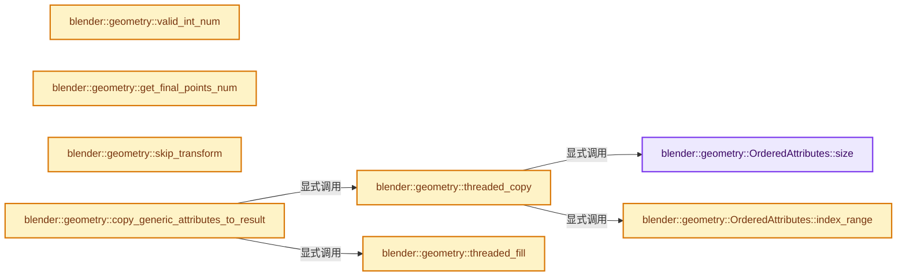

# 实现依赖专题：source/blender/geometry/intern/realize_instances.cc

[方向导航](README.md) · [符号索引](../%E7%AC%A6%E5%8F%B7%E4%BE%9D%E8%B5%96%E4%B8%8E%E5%AE%9E%E7%8E%B0%E7%B4%A2%E5%BC%95.md)

本专题从正文实际调用进入，集中保存共享实现。函数有稳定锚点，可从调用处直接跳到对应完整函数；递归与互相调用通过回链组织。

## 本文件的实现关系




## 完整成员与函数实现

<a id="f-75a3385e22366976"></a>

### `blender::geometry::OrderedAttributes::size`

实现位置：[source/blender/geometry/intern/realize_instances.cc](../../../../../source/blender/geometry/intern/realize_instances.cc) · L56—L59。

**教学注释版**

<!-- annotated:b9f3baeef1f22e -->

```cpp
  int size() const
  {
    return this->kinds.size();
  }
```

<details>
<summary>核对原始源码：source/blender/geometry/intern/realize_instances.cc · L56—L59</summary>

<!-- original:b9f3baeef1f22e:source/blender/geometry/intern/realize_instances.cc:56:59 -->

```cpp
  int size() const
  {
    return this->kinds.size();
  }
```

</details>

**结果出口**

- `return this->kinds.size();`

**继续追踪实现**

- `this->kinds.size` → [调用协议](../%E6%A8%A1%E6%9D%BF%E5%AE%8F%E4%B8%8E%E5%8A%A8%E6%80%81%E5%88%86%E6%B4%BE%E5%8D%8F%E8%AE%AE.md)：接收对象类型依赖auto、返回值或模板实例；不按同名猜测目标。调用位置L58。

<a id="f-a4853193a7f8c2ee"></a>

### `blender::geometry::OrderedAttributes::index_range`

实现位置：[source/blender/geometry/intern/realize_instances.cc](../../../../../source/blender/geometry/intern/realize_instances.cc) · L61—L64。

**教学注释版**

<!-- annotated:cc0ee1f6134c1e -->

```cpp
  IndexRange index_range() const
  {
    return this->kinds.index_range();
  }
```

<details>
<summary>核对原始源码：source/blender/geometry/intern/realize_instances.cc · L61—L64</summary>

<!-- original:cc0ee1f6134c1e:source/blender/geometry/intern/realize_instances.cc:61:64 -->

```cpp
  IndexRange index_range() const
  {
    return this->kinds.index_range();
  }
```

</details>

**结果出口**

- `return this->kinds.index_range();`

**继续追踪实现**

- `this->kinds.index_range` → [调用协议](../%E6%A8%A1%E6%9D%BF%E5%AE%8F%E4%B8%8E%E5%8A%A8%E6%80%81%E5%88%86%E6%B4%BE%E5%8D%8F%E8%AE%AE.md)：接收对象类型依赖auto、返回值或模板实例；不按同名猜测目标。调用位置L63。

<a id="f-aca1707bc15ecdb9"></a>

### `blender::geometry::valid_int_num`

实现位置：[source/blender/geometry/intern/realize_instances.cc](../../../../../source/blender/geometry/intern/realize_instances.cc) · L385—L388。

接口参数：

- `const int64_t num`

**教学注释版**

<!-- annotated:5a2a5f1a792596 -->

```cpp
static bool valid_int_num(const int64_t num)
{
  return num >= 0 && num <= INT32_MAX;
}
```

<details>
<summary>核对原始源码：source/blender/geometry/intern/realize_instances.cc · L385—L388</summary>

<!-- original:5a2a5f1a792596:source/blender/geometry/intern/realize_instances.cc:385:388 -->

```cpp
static bool valid_int_num(const int64_t num)
{
  return num >= 0 && num <= INT32_MAX;
}
```

</details>

**结果出口**

- `return num >= 0 && num <= INT32_MAX;`

**继续追踪实现**

本实现没有需要继续展开的显式调用；检查返回表达式、对象转换和调用者前置条件。

<a id="f-671eb1d864ff83e7"></a>

### `blender::geometry::get_final_points_num`

实现位置：[source/blender/geometry/intern/realize_instances.cc](../../../../../source/blender/geometry/intern/realize_instances.cc) · L390—L406。

接口参数：

- `const GatherTasks &tasks`

**教学注释版**

<!-- annotated:b23ae95879e3c2 -->

```cpp
static int64_t get_final_points_num(const GatherTasks &tasks)
{
  int64_t points_num = 0;
  if (!tasks.pointcloud_tasks.is_empty()) {
    const RealizePointCloudTask &task = tasks.pointcloud_tasks.last();
    points_num += task.start_index + task.pointcloud_info->pointcloud->totpoint;
  }
  if (!tasks.mesh_tasks.is_empty()) {
    const RealizeMeshTask &task = tasks.mesh_tasks.last();
    points_num += task.start_indices.vert + task.mesh_info->mesh->verts_num;
  }
  if (!tasks.curve_tasks.is_empty()) {
    const RealizeCurveTask &task = tasks.curve_tasks.last();
    points_num += task.start_indices.point + task.curve_info->curves->geometry.point_num;
  }
  return points_num;
}
```

<details>
<summary>核对原始源码：source/blender/geometry/intern/realize_instances.cc · L390—L406</summary>

<!-- original:b23ae95879e3c2:source/blender/geometry/intern/realize_instances.cc:390:406 -->

```cpp
static int64_t get_final_points_num(const GatherTasks &tasks)
{
  int64_t points_num = 0;
  if (!tasks.pointcloud_tasks.is_empty()) {
    const RealizePointCloudTask &task = tasks.pointcloud_tasks.last();
    points_num += task.start_index + task.pointcloud_info->pointcloud->totpoint;
  }
  if (!tasks.mesh_tasks.is_empty()) {
    const RealizeMeshTask &task = tasks.mesh_tasks.last();
    points_num += task.start_indices.vert + task.mesh_info->mesh->verts_num;
  }
  if (!tasks.curve_tasks.is_empty()) {
    const RealizeCurveTask &task = tasks.curve_tasks.last();
    points_num += task.start_indices.point + task.curve_info->curves->geometry.point_num;
  }
  return points_num;
}
```

</details>

**沿实际写入检查状态**

- `points_num += task.start_index + task.pointcloud_info->pointcloud->totpoint;`
- `points_num += task.start_indices.vert + task.mesh_info->mesh->verts_num;`
- `points_num += task.start_indices.point + task.curve_info->curves->geometry.point_num;`

**结果出口**

- `return points_num;`

**继续追踪实现**

- `tasks.pointcloud_tasks.is_empty` → [调用协议](../%E6%A8%A1%E6%9D%BF%E5%AE%8F%E4%B8%8E%E5%8A%A8%E6%80%81%E5%88%86%E6%B4%BE%E5%8D%8F%E8%AE%AE.md)：接收对象类型依赖auto、返回值或模板实例；不按同名猜测目标。调用位置L393。
- `tasks.pointcloud_tasks.last` → [调用协议](../%E6%A8%A1%E6%9D%BF%E5%AE%8F%E4%B8%8E%E5%8A%A8%E6%80%81%E5%88%86%E6%B4%BE%E5%8D%8F%E8%AE%AE.md)：接收对象类型依赖auto、返回值或模板实例；不按同名猜测目标。调用位置L394。
- `tasks.mesh_tasks.is_empty` → [调用协议](../%E6%A8%A1%E6%9D%BF%E5%AE%8F%E4%B8%8E%E5%8A%A8%E6%80%81%E5%88%86%E6%B4%BE%E5%8D%8F%E8%AE%AE.md)：接收对象类型依赖auto、返回值或模板实例；不按同名猜测目标。调用位置L397。
- `tasks.mesh_tasks.last` → [调用协议](../%E6%A8%A1%E6%9D%BF%E5%AE%8F%E4%B8%8E%E5%8A%A8%E6%80%81%E5%88%86%E6%B4%BE%E5%8D%8F%E8%AE%AE.md)：接收对象类型依赖auto、返回值或模板实例；不按同名猜测目标。调用位置L398。
- `tasks.curve_tasks.is_empty` → [调用协议](../%E6%A8%A1%E6%9D%BF%E5%AE%8F%E4%B8%8E%E5%8A%A8%E6%80%81%E5%88%86%E6%B4%BE%E5%8D%8F%E8%AE%AE.md)：接收对象类型依赖auto、返回值或模板实例；不按同名猜测目标。调用位置L401。
- `tasks.curve_tasks.last` → [调用协议](../%E6%A8%A1%E6%9D%BF%E5%AE%8F%E4%B8%8E%E5%8A%A8%E6%80%81%E5%88%86%E6%B4%BE%E5%8D%8F%E8%AE%AE.md)：接收对象类型依赖auto、返回值或模板实例；不按同名猜测目标。调用位置L402。

<a id="f-4ead4e16ba753e4b"></a>

### `blender::geometry::skip_transform`

实现位置：[source/blender/geometry/intern/realize_instances.cc](../../../../../source/blender/geometry/intern/realize_instances.cc) · L408—L411。

接口参数：

- `const float4x4 &transform`

**教学注释版**

<!-- annotated:f5da49d244ddf7 -->

```cpp
static bool skip_transform(const float4x4 &transform)
{
  return math::is_equal(transform, float4x4::identity(), 1e-6f);
}
```

<details>
<summary>核对原始源码：source/blender/geometry/intern/realize_instances.cc · L408—L411</summary>

<!-- original:f5da49d244ddf7:source/blender/geometry/intern/realize_instances.cc:408:411 -->

```cpp
static bool skip_transform(const float4x4 &transform)
{
  return math::is_equal(transform, float4x4::identity(), 1e-6f);
}
```

</details>

**结果出口**

- `return math::is_equal(transform, float4x4::identity(), 1e-6f);`

**继续追踪实现**

- `math::is_equal` → [blender::math::is_equal · L765](../12-%E7%A9%BA%E9%97%B4%E6%95%B0%E6%8D%AE%E7%BB%93%E6%9E%84%E4%B8%8E%E5%87%A0%E4%BD%95%E7%AE%97%E6%B3%95/%E4%BE%9D%E8%B5%96-BLI_math_vector-906a87.md#f-96ff5caf5461146e)；[blender::math::is_equal · L116](../12-%E7%A9%BA%E9%97%B4%E6%95%B0%E6%8D%AE%E7%BB%93%E6%9E%84%E4%B8%8E%E5%87%A0%E4%BD%95%E7%AE%97%E6%B3%95/%E4%BE%9D%E8%B5%96-BLI_math_quaternion-cf105d.md#f-97008e57597d3ffd)；[blender::math::is_equal · L509](../12-%E7%A9%BA%E9%97%B4%E6%95%B0%E6%8D%AE%E7%BB%93%E6%9E%84%E4%B8%8E%E5%87%A0%E4%BD%95%E7%AE%97%E6%B3%95/%E4%BE%9D%E8%B5%96-BLI_math_matrix-b7b2b4.md#f-86b4ef8483834e4e)。同名重载需按实参类型选择。
- `float4x4::identity` → [调用协议](../%E6%A8%A1%E6%9D%BF%E5%AE%8F%E4%B8%8E%E5%8A%A8%E6%80%81%E5%88%86%E6%B4%BE%E5%8D%8F%E8%AE%AE.md)：函数指针、局部可调用对象或未展开的宏；必须结合调用者环境。调用位置L410。

<a id="f-7541b8f5578f4f6d"></a>

### `blender::geometry::threaded_copy`

实现位置：[source/blender/geometry/intern/realize_instances.cc](../../../../../source/blender/geometry/intern/realize_instances.cc) · L413—L420。

接口参数：

- `const GVArray &src`
- `GMutableSpan dst`

**教学注释版**

<!-- annotated:77a42d73ad10dd -->

```cpp
static void threaded_copy(const GVArray &src, GMutableSpan dst)
{
  BLI_assert(src.size() == dst.size());
  BLI_assert(src.type() == dst.type());
  threading::parallel_for(src.index_range(), 1024, [&](const IndexRange range) {
    src.materialize_compressed_to_uninitialized(range, dst.slice(range).data());
  });
}
```

<details>
<summary>核对原始源码：source/blender/geometry/intern/realize_instances.cc · L413—L420</summary>

<!-- original:77a42d73ad10dd:source/blender/geometry/intern/realize_instances.cc:413:420 -->

```cpp
static void threaded_copy(const GVArray &src, GMutableSpan dst)
{
  BLI_assert(src.size() == dst.size());
  BLI_assert(src.type() == dst.type());
  threading::parallel_for(src.index_range(), 1024, [&](const IndexRange range) {
    src.materialize_compressed_to_uninitialized(range, dst.slice(range).data());
  });
}
```

</details>

**继续追踪实现**

- `BLI_assert` → [BLI_assert · L48](../01-%E5%9F%BA%E7%A1%80%E5%AE%B9%E5%99%A8%E4%B8%8E%E7%8E%B0%E4%BB%A3CPP/%E4%BE%9D%E8%B5%96-BLI_assert-cc98e8.md#m-57a88495704d)；[BLI_assert · L63](../01-%E5%9F%BA%E7%A1%80%E5%AE%B9%E5%99%A8%E4%B8%8E%E7%8E%B0%E4%BB%A3CPP/%E4%BE%9D%E8%B5%96-BLI_assert-cc98e8.md#m-d07050020cb5)。宏定义由构建条件选择。
- `src.size` → [blender::geometry::OrderedAttributes::size · L56](%E4%BE%9D%E8%B5%96-realize_instances-35ae92.md#f-75a3385e22366976)。
- `dst.size` → [blender::GMutableSpan::size · L198](../03-%E5%86%85%E5%AD%98%E5%88%86%E9%85%8D%E4%B8%8E%E8%BF%90%E8%A1%8C%E6%97%B6%E7%B1%BB%E5%9E%8B/11-GSpan%E4%B8%8EGArray.md#f-ecf8873167fb66c8)。
- `src.type` → [调用协议](../%E6%A8%A1%E6%9D%BF%E5%AE%8F%E4%B8%8E%E5%8A%A8%E6%80%81%E5%88%86%E6%B4%BE%E5%8D%8F%E8%AE%AE.md)：由接收对象具体类型或运行时策略提供实现。调用位置L416。
- `dst.type` → [blender::GMutableSpan::type · L182](../03-%E5%86%85%E5%AD%98%E5%88%86%E9%85%8D%E4%B8%8E%E8%BF%90%E8%A1%8C%E6%97%B6%E7%B1%BB%E5%9E%8B/11-GSpan%E4%B8%8EGArray.md#f-74385040046c86d5)。
- `threading::parallel_for` → [blender::threading::parallel_for · L68](../11-Depsgraph%E4%B8%8E%E5%B9%B6%E8%A1%8C%E4%BB%BB%E5%8A%A1%E7%B3%BB%E7%BB%9F/07-%E4%BB%BB%E5%8A%A1%E6%B1%A0%E4%B8%8ETBB%E6%8E%A5%E5%85%A5.md#f-838294754c24426c)。
- `src.index_range` → [blender::geometry::OrderedAttributes::index_range · L61](%E4%BE%9D%E8%B5%96-realize_instances-35ae92.md#f-a4853193a7f8c2ee)。
- `src.materialize_compressed_to_uninitialized` → [调用协议](../%E6%A8%A1%E6%9D%BF%E5%AE%8F%E4%B8%8E%E5%8A%A8%E6%80%81%E5%88%86%E6%B4%BE%E5%8D%8F%E8%AE%AE.md)：由接收对象具体类型或运行时策略提供实现。调用位置L418。
- `dst.slice(range).data` → [调用协议](../%E6%A8%A1%E6%9D%BF%E5%AE%8F%E4%B8%8E%E5%8A%A8%E6%80%81%E5%88%86%E6%B4%BE%E5%8D%8F%E8%AE%AE.md)：接收对象类型依赖auto、返回值或模板实例；不按同名猜测目标。调用位置L418。
- `dst.slice` → [blender::GMutableSpan::slice · L227](../03-%E5%86%85%E5%AD%98%E5%88%86%E9%85%8D%E4%B8%8E%E8%BF%90%E8%A1%8C%E6%97%B6%E7%B1%BB%E5%9E%8B/11-GSpan%E4%B8%8EGArray.md#f-d7f8e350bc3a5156)；[blender::GMutableSpan::slice · L235](../03-%E5%86%85%E5%AD%98%E5%88%86%E9%85%8D%E4%B8%8E%E8%BF%90%E8%A1%8C%E6%97%B6%E7%B1%BB%E5%9E%8B/11-GSpan%E4%B8%8EGArray.md#f-b1101d4d9009fa75)。同名重载需按实参类型选择。

<a id="f-aa82520bdb1ec277"></a>

### `blender::geometry::threaded_fill`

实现位置：[source/blender/geometry/intern/realize_instances.cc](../../../../../source/blender/geometry/intern/realize_instances.cc) · L422—L428。

接口参数：

- `const GPointer value`
- `GMutableSpan dst`

**教学注释版**

<!-- annotated:7cc6e62381f80f -->

```cpp
static void threaded_fill(const GPointer value, GMutableSpan dst)
{
  BLI_assert(*value.type() == dst.type());
  threading::parallel_for(IndexRange(dst.size()), 1024, [&](const IndexRange range) {
    // [讲解] range.size：读取连续区间或分组的边界信息。
    value.type()->fill_construct_n(value.get(), dst.slice(range).data(), range.size());
  });
}
```

<details>
<summary>核对原始源码：source/blender/geometry/intern/realize_instances.cc · L422—L428</summary>

<!-- original:7cc6e62381f80f:source/blender/geometry/intern/realize_instances.cc:422:428 -->

```cpp
static void threaded_fill(const GPointer value, GMutableSpan dst)
{
  BLI_assert(*value.type() == dst.type());
  threading::parallel_for(IndexRange(dst.size()), 1024, [&](const IndexRange range) {
    value.type()->fill_construct_n(value.get(), dst.slice(range).data(), range.size());
  });
}
```

</details>

**继续追踪实现**

- `BLI_assert` → [BLI_assert · L48](../01-%E5%9F%BA%E7%A1%80%E5%AE%B9%E5%99%A8%E4%B8%8E%E7%8E%B0%E4%BB%A3CPP/%E4%BE%9D%E8%B5%96-BLI_assert-cc98e8.md#m-57a88495704d)；[BLI_assert · L63](../01-%E5%9F%BA%E7%A1%80%E5%AE%B9%E5%99%A8%E4%B8%8E%E7%8E%B0%E4%BB%A3CPP/%E4%BE%9D%E8%B5%96-BLI_assert-cc98e8.md#m-d07050020cb5)。宏定义由构建条件选择。
- `value.type` → [blender::GPointer::type · L122](../03-%E5%86%85%E5%AD%98%E5%88%86%E9%85%8D%E4%B8%8E%E8%BF%90%E8%A1%8C%E6%97%B6%E7%B1%BB%E5%9E%8B/12-%E5%BC%82%E6%9E%84%E5%80%BC%E5%AD%98%E5%82%A8%E5%AE%9E%E6%88%98.md#f-fab893bd990213d9)。
- `dst.type` → [blender::GMutableSpan::type · L182](../03-%E5%86%85%E5%AD%98%E5%88%86%E9%85%8D%E4%B8%8E%E8%BF%90%E8%A1%8C%E6%97%B6%E7%B1%BB%E5%9E%8B/11-GSpan%E4%B8%8EGArray.md#f-74385040046c86d5)。
- `threading::parallel_for` → [blender::threading::parallel_for · L68](../11-Depsgraph%E4%B8%8E%E5%B9%B6%E8%A1%8C%E4%BB%BB%E5%8A%A1%E7%B3%BB%E7%BB%9F/07-%E4%BB%BB%E5%8A%A1%E6%B1%A0%E4%B8%8ETBB%E6%8E%A5%E5%85%A5.md#f-838294754c24426c)。
- `IndexRange` → [blender::IndexRange](../01-%E5%9F%BA%E7%A1%80%E5%AE%B9%E5%99%A8%E4%B8%8E%E7%8E%B0%E4%BB%A3CPP/%E4%BE%9D%E8%B5%96-BLI_index_range-7d7cc5.md#t-caa3466d6776)；[blender::gpu::shader::parser::IndexRange](%E4%BE%9D%E8%B5%96-utils-06433d.md#t-82d2bd4ea71c)；[blender::IndexRange](%E4%BE%9D%E8%B5%96-DNA_node_types-6708b9.md#t-0448cc889d39)。
- `dst.size` → [blender::GMutableSpan::size · L198](../03-%E5%86%85%E5%AD%98%E5%88%86%E9%85%8D%E4%B8%8E%E8%BF%90%E8%A1%8C%E6%97%B6%E7%B1%BB%E5%9E%8B/11-GSpan%E4%B8%8EGArray.md#f-ecf8873167fb66c8)。
- `value.type()->fill_construct_n` → [调用协议](../%E6%A8%A1%E6%9D%BF%E5%AE%8F%E4%B8%8E%E5%8A%A8%E6%80%81%E5%88%86%E6%B4%BE%E5%8D%8F%E8%AE%AE.md)：接收对象类型依赖auto、返回值或模板实例；不按同名猜测目标。调用位置L426。
- `value.get` → [blender::GPointer::get · L117](../03-%E5%86%85%E5%AD%98%E5%88%86%E9%85%8D%E4%B8%8E%E8%BF%90%E8%A1%8C%E6%97%B6%E7%B1%BB%E5%9E%8B/12-%E5%BC%82%E6%9E%84%E5%80%BC%E5%AD%98%E5%82%A8%E5%AE%9E%E6%88%98.md#f-d98a4f1af4104afe)；[blender::GPointer::get · L127](../03-%E5%86%85%E5%AD%98%E5%88%86%E9%85%8D%E4%B8%8E%E8%BF%90%E8%A1%8C%E6%97%B6%E7%B1%BB%E5%9E%8B/12-%E5%BC%82%E6%9E%84%E5%80%BC%E5%AD%98%E5%82%A8%E5%AE%9E%E6%88%98.md#f-5cf9e563400cde6b)。同名重载需按实参类型选择。
- `dst.slice(range).data` → [调用协议](../%E6%A8%A1%E6%9D%BF%E5%AE%8F%E4%B8%8E%E5%8A%A8%E6%80%81%E5%88%86%E6%B4%BE%E5%8D%8F%E8%AE%AE.md)：接收对象类型依赖auto、返回值或模板实例；不按同名猜测目标。调用位置L426。
- `dst.slice` → [blender::GMutableSpan::slice · L227](../03-%E5%86%85%E5%AD%98%E5%88%86%E9%85%8D%E4%B8%8E%E8%BF%90%E8%A1%8C%E6%97%B6%E7%B1%BB%E5%9E%8B/11-GSpan%E4%B8%8EGArray.md#f-d7f8e350bc3a5156)；[blender::GMutableSpan::slice · L235](../03-%E5%86%85%E5%AD%98%E5%88%86%E9%85%8D%E4%B8%8E%E8%BF%90%E8%A1%8C%E6%97%B6%E7%B1%BB%E5%9E%8B/11-GSpan%E4%B8%8EGArray.md#f-b1101d4d9009fa75)。同名重载需按实参类型选择。
- `range.size` → [blender::IndexRange::size · L156](../01-%E5%9F%BA%E7%A1%80%E5%AE%B9%E5%99%A8%E4%B8%8E%E7%8E%B0%E4%BB%A3CPP/04-IndexRange%E8%BF%9E%E7%BB%AD%E6%95%B4%E6%95%B0%E5%8C%BA%E9%97%B4.md#f-05f66c3ebb2fdfec)。

<a id="f-e9f4aec66524e8ee"></a>

### `blender::geometry::copy_generic_attributes_to_result`

实现位置：[source/blender/geometry/intern/realize_instances.cc](../../../../../source/blender/geometry/intern/realize_instances.cc) · L430—L460。

接口参数：

- `const Span<std::optional<GVArray>> src_attributes`
- `const AttributeFallbacksArray &attribute_fallbacks`
- `const OrderedAttributes &ordered_attributes`
- `const FunctionRef<IndexRange(bke::AttrDomain)> &range_fn`
- `bke::AttrDomain`
- `MutableSpan<GSpanAttributeWriter> dst_attribute_writers`

**教学注释版**

<!-- annotated:35570fa224f09e -->

```cpp
static void copy_generic_attributes_to_result(
    const Span<std::optional<GVArray>> src_attributes,
    const AttributeFallbacksArray &attribute_fallbacks,
    const OrderedAttributes &ordered_attributes,
    const FunctionRef<IndexRange(bke::AttrDomain)> &range_fn,
    MutableSpan<GSpanAttributeWriter> dst_attribute_writers)
{
  threading::parallel_for(
      // [讲解] dst_attribute_writers.index_range：查询视图长度或生成对应有效索引区间。
      dst_attribute_writers.index_range(), 10, [&](const IndexRange attribute_range) {
        for (const int attribute_index : attribute_range) {
          const bke::AttrDomain domain = ordered_attributes.kinds[attribute_index].domain;
          const IndexRange element_slice = range_fn(domain);

          GSpanAttributeWriter &writer = dst_attribute_writers[attribute_index];
          if (!writer) {
            continue;
          }
          GMutableSpan dst_span = writer.span.slice(element_slice);
          if (src_attributes[attribute_index].has_value()) {
            threaded_copy(*src_attributes[attribute_index], dst_span);
          }
          else {
            const CPPType &cpp_type = dst_span.type();
            const void *fallback = attribute_fallbacks.array[attribute_index] == nullptr ?
                                       cpp_type.default_value() :
                                       attribute_fallbacks.array[attribute_index];
            threaded_fill({cpp_type, fallback}, dst_span);
          }
        }
      });
}
```

<details>
<summary>核对原始源码：source/blender/geometry/intern/realize_instances.cc · L430—L460</summary>

<!-- original:35570fa224f09e:source/blender/geometry/intern/realize_instances.cc:430:460 -->

```cpp
static void copy_generic_attributes_to_result(
    const Span<std::optional<GVArray>> src_attributes,
    const AttributeFallbacksArray &attribute_fallbacks,
    const OrderedAttributes &ordered_attributes,
    const FunctionRef<IndexRange(bke::AttrDomain)> &range_fn,
    MutableSpan<GSpanAttributeWriter> dst_attribute_writers)
{
  threading::parallel_for(
      dst_attribute_writers.index_range(), 10, [&](const IndexRange attribute_range) {
        for (const int attribute_index : attribute_range) {
          const bke::AttrDomain domain = ordered_attributes.kinds[attribute_index].domain;
          const IndexRange element_slice = range_fn(domain);

          GSpanAttributeWriter &writer = dst_attribute_writers[attribute_index];
          if (!writer) {
            continue;
          }
          GMutableSpan dst_span = writer.span.slice(element_slice);
          if (src_attributes[attribute_index].has_value()) {
            threaded_copy(*src_attributes[attribute_index], dst_span);
          }
          else {
            const CPPType &cpp_type = dst_span.type();
            const void *fallback = attribute_fallbacks.array[attribute_index] == nullptr ?
                                       cpp_type.default_value() :
                                       attribute_fallbacks.array[attribute_index];
            threaded_fill({cpp_type, fallback}, dst_span);
          }
        }
      });
}
```

</details>

**继续追踪实现**

- `threading::parallel_for` → [blender::threading::parallel_for · L68](../11-Depsgraph%E4%B8%8E%E5%B9%B6%E8%A1%8C%E4%BB%BB%E5%8A%A1%E7%B3%BB%E7%BB%9F/07-%E4%BB%BB%E5%8A%A1%E6%B1%A0%E4%B8%8ETBB%E6%8E%A5%E5%85%A5.md#f-838294754c24426c)。
- `dst_attribute_writers.index_range` → [blender::MutableSpan::index_range · L676](../01-%E5%9F%BA%E7%A1%80%E5%AE%B9%E5%99%A8%E4%B8%8E%E7%8E%B0%E4%BB%A3CPP/06-MutableSpan%E5%8F%AF%E5%86%99%E8%A7%86%E5%9B%BE.md#f-f9a9d59a69ca64b5)。
- `range_fn` → [调用协议](../%E6%A8%A1%E6%9D%BF%E5%AE%8F%E4%B8%8E%E5%8A%A8%E6%80%81%E5%88%86%E6%B4%BE%E5%8D%8F%E8%AE%AE.md)：局部可调用对象，须结合其初始化与捕获环境。调用位置L441。
- `writer.span.slice` → [调用协议](../%E6%A8%A1%E6%9D%BF%E5%AE%8F%E4%B8%8E%E5%8A%A8%E6%80%81%E5%88%86%E6%B4%BE%E5%8D%8F%E8%AE%AE.md)：接收对象类型依赖auto、返回值或模板实例；不按同名猜测目标。调用位置L447。
- `src_attributes[attribute_index].has_value` → [调用协议](../%E6%A8%A1%E6%9D%BF%E5%AE%8F%E4%B8%8E%E5%8A%A8%E6%80%81%E5%88%86%E6%B4%BE%E5%8D%8F%E8%AE%AE.md)：接收对象类型依赖auto、返回值或模板实例；不按同名猜测目标。调用位置L448。
- `threaded_copy` → [blender::geometry::threaded_copy · L413](%E4%BE%9D%E8%B5%96-realize_instances-35ae92.md#f-7541b8f5578f4f6d)。
- `dst_span.type` → [blender::GMutableSpan::type · L182](../03-%E5%86%85%E5%AD%98%E5%88%86%E9%85%8D%E4%B8%8E%E8%BF%90%E8%A1%8C%E6%97%B6%E7%B1%BB%E5%9E%8B/11-GSpan%E4%B8%8EGArray.md#f-74385040046c86d5)。
- `cpp_type.default_value` → [blender::CPPType::default_value · L743](../03-%E5%86%85%E5%AD%98%E5%88%86%E9%85%8D%E4%B8%8E%E8%BF%90%E8%A1%8C%E6%97%B6%E7%B1%BB%E5%9E%8B/09-CPPType%E5%A4%8D%E5%88%B6%E7%A7%BB%E5%8A%A8%E9%87%8D%E5%AE%9A%E4%BD%8D.md#f-95e76cbe74b383e8)。
- `threaded_fill` → [blender::geometry::threaded_fill · L422](%E4%BE%9D%E8%B5%96-realize_instances-35ae92.md#f-aa82520bdb1ec277)。

<a id="f-7848646f079105b1"></a>

### `blender::geometry::create_result_ids`

实现位置：[source/blender/geometry/intern/realize_instances.cc](../../../../../source/blender/geometry/intern/realize_instances.cc) · L462—L491。

接口参数：

- `const RealizeInstancesOptions &options`
- `const VArray<int> &stored_ids`
- `const int task_id`
- `MutableSpan<int> dst_ids`

**教学注释版**

<!-- annotated:086826f07c7a4f -->

```cpp
static void create_result_ids(const RealizeInstancesOptions &options,
                              const VArray<int> &stored_ids,
                              const int task_id,
                              MutableSpan<int> dst_ids)
{
  if (options.keep_original_ids) {
    if (stored_ids.is_empty()) {
      // [讲解] dst_ids.fill：修改已有目标元素，不改变底层容器长度。
      dst_ids.fill(0);
    }
    else {
      stored_ids.materialize(dst_ids);
    }
  }
  else {
    if (stored_ids.is_empty()) {
      // [讲解] dst_ids.index_range：查询视图长度或生成对应有效索引区间。
      threading::parallel_for(dst_ids.index_range(), 1024, [&](const IndexRange range) {
        for (const int i : range) {
          dst_ids[i] = noise::hash(task_id, i);
        }
      });
    }
    else {
      threading::parallel_for(dst_ids.index_range(), 1024, [&](const IndexRange range) {
        for (const int i : range) {
          dst_ids[i] = noise::hash(task_id, stored_ids[i]);
        }
      });
    }
  }
}
```

<details>
<summary>核对原始源码：source/blender/geometry/intern/realize_instances.cc · L462—L491</summary>

<!-- original:086826f07c7a4f:source/blender/geometry/intern/realize_instances.cc:462:491 -->

```cpp
static void create_result_ids(const RealizeInstancesOptions &options,
                              const VArray<int> &stored_ids,
                              const int task_id,
                              MutableSpan<int> dst_ids)
{
  if (options.keep_original_ids) {
    if (stored_ids.is_empty()) {
      dst_ids.fill(0);
    }
    else {
      stored_ids.materialize(dst_ids);
    }
  }
  else {
    if (stored_ids.is_empty()) {
      threading::parallel_for(dst_ids.index_range(), 1024, [&](const IndexRange range) {
        for (const int i : range) {
          dst_ids[i] = noise::hash(task_id, i);
        }
      });
    }
    else {
      threading::parallel_for(dst_ids.index_range(), 1024, [&](const IndexRange range) {
        for (const int i : range) {
          dst_ids[i] = noise::hash(task_id, stored_ids[i]);
        }
      });
    }
  }
}
```

</details>

**沿实际写入检查状态**

- `dst_ids[i] = noise::hash(task_id, i);`
- `dst_ids[i] = noise::hash(task_id, stored_ids[i]);`

**继续追踪实现**

- `stored_ids.is_empty` → [调用协议](../%E6%A8%A1%E6%9D%BF%E5%AE%8F%E4%B8%8E%E5%8A%A8%E6%80%81%E5%88%86%E6%B4%BE%E5%8D%8F%E8%AE%AE.md)：由接收对象具体类型或运行时策略提供实现。调用位置L468。
- `dst_ids.fill` → [blender::MutableSpan::fill · L523](../01-%E5%9F%BA%E7%A1%80%E5%AE%B9%E5%99%A8%E4%B8%8E%E7%8E%B0%E4%BB%A3CPP/06-MutableSpan%E5%8F%AF%E5%86%99%E8%A7%86%E5%9B%BE.md#f-8daedd52c727ec26)。
- `stored_ids.materialize` → [调用协议](../%E6%A8%A1%E6%9D%BF%E5%AE%8F%E4%B8%8E%E5%8A%A8%E6%80%81%E5%88%86%E6%B4%BE%E5%8D%8F%E8%AE%AE.md)：由接收对象具体类型或运行时策略提供实现。调用位置L472。
- `threading::parallel_for` → [blender::threading::parallel_for · L68](../11-Depsgraph%E4%B8%8E%E5%B9%B6%E8%A1%8C%E4%BB%BB%E5%8A%A1%E7%B3%BB%E7%BB%9F/07-%E4%BB%BB%E5%8A%A1%E6%B1%A0%E4%B8%8ETBB%E6%8E%A5%E5%85%A5.md#f-838294754c24426c)。
- `dst_ids.index_range` → [blender::MutableSpan::index_range · L676](../01-%E5%9F%BA%E7%A1%80%E5%AE%B9%E5%99%A8%E4%B8%8E%E7%8E%B0%E4%BB%A3CPP/06-MutableSpan%E5%8F%AF%E5%86%99%E8%A7%86%E5%9B%BE.md#f-f9a9d59a69ca64b5)。
- `noise::hash` → [blender::noise::hash · L89](../01-%E5%9F%BA%E7%A1%80%E5%AE%B9%E5%99%A8%E4%B8%8E%E7%8E%B0%E4%BB%A3CPP/%E4%BE%9D%E8%B5%96-noise-a3f6de.md#f-009a25f1b73b74f7)；[blender::noise::hash · L100](../01-%E5%9F%BA%E7%A1%80%E5%AE%B9%E5%99%A8%E4%B8%8E%E7%8E%B0%E4%BB%A3CPP/%E4%BE%9D%E8%B5%96-noise-a3f6de.md#f-ebd444c127234ba0)；[blender::noise::hash · L112](../01-%E5%9F%BA%E7%A1%80%E5%AE%B9%E5%99%A8%E4%B8%8E%E7%8E%B0%E4%BB%A3CPP/%E4%BE%9D%E8%B5%96-noise-a3f6de.md#f-447163c6095ffe9e)；[blender::noise::hash · L125](../01-%E5%9F%BA%E7%A1%80%E5%AE%B9%E5%99%A8%E4%B8%8E%E7%8E%B0%E4%BB%A3CPP/%E4%BE%9D%E8%B5%96-noise-a3f6de.md#f-ea97e12274a1e60b)。同名重载需按实参类型选择。

<a id="f-860e5336907f39d7"></a>

### `blender::geometry::gather_all_fill_ids`

实现位置：[source/blender/geometry/intern/realize_instances.cc](../../../../../source/blender/geometry/intern/realize_instances.cc) · L493—L522。

接口参数：

- `const VArray<int> &fill_ids`

**教学注释版**

<!-- annotated:d0e935df51ab25 -->

```cpp
static VectorSet<int> gather_all_fill_ids(const VArray<int> &fill_ids)
{
  if (fill_ids.is_empty()) {
    return VectorSet<int>();
  }
  if (fill_ids.is_single()) {
    const int fill_id = fill_ids.get_internal_single();
    if (fill_id != 0) {
      return VectorSet<int>({fill_id});
    }
  }
  if (fill_ids.is_span()) {
    VectorSet<int> index_by_fill_ids;
    const Span<int> fill_ids_span = fill_ids.get_internal_span();
    for (const int fill_id : fill_ids_span) {
      if (fill_id != 0) {
        // [讲解] index_by_fill_ids.add：按哈希与相等关系加入键或键值。
        index_by_fill_ids.add(fill_id);
      }
    }
    return index_by_fill_ids;
  }
  VectorSet<int> index_by_fill_ids;
  for (const int i : fill_ids.index_range()) {
    const int fill_id = fill_ids[i];
    if (fill_id != 0) {
      index_by_fill_ids.add(fill_id);
    }
  }
  return index_by_fill_ids;
}
```

<details>
<summary>核对原始源码：source/blender/geometry/intern/realize_instances.cc · L493—L522</summary>

<!-- original:d0e935df51ab25:source/blender/geometry/intern/realize_instances.cc:493:522 -->

```cpp
static VectorSet<int> gather_all_fill_ids(const VArray<int> &fill_ids)
{
  if (fill_ids.is_empty()) {
    return VectorSet<int>();
  }
  if (fill_ids.is_single()) {
    const int fill_id = fill_ids.get_internal_single();
    if (fill_id != 0) {
      return VectorSet<int>({fill_id});
    }
  }
  if (fill_ids.is_span()) {
    VectorSet<int> index_by_fill_ids;
    const Span<int> fill_ids_span = fill_ids.get_internal_span();
    for (const int fill_id : fill_ids_span) {
      if (fill_id != 0) {
        index_by_fill_ids.add(fill_id);
      }
    }
    return index_by_fill_ids;
  }
  VectorSet<int> index_by_fill_ids;
  for (const int i : fill_ids.index_range()) {
    const int fill_id = fill_ids[i];
    if (fill_id != 0) {
      index_by_fill_ids.add(fill_id);
    }
  }
  return index_by_fill_ids;
}
```

</details>

**结果出口**

- `return VectorSet<int>();`
- `return VectorSet<int>({fill_id});`
- `return index_by_fill_ids;`

**继续追踪实现**

- `fill_ids.is_empty` → [调用协议](../%E6%A8%A1%E6%9D%BF%E5%AE%8F%E4%B8%8E%E5%8A%A8%E6%80%81%E5%88%86%E6%B4%BE%E5%8D%8F%E8%AE%AE.md)：由接收对象具体类型或运行时策略提供实现。调用位置L495。
- `VectorSet<int>` → [blender::VectorSet::VectorSet · L178](../01-%E5%9F%BA%E7%A1%80%E5%AE%B9%E5%99%A8%E4%B8%8E%E7%8E%B0%E4%BB%A3CPP/14-VectorSet%E7%A8%B3%E5%AE%9A%E7%B4%A2%E5%BC%95%E4%B8%8E%E5%8E%BB%E9%87%8D.md#f-5dcfd2b16265d252)；[blender::VectorSet::VectorSet · L188](../01-%E5%9F%BA%E7%A1%80%E5%AE%B9%E5%99%A8%E4%B8%8E%E7%8E%B0%E4%BB%A3CPP/14-VectorSet%E7%A8%B3%E5%AE%9A%E7%B4%A2%E5%BC%95%E4%B8%8E%E5%8E%BB%E9%87%8D.md#f-7dba7f74774a0655)；[blender::VectorSet::VectorSet · L194](../01-%E5%9F%BA%E7%A1%80%E5%AE%B9%E5%99%A8%E4%B8%8E%E7%8E%B0%E4%BB%A3CPP/14-VectorSet%E7%A8%B3%E5%AE%9A%E7%B4%A2%E5%BC%95%E4%B8%8E%E5%8E%BB%E9%87%8D.md#f-9ee5250feacb126b)；[blender::VectorSet::VectorSet · L196](../01-%E5%9F%BA%E7%A1%80%E5%AE%B9%E5%99%A8%E4%B8%8E%E7%8E%B0%E4%BB%A3CPP/14-VectorSet%E7%A8%B3%E5%AE%9A%E7%B4%A2%E5%BC%95%E4%B8%8E%E5%8E%BB%E9%87%8D.md#f-ea58e193b6c2468e)；[blender::VectorSet::VectorSet · L204](../01-%E5%9F%BA%E7%A1%80%E5%AE%B9%E5%99%A8%E4%B8%8E%E7%8E%B0%E4%BB%A3CPP/14-VectorSet%E7%A8%B3%E5%AE%9A%E7%B4%A2%E5%BC%95%E4%B8%8E%E5%8E%BB%E9%87%8D.md#f-2975ca22adb37cbb)；[blender::VectorSet::VectorSet · L217](../01-%E5%9F%BA%E7%A1%80%E5%AE%B9%E5%99%A8%E4%B8%8E%E7%8E%B0%E4%BB%A3CPP/14-VectorSet%E7%A8%B3%E5%AE%9A%E7%B4%A2%E5%BC%95%E4%B8%8E%E5%8E%BB%E9%87%8D.md#f-2f6da5e69b89d9f6)；[blender::VectorSet::VectorSet · L244](../01-%E5%9F%BA%E7%A1%80%E5%AE%B9%E5%99%A8%E4%B8%8E%E7%8E%B0%E4%BB%A3CPP/14-VectorSet%E7%A8%B3%E5%AE%9A%E7%B4%A2%E5%BC%95%E4%B8%8E%E5%8E%BB%E9%87%8D.md#f-517cc8fd2a936778)。同名重载需按实参类型选择。
- `fill_ids.is_single` → [调用协议](../%E6%A8%A1%E6%9D%BF%E5%AE%8F%E4%B8%8E%E5%8A%A8%E6%80%81%E5%88%86%E6%B4%BE%E5%8D%8F%E8%AE%AE.md)：由接收对象具体类型或运行时策略提供实现。调用位置L498。
- `fill_ids.get_internal_single` → [调用协议](../%E6%A8%A1%E6%9D%BF%E5%AE%8F%E4%B8%8E%E5%8A%A8%E6%80%81%E5%88%86%E6%B4%BE%E5%8D%8F%E8%AE%AE.md)：由接收对象具体类型或运行时策略提供实现。调用位置L499。
- `fill_ids.is_span` → [调用协议](../%E6%A8%A1%E6%9D%BF%E5%AE%8F%E4%B8%8E%E5%8A%A8%E6%80%81%E5%88%86%E6%B4%BE%E5%8D%8F%E8%AE%AE.md)：由接收对象具体类型或运行时策略提供实现。调用位置L504。
- `fill_ids.get_internal_span` → [调用协议](../%E6%A8%A1%E6%9D%BF%E5%AE%8F%E4%B8%8E%E5%8A%A8%E6%80%81%E5%88%86%E6%B4%BE%E5%8D%8F%E8%AE%AE.md)：由接收对象具体类型或运行时策略提供实现。调用位置L506。
- `index_by_fill_ids.add` → [blender::VectorSet::add · L351](../01-%E5%9F%BA%E7%A1%80%E5%AE%B9%E5%99%A8%E4%B8%8E%E7%8E%B0%E4%BB%A3CPP/14-VectorSet%E7%A8%B3%E5%AE%9A%E7%B4%A2%E5%BC%95%E4%B8%8E%E5%8E%BB%E9%87%8D.md#f-96bfe2bf376d6298)；[blender::VectorSet::add · L355](../01-%E5%9F%BA%E7%A1%80%E5%AE%B9%E5%99%A8%E4%B8%8E%E7%8E%B0%E4%BB%A3CPP/14-VectorSet%E7%A8%B3%E5%AE%9A%E7%B4%A2%E5%BC%95%E4%B8%8E%E5%8E%BB%E9%87%8D.md#f-c0474f6a0568033b)。同名重载需按实参类型选择。
- `fill_ids.index_range` → [blender::geometry::OrderedAttributes::index_range · L61](%E4%BE%9D%E8%B5%96-realize_instances-35ae92.md#f-a4853193a7f8c2ee)。

<a id="f-f179648ffaf6c929"></a>

### `blender::geometry::try_join_single_value_attribute`

实现位置：[source/blender/geometry/intern/realize_instances.cc](../../../../../source/blender/geometry/intern/realize_instances.cc) · L529—L582。

接口参数：

- `const int tasks_num`
- `const OrderedAttributes &ordered_attributes`
- `const FunctionRef<TaskAttrInfo(int)> get_task_attributes`
- `int`
- `const int attr_index`
- `bke::MutableAttributeAccessor dst_attributes`

**教学注释版**

<!-- annotated:00260b9d5aca27 -->

```cpp
static bool try_join_single_value_attribute(
    const int tasks_num,
    const OrderedAttributes &ordered_attributes,
    const FunctionRef<TaskAttrInfo(int)> get_task_attributes,
    const int attr_index,
    bke::MutableAttributeAccessor dst_attributes)
{
  const bke::AttrType data_type = ordered_attributes.kinds[attr_index].data_type;
  const auto get_single_value = [&](const int task_index) -> GPointer {
    const TaskAttrInfo task_info = get_task_attributes(task_index);
    if (task_info.attributes[attr_index].has_value()) {
      const CommonVArrayInfo info = task_info.attributes[attr_index]->common_info();
      if (info.type != CommonVArrayInfo::Type::Single) {
        return GPointer();
      }
      return GPointer(task_info.attributes[attr_index]->type(), info.data);
    }
    const CPPType &type = bke::attribute_type_to_cpp_type(data_type);
    if (const void *value = task_info.fallbacks.array[attr_index]) {
      return GPointer(type, value);
    }
    return GPointer(type, type.default_value());
  };
  const GPointer first_value = get_single_value(0);
  if (!first_value) {
    return false;
  }
  const bool all_equal = threading::parallel_reduce(
      IndexRange(tasks_num).drop_front(1),
      32,
      true,
      [&](const IndexRange range, bool value) {
        if (!value) {
          return false;
        }
        for (const int i : range) {
          const GPointer value = get_single_value(i);
          if (!value) {
            return false;
          }
          if (!value.type()->is_equal(value.get(), first_value.get())) {
            return false;
          }
        }
        return true;
      },
      std::logical_and<bool>());
  if (!all_equal) {
    return false;
  }
  const StringRef name = ordered_attributes.names[attr_index];
  const bke::AttrDomain domain = ordered_attributes.kinds[attr_index].domain;
  return dst_attributes.add(name, domain, data_type, bke::AttributeInitValue(first_value));
}
```

<details>
<summary>核对原始源码：source/blender/geometry/intern/realize_instances.cc · L529—L582</summary>

<!-- original:00260b9d5aca27:source/blender/geometry/intern/realize_instances.cc:529:582 -->

```cpp
static bool try_join_single_value_attribute(
    const int tasks_num,
    const OrderedAttributes &ordered_attributes,
    const FunctionRef<TaskAttrInfo(int)> get_task_attributes,
    const int attr_index,
    bke::MutableAttributeAccessor dst_attributes)
{
  const bke::AttrType data_type = ordered_attributes.kinds[attr_index].data_type;
  const auto get_single_value = [&](const int task_index) -> GPointer {
    const TaskAttrInfo task_info = get_task_attributes(task_index);
    if (task_info.attributes[attr_index].has_value()) {
      const CommonVArrayInfo info = task_info.attributes[attr_index]->common_info();
      if (info.type != CommonVArrayInfo::Type::Single) {
        return GPointer();
      }
      return GPointer(task_info.attributes[attr_index]->type(), info.data);
    }
    const CPPType &type = bke::attribute_type_to_cpp_type(data_type);
    if (const void *value = task_info.fallbacks.array[attr_index]) {
      return GPointer(type, value);
    }
    return GPointer(type, type.default_value());
  };
  const GPointer first_value = get_single_value(0);
  if (!first_value) {
    return false;
  }
  const bool all_equal = threading::parallel_reduce(
      IndexRange(tasks_num).drop_front(1),
      32,
      true,
      [&](const IndexRange range, bool value) {
        if (!value) {
          return false;
        }
        for (const int i : range) {
          const GPointer value = get_single_value(i);
          if (!value) {
            return false;
          }
          if (!value.type()->is_equal(value.get(), first_value.get())) {
            return false;
          }
        }
        return true;
      },
      std::logical_and<bool>());
  if (!all_equal) {
    return false;
  }
  const StringRef name = ordered_attributes.names[attr_index];
  const bke::AttrDomain domain = ordered_attributes.kinds[attr_index].domain;
  return dst_attributes.add(name, domain, data_type, bke::AttributeInitValue(first_value));
}
```

</details>

**结果出口**

- `return GPointer();`
- `return GPointer(task_info.attributes[attr_index]->type(), info.data);`
- `return GPointer(type, value);`
- `return GPointer(type, type.default_value());`
- `return false;`
- `return true;`
- `return dst_attributes.add(name, domain, data_type, bke::AttributeInitValue(first_value));`

**继续追踪实现**

- `get_task_attributes` → [调用协议](../%E6%A8%A1%E6%9D%BF%E5%AE%8F%E4%B8%8E%E5%8A%A8%E6%80%81%E5%88%86%E6%B4%BE%E5%8D%8F%E8%AE%AE.md)：局部可调用对象，须结合其初始化与捕获环境。调用位置L538。
- `task_info.attributes[attr_index].has_value` → [调用协议](../%E6%A8%A1%E6%9D%BF%E5%AE%8F%E4%B8%8E%E5%8A%A8%E6%80%81%E5%88%86%E6%B4%BE%E5%8D%8F%E8%AE%AE.md)：接收对象类型依赖auto、返回值或模板实例；不按同名猜测目标。调用位置L539。
- `task_info.attributes[attr_index]->common_info` → [调用协议](../%E6%A8%A1%E6%9D%BF%E5%AE%8F%E4%B8%8E%E5%8A%A8%E6%80%81%E5%88%86%E6%B4%BE%E5%8D%8F%E8%AE%AE.md)：接收对象类型依赖auto、返回值或模板实例；不按同名猜测目标。调用位置L540。
- `GPointer` → [blender::GPointer::GPointer · L93](../03-%E5%86%85%E5%AD%98%E5%88%86%E9%85%8D%E4%B8%8E%E8%BF%90%E8%A1%8C%E6%97%B6%E7%B1%BB%E5%9E%8B/12-%E5%BC%82%E6%9E%84%E5%80%BC%E5%AD%98%E5%82%A8%E5%AE%9E%E6%88%98.md#f-40f7a024c1e541df)；[blender::GPointer::GPointer · L95](../03-%E5%86%85%E5%AD%98%E5%88%86%E9%85%8D%E4%B8%8E%E8%BF%90%E8%A1%8C%E6%97%B6%E7%B1%BB%E5%9E%8B/12-%E5%BC%82%E6%9E%84%E5%80%BC%E5%AD%98%E5%82%A8%E5%AE%9E%E6%88%98.md#f-e981128b9c36f9ef)；[blender::GPointer::GPointer · L97](../03-%E5%86%85%E5%AD%98%E5%88%86%E9%85%8D%E4%B8%8E%E8%BF%90%E8%A1%8C%E6%97%B6%E7%B1%BB%E5%9E%8B/12-%E5%BC%82%E6%9E%84%E5%80%BC%E5%AD%98%E5%82%A8%E5%AE%9E%E6%88%98.md#f-5d3066175455aed0)；[blender::GPointer::GPointer · L103](../03-%E5%86%85%E5%AD%98%E5%88%86%E9%85%8D%E4%B8%8E%E8%BF%90%E8%A1%8C%E6%97%B6%E7%B1%BB%E5%9E%8B/12-%E5%BC%82%E6%9E%84%E5%80%BC%E5%AD%98%E5%82%A8%E5%AE%9E%E6%88%98.md#f-9194d11793ea4a06)；[blender::GPointer::GPointer · L105](../03-%E5%86%85%E5%AD%98%E5%88%86%E9%85%8D%E4%B8%8E%E8%BF%90%E8%A1%8C%E6%97%B6%E7%B1%BB%E5%9E%8B/12-%E5%BC%82%E6%9E%84%E5%80%BC%E5%AD%98%E5%82%A8%E5%AE%9E%E6%88%98.md#f-1a9887b65d37a9ca)。同名重载需按实参类型选择。
- `task_info.attributes[attr_index]->type` → [调用协议](../%E6%A8%A1%E6%9D%BF%E5%AE%8F%E4%B8%8E%E5%8A%A8%E6%80%81%E5%88%86%E6%B4%BE%E5%8D%8F%E8%AE%AE.md)：接收对象类型依赖auto、返回值或模板实例；不按同名猜测目标。调用位置L544。
- `bke::attribute_type_to_cpp_type` → [blender::bke::attribute_type_to_cpp_type · L44](%E4%BE%9D%E8%B5%96-attribute_access-bceef3.md#f-69deacfd0fca6244)。
- `type.default_value` → [blender::CPPType::default_value · L743](../03-%E5%86%85%E5%AD%98%E5%88%86%E9%85%8D%E4%B8%8E%E8%BF%90%E8%A1%8C%E6%97%B6%E7%B1%BB%E5%9E%8B/09-CPPType%E5%A4%8D%E5%88%B6%E7%A7%BB%E5%8A%A8%E9%87%8D%E5%AE%9A%E4%BD%8D.md#f-95e76cbe74b383e8)。
- `get_single_value` → [调用协议](../%E6%A8%A1%E6%9D%BF%E5%AE%8F%E4%B8%8E%E5%8A%A8%E6%80%81%E5%88%86%E6%B4%BE%E5%8D%8F%E8%AE%AE.md)：局部可调用对象，须结合其初始化与捕获环境。调用位置L552。
- `threading::parallel_reduce` → [blender::threading::parallel_reduce · L126](../11-Depsgraph%E4%B8%8E%E5%B9%B6%E8%A1%8C%E4%BB%BB%E5%8A%A1%E7%B3%BB%E7%BB%9F/07-%E4%BB%BB%E5%8A%A1%E6%B1%A0%E4%B8%8ETBB%E6%8E%A5%E5%85%A5.md#f-9225ddb5efb97fcc)。
- `IndexRange(tasks_num).drop_front` → [调用协议](../%E6%A8%A1%E6%9D%BF%E5%AE%8F%E4%B8%8E%E5%8A%A8%E6%80%81%E5%88%86%E6%B4%BE%E5%8D%8F%E8%AE%AE.md)：接收对象类型依赖auto、返回值或模板实例；不按同名猜测目标。调用位置L557。
- `IndexRange` → [blender::IndexRange](../01-%E5%9F%BA%E7%A1%80%E5%AE%B9%E5%99%A8%E4%B8%8E%E7%8E%B0%E4%BB%A3CPP/%E4%BE%9D%E8%B5%96-BLI_index_range-7d7cc5.md#t-caa3466d6776)；[blender::gpu::shader::parser::IndexRange](%E4%BE%9D%E8%B5%96-utils-06433d.md#t-82d2bd4ea71c)；[blender::IndexRange](%E4%BE%9D%E8%B5%96-DNA_node_types-6708b9.md#t-0448cc889d39)。
- `value.type()->is_equal` → [调用协议](../%E6%A8%A1%E6%9D%BF%E5%AE%8F%E4%B8%8E%E5%8A%A8%E6%80%81%E5%88%86%E6%B4%BE%E5%8D%8F%E8%AE%AE.md)：接收对象类型依赖auto、返回值或模板实例；不按同名猜测目标。调用位置L569。
- `value.type` → [blender::GPointer::type · L122](../03-%E5%86%85%E5%AD%98%E5%88%86%E9%85%8D%E4%B8%8E%E8%BF%90%E8%A1%8C%E6%97%B6%E7%B1%BB%E5%9E%8B/12-%E5%BC%82%E6%9E%84%E5%80%BC%E5%AD%98%E5%82%A8%E5%AE%9E%E6%88%98.md#f-fab893bd990213d9)。
- `value.get` → [blender::GPointer::get · L117](../03-%E5%86%85%E5%AD%98%E5%88%86%E9%85%8D%E4%B8%8E%E8%BF%90%E8%A1%8C%E6%97%B6%E7%B1%BB%E5%9E%8B/12-%E5%BC%82%E6%9E%84%E5%80%BC%E5%AD%98%E5%82%A8%E5%AE%9E%E6%88%98.md#f-d98a4f1af4104afe)；[blender::GPointer::get · L127](../03-%E5%86%85%E5%AD%98%E5%88%86%E9%85%8D%E4%B8%8E%E8%BF%90%E8%A1%8C%E6%97%B6%E7%B1%BB%E5%9E%8B/12-%E5%BC%82%E6%9E%84%E5%80%BC%E5%AD%98%E5%82%A8%E5%AE%9E%E6%88%98.md#f-5cf9e563400cde6b)。同名重载需按实参类型选择。
- `first_value.get` → [blender::GPointer::get · L117](../03-%E5%86%85%E5%AD%98%E5%88%86%E9%85%8D%E4%B8%8E%E8%BF%90%E8%A1%8C%E6%97%B6%E7%B1%BB%E5%9E%8B/12-%E5%BC%82%E6%9E%84%E5%80%BC%E5%AD%98%E5%82%A8%E5%AE%9E%E6%88%98.md#f-d98a4f1af4104afe)；[blender::GPointer::get · L127](../03-%E5%86%85%E5%AD%98%E5%88%86%E9%85%8D%E4%B8%8E%E8%BF%90%E8%A1%8C%E6%97%B6%E7%B1%BB%E5%9E%8B/12-%E5%BC%82%E6%9E%84%E5%80%BC%E5%AD%98%E5%82%A8%E5%AE%9E%E6%88%98.md#f-5cf9e563400cde6b)。同名重载需按实参类型选择。
- `std::logical_and<bool>` → [外部契约](https://eel.is/c++draft/)：这个边界按实际表达式及所属类型核对参数、返回值、寿命与失败行为。这里提供接口入口，不声称已解释该第三方版本的内部实现。
- `dst_attributes.add` → [blender::bke::MutableAttributeAccessor::add · L769](08-AttributeAccessor%E6%8E%A5%E5%8F%A3.md#f-5fa7f06d7e22891a)；[blender::bke::MutableAttributeAccessor::add · L785](08-AttributeAccessor%E6%8E%A5%E5%8F%A3.md#f-42998ceb23ada8cc)。同名重载需按实参类型选择。
- `bke::AttributeInitValue` → [blender::bke::AttributeInitValue::AttributeInitValue · L100](08-AttributeAccessor%E6%8E%A5%E5%8F%A3.md#f-cd502d5742ad6d0f)；[blender::bke::AttributeInitValue::AttributeInitValue · L104](08-AttributeAccessor%E6%8E%A5%E5%8F%A3.md#f-54b1dad08bff7914)。同名重载需按实参类型选择。

<a id="f-5e680bfdf79ff884"></a>

### `blender::geometry::prepare_attribute_fallbacks`

实现位置：[source/blender/geometry/intern/realize_instances.cc](../../../../../source/blender/geometry/intern/realize_instances.cc) · L606—L663。

接口参数：

- `GatherTasksInfo &gather_info`
- `const Instances &instances`
- `const OrderedAttributes &ordered_attributes`

**教学注释版**

<!-- annotated:ece004e9054642 -->

```cpp
static Vector<AttrFallbackData> prepare_attribute_fallbacks(
    GatherTasksInfo &gather_info,
    const Instances &instances,
    const OrderedAttributes &ordered_attributes)
{
  Vector<AttrFallbackData> attributes_to_override;
  const bke::AttributeAccessor attributes = instances.attributes();
  attributes.foreach_attribute([&](const bke::AttributeIter &iter) {
    const int attribute_index = ordered_attributes.names.index_of_try(iter.name);
    if (attribute_index == -1) {
      /* The attribute is not propagated to the final geometry. */
      return;
    }
    const bke::GAttributeReader attribute = iter.get();
    if (!attribute) {
      return;
    }
    const bke::AttrType expected_type = ordered_attributes.kinds[attribute_index].data_type;
    if (attribute.varray.is_single()) {
      const CPPType &attr_type = attribute.varray.type();
      const CPPType &expected_cpp_type = bke::attribute_type_to_cpp_type(expected_type);
      void *ptr = gather_info.r_temporary_arrays.allocate_owned(attr_type);
      attr_type.default_construct(ptr);
      attribute.varray.get_internal_single(ptr);
      if (iter.data_type != expected_type) {
        const bke::DataTypeConversions &conversions = bke::get_implicit_type_conversions();
        if (!conversions.is_convertible(attr_type, expected_cpp_type)) {
          /* Ignore the attribute because it can not be converted to the desired type. */
          return;
        }
        /* Convert the attribute on the instances component to the expected attribute type. */
        void *ptr_converted = gather_info.r_temporary_arrays.allocate_owned(expected_cpp_type);
        conversions.convert_to_uninitialized(attr_type, expected_cpp_type, ptr, ptr_converted);
        ptr = ptr_converted;
      }
      // [讲解] attributes_to_override.append：在尾部建立新元素，必要时先扩大存储。
      attributes_to_override.append({attribute_index, GPointer(expected_cpp_type, ptr)});
    }
    else {
      GSpan span = attribute.varray.get_internal_span();
      if (iter.data_type != expected_type) {
        const CPPType &from_type = span.type();
        const CPPType &to_type = bke::attribute_type_to_cpp_type(expected_type);
        const bke::DataTypeConversions &conversions = bke::get_implicit_type_conversions();
        if (!conversions.is_convertible(from_type, to_type)) {
          /* Ignore the attribute because it can not be converted to the desired type. */
          return;
        }
        /* Convert the attribute on the instances component to the expected attribute type. */
        GMutableSpan temporary_array = gather_info.r_temporary_arrays.construct<GArray<>>(
            to_type, instances.instances_num());
        conversions.convert_to_initialized_n(span, temporary_array);
        span = temporary_array;
      }
      attributes_to_override.append({attribute_index, span});
    }
  });
  return attributes_to_override;
}
```

<details>
<summary>核对原始源码：source/blender/geometry/intern/realize_instances.cc · L606—L663</summary>

<!-- original:ece004e9054642:source/blender/geometry/intern/realize_instances.cc:606:663 -->

```cpp
static Vector<AttrFallbackData> prepare_attribute_fallbacks(
    GatherTasksInfo &gather_info,
    const Instances &instances,
    const OrderedAttributes &ordered_attributes)
{
  Vector<AttrFallbackData> attributes_to_override;
  const bke::AttributeAccessor attributes = instances.attributes();
  attributes.foreach_attribute([&](const bke::AttributeIter &iter) {
    const int attribute_index = ordered_attributes.names.index_of_try(iter.name);
    if (attribute_index == -1) {
      /* The attribute is not propagated to the final geometry. */
      return;
    }
    const bke::GAttributeReader attribute = iter.get();
    if (!attribute) {
      return;
    }
    const bke::AttrType expected_type = ordered_attributes.kinds[attribute_index].data_type;
    if (attribute.varray.is_single()) {
      const CPPType &attr_type = attribute.varray.type();
      const CPPType &expected_cpp_type = bke::attribute_type_to_cpp_type(expected_type);
      void *ptr = gather_info.r_temporary_arrays.allocate_owned(attr_type);
      attr_type.default_construct(ptr);
      attribute.varray.get_internal_single(ptr);
      if (iter.data_type != expected_type) {
        const bke::DataTypeConversions &conversions = bke::get_implicit_type_conversions();
        if (!conversions.is_convertible(attr_type, expected_cpp_type)) {
          /* Ignore the attribute because it can not be converted to the desired type. */
          return;
        }
        /* Convert the attribute on the instances component to the expected attribute type. */
        void *ptr_converted = gather_info.r_temporary_arrays.allocate_owned(expected_cpp_type);
        conversions.convert_to_uninitialized(attr_type, expected_cpp_type, ptr, ptr_converted);
        ptr = ptr_converted;
      }
      attributes_to_override.append({attribute_index, GPointer(expected_cpp_type, ptr)});
    }
    else {
      GSpan span = attribute.varray.get_internal_span();
      if (iter.data_type != expected_type) {
        const CPPType &from_type = span.type();
        const CPPType &to_type = bke::attribute_type_to_cpp_type(expected_type);
        const bke::DataTypeConversions &conversions = bke::get_implicit_type_conversions();
        if (!conversions.is_convertible(from_type, to_type)) {
          /* Ignore the attribute because it can not be converted to the desired type. */
          return;
        }
        /* Convert the attribute on the instances component to the expected attribute type. */
        GMutableSpan temporary_array = gather_info.r_temporary_arrays.construct<GArray<>>(
            to_type, instances.instances_num());
        conversions.convert_to_initialized_n(span, temporary_array);
        span = temporary_array;
      }
      attributes_to_override.append({attribute_index, span});
    }
  });
  return attributes_to_override;
}
```

</details>

**沿实际写入检查状态**

- `ptr = ptr_converted;`
- `span = temporary_array;`

**结果出口**

- `return attributes_to_override;`

**继续追踪实现**

- `instances.attributes` → [blender::bke::Instances::attributes · L68](%E4%BE%9D%E8%B5%96-instances-5b2776.md#f-41bd4f24fbbb94a0)。
- `attributes.foreach_attribute` → [blender::bke::AttributeAccessor::foreach_attribute · L687](08-AttributeAccessor%E6%8E%A5%E5%8F%A3.md#f-44723ac57e0d1fa4)。
- `ordered_attributes.names.index_of_try` → [调用协议](../%E6%A8%A1%E6%9D%BF%E5%AE%8F%E4%B8%8E%E5%8A%A8%E6%80%81%E5%88%86%E6%B4%BE%E5%8D%8F%E8%AE%AE.md)：接收对象类型依赖auto、返回值或模板实例；不按同名猜测目标。调用位置L614。
- `iter.get` → [blender::bke::AttributeIter::get · L408](%E4%BE%9D%E8%B5%96-attribute_access-bceef3.md#f-2c1e25e65fcbed9b)；[blender::bke::AttributeIter::get · L425](08-AttributeAccessor%E6%8E%A5%E5%8F%A3.md#f-96c11326ce251969)；[blender::bke::AttributeIter::get · L433](08-AttributeAccessor%E6%8E%A5%E5%8F%A3.md#f-cf743236e80abe49)；[blender::bke::AttributeIter::get · L438](08-AttributeAccessor%E6%8E%A5%E5%8F%A3.md#f-9aafba5d0c4d4d23)；[blender::bke::AttributeIter::get · L443](08-AttributeAccessor%E6%8E%A5%E5%8F%A3.md#f-bee09d0823c91cdb)。同名重载需按实参类型选择。
- `attribute.varray.is_single` → [调用协议](../%E6%A8%A1%E6%9D%BF%E5%AE%8F%E4%B8%8E%E5%8A%A8%E6%80%81%E5%88%86%E6%B4%BE%E5%8D%8F%E8%AE%AE.md)：接收对象类型依赖auto、返回值或模板实例；不按同名猜测目标。调用位置L624。
- `attribute.varray.type` → [调用协议](../%E6%A8%A1%E6%9D%BF%E5%AE%8F%E4%B8%8E%E5%8A%A8%E6%80%81%E5%88%86%E6%B4%BE%E5%8D%8F%E8%AE%AE.md)：接收对象类型依赖auto、返回值或模板实例；不按同名猜测目标。调用位置L625。
- `bke::attribute_type_to_cpp_type` → [blender::bke::attribute_type_to_cpp_type · L44](%E4%BE%9D%E8%B5%96-attribute_access-bceef3.md#f-69deacfd0fca6244)。
- `gather_info.r_temporary_arrays.allocate_owned` → [调用协议](../%E6%A8%A1%E6%9D%BF%E5%AE%8F%E4%B8%8E%E5%8A%A8%E6%80%81%E5%88%86%E6%B4%BE%E5%8D%8F%E8%AE%AE.md)：接收对象类型依赖auto、返回值或模板实例；不按同名猜测目标。调用位置L627。
- `attr_type.default_construct` → [blender::CPPType::default_construct · L527](../03-%E5%86%85%E5%AD%98%E5%88%86%E9%85%8D%E4%B8%8E%E8%BF%90%E8%A1%8C%E6%97%B6%E7%B1%BB%E5%9E%8B/08-CPPType%E6%9E%84%E9%80%A0%E4%B8%8E%E6%9E%90%E6%9E%84.md#f-7ed74c0abe93df1c)。
- `attribute.varray.get_internal_single` → [调用协议](../%E6%A8%A1%E6%9D%BF%E5%AE%8F%E4%B8%8E%E5%8A%A8%E6%80%81%E5%88%86%E6%B4%BE%E5%8D%8F%E8%AE%AE.md)：接收对象类型依赖auto、返回值或模板实例；不按同名猜测目标。调用位置L629。
- `bke::get_implicit_type_conversions` → [blender::bke::get_implicit_type_conversions · L792](%E4%BE%9D%E8%B5%96-type_conversions-3b750b.md#f-d51bbc626389d24e)。
- `conversions.is_convertible` → [blender::bke::DataTypeConversions::is_convertible · L54](%E4%BE%9D%E8%B5%96-BKE_type_conversions-74e976.md#f-7c23c7ee8ac47fd2)。
- `conversions.convert_to_uninitialized` → [blender::bke::DataTypeConversions::convert_to_uninitialized · L798](%E4%BE%9D%E8%B5%96-type_conversions-3b750b.md#f-57aa3b8ef8173fe0)。
- `attributes_to_override.append` → [blender::Vector::append · L498](../01-%E5%9F%BA%E7%A1%80%E5%AE%B9%E5%99%A8%E4%B8%8E%E7%8E%B0%E4%BB%A3CPP/11-Vector%E6%8F%92%E5%85%A5%E5%88%A0%E9%99%A4%E4%B8%8E%E9%87%8D%E6%8E%92.md#f-5bde268a69e443ec)；[blender::Vector::append · L502](../01-%E5%9F%BA%E7%A1%80%E5%AE%B9%E5%99%A8%E4%B8%8E%E7%8E%B0%E4%BB%A3CPP/11-Vector%E6%8F%92%E5%85%A5%E5%88%A0%E9%99%A4%E4%B8%8E%E9%87%8D%E6%8E%92.md#f-591e0b15e6308532)。同名重载需按实参类型选择。
- `GPointer` → [blender::GPointer::GPointer · L93](../03-%E5%86%85%E5%AD%98%E5%88%86%E9%85%8D%E4%B8%8E%E8%BF%90%E8%A1%8C%E6%97%B6%E7%B1%BB%E5%9E%8B/12-%E5%BC%82%E6%9E%84%E5%80%BC%E5%AD%98%E5%82%A8%E5%AE%9E%E6%88%98.md#f-40f7a024c1e541df)；[blender::GPointer::GPointer · L95](../03-%E5%86%85%E5%AD%98%E5%88%86%E9%85%8D%E4%B8%8E%E8%BF%90%E8%A1%8C%E6%97%B6%E7%B1%BB%E5%9E%8B/12-%E5%BC%82%E6%9E%84%E5%80%BC%E5%AD%98%E5%82%A8%E5%AE%9E%E6%88%98.md#f-e981128b9c36f9ef)；[blender::GPointer::GPointer · L97](../03-%E5%86%85%E5%AD%98%E5%88%86%E9%85%8D%E4%B8%8E%E8%BF%90%E8%A1%8C%E6%97%B6%E7%B1%BB%E5%9E%8B/12-%E5%BC%82%E6%9E%84%E5%80%BC%E5%AD%98%E5%82%A8%E5%AE%9E%E6%88%98.md#f-5d3066175455aed0)；[blender::GPointer::GPointer · L103](../03-%E5%86%85%E5%AD%98%E5%88%86%E9%85%8D%E4%B8%8E%E8%BF%90%E8%A1%8C%E6%97%B6%E7%B1%BB%E5%9E%8B/12-%E5%BC%82%E6%9E%84%E5%80%BC%E5%AD%98%E5%82%A8%E5%AE%9E%E6%88%98.md#f-9194d11793ea4a06)；[blender::GPointer::GPointer · L105](../03-%E5%86%85%E5%AD%98%E5%88%86%E9%85%8D%E4%B8%8E%E8%BF%90%E8%A1%8C%E6%97%B6%E7%B1%BB%E5%9E%8B/12-%E5%BC%82%E6%9E%84%E5%80%BC%E5%AD%98%E5%82%A8%E5%AE%9E%E6%88%98.md#f-1a9887b65d37a9ca)。同名重载需按实参类型选择。
- `attribute.varray.get_internal_span` → [调用协议](../%E6%A8%A1%E6%9D%BF%E5%AE%8F%E4%B8%8E%E5%8A%A8%E6%80%81%E5%88%86%E6%B4%BE%E5%8D%8F%E8%AE%AE.md)：接收对象类型依赖auto、返回值或模板实例；不按同名猜测目标。调用位置L644。
- `span.type` → [blender::GSpan::type · L55](../03-%E5%86%85%E5%AD%98%E5%88%86%E9%85%8D%E4%B8%8E%E8%BF%90%E8%A1%8C%E6%97%B6%E7%B1%BB%E5%9E%8B/11-GSpan%E4%B8%8EGArray.md#f-4c44cc0364dcf191)。
- `gather_info.r_temporary_arrays.construct<GArray<>>` → [调用协议](../%E6%A8%A1%E6%9D%BF%E5%AE%8F%E4%B8%8E%E5%8A%A8%E6%80%81%E5%88%86%E6%B4%BE%E5%8D%8F%E8%AE%AE.md)：接收对象类型依赖auto、返回值或模板实例；不按同名猜测目标。调用位置L654。
- `instances.instances_num` → [blender::bke::Instances::instances_num · L408](%E4%BE%9D%E8%B5%96-instances-5b2776.md#f-0284f09f6f4a3b4f)。
- `conversions.convert_to_initialized_n` → [blender::bke::DataTypeConversions::convert_to_initialized_n · L834](%E4%BE%9D%E8%B5%96-type_conversions-3b750b.md#f-b8dd303088a9ea91)。

<a id="f-096543150a868691"></a>

### `blender::geometry::foreach_geometry_in_reference`

实现位置：[source/blender/geometry/intern/realize_instances.cc](../../../../../source/blender/geometry/intern/realize_instances.cc) · L669—L679。

接口参数：

- `const InstanceReference &reference`
- `const float4x4 &base_transform`
- `const uint32_t id`
- `FunctionRef<void(const bke::GeometrySet &geometry_set, const float4x4 &transform, uint32_t id)>
         fn`
- `const bke::GeometrySet &geometry_set`
- `const float4x4 &transform`
- `uint32_t id`

**教学注释版**

<!-- annotated:50f2d7f0d40ad8 -->

```cpp
static void foreach_geometry_in_reference(
    const InstanceReference &reference,
    const float4x4 &base_transform,
    const uint32_t id,
    FunctionRef<void(const bke::GeometrySet &geometry_set, const float4x4 &transform, uint32_t id)>
        fn)
{
  bke::GeometrySet geometry_set;
  reference.to_geometry_set(geometry_set);
  fn(geometry_set, base_transform, id);
}
```

<details>
<summary>核对原始源码：source/blender/geometry/intern/realize_instances.cc · L669—L679</summary>

<!-- original:50f2d7f0d40ad8:source/blender/geometry/intern/realize_instances.cc:669:679 -->

```cpp
static void foreach_geometry_in_reference(
    const InstanceReference &reference,
    const float4x4 &base_transform,
    const uint32_t id,
    FunctionRef<void(const bke::GeometrySet &geometry_set, const float4x4 &transform, uint32_t id)>
        fn)
{
  bke::GeometrySet geometry_set;
  reference.to_geometry_set(geometry_set);
  fn(geometry_set, base_transform, id);
}
```

</details>

**继续追踪实现**

- `reference.to_geometry_set` → [blender::bke::InstanceReference::to_geometry_set · L115](%E4%BE%9D%E8%B5%96-instances-5b2776.md#f-597955f536f1020f)。
- `fn` → [调用协议](../%E6%A8%A1%E6%9D%BF%E5%AE%8F%E4%B8%8E%E5%8A%A8%E6%80%81%E5%88%86%E6%B4%BE%E5%8D%8F%E8%AE%AE.md)：局部可调用对象，须结合其初始化与捕获环境。调用位置L678。

<a id="f-4af3e4e857a6ec76"></a>

### `blender::geometry::gather_realize_tasks_for_instances`

实现位置：[source/blender/geometry/intern/realize_instances.cc](../../../../../source/blender/geometry/intern/realize_instances.cc) · L681—L770。

接口参数：

- `GatherTasksInfo &gather_info`
- `const int current_depth`
- `const int target_depth`
- `const Instances &instances`
- `const float4x4 &base_transform`
- `const InstanceContext &base_instance_context`

**教学注释版**

<!-- annotated:6e30e01385342a -->

```cpp
static void gather_realize_tasks_for_instances(GatherTasksInfo &gather_info,
                                               const int current_depth,
                                               const int target_depth,
                                               const Instances &instances,
                                               const float4x4 &base_transform,
                                               const InstanceContext &base_instance_context)
{
  const Span<InstanceReference> references = instances.references();
  const Span<int> handles = instances.reference_handles();
  const Span<float4x4> transforms = instances.transforms();

  VArray<int> stored_instance_ids;
  if (gather_info.create_id_attribute_on_any_component) {
    bke::GAttributeReader ids = instances.attributes().lookup("id");
    if (ids && ids.domain == bke::AttrDomain::Instance && ids.varray.type().is<int>()) {
      stored_instance_ids = ids.varray.typed<int>();
    }
  }

  /* Prepare attribute fallbacks. */
  InstanceContext instance_context = base_instance_context;
  Vector<AttrFallbackData> pointcloud_attributes_to_override = prepare_attribute_fallbacks(
      gather_info, instances, gather_info.pointclouds.attributes);
  Vector<AttrFallbackData> mesh_attributes_to_override = prepare_attribute_fallbacks(
      gather_info, instances, gather_info.meshes.attributes);
  Vector<AttrFallbackData> curve_attributes_to_override = prepare_attribute_fallbacks(
      gather_info, instances, gather_info.curves.attributes);
  Vector<AttrFallbackData> grease_pencil_attributes_to_override = prepare_attribute_fallbacks(
      gather_info, instances, gather_info.grease_pencils.attributes);
  Vector<AttrFallbackData> instance_attributes_to_override = prepare_attribute_fallbacks(
      gather_info, instances, gather_info.instances_attriubutes);

  const bool is_top_level = current_depth == 0;
  /* If at top level, get instance indices from selection field, else use all instances. */
  const IndexMask indices = is_top_level ? gather_info.selection :
                                           IndexMask(IndexRange(instances.instances_num()));
  indices.foreach_index([&](const int i) {
    /* If at top level, retrieve depth from gather_info, else continue with target_depth. */
    const int child_target_depth = is_top_level ? gather_info.depths[i] : target_depth;
    const int handle = handles[i];
    const float4x4 &transform = transforms[i];
    const InstanceReference &reference = references[handle];
    const float4x4 new_base_transform = base_transform * transform;

    /* Update attribute fallbacks for the current instance. */
    const auto set_fallbacks = [&](Span<AttrFallbackData> fallbacks,
                                   MutableSpan<const void *> ptrs) {
      for (const AttrFallbackData &attr : fallbacks) {
        if (const auto *array = std::get_if<GSpan>(&attr.data)) {
          ptrs[attr.attr_index] = (*array)[i];
        }
        else if (const auto *single = std::get_if<GPointer>(&attr.data)) {
          ptrs[attr.attr_index] = single->get();
        }
      }
    };
    set_fallbacks(pointcloud_attributes_to_override, instance_context.pointclouds.array);
    set_fallbacks(mesh_attributes_to_override, instance_context.meshes.array);
    set_fallbacks(curve_attributes_to_override, instance_context.curves.array);
    set_fallbacks(grease_pencil_attributes_to_override, instance_context.grease_pencils.array);
    set_fallbacks(instance_attributes_to_override, instance_context.instances.array);

    uint32_t local_instance_id = 0;
    if (gather_info.create_id_attribute_on_any_component) {
      if (stored_instance_ids.is_empty()) {
        local_instance_id = uint32_t(i);
      }
      else {
        local_instance_id = uint32_t(stored_instance_ids[i]);
      }
    }
    const uint32_t instance_id = noise::hash(base_instance_context.id, local_instance_id);

    /* Add realize tasks for all referenced geometry sets recursively. */
    foreach_geometry_in_reference(reference,
                                  new_base_transform,
                                  instance_id,
                                  [&](const bke::GeometrySet &instance_geometry_set,
                                      const float4x4 &transform,
                                      const uint32_t id) {
                                    instance_context.id = id;
                                    gather_realize_tasks_recursive(gather_info,
                                                                   current_depth + 1,
                                                                   child_target_depth,
                                                                   instance_geometry_set,
                                                                   transform,
                                                                   instance_context);
                                  });
  });
}
```

<details>
<summary>核对原始源码：source/blender/geometry/intern/realize_instances.cc · L681—L770</summary>

<!-- original:6e30e01385342a:source/blender/geometry/intern/realize_instances.cc:681:770 -->

```cpp
static void gather_realize_tasks_for_instances(GatherTasksInfo &gather_info,
                                               const int current_depth,
                                               const int target_depth,
                                               const Instances &instances,
                                               const float4x4 &base_transform,
                                               const InstanceContext &base_instance_context)
{
  const Span<InstanceReference> references = instances.references();
  const Span<int> handles = instances.reference_handles();
  const Span<float4x4> transforms = instances.transforms();

  VArray<int> stored_instance_ids;
  if (gather_info.create_id_attribute_on_any_component) {
    bke::GAttributeReader ids = instances.attributes().lookup("id");
    if (ids && ids.domain == bke::AttrDomain::Instance && ids.varray.type().is<int>()) {
      stored_instance_ids = ids.varray.typed<int>();
    }
  }

  /* Prepare attribute fallbacks. */
  InstanceContext instance_context = base_instance_context;
  Vector<AttrFallbackData> pointcloud_attributes_to_override = prepare_attribute_fallbacks(
      gather_info, instances, gather_info.pointclouds.attributes);
  Vector<AttrFallbackData> mesh_attributes_to_override = prepare_attribute_fallbacks(
      gather_info, instances, gather_info.meshes.attributes);
  Vector<AttrFallbackData> curve_attributes_to_override = prepare_attribute_fallbacks(
      gather_info, instances, gather_info.curves.attributes);
  Vector<AttrFallbackData> grease_pencil_attributes_to_override = prepare_attribute_fallbacks(
      gather_info, instances, gather_info.grease_pencils.attributes);
  Vector<AttrFallbackData> instance_attributes_to_override = prepare_attribute_fallbacks(
      gather_info, instances, gather_info.instances_attriubutes);

  const bool is_top_level = current_depth == 0;
  /* If at top level, get instance indices from selection field, else use all instances. */
  const IndexMask indices = is_top_level ? gather_info.selection :
                                           IndexMask(IndexRange(instances.instances_num()));
  indices.foreach_index([&](const int i) {
    /* If at top level, retrieve depth from gather_info, else continue with target_depth. */
    const int child_target_depth = is_top_level ? gather_info.depths[i] : target_depth;
    const int handle = handles[i];
    const float4x4 &transform = transforms[i];
    const InstanceReference &reference = references[handle];
    const float4x4 new_base_transform = base_transform * transform;

    /* Update attribute fallbacks for the current instance. */
    const auto set_fallbacks = [&](Span<AttrFallbackData> fallbacks,
                                   MutableSpan<const void *> ptrs) {
      for (const AttrFallbackData &attr : fallbacks) {
        if (const auto *array = std::get_if<GSpan>(&attr.data)) {
          ptrs[attr.attr_index] = (*array)[i];
        }
        else if (const auto *single = std::get_if<GPointer>(&attr.data)) {
          ptrs[attr.attr_index] = single->get();
        }
      }
    };
    set_fallbacks(pointcloud_attributes_to_override, instance_context.pointclouds.array);
    set_fallbacks(mesh_attributes_to_override, instance_context.meshes.array);
    set_fallbacks(curve_attributes_to_override, instance_context.curves.array);
    set_fallbacks(grease_pencil_attributes_to_override, instance_context.grease_pencils.array);
    set_fallbacks(instance_attributes_to_override, instance_context.instances.array);

    uint32_t local_instance_id = 0;
    if (gather_info.create_id_attribute_on_any_component) {
      if (stored_instance_ids.is_empty()) {
        local_instance_id = uint32_t(i);
      }
      else {
        local_instance_id = uint32_t(stored_instance_ids[i]);
      }
    }
    const uint32_t instance_id = noise::hash(base_instance_context.id, local_instance_id);

    /* Add realize tasks for all referenced geometry sets recursively. */
    foreach_geometry_in_reference(reference,
                                  new_base_transform,
                                  instance_id,
                                  [&](const bke::GeometrySet &instance_geometry_set,
                                      const float4x4 &transform,
                                      const uint32_t id) {
                                    instance_context.id = id;
                                    gather_realize_tasks_recursive(gather_info,
                                                                   current_depth + 1,
                                                                   child_target_depth,
                                                                   instance_geometry_set,
                                                                   transform,
                                                                   instance_context);
                                  });
  });
}
```

</details>

**沿实际写入检查状态**

- `stored_instance_ids = ids.varray.typed<int>();`
- `ptrs[attr.attr_index] = (*array)[i];`
- `ptrs[attr.attr_index] = single->get();`
- `local_instance_id = uint32_t(i);`
- `local_instance_id = uint32_t(stored_instance_ids[i]);`
- `instance_context.id = id;`

**继续追踪实现**

- `instances.references` → [blender::bke::Instances::references · L290](%E4%BE%9D%E8%B5%96-instances-5b2776.md#f-d0561cd365f4ff3b)。
- `instances.reference_handles` → [blender::bke::Instances::reference_handles · L222](%E4%BE%9D%E8%B5%96-instances-5b2776.md#f-191adc84775057a7)。
- `instances.transforms` → [blender::bke::Instances::transforms · L235](%E4%BE%9D%E8%B5%96-instances-5b2776.md#f-e15ea20162528723)。
- `instances.attributes().lookup` → [调用协议](../%E6%A8%A1%E6%9D%BF%E5%AE%8F%E4%B8%8E%E5%8A%A8%E6%80%81%E5%88%86%E6%B4%BE%E5%8D%8F%E8%AE%AE.md)：接收对象类型依赖auto、返回值或模板实例；不按同名猜测目标。调用位置L694。
- `instances.attributes` → [blender::bke::Instances::attributes · L68](%E4%BE%9D%E8%B5%96-instances-5b2776.md#f-41bd4f24fbbb94a0)。
- `ids.varray.type().is<int>` → [调用协议](../%E6%A8%A1%E6%9D%BF%E5%AE%8F%E4%B8%8E%E5%8A%A8%E6%80%81%E5%88%86%E6%B4%BE%E5%8D%8F%E8%AE%AE.md)：接收对象类型依赖auto、返回值或模板实例；不按同名猜测目标。调用位置L695。
- `ids.varray.type` → [调用协议](../%E6%A8%A1%E6%9D%BF%E5%AE%8F%E4%B8%8E%E5%8A%A8%E6%80%81%E5%88%86%E6%B4%BE%E5%8D%8F%E8%AE%AE.md)：接收对象类型依赖auto、返回值或模板实例；不按同名猜测目标。调用位置L695。
- `ids.varray.typed<int>` → [调用协议](../%E6%A8%A1%E6%9D%BF%E5%AE%8F%E4%B8%8E%E5%8A%A8%E6%80%81%E5%88%86%E6%B4%BE%E5%8D%8F%E8%AE%AE.md)：接收对象类型依赖auto、返回值或模板实例；不按同名猜测目标。调用位置L696。
- `prepare_attribute_fallbacks` → [blender::geometry::prepare_attribute_fallbacks · L606](%E4%BE%9D%E8%B5%96-realize_instances-35ae92.md#f-5e680bfdf79ff884)。
- `IndexMask` → [blender::index_mask::IndexMask::IndexMask · L704](../04-%E8%99%9A%E6%8B%9F%E6%95%B0%E7%BB%84%E4%B8%8E%E7%B4%A2%E5%BC%95%E9%80%89%E6%8B%A9/09-%E5%88%86%E6%AE%B5%E5%AD%98%E5%82%A8%E4%B8%8E%E9%81%8D%E5%8E%86.md#f-8c95440e4c5fec78)；[blender::index_mask::IndexMask::IndexMask · L709](../04-%E8%99%9A%E6%8B%9F%E6%95%B0%E7%BB%84%E4%B8%8E%E7%B4%A2%E5%BC%95%E9%80%89%E6%8B%A9/09-%E5%88%86%E6%AE%B5%E5%AD%98%E5%82%A8%E4%B8%8E%E9%81%8D%E5%8E%86.md#f-fdd9dc18868bc0cd)；[blender::index_mask::IndexMask::IndexMask · L722](../04-%E8%99%9A%E6%8B%9F%E6%95%B0%E7%BB%84%E4%B8%8E%E7%B4%A2%E5%BC%95%E9%80%89%E6%8B%A9/09-%E5%88%86%E6%AE%B5%E5%AD%98%E5%82%A8%E4%B8%8E%E9%81%8D%E5%8E%86.md#f-4b32f3ba3de66d05)。同名重载需按实参类型选择。
- `IndexRange` → [blender::IndexRange](../01-%E5%9F%BA%E7%A1%80%E5%AE%B9%E5%99%A8%E4%B8%8E%E7%8E%B0%E4%BB%A3CPP/%E4%BE%9D%E8%B5%96-BLI_index_range-7d7cc5.md#t-caa3466d6776)；[blender::gpu::shader::parser::IndexRange](%E4%BE%9D%E8%B5%96-utils-06433d.md#t-82d2bd4ea71c)；[blender::IndexRange](%E4%BE%9D%E8%B5%96-DNA_node_types-6708b9.md#t-0448cc889d39)。
- `instances.instances_num` → [blender::bke::Instances::instances_num · L408](%E4%BE%9D%E8%B5%96-instances-5b2776.md#f-0284f09f6f4a3b4f)。
- `indices.foreach_index` → [blender::index_mask::IndexMask::foreach_index · L855](../04-%E8%99%9A%E6%8B%9F%E6%95%B0%E7%BB%84%E4%B8%8E%E7%B4%A2%E5%BC%95%E9%80%89%E6%8B%A9/09-%E5%88%86%E6%AE%B5%E5%AD%98%E5%82%A8%E4%B8%8E%E9%81%8D%E5%8E%86.md#f-cd6cd317e2e2812c)。
- `std::get_if<GSpan>` → [外部契约](https://eel.is/c++draft/)：这个边界按实际表达式及所属类型核对参数、返回值、寿命与失败行为。这里提供接口入口，不声称已解释该第三方版本的内部实现。
- `std::get_if<GPointer>` → [外部契约](https://eel.is/c++draft/)：这个边界按实际表达式及所属类型核对参数、返回值、寿命与失败行为。这里提供接口入口，不声称已解释该第三方版本的内部实现。
- `single->get` → [调用协议](../%E6%A8%A1%E6%9D%BF%E5%AE%8F%E4%B8%8E%E5%8A%A8%E6%80%81%E5%88%86%E6%B4%BE%E5%8D%8F%E8%AE%AE.md)：接收对象类型依赖auto、返回值或模板实例；不按同名猜测目标。调用位置L733。
- `set_fallbacks` → [调用协议](../%E6%A8%A1%E6%9D%BF%E5%AE%8F%E4%B8%8E%E5%8A%A8%E6%80%81%E5%88%86%E6%B4%BE%E5%8D%8F%E8%AE%AE.md)：局部可调用对象，须结合其初始化与捕获环境。调用位置L737。
- `stored_instance_ids.is_empty` → [调用协议](../%E6%A8%A1%E6%9D%BF%E5%AE%8F%E4%B8%8E%E5%8A%A8%E6%80%81%E5%88%86%E6%B4%BE%E5%8D%8F%E8%AE%AE.md)：由接收对象具体类型或运行时策略提供实现。调用位置L745。
- `noise::hash` → [blender::noise::hash · L89](../01-%E5%9F%BA%E7%A1%80%E5%AE%B9%E5%99%A8%E4%B8%8E%E7%8E%B0%E4%BB%A3CPP/%E4%BE%9D%E8%B5%96-noise-a3f6de.md#f-009a25f1b73b74f7)；[blender::noise::hash · L100](../01-%E5%9F%BA%E7%A1%80%E5%AE%B9%E5%99%A8%E4%B8%8E%E7%8E%B0%E4%BB%A3CPP/%E4%BE%9D%E8%B5%96-noise-a3f6de.md#f-ebd444c127234ba0)；[blender::noise::hash · L112](../01-%E5%9F%BA%E7%A1%80%E5%AE%B9%E5%99%A8%E4%B8%8E%E7%8E%B0%E4%BB%A3CPP/%E4%BE%9D%E8%B5%96-noise-a3f6de.md#f-447163c6095ffe9e)；[blender::noise::hash · L125](../01-%E5%9F%BA%E7%A1%80%E5%AE%B9%E5%99%A8%E4%B8%8E%E7%8E%B0%E4%BB%A3CPP/%E4%BE%9D%E8%B5%96-noise-a3f6de.md#f-ea97e12274a1e60b)。同名重载需按实参类型选择。
- `foreach_geometry_in_reference` → [blender::geometry::foreach_geometry_in_reference · L669](%E4%BE%9D%E8%B5%96-realize_instances-35ae92.md#f-096543150a868691)。
- `gather_realize_tasks_recursive` → [blender::geometry::gather_realize_tasks_recursive · L775](%E4%BE%9D%E8%B5%96-realize_instances-35ae92.md#f-6a95ceaf8bb4404a)。

<a id="f-6a95ceaf8bb4404a"></a>

### `blender::geometry::gather_realize_tasks_recursive`

实现位置：[source/blender/geometry/intern/realize_instances.cc](../../../../../source/blender/geometry/intern/realize_instances.cc) · L775—L905。

接口参数：

- `GatherTasksInfo &gather_info`
- `const int current_depth`
- `const int target_depth`
- `const bke::GeometrySet &geometry_set`
- `const float4x4 &base_transform`
- `const InstanceContext &base_instance_context`

**教学注释版**

<!-- annotated:6be1a1d955fddd -->

```cpp
static void gather_realize_tasks_recursive(GatherTasksInfo &gather_info,
                                           const int current_depth,
                                           const int target_depth,
                                           const bke::GeometrySet &geometry_set,
                                           const float4x4 &base_transform,
                                           const InstanceContext &base_instance_context)
{
  if (geometry_set.has_bundle()) {
    gather_info.r_tasks.bundles.add(geometry_set.bundle());
  }
  for (const bke::GeometryComponent *component : geometry_set.get_components()) {
    const bke::GeometryComponent::Type type = component->type();
    switch (type) {
      case bke::GeometryComponent::Type::Mesh: {
        const Mesh *mesh = (*static_cast<const bke::MeshComponent *>(component)).get();
        if (mesh != nullptr && mesh->verts_num > 0) {
          const int mesh_index = gather_info.meshes.order.index_of(mesh);
          const MeshRealizeInfo &mesh_info = gather_info.meshes.realize_info[mesh_index];
          gather_info.r_tasks.mesh_tasks.append({{int(gather_info.r_offsets.mesh_offsets.vert),
                                                  int(gather_info.r_offsets.mesh_offsets.edge),
                                                  int(gather_info.r_offsets.mesh_offsets.face),
                                                  int(gather_info.r_offsets.mesh_offsets.corner)},
                                                 &mesh_info,
                                                 base_transform,
                                                 base_instance_context.meshes,
                                                 base_instance_context.id});
          gather_info.r_offsets.mesh_offsets.vert += mesh->verts_num;
          gather_info.r_offsets.mesh_offsets.edge += mesh->edges_num;
          gather_info.r_offsets.mesh_offsets.corner += mesh->corners_num;
          gather_info.r_offsets.mesh_offsets.face += mesh->faces_num;
        }
        break;
      }
      case bke::GeometryComponent::Type::PointCloud: {
        const auto &pointcloud_component = *static_cast<const bke::PointCloudComponent *>(
            component);
        const PointCloud *pointcloud = pointcloud_component.get();
        if (pointcloud != nullptr) {
          const int pointcloud_index = gather_info.pointclouds.order.index_of(pointcloud);
          const PointCloudRealizeInfo &pointcloud_info =
              gather_info.pointclouds.realize_info[pointcloud_index];
          gather_info.r_tasks.pointcloud_tasks.append(
              {int(gather_info.r_offsets.pointcloud_offset),
               &pointcloud_info,
               base_transform,
               base_instance_context.pointclouds,
               base_instance_context.id});
          gather_info.r_offsets.pointcloud_offset += pointcloud->totpoint;
        }
        break;
      }
      case bke::GeometryComponent::Type::Curve: {
        const auto &curve_component = *static_cast<const bke::CurveComponent *>(component);
        const Curves *curves = curve_component.get();
        if (curves != nullptr && curves->geometry.curve_num > 0) {
          const int curve_index = gather_info.curves.order.index_of(curves);
          const RealizeCurveInfo &curve_info = gather_info.curves.realize_info[curve_index];
          gather_info.r_tasks.curve_tasks.append(
              {{int(gather_info.r_offsets.curves_offsets.point),
                int(gather_info.r_offsets.curves_offsets.curve),
                int(gather_info.r_offsets.curves_offsets.custom_knot),
                int(gather_info.r_offsets.curves_offsets.fill_id)},
               &curve_info,
               base_transform,
               base_instance_context.curves,
               base_instance_context.id});
          gather_info.r_offsets.curves_offsets.point += curves->geometry.point_num;
          gather_info.r_offsets.curves_offsets.curve += curves->geometry.curve_num;
          gather_info.r_offsets.curves_offsets.custom_knot += curves->geometry.custom_knot_num;
          gather_info.r_offsets.curves_offsets.fill_id += curve_info.index_by_fill_id.size();
        }
        break;
      }
      case bke::GeometryComponent::Type::GreasePencil: {
        const auto &grease_pencil_component = *static_cast<const bke::GreasePencilComponent *>(
            component);
        const GreasePencil *grease_pencil = grease_pencil_component.get();
        if (grease_pencil != nullptr && !grease_pencil->layers().is_empty()) {
          const int grease_pencil_index = gather_info.grease_pencils.order.index_of(grease_pencil);
          const GreasePencilRealizeInfo &grease_pencil_info =
              gather_info.grease_pencils.realize_info[grease_pencil_index];
          gather_info.r_tasks.grease_pencil_tasks.append(
              {int(gather_info.r_offsets.grease_pencil_layer_offset),
               &grease_pencil_info,
               base_transform,
               base_instance_context.grease_pencils});
          gather_info.r_offsets.grease_pencil_layer_offset += grease_pencil->layers().size();
        }
        break;
      }
      case bke::GeometryComponent::Type::Instance: {
        if (current_depth == target_depth) {
          gather_info.instances.attribute_fallback.append(base_instance_context.instances);
          gather_info.instances.instances_components_to_merge.append(component->copy());
          gather_info.instances.instances_components_transforms.append(base_transform);
        }
        else {
          const Instances *instances =
              (*static_cast<const bke::InstancesComponent *>(component)).get();
          if (instances != nullptr && instances->instances_num() > 0) {
            gather_realize_tasks_for_instances(gather_info,
                                               current_depth,
                                               target_depth,
                                               *instances,
                                               base_transform,
                                               base_instance_context);
          }
        }
        break;
      }
      case bke::GeometryComponent::Type::Volume: {
        if (!gather_info.r_tasks.first_volume) {
          const bke::VolumeComponent *volume_component = static_cast<const bke::VolumeComponent *>(
              component);
          volume_component->add_user();
          gather_info.r_tasks.first_volume = ImplicitSharingPtr<const bke::VolumeComponent>(
              volume_component);
        }
        break;
      }
      case bke::GeometryComponent::Type::Edit: {
        const auto *edit_component = static_cast<const bke::GeometryComponentEditData *>(
            component);
        if (edit_component->gizmo_edit_hints_ || edit_component->curves_edit_hints_) {
          gather_info.r_tasks.edit_data_tasks.append({edit_component, base_transform});
        }
        break;
      }
    }
  }
}
```

<details>
<summary>核对原始源码：source/blender/geometry/intern/realize_instances.cc · L775—L905</summary>

<!-- original:6be1a1d955fddd:source/blender/geometry/intern/realize_instances.cc:775:905 -->

```cpp
static void gather_realize_tasks_recursive(GatherTasksInfo &gather_info,
                                           const int current_depth,
                                           const int target_depth,
                                           const bke::GeometrySet &geometry_set,
                                           const float4x4 &base_transform,
                                           const InstanceContext &base_instance_context)
{
  if (geometry_set.has_bundle()) {
    gather_info.r_tasks.bundles.add(geometry_set.bundle());
  }
  for (const bke::GeometryComponent *component : geometry_set.get_components()) {
    const bke::GeometryComponent::Type type = component->type();
    switch (type) {
      case bke::GeometryComponent::Type::Mesh: {
        const Mesh *mesh = (*static_cast<const bke::MeshComponent *>(component)).get();
        if (mesh != nullptr && mesh->verts_num > 0) {
          const int mesh_index = gather_info.meshes.order.index_of(mesh);
          const MeshRealizeInfo &mesh_info = gather_info.meshes.realize_info[mesh_index];
          gather_info.r_tasks.mesh_tasks.append({{int(gather_info.r_offsets.mesh_offsets.vert),
                                                  int(gather_info.r_offsets.mesh_offsets.edge),
                                                  int(gather_info.r_offsets.mesh_offsets.face),
                                                  int(gather_info.r_offsets.mesh_offsets.corner)},
                                                 &mesh_info,
                                                 base_transform,
                                                 base_instance_context.meshes,
                                                 base_instance_context.id});
          gather_info.r_offsets.mesh_offsets.vert += mesh->verts_num;
          gather_info.r_offsets.mesh_offsets.edge += mesh->edges_num;
          gather_info.r_offsets.mesh_offsets.corner += mesh->corners_num;
          gather_info.r_offsets.mesh_offsets.face += mesh->faces_num;
        }
        break;
      }
      case bke::GeometryComponent::Type::PointCloud: {
        const auto &pointcloud_component = *static_cast<const bke::PointCloudComponent *>(
            component);
        const PointCloud *pointcloud = pointcloud_component.get();
        if (pointcloud != nullptr) {
          const int pointcloud_index = gather_info.pointclouds.order.index_of(pointcloud);
          const PointCloudRealizeInfo &pointcloud_info =
              gather_info.pointclouds.realize_info[pointcloud_index];
          gather_info.r_tasks.pointcloud_tasks.append(
              {int(gather_info.r_offsets.pointcloud_offset),
               &pointcloud_info,
               base_transform,
               base_instance_context.pointclouds,
               base_instance_context.id});
          gather_info.r_offsets.pointcloud_offset += pointcloud->totpoint;
        }
        break;
      }
      case bke::GeometryComponent::Type::Curve: {
        const auto &curve_component = *static_cast<const bke::CurveComponent *>(component);
        const Curves *curves = curve_component.get();
        if (curves != nullptr && curves->geometry.curve_num > 0) {
          const int curve_index = gather_info.curves.order.index_of(curves);
          const RealizeCurveInfo &curve_info = gather_info.curves.realize_info[curve_index];
          gather_info.r_tasks.curve_tasks.append(
              {{int(gather_info.r_offsets.curves_offsets.point),
                int(gather_info.r_offsets.curves_offsets.curve),
                int(gather_info.r_offsets.curves_offsets.custom_knot),
                int(gather_info.r_offsets.curves_offsets.fill_id)},
               &curve_info,
               base_transform,
               base_instance_context.curves,
               base_instance_context.id});
          gather_info.r_offsets.curves_offsets.point += curves->geometry.point_num;
          gather_info.r_offsets.curves_offsets.curve += curves->geometry.curve_num;
          gather_info.r_offsets.curves_offsets.custom_knot += curves->geometry.custom_knot_num;
          gather_info.r_offsets.curves_offsets.fill_id += curve_info.index_by_fill_id.size();
        }
        break;
      }
      case bke::GeometryComponent::Type::GreasePencil: {
        const auto &grease_pencil_component = *static_cast<const bke::GreasePencilComponent *>(
            component);
        const GreasePencil *grease_pencil = grease_pencil_component.get();
        if (grease_pencil != nullptr && !grease_pencil->layers().is_empty()) {
          const int grease_pencil_index = gather_info.grease_pencils.order.index_of(grease_pencil);
          const GreasePencilRealizeInfo &grease_pencil_info =
              gather_info.grease_pencils.realize_info[grease_pencil_index];
          gather_info.r_tasks.grease_pencil_tasks.append(
              {int(gather_info.r_offsets.grease_pencil_layer_offset),
               &grease_pencil_info,
               base_transform,
               base_instance_context.grease_pencils});
          gather_info.r_offsets.grease_pencil_layer_offset += grease_pencil->layers().size();
        }
        break;
      }
      case bke::GeometryComponent::Type::Instance: {
        if (current_depth == target_depth) {
          gather_info.instances.attribute_fallback.append(base_instance_context.instances);
          gather_info.instances.instances_components_to_merge.append(component->copy());
          gather_info.instances.instances_components_transforms.append(base_transform);
        }
        else {
          const Instances *instances =
              (*static_cast<const bke::InstancesComponent *>(component)).get();
          if (instances != nullptr && instances->instances_num() > 0) {
            gather_realize_tasks_for_instances(gather_info,
                                               current_depth,
                                               target_depth,
                                               *instances,
                                               base_transform,
                                               base_instance_context);
          }
        }
        break;
      }
      case bke::GeometryComponent::Type::Volume: {
        if (!gather_info.r_tasks.first_volume) {
          const bke::VolumeComponent *volume_component = static_cast<const bke::VolumeComponent *>(
              component);
          volume_component->add_user();
          gather_info.r_tasks.first_volume = ImplicitSharingPtr<const bke::VolumeComponent>(
              volume_component);
        }
        break;
      }
      case bke::GeometryComponent::Type::Edit: {
        const auto *edit_component = static_cast<const bke::GeometryComponentEditData *>(
            component);
        if (edit_component->gizmo_edit_hints_ || edit_component->curves_edit_hints_) {
          gather_info.r_tasks.edit_data_tasks.append({edit_component, base_transform});
        }
        break;
      }
    }
  }
}
```

</details>

**沿实际写入检查状态**

- `gather_info.r_offsets.mesh_offsets.vert += mesh->verts_num;`
- `gather_info.r_offsets.mesh_offsets.edge += mesh->edges_num;`
- `gather_info.r_offsets.mesh_offsets.corner += mesh->corners_num;`
- `gather_info.r_offsets.mesh_offsets.face += mesh->faces_num;`
- `gather_info.r_offsets.pointcloud_offset += pointcloud->totpoint;`
- `gather_info.r_offsets.curves_offsets.point += curves->geometry.point_num;`
- `gather_info.r_offsets.curves_offsets.curve += curves->geometry.curve_num;`
- `gather_info.r_offsets.curves_offsets.custom_knot += curves->geometry.custom_knot_num;`
- `gather_info.r_offsets.curves_offsets.fill_id += curve_info.index_by_fill_id.size();`
- `gather_info.r_offsets.grease_pencil_layer_offset += grease_pencil->layers().size();`
- `gather_info.r_tasks.first_volume = ImplicitSharingPtr<const bke::VolumeComponent>(`

**继续追踪实现**

- `geometry_set.has_bundle` → [blender::bke::GeometrySet::has_bundle · L759](../06-%E9%9A%90%E5%BC%8F%E5%85%B1%E4%BA%AB%E4%B8%8E%E7%BC%93%E5%AD%98%E7%B3%BB%E7%BB%9F/05-GeometrySet%E8%AF%BB%E5%86%99%E4%B8%8E%E5%A4%8D%E5%88%B6.md#f-607ccecfa5f4141f)。
- `gather_info.r_tasks.bundles.add` → [调用协议](../%E6%A8%A1%E6%9D%BF%E5%AE%8F%E4%B8%8E%E5%8A%A8%E6%80%81%E5%88%86%E6%B4%BE%E5%8D%8F%E8%AE%AE.md)：接收对象类型依赖auto、返回值或模板实例；不按同名猜测目标。调用位置L783。
- `geometry_set.bundle` → [blender::bke::GeometrySet::bundle · L764](../06-%E9%9A%90%E5%BC%8F%E5%85%B1%E4%BA%AB%E4%B8%8E%E7%BC%93%E5%AD%98%E7%B3%BB%E7%BB%9F/05-GeometrySet%E8%AF%BB%E5%86%99%E4%B8%8E%E5%A4%8D%E5%88%B6.md#f-96d381ad16719cfb)。
- `geometry_set.get_components` → [blender::bke::GeometrySet::get_components · L172](../06-%E9%9A%90%E5%BC%8F%E5%85%B1%E4%BA%AB%E4%B8%8E%E7%BC%93%E5%AD%98%E7%B3%BB%E7%BB%9F/05-GeometrySet%E8%AF%BB%E5%86%99%E4%B8%8E%E5%A4%8D%E5%88%B6.md#f-cc37b529b336a65e)。
- `component->type` → [调用协议](../%E6%A8%A1%E6%9D%BF%E5%AE%8F%E4%B8%8E%E5%8A%A8%E6%80%81%E5%88%86%E6%B4%BE%E5%8D%8F%E8%AE%AE.md)：接收对象类型依赖auto、返回值或模板实例；不按同名猜测目标。调用位置L786。
- `(*static_cast<const bke::MeshComponent *>(component)).get` → [调用协议](../%E6%A8%A1%E6%9D%BF%E5%AE%8F%E4%B8%8E%E5%8A%A8%E6%80%81%E5%88%86%E6%B4%BE%E5%8D%8F%E8%AE%AE.md)：接收对象类型依赖auto、返回值或模板实例；不按同名猜测目标。调用位置L789。
- `gather_info.meshes.order.index_of` → [调用协议](../%E6%A8%A1%E6%9D%BF%E5%AE%8F%E4%B8%8E%E5%8A%A8%E6%80%81%E5%88%86%E6%B4%BE%E5%8D%8F%E8%AE%AE.md)：接收对象类型依赖auto、返回值或模板实例；不按同名猜测目标。调用位置L791。
- `gather_info.r_tasks.mesh_tasks.append` → [调用协议](../%E6%A8%A1%E6%9D%BF%E5%AE%8F%E4%B8%8E%E5%8A%A8%E6%80%81%E5%88%86%E6%B4%BE%E5%8D%8F%E8%AE%AE.md)：接收对象类型依赖auto、返回值或模板实例；不按同名猜测目标。调用位置L793。
- `pointcloud_component.get` → [调用协议](../%E6%A8%A1%E6%9D%BF%E5%AE%8F%E4%B8%8E%E5%8A%A8%E6%80%81%E5%88%86%E6%B4%BE%E5%8D%8F%E8%AE%AE.md)：接收对象类型依赖auto、返回值或模板实例；不按同名猜测目标。调用位置L811。
- `gather_info.pointclouds.order.index_of` → [调用协议](../%E6%A8%A1%E6%9D%BF%E5%AE%8F%E4%B8%8E%E5%8A%A8%E6%80%81%E5%88%86%E6%B4%BE%E5%8D%8F%E8%AE%AE.md)：接收对象类型依赖auto、返回值或模板实例；不按同名猜测目标。调用位置L813。
- `gather_info.r_tasks.pointcloud_tasks.append` → [调用协议](../%E6%A8%A1%E6%9D%BF%E5%AE%8F%E4%B8%8E%E5%8A%A8%E6%80%81%E5%88%86%E6%B4%BE%E5%8D%8F%E8%AE%AE.md)：接收对象类型依赖auto、返回值或模板实例；不按同名猜测目标。调用位置L816。
- `curve_component.get` → [调用协议](../%E6%A8%A1%E6%9D%BF%E5%AE%8F%E4%B8%8E%E5%8A%A8%E6%80%81%E5%88%86%E6%B4%BE%E5%8D%8F%E8%AE%AE.md)：接收对象类型依赖auto、返回值或模板实例；不按同名猜测目标。调用位置L828。
- `gather_info.curves.order.index_of` → [调用协议](../%E6%A8%A1%E6%9D%BF%E5%AE%8F%E4%B8%8E%E5%8A%A8%E6%80%81%E5%88%86%E6%B4%BE%E5%8D%8F%E8%AE%AE.md)：接收对象类型依赖auto、返回值或模板实例；不按同名猜测目标。调用位置L830。
- `gather_info.r_tasks.curve_tasks.append` → [调用协议](../%E6%A8%A1%E6%9D%BF%E5%AE%8F%E4%B8%8E%E5%8A%A8%E6%80%81%E5%88%86%E6%B4%BE%E5%8D%8F%E8%AE%AE.md)：接收对象类型依赖auto、返回值或模板实例；不按同名猜测目标。调用位置L832。
- `curve_info.index_by_fill_id.size` → [调用协议](../%E6%A8%A1%E6%9D%BF%E5%AE%8F%E4%B8%8E%E5%8A%A8%E6%80%81%E5%88%86%E6%B4%BE%E5%8D%8F%E8%AE%AE.md)：接收对象类型依赖auto、返回值或模板实例；不按同名猜测目标。调用位置L844。
- `grease_pencil_component.get` → [调用协议](../%E6%A8%A1%E6%9D%BF%E5%AE%8F%E4%B8%8E%E5%8A%A8%E6%80%81%E5%88%86%E6%B4%BE%E5%8D%8F%E8%AE%AE.md)：接收对象类型依赖auto、返回值或模板实例；不按同名猜测目标。调用位置L851。
- `grease_pencil->layers().is_empty` → [调用协议](../%E6%A8%A1%E6%9D%BF%E5%AE%8F%E4%B8%8E%E5%8A%A8%E6%80%81%E5%88%86%E6%B4%BE%E5%8D%8F%E8%AE%AE.md)：接收对象类型依赖auto、返回值或模板实例；不按同名猜测目标。调用位置L852。
- `grease_pencil->layers` → [blender::GreasePencil::layers · L3983](%E4%BE%9D%E8%B5%96-grease_pencil-f750d6.md#f-15d64ed11a2babc0)。
- `gather_info.grease_pencils.order.index_of` → [调用协议](../%E6%A8%A1%E6%9D%BF%E5%AE%8F%E4%B8%8E%E5%8A%A8%E6%80%81%E5%88%86%E6%B4%BE%E5%8D%8F%E8%AE%AE.md)：接收对象类型依赖auto、返回值或模板实例；不按同名猜测目标。调用位置L853。
- `gather_info.r_tasks.grease_pencil_tasks.append` → [调用协议](../%E6%A8%A1%E6%9D%BF%E5%AE%8F%E4%B8%8E%E5%8A%A8%E6%80%81%E5%88%86%E6%B4%BE%E5%8D%8F%E8%AE%AE.md)：接收对象类型依赖auto、返回值或模板实例；不按同名猜测目标。调用位置L856。
- `grease_pencil->layers().size` → [调用协议](../%E6%A8%A1%E6%9D%BF%E5%AE%8F%E4%B8%8E%E5%8A%A8%E6%80%81%E5%88%86%E6%B4%BE%E5%8D%8F%E8%AE%AE.md)：接收对象类型依赖auto、返回值或模板实例；不按同名猜测目标。调用位置L861。
- `gather_info.instances.attribute_fallback.append` → [调用协议](../%E6%A8%A1%E6%9D%BF%E5%AE%8F%E4%B8%8E%E5%8A%A8%E6%80%81%E5%88%86%E6%B4%BE%E5%8D%8F%E8%AE%AE.md)：接收对象类型依赖auto、返回值或模板实例；不按同名猜测目标。调用位置L867。
- `gather_info.instances.instances_components_to_merge.append` → [调用协议](../%E6%A8%A1%E6%9D%BF%E5%AE%8F%E4%B8%8E%E5%8A%A8%E6%80%81%E5%88%86%E6%B4%BE%E5%8D%8F%E8%AE%AE.md)：接收对象类型依赖auto、返回值或模板实例；不按同名猜测目标。调用位置L868。
- `component->copy` → [调用协议](../%E6%A8%A1%E6%9D%BF%E5%AE%8F%E4%B8%8E%E5%8A%A8%E6%80%81%E5%88%86%E6%B4%BE%E5%8D%8F%E8%AE%AE.md)：接收对象类型依赖auto、返回值或模板实例；不按同名猜测目标。调用位置L868。
- `gather_info.instances.instances_components_transforms.append` → [调用协议](../%E6%A8%A1%E6%9D%BF%E5%AE%8F%E4%B8%8E%E5%8A%A8%E6%80%81%E5%88%86%E6%B4%BE%E5%8D%8F%E8%AE%AE.md)：接收对象类型依赖auto、返回值或模板实例；不按同名猜测目标。调用位置L869。
- `(*static_cast<const bke::InstancesComponent *>(component)).get` → [调用协议](../%E6%A8%A1%E6%9D%BF%E5%AE%8F%E4%B8%8E%E5%8A%A8%E6%80%81%E5%88%86%E6%B4%BE%E5%8D%8F%E8%AE%AE.md)：接收对象类型依赖auto、返回值或模板实例；不按同名猜测目标。调用位置L873。
- `instances->instances_num` → [blender::bke::Instances::instances_num · L408](%E4%BE%9D%E8%B5%96-instances-5b2776.md#f-0284f09f6f4a3b4f)。
- `gather_realize_tasks_for_instances` → [blender::geometry::gather_realize_tasks_for_instances · L681](%E4%BE%9D%E8%B5%96-realize_instances-35ae92.md#f-4af3e4e857a6ec76)。
- `volume_component->add_user` → [调用协议](../%E6%A8%A1%E6%9D%BF%E5%AE%8F%E4%B8%8E%E5%8A%A8%E6%80%81%E5%88%86%E6%B4%BE%E5%8D%8F%E8%AE%AE.md)：由接收对象具体类型或运行时策略提供实现。调用位置L889。
- `ImplicitSharingPtr<const bke::VolumeComponent>` → [blender::ImplicitSharingPtr::ImplicitSharingPtr · L32](../06-%E9%9A%90%E5%BC%8F%E5%85%B1%E4%BA%AB%E4%B8%8E%E7%BC%93%E5%AD%98%E7%B3%BB%E7%BB%9F/03-Mixin%E4%B8%8E%E5%85%B1%E4%BA%AB%E6%8C%87%E9%92%88%E5%B0%81%E8%A3%85.md#f-d28a43dbb5ed8c05)；[blender::ImplicitSharingPtr::ImplicitSharingPtr · L34](../06-%E9%9A%90%E5%BC%8F%E5%85%B1%E4%BA%AB%E4%B8%8E%E7%BC%93%E5%AD%98%E7%B3%BB%E7%BB%9F/03-Mixin%E4%B8%8E%E5%85%B1%E4%BA%AB%E6%8C%87%E9%92%88%E5%B0%81%E8%A3%85.md#f-d27d5ebf676e244a)；[blender::ImplicitSharingPtr::ImplicitSharingPtr · L37](../06-%E9%9A%90%E5%BC%8F%E5%85%B1%E4%BA%AB%E4%B8%8E%E7%BC%93%E5%AD%98%E7%B3%BB%E7%BB%9F/03-Mixin%E4%B8%8E%E5%85%B1%E4%BA%AB%E6%8C%87%E9%92%88%E5%B0%81%E8%A3%85.md#f-17d0c5fe2b03a664)；[blender::ImplicitSharingPtr::ImplicitSharingPtr · L39](../06-%E9%9A%90%E5%BC%8F%E5%85%B1%E4%BA%AB%E4%B8%8E%E7%BC%93%E5%AD%98%E7%B3%BB%E7%BB%9F/03-Mixin%E4%B8%8E%E5%85%B1%E4%BA%AB%E6%8C%87%E9%92%88%E5%B0%81%E8%A3%85.md#f-1c8729ae57532370)；[blender::ImplicitSharingPtr::ImplicitSharingPtr · L44](../06-%E9%9A%90%E5%BC%8F%E5%85%B1%E4%BA%AB%E4%B8%8E%E7%BC%93%E5%AD%98%E7%B3%BB%E7%BB%9F/03-Mixin%E4%B8%8E%E5%85%B1%E4%BA%AB%E6%8C%87%E9%92%88%E5%B0%81%E8%A3%85.md#f-0b6be0142b98009e)；[blender::ImplicitSharingPtr::ImplicitSharingPtr · L49](../06-%E9%9A%90%E5%BC%8F%E5%85%B1%E4%BA%AB%E4%B8%8E%E7%BC%93%E5%AD%98%E7%B3%BB%E7%BB%9F/03-Mixin%E4%B8%8E%E5%85%B1%E4%BA%AB%E6%8C%87%E9%92%88%E5%B0%81%E8%A3%85.md#f-90c601ed9ed99045)；[blender::ImplicitSharingPtr::ImplicitSharingPtr · L57](../06-%E9%9A%90%E5%BC%8F%E5%85%B1%E4%BA%AB%E4%B8%8E%E7%BC%93%E5%AD%98%E7%B3%BB%E7%BB%9F/03-Mixin%E4%B8%8E%E5%85%B1%E4%BA%AB%E6%8C%87%E9%92%88%E5%B0%81%E8%A3%85.md#f-1625179ceae7a66d)。同名重载需按实参类型选择。
- `gather_info.r_tasks.edit_data_tasks.append` → [调用协议](../%E6%A8%A1%E6%9D%BF%E5%AE%8F%E4%B8%8E%E5%8A%A8%E6%80%81%E5%88%86%E6%B4%BE%E5%8D%8F%E8%AE%AE.md)：接收对象类型依赖auto、返回值或模板实例；不按同名猜测目标。调用位置L899。

<a id="f-6ea3cc8fb4b3eb8b"></a>

### `blender::geometry::gather_attribute_propagation_components`

实现位置：[source/blender/geometry/intern/realize_instances.cc](../../../../../source/blender/geometry/intern/realize_instances.cc) · L907—L942。

接口参数：

- `const bke::GeometrySet &geometry`
- `const bke::GeometryComponent::Type component_type`
- `const RealizeInstancesOptions &options`
- `const int current_depth`
- `const std::optional<int> max_depth`
- `Set<bke::GeometryComponentPtr> &r_components`

**教学注释版**

<!-- annotated:300686e33debf8 -->

```cpp
static void gather_attribute_propagation_components(
    const bke::GeometrySet &geometry,
    const bke::GeometryComponent::Type component_type,
    const RealizeInstancesOptions &options,
    const int current_depth,
    const std::optional<int> max_depth,
    Set<bke::GeometryComponentPtr> &r_components)
{
  if (const bke::GeometryComponent *component = geometry.get_component(component_type)) {
    // [讲解] r_components.add_as：按哈希与相等关系加入键或键值。
    if (r_components.add_as(component)) {
      component->add_user();
    }
  }
  if (current_depth == max_depth) {
    return;
  }
  const auto *instances_component = geometry.get_component<bke::InstancesComponent>();
  if (!instances_component) {
    return;
  }
  const bke::Instances *instances = instances_component->get();
  if (!instances) {
    return;
  }
  if (options.realize_instance_attributes) {
    if (r_components.add_as(instances_component)) {
      instances_component->add_user();
    }
  }
  for (const bke::InstanceReference &reference : instances->references()) {
    bke::GeometrySet reference_geometry;
    reference.to_geometry_set(reference_geometry);
    gather_attribute_propagation_components(
        reference_geometry, component_type, options, current_depth + 1, max_depth, r_components);
  }
}
```

<details>
<summary>核对原始源码：source/blender/geometry/intern/realize_instances.cc · L907—L942</summary>

<!-- original:300686e33debf8:source/blender/geometry/intern/realize_instances.cc:907:942 -->

```cpp
static void gather_attribute_propagation_components(
    const bke::GeometrySet &geometry,
    const bke::GeometryComponent::Type component_type,
    const RealizeInstancesOptions &options,
    const int current_depth,
    const std::optional<int> max_depth,
    Set<bke::GeometryComponentPtr> &r_components)
{
  if (const bke::GeometryComponent *component = geometry.get_component(component_type)) {
    if (r_components.add_as(component)) {
      component->add_user();
    }
  }
  if (current_depth == max_depth) {
    return;
  }
  const auto *instances_component = geometry.get_component<bke::InstancesComponent>();
  if (!instances_component) {
    return;
  }
  const bke::Instances *instances = instances_component->get();
  if (!instances) {
    return;
  }
  if (options.realize_instance_attributes) {
    if (r_components.add_as(instances_component)) {
      instances_component->add_user();
    }
  }
  for (const bke::InstanceReference &reference : instances->references()) {
    bke::GeometrySet reference_geometry;
    reference.to_geometry_set(reference_geometry);
    gather_attribute_propagation_components(
        reference_geometry, component_type, options, current_depth + 1, max_depth, r_components);
  }
}
```

</details>

**继续追踪实现**

- `geometry.get_component` → [blender::bke::GeometrySet::get_component · L137](../06-%E9%9A%90%E5%BC%8F%E5%85%B1%E4%BA%AB%E4%B8%8E%E7%BC%93%E5%AD%98%E7%B3%BB%E7%BB%9F/05-GeometrySet%E8%AF%BB%E5%86%99%E4%B8%8E%E5%A4%8D%E5%88%B6.md#f-26f915a73bb3d7e8)；[blender::bke::GeometrySet::get_component · L195](../06-%E9%9A%90%E5%BC%8F%E5%85%B1%E4%BA%AB%E4%B8%8E%E7%BC%93%E5%AD%98%E7%B3%BB%E7%BB%9F/04-GeometryComponent%E5%85%B1%E4%BA%AB.md#f-e0aa32e968527b27)。同名重载需按实参类型选择。
- `r_components.add_as` → [blender::Set::add_as · L256](../02-%E5%93%88%E5%B8%8C%E8%A1%A8%E4%B8%8E%E5%85%B3%E8%81%94%E6%95%B0%E6%8D%AE%E7%BB%93%E6%9E%84/08-Set%E4%B8%8E%E9%9B%86%E5%90%88%E8%AF%AD%E4%B9%89.md#f-ce49561a490e821a)。
- `component->add_user` → [调用协议](../%E6%A8%A1%E6%9D%BF%E5%AE%8F%E4%B8%8E%E5%8A%A8%E6%80%81%E5%88%86%E6%B4%BE%E5%8D%8F%E8%AE%AE.md)：由接收对象具体类型或运行时策略提供实现。调用位置L917。
- `geometry.get_component<bke::InstancesComponent>` → [blender::bke::GeometrySet::get_component · L137](../06-%E9%9A%90%E5%BC%8F%E5%85%B1%E4%BA%AB%E4%B8%8E%E7%BC%93%E5%AD%98%E7%B3%BB%E7%BB%9F/05-GeometrySet%E8%AF%BB%E5%86%99%E4%B8%8E%E5%A4%8D%E5%88%B6.md#f-26f915a73bb3d7e8)；[blender::bke::GeometrySet::get_component · L195](../06-%E9%9A%90%E5%BC%8F%E5%85%B1%E4%BA%AB%E4%B8%8E%E7%BC%93%E5%AD%98%E7%B3%BB%E7%BB%9F/04-GeometryComponent%E5%85%B1%E4%BA%AB.md#f-e0aa32e968527b27)。同名重载需按实参类型选择。
- `instances_component->get` → [调用协议](../%E6%A8%A1%E6%9D%BF%E5%AE%8F%E4%B8%8E%E5%8A%A8%E6%80%81%E5%88%86%E6%B4%BE%E5%8D%8F%E8%AE%AE.md)：接收对象类型依赖auto、返回值或模板实例；不按同名猜测目标。调用位置L927。
- `instances_component->add_user` → [调用协议](../%E6%A8%A1%E6%9D%BF%E5%AE%8F%E4%B8%8E%E5%8A%A8%E6%80%81%E5%88%86%E6%B4%BE%E5%8D%8F%E8%AE%AE.md)：接收对象类型依赖auto、返回值或模板实例；不按同名猜测目标。调用位置L933。
- `instances->references` → [blender::bke::Instances::references · L290](%E4%BE%9D%E8%B5%96-instances-5b2776.md#f-d0561cd365f4ff3b)。
- `reference.to_geometry_set` → [调用协议](../%E6%A8%A1%E6%9D%BF%E5%AE%8F%E4%B8%8E%E5%8A%A8%E6%80%81%E5%88%86%E6%B4%BE%E5%8D%8F%E8%AE%AE.md)：接收对象类型依赖auto、返回值或模板实例；不按同名猜测目标。调用位置L938。
- `gather_attribute_propagation_components` → [blender::geometry::gather_attribute_propagation_components · L907](%E4%BE%9D%E8%B5%96-realize_instances-35ae92.md#f-6ea3cc8fb4b3eb8b)。

<a id="f-374fc7083698ed3a"></a>

### `blender::geometry::gather_attribute_propagation_components_with_custom_depths`

实现位置：[source/blender/geometry/intern/realize_instances.cc](../../../../../source/blender/geometry/intern/realize_instances.cc) · L944—L1006。

接口参数：

- `const bke::GeometrySet &geometry`
- `const bke::GeometryComponent::Type component_type`
- `const RealizeInstancesOptions &options`
- `const VariedDepthOptions &varied_depth_option`
- `Set<bke::GeometryComponentPtr> &r_components`

**教学注释版**

<!-- annotated:98f1fedd1f2709 -->

```cpp
static void gather_attribute_propagation_components_with_custom_depths(
    const bke::GeometrySet &geometry,
    const bke::GeometryComponent::Type component_type,
    const RealizeInstancesOptions &options,
    const VariedDepthOptions &varied_depth_option,
    Set<bke::GeometryComponentPtr> &r_components)
{
  if (const bke::GeometryComponent *component = geometry.get_component(component_type)) {
    // [讲解] r_components.add_as：按哈希与相等关系加入键或键值。
    if (r_components.add_as(component)) {
      component->add_user();
    }
  }
  const auto *instances_component = geometry.get_component<bke::InstancesComponent>();
  if (!instances_component) {
    return;
  }
  const bke::Instances *instances = instances_component->get();
  if (!instances) {
    return;
  }

  const Span<bke::InstanceReference> references = instances->references();
  const Span<int> handles = instances->reference_handles();
  // [讲解] references.size：查询视图长度或生成对应有效索引区间。
  const int references_num = references.size();
  Array<std::optional<int>> max_reference_depth(references_num, 0);

  varied_depth_option.selection.foreach_index([&](const int instance_i) {
    const int reference_i = handles[instance_i];
    const int instance_depth = varied_depth_option.depths[instance_i];
    std::optional<int> &max_depth = max_reference_depth[reference_i];
    if (!max_depth.has_value()) {
      /* Is already at max depth. */
      return;
    }
    if (instance_depth == VariedDepthOptions::MAX_DEPTH) {
      max_depth.reset();
      return;
    }
    // [讲解] std::max<int>：按比较关系选取较大值。本讲解中的增长公式同时满足最低请求和几何增长；若保存返回引用，还需注意实参寿命。
    max_depth = std::max<int>(*max_depth, instance_depth);
  });

  bool is_anything_realized = false;
  for (const int reference_i : IndexRange(references_num)) {
    const std::optional<int> max_depth = max_reference_depth[reference_i];
    if (max_depth == 0) {
      continue;
    }
    const bke::InstanceReference &reference = references[reference_i];
    bke::GeometrySet reference_geometry;
    reference.to_geometry_set(reference_geometry);
    gather_attribute_propagation_components(
        reference_geometry, component_type, options, 1, max_depth, r_components);
    is_anything_realized = true;
  }

  if (is_anything_realized) {
    if (options.realize_instance_attributes) {
      if (r_components.add_as(instances_component)) {
        instances_component->add_user();
      }
    }
  }
}
```

<details>
<summary>核对原始源码：source/blender/geometry/intern/realize_instances.cc · L944—L1006</summary>

<!-- original:98f1fedd1f2709:source/blender/geometry/intern/realize_instances.cc:944:1006 -->

```cpp
static void gather_attribute_propagation_components_with_custom_depths(
    const bke::GeometrySet &geometry,
    const bke::GeometryComponent::Type component_type,
    const RealizeInstancesOptions &options,
    const VariedDepthOptions &varied_depth_option,
    Set<bke::GeometryComponentPtr> &r_components)
{
  if (const bke::GeometryComponent *component = geometry.get_component(component_type)) {
    if (r_components.add_as(component)) {
      component->add_user();
    }
  }
  const auto *instances_component = geometry.get_component<bke::InstancesComponent>();
  if (!instances_component) {
    return;
  }
  const bke::Instances *instances = instances_component->get();
  if (!instances) {
    return;
  }

  const Span<bke::InstanceReference> references = instances->references();
  const Span<int> handles = instances->reference_handles();
  const int references_num = references.size();
  Array<std::optional<int>> max_reference_depth(references_num, 0);

  varied_depth_option.selection.foreach_index([&](const int instance_i) {
    const int reference_i = handles[instance_i];
    const int instance_depth = varied_depth_option.depths[instance_i];
    std::optional<int> &max_depth = max_reference_depth[reference_i];
    if (!max_depth.has_value()) {
      /* Is already at max depth. */
      return;
    }
    if (instance_depth == VariedDepthOptions::MAX_DEPTH) {
      max_depth.reset();
      return;
    }
    max_depth = std::max<int>(*max_depth, instance_depth);
  });

  bool is_anything_realized = false;
  for (const int reference_i : IndexRange(references_num)) {
    const std::optional<int> max_depth = max_reference_depth[reference_i];
    if (max_depth == 0) {
      continue;
    }
    const bke::InstanceReference &reference = references[reference_i];
    bke::GeometrySet reference_geometry;
    reference.to_geometry_set(reference_geometry);
    gather_attribute_propagation_components(
        reference_geometry, component_type, options, 1, max_depth, r_components);
    is_anything_realized = true;
  }

  if (is_anything_realized) {
    if (options.realize_instance_attributes) {
      if (r_components.add_as(instances_component)) {
        instances_component->add_user();
      }
    }
  }
}
```

</details>

**沿实际写入检查状态**

- `max_depth = std::max<int>(*max_depth, instance_depth);`
- `is_anything_realized = true;`

**继续追踪实现**

- `geometry.get_component` → [blender::bke::GeometrySet::get_component · L137](../06-%E9%9A%90%E5%BC%8F%E5%85%B1%E4%BA%AB%E4%B8%8E%E7%BC%93%E5%AD%98%E7%B3%BB%E7%BB%9F/05-GeometrySet%E8%AF%BB%E5%86%99%E4%B8%8E%E5%A4%8D%E5%88%B6.md#f-26f915a73bb3d7e8)；[blender::bke::GeometrySet::get_component · L195](../06-%E9%9A%90%E5%BC%8F%E5%85%B1%E4%BA%AB%E4%B8%8E%E7%BC%93%E5%AD%98%E7%B3%BB%E7%BB%9F/04-GeometryComponent%E5%85%B1%E4%BA%AB.md#f-e0aa32e968527b27)。同名重载需按实参类型选择。
- `r_components.add_as` → [blender::Set::add_as · L256](../02-%E5%93%88%E5%B8%8C%E8%A1%A8%E4%B8%8E%E5%85%B3%E8%81%94%E6%95%B0%E6%8D%AE%E7%BB%93%E6%9E%84/08-Set%E4%B8%8E%E9%9B%86%E5%90%88%E8%AF%AD%E4%B9%89.md#f-ce49561a490e821a)。
- `component->add_user` → [调用协议](../%E6%A8%A1%E6%9D%BF%E5%AE%8F%E4%B8%8E%E5%8A%A8%E6%80%81%E5%88%86%E6%B4%BE%E5%8D%8F%E8%AE%AE.md)：由接收对象具体类型或运行时策略提供实现。调用位置L953。
- `geometry.get_component<bke::InstancesComponent>` → [blender::bke::GeometrySet::get_component · L137](../06-%E9%9A%90%E5%BC%8F%E5%85%B1%E4%BA%AB%E4%B8%8E%E7%BC%93%E5%AD%98%E7%B3%BB%E7%BB%9F/05-GeometrySet%E8%AF%BB%E5%86%99%E4%B8%8E%E5%A4%8D%E5%88%B6.md#f-26f915a73bb3d7e8)；[blender::bke::GeometrySet::get_component · L195](../06-%E9%9A%90%E5%BC%8F%E5%85%B1%E4%BA%AB%E4%B8%8E%E7%BC%93%E5%AD%98%E7%B3%BB%E7%BB%9F/04-GeometryComponent%E5%85%B1%E4%BA%AB.md#f-e0aa32e968527b27)。同名重载需按实参类型选择。
- `instances_component->get` → [调用协议](../%E6%A8%A1%E6%9D%BF%E5%AE%8F%E4%B8%8E%E5%8A%A8%E6%80%81%E5%88%86%E6%B4%BE%E5%8D%8F%E8%AE%AE.md)：接收对象类型依赖auto、返回值或模板实例；不按同名猜测目标。调用位置L960。
- `instances->references` → [blender::bke::Instances::references · L290](%E4%BE%9D%E8%B5%96-instances-5b2776.md#f-d0561cd365f4ff3b)。
- `instances->reference_handles` → [blender::bke::Instances::reference_handles · L222](%E4%BE%9D%E8%B5%96-instances-5b2776.md#f-191adc84775057a7)。
- `references.size` → [blender::Span::size · L256](../01-%E5%9F%BA%E7%A1%80%E5%AE%B9%E5%99%A8%E4%B8%8E%E7%8E%B0%E4%BB%A3CPP/05-Span%E5%8F%AA%E8%AF%BB%E8%BF%9E%E7%BB%AD%E8%A7%86%E5%9B%BE.md#f-5f80fa006089c998)。
- `varied_depth_option.selection.foreach_index` → [调用协议](../%E6%A8%A1%E6%9D%BF%E5%AE%8F%E4%B8%8E%E5%8A%A8%E6%80%81%E5%88%86%E6%B4%BE%E5%8D%8F%E8%AE%AE.md)：接收对象类型依赖auto、返回值或模板实例；不按同名猜测目标。调用位置L970。
- `max_depth.has_value` → [外部契约](https://eel.is/c++draft/)：这个边界按实际表达式及所属类型核对参数、返回值、寿命与失败行为。这里提供接口入口，不声称已解释该第三方版本的内部实现。
- `max_depth.reset` → [外部契约](https://eel.is/c++draft/)：这个边界按实际表达式及所属类型核对参数、返回值、寿命与失败行为。这里提供接口入口，不声称已解释该第三方版本的内部实现。
- `std::max<int>` → [外部契约](https://eel.is/c++draft/alg.min.max)：按比较关系选取较大值。本讲解中的增长公式同时满足最低请求和几何增长；若保存返回引用，还需注意实参寿命。
- `IndexRange` → [blender::IndexRange](../01-%E5%9F%BA%E7%A1%80%E5%AE%B9%E5%99%A8%E4%B8%8E%E7%8E%B0%E4%BB%A3CPP/%E4%BE%9D%E8%B5%96-BLI_index_range-7d7cc5.md#t-caa3466d6776)；[blender::gpu::shader::parser::IndexRange](%E4%BE%9D%E8%B5%96-utils-06433d.md#t-82d2bd4ea71c)；[blender::IndexRange](%E4%BE%9D%E8%B5%96-DNA_node_types-6708b9.md#t-0448cc889d39)。
- `reference.to_geometry_set` → [blender::bke::InstanceReference::to_geometry_set · L115](%E4%BE%9D%E8%B5%96-instances-5b2776.md#f-597955f536f1020f)。
- `gather_attribute_propagation_components` → [blender::geometry::gather_attribute_propagation_components · L907](%E4%BE%9D%E8%B5%96-realize_instances-35ae92.md#f-6ea3cc8fb4b3eb8b)。
- `instances_component->add_user` → [调用协议](../%E6%A8%A1%E6%9D%BF%E5%AE%8F%E4%B8%8E%E5%8A%A8%E6%80%81%E5%88%86%E6%B4%BE%E5%8D%8F%E8%AE%AE.md)：接收对象类型依赖auto、返回值或模板实例；不按同名猜测目标。调用位置L1002。

<a id="f-fbbdfbbcc34cea60"></a>

### `blender::geometry::gather_attributes_to_propagate`

实现位置：[source/blender/geometry/intern/realize_instances.cc](../../../../../source/blender/geometry/intern/realize_instances.cc) · L1008—L1088。

接口参数：

- `const bke::GeometrySet &geometry`
- `const bke::GeometryComponent::Type component_type`
- `const RealizeInstancesOptions &options`
- `const VariedDepthOptions &varied_depth_option`

**教学注释版**

<!-- annotated:87fd15128da4c3 -->

```cpp
static bke::GeometrySet::GatheredAttributes gather_attributes_to_propagate(
    const bke::GeometrySet &geometry,
    const bke::GeometryComponent::Type component_type,
    const RealizeInstancesOptions &options,
    const VariedDepthOptions &varied_depth_option)
{
  const bke::AttributeFilter &attribute_filter = options.attribute_filter;

  const bke::InstancesComponent *top_level_instances_component =
      geometry.get_component<bke::InstancesComponent>();
  const int top_level_instances_num = top_level_instances_component ?
                                          top_level_instances_component->attribute_domain_size(
                                              AttrDomain::Instance) :
                                          0;

  /* Needs to take ownership because some components are only temporary otherwise. */
  Set<bke::GeometryComponentPtr> components;
  if (varied_depth_option.depths.get_if_single() == VariedDepthOptions::MAX_DEPTH &&
      varied_depth_option.selection.size() == top_level_instances_num)
  {
    /* In this case we don't have to iterate over all instances, just over the references. */
    gather_attribute_propagation_components(
        geometry, component_type, options, 0, std::nullopt, components);
  }
  else {
    gather_attribute_propagation_components_with_custom_depths(
        geometry, component_type, options, varied_depth_option, components);
  }

  /* Actually gather the attributes to propagate from the found components. */
  bke::GeometrySet::GatheredAttributes attributes_to_propagate;
  for (const bke::GeometryComponentPtr &component : components) {
    const bke::AttributeAccessor attributes = *component->attributes();
    attributes.foreach_attribute([&](const bke::AttributeIter &iter) {
      if (iter.is_builtin) {
        if (!bke::attribute_is_builtin_on_component_type(component_type, iter.name)) {
          /* Don't propagate built-in attributes that are not built-in on the
           * destination component. */
          return;
        }
      }
      if (component->type() == bke::GeometryComponent::Type::Instance) {
        if (ELEM(iter.name, "instance_transform", ".reference_index")) {
          /* These attributes reference potentially temporary instance components in the set above.
           * If we added these names, the string references in the result map would outlive the
           * attributes they reference. */
          return;
        }
      }
      if (iter.data_type == bke::AttrType::String) {
        /* Propagating string attributes is not supported yet. */
        return;
      }
      if (attribute_filter.allow_skip(iter.name)) {
        return;
      }
      AttrDomain dst_domain = iter.domain;
      if (component_type != bke::GeometryComponent::Type::Instance &&
          dst_domain == AttrDomain::Instance)
      {
        if (component_type == bke::GeometryComponent::Type::GreasePencil) {
          /* For Grease Pencil, we want to propagate the instance attributes to the layers. */
          dst_domain = AttrDomain::Layer;
        }
        else if (component_type == bke::GeometryComponent::Type::Curve &&
                 !options.realize_to_point_domain)
        {
          /* For curves, storing the attribute on curves is more efficient. */
          dst_domain = AttrDomain::Curve;
        }
        else {
          /* Other instance attributes are realized on the point domain currently. */
          dst_domain = AttrDomain::Point;
        }
      }
      attributes_to_propagate.add(iter.name, AttributeDomainAndType{dst_domain, iter.data_type});
    });
  }

  return attributes_to_propagate;
}
```

<details>
<summary>核对原始源码：source/blender/geometry/intern/realize_instances.cc · L1008—L1088</summary>

<!-- original:87fd15128da4c3:source/blender/geometry/intern/realize_instances.cc:1008:1088 -->

```cpp
static bke::GeometrySet::GatheredAttributes gather_attributes_to_propagate(
    const bke::GeometrySet &geometry,
    const bke::GeometryComponent::Type component_type,
    const RealizeInstancesOptions &options,
    const VariedDepthOptions &varied_depth_option)
{
  const bke::AttributeFilter &attribute_filter = options.attribute_filter;

  const bke::InstancesComponent *top_level_instances_component =
      geometry.get_component<bke::InstancesComponent>();
  const int top_level_instances_num = top_level_instances_component ?
                                          top_level_instances_component->attribute_domain_size(
                                              AttrDomain::Instance) :
                                          0;

  /* Needs to take ownership because some components are only temporary otherwise. */
  Set<bke::GeometryComponentPtr> components;
  if (varied_depth_option.depths.get_if_single() == VariedDepthOptions::MAX_DEPTH &&
      varied_depth_option.selection.size() == top_level_instances_num)
  {
    /* In this case we don't have to iterate over all instances, just over the references. */
    gather_attribute_propagation_components(
        geometry, component_type, options, 0, std::nullopt, components);
  }
  else {
    gather_attribute_propagation_components_with_custom_depths(
        geometry, component_type, options, varied_depth_option, components);
  }

  /* Actually gather the attributes to propagate from the found components. */
  bke::GeometrySet::GatheredAttributes attributes_to_propagate;
  for (const bke::GeometryComponentPtr &component : components) {
    const bke::AttributeAccessor attributes = *component->attributes();
    attributes.foreach_attribute([&](const bke::AttributeIter &iter) {
      if (iter.is_builtin) {
        if (!bke::attribute_is_builtin_on_component_type(component_type, iter.name)) {
          /* Don't propagate built-in attributes that are not built-in on the
           * destination component. */
          return;
        }
      }
      if (component->type() == bke::GeometryComponent::Type::Instance) {
        if (ELEM(iter.name, "instance_transform", ".reference_index")) {
          /* These attributes reference potentially temporary instance components in the set above.
           * If we added these names, the string references in the result map would outlive the
           * attributes they reference. */
          return;
        }
      }
      if (iter.data_type == bke::AttrType::String) {
        /* Propagating string attributes is not supported yet. */
        return;
      }
      if (attribute_filter.allow_skip(iter.name)) {
        return;
      }
      AttrDomain dst_domain = iter.domain;
      if (component_type != bke::GeometryComponent::Type::Instance &&
          dst_domain == AttrDomain::Instance)
      {
        if (component_type == bke::GeometryComponent::Type::GreasePencil) {
          /* For Grease Pencil, we want to propagate the instance attributes to the layers. */
          dst_domain = AttrDomain::Layer;
        }
        else if (component_type == bke::GeometryComponent::Type::Curve &&
                 !options.realize_to_point_domain)
        {
          /* For curves, storing the attribute on curves is more efficient. */
          dst_domain = AttrDomain::Curve;
        }
        else {
          /* Other instance attributes are realized on the point domain currently. */
          dst_domain = AttrDomain::Point;
        }
      }
      attributes_to_propagate.add(iter.name, AttributeDomainAndType{dst_domain, iter.data_type});
    });
  }

  return attributes_to_propagate;
}
```

</details>

**沿实际写入检查状态**

- `dst_domain = AttrDomain::Layer;`
- `dst_domain = AttrDomain::Curve;`
- `dst_domain = AttrDomain::Point;`

**结果出口**

- `return attributes_to_propagate;`

**继续追踪实现**

- `geometry.get_component<bke::InstancesComponent>` → [blender::bke::GeometrySet::get_component · L137](../06-%E9%9A%90%E5%BC%8F%E5%85%B1%E4%BA%AB%E4%B8%8E%E7%BC%93%E5%AD%98%E7%B3%BB%E7%BB%9F/05-GeometrySet%E8%AF%BB%E5%86%99%E4%B8%8E%E5%A4%8D%E5%88%B6.md#f-26f915a73bb3d7e8)；[blender::bke::GeometrySet::get_component · L195](../06-%E9%9A%90%E5%BC%8F%E5%85%B1%E4%BA%AB%E4%B8%8E%E7%BC%93%E5%AD%98%E7%B3%BB%E7%BB%9F/04-GeometryComponent%E5%85%B1%E4%BA%AB.md#f-e0aa32e968527b27)。同名重载需按实参类型选择。
- `top_level_instances_component->attribute_domain_size` → [blender::bke::GeometryComponent::attribute_domain_size · L63](../06-%E9%9A%90%E5%BC%8F%E5%85%B1%E4%BA%AB%E4%B8%8E%E7%BC%93%E5%AD%98%E7%B3%BB%E7%BB%9F/05-GeometrySet%E8%AF%BB%E5%86%99%E4%B8%8E%E5%A4%8D%E5%88%B6.md#f-3cb3765f59e14900)。
- `varied_depth_option.depths.get_if_single` → [调用协议](../%E6%A8%A1%E6%9D%BF%E5%AE%8F%E4%B8%8E%E5%8A%A8%E6%80%81%E5%88%86%E6%B4%BE%E5%8D%8F%E8%AE%AE.md)：接收对象类型依赖auto、返回值或模板实例；不按同名猜测目标。调用位置L1025。
- `varied_depth_option.selection.size` → [调用协议](../%E6%A8%A1%E6%9D%BF%E5%AE%8F%E4%B8%8E%E5%8A%A8%E6%80%81%E5%88%86%E6%B4%BE%E5%8D%8F%E8%AE%AE.md)：接收对象类型依赖auto、返回值或模板实例；不按同名猜测目标。调用位置L1026。
- `gather_attribute_propagation_components` → [blender::geometry::gather_attribute_propagation_components · L907](%E4%BE%9D%E8%B5%96-realize_instances-35ae92.md#f-6ea3cc8fb4b3eb8b)。
- `gather_attribute_propagation_components_with_custom_depths` → [blender::geometry::gather_attribute_propagation_components_with_custom_depths · L944](%E4%BE%9D%E8%B5%96-realize_instances-35ae92.md#f-374fc7083698ed3a)。
- `component->attributes` → [调用协议](../%E6%A8%A1%E6%9D%BF%E5%AE%8F%E4%B8%8E%E5%8A%A8%E6%80%81%E5%88%86%E6%B4%BE%E5%8D%8F%E8%AE%AE.md)：接收对象类型依赖auto、返回值或模板实例；不按同名猜测目标。调用位置L1040。
- `attributes.foreach_attribute` → [blender::bke::AttributeAccessor::foreach_attribute · L687](08-AttributeAccessor%E6%8E%A5%E5%8F%A3.md#f-44723ac57e0d1fa4)。
- `bke::attribute_is_builtin_on_component_type` → [blender::bke::attribute_is_builtin_on_component_type · L675](../06-%E9%9A%90%E5%BC%8F%E5%85%B1%E4%BA%AB%E4%B8%8E%E7%BC%93%E5%AD%98%E7%B3%BB%E7%BB%9F/05-GeometrySet%E8%AF%BB%E5%86%99%E4%B8%8E%E5%A4%8D%E5%88%B6.md#f-a5af9d8dd89a0797)。
- `component->type` → [调用协议](../%E6%A8%A1%E6%9D%BF%E5%AE%8F%E4%B8%8E%E5%8A%A8%E6%80%81%E5%88%86%E6%B4%BE%E5%8D%8F%E8%AE%AE.md)：接收对象类型依赖auto、返回值或模板实例；不按同名猜测目标。调用位置L1049。
- `ELEM` → [ELEM · L88](%E4%BE%9D%E8%B5%96-GHOST_utildefines-34b996.md#m-d28724a15928)；[ELEM · L135](../01-%E5%9F%BA%E7%A1%80%E5%AE%B9%E5%99%A8%E4%B8%8E%E7%8E%B0%E4%BB%A3CPP/%E4%BE%9D%E8%B5%96-BLI_utildefines-293a0a.md#m-d6572de7cae0)。宏定义由构建条件选择。
- `attribute_filter.allow_skip` → [blender::bke::AttributeFilter::allow_skip · L49](../10-%E5%BC%95%E7%94%A8%E7%94%9F%E5%91%BD%E5%91%A8%E6%9C%9F%E4%B8%8EClosure/04-%E5%BC%95%E7%94%A8%E4%BC%A0%E6%92%AD%E4%B8%8E%E8%BF%87%E6%BB%A4.md#f-58a977257551e818)。
- `attributes_to_propagate.add` → [blender::bke::GeometrySet::GatheredAttributes::add · L711](../06-%E9%9A%90%E5%BC%8F%E5%85%B1%E4%BA%AB%E4%B8%8E%E7%BC%93%E5%AD%98%E7%B3%BB%E7%BB%9F/05-GeometrySet%E8%AF%BB%E5%86%99%E4%B8%8E%E5%A4%8D%E5%88%B6.md#f-df0701c2f420bf1b)。

<a id="f-96c3b2d655f3c52f"></a>

### `blender::geometry::gather_generic_instance_attributes_to_propagate`

实现位置：[source/blender/geometry/intern/realize_instances.cc](../../../../../source/blender/geometry/intern/realize_instances.cc) · L1096—L1113。

接口参数：

- `const bke::GeometrySet &in_geometry_set`
- `const RealizeInstancesOptions &options`
- `const VariedDepthOptions &varied_depth_option`

**教学注释版**

<!-- annotated:3bd2bcad46f26d -->

```cpp
static OrderedAttributes gather_generic_instance_attributes_to_propagate(
    const bke::GeometrySet &in_geometry_set,
    const RealizeInstancesOptions &options,
    const VariedDepthOptions &varied_depth_option)
{
  PRF_scope(ProfileCategory::Default);
  bke::GeometrySet::GatheredAttributes attributes_to_propagate = gather_attributes_to_propagate(
      in_geometry_set, bke::GeometryComponent::Type::Instance, options, varied_depth_option);
  OrderedAttributes ordered_attributes;
  for (const int i : attributes_to_propagate.names.index_range()) {
    if (attributes_to_propagate.names[i] == "id") {
      continue;
    }
    ordered_attributes.names.add_new(attributes_to_propagate.names[i]);
    ordered_attributes.kinds.append(attributes_to_propagate.kinds[i]);
  }
  return ordered_attributes;
}
```

<details>
<summary>核对原始源码：source/blender/geometry/intern/realize_instances.cc · L1096—L1113</summary>

<!-- original:3bd2bcad46f26d:source/blender/geometry/intern/realize_instances.cc:1096:1113 -->

```cpp
static OrderedAttributes gather_generic_instance_attributes_to_propagate(
    const bke::GeometrySet &in_geometry_set,
    const RealizeInstancesOptions &options,
    const VariedDepthOptions &varied_depth_option)
{
  PRF_scope(ProfileCategory::Default);
  bke::GeometrySet::GatheredAttributes attributes_to_propagate = gather_attributes_to_propagate(
      in_geometry_set, bke::GeometryComponent::Type::Instance, options, varied_depth_option);
  OrderedAttributes ordered_attributes;
  for (const int i : attributes_to_propagate.names.index_range()) {
    if (attributes_to_propagate.names[i] == "id") {
      continue;
    }
    ordered_attributes.names.add_new(attributes_to_propagate.names[i]);
    ordered_attributes.kinds.append(attributes_to_propagate.kinds[i]);
  }
  return ordered_attributes;
}
```

</details>

**结果出口**

- `return ordered_attributes;`

**继续追踪实现**

- `PRF_scope` → [PRF_scope · L51](%E4%BE%9D%E8%B5%96-PRF_profile-5a3577.md#m-9f5e4ea0487b)；[PRF_scope · L90](%E4%BE%9D%E8%B5%96-PRF_profile-5a3577.md#m-8fc74ae4419e)。宏定义由构建条件选择。
- `gather_attributes_to_propagate` → [blender::geometry::gather_attributes_to_propagate · L1008](%E4%BE%9D%E8%B5%96-realize_instances-35ae92.md#f-fbbdfbbcc34cea60)。
- `attributes_to_propagate.names.index_range` → [调用协议](../%E6%A8%A1%E6%9D%BF%E5%AE%8F%E4%B8%8E%E5%8A%A8%E6%80%81%E5%88%86%E6%B4%BE%E5%8D%8F%E8%AE%AE.md)：接收对象类型依赖auto、返回值或模板实例；不按同名猜测目标。调用位置L1105。
- `ordered_attributes.names.add_new` → [调用协议](../%E6%A8%A1%E6%9D%BF%E5%AE%8F%E4%B8%8E%E5%8A%A8%E6%80%81%E5%88%86%E6%B4%BE%E5%8D%8F%E8%AE%AE.md)：接收对象类型依赖auto、返回值或模板实例；不按同名猜测目标。调用位置L1109。
- `ordered_attributes.kinds.append` → [调用协议](../%E6%A8%A1%E6%9D%BF%E5%AE%8F%E4%B8%8E%E5%8A%A8%E6%80%81%E5%88%86%E6%B4%BE%E5%8D%8F%E8%AE%AE.md)：接收对象类型依赖auto、返回值或模板实例；不按同名猜测目标。调用位置L1110。

<a id="f-477168452dd3357e"></a>

### `blender::geometry::execute_instances_tasks`

实现位置：[source/blender/geometry/intern/realize_instances.cc](../../../../../source/blender/geometry/intern/realize_instances.cc) · L1115—L1225。

接口参数：

- `const Span<bke::GeometryComponentPtr> src_components`
- `const Span<float4x4> src_base_transforms`
- `const OrderedAttributes &all_instances_attributes`
- `const Span<geometry::AttributeFallbacksArray> attribute_fallback`
- `bke::GeometrySet &r_realized_geometry`

**教学注释版**

<!-- annotated:0554a8fa1d669c -->

```cpp
static void execute_instances_tasks(
    const Span<bke::GeometryComponentPtr> src_components,
    const Span<float4x4> src_base_transforms,
    const OrderedAttributes &all_instances_attributes,
    const Span<geometry::AttributeFallbacksArray> attribute_fallback,
    bke::GeometrySet &r_realized_geometry)
{
  // [讲解] src_components.size：查询视图长度或生成对应有效索引区间。
  BLI_assert(src_components.size() == src_base_transforms.size() &&
             src_components.size() == attribute_fallback.size());
  // [讲解] src_components.is_empty：查询视图长度或生成对应有效索引区间。
  if (src_components.is_empty()) {
    return;
  }

  PRF_scope(ProfileCategory::Default);
  Array<int> offsets_data(src_components.size() + 1);
  // [讲解] src_components.index_range：查询视图长度或生成对应有效索引区间。
  for (const int component_index : src_components.index_range()) {
    const bke::InstancesComponent &src_component = static_cast<const bke::InstancesComponent &>(
        *src_components[component_index]);
    offsets_data[component_index] = src_component.get()->instances_num();
  }
  const OffsetIndices offsets = offset_indices::accumulate_counts_to_offsets(offsets_data);

  // [讲解] std::make_unique<bke::Instances>：创建独占拥有的对象，拥有关系可移动，get返回的借用指针不自动延长寿命。
  auto dst_instances = std::make_unique<bke::Instances>(offsets.total_size());
  bke::MutableAttributeAccessor dst_attributes = dst_instances->attributes_for_write();

  MutableSpan<float4x4> all_transforms = dst_instances->transforms_for_write();
  MutableSpan<int> all_handles = dst_instances->reference_handles_for_write();

  for (const int component_index : src_components.index_range()) {
    const bke::InstancesComponent &src_component = static_cast<const bke::InstancesComponent &>(
        *src_components[component_index]);
    const bke::Instances &src_instances = *src_component.get();
    const float4x4 &src_base_transform = src_base_transforms[component_index];
    const Span<bke::InstanceReference> src_references = src_instances.references();
    Array<int> handle_map(src_references.size());

    for (const int src_handle : src_references.index_range()) {
      handle_map[src_handle] = dst_instances->add_reference(src_references[src_handle]);
    }
    const IndexRange dst_range = offsets[component_index];

    const Span<int> src_handles = src_instances.reference_handles();
    // [讲解] handle_map.as_span：提供数组的借用访问入口。
    array_utils::gather(handle_map.as_span(), src_handles, all_handles.slice(dst_range));
    // [讲解] all_transforms.slice：建立原连续范围的子视图。
    array_utils::copy(src_instances.transforms(), all_transforms.slice(dst_range));

    for (float4x4 &transform : all_transforms.slice(dst_range)) {
      transform = src_base_transform * transform;
    }
  }

  Array<Array<std::optional<GVArray>>> attributes_by_component(src_components.size());
  for (const int component_index : src_components.index_range()) {
    const auto &src_component = static_cast<const bke::InstancesComponent &>(
        *src_components[component_index]);
    const bke::AttributeAccessor attributes = *src_component.attributes();
    attributes_by_component[component_index].reinitialize(all_instances_attributes.size());
    for (const int attr_index : all_instances_attributes.index_range()) {
      if (const GVArray attr = *attributes.lookup(
              all_instances_attributes.names[attr_index],
              all_instances_attributes.kinds[attr_index].domain,
              all_instances_attributes.kinds[attr_index].data_type))
      {
        attributes_by_component[component_index][attr_index] = attr;
      }
    }
  }

  for (const int attribute_index : all_instances_attributes.index_range()) {
    const StringRef name = all_instances_attributes.names[attribute_index];
    const bke::AttrType type = all_instances_attributes.kinds[attribute_index].data_type;
    if (ELEM(name, "instance_transform", ".reference_index")) {
      continue;
    }

    if (try_join_single_value_attribute(
            src_components.size(),
            all_instances_attributes,
            [&](const int task_index) -> TaskAttrInfo {
              return {.attributes = attributes_by_component[task_index],
                      .fallbacks = attribute_fallback[task_index]};
            },
            attribute_index,
            dst_attributes))
    {
      continue;
    }

    bke::GSpanAttributeWriter write_attribute = dst_attributes.lookup_or_add_for_write_only_span(
        name, bke::AttrDomain::Instance, type);
    GMutableSpan dst_span = write_attribute.span;
    const CPPType &cpp_type = dst_span.type();
    for (const int component_index : src_components.index_range()) {
      const Span<std::optional<GVArray>> src_attributes = attributes_by_component[component_index];
      const Span<const void *> fallbacks = attribute_fallback[component_index].array;
      const IndexRange dst_range = offsets[component_index];

      if (src_attributes[attribute_index].has_value()) {
        threaded_copy(*src_attributes[attribute_index], dst_span.slice(dst_range));
      }
      else {
        const void *fallback = fallbacks[attribute_index] ? fallbacks[attribute_index] :
                                                            cpp_type.default_value();
        threaded_fill({cpp_type, fallback}, dst_span.slice(dst_range));
      }

      write_attribute.finish();
    }
  }

  r_realized_geometry.replace_instances(dst_instances.release());
}
```

<details>
<summary>核对原始源码：source/blender/geometry/intern/realize_instances.cc · L1115—L1225</summary>

<!-- original:0554a8fa1d669c:source/blender/geometry/intern/realize_instances.cc:1115:1225 -->

```cpp
static void execute_instances_tasks(
    const Span<bke::GeometryComponentPtr> src_components,
    const Span<float4x4> src_base_transforms,
    const OrderedAttributes &all_instances_attributes,
    const Span<geometry::AttributeFallbacksArray> attribute_fallback,
    bke::GeometrySet &r_realized_geometry)
{
  BLI_assert(src_components.size() == src_base_transforms.size() &&
             src_components.size() == attribute_fallback.size());
  if (src_components.is_empty()) {
    return;
  }

  PRF_scope(ProfileCategory::Default);
  Array<int> offsets_data(src_components.size() + 1);
  for (const int component_index : src_components.index_range()) {
    const bke::InstancesComponent &src_component = static_cast<const bke::InstancesComponent &>(
        *src_components[component_index]);
    offsets_data[component_index] = src_component.get()->instances_num();
  }
  const OffsetIndices offsets = offset_indices::accumulate_counts_to_offsets(offsets_data);

  auto dst_instances = std::make_unique<bke::Instances>(offsets.total_size());
  bke::MutableAttributeAccessor dst_attributes = dst_instances->attributes_for_write();

  MutableSpan<float4x4> all_transforms = dst_instances->transforms_for_write();
  MutableSpan<int> all_handles = dst_instances->reference_handles_for_write();

  for (const int component_index : src_components.index_range()) {
    const bke::InstancesComponent &src_component = static_cast<const bke::InstancesComponent &>(
        *src_components[component_index]);
    const bke::Instances &src_instances = *src_component.get();
    const float4x4 &src_base_transform = src_base_transforms[component_index];
    const Span<bke::InstanceReference> src_references = src_instances.references();
    Array<int> handle_map(src_references.size());

    for (const int src_handle : src_references.index_range()) {
      handle_map[src_handle] = dst_instances->add_reference(src_references[src_handle]);
    }
    const IndexRange dst_range = offsets[component_index];

    const Span<int> src_handles = src_instances.reference_handles();
    array_utils::gather(handle_map.as_span(), src_handles, all_handles.slice(dst_range));
    array_utils::copy(src_instances.transforms(), all_transforms.slice(dst_range));

    for (float4x4 &transform : all_transforms.slice(dst_range)) {
      transform = src_base_transform * transform;
    }
  }

  Array<Array<std::optional<GVArray>>> attributes_by_component(src_components.size());
  for (const int component_index : src_components.index_range()) {
    const auto &src_component = static_cast<const bke::InstancesComponent &>(
        *src_components[component_index]);
    const bke::AttributeAccessor attributes = *src_component.attributes();
    attributes_by_component[component_index].reinitialize(all_instances_attributes.size());
    for (const int attr_index : all_instances_attributes.index_range()) {
      if (const GVArray attr = *attributes.lookup(
              all_instances_attributes.names[attr_index],
              all_instances_attributes.kinds[attr_index].domain,
              all_instances_attributes.kinds[attr_index].data_type))
      {
        attributes_by_component[component_index][attr_index] = attr;
      }
    }
  }

  for (const int attribute_index : all_instances_attributes.index_range()) {
    const StringRef name = all_instances_attributes.names[attribute_index];
    const bke::AttrType type = all_instances_attributes.kinds[attribute_index].data_type;
    if (ELEM(name, "instance_transform", ".reference_index")) {
      continue;
    }

    if (try_join_single_value_attribute(
            src_components.size(),
            all_instances_attributes,
            [&](const int task_index) -> TaskAttrInfo {
              return {.attributes = attributes_by_component[task_index],
                      .fallbacks = attribute_fallback[task_index]};
            },
            attribute_index,
            dst_attributes))
    {
      continue;
    }

    bke::GSpanAttributeWriter write_attribute = dst_attributes.lookup_or_add_for_write_only_span(
        name, bke::AttrDomain::Instance, type);
    GMutableSpan dst_span = write_attribute.span;
    const CPPType &cpp_type = dst_span.type();
    for (const int component_index : src_components.index_range()) {
      const Span<std::optional<GVArray>> src_attributes = attributes_by_component[component_index];
      const Span<const void *> fallbacks = attribute_fallback[component_index].array;
      const IndexRange dst_range = offsets[component_index];

      if (src_attributes[attribute_index].has_value()) {
        threaded_copy(*src_attributes[attribute_index], dst_span.slice(dst_range));
      }
      else {
        const void *fallback = fallbacks[attribute_index] ? fallbacks[attribute_index] :
                                                            cpp_type.default_value();
        threaded_fill({cpp_type, fallback}, dst_span.slice(dst_range));
      }

      write_attribute.finish();
    }
  }

  r_realized_geometry.replace_instances(dst_instances.release());
}
```

</details>

**沿实际写入检查状态**

- `offsets_data[component_index] = src_component.get()->instances_num();`
- `handle_map[src_handle] = dst_instances->add_reference(src_references[src_handle]);`
- `transform = src_base_transform * transform;`
- `attributes_by_component[component_index][attr_index] = attr;`
- `.fallbacks = attribute_fallback[task_index]};`

**结果出口**

- `return {.attributes = attributes_by_component[task_index],`

**继续追踪实现**

- `BLI_assert` → [BLI_assert · L48](../01-%E5%9F%BA%E7%A1%80%E5%AE%B9%E5%99%A8%E4%B8%8E%E7%8E%B0%E4%BB%A3CPP/%E4%BE%9D%E8%B5%96-BLI_assert-cc98e8.md#m-57a88495704d)；[BLI_assert · L63](../01-%E5%9F%BA%E7%A1%80%E5%AE%B9%E5%99%A8%E4%B8%8E%E7%8E%B0%E4%BB%A3CPP/%E4%BE%9D%E8%B5%96-BLI_assert-cc98e8.md#m-d07050020cb5)。宏定义由构建条件选择。
- `src_components.size` → [blender::Span::size · L256](../01-%E5%9F%BA%E7%A1%80%E5%AE%B9%E5%99%A8%E4%B8%8E%E7%8E%B0%E4%BB%A3CPP/05-Span%E5%8F%AA%E8%AF%BB%E8%BF%9E%E7%BB%AD%E8%A7%86%E5%9B%BE.md#f-5f80fa006089c998)。
- `src_base_transforms.size` → [blender::Span::size · L256](../01-%E5%9F%BA%E7%A1%80%E5%AE%B9%E5%99%A8%E4%B8%8E%E7%8E%B0%E4%BB%A3CPP/05-Span%E5%8F%AA%E8%AF%BB%E8%BF%9E%E7%BB%AD%E8%A7%86%E5%9B%BE.md#f-5f80fa006089c998)。
- `attribute_fallback.size` → [blender::Span::size · L256](../01-%E5%9F%BA%E7%A1%80%E5%AE%B9%E5%99%A8%E4%B8%8E%E7%8E%B0%E4%BB%A3CPP/05-Span%E5%8F%AA%E8%AF%BB%E8%BF%9E%E7%BB%AD%E8%A7%86%E5%9B%BE.md#f-5f80fa006089c998)。
- `src_components.is_empty` → [blender::Span::is_empty · L264](../01-%E5%9F%BA%E7%A1%80%E5%AE%B9%E5%99%A8%E4%B8%8E%E7%8E%B0%E4%BB%A3CPP/05-Span%E5%8F%AA%E8%AF%BB%E8%BF%9E%E7%BB%AD%E8%A7%86%E5%9B%BE.md#f-8cc1d7ba8feb50e6)。
- `PRF_scope` → [PRF_scope · L51](%E4%BE%9D%E8%B5%96-PRF_profile-5a3577.md#m-9f5e4ea0487b)；[PRF_scope · L90](%E4%BE%9D%E8%B5%96-PRF_profile-5a3577.md#m-8fc74ae4419e)。宏定义由构建条件选择。
- `src_components.index_range` → [blender::Span::index_range · L405](../01-%E5%9F%BA%E7%A1%80%E5%AE%B9%E5%99%A8%E4%B8%8E%E7%8E%B0%E4%BB%A3CPP/05-Span%E5%8F%AA%E8%AF%BB%E8%BF%9E%E7%BB%AD%E8%A7%86%E5%9B%BE.md#f-caaa9b06e13e53e0)。
- `src_component.get()->instances_num` → [调用协议](../%E6%A8%A1%E6%9D%BF%E5%AE%8F%E4%B8%8E%E5%8A%A8%E6%80%81%E5%88%86%E6%B4%BE%E5%8D%8F%E8%AE%AE.md)：接收对象类型依赖auto、返回值或模板实例；不按同名猜测目标。调用位置L1133。
- `src_component.get` → [调用协议](../%E6%A8%A1%E6%9D%BF%E5%AE%8F%E4%B8%8E%E5%8A%A8%E6%80%81%E5%88%86%E6%B4%BE%E5%8D%8F%E8%AE%AE.md)：接收对象类型依赖auto、返回值或模板实例；不按同名猜测目标。调用位置L1133。
- `offset_indices::accumulate_counts_to_offsets` → [blender::offset_indices::accumulate_counts_to_offsets · L24](05-%E9%82%BB%E6%8E%A5%E5%85%B3%E7%B3%BB%E4%B8%8E%E5%89%8D%E7%BC%80%E5%92%8C.md#f-cfa9fbd186afcdd5)。
- `std::make_unique<bke::Instances>` → [外部契约](https://eel.is/c++draft/unique.ptr.create)：创建独占拥有的对象，拥有关系可移动，get返回的借用指针不自动延长寿命。
- `offsets.total_size` → [blender::offset_indices::OffsetIndices::total_size · L58](02-OffsetIndices%E5%AE%8C%E6%95%B4%E6%8E%A5%E5%8F%A3.md#f-c111ffdac7a19248)。
- `dst_instances->attributes_for_write` → [调用协议](../%E6%A8%A1%E6%9D%BF%E5%AE%8F%E4%B8%8E%E5%8A%A8%E6%80%81%E5%88%86%E6%B4%BE%E5%8D%8F%E8%AE%AE.md)：接收对象类型依赖auto、返回值或模板实例；不按同名猜测目标。调用位置L1138。
- `dst_instances->transforms_for_write` → [调用协议](../%E6%A8%A1%E6%9D%BF%E5%AE%8F%E4%B8%8E%E5%8A%A8%E6%80%81%E5%88%86%E6%B4%BE%E5%8D%8F%E8%AE%AE.md)：接收对象类型依赖auto、返回值或模板实例；不按同名猜测目标。调用位置L1140。
- `dst_instances->reference_handles_for_write` → [调用协议](../%E6%A8%A1%E6%9D%BF%E5%AE%8F%E4%B8%8E%E5%8A%A8%E6%80%81%E5%88%86%E6%B4%BE%E5%8D%8F%E8%AE%AE.md)：接收对象类型依赖auto、返回值或模板实例；不按同名猜测目标。调用位置L1141。
- `src_instances.references` → [blender::bke::Instances::references · L290](%E4%BE%9D%E8%B5%96-instances-5b2776.md#f-d0561cd365f4ff3b)。
- `src_references.size` → [blender::Span::size · L256](../01-%E5%9F%BA%E7%A1%80%E5%AE%B9%E5%99%A8%E4%B8%8E%E7%8E%B0%E4%BB%A3CPP/05-Span%E5%8F%AA%E8%AF%BB%E8%BF%9E%E7%BB%AD%E8%A7%86%E5%9B%BE.md#f-5f80fa006089c998)。
- `src_references.index_range` → [blender::Span::index_range · L405](../01-%E5%9F%BA%E7%A1%80%E5%AE%B9%E5%99%A8%E4%B8%8E%E7%8E%B0%E4%BB%A3CPP/05-Span%E5%8F%AA%E8%AF%BB%E8%BF%9E%E7%BB%AD%E8%A7%86%E5%9B%BE.md#f-caaa9b06e13e53e0)。
- `dst_instances->add_reference` → [调用协议](../%E6%A8%A1%E6%9D%BF%E5%AE%8F%E4%B8%8E%E5%8A%A8%E6%80%81%E5%88%86%E6%B4%BE%E5%8D%8F%E8%AE%AE.md)：接收对象类型依赖auto、返回值或模板实例；不按同名猜测目标。调用位置L1152。
- `src_instances.reference_handles` → [blender::bke::Instances::reference_handles · L222](%E4%BE%9D%E8%B5%96-instances-5b2776.md#f-191adc84775057a7)。
- `array_utils::gather` → [blender::array_utils::gather · L187](../01-%E5%9F%BA%E7%A1%80%E5%AE%B9%E5%99%A8%E4%B8%8E%E7%8E%B0%E4%BB%A3CPP/20-%E5%AE%B9%E5%99%A8%E9%80%89%E6%8B%A9%E4%B8%8E%E7%8B%AC%E7%AB%8B%E5%AE%9E%E7%8E%B0.md#f-1760adec5858a42f)；[blender::array_utils::gather · L209](../01-%E5%9F%BA%E7%A1%80%E5%AE%B9%E5%99%A8%E4%B8%8E%E7%8E%B0%E4%BB%A3CPP/20-%E5%AE%B9%E5%99%A8%E9%80%89%E6%8B%A9%E4%B8%8E%E7%8B%AC%E7%AB%8B%E5%AE%9E%E7%8E%B0.md#f-a9f65820788454bf)；[blender::array_utils::gather · L225](../01-%E5%9F%BA%E7%A1%80%E5%AE%B9%E5%99%A8%E4%B8%8E%E7%8E%B0%E4%BB%A3CPP/20-%E5%AE%B9%E5%99%A8%E9%80%89%E6%8B%A9%E4%B8%8E%E7%8B%AC%E7%AB%8B%E5%AE%9E%E7%8E%B0.md#f-279764b4196f0b63)；[blender::array_utils::gather · L237](../01-%E5%9F%BA%E7%A1%80%E5%AE%B9%E5%99%A8%E4%B8%8E%E7%8E%B0%E4%BB%A3CPP/20-%E5%AE%B9%E5%99%A8%E9%80%89%E6%8B%A9%E4%B8%8E%E7%8B%AC%E7%AB%8B%E5%AE%9E%E7%8E%B0.md#f-e310fd489b49341b)；[blender::array_utils::gather · L268](../01-%E5%9F%BA%E7%A1%80%E5%AE%B9%E5%99%A8%E4%B8%8E%E7%8E%B0%E4%BB%A3CPP/20-%E5%AE%B9%E5%99%A8%E9%80%89%E6%8B%A9%E4%B8%8E%E7%8B%AC%E7%AB%8B%E5%AE%9E%E7%8E%B0.md#f-7b21c29791903615)；[blender::array_utils::gather · L63](../01-%E5%9F%BA%E7%A1%80%E5%AE%B9%E5%99%A8%E4%B8%8E%E7%8E%B0%E4%BB%A3CPP/%E4%BE%9D%E8%B5%96-array_utils-cbb70f.md#f-5c2b501b03ddbb1f)；[blender::array_utils::gather · L82](../01-%E5%9F%BA%E7%A1%80%E5%AE%B9%E5%99%A8%E4%B8%8E%E7%8E%B0%E4%BB%A3CPP/%E4%BE%9D%E8%B5%96-array_utils-cbb70f.md#f-ea4dd9e673fe81e4)。同名重载需按实参类型选择。
- `handle_map.as_span` → [blender::Array::as_span · L254](../01-%E5%9F%BA%E7%A1%80%E5%AE%B9%E5%99%A8%E4%B8%8E%E7%8E%B0%E4%BB%A3CPP/08-Array%E5%A4%8D%E5%88%B6%E7%A7%BB%E5%8A%A8%E4%B8%8E%E9%94%80%E6%AF%81.md#f-05fc77056a242032)。
- `all_handles.slice` → [blender::MutableSpan::slice · L579](../01-%E5%9F%BA%E7%A1%80%E5%AE%B9%E5%99%A8%E4%B8%8E%E7%8E%B0%E4%BB%A3CPP/06-MutableSpan%E5%8F%AF%E5%86%99%E8%A7%86%E5%9B%BE.md#f-6808b4aefbf58808)；[blender::MutableSpan::slice · L587](../01-%E5%9F%BA%E7%A1%80%E5%AE%B9%E5%99%A8%E4%B8%8E%E7%8E%B0%E4%BB%A3CPP/06-MutableSpan%E5%8F%AF%E5%86%99%E8%A7%86%E5%9B%BE.md#f-c05b010821861e4f)。同名重载需按实参类型选择。
- `array_utils::copy` → [blender::array_utils::copy · L54](../01-%E5%9F%BA%E7%A1%80%E5%AE%B9%E5%99%A8%E4%B8%8E%E7%8E%B0%E4%BB%A3CPP/20-%E5%AE%B9%E5%99%A8%E9%80%89%E6%8B%A9%E4%B8%8E%E7%8B%AC%E7%AB%8B%E5%AE%9E%E7%8E%B0.md#f-82e21acdac93f91c)；[blender::array_utils::copy · L72](../01-%E5%9F%BA%E7%A1%80%E5%AE%B9%E5%99%A8%E4%B8%8E%E7%8E%B0%E4%BB%A3CPP/20-%E5%AE%B9%E5%99%A8%E9%80%89%E6%8B%A9%E4%B8%8E%E7%8B%AC%E7%AB%8B%E5%AE%9E%E7%8E%B0.md#f-ee9c17de026a6c9a)；[blender::array_utils::copy · L98](../01-%E5%9F%BA%E7%A1%80%E5%AE%B9%E5%99%A8%E4%B8%8E%E7%8E%B0%E4%BB%A3CPP/20-%E5%AE%B9%E5%99%A8%E9%80%89%E6%8B%A9%E4%B8%8E%E7%8B%AC%E7%AB%8B%E5%AE%9E%E7%8E%B0.md#f-ec9fd099c7280717)；[blender::array_utils::copy · L27](../01-%E5%9F%BA%E7%A1%80%E5%AE%B9%E5%99%A8%E4%B8%8E%E7%8E%B0%E4%BB%A3CPP/%E4%BE%9D%E8%B5%96-array_utils-cbb70f.md#f-245f7c23437cf35f)；[blender::array_utils::copy · L43](../01-%E5%9F%BA%E7%A1%80%E5%AE%B9%E5%99%A8%E4%B8%8E%E7%8E%B0%E4%BB%A3CPP/%E4%BE%9D%E8%B5%96-array_utils-cbb70f.md#f-6170524934215b36)。同名重载需按实参类型选择。
- `src_instances.transforms` → [blender::bke::Instances::transforms · L235](%E4%BE%9D%E8%B5%96-instances-5b2776.md#f-e15ea20162528723)。
- `all_transforms.slice` → [blender::MutableSpan::slice · L579](../01-%E5%9F%BA%E7%A1%80%E5%AE%B9%E5%99%A8%E4%B8%8E%E7%8E%B0%E4%BB%A3CPP/06-MutableSpan%E5%8F%AF%E5%86%99%E8%A7%86%E5%9B%BE.md#f-6808b4aefbf58808)；[blender::MutableSpan::slice · L587](../01-%E5%9F%BA%E7%A1%80%E5%AE%B9%E5%99%A8%E4%B8%8E%E7%8E%B0%E4%BB%A3CPP/06-MutableSpan%E5%8F%AF%E5%86%99%E8%A7%86%E5%9B%BE.md#f-c05b010821861e4f)。同名重载需按实参类型选择。
- `src_component.attributes` → [调用协议](../%E6%A8%A1%E6%9D%BF%E5%AE%8F%E4%B8%8E%E5%8A%A8%E6%80%81%E5%88%86%E6%B4%BE%E5%8D%8F%E8%AE%AE.md)：接收对象类型依赖auto、返回值或模板实例；不按同名猜测目标。调用位置L1169。
- `attributes_by_component[component_index].reinitialize` → [调用协议](../%E6%A8%A1%E6%9D%BF%E5%AE%8F%E4%B8%8E%E5%8A%A8%E6%80%81%E5%88%86%E6%B4%BE%E5%8D%8F%E8%AE%AE.md)：接收对象类型依赖auto、返回值或模板实例；不按同名猜测目标。调用位置L1170。
- `all_instances_attributes.size` → [blender::geometry::OrderedAttributes::size · L56](%E4%BE%9D%E8%B5%96-realize_instances-35ae92.md#f-75a3385e22366976)。
- `all_instances_attributes.index_range` → [blender::geometry::OrderedAttributes::index_range · L61](%E4%BE%9D%E8%B5%96-realize_instances-35ae92.md#f-a4853193a7f8c2ee)。
- `attributes.lookup` → [blender::bke::AttributeAccessor::lookup · L401](%E4%BE%9D%E8%B5%96-attribute_access-bceef3.md#f-4673351b7bb3b651)；[blender::bke::AttributeAccessor::lookup · L585](08-AttributeAccessor%E6%8E%A5%E5%8F%A3.md#f-432b90c796a80893)；[blender::bke::AttributeAccessor::lookup · L602](08-AttributeAccessor%E6%8E%A5%E5%8F%A3.md#f-a60c1a45b85155d9)；[blender::bke::AttributeAccessor::lookup · L611](08-AttributeAccessor%E6%8E%A5%E5%8F%A3.md#f-16ca459803fc30a6)；[blender::bke::AttributeAccessor::lookup · L620](08-AttributeAccessor%E6%8E%A5%E5%8F%A3.md#f-403fd8a9d1a16c6d)。同名重载需按实参类型选择。
- `ELEM` → [ELEM · L88](%E4%BE%9D%E8%B5%96-GHOST_utildefines-34b996.md#m-d28724a15928)；[ELEM · L135](../01-%E5%9F%BA%E7%A1%80%E5%AE%B9%E5%99%A8%E4%B8%8E%E7%8E%B0%E4%BB%A3CPP/%E4%BE%9D%E8%B5%96-BLI_utildefines-293a0a.md#m-d6572de7cae0)。宏定义由构建条件选择。
- `try_join_single_value_attribute` → [blender::geometry::try_join_single_value_attribute · L529](%E4%BE%9D%E8%B5%96-realize_instances-35ae92.md#f-f179648ffaf6c929)。
- `dst_attributes.lookup_or_add_for_write_only_span` → [blender::bke::MutableAttributeAccessor::lookup_or_add_for_write_only_span · L546](%E4%BE%9D%E8%B5%96-attribute_access-bceef3.md#f-97af899f7983a038)；[blender::bke::MutableAttributeAccessor::lookup_or_add_for_write_only_span · L891](08-AttributeAccessor%E6%8E%A5%E5%8F%A3.md#f-ee8d09f75408ac4f)。同名重载需按实参类型选择。
- `dst_span.type` → [blender::GMutableSpan::type · L182](../03-%E5%86%85%E5%AD%98%E5%88%86%E9%85%8D%E4%B8%8E%E8%BF%90%E8%A1%8C%E6%97%B6%E7%B1%BB%E5%9E%8B/11-GSpan%E4%B8%8EGArray.md#f-74385040046c86d5)。
- `src_attributes[attribute_index].has_value` → [调用协议](../%E6%A8%A1%E6%9D%BF%E5%AE%8F%E4%B8%8E%E5%8A%A8%E6%80%81%E5%88%86%E6%B4%BE%E5%8D%8F%E8%AE%AE.md)：接收对象类型依赖auto、返回值或模板实例；不按同名猜测目标。调用位置L1211。
- `threaded_copy` → [blender::geometry::threaded_copy · L413](%E4%BE%9D%E8%B5%96-realize_instances-35ae92.md#f-7541b8f5578f4f6d)。
- `dst_span.slice` → [blender::GMutableSpan::slice · L227](../03-%E5%86%85%E5%AD%98%E5%88%86%E9%85%8D%E4%B8%8E%E8%BF%90%E8%A1%8C%E6%97%B6%E7%B1%BB%E5%9E%8B/11-GSpan%E4%B8%8EGArray.md#f-d7f8e350bc3a5156)；[blender::GMutableSpan::slice · L235](../03-%E5%86%85%E5%AD%98%E5%88%86%E9%85%8D%E4%B8%8E%E8%BF%90%E8%A1%8C%E6%97%B6%E7%B1%BB%E5%9E%8B/11-GSpan%E4%B8%8EGArray.md#f-b1101d4d9009fa75)。同名重载需按实参类型选择。
- `cpp_type.default_value` → [blender::CPPType::default_value · L743](../03-%E5%86%85%E5%AD%98%E5%88%86%E9%85%8D%E4%B8%8E%E8%BF%90%E8%A1%8C%E6%97%B6%E7%B1%BB%E5%9E%8B/09-CPPType%E5%A4%8D%E5%88%B6%E7%A7%BB%E5%8A%A8%E9%87%8D%E5%AE%9A%E4%BD%8D.md#f-95e76cbe74b383e8)。
- `threaded_fill` → [blender::geometry::threaded_fill · L422](%E4%BE%9D%E8%B5%96-realize_instances-35ae92.md#f-aa82520bdb1ec277)。
- `write_attribute.finish` → [blender::bke::GSpanAttributeWriter::finish · L372](08-AttributeAccessor%E6%8E%A5%E5%8F%A3.md#f-6e58c9c72c82f592)。
- `r_realized_geometry.replace_instances` → [blender::bke::GeometrySet::replace_instances · L505](../06-%E9%9A%90%E5%BC%8F%E5%85%B1%E4%BA%AB%E4%B8%8E%E7%BC%93%E5%AD%98%E7%B3%BB%E7%BB%9F/05-GeometrySet%E8%AF%BB%E5%86%99%E4%B8%8E%E5%A4%8D%E5%88%B6.md#f-b26122377a17a66c)。
- `dst_instances.release` → [调用协议](../%E6%A8%A1%E6%9D%BF%E5%AE%8F%E4%B8%8E%E5%8A%A8%E6%80%81%E5%88%86%E6%B4%BE%E5%8D%8F%E8%AE%AE.md)：接收对象类型依赖auto、返回值或模板实例；不按同名猜测目标。调用位置L1224。

<a id="f-ce5f081473ce33ad"></a>

### `blender::geometry::gather_generic_pointcloud_attributes_to_propagate`

实现位置：[source/blender/geometry/intern/realize_instances.cc](../../../../../source/blender/geometry/intern/realize_instances.cc) · L1233—L1259。

接口参数：

- `const bke::GeometrySet &in_geometry_set`
- `const RealizeInstancesOptions &options`
- `const VariedDepthOptions &varied_depth_option`
- `bool &r_create_radii`
- `bool &r_create_id`

**教学注释版**

<!-- annotated:95003c4e0bf14c -->

```cpp
static OrderedAttributes gather_generic_pointcloud_attributes_to_propagate(
    const bke::GeometrySet &in_geometry_set,
    const RealizeInstancesOptions &options,
    const VariedDepthOptions &varied_depth_option,
    bool &r_create_radii,
    bool &r_create_id)
{
  bke::GeometrySet::GatheredAttributes attributes_to_propagate = gather_attributes_to_propagate(
      in_geometry_set, bke::GeometryComponent::Type::PointCloud, options, varied_depth_option);
  OrderedAttributes ordered_attributes;
  for (const int i : attributes_to_propagate.names.index_range()) {
    if (attributes_to_propagate.names[i] == "position") {
      continue;
    }
    if (attributes_to_propagate.names[i] == "id") {
      r_create_id = true;
      continue;
    }
    if (attributes_to_propagate.names[i] == "radius") {
      r_create_radii = true;
      continue;
    }
    ordered_attributes.names.add_new(attributes_to_propagate.names[i]);
    ordered_attributes.kinds.append(attributes_to_propagate.kinds[i]);
  }
  return ordered_attributes;
}
```

<details>
<summary>核对原始源码：source/blender/geometry/intern/realize_instances.cc · L1233—L1259</summary>

<!-- original:95003c4e0bf14c:source/blender/geometry/intern/realize_instances.cc:1233:1259 -->

```cpp
static OrderedAttributes gather_generic_pointcloud_attributes_to_propagate(
    const bke::GeometrySet &in_geometry_set,
    const RealizeInstancesOptions &options,
    const VariedDepthOptions &varied_depth_option,
    bool &r_create_radii,
    bool &r_create_id)
{
  bke::GeometrySet::GatheredAttributes attributes_to_propagate = gather_attributes_to_propagate(
      in_geometry_set, bke::GeometryComponent::Type::PointCloud, options, varied_depth_option);
  OrderedAttributes ordered_attributes;
  for (const int i : attributes_to_propagate.names.index_range()) {
    if (attributes_to_propagate.names[i] == "position") {
      continue;
    }
    if (attributes_to_propagate.names[i] == "id") {
      r_create_id = true;
      continue;
    }
    if (attributes_to_propagate.names[i] == "radius") {
      r_create_radii = true;
      continue;
    }
    ordered_attributes.names.add_new(attributes_to_propagate.names[i]);
    ordered_attributes.kinds.append(attributes_to_propagate.kinds[i]);
  }
  return ordered_attributes;
}
```

</details>

**沿实际写入检查状态**

- `r_create_id = true;`
- `r_create_radii = true;`

**结果出口**

- `return ordered_attributes;`

**继续追踪实现**

- `gather_attributes_to_propagate` → [blender::geometry::gather_attributes_to_propagate · L1008](%E4%BE%9D%E8%B5%96-realize_instances-35ae92.md#f-fbbdfbbcc34cea60)。
- `attributes_to_propagate.names.index_range` → [调用协议](../%E6%A8%A1%E6%9D%BF%E5%AE%8F%E4%B8%8E%E5%8A%A8%E6%80%81%E5%88%86%E6%B4%BE%E5%8D%8F%E8%AE%AE.md)：接收对象类型依赖auto、返回值或模板实例；不按同名猜测目标。调用位置L1243。
- `ordered_attributes.names.add_new` → [调用协议](../%E6%A8%A1%E6%9D%BF%E5%AE%8F%E4%B8%8E%E5%8A%A8%E6%80%81%E5%88%86%E6%B4%BE%E5%8D%8F%E8%AE%AE.md)：接收对象类型依赖auto、返回值或模板实例；不按同名猜测目标。调用位置L1255。
- `ordered_attributes.kinds.append` → [调用协议](../%E6%A8%A1%E6%9D%BF%E5%AE%8F%E4%B8%8E%E5%8A%A8%E6%80%81%E5%88%86%E6%B4%BE%E5%8D%8F%E8%AE%AE.md)：接收对象类型依赖auto、返回值或模板实例；不按同名猜测目标。调用位置L1256。

<a id="f-e9caf04bf08d2eeb"></a>

### `blender::geometry::gather_pointclouds_to_realize`

实现位置：[source/blender/geometry/intern/realize_instances.cc](../../../../../source/blender/geometry/intern/realize_instances.cc) · L1261—L1272。

接口参数：

- `const bke::GeometrySet &geometry_set`
- `VectorSet<const PointCloud *> &r_pointclouds`

**教学注释版**

<!-- annotated:10fdfeb9b1696c -->

```cpp
static void gather_pointclouds_to_realize(const bke::GeometrySet &geometry_set,
                                          VectorSet<const PointCloud *> &r_pointclouds)
{
  if (const PointCloud *pointcloud = geometry_set.get_pointcloud()) {
    // [讲解] r_pointclouds.add：按哈希与相等关系加入键或键值。
    r_pointclouds.add(pointcloud);
  }
  if (const Instances *instances = geometry_set.get_instances()) {
    instances->foreach_referenced_geometry([&](const bke::GeometrySet &instance_geometry_set) {
      gather_pointclouds_to_realize(instance_geometry_set, r_pointclouds);
    });
  }
}
```

<details>
<summary>核对原始源码：source/blender/geometry/intern/realize_instances.cc · L1261—L1272</summary>

<!-- original:10fdfeb9b1696c:source/blender/geometry/intern/realize_instances.cc:1261:1272 -->

```cpp
static void gather_pointclouds_to_realize(const bke::GeometrySet &geometry_set,
                                          VectorSet<const PointCloud *> &r_pointclouds)
{
  if (const PointCloud *pointcloud = geometry_set.get_pointcloud()) {
    r_pointclouds.add(pointcloud);
  }
  if (const Instances *instances = geometry_set.get_instances()) {
    instances->foreach_referenced_geometry([&](const bke::GeometrySet &instance_geometry_set) {
      gather_pointclouds_to_realize(instance_geometry_set, r_pointclouds);
    });
  }
}
```

</details>

**继续追踪实现**

- `geometry_set.get_pointcloud` → [blender::bke::GeometrySet::get_pointcloud · L327](../06-%E9%9A%90%E5%BC%8F%E5%85%B1%E4%BA%AB%E4%B8%8E%E7%BC%93%E5%AD%98%E7%B3%BB%E7%BB%9F/05-GeometrySet%E8%AF%BB%E5%86%99%E4%B8%8E%E5%A4%8D%E5%88%B6.md#f-e9c60234d315f635)。
- `r_pointclouds.add` → [blender::VectorSet::add · L351](../01-%E5%9F%BA%E7%A1%80%E5%AE%B9%E5%99%A8%E4%B8%8E%E7%8E%B0%E4%BB%A3CPP/14-VectorSet%E7%A8%B3%E5%AE%9A%E7%B4%A2%E5%BC%95%E4%B8%8E%E5%8E%BB%E9%87%8D.md#f-96bfe2bf376d6298)；[blender::VectorSet::add · L355](../01-%E5%9F%BA%E7%A1%80%E5%AE%B9%E5%99%A8%E4%B8%8E%E7%8E%B0%E4%BB%A3CPP/14-VectorSet%E7%A8%B3%E5%AE%9A%E7%B4%A2%E5%BC%95%E4%B8%8E%E5%8E%BB%E9%87%8D.md#f-c0474f6a0568033b)。同名重载需按实参类型选择。
- `geometry_set.get_instances` → [blender::bke::GeometrySet::get_instances · L345](../06-%E9%9A%90%E5%BC%8F%E5%85%B1%E4%BA%AB%E4%B8%8E%E7%BC%93%E5%AD%98%E7%B3%BB%E7%BB%9F/05-GeometrySet%E8%AF%BB%E5%86%99%E4%B8%8E%E5%A4%8D%E5%88%B6.md#f-75fcc67a0b3c0fa1)。
- `instances->foreach_referenced_geometry` → [blender::bke::Instances::foreach_referenced_geometry · L79](../06-%E9%9A%90%E5%BC%8F%E5%85%B1%E4%BA%AB%E4%B8%8E%E7%BC%93%E5%AD%98%E7%B3%BB%E7%BB%9F/%E4%BE%9D%E8%B5%96-geometry_set_instances-cb6843.md#f-f22fd0d0114d3f20)。
- `gather_pointclouds_to_realize` → [blender::geometry::gather_pointclouds_to_realize · L1261](%E4%BE%9D%E8%B5%96-realize_instances-35ae92.md#f-e9caf04bf08d2eeb)。

<a id="f-c09310e51ea7a61c"></a>

### `blender::geometry::preprocess_pointclouds`

实现位置：[source/blender/geometry/intern/realize_instances.cc](../../../../../source/blender/geometry/intern/realize_instances.cc) · L1274—L1322。

接口参数：

- `const bke::GeometrySet &geometry_set`
- `const RealizeInstancesOptions &options`
- `const VariedDepthOptions &varied_depth_option`

**教学注释版**

<!-- annotated:3ac25fd6633dcc -->

```cpp
static AllPointCloudsInfo preprocess_pointclouds(const bke::GeometrySet &geometry_set,
                                                 const RealizeInstancesOptions &options,
                                                 const VariedDepthOptions &varied_depth_option)
{
  PRF_scope(ProfileCategory::Default);
  AllPointCloudsInfo info;
  info.attributes = gather_generic_pointcloud_attributes_to_propagate(geometry_set,
                                                                      options,
                                                                      varied_depth_option,
                                                                      info.create_radius_attribute,
                                                                      info.create_id_attribute);

  gather_pointclouds_to_realize(geometry_set, info.order);
  info.realize_info.reinitialize(info.order.size());
  for (const int pointcloud_index : info.realize_info.index_range()) {
    PointCloudRealizeInfo &pointcloud_info = info.realize_info[pointcloud_index];
    const PointCloud *pointcloud = info.order[pointcloud_index];
    pointcloud_info.pointcloud = pointcloud;

    /* Access attributes. */
    bke::AttributeAccessor attributes = pointcloud->attributes();
    pointcloud_info.attributes.reinitialize(info.attributes.size());
    for (const int attribute_index : info.attributes.index_range()) {
      const StringRef name = info.attributes.names[attribute_index];
      const bke::AttrType data_type = info.attributes.kinds[attribute_index].data_type;
      const bke::AttrDomain domain = info.attributes.kinds[attribute_index].domain;
      if (attributes.contains(name)) {
        GVArray attribute = *attributes.lookup_or_default(name, domain, data_type);
        // [讲解] std::move：把表达式转换成可供移动重载选择的值类别；不保证真的移动，不结束源对象寿命，对const值可能选择复制。
        pointcloud_info.attributes[attribute_index].emplace(std::move(attribute));
      }
    }
    if (info.create_id_attribute) {
      bke::GAttributeReader ids_attribute = attributes.lookup("id");
      if (ids_attribute && ids_attribute.domain == bke::AttrDomain::Point &&
          ids_attribute.varray.type().is<int>())
      {
        pointcloud_info.stored_ids = ids_attribute.varray.typed<int>();
      }
    }
    if (info.create_radius_attribute) {
      pointcloud_info.radii = *attributes.lookup_or_default(
          "radius", bke::AttrDomain::Point, 0.01f);
    }
    const VArray<float3> position_attribute = *attributes.lookup_or_default<float3>(
        "position", bke::AttrDomain::Point, float3(0));
    pointcloud_info.positions = position_attribute.get_internal_span();
  }
  return info;
}
```

<details>
<summary>核对原始源码：source/blender/geometry/intern/realize_instances.cc · L1274—L1322</summary>

<!-- original:3ac25fd6633dcc:source/blender/geometry/intern/realize_instances.cc:1274:1322 -->

```cpp
static AllPointCloudsInfo preprocess_pointclouds(const bke::GeometrySet &geometry_set,
                                                 const RealizeInstancesOptions &options,
                                                 const VariedDepthOptions &varied_depth_option)
{
  PRF_scope(ProfileCategory::Default);
  AllPointCloudsInfo info;
  info.attributes = gather_generic_pointcloud_attributes_to_propagate(geometry_set,
                                                                      options,
                                                                      varied_depth_option,
                                                                      info.create_radius_attribute,
                                                                      info.create_id_attribute);

  gather_pointclouds_to_realize(geometry_set, info.order);
  info.realize_info.reinitialize(info.order.size());
  for (const int pointcloud_index : info.realize_info.index_range()) {
    PointCloudRealizeInfo &pointcloud_info = info.realize_info[pointcloud_index];
    const PointCloud *pointcloud = info.order[pointcloud_index];
    pointcloud_info.pointcloud = pointcloud;

    /* Access attributes. */
    bke::AttributeAccessor attributes = pointcloud->attributes();
    pointcloud_info.attributes.reinitialize(info.attributes.size());
    for (const int attribute_index : info.attributes.index_range()) {
      const StringRef name = info.attributes.names[attribute_index];
      const bke::AttrType data_type = info.attributes.kinds[attribute_index].data_type;
      const bke::AttrDomain domain = info.attributes.kinds[attribute_index].domain;
      if (attributes.contains(name)) {
        GVArray attribute = *attributes.lookup_or_default(name, domain, data_type);
        pointcloud_info.attributes[attribute_index].emplace(std::move(attribute));
      }
    }
    if (info.create_id_attribute) {
      bke::GAttributeReader ids_attribute = attributes.lookup("id");
      if (ids_attribute && ids_attribute.domain == bke::AttrDomain::Point &&
          ids_attribute.varray.type().is<int>())
      {
        pointcloud_info.stored_ids = ids_attribute.varray.typed<int>();
      }
    }
    if (info.create_radius_attribute) {
      pointcloud_info.radii = *attributes.lookup_or_default(
          "radius", bke::AttrDomain::Point, 0.01f);
    }
    const VArray<float3> position_attribute = *attributes.lookup_or_default<float3>(
        "position", bke::AttrDomain::Point, float3(0));
    pointcloud_info.positions = position_attribute.get_internal_span();
  }
  return info;
}
```

</details>

**沿实际写入检查状态**

- `info.attributes = gather_generic_pointcloud_attributes_to_propagate(geometry_set,`
- `pointcloud_info.pointcloud = pointcloud;`
- `pointcloud_info.stored_ids = ids_attribute.varray.typed<int>();`
- `pointcloud_info.radii = *attributes.lookup_or_default(`
- `pointcloud_info.positions = position_attribute.get_internal_span();`

**结果出口**

- `return info;`

**继续追踪实现**

- `PRF_scope` → [PRF_scope · L51](%E4%BE%9D%E8%B5%96-PRF_profile-5a3577.md#m-9f5e4ea0487b)；[PRF_scope · L90](%E4%BE%9D%E8%B5%96-PRF_profile-5a3577.md#m-8fc74ae4419e)。宏定义由构建条件选择。
- `gather_generic_pointcloud_attributes_to_propagate` → [blender::geometry::gather_generic_pointcloud_attributes_to_propagate · L1233](%E4%BE%9D%E8%B5%96-realize_instances-35ae92.md#f-ce5f081473ce33ad)。
- `gather_pointclouds_to_realize` → [blender::geometry::gather_pointclouds_to_realize · L1261](%E4%BE%9D%E8%B5%96-realize_instances-35ae92.md#f-e9caf04bf08d2eeb)。
- `info.realize_info.reinitialize` → [调用协议](../%E6%A8%A1%E6%9D%BF%E5%AE%8F%E4%B8%8E%E5%8A%A8%E6%80%81%E5%88%86%E6%B4%BE%E5%8D%8F%E8%AE%AE.md)：接收对象类型依赖auto、返回值或模板实例；不按同名猜测目标。调用位置L1287。
- `info.order.size` → [调用协议](../%E6%A8%A1%E6%9D%BF%E5%AE%8F%E4%B8%8E%E5%8A%A8%E6%80%81%E5%88%86%E6%B4%BE%E5%8D%8F%E8%AE%AE.md)：接收对象类型依赖auto、返回值或模板实例；不按同名猜测目标。调用位置L1287。
- `info.realize_info.index_range` → [调用协议](../%E6%A8%A1%E6%9D%BF%E5%AE%8F%E4%B8%8E%E5%8A%A8%E6%80%81%E5%88%86%E6%B4%BE%E5%8D%8F%E8%AE%AE.md)：接收对象类型依赖auto、返回值或模板实例；不按同名猜测目标。调用位置L1288。
- `pointcloud->attributes` → [blender::PointCloud::attributes · L307](%E4%BE%9D%E8%B5%96-pointcloud-49a366.md#f-bf2e5928a63a6e15)。
- `pointcloud_info.attributes.reinitialize` → [调用协议](../%E6%A8%A1%E6%9D%BF%E5%AE%8F%E4%B8%8E%E5%8A%A8%E6%80%81%E5%88%86%E6%B4%BE%E5%8D%8F%E8%AE%AE.md)：接收对象类型依赖auto、返回值或模板实例；不按同名猜测目标。调用位置L1295。
- `info.attributes.size` → [调用协议](../%E6%A8%A1%E6%9D%BF%E5%AE%8F%E4%B8%8E%E5%8A%A8%E6%80%81%E5%88%86%E6%B4%BE%E5%8D%8F%E8%AE%AE.md)：接收对象类型依赖auto、返回值或模板实例；不按同名猜测目标。调用位置L1295。
- `info.attributes.index_range` → [调用协议](../%E6%A8%A1%E6%9D%BF%E5%AE%8F%E4%B8%8E%E5%8A%A8%E6%80%81%E5%88%86%E6%B4%BE%E5%8D%8F%E8%AE%AE.md)：接收对象类型依赖auto、返回值或模板实例；不按同名猜测目标。调用位置L1296。
- `attributes.contains` → [blender::bke::AttributeAccessor::contains · L525](08-AttributeAccessor%E6%8E%A5%E5%8F%A3.md#f-b0f1620f38a5372d)。
- `attributes.lookup_or_default` → [blender::bke::AttributeAccessor::lookup_or_default · L415](%E4%BE%9D%E8%B5%96-attribute_access-bceef3.md#f-a0cc3e316f1da4bd)；[blender::bke::AttributeAccessor::lookup_or_default · L643](08-AttributeAccessor%E6%8E%A5%E5%8F%A3.md#f-e3d2ed81ebe0af61)。同名重载需按实参类型选择。
- `pointcloud_info.attributes[attribute_index].emplace` → [调用协议](../%E6%A8%A1%E6%9D%BF%E5%AE%8F%E4%B8%8E%E5%8A%A8%E6%80%81%E5%88%86%E6%B4%BE%E5%8D%8F%E8%AE%AE.md)：接收对象类型依赖auto、返回值或模板实例；不按同名猜测目标。调用位置L1302。
- `std::move` → [外部契约](https://eel.is/c++draft/utility.forward)：把表达式转换成可供移动重载选择的值类别；不保证真的移动，不结束源对象寿命，对const值可能选择复制。
- `attributes.lookup` → [blender::bke::AttributeAccessor::lookup · L401](%E4%BE%9D%E8%B5%96-attribute_access-bceef3.md#f-4673351b7bb3b651)；[blender::bke::AttributeAccessor::lookup · L585](08-AttributeAccessor%E6%8E%A5%E5%8F%A3.md#f-432b90c796a80893)；[blender::bke::AttributeAccessor::lookup · L602](08-AttributeAccessor%E6%8E%A5%E5%8F%A3.md#f-a60c1a45b85155d9)；[blender::bke::AttributeAccessor::lookup · L611](08-AttributeAccessor%E6%8E%A5%E5%8F%A3.md#f-16ca459803fc30a6)；[blender::bke::AttributeAccessor::lookup · L620](08-AttributeAccessor%E6%8E%A5%E5%8F%A3.md#f-403fd8a9d1a16c6d)。同名重载需按实参类型选择。
- `ids_attribute.varray.type().is<int>` → [调用协议](../%E6%A8%A1%E6%9D%BF%E5%AE%8F%E4%B8%8E%E5%8A%A8%E6%80%81%E5%88%86%E6%B4%BE%E5%8D%8F%E8%AE%AE.md)：接收对象类型依赖auto、返回值或模板实例；不按同名猜测目标。调用位置L1308。
- `ids_attribute.varray.type` → [调用协议](../%E6%A8%A1%E6%9D%BF%E5%AE%8F%E4%B8%8E%E5%8A%A8%E6%80%81%E5%88%86%E6%B4%BE%E5%8D%8F%E8%AE%AE.md)：接收对象类型依赖auto、返回值或模板实例；不按同名猜测目标。调用位置L1308。
- `ids_attribute.varray.typed<int>` → [调用协议](../%E6%A8%A1%E6%9D%BF%E5%AE%8F%E4%B8%8E%E5%8A%A8%E6%80%81%E5%88%86%E6%B4%BE%E5%8D%8F%E8%AE%AE.md)：接收对象类型依赖auto、返回值或模板实例；不按同名猜测目标。调用位置L1310。
- `attributes.lookup_or_default<float3>` → [blender::bke::AttributeAccessor::lookup_or_default · L415](%E4%BE%9D%E8%B5%96-attribute_access-bceef3.md#f-a0cc3e316f1da4bd)；[blender::bke::AttributeAccessor::lookup_or_default · L643](08-AttributeAccessor%E6%8E%A5%E5%8F%A3.md#f-e3d2ed81ebe0af61)。同名重载需按实参类型选择。
- `float3` → [float3 · L641](%E4%BE%9D%E8%B5%96-smaa-b67bc2.md#m-0ea8254cfdb4)。宏定义由构建条件选择。
- `position_attribute.get_internal_span` → [调用协议](../%E6%A8%A1%E6%9D%BF%E5%AE%8F%E4%B8%8E%E5%8A%A8%E6%80%81%E5%88%86%E6%B4%BE%E5%8D%8F%E8%AE%AE.md)：由接收对象具体类型或运行时策略提供实现。调用位置L1319。

<a id="f-fd344e1781973124"></a>

### `blender::geometry::execute_realize_pointcloud_task`

实现位置：[source/blender/geometry/intern/realize_instances.cc](../../../../../source/blender/geometry/intern/realize_instances.cc) · L1324—L1359。

接口参数：

- `const RealizeInstancesOptions &options`
- `const RealizePointCloudTask &task`
- `const OrderedAttributes &ordered_attributes`
- `MutableSpan<GSpanAttributeWriter> dst_attribute_writers`
- `MutableSpan<float> all_dst_radii`
- `MutableSpan<int> all_dst_ids`
- `MutableSpan<float3> all_dst_positions`

**教学注释版**

<!-- annotated:60566b39d0bfd6 -->

```cpp
static void execute_realize_pointcloud_task(
    const RealizeInstancesOptions &options,
    const RealizePointCloudTask &task,
    const OrderedAttributes &ordered_attributes,
    MutableSpan<GSpanAttributeWriter> dst_attribute_writers,
    MutableSpan<float> all_dst_radii,
    MutableSpan<int> all_dst_ids,
    MutableSpan<float3> all_dst_positions)
{
  const PointCloudRealizeInfo &pointcloud_info = *task.pointcloud_info;
  const PointCloud &pointcloud = *pointcloud_info.pointcloud;
  const IndexRange point_slice{task.start_index, pointcloud.totpoint};

  math::transform_points(
      // [讲解] all_dst_positions.slice：建立原连续范围的子视图。
      pointcloud_info.positions, task.transform, all_dst_positions.slice(point_slice));

  /* Create point ids. */
  // [讲解] all_dst_ids.is_empty：查询视图长度或生成对应有效索引区间。
  if (!all_dst_ids.is_empty()) {
    create_result_ids(
        options, pointcloud_info.stored_ids, task.id, all_dst_ids.slice(point_slice));
  }
  if (!all_dst_radii.is_empty()) {
    pointcloud_info.radii.materialize(all_dst_radii.slice(point_slice));
  }

  copy_generic_attributes_to_result(
      pointcloud_info.attributes,
      task.attribute_fallbacks,
      ordered_attributes,
      [&](const bke::AttrDomain domain) {
        BLI_assert(domain == bke::AttrDomain::Point);
        UNUSED_VARS_NDEBUG(domain);
        return point_slice;
      },
      dst_attribute_writers);
}
```

<details>
<summary>核对原始源码：source/blender/geometry/intern/realize_instances.cc · L1324—L1359</summary>

<!-- original:60566b39d0bfd6:source/blender/geometry/intern/realize_instances.cc:1324:1359 -->

```cpp
static void execute_realize_pointcloud_task(
    const RealizeInstancesOptions &options,
    const RealizePointCloudTask &task,
    const OrderedAttributes &ordered_attributes,
    MutableSpan<GSpanAttributeWriter> dst_attribute_writers,
    MutableSpan<float> all_dst_radii,
    MutableSpan<int> all_dst_ids,
    MutableSpan<float3> all_dst_positions)
{
  const PointCloudRealizeInfo &pointcloud_info = *task.pointcloud_info;
  const PointCloud &pointcloud = *pointcloud_info.pointcloud;
  const IndexRange point_slice{task.start_index, pointcloud.totpoint};

  math::transform_points(
      pointcloud_info.positions, task.transform, all_dst_positions.slice(point_slice));

  /* Create point ids. */
  if (!all_dst_ids.is_empty()) {
    create_result_ids(
        options, pointcloud_info.stored_ids, task.id, all_dst_ids.slice(point_slice));
  }
  if (!all_dst_radii.is_empty()) {
    pointcloud_info.radii.materialize(all_dst_radii.slice(point_slice));
  }

  copy_generic_attributes_to_result(
      pointcloud_info.attributes,
      task.attribute_fallbacks,
      ordered_attributes,
      [&](const bke::AttrDomain domain) {
        BLI_assert(domain == bke::AttrDomain::Point);
        UNUSED_VARS_NDEBUG(domain);
        return point_slice;
      },
      dst_attribute_writers);
}
```

</details>

**结果出口**

- `return point_slice;`

**继续追踪实现**

- `math::transform_points` → [blender::math::transform_points · L618](../12-%E7%A9%BA%E9%97%B4%E6%95%B0%E6%8D%AE%E7%BB%93%E6%9E%84%E4%B8%8E%E5%87%A0%E4%BD%95%E7%AE%97%E6%B3%95/%E4%BE%9D%E8%B5%96-math_matrix-d7d8ee.md#f-fea7092a41505676)；[blender::math::transform_points · L646](../12-%E7%A9%BA%E9%97%B4%E6%95%B0%E6%8D%AE%E7%BB%93%E6%9E%84%E4%B8%8E%E5%87%A0%E4%BD%95%E7%AE%97%E6%B3%95/%E4%BE%9D%E8%B5%96-math_matrix-d7d8ee.md#f-f77b7d3852a0cac9)。同名重载需按实参类型选择。
- `all_dst_positions.slice` → [blender::MutableSpan::slice · L579](../01-%E5%9F%BA%E7%A1%80%E5%AE%B9%E5%99%A8%E4%B8%8E%E7%8E%B0%E4%BB%A3CPP/06-MutableSpan%E5%8F%AF%E5%86%99%E8%A7%86%E5%9B%BE.md#f-6808b4aefbf58808)；[blender::MutableSpan::slice · L587](../01-%E5%9F%BA%E7%A1%80%E5%AE%B9%E5%99%A8%E4%B8%8E%E7%8E%B0%E4%BB%A3CPP/06-MutableSpan%E5%8F%AF%E5%86%99%E8%A7%86%E5%9B%BE.md#f-c05b010821861e4f)。同名重载需按实参类型选择。
- `all_dst_ids.is_empty` → [blender::MutableSpan::is_empty · L515](../01-%E5%9F%BA%E7%A1%80%E5%AE%B9%E5%99%A8%E4%B8%8E%E7%8E%B0%E4%BB%A3CPP/06-MutableSpan%E5%8F%AF%E5%86%99%E8%A7%86%E5%9B%BE.md#f-be88df1422757437)。
- `create_result_ids` → [blender::geometry::create_result_ids · L462](%E4%BE%9D%E8%B5%96-realize_instances-35ae92.md#f-7848646f079105b1)。
- `all_dst_ids.slice` → [blender::MutableSpan::slice · L579](../01-%E5%9F%BA%E7%A1%80%E5%AE%B9%E5%99%A8%E4%B8%8E%E7%8E%B0%E4%BB%A3CPP/06-MutableSpan%E5%8F%AF%E5%86%99%E8%A7%86%E5%9B%BE.md#f-6808b4aefbf58808)；[blender::MutableSpan::slice · L587](../01-%E5%9F%BA%E7%A1%80%E5%AE%B9%E5%99%A8%E4%B8%8E%E7%8E%B0%E4%BB%A3CPP/06-MutableSpan%E5%8F%AF%E5%86%99%E8%A7%86%E5%9B%BE.md#f-c05b010821861e4f)。同名重载需按实参类型选择。
- `all_dst_radii.is_empty` → [blender::MutableSpan::is_empty · L515](../01-%E5%9F%BA%E7%A1%80%E5%AE%B9%E5%99%A8%E4%B8%8E%E7%8E%B0%E4%BB%A3CPP/06-MutableSpan%E5%8F%AF%E5%86%99%E8%A7%86%E5%9B%BE.md#f-be88df1422757437)。
- `pointcloud_info.radii.materialize` → [调用协议](../%E6%A8%A1%E6%9D%BF%E5%AE%8F%E4%B8%8E%E5%8A%A8%E6%80%81%E5%88%86%E6%B4%BE%E5%8D%8F%E8%AE%AE.md)：接收对象类型依赖auto、返回值或模板实例；不按同名猜测目标。调用位置L1346。
- `all_dst_radii.slice` → [blender::MutableSpan::slice · L579](../01-%E5%9F%BA%E7%A1%80%E5%AE%B9%E5%99%A8%E4%B8%8E%E7%8E%B0%E4%BB%A3CPP/06-MutableSpan%E5%8F%AF%E5%86%99%E8%A7%86%E5%9B%BE.md#f-6808b4aefbf58808)；[blender::MutableSpan::slice · L587](../01-%E5%9F%BA%E7%A1%80%E5%AE%B9%E5%99%A8%E4%B8%8E%E7%8E%B0%E4%BB%A3CPP/06-MutableSpan%E5%8F%AF%E5%86%99%E8%A7%86%E5%9B%BE.md#f-c05b010821861e4f)。同名重载需按实参类型选择。
- `copy_generic_attributes_to_result` → [blender::geometry::copy_generic_attributes_to_result · L430](%E4%BE%9D%E8%B5%96-realize_instances-35ae92.md#f-e9f4aec66524e8ee)。
- `BLI_assert` → [BLI_assert · L48](../01-%E5%9F%BA%E7%A1%80%E5%AE%B9%E5%99%A8%E4%B8%8E%E7%8E%B0%E4%BB%A3CPP/%E4%BE%9D%E8%B5%96-BLI_assert-cc98e8.md#m-57a88495704d)；[BLI_assert · L63](../01-%E5%9F%BA%E7%A1%80%E5%AE%B9%E5%99%A8%E4%B8%8E%E7%8E%B0%E4%BB%A3CPP/%E4%BE%9D%E8%B5%96-BLI_assert-cc98e8.md#m-d07050020cb5)。宏定义由构建条件选择。
- `UNUSED_VARS_NDEBUG` → [UNUSED_VARS_NDEBUG · L526](../01-%E5%9F%BA%E7%A1%80%E5%AE%B9%E5%99%A8%E4%B8%8E%E7%8E%B0%E4%BB%A3CPP/%E4%BE%9D%E8%B5%96-BLI_utildefines-293a0a.md#m-fea439f7d366)；[UNUSED_VARS_NDEBUG · L528](../01-%E5%9F%BA%E7%A1%80%E5%AE%B9%E5%99%A8%E4%B8%8E%E7%8E%B0%E4%BB%A3CPP/%E4%BE%9D%E8%B5%96-BLI_utildefines-293a0a.md#m-a8f8cfac06c0)。宏定义由构建条件选择。

<a id="f-3b0f496171c059f9"></a>

### `blender::geometry::add_instance_attributes_to_single_geometry`

实现位置：[source/blender/geometry/intern/realize_instances.cc](../../../../../source/blender/geometry/intern/realize_instances.cc) · L1361—L1379。

接口参数：

- `const OrderedAttributes &ordered_attributes`
- `const AttributeFallbacksArray &attribute_fallbacks`
- `bke::MutableAttributeAccessor attributes`

**教学注释版**

<!-- annotated:00b50a4ecfa180 -->

```cpp
static void add_instance_attributes_to_single_geometry(
    const OrderedAttributes &ordered_attributes,
    const AttributeFallbacksArray &attribute_fallbacks,
    bke::MutableAttributeAccessor attributes)
{
  for (const int attribute_index : ordered_attributes.index_range()) {
    const void *value = attribute_fallbacks.array[attribute_index];
    if (!value) {
      continue;
    }
    const bke::AttrDomain domain = ordered_attributes.kinds[attribute_index].domain;
    const bke::AttrType data_type = ordered_attributes.kinds[attribute_index].data_type;
    const CPPType &cpp_type = bke::attribute_type_to_cpp_type(data_type);
    attributes.add(ordered_attributes.names[attribute_index],
                   domain,
                   data_type,
                   bke::AttributeInitValue(GPointer(cpp_type, value)));
  }
}
```

<details>
<summary>核对原始源码：source/blender/geometry/intern/realize_instances.cc · L1361—L1379</summary>

<!-- original:00b50a4ecfa180:source/blender/geometry/intern/realize_instances.cc:1361:1379 -->

```cpp
static void add_instance_attributes_to_single_geometry(
    const OrderedAttributes &ordered_attributes,
    const AttributeFallbacksArray &attribute_fallbacks,
    bke::MutableAttributeAccessor attributes)
{
  for (const int attribute_index : ordered_attributes.index_range()) {
    const void *value = attribute_fallbacks.array[attribute_index];
    if (!value) {
      continue;
    }
    const bke::AttrDomain domain = ordered_attributes.kinds[attribute_index].domain;
    const bke::AttrType data_type = ordered_attributes.kinds[attribute_index].data_type;
    const CPPType &cpp_type = bke::attribute_type_to_cpp_type(data_type);
    attributes.add(ordered_attributes.names[attribute_index],
                   domain,
                   data_type,
                   bke::AttributeInitValue(GPointer(cpp_type, value)));
  }
}
```

</details>

**继续追踪实现**

- `ordered_attributes.index_range` → [blender::geometry::OrderedAttributes::index_range · L61](%E4%BE%9D%E8%B5%96-realize_instances-35ae92.md#f-a4853193a7f8c2ee)。
- `bke::attribute_type_to_cpp_type` → [blender::bke::attribute_type_to_cpp_type · L44](%E4%BE%9D%E8%B5%96-attribute_access-bceef3.md#f-69deacfd0fca6244)。
- `attributes.add` → [blender::bke::MutableAttributeAccessor::add · L769](08-AttributeAccessor%E6%8E%A5%E5%8F%A3.md#f-5fa7f06d7e22891a)；[blender::bke::MutableAttributeAccessor::add · L785](08-AttributeAccessor%E6%8E%A5%E5%8F%A3.md#f-42998ceb23ada8cc)。同名重载需按实参类型选择。
- `bke::AttributeInitValue` → [blender::bke::AttributeInitValue::AttributeInitValue · L100](08-AttributeAccessor%E6%8E%A5%E5%8F%A3.md#f-cd502d5742ad6d0f)；[blender::bke::AttributeInitValue::AttributeInitValue · L104](08-AttributeAccessor%E6%8E%A5%E5%8F%A3.md#f-54b1dad08bff7914)。同名重载需按实参类型选择。
- `GPointer` → [blender::GPointer::GPointer · L93](../03-%E5%86%85%E5%AD%98%E5%88%86%E9%85%8D%E4%B8%8E%E8%BF%90%E8%A1%8C%E6%97%B6%E7%B1%BB%E5%9E%8B/12-%E5%BC%82%E6%9E%84%E5%80%BC%E5%AD%98%E5%82%A8%E5%AE%9E%E6%88%98.md#f-40f7a024c1e541df)；[blender::GPointer::GPointer · L95](../03-%E5%86%85%E5%AD%98%E5%88%86%E9%85%8D%E4%B8%8E%E8%BF%90%E8%A1%8C%E6%97%B6%E7%B1%BB%E5%9E%8B/12-%E5%BC%82%E6%9E%84%E5%80%BC%E5%AD%98%E5%82%A8%E5%AE%9E%E6%88%98.md#f-e981128b9c36f9ef)；[blender::GPointer::GPointer · L97](../03-%E5%86%85%E5%AD%98%E5%88%86%E9%85%8D%E4%B8%8E%E8%BF%90%E8%A1%8C%E6%97%B6%E7%B1%BB%E5%9E%8B/12-%E5%BC%82%E6%9E%84%E5%80%BC%E5%AD%98%E5%82%A8%E5%AE%9E%E6%88%98.md#f-5d3066175455aed0)；[blender::GPointer::GPointer · L103](../03-%E5%86%85%E5%AD%98%E5%88%86%E9%85%8D%E4%B8%8E%E8%BF%90%E8%A1%8C%E6%97%B6%E7%B1%BB%E5%9E%8B/12-%E5%BC%82%E6%9E%84%E5%80%BC%E5%AD%98%E5%82%A8%E5%AE%9E%E6%88%98.md#f-9194d11793ea4a06)；[blender::GPointer::GPointer · L105](../03-%E5%86%85%E5%AD%98%E5%88%86%E9%85%8D%E4%B8%8E%E8%BF%90%E8%A1%8C%E6%97%B6%E7%B1%BB%E5%9E%8B/12-%E5%BC%82%E6%9E%84%E5%80%BC%E5%AD%98%E5%82%A8%E5%AE%9E%E6%88%98.md#f-1a9887b65d37a9ca)。同名重载需按实参类型选择。

<a id="f-2ff789042779fbc9"></a>

### `blender::geometry::execute_realize_pointcloud_tasks`

实现位置：[source/blender/geometry/intern/realize_instances.cc](../../../../../source/blender/geometry/intern/realize_instances.cc) · L1381—L1480。

接口参数：

- `const RealizeInstancesOptions &options`
- `const GatherOffsets &offsets`
- `const AllPointCloudsInfo &all_pointclouds_info`
- `const Span<RealizePointCloudTask> tasks`
- `const OrderedAttributes &ordered_attributes`
- `RealizeInstancesResult &r_result`

**教学注释版**

<!-- annotated:c6ac93e78974d8 -->

```cpp
static void execute_realize_pointcloud_tasks(const RealizeInstancesOptions &options,
                                             const GatherOffsets &offsets,
                                             const AllPointCloudsInfo &all_pointclouds_info,
                                             const Span<RealizePointCloudTask> tasks,
                                             const OrderedAttributes &ordered_attributes,
                                             RealizeInstancesResult &r_result)
{
  // [讲解] tasks.is_empty：查询视图长度或生成对应有效索引区间。
  if (tasks.is_empty()) {
    return;
  }

  PRF_scope(ProfileCategory::Default);
  // [讲解] tasks.size：查询视图长度或生成对应有效索引区间。
  if (tasks.size() == 1) {
    // [讲解] tasks.first：按视图边界访问元素。
    const RealizePointCloudTask &task = tasks.first();
    PointCloud *new_points = BKE_pointcloud_copy_for_eval(task.pointcloud_info->pointcloud);
    if (!skip_transform(task.transform)) {
      math::transform_points(task.transform, new_points->positions_for_write());
      new_points->tag_positions_changed();
    }
    add_instance_attributes_to_single_geometry(
        ordered_attributes, task.attribute_fallbacks, new_points->attributes_for_write());
    r_result.geometry.replace_pointcloud(new_points);
    return;
  }

  const int64_t tot_points = offsets.pointcloud_offset;
  if (!valid_int_num(tot_points)) {
    r_result.errors.append(RPT_("Realized point cloud has too many points."));
    return;
  }

  /* Allocate new point cloud. */
  const RealizePointCloudTask &first_task = tasks.first();
  const PointCloud &first_pointcloud = *first_task.pointcloud_info->pointcloud;
  PointCloud *dst_pointcloud = BKE_pointcloud_new_nomain(first_pointcloud.type, tot_points);
  r_result.geometry.replace_pointcloud(dst_pointcloud);
  bke::MutableAttributeAccessor dst_attributes = dst_pointcloud->attributes_for_write();

  dst_pointcloud->mat = MEM_dupalloc(first_pointcloud.mat);
  dst_pointcloud->totcol = first_pointcloud.totcol;

  SpanAttributeWriter<float3> positions = dst_attributes.lookup_or_add_for_write_only_span<float3>(
      "position", bke::AttrDomain::Point);

  /* Prepare id attribute. */
  SpanAttributeWriter<int> point_ids;
  if (all_pointclouds_info.create_id_attribute) {
    point_ids = dst_attributes.lookup_or_add_for_write_only_span<int>("id",
                                                                      bke::AttrDomain::Point);
  }
  SpanAttributeWriter<float> point_radii;
  if (all_pointclouds_info.create_radius_attribute) {
    point_radii = dst_attributes.lookup_or_add_for_write_only_span<float>("radius",
                                                                          bke::AttrDomain::Point);
  }

  /* Prepare generic output attributes. */
  Vector<GSpanAttributeWriter> dst_attribute_writers;
  for (const int attribute_index : ordered_attributes.index_range()) {
    const StringRef name = ordered_attributes.names[attribute_index];
    const bke::AttrType data_type = ordered_attributes.kinds[attribute_index].data_type;
    if (try_join_single_value_attribute(
            tasks.size(),
            ordered_attributes,
            [&](const int task_index) -> TaskAttrInfo {
              return {.attributes = tasks[task_index].pointcloud_info->attributes,
                      .fallbacks = tasks[task_index].attribute_fallbacks};
            },
            attribute_index,
            dst_attributes))
    {
      // [讲解] dst_attribute_writers.append：在尾部建立新元素，必要时先扩大存储。
      dst_attribute_writers.append({});
      continue;
    }
    dst_attribute_writers.append(
        dst_attributes.lookup_or_add_for_write_only_span(name, bke::AttrDomain::Point, data_type));
  }

  /* Actually execute all tasks. */
  // [讲解] tasks.index_range：查询视图长度或生成对应有效索引区间。
  threading::parallel_for(tasks.index_range(), 100, [&](const IndexRange task_range) {
    for (const int task_index : task_range) {
      const RealizePointCloudTask &task = tasks[task_index];
      execute_realize_pointcloud_task(options,
                                      task,
                                      ordered_attributes,
                                      dst_attribute_writers,
                                      point_radii.span,
                                      point_ids.span,
                                      positions.span);
    }
  });

  /* Tag modified attributes. */
  for (GSpanAttributeWriter &dst_attribute : dst_attribute_writers) {
    dst_attribute.finish();
  }
  positions.finish();
  point_radii.finish();
  point_ids.finish();
}
```

<details>
<summary>核对原始源码：source/blender/geometry/intern/realize_instances.cc · L1381—L1480</summary>

<!-- original:c6ac93e78974d8:source/blender/geometry/intern/realize_instances.cc:1381:1480 -->

```cpp
static void execute_realize_pointcloud_tasks(const RealizeInstancesOptions &options,
                                             const GatherOffsets &offsets,
                                             const AllPointCloudsInfo &all_pointclouds_info,
                                             const Span<RealizePointCloudTask> tasks,
                                             const OrderedAttributes &ordered_attributes,
                                             RealizeInstancesResult &r_result)
{
  if (tasks.is_empty()) {
    return;
  }

  PRF_scope(ProfileCategory::Default);
  if (tasks.size() == 1) {
    const RealizePointCloudTask &task = tasks.first();
    PointCloud *new_points = BKE_pointcloud_copy_for_eval(task.pointcloud_info->pointcloud);
    if (!skip_transform(task.transform)) {
      math::transform_points(task.transform, new_points->positions_for_write());
      new_points->tag_positions_changed();
    }
    add_instance_attributes_to_single_geometry(
        ordered_attributes, task.attribute_fallbacks, new_points->attributes_for_write());
    r_result.geometry.replace_pointcloud(new_points);
    return;
  }

  const int64_t tot_points = offsets.pointcloud_offset;
  if (!valid_int_num(tot_points)) {
    r_result.errors.append(RPT_("Realized point cloud has too many points."));
    return;
  }

  /* Allocate new point cloud. */
  const RealizePointCloudTask &first_task = tasks.first();
  const PointCloud &first_pointcloud = *first_task.pointcloud_info->pointcloud;
  PointCloud *dst_pointcloud = BKE_pointcloud_new_nomain(first_pointcloud.type, tot_points);
  r_result.geometry.replace_pointcloud(dst_pointcloud);
  bke::MutableAttributeAccessor dst_attributes = dst_pointcloud->attributes_for_write();

  dst_pointcloud->mat = MEM_dupalloc(first_pointcloud.mat);
  dst_pointcloud->totcol = first_pointcloud.totcol;

  SpanAttributeWriter<float3> positions = dst_attributes.lookup_or_add_for_write_only_span<float3>(
      "position", bke::AttrDomain::Point);

  /* Prepare id attribute. */
  SpanAttributeWriter<int> point_ids;
  if (all_pointclouds_info.create_id_attribute) {
    point_ids = dst_attributes.lookup_or_add_for_write_only_span<int>("id",
                                                                      bke::AttrDomain::Point);
  }
  SpanAttributeWriter<float> point_radii;
  if (all_pointclouds_info.create_radius_attribute) {
    point_radii = dst_attributes.lookup_or_add_for_write_only_span<float>("radius",
                                                                          bke::AttrDomain::Point);
  }

  /* Prepare generic output attributes. */
  Vector<GSpanAttributeWriter> dst_attribute_writers;
  for (const int attribute_index : ordered_attributes.index_range()) {
    const StringRef name = ordered_attributes.names[attribute_index];
    const bke::AttrType data_type = ordered_attributes.kinds[attribute_index].data_type;
    if (try_join_single_value_attribute(
            tasks.size(),
            ordered_attributes,
            [&](const int task_index) -> TaskAttrInfo {
              return {.attributes = tasks[task_index].pointcloud_info->attributes,
                      .fallbacks = tasks[task_index].attribute_fallbacks};
            },
            attribute_index,
            dst_attributes))
    {
      dst_attribute_writers.append({});
      continue;
    }
    dst_attribute_writers.append(
        dst_attributes.lookup_or_add_for_write_only_span(name, bke::AttrDomain::Point, data_type));
  }

  /* Actually execute all tasks. */
  threading::parallel_for(tasks.index_range(), 100, [&](const IndexRange task_range) {
    for (const int task_index : task_range) {
      const RealizePointCloudTask &task = tasks[task_index];
      execute_realize_pointcloud_task(options,
                                      task,
                                      ordered_attributes,
                                      dst_attribute_writers,
                                      point_radii.span,
                                      point_ids.span,
                                      positions.span);
    }
  });

  /* Tag modified attributes. */
  for (GSpanAttributeWriter &dst_attribute : dst_attribute_writers) {
    dst_attribute.finish();
  }
  positions.finish();
  point_radii.finish();
  point_ids.finish();
}
```

</details>

**沿实际写入检查状态**

- `dst_pointcloud->mat = MEM_dupalloc(first_pointcloud.mat);`
- `dst_pointcloud->totcol = first_pointcloud.totcol;`
- `point_ids = dst_attributes.lookup_or_add_for_write_only_span<int>("id",`
- `point_radii = dst_attributes.lookup_or_add_for_write_only_span<float>("radius",`
- `.fallbacks = tasks[task_index].attribute_fallbacks};`

**结果出口**

- `return {.attributes = tasks[task_index].pointcloud_info->attributes,`

**继续追踪实现**

- `tasks.is_empty` → [blender::Span::is_empty · L264](../01-%E5%9F%BA%E7%A1%80%E5%AE%B9%E5%99%A8%E4%B8%8E%E7%8E%B0%E4%BB%A3CPP/05-Span%E5%8F%AA%E8%AF%BB%E8%BF%9E%E7%BB%AD%E8%A7%86%E5%9B%BE.md#f-8cc1d7ba8feb50e6)。
- `PRF_scope` → [PRF_scope · L51](%E4%BE%9D%E8%B5%96-PRF_profile-5a3577.md#m-9f5e4ea0487b)；[PRF_scope · L90](%E4%BE%9D%E8%B5%96-PRF_profile-5a3577.md#m-8fc74ae4419e)。宏定义由构建条件选择。
- `tasks.size` → [blender::Span::size · L256](../01-%E5%9F%BA%E7%A1%80%E5%AE%B9%E5%99%A8%E4%B8%8E%E7%8E%B0%E4%BB%A3CPP/05-Span%E5%8F%AA%E8%AF%BB%E8%BF%9E%E7%BB%AD%E8%A7%86%E5%9B%BE.md#f-5f80fa006089c998)。
- `tasks.first` → [blender::Span::first · L319](../01-%E5%9F%BA%E7%A1%80%E5%AE%B9%E5%99%A8%E4%B8%8E%E7%8E%B0%E4%BB%A3CPP/05-Span%E5%8F%AA%E8%AF%BB%E8%BF%9E%E7%BB%AD%E8%A7%86%E5%9B%BE.md#f-d8c9bcc3e9757248)。
- `BKE_pointcloud_copy_for_eval` → [blender::BKE_pointcloud_copy_for_eval · L366](%E4%BE%9D%E8%B5%96-pointcloud-49a366.md#f-3fb53ca0ce1b90a5)。
- `skip_transform` → [blender::geometry::skip_transform · L408](%E4%BE%9D%E8%B5%96-realize_instances-35ae92.md#f-4ead4e16ba753e4b)。
- `math::transform_points` → [blender::math::transform_points · L618](../12-%E7%A9%BA%E9%97%B4%E6%95%B0%E6%8D%AE%E7%BB%93%E6%9E%84%E4%B8%8E%E5%87%A0%E4%BD%95%E7%AE%97%E6%B3%95/%E4%BE%9D%E8%B5%96-math_matrix-d7d8ee.md#f-fea7092a41505676)；[blender::math::transform_points · L646](../12-%E7%A9%BA%E9%97%B4%E6%95%B0%E6%8D%AE%E7%BB%93%E6%9E%84%E4%B8%8E%E5%87%A0%E4%BD%95%E7%AE%97%E6%B3%95/%E4%BE%9D%E8%B5%96-math_matrix-d7d8ee.md#f-f77b7d3852a0cac9)。同名重载需按实参类型选择。
- `new_points->positions_for_write` → [blender::PointCloud::positions_for_write · L204](%E4%BE%9D%E8%B5%96-pointcloud-49a366.md#f-638cb4413ae404ef)。
- `new_points->tag_positions_changed` → [blender::PointCloud::tag_positions_changed · L449](%E4%BE%9D%E8%B5%96-pointcloud-49a366.md#f-2d331a28c458df48)。
- `add_instance_attributes_to_single_geometry` → [blender::geometry::add_instance_attributes_to_single_geometry · L1361](%E4%BE%9D%E8%B5%96-realize_instances-35ae92.md#f-3b0f496171c059f9)。
- `new_points->attributes_for_write` → [blender::PointCloud::attributes_for_write · L312](%E4%BE%9D%E8%B5%96-pointcloud-49a366.md#f-308c3c12507fb7fb)。
- `r_result.geometry.replace_pointcloud` → [调用协议](../%E6%A8%A1%E6%9D%BF%E5%AE%8F%E4%B8%8E%E5%8A%A8%E6%80%81%E5%88%86%E6%B4%BE%E5%8D%8F%E8%AE%AE.md)：接收对象类型依赖auto、返回值或模板实例；不按同名猜测目标。调用位置L1402。
- `valid_int_num` → [blender::geometry::valid_int_num · L385](%E4%BE%9D%E8%B5%96-realize_instances-35ae92.md#f-aca1707bc15ecdb9)。
- `r_result.errors.append` → [调用协议](../%E6%A8%A1%E6%9D%BF%E5%AE%8F%E4%B8%8E%E5%8A%A8%E6%80%81%E5%88%86%E6%B4%BE%E5%8D%8F%E8%AE%AE.md)：接收对象类型依赖auto、返回值或模板实例；不按同名猜测目标。调用位置L1408。
- `RPT_` → [RPT_ · L51](%E4%BE%9D%E8%B5%96-BLT_translation-c89e58.md#m-c13f94a1a934)。宏定义由构建条件选择。
- `BKE_pointcloud_new_nomain` → [blender::BKE_pointcloud_new_nomain · L228](%E4%BE%9D%E8%B5%96-pointcloud-49a366.md#f-8ee0d698049c08aa)。
- `dst_pointcloud->attributes_for_write` → [blender::PointCloud::attributes_for_write · L312](%E4%BE%9D%E8%B5%96-pointcloud-49a366.md#f-308c3c12507fb7fb)。
- `MEM_dupalloc` → [MEM_dupalloc · L627](../03-%E5%86%85%E5%AD%98%E5%88%86%E9%85%8D%E4%B8%8E%E8%BF%90%E8%A1%8C%E6%97%B6%E7%B1%BB%E5%9E%8B/%E4%BE%9D%E8%B5%96-MEM_guardedalloc-b54eca.md#f-78a72b71e3c57010)。
- `dst_attributes.lookup_or_add_for_write_only_span<float3>` → [blender::bke::MutableAttributeAccessor::lookup_or_add_for_write_only_span · L546](%E4%BE%9D%E8%B5%96-attribute_access-bceef3.md#f-97af899f7983a038)；[blender::bke::MutableAttributeAccessor::lookup_or_add_for_write_only_span · L891](08-AttributeAccessor%E6%8E%A5%E5%8F%A3.md#f-ee8d09f75408ac4f)。同名重载需按实参类型选择。
- `dst_attributes.lookup_or_add_for_write_only_span<int>` → [blender::bke::MutableAttributeAccessor::lookup_or_add_for_write_only_span · L546](%E4%BE%9D%E8%B5%96-attribute_access-bceef3.md#f-97af899f7983a038)；[blender::bke::MutableAttributeAccessor::lookup_or_add_for_write_only_span · L891](08-AttributeAccessor%E6%8E%A5%E5%8F%A3.md#f-ee8d09f75408ac4f)。同名重载需按实参类型选择。
- `dst_attributes.lookup_or_add_for_write_only_span<float>` → [blender::bke::MutableAttributeAccessor::lookup_or_add_for_write_only_span · L546](%E4%BE%9D%E8%B5%96-attribute_access-bceef3.md#f-97af899f7983a038)；[blender::bke::MutableAttributeAccessor::lookup_or_add_for_write_only_span · L891](08-AttributeAccessor%E6%8E%A5%E5%8F%A3.md#f-ee8d09f75408ac4f)。同名重载需按实参类型选择。
- `ordered_attributes.index_range` → [blender::geometry::OrderedAttributes::index_range · L61](%E4%BE%9D%E8%B5%96-realize_instances-35ae92.md#f-a4853193a7f8c2ee)。
- `try_join_single_value_attribute` → [blender::geometry::try_join_single_value_attribute · L529](%E4%BE%9D%E8%B5%96-realize_instances-35ae92.md#f-f179648ffaf6c929)。
- `dst_attribute_writers.append` → [blender::Vector::append · L498](../01-%E5%9F%BA%E7%A1%80%E5%AE%B9%E5%99%A8%E4%B8%8E%E7%8E%B0%E4%BB%A3CPP/11-Vector%E6%8F%92%E5%85%A5%E5%88%A0%E9%99%A4%E4%B8%8E%E9%87%8D%E6%8E%92.md#f-5bde268a69e443ec)；[blender::Vector::append · L502](../01-%E5%9F%BA%E7%A1%80%E5%AE%B9%E5%99%A8%E4%B8%8E%E7%8E%B0%E4%BB%A3CPP/11-Vector%E6%8F%92%E5%85%A5%E5%88%A0%E9%99%A4%E4%B8%8E%E9%87%8D%E6%8E%92.md#f-591e0b15e6308532)。同名重载需按实参类型选择。
- `dst_attributes.lookup_or_add_for_write_only_span` → [blender::bke::MutableAttributeAccessor::lookup_or_add_for_write_only_span · L546](%E4%BE%9D%E8%B5%96-attribute_access-bceef3.md#f-97af899f7983a038)；[blender::bke::MutableAttributeAccessor::lookup_or_add_for_write_only_span · L891](08-AttributeAccessor%E6%8E%A5%E5%8F%A3.md#f-ee8d09f75408ac4f)。同名重载需按实参类型选择。
- `threading::parallel_for` → [blender::threading::parallel_for · L68](../11-Depsgraph%E4%B8%8E%E5%B9%B6%E8%A1%8C%E4%BB%BB%E5%8A%A1%E7%B3%BB%E7%BB%9F/07-%E4%BB%BB%E5%8A%A1%E6%B1%A0%E4%B8%8ETBB%E6%8E%A5%E5%85%A5.md#f-838294754c24426c)。
- `tasks.index_range` → [blender::Span::index_range · L405](../01-%E5%9F%BA%E7%A1%80%E5%AE%B9%E5%99%A8%E4%B8%8E%E7%8E%B0%E4%BB%A3CPP/05-Span%E5%8F%AA%E8%AF%BB%E8%BF%9E%E7%BB%AD%E8%A7%86%E5%9B%BE.md#f-caaa9b06e13e53e0)。
- `execute_realize_pointcloud_task` → [blender::geometry::execute_realize_pointcloud_task · L1324](%E4%BE%9D%E8%B5%96-realize_instances-35ae92.md#f-fd344e1781973124)。
- `dst_attribute.finish` → [调用协议](../%E6%A8%A1%E6%9D%BF%E5%AE%8F%E4%B8%8E%E5%8A%A8%E6%80%81%E5%88%86%E6%B4%BE%E5%8D%8F%E8%AE%AE.md)：接收对象类型依赖auto、返回值或模板实例；不按同名猜测目标。调用位置L1475。
- `positions.finish` → [blender::bke::SpanAttributeWriter::finish · L279](08-AttributeAccessor%E6%8E%A5%E5%8F%A3.md#f-585970a3b1bd4da4)。
- `point_radii.finish` → [blender::bke::SpanAttributeWriter::finish · L279](08-AttributeAccessor%E6%8E%A5%E5%8F%A3.md#f-585970a3b1bd4da4)。
- `point_ids.finish` → [blender::bke::SpanAttributeWriter::finish · L279](08-AttributeAccessor%E6%8E%A5%E5%8F%A3.md#f-585970a3b1bd4da4)。

<a id="f-a8b2e4ede28cda02"></a>

### `blender::geometry::gather_generic_mesh_attributes_to_propagate`

实现位置：[source/blender/geometry/intern/realize_instances.cc](../../../../../source/blender/geometry/intern/realize_instances.cc) · L1488—L1520。

接口参数：

- `const bke::GeometrySet &in_geometry_set`
- `const RealizeInstancesOptions &options`
- `const VariedDepthOptions &varied_depth_option`
- `bool &r_create_id`
- `bool &r_create_material_index`

**教学注释版**

<!-- annotated:e1660124c7bec7 -->

```cpp
static OrderedAttributes gather_generic_mesh_attributes_to_propagate(
    const bke::GeometrySet &in_geometry_set,
    const RealizeInstancesOptions &options,
    const VariedDepthOptions &varied_depth_option,
    bool &r_create_id,
    bool &r_create_material_index)
{
  bke::GeometrySet::GatheredAttributes attributes_to_propagate = gather_attributes_to_propagate(
      in_geometry_set, bke::GeometryComponent::Type::Mesh, options, varied_depth_option);
  OrderedAttributes ordered_attributes;
  for (const int i : attributes_to_propagate.names.index_range()) {
    if (ELEM(attributes_to_propagate.names[i],
             "position",
             ".edge_verts",
             ".corner_vert",
             ".corner_edge",
             "custom_normal"))
    {
      continue;
    }
    if (attributes_to_propagate.names[i] == "id") {
      r_create_id = true;
      continue;
    }
    if (attributes_to_propagate.names[i] == "material_index") {
      r_create_material_index = true;
      continue;
    }
    ordered_attributes.names.add_new(attributes_to_propagate.names[i]);
    ordered_attributes.kinds.append(attributes_to_propagate.kinds[i]);
  }
  return ordered_attributes;
}
```

<details>
<summary>核对原始源码：source/blender/geometry/intern/realize_instances.cc · L1488—L1520</summary>

<!-- original:e1660124c7bec7:source/blender/geometry/intern/realize_instances.cc:1488:1520 -->

```cpp
static OrderedAttributes gather_generic_mesh_attributes_to_propagate(
    const bke::GeometrySet &in_geometry_set,
    const RealizeInstancesOptions &options,
    const VariedDepthOptions &varied_depth_option,
    bool &r_create_id,
    bool &r_create_material_index)
{
  bke::GeometrySet::GatheredAttributes attributes_to_propagate = gather_attributes_to_propagate(
      in_geometry_set, bke::GeometryComponent::Type::Mesh, options, varied_depth_option);
  OrderedAttributes ordered_attributes;
  for (const int i : attributes_to_propagate.names.index_range()) {
    if (ELEM(attributes_to_propagate.names[i],
             "position",
             ".edge_verts",
             ".corner_vert",
             ".corner_edge",
             "custom_normal"))
    {
      continue;
    }
    if (attributes_to_propagate.names[i] == "id") {
      r_create_id = true;
      continue;
    }
    if (attributes_to_propagate.names[i] == "material_index") {
      r_create_material_index = true;
      continue;
    }
    ordered_attributes.names.add_new(attributes_to_propagate.names[i]);
    ordered_attributes.kinds.append(attributes_to_propagate.kinds[i]);
  }
  return ordered_attributes;
}
```

</details>

**沿实际写入检查状态**

- `r_create_id = true;`
- `r_create_material_index = true;`

**结果出口**

- `return ordered_attributes;`

**继续追踪实现**

- `gather_attributes_to_propagate` → [blender::geometry::gather_attributes_to_propagate · L1008](%E4%BE%9D%E8%B5%96-realize_instances-35ae92.md#f-fbbdfbbcc34cea60)。
- `attributes_to_propagate.names.index_range` → [调用协议](../%E6%A8%A1%E6%9D%BF%E5%AE%8F%E4%B8%8E%E5%8A%A8%E6%80%81%E5%88%86%E6%B4%BE%E5%8D%8F%E8%AE%AE.md)：接收对象类型依赖auto、返回值或模板实例；不按同名猜测目标。调用位置L1498。
- `ELEM` → [ELEM · L88](%E4%BE%9D%E8%B5%96-GHOST_utildefines-34b996.md#m-d28724a15928)；[ELEM · L135](../01-%E5%9F%BA%E7%A1%80%E5%AE%B9%E5%99%A8%E4%B8%8E%E7%8E%B0%E4%BB%A3CPP/%E4%BE%9D%E8%B5%96-BLI_utildefines-293a0a.md#m-d6572de7cae0)。宏定义由构建条件选择。
- `ordered_attributes.names.add_new` → [调用协议](../%E6%A8%A1%E6%9D%BF%E5%AE%8F%E4%B8%8E%E5%8A%A8%E6%80%81%E5%88%86%E6%B4%BE%E5%8D%8F%E8%AE%AE.md)：接收对象类型依赖auto、返回值或模板实例；不按同名猜测目标。调用位置L1516。
- `ordered_attributes.kinds.append` → [调用协议](../%E6%A8%A1%E6%9D%BF%E5%AE%8F%E4%B8%8E%E5%8A%A8%E6%80%81%E5%88%86%E6%B4%BE%E5%8D%8F%E8%AE%AE.md)：接收对象类型依赖auto、返回值或模板实例；不按同名猜测目标。调用位置L1517。

<a id="f-4a37b97fb7474d48"></a>

### `blender::geometry::gather_meshes_to_realize`

实现位置：[source/blender/geometry/intern/realize_instances.cc](../../../../../source/blender/geometry/intern/realize_instances.cc) · L1522—L1535。

接口参数：

- `const bke::GeometrySet &geometry_set`
- `VectorSet<const Mesh *> &r_meshes`

**教学注释版**

<!-- annotated:83765ad6c8197b -->

```cpp
static void gather_meshes_to_realize(const bke::GeometrySet &geometry_set,
                                     VectorSet<const Mesh *> &r_meshes)
{
  if (const Mesh *mesh = geometry_set.get_mesh()) {
    if (mesh->verts_num > 0) {
      // [讲解] r_meshes.add：按哈希与相等关系加入键或键值。
      r_meshes.add(mesh);
    }
  }
  if (const Instances *instances = geometry_set.get_instances()) {
    instances->foreach_referenced_geometry([&](const bke::GeometrySet &instance_geometry_set) {
      gather_meshes_to_realize(instance_geometry_set, r_meshes);
    });
  }
}
```

<details>
<summary>核对原始源码：source/blender/geometry/intern/realize_instances.cc · L1522—L1535</summary>

<!-- original:83765ad6c8197b:source/blender/geometry/intern/realize_instances.cc:1522:1535 -->

```cpp
static void gather_meshes_to_realize(const bke::GeometrySet &geometry_set,
                                     VectorSet<const Mesh *> &r_meshes)
{
  if (const Mesh *mesh = geometry_set.get_mesh()) {
    if (mesh->verts_num > 0) {
      r_meshes.add(mesh);
    }
  }
  if (const Instances *instances = geometry_set.get_instances()) {
    instances->foreach_referenced_geometry([&](const bke::GeometrySet &instance_geometry_set) {
      gather_meshes_to_realize(instance_geometry_set, r_meshes);
    });
  }
}
```

</details>

**继续追踪实现**

- `geometry_set.get_mesh` → [blender::bke::GeometrySet::get_mesh · L315](../06-%E9%9A%90%E5%BC%8F%E5%85%B1%E4%BA%AB%E4%B8%8E%E7%BC%93%E5%AD%98%E7%B3%BB%E7%BB%9F/05-GeometrySet%E8%AF%BB%E5%86%99%E4%B8%8E%E5%A4%8D%E5%88%B6.md#f-25151145065d998b)。
- `r_meshes.add` → [blender::VectorSet::add · L351](../01-%E5%9F%BA%E7%A1%80%E5%AE%B9%E5%99%A8%E4%B8%8E%E7%8E%B0%E4%BB%A3CPP/14-VectorSet%E7%A8%B3%E5%AE%9A%E7%B4%A2%E5%BC%95%E4%B8%8E%E5%8E%BB%E9%87%8D.md#f-96bfe2bf376d6298)；[blender::VectorSet::add · L355](../01-%E5%9F%BA%E7%A1%80%E5%AE%B9%E5%99%A8%E4%B8%8E%E7%8E%B0%E4%BB%A3CPP/14-VectorSet%E7%A8%B3%E5%AE%9A%E7%B4%A2%E5%BC%95%E4%B8%8E%E5%8E%BB%E9%87%8D.md#f-c0474f6a0568033b)。同名重载需按实参类型选择。
- `geometry_set.get_instances` → [blender::bke::GeometrySet::get_instances · L345](../06-%E9%9A%90%E5%BC%8F%E5%85%B1%E4%BA%AB%E4%B8%8E%E7%BC%93%E5%AD%98%E7%B3%BB%E7%BB%9F/05-GeometrySet%E8%AF%BB%E5%86%99%E4%B8%8E%E5%A4%8D%E5%88%B6.md#f-75fcc67a0b3c0fa1)。
- `instances->foreach_referenced_geometry` → [blender::bke::Instances::foreach_referenced_geometry · L79](../06-%E9%9A%90%E5%BC%8F%E5%85%B1%E4%BA%AB%E4%B8%8E%E7%BC%93%E5%AD%98%E7%B3%BB%E7%BB%9F/%E4%BE%9D%E8%B5%96-geometry_set_instances-cb6843.md#f-f22fd0d0114d3f20)。
- `gather_meshes_to_realize` → [blender::geometry::gather_meshes_to_realize · L1522](%E4%BE%9D%E8%B5%96-realize_instances-35ae92.md#f-4a37b97fb7474d48)。

<a id="f-d2fd76876ff1a4ae"></a>

### `blender::geometry::preprocess_meshes`

实现位置：[source/blender/geometry/intern/realize_instances.cc](../../../../../source/blender/geometry/intern/realize_instances.cc) · L1537—L1673。

接口参数：

- `const bke::GeometrySet &geometry_set`
- `const RealizeInstancesOptions &options`
- `const VariedDepthOptions &varied_depth_option`

**教学注释版**

<!-- annotated:a29413b3d27115 -->

```cpp
static AllMeshesInfo preprocess_meshes(const bke::GeometrySet &geometry_set,
                                       const RealizeInstancesOptions &options,
                                       const VariedDepthOptions &varied_depth_option)
{
  PRF_scope(ProfileCategory::Default);
  AllMeshesInfo info;
  info.attributes = gather_generic_mesh_attributes_to_propagate(
      geometry_set,
      options,
      varied_depth_option,
      info.create_id_attribute,
      info.create_material_index_attribute);

  gather_meshes_to_realize(geometry_set, info.order);
  for (const Mesh *mesh : info.order) {
    if (mesh->totcol == 0) {
      /* Add an empty material slot for the default material. */
      info.materials.add(nullptr);
    }
    else {
      for (const int slot_index : IndexRange(mesh->totcol)) {
        Material *material = mesh->mat[slot_index];
        info.materials.add(material);
      }
    }
  }

  for (const Mesh *mesh : info.order) {
    info.custom_normal_info.add_mesh(*mesh);
  }

  info.create_material_index_attribute |= info.materials.size() > 1;
  info.realize_info.reinitialize(info.order.size());
  for (const int mesh_index : info.realize_info.index_range()) {
    MeshRealizeInfo &mesh_info = info.realize_info[mesh_index];
    const Mesh *mesh = info.order[mesh_index];
    mesh_info.mesh = mesh;
    mesh_info.positions = mesh->vert_positions();
    mesh_info.edges = mesh->edges();
    mesh_info.faces = mesh->faces();
    mesh_info.corner_verts = mesh->corner_verts();
    mesh_info.corner_edges = mesh->corner_edges();

    /* Create material index mapping. */
    // [讲解] std::max<int>：按比较关系选取较大值。本讲解中的增长公式同时满足最低请求和几何增长；若保存返回引用，还需注意实参寿命。
    mesh_info.material_index_map.reinitialize(std::max<int>(mesh->totcol, 1));
    if (mesh->totcol == 0) {
      mesh_info.material_index_map.first() = info.materials.index_of(nullptr);
    }
    else {
      for (const int old_slot_index : IndexRange(mesh->totcol)) {
        Material *material = mesh->mat[old_slot_index];
        const int new_slot_index = info.materials.index_of(material);
        mesh_info.material_index_map[old_slot_index] = new_slot_index;
      }
    }

    /* Access attributes. */
    bke::AttributeAccessor attributes = mesh->attributes();
    mesh_info.attributes.reinitialize(info.attributes.size());
    for (const int attribute_index : info.attributes.index_range()) {
      const StringRef name = info.attributes.names[attribute_index];
      const bke::AttrType data_type = info.attributes.kinds[attribute_index].data_type;
      const bke::AttrDomain domain = info.attributes.kinds[attribute_index].domain;
      if (attributes.contains(name)) {
        GVArray attribute = *attributes.lookup_or_default(name, domain, data_type);
        // [讲解] std::move：把表达式转换成可供移动重载选择的值类别；不保证真的移动，不结束源对象寿命，对const值可能选择复制。
        mesh_info.attributes[attribute_index].emplace(std::move(attribute));
      }
    }
    if (info.create_id_attribute) {
      bke::GAttributeReader ids_attribute = attributes.lookup("id");
      if (ids_attribute && ids_attribute.domain == bke::AttrDomain::Point &&
          ids_attribute.varray.type().is<int>())
      {
        mesh_info.stored_vert_ids = ids_attribute.varray.typed<int>();
      }
    }
    mesh_info.material_indices = *attributes.lookup_or_default<int>(
        "material_index", bke::AttrDomain::Face, 0);

    if (CustomData_has_layer(&mesh->vert_data, CD_ORIGINDEX)) {
      info.create_origindex_vert_attribute = true;
    }
    if (CustomData_has_layer(&mesh->edge_data, CD_ORIGINDEX)) {
      info.create_origindex_edge_attribute = true;
    }
    if (CustomData_has_layer(&mesh->face_data, CD_ORIGINDEX)) {
      info.create_origindex_face_attribute = true;
    }

    switch (info.custom_normal_info.result_type) {
      case bke::mesh::NormalJoinInfo::Output::None: {
        break;
      }
      case bke::mesh::NormalJoinInfo::Output::CornerFan: {
        if (const bke::GAttributeReader custom_normal = attributes.lookup("custom_normal")) {
          const bke::AttributeMetaData meta_data{
              custom_normal.domain, bke::cpp_type_to_attribute_type(custom_normal.varray.type())};
          if (bke::mesh::is_corner_fan_normals(meta_data)) {
            mesh_info.custom_normal = custom_normal.varray.typed<short2>();
          }
        }
        break;
      }
      case bke::mesh::NormalJoinInfo::Output::Free: {
        switch (*info.custom_normal_info.result_domain) {
          case bke::AttrDomain::Point:
            mesh_info.custom_normal = VArray<float3>::from_span(mesh->vert_normals());
            break;
          case bke::AttrDomain::Face:
            mesh_info.custom_normal = VArray<float3>::from_span(mesh->face_normals());
            break;
          case bke::AttrDomain::Corner:
            mesh_info.custom_normal = VArray<float3>::from_span(mesh->corner_normals());
            break;
          default:
            BLI_assert_unreachable();
        }
        break;
      }
    }
  }

  info.no_loose_edges_hint = std::all_of(
      info.order.begin(), info.order.end(), [](const Mesh *mesh) {
        return mesh->runtime->loose_edges_cache.is_cached() && mesh->loose_edges().is_empty();
      });
  info.no_loose_verts_hint = std::all_of(
      info.order.begin(), info.order.end(), [](const Mesh *mesh) {
        return mesh->runtime->loose_verts_cache.is_cached() && mesh->loose_verts().is_empty();
      });
  info.no_overlapping_hint = std::all_of(
      info.order.begin(), info.order.end(), [](const Mesh *mesh) {
        return mesh->no_overlapping_topology();
      });

  return info;
}
```

<details>
<summary>核对原始源码：source/blender/geometry/intern/realize_instances.cc · L1537—L1673</summary>

<!-- original:a29413b3d27115:source/blender/geometry/intern/realize_instances.cc:1537:1673 -->

```cpp
static AllMeshesInfo preprocess_meshes(const bke::GeometrySet &geometry_set,
                                       const RealizeInstancesOptions &options,
                                       const VariedDepthOptions &varied_depth_option)
{
  PRF_scope(ProfileCategory::Default);
  AllMeshesInfo info;
  info.attributes = gather_generic_mesh_attributes_to_propagate(
      geometry_set,
      options,
      varied_depth_option,
      info.create_id_attribute,
      info.create_material_index_attribute);

  gather_meshes_to_realize(geometry_set, info.order);
  for (const Mesh *mesh : info.order) {
    if (mesh->totcol == 0) {
      /* Add an empty material slot for the default material. */
      info.materials.add(nullptr);
    }
    else {
      for (const int slot_index : IndexRange(mesh->totcol)) {
        Material *material = mesh->mat[slot_index];
        info.materials.add(material);
      }
    }
  }

  for (const Mesh *mesh : info.order) {
    info.custom_normal_info.add_mesh(*mesh);
  }

  info.create_material_index_attribute |= info.materials.size() > 1;
  info.realize_info.reinitialize(info.order.size());
  for (const int mesh_index : info.realize_info.index_range()) {
    MeshRealizeInfo &mesh_info = info.realize_info[mesh_index];
    const Mesh *mesh = info.order[mesh_index];
    mesh_info.mesh = mesh;
    mesh_info.positions = mesh->vert_positions();
    mesh_info.edges = mesh->edges();
    mesh_info.faces = mesh->faces();
    mesh_info.corner_verts = mesh->corner_verts();
    mesh_info.corner_edges = mesh->corner_edges();

    /* Create material index mapping. */
    mesh_info.material_index_map.reinitialize(std::max<int>(mesh->totcol, 1));
    if (mesh->totcol == 0) {
      mesh_info.material_index_map.first() = info.materials.index_of(nullptr);
    }
    else {
      for (const int old_slot_index : IndexRange(mesh->totcol)) {
        Material *material = mesh->mat[old_slot_index];
        const int new_slot_index = info.materials.index_of(material);
        mesh_info.material_index_map[old_slot_index] = new_slot_index;
      }
    }

    /* Access attributes. */
    bke::AttributeAccessor attributes = mesh->attributes();
    mesh_info.attributes.reinitialize(info.attributes.size());
    for (const int attribute_index : info.attributes.index_range()) {
      const StringRef name = info.attributes.names[attribute_index];
      const bke::AttrType data_type = info.attributes.kinds[attribute_index].data_type;
      const bke::AttrDomain domain = info.attributes.kinds[attribute_index].domain;
      if (attributes.contains(name)) {
        GVArray attribute = *attributes.lookup_or_default(name, domain, data_type);
        mesh_info.attributes[attribute_index].emplace(std::move(attribute));
      }
    }
    if (info.create_id_attribute) {
      bke::GAttributeReader ids_attribute = attributes.lookup("id");
      if (ids_attribute && ids_attribute.domain == bke::AttrDomain::Point &&
          ids_attribute.varray.type().is<int>())
      {
        mesh_info.stored_vert_ids = ids_attribute.varray.typed<int>();
      }
    }
    mesh_info.material_indices = *attributes.lookup_or_default<int>(
        "material_index", bke::AttrDomain::Face, 0);

    if (CustomData_has_layer(&mesh->vert_data, CD_ORIGINDEX)) {
      info.create_origindex_vert_attribute = true;
    }
    if (CustomData_has_layer(&mesh->edge_data, CD_ORIGINDEX)) {
      info.create_origindex_edge_attribute = true;
    }
    if (CustomData_has_layer(&mesh->face_data, CD_ORIGINDEX)) {
      info.create_origindex_face_attribute = true;
    }

    switch (info.custom_normal_info.result_type) {
      case bke::mesh::NormalJoinInfo::Output::None: {
        break;
      }
      case bke::mesh::NormalJoinInfo::Output::CornerFan: {
        if (const bke::GAttributeReader custom_normal = attributes.lookup("custom_normal")) {
          const bke::AttributeMetaData meta_data{
              custom_normal.domain, bke::cpp_type_to_attribute_type(custom_normal.varray.type())};
          if (bke::mesh::is_corner_fan_normals(meta_data)) {
            mesh_info.custom_normal = custom_normal.varray.typed<short2>();
          }
        }
        break;
      }
      case bke::mesh::NormalJoinInfo::Output::Free: {
        switch (*info.custom_normal_info.result_domain) {
          case bke::AttrDomain::Point:
            mesh_info.custom_normal = VArray<float3>::from_span(mesh->vert_normals());
            break;
          case bke::AttrDomain::Face:
            mesh_info.custom_normal = VArray<float3>::from_span(mesh->face_normals());
            break;
          case bke::AttrDomain::Corner:
            mesh_info.custom_normal = VArray<float3>::from_span(mesh->corner_normals());
            break;
          default:
            BLI_assert_unreachable();
        }
        break;
      }
    }
  }

  info.no_loose_edges_hint = std::all_of(
      info.order.begin(), info.order.end(), [](const Mesh *mesh) {
        return mesh->runtime->loose_edges_cache.is_cached() && mesh->loose_edges().is_empty();
      });
  info.no_loose_verts_hint = std::all_of(
      info.order.begin(), info.order.end(), [](const Mesh *mesh) {
        return mesh->runtime->loose_verts_cache.is_cached() && mesh->loose_verts().is_empty();
      });
  info.no_overlapping_hint = std::all_of(
      info.order.begin(), info.order.end(), [](const Mesh *mesh) {
        return mesh->no_overlapping_topology();
      });

  return info;
}
```

</details>

**沿实际写入检查状态**

- `info.attributes = gather_generic_mesh_attributes_to_propagate(`
- `info.create_material_index_attribute |= info.materials.size() > 1;`
- `mesh_info.mesh = mesh;`
- `mesh_info.positions = mesh->vert_positions();`
- `mesh_info.edges = mesh->edges();`
- `mesh_info.faces = mesh->faces();`
- `mesh_info.corner_verts = mesh->corner_verts();`
- `mesh_info.corner_edges = mesh->corner_edges();`
- `mesh_info.material_index_map[old_slot_index] = new_slot_index;`
- `mesh_info.stored_vert_ids = ids_attribute.varray.typed<int>();`
- `mesh_info.material_indices = *attributes.lookup_or_default<int>(`
- `info.create_origindex_vert_attribute = true;`
- `info.create_origindex_edge_attribute = true;`
- `info.create_origindex_face_attribute = true;`
- `mesh_info.custom_normal = custom_normal.varray.typed<short2>();`
- `mesh_info.custom_normal = VArray<float3>::from_span(mesh->vert_normals());`
- `mesh_info.custom_normal = VArray<float3>::from_span(mesh->face_normals());`
- `mesh_info.custom_normal = VArray<float3>::from_span(mesh->corner_normals());`
- `info.no_loose_edges_hint = std::all_of(`
- `info.no_loose_verts_hint = std::all_of(`
- `info.no_overlapping_hint = std::all_of(`

**结果出口**

- `return mesh->runtime->loose_edges_cache.is_cached() && mesh->loose_edges().is_empty();`
- `return mesh->runtime->loose_verts_cache.is_cached() && mesh->loose_verts().is_empty();`
- `return mesh->no_overlapping_topology();`
- `return info;`

**继续追踪实现**

- `PRF_scope` → [PRF_scope · L51](%E4%BE%9D%E8%B5%96-PRF_profile-5a3577.md#m-9f5e4ea0487b)；[PRF_scope · L90](%E4%BE%9D%E8%B5%96-PRF_profile-5a3577.md#m-8fc74ae4419e)。宏定义由构建条件选择。
- `gather_generic_mesh_attributes_to_propagate` → [blender::geometry::gather_generic_mesh_attributes_to_propagate · L1488](%E4%BE%9D%E8%B5%96-realize_instances-35ae92.md#f-a8b2e4ede28cda02)。
- `gather_meshes_to_realize` → [blender::geometry::gather_meshes_to_realize · L1522](%E4%BE%9D%E8%B5%96-realize_instances-35ae92.md#f-4a37b97fb7474d48)。
- `info.materials.add` → [调用协议](../%E6%A8%A1%E6%9D%BF%E5%AE%8F%E4%B8%8E%E5%8A%A8%E6%80%81%E5%88%86%E6%B4%BE%E5%8D%8F%E8%AE%AE.md)：接收对象类型依赖auto、返回值或模板实例；不按同名猜测目标。调用位置L1554。
- `IndexRange` → [blender::IndexRange](../01-%E5%9F%BA%E7%A1%80%E5%AE%B9%E5%99%A8%E4%B8%8E%E7%8E%B0%E4%BB%A3CPP/%E4%BE%9D%E8%B5%96-BLI_index_range-7d7cc5.md#t-caa3466d6776)；[blender::gpu::shader::parser::IndexRange](%E4%BE%9D%E8%B5%96-utils-06433d.md#t-82d2bd4ea71c)；[blender::IndexRange](%E4%BE%9D%E8%B5%96-DNA_node_types-6708b9.md#t-0448cc889d39)。
- `info.custom_normal_info.add_mesh` → [调用协议](../%E6%A8%A1%E6%9D%BF%E5%AE%8F%E4%B8%8E%E5%8A%A8%E6%80%81%E5%88%86%E6%B4%BE%E5%8D%8F%E8%AE%AE.md)：接收对象类型依赖auto、返回值或模板实例；不按同名猜测目标。调用位置L1565。
- `info.materials.size` → [调用协议](../%E6%A8%A1%E6%9D%BF%E5%AE%8F%E4%B8%8E%E5%8A%A8%E6%80%81%E5%88%86%E6%B4%BE%E5%8D%8F%E8%AE%AE.md)：接收对象类型依赖auto、返回值或模板实例；不按同名猜测目标。调用位置L1568。
- `info.realize_info.reinitialize` → [调用协议](../%E6%A8%A1%E6%9D%BF%E5%AE%8F%E4%B8%8E%E5%8A%A8%E6%80%81%E5%88%86%E6%B4%BE%E5%8D%8F%E8%AE%AE.md)：接收对象类型依赖auto、返回值或模板实例；不按同名猜测目标。调用位置L1569。
- `info.order.size` → [调用协议](../%E6%A8%A1%E6%9D%BF%E5%AE%8F%E4%B8%8E%E5%8A%A8%E6%80%81%E5%88%86%E6%B4%BE%E5%8D%8F%E8%AE%AE.md)：接收对象类型依赖auto、返回值或模板实例；不按同名猜测目标。调用位置L1569。
- `info.realize_info.index_range` → [调用协议](../%E6%A8%A1%E6%9D%BF%E5%AE%8F%E4%B8%8E%E5%8A%A8%E6%80%81%E5%88%86%E6%B4%BE%E5%8D%8F%E8%AE%AE.md)：接收对象类型依赖auto、返回值或模板实例；不按同名猜测目标。调用位置L1570。
- `mesh->vert_positions` → [Mesh::vert_positions · L1193](03-MPoly%E8%BF%81%E7%A7%BB%E4%B8%8E%E5%85%BC%E5%AE%B9.md#f-ae4177e5c5f2b371)。
- `mesh->edges` → [Mesh::edges · L1205](03-MPoly%E8%BF%81%E7%A7%BB%E4%B8%8E%E5%85%BC%E5%AE%B9.md#f-7232f6756b674d12)。
- `mesh->faces` → [Mesh::faces · L1217](03-MPoly%E8%BF%81%E7%A7%BB%E4%B8%8E%E5%85%BC%E5%AE%B9.md#f-ea444760154e17b2)。
- `mesh->corner_verts` → [Mesh::corner_verts · L1238](03-MPoly%E8%BF%81%E7%A7%BB%E4%B8%8E%E5%85%BC%E5%AE%B9.md#f-a59c61f583b64bc4)。
- `mesh->corner_edges` → [Mesh::corner_edges · L1252](03-MPoly%E8%BF%81%E7%A7%BB%E4%B8%8E%E5%85%BC%E5%AE%B9.md#f-687b790868e7f257)。
- `mesh_info.material_index_map.reinitialize` → [调用协议](../%E6%A8%A1%E6%9D%BF%E5%AE%8F%E4%B8%8E%E5%8A%A8%E6%80%81%E5%88%86%E6%B4%BE%E5%8D%8F%E8%AE%AE.md)：接收对象类型依赖auto、返回值或模板实例；不按同名猜测目标。调用位置L1581。
- `std::max<int>` → [外部契约](https://eel.is/c++draft/alg.min.max)：按比较关系选取较大值。本讲解中的增长公式同时满足最低请求和几何增长；若保存返回引用，还需注意实参寿命。
- `mesh_info.material_index_map.first` → [调用协议](../%E6%A8%A1%E6%9D%BF%E5%AE%8F%E4%B8%8E%E5%8A%A8%E6%80%81%E5%88%86%E6%B4%BE%E5%8D%8F%E8%AE%AE.md)：接收对象类型依赖auto、返回值或模板实例；不按同名猜测目标。调用位置L1583。
- `info.materials.index_of` → [调用协议](../%E6%A8%A1%E6%9D%BF%E5%AE%8F%E4%B8%8E%E5%8A%A8%E6%80%81%E5%88%86%E6%B4%BE%E5%8D%8F%E8%AE%AE.md)：接收对象类型依赖auto、返回值或模板实例；不按同名猜测目标。调用位置L1583。
- `mesh->attributes` → [Mesh::attributes · L1298](03-MPoly%E8%BF%81%E7%A7%BB%E4%B8%8E%E5%85%BC%E5%AE%B9.md#f-607bbfe3e57cfc7f)。
- `mesh_info.attributes.reinitialize` → [调用协议](../%E6%A8%A1%E6%9D%BF%E5%AE%8F%E4%B8%8E%E5%8A%A8%E6%80%81%E5%88%86%E6%B4%BE%E5%8D%8F%E8%AE%AE.md)：接收对象类型依赖auto、返回值或模板实例；不按同名猜测目标。调用位置L1595。
- `info.attributes.size` → [调用协议](../%E6%A8%A1%E6%9D%BF%E5%AE%8F%E4%B8%8E%E5%8A%A8%E6%80%81%E5%88%86%E6%B4%BE%E5%8D%8F%E8%AE%AE.md)：接收对象类型依赖auto、返回值或模板实例；不按同名猜测目标。调用位置L1595。
- `info.attributes.index_range` → [调用协议](../%E6%A8%A1%E6%9D%BF%E5%AE%8F%E4%B8%8E%E5%8A%A8%E6%80%81%E5%88%86%E6%B4%BE%E5%8D%8F%E8%AE%AE.md)：接收对象类型依赖auto、返回值或模板实例；不按同名猜测目标。调用位置L1596。
- `attributes.contains` → [blender::bke::AttributeAccessor::contains · L525](08-AttributeAccessor%E6%8E%A5%E5%8F%A3.md#f-b0f1620f38a5372d)。
- `attributes.lookup_or_default` → [blender::bke::AttributeAccessor::lookup_or_default · L415](%E4%BE%9D%E8%B5%96-attribute_access-bceef3.md#f-a0cc3e316f1da4bd)；[blender::bke::AttributeAccessor::lookup_or_default · L643](08-AttributeAccessor%E6%8E%A5%E5%8F%A3.md#f-e3d2ed81ebe0af61)。同名重载需按实参类型选择。
- `mesh_info.attributes[attribute_index].emplace` → [调用协议](../%E6%A8%A1%E6%9D%BF%E5%AE%8F%E4%B8%8E%E5%8A%A8%E6%80%81%E5%88%86%E6%B4%BE%E5%8D%8F%E8%AE%AE.md)：接收对象类型依赖auto、返回值或模板实例；不按同名猜测目标。调用位置L1602。
- `std::move` → [外部契约](https://eel.is/c++draft/utility.forward)：把表达式转换成可供移动重载选择的值类别；不保证真的移动，不结束源对象寿命，对const值可能选择复制。
- `attributes.lookup` → [blender::bke::AttributeAccessor::lookup · L401](%E4%BE%9D%E8%B5%96-attribute_access-bceef3.md#f-4673351b7bb3b651)；[blender::bke::AttributeAccessor::lookup · L585](08-AttributeAccessor%E6%8E%A5%E5%8F%A3.md#f-432b90c796a80893)；[blender::bke::AttributeAccessor::lookup · L602](08-AttributeAccessor%E6%8E%A5%E5%8F%A3.md#f-a60c1a45b85155d9)；[blender::bke::AttributeAccessor::lookup · L611](08-AttributeAccessor%E6%8E%A5%E5%8F%A3.md#f-16ca459803fc30a6)；[blender::bke::AttributeAccessor::lookup · L620](08-AttributeAccessor%E6%8E%A5%E5%8F%A3.md#f-403fd8a9d1a16c6d)。同名重载需按实参类型选择。
- `ids_attribute.varray.type().is<int>` → [调用协议](../%E6%A8%A1%E6%9D%BF%E5%AE%8F%E4%B8%8E%E5%8A%A8%E6%80%81%E5%88%86%E6%B4%BE%E5%8D%8F%E8%AE%AE.md)：接收对象类型依赖auto、返回值或模板实例；不按同名猜测目标。调用位置L1608。
- `ids_attribute.varray.type` → [调用协议](../%E6%A8%A1%E6%9D%BF%E5%AE%8F%E4%B8%8E%E5%8A%A8%E6%80%81%E5%88%86%E6%B4%BE%E5%8D%8F%E8%AE%AE.md)：接收对象类型依赖auto、返回值或模板实例；不按同名猜测目标。调用位置L1608。
- `ids_attribute.varray.typed<int>` → [调用协议](../%E6%A8%A1%E6%9D%BF%E5%AE%8F%E4%B8%8E%E5%8A%A8%E6%80%81%E5%88%86%E6%B4%BE%E5%8D%8F%E8%AE%AE.md)：接收对象类型依赖auto、返回值或模板实例；不按同名猜测目标。调用位置L1610。
- `attributes.lookup_or_default<int>` → [blender::bke::AttributeAccessor::lookup_or_default · L415](%E4%BE%9D%E8%B5%96-attribute_access-bceef3.md#f-a0cc3e316f1da4bd)；[blender::bke::AttributeAccessor::lookup_or_default · L643](08-AttributeAccessor%E6%8E%A5%E5%8F%A3.md#f-e3d2ed81ebe0af61)。同名重载需按实参类型选择。
- `CustomData_has_layer` → [blender::CustomData_has_layer · L3005](%E4%BE%9D%E8%B5%96-customdata-2eef81.md#f-7333340531d48ea3)。
- `bke::cpp_type_to_attribute_type` → [blender::bke::cpp_type_to_attribute_type · L80](%E4%BE%9D%E8%B5%96-attribute_access-bceef3.md#f-6ce44c9d2f385cb5)。
- `custom_normal.varray.type` → [调用协议](../%E6%A8%A1%E6%9D%BF%E5%AE%8F%E4%B8%8E%E5%8A%A8%E6%80%81%E5%88%86%E6%B4%BE%E5%8D%8F%E8%AE%AE.md)：接收对象类型依赖auto、返回值或模板实例；不按同名猜测目标。调用位置L1633。
- `bke::mesh::is_corner_fan_normals` → [blender::bke::mesh::is_corner_fan_normals · L1720](../06-%E9%9A%90%E5%BC%8F%E5%85%B1%E4%BA%AB%E4%B8%8E%E7%BC%93%E5%AD%98%E7%B3%BB%E7%BB%9F/08-%E6%B3%95%E7%BA%BF%E7%BC%93%E5%AD%98%E7%9A%84%E7%9C%9F%E5%AE%9E%E4%BE%9D%E8%B5%96.md#f-e5bd923dabe8960a)。
- `custom_normal.varray.typed<short2>` → [调用协议](../%E6%A8%A1%E6%9D%BF%E5%AE%8F%E4%B8%8E%E5%8A%A8%E6%80%81%E5%88%86%E6%B4%BE%E5%8D%8F%E8%AE%AE.md)：接收对象类型依赖auto、返回值或模板实例；不按同名猜测目标。调用位置L1635。
- `VArray<float3>::from_span` → [blender::GVArray::from_span · L895](../04-%E8%99%9A%E6%8B%9F%E6%95%B0%E7%BB%84%E4%B8%8E%E7%B4%A2%E5%BC%95%E9%80%89%E6%8B%A9/05-GVArray%E8%BF%90%E8%A1%8C%E6%97%B6%E7%B1%BB%E5%9E%8B.md#f-e8b978ca15febb67)；[blender::VArray::from_span · L768](../04-%E8%99%9A%E6%8B%9F%E6%95%B0%E7%BB%84%E4%B8%8E%E7%B4%A2%E5%BC%95%E9%80%89%E6%8B%A9/03-%E5%8D%95%E5%80%BC%E4%B8%8ESpan%E8%A1%A8%E7%A4%BA.md#f-d9cf90c7ec1493b6)。同名重载需按实参类型选择。
- `mesh->vert_normals` → [blender::Mesh::vert_normals · L349](../06-%E9%9A%90%E5%BC%8F%E5%85%B1%E4%BA%AB%E4%B8%8E%E7%BC%93%E5%AD%98%E7%B3%BB%E7%BB%9F/08-%E6%B3%95%E7%BA%BF%E7%BC%93%E5%AD%98%E7%9A%84%E7%9C%9F%E5%AE%9E%E4%BE%9D%E8%B5%96.md#f-e9a9d50dc8e15fba)。
- `mesh->face_normals` → [blender::Mesh::face_normals · L415](../06-%E9%9A%90%E5%BC%8F%E5%85%B1%E4%BA%AB%E4%B8%8E%E7%BC%93%E5%AD%98%E7%B3%BB%E7%BB%9F/08-%E6%B3%95%E7%BA%BF%E7%BC%93%E5%AD%98%E7%9A%84%E7%9C%9F%E5%AE%9E%E4%BE%9D%E8%B5%96.md#f-65ff7730b863cee0)。
- `mesh->corner_normals` → [blender::Mesh::corner_normals · L468](../06-%E9%9A%90%E5%BC%8F%E5%85%B1%E4%BA%AB%E4%B8%8E%E7%BC%93%E5%AD%98%E7%B3%BB%E7%BB%9F/08-%E6%B3%95%E7%BA%BF%E7%BC%93%E5%AD%98%E7%9A%84%E7%9C%9F%E5%AE%9E%E4%BE%9D%E8%B5%96.md#f-91d46c2a581e44bc)。
- `BLI_assert_unreachable` → [BLI_assert_unreachable · L77](../01-%E5%9F%BA%E7%A1%80%E5%AE%B9%E5%99%A8%E4%B8%8E%E7%8E%B0%E4%BB%A3CPP/%E4%BE%9D%E8%B5%96-BLI_assert-cc98e8.md#m-7a2d91a67d8e)。宏定义由构建条件选择。
- `std::all_of` → [外部契约](https://eel.is/c++draft/)：这个边界按实际表达式及所属类型核对参数、返回值、寿命与失败行为。这里提供接口入口，不声称已解释该第三方版本的内部实现。
- `info.order.begin` → [调用协议](../%E6%A8%A1%E6%9D%BF%E5%AE%8F%E4%B8%8E%E5%8A%A8%E6%80%81%E5%88%86%E6%B4%BE%E5%8D%8F%E8%AE%AE.md)：接收对象类型依赖auto、返回值或模板实例；不按同名猜测目标。调用位置L1660。
- `info.order.end` → [调用协议](../%E6%A8%A1%E6%9D%BF%E5%AE%8F%E4%B8%8E%E5%8A%A8%E6%80%81%E5%88%86%E6%B4%BE%E5%8D%8F%E8%AE%AE.md)：接收对象类型依赖auto、返回值或模板实例；不按同名猜测目标。调用位置L1660。
- `mesh->runtime->loose_edges_cache.is_cached` → [调用协议](../%E6%A8%A1%E6%9D%BF%E5%AE%8F%E4%B8%8E%E5%8A%A8%E6%80%81%E5%88%86%E6%B4%BE%E5%8D%8F%E8%AE%AE.md)：接收对象类型依赖auto、返回值或模板实例；不按同名猜测目标。调用位置L1661。
- `mesh->loose_edges().is_empty` → [调用协议](../%E6%A8%A1%E6%9D%BF%E5%AE%8F%E4%B8%8E%E5%8A%A8%E6%80%81%E5%88%86%E6%B4%BE%E5%8D%8F%E8%AE%AE.md)：接收对象类型依赖auto、返回值或模板实例；不按同名猜测目标。调用位置L1661。
- `mesh->loose_edges` → [blender::Mesh::loose_edges · L194](../06-%E9%9A%90%E5%BC%8F%E5%85%B1%E4%BA%AB%E4%B8%8E%E7%BC%93%E5%AD%98%E7%B3%BB%E7%BB%9F/10-%E5%B1%80%E9%83%A8%E6%9B%B4%E6%96%B0%E4%B8%8E%E5%A4%B1%E6%95%88%E4%BF%AE%E5%A4%8D.md#f-80e2cb4f8c0f449d)。
- `mesh->runtime->loose_verts_cache.is_cached` → [调用协议](../%E6%A8%A1%E6%9D%BF%E5%AE%8F%E4%B8%8E%E5%8A%A8%E6%80%81%E5%88%86%E6%B4%BE%E5%8D%8F%E8%AE%AE.md)：接收对象类型依赖auto、返回值或模板实例；不按同名猜测目标。调用位置L1665。
- `mesh->loose_verts().is_empty` → [调用协议](../%E6%A8%A1%E6%9D%BF%E5%AE%8F%E4%B8%8E%E5%8A%A8%E6%80%81%E5%88%86%E6%B4%BE%E5%8D%8F%E8%AE%AE.md)：接收对象类型依赖auto、返回值或模板实例；不按同名猜测目标。调用位置L1665。
- `mesh->loose_verts` → [blender::Mesh::loose_verts · L163](../06-%E9%9A%90%E5%BC%8F%E5%85%B1%E4%BA%AB%E4%B8%8E%E7%BC%93%E5%AD%98%E7%B3%BB%E7%BB%9F/10-%E5%B1%80%E9%83%A8%E6%9B%B4%E6%96%B0%E4%B8%8E%E5%A4%B1%E6%95%88%E4%BF%AE%E5%A4%8D.md#f-9f31b4f671ff9085)。
- `mesh->no_overlapping_topology` → [blender::Mesh::no_overlapping_topology · L189](../06-%E9%9A%90%E5%BC%8F%E5%85%B1%E4%BA%AB%E4%B8%8E%E7%BC%93%E5%AD%98%E7%B3%BB%E7%BB%9F/10-%E5%B1%80%E9%83%A8%E6%9B%B4%E6%96%B0%E4%B8%8E%E5%A4%B1%E6%95%88%E4%BF%AE%E5%A4%8D.md#f-e0203a45618f1e8d)。

<a id="f-8c518ee163c741a5"></a>

### `blender::geometry::execute_realize_mesh_task`

实现位置：[source/blender/geometry/intern/realize_instances.cc](../../../../../source/blender/geometry/intern/realize_instances.cc) · L1675—L1819。

接口参数：

- `const RealizeInstancesOptions &options`
- `const RealizeMeshTask &task`
- `const OrderedAttributes &ordered_attributes`
- `MutableSpan<GSpanAttributeWriter> dst_attribute_writers`
- `MutableSpan<float3> all_dst_positions`
- `MutableSpan<int2> all_dst_edges`
- `MutableSpan<int> all_dst_face_offsets`
- `MutableSpan<int> all_dst_corner_verts`
- `MutableSpan<int> all_dst_corner_edges`
- `MutableSpan<int> all_dst_vert_ids`
- `GSpanAttributeWriter &all_dst_custom_normals`
- `MutableSpan<int> all_dst_origindex_vert`
- `MutableSpan<int> all_dst_origindex_edge`
- `MutableSpan<int> all_dst_origindex_face`

**教学注释版**

<!-- annotated:b7e4db53ac8bbc -->

```cpp
static void execute_realize_mesh_task(const RealizeInstancesOptions &options,
                                      const RealizeMeshTask &task,
                                      const OrderedAttributes &ordered_attributes,
                                      MutableSpan<GSpanAttributeWriter> dst_attribute_writers,
                                      MutableSpan<float3> all_dst_positions,
                                      MutableSpan<int2> all_dst_edges,
                                      MutableSpan<int> all_dst_face_offsets,
                                      MutableSpan<int> all_dst_corner_verts,
                                      MutableSpan<int> all_dst_corner_edges,
                                      MutableSpan<int> all_dst_vert_ids,
                                      GSpanAttributeWriter &all_dst_custom_normals,
                                      MutableSpan<int> all_dst_origindex_vert,
                                      MutableSpan<int> all_dst_origindex_edge,
                                      MutableSpan<int> all_dst_origindex_face)
{
  const MeshRealizeInfo &mesh_info = *task.mesh_info;
  const Mesh &mesh = *mesh_info.mesh;

  const Span<float3> src_positions = mesh_info.positions;
  const Span<int2> src_edges = mesh_info.edges;
  const OffsetIndices src_faces = mesh_info.faces;
  const Span<int> src_corner_verts = mesh_info.corner_verts;
  const Span<int> src_corner_edges = mesh_info.corner_edges;

  // [讲解] src_positions.size：查询视图长度或生成对应有效索引区间。
  const IndexRange dst_vert_range(task.start_indices.vert, src_positions.size());
  const IndexRange dst_edge_range(task.start_indices.edge, src_edges.size());
  const IndexRange dst_face_range(task.start_indices.face, src_faces.size());
  const IndexRange dst_corner_range(task.start_indices.corner, src_corner_verts.size());

  // [讲解] all_dst_positions.slice：建立原连续范围的子视图。
  MutableSpan<float3> dst_positions = all_dst_positions.slice(dst_vert_range);
  MutableSpan<int2> dst_edges = all_dst_edges.slice(dst_edge_range);
  MutableSpan<int> dst_face_offsets = all_dst_face_offsets.slice(dst_face_range);
  MutableSpan<int> dst_corner_verts = all_dst_corner_verts.slice(dst_corner_range);
  MutableSpan<int> dst_corner_edges = all_dst_corner_edges.slice(dst_corner_range);

  math::transform_points(src_positions, task.transform, dst_positions);

  // [讲解] src_edges.index_range：查询视图长度或生成对应有效索引区间。
  threading::parallel_for(src_edges.index_range(), 1024, [&](const IndexRange edge_range) {
    for (const int i : edge_range) {
      dst_edges[i] = src_edges[i] + task.start_indices.vert;
    }
  });
  threading::parallel_for(
      src_corner_verts.index_range(), 1024, [&](const IndexRange corner_range) {
        for (const int i : corner_range) {
          dst_corner_verts[i] = src_corner_verts[i] + task.start_indices.vert;
        }
      });
  threading::parallel_for(
      src_corner_edges.index_range(), 1024, [&](const IndexRange corner_range) {
        for (const int i : corner_range) {
          dst_corner_edges[i] = src_corner_edges[i] + task.start_indices.edge;
        }
      });
  threading::parallel_for(src_faces.index_range(), 1024, [&](const IndexRange face_range) {
    for (const int i : face_range) {
      dst_face_offsets[i] = src_faces[i].start() + task.start_indices.corner;
    }
  });

  // [讲解] all_dst_vert_ids.is_empty：查询视图长度或生成对应有效索引区间。
  if (!all_dst_vert_ids.is_empty()) {
    create_result_ids(options,
                      mesh_info.stored_vert_ids,
                      task.id,
                      all_dst_vert_ids.slice(task.start_indices.vert, mesh.verts_num));
  }

  const auto domain_to_range = [&](const bke::AttrDomain domain) {
    switch (domain) {
      case bke::AttrDomain::Point:
        return dst_vert_range;
      case bke::AttrDomain::Edge:
        return dst_edge_range;
      case bke::AttrDomain::Face:
        return dst_face_range;
      case bke::AttrDomain::Corner:
        return dst_corner_range;
      default:
        BLI_assert_unreachable();
        return IndexRange();
    }
  };

  if (all_dst_custom_normals) {
    if (all_dst_custom_normals.span.type().is<short2>()) {
      if (mesh_info.custom_normal.is_empty()) {
        all_dst_custom_normals.span.typed<short2>().slice(dst_corner_range).fill(short2(0));
      }
      else {
        all_dst_custom_normals.span.typed<short2>()
            .slice(dst_corner_range)
            .copy_from(mesh_info.custom_normal.typed<short2>());
      }
    }
    else {
      const IndexRange dst_range = domain_to_range(all_dst_custom_normals.domain);
      math::transform_normals(mesh_info.custom_normal.typed<float3>(),
                              float3x3(task.transform),
                              all_dst_custom_normals.span.typed<float3>().slice(dst_range));
    }
  }

  copy_generic_attributes_to_result(mesh_info.attributes,
                                    task.attribute_fallbacks,
                                    ordered_attributes,
                                    domain_to_range,
                                    dst_attribute_writers);

  /* Copy original index data per instance. */
  if (!all_dst_origindex_vert.is_empty()) {
    const IndexRange dst_range(task.start_indices.vert, mesh.verts_num);
    if (const int *src_data = static_cast<const int *>(
            CustomData_get_layer(&mesh.vert_data, CD_ORIGINDEX)))
    {
      all_dst_origindex_vert.slice(dst_range).copy_from(Span<int>(src_data, mesh.verts_num));
    }
    else {
      all_dst_origindex_vert.slice(dst_range).fill(ORIGINDEX_NONE);
    }
  }

  if (!all_dst_origindex_edge.is_empty()) {
    const IndexRange dst_range(task.start_indices.edge, mesh.edges_num);
    if (const int *src_data = static_cast<const int *>(
            CustomData_get_layer(&mesh.edge_data, CD_ORIGINDEX)))
    {
      all_dst_origindex_edge.slice(dst_range).copy_from(Span<int>(src_data, mesh.edges_num));
    }
    else {
      all_dst_origindex_edge.slice(dst_range).fill(ORIGINDEX_NONE);
    }
  }

  if (!all_dst_origindex_face.is_empty()) {
    const IndexRange dst_range(task.start_indices.face, mesh.faces_num);
    if (const int *src_data = static_cast<const int *>(
            CustomData_get_layer(&mesh.face_data, CD_ORIGINDEX)))
    {
      all_dst_origindex_face.slice(dst_range).copy_from(Span<int>(src_data, mesh.faces_num));
    }
    else {
      all_dst_origindex_face.slice(dst_range).fill(ORIGINDEX_NONE);
    }
  }
}
```

<details>
<summary>核对原始源码：source/blender/geometry/intern/realize_instances.cc · L1675—L1819</summary>

<!-- original:b7e4db53ac8bbc:source/blender/geometry/intern/realize_instances.cc:1675:1819 -->

```cpp
static void execute_realize_mesh_task(const RealizeInstancesOptions &options,
                                      const RealizeMeshTask &task,
                                      const OrderedAttributes &ordered_attributes,
                                      MutableSpan<GSpanAttributeWriter> dst_attribute_writers,
                                      MutableSpan<float3> all_dst_positions,
                                      MutableSpan<int2> all_dst_edges,
                                      MutableSpan<int> all_dst_face_offsets,
                                      MutableSpan<int> all_dst_corner_verts,
                                      MutableSpan<int> all_dst_corner_edges,
                                      MutableSpan<int> all_dst_vert_ids,
                                      GSpanAttributeWriter &all_dst_custom_normals,
                                      MutableSpan<int> all_dst_origindex_vert,
                                      MutableSpan<int> all_dst_origindex_edge,
                                      MutableSpan<int> all_dst_origindex_face)
{
  const MeshRealizeInfo &mesh_info = *task.mesh_info;
  const Mesh &mesh = *mesh_info.mesh;

  const Span<float3> src_positions = mesh_info.positions;
  const Span<int2> src_edges = mesh_info.edges;
  const OffsetIndices src_faces = mesh_info.faces;
  const Span<int> src_corner_verts = mesh_info.corner_verts;
  const Span<int> src_corner_edges = mesh_info.corner_edges;

  const IndexRange dst_vert_range(task.start_indices.vert, src_positions.size());
  const IndexRange dst_edge_range(task.start_indices.edge, src_edges.size());
  const IndexRange dst_face_range(task.start_indices.face, src_faces.size());
  const IndexRange dst_corner_range(task.start_indices.corner, src_corner_verts.size());

  MutableSpan<float3> dst_positions = all_dst_positions.slice(dst_vert_range);
  MutableSpan<int2> dst_edges = all_dst_edges.slice(dst_edge_range);
  MutableSpan<int> dst_face_offsets = all_dst_face_offsets.slice(dst_face_range);
  MutableSpan<int> dst_corner_verts = all_dst_corner_verts.slice(dst_corner_range);
  MutableSpan<int> dst_corner_edges = all_dst_corner_edges.slice(dst_corner_range);

  math::transform_points(src_positions, task.transform, dst_positions);

  threading::parallel_for(src_edges.index_range(), 1024, [&](const IndexRange edge_range) {
    for (const int i : edge_range) {
      dst_edges[i] = src_edges[i] + task.start_indices.vert;
    }
  });
  threading::parallel_for(
      src_corner_verts.index_range(), 1024, [&](const IndexRange corner_range) {
        for (const int i : corner_range) {
          dst_corner_verts[i] = src_corner_verts[i] + task.start_indices.vert;
        }
      });
  threading::parallel_for(
      src_corner_edges.index_range(), 1024, [&](const IndexRange corner_range) {
        for (const int i : corner_range) {
          dst_corner_edges[i] = src_corner_edges[i] + task.start_indices.edge;
        }
      });
  threading::parallel_for(src_faces.index_range(), 1024, [&](const IndexRange face_range) {
    for (const int i : face_range) {
      dst_face_offsets[i] = src_faces[i].start() + task.start_indices.corner;
    }
  });

  if (!all_dst_vert_ids.is_empty()) {
    create_result_ids(options,
                      mesh_info.stored_vert_ids,
                      task.id,
                      all_dst_vert_ids.slice(task.start_indices.vert, mesh.verts_num));
  }

  const auto domain_to_range = [&](const bke::AttrDomain domain) {
    switch (domain) {
      case bke::AttrDomain::Point:
        return dst_vert_range;
      case bke::AttrDomain::Edge:
        return dst_edge_range;
      case bke::AttrDomain::Face:
        return dst_face_range;
      case bke::AttrDomain::Corner:
        return dst_corner_range;
      default:
        BLI_assert_unreachable();
        return IndexRange();
    }
  };

  if (all_dst_custom_normals) {
    if (all_dst_custom_normals.span.type().is<short2>()) {
      if (mesh_info.custom_normal.is_empty()) {
        all_dst_custom_normals.span.typed<short2>().slice(dst_corner_range).fill(short2(0));
      }
      else {
        all_dst_custom_normals.span.typed<short2>()
            .slice(dst_corner_range)
            .copy_from(mesh_info.custom_normal.typed<short2>());
      }
    }
    else {
      const IndexRange dst_range = domain_to_range(all_dst_custom_normals.domain);
      math::transform_normals(mesh_info.custom_normal.typed<float3>(),
                              float3x3(task.transform),
                              all_dst_custom_normals.span.typed<float3>().slice(dst_range));
    }
  }

  copy_generic_attributes_to_result(mesh_info.attributes,
                                    task.attribute_fallbacks,
                                    ordered_attributes,
                                    domain_to_range,
                                    dst_attribute_writers);

  /* Copy original index data per instance. */
  if (!all_dst_origindex_vert.is_empty()) {
    const IndexRange dst_range(task.start_indices.vert, mesh.verts_num);
    if (const int *src_data = static_cast<const int *>(
            CustomData_get_layer(&mesh.vert_data, CD_ORIGINDEX)))
    {
      all_dst_origindex_vert.slice(dst_range).copy_from(Span<int>(src_data, mesh.verts_num));
    }
    else {
      all_dst_origindex_vert.slice(dst_range).fill(ORIGINDEX_NONE);
    }
  }

  if (!all_dst_origindex_edge.is_empty()) {
    const IndexRange dst_range(task.start_indices.edge, mesh.edges_num);
    if (const int *src_data = static_cast<const int *>(
            CustomData_get_layer(&mesh.edge_data, CD_ORIGINDEX)))
    {
      all_dst_origindex_edge.slice(dst_range).copy_from(Span<int>(src_data, mesh.edges_num));
    }
    else {
      all_dst_origindex_edge.slice(dst_range).fill(ORIGINDEX_NONE);
    }
  }

  if (!all_dst_origindex_face.is_empty()) {
    const IndexRange dst_range(task.start_indices.face, mesh.faces_num);
    if (const int *src_data = static_cast<const int *>(
            CustomData_get_layer(&mesh.face_data, CD_ORIGINDEX)))
    {
      all_dst_origindex_face.slice(dst_range).copy_from(Span<int>(src_data, mesh.faces_num));
    }
    else {
      all_dst_origindex_face.slice(dst_range).fill(ORIGINDEX_NONE);
    }
  }
}
```

</details>

**沿实际写入检查状态**

- `dst_edges[i] = src_edges[i] + task.start_indices.vert;`
- `dst_corner_verts[i] = src_corner_verts[i] + task.start_indices.vert;`
- `dst_corner_edges[i] = src_corner_edges[i] + task.start_indices.edge;`
- `dst_face_offsets[i] = src_faces[i].start() + task.start_indices.corner;`

**结果出口**

- `return dst_vert_range;`
- `return dst_edge_range;`
- `return dst_face_range;`
- `return dst_corner_range;`
- `return IndexRange();`

**继续追踪实现**

- `src_positions.size` → [blender::Span::size · L256](../01-%E5%9F%BA%E7%A1%80%E5%AE%B9%E5%99%A8%E4%B8%8E%E7%8E%B0%E4%BB%A3CPP/05-Span%E5%8F%AA%E8%AF%BB%E8%BF%9E%E7%BB%AD%E8%A7%86%E5%9B%BE.md#f-5f80fa006089c998)。
- `src_edges.size` → [blender::Span::size · L256](../01-%E5%9F%BA%E7%A1%80%E5%AE%B9%E5%99%A8%E4%B8%8E%E7%8E%B0%E4%BB%A3CPP/05-Span%E5%8F%AA%E8%AF%BB%E8%BF%9E%E7%BB%AD%E8%A7%86%E5%9B%BE.md#f-5f80fa006089c998)。
- `src_faces.size` → [blender::offset_indices::OffsetIndices::size · L67](02-OffsetIndices%E5%AE%8C%E6%95%B4%E6%8E%A5%E5%8F%A3.md#f-e238abc62ed42abd)。
- `src_corner_verts.size` → [blender::Span::size · L256](../01-%E5%9F%BA%E7%A1%80%E5%AE%B9%E5%99%A8%E4%B8%8E%E7%8E%B0%E4%BB%A3CPP/05-Span%E5%8F%AA%E8%AF%BB%E8%BF%9E%E7%BB%AD%E8%A7%86%E5%9B%BE.md#f-5f80fa006089c998)。
- `all_dst_positions.slice` → [blender::MutableSpan::slice · L579](../01-%E5%9F%BA%E7%A1%80%E5%AE%B9%E5%99%A8%E4%B8%8E%E7%8E%B0%E4%BB%A3CPP/06-MutableSpan%E5%8F%AF%E5%86%99%E8%A7%86%E5%9B%BE.md#f-6808b4aefbf58808)；[blender::MutableSpan::slice · L587](../01-%E5%9F%BA%E7%A1%80%E5%AE%B9%E5%99%A8%E4%B8%8E%E7%8E%B0%E4%BB%A3CPP/06-MutableSpan%E5%8F%AF%E5%86%99%E8%A7%86%E5%9B%BE.md#f-c05b010821861e4f)。同名重载需按实参类型选择。
- `all_dst_edges.slice` → [blender::MutableSpan::slice · L579](../01-%E5%9F%BA%E7%A1%80%E5%AE%B9%E5%99%A8%E4%B8%8E%E7%8E%B0%E4%BB%A3CPP/06-MutableSpan%E5%8F%AF%E5%86%99%E8%A7%86%E5%9B%BE.md#f-6808b4aefbf58808)；[blender::MutableSpan::slice · L587](../01-%E5%9F%BA%E7%A1%80%E5%AE%B9%E5%99%A8%E4%B8%8E%E7%8E%B0%E4%BB%A3CPP/06-MutableSpan%E5%8F%AF%E5%86%99%E8%A7%86%E5%9B%BE.md#f-c05b010821861e4f)。同名重载需按实参类型选择。
- `all_dst_face_offsets.slice` → [blender::MutableSpan::slice · L579](../01-%E5%9F%BA%E7%A1%80%E5%AE%B9%E5%99%A8%E4%B8%8E%E7%8E%B0%E4%BB%A3CPP/06-MutableSpan%E5%8F%AF%E5%86%99%E8%A7%86%E5%9B%BE.md#f-6808b4aefbf58808)；[blender::MutableSpan::slice · L587](../01-%E5%9F%BA%E7%A1%80%E5%AE%B9%E5%99%A8%E4%B8%8E%E7%8E%B0%E4%BB%A3CPP/06-MutableSpan%E5%8F%AF%E5%86%99%E8%A7%86%E5%9B%BE.md#f-c05b010821861e4f)。同名重载需按实参类型选择。
- `all_dst_corner_verts.slice` → [blender::MutableSpan::slice · L579](../01-%E5%9F%BA%E7%A1%80%E5%AE%B9%E5%99%A8%E4%B8%8E%E7%8E%B0%E4%BB%A3CPP/06-MutableSpan%E5%8F%AF%E5%86%99%E8%A7%86%E5%9B%BE.md#f-6808b4aefbf58808)；[blender::MutableSpan::slice · L587](../01-%E5%9F%BA%E7%A1%80%E5%AE%B9%E5%99%A8%E4%B8%8E%E7%8E%B0%E4%BB%A3CPP/06-MutableSpan%E5%8F%AF%E5%86%99%E8%A7%86%E5%9B%BE.md#f-c05b010821861e4f)。同名重载需按实参类型选择。
- `all_dst_corner_edges.slice` → [blender::MutableSpan::slice · L579](../01-%E5%9F%BA%E7%A1%80%E5%AE%B9%E5%99%A8%E4%B8%8E%E7%8E%B0%E4%BB%A3CPP/06-MutableSpan%E5%8F%AF%E5%86%99%E8%A7%86%E5%9B%BE.md#f-6808b4aefbf58808)；[blender::MutableSpan::slice · L587](../01-%E5%9F%BA%E7%A1%80%E5%AE%B9%E5%99%A8%E4%B8%8E%E7%8E%B0%E4%BB%A3CPP/06-MutableSpan%E5%8F%AF%E5%86%99%E8%A7%86%E5%9B%BE.md#f-c05b010821861e4f)。同名重载需按实参类型选择。
- `math::transform_points` → [blender::math::transform_points · L618](../12-%E7%A9%BA%E9%97%B4%E6%95%B0%E6%8D%AE%E7%BB%93%E6%9E%84%E4%B8%8E%E5%87%A0%E4%BD%95%E7%AE%97%E6%B3%95/%E4%BE%9D%E8%B5%96-math_matrix-d7d8ee.md#f-fea7092a41505676)；[blender::math::transform_points · L646](../12-%E7%A9%BA%E9%97%B4%E6%95%B0%E6%8D%AE%E7%BB%93%E6%9E%84%E4%B8%8E%E5%87%A0%E4%BD%95%E7%AE%97%E6%B3%95/%E4%BE%9D%E8%B5%96-math_matrix-d7d8ee.md#f-f77b7d3852a0cac9)。同名重载需按实参类型选择。
- `threading::parallel_for` → [blender::threading::parallel_for · L68](../11-Depsgraph%E4%B8%8E%E5%B9%B6%E8%A1%8C%E4%BB%BB%E5%8A%A1%E7%B3%BB%E7%BB%9F/07-%E4%BB%BB%E5%8A%A1%E6%B1%A0%E4%B8%8ETBB%E6%8E%A5%E5%85%A5.md#f-838294754c24426c)。
- `src_edges.index_range` → [blender::Span::index_range · L405](../01-%E5%9F%BA%E7%A1%80%E5%AE%B9%E5%99%A8%E4%B8%8E%E7%8E%B0%E4%BB%A3CPP/05-Span%E5%8F%AA%E8%AF%BB%E8%BF%9E%E7%BB%AD%E8%A7%86%E5%9B%BE.md#f-caaa9b06e13e53e0)。
- `src_corner_verts.index_range` → [blender::Span::index_range · L405](../01-%E5%9F%BA%E7%A1%80%E5%AE%B9%E5%99%A8%E4%B8%8E%E7%8E%B0%E4%BB%A3CPP/05-Span%E5%8F%AA%E8%AF%BB%E8%BF%9E%E7%BB%AD%E8%A7%86%E5%9B%BE.md#f-caaa9b06e13e53e0)。
- `src_corner_edges.index_range` → [blender::Span::index_range · L405](../01-%E5%9F%BA%E7%A1%80%E5%AE%B9%E5%99%A8%E4%B8%8E%E7%8E%B0%E4%BB%A3CPP/05-Span%E5%8F%AA%E8%AF%BB%E8%BF%9E%E7%BB%AD%E8%A7%86%E5%9B%BE.md#f-caaa9b06e13e53e0)。
- `src_faces.index_range` → [blender::offset_indices::OffsetIndices::index_range · L77](02-OffsetIndices%E5%AE%8C%E6%95%B4%E6%8E%A5%E5%8F%A3.md#f-19b5ca1456de007d)。
- `src_faces[i].start` → [调用协议](../%E6%A8%A1%E6%9D%BF%E5%AE%8F%E4%B8%8E%E5%8A%A8%E6%80%81%E5%88%86%E6%B4%BE%E5%8D%8F%E8%AE%AE.md)：接收对象类型依赖auto、返回值或模板实例；不按同名猜测目标。调用位置L1731。
- `all_dst_vert_ids.is_empty` → [blender::MutableSpan::is_empty · L515](../01-%E5%9F%BA%E7%A1%80%E5%AE%B9%E5%99%A8%E4%B8%8E%E7%8E%B0%E4%BB%A3CPP/06-MutableSpan%E5%8F%AF%E5%86%99%E8%A7%86%E5%9B%BE.md#f-be88df1422757437)。
- `create_result_ids` → [blender::geometry::create_result_ids · L462](%E4%BE%9D%E8%B5%96-realize_instances-35ae92.md#f-7848646f079105b1)。
- `all_dst_vert_ids.slice` → [blender::MutableSpan::slice · L579](../01-%E5%9F%BA%E7%A1%80%E5%AE%B9%E5%99%A8%E4%B8%8E%E7%8E%B0%E4%BB%A3CPP/06-MutableSpan%E5%8F%AF%E5%86%99%E8%A7%86%E5%9B%BE.md#f-6808b4aefbf58808)；[blender::MutableSpan::slice · L587](../01-%E5%9F%BA%E7%A1%80%E5%AE%B9%E5%99%A8%E4%B8%8E%E7%8E%B0%E4%BB%A3CPP/06-MutableSpan%E5%8F%AF%E5%86%99%E8%A7%86%E5%9B%BE.md#f-c05b010821861e4f)。同名重载需按实参类型选择。
- `BLI_assert_unreachable` → [BLI_assert_unreachable · L77](../01-%E5%9F%BA%E7%A1%80%E5%AE%B9%E5%99%A8%E4%B8%8E%E7%8E%B0%E4%BB%A3CPP/%E4%BE%9D%E8%B5%96-BLI_assert-cc98e8.md#m-7a2d91a67d8e)。宏定义由构建条件选择。
- `IndexRange` → [blender::IndexRange](../01-%E5%9F%BA%E7%A1%80%E5%AE%B9%E5%99%A8%E4%B8%8E%E7%8E%B0%E4%BB%A3CPP/%E4%BE%9D%E8%B5%96-BLI_index_range-7d7cc5.md#t-caa3466d6776)；[blender::gpu::shader::parser::IndexRange](%E4%BE%9D%E8%B5%96-utils-06433d.md#t-82d2bd4ea71c)；[blender::IndexRange](%E4%BE%9D%E8%B5%96-DNA_node_types-6708b9.md#t-0448cc889d39)。
- `all_dst_custom_normals.span.type().is<short2>` → [调用协议](../%E6%A8%A1%E6%9D%BF%E5%AE%8F%E4%B8%8E%E5%8A%A8%E6%80%81%E5%88%86%E6%B4%BE%E5%8D%8F%E8%AE%AE.md)：接收对象类型依赖auto、返回值或模板实例；不按同名猜测目标。调用位置L1759。
- `all_dst_custom_normals.span.type` → [调用协议](../%E6%A8%A1%E6%9D%BF%E5%AE%8F%E4%B8%8E%E5%8A%A8%E6%80%81%E5%88%86%E6%B4%BE%E5%8D%8F%E8%AE%AE.md)：接收对象类型依赖auto、返回值或模板实例；不按同名猜测目标。调用位置L1759。
- `mesh_info.custom_normal.is_empty` → [调用协议](../%E6%A8%A1%E6%9D%BF%E5%AE%8F%E4%B8%8E%E5%8A%A8%E6%80%81%E5%88%86%E6%B4%BE%E5%8D%8F%E8%AE%AE.md)：接收对象类型依赖auto、返回值或模板实例；不按同名猜测目标。调用位置L1760。
- `all_dst_custom_normals.span.typed<short2>().slice(dst_corner_range).fill` → [调用协议](../%E6%A8%A1%E6%9D%BF%E5%AE%8F%E4%B8%8E%E5%8A%A8%E6%80%81%E5%88%86%E6%B4%BE%E5%8D%8F%E8%AE%AE.md)：接收对象类型依赖auto、返回值或模板实例；不按同名猜测目标。调用位置L1761。
- `all_dst_custom_normals.span.typed<short2>().slice` → [调用协议](../%E6%A8%A1%E6%9D%BF%E5%AE%8F%E4%B8%8E%E5%8A%A8%E6%80%81%E5%88%86%E6%B4%BE%E5%8D%8F%E8%AE%AE.md)：接收对象类型依赖auto、返回值或模板实例；不按同名猜测目标。调用位置L1761。
- `all_dst_custom_normals.span.typed<short2>` → [调用协议](../%E6%A8%A1%E6%9D%BF%E5%AE%8F%E4%B8%8E%E5%8A%A8%E6%80%81%E5%88%86%E6%B4%BE%E5%8D%8F%E8%AE%AE.md)：接收对象类型依赖auto、返回值或模板实例；不按同名猜测目标。调用位置L1761。
- `short2` → [调用协议](../%E6%A8%A1%E6%9D%BF%E5%AE%8F%E4%B8%8E%E5%8A%A8%E6%80%81%E5%88%86%E6%B4%BE%E5%8D%8F%E8%AE%AE.md)：函数指针、局部可调用对象或未展开的宏；必须结合调用者环境。调用位置L1761。
- `all_dst_custom_normals.span.typed<short2>() .slice(dst_corner_range) .copy_from` → [调用协议](../%E6%A8%A1%E6%9D%BF%E5%AE%8F%E4%B8%8E%E5%8A%A8%E6%80%81%E5%88%86%E6%B4%BE%E5%8D%8F%E8%AE%AE.md)：接收对象类型依赖auto、返回值或模板实例；不按同名猜测目标。调用位置L1764。
- `all_dst_custom_normals.span.typed<short2>() .slice` → [调用协议](../%E6%A8%A1%E6%9D%BF%E5%AE%8F%E4%B8%8E%E5%8A%A8%E6%80%81%E5%88%86%E6%B4%BE%E5%8D%8F%E8%AE%AE.md)：接收对象类型依赖auto、返回值或模板实例；不按同名猜测目标。调用位置L1764。
- `mesh_info.custom_normal.typed<short2>` → [调用协议](../%E6%A8%A1%E6%9D%BF%E5%AE%8F%E4%B8%8E%E5%8A%A8%E6%80%81%E5%88%86%E6%B4%BE%E5%8D%8F%E8%AE%AE.md)：接收对象类型依赖auto、返回值或模板实例；不按同名猜测目标。调用位置L1766。
- `domain_to_range` → [调用协议](../%E6%A8%A1%E6%9D%BF%E5%AE%8F%E4%B8%8E%E5%8A%A8%E6%80%81%E5%88%86%E6%B4%BE%E5%8D%8F%E8%AE%AE.md)：局部可调用对象，须结合其初始化与捕获环境。调用位置L1770。
- `math::transform_normals` → [blender::math::transform_normals · L554](../12-%E7%A9%BA%E9%97%B4%E6%95%B0%E6%8D%AE%E7%BB%93%E6%9E%84%E4%B8%8E%E5%87%A0%E4%BD%95%E7%AE%97%E6%B3%95/%E4%BE%9D%E8%B5%96-math_matrix-d7d8ee.md#f-ee5edb8d55f9151b)；[blender::math::transform_normals · L578](../12-%E7%A9%BA%E9%97%B4%E6%95%B0%E6%8D%AE%E7%BB%93%E6%9E%84%E4%B8%8E%E5%87%A0%E4%BD%95%E7%AE%97%E6%B3%95/%E4%BE%9D%E8%B5%96-math_matrix-d7d8ee.md#f-375eef5f3ac1af82)。同名重载需按实参类型选择。
- `mesh_info.custom_normal.typed<float3>` → [调用协议](../%E6%A8%A1%E6%9D%BF%E5%AE%8F%E4%B8%8E%E5%8A%A8%E6%80%81%E5%88%86%E6%B4%BE%E5%8D%8F%E8%AE%AE.md)：接收对象类型依赖auto、返回值或模板实例；不按同名猜测目标。调用位置L1771。
- `float3x3` → [调用协议](../%E6%A8%A1%E6%9D%BF%E5%AE%8F%E4%B8%8E%E5%8A%A8%E6%80%81%E5%88%86%E6%B4%BE%E5%8D%8F%E8%AE%AE.md)：函数指针、局部可调用对象或未展开的宏；必须结合调用者环境。调用位置L1772。
- `all_dst_custom_normals.span.typed<float3>().slice` → [调用协议](../%E6%A8%A1%E6%9D%BF%E5%AE%8F%E4%B8%8E%E5%8A%A8%E6%80%81%E5%88%86%E6%B4%BE%E5%8D%8F%E8%AE%AE.md)：接收对象类型依赖auto、返回值或模板实例；不按同名猜测目标。调用位置L1773。
- `all_dst_custom_normals.span.typed<float3>` → [调用协议](../%E6%A8%A1%E6%9D%BF%E5%AE%8F%E4%B8%8E%E5%8A%A8%E6%80%81%E5%88%86%E6%B4%BE%E5%8D%8F%E8%AE%AE.md)：接收对象类型依赖auto、返回值或模板实例；不按同名猜测目标。调用位置L1773。
- `copy_generic_attributes_to_result` → [blender::geometry::copy_generic_attributes_to_result · L430](%E4%BE%9D%E8%B5%96-realize_instances-35ae92.md#f-e9f4aec66524e8ee)。
- `all_dst_origindex_vert.is_empty` → [blender::MutableSpan::is_empty · L515](../01-%E5%9F%BA%E7%A1%80%E5%AE%B9%E5%99%A8%E4%B8%8E%E7%8E%B0%E4%BB%A3CPP/06-MutableSpan%E5%8F%AF%E5%86%99%E8%A7%86%E5%9B%BE.md#f-be88df1422757437)。
- `CustomData_get_layer` → [blender::CustomData_get_layer · L3308](%E4%BE%9D%E8%B5%96-customdata-2eef81.md#f-add1273f3ef3e57b)。
- `all_dst_origindex_vert.slice(dst_range).copy_from` → [调用协议](../%E6%A8%A1%E6%9D%BF%E5%AE%8F%E4%B8%8E%E5%8A%A8%E6%80%81%E5%88%86%E6%B4%BE%E5%8D%8F%E8%AE%AE.md)：接收对象类型依赖auto、返回值或模板实例；不按同名猜测目标。调用位置L1789。
- `all_dst_origindex_vert.slice` → [blender::MutableSpan::slice · L579](../01-%E5%9F%BA%E7%A1%80%E5%AE%B9%E5%99%A8%E4%B8%8E%E7%8E%B0%E4%BB%A3CPP/06-MutableSpan%E5%8F%AF%E5%86%99%E8%A7%86%E5%9B%BE.md#f-6808b4aefbf58808)；[blender::MutableSpan::slice · L587](../01-%E5%9F%BA%E7%A1%80%E5%AE%B9%E5%99%A8%E4%B8%8E%E7%8E%B0%E4%BB%A3CPP/06-MutableSpan%E5%8F%AF%E5%86%99%E8%A7%86%E5%9B%BE.md#f-c05b010821861e4f)。同名重载需按实参类型选择。
- `Span<int>` → [blender::Span](../01-%E5%9F%BA%E7%A1%80%E5%AE%B9%E5%99%A8%E4%B8%8E%E7%8E%B0%E4%BB%A3CPP/%E4%BE%9D%E8%B5%96-BLI_span-6aa95f.md#t-8765a8e0c1d5)；[blender::Span](../01-%E5%9F%BA%E7%A1%80%E5%AE%B9%E5%99%A8%E4%B8%8E%E7%8E%B0%E4%BB%A3CPP/%E4%BE%9D%E8%B5%96-BLI_index_range-7d7cc5.md#t-86091874a1c0)；[blender::Span](%E4%BE%9D%E8%B5%96-DNA_pointcloud_types-cfb82c.md#t-112aa6ed842c)；[blender::Span](%E4%BE%9D%E8%B5%96-DNA_node_types-6708b9.md#t-49ec6fbb9b69)；[blender::Span](%E4%BE%9D%E8%B5%96-DNA_mesh_types-81f02e.md#t-184fd48fb638)；[blender::Span](%E4%BE%9D%E8%B5%96-DNA_anim_types-39c5d9.md#t-d841071994c2)；[blender::Span](%E4%BE%9D%E8%B5%96-RNA_path_fwd-79c989.md#t-4dbb08969e41)。
- `all_dst_origindex_vert.slice(dst_range).fill` → [调用协议](../%E6%A8%A1%E6%9D%BF%E5%AE%8F%E4%B8%8E%E5%8A%A8%E6%80%81%E5%88%86%E6%B4%BE%E5%8D%8F%E8%AE%AE.md)：接收对象类型依赖auto、返回值或模板实例；不按同名猜测目标。调用位置L1792。
- `all_dst_origindex_edge.is_empty` → [blender::MutableSpan::is_empty · L515](../01-%E5%9F%BA%E7%A1%80%E5%AE%B9%E5%99%A8%E4%B8%8E%E7%8E%B0%E4%BB%A3CPP/06-MutableSpan%E5%8F%AF%E5%86%99%E8%A7%86%E5%9B%BE.md#f-be88df1422757437)。
- `all_dst_origindex_edge.slice(dst_range).copy_from` → [调用协议](../%E6%A8%A1%E6%9D%BF%E5%AE%8F%E4%B8%8E%E5%8A%A8%E6%80%81%E5%88%86%E6%B4%BE%E5%8D%8F%E8%AE%AE.md)：接收对象类型依赖auto、返回值或模板实例；不按同名猜测目标。调用位置L1801。
- `all_dst_origindex_edge.slice` → [blender::MutableSpan::slice · L579](../01-%E5%9F%BA%E7%A1%80%E5%AE%B9%E5%99%A8%E4%B8%8E%E7%8E%B0%E4%BB%A3CPP/06-MutableSpan%E5%8F%AF%E5%86%99%E8%A7%86%E5%9B%BE.md#f-6808b4aefbf58808)；[blender::MutableSpan::slice · L587](../01-%E5%9F%BA%E7%A1%80%E5%AE%B9%E5%99%A8%E4%B8%8E%E7%8E%B0%E4%BB%A3CPP/06-MutableSpan%E5%8F%AF%E5%86%99%E8%A7%86%E5%9B%BE.md#f-c05b010821861e4f)。同名重载需按实参类型选择。
- `all_dst_origindex_edge.slice(dst_range).fill` → [调用协议](../%E6%A8%A1%E6%9D%BF%E5%AE%8F%E4%B8%8E%E5%8A%A8%E6%80%81%E5%88%86%E6%B4%BE%E5%8D%8F%E8%AE%AE.md)：接收对象类型依赖auto、返回值或模板实例；不按同名猜测目标。调用位置L1804。
- `all_dst_origindex_face.is_empty` → [blender::MutableSpan::is_empty · L515](../01-%E5%9F%BA%E7%A1%80%E5%AE%B9%E5%99%A8%E4%B8%8E%E7%8E%B0%E4%BB%A3CPP/06-MutableSpan%E5%8F%AF%E5%86%99%E8%A7%86%E5%9B%BE.md#f-be88df1422757437)。
- `all_dst_origindex_face.slice(dst_range).copy_from` → [调用协议](../%E6%A8%A1%E6%9D%BF%E5%AE%8F%E4%B8%8E%E5%8A%A8%E6%80%81%E5%88%86%E6%B4%BE%E5%8D%8F%E8%AE%AE.md)：接收对象类型依赖auto、返回值或模板实例；不按同名猜测目标。调用位置L1813。
- `all_dst_origindex_face.slice` → [blender::MutableSpan::slice · L579](../01-%E5%9F%BA%E7%A1%80%E5%AE%B9%E5%99%A8%E4%B8%8E%E7%8E%B0%E4%BB%A3CPP/06-MutableSpan%E5%8F%AF%E5%86%99%E8%A7%86%E5%9B%BE.md#f-6808b4aefbf58808)；[blender::MutableSpan::slice · L587](../01-%E5%9F%BA%E7%A1%80%E5%AE%B9%E5%99%A8%E4%B8%8E%E7%8E%B0%E4%BB%A3CPP/06-MutableSpan%E5%8F%AF%E5%86%99%E8%A7%86%E5%9B%BE.md#f-c05b010821861e4f)。同名重载需按实参类型选择。
- `all_dst_origindex_face.slice(dst_range).fill` → [调用协议](../%E6%A8%A1%E6%9D%BF%E5%AE%8F%E4%B8%8E%E5%8A%A8%E6%80%81%E5%88%86%E6%B4%BE%E5%8D%8F%E8%AE%AE.md)：接收对象类型依赖auto、返回值或模板实例；不按同名猜测目标。调用位置L1816。

<a id="f-0b527715ec969227"></a>

### `blender::geometry::copy_vertex_group_name`

实现位置：[source/blender/geometry/intern/realize_instances.cc](../../../../../source/blender/geometry/intern/realize_instances.cc) · L1821—L1840。

接口参数：

- `ListBaseT<bDeformGroup> *dst_deform_group`
- `const OrderedAttributes &ordered_attributes`
- `const bDeformGroup &src_deform_group`

**教学注释版**

<!-- annotated:850fed747f51fb -->

```cpp
static void copy_vertex_group_name(ListBaseT<bDeformGroup> *dst_deform_group,
                                   const OrderedAttributes &ordered_attributes,
                                   const bDeformGroup &src_deform_group)
{
  const StringRef src_name = src_deform_group.name;
  const int attribute_index = ordered_attributes.names.index_of_try(src_name);
  if (attribute_index == -1) {
    /* The attribute is not propagated to the result (possibly because the mesh isn't included
     * in the realized output because of the #VariedDepthOptions input). */
    return;
  }
  const bke::AttributeDomainAndType kind = ordered_attributes.kinds[attribute_index];
  if (kind.domain != bke::AttrDomain::Point || kind.data_type != bke::AttrType::Float) {
    /* Skip if the source attribute can't possibly contain vertex weights. */
    return;
  }
  bDeformGroup *dst = MEM_new<bDeformGroup>(__func__);
  src_name.copy_utf8_truncated(dst->name);
  BLI_addtail(dst_deform_group, dst);
}
```

<details>
<summary>核对原始源码：source/blender/geometry/intern/realize_instances.cc · L1821—L1840</summary>

<!-- original:850fed747f51fb:source/blender/geometry/intern/realize_instances.cc:1821:1840 -->

```cpp
static void copy_vertex_group_name(ListBaseT<bDeformGroup> *dst_deform_group,
                                   const OrderedAttributes &ordered_attributes,
                                   const bDeformGroup &src_deform_group)
{
  const StringRef src_name = src_deform_group.name;
  const int attribute_index = ordered_attributes.names.index_of_try(src_name);
  if (attribute_index == -1) {
    /* The attribute is not propagated to the result (possibly because the mesh isn't included
     * in the realized output because of the #VariedDepthOptions input). */
    return;
  }
  const bke::AttributeDomainAndType kind = ordered_attributes.kinds[attribute_index];
  if (kind.domain != bke::AttrDomain::Point || kind.data_type != bke::AttrType::Float) {
    /* Skip if the source attribute can't possibly contain vertex weights. */
    return;
  }
  bDeformGroup *dst = MEM_new<bDeformGroup>(__func__);
  src_name.copy_utf8_truncated(dst->name);
  BLI_addtail(dst_deform_group, dst);
}
```

</details>

**继续追踪实现**

- `ordered_attributes.names.index_of_try` → [调用协议](../%E6%A8%A1%E6%9D%BF%E5%AE%8F%E4%B8%8E%E5%8A%A8%E6%80%81%E5%88%86%E6%B4%BE%E5%8D%8F%E8%AE%AE.md)：接收对象类型依赖auto、返回值或模板实例；不按同名猜测目标。调用位置L1826。
- `MEM_new<bDeformGroup>` → [MEM_new · L351](../03-%E5%86%85%E5%AD%98%E5%88%86%E9%85%8D%E4%B8%8E%E8%BF%90%E8%A1%8C%E6%97%B6%E7%B1%BB%E5%9E%8B/%E4%BE%9D%E8%B5%96-MEM_guardedalloc-b54eca.md#f-115f9b6784f89912)。
- `src_name.copy_utf8_truncated` → [blender::StringRefBase::copy_utf8_truncated · L28](../01-%E5%9F%BA%E7%A1%80%E5%AE%B9%E5%99%A8%E4%B8%8E%E7%8E%B0%E4%BB%A3CPP/%E4%BE%9D%E8%B5%96-string_ref-ed6905.md#f-5d01486bac37768d)；[blender::StringRefBase::copy_utf8_truncated · L256](../01-%E5%9F%BA%E7%A1%80%E5%AE%B9%E5%99%A8%E4%B8%8E%E7%8E%B0%E4%BB%A3CPP/15-StringRef%E5%AD%97%E7%AC%A6%E4%B8%B2%E8%A7%86%E5%9B%BE.md#f-b2a0157cbe286321)。同名重载需按实参类型选择。
- `BLI_addtail` → [blender::BLI_addtail · L118](../01-%E5%9F%BA%E7%A1%80%E5%AE%B9%E5%99%A8%E4%B8%8E%E7%8E%B0%E4%BB%A3CPP/%E4%BE%9D%E8%B5%96-listbase-2816d9.md#f-4fb027713fa3115b)。

<a id="f-85d1787454828296"></a>

### `blender::geometry::copy_vertex_group_names`

实现位置：[source/blender/geometry/intern/realize_instances.cc](../../../../../source/blender/geometry/intern/realize_instances.cc) · L1842—L1858。

接口参数：

- `Mesh &dst_mesh`
- `const OrderedAttributes &ordered_attributes`
- `const Span<const Mesh *> src_meshes`

**教学注释版**

<!-- annotated:6d8a3328f7c146 -->

```cpp
static void copy_vertex_group_names(Mesh &dst_mesh,
                                    const OrderedAttributes &ordered_attributes,
                                    const Span<const Mesh *> src_meshes)
{
  Set<StringRef> existing_names;
  for (const bDeformGroup &defgroup : dst_mesh.vertex_group_names) {
    // [讲解] existing_names.add：按哈希与相等关系加入键或键值。
    existing_names.add(defgroup.name);
  }
  for (const Mesh *mesh : src_meshes) {
    for (const bDeformGroup &src : mesh->vertex_group_names) {
      if (!existing_names.add(src.name)) {
        continue;
      }
      copy_vertex_group_name(&dst_mesh.vertex_group_names, ordered_attributes, src);
    }
  }
}
```

<details>
<summary>核对原始源码：source/blender/geometry/intern/realize_instances.cc · L1842—L1858</summary>

<!-- original:6d8a3328f7c146:source/blender/geometry/intern/realize_instances.cc:1842:1858 -->

```cpp
static void copy_vertex_group_names(Mesh &dst_mesh,
                                    const OrderedAttributes &ordered_attributes,
                                    const Span<const Mesh *> src_meshes)
{
  Set<StringRef> existing_names;
  for (const bDeformGroup &defgroup : dst_mesh.vertex_group_names) {
    existing_names.add(defgroup.name);
  }
  for (const Mesh *mesh : src_meshes) {
    for (const bDeformGroup &src : mesh->vertex_group_names) {
      if (!existing_names.add(src.name)) {
        continue;
      }
      copy_vertex_group_name(&dst_mesh.vertex_group_names, ordered_attributes, src);
    }
  }
}
```

</details>

**继续追踪实现**

- `existing_names.add` → [blender::Set::add · L248](../02-%E5%93%88%E5%B8%8C%E8%A1%A8%E4%B8%8E%E5%85%B3%E8%81%94%E6%95%B0%E6%8D%AE%E7%BB%93%E6%9E%84/08-Set%E4%B8%8E%E9%9B%86%E5%90%88%E8%AF%AD%E4%B9%89.md#f-c7498809c2327fba)；[blender::Set::add · L252](../02-%E5%93%88%E5%B8%8C%E8%A1%A8%E4%B8%8E%E5%85%B3%E8%81%94%E6%95%B0%E6%8D%AE%E7%BB%93%E6%9E%84/08-Set%E4%B8%8E%E9%9B%86%E5%90%88%E8%AF%AD%E4%B9%89.md#f-e3ac8d1c52c03c2b)。同名重载需按实参类型选择。
- `copy_vertex_group_name` → [blender::geometry::copy_vertex_group_name · L1821](%E4%BE%9D%E8%B5%96-realize_instances-35ae92.md#f-0b527715ec969227)。

<a id="f-15c807737a4927b5"></a>

### `blender::geometry::get_mapped_material_index`

实现位置：[source/blender/geometry/intern/realize_instances.cc](../../../../../source/blender/geometry/intern/realize_instances.cc) · L1860—L1867。

接口参数：

- `const MeshRealizeInfo &info`
- `const int index`

**教学注释版**

<!-- annotated:f9d2433c49d101 -->

```cpp
static int get_mapped_material_index(const MeshRealizeInfo &info, const int index)
{
  if (info.mesh->totcol == 0) {
    return info.material_index_map.first();
  }
  const bool valid = IndexRange(info.mesh->totcol).contains(index);
  return valid ? info.material_index_map[index] : info.material_index_map.first();
}
```

<details>
<summary>核对原始源码：source/blender/geometry/intern/realize_instances.cc · L1860—L1867</summary>

<!-- original:f9d2433c49d101:source/blender/geometry/intern/realize_instances.cc:1860:1867 -->

```cpp
static int get_mapped_material_index(const MeshRealizeInfo &info, const int index)
{
  if (info.mesh->totcol == 0) {
    return info.material_index_map.first();
  }
  const bool valid = IndexRange(info.mesh->totcol).contains(index);
  return valid ? info.material_index_map[index] : info.material_index_map.first();
}
```

</details>

**结果出口**

- `return info.material_index_map.first();`
- `return valid ? info.material_index_map[index] : info.material_index_map.first();`

**继续追踪实现**

- `info.material_index_map.first` → [调用协议](../%E6%A8%A1%E6%9D%BF%E5%AE%8F%E4%B8%8E%E5%8A%A8%E6%80%81%E5%88%86%E6%B4%BE%E5%8D%8F%E8%AE%AE.md)：接收对象类型依赖auto、返回值或模板实例；不按同名猜测目标。调用位置L1863。
- `IndexRange(info.mesh->totcol).contains` → [调用协议](../%E6%A8%A1%E6%9D%BF%E5%AE%8F%E4%B8%8E%E5%8A%A8%E6%80%81%E5%88%86%E6%B4%BE%E5%8D%8F%E8%AE%AE.md)：接收对象类型依赖auto、返回值或模板实例；不按同名猜测目标。调用位置L1865。
- `IndexRange` → [blender::IndexRange](../01-%E5%9F%BA%E7%A1%80%E5%AE%B9%E5%99%A8%E4%B8%8E%E7%8E%B0%E4%BB%A3CPP/%E4%BE%9D%E8%B5%96-BLI_index_range-7d7cc5.md#t-caa3466d6776)；[blender::gpu::shader::parser::IndexRange](%E4%BE%9D%E8%B5%96-utils-06433d.md#t-82d2bd4ea71c)；[blender::IndexRange](%E4%BE%9D%E8%B5%96-DNA_node_types-6708b9.md#t-0448cc889d39)。

<a id="f-9f2e601df8ef59b4"></a>

### `blender::geometry::calc_material_index_max_hint`

实现位置：[source/blender/geometry/intern/realize_instances.cc](../../../../../source/blender/geometry/intern/realize_instances.cc) · L1873—L1890。

接口参数：

- `const Span<MeshRealizeInfo> infos`

**教学注释版**

<!-- annotated:c2b65ca9efeec3 -->

```cpp
static std::optional<int> calc_material_index_max_hint(const Span<MeshRealizeInfo> infos)
{
  // [讲解] std::numeric_limits<int>::min：按比较关系选取较小值；截断范围时还需先满足非负和可表示范围，min本身不会证明边界安全。
  int final_max = std::numeric_limits<int>::min();
  for (const MeshRealizeInfo &info : infos) {
    if (info.mesh->runtime->max_material_index.is_cached()) {
      if (const std::optional<int> max = info.mesh->runtime->max_material_index.data()) {
        // [讲解] std::max：按比较关系选取较大值。本讲解中的增长公式同时满足最低请求和几何增长；若保存返回引用，还需注意实参寿命。
        final_max = std::max(final_max, get_mapped_material_index(info, *max));
      }
      continue;
    }
    if (const std::optional<int> single = info.material_indices.get_if_single()) {
      final_max = std::max(final_max, get_mapped_material_index(info, *single));
      continue;
    }
    return std::nullopt;
  }
  return final_max;
}
```

<details>
<summary>核对原始源码：source/blender/geometry/intern/realize_instances.cc · L1873—L1890</summary>

<!-- original:c2b65ca9efeec3:source/blender/geometry/intern/realize_instances.cc:1873:1890 -->

```cpp
static std::optional<int> calc_material_index_max_hint(const Span<MeshRealizeInfo> infos)
{
  int final_max = std::numeric_limits<int>::min();
  for (const MeshRealizeInfo &info : infos) {
    if (info.mesh->runtime->max_material_index.is_cached()) {
      if (const std::optional<int> max = info.mesh->runtime->max_material_index.data()) {
        final_max = std::max(final_max, get_mapped_material_index(info, *max));
      }
      continue;
    }
    if (const std::optional<int> single = info.material_indices.get_if_single()) {
      final_max = std::max(final_max, get_mapped_material_index(info, *single));
      continue;
    }
    return std::nullopt;
  }
  return final_max;
}
```

</details>

**沿实际写入检查状态**

- `final_max = std::max(final_max, get_mapped_material_index(info, *max));`
- `final_max = std::max(final_max, get_mapped_material_index(info, *single));`

**结果出口**

- `return std::nullopt;`
- `return final_max;`

**继续追踪实现**

- `std::numeric_limits<int>::min` → [外部契约](https://eel.is/c++draft/alg.min.max)：按比较关系选取较小值；截断范围时还需先满足非负和可表示范围，min本身不会证明边界安全。
- `info.mesh->runtime->max_material_index.is_cached` → [调用协议](../%E6%A8%A1%E6%9D%BF%E5%AE%8F%E4%B8%8E%E5%8A%A8%E6%80%81%E5%88%86%E6%B4%BE%E5%8D%8F%E8%AE%AE.md)：接收对象类型依赖auto、返回值或模板实例；不按同名猜测目标。调用位置L1877。
- `info.mesh->runtime->max_material_index.data` → [调用协议](../%E6%A8%A1%E6%9D%BF%E5%AE%8F%E4%B8%8E%E5%8A%A8%E6%80%81%E5%88%86%E6%B4%BE%E5%8D%8F%E8%AE%AE.md)：接收对象类型依赖auto、返回值或模板实例；不按同名猜测目标。调用位置L1878。
- `std::max` → [外部契约](https://eel.is/c++draft/alg.min.max)：按比较关系选取较大值。本讲解中的增长公式同时满足最低请求和几何增长；若保存返回引用，还需注意实参寿命。
- `get_mapped_material_index` → [blender::geometry::get_mapped_material_index · L1860](%E4%BE%9D%E8%B5%96-realize_instances-35ae92.md#f-15c807737a4927b5)。
- `info.material_indices.get_if_single` → [调用协议](../%E6%A8%A1%E6%9D%BF%E5%AE%8F%E4%B8%8E%E5%8A%A8%E6%80%81%E5%88%86%E6%B4%BE%E5%8D%8F%E8%AE%AE.md)：接收对象类型依赖auto、返回值或模板实例；不按同名猜测目标。调用位置L1883。

<a id="f-af8eac8fd7066ece"></a>

### `blender::geometry::calc_single_value_material_index`

实现位置：[source/blender/geometry/intern/realize_instances.cc](../../../../../source/blender/geometry/intern/realize_instances.cc) · L1892—L1925。

接口参数：

- `const AllMeshesInfo &all_meshes_info`

**教学注释版**

<!-- annotated:aa738a846b3e2c -->

```cpp
static std::optional<int> calc_single_value_material_index(const AllMeshesInfo &all_meshes_info)
{
  const Span<MeshRealizeInfo> infos = all_meshes_info.realize_info;
  const std::optional<int> first_opt = infos[0].material_indices.get_if_single();
  if (!first_opt) {
    return std::nullopt;
  }
  const int first = get_mapped_material_index(infos[0], *first_opt);
  const bool all_equal = threading::parallel_reduce(
      // [讲解] infos.index_range：查询视图长度或生成对应有效索引区间。
      infos.index_range().drop_front(1),
      32,
      true,
      [&](const IndexRange range, bool value) {
        if (!value) {
          return false;
        }
        for (const int i : range) {
          const MeshRealizeInfo &info = infos[i];
          const std::optional<int> value = info.material_indices.get_if_single();
          if (!value) {
            return false;
          }
          if (get_mapped_material_index(info, *value) != first) {
            return false;
          }
        }
        return true;
      },
      std::logical_and<bool>());
  if (!all_equal) {
    return std::nullopt;
  }
  return first;
}
```

<details>
<summary>核对原始源码：source/blender/geometry/intern/realize_instances.cc · L1892—L1925</summary>

<!-- original:aa738a846b3e2c:source/blender/geometry/intern/realize_instances.cc:1892:1925 -->

```cpp
static std::optional<int> calc_single_value_material_index(const AllMeshesInfo &all_meshes_info)
{
  const Span<MeshRealizeInfo> infos = all_meshes_info.realize_info;
  const std::optional<int> first_opt = infos[0].material_indices.get_if_single();
  if (!first_opt) {
    return std::nullopt;
  }
  const int first = get_mapped_material_index(infos[0], *first_opt);
  const bool all_equal = threading::parallel_reduce(
      infos.index_range().drop_front(1),
      32,
      true,
      [&](const IndexRange range, bool value) {
        if (!value) {
          return false;
        }
        for (const int i : range) {
          const MeshRealizeInfo &info = infos[i];
          const std::optional<int> value = info.material_indices.get_if_single();
          if (!value) {
            return false;
          }
          if (get_mapped_material_index(info, *value) != first) {
            return false;
          }
        }
        return true;
      },
      std::logical_and<bool>());
  if (!all_equal) {
    return std::nullopt;
  }
  return first;
}
```

</details>

**结果出口**

- `return std::nullopt;`
- `return false;`
- `return true;`
- `return first;`

**继续追踪实现**

- `infos[0].material_indices.get_if_single` → [调用协议](../%E6%A8%A1%E6%9D%BF%E5%AE%8F%E4%B8%8E%E5%8A%A8%E6%80%81%E5%88%86%E6%B4%BE%E5%8D%8F%E8%AE%AE.md)：接收对象类型依赖auto、返回值或模板实例；不按同名猜测目标。调用位置L1895。
- `get_mapped_material_index` → [blender::geometry::get_mapped_material_index · L1860](%E4%BE%9D%E8%B5%96-realize_instances-35ae92.md#f-15c807737a4927b5)。
- `threading::parallel_reduce` → [blender::threading::parallel_reduce · L126](../11-Depsgraph%E4%B8%8E%E5%B9%B6%E8%A1%8C%E4%BB%BB%E5%8A%A1%E7%B3%BB%E7%BB%9F/07-%E4%BB%BB%E5%8A%A1%E6%B1%A0%E4%B8%8ETBB%E6%8E%A5%E5%85%A5.md#f-9225ddb5efb97fcc)。
- `infos.index_range().drop_front` → [调用协议](../%E6%A8%A1%E6%9D%BF%E5%AE%8F%E4%B8%8E%E5%8A%A8%E6%80%81%E5%88%86%E6%B4%BE%E5%8D%8F%E8%AE%AE.md)：接收对象类型依赖auto、返回值或模板实例；不按同名猜测目标。调用位置L1901。
- `infos.index_range` → [blender::Span::index_range · L405](../01-%E5%9F%BA%E7%A1%80%E5%AE%B9%E5%99%A8%E4%B8%8E%E7%8E%B0%E4%BB%A3CPP/05-Span%E5%8F%AA%E8%AF%BB%E8%BF%9E%E7%BB%AD%E8%A7%86%E5%9B%BE.md#f-caaa9b06e13e53e0)。
- `info.material_indices.get_if_single` → [调用协议](../%E6%A8%A1%E6%9D%BF%E5%AE%8F%E4%B8%8E%E5%8A%A8%E6%80%81%E5%88%86%E6%B4%BE%E5%8D%8F%E8%AE%AE.md)：接收对象类型依赖auto、返回值或模板实例；不按同名猜测目标。调用位置L1910。
- `std::logical_and<bool>` → [外部契约](https://eel.is/c++draft/)：这个边界按实际表达式及所属类型核对参数、返回值、寿命与失败行为。这里提供接口入口，不声称已解释该第三方版本的内部实现。

<a id="f-bb06f3bd245f0809"></a>

### `blender::geometry::join_mesh_material_indices`

实现位置：[source/blender/geometry/intern/realize_instances.cc](../../../../../source/blender/geometry/intern/realize_instances.cc) · L1927—L1984。

接口参数：

- `const AllMeshesInfo &all_meshes_info`
- `const Span<RealizeMeshTask> tasks`
- `Mesh &dst_mesh`

**教学注释版**

<!-- annotated:866b5ae5d3dc10 -->

```cpp
static void join_mesh_material_indices(const AllMeshesInfo &all_meshes_info,
                                       const Span<RealizeMeshTask> tasks,
                                       Mesh &dst_mesh)
{
  if (all_meshes_info.materials.size() <= 1) {
    dst_mesh.runtime->max_material_index.ensure([&](std::optional<int> &data) { data = 0; });
    return;
  }
  if (const std::optional<int> max = calc_material_index_max_hint(all_meshes_info.realize_info)) {
    dst_mesh.runtime->max_material_index.ensure([&](std::optional<int> &data) { data = max; });
    if (max == 0) {
      return;
    }
  }

  bke::MutableAttributeAccessor dst_attributes = dst_mesh.attributes_for_write();
  if (const std::optional<int> single = calc_single_value_material_index(all_meshes_info)) {
    dst_attributes.add<int>(
        "material_index", bke::AttrDomain::Face, bke::AttributeInitValue(*single));
    return;
  }

  bke::SpanAttributeWriter dst_attr = dst_attributes.lookup_or_add_for_write_only_span<int>(
      "material_index", bke::AttrDomain::Face);

  // [讲解] tasks.index_range：查询视图长度或生成对应有效索引区间。
  threading::parallel_for(tasks.index_range(), 100, [&](const IndexRange range) {
    for (const int task_i : range) {
      const RealizeMeshTask &task = tasks[task_i];
      const MeshRealizeInfo &mesh_info = *task.mesh_info;
      const Mesh &mesh = *mesh_info.mesh;
      const IndexRange dst_face_range(task.start_indices.face, mesh.faces_num);
      MutableSpan<int> dst_material_indices = dst_attr.span.slice(dst_face_range);
      if (mesh.totcol == 0) {
        /* The material index map contains the index of the null material in the result. */
        // [讲解] dst_material_indices.fill：修改已有目标元素，不改变底层容器长度。
        dst_material_indices.fill(get_mapped_material_index(mesh_info, 0));
      }
      else {
        if (const std::optional<int> src_index = mesh_info.material_indices.get_if_single()) {
          dst_material_indices.fill(get_mapped_material_index(mesh_info, *src_index));
        }
        else {
          const VArraySpan<int> src_span(mesh_info.material_indices);
          const Span<int> map = mesh_info.material_index_map;
          const int src_mat_num = mesh.totcol;
          threading::parallel_for(src_span.index_range(), 1024, [&](const IndexRange face_range) {
            for (const int i : face_range) {
              const int src_index = src_span[i];
              const bool valid = IndexRange(src_mat_num).contains(src_index);
              dst_material_indices[i] = valid ? map[src_index] : 0;
            }
          });
        }
      }
    }
  });

  dst_attr.finish();
}
```

<details>
<summary>核对原始源码：source/blender/geometry/intern/realize_instances.cc · L1927—L1984</summary>

<!-- original:866b5ae5d3dc10:source/blender/geometry/intern/realize_instances.cc:1927:1984 -->

```cpp
static void join_mesh_material_indices(const AllMeshesInfo &all_meshes_info,
                                       const Span<RealizeMeshTask> tasks,
                                       Mesh &dst_mesh)
{
  if (all_meshes_info.materials.size() <= 1) {
    dst_mesh.runtime->max_material_index.ensure([&](std::optional<int> &data) { data = 0; });
    return;
  }
  if (const std::optional<int> max = calc_material_index_max_hint(all_meshes_info.realize_info)) {
    dst_mesh.runtime->max_material_index.ensure([&](std::optional<int> &data) { data = max; });
    if (max == 0) {
      return;
    }
  }

  bke::MutableAttributeAccessor dst_attributes = dst_mesh.attributes_for_write();
  if (const std::optional<int> single = calc_single_value_material_index(all_meshes_info)) {
    dst_attributes.add<int>(
        "material_index", bke::AttrDomain::Face, bke::AttributeInitValue(*single));
    return;
  }

  bke::SpanAttributeWriter dst_attr = dst_attributes.lookup_or_add_for_write_only_span<int>(
      "material_index", bke::AttrDomain::Face);

  threading::parallel_for(tasks.index_range(), 100, [&](const IndexRange range) {
    for (const int task_i : range) {
      const RealizeMeshTask &task = tasks[task_i];
      const MeshRealizeInfo &mesh_info = *task.mesh_info;
      const Mesh &mesh = *mesh_info.mesh;
      const IndexRange dst_face_range(task.start_indices.face, mesh.faces_num);
      MutableSpan<int> dst_material_indices = dst_attr.span.slice(dst_face_range);
      if (mesh.totcol == 0) {
        /* The material index map contains the index of the null material in the result. */
        dst_material_indices.fill(get_mapped_material_index(mesh_info, 0));
      }
      else {
        if (const std::optional<int> src_index = mesh_info.material_indices.get_if_single()) {
          dst_material_indices.fill(get_mapped_material_index(mesh_info, *src_index));
        }
        else {
          const VArraySpan<int> src_span(mesh_info.material_indices);
          const Span<int> map = mesh_info.material_index_map;
          const int src_mat_num = mesh.totcol;
          threading::parallel_for(src_span.index_range(), 1024, [&](const IndexRange face_range) {
            for (const int i : face_range) {
              const int src_index = src_span[i];
              const bool valid = IndexRange(src_mat_num).contains(src_index);
              dst_material_indices[i] = valid ? map[src_index] : 0;
            }
          });
        }
      }
    }
  });

  dst_attr.finish();
}
```

</details>

**沿实际写入检查状态**

- `dst_material_indices[i] = valid ? map[src_index] : 0;`

**继续追踪实现**

- `all_meshes_info.materials.size` → [调用协议](../%E6%A8%A1%E6%9D%BF%E5%AE%8F%E4%B8%8E%E5%8A%A8%E6%80%81%E5%88%86%E6%B4%BE%E5%8D%8F%E8%AE%AE.md)：接收对象类型依赖auto、返回值或模板实例；不按同名猜测目标。调用位置L1931。
- `dst_mesh.runtime->max_material_index.ensure` → [调用协议](../%E6%A8%A1%E6%9D%BF%E5%AE%8F%E4%B8%8E%E5%8A%A8%E6%80%81%E5%88%86%E6%B4%BE%E5%8D%8F%E8%AE%AE.md)：接收对象类型依赖auto、返回值或模板实例；不按同名猜测目标。调用位置L1932。
- `calc_material_index_max_hint` → [blender::geometry::calc_material_index_max_hint · L1873](%E4%BE%9D%E8%B5%96-realize_instances-35ae92.md#f-9f2e601df8ef59b4)。
- `dst_mesh.attributes_for_write` → [Mesh::attributes_for_write · L1303](03-MPoly%E8%BF%81%E7%A7%BB%E4%B8%8E%E5%85%BC%E5%AE%B9.md#f-ca7af2f1a15f0bc4)。
- `calc_single_value_material_index` → [blender::geometry::calc_single_value_material_index · L1892](%E4%BE%9D%E8%B5%96-realize_instances-35ae92.md#f-af8eac8fd7066ece)。
- `dst_attributes.add<int>` → [blender::bke::MutableAttributeAccessor::add · L769](08-AttributeAccessor%E6%8E%A5%E5%8F%A3.md#f-5fa7f06d7e22891a)；[blender::bke::MutableAttributeAccessor::add · L785](08-AttributeAccessor%E6%8E%A5%E5%8F%A3.md#f-42998ceb23ada8cc)。同名重载需按实参类型选择。
- `bke::AttributeInitValue` → [blender::bke::AttributeInitValue::AttributeInitValue · L100](08-AttributeAccessor%E6%8E%A5%E5%8F%A3.md#f-cd502d5742ad6d0f)；[blender::bke::AttributeInitValue::AttributeInitValue · L104](08-AttributeAccessor%E6%8E%A5%E5%8F%A3.md#f-54b1dad08bff7914)。同名重载需按实参类型选择。
- `dst_attributes.lookup_or_add_for_write_only_span<int>` → [blender::bke::MutableAttributeAccessor::lookup_or_add_for_write_only_span · L546](%E4%BE%9D%E8%B5%96-attribute_access-bceef3.md#f-97af899f7983a038)；[blender::bke::MutableAttributeAccessor::lookup_or_add_for_write_only_span · L891](08-AttributeAccessor%E6%8E%A5%E5%8F%A3.md#f-ee8d09f75408ac4f)。同名重载需按实参类型选择。
- `threading::parallel_for` → [blender::threading::parallel_for · L68](../11-Depsgraph%E4%B8%8E%E5%B9%B6%E8%A1%8C%E4%BB%BB%E5%8A%A1%E7%B3%BB%E7%BB%9F/07-%E4%BB%BB%E5%8A%A1%E6%B1%A0%E4%B8%8ETBB%E6%8E%A5%E5%85%A5.md#f-838294754c24426c)。
- `tasks.index_range` → [blender::Span::index_range · L405](../01-%E5%9F%BA%E7%A1%80%E5%AE%B9%E5%99%A8%E4%B8%8E%E7%8E%B0%E4%BB%A3CPP/05-Span%E5%8F%AA%E8%AF%BB%E8%BF%9E%E7%BB%AD%E8%A7%86%E5%9B%BE.md#f-caaa9b06e13e53e0)。
- `dst_attr.span.slice` → [调用协议](../%E6%A8%A1%E6%9D%BF%E5%AE%8F%E4%B8%8E%E5%8A%A8%E6%80%81%E5%88%86%E6%B4%BE%E5%8D%8F%E8%AE%AE.md)：接收对象类型依赖auto、返回值或模板实例；不按同名猜测目标。调用位置L1958。
- `dst_material_indices.fill` → [blender::MutableSpan::fill · L523](../01-%E5%9F%BA%E7%A1%80%E5%AE%B9%E5%99%A8%E4%B8%8E%E7%8E%B0%E4%BB%A3CPP/06-MutableSpan%E5%8F%AF%E5%86%99%E8%A7%86%E5%9B%BE.md#f-8daedd52c727ec26)。
- `get_mapped_material_index` → [blender::geometry::get_mapped_material_index · L1860](%E4%BE%9D%E8%B5%96-realize_instances-35ae92.md#f-15c807737a4927b5)。
- `mesh_info.material_indices.get_if_single` → [调用协议](../%E6%A8%A1%E6%9D%BF%E5%AE%8F%E4%B8%8E%E5%8A%A8%E6%80%81%E5%88%86%E6%B4%BE%E5%8D%8F%E8%AE%AE.md)：接收对象类型依赖auto、返回值或模板实例；不按同名猜测目标。调用位置L1964。
- `src_span.index_range` → [blender::geometry::OrderedAttributes::index_range · L61](%E4%BE%9D%E8%B5%96-realize_instances-35ae92.md#f-a4853193a7f8c2ee)。
- `IndexRange(src_mat_num).contains` → [调用协议](../%E6%A8%A1%E6%9D%BF%E5%AE%8F%E4%B8%8E%E5%8A%A8%E6%80%81%E5%88%86%E6%B4%BE%E5%8D%8F%E8%AE%AE.md)：接收对象类型依赖auto、返回值或模板实例；不按同名猜测目标。调用位置L1974。
- `IndexRange` → [blender::IndexRange](../01-%E5%9F%BA%E7%A1%80%E5%AE%B9%E5%99%A8%E4%B8%8E%E7%8E%B0%E4%BB%A3CPP/%E4%BE%9D%E8%B5%96-BLI_index_range-7d7cc5.md#t-caa3466d6776)；[blender::gpu::shader::parser::IndexRange](%E4%BE%9D%E8%B5%96-utils-06433d.md#t-82d2bd4ea71c)；[blender::IndexRange](%E4%BE%9D%E8%B5%96-DNA_node_types-6708b9.md#t-0448cc889d39)。
- `dst_attr.finish` → [blender::bke::SpanAttributeWriter::finish · L279](08-AttributeAccessor%E6%8E%A5%E5%8F%A3.md#f-585970a3b1bd4da4)。

<a id="f-21c6e7e191a3abef"></a>

### `blender::geometry::execute_realize_mesh_tasks`

实现位置：[source/blender/geometry/intern/realize_instances.cc](../../../../../source/blender/geometry/intern/realize_instances.cc) · L1986—L2181。

接口参数：

- `const RealizeInstancesOptions &options`
- `const GatherOffsets &offsets`
- `const AllMeshesInfo &all_meshes_info`
- `const Span<RealizeMeshTask> tasks`
- `const OrderedAttributes &ordered_attributes`
- `const VectorSet<Material *> &ordered_materials`
- `RealizeInstancesResult &r_result`

**教学注释版**

<!-- annotated:ac762595160d27 -->

```cpp
static void execute_realize_mesh_tasks(const RealizeInstancesOptions &options,
                                       const GatherOffsets &offsets,
                                       const AllMeshesInfo &all_meshes_info,
                                       const Span<RealizeMeshTask> tasks,
                                       const OrderedAttributes &ordered_attributes,
                                       const VectorSet<Material *> &ordered_materials,
                                       RealizeInstancesResult &r_result)
{
  // [讲解] tasks.is_empty：查询视图长度或生成对应有效索引区间。
  if (tasks.is_empty()) {
    return;
  }

  PRF_scope(ProfileCategory::Default);
  // [讲解] tasks.size：查询视图长度或生成对应有效索引区间。
  if (tasks.size() == 1) {
    // [讲解] tasks.first：按视图边界访问元素。
    const RealizeMeshTask &task = tasks.first();
    Mesh *new_mesh = BKE_mesh_copy_for_eval(*task.mesh_info->mesh);
    if (!skip_transform(task.transform)) {
      bke::mesh_transform(*new_mesh, task.transform, false);
    }
    if (options.preserve_normals && math::is_negative(task.transform)) {
      bke::mesh_flip_faces(*new_mesh, IndexMask(new_mesh->faces_num));
    }
    add_instance_attributes_to_single_geometry(
        ordered_attributes, task.attribute_fallbacks, new_mesh->attributes_for_write());
    r_result.geometry.replace_mesh(new_mesh);
    return;
  }

  const int64_t verts_num = offsets.mesh_offsets.vert;
  const int64_t edges_num = offsets.mesh_offsets.edge;
  const int64_t faces_num = offsets.mesh_offsets.face;
  const int64_t corners_num = offsets.mesh_offsets.corner;

  if (!valid_int_num(verts_num) || !valid_int_num(edges_num) || !valid_int_num(corners_num) ||
      !valid_int_num(faces_num))
  {
    r_result.errors.append(RPT_("Realized mesh has too many elements."));
    return;
  }

  Mesh *dst_mesh = BKE_mesh_new_nomain(verts_num, edges_num, faces_num, corners_num);
  r_result.geometry.replace_mesh(dst_mesh);
  bke::MutableAttributeAccessor dst_attributes = dst_mesh->attributes_for_write();

  /** Prepare original index layers for Edit Mode / CrazySpace mapping. */
  MutableSpan<int> dst_origindex_vert;
  if (all_meshes_info.create_origindex_vert_attribute) {
    int *data = static_cast<int *>(
        CustomData_add_layer(&dst_mesh->vert_data, CD_ORIGINDEX, CD_SET_DEFAULT, verts_num));
    dst_origindex_vert = MutableSpan<int>(data, verts_num);
  }
  MutableSpan<int> dst_origindex_edge;
  if (all_meshes_info.create_origindex_edge_attribute) {
    int *data = static_cast<int *>(
        CustomData_add_layer(&dst_mesh->edge_data, CD_ORIGINDEX, CD_SET_DEFAULT, edges_num));
    dst_origindex_edge = MutableSpan<int>(data, edges_num);
  }
  MutableSpan<int> dst_origindex_face;
  if (all_meshes_info.create_origindex_face_attribute) {
    int *data = static_cast<int *>(
        CustomData_add_layer(&dst_mesh->face_data, CD_ORIGINDEX, CD_SET_DEFAULT, faces_num));
    dst_origindex_face = MutableSpan<int>(data, faces_num);
  }

  MutableSpan<float3> dst_positions = dst_mesh->vert_positions_for_write();
  MutableSpan<int2> dst_edges = dst_mesh->edges_for_write();
  MutableSpan<int> dst_face_offsets = dst_mesh->face_offsets_for_write();
  MutableSpan<int> dst_corner_verts = dst_mesh->corner_verts_for_write();
  MutableSpan<int> dst_corner_edges = dst_mesh->corner_edges_for_write();

  /* Copy settings from the first input geometry set with a mesh. */
  const RealizeMeshTask &first_task = tasks.first();
  const Mesh &first_mesh = *first_task.mesh_info->mesh;
  BKE_mesh_copy_parameters_for_eval(dst_mesh, &first_mesh);

  BLI_assert(dst_mesh->vertex_group_names.count() == first_mesh.vertex_group_names.count());
  copy_vertex_group_names(
      *dst_mesh, ordered_attributes, all_meshes_info.order.as_span().drop_front(1));
  dst_mesh->vertex_group_active_index = first_mesh.vertex_group_active_index;

  /* Add materials. */
  for (const int i : IndexRange(ordered_materials.size())) {
    Material *material = ordered_materials[i];
    BKE_id_material_eval_assign(&dst_mesh->id, i + 1, material);
  }

  /* Prepare id attribute. */
  SpanAttributeWriter<int> vert_ids;
  if (all_meshes_info.create_id_attribute) {
    vert_ids = dst_attributes.lookup_or_add_for_write_only_span<int>("id", bke::AttrDomain::Point);
  }

  GSpanAttributeWriter custom_normals;
  switch (all_meshes_info.custom_normal_info.result_type) {
    case bke::mesh::NormalJoinInfo::Output::None: {
      break;
    }
    case bke::mesh::NormalJoinInfo::Output::CornerFan: {
      custom_normals = dst_attributes.lookup_or_add_for_write_only_span(
          "custom_normal", bke::AttrDomain::Corner, bke::AttrType::Int16_2D);
      break;
    }
    case bke::mesh::NormalJoinInfo::Output::Free: {
      const bke::AttrDomain domain = *all_meshes_info.custom_normal_info.result_domain;
      custom_normals = dst_attributes.lookup_or_add_for_write_only_span(
          "custom_normal", domain, bke::AttrType::Float3);
      break;
    }
  }

  /* Prepare generic output attributes. */
  Vector<GSpanAttributeWriter> dst_attribute_writers;
  for (const int attribute_index : ordered_attributes.index_range()) {
    const StringRef name = ordered_attributes.names[attribute_index];
    const bke::AttrDomain domain = ordered_attributes.kinds[attribute_index].domain;
    const bke::AttrType data_type = ordered_attributes.kinds[attribute_index].data_type;
    if (try_join_single_value_attribute(
            tasks.size(),
            ordered_attributes,
            [&](const int task_index) -> TaskAttrInfo {
              return {.attributes = tasks[task_index].mesh_info->attributes,
                      .fallbacks = tasks[task_index].attribute_fallbacks};
            },
            attribute_index,
            dst_attributes))
    {
      // [讲解] dst_attribute_writers.append：在尾部建立新元素，必要时先扩大存储。
      dst_attribute_writers.append({});
      continue;
    }
    dst_attribute_writers.append(
        dst_attributes.lookup_or_add_for_write_only_span(name, domain, data_type));
  }

  /* Actually execute all tasks. */
  // [讲解] tasks.index_range：查询视图长度或生成对应有效索引区间。
  threading::parallel_for(tasks.index_range(), 100, [&](const IndexRange task_range) {
    for (const int task_index : task_range) {
      const RealizeMeshTask &task = tasks[task_index];
      execute_realize_mesh_task(options,
                                task,
                                ordered_attributes,
                                dst_attribute_writers,
                                dst_positions,
                                dst_edges,
                                dst_face_offsets,
                                dst_corner_verts,
                                dst_corner_edges,
                                vert_ids.span,
                                custom_normals,
                                dst_origindex_vert,
                                dst_origindex_edge,
                                dst_origindex_face);
    }
  });

  join_mesh_material_indices(all_meshes_info, tasks, *dst_mesh);

  /* Tag modified attributes. */
  for (GSpanAttributeWriter &dst_attribute : dst_attribute_writers) {
    dst_attribute.finish();
  }
  vert_ids.finish();
  custom_normals.finish();

  if (options.preserve_normals) {
    IndexMaskMemory memory;
    const IndexMask mirrored_tasks = IndexMask::from_predicate(
        tasks.index_range(),
        memory,
        [&](const int task_i) { return math::is_negative(tasks[task_i].transform); },
        exec_mode::grain_size(1024));
    if (!mirrored_tasks.is_empty()) {
      Array<IndexMask::Initializer> mirrored_face_ranges(mirrored_tasks.size());
      mirrored_tasks.foreach_index(
          [&](const int task_i, const int pos) {
            const RealizeMeshTask &task = tasks[task_i];
            mirrored_face_ranges[pos] = IndexRange(task.start_indices.face,
                                                   task.mesh_info->mesh->faces_num);
          },
          exec_mode::grain_size(1024));
      const IndexMask mirrored_faces = IndexMask::from_initializers(mirrored_face_ranges, memory);
      bke::mesh_flip_faces(*dst_mesh, mirrored_faces);
    }
  }

  bke::mesh_ensure_default_uv_map(*dst_mesh);

  if (all_meshes_info.no_loose_edges_hint) {
    dst_mesh->tag_loose_edges_none();
  }
  if (all_meshes_info.no_loose_verts_hint) {
    dst_mesh->tag_loose_verts_none();
  }
  if (all_meshes_info.no_overlapping_hint) {
    dst_mesh->tag_overlapping_none();
  }
}
```

<details>
<summary>核对原始源码：source/blender/geometry/intern/realize_instances.cc · L1986—L2181</summary>

<!-- original:ac762595160d27:source/blender/geometry/intern/realize_instances.cc:1986:2181 -->

```cpp
static void execute_realize_mesh_tasks(const RealizeInstancesOptions &options,
                                       const GatherOffsets &offsets,
                                       const AllMeshesInfo &all_meshes_info,
                                       const Span<RealizeMeshTask> tasks,
                                       const OrderedAttributes &ordered_attributes,
                                       const VectorSet<Material *> &ordered_materials,
                                       RealizeInstancesResult &r_result)
{
  if (tasks.is_empty()) {
    return;
  }

  PRF_scope(ProfileCategory::Default);
  if (tasks.size() == 1) {
    const RealizeMeshTask &task = tasks.first();
    Mesh *new_mesh = BKE_mesh_copy_for_eval(*task.mesh_info->mesh);
    if (!skip_transform(task.transform)) {
      bke::mesh_transform(*new_mesh, task.transform, false);
    }
    if (options.preserve_normals && math::is_negative(task.transform)) {
      bke::mesh_flip_faces(*new_mesh, IndexMask(new_mesh->faces_num));
    }
    add_instance_attributes_to_single_geometry(
        ordered_attributes, task.attribute_fallbacks, new_mesh->attributes_for_write());
    r_result.geometry.replace_mesh(new_mesh);
    return;
  }

  const int64_t verts_num = offsets.mesh_offsets.vert;
  const int64_t edges_num = offsets.mesh_offsets.edge;
  const int64_t faces_num = offsets.mesh_offsets.face;
  const int64_t corners_num = offsets.mesh_offsets.corner;

  if (!valid_int_num(verts_num) || !valid_int_num(edges_num) || !valid_int_num(corners_num) ||
      !valid_int_num(faces_num))
  {
    r_result.errors.append(RPT_("Realized mesh has too many elements."));
    return;
  }

  Mesh *dst_mesh = BKE_mesh_new_nomain(verts_num, edges_num, faces_num, corners_num);
  r_result.geometry.replace_mesh(dst_mesh);
  bke::MutableAttributeAccessor dst_attributes = dst_mesh->attributes_for_write();

  /** Prepare original index layers for Edit Mode / CrazySpace mapping. */
  MutableSpan<int> dst_origindex_vert;
  if (all_meshes_info.create_origindex_vert_attribute) {
    int *data = static_cast<int *>(
        CustomData_add_layer(&dst_mesh->vert_data, CD_ORIGINDEX, CD_SET_DEFAULT, verts_num));
    dst_origindex_vert = MutableSpan<int>(data, verts_num);
  }
  MutableSpan<int> dst_origindex_edge;
  if (all_meshes_info.create_origindex_edge_attribute) {
    int *data = static_cast<int *>(
        CustomData_add_layer(&dst_mesh->edge_data, CD_ORIGINDEX, CD_SET_DEFAULT, edges_num));
    dst_origindex_edge = MutableSpan<int>(data, edges_num);
  }
  MutableSpan<int> dst_origindex_face;
  if (all_meshes_info.create_origindex_face_attribute) {
    int *data = static_cast<int *>(
        CustomData_add_layer(&dst_mesh->face_data, CD_ORIGINDEX, CD_SET_DEFAULT, faces_num));
    dst_origindex_face = MutableSpan<int>(data, faces_num);
  }

  MutableSpan<float3> dst_positions = dst_mesh->vert_positions_for_write();
  MutableSpan<int2> dst_edges = dst_mesh->edges_for_write();
  MutableSpan<int> dst_face_offsets = dst_mesh->face_offsets_for_write();
  MutableSpan<int> dst_corner_verts = dst_mesh->corner_verts_for_write();
  MutableSpan<int> dst_corner_edges = dst_mesh->corner_edges_for_write();

  /* Copy settings from the first input geometry set with a mesh. */
  const RealizeMeshTask &first_task = tasks.first();
  const Mesh &first_mesh = *first_task.mesh_info->mesh;
  BKE_mesh_copy_parameters_for_eval(dst_mesh, &first_mesh);

  BLI_assert(dst_mesh->vertex_group_names.count() == first_mesh.vertex_group_names.count());
  copy_vertex_group_names(
      *dst_mesh, ordered_attributes, all_meshes_info.order.as_span().drop_front(1));
  dst_mesh->vertex_group_active_index = first_mesh.vertex_group_active_index;

  /* Add materials. */
  for (const int i : IndexRange(ordered_materials.size())) {
    Material *material = ordered_materials[i];
    BKE_id_material_eval_assign(&dst_mesh->id, i + 1, material);
  }

  /* Prepare id attribute. */
  SpanAttributeWriter<int> vert_ids;
  if (all_meshes_info.create_id_attribute) {
    vert_ids = dst_attributes.lookup_or_add_for_write_only_span<int>("id", bke::AttrDomain::Point);
  }

  GSpanAttributeWriter custom_normals;
  switch (all_meshes_info.custom_normal_info.result_type) {
    case bke::mesh::NormalJoinInfo::Output::None: {
      break;
    }
    case bke::mesh::NormalJoinInfo::Output::CornerFan: {
      custom_normals = dst_attributes.lookup_or_add_for_write_only_span(
          "custom_normal", bke::AttrDomain::Corner, bke::AttrType::Int16_2D);
      break;
    }
    case bke::mesh::NormalJoinInfo::Output::Free: {
      const bke::AttrDomain domain = *all_meshes_info.custom_normal_info.result_domain;
      custom_normals = dst_attributes.lookup_or_add_for_write_only_span(
          "custom_normal", domain, bke::AttrType::Float3);
      break;
    }
  }

  /* Prepare generic output attributes. */
  Vector<GSpanAttributeWriter> dst_attribute_writers;
  for (const int attribute_index : ordered_attributes.index_range()) {
    const StringRef name = ordered_attributes.names[attribute_index];
    const bke::AttrDomain domain = ordered_attributes.kinds[attribute_index].domain;
    const bke::AttrType data_type = ordered_attributes.kinds[attribute_index].data_type;
    if (try_join_single_value_attribute(
            tasks.size(),
            ordered_attributes,
            [&](const int task_index) -> TaskAttrInfo {
              return {.attributes = tasks[task_index].mesh_info->attributes,
                      .fallbacks = tasks[task_index].attribute_fallbacks};
            },
            attribute_index,
            dst_attributes))
    {
      dst_attribute_writers.append({});
      continue;
    }
    dst_attribute_writers.append(
        dst_attributes.lookup_or_add_for_write_only_span(name, domain, data_type));
  }

  /* Actually execute all tasks. */
  threading::parallel_for(tasks.index_range(), 100, [&](const IndexRange task_range) {
    for (const int task_index : task_range) {
      const RealizeMeshTask &task = tasks[task_index];
      execute_realize_mesh_task(options,
                                task,
                                ordered_attributes,
                                dst_attribute_writers,
                                dst_positions,
                                dst_edges,
                                dst_face_offsets,
                                dst_corner_verts,
                                dst_corner_edges,
                                vert_ids.span,
                                custom_normals,
                                dst_origindex_vert,
                                dst_origindex_edge,
                                dst_origindex_face);
    }
  });

  join_mesh_material_indices(all_meshes_info, tasks, *dst_mesh);

  /* Tag modified attributes. */
  for (GSpanAttributeWriter &dst_attribute : dst_attribute_writers) {
    dst_attribute.finish();
  }
  vert_ids.finish();
  custom_normals.finish();

  if (options.preserve_normals) {
    IndexMaskMemory memory;
    const IndexMask mirrored_tasks = IndexMask::from_predicate(
        tasks.index_range(),
        memory,
        [&](const int task_i) { return math::is_negative(tasks[task_i].transform); },
        exec_mode::grain_size(1024));
    if (!mirrored_tasks.is_empty()) {
      Array<IndexMask::Initializer> mirrored_face_ranges(mirrored_tasks.size());
      mirrored_tasks.foreach_index(
          [&](const int task_i, const int pos) {
            const RealizeMeshTask &task = tasks[task_i];
            mirrored_face_ranges[pos] = IndexRange(task.start_indices.face,
                                                   task.mesh_info->mesh->faces_num);
          },
          exec_mode::grain_size(1024));
      const IndexMask mirrored_faces = IndexMask::from_initializers(mirrored_face_ranges, memory);
      bke::mesh_flip_faces(*dst_mesh, mirrored_faces);
    }
  }

  bke::mesh_ensure_default_uv_map(*dst_mesh);

  if (all_meshes_info.no_loose_edges_hint) {
    dst_mesh->tag_loose_edges_none();
  }
  if (all_meshes_info.no_loose_verts_hint) {
    dst_mesh->tag_loose_verts_none();
  }
  if (all_meshes_info.no_overlapping_hint) {
    dst_mesh->tag_overlapping_none();
  }
}
```

</details>

**沿实际写入检查状态**

- `dst_origindex_vert = MutableSpan<int>(data, verts_num);`
- `dst_origindex_edge = MutableSpan<int>(data, edges_num);`
- `dst_origindex_face = MutableSpan<int>(data, faces_num);`
- `dst_mesh->vertex_group_active_index = first_mesh.vertex_group_active_index;`
- `vert_ids = dst_attributes.lookup_or_add_for_write_only_span<int>("id", bke::AttrDomain::Point);`
- `custom_normals = dst_attributes.lookup_or_add_for_write_only_span(`
- `.fallbacks = tasks[task_index].attribute_fallbacks};`
- `mirrored_face_ranges[pos] = IndexRange(task.start_indices.face,`

**结果出口**

- `return {.attributes = tasks[task_index].mesh_info->attributes,`

**继续追踪实现**

- `tasks.is_empty` → [blender::Span::is_empty · L264](../01-%E5%9F%BA%E7%A1%80%E5%AE%B9%E5%99%A8%E4%B8%8E%E7%8E%B0%E4%BB%A3CPP/05-Span%E5%8F%AA%E8%AF%BB%E8%BF%9E%E7%BB%AD%E8%A7%86%E5%9B%BE.md#f-8cc1d7ba8feb50e6)。
- `PRF_scope` → [PRF_scope · L51](%E4%BE%9D%E8%B5%96-PRF_profile-5a3577.md#m-9f5e4ea0487b)；[PRF_scope · L90](%E4%BE%9D%E8%B5%96-PRF_profile-5a3577.md#m-8fc74ae4419e)。宏定义由构建条件选择。
- `tasks.size` → [blender::Span::size · L256](../01-%E5%9F%BA%E7%A1%80%E5%AE%B9%E5%99%A8%E4%B8%8E%E7%8E%B0%E4%BB%A3CPP/05-Span%E5%8F%AA%E8%AF%BB%E8%BF%9E%E7%BB%AD%E8%A7%86%E5%9B%BE.md#f-5f80fa006089c998)。
- `tasks.first` → [blender::Span::first · L319](../01-%E5%9F%BA%E7%A1%80%E5%AE%B9%E5%99%A8%E4%B8%8E%E7%8E%B0%E4%BB%A3CPP/05-Span%E5%8F%AA%E8%AF%BB%E8%BF%9E%E7%BB%AD%E8%A7%86%E5%9B%BE.md#f-d8c9bcc3e9757248)。
- `BKE_mesh_copy_for_eval` → [BKE_mesh_copy_for_eval · L1577](03-MPoly%E8%BF%81%E7%A7%BB%E4%B8%8E%E5%85%BC%E5%AE%B9.md#f-32e8f0e51faecc10)。
- `skip_transform` → [blender::geometry::skip_transform · L408](%E4%BE%9D%E8%B5%96-realize_instances-35ae92.md#f-4ead4e16ba753e4b)。
- `bke::mesh_transform` → [bke::mesh_transform · L2091](03-MPoly%E8%BF%81%E7%A7%BB%E4%B8%8E%E5%85%BC%E5%AE%B9.md#f-642e61047e97e364)。
- `math::is_negative` → [blender::math::is_negative · L143](../12-%E7%A9%BA%E9%97%B4%E6%95%B0%E6%8D%AE%E7%BB%93%E6%9E%84%E4%B8%8E%E5%87%A0%E4%BD%95%E7%AE%97%E6%B3%95/%E4%BE%9D%E8%B5%96-math_matrix-d7d8ee.md#f-e64cbbc72a405f83)；[blender::math::is_negative · L148](../12-%E7%A9%BA%E9%97%B4%E6%95%B0%E6%8D%AE%E7%BB%93%E6%9E%84%E4%B8%8E%E5%87%A0%E4%BD%95%E7%AE%97%E6%B3%95/%E4%BE%9D%E8%B5%96-math_matrix-d7d8ee.md#f-45e6f0a41831fd92)。同名重载需按实参类型选择。
- `bke::mesh_flip_faces` → [blender::bke::mesh_flip_faces · L44](%E4%BE%9D%E8%B5%96-mesh_flip_faces-227102.md#f-1927c93904e9c37f)。
- `IndexMask` → [blender::index_mask::IndexMask::IndexMask · L704](../04-%E8%99%9A%E6%8B%9F%E6%95%B0%E7%BB%84%E4%B8%8E%E7%B4%A2%E5%BC%95%E9%80%89%E6%8B%A9/09-%E5%88%86%E6%AE%B5%E5%AD%98%E5%82%A8%E4%B8%8E%E9%81%8D%E5%8E%86.md#f-8c95440e4c5fec78)；[blender::index_mask::IndexMask::IndexMask · L709](../04-%E8%99%9A%E6%8B%9F%E6%95%B0%E7%BB%84%E4%B8%8E%E7%B4%A2%E5%BC%95%E9%80%89%E6%8B%A9/09-%E5%88%86%E6%AE%B5%E5%AD%98%E5%82%A8%E4%B8%8E%E9%81%8D%E5%8E%86.md#f-fdd9dc18868bc0cd)；[blender::index_mask::IndexMask::IndexMask · L722](../04-%E8%99%9A%E6%8B%9F%E6%95%B0%E7%BB%84%E4%B8%8E%E7%B4%A2%E5%BC%95%E9%80%89%E6%8B%A9/09-%E5%88%86%E6%AE%B5%E5%AD%98%E5%82%A8%E4%B8%8E%E9%81%8D%E5%8E%86.md#f-4b32f3ba3de66d05)。同名重载需按实参类型选择。
- `add_instance_attributes_to_single_geometry` → [blender::geometry::add_instance_attributes_to_single_geometry · L1361](%E4%BE%9D%E8%B5%96-realize_instances-35ae92.md#f-3b0f496171c059f9)。
- `new_mesh->attributes_for_write` → [Mesh::attributes_for_write · L1303](03-MPoly%E8%BF%81%E7%A7%BB%E4%B8%8E%E5%85%BC%E5%AE%B9.md#f-ca7af2f1a15f0bc4)。
- `r_result.geometry.replace_mesh` → [调用协议](../%E6%A8%A1%E6%9D%BF%E5%AE%8F%E4%B8%8E%E5%8A%A8%E6%80%81%E5%88%86%E6%B4%BE%E5%8D%8F%E8%AE%AE.md)：接收对象类型依赖auto、返回值或模板实例；不按同名猜测目标。调用位置L2010。
- `valid_int_num` → [blender::geometry::valid_int_num · L385](%E4%BE%9D%E8%B5%96-realize_instances-35ae92.md#f-aca1707bc15ecdb9)。
- `r_result.errors.append` → [调用协议](../%E6%A8%A1%E6%9D%BF%E5%AE%8F%E4%B8%8E%E5%8A%A8%E6%80%81%E5%88%86%E6%B4%BE%E5%8D%8F%E8%AE%AE.md)：接收对象类型依赖auto、返回值或模板实例；不按同名猜测目标。调用位置L2022。
- `RPT_` → [RPT_ · L51](%E4%BE%9D%E8%B5%96-BLT_translation-c89e58.md#m-c13f94a1a934)。宏定义由构建条件选择。
- `BKE_mesh_new_nomain` → [BKE_mesh_new_nomain · L1376](03-MPoly%E8%BF%81%E7%A7%BB%E4%B8%8E%E5%85%BC%E5%AE%B9.md#f-d63806a6e34190f2)。
- `dst_mesh->attributes_for_write` → [Mesh::attributes_for_write · L1303](03-MPoly%E8%BF%81%E7%A7%BB%E4%B8%8E%E5%85%BC%E5%AE%B9.md#f-ca7af2f1a15f0bc4)。
- `CustomData_add_layer` → [blender::CustomData_add_layer · L2851](%E4%BE%9D%E8%B5%96-customdata-2eef81.md#f-4c7988e825541059)。
- `MutableSpan<int>` → [blender::MutableSpan::MutableSpan · L462](../01-%E5%9F%BA%E7%A1%80%E5%AE%B9%E5%99%A8%E4%B8%8E%E7%8E%B0%E4%BB%A3CPP/06-MutableSpan%E5%8F%AF%E5%86%99%E8%A7%86%E5%9B%BE.md#f-0f07034aaffc3384)；[blender::MutableSpan::MutableSpan · L464](../01-%E5%9F%BA%E7%A1%80%E5%AE%B9%E5%99%A8%E4%B8%8E%E7%8E%B0%E4%BB%A3CPP/06-MutableSpan%E5%8F%AF%E5%86%99%E8%A7%86%E5%9B%BE.md#f-39977234ad0ce192)；[blender::MutableSpan::MutableSpan · L466](../01-%E5%9F%BA%E7%A1%80%E5%AE%B9%E5%99%A8%E4%B8%8E%E7%8E%B0%E4%BB%A3CPP/06-MutableSpan%E5%8F%AF%E5%86%99%E8%A7%86%E5%9B%BE.md#f-ee249b5042dd38aa)；[blender::MutableSpan::MutableSpan · L468](../01-%E5%9F%BA%E7%A1%80%E5%AE%B9%E5%99%A8%E4%B8%8E%E7%8E%B0%E4%BB%A3CPP/06-MutableSpan%E5%8F%AF%E5%86%99%E8%A7%86%E5%9B%BE.md#f-479c5f85921e531f)；[blender::MutableSpan::MutableSpan · L477](../01-%E5%9F%BA%E7%A1%80%E5%AE%B9%E5%99%A8%E4%B8%8E%E7%8E%B0%E4%BB%A3CPP/06-MutableSpan%E5%8F%AF%E5%86%99%E8%A7%86%E5%9B%BE.md#f-afcce5325e6f19e0)。同名重载需按实参类型选择。
- `dst_mesh->vert_positions_for_write` → [Mesh::vert_positions_for_write · L1199](03-MPoly%E8%BF%81%E7%A7%BB%E4%B8%8E%E5%85%BC%E5%AE%B9.md#f-ae8d77205112d843)。
- `dst_mesh->edges_for_write` → [Mesh::edges_for_write · L1211](03-MPoly%E8%BF%81%E7%A7%BB%E4%B8%8E%E5%85%BC%E5%AE%B9.md#f-a4c919c44eeede7c)。
- `dst_mesh->face_offsets_for_write` → [Mesh::face_offsets_for_write · L1228](03-MPoly%E8%BF%81%E7%A7%BB%E4%B8%8E%E5%85%BC%E5%AE%B9.md#f-483f42747ab436a2)。
- `dst_mesh->corner_verts_for_write` → [Mesh::corner_verts_for_write · L1246](03-MPoly%E8%BF%81%E7%A7%BB%E4%B8%8E%E5%85%BC%E5%AE%B9.md#f-6dfaf316a81ba215)。
- `dst_mesh->corner_edges_for_write` → [Mesh::corner_edges_for_write · L1260](03-MPoly%E8%BF%81%E7%A7%BB%E4%B8%8E%E5%85%BC%E5%AE%B9.md#f-51e939a4353adb83)。
- `BKE_mesh_copy_parameters_for_eval` → [BKE_mesh_copy_parameters_for_eval · L1484](03-MPoly%E8%BF%81%E7%A7%BB%E4%B8%8E%E5%85%BC%E5%AE%B9.md#f-71bebe4e73fe4c13)。
- `BLI_assert` → [BLI_assert · L48](../01-%E5%9F%BA%E7%A1%80%E5%AE%B9%E5%99%A8%E4%B8%8E%E7%8E%B0%E4%BB%A3CPP/%E4%BE%9D%E8%B5%96-BLI_assert-cc98e8.md#m-57a88495704d)；[BLI_assert · L63](../01-%E5%9F%BA%E7%A1%80%E5%AE%B9%E5%99%A8%E4%B8%8E%E7%8E%B0%E4%BB%A3CPP/%E4%BE%9D%E8%B5%96-BLI_assert-cc98e8.md#m-d07050020cb5)。宏定义由构建条件选择。
- `dst_mesh->vertex_group_names.count` → [调用协议](../%E6%A8%A1%E6%9D%BF%E5%AE%8F%E4%B8%8E%E5%8A%A8%E6%80%81%E5%88%86%E6%B4%BE%E5%8D%8F%E8%AE%AE.md)：接收对象类型依赖auto、返回值或模板实例；不按同名猜测目标。调用位置L2061。
- `first_mesh.vertex_group_names.count` → [调用协议](../%E6%A8%A1%E6%9D%BF%E5%AE%8F%E4%B8%8E%E5%8A%A8%E6%80%81%E5%88%86%E6%B4%BE%E5%8D%8F%E8%AE%AE.md)：接收对象类型依赖auto、返回值或模板实例；不按同名猜测目标。调用位置L2061。
- `copy_vertex_group_names` → [blender::geometry::copy_vertex_group_names · L1842](%E4%BE%9D%E8%B5%96-realize_instances-35ae92.md#f-85d1787454828296)；[blender::geometry::copy_vertex_group_names · L2450](%E4%BE%9D%E8%B5%96-realize_instances-35ae92.md#f-54f7d312aaebed06)。同名重载需按实参类型选择。
- `all_meshes_info.order.as_span().drop_front` → [调用协议](../%E6%A8%A1%E6%9D%BF%E5%AE%8F%E4%B8%8E%E5%8A%A8%E6%80%81%E5%88%86%E6%B4%BE%E5%8D%8F%E8%AE%AE.md)：接收对象类型依赖auto、返回值或模板实例；不按同名猜测目标。调用位置L2063。
- `all_meshes_info.order.as_span` → [调用协议](../%E6%A8%A1%E6%9D%BF%E5%AE%8F%E4%B8%8E%E5%8A%A8%E6%80%81%E5%88%86%E6%B4%BE%E5%8D%8F%E8%AE%AE.md)：接收对象类型依赖auto、返回值或模板实例；不按同名猜测目标。调用位置L2063。
- `IndexRange` → [blender::IndexRange](../01-%E5%9F%BA%E7%A1%80%E5%AE%B9%E5%99%A8%E4%B8%8E%E7%8E%B0%E4%BB%A3CPP/%E4%BE%9D%E8%B5%96-BLI_index_range-7d7cc5.md#t-caa3466d6776)；[blender::gpu::shader::parser::IndexRange](%E4%BE%9D%E8%B5%96-utils-06433d.md#t-82d2bd4ea71c)；[blender::IndexRange](%E4%BE%9D%E8%B5%96-DNA_node_types-6708b9.md#t-0448cc889d39)。
- `ordered_materials.size` → [blender::VectorSet::size · L611](../01-%E5%9F%BA%E7%A1%80%E5%AE%B9%E5%99%A8%E4%B8%8E%E7%8E%B0%E4%BB%A3CPP/14-VectorSet%E7%A8%B3%E5%AE%9A%E7%B4%A2%E5%BC%95%E4%B8%8E%E5%8E%BB%E9%87%8D.md#f-f42667f4f31e3349)。
- `BKE_id_material_eval_assign` → [blender::BKE_id_material_eval_assign · L903](%E4%BE%9D%E8%B5%96-material-aea8ec.md#f-7866f6e63209c2a0)。
- `dst_attributes.lookup_or_add_for_write_only_span<int>` → [blender::bke::MutableAttributeAccessor::lookup_or_add_for_write_only_span · L546](%E4%BE%9D%E8%B5%96-attribute_access-bceef3.md#f-97af899f7983a038)；[blender::bke::MutableAttributeAccessor::lookup_or_add_for_write_only_span · L891](08-AttributeAccessor%E6%8E%A5%E5%8F%A3.md#f-ee8d09f75408ac4f)。同名重载需按实参类型选择。
- `dst_attributes.lookup_or_add_for_write_only_span` → [blender::bke::MutableAttributeAccessor::lookup_or_add_for_write_only_span · L546](%E4%BE%9D%E8%B5%96-attribute_access-bceef3.md#f-97af899f7983a038)；[blender::bke::MutableAttributeAccessor::lookup_or_add_for_write_only_span · L891](08-AttributeAccessor%E6%8E%A5%E5%8F%A3.md#f-ee8d09f75408ac4f)。同名重载需按实参类型选择。
- `ordered_attributes.index_range` → [blender::geometry::OrderedAttributes::index_range · L61](%E4%BE%9D%E8%B5%96-realize_instances-35ae92.md#f-a4853193a7f8c2ee)。
- `try_join_single_value_attribute` → [blender::geometry::try_join_single_value_attribute · L529](%E4%BE%9D%E8%B5%96-realize_instances-35ae92.md#f-f179648ffaf6c929)。
- `dst_attribute_writers.append` → [blender::Vector::append · L498](../01-%E5%9F%BA%E7%A1%80%E5%AE%B9%E5%99%A8%E4%B8%8E%E7%8E%B0%E4%BB%A3CPP/11-Vector%E6%8F%92%E5%85%A5%E5%88%A0%E9%99%A4%E4%B8%8E%E9%87%8D%E6%8E%92.md#f-5bde268a69e443ec)；[blender::Vector::append · L502](../01-%E5%9F%BA%E7%A1%80%E5%AE%B9%E5%99%A8%E4%B8%8E%E7%8E%B0%E4%BB%A3CPP/11-Vector%E6%8F%92%E5%85%A5%E5%88%A0%E9%99%A4%E4%B8%8E%E9%87%8D%E6%8E%92.md#f-591e0b15e6308532)。同名重载需按实参类型选择。
- `threading::parallel_for` → [blender::threading::parallel_for · L68](../11-Depsgraph%E4%B8%8E%E5%B9%B6%E8%A1%8C%E4%BB%BB%E5%8A%A1%E7%B3%BB%E7%BB%9F/07-%E4%BB%BB%E5%8A%A1%E6%B1%A0%E4%B8%8ETBB%E6%8E%A5%E5%85%A5.md#f-838294754c24426c)。
- `tasks.index_range` → [blender::Span::index_range · L405](../01-%E5%9F%BA%E7%A1%80%E5%AE%B9%E5%99%A8%E4%B8%8E%E7%8E%B0%E4%BB%A3CPP/05-Span%E5%8F%AA%E8%AF%BB%E8%BF%9E%E7%BB%AD%E8%A7%86%E5%9B%BE.md#f-caaa9b06e13e53e0)。
- `execute_realize_mesh_task` → [blender::geometry::execute_realize_mesh_task · L1675](%E4%BE%9D%E8%B5%96-realize_instances-35ae92.md#f-8c518ee163c741a5)。
- `join_mesh_material_indices` → [blender::geometry::join_mesh_material_indices · L1927](%E4%BE%9D%E8%B5%96-realize_instances-35ae92.md#f-bb06f3bd245f0809)。
- `dst_attribute.finish` → [调用协议](../%E6%A8%A1%E6%9D%BF%E5%AE%8F%E4%B8%8E%E5%8A%A8%E6%80%81%E5%88%86%E6%B4%BE%E5%8D%8F%E8%AE%AE.md)：接收对象类型依赖auto、返回值或模板实例；不按同名猜测目标。调用位置L2144。
- `vert_ids.finish` → [blender::bke::SpanAttributeWriter::finish · L279](08-AttributeAccessor%E6%8E%A5%E5%8F%A3.md#f-585970a3b1bd4da4)。
- `custom_normals.finish` → [blender::bke::GSpanAttributeWriter::finish · L372](08-AttributeAccessor%E6%8E%A5%E5%8F%A3.md#f-6e58c9c72c82f592)。
- `IndexMask::from_predicate` → [blender::index_mask::IndexMask::from_predicate · L1073](../04-%E8%99%9A%E6%8B%9F%E6%95%B0%E7%BB%84%E4%B8%8E%E7%B4%A2%E5%BC%95%E9%80%89%E6%8B%A9/12-%E9%87%8D%E6%9E%84%E5%8E%86%E5%8F%B2%E4%B8%8E%E5%9F%BA%E5%87%86%E7%BB%83%E4%B9%A0.md#f-3864daa059098df8)。
- `exec_mode::grain_size` → [blender::exec_mode::grain_size · L79](../01-%E5%9F%BA%E7%A1%80%E5%AE%B9%E5%99%A8%E4%B8%8E%E7%8E%B0%E4%BB%A3CPP/%E4%BE%9D%E8%B5%96-BLI_execution_mode-1528fb.md#f-0b4fc2f9fa6e66e7)。
- `mirrored_tasks.is_empty` → [blender::index_mask::IndexMask::is_empty · L748](../04-%E8%99%9A%E6%8B%9F%E6%95%B0%E7%BB%84%E4%B8%8E%E7%B4%A2%E5%BC%95%E9%80%89%E6%8B%A9/09-%E5%88%86%E6%AE%B5%E5%AD%98%E5%82%A8%E4%B8%8E%E9%81%8D%E5%8E%86.md#f-190ac996386064f4)。
- `mirrored_tasks.size` → [blender::index_mask::IndexMask::size · L743](../04-%E8%99%9A%E6%8B%9F%E6%95%B0%E7%BB%84%E4%B8%8E%E7%B4%A2%E5%BC%95%E9%80%89%E6%8B%A9/09-%E5%88%86%E6%AE%B5%E5%AD%98%E5%82%A8%E4%B8%8E%E9%81%8D%E5%8E%86.md#f-0163b32abc9a0d9c)。
- `mirrored_tasks.foreach_index` → [blender::index_mask::IndexMask::foreach_index · L855](../04-%E8%99%9A%E6%8B%9F%E6%95%B0%E7%BB%84%E4%B8%8E%E7%B4%A2%E5%BC%95%E9%80%89%E6%8B%A9/09-%E5%88%86%E6%AE%B5%E5%AD%98%E5%82%A8%E4%B8%8E%E9%81%8D%E5%8E%86.md#f-cd6cd317e2e2812c)。
- `IndexMask::from_initializers` → [blender::index_mask::IndexMask::from_initializers · L736](../04-%E8%99%9A%E6%8B%9F%E6%95%B0%E7%BB%84%E4%B8%8E%E7%B4%A2%E5%BC%95%E9%80%89%E6%8B%A9/10-IndexMask%E6%9E%84%E5%BB%BA%E4%B8%8E%E5%B9%B6%E8%A1%8C.md#f-990c4edf7fabd209)。
- `bke::mesh_ensure_default_uv_map` → [bke::mesh_ensure_default_uv_map · L674](03-MPoly%E8%BF%81%E7%A7%BB%E4%B8%8E%E5%85%BC%E5%AE%B9.md#f-2150d3924b7a76b9)。
- `dst_mesh->tag_loose_edges_none` → [blender::Mesh::tag_loose_edges_none · L218](../06-%E9%9A%90%E5%BC%8F%E5%85%B1%E4%BA%AB%E4%B8%8E%E7%BC%93%E5%AD%98%E7%B3%BB%E7%BB%9F/10-%E5%B1%80%E9%83%A8%E6%9B%B4%E6%96%B0%E4%B8%8E%E5%A4%B1%E6%95%88%E4%BF%AE%E5%A4%8D.md#f-ce3d1779ee275444)。
- `dst_mesh->tag_loose_verts_none` → [blender::Mesh::tag_loose_verts_none · L207](../06-%E9%9A%90%E5%BC%8F%E5%85%B1%E4%BA%AB%E4%B8%8E%E7%BC%93%E5%AD%98%E7%B3%BB%E7%BB%9F/10-%E5%B1%80%E9%83%A8%E6%9B%B4%E6%96%B0%E4%B8%8E%E5%A4%B1%E6%95%88%E4%BF%AE%E5%A4%8D.md#f-496bb182c3efc1ed)。
- `dst_mesh->tag_overlapping_none` → [blender::Mesh::tag_overlapping_none · L229](../06-%E9%9A%90%E5%BC%8F%E5%85%B1%E4%BA%AB%E4%B8%8E%E7%BC%93%E5%AD%98%E7%B3%BB%E7%BB%9F/10-%E5%B1%80%E9%83%A8%E6%9B%B4%E6%96%B0%E4%B8%8E%E5%A4%B1%E6%95%88%E4%BF%AE%E5%A4%8D.md#f-23199a5a728fd0dc)。

<a id="f-abb6c75d16f1f8f7"></a>

### `blender::geometry::gather_generic_curve_attributes_to_propagate`

实现位置：[source/blender/geometry/intern/realize_instances.cc](../../../../../source/blender/geometry/intern/realize_instances.cc) · L2189—L2221。

接口参数：

- `const bke::GeometrySet &in_geometry_set`
- `const RealizeInstancesOptions &options`
- `const VariedDepthOptions &varied_depth_option`
- `bool &r_create_id`
- `bool &r_create_fill_id`

**教学注释版**

<!-- annotated:e099c05fb0c0f5 -->

```cpp
static OrderedAttributes gather_generic_curve_attributes_to_propagate(
    const bke::GeometrySet &in_geometry_set,
    const RealizeInstancesOptions &options,
    const VariedDepthOptions &varied_depth_option,
    bool &r_create_id,
    bool &r_create_fill_id)
{
  bke::GeometrySet::GatheredAttributes attributes_to_propagate = gather_attributes_to_propagate(
      in_geometry_set, bke::GeometryComponent::Type::Curve, options, varied_depth_option);
  OrderedAttributes ordered_attributes;
  for (const int i : attributes_to_propagate.names.index_range()) {
    if (ELEM(attributes_to_propagate.names[i],
             "position",
             "radius",
             "handle_left",
             "handle_right",
             "custom_normal"))
    {
      continue;
    }
    if (attributes_to_propagate.names[i] == "id") {
      r_create_id = true;
      continue;
    }
    if (attributes_to_propagate.names[i] == "fill_id") {
      r_create_fill_id = true;
      continue;
    }
    ordered_attributes.names.add_new(attributes_to_propagate.names[i]);
    ordered_attributes.kinds.append(attributes_to_propagate.kinds[i]);
  }
  return ordered_attributes;
}
```

<details>
<summary>核对原始源码：source/blender/geometry/intern/realize_instances.cc · L2189—L2221</summary>

<!-- original:e099c05fb0c0f5:source/blender/geometry/intern/realize_instances.cc:2189:2221 -->

```cpp
static OrderedAttributes gather_generic_curve_attributes_to_propagate(
    const bke::GeometrySet &in_geometry_set,
    const RealizeInstancesOptions &options,
    const VariedDepthOptions &varied_depth_option,
    bool &r_create_id,
    bool &r_create_fill_id)
{
  bke::GeometrySet::GatheredAttributes attributes_to_propagate = gather_attributes_to_propagate(
      in_geometry_set, bke::GeometryComponent::Type::Curve, options, varied_depth_option);
  OrderedAttributes ordered_attributes;
  for (const int i : attributes_to_propagate.names.index_range()) {
    if (ELEM(attributes_to_propagate.names[i],
             "position",
             "radius",
             "handle_left",
             "handle_right",
             "custom_normal"))
    {
      continue;
    }
    if (attributes_to_propagate.names[i] == "id") {
      r_create_id = true;
      continue;
    }
    if (attributes_to_propagate.names[i] == "fill_id") {
      r_create_fill_id = true;
      continue;
    }
    ordered_attributes.names.add_new(attributes_to_propagate.names[i]);
    ordered_attributes.kinds.append(attributes_to_propagate.kinds[i]);
  }
  return ordered_attributes;
}
```

</details>

**沿实际写入检查状态**

- `r_create_id = true;`
- `r_create_fill_id = true;`

**结果出口**

- `return ordered_attributes;`

**继续追踪实现**

- `gather_attributes_to_propagate` → [blender::geometry::gather_attributes_to_propagate · L1008](%E4%BE%9D%E8%B5%96-realize_instances-35ae92.md#f-fbbdfbbcc34cea60)。
- `attributes_to_propagate.names.index_range` → [调用协议](../%E6%A8%A1%E6%9D%BF%E5%AE%8F%E4%B8%8E%E5%8A%A8%E6%80%81%E5%88%86%E6%B4%BE%E5%8D%8F%E8%AE%AE.md)：接收对象类型依赖auto、返回值或模板实例；不按同名猜测目标。调用位置L2199。
- `ELEM` → [ELEM · L88](%E4%BE%9D%E8%B5%96-GHOST_utildefines-34b996.md#m-d28724a15928)；[ELEM · L135](../01-%E5%9F%BA%E7%A1%80%E5%AE%B9%E5%99%A8%E4%B8%8E%E7%8E%B0%E4%BB%A3CPP/%E4%BE%9D%E8%B5%96-BLI_utildefines-293a0a.md#m-d6572de7cae0)。宏定义由构建条件选择。
- `ordered_attributes.names.add_new` → [调用协议](../%E6%A8%A1%E6%9D%BF%E5%AE%8F%E4%B8%8E%E5%8A%A8%E6%80%81%E5%88%86%E6%B4%BE%E5%8D%8F%E8%AE%AE.md)：接收对象类型依赖auto、返回值或模板实例；不按同名猜测目标。调用位置L2217。
- `ordered_attributes.kinds.append` → [调用协议](../%E6%A8%A1%E6%9D%BF%E5%AE%8F%E4%B8%8E%E5%8A%A8%E6%80%81%E5%88%86%E6%B4%BE%E5%8D%8F%E8%AE%AE.md)：接收对象类型依赖auto、返回值或模板实例；不按同名猜测目标。调用位置L2218。

<a id="f-20f643741da95fca"></a>

### `blender::geometry::gather_curves_to_realize`

实现位置：[source/blender/geometry/intern/realize_instances.cc](../../../../../source/blender/geometry/intern/realize_instances.cc) · L2223—L2236。

接口参数：

- `const bke::GeometrySet &geometry_set`
- `VectorSet<const Curves *> &r_curves`

**教学注释版**

<!-- annotated:3772a0a0896a77 -->

```cpp
static void gather_curves_to_realize(const bke::GeometrySet &geometry_set,
                                     VectorSet<const Curves *> &r_curves)
{
  if (const Curves *curves = geometry_set.get_curves()) {
    if (curves->geometry.curve_num != 0) {
      // [讲解] r_curves.add：按哈希与相等关系加入键或键值。
      r_curves.add(curves);
    }
  }
  if (const Instances *instances = geometry_set.get_instances()) {
    instances->foreach_referenced_geometry([&](const bke::GeometrySet &instance_geometry_set) {
      gather_curves_to_realize(instance_geometry_set, r_curves);
    });
  }
}
```

<details>
<summary>核对原始源码：source/blender/geometry/intern/realize_instances.cc · L2223—L2236</summary>

<!-- original:3772a0a0896a77:source/blender/geometry/intern/realize_instances.cc:2223:2236 -->

```cpp
static void gather_curves_to_realize(const bke::GeometrySet &geometry_set,
                                     VectorSet<const Curves *> &r_curves)
{
  if (const Curves *curves = geometry_set.get_curves()) {
    if (curves->geometry.curve_num != 0) {
      r_curves.add(curves);
    }
  }
  if (const Instances *instances = geometry_set.get_instances()) {
    instances->foreach_referenced_geometry([&](const bke::GeometrySet &instance_geometry_set) {
      gather_curves_to_realize(instance_geometry_set, r_curves);
    });
  }
}
```

</details>

**继续追踪实现**

- `geometry_set.get_curves` → [blender::bke::GeometrySet::get_curves · L339](../06-%E9%9A%90%E5%BC%8F%E5%85%B1%E4%BA%AB%E4%B8%8E%E7%BC%93%E5%AD%98%E7%B3%BB%E7%BB%9F/05-GeometrySet%E8%AF%BB%E5%86%99%E4%B8%8E%E5%A4%8D%E5%88%B6.md#f-1d7b3a3ddbc6c57b)。
- `r_curves.add` → [blender::VectorSet::add · L351](../01-%E5%9F%BA%E7%A1%80%E5%AE%B9%E5%99%A8%E4%B8%8E%E7%8E%B0%E4%BB%A3CPP/14-VectorSet%E7%A8%B3%E5%AE%9A%E7%B4%A2%E5%BC%95%E4%B8%8E%E5%8E%BB%E9%87%8D.md#f-96bfe2bf376d6298)；[blender::VectorSet::add · L355](../01-%E5%9F%BA%E7%A1%80%E5%AE%B9%E5%99%A8%E4%B8%8E%E7%8E%B0%E4%BB%A3CPP/14-VectorSet%E7%A8%B3%E5%AE%9A%E7%B4%A2%E5%BC%95%E4%B8%8E%E5%8E%BB%E9%87%8D.md#f-c0474f6a0568033b)。同名重载需按实参类型选择。
- `geometry_set.get_instances` → [blender::bke::GeometrySet::get_instances · L345](../06-%E9%9A%90%E5%BC%8F%E5%85%B1%E4%BA%AB%E4%B8%8E%E7%BC%93%E5%AD%98%E7%B3%BB%E7%BB%9F/05-GeometrySet%E8%AF%BB%E5%86%99%E4%B8%8E%E5%A4%8D%E5%88%B6.md#f-75fcc67a0b3c0fa1)。
- `instances->foreach_referenced_geometry` → [blender::bke::Instances::foreach_referenced_geometry · L79](../06-%E9%9A%90%E5%BC%8F%E5%85%B1%E4%BA%AB%E4%B8%8E%E7%BC%93%E5%AD%98%E7%B3%BB%E7%BB%9F/%E4%BE%9D%E8%B5%96-geometry_set_instances-cb6843.md#f-f22fd0d0114d3f20)。
- `gather_curves_to_realize` → [blender::geometry::gather_curves_to_realize · L2223](%E4%BE%9D%E8%B5%96-realize_instances-35ae92.md#f-20f643741da95fca)。

<a id="f-440f6ab73041244b"></a>

### `blender::geometry::preprocess_curves`

实现位置：[source/blender/geometry/intern/realize_instances.cc](../../../../../source/blender/geometry/intern/realize_instances.cc) · L2238—L2306。

接口参数：

- `const bke::GeometrySet &geometry_set`
- `const RealizeInstancesOptions &options`
- `const VariedDepthOptions &varied_depth_option`

**教学注释版**

<!-- annotated:35ae48f81f1f76 -->

```cpp
static AllCurvesInfo preprocess_curves(const bke::GeometrySet &geometry_set,
                                       const RealizeInstancesOptions &options,
                                       const VariedDepthOptions &varied_depth_option)
{
  PRF_scope(ProfileCategory::Default);
  AllCurvesInfo info;
  info.attributes = gather_generic_curve_attributes_to_propagate(geometry_set,
                                                                 options,
                                                                 varied_depth_option,
                                                                 info.create_id_attribute,
                                                                 info.create_fill_id_attribute);

  gather_curves_to_realize(geometry_set, info.order);
  info.realize_info.reinitialize(info.order.size());
  for (const int curve_index : info.realize_info.index_range()) {
    RealizeCurveInfo &curve_info = info.realize_info[curve_index];
    const Curves *curves_id = info.order[curve_index];
    const bke::CurvesGeometry &curves = curves_id->geometry.wrap();
    curve_info.curves = curves_id;

    /* Access attributes. */
    bke::AttributeAccessor attributes = curves.attributes();
    curve_info.attributes.reinitialize(info.attributes.size());
    for (const int attribute_index : info.attributes.index_range()) {
      const bke::AttrDomain domain = info.attributes.kinds[attribute_index].domain;
      const StringRef name = info.attributes.names[attribute_index];
      const bke::AttrType data_type = info.attributes.kinds[attribute_index].data_type;
      if (attributes.contains(name)) {
        GVArray attribute = *attributes.lookup_or_default(name, domain, data_type);
        // [讲解] std::move：把表达式转换成可供移动重载选择的值类别；不保证真的移动，不结束源对象寿命，对const值可能选择复制。
        curve_info.attributes[attribute_index].emplace(std::move(attribute));
      }
    }
    if (info.create_id_attribute) {
      bke::GAttributeReader id_attribute = attributes.lookup("id");
      if (id_attribute && id_attribute.domain == bke::AttrDomain::Point &&
          id_attribute.varray.type().is<int>())
      {
        curve_info.stored_ids = id_attribute.varray.typed<int>();
      }
    }
    if (info.create_fill_id_attribute) {
      bke::GAttributeReader fill_id_attribute = attributes.lookup("fill_id");
      if (fill_id_attribute && fill_id_attribute.domain == bke::AttrDomain::Curve &&
          fill_id_attribute.varray.type().is<int>())
      {
        curve_info.stored_fill_ids = fill_id_attribute.varray.typed<int>();
        curve_info.index_by_fill_id = gather_all_fill_ids(curve_info.stored_fill_ids);
      }
    }

    if (attributes.contains("radius")) {
      curve_info.radius = *attributes.lookup<float>("radius", bke::AttrDomain::Point);
      info.create_radius_attribute = true;
    }
    if (attributes.contains("handle_right")) {
      curve_info.handle_left = attributes.lookup<float3>("handle_left", bke::AttrDomain::Point)
                                   .varray.get_internal_span();
      curve_info.handle_right = attributes.lookup<float3>("handle_right", bke::AttrDomain::Point)
                                    .varray.get_internal_span();
      info.create_handle_postion_attributes = true;
    }
    if (attributes.contains("custom_normal")) {
      curve_info.custom_normal = attributes.lookup<float3>("custom_normal", bke::AttrDomain::Point)
                                     .varray.get_internal_span();
      info.create_custom_normal_attribute = true;
    }
  }
  return info;
}
```

<details>
<summary>核对原始源码：source/blender/geometry/intern/realize_instances.cc · L2238—L2306</summary>

<!-- original:35ae48f81f1f76:source/blender/geometry/intern/realize_instances.cc:2238:2306 -->

```cpp
static AllCurvesInfo preprocess_curves(const bke::GeometrySet &geometry_set,
                                       const RealizeInstancesOptions &options,
                                       const VariedDepthOptions &varied_depth_option)
{
  PRF_scope(ProfileCategory::Default);
  AllCurvesInfo info;
  info.attributes = gather_generic_curve_attributes_to_propagate(geometry_set,
                                                                 options,
                                                                 varied_depth_option,
                                                                 info.create_id_attribute,
                                                                 info.create_fill_id_attribute);

  gather_curves_to_realize(geometry_set, info.order);
  info.realize_info.reinitialize(info.order.size());
  for (const int curve_index : info.realize_info.index_range()) {
    RealizeCurveInfo &curve_info = info.realize_info[curve_index];
    const Curves *curves_id = info.order[curve_index];
    const bke::CurvesGeometry &curves = curves_id->geometry.wrap();
    curve_info.curves = curves_id;

    /* Access attributes. */
    bke::AttributeAccessor attributes = curves.attributes();
    curve_info.attributes.reinitialize(info.attributes.size());
    for (const int attribute_index : info.attributes.index_range()) {
      const bke::AttrDomain domain = info.attributes.kinds[attribute_index].domain;
      const StringRef name = info.attributes.names[attribute_index];
      const bke::AttrType data_type = info.attributes.kinds[attribute_index].data_type;
      if (attributes.contains(name)) {
        GVArray attribute = *attributes.lookup_or_default(name, domain, data_type);
        curve_info.attributes[attribute_index].emplace(std::move(attribute));
      }
    }
    if (info.create_id_attribute) {
      bke::GAttributeReader id_attribute = attributes.lookup("id");
      if (id_attribute && id_attribute.domain == bke::AttrDomain::Point &&
          id_attribute.varray.type().is<int>())
      {
        curve_info.stored_ids = id_attribute.varray.typed<int>();
      }
    }
    if (info.create_fill_id_attribute) {
      bke::GAttributeReader fill_id_attribute = attributes.lookup("fill_id");
      if (fill_id_attribute && fill_id_attribute.domain == bke::AttrDomain::Curve &&
          fill_id_attribute.varray.type().is<int>())
      {
        curve_info.stored_fill_ids = fill_id_attribute.varray.typed<int>();
        curve_info.index_by_fill_id = gather_all_fill_ids(curve_info.stored_fill_ids);
      }
    }

    if (attributes.contains("radius")) {
      curve_info.radius = *attributes.lookup<float>("radius", bke::AttrDomain::Point);
      info.create_radius_attribute = true;
    }
    if (attributes.contains("handle_right")) {
      curve_info.handle_left = attributes.lookup<float3>("handle_left", bke::AttrDomain::Point)
                                   .varray.get_internal_span();
      curve_info.handle_right = attributes.lookup<float3>("handle_right", bke::AttrDomain::Point)
                                    .varray.get_internal_span();
      info.create_handle_postion_attributes = true;
    }
    if (attributes.contains("custom_normal")) {
      curve_info.custom_normal = attributes.lookup<float3>("custom_normal", bke::AttrDomain::Point)
                                     .varray.get_internal_span();
      info.create_custom_normal_attribute = true;
    }
  }
  return info;
}
```

</details>

**沿实际写入检查状态**

- `info.attributes = gather_generic_curve_attributes_to_propagate(geometry_set,`
- `curve_info.curves = curves_id;`
- `curve_info.stored_ids = id_attribute.varray.typed<int>();`
- `curve_info.stored_fill_ids = fill_id_attribute.varray.typed<int>();`
- `curve_info.index_by_fill_id = gather_all_fill_ids(curve_info.stored_fill_ids);`
- `curve_info.radius = *attributes.lookup<float>("radius", bke::AttrDomain::Point);`
- `info.create_radius_attribute = true;`
- `curve_info.handle_left = attributes.lookup<float3>("handle_left", bke::AttrDomain::Point)`
- `curve_info.handle_right = attributes.lookup<float3>("handle_right", bke::AttrDomain::Point)`
- `info.create_handle_postion_attributes = true;`
- `curve_info.custom_normal = attributes.lookup<float3>("custom_normal", bke::AttrDomain::Point)`
- `info.create_custom_normal_attribute = true;`

**结果出口**

- `return info;`

**继续追踪实现**

- `PRF_scope` → [PRF_scope · L51](%E4%BE%9D%E8%B5%96-PRF_profile-5a3577.md#m-9f5e4ea0487b)；[PRF_scope · L90](%E4%BE%9D%E8%B5%96-PRF_profile-5a3577.md#m-8fc74ae4419e)。宏定义由构建条件选择。
- `gather_generic_curve_attributes_to_propagate` → [blender::geometry::gather_generic_curve_attributes_to_propagate · L2189](%E4%BE%9D%E8%B5%96-realize_instances-35ae92.md#f-abb6c75d16f1f8f7)。
- `gather_curves_to_realize` → [blender::geometry::gather_curves_to_realize · L2223](%E4%BE%9D%E8%B5%96-realize_instances-35ae92.md#f-20f643741da95fca)。
- `info.realize_info.reinitialize` → [调用协议](../%E6%A8%A1%E6%9D%BF%E5%AE%8F%E4%B8%8E%E5%8A%A8%E6%80%81%E5%88%86%E6%B4%BE%E5%8D%8F%E8%AE%AE.md)：接收对象类型依赖auto、返回值或模板实例；不按同名猜测目标。调用位置L2251。
- `info.order.size` → [调用协议](../%E6%A8%A1%E6%9D%BF%E5%AE%8F%E4%B8%8E%E5%8A%A8%E6%80%81%E5%88%86%E6%B4%BE%E5%8D%8F%E8%AE%AE.md)：接收对象类型依赖auto、返回值或模板实例；不按同名猜测目标。调用位置L2251。
- `info.realize_info.index_range` → [调用协议](../%E6%A8%A1%E6%9D%BF%E5%AE%8F%E4%B8%8E%E5%8A%A8%E6%80%81%E5%88%86%E6%B4%BE%E5%8D%8F%E8%AE%AE.md)：接收对象类型依赖auto、返回值或模板实例；不按同名猜测目标。调用位置L2252。
- `curves_id->geometry.wrap` → [调用协议](../%E6%A8%A1%E6%9D%BF%E5%AE%8F%E4%B8%8E%E5%8A%A8%E6%80%81%E5%88%86%E6%B4%BE%E5%8D%8F%E8%AE%AE.md)：接收对象类型依赖auto、返回值或模板实例；不按同名猜测目标。调用位置L2255。
- `curves.attributes` → [blender::bke::CurvesGeometry::attributes · L1908](%E4%BE%9D%E8%B5%96-curves_geometry-ad7f9f.md#f-8e24fbf758862a22)。
- `curve_info.attributes.reinitialize` → [调用协议](../%E6%A8%A1%E6%9D%BF%E5%AE%8F%E4%B8%8E%E5%8A%A8%E6%80%81%E5%88%86%E6%B4%BE%E5%8D%8F%E8%AE%AE.md)：接收对象类型依赖auto、返回值或模板实例；不按同名猜测目标。调用位置L2260。
- `info.attributes.size` → [调用协议](../%E6%A8%A1%E6%9D%BF%E5%AE%8F%E4%B8%8E%E5%8A%A8%E6%80%81%E5%88%86%E6%B4%BE%E5%8D%8F%E8%AE%AE.md)：接收对象类型依赖auto、返回值或模板实例；不按同名猜测目标。调用位置L2260。
- `info.attributes.index_range` → [调用协议](../%E6%A8%A1%E6%9D%BF%E5%AE%8F%E4%B8%8E%E5%8A%A8%E6%80%81%E5%88%86%E6%B4%BE%E5%8D%8F%E8%AE%AE.md)：接收对象类型依赖auto、返回值或模板实例；不按同名猜测目标。调用位置L2261。
- `attributes.contains` → [blender::bke::AttributeAccessor::contains · L525](08-AttributeAccessor%E6%8E%A5%E5%8F%A3.md#f-b0f1620f38a5372d)。
- `attributes.lookup_or_default` → [blender::bke::AttributeAccessor::lookup_or_default · L415](%E4%BE%9D%E8%B5%96-attribute_access-bceef3.md#f-a0cc3e316f1da4bd)；[blender::bke::AttributeAccessor::lookup_or_default · L643](08-AttributeAccessor%E6%8E%A5%E5%8F%A3.md#f-e3d2ed81ebe0af61)。同名重载需按实参类型选择。
- `curve_info.attributes[attribute_index].emplace` → [调用协议](../%E6%A8%A1%E6%9D%BF%E5%AE%8F%E4%B8%8E%E5%8A%A8%E6%80%81%E5%88%86%E6%B4%BE%E5%8D%8F%E8%AE%AE.md)：接收对象类型依赖auto、返回值或模板实例；不按同名猜测目标。调用位置L2267。
- `std::move` → [外部契约](https://eel.is/c++draft/utility.forward)：把表达式转换成可供移动重载选择的值类别；不保证真的移动，不结束源对象寿命，对const值可能选择复制。
- `attributes.lookup` → [blender::bke::AttributeAccessor::lookup · L401](%E4%BE%9D%E8%B5%96-attribute_access-bceef3.md#f-4673351b7bb3b651)；[blender::bke::AttributeAccessor::lookup · L585](08-AttributeAccessor%E6%8E%A5%E5%8F%A3.md#f-432b90c796a80893)；[blender::bke::AttributeAccessor::lookup · L602](08-AttributeAccessor%E6%8E%A5%E5%8F%A3.md#f-a60c1a45b85155d9)；[blender::bke::AttributeAccessor::lookup · L611](08-AttributeAccessor%E6%8E%A5%E5%8F%A3.md#f-16ca459803fc30a6)；[blender::bke::AttributeAccessor::lookup · L620](08-AttributeAccessor%E6%8E%A5%E5%8F%A3.md#f-403fd8a9d1a16c6d)。同名重载需按实参类型选择。
- `id_attribute.varray.type().is<int>` → [调用协议](../%E6%A8%A1%E6%9D%BF%E5%AE%8F%E4%B8%8E%E5%8A%A8%E6%80%81%E5%88%86%E6%B4%BE%E5%8D%8F%E8%AE%AE.md)：接收对象类型依赖auto、返回值或模板实例；不按同名猜测目标。调用位置L2273。
- `id_attribute.varray.type` → [调用协议](../%E6%A8%A1%E6%9D%BF%E5%AE%8F%E4%B8%8E%E5%8A%A8%E6%80%81%E5%88%86%E6%B4%BE%E5%8D%8F%E8%AE%AE.md)：接收对象类型依赖auto、返回值或模板实例；不按同名猜测目标。调用位置L2273。
- `id_attribute.varray.typed<int>` → [调用协议](../%E6%A8%A1%E6%9D%BF%E5%AE%8F%E4%B8%8E%E5%8A%A8%E6%80%81%E5%88%86%E6%B4%BE%E5%8D%8F%E8%AE%AE.md)：接收对象类型依赖auto、返回值或模板实例；不按同名猜测目标。调用位置L2275。
- `fill_id_attribute.varray.type().is<int>` → [调用协议](../%E6%A8%A1%E6%9D%BF%E5%AE%8F%E4%B8%8E%E5%8A%A8%E6%80%81%E5%88%86%E6%B4%BE%E5%8D%8F%E8%AE%AE.md)：接收对象类型依赖auto、返回值或模板实例；不按同名猜测目标。调用位置L2281。
- `fill_id_attribute.varray.type` → [调用协议](../%E6%A8%A1%E6%9D%BF%E5%AE%8F%E4%B8%8E%E5%8A%A8%E6%80%81%E5%88%86%E6%B4%BE%E5%8D%8F%E8%AE%AE.md)：接收对象类型依赖auto、返回值或模板实例；不按同名猜测目标。调用位置L2281。
- `fill_id_attribute.varray.typed<int>` → [调用协议](../%E6%A8%A1%E6%9D%BF%E5%AE%8F%E4%B8%8E%E5%8A%A8%E6%80%81%E5%88%86%E6%B4%BE%E5%8D%8F%E8%AE%AE.md)：接收对象类型依赖auto、返回值或模板实例；不按同名猜测目标。调用位置L2283。
- `gather_all_fill_ids` → [blender::geometry::gather_all_fill_ids · L493](%E4%BE%9D%E8%B5%96-realize_instances-35ae92.md#f-860e5336907f39d7)。
- `attributes.lookup<float>` → [blender::bke::AttributeAccessor::lookup · L401](%E4%BE%9D%E8%B5%96-attribute_access-bceef3.md#f-4673351b7bb3b651)；[blender::bke::AttributeAccessor::lookup · L585](08-AttributeAccessor%E6%8E%A5%E5%8F%A3.md#f-432b90c796a80893)；[blender::bke::AttributeAccessor::lookup · L602](08-AttributeAccessor%E6%8E%A5%E5%8F%A3.md#f-a60c1a45b85155d9)；[blender::bke::AttributeAccessor::lookup · L611](08-AttributeAccessor%E6%8E%A5%E5%8F%A3.md#f-16ca459803fc30a6)；[blender::bke::AttributeAccessor::lookup · L620](08-AttributeAccessor%E6%8E%A5%E5%8F%A3.md#f-403fd8a9d1a16c6d)。同名重载需按实参类型选择。
- `attributes.lookup<float3>("handle_left", bke::AttrDomain::Point) .varray.get_internal_span` → [调用协议](../%E6%A8%A1%E6%9D%BF%E5%AE%8F%E4%B8%8E%E5%8A%A8%E6%80%81%E5%88%86%E6%B4%BE%E5%8D%8F%E8%AE%AE.md)：接收对象类型依赖auto、返回值或模板实例；不按同名猜测目标。调用位置L2293。
- `attributes.lookup<float3>` → [blender::bke::AttributeAccessor::lookup · L401](%E4%BE%9D%E8%B5%96-attribute_access-bceef3.md#f-4673351b7bb3b651)；[blender::bke::AttributeAccessor::lookup · L585](08-AttributeAccessor%E6%8E%A5%E5%8F%A3.md#f-432b90c796a80893)；[blender::bke::AttributeAccessor::lookup · L602](08-AttributeAccessor%E6%8E%A5%E5%8F%A3.md#f-a60c1a45b85155d9)；[blender::bke::AttributeAccessor::lookup · L611](08-AttributeAccessor%E6%8E%A5%E5%8F%A3.md#f-16ca459803fc30a6)；[blender::bke::AttributeAccessor::lookup · L620](08-AttributeAccessor%E6%8E%A5%E5%8F%A3.md#f-403fd8a9d1a16c6d)。同名重载需按实参类型选择。
- `attributes.lookup<float3>("handle_right", bke::AttrDomain::Point) .varray.get_internal_span` → [调用协议](../%E6%A8%A1%E6%9D%BF%E5%AE%8F%E4%B8%8E%E5%8A%A8%E6%80%81%E5%88%86%E6%B4%BE%E5%8D%8F%E8%AE%AE.md)：接收对象类型依赖auto、返回值或模板实例；不按同名猜测目标。调用位置L2295。
- `attributes.lookup<float3>("custom_normal", bke::AttrDomain::Point) .varray.get_internal_span` → [调用协议](../%E6%A8%A1%E6%9D%BF%E5%AE%8F%E4%B8%8E%E5%8A%A8%E6%80%81%E5%88%86%E6%B4%BE%E5%8D%8F%E8%AE%AE.md)：接收对象类型依赖auto、返回值或模板实例；不按同名猜测目标。调用位置L2300。

<a id="f-88a38e31cdeb906b"></a>

### `blender::geometry::initialize_curves_builtin_attribute_defaults`

实现位置：[source/blender/geometry/intern/realize_instances.cc](../../../../../source/blender/geometry/intern/realize_instances.cc) · L2308—L2323。

接口参数：

- `const AllCurvesInfo &all_curves_info`
- `InstanceContext &attribute_fallbacks`

**教学注释版**

<!-- annotated:fa52bc279c5476 -->

```cpp
static void initialize_curves_builtin_attribute_defaults(const AllCurvesInfo &all_curves_info,
                                                         InstanceContext &attribute_fallbacks)
{
  if (all_curves_info.order.is_empty()) {
    return;
  }
  const Curves *first = all_curves_info.order[0];
  const bke::CurvesGeometry &first_curves = first->geometry.wrap();
  for (const int attribute_i : attribute_fallbacks.curves.array.index_range()) {
    const StringRef name = all_curves_info.attributes.names[attribute_i];
    if (first_curves.attributes().is_builtin(name)) {
      attribute_fallbacks.curves.array[attribute_i] =
          first_curves.attributes().get_builtin_default(name).get();
    }
  }
}
```

<details>
<summary>核对原始源码：source/blender/geometry/intern/realize_instances.cc · L2308—L2323</summary>

<!-- original:fa52bc279c5476:source/blender/geometry/intern/realize_instances.cc:2308:2323 -->

```cpp
static void initialize_curves_builtin_attribute_defaults(const AllCurvesInfo &all_curves_info,
                                                         InstanceContext &attribute_fallbacks)
{
  if (all_curves_info.order.is_empty()) {
    return;
  }
  const Curves *first = all_curves_info.order[0];
  const bke::CurvesGeometry &first_curves = first->geometry.wrap();
  for (const int attribute_i : attribute_fallbacks.curves.array.index_range()) {
    const StringRef name = all_curves_info.attributes.names[attribute_i];
    if (first_curves.attributes().is_builtin(name)) {
      attribute_fallbacks.curves.array[attribute_i] =
          first_curves.attributes().get_builtin_default(name).get();
    }
  }
}
```

</details>

**沿实际写入检查状态**

- `attribute_fallbacks.curves.array[attribute_i] =`

**继续追踪实现**

- `all_curves_info.order.is_empty` → [调用协议](../%E6%A8%A1%E6%9D%BF%E5%AE%8F%E4%B8%8E%E5%8A%A8%E6%80%81%E5%88%86%E6%B4%BE%E5%8D%8F%E8%AE%AE.md)：接收对象类型依赖auto、返回值或模板实例；不按同名猜测目标。调用位置L2311。
- `first->geometry.wrap` → [调用协议](../%E6%A8%A1%E6%9D%BF%E5%AE%8F%E4%B8%8E%E5%8A%A8%E6%80%81%E5%88%86%E6%B4%BE%E5%8D%8F%E8%AE%AE.md)：接收对象类型依赖auto、返回值或模板实例；不按同名猜测目标。调用位置L2315。
- `attribute_fallbacks.curves.array.index_range` → [调用协议](../%E6%A8%A1%E6%9D%BF%E5%AE%8F%E4%B8%8E%E5%8A%A8%E6%80%81%E5%88%86%E6%B4%BE%E5%8D%8F%E8%AE%AE.md)：接收对象类型依赖auto、返回值或模板实例；不按同名猜测目标。调用位置L2316。
- `first_curves.attributes().is_builtin` → [调用协议](../%E6%A8%A1%E6%9D%BF%E5%AE%8F%E4%B8%8E%E5%8A%A8%E6%80%81%E5%88%86%E6%B4%BE%E5%8D%8F%E8%AE%AE.md)：接收对象类型依赖auto、返回值或模板实例；不按同名猜测目标。调用位置L2318。
- `first_curves.attributes` → [blender::bke::CurvesGeometry::attributes · L1908](%E4%BE%9D%E8%B5%96-curves_geometry-ad7f9f.md#f-8e24fbf758862a22)。
- `first_curves.attributes().get_builtin_default(name).get` → [调用协议](../%E6%A8%A1%E6%9D%BF%E5%AE%8F%E4%B8%8E%E5%8A%A8%E6%80%81%E5%88%86%E6%B4%BE%E5%8D%8F%E8%AE%AE.md)：接收对象类型依赖auto、返回值或模板实例；不按同名猜测目标。调用位置L2320。
- `first_curves.attributes().get_builtin_default` → [调用协议](../%E6%A8%A1%E6%9D%BF%E5%AE%8F%E4%B8%8E%E5%8A%A8%E6%80%81%E5%88%86%E6%B4%BE%E5%8D%8F%E8%AE%AE.md)：接收对象类型依赖auto、返回值或模板实例；不按同名猜测目标。调用位置L2320。

<a id="f-6a1a7f9f60cae21b"></a>

### `blender::geometry::execute_realize_curve_task`

实现位置：[source/blender/geometry/intern/realize_instances.cc](../../../../../source/blender/geometry/intern/realize_instances.cc) · L2325—L2448。

接口参数：

- `const RealizeInstancesOptions &options`
- `const AllCurvesInfo &all_curves_info`
- `const RealizeCurveTask &task`
- `const OrderedAttributes &ordered_attributes`
- `bke::CurvesGeometry &dst_curves`
- `MutableSpan<GSpanAttributeWriter> dst_attribute_writers`
- `MutableSpan<int> all_dst_ids`
- `MutableSpan<int> all_dst_fill_ids`
- `MutableSpan<float3> all_handle_left`
- `MutableSpan<float3> all_handle_right`
- `MutableSpan<float> all_radii`
- `MutableSpan<float3> all_custom_normals`

**教学注释版**

<!-- annotated:9aae85fd7726c8 -->

```cpp
static void execute_realize_curve_task(const RealizeInstancesOptions &options,
                                       const AllCurvesInfo &all_curves_info,
                                       const RealizeCurveTask &task,
                                       const OrderedAttributes &ordered_attributes,
                                       bke::CurvesGeometry &dst_curves,
                                       MutableSpan<GSpanAttributeWriter> dst_attribute_writers,
                                       MutableSpan<int> all_dst_ids,
                                       MutableSpan<int> all_dst_fill_ids,
                                       MutableSpan<float3> all_handle_left,
                                       MutableSpan<float3> all_handle_right,
                                       MutableSpan<float> all_radii,
                                       MutableSpan<float3> all_custom_normals)
{
  const RealizeCurveInfo &curves_info = *task.curve_info;
  const Curves &curves_id = *curves_info.curves;
  const bke::CurvesGeometry &curves = curves_id.geometry.wrap();

  const IndexRange dst_point_range{task.start_indices.point, curves.points_num()};
  const IndexRange dst_curve_range{task.start_indices.curve, curves.curves_num()};
  const IndexRange dst_custom_knot_range{task.start_indices.custom_knot,
                                         curves.nurbs_custom_knots_by_curve().total_size()};

  math::transform_points(
      curves.positions(), task.transform, dst_curves.positions_for_write().slice(dst_point_range));

  /* Copy and transform handle positions if necessary. */
  if (all_curves_info.create_handle_postion_attributes) {
    if (curves_info.handle_left.is_empty()) {
      // [讲解] all_handle_left.slice：建立原连续范围的子视图。
      all_handle_left.slice(dst_point_range).fill(float3(0));
    }
    else {
      math::transform_points(
          curves_info.handle_left, task.transform, all_handle_left.slice(dst_point_range));
    }
    if (curves_info.handle_right.is_empty()) {
      all_handle_right.slice(dst_point_range).fill(float3(0));
    }
    else {
      math::transform_points(
          curves_info.handle_right, task.transform, all_handle_right.slice(dst_point_range));
    }
  }

  if (all_curves_info.create_radius_attribute) {
    if (curves_info.radius.is_empty()) {
      all_radii.slice(dst_point_range).fill(1.0f);
    }
    else {
      curves_info.radius.materialize(all_radii.slice(dst_point_range));
    }
  }

  if (all_curves_info.create_custom_normal_attribute) {
    if (curves_info.custom_normal.is_empty()) {
      all_custom_normals.slice(dst_point_range).fill(float3(0, 0, 1));
    }
    else {
      math::transform_normals(curves_info.custom_normal,
                              float3x3(task.transform),
                              all_custom_normals.slice(dst_point_range));
    }
  }

  /* Copy curve offsets. */
  const Span<int> src_offsets = curves.offsets();
  const MutableSpan<int> dst_offsets = dst_curves.offsets_for_write().slice(dst_curve_range);
  threading::parallel_for(curves.curves_range(), 2048, [&](const IndexRange range) {
    for (const int i : range) {
      dst_offsets[i] = task.start_indices.point + src_offsets[i];
    }
  });

  dst_curves.nurbs_custom_knots_for_write()
      .slice(dst_custom_knot_range)
      .copy_from(curves.nurbs_custom_knots());

  // [讲解] all_dst_ids.is_empty：查询视图长度或生成对应有效索引区间。
  if (!all_dst_ids.is_empty()) {
    create_result_ids(
        options, curves_info.stored_ids, task.id, all_dst_ids.slice(dst_point_range));
  }

  if (!all_dst_fill_ids.is_empty()) {
    MutableSpan<int> dst_fill_ids = all_dst_fill_ids.slice(dst_curve_range);
    const VArray<int> &src_fill_ids = curves_info.stored_fill_ids;
    const VectorSet<int> &index_by_fill_id = curves_info.index_by_fill_id;

    if (src_fill_ids.is_empty() || index_by_fill_id.is_empty()) {
      // [讲解] dst_fill_ids.fill：修改已有目标元素，不改变底层容器长度。
      dst_fill_ids.fill(0);
    }
    else {
      threading::parallel_for(curves.curves_range(), 2048, [&](const IndexRange range) {
        for (const int i : range) {
          const int src_fill_id = src_fill_ids[i];
          if (src_fill_id == 0) {
            dst_fill_ids[i] = 0;
          }
          else {
            /* Use the index of the source fill ID to create new IDs. */
            const int fill_id_index = index_by_fill_id.index_of(src_fill_id);
            /* Valid fill IDs must not be 0, so start at 1. */
            dst_fill_ids[i] = task.start_indices.fill_id + fill_id_index + 1;
          }
        }
      });
    }
  }

  copy_generic_attributes_to_result(
      curves_info.attributes,
      task.attribute_fallbacks,
      ordered_attributes,
      [&](const bke::AttrDomain domain) {
        switch (domain) {
          case bke::AttrDomain::Point:
            return IndexRange(task.start_indices.point, curves.points_num());
          case bke::AttrDomain::Curve:
            return IndexRange(task.start_indices.curve, curves.curves_num());
          default:
            BLI_assert_unreachable();
            return IndexRange();
        }
      },
      dst_attribute_writers);
}
```

<details>
<summary>核对原始源码：source/blender/geometry/intern/realize_instances.cc · L2325—L2448</summary>

<!-- original:9aae85fd7726c8:source/blender/geometry/intern/realize_instances.cc:2325:2448 -->

```cpp
static void execute_realize_curve_task(const RealizeInstancesOptions &options,
                                       const AllCurvesInfo &all_curves_info,
                                       const RealizeCurveTask &task,
                                       const OrderedAttributes &ordered_attributes,
                                       bke::CurvesGeometry &dst_curves,
                                       MutableSpan<GSpanAttributeWriter> dst_attribute_writers,
                                       MutableSpan<int> all_dst_ids,
                                       MutableSpan<int> all_dst_fill_ids,
                                       MutableSpan<float3> all_handle_left,
                                       MutableSpan<float3> all_handle_right,
                                       MutableSpan<float> all_radii,
                                       MutableSpan<float3> all_custom_normals)
{
  const RealizeCurveInfo &curves_info = *task.curve_info;
  const Curves &curves_id = *curves_info.curves;
  const bke::CurvesGeometry &curves = curves_id.geometry.wrap();

  const IndexRange dst_point_range{task.start_indices.point, curves.points_num()};
  const IndexRange dst_curve_range{task.start_indices.curve, curves.curves_num()};
  const IndexRange dst_custom_knot_range{task.start_indices.custom_knot,
                                         curves.nurbs_custom_knots_by_curve().total_size()};

  math::transform_points(
      curves.positions(), task.transform, dst_curves.positions_for_write().slice(dst_point_range));

  /* Copy and transform handle positions if necessary. */
  if (all_curves_info.create_handle_postion_attributes) {
    if (curves_info.handle_left.is_empty()) {
      all_handle_left.slice(dst_point_range).fill(float3(0));
    }
    else {
      math::transform_points(
          curves_info.handle_left, task.transform, all_handle_left.slice(dst_point_range));
    }
    if (curves_info.handle_right.is_empty()) {
      all_handle_right.slice(dst_point_range).fill(float3(0));
    }
    else {
      math::transform_points(
          curves_info.handle_right, task.transform, all_handle_right.slice(dst_point_range));
    }
  }

  if (all_curves_info.create_radius_attribute) {
    if (curves_info.radius.is_empty()) {
      all_radii.slice(dst_point_range).fill(1.0f);
    }
    else {
      curves_info.radius.materialize(all_radii.slice(dst_point_range));
    }
  }

  if (all_curves_info.create_custom_normal_attribute) {
    if (curves_info.custom_normal.is_empty()) {
      all_custom_normals.slice(dst_point_range).fill(float3(0, 0, 1));
    }
    else {
      math::transform_normals(curves_info.custom_normal,
                              float3x3(task.transform),
                              all_custom_normals.slice(dst_point_range));
    }
  }

  /* Copy curve offsets. */
  const Span<int> src_offsets = curves.offsets();
  const MutableSpan<int> dst_offsets = dst_curves.offsets_for_write().slice(dst_curve_range);
  threading::parallel_for(curves.curves_range(), 2048, [&](const IndexRange range) {
    for (const int i : range) {
      dst_offsets[i] = task.start_indices.point + src_offsets[i];
    }
  });

  dst_curves.nurbs_custom_knots_for_write()
      .slice(dst_custom_knot_range)
      .copy_from(curves.nurbs_custom_knots());

  if (!all_dst_ids.is_empty()) {
    create_result_ids(
        options, curves_info.stored_ids, task.id, all_dst_ids.slice(dst_point_range));
  }

  if (!all_dst_fill_ids.is_empty()) {
    MutableSpan<int> dst_fill_ids = all_dst_fill_ids.slice(dst_curve_range);
    const VArray<int> &src_fill_ids = curves_info.stored_fill_ids;
    const VectorSet<int> &index_by_fill_id = curves_info.index_by_fill_id;

    if (src_fill_ids.is_empty() || index_by_fill_id.is_empty()) {
      dst_fill_ids.fill(0);
    }
    else {
      threading::parallel_for(curves.curves_range(), 2048, [&](const IndexRange range) {
        for (const int i : range) {
          const int src_fill_id = src_fill_ids[i];
          if (src_fill_id == 0) {
            dst_fill_ids[i] = 0;
          }
          else {
            /* Use the index of the source fill ID to create new IDs. */
            const int fill_id_index = index_by_fill_id.index_of(src_fill_id);
            /* Valid fill IDs must not be 0, so start at 1. */
            dst_fill_ids[i] = task.start_indices.fill_id + fill_id_index + 1;
          }
        }
      });
    }
  }

  copy_generic_attributes_to_result(
      curves_info.attributes,
      task.attribute_fallbacks,
      ordered_attributes,
      [&](const bke::AttrDomain domain) {
        switch (domain) {
          case bke::AttrDomain::Point:
            return IndexRange(task.start_indices.point, curves.points_num());
          case bke::AttrDomain::Curve:
            return IndexRange(task.start_indices.curve, curves.curves_num());
          default:
            BLI_assert_unreachable();
            return IndexRange();
        }
      },
      dst_attribute_writers);
}
```

</details>

**沿实际写入检查状态**

- `dst_offsets[i] = task.start_indices.point + src_offsets[i];`
- `dst_fill_ids[i] = 0;`
- `dst_fill_ids[i] = task.start_indices.fill_id + fill_id_index + 1;`

**结果出口**

- `return IndexRange(task.start_indices.point, curves.points_num());`
- `return IndexRange(task.start_indices.curve, curves.curves_num());`
- `return IndexRange();`

**继续追踪实现**

- `curves_id.geometry.wrap` → [调用协议](../%E6%A8%A1%E6%9D%BF%E5%AE%8F%E4%B8%8E%E5%8A%A8%E6%80%81%E5%88%86%E6%B4%BE%E5%8D%8F%E8%AE%AE.md)：接收对象类型依赖auto、返回值或模板实例；不按同名猜测目标。调用位置L2340。
- `curves.points_num` → [blender::bke::CurvesGeometry::points_num · L1001](04-CurvesGeometry%E5%AD%98%E5%82%A8.md#f-049421b1f643c700)。
- `curves.curves_num` → [blender::bke::CurvesGeometry::curves_num · L1005](04-CurvesGeometry%E5%AD%98%E5%82%A8.md#f-eabb3f0e5d3c57be)。
- `curves.nurbs_custom_knots_by_curve().total_size` → [调用协议](../%E6%A8%A1%E6%9D%BF%E5%AE%8F%E4%B8%8E%E5%8A%A8%E6%80%81%E5%88%86%E6%B4%BE%E5%8D%8F%E8%AE%AE.md)：接收对象类型依赖auto、返回值或模板实例；不按同名猜测目标。调用位置L2345。
- `curves.nurbs_custom_knots_by_curve` → [blender::bke::CurvesGeometry::nurbs_custom_knots_by_curve · L555](%E4%BE%9D%E8%B5%96-curves_geometry-ad7f9f.md#f-3fc61429012c4ef6)。
- `math::transform_points` → [blender::math::transform_points · L618](../12-%E7%A9%BA%E9%97%B4%E6%95%B0%E6%8D%AE%E7%BB%93%E6%9E%84%E4%B8%8E%E5%87%A0%E4%BD%95%E7%AE%97%E6%B3%95/%E4%BE%9D%E8%B5%96-math_matrix-d7d8ee.md#f-fea7092a41505676)；[blender::math::transform_points · L646](../12-%E7%A9%BA%E9%97%B4%E6%95%B0%E6%8D%AE%E7%BB%93%E6%9E%84%E4%B8%8E%E5%87%A0%E4%BD%95%E7%AE%97%E6%B3%95/%E4%BE%9D%E8%B5%96-math_matrix-d7d8ee.md#f-f77b7d3852a0cac9)。同名重载需按实参类型选择。
- `curves.positions` → [blender::bke::CurvesGeometry::positions · L323](%E4%BE%9D%E8%B5%96-curves_geometry-ad7f9f.md#f-42ba586557e8ff18)。
- `dst_curves.positions_for_write().slice` → [调用协议](../%E6%A8%A1%E6%9D%BF%E5%AE%8F%E4%B8%8E%E5%8A%A8%E6%80%81%E5%88%86%E6%B4%BE%E5%8D%8F%E8%AE%AE.md)：接收对象类型依赖auto、返回值或模板实例；不按同名猜测目标。调用位置L2348。
- `dst_curves.positions_for_write` → [blender::bke::CurvesGeometry::positions_for_write · L328](%E4%BE%9D%E8%B5%96-curves_geometry-ad7f9f.md#f-30e013e651e830c3)。
- `curves_info.handle_left.is_empty` → [调用协议](../%E6%A8%A1%E6%9D%BF%E5%AE%8F%E4%B8%8E%E5%8A%A8%E6%80%81%E5%88%86%E6%B4%BE%E5%8D%8F%E8%AE%AE.md)：接收对象类型依赖auto、返回值或模板实例；不按同名猜测目标。调用位置L2352。
- `all_handle_left.slice(dst_point_range).fill` → [调用协议](../%E6%A8%A1%E6%9D%BF%E5%AE%8F%E4%B8%8E%E5%8A%A8%E6%80%81%E5%88%86%E6%B4%BE%E5%8D%8F%E8%AE%AE.md)：接收对象类型依赖auto、返回值或模板实例；不按同名猜测目标。调用位置L2353。
- `all_handle_left.slice` → [blender::MutableSpan::slice · L579](../01-%E5%9F%BA%E7%A1%80%E5%AE%B9%E5%99%A8%E4%B8%8E%E7%8E%B0%E4%BB%A3CPP/06-MutableSpan%E5%8F%AF%E5%86%99%E8%A7%86%E5%9B%BE.md#f-6808b4aefbf58808)；[blender::MutableSpan::slice · L587](../01-%E5%9F%BA%E7%A1%80%E5%AE%B9%E5%99%A8%E4%B8%8E%E7%8E%B0%E4%BB%A3CPP/06-MutableSpan%E5%8F%AF%E5%86%99%E8%A7%86%E5%9B%BE.md#f-c05b010821861e4f)。同名重载需按实参类型选择。
- `float3` → [float3 · L641](%E4%BE%9D%E8%B5%96-smaa-b67bc2.md#m-0ea8254cfdb4)。宏定义由构建条件选择。
- `curves_info.handle_right.is_empty` → [调用协议](../%E6%A8%A1%E6%9D%BF%E5%AE%8F%E4%B8%8E%E5%8A%A8%E6%80%81%E5%88%86%E6%B4%BE%E5%8D%8F%E8%AE%AE.md)：接收对象类型依赖auto、返回值或模板实例；不按同名猜测目标。调用位置L2359。
- `all_handle_right.slice(dst_point_range).fill` → [调用协议](../%E6%A8%A1%E6%9D%BF%E5%AE%8F%E4%B8%8E%E5%8A%A8%E6%80%81%E5%88%86%E6%B4%BE%E5%8D%8F%E8%AE%AE.md)：接收对象类型依赖auto、返回值或模板实例；不按同名猜测目标。调用位置L2360。
- `all_handle_right.slice` → [blender::MutableSpan::slice · L579](../01-%E5%9F%BA%E7%A1%80%E5%AE%B9%E5%99%A8%E4%B8%8E%E7%8E%B0%E4%BB%A3CPP/06-MutableSpan%E5%8F%AF%E5%86%99%E8%A7%86%E5%9B%BE.md#f-6808b4aefbf58808)；[blender::MutableSpan::slice · L587](../01-%E5%9F%BA%E7%A1%80%E5%AE%B9%E5%99%A8%E4%B8%8E%E7%8E%B0%E4%BB%A3CPP/06-MutableSpan%E5%8F%AF%E5%86%99%E8%A7%86%E5%9B%BE.md#f-c05b010821861e4f)。同名重载需按实参类型选择。
- `curves_info.radius.is_empty` → [调用协议](../%E6%A8%A1%E6%9D%BF%E5%AE%8F%E4%B8%8E%E5%8A%A8%E6%80%81%E5%88%86%E6%B4%BE%E5%8D%8F%E8%AE%AE.md)：接收对象类型依赖auto、返回值或模板实例；不按同名猜测目标。调用位置L2369。
- `all_radii.slice(dst_point_range).fill` → [调用协议](../%E6%A8%A1%E6%9D%BF%E5%AE%8F%E4%B8%8E%E5%8A%A8%E6%80%81%E5%88%86%E6%B4%BE%E5%8D%8F%E8%AE%AE.md)：接收对象类型依赖auto、返回值或模板实例；不按同名猜测目标。调用位置L2370。
- `all_radii.slice` → [blender::MutableSpan::slice · L579](../01-%E5%9F%BA%E7%A1%80%E5%AE%B9%E5%99%A8%E4%B8%8E%E7%8E%B0%E4%BB%A3CPP/06-MutableSpan%E5%8F%AF%E5%86%99%E8%A7%86%E5%9B%BE.md#f-6808b4aefbf58808)；[blender::MutableSpan::slice · L587](../01-%E5%9F%BA%E7%A1%80%E5%AE%B9%E5%99%A8%E4%B8%8E%E7%8E%B0%E4%BB%A3CPP/06-MutableSpan%E5%8F%AF%E5%86%99%E8%A7%86%E5%9B%BE.md#f-c05b010821861e4f)。同名重载需按实参类型选择。
- `curves_info.radius.materialize` → [调用协议](../%E6%A8%A1%E6%9D%BF%E5%AE%8F%E4%B8%8E%E5%8A%A8%E6%80%81%E5%88%86%E6%B4%BE%E5%8D%8F%E8%AE%AE.md)：接收对象类型依赖auto、返回值或模板实例；不按同名猜测目标。调用位置L2373。
- `curves_info.custom_normal.is_empty` → [调用协议](../%E6%A8%A1%E6%9D%BF%E5%AE%8F%E4%B8%8E%E5%8A%A8%E6%80%81%E5%88%86%E6%B4%BE%E5%8D%8F%E8%AE%AE.md)：接收对象类型依赖auto、返回值或模板实例；不按同名猜测目标。调用位置L2378。
- `all_custom_normals.slice(dst_point_range).fill` → [调用协议](../%E6%A8%A1%E6%9D%BF%E5%AE%8F%E4%B8%8E%E5%8A%A8%E6%80%81%E5%88%86%E6%B4%BE%E5%8D%8F%E8%AE%AE.md)：接收对象类型依赖auto、返回值或模板实例；不按同名猜测目标。调用位置L2379。
- `all_custom_normals.slice` → [blender::MutableSpan::slice · L579](../01-%E5%9F%BA%E7%A1%80%E5%AE%B9%E5%99%A8%E4%B8%8E%E7%8E%B0%E4%BB%A3CPP/06-MutableSpan%E5%8F%AF%E5%86%99%E8%A7%86%E5%9B%BE.md#f-6808b4aefbf58808)；[blender::MutableSpan::slice · L587](../01-%E5%9F%BA%E7%A1%80%E5%AE%B9%E5%99%A8%E4%B8%8E%E7%8E%B0%E4%BB%A3CPP/06-MutableSpan%E5%8F%AF%E5%86%99%E8%A7%86%E5%9B%BE.md#f-c05b010821861e4f)。同名重载需按实参类型选择。
- `math::transform_normals` → [blender::math::transform_normals · L554](../12-%E7%A9%BA%E9%97%B4%E6%95%B0%E6%8D%AE%E7%BB%93%E6%9E%84%E4%B8%8E%E5%87%A0%E4%BD%95%E7%AE%97%E6%B3%95/%E4%BE%9D%E8%B5%96-math_matrix-d7d8ee.md#f-ee5edb8d55f9151b)；[blender::math::transform_normals · L578](../12-%E7%A9%BA%E9%97%B4%E6%95%B0%E6%8D%AE%E7%BB%93%E6%9E%84%E4%B8%8E%E5%87%A0%E4%BD%95%E7%AE%97%E6%B3%95/%E4%BE%9D%E8%B5%96-math_matrix-d7d8ee.md#f-375eef5f3ac1af82)。同名重载需按实参类型选择。
- `float3x3` → [调用协议](../%E6%A8%A1%E6%9D%BF%E5%AE%8F%E4%B8%8E%E5%8A%A8%E6%80%81%E5%88%86%E6%B4%BE%E5%8D%8F%E8%AE%AE.md)：函数指针、局部可调用对象或未展开的宏；必须结合调用者环境。调用位置L2383。
- `curves.offsets` → [blender::bke::CurvesGeometry::offsets · L345](%E4%BE%9D%E8%B5%96-curves_geometry-ad7f9f.md#f-933ebcc46965545e)。
- `dst_curves.offsets_for_write().slice` → [调用协议](../%E6%A8%A1%E6%9D%BF%E5%AE%8F%E4%B8%8E%E5%8A%A8%E6%80%81%E5%88%86%E6%B4%BE%E5%8D%8F%E8%AE%AE.md)：接收对象类型依赖auto、返回值或模板实例；不按同名猜测目标。调用位置L2390。
- `dst_curves.offsets_for_write` → [blender::bke::CurvesGeometry::offsets_for_write · L352](%E4%BE%9D%E8%B5%96-curves_geometry-ad7f9f.md#f-9ea1e4f36b216dd0)。
- `threading::parallel_for` → [blender::threading::parallel_for · L68](../11-Depsgraph%E4%B8%8E%E5%B9%B6%E8%A1%8C%E4%BB%BB%E5%8A%A1%E7%B3%BB%E7%BB%9F/07-%E4%BB%BB%E5%8A%A1%E6%B1%A0%E4%B8%8ETBB%E6%8E%A5%E5%85%A5.md#f-838294754c24426c)。
- `curves.curves_range` → [blender::bke::CurvesGeometry::curves_range · L1023](04-CurvesGeometry%E5%AD%98%E5%82%A8.md#f-9aedfb1afc5ebcfb)。
- `dst_curves.nurbs_custom_knots_for_write() .slice(dst_custom_knot_range) .copy_from` → [调用协议](../%E6%A8%A1%E6%9D%BF%E5%AE%8F%E4%B8%8E%E5%8A%A8%E6%80%81%E5%88%86%E6%B4%BE%E5%8D%8F%E8%AE%AE.md)：接收对象类型依赖auto、返回值或模板实例；不按同名猜测目标。调用位置L2397。
- `dst_curves.nurbs_custom_knots_for_write() .slice` → [调用协议](../%E6%A8%A1%E6%9D%BF%E5%AE%8F%E4%B8%8E%E5%8A%A8%E6%80%81%E5%88%86%E6%B4%BE%E5%8D%8F%E8%AE%AE.md)：接收对象类型依赖auto、返回值或模板实例；不按同名猜测目标。调用位置L2397。
- `dst_curves.nurbs_custom_knots_for_write` → [blender::bke::CurvesGeometry::nurbs_custom_knots_for_write · L536](%E4%BE%9D%E8%B5%96-curves_geometry-ad7f9f.md#f-b4d54718411be479)。
- `curves.nurbs_custom_knots` → [blender::bke::CurvesGeometry::nurbs_custom_knots · L528](%E4%BE%9D%E8%B5%96-curves_geometry-ad7f9f.md#f-98278c23b44fbebb)。
- `all_dst_ids.is_empty` → [blender::MutableSpan::is_empty · L515](../01-%E5%9F%BA%E7%A1%80%E5%AE%B9%E5%99%A8%E4%B8%8E%E7%8E%B0%E4%BB%A3CPP/06-MutableSpan%E5%8F%AF%E5%86%99%E8%A7%86%E5%9B%BE.md#f-be88df1422757437)。
- `create_result_ids` → [blender::geometry::create_result_ids · L462](%E4%BE%9D%E8%B5%96-realize_instances-35ae92.md#f-7848646f079105b1)。
- `all_dst_ids.slice` → [blender::MutableSpan::slice · L579](../01-%E5%9F%BA%E7%A1%80%E5%AE%B9%E5%99%A8%E4%B8%8E%E7%8E%B0%E4%BB%A3CPP/06-MutableSpan%E5%8F%AF%E5%86%99%E8%A7%86%E5%9B%BE.md#f-6808b4aefbf58808)；[blender::MutableSpan::slice · L587](../01-%E5%9F%BA%E7%A1%80%E5%AE%B9%E5%99%A8%E4%B8%8E%E7%8E%B0%E4%BB%A3CPP/06-MutableSpan%E5%8F%AF%E5%86%99%E8%A7%86%E5%9B%BE.md#f-c05b010821861e4f)。同名重载需按实参类型选择。
- `all_dst_fill_ids.is_empty` → [blender::MutableSpan::is_empty · L515](../01-%E5%9F%BA%E7%A1%80%E5%AE%B9%E5%99%A8%E4%B8%8E%E7%8E%B0%E4%BB%A3CPP/06-MutableSpan%E5%8F%AF%E5%86%99%E8%A7%86%E5%9B%BE.md#f-be88df1422757437)。
- `all_dst_fill_ids.slice` → [blender::MutableSpan::slice · L579](../01-%E5%9F%BA%E7%A1%80%E5%AE%B9%E5%99%A8%E4%B8%8E%E7%8E%B0%E4%BB%A3CPP/06-MutableSpan%E5%8F%AF%E5%86%99%E8%A7%86%E5%9B%BE.md#f-6808b4aefbf58808)；[blender::MutableSpan::slice · L587](../01-%E5%9F%BA%E7%A1%80%E5%AE%B9%E5%99%A8%E4%B8%8E%E7%8E%B0%E4%BB%A3CPP/06-MutableSpan%E5%8F%AF%E5%86%99%E8%A7%86%E5%9B%BE.md#f-c05b010821861e4f)。同名重载需按实参类型选择。
- `src_fill_ids.is_empty` → [调用协议](../%E6%A8%A1%E6%9D%BF%E5%AE%8F%E4%B8%8E%E5%8A%A8%E6%80%81%E5%88%86%E6%B4%BE%E5%8D%8F%E8%AE%AE.md)：由接收对象具体类型或运行时策略提供实现。调用位置L2411。
- `index_by_fill_id.is_empty` → [blender::VectorSet::is_empty · L619](../01-%E5%9F%BA%E7%A1%80%E5%AE%B9%E5%99%A8%E4%B8%8E%E7%8E%B0%E4%BB%A3CPP/14-VectorSet%E7%A8%B3%E5%AE%9A%E7%B4%A2%E5%BC%95%E4%B8%8E%E5%8E%BB%E9%87%8D.md#f-0d62a24040f63dec)。
- `dst_fill_ids.fill` → [blender::MutableSpan::fill · L523](../01-%E5%9F%BA%E7%A1%80%E5%AE%B9%E5%99%A8%E4%B8%8E%E7%8E%B0%E4%BB%A3CPP/06-MutableSpan%E5%8F%AF%E5%86%99%E8%A7%86%E5%9B%BE.md#f-8daedd52c727ec26)。
- `index_by_fill_id.index_of` → [blender::VectorSet::index_of · L479](../01-%E5%9F%BA%E7%A1%80%E5%AE%B9%E5%99%A8%E4%B8%8E%E7%8E%B0%E4%BB%A3CPP/14-VectorSet%E7%A8%B3%E5%AE%9A%E7%B4%A2%E5%BC%95%E4%B8%8E%E5%8E%BB%E9%87%8D.md#f-cdcdb1260c0182b5)。
- `copy_generic_attributes_to_result` → [blender::geometry::copy_generic_attributes_to_result · L430](%E4%BE%9D%E8%B5%96-realize_instances-35ae92.md#f-e9f4aec66524e8ee)。
- `IndexRange` → [blender::IndexRange](../01-%E5%9F%BA%E7%A1%80%E5%AE%B9%E5%99%A8%E4%B8%8E%E7%8E%B0%E4%BB%A3CPP/%E4%BE%9D%E8%B5%96-BLI_index_range-7d7cc5.md#t-caa3466d6776)；[blender::gpu::shader::parser::IndexRange](%E4%BE%9D%E8%B5%96-utils-06433d.md#t-82d2bd4ea71c)；[blender::IndexRange](%E4%BE%9D%E8%B5%96-DNA_node_types-6708b9.md#t-0448cc889d39)。
- `BLI_assert_unreachable` → [BLI_assert_unreachable · L77](../01-%E5%9F%BA%E7%A1%80%E5%AE%B9%E5%99%A8%E4%B8%8E%E7%8E%B0%E4%BB%A3CPP/%E4%BE%9D%E8%B5%96-BLI_assert-cc98e8.md#m-7a2d91a67d8e)。宏定义由构建条件选择。

<a id="f-54f7d312aaebed06"></a>

### `blender::geometry::copy_vertex_group_names`

实现位置：[source/blender/geometry/intern/realize_instances.cc](../../../../../source/blender/geometry/intern/realize_instances.cc) · L2450—L2467。

接口参数：

- `CurvesGeometry &dst_curve`
- `const OrderedAttributes &ordered_attributes`
- `const Span<const Curves *> src_curves`

**教学注释版**

<!-- annotated:e6cd5091c3c83d -->

```cpp
static void copy_vertex_group_names(CurvesGeometry &dst_curve,
                                    const OrderedAttributes &ordered_attributes,
                                    const Span<const Curves *> src_curves)
{
  Set<StringRef> existing_names;
  for (const bDeformGroup &defgroup : dst_curve.vertex_group_names) {
    // [讲解] existing_names.add：按哈希与相等关系加入键或键值。
    existing_names.add(defgroup.name);
  }
  for (const Curves *src_curve : src_curves) {
    for (const bDeformGroup &src : src_curve->geometry.vertex_group_names) {
      if (!existing_names.add(src.name)) {
        continue;
      }
      copy_vertex_group_name(&dst_curve.vertex_group_names, ordered_attributes, src);
      existing_names.add(src.name);
    }
  }
}
```

<details>
<summary>核对原始源码：source/blender/geometry/intern/realize_instances.cc · L2450—L2467</summary>

<!-- original:e6cd5091c3c83d:source/blender/geometry/intern/realize_instances.cc:2450:2467 -->

```cpp
static void copy_vertex_group_names(CurvesGeometry &dst_curve,
                                    const OrderedAttributes &ordered_attributes,
                                    const Span<const Curves *> src_curves)
{
  Set<StringRef> existing_names;
  for (const bDeformGroup &defgroup : dst_curve.vertex_group_names) {
    existing_names.add(defgroup.name);
  }
  for (const Curves *src_curve : src_curves) {
    for (const bDeformGroup &src : src_curve->geometry.vertex_group_names) {
      if (!existing_names.add(src.name)) {
        continue;
      }
      copy_vertex_group_name(&dst_curve.vertex_group_names, ordered_attributes, src);
      existing_names.add(src.name);
    }
  }
}
```

</details>

**继续追踪实现**

- `existing_names.add` → [blender::Set::add · L248](../02-%E5%93%88%E5%B8%8C%E8%A1%A8%E4%B8%8E%E5%85%B3%E8%81%94%E6%95%B0%E6%8D%AE%E7%BB%93%E6%9E%84/08-Set%E4%B8%8E%E9%9B%86%E5%90%88%E8%AF%AD%E4%B9%89.md#f-c7498809c2327fba)；[blender::Set::add · L252](../02-%E5%93%88%E5%B8%8C%E8%A1%A8%E4%B8%8E%E5%85%B3%E8%81%94%E6%95%B0%E6%8D%AE%E7%BB%93%E6%9E%84/08-Set%E4%B8%8E%E9%9B%86%E5%90%88%E8%AF%AD%E4%B9%89.md#f-e3ac8d1c52c03c2b)。同名重载需按实参类型选择。
- `copy_vertex_group_name` → [blender::geometry::copy_vertex_group_name · L1821](%E4%BE%9D%E8%B5%96-realize_instances-35ae92.md#f-0b527715ec969227)。

<a id="f-d0145796238d618c"></a>

### `blender::geometry::execute_realize_curve_tasks`

实现位置：[source/blender/geometry/intern/realize_instances.cc](../../../../../source/blender/geometry/intern/realize_instances.cc) · L2469—L2617。

接口参数：

- `const RealizeInstancesOptions &options`
- `const GatherOffsets &offsets`
- `const AllCurvesInfo &all_curves_info`
- `const Span<RealizeCurveTask> tasks`
- `const OrderedAttributes &ordered_attributes`
- `RealizeInstancesResult &r_result`

**教学注释版**

<!-- annotated:a7a085a59b34e8 -->

```cpp
static void execute_realize_curve_tasks(const RealizeInstancesOptions &options,
                                        const GatherOffsets &offsets,
                                        const AllCurvesInfo &all_curves_info,
                                        const Span<RealizeCurveTask> tasks,
                                        const OrderedAttributes &ordered_attributes,
                                        RealizeInstancesResult &r_result)
{
  // [讲解] tasks.is_empty：查询视图长度或生成对应有效索引区间。
  if (tasks.is_empty()) {
    return;
  }

  PRF_scope(ProfileCategory::Default);
  // [讲解] tasks.size：查询视图长度或生成对应有效索引区间。
  if (tasks.size() == 1) {
    // [讲解] tasks.first：按视图边界访问元素。
    const RealizeCurveTask &task = tasks.first();
    Curves *new_curves = BKE_curves_copy_for_eval(task.curve_info->curves);
    if (!skip_transform(task.transform)) {
      new_curves->geometry.wrap().transform(task.transform);
    }
    add_instance_attributes_to_single_geometry(ordered_attributes,
                                               task.attribute_fallbacks,
                                               new_curves->geometry.wrap().attributes_for_write());
    r_result.geometry.replace_curves(new_curves);
    return;
  }

  const int64_t points_num = offsets.curves_offsets.point;
  const int64_t curves_num = offsets.curves_offsets.curve;
  const int64_t custom_knot_num = offsets.curves_offsets.custom_knot;

  if (!valid_int_num(points_num) || !valid_int_num(curves_num) || !valid_int_num(custom_knot_num))
  {
    r_result.errors.append(RPT_("Realized curves data has too many elements."));
    return;
  }

  /* Allocate new curves data-block. */
  Curves *dst_curves_id = bke::curves_new_nomain(points_num, curves_num);
  bke::CurvesGeometry &dst_curves = dst_curves_id->geometry.wrap();
  if (custom_knot_num) {
    dst_curves.nurbs_custom_knots_resize(custom_knot_num);
  }
  dst_curves.offsets_for_write().last() = points_num;
  r_result.geometry.replace_curves(dst_curves_id);
  bke::MutableAttributeAccessor dst_attributes = dst_curves.attributes_for_write();

  /* Copy settings from the first input geometry set with curves. */
  const RealizeCurveTask &first_task = tasks.first();
  const Curves &first_curves_id = *first_task.curve_info->curves;
  bke::curves_copy_parameters(first_curves_id, *dst_curves_id);

  copy_vertex_group_names(dst_curves, ordered_attributes, all_curves_info.order);

  /* Prepare id attribute. */
  SpanAttributeWriter<int> point_ids;
  if (all_curves_info.create_id_attribute) {
    point_ids = dst_attributes.lookup_or_add_for_write_only_span<int>("id",
                                                                      bke::AttrDomain::Point);
  }

  /* Prepare fill id attribute. */
  SpanAttributeWriter<int> fill_ids;
  if (all_curves_info.create_fill_id_attribute) {
    fill_ids = dst_attributes.lookup_or_add_for_write_only_span<int>("fill_id",
                                                                     bke::AttrDomain::Curve);
  }

  /* Prepare generic output attributes. */
  Vector<GSpanAttributeWriter> dst_attribute_writers;
  for (const int attribute_index : ordered_attributes.index_range()) {
    const StringRef name = ordered_attributes.names[attribute_index];
    const bke::AttrDomain domain = ordered_attributes.kinds[attribute_index].domain;
    const bke::AttrType data_type = ordered_attributes.kinds[attribute_index].data_type;
    if (try_join_single_value_attribute(
            tasks.size(),
            ordered_attributes,
            [&](const int task_index) -> TaskAttrInfo {
              return {.attributes = tasks[task_index].curve_info->attributes,
                      .fallbacks = tasks[task_index].attribute_fallbacks};
            },
            attribute_index,
            dst_attributes))
    {
      // [讲解] dst_attribute_writers.append：在尾部建立新元素，必要时先扩大存储。
      dst_attribute_writers.append({});
      continue;
    }
    dst_attribute_writers.append(
        dst_attributes.lookup_or_add_for_write_only_span(name, domain, data_type));
  }

  /* Prepare handle position attributes if necessary. */
  SpanAttributeWriter<float3> handle_left;
  SpanAttributeWriter<float3> handle_right;
  if (all_curves_info.create_handle_postion_attributes) {
    handle_left = dst_attributes.lookup_or_add_for_write_only_span<float3>("handle_left",
                                                                           bke::AttrDomain::Point);
    handle_right = dst_attributes.lookup_or_add_for_write_only_span<float3>(
        "handle_right", bke::AttrDomain::Point);
  }

  SpanAttributeWriter<float> radius;
  if (all_curves_info.create_radius_attribute) {
    radius = dst_attributes.lookup_or_add_for_write_only_span<float>("radius",
                                                                     bke::AttrDomain::Point);
  }
  SpanAttributeWriter<float3> custom_normal;
  if (all_curves_info.create_custom_normal_attribute) {
    custom_normal = dst_attributes.lookup_or_add_for_write_only_span<float3>(
        "custom_normal", bke::AttrDomain::Point);
  }

  /* Actually execute all tasks. */
  // [讲解] tasks.index_range：查询视图长度或生成对应有效索引区间。
  threading::parallel_for(tasks.index_range(), 100, [&](const IndexRange task_range) {
    for (const int task_index : task_range) {
      const RealizeCurveTask &task = tasks[task_index];
      execute_realize_curve_task(options,
                                 all_curves_info,
                                 task,
                                 ordered_attributes,
                                 dst_curves,
                                 dst_attribute_writers,
                                 point_ids.span,
                                 fill_ids.span,
                                 handle_left.span,
                                 handle_right.span,
                                 radius.span,
                                 custom_normal.span);
    }
  });

  /* Type counts have to be updated eagerly. */
  dst_curves.runtime->type_counts.fill(0);
  for (const RealizeCurveTask &task : tasks) {
    for (const int i : IndexRange(CURVE_TYPES_NUM)) {
      dst_curves.runtime->type_counts[i] +=
          task.curve_info->curves->geometry.runtime->type_counts[i];
    }
  }

  /* Tag modified attributes. */
  for (GSpanAttributeWriter &dst_attribute : dst_attribute_writers) {
    dst_attribute.finish();
  }
  point_ids.finish();
  fill_ids.finish();
  radius.finish();
  handle_left.finish();
  handle_right.finish();
  custom_normal.finish();
}
```

<details>
<summary>核对原始源码：source/blender/geometry/intern/realize_instances.cc · L2469—L2617</summary>

<!-- original:a7a085a59b34e8:source/blender/geometry/intern/realize_instances.cc:2469:2617 -->

```cpp
static void execute_realize_curve_tasks(const RealizeInstancesOptions &options,
                                        const GatherOffsets &offsets,
                                        const AllCurvesInfo &all_curves_info,
                                        const Span<RealizeCurveTask> tasks,
                                        const OrderedAttributes &ordered_attributes,
                                        RealizeInstancesResult &r_result)
{
  if (tasks.is_empty()) {
    return;
  }

  PRF_scope(ProfileCategory::Default);
  if (tasks.size() == 1) {
    const RealizeCurveTask &task = tasks.first();
    Curves *new_curves = BKE_curves_copy_for_eval(task.curve_info->curves);
    if (!skip_transform(task.transform)) {
      new_curves->geometry.wrap().transform(task.transform);
    }
    add_instance_attributes_to_single_geometry(ordered_attributes,
                                               task.attribute_fallbacks,
                                               new_curves->geometry.wrap().attributes_for_write());
    r_result.geometry.replace_curves(new_curves);
    return;
  }

  const int64_t points_num = offsets.curves_offsets.point;
  const int64_t curves_num = offsets.curves_offsets.curve;
  const int64_t custom_knot_num = offsets.curves_offsets.custom_knot;

  if (!valid_int_num(points_num) || !valid_int_num(curves_num) || !valid_int_num(custom_knot_num))
  {
    r_result.errors.append(RPT_("Realized curves data has too many elements."));
    return;
  }

  /* Allocate new curves data-block. */
  Curves *dst_curves_id = bke::curves_new_nomain(points_num, curves_num);
  bke::CurvesGeometry &dst_curves = dst_curves_id->geometry.wrap();
  if (custom_knot_num) {
    dst_curves.nurbs_custom_knots_resize(custom_knot_num);
  }
  dst_curves.offsets_for_write().last() = points_num;
  r_result.geometry.replace_curves(dst_curves_id);
  bke::MutableAttributeAccessor dst_attributes = dst_curves.attributes_for_write();

  /* Copy settings from the first input geometry set with curves. */
  const RealizeCurveTask &first_task = tasks.first();
  const Curves &first_curves_id = *first_task.curve_info->curves;
  bke::curves_copy_parameters(first_curves_id, *dst_curves_id);

  copy_vertex_group_names(dst_curves, ordered_attributes, all_curves_info.order);

  /* Prepare id attribute. */
  SpanAttributeWriter<int> point_ids;
  if (all_curves_info.create_id_attribute) {
    point_ids = dst_attributes.lookup_or_add_for_write_only_span<int>("id",
                                                                      bke::AttrDomain::Point);
  }

  /* Prepare fill id attribute. */
  SpanAttributeWriter<int> fill_ids;
  if (all_curves_info.create_fill_id_attribute) {
    fill_ids = dst_attributes.lookup_or_add_for_write_only_span<int>("fill_id",
                                                                     bke::AttrDomain::Curve);
  }

  /* Prepare generic output attributes. */
  Vector<GSpanAttributeWriter> dst_attribute_writers;
  for (const int attribute_index : ordered_attributes.index_range()) {
    const StringRef name = ordered_attributes.names[attribute_index];
    const bke::AttrDomain domain = ordered_attributes.kinds[attribute_index].domain;
    const bke::AttrType data_type = ordered_attributes.kinds[attribute_index].data_type;
    if (try_join_single_value_attribute(
            tasks.size(),
            ordered_attributes,
            [&](const int task_index) -> TaskAttrInfo {
              return {.attributes = tasks[task_index].curve_info->attributes,
                      .fallbacks = tasks[task_index].attribute_fallbacks};
            },
            attribute_index,
            dst_attributes))
    {
      dst_attribute_writers.append({});
      continue;
    }
    dst_attribute_writers.append(
        dst_attributes.lookup_or_add_for_write_only_span(name, domain, data_type));
  }

  /* Prepare handle position attributes if necessary. */
  SpanAttributeWriter<float3> handle_left;
  SpanAttributeWriter<float3> handle_right;
  if (all_curves_info.create_handle_postion_attributes) {
    handle_left = dst_attributes.lookup_or_add_for_write_only_span<float3>("handle_left",
                                                                           bke::AttrDomain::Point);
    handle_right = dst_attributes.lookup_or_add_for_write_only_span<float3>(
        "handle_right", bke::AttrDomain::Point);
  }

  SpanAttributeWriter<float> radius;
  if (all_curves_info.create_radius_attribute) {
    radius = dst_attributes.lookup_or_add_for_write_only_span<float>("radius",
                                                                     bke::AttrDomain::Point);
  }
  SpanAttributeWriter<float3> custom_normal;
  if (all_curves_info.create_custom_normal_attribute) {
    custom_normal = dst_attributes.lookup_or_add_for_write_only_span<float3>(
        "custom_normal", bke::AttrDomain::Point);
  }

  /* Actually execute all tasks. */
  threading::parallel_for(tasks.index_range(), 100, [&](const IndexRange task_range) {
    for (const int task_index : task_range) {
      const RealizeCurveTask &task = tasks[task_index];
      execute_realize_curve_task(options,
                                 all_curves_info,
                                 task,
                                 ordered_attributes,
                                 dst_curves,
                                 dst_attribute_writers,
                                 point_ids.span,
                                 fill_ids.span,
                                 handle_left.span,
                                 handle_right.span,
                                 radius.span,
                                 custom_normal.span);
    }
  });

  /* Type counts have to be updated eagerly. */
  dst_curves.runtime->type_counts.fill(0);
  for (const RealizeCurveTask &task : tasks) {
    for (const int i : IndexRange(CURVE_TYPES_NUM)) {
      dst_curves.runtime->type_counts[i] +=
          task.curve_info->curves->geometry.runtime->type_counts[i];
    }
  }

  /* Tag modified attributes. */
  for (GSpanAttributeWriter &dst_attribute : dst_attribute_writers) {
    dst_attribute.finish();
  }
  point_ids.finish();
  fill_ids.finish();
  radius.finish();
  handle_left.finish();
  handle_right.finish();
  custom_normal.finish();
}
```

</details>

**沿实际写入检查状态**

- `point_ids = dst_attributes.lookup_or_add_for_write_only_span<int>("id",`
- `fill_ids = dst_attributes.lookup_or_add_for_write_only_span<int>("fill_id",`
- `.fallbacks = tasks[task_index].attribute_fallbacks};`
- `handle_left = dst_attributes.lookup_or_add_for_write_only_span<float3>("handle_left",`
- `handle_right = dst_attributes.lookup_or_add_for_write_only_span<float3>(`
- `radius = dst_attributes.lookup_or_add_for_write_only_span<float>("radius",`
- `custom_normal = dst_attributes.lookup_or_add_for_write_only_span<float3>(`
- `dst_curves.runtime->type_counts[i] +=`

**结果出口**

- `return {.attributes = tasks[task_index].curve_info->attributes,`

**继续追踪实现**

- `tasks.is_empty` → [blender::Span::is_empty · L264](../01-%E5%9F%BA%E7%A1%80%E5%AE%B9%E5%99%A8%E4%B8%8E%E7%8E%B0%E4%BB%A3CPP/05-Span%E5%8F%AA%E8%AF%BB%E8%BF%9E%E7%BB%AD%E8%A7%86%E5%9B%BE.md#f-8cc1d7ba8feb50e6)。
- `PRF_scope` → [PRF_scope · L51](%E4%BE%9D%E8%B5%96-PRF_profile-5a3577.md#m-9f5e4ea0487b)；[PRF_scope · L90](%E4%BE%9D%E8%B5%96-PRF_profile-5a3577.md#m-8fc74ae4419e)。宏定义由构建条件选择。
- `tasks.size` → [blender::Span::size · L256](../01-%E5%9F%BA%E7%A1%80%E5%AE%B9%E5%99%A8%E4%B8%8E%E7%8E%B0%E4%BB%A3CPP/05-Span%E5%8F%AA%E8%AF%BB%E8%BF%9E%E7%BB%AD%E8%A7%86%E5%9B%BE.md#f-5f80fa006089c998)。
- `tasks.first` → [blender::Span::first · L319](../01-%E5%9F%BA%E7%A1%80%E5%AE%B9%E5%99%A8%E4%B8%8E%E7%8E%B0%E4%BB%A3CPP/05-Span%E5%8F%AA%E8%AF%BB%E8%BF%9E%E7%BB%AD%E8%A7%86%E5%9B%BE.md#f-d8c9bcc3e9757248)。
- `BKE_curves_copy_for_eval` → [blender::BKE_curves_copy_for_eval · L197](%E4%BE%9D%E8%B5%96-curves-fcb14d.md#f-d6185daf7e870bda)。
- `skip_transform` → [blender::geometry::skip_transform · L408](%E4%BE%9D%E8%B5%96-realize_instances-35ae92.md#f-4ead4e16ba753e4b)。
- `new_curves->geometry.wrap().transform` → [调用协议](../%E6%A8%A1%E6%9D%BF%E5%AE%8F%E4%B8%8E%E5%8A%A8%E6%80%81%E5%88%86%E6%B4%BE%E5%8D%8F%E8%AE%AE.md)：接收对象类型依赖auto、返回值或模板实例；不按同名猜测目标。调用位置L2485。
- `new_curves->geometry.wrap` → [调用协议](../%E6%A8%A1%E6%9D%BF%E5%AE%8F%E4%B8%8E%E5%8A%A8%E6%80%81%E5%88%86%E6%B4%BE%E5%8D%8F%E8%AE%AE.md)：接收对象类型依赖auto、返回值或模板实例；不按同名猜测目标。调用位置L2485。
- `add_instance_attributes_to_single_geometry` → [blender::geometry::add_instance_attributes_to_single_geometry · L1361](%E4%BE%9D%E8%B5%96-realize_instances-35ae92.md#f-3b0f496171c059f9)。
- `new_curves->geometry.wrap().attributes_for_write` → [调用协议](../%E6%A8%A1%E6%9D%BF%E5%AE%8F%E4%B8%8E%E5%8A%A8%E6%80%81%E5%88%86%E6%B4%BE%E5%8D%8F%E8%AE%AE.md)：接收对象类型依赖auto、返回值或模板实例；不按同名猜测目标。调用位置L2489。
- `r_result.geometry.replace_curves` → [调用协议](../%E6%A8%A1%E6%9D%BF%E5%AE%8F%E4%B8%8E%E5%8A%A8%E6%80%81%E5%88%86%E6%B4%BE%E5%8D%8F%E8%AE%AE.md)：接收对象类型依赖auto、返回值或模板实例；不按同名猜测目标。调用位置L2490。
- `valid_int_num` → [blender::geometry::valid_int_num · L385](%E4%BE%9D%E8%B5%96-realize_instances-35ae92.md#f-aca1707bc15ecdb9)。
- `r_result.errors.append` → [调用协议](../%E6%A8%A1%E6%9D%BF%E5%AE%8F%E4%B8%8E%E5%8A%A8%E6%80%81%E5%88%86%E6%B4%BE%E5%8D%8F%E8%AE%AE.md)：接收对象类型依赖auto、返回值或模板实例；不按同名猜测目标。调用位置L2500。
- `RPT_` → [RPT_ · L51](%E4%BE%9D%E8%B5%96-BLT_translation-c89e58.md#m-c13f94a1a934)。宏定义由构建条件选择。
- `bke::curves_new_nomain` → [blender::bke::curves_new_nomain · L293](%E4%BE%9D%E8%B5%96-curves-fcb14d.md#f-702debf916bbedac)；[blender::bke::curves_new_nomain · L312](%E4%BE%9D%E8%B5%96-curves-fcb14d.md#f-ba10c7025cf69460)。同名重载需按实参类型选择。
- `dst_curves_id->geometry.wrap` → [调用协议](../%E6%A8%A1%E6%9D%BF%E5%AE%8F%E4%B8%8E%E5%8A%A8%E6%80%81%E5%88%86%E6%B4%BE%E5%8D%8F%E8%AE%AE.md)：接收对象类型依赖auto、返回值或模板实例；不按同名猜测目标。调用位置L2506。
- `dst_curves.nurbs_custom_knots_resize` → [blender::bke::CurvesGeometry::nurbs_custom_knots_resize · L601](%E4%BE%9D%E8%B5%96-curves_geometry-ad7f9f.md#f-c9e6fa71968cb587)。
- `dst_curves.offsets_for_write().last` → [调用协议](../%E6%A8%A1%E6%9D%BF%E5%AE%8F%E4%B8%8E%E5%8A%A8%E6%80%81%E5%88%86%E6%B4%BE%E5%8D%8F%E8%AE%AE.md)：接收对象类型依赖auto、返回值或模板实例；不按同名猜测目标。调用位置L2510。
- `dst_curves.offsets_for_write` → [blender::bke::CurvesGeometry::offsets_for_write · L352](%E4%BE%9D%E8%B5%96-curves_geometry-ad7f9f.md#f-9ea1e4f36b216dd0)。
- `dst_curves.attributes_for_write` → [blender::bke::CurvesGeometry::attributes_for_write · L1913](%E4%BE%9D%E8%B5%96-curves_geometry-ad7f9f.md#f-4930091b34fa9663)。
- `bke::curves_copy_parameters` → [blender::bke::curves_copy_parameters · L319](%E4%BE%9D%E8%B5%96-curves-fcb14d.md#f-1f638586534cf1aa)。
- `copy_vertex_group_names` → [blender::geometry::copy_vertex_group_names · L1842](%E4%BE%9D%E8%B5%96-realize_instances-35ae92.md#f-85d1787454828296)；[blender::geometry::copy_vertex_group_names · L2450](%E4%BE%9D%E8%B5%96-realize_instances-35ae92.md#f-54f7d312aaebed06)。同名重载需按实参类型选择。
- `dst_attributes.lookup_or_add_for_write_only_span<int>` → [blender::bke::MutableAttributeAccessor::lookup_or_add_for_write_only_span · L546](%E4%BE%9D%E8%B5%96-attribute_access-bceef3.md#f-97af899f7983a038)；[blender::bke::MutableAttributeAccessor::lookup_or_add_for_write_only_span · L891](08-AttributeAccessor%E6%8E%A5%E5%8F%A3.md#f-ee8d09f75408ac4f)。同名重载需按实参类型选择。
- `ordered_attributes.index_range` → [blender::geometry::OrderedAttributes::index_range · L61](%E4%BE%9D%E8%B5%96-realize_instances-35ae92.md#f-a4853193a7f8c2ee)。
- `try_join_single_value_attribute` → [blender::geometry::try_join_single_value_attribute · L529](%E4%BE%9D%E8%B5%96-realize_instances-35ae92.md#f-f179648ffaf6c929)。
- `dst_attribute_writers.append` → [blender::Vector::append · L498](../01-%E5%9F%BA%E7%A1%80%E5%AE%B9%E5%99%A8%E4%B8%8E%E7%8E%B0%E4%BB%A3CPP/11-Vector%E6%8F%92%E5%85%A5%E5%88%A0%E9%99%A4%E4%B8%8E%E9%87%8D%E6%8E%92.md#f-5bde268a69e443ec)；[blender::Vector::append · L502](../01-%E5%9F%BA%E7%A1%80%E5%AE%B9%E5%99%A8%E4%B8%8E%E7%8E%B0%E4%BB%A3CPP/11-Vector%E6%8F%92%E5%85%A5%E5%88%A0%E9%99%A4%E4%B8%8E%E9%87%8D%E6%8E%92.md#f-591e0b15e6308532)。同名重载需按实参类型选择。
- `dst_attributes.lookup_or_add_for_write_only_span` → [blender::bke::MutableAttributeAccessor::lookup_or_add_for_write_only_span · L546](%E4%BE%9D%E8%B5%96-attribute_access-bceef3.md#f-97af899f7983a038)；[blender::bke::MutableAttributeAccessor::lookup_or_add_for_write_only_span · L891](08-AttributeAccessor%E6%8E%A5%E5%8F%A3.md#f-ee8d09f75408ac4f)。同名重载需按实参类型选择。
- `dst_attributes.lookup_or_add_for_write_only_span<float3>` → [blender::bke::MutableAttributeAccessor::lookup_or_add_for_write_only_span · L546](%E4%BE%9D%E8%B5%96-attribute_access-bceef3.md#f-97af899f7983a038)；[blender::bke::MutableAttributeAccessor::lookup_or_add_for_write_only_span · L891](08-AttributeAccessor%E6%8E%A5%E5%8F%A3.md#f-ee8d09f75408ac4f)。同名重载需按实参类型选择。
- `dst_attributes.lookup_or_add_for_write_only_span<float>` → [blender::bke::MutableAttributeAccessor::lookup_or_add_for_write_only_span · L546](%E4%BE%9D%E8%B5%96-attribute_access-bceef3.md#f-97af899f7983a038)；[blender::bke::MutableAttributeAccessor::lookup_or_add_for_write_only_span · L891](08-AttributeAccessor%E6%8E%A5%E5%8F%A3.md#f-ee8d09f75408ac4f)。同名重载需按实参类型选择。
- `threading::parallel_for` → [blender::threading::parallel_for · L68](../11-Depsgraph%E4%B8%8E%E5%B9%B6%E8%A1%8C%E4%BB%BB%E5%8A%A1%E7%B3%BB%E7%BB%9F/07-%E4%BB%BB%E5%8A%A1%E6%B1%A0%E4%B8%8ETBB%E6%8E%A5%E5%85%A5.md#f-838294754c24426c)。
- `tasks.index_range` → [blender::Span::index_range · L405](../01-%E5%9F%BA%E7%A1%80%E5%AE%B9%E5%99%A8%E4%B8%8E%E7%8E%B0%E4%BB%A3CPP/05-Span%E5%8F%AA%E8%AF%BB%E8%BF%9E%E7%BB%AD%E8%A7%86%E5%9B%BE.md#f-caaa9b06e13e53e0)。
- `execute_realize_curve_task` → [blender::geometry::execute_realize_curve_task · L2325](%E4%BE%9D%E8%B5%96-realize_instances-35ae92.md#f-6a1a7f9f60cae21b)。
- `dst_curves.runtime->type_counts.fill` → [调用协议](../%E6%A8%A1%E6%9D%BF%E5%AE%8F%E4%B8%8E%E5%8A%A8%E6%80%81%E5%88%86%E6%B4%BE%E5%8D%8F%E8%AE%AE.md)：接收对象类型依赖auto、返回值或模板实例；不按同名猜测目标。调用位置L2599。
- `IndexRange` → [blender::IndexRange](../01-%E5%9F%BA%E7%A1%80%E5%AE%B9%E5%99%A8%E4%B8%8E%E7%8E%B0%E4%BB%A3CPP/%E4%BE%9D%E8%B5%96-BLI_index_range-7d7cc5.md#t-caa3466d6776)；[blender::gpu::shader::parser::IndexRange](%E4%BE%9D%E8%B5%96-utils-06433d.md#t-82d2bd4ea71c)；[blender::IndexRange](%E4%BE%9D%E8%B5%96-DNA_node_types-6708b9.md#t-0448cc889d39)。
- `dst_attribute.finish` → [调用协议](../%E6%A8%A1%E6%9D%BF%E5%AE%8F%E4%B8%8E%E5%8A%A8%E6%80%81%E5%88%86%E6%B4%BE%E5%8D%8F%E8%AE%AE.md)：接收对象类型依赖auto、返回值或模板实例；不按同名猜测目标。调用位置L2609。
- `point_ids.finish` → [blender::bke::SpanAttributeWriter::finish · L279](08-AttributeAccessor%E6%8E%A5%E5%8F%A3.md#f-585970a3b1bd4da4)。
- `fill_ids.finish` → [blender::bke::SpanAttributeWriter::finish · L279](08-AttributeAccessor%E6%8E%A5%E5%8F%A3.md#f-585970a3b1bd4da4)。
- `radius.finish` → [blender::bke::SpanAttributeWriter::finish · L279](08-AttributeAccessor%E6%8E%A5%E5%8F%A3.md#f-585970a3b1bd4da4)。
- `handle_left.finish` → [blender::bke::SpanAttributeWriter::finish · L279](08-AttributeAccessor%E6%8E%A5%E5%8F%A3.md#f-585970a3b1bd4da4)。
- `handle_right.finish` → [blender::bke::SpanAttributeWriter::finish · L279](08-AttributeAccessor%E6%8E%A5%E5%8F%A3.md#f-585970a3b1bd4da4)。
- `custom_normal.finish` → [blender::bke::SpanAttributeWriter::finish · L279](08-AttributeAccessor%E6%8E%A5%E5%8F%A3.md#f-585970a3b1bd4da4)。

<a id="f-b80738e4f27a7d1a"></a>

### `blender::geometry::gather_generic_grease_pencil_attributes_to_propagate`

实现位置：[source/blender/geometry/intern/realize_instances.cc](../../../../../source/blender/geometry/intern/realize_instances.cc) · L2625—L2638。

接口参数：

- `const bke::GeometrySet &in_geometry_set`
- `const RealizeInstancesOptions &options`
- `const VariedDepthOptions &varied_depth_options`

**教学注释版**

<!-- annotated:f6ccd5a668c286 -->

```cpp
static OrderedAttributes gather_generic_grease_pencil_attributes_to_propagate(
    const bke::GeometrySet &in_geometry_set,
    const RealizeInstancesOptions &options,
    const VariedDepthOptions &varied_depth_options)
{
  bke::GeometrySet::GatheredAttributes attributes_to_propagate = gather_attributes_to_propagate(
      in_geometry_set, bke::GeometryComponent::Type::GreasePencil, options, varied_depth_options);
  OrderedAttributes ordered_attributes;
  for (const int i : attributes_to_propagate.names.index_range()) {
    ordered_attributes.names.add_new(attributes_to_propagate.names[i]);
    ordered_attributes.kinds.append(attributes_to_propagate.kinds[i]);
  }
  return ordered_attributes;
}
```

<details>
<summary>核对原始源码：source/blender/geometry/intern/realize_instances.cc · L2625—L2638</summary>

<!-- original:f6ccd5a668c286:source/blender/geometry/intern/realize_instances.cc:2625:2638 -->

```cpp
static OrderedAttributes gather_generic_grease_pencil_attributes_to_propagate(
    const bke::GeometrySet &in_geometry_set,
    const RealizeInstancesOptions &options,
    const VariedDepthOptions &varied_depth_options)
{
  bke::GeometrySet::GatheredAttributes attributes_to_propagate = gather_attributes_to_propagate(
      in_geometry_set, bke::GeometryComponent::Type::GreasePencil, options, varied_depth_options);
  OrderedAttributes ordered_attributes;
  for (const int i : attributes_to_propagate.names.index_range()) {
    ordered_attributes.names.add_new(attributes_to_propagate.names[i]);
    ordered_attributes.kinds.append(attributes_to_propagate.kinds[i]);
  }
  return ordered_attributes;
}
```

</details>

**结果出口**

- `return ordered_attributes;`

**继续追踪实现**

- `gather_attributes_to_propagate` → [blender::geometry::gather_attributes_to_propagate · L1008](%E4%BE%9D%E8%B5%96-realize_instances-35ae92.md#f-fbbdfbbcc34cea60)。
- `attributes_to_propagate.names.index_range` → [调用协议](../%E6%A8%A1%E6%9D%BF%E5%AE%8F%E4%B8%8E%E5%8A%A8%E6%80%81%E5%88%86%E6%B4%BE%E5%8D%8F%E8%AE%AE.md)：接收对象类型依赖auto、返回值或模板实例；不按同名猜测目标。调用位置L2633。
- `ordered_attributes.names.add_new` → [调用协议](../%E6%A8%A1%E6%9D%BF%E5%AE%8F%E4%B8%8E%E5%8A%A8%E6%80%81%E5%88%86%E6%B4%BE%E5%8D%8F%E8%AE%AE.md)：接收对象类型依赖auto、返回值或模板实例；不按同名猜测目标。调用位置L2634。
- `ordered_attributes.kinds.append` → [调用协议](../%E6%A8%A1%E6%9D%BF%E5%AE%8F%E4%B8%8E%E5%8A%A8%E6%80%81%E5%88%86%E6%B4%BE%E5%8D%8F%E8%AE%AE.md)：接收对象类型依赖auto、返回值或模板实例；不按同名猜测目标。调用位置L2635。

<a id="f-e83dd2073cced9e2"></a>

### `blender::geometry::gather_grease_pencils_to_realize`

实现位置：[source/blender/geometry/intern/realize_instances.cc](../../../../../source/blender/geometry/intern/realize_instances.cc) · L2640—L2653。

接口参数：

- `const bke::GeometrySet &geometry_set`
- `VectorSet<const GreasePencil *> &r_grease_pencils`

**教学注释版**

<!-- annotated:58caf08fe0cc9a -->

```cpp
static void gather_grease_pencils_to_realize(const bke::GeometrySet &geometry_set,
                                             VectorSet<const GreasePencil *> &r_grease_pencils)
{
  if (const GreasePencil *grease_pencil = geometry_set.get_grease_pencil()) {
    if (!grease_pencil->layers().is_empty()) {
      // [讲解] r_grease_pencils.add：按哈希与相等关系加入键或键值。
      r_grease_pencils.add(grease_pencil);
    }
  }
  if (const Instances *instances = geometry_set.get_instances()) {
    instances->foreach_referenced_geometry([&](const bke::GeometrySet &instance_geometry_set) {
      gather_grease_pencils_to_realize(instance_geometry_set, r_grease_pencils);
    });
  }
}
```

<details>
<summary>核对原始源码：source/blender/geometry/intern/realize_instances.cc · L2640—L2653</summary>

<!-- original:58caf08fe0cc9a:source/blender/geometry/intern/realize_instances.cc:2640:2653 -->

```cpp
static void gather_grease_pencils_to_realize(const bke::GeometrySet &geometry_set,
                                             VectorSet<const GreasePencil *> &r_grease_pencils)
{
  if (const GreasePencil *grease_pencil = geometry_set.get_grease_pencil()) {
    if (!grease_pencil->layers().is_empty()) {
      r_grease_pencils.add(grease_pencil);
    }
  }
  if (const Instances *instances = geometry_set.get_instances()) {
    instances->foreach_referenced_geometry([&](const bke::GeometrySet &instance_geometry_set) {
      gather_grease_pencils_to_realize(instance_geometry_set, r_grease_pencils);
    });
  }
}
```

</details>

**继续追踪实现**

- `geometry_set.get_grease_pencil` → [blender::bke::GeometrySet::get_grease_pencil · L369](../06-%E9%9A%90%E5%BC%8F%E5%85%B1%E4%BA%AB%E4%B8%8E%E7%BC%93%E5%AD%98%E7%B3%BB%E7%BB%9F/05-GeometrySet%E8%AF%BB%E5%86%99%E4%B8%8E%E5%A4%8D%E5%88%B6.md#f-4c73d7995c66f8bf)。
- `grease_pencil->layers().is_empty` → [调用协议](../%E6%A8%A1%E6%9D%BF%E5%AE%8F%E4%B8%8E%E5%8A%A8%E6%80%81%E5%88%86%E6%B4%BE%E5%8D%8F%E8%AE%AE.md)：接收对象类型依赖auto、返回值或模板实例；不按同名猜测目标。调用位置L2644。
- `grease_pencil->layers` → [blender::GreasePencil::layers · L3983](%E4%BE%9D%E8%B5%96-grease_pencil-f750d6.md#f-15d64ed11a2babc0)。
- `r_grease_pencils.add` → [blender::VectorSet::add · L351](../01-%E5%9F%BA%E7%A1%80%E5%AE%B9%E5%99%A8%E4%B8%8E%E7%8E%B0%E4%BB%A3CPP/14-VectorSet%E7%A8%B3%E5%AE%9A%E7%B4%A2%E5%BC%95%E4%B8%8E%E5%8E%BB%E9%87%8D.md#f-96bfe2bf376d6298)；[blender::VectorSet::add · L355](../01-%E5%9F%BA%E7%A1%80%E5%AE%B9%E5%99%A8%E4%B8%8E%E7%8E%B0%E4%BB%A3CPP/14-VectorSet%E7%A8%B3%E5%AE%9A%E7%B4%A2%E5%BC%95%E4%B8%8E%E5%8E%BB%E9%87%8D.md#f-c0474f6a0568033b)。同名重载需按实参类型选择。
- `geometry_set.get_instances` → [blender::bke::GeometrySet::get_instances · L345](../06-%E9%9A%90%E5%BC%8F%E5%85%B1%E4%BA%AB%E4%B8%8E%E7%BC%93%E5%AD%98%E7%B3%BB%E7%BB%9F/05-GeometrySet%E8%AF%BB%E5%86%99%E4%B8%8E%E5%A4%8D%E5%88%B6.md#f-75fcc67a0b3c0fa1)。
- `instances->foreach_referenced_geometry` → [blender::bke::Instances::foreach_referenced_geometry · L79](../06-%E9%9A%90%E5%BC%8F%E5%85%B1%E4%BA%AB%E4%B8%8E%E7%BC%93%E5%AD%98%E7%B3%BB%E7%BB%9F/%E4%BE%9D%E8%B5%96-geometry_set_instances-cb6843.md#f-f22fd0d0114d3f20)。
- `gather_grease_pencils_to_realize` → [blender::geometry::gather_grease_pencils_to_realize · L2640](%E4%BE%9D%E8%B5%96-realize_instances-35ae92.md#f-e83dd2073cced9e2)。

<a id="f-c51c2a562bfbdc93"></a>

### `blender::geometry::preprocess_grease_pencils`

实现位置：[source/blender/geometry/intern/realize_instances.cc](../../../../../source/blender/geometry/intern/realize_instances.cc) · L2655—L2691。

接口参数：

- `const bke::GeometrySet &geometry_set`
- `const RealizeInstancesOptions &options`
- `const VariedDepthOptions &varied_depth_options`

**教学注释版**

<!-- annotated:dfd117be71338f -->

```cpp
static AllGreasePencilsInfo preprocess_grease_pencils(
    const bke::GeometrySet &geometry_set,
    const RealizeInstancesOptions &options,
    const VariedDepthOptions &varied_depth_options)
{
  PRF_scope(ProfileCategory::Default);
  AllGreasePencilsInfo info;
  info.attributes = gather_generic_grease_pencil_attributes_to_propagate(
      geometry_set, options, varied_depth_options);

  gather_grease_pencils_to_realize(geometry_set, info.order);
  info.realize_info.reinitialize(info.order.size());
  for (const int grease_pencil_index : info.realize_info.index_range()) {
    GreasePencilRealizeInfo &grease_pencil_info = info.realize_info[grease_pencil_index];
    const GreasePencil *grease_pencil = info.order[grease_pencil_index];
    grease_pencil_info.grease_pencil = grease_pencil;

    bke::AttributeAccessor attributes = grease_pencil->attributes();
    grease_pencil_info.attributes.reinitialize(info.attributes.size());
    for (const int attribute_index : info.attributes.index_range()) {
      const StringRef name = info.attributes.names[attribute_index];
      const bke::AttrType data_type = info.attributes.kinds[attribute_index].data_type;
      const bke::AttrDomain domain = info.attributes.kinds[attribute_index].domain;
      if (attributes.contains(name)) {
        GVArray attribute = *attributes.lookup_or_default(name, domain, data_type);
        // [讲解] std::move：把表达式转换成可供移动重载选择的值类别；不保证真的移动，不结束源对象寿命，对const值可能选择复制。
        grease_pencil_info.attributes[attribute_index].emplace(std::move(attribute));
      }
    }

    grease_pencil_info.material_index_map.reinitialize(grease_pencil->material_array_num);
    for (const int i : IndexRange(grease_pencil->material_array_num)) {
      Material *material = grease_pencil->material_array[i];
      grease_pencil_info.material_index_map[i] = info.materials.index_of_or_add(material);
    }
  }
  return info;
}
```

<details>
<summary>核对原始源码：source/blender/geometry/intern/realize_instances.cc · L2655—L2691</summary>

<!-- original:dfd117be71338f:source/blender/geometry/intern/realize_instances.cc:2655:2691 -->

```cpp
static AllGreasePencilsInfo preprocess_grease_pencils(
    const bke::GeometrySet &geometry_set,
    const RealizeInstancesOptions &options,
    const VariedDepthOptions &varied_depth_options)
{
  PRF_scope(ProfileCategory::Default);
  AllGreasePencilsInfo info;
  info.attributes = gather_generic_grease_pencil_attributes_to_propagate(
      geometry_set, options, varied_depth_options);

  gather_grease_pencils_to_realize(geometry_set, info.order);
  info.realize_info.reinitialize(info.order.size());
  for (const int grease_pencil_index : info.realize_info.index_range()) {
    GreasePencilRealizeInfo &grease_pencil_info = info.realize_info[grease_pencil_index];
    const GreasePencil *grease_pencil = info.order[grease_pencil_index];
    grease_pencil_info.grease_pencil = grease_pencil;

    bke::AttributeAccessor attributes = grease_pencil->attributes();
    grease_pencil_info.attributes.reinitialize(info.attributes.size());
    for (const int attribute_index : info.attributes.index_range()) {
      const StringRef name = info.attributes.names[attribute_index];
      const bke::AttrType data_type = info.attributes.kinds[attribute_index].data_type;
      const bke::AttrDomain domain = info.attributes.kinds[attribute_index].domain;
      if (attributes.contains(name)) {
        GVArray attribute = *attributes.lookup_or_default(name, domain, data_type);
        grease_pencil_info.attributes[attribute_index].emplace(std::move(attribute));
      }
    }

    grease_pencil_info.material_index_map.reinitialize(grease_pencil->material_array_num);
    for (const int i : IndexRange(grease_pencil->material_array_num)) {
      Material *material = grease_pencil->material_array[i];
      grease_pencil_info.material_index_map[i] = info.materials.index_of_or_add(material);
    }
  }
  return info;
}
```

</details>

**沿实际写入检查状态**

- `info.attributes = gather_generic_grease_pencil_attributes_to_propagate(`
- `grease_pencil_info.grease_pencil = grease_pencil;`
- `grease_pencil_info.material_index_map[i] = info.materials.index_of_or_add(material);`

**结果出口**

- `return info;`

**继续追踪实现**

- `PRF_scope` → [PRF_scope · L51](%E4%BE%9D%E8%B5%96-PRF_profile-5a3577.md#m-9f5e4ea0487b)；[PRF_scope · L90](%E4%BE%9D%E8%B5%96-PRF_profile-5a3577.md#m-8fc74ae4419e)。宏定义由构建条件选择。
- `gather_generic_grease_pencil_attributes_to_propagate` → [blender::geometry::gather_generic_grease_pencil_attributes_to_propagate · L2625](%E4%BE%9D%E8%B5%96-realize_instances-35ae92.md#f-b80738e4f27a7d1a)。
- `gather_grease_pencils_to_realize` → [blender::geometry::gather_grease_pencils_to_realize · L2640](%E4%BE%9D%E8%B5%96-realize_instances-35ae92.md#f-e83dd2073cced9e2)。
- `info.realize_info.reinitialize` → [调用协议](../%E6%A8%A1%E6%9D%BF%E5%AE%8F%E4%B8%8E%E5%8A%A8%E6%80%81%E5%88%86%E6%B4%BE%E5%8D%8F%E8%AE%AE.md)：接收对象类型依赖auto、返回值或模板实例；不按同名猜测目标。调用位置L2666。
- `info.order.size` → [调用协议](../%E6%A8%A1%E6%9D%BF%E5%AE%8F%E4%B8%8E%E5%8A%A8%E6%80%81%E5%88%86%E6%B4%BE%E5%8D%8F%E8%AE%AE.md)：接收对象类型依赖auto、返回值或模板实例；不按同名猜测目标。调用位置L2666。
- `info.realize_info.index_range` → [调用协议](../%E6%A8%A1%E6%9D%BF%E5%AE%8F%E4%B8%8E%E5%8A%A8%E6%80%81%E5%88%86%E6%B4%BE%E5%8D%8F%E8%AE%AE.md)：接收对象类型依赖auto、返回值或模板实例；不按同名猜测目标。调用位置L2667。
- `grease_pencil->attributes` → [blender::GreasePencil::attributes · L4779](%E4%BE%9D%E8%B5%96-grease_pencil-f750d6.md#f-ec6cc4692f8712ff)。
- `grease_pencil_info.attributes.reinitialize` → [调用协议](../%E6%A8%A1%E6%9D%BF%E5%AE%8F%E4%B8%8E%E5%8A%A8%E6%80%81%E5%88%86%E6%B4%BE%E5%8D%8F%E8%AE%AE.md)：接收对象类型依赖auto、返回值或模板实例；不按同名猜测目标。调用位置L2673。
- `info.attributes.size` → [调用协议](../%E6%A8%A1%E6%9D%BF%E5%AE%8F%E4%B8%8E%E5%8A%A8%E6%80%81%E5%88%86%E6%B4%BE%E5%8D%8F%E8%AE%AE.md)：接收对象类型依赖auto、返回值或模板实例；不按同名猜测目标。调用位置L2673。
- `info.attributes.index_range` → [调用协议](../%E6%A8%A1%E6%9D%BF%E5%AE%8F%E4%B8%8E%E5%8A%A8%E6%80%81%E5%88%86%E6%B4%BE%E5%8D%8F%E8%AE%AE.md)：接收对象类型依赖auto、返回值或模板实例；不按同名猜测目标。调用位置L2674。
- `attributes.contains` → [blender::bke::AttributeAccessor::contains · L525](08-AttributeAccessor%E6%8E%A5%E5%8F%A3.md#f-b0f1620f38a5372d)。
- `attributes.lookup_or_default` → [blender::bke::AttributeAccessor::lookup_or_default · L415](%E4%BE%9D%E8%B5%96-attribute_access-bceef3.md#f-a0cc3e316f1da4bd)；[blender::bke::AttributeAccessor::lookup_or_default · L643](08-AttributeAccessor%E6%8E%A5%E5%8F%A3.md#f-e3d2ed81ebe0af61)。同名重载需按实参类型选择。
- `grease_pencil_info.attributes[attribute_index].emplace` → [调用协议](../%E6%A8%A1%E6%9D%BF%E5%AE%8F%E4%B8%8E%E5%8A%A8%E6%80%81%E5%88%86%E6%B4%BE%E5%8D%8F%E8%AE%AE.md)：接收对象类型依赖auto、返回值或模板实例；不按同名猜测目标。调用位置L2680。
- `std::move` → [外部契约](https://eel.is/c++draft/utility.forward)：把表达式转换成可供移动重载选择的值类别；不保证真的移动，不结束源对象寿命，对const值可能选择复制。
- `grease_pencil_info.material_index_map.reinitialize` → [调用协议](../%E6%A8%A1%E6%9D%BF%E5%AE%8F%E4%B8%8E%E5%8A%A8%E6%80%81%E5%88%86%E6%B4%BE%E5%8D%8F%E8%AE%AE.md)：接收对象类型依赖auto、返回值或模板实例；不按同名猜测目标。调用位置L2684。
- `IndexRange` → [blender::IndexRange](../01-%E5%9F%BA%E7%A1%80%E5%AE%B9%E5%99%A8%E4%B8%8E%E7%8E%B0%E4%BB%A3CPP/%E4%BE%9D%E8%B5%96-BLI_index_range-7d7cc5.md#t-caa3466d6776)；[blender::gpu::shader::parser::IndexRange](%E4%BE%9D%E8%B5%96-utils-06433d.md#t-82d2bd4ea71c)；[blender::IndexRange](%E4%BE%9D%E8%B5%96-DNA_node_types-6708b9.md#t-0448cc889d39)。
- `info.materials.index_of_or_add` → [调用协议](../%E6%A8%A1%E6%9D%BF%E5%AE%8F%E4%B8%8E%E5%8A%A8%E6%80%81%E5%88%86%E6%B4%BE%E5%8D%8F%E8%AE%AE.md)：接收对象类型依赖auto、返回值或模板实例；不按同名猜测目标。调用位置L2687。

<a id="f-561aec266414596a"></a>

### `blender::geometry::execute_realize_grease_pencil_task`

实现位置：[source/blender/geometry/intern/realize_instances.cc](../../../../../source/blender/geometry/intern/realize_instances.cc) · L2693—L2746。

接口参数：

- `const RealizeGreasePencilTask &task`
- `const OrderedAttributes &ordered_attributes`
- `GreasePencil &dst_grease_pencil`
- `MutableSpan<GSpanAttributeWriter> dst_attribute_writers`

**教学注释版**

<!-- annotated:78ac9fbe08ad73 -->

```cpp
static void execute_realize_grease_pencil_task(
    const RealizeGreasePencilTask &task,
    const OrderedAttributes &ordered_attributes,
    GreasePencil &dst_grease_pencil,
    MutableSpan<GSpanAttributeWriter> dst_attribute_writers)
{
  const GreasePencilRealizeInfo &grease_pencil_info = *task.grease_pencil_info;
  const GreasePencil &src_grease_pencil = *grease_pencil_info.grease_pencil;
  const Span<const bke::greasepencil::Layer *> src_layers = src_grease_pencil.layers();
  // [讲解] src_layers.size：查询视图长度或生成对应有效索引区间。
  const IndexRange dst_layers_slice{task.start_index, src_layers.size()};
  const Span<bke::greasepencil::Layer *> dst_layers = dst_grease_pencil.layers_for_write().slice(
      dst_layers_slice);

  // [讲解] src_layers.index_range：查询视图长度或生成对应有效索引区间。
  for (const int layer_i : src_layers.index_range()) {
    const bke::greasepencil::Layer &src_layer = *src_layers[layer_i];
    bke::greasepencil::Layer &dst_layer = *dst_layers[layer_i];
    BKE_grease_pencil_copy_layer_parameters(src_layer, dst_layer);

    dst_layer.set_name(src_layer.name());
    dst_layer.set_local_transform(task.transform * src_layer.local_transform());

    const bke::greasepencil::Drawing *src_drawing = src_grease_pencil.get_eval_drawing(src_layer);
    if (!src_drawing) {
      continue;
    }
    bke::greasepencil::Drawing &dst_drawing = *dst_grease_pencil.get_eval_drawing(dst_layer);

    const bke::CurvesGeometry &src_curves = src_drawing->strokes();
    bke::CurvesGeometry &dst_curves = dst_drawing.strokes_for_write();
    dst_curves = src_curves;

    /* Remap materials. */
    bke::MutableAttributeAccessor dst_attributes = dst_curves.attributes_for_write();
    bke::SpanAttributeWriter<int> material_indices =
        dst_attributes.lookup_or_add_for_write_span<int>("material_index", bke::AttrDomain::Curve);
    for (int &material_index : material_indices.span) {
      if (material_index >= 0 && material_index < src_grease_pencil.material_array_num) {
        material_index = grease_pencil_info.material_index_map[material_index];
      }
    }
    material_indices.finish();
  }

  copy_generic_attributes_to_result(
      grease_pencil_info.attributes,
      task.attribute_fallbacks,
      ordered_attributes,
      [&](const bke::AttrDomain domain) {
        BLI_assert(domain == bke::AttrDomain::Layer);
        UNUSED_VARS_NDEBUG(domain);
        return dst_layers_slice;
      },
      dst_attribute_writers);
}
```

<details>
<summary>核对原始源码：source/blender/geometry/intern/realize_instances.cc · L2693—L2746</summary>

<!-- original:78ac9fbe08ad73:source/blender/geometry/intern/realize_instances.cc:2693:2746 -->

```cpp
static void execute_realize_grease_pencil_task(
    const RealizeGreasePencilTask &task,
    const OrderedAttributes &ordered_attributes,
    GreasePencil &dst_grease_pencil,
    MutableSpan<GSpanAttributeWriter> dst_attribute_writers)
{
  const GreasePencilRealizeInfo &grease_pencil_info = *task.grease_pencil_info;
  const GreasePencil &src_grease_pencil = *grease_pencil_info.grease_pencil;
  const Span<const bke::greasepencil::Layer *> src_layers = src_grease_pencil.layers();
  const IndexRange dst_layers_slice{task.start_index, src_layers.size()};
  const Span<bke::greasepencil::Layer *> dst_layers = dst_grease_pencil.layers_for_write().slice(
      dst_layers_slice);

  for (const int layer_i : src_layers.index_range()) {
    const bke::greasepencil::Layer &src_layer = *src_layers[layer_i];
    bke::greasepencil::Layer &dst_layer = *dst_layers[layer_i];
    BKE_grease_pencil_copy_layer_parameters(src_layer, dst_layer);

    dst_layer.set_name(src_layer.name());
    dst_layer.set_local_transform(task.transform * src_layer.local_transform());

    const bke::greasepencil::Drawing *src_drawing = src_grease_pencil.get_eval_drawing(src_layer);
    if (!src_drawing) {
      continue;
    }
    bke::greasepencil::Drawing &dst_drawing = *dst_grease_pencil.get_eval_drawing(dst_layer);

    const bke::CurvesGeometry &src_curves = src_drawing->strokes();
    bke::CurvesGeometry &dst_curves = dst_drawing.strokes_for_write();
    dst_curves = src_curves;

    /* Remap materials. */
    bke::MutableAttributeAccessor dst_attributes = dst_curves.attributes_for_write();
    bke::SpanAttributeWriter<int> material_indices =
        dst_attributes.lookup_or_add_for_write_span<int>("material_index", bke::AttrDomain::Curve);
    for (int &material_index : material_indices.span) {
      if (material_index >= 0 && material_index < src_grease_pencil.material_array_num) {
        material_index = grease_pencil_info.material_index_map[material_index];
      }
    }
    material_indices.finish();
  }

  copy_generic_attributes_to_result(
      grease_pencil_info.attributes,
      task.attribute_fallbacks,
      ordered_attributes,
      [&](const bke::AttrDomain domain) {
        BLI_assert(domain == bke::AttrDomain::Layer);
        UNUSED_VARS_NDEBUG(domain);
        return dst_layers_slice;
      },
      dst_attribute_writers);
}
```

</details>

**沿实际写入检查状态**

- `dst_curves = src_curves;`
- `material_index = grease_pencil_info.material_index_map[material_index];`

**结果出口**

- `return dst_layers_slice;`

**继续追踪实现**

- `src_grease_pencil.layers` → [blender::GreasePencil::layers · L3983](%E4%BE%9D%E8%B5%96-grease_pencil-f750d6.md#f-15d64ed11a2babc0)。
- `src_layers.size` → [blender::Span::size · L256](../01-%E5%9F%BA%E7%A1%80%E5%AE%B9%E5%99%A8%E4%B8%8E%E7%8E%B0%E4%BB%A3CPP/05-Span%E5%8F%AA%E8%AF%BB%E8%BF%9E%E7%BB%AD%E8%A7%86%E5%9B%BE.md#f-5f80fa006089c998)。
- `dst_grease_pencil.layers_for_write().slice` → [调用协议](../%E6%A8%A1%E6%9D%BF%E5%AE%8F%E4%B8%8E%E5%8A%A8%E6%80%81%E5%88%86%E6%B4%BE%E5%8D%8F%E8%AE%AE.md)：接收对象类型依赖auto、返回值或模板实例；不按同名猜测目标。调用位置L2703。
- `dst_grease_pencil.layers_for_write` → [blender::GreasePencil::layers_for_write · L3989](%E4%BE%9D%E8%B5%96-grease_pencil-f750d6.md#f-8d19d3f84ede61d5)。
- `src_layers.index_range` → [blender::Span::index_range · L405](../01-%E5%9F%BA%E7%A1%80%E5%AE%B9%E5%99%A8%E4%B8%8E%E7%8E%B0%E4%BB%A3CPP/05-Span%E5%8F%AA%E8%AF%BB%E8%BF%9E%E7%BB%AD%E8%A7%86%E5%9B%BE.md#f-caaa9b06e13e53e0)。
- `BKE_grease_pencil_copy_layer_parameters` → [blender::BKE_grease_pencil_copy_layer_parameters · L2457](%E4%BE%9D%E8%B5%96-grease_pencil-f750d6.md#f-836b7632f17198ae)。
- `dst_layer.set_name` → [调用协议](../%E6%A8%A1%E6%9D%BF%E5%AE%8F%E4%B8%8E%E5%8A%A8%E6%80%81%E5%88%86%E6%B4%BE%E5%8D%8F%E8%AE%AE.md)：由接收对象具体类型或运行时策略提供实现。调用位置L2711。
- `src_layer.name` → [调用协议](../%E6%A8%A1%E6%9D%BF%E5%AE%8F%E4%B8%8E%E5%8A%A8%E6%80%81%E5%88%86%E6%B4%BE%E5%8D%8F%E8%AE%AE.md)：由接收对象具体类型或运行时策略提供实现。调用位置L2711。
- `dst_layer.set_local_transform` → [blender::bke::greasepencil::Layer::set_local_transform · L1988](%E4%BE%9D%E8%B5%96-grease_pencil-f750d6.md#f-196ef5ba2867874c)。
- `src_layer.local_transform` → [blender::bke::greasepencil::Layer::local_transform · L1982](%E4%BE%9D%E8%B5%96-grease_pencil-f750d6.md#f-56bfeb41cbd3f877)。
- `src_grease_pencil.get_eval_drawing` → [blender::GreasePencil::get_eval_drawing · L3877](%E4%BE%9D%E8%B5%96-grease_pencil-f750d6.md#f-90fc4aad8697fbb6)；[blender::GreasePencil::get_eval_drawing · L3883](%E4%BE%9D%E8%B5%96-grease_pencil-f750d6.md#f-c0c3d7e7fffac861)。同名重载需按实参类型选择。
- `dst_grease_pencil.get_eval_drawing` → [blender::GreasePencil::get_eval_drawing · L3877](%E4%BE%9D%E8%B5%96-grease_pencil-f750d6.md#f-90fc4aad8697fbb6)；[blender::GreasePencil::get_eval_drawing · L3883](%E4%BE%9D%E8%B5%96-grease_pencil-f750d6.md#f-c0c3d7e7fffac861)。同名重载需按实参类型选择。
- `src_drawing->strokes` → [blender::bke::greasepencil::Drawing::strokes · L1007](%E4%BE%9D%E8%B5%96-grease_pencil-f750d6.md#f-59e6522a8e8ac409)。
- `dst_drawing.strokes_for_write` → [blender::bke::greasepencil::Drawing::strokes_for_write · L1012](%E4%BE%9D%E8%B5%96-grease_pencil-f750d6.md#f-0649333785d0aa95)。
- `dst_curves.attributes_for_write` → [blender::bke::CurvesGeometry::attributes_for_write · L1913](%E4%BE%9D%E8%B5%96-curves_geometry-ad7f9f.md#f-4930091b34fa9663)。
- `dst_attributes.lookup_or_add_for_write_span<int>` → [blender::bke::MutableAttributeAccessor::lookup_or_add_for_write_span · L533](%E4%BE%9D%E8%B5%96-attribute_access-bceef3.md#f-c533eff1b9a4973e)；[blender::bke::MutableAttributeAccessor::lookup_or_add_for_write_span · L861](08-AttributeAccessor%E6%8E%A5%E5%8F%A3.md#f-aa4c0d5a61437381)。同名重载需按实参类型选择。
- `material_indices.finish` → [blender::bke::SpanAttributeWriter::finish · L279](08-AttributeAccessor%E6%8E%A5%E5%8F%A3.md#f-585970a3b1bd4da4)。
- `copy_generic_attributes_to_result` → [blender::geometry::copy_generic_attributes_to_result · L430](%E4%BE%9D%E8%B5%96-realize_instances-35ae92.md#f-e9f4aec66524e8ee)。
- `BLI_assert` → [BLI_assert · L48](../01-%E5%9F%BA%E7%A1%80%E5%AE%B9%E5%99%A8%E4%B8%8E%E7%8E%B0%E4%BB%A3CPP/%E4%BE%9D%E8%B5%96-BLI_assert-cc98e8.md#m-57a88495704d)；[BLI_assert · L63](../01-%E5%9F%BA%E7%A1%80%E5%AE%B9%E5%99%A8%E4%B8%8E%E7%8E%B0%E4%BB%A3CPP/%E4%BE%9D%E8%B5%96-BLI_assert-cc98e8.md#m-d07050020cb5)。宏定义由构建条件选择。
- `UNUSED_VARS_NDEBUG` → [UNUSED_VARS_NDEBUG · L526](../01-%E5%9F%BA%E7%A1%80%E5%AE%B9%E5%99%A8%E4%B8%8E%E7%8E%B0%E4%BB%A3CPP/%E4%BE%9D%E8%B5%96-BLI_utildefines-293a0a.md#m-fea439f7d366)；[UNUSED_VARS_NDEBUG · L528](../01-%E5%9F%BA%E7%A1%80%E5%AE%B9%E5%99%A8%E4%B8%8E%E7%8E%B0%E4%BB%A3CPP/%E4%BE%9D%E8%B5%96-BLI_utildefines-293a0a.md#m-a8f8cfac06c0)。宏定义由构建条件选择。

<a id="f-aa230f67a1990a86"></a>

### `blender::geometry::transform_grease_pencil_layers`

实现位置：[source/blender/geometry/intern/realize_instances.cc](../../../../../source/blender/geometry/intern/realize_instances.cc) · L2748—L2754。

接口参数：

- `Span<bke::greasepencil::Layer *> layers`
- `const float4x4 &transform`

**教学注释版**

<!-- annotated:833f5e2c863d8e -->

```cpp
static void transform_grease_pencil_layers(Span<bke::greasepencil::Layer *> layers,
                                           const float4x4 &transform)
{
  for (bke::greasepencil::Layer *layer : layers) {
    layer->set_local_transform(transform * layer->local_transform());
  }
}
```

<details>
<summary>核对原始源码：source/blender/geometry/intern/realize_instances.cc · L2748—L2754</summary>

<!-- original:833f5e2c863d8e:source/blender/geometry/intern/realize_instances.cc:2748:2754 -->

```cpp
static void transform_grease_pencil_layers(Span<bke::greasepencil::Layer *> layers,
                                           const float4x4 &transform)
{
  for (bke::greasepencil::Layer *layer : layers) {
    layer->set_local_transform(transform * layer->local_transform());
  }
}
```

</details>

**继续追踪实现**

- `layer->set_local_transform` → [调用协议](../%E6%A8%A1%E6%9D%BF%E5%AE%8F%E4%B8%8E%E5%8A%A8%E6%80%81%E5%88%86%E6%B4%BE%E5%8D%8F%E8%AE%AE.md)：接收对象类型依赖auto、返回值或模板实例；不按同名猜测目标。调用位置L2752。
- `layer->local_transform` → [调用协议](../%E6%A8%A1%E6%9D%BF%E5%AE%8F%E4%B8%8E%E5%8A%A8%E6%80%81%E5%88%86%E6%B4%BE%E5%8D%8F%E8%AE%AE.md)：接收对象类型依赖auto、返回值或模板实例；不按同名猜测目标。调用位置L2752。

<a id="f-59fb605f4c1607de"></a>

### `blender::geometry::execute_realize_grease_pencil_tasks`

实现位置：[source/blender/geometry/intern/realize_instances.cc](../../../../../source/blender/geometry/intern/realize_instances.cc) · L2756—L2842。

接口参数：

- `const AllGreasePencilsInfo &all_grease_pencils_info`
- `const GatherOffsets &offsets`
- `const Span<RealizeGreasePencilTask> tasks`
- `const OrderedAttributes &ordered_attributes`
- `RealizeInstancesResult &r_result`

**教学注释版**

<!-- annotated:2ad8dd5b3b5a52 -->

```cpp
static void execute_realize_grease_pencil_tasks(
    const AllGreasePencilsInfo &all_grease_pencils_info,
    const GatherOffsets &offsets,
    const Span<RealizeGreasePencilTask> tasks,
    const OrderedAttributes &ordered_attributes,
    RealizeInstancesResult &r_result)
{
  // [讲解] tasks.is_empty：查询视图长度或生成对应有效索引区间。
  if (tasks.is_empty()) {
    return;
  }

  PRF_scope(ProfileCategory::Default);
  // [讲解] tasks.size：查询视图长度或生成对应有效索引区间。
  if (tasks.size() == 1) {
    // [讲解] tasks.first：按视图边界访问元素。
    const RealizeGreasePencilTask &task = tasks.first();
    GreasePencil *new_gp = BKE_grease_pencil_copy_for_eval(task.grease_pencil_info->grease_pencil);
    if (!skip_transform(task.transform)) {
      transform_grease_pencil_layers(new_gp->layers_for_write(), task.transform);
    }
    add_instance_attributes_to_single_geometry(
        ordered_attributes, task.attribute_fallbacks, new_gp->attributes_for_write());
    r_result.geometry.replace_grease_pencil(new_gp);
    return;
  }

  const int64_t new_layers_num = offsets.grease_pencil_layer_offset;
  if (!valid_int_num(new_layers_num)) {
    r_result.errors.append(RPT_("Realized grease pencil has too many layers."));
    return;
  }

  /* Allocate new grease pencil. */
  GreasePencil *dst_grease_pencil = BKE_grease_pencil_new_nomain();
  BKE_grease_pencil_copy_parameters(*tasks.first().grease_pencil_info->grease_pencil,
                                    *dst_grease_pencil);
  r_result.geometry.replace_grease_pencil(dst_grease_pencil);

  /* Allocate all layers. */
  dst_grease_pencil->add_layers_with_empty_drawings_for_eval(new_layers_num);

  /* Transfer material pointers. The material indices are updated for each task separately. */
  if (!all_grease_pencils_info.materials.is_empty()) {
    MEM_SAFE_DELETE(dst_grease_pencil->material_array);
    dst_grease_pencil->material_array_num = all_grease_pencils_info.materials.size();
    dst_grease_pencil->material_array = MEM_new_array_zeroed<Material *>(
        dst_grease_pencil->material_array_num, __func__);
    uninitialized_copy_n(all_grease_pencils_info.materials.data(),
                         dst_grease_pencil->material_array_num,
                         dst_grease_pencil->material_array);
  }

  /* Prepare generic output attributes. */
  bke::MutableAttributeAccessor dst_attributes = dst_grease_pencil->attributes_for_write();
  Vector<GSpanAttributeWriter> dst_attribute_writers;
  for (const int attribute_index : ordered_attributes.index_range()) {
    const StringRef name = ordered_attributes.names[attribute_index];
    const bke::AttrType data_type = ordered_attributes.kinds[attribute_index].data_type;
    if (try_join_single_value_attribute(
            tasks.size(),
            ordered_attributes,
            [&](const int task_index) -> TaskAttrInfo {
              return {.attributes = tasks[task_index].grease_pencil_info->attributes,
                      .fallbacks = tasks[task_index].attribute_fallbacks};
            },
            attribute_index,
            dst_attributes))
    {
      // [讲解] dst_attribute_writers.append：在尾部建立新元素，必要时先扩大存储。
      dst_attribute_writers.append({});
      continue;
    }
    dst_attribute_writers.append(
        dst_attributes.lookup_or_add_for_write_only_span(name, bke::AttrDomain::Layer, data_type));
  }

  /* Actually execute all tasks. */
  // [讲解] tasks.index_range：查询视图长度或生成对应有效索引区间。
  threading::parallel_for(tasks.index_range(), 100, [&](const IndexRange task_range) {
    for (const int task_index : task_range) {
      const RealizeGreasePencilTask &task = tasks[task_index];
      execute_realize_grease_pencil_task(
          task, ordered_attributes, *dst_grease_pencil, dst_attribute_writers);
    }
  });

  /* Tag modified attributes. */
  for (GSpanAttributeWriter &dst_attribute : dst_attribute_writers) {
    dst_attribute.finish();
  }
}
```

<details>
<summary>核对原始源码：source/blender/geometry/intern/realize_instances.cc · L2756—L2842</summary>

<!-- original:2ad8dd5b3b5a52:source/blender/geometry/intern/realize_instances.cc:2756:2842 -->

```cpp
static void execute_realize_grease_pencil_tasks(
    const AllGreasePencilsInfo &all_grease_pencils_info,
    const GatherOffsets &offsets,
    const Span<RealizeGreasePencilTask> tasks,
    const OrderedAttributes &ordered_attributes,
    RealizeInstancesResult &r_result)
{
  if (tasks.is_empty()) {
    return;
  }

  PRF_scope(ProfileCategory::Default);
  if (tasks.size() == 1) {
    const RealizeGreasePencilTask &task = tasks.first();
    GreasePencil *new_gp = BKE_grease_pencil_copy_for_eval(task.grease_pencil_info->grease_pencil);
    if (!skip_transform(task.transform)) {
      transform_grease_pencil_layers(new_gp->layers_for_write(), task.transform);
    }
    add_instance_attributes_to_single_geometry(
        ordered_attributes, task.attribute_fallbacks, new_gp->attributes_for_write());
    r_result.geometry.replace_grease_pencil(new_gp);
    return;
  }

  const int64_t new_layers_num = offsets.grease_pencil_layer_offset;
  if (!valid_int_num(new_layers_num)) {
    r_result.errors.append(RPT_("Realized grease pencil has too many layers."));
    return;
  }

  /* Allocate new grease pencil. */
  GreasePencil *dst_grease_pencil = BKE_grease_pencil_new_nomain();
  BKE_grease_pencil_copy_parameters(*tasks.first().grease_pencil_info->grease_pencil,
                                    *dst_grease_pencil);
  r_result.geometry.replace_grease_pencil(dst_grease_pencil);

  /* Allocate all layers. */
  dst_grease_pencil->add_layers_with_empty_drawings_for_eval(new_layers_num);

  /* Transfer material pointers. The material indices are updated for each task separately. */
  if (!all_grease_pencils_info.materials.is_empty()) {
    MEM_SAFE_DELETE(dst_grease_pencil->material_array);
    dst_grease_pencil->material_array_num = all_grease_pencils_info.materials.size();
    dst_grease_pencil->material_array = MEM_new_array_zeroed<Material *>(
        dst_grease_pencil->material_array_num, __func__);
    uninitialized_copy_n(all_grease_pencils_info.materials.data(),
                         dst_grease_pencil->material_array_num,
                         dst_grease_pencil->material_array);
  }

  /* Prepare generic output attributes. */
  bke::MutableAttributeAccessor dst_attributes = dst_grease_pencil->attributes_for_write();
  Vector<GSpanAttributeWriter> dst_attribute_writers;
  for (const int attribute_index : ordered_attributes.index_range()) {
    const StringRef name = ordered_attributes.names[attribute_index];
    const bke::AttrType data_type = ordered_attributes.kinds[attribute_index].data_type;
    if (try_join_single_value_attribute(
            tasks.size(),
            ordered_attributes,
            [&](const int task_index) -> TaskAttrInfo {
              return {.attributes = tasks[task_index].grease_pencil_info->attributes,
                      .fallbacks = tasks[task_index].attribute_fallbacks};
            },
            attribute_index,
            dst_attributes))
    {
      dst_attribute_writers.append({});
      continue;
    }
    dst_attribute_writers.append(
        dst_attributes.lookup_or_add_for_write_only_span(name, bke::AttrDomain::Layer, data_type));
  }

  /* Actually execute all tasks. */
  threading::parallel_for(tasks.index_range(), 100, [&](const IndexRange task_range) {
    for (const int task_index : task_range) {
      const RealizeGreasePencilTask &task = tasks[task_index];
      execute_realize_grease_pencil_task(
          task, ordered_attributes, *dst_grease_pencil, dst_attribute_writers);
    }
  });

  /* Tag modified attributes. */
  for (GSpanAttributeWriter &dst_attribute : dst_attribute_writers) {
    dst_attribute.finish();
  }
}
```

</details>

**沿实际写入检查状态**

- `dst_grease_pencil->material_array_num = all_grease_pencils_info.materials.size();`
- `dst_grease_pencil->material_array = MEM_new_array_zeroed<Material *>(`
- `.fallbacks = tasks[task_index].attribute_fallbacks};`

**结果出口**

- `return {.attributes = tasks[task_index].grease_pencil_info->attributes,`

**继续追踪实现**

- `tasks.is_empty` → [blender::Span::is_empty · L264](../01-%E5%9F%BA%E7%A1%80%E5%AE%B9%E5%99%A8%E4%B8%8E%E7%8E%B0%E4%BB%A3CPP/05-Span%E5%8F%AA%E8%AF%BB%E8%BF%9E%E7%BB%AD%E8%A7%86%E5%9B%BE.md#f-8cc1d7ba8feb50e6)。
- `PRF_scope` → [PRF_scope · L51](%E4%BE%9D%E8%B5%96-PRF_profile-5a3577.md#m-9f5e4ea0487b)；[PRF_scope · L90](%E4%BE%9D%E8%B5%96-PRF_profile-5a3577.md#m-8fc74ae4419e)。宏定义由构建条件选择。
- `tasks.size` → [blender::Span::size · L256](../01-%E5%9F%BA%E7%A1%80%E5%AE%B9%E5%99%A8%E4%B8%8E%E7%8E%B0%E4%BB%A3CPP/05-Span%E5%8F%AA%E8%AF%BB%E8%BF%9E%E7%BB%AD%E8%A7%86%E5%9B%BE.md#f-5f80fa006089c998)。
- `tasks.first` → [blender::Span::first · L319](../01-%E5%9F%BA%E7%A1%80%E5%AE%B9%E5%99%A8%E4%B8%8E%E7%8E%B0%E4%BB%A3CPP/05-Span%E5%8F%AA%E8%AF%BB%E8%BF%9E%E7%BB%AD%E8%A7%86%E5%9B%BE.md#f-d8c9bcc3e9757248)。
- `BKE_grease_pencil_copy_for_eval` → [blender::BKE_grease_pencil_copy_for_eval · L2438](%E4%BE%9D%E8%B5%96-grease_pencil-f750d6.md#f-79db5a2e3a2a8e46)。
- `skip_transform` → [blender::geometry::skip_transform · L408](%E4%BE%9D%E8%B5%96-realize_instances-35ae92.md#f-4ead4e16ba753e4b)。
- `transform_grease_pencil_layers` → [blender::geometry::transform_grease_pencil_layers · L2748](%E4%BE%9D%E8%B5%96-realize_instances-35ae92.md#f-aa230f67a1990a86)。
- `new_gp->layers_for_write` → [blender::GreasePencil::layers_for_write · L3989](%E4%BE%9D%E8%B5%96-grease_pencil-f750d6.md#f-8d19d3f84ede61d5)。
- `add_instance_attributes_to_single_geometry` → [blender::geometry::add_instance_attributes_to_single_geometry · L1361](%E4%BE%9D%E8%B5%96-realize_instances-35ae92.md#f-3b0f496171c059f9)。
- `new_gp->attributes_for_write` → [blender::GreasePencil::attributes_for_write · L4784](%E4%BE%9D%E8%B5%96-grease_pencil-f750d6.md#f-3ed82dbf14228e1a)。
- `r_result.geometry.replace_grease_pencil` → [调用协议](../%E6%A8%A1%E6%9D%BF%E5%AE%8F%E4%B8%8E%E5%8A%A8%E6%80%81%E5%88%86%E6%B4%BE%E5%8D%8F%E8%AE%AE.md)：接收对象类型依赖auto、返回值或模板实例；不按同名猜测目标。调用位置L2776。
- `valid_int_num` → [blender::geometry::valid_int_num · L385](%E4%BE%9D%E8%B5%96-realize_instances-35ae92.md#f-aca1707bc15ecdb9)。
- `r_result.errors.append` → [调用协议](../%E6%A8%A1%E6%9D%BF%E5%AE%8F%E4%B8%8E%E5%8A%A8%E6%80%81%E5%88%86%E6%B4%BE%E5%8D%8F%E8%AE%AE.md)：接收对象类型依赖auto、返回值或模板实例；不按同名猜测目标。调用位置L2782。
- `RPT_` → [RPT_ · L51](%E4%BE%9D%E8%B5%96-BLT_translation-c89e58.md#m-c13f94a1a934)。宏定义由构建条件选择。
- `BKE_grease_pencil_new_nomain` → [blender::BKE_grease_pencil_new_nomain · L2432](%E4%BE%9D%E8%B5%96-grease_pencil-f750d6.md#f-c21a010037621df3)。
- `BKE_grease_pencil_copy_parameters` → [blender::BKE_grease_pencil_copy_parameters · L2446](%E4%BE%9D%E8%B5%96-grease_pencil-f750d6.md#f-17583c758868e235)。
- `dst_grease_pencil->add_layers_with_empty_drawings_for_eval` → [blender::GreasePencil::add_layers_with_empty_drawings_for_eval · L3602](%E4%BE%9D%E8%B5%96-grease_pencil-f750d6.md#f-3809de59ba4276f1)。
- `all_grease_pencils_info.materials.is_empty` → [调用协议](../%E6%A8%A1%E6%9D%BF%E5%AE%8F%E4%B8%8E%E5%8A%A8%E6%80%81%E5%88%86%E6%B4%BE%E5%8D%8F%E8%AE%AE.md)：接收对象类型依赖auto、返回值或模板实例；不按同名猜测目标。调用位置L2796。
- `MEM_SAFE_DELETE` → [MEM_SAFE_DELETE · L436](../03-%E5%86%85%E5%AD%98%E5%88%86%E9%85%8D%E4%B8%8E%E8%BF%90%E8%A1%8C%E6%97%B6%E7%B1%BB%E5%9E%8B/%E4%BE%9D%E8%B5%96-MEM_guardedalloc-b54eca.md#m-eadb3bc5b902)。宏定义由构建条件选择。
- `all_grease_pencils_info.materials.size` → [调用协议](../%E6%A8%A1%E6%9D%BF%E5%AE%8F%E4%B8%8E%E5%8A%A8%E6%80%81%E5%88%86%E6%B4%BE%E5%8D%8F%E8%AE%AE.md)：接收对象类型依赖auto、返回值或模板实例；不按同名猜测目标。调用位置L2798。
- `MEM_new_array_zeroed<Material *>` → [MEM_new_array_zeroed · L566](../03-%E5%86%85%E5%AD%98%E5%88%86%E9%85%8D%E4%B8%8E%E8%BF%90%E8%A1%8C%E6%97%B6%E7%B1%BB%E5%9E%8B/%E4%BE%9D%E8%B5%96-MEM_guardedalloc-b54eca.md#f-3a0cf63fb5216500)；[MEM_new_array_zeroed · L119](../03-%E5%86%85%E5%AD%98%E5%88%86%E9%85%8D%E4%B8%8E%E8%BF%90%E8%A1%8C%E6%97%B6%E7%B1%BB%E5%9E%8B/%E4%BE%9D%E8%B5%96-mallocn-afdcd4.md#f-6825557da566fdbe)。同名重载需按实参类型选择。
- `uninitialized_copy_n` → [blender::uninitialized_copy_n · L53](../01-%E5%9F%BA%E7%A1%80%E5%AE%B9%E5%99%A8%E4%B8%8E%E7%8E%B0%E4%BB%A3CPP/01-%E5%AF%B9%E8%B1%A1%E7%94%9F%E5%91%BD%E5%91%A8%E6%9C%9F%E4%B8%8E%E5%80%BC%E7%B1%BB%E5%88%AB.md#f-6cd63ebede164cd2)。
- `all_grease_pencils_info.materials.data` → [调用协议](../%E6%A8%A1%E6%9D%BF%E5%AE%8F%E4%B8%8E%E5%8A%A8%E6%80%81%E5%88%86%E6%B4%BE%E5%8D%8F%E8%AE%AE.md)：接收对象类型依赖auto、返回值或模板实例；不按同名猜测目标。调用位置L2801。
- `dst_grease_pencil->attributes_for_write` → [blender::GreasePencil::attributes_for_write · L4784](%E4%BE%9D%E8%B5%96-grease_pencil-f750d6.md#f-3ed82dbf14228e1a)。
- `ordered_attributes.index_range` → [blender::geometry::OrderedAttributes::index_range · L61](%E4%BE%9D%E8%B5%96-realize_instances-35ae92.md#f-a4853193a7f8c2ee)。
- `try_join_single_value_attribute` → [blender::geometry::try_join_single_value_attribute · L529](%E4%BE%9D%E8%B5%96-realize_instances-35ae92.md#f-f179648ffaf6c929)。
- `dst_attribute_writers.append` → [blender::Vector::append · L498](../01-%E5%9F%BA%E7%A1%80%E5%AE%B9%E5%99%A8%E4%B8%8E%E7%8E%B0%E4%BB%A3CPP/11-Vector%E6%8F%92%E5%85%A5%E5%88%A0%E9%99%A4%E4%B8%8E%E9%87%8D%E6%8E%92.md#f-5bde268a69e443ec)；[blender::Vector::append · L502](../01-%E5%9F%BA%E7%A1%80%E5%AE%B9%E5%99%A8%E4%B8%8E%E7%8E%B0%E4%BB%A3CPP/11-Vector%E6%8F%92%E5%85%A5%E5%88%A0%E9%99%A4%E4%B8%8E%E9%87%8D%E6%8E%92.md#f-591e0b15e6308532)。同名重载需按实参类型选择。
- `dst_attributes.lookup_or_add_for_write_only_span` → [blender::bke::MutableAttributeAccessor::lookup_or_add_for_write_only_span · L546](%E4%BE%9D%E8%B5%96-attribute_access-bceef3.md#f-97af899f7983a038)；[blender::bke::MutableAttributeAccessor::lookup_or_add_for_write_only_span · L891](08-AttributeAccessor%E6%8E%A5%E5%8F%A3.md#f-ee8d09f75408ac4f)。同名重载需按实参类型选择。
- `threading::parallel_for` → [blender::threading::parallel_for · L68](../11-Depsgraph%E4%B8%8E%E5%B9%B6%E8%A1%8C%E4%BB%BB%E5%8A%A1%E7%B3%BB%E7%BB%9F/07-%E4%BB%BB%E5%8A%A1%E6%B1%A0%E4%B8%8ETBB%E6%8E%A5%E5%85%A5.md#f-838294754c24426c)。
- `tasks.index_range` → [blender::Span::index_range · L405](../01-%E5%9F%BA%E7%A1%80%E5%AE%B9%E5%99%A8%E4%B8%8E%E7%8E%B0%E4%BB%A3CPP/05-Span%E5%8F%AA%E8%AF%BB%E8%BF%9E%E7%BB%AD%E8%A7%86%E5%9B%BE.md#f-caaa9b06e13e53e0)。
- `execute_realize_grease_pencil_task` → [blender::geometry::execute_realize_grease_pencil_task · L2693](%E4%BE%9D%E8%B5%96-realize_instances-35ae92.md#f-561aec266414596a)。
- `dst_attribute.finish` → [调用协议](../%E6%A8%A1%E6%9D%BF%E5%AE%8F%E4%B8%8E%E5%8A%A8%E6%80%81%E5%88%86%E6%B4%BE%E5%8D%8F%E8%AE%AE.md)：接收对象类型依赖auto、返回值或模板实例；不按同名猜测目标。调用位置L2840。

<a id="f-bfd79d067be3b76f"></a>

### `blender::geometry::execute_realize_edit_data_tasks`

实现位置：[source/blender/geometry/intern/realize_instances.cc](../../../../../source/blender/geometry/intern/realize_instances.cc) · L2850—L2876。

接口参数：

- `const Span<RealizeEditDataTask> tasks`
- `bke::GeometrySet &r_realized_geometry`

**教学注释版**

<!-- annotated:2283ec5f502926 -->

```cpp
static void execute_realize_edit_data_tasks(const Span<RealizeEditDataTask> tasks,
                                            bke::GeometrySet &r_realized_geometry)
{
  // [讲解] tasks.is_empty：查询视图长度或生成对应有效索引区间。
  if (tasks.is_empty()) {
    return;
  }

  PRF_scope(ProfileCategory::Default);
  auto &component = r_realized_geometry.get_component_for_write<bke::GeometryComponentEditData>();
  for (const RealizeEditDataTask &task : tasks) {
    if (!component.curves_edit_hints_) {
      if (task.edit_data->curves_edit_hints_) {
        // [讲解] std::make_unique<bke::CurvesEditHints>：创建独占拥有的对象，拥有关系可移动，get返回的借用指针不自动延长寿命。
        component.curves_edit_hints_ = std::make_unique<bke::CurvesEditHints>(
            *task.edit_data->curves_edit_hints_);
      }
    }
    if (const bke::GizmoEditHints *src_gizmo_edit_hints = task.edit_data->gizmo_edit_hints_.get())
    {
      if (!component.gizmo_edit_hints_) {
        component.gizmo_edit_hints_ = std::make_unique<bke::GizmoEditHints>();
      }
      for (auto item : src_gizmo_edit_hints->gizmo_transforms.items()) {
        component.gizmo_edit_hints_->gizmo_transforms.add(item.key, task.transform * item.value);
      }
    }
  }
}
```

<details>
<summary>核对原始源码：source/blender/geometry/intern/realize_instances.cc · L2850—L2876</summary>

<!-- original:2283ec5f502926:source/blender/geometry/intern/realize_instances.cc:2850:2876 -->

```cpp
static void execute_realize_edit_data_tasks(const Span<RealizeEditDataTask> tasks,
                                            bke::GeometrySet &r_realized_geometry)
{
  if (tasks.is_empty()) {
    return;
  }

  PRF_scope(ProfileCategory::Default);
  auto &component = r_realized_geometry.get_component_for_write<bke::GeometryComponentEditData>();
  for (const RealizeEditDataTask &task : tasks) {
    if (!component.curves_edit_hints_) {
      if (task.edit_data->curves_edit_hints_) {
        component.curves_edit_hints_ = std::make_unique<bke::CurvesEditHints>(
            *task.edit_data->curves_edit_hints_);
      }
    }
    if (const bke::GizmoEditHints *src_gizmo_edit_hints = task.edit_data->gizmo_edit_hints_.get())
    {
      if (!component.gizmo_edit_hints_) {
        component.gizmo_edit_hints_ = std::make_unique<bke::GizmoEditHints>();
      }
      for (auto item : src_gizmo_edit_hints->gizmo_transforms.items()) {
        component.gizmo_edit_hints_->gizmo_transforms.add(item.key, task.transform * item.value);
      }
    }
  }
}
```

</details>

**沿实际写入检查状态**

- `component.curves_edit_hints_ = std::make_unique<bke::CurvesEditHints>(`
- `component.gizmo_edit_hints_ = std::make_unique<bke::GizmoEditHints>();`

**继续追踪实现**

- `tasks.is_empty` → [blender::Span::is_empty · L264](../01-%E5%9F%BA%E7%A1%80%E5%AE%B9%E5%99%A8%E4%B8%8E%E7%8E%B0%E4%BB%A3CPP/05-Span%E5%8F%AA%E8%AF%BB%E8%BF%9E%E7%BB%AD%E8%A7%86%E5%9B%BE.md#f-8cc1d7ba8feb50e6)。
- `PRF_scope` → [PRF_scope · L51](%E4%BE%9D%E8%B5%96-PRF_profile-5a3577.md#m-9f5e4ea0487b)；[PRF_scope · L90](%E4%BE%9D%E8%B5%96-PRF_profile-5a3577.md#m-8fc74ae4419e)。宏定义由构建条件选择。
- `r_realized_geometry.get_component_for_write<bke::GeometryComponentEditData>` → [blender::bke::GeometrySet::get_component_for_write · L119](../06-%E9%9A%90%E5%BC%8F%E5%85%B1%E4%BA%AB%E4%B8%8E%E7%BC%93%E5%AD%98%E7%B3%BB%E7%BB%9F/05-GeometrySet%E8%AF%BB%E5%86%99%E4%B8%8E%E5%A4%8D%E5%88%B6.md#f-21eccb196f5b9a78)；[blender::bke::GeometrySet::get_component_for_write · L180](../06-%E9%9A%90%E5%BC%8F%E5%85%B1%E4%BA%AB%E4%B8%8E%E7%BC%93%E5%AD%98%E7%B3%BB%E7%BB%9F/04-GeometryComponent%E5%85%B1%E4%BA%AB.md#f-496855aef114a782)。同名重载需按实参类型选择。
- `std::make_unique<bke::CurvesEditHints>` → [外部契约](https://eel.is/c++draft/unique.ptr.create)：创建独占拥有的对象，拥有关系可移动，get返回的借用指针不自动延长寿命。
- `task.edit_data->gizmo_edit_hints_.get` → [调用协议](../%E6%A8%A1%E6%9D%BF%E5%AE%8F%E4%B8%8E%E5%8A%A8%E6%80%81%E5%88%86%E6%B4%BE%E5%8D%8F%E8%AE%AE.md)：接收对象类型依赖auto、返回值或模板实例；不按同名猜测目标。调用位置L2866。
- `std::make_unique<bke::GizmoEditHints>` → [外部契约](https://eel.is/c++draft/unique.ptr.create)：创建独占拥有的对象，拥有关系可移动，get返回的借用指针不自动延长寿命。
- `src_gizmo_edit_hints->gizmo_transforms.items` → [调用协议](../%E6%A8%A1%E6%9D%BF%E5%AE%8F%E4%B8%8E%E5%8A%A8%E6%80%81%E5%88%86%E6%B4%BE%E5%8D%8F%E8%AE%AE.md)：接收对象类型依赖auto、返回值或模板实例；不按同名猜测目标。调用位置L2871。
- `component.gizmo_edit_hints_->gizmo_transforms.add` → [调用协议](../%E6%A8%A1%E6%9D%BF%E5%AE%8F%E4%B8%8E%E5%8A%A8%E6%80%81%E5%88%86%E6%B4%BE%E5%8D%8F%E8%AE%AE.md)：接收对象类型依赖auto、返回值或模板实例；不按同名猜测目标。调用位置L2872。

<a id="f-a4a9bf86e24f9efd"></a>

### `blender::geometry::remove_id_attribute_from_instances`

实现位置：[source/blender/geometry/intern/realize_instances.cc](../../../../../source/blender/geometry/intern/realize_instances.cc) · L2884—L2897。

接口参数：

- `bke::GeometrySet &geometry_set`

**教学注释版**

<!-- annotated:fc69108b8e5d75 -->

```cpp
static void remove_id_attribute_from_instances(bke::GeometrySet &geometry_set)
{
  Instances *instances = geometry_set.get_instances_for_write();
  if (!instances) {
    return;
  }
  instances->attributes_for_write().remove("id");
  instances->ensure_geometry_instances();
  for (bke::InstanceReference &reference : instances->references_for_write()) {
    if (reference.type() == bke::InstanceReference::Type::GeometrySet) {
      remove_id_attribute_from_instances(reference.geometry_set());
    }
  }
}
```

<details>
<summary>核对原始源码：source/blender/geometry/intern/realize_instances.cc · L2884—L2897</summary>

<!-- original:fc69108b8e5d75:source/blender/geometry/intern/realize_instances.cc:2884:2897 -->

```cpp
static void remove_id_attribute_from_instances(bke::GeometrySet &geometry_set)
{
  Instances *instances = geometry_set.get_instances_for_write();
  if (!instances) {
    return;
  }
  instances->attributes_for_write().remove("id");
  instances->ensure_geometry_instances();
  for (bke::InstanceReference &reference : instances->references_for_write()) {
    if (reference.type() == bke::InstanceReference::Type::GeometrySet) {
      remove_id_attribute_from_instances(reference.geometry_set());
    }
  }
}
```

</details>

**继续追踪实现**

- `geometry_set.get_instances_for_write` → [blender::bke::GeometrySet::get_instances_for_write · L586](../06-%E9%9A%90%E5%BC%8F%E5%85%B1%E4%BA%AB%E4%B8%8E%E7%BC%93%E5%AD%98%E7%B3%BB%E7%BB%9F/05-GeometrySet%E8%AF%BB%E5%86%99%E4%B8%8E%E5%A4%8D%E5%88%B6.md#f-e2fefbfed77f753f)。
- `instances->attributes_for_write().remove` → [调用协议](../%E6%A8%A1%E6%9D%BF%E5%AE%8F%E4%B8%8E%E5%8A%A8%E6%80%81%E5%88%86%E6%B4%BE%E5%8D%8F%E8%AE%AE.md)：接收对象类型依赖auto、返回值或模板实例；不按同名猜测目标。调用位置L2890。
- `instances->attributes_for_write` → [blender::bke::Instances::attributes_for_write · L73](%E4%BE%9D%E8%B5%96-instances-5b2776.md#f-452492ea2d55b0bc)。
- `instances->ensure_geometry_instances` → [blender::bke::Instances::ensure_geometry_instances · L111](../06-%E9%9A%90%E5%BC%8F%E5%85%B1%E4%BA%AB%E4%B8%8E%E7%BC%93%E5%AD%98%E7%B3%BB%E7%BB%9F/%E4%BE%9D%E8%B5%96-geometry_set_instances-cb6843.md#f-c6c307192970c4f3)。
- `instances->references_for_write` → [blender::bke::Instances::references_for_write · L295](%E4%BE%9D%E8%B5%96-instances-5b2776.md#f-91b59acce441c731)。
- `reference.type` → [调用协议](../%E6%A8%A1%E6%9D%BF%E5%AE%8F%E4%B8%8E%E5%8A%A8%E6%80%81%E5%88%86%E6%B4%BE%E5%8D%8F%E8%AE%AE.md)：接收对象类型依赖auto、返回值或模板实例；不按同名猜测目标。调用位置L2893。
- `remove_id_attribute_from_instances` → [blender::geometry::remove_id_attribute_from_instances · L2884](%E4%BE%9D%E8%B5%96-realize_instances-35ae92.md#f-a4a9bf86e24f9efd)。
- `reference.geometry_set` → [调用协议](../%E6%A8%A1%E6%9D%BF%E5%AE%8F%E4%B8%8E%E5%8A%A8%E6%80%81%E5%88%86%E6%B4%BE%E5%8D%8F%E8%AE%AE.md)：接收对象类型依赖auto、返回值或模板实例；不按同名猜测目标。调用位置L2894。

<a id="f-9022e4383f1de714"></a>

### `blender::geometry::propagate_instances_to_keep`

实现位置：[source/blender/geometry/intern/realize_instances.cc](../../../../../source/blender/geometry/intern/realize_instances.cc) · L2903—L2923。

接口参数：

- `const bke::GeometrySet &geometry_set`
- `const IndexMask &selection`
- `bke::GeometrySet &new_geometry_set`
- `const bke::AttributeFilter &attribute_filter`

**教学注释版**

<!-- annotated:a6ac0a1421d72d -->

```cpp
static void propagate_instances_to_keep(const bke::GeometrySet &geometry_set,
                                        const IndexMask &selection,
                                        bke::GeometrySet &new_geometry_set,
                                        const bke::AttributeFilter &attribute_filter)
{
  const Instances &instances = *geometry_set.get_instances();
  IndexMaskMemory inverse_selection_indices;
  const IndexMask inverse_selection = selection.complement(IndexRange(instances.instances_num()),
                                                           inverse_selection_indices);
  /* Check not all instances are being realized. */
  if (inverse_selection.is_empty()) {
    return;
  }

  // [讲解] std::make_unique<Instances>：创建独占拥有的对象，拥有关系可移动，get返回的借用指针不自动延长寿命。
  std::unique_ptr<Instances> new_instances = std::make_unique<Instances>(instances);
  new_instances->remove(inverse_selection, attribute_filter);

  bke::InstancesComponent &new_instances_components =
      new_geometry_set.get_component_for_write<bke::InstancesComponent>();
  new_instances_components.replace(new_instances.release(), bke::GeometryOwnershipType::Owned);
}
```

<details>
<summary>核对原始源码：source/blender/geometry/intern/realize_instances.cc · L2903—L2923</summary>

<!-- original:a6ac0a1421d72d:source/blender/geometry/intern/realize_instances.cc:2903:2923 -->

```cpp
static void propagate_instances_to_keep(const bke::GeometrySet &geometry_set,
                                        const IndexMask &selection,
                                        bke::GeometrySet &new_geometry_set,
                                        const bke::AttributeFilter &attribute_filter)
{
  const Instances &instances = *geometry_set.get_instances();
  IndexMaskMemory inverse_selection_indices;
  const IndexMask inverse_selection = selection.complement(IndexRange(instances.instances_num()),
                                                           inverse_selection_indices);
  /* Check not all instances are being realized. */
  if (inverse_selection.is_empty()) {
    return;
  }

  std::unique_ptr<Instances> new_instances = std::make_unique<Instances>(instances);
  new_instances->remove(inverse_selection, attribute_filter);

  bke::InstancesComponent &new_instances_components =
      new_geometry_set.get_component_for_write<bke::InstancesComponent>();
  new_instances_components.replace(new_instances.release(), bke::GeometryOwnershipType::Owned);
}
```

</details>

**继续追踪实现**

- `geometry_set.get_instances` → [blender::bke::GeometrySet::get_instances · L345](../06-%E9%9A%90%E5%BC%8F%E5%85%B1%E4%BA%AB%E4%B8%8E%E7%BC%93%E5%AD%98%E7%B3%BB%E7%BB%9F/05-GeometrySet%E8%AF%BB%E5%86%99%E4%B8%8E%E5%A4%8D%E5%88%B6.md#f-75fcc67a0b3c0fa1)。
- `selection.complement` → [blender::index_mask::IndexMask::complement · L407](../04-%E8%99%9A%E6%8B%9F%E6%95%B0%E7%BB%84%E4%B8%8E%E7%B4%A2%E5%BC%95%E9%80%89%E6%8B%A9/10-IndexMask%E6%9E%84%E5%BB%BA%E4%B8%8E%E5%B9%B6%E8%A1%8C.md#f-1e9932d5baa6f719)。
- `IndexRange` → [blender::IndexRange](../01-%E5%9F%BA%E7%A1%80%E5%AE%B9%E5%99%A8%E4%B8%8E%E7%8E%B0%E4%BB%A3CPP/%E4%BE%9D%E8%B5%96-BLI_index_range-7d7cc5.md#t-caa3466d6776)；[blender::gpu::shader::parser::IndexRange](%E4%BE%9D%E8%B5%96-utils-06433d.md#t-82d2bd4ea71c)；[blender::IndexRange](%E4%BE%9D%E8%B5%96-DNA_node_types-6708b9.md#t-0448cc889d39)。
- `instances.instances_num` → [blender::bke::Instances::instances_num · L408](%E4%BE%9D%E8%B5%96-instances-5b2776.md#f-0284f09f6f4a3b4f)。
- `inverse_selection.is_empty` → [blender::index_mask::IndexMask::is_empty · L748](../04-%E8%99%9A%E6%8B%9F%E6%95%B0%E7%BB%84%E4%B8%8E%E7%B4%A2%E5%BC%95%E9%80%89%E6%8B%A9/09-%E5%88%86%E6%AE%B5%E5%AD%98%E5%82%A8%E4%B8%8E%E9%81%8D%E5%8E%86.md#f-190ac996386064f4)。
- `std::make_unique<Instances>` → [外部契约](https://eel.is/c++draft/unique.ptr.create)：创建独占拥有的对象，拥有关系可移动，get返回的借用指针不自动延长寿命。
- `new_instances->remove` → [外部契约](https://eel.is/c++draft/)：这个边界按实际表达式及所属类型核对参数、返回值、寿命与失败行为。这里提供接口入口，不声称已解释该第三方版本的内部实现。
- `new_geometry_set.get_component_for_write<bke::InstancesComponent>` → [blender::bke::GeometrySet::get_component_for_write · L119](../06-%E9%9A%90%E5%BC%8F%E5%85%B1%E4%BA%AB%E4%B8%8E%E7%BC%93%E5%AD%98%E7%B3%BB%E7%BB%9F/05-GeometrySet%E8%AF%BB%E5%86%99%E4%B8%8E%E5%A4%8D%E5%88%B6.md#f-21eccb196f5b9a78)；[blender::bke::GeometrySet::get_component_for_write · L180](../06-%E9%9A%90%E5%BC%8F%E5%85%B1%E4%BA%AB%E4%B8%8E%E7%BC%93%E5%AD%98%E7%B3%BB%E7%BB%9F/04-GeometryComponent%E5%85%B1%E4%BA%AB.md#f-496855aef114a782)。同名重载需按实参类型选择。
- `new_instances_components.replace` → [blender::bke::InstancesComponent::replace · L89](%E4%BE%9D%E8%B5%96-geometry_component_instances-4b1341.md#f-8cc31b6fbb24a242)。
- `new_instances.release` → [外部契约](https://eel.is/c++draft/)：这个边界按实际表达式及所属类型核对参数、返回值、寿命与失败行为。这里提供接口入口，不声称已解释该第三方版本的内部实现。

<a id="f-1bab21a4d5d19aba"></a>

### `blender::geometry::realize_instances`

实现位置：[source/blender/geometry/intern/realize_instances.cc](../../../../../source/blender/geometry/intern/realize_instances.cc) · L2925—L2937。

接口参数：

- `bke::GeometrySet geometry_set`
- `const RealizeInstancesOptions &options`

**教学注释版**

<!-- annotated:7a3b948f8994ff -->

```cpp
RealizeInstancesResult realize_instances(bke::GeometrySet geometry_set,
                                         const RealizeInstancesOptions &options)
{
  if (!geometry_set.has_instances()) {
    return {geometry_set};
  }

  VariedDepthOptions all_instances;
  all_instances.depths = VArray<int>::from_single(VariedDepthOptions::MAX_DEPTH,
                                                  geometry_set.get_instances()->instances_num());
  all_instances.selection = IndexMask(geometry_set.get_instances()->instances_num());
  return realize_instances(geometry_set, options, all_instances);
}
```

<details>
<summary>核对原始源码：source/blender/geometry/intern/realize_instances.cc · L2925—L2937</summary>

<!-- original:7a3b948f8994ff:source/blender/geometry/intern/realize_instances.cc:2925:2937 -->

```cpp
RealizeInstancesResult realize_instances(bke::GeometrySet geometry_set,
                                         const RealizeInstancesOptions &options)
{
  if (!geometry_set.has_instances()) {
    return {geometry_set};
  }

  VariedDepthOptions all_instances;
  all_instances.depths = VArray<int>::from_single(VariedDepthOptions::MAX_DEPTH,
                                                  geometry_set.get_instances()->instances_num());
  all_instances.selection = IndexMask(geometry_set.get_instances()->instances_num());
  return realize_instances(geometry_set, options, all_instances);
}
```

</details>

**沿实际写入检查状态**

- `all_instances.depths = VArray<int>::from_single(VariedDepthOptions::MAX_DEPTH,`
- `all_instances.selection = IndexMask(geometry_set.get_instances()->instances_num());`

**结果出口**

- `return {geometry_set};`
- `return realize_instances(geometry_set, options, all_instances);`

**继续追踪实现**

- `geometry_set.has_instances` → [blender::bke::GeometrySet::has_instances · L381](../06-%E9%9A%90%E5%BC%8F%E5%85%B1%E4%BA%AB%E4%B8%8E%E7%BC%93%E5%AD%98%E7%B3%BB%E7%BB%9F/05-GeometrySet%E8%AF%BB%E5%86%99%E4%B8%8E%E5%A4%8D%E5%88%B6.md#f-96f474fc46f602f1)。
- `VArray<int>::from_single` → [blender::GVArray::from_single · L880](../04-%E8%99%9A%E6%8B%9F%E6%95%B0%E7%BB%84%E4%B8%8E%E7%B4%A2%E5%BC%95%E9%80%89%E6%8B%A9/05-GVArray%E8%BF%90%E8%A1%8C%E6%97%B6%E7%B1%BB%E5%9E%8B.md#f-1c85e09520e47c5a)；[blender::VArray::from_single · L759](../04-%E8%99%9A%E6%8B%9F%E6%95%B0%E7%BB%84%E4%B8%8E%E7%B4%A2%E5%BC%95%E9%80%89%E6%8B%A9/03-%E5%8D%95%E5%80%BC%E4%B8%8ESpan%E8%A1%A8%E7%A4%BA.md#f-ea0b7b864c7f4785)。同名重载需按实参类型选择。
- `geometry_set.get_instances()->instances_num` → [调用协议](../%E6%A8%A1%E6%9D%BF%E5%AE%8F%E4%B8%8E%E5%8A%A8%E6%80%81%E5%88%86%E6%B4%BE%E5%8D%8F%E8%AE%AE.md)：接收对象类型依赖auto、返回值或模板实例；不按同名猜测目标。调用位置L2934。
- `geometry_set.get_instances` → [blender::bke::GeometrySet::get_instances · L345](../06-%E9%9A%90%E5%BC%8F%E5%85%B1%E4%BA%AB%E4%B8%8E%E7%BC%93%E5%AD%98%E7%B3%BB%E7%BB%9F/05-GeometrySet%E8%AF%BB%E5%86%99%E4%B8%8E%E5%A4%8D%E5%88%B6.md#f-75fcc67a0b3c0fa1)。
- `IndexMask` → [blender::index_mask::IndexMask::IndexMask · L704](../04-%E8%99%9A%E6%8B%9F%E6%95%B0%E7%BB%84%E4%B8%8E%E7%B4%A2%E5%BC%95%E9%80%89%E6%8B%A9/09-%E5%88%86%E6%AE%B5%E5%AD%98%E5%82%A8%E4%B8%8E%E9%81%8D%E5%8E%86.md#f-8c95440e4c5fec78)；[blender::index_mask::IndexMask::IndexMask · L709](../04-%E8%99%9A%E6%8B%9F%E6%95%B0%E7%BB%84%E4%B8%8E%E7%B4%A2%E5%BC%95%E9%80%89%E6%8B%A9/09-%E5%88%86%E6%AE%B5%E5%AD%98%E5%82%A8%E4%B8%8E%E9%81%8D%E5%8E%86.md#f-fdd9dc18868bc0cd)；[blender::index_mask::IndexMask::IndexMask · L722](../04-%E8%99%9A%E6%8B%9F%E6%95%B0%E7%BB%84%E4%B8%8E%E7%B4%A2%E5%BC%95%E9%80%89%E6%8B%A9/09-%E5%88%86%E6%AE%B5%E5%AD%98%E5%82%A8%E4%B8%8E%E9%81%8D%E5%8E%86.md#f-4b32f3ba3de66d05)。同名重载需按实参类型选择。
- `realize_instances` → [blender::geometry::realize_instances · L2925](%E4%BE%9D%E8%B5%96-realize_instances-35ae92.md#f-1bab21a4d5d19aba)；[blender::geometry::realize_instances · L2939](%E4%BE%9D%E8%B5%96-realize_instances-35ae92.md#f-7004abf3ef784a6a)。同名重载需按实参类型选择。

<a id="f-7004abf3ef784a6a"></a>

### `blender::geometry::realize_instances`

实现位置：[source/blender/geometry/intern/realize_instances.cc](../../../../../source/blender/geometry/intern/realize_instances.cc) · L2939—L3054。

接口参数：

- `bke::GeometrySet geometry_set`
- `const RealizeInstancesOptions &options`
- `const VariedDepthOptions &varied_depth_option`

**教学注释版**

<!-- annotated:002e50320f70df -->

```cpp
RealizeInstancesResult realize_instances(bke::GeometrySet geometry_set,
                                         const RealizeInstancesOptions &options,
                                         const VariedDepthOptions &varied_depth_option)
{
  PRF_scope(ProfileCategory::Default);
  /* The algorithm works in three steps:
   * 1. Preprocess each unique geometry that is instanced (e.g. each `Mesh`).
   * 2. Gather "tasks" that need to be executed to realize the instances. Each task corresponds
   * to instances of the previously preprocessed geometry.
   * 3. Execute all tasks in parallel.
   */

  if (!geometry_set.has_instances()) {
    return {geometry_set};
  }

  bke::GeometrySet not_to_realize_set;
  propagate_instances_to_keep(
      geometry_set, varied_depth_option.selection, not_to_realize_set, options.attribute_filter);

  if (options.keep_original_ids) {
    remove_id_attribute_from_instances(geometry_set);
  }

  AllPointCloudsInfo all_pointclouds_info = preprocess_pointclouds(
      geometry_set, options, varied_depth_option);
  AllMeshesInfo all_meshes_info = preprocess_meshes(geometry_set, options, varied_depth_option);
  AllCurvesInfo all_curves_info = preprocess_curves(geometry_set, options, varied_depth_option);
  AllGreasePencilsInfo all_grease_pencils_info = preprocess_grease_pencils(
      geometry_set, options, varied_depth_option);
  OrderedAttributes all_instance_attributes = gather_generic_instance_attributes_to_propagate(
      geometry_set, options, varied_depth_option);

  const bool create_id_attribute = all_pointclouds_info.create_id_attribute ||
                                   all_meshes_info.create_id_attribute ||
                                   all_curves_info.create_id_attribute;
  ResourceScope temporary_arrays;
  GatherTasksInfo gather_info = {all_pointclouds_info,
                                 all_meshes_info,
                                 all_curves_info,
                                 all_grease_pencils_info,
                                 all_instance_attributes,
                                 create_id_attribute,
                                 varied_depth_option.selection,
                                 varied_depth_option.depths,
                                 temporary_arrays};

  if (not_to_realize_set.has_instances()) {
    gather_info.instances.instances_components_to_merge.append(
        not_to_realize_set.get_component_for_write<bke::InstancesComponent>().copy());
    gather_info.instances.instances_components_transforms.append(float4x4::identity());
    gather_info.instances.attribute_fallback.append(gather_info.instances_attriubutes.size());
  }

  const float4x4 transform = float4x4::identity();
  InstanceContext attribute_fallbacks(gather_info);

  initialize_curves_builtin_attribute_defaults(all_curves_info, attribute_fallbacks);

  {
    PRF_scope_with_name("gather_realize_tasks_recursive", ProfileCategory::Default);
    gather_realize_tasks_recursive(gather_info,
                                   0,
                                   VariedDepthOptions::MAX_DEPTH,
                                   geometry_set,
                                   transform,
                                   attribute_fallbacks);
  }

  RealizeInstancesResult result;
  execute_instances_tasks(gather_info.instances.instances_components_to_merge,
                          gather_info.instances.instances_components_transforms,
                          all_instance_attributes,
                          gather_info.instances.attribute_fallback,
                          result.geometry);

  const int64_t total_points_num = get_final_points_num(gather_info.r_tasks);
  /* This doesn't have to be exact at all, it's just a rough estimate to make decisions about
   * multi-threading (overhead). */
  const int64_t approximate_used_bytes_num = total_points_num * 32;
  threading::memory_bandwidth_bound_task(approximate_used_bytes_num, [&]() {
    execute_realize_pointcloud_tasks(options,
                                     gather_info.r_offsets,
                                     all_pointclouds_info,
                                     gather_info.r_tasks.pointcloud_tasks,
                                     all_pointclouds_info.attributes,
                                     result);
    execute_realize_mesh_tasks(options,
                               gather_info.r_offsets,
                               all_meshes_info,
                               gather_info.r_tasks.mesh_tasks,
                               all_meshes_info.attributes,
                               all_meshes_info.materials,
                               result);
    execute_realize_curve_tasks(options,
                                gather_info.r_offsets,
                                all_curves_info,
                                gather_info.r_tasks.curve_tasks,
                                all_curves_info.attributes,
                                result);
    execute_realize_grease_pencil_tasks(all_grease_pencils_info,
                                        gather_info.r_offsets,
                                        gather_info.r_tasks.grease_pencil_tasks,
                                        all_grease_pencils_info.attributes,
                                        result);
    execute_realize_edit_data_tasks(gather_info.r_tasks.edit_data_tasks, result.geometry);
  });
  if (gather_info.r_tasks.first_volume) {
    result.geometry.add(*gather_info.r_tasks.first_volume);
  }
  for (const nodes::Bundle *bundle : gather_info.r_tasks.bundles) {
    result.geometry.bundle_for_write().merge(*bundle);
  }

  return result;
}
```

<details>
<summary>核对原始源码：source/blender/geometry/intern/realize_instances.cc · L2939—L3054</summary>

<!-- original:002e50320f70df:source/blender/geometry/intern/realize_instances.cc:2939:3054 -->

```cpp
RealizeInstancesResult realize_instances(bke::GeometrySet geometry_set,
                                         const RealizeInstancesOptions &options,
                                         const VariedDepthOptions &varied_depth_option)
{
  PRF_scope(ProfileCategory::Default);
  /* The algorithm works in three steps:
   * 1. Preprocess each unique geometry that is instanced (e.g. each `Mesh`).
   * 2. Gather "tasks" that need to be executed to realize the instances. Each task corresponds
   * to instances of the previously preprocessed geometry.
   * 3. Execute all tasks in parallel.
   */

  if (!geometry_set.has_instances()) {
    return {geometry_set};
  }

  bke::GeometrySet not_to_realize_set;
  propagate_instances_to_keep(
      geometry_set, varied_depth_option.selection, not_to_realize_set, options.attribute_filter);

  if (options.keep_original_ids) {
    remove_id_attribute_from_instances(geometry_set);
  }

  AllPointCloudsInfo all_pointclouds_info = preprocess_pointclouds(
      geometry_set, options, varied_depth_option);
  AllMeshesInfo all_meshes_info = preprocess_meshes(geometry_set, options, varied_depth_option);
  AllCurvesInfo all_curves_info = preprocess_curves(geometry_set, options, varied_depth_option);
  AllGreasePencilsInfo all_grease_pencils_info = preprocess_grease_pencils(
      geometry_set, options, varied_depth_option);
  OrderedAttributes all_instance_attributes = gather_generic_instance_attributes_to_propagate(
      geometry_set, options, varied_depth_option);

  const bool create_id_attribute = all_pointclouds_info.create_id_attribute ||
                                   all_meshes_info.create_id_attribute ||
                                   all_curves_info.create_id_attribute;
  ResourceScope temporary_arrays;
  GatherTasksInfo gather_info = {all_pointclouds_info,
                                 all_meshes_info,
                                 all_curves_info,
                                 all_grease_pencils_info,
                                 all_instance_attributes,
                                 create_id_attribute,
                                 varied_depth_option.selection,
                                 varied_depth_option.depths,
                                 temporary_arrays};

  if (not_to_realize_set.has_instances()) {
    gather_info.instances.instances_components_to_merge.append(
        not_to_realize_set.get_component_for_write<bke::InstancesComponent>().copy());
    gather_info.instances.instances_components_transforms.append(float4x4::identity());
    gather_info.instances.attribute_fallback.append(gather_info.instances_attriubutes.size());
  }

  const float4x4 transform = float4x4::identity();
  InstanceContext attribute_fallbacks(gather_info);

  initialize_curves_builtin_attribute_defaults(all_curves_info, attribute_fallbacks);

  {
    PRF_scope_with_name("gather_realize_tasks_recursive", ProfileCategory::Default);
    gather_realize_tasks_recursive(gather_info,
                                   0,
                                   VariedDepthOptions::MAX_DEPTH,
                                   geometry_set,
                                   transform,
                                   attribute_fallbacks);
  }

  RealizeInstancesResult result;
  execute_instances_tasks(gather_info.instances.instances_components_to_merge,
                          gather_info.instances.instances_components_transforms,
                          all_instance_attributes,
                          gather_info.instances.attribute_fallback,
                          result.geometry);

  const int64_t total_points_num = get_final_points_num(gather_info.r_tasks);
  /* This doesn't have to be exact at all, it's just a rough estimate to make decisions about
   * multi-threading (overhead). */
  const int64_t approximate_used_bytes_num = total_points_num * 32;
  threading::memory_bandwidth_bound_task(approximate_used_bytes_num, [&]() {
    execute_realize_pointcloud_tasks(options,
                                     gather_info.r_offsets,
                                     all_pointclouds_info,
                                     gather_info.r_tasks.pointcloud_tasks,
                                     all_pointclouds_info.attributes,
                                     result);
    execute_realize_mesh_tasks(options,
                               gather_info.r_offsets,
                               all_meshes_info,
                               gather_info.r_tasks.mesh_tasks,
                               all_meshes_info.attributes,
                               all_meshes_info.materials,
                               result);
    execute_realize_curve_tasks(options,
                                gather_info.r_offsets,
                                all_curves_info,
                                gather_info.r_tasks.curve_tasks,
                                all_curves_info.attributes,
                                result);
    execute_realize_grease_pencil_tasks(all_grease_pencils_info,
                                        gather_info.r_offsets,
                                        gather_info.r_tasks.grease_pencil_tasks,
                                        all_grease_pencils_info.attributes,
                                        result);
    execute_realize_edit_data_tasks(gather_info.r_tasks.edit_data_tasks, result.geometry);
  });
  if (gather_info.r_tasks.first_volume) {
    result.geometry.add(*gather_info.r_tasks.first_volume);
  }
  for (const nodes::Bundle *bundle : gather_info.r_tasks.bundles) {
    result.geometry.bundle_for_write().merge(*bundle);
  }

  return result;
}
```

</details>

**结果出口**

- `return {geometry_set};`
- `return result;`

**继续追踪实现**

- `PRF_scope` → [PRF_scope · L51](%E4%BE%9D%E8%B5%96-PRF_profile-5a3577.md#m-9f5e4ea0487b)；[PRF_scope · L90](%E4%BE%9D%E8%B5%96-PRF_profile-5a3577.md#m-8fc74ae4419e)。宏定义由构建条件选择。
- `geometry_set.has_instances` → [blender::bke::GeometrySet::has_instances · L381](../06-%E9%9A%90%E5%BC%8F%E5%85%B1%E4%BA%AB%E4%B8%8E%E7%BC%93%E5%AD%98%E7%B3%BB%E7%BB%9F/05-GeometrySet%E8%AF%BB%E5%86%99%E4%B8%8E%E5%A4%8D%E5%88%B6.md#f-96f474fc46f602f1)。
- `propagate_instances_to_keep` → [blender::geometry::propagate_instances_to_keep · L2903](%E4%BE%9D%E8%B5%96-realize_instances-35ae92.md#f-9022e4383f1de714)。
- `remove_id_attribute_from_instances` → [blender::geometry::remove_id_attribute_from_instances · L2884](%E4%BE%9D%E8%B5%96-realize_instances-35ae92.md#f-a4a9bf86e24f9efd)。
- `preprocess_pointclouds` → [blender::geometry::preprocess_pointclouds · L1274](%E4%BE%9D%E8%B5%96-realize_instances-35ae92.md#f-c09310e51ea7a61c)。
- `preprocess_meshes` → [blender::geometry::preprocess_meshes · L1537](%E4%BE%9D%E8%B5%96-realize_instances-35ae92.md#f-d2fd76876ff1a4ae)。
- `preprocess_curves` → [blender::geometry::preprocess_curves · L2238](%E4%BE%9D%E8%B5%96-realize_instances-35ae92.md#f-440f6ab73041244b)。
- `preprocess_grease_pencils` → [blender::geometry::preprocess_grease_pencils · L2655](%E4%BE%9D%E8%B5%96-realize_instances-35ae92.md#f-c51c2a562bfbdc93)。
- `gather_generic_instance_attributes_to_propagate` → [blender::geometry::gather_generic_instance_attributes_to_propagate · L1096](%E4%BE%9D%E8%B5%96-realize_instances-35ae92.md#f-96c3b2d655f3c52f)。
- `not_to_realize_set.has_instances` → [blender::bke::GeometrySet::has_instances · L381](../06-%E9%9A%90%E5%BC%8F%E5%85%B1%E4%BA%AB%E4%B8%8E%E7%BC%93%E5%AD%98%E7%B3%BB%E7%BB%9F/05-GeometrySet%E8%AF%BB%E5%86%99%E4%B8%8E%E5%A4%8D%E5%88%B6.md#f-96f474fc46f602f1)。
- `gather_info.instances.instances_components_to_merge.append` → [调用协议](../%E6%A8%A1%E6%9D%BF%E5%AE%8F%E4%B8%8E%E5%8A%A8%E6%80%81%E5%88%86%E6%B4%BE%E5%8D%8F%E8%AE%AE.md)：接收对象类型依赖auto、返回值或模板实例；不按同名猜测目标。调用位置L2987。
- `not_to_realize_set.get_component_for_write<bke::InstancesComponent>().copy` → [调用协议](../%E6%A8%A1%E6%9D%BF%E5%AE%8F%E4%B8%8E%E5%8A%A8%E6%80%81%E5%88%86%E6%B4%BE%E5%8D%8F%E8%AE%AE.md)：接收对象类型依赖auto、返回值或模板实例；不按同名猜测目标。调用位置L2988。
- `not_to_realize_set.get_component_for_write<bke::InstancesComponent>` → [blender::bke::GeometrySet::get_component_for_write · L119](../06-%E9%9A%90%E5%BC%8F%E5%85%B1%E4%BA%AB%E4%B8%8E%E7%BC%93%E5%AD%98%E7%B3%BB%E7%BB%9F/05-GeometrySet%E8%AF%BB%E5%86%99%E4%B8%8E%E5%A4%8D%E5%88%B6.md#f-21eccb196f5b9a78)；[blender::bke::GeometrySet::get_component_for_write · L180](../06-%E9%9A%90%E5%BC%8F%E5%85%B1%E4%BA%AB%E4%B8%8E%E7%BC%93%E5%AD%98%E7%B3%BB%E7%BB%9F/04-GeometryComponent%E5%85%B1%E4%BA%AB.md#f-496855aef114a782)。同名重载需按实参类型选择。
- `gather_info.instances.instances_components_transforms.append` → [调用协议](../%E6%A8%A1%E6%9D%BF%E5%AE%8F%E4%B8%8E%E5%8A%A8%E6%80%81%E5%88%86%E6%B4%BE%E5%8D%8F%E8%AE%AE.md)：接收对象类型依赖auto、返回值或模板实例；不按同名猜测目标。调用位置L2989。
- `float4x4::identity` → [调用协议](../%E6%A8%A1%E6%9D%BF%E5%AE%8F%E4%B8%8E%E5%8A%A8%E6%80%81%E5%88%86%E6%B4%BE%E5%8D%8F%E8%AE%AE.md)：函数指针、局部可调用对象或未展开的宏；必须结合调用者环境。调用位置L2989。
- `gather_info.instances.attribute_fallback.append` → [调用协议](../%E6%A8%A1%E6%9D%BF%E5%AE%8F%E4%B8%8E%E5%8A%A8%E6%80%81%E5%88%86%E6%B4%BE%E5%8D%8F%E8%AE%AE.md)：接收对象类型依赖auto、返回值或模板实例；不按同名猜测目标。调用位置L2990。
- `gather_info.instances_attriubutes.size` → [调用协议](../%E6%A8%A1%E6%9D%BF%E5%AE%8F%E4%B8%8E%E5%8A%A8%E6%80%81%E5%88%86%E6%B4%BE%E5%8D%8F%E8%AE%AE.md)：接收对象类型依赖auto、返回值或模板实例；不按同名猜测目标。调用位置L2990。
- `initialize_curves_builtin_attribute_defaults` → [blender::geometry::initialize_curves_builtin_attribute_defaults · L2308](%E4%BE%9D%E8%B5%96-realize_instances-35ae92.md#f-88a38e31cdeb906b)。
- `PRF_scope_with_name` → [PRF_scope_with_name · L52](%E4%BE%9D%E8%B5%96-PRF_profile-5a3577.md#m-adc22c3a3f8c)；[PRF_scope_with_name · L91](%E4%BE%9D%E8%B5%96-PRF_profile-5a3577.md#m-3cbbaddb89c4)。宏定义由构建条件选择。
- `gather_realize_tasks_recursive` → [blender::geometry::gather_realize_tasks_recursive · L775](%E4%BE%9D%E8%B5%96-realize_instances-35ae92.md#f-6a95ceaf8bb4404a)。
- `execute_instances_tasks` → [blender::geometry::execute_instances_tasks · L1115](%E4%BE%9D%E8%B5%96-realize_instances-35ae92.md#f-477168452dd3357e)。
- `get_final_points_num` → [blender::geometry::get_final_points_num · L390](%E4%BE%9D%E8%B5%96-realize_instances-35ae92.md#f-671eb1d864ff83e7)。
- `threading::memory_bandwidth_bound_task` → [blender::threading::memory_bandwidth_bound_task · L250](../11-Depsgraph%E4%B8%8E%E5%B9%B6%E8%A1%8C%E4%BB%BB%E5%8A%A1%E7%B3%BB%E7%BB%9F/07-%E4%BB%BB%E5%8A%A1%E6%B1%A0%E4%B8%8ETBB%E6%8E%A5%E5%85%A5.md#f-aa412ccec656928d)。
- `execute_realize_pointcloud_tasks` → [blender::geometry::execute_realize_pointcloud_tasks · L1381](%E4%BE%9D%E8%B5%96-realize_instances-35ae92.md#f-2ff789042779fbc9)。
- `execute_realize_mesh_tasks` → [blender::geometry::execute_realize_mesh_tasks · L1986](%E4%BE%9D%E8%B5%96-realize_instances-35ae92.md#f-21c6e7e191a3abef)。
- `execute_realize_curve_tasks` → [blender::geometry::execute_realize_curve_tasks · L2469](%E4%BE%9D%E8%B5%96-realize_instances-35ae92.md#f-d0145796238d618c)。
- `execute_realize_grease_pencil_tasks` → [blender::geometry::execute_realize_grease_pencil_tasks · L2756](%E4%BE%9D%E8%B5%96-realize_instances-35ae92.md#f-59fb605f4c1607de)。
- `execute_realize_edit_data_tasks` → [blender::geometry::execute_realize_edit_data_tasks · L2850](%E4%BE%9D%E8%B5%96-realize_instances-35ae92.md#f-bfd79d067be3b76f)。
- `result.geometry.add` → [调用协议](../%E6%A8%A1%E6%9D%BF%E5%AE%8F%E4%B8%8E%E5%8A%A8%E6%80%81%E5%88%86%E6%B4%BE%E5%8D%8F%E8%AE%AE.md)：接收对象类型依赖auto、返回值或模板实例；不按同名猜测目标。调用位置L3047。
- `result.geometry.bundle_for_write().merge` → [调用协议](../%E6%A8%A1%E6%9D%BF%E5%AE%8F%E4%B8%8E%E5%8A%A8%E6%80%81%E5%88%86%E6%B4%BE%E5%8D%8F%E8%AE%AE.md)：接收对象类型依赖auto、返回值或模板实例；不按同名猜测目标。调用位置L3050。
- `result.geometry.bundle_for_write` → [调用协议](../%E6%A8%A1%E6%9D%BF%E5%AE%8F%E4%B8%8E%E5%8A%A8%E6%80%81%E5%88%86%E6%B4%BE%E5%8D%8F%E8%AE%AE.md)：接收对象类型依赖auto、返回值或模板实例；不按同名猜测目标。调用位置L3050。
