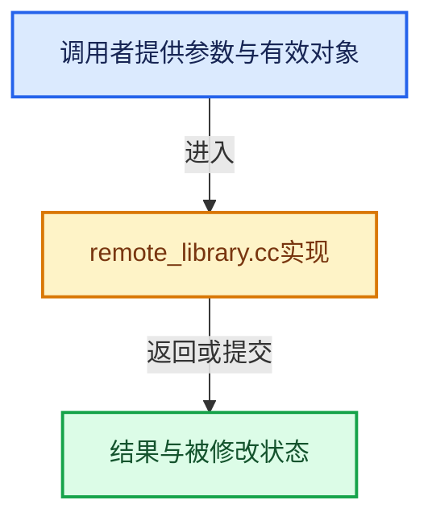

# 实现依赖专题：source/blender/asset_system/intern/library_types/remote_library.cc

[方向导航](README.md) · [符号索引](../%E7%AC%A6%E5%8F%B7%E4%BE%9D%E8%B5%96%E4%B8%8E%E5%AE%9E%E7%8E%B0%E7%B4%A2%E5%BC%95.md)

本专题从正文实际调用进入，集中保存共享实现。函数有稳定锚点，可从调用处直接跳到对应完整函数；递归与互相调用通过回链组织。

## 本文件的实现关系





## 完整成员与函数实现

<a id="f-4848f32ed69369b2"></a>

### `blender::asset_system::remote_library_cache_directory_path`

实现位置：[source/blender/asset_system/intern/library_types/remote_library.cc](../../../../../source/blender/asset_system/intern/library_types/remote_library.cc) · L1015—L1028。

接口参数：

- `const StringRefNull library_dirname`

**教学注释版**

<!-- annotated:a0e49491445d3b -->

```cpp
std::string remote_library_cache_directory_path(const StringRefNull library_dirname)
{
  char cache_path[FILE_MAXDIR];
  BKE_appdir_folder_caches(cache_path, sizeof(cache_path));

  char library_cache_path[FILE_MAXDIR];
  BLI_path_join(library_cache_path,
                sizeof(library_cache_path),
                cache_path,
                "remote-assets",
                library_dirname.c_str());

  return library_cache_path;
}
```

<details>
<summary>核对原始源码：source/blender/asset_system/intern/library_types/remote_library.cc · L1015—L1028</summary>

<!-- original:a0e49491445d3b:source/blender/asset_system/intern/library_types/remote_library.cc:1015:1028 -->

```cpp
std::string remote_library_cache_directory_path(const StringRefNull library_dirname)
{
  char cache_path[FILE_MAXDIR];
  BKE_appdir_folder_caches(cache_path, sizeof(cache_path));

  char library_cache_path[FILE_MAXDIR];
  BLI_path_join(library_cache_path,
                sizeof(library_cache_path),
                cache_path,
                "remote-assets",
                library_dirname.c_str());

  return library_cache_path;
}
```

</details>

**结果出口**

- `return library_cache_path;`

**继续追踪实现**

- `BKE_appdir_folder_caches` → [blender::BKE_appdir_folder_caches · L206](%E4%BE%9D%E8%B5%96-appdir-5d7b58.md#f-f9cfc53e0be76de3)。
- `BLI_path_join` → [BLI_path_join · L386](../01-%E5%9F%BA%E7%A1%80%E5%AE%B9%E5%99%A8%E4%B8%8E%E7%8E%B0%E4%BB%A3CPP/%E4%BE%9D%E8%B5%96-BLI_path_utils-130405.md#m-f3b1183fb80c)。宏定义由构建条件选择。
- `library_dirname.c_str` → [blender::StringRefNull::c_str · L544](../01-%E5%9F%BA%E7%A1%80%E5%AE%B9%E5%99%A8%E4%B8%8E%E7%8E%B0%E4%BB%A3CPP/15-StringRef%E5%AD%97%E7%AC%A6%E4%B8%B2%E8%A7%86%E5%9B%BE.md#f-4a8bbfe1e6d00757)。
