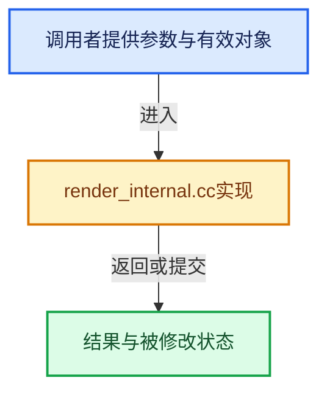

# 实现依赖专题：source/blender/editors/render/render_internal.cc

[方向导航](README.md) · [符号索引](../%E7%AC%A6%E5%8F%B7%E4%BE%9D%E8%B5%96%E4%B8%8E%E5%AE%9E%E7%8E%B0%E7%B4%A2%E5%BC%95.md)

本专题从正文实际调用进入，集中保存共享实现。函数有稳定锚点，可从调用处直接跳到对应完整函数；递归与互相调用通过回链组织。

## 本文件的实现关系





## 完整成员与函数实现

<a id="f-0c1b0ef634e83012"></a>

### `blender::render_job_get`

实现位置：[source/blender/editors/render/render_internal.cc](../../../../../source/blender/editors/render/render_internal.cc) · L1116—L1132。

接口参数：

- `const bContext *C`

**教学注释版**

<!-- annotated:91def3d39e310e -->

```cpp
static RenderJobBase *render_job_get(const bContext *C)
{
  wmWindowManager *wm = CTX_wm_manager(C);
  RenderJobBase *rj;

  /* Try to find job tied to active scene first. */
  rj = static_cast<RenderJobBase *>(
      WM_jobs_customdata_from_type(wm, CTX_data_scene(C), WM_JOB_TYPE_RENDER));

  /* If not found, attempt to find job tied to sequencer scene. */
  if (rj == nullptr) {
    return static_cast<RenderJobBase *>(
        WM_jobs_customdata_from_type(wm, CTX_data_sequencer_scene(C), WM_JOB_TYPE_RENDER));
  }

  return rj;
}
```

<details>
<summary>核对原始源码：source/blender/editors/render/render_internal.cc · L1116—L1132</summary>

<!-- original:91def3d39e310e:source/blender/editors/render/render_internal.cc:1116:1132 -->

```cpp
static RenderJobBase *render_job_get(const bContext *C)
{
  wmWindowManager *wm = CTX_wm_manager(C);
  RenderJobBase *rj;

  /* Try to find job tied to active scene first. */
  rj = static_cast<RenderJobBase *>(
      WM_jobs_customdata_from_type(wm, CTX_data_scene(C), WM_JOB_TYPE_RENDER));

  /* If not found, attempt to find job tied to sequencer scene. */
  if (rj == nullptr) {
    return static_cast<RenderJobBase *>(
        WM_jobs_customdata_from_type(wm, CTX_data_sequencer_scene(C), WM_JOB_TYPE_RENDER));
  }

  return rj;
}
```

</details>

**沿实际写入检查状态**

- `rj = static_cast<RenderJobBase *>(`

**结果出口**

- `return static_cast<RenderJobBase *>(`
- `return rj;`

**继续追踪实现**

- `CTX_wm_manager` → [blender::CTX_wm_manager · L928](%E4%BE%9D%E8%B5%96-context-a929d9.md#f-158f36db7379fbe8)。
- `WM_jobs_customdata_from_type` → [blender::WM_jobs_customdata_from_type · L347](%E4%BE%9D%E8%B5%96-wm_jobs-fec83b.md#f-e017aeba181baaac)。
- `CTX_data_scene` → [blender::CTX_data_scene · L1329](%E4%BE%9D%E8%B5%96-context-a929d9.md#f-6a2fb518a7aa2eee)。
- `CTX_data_sequencer_scene` → [blender::CTX_data_sequencer_scene · L1339](%E4%BE%9D%E8%B5%96-context-a929d9.md#f-c709ffbfdb75990a)。

<a id="f-9df7cdc145a96695"></a>

### `blender::ED_render_job_get_current_scene`

实现位置：[source/blender/editors/render/render_internal.cc](../../../../../source/blender/editors/render/render_internal.cc) · L1140—L1144。

接口参数：

- `const bContext *C`

**教学注释版**

<!-- annotated:95935a7f505914 -->

```cpp
Scene *ED_render_job_get_current_scene(const bContext *C)
{
  RenderJobBase *rj = render_job_get(C);
  return rj ? rj->current_scene : nullptr;
}
```

<details>
<summary>核对原始源码：source/blender/editors/render/render_internal.cc · L1140—L1144</summary>

<!-- original:95935a7f505914:source/blender/editors/render/render_internal.cc:1140:1144 -->

```cpp
Scene *ED_render_job_get_current_scene(const bContext *C)
{
  RenderJobBase *rj = render_job_get(C);
  return rj ? rj->current_scene : nullptr;
}
```

</details>

**结果出口**

- `return rj ? rj->current_scene : nullptr;`

**继续追踪实现**

- `render_job_get` → [blender::render_job_get · L1116](%E4%BE%9D%E8%B5%96-render_internal-6f4e5d.md#f-0c1b0ef634e83012)。
