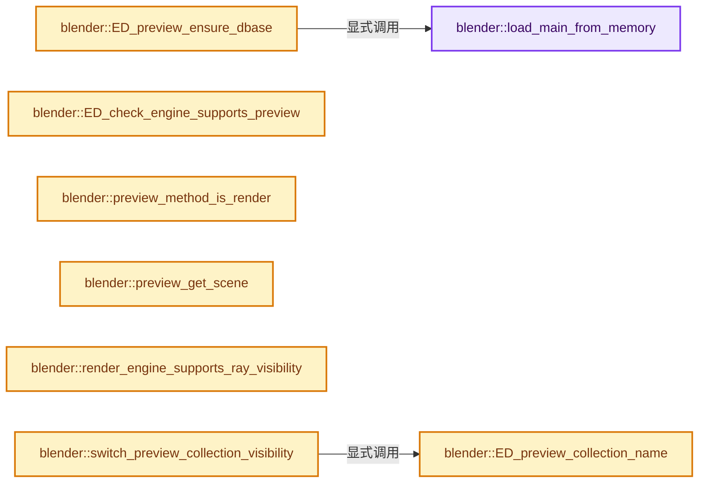

# 实现依赖专题：source/blender/editors/render/render_preview.cc

[方向导航](README.md) · [符号索引](../%E7%AC%A6%E5%8F%B7%E4%BE%9D%E8%B5%96%E4%B8%8E%E5%AE%9E%E7%8E%B0%E7%B4%A2%E5%BC%95.md)

本专题从正文实际调用进入，集中保存共享实现。函数有稳定锚点，可从调用处直接跳到对应完整函数；递归与互相调用通过回链组织。

## 本文件的实现关系




## 完整成员与函数实现

<a id="f-b02beaa59fd45e09"></a>

### `blender::load_main_from_memory`

实现位置：[source/blender/editors/render/render_preview.cc](../../../../../source/blender/editors/render/render_preview.cc) · L176—L191。

接口参数：

- `const void *blend`
- `int blend_size`

**教学注释版**

<!-- annotated:aedb10cb705e71 -->

```cpp
static Main *load_main_from_memory(const void *blend, int blend_size)
{
  const int fileflags = G.fileflags;
  Main *bmain = nullptr;
  BlendFileData *bfd;

  G.fileflags |= G_FILE_NO_UI;
  bfd = BLO_read_from_memory(blend, blend_size, BLO_READ_SKIP_NONE, nullptr);
  if (bfd) {
    bmain = bfd->main;
    MEM_delete(bfd);
  }
  G.fileflags = fileflags;

  return bmain;
}
```

<details>
<summary>核对原始源码：source/blender/editors/render/render_preview.cc · L176—L191</summary>

<!-- original:aedb10cb705e71:source/blender/editors/render/render_preview.cc:176:191 -->

```cpp
static Main *load_main_from_memory(const void *blend, int blend_size)
{
  const int fileflags = G.fileflags;
  Main *bmain = nullptr;
  BlendFileData *bfd;

  G.fileflags |= G_FILE_NO_UI;
  bfd = BLO_read_from_memory(blend, blend_size, BLO_READ_SKIP_NONE, nullptr);
  if (bfd) {
    bmain = bfd->main;
    MEM_delete(bfd);
  }
  G.fileflags = fileflags;

  return bmain;
}
```

</details>

**沿实际写入检查状态**

- `G.fileflags |= G_FILE_NO_UI;`
- `bfd = BLO_read_from_memory(blend, blend_size, BLO_READ_SKIP_NONE, nullptr);`
- `bmain = bfd->main;`
- `G.fileflags = fileflags;`

**结果出口**

- `return bmain;`

**继续追踪实现**

- `BLO_read_from_memory` → [blender::BLO_read_from_memory · L375](%E4%BE%9D%E8%B5%96-readblenentry-9e660c.md#f-e71f699269b652f7)。
- `MEM_delete` → [MEM_delete · L400](../03-%E5%86%85%E5%AD%98%E5%88%86%E9%85%8D%E4%B8%8E%E8%BF%90%E8%A1%8C%E6%97%B6%E7%B1%BB%E5%9E%8B/%E4%BE%9D%E8%B5%96-MEM_guardedalloc-b54eca.md#f-9049ffdd1682887c)。

<a id="f-1140f57cd0cada70"></a>

### `blender::ED_preview_ensure_dbase`

实现位置：[source/blender/editors/render/render_preview.cc](../../../../../source/blender/editors/render/render_preview.cc) · L194—L212。

接口参数：

- `const bool with_gpencil`

**教学注释版**

<!-- annotated:6a8457c20a9ef3 -->

```cpp
void ED_preview_ensure_dbase(const bool with_gpencil)
{
#ifndef WITH_HEADLESS
  static bool base_initialized = false;
  static bool base_initialized_gpencil = false;
  BLI_assert(BLI_thread_is_main());
  if (!base_initialized) {
    G.pr_main = load_main_from_memory(datatoc_preview_blend, datatoc_preview_blend_size);
    base_initialized = true;
  }
  if (!base_initialized_gpencil && with_gpencil) {
    G_pr_main_grease_pencil = load_main_from_memory(datatoc_preview_grease_pencil_blend,
                                                    datatoc_preview_grease_pencil_blend_size);
    base_initialized_gpencil = true;
  }
#else
  UNUSED_VARS(with_gpencil);
#endif
}
```

<details>
<summary>核对原始源码：source/blender/editors/render/render_preview.cc · L194—L212</summary>

<!-- original:6a8457c20a9ef3:source/blender/editors/render/render_preview.cc:194:212 -->

```cpp
void ED_preview_ensure_dbase(const bool with_gpencil)
{
#ifndef WITH_HEADLESS
  static bool base_initialized = false;
  static bool base_initialized_gpencil = false;
  BLI_assert(BLI_thread_is_main());
  if (!base_initialized) {
    G.pr_main = load_main_from_memory(datatoc_preview_blend, datatoc_preview_blend_size);
    base_initialized = true;
  }
  if (!base_initialized_gpencil && with_gpencil) {
    G_pr_main_grease_pencil = load_main_from_memory(datatoc_preview_grease_pencil_blend,
                                                    datatoc_preview_grease_pencil_blend_size);
    base_initialized_gpencil = true;
  }
#else
  UNUSED_VARS(with_gpencil);
#endif
}
```

</details>

**沿实际写入检查状态**

- `G.pr_main = load_main_from_memory(datatoc_preview_blend, datatoc_preview_blend_size);`
- `base_initialized = true;`
- `G_pr_main_grease_pencil = load_main_from_memory(datatoc_preview_grease_pencil_blend,`
- `base_initialized_gpencil = true;`

**继续追踪实现**

- `BLI_assert` → [BLI_assert · L48](../01-%E5%9F%BA%E7%A1%80%E5%AE%B9%E5%99%A8%E4%B8%8E%E7%8E%B0%E4%BB%A3CPP/%E4%BE%9D%E8%B5%96-BLI_assert-cc98e8.md#m-57a88495704d)；[BLI_assert · L63](../01-%E5%9F%BA%E7%A1%80%E5%AE%B9%E5%99%A8%E4%B8%8E%E7%8E%B0%E4%BB%A3CPP/%E4%BE%9D%E8%B5%96-BLI_assert-cc98e8.md#m-d07050020cb5)。宏定义由构建条件选择。
- `BLI_thread_is_main` → [BLI_thread_is_main · L184](../01-%E5%9F%BA%E7%A1%80%E5%AE%B9%E5%99%A8%E4%B8%8E%E7%8E%B0%E4%BB%A3CPP/%E4%BE%9D%E8%B5%96-threads-a036bf.md#f-da304af4327defdc)。
- `load_main_from_memory` → [blender::load_main_from_memory · L176](%E4%BE%9D%E8%B5%96-render_preview-3e12aa.md#f-b02beaa59fd45e09)。
- `UNUSED_VARS` → [UNUSED_VARS · L522](../01-%E5%9F%BA%E7%A1%80%E5%AE%B9%E5%99%A8%E4%B8%8E%E7%8E%B0%E4%BB%A3CPP/%E4%BE%9D%E8%B5%96-BLI_utildefines-293a0a.md#m-013582537634)；[UNUSED_VARS · L41](%E4%BE%9D%E8%B5%96-GPU_shader_shared_utils-0adda3.md#m-05d9d7a33da0)；[UNUSED_VARS · L62](%E4%BE%9D%E8%B5%96-GPU_shader_shared_utils-0adda3.md#m-e12c683a4aca)。宏定义由构建条件选择。

<a id="f-cf3283ed026a6ada"></a>

### `blender::ED_check_engine_supports_preview`

实现位置：[source/blender/editors/render/render_preview.cc](../../../../../source/blender/editors/render/render_preview.cc) · L214—L218。

接口参数：

- `const Scene *scene`

**教学注释版**

<!-- annotated:c12063243b5038 -->

```cpp
bool ED_check_engine_supports_preview(const Scene *scene)
{
  RenderEngineType *type = RE_engines_find(scene->r.engine);
  return (type->flag & RE_USE_PREVIEW) != 0;
}
```

<details>
<summary>核对原始源码：source/blender/editors/render/render_preview.cc · L214—L218</summary>

<!-- original:c12063243b5038:source/blender/editors/render/render_preview.cc:214:218 -->

```cpp
bool ED_check_engine_supports_preview(const Scene *scene)
{
  RenderEngineType *type = RE_engines_find(scene->r.engine);
  return (type->flag & RE_USE_PREVIEW) != 0;
}
```

</details>

**结果出口**

- `return (type->flag & RE_USE_PREVIEW) != 0;`

**继续追踪实现**

- `RE_engines_find` → [blender::RE_engines_find · L104](%E4%BE%9D%E8%B5%96-engine-ac0ebe.md#f-ac7af80bac61d49c)。

<a id="f-355402d824296c7c"></a>

### `blender::preview_method_is_render`

实现位置：[source/blender/editors/render/render_preview.cc](../../../../../source/blender/editors/render/render_preview.cc) · L220—L223。

接口参数：

- `const ePreviewRenderMethod pr_method`

**教学注释版**

<!-- annotated:a911b6db091125 -->

```cpp
static bool preview_method_is_render(const ePreviewRenderMethod pr_method)
{
  return ELEM(pr_method, PR_ICON_RENDER, PR_BUTS_RENDER);
}
```

<details>
<summary>核对原始源码：source/blender/editors/render/render_preview.cc · L220—L223</summary>

<!-- original:a911b6db091125:source/blender/editors/render/render_preview.cc:220:223 -->

```cpp
static bool preview_method_is_render(const ePreviewRenderMethod pr_method)
{
  return ELEM(pr_method, PR_ICON_RENDER, PR_BUTS_RENDER);
}
```

</details>

**结果出口**

- `return ELEM(pr_method, PR_ICON_RENDER, PR_BUTS_RENDER);`

**继续追踪实现**

- `ELEM` → [ELEM · L88](%E4%BE%9D%E8%B5%96-GHOST_utildefines-34b996.md#m-d28724a15928)；[ELEM · L135](../01-%E5%9F%BA%E7%A1%80%E5%AE%B9%E5%99%A8%E4%B8%8E%E7%8E%B0%E4%BB%A3CPP/%E4%BE%9D%E8%B5%96-BLI_utildefines-293a0a.md#m-d6572de7cae0)。宏定义由构建条件选择。

<a id="f-27da6ca4a823c2cb"></a>

### `blender::preview_get_scene`

实现位置：[source/blender/editors/render/render_preview.cc](../../../../../source/blender/editors/render/render_preview.cc) · L236—L243。

接口参数：

- `Main *pr_main`

**教学注释版**

<!-- annotated:6c66ac185e613c -->

```cpp
static Scene *preview_get_scene(Main *pr_main)
{
  if (pr_main == nullptr) {
    return nullptr;
  }

  return pr_main->scenes.first();
}
```

<details>
<summary>核对原始源码：source/blender/editors/render/render_preview.cc · L236—L243</summary>

<!-- original:6c66ac185e613c:source/blender/editors/render/render_preview.cc:236:243 -->

```cpp
static Scene *preview_get_scene(Main *pr_main)
{
  if (pr_main == nullptr) {
    return nullptr;
  }

  return pr_main->scenes.first();
}
```

</details>

**结果出口**

- `return nullptr;`
- `return pr_main->scenes.first();`

**继续追踪实现**

- `pr_main->scenes.first` → [调用协议](../%E6%A8%A1%E6%9D%BF%E5%AE%8F%E4%B8%8E%E5%8A%A8%E6%80%81%E5%88%86%E6%B4%BE%E5%8D%8F%E8%AE%AE.md)：接收对象类型依赖auto、返回值或模板实例；不按同名猜测目标。调用位置L242。

<a id="f-72551017d16f6d99"></a>

### `blender::ED_preview_collection_name`

实现位置：[source/blender/editors/render/render_preview.cc](../../../../../source/blender/editors/render/render_preview.cc) · L245—L274。

接口参数：

- `const ePreviewType pr_type`

**教学注释版**

<!-- annotated:25eae703f9f465 -->

```cpp
const char *ED_preview_collection_name(const ePreviewType pr_type)
{
  switch (pr_type) {
    case MA_FLAT:
      return "Flat";
    case MA_SPHERE:
      return "Sphere";
    case MA_CUBE:
      return "Cube";
    case MA_SHADERBALL:
      return "Shader Ball";
    case MA_CLOTH:
      return "Cloth";
    case MA_FLUID:
      return "Fluid";
    case MA_SPHERE_A:
      return "World Sphere";
    case MA_LAMP:
      return "Lamp";
    case MA_SKY:
      return "Sky";
    case MA_HAIR:
      return "Hair";
    case MA_ATMOS:
      return "Atmosphere";
    default:
      BLI_assert_msg(0, "Unknown preview type");
      return "";
  }
}
```

<details>
<summary>核对原始源码：source/blender/editors/render/render_preview.cc · L245—L274</summary>

<!-- original:25eae703f9f465:source/blender/editors/render/render_preview.cc:245:274 -->

```cpp
const char *ED_preview_collection_name(const ePreviewType pr_type)
{
  switch (pr_type) {
    case MA_FLAT:
      return "Flat";
    case MA_SPHERE:
      return "Sphere";
    case MA_CUBE:
      return "Cube";
    case MA_SHADERBALL:
      return "Shader Ball";
    case MA_CLOTH:
      return "Cloth";
    case MA_FLUID:
      return "Fluid";
    case MA_SPHERE_A:
      return "World Sphere";
    case MA_LAMP:
      return "Lamp";
    case MA_SKY:
      return "Sky";
    case MA_HAIR:
      return "Hair";
    case MA_ATMOS:
      return "Atmosphere";
    default:
      BLI_assert_msg(0, "Unknown preview type");
      return "";
  }
}
```

</details>

**结果出口**

- `return "Flat";`
- `return "Sphere";`
- `return "Cube";`
- `return "Shader Ball";`
- `return "Cloth";`
- `return "Fluid";`
- `return "World Sphere";`
- `return "Lamp";`
- `return "Sky";`
- `return "Hair";`
- `return "Atmosphere";`
- `return "";`

**继续追踪实现**

- `BLI_assert_msg` → [BLI_assert_msg · L55](../01-%E5%9F%BA%E7%A1%80%E5%AE%B9%E5%99%A8%E4%B8%8E%E7%8E%B0%E4%BB%A3CPP/%E4%BE%9D%E8%B5%96-BLI_assert-cc98e8.md#m-695eed20dceb)；[BLI_assert_msg · L64](../01-%E5%9F%BA%E7%A1%80%E5%AE%B9%E5%99%A8%E4%B8%8E%E7%8E%B0%E4%BB%A3CPP/%E4%BE%9D%E8%B5%96-BLI_assert-cc98e8.md#m-7de5563de4db)。宏定义由构建条件选择。

<a id="f-8597493e97bdb9c4"></a>

### `blender::render_engine_supports_ray_visibility`

实现位置：[source/blender/editors/render/render_preview.cc](../../../../../source/blender/editors/render/render_preview.cc) · L276—L279。

接口参数：

- `const Scene *sce`

**教学注释版**

<!-- annotated:977af84c85d5da -->

```cpp
static bool render_engine_supports_ray_visibility(const Scene *sce)
{
  return !STREQ(sce->r.engine, RE_engine_id_BLENDER_EEVEE);
}
```

<details>
<summary>核对原始源码：source/blender/editors/render/render_preview.cc · L276—L279</summary>

<!-- original:977af84c85d5da:source/blender/editors/render/render_preview.cc:276:279 -->

```cpp
static bool render_engine_supports_ray_visibility(const Scene *sce)
{
  return !STREQ(sce->r.engine, RE_engine_id_BLENDER_EEVEE);
}
```

</details>

**结果出口**

- `return !STREQ(sce->r.engine, RE_engine_id_BLENDER_EEVEE);`

**继续追踪实现**

- `STREQ` → [STREQ · L112](%E4%BE%9D%E8%B5%96-GHOST_utildefines-34b996.md#m-9549fb6aafd2)；[STREQ · L451](../01-%E5%9F%BA%E7%A1%80%E5%AE%B9%E5%99%A8%E4%B8%8E%E7%8E%B0%E4%BB%A3CPP/%E4%BE%9D%E8%B5%96-BLI_utildefines-293a0a.md#m-c7b745bcfad2)；[STREQ · L55](%E4%BE%9D%E8%B5%96-clog-a0bec8.md#m-96e78f386894)。宏定义由构建条件选择。

<a id="f-12c4c312533d67e8"></a>

### `blender::switch_preview_collection_visibility`

实现位置：[source/blender/editors/render/render_preview.cc](../../../../../source/blender/editors/render/render_preview.cc) · L281—L295。

接口参数：

- `ViewLayer *view_layer`
- `const ePreviewType pr_type`

**教学注释版**

<!-- annotated:e1c8687e1f04d2 -->

```cpp
static void switch_preview_collection_visibility(ViewLayer *view_layer, const ePreviewType pr_type)
{
  /* Set appropriate layer as visible. */
  LayerCollection *lc = view_layer->layer_collections.first();
  const char *collection_name = ED_preview_collection_name(pr_type);

  for (lc = lc->layer_collections.first(); lc; lc = lc->next) {
    if (STREQ(lc->collection->id.name + 2, collection_name)) {
      lc->collection->flag &= ~COLLECTION_HIDE_RENDER;
    }
    else {
      lc->collection->flag |= COLLECTION_HIDE_RENDER;
    }
  }
}
```

<details>
<summary>核对原始源码：source/blender/editors/render/render_preview.cc · L281—L295</summary>

<!-- original:e1c8687e1f04d2:source/blender/editors/render/render_preview.cc:281:295 -->

```cpp
static void switch_preview_collection_visibility(ViewLayer *view_layer, const ePreviewType pr_type)
{
  /* Set appropriate layer as visible. */
  LayerCollection *lc = view_layer->layer_collections.first();
  const char *collection_name = ED_preview_collection_name(pr_type);

  for (lc = lc->layer_collections.first(); lc; lc = lc->next) {
    if (STREQ(lc->collection->id.name + 2, collection_name)) {
      lc->collection->flag &= ~COLLECTION_HIDE_RENDER;
    }
    else {
      lc->collection->flag |= COLLECTION_HIDE_RENDER;
    }
  }
}
```

</details>

**沿实际写入检查状态**

- `lc->collection->flag &= ~COLLECTION_HIDE_RENDER;`
- `lc->collection->flag |= COLLECTION_HIDE_RENDER;`

**继续追踪实现**

- `view_layer->layer_collections.first` → [调用协议](../%E6%A8%A1%E6%9D%BF%E5%AE%8F%E4%B8%8E%E5%8A%A8%E6%80%81%E5%88%86%E6%B4%BE%E5%8D%8F%E8%AE%AE.md)：接收对象类型依赖auto、返回值或模板实例；不按同名猜测目标。调用位置L284。
- `ED_preview_collection_name` → [blender::ED_preview_collection_name · L245](%E4%BE%9D%E8%B5%96-render_preview-3e12aa.md#f-72551017d16f6d99)。
- `lc->layer_collections.first` → [调用协议](../%E6%A8%A1%E6%9D%BF%E5%AE%8F%E4%B8%8E%E5%8A%A8%E6%80%81%E5%88%86%E6%B4%BE%E5%8D%8F%E8%AE%AE.md)：接收对象类型依赖auto、返回值或模板实例；不按同名猜测目标。调用位置L287。
- `STREQ` → [STREQ · L112](%E4%BE%9D%E8%B5%96-GHOST_utildefines-34b996.md#m-9549fb6aafd2)；[STREQ · L451](../01-%E5%9F%BA%E7%A1%80%E5%AE%B9%E5%99%A8%E4%B8%8E%E7%8E%B0%E4%BB%A3CPP/%E4%BE%9D%E8%B5%96-BLI_utildefines-293a0a.md#m-c7b745bcfad2)；[STREQ · L55](%E4%BE%9D%E8%B5%96-clog-a0bec8.md#m-96e78f386894)。宏定义由构建条件选择。

<a id="f-01d0ffb0ad2bd5bc"></a>

### `blender::preview_floor_material_name`

实现位置：[source/blender/editors/render/render_preview.cc](../../../../../source/blender/editors/render/render_preview.cc) · L297—L304。

接口参数：

- `const Scene *scene`
- `const ePreviewRenderMethod pr_method`

**教学注释版**

<!-- annotated:a81a5982807b48 -->

```cpp
static const char *preview_floor_material_name(const Scene *scene,
                                               const ePreviewRenderMethod pr_method)
{
  if (pr_method == PR_ICON_RENDER && render_engine_supports_ray_visibility(scene)) {
    return "FloorHidden";
  }
  return "Floor";
}
```

<details>
<summary>核对原始源码：source/blender/editors/render/render_preview.cc · L297—L304</summary>

<!-- original:a81a5982807b48:source/blender/editors/render/render_preview.cc:297:304 -->

```cpp
static const char *preview_floor_material_name(const Scene *scene,
                                               const ePreviewRenderMethod pr_method)
{
  if (pr_method == PR_ICON_RENDER && render_engine_supports_ray_visibility(scene)) {
    return "FloorHidden";
  }
  return "Floor";
}
```

</details>

**结果出口**

- `return "FloorHidden";`
- `return "Floor";`

**继续追踪实现**

- `render_engine_supports_ray_visibility` → [blender::render_engine_supports_ray_visibility · L276](%E4%BE%9D%E8%B5%96-render_preview-3e12aa.md#f-8597493e97bdb9c4)。

<a id="f-17615942b01c3a13"></a>

### `blender::switch_preview_floor_material`

实现位置：[source/blender/editors/render/render_preview.cc](../../../../../source/blender/editors/render/render_preview.cc) · L306—L321。

接口参数：

- `Main *pr_main`
- `Mesh *mesh`
- `const Scene *scene`
- `const ePreviewRenderMethod pr_method`

**教学注释版**

<!-- annotated:b817bb8fedfa92 -->

```cpp
static void switch_preview_floor_material(Main *pr_main,
                                          Mesh *mesh,
                                          const Scene *scene,
                                          const ePreviewRenderMethod pr_method)
{
  if (mesh->totcol == 0) {
    return;
  }

  const char *material_name = preview_floor_material_name(scene, pr_method);
  Material *mat = static_cast<Material *>(
      BLI_findstring(&pr_main->materials, material_name, offsetof(ID, name) + 2));
  if (mat) {
    mesh->mat[0] = mat;
  }
}
```

<details>
<summary>核对原始源码：source/blender/editors/render/render_preview.cc · L306—L321</summary>

<!-- original:b817bb8fedfa92:source/blender/editors/render/render_preview.cc:306:321 -->

```cpp
static void switch_preview_floor_material(Main *pr_main,
                                          Mesh *mesh,
                                          const Scene *scene,
                                          const ePreviewRenderMethod pr_method)
{
  if (mesh->totcol == 0) {
    return;
  }

  const char *material_name = preview_floor_material_name(scene, pr_method);
  Material *mat = static_cast<Material *>(
      BLI_findstring(&pr_main->materials, material_name, offsetof(ID, name) + 2));
  if (mat) {
    mesh->mat[0] = mat;
  }
}
```

</details>

**沿实际写入检查状态**

- `mesh->mat[0] = mat;`

**继续追踪实现**

- `preview_floor_material_name` → [blender::preview_floor_material_name · L297](%E4%BE%9D%E8%B5%96-render_preview-3e12aa.md#f-01d0ffb0ad2bd5bc)。
- `BLI_findstring` → [blender::BLI_findstring · L615](../01-%E5%9F%BA%E7%A1%80%E5%AE%B9%E5%99%A8%E4%B8%8E%E7%8E%B0%E4%BB%A3CPP/%E4%BE%9D%E8%B5%96-listbase-2816d9.md#f-d913b13b2651348e)。

<a id="f-49b7a9ed4c94fa05"></a>

### `blender::switch_preview_floor_visibility`

实现位置：[source/blender/editors/render/render_preview.cc](../../../../../source/blender/editors/render/render_preview.cc) · L323—L344。

接口参数：

- `Main *pr_main`
- `const Scene *scene`
- `ViewLayer *view_layer`
- `const ePreviewRenderMethod pr_method`

**教学注释版**

<!-- annotated:53edd091a42fb3 -->

```cpp
static void switch_preview_floor_visibility(Main *pr_main,
                                            const Scene *scene,
                                            ViewLayer *view_layer,
                                            const ePreviewRenderMethod pr_method)
{
  /* Hide floor for icon renders. */
  BKE_view_layer_synced_ensure(*pr_main, scene, view_layer);
  for (Base &base : *BKE_view_layer_object_bases_get(view_layer)) {
    if (STREQ(base.object->id.name + 2, "Floor")) {
      base.object->visibility_flag &= ~OB_HIDE_RENDER;
      if (pr_method == PR_ICON_RENDER) {
        if (!render_engine_supports_ray_visibility(scene)) {
          base.object->visibility_flag |= OB_HIDE_RENDER;
        }
      }
      if (base.object->type == OB_MESH) {
        switch_preview_floor_material(
            pr_main, id_cast<Mesh *>(base.object->data), scene, pr_method);
      }
    }
  }
}
```

<details>
<summary>核对原始源码：source/blender/editors/render/render_preview.cc · L323—L344</summary>

<!-- original:53edd091a42fb3:source/blender/editors/render/render_preview.cc:323:344 -->

```cpp
static void switch_preview_floor_visibility(Main *pr_main,
                                            const Scene *scene,
                                            ViewLayer *view_layer,
                                            const ePreviewRenderMethod pr_method)
{
  /* Hide floor for icon renders. */
  BKE_view_layer_synced_ensure(*pr_main, scene, view_layer);
  for (Base &base : *BKE_view_layer_object_bases_get(view_layer)) {
    if (STREQ(base.object->id.name + 2, "Floor")) {
      base.object->visibility_flag &= ~OB_HIDE_RENDER;
      if (pr_method == PR_ICON_RENDER) {
        if (!render_engine_supports_ray_visibility(scene)) {
          base.object->visibility_flag |= OB_HIDE_RENDER;
        }
      }
      if (base.object->type == OB_MESH) {
        switch_preview_floor_material(
            pr_main, id_cast<Mesh *>(base.object->data), scene, pr_method);
      }
    }
  }
}
```

</details>

**沿实际写入检查状态**

- `base.object->visibility_flag &= ~OB_HIDE_RENDER;`
- `base.object->visibility_flag |= OB_HIDE_RENDER;`

**继续追踪实现**

- `BKE_view_layer_synced_ensure` → [blender::BKE_view_layer_synced_ensure · L1035](%E4%BE%9D%E8%B5%96-layer-0bc136.md#f-602c088654ebcb63)。
- `BKE_view_layer_object_bases_get` → [blender::BKE_view_layer_object_bases_get · L202](%E4%BE%9D%E8%B5%96-layer_utils-31ba6d.md#f-f7b3adc8941172e4)。
- `STREQ` → [STREQ · L112](%E4%BE%9D%E8%B5%96-GHOST_utildefines-34b996.md#m-9549fb6aafd2)；[STREQ · L451](../01-%E5%9F%BA%E7%A1%80%E5%AE%B9%E5%99%A8%E4%B8%8E%E7%8E%B0%E4%BB%A3CPP/%E4%BE%9D%E8%B5%96-BLI_utildefines-293a0a.md#m-c7b745bcfad2)；[STREQ · L55](%E4%BE%9D%E8%B5%96-clog-a0bec8.md#m-96e78f386894)。宏定义由构建条件选择。
- `render_engine_supports_ray_visibility` → [blender::render_engine_supports_ray_visibility · L276](%E4%BE%9D%E8%B5%96-render_preview-3e12aa.md#f-8597493e97bdb9c4)。
- `switch_preview_floor_material` → [blender::switch_preview_floor_material · L306](%E4%BE%9D%E8%B5%96-render_preview-3e12aa.md#f-17615942b01c3a13)。
- `id_cast<Mesh *>` → [blender::id_cast · L1417](%E4%BE%9D%E8%B5%96-DNA_ID-3eb091.md#f-6c8ac6412850ac5a)。

<a id="f-9c5623a5d9e9809d"></a>

### `blender::ED_preview_set_visibility`

实现位置：[source/blender/editors/render/render_preview.cc](../../../../../source/blender/editors/render/render_preview.cc) · L346—L355。

接口参数：

- `Main *pr_main`
- `Scene *scene`
- `ViewLayer *view_layer`
- `const ePreviewType pr_type`
- `const ePreviewRenderMethod pr_method`

**教学注释版**

<!-- annotated:586db247656508 -->

```cpp
void ED_preview_set_visibility(Main *pr_main,
                               Scene *scene,
                               ViewLayer *view_layer,
                               const ePreviewType pr_type,
                               const ePreviewRenderMethod pr_method)
{
  switch_preview_collection_visibility(view_layer, pr_type);
  switch_preview_floor_visibility(pr_main, scene, view_layer, pr_method);
  BKE_layer_collection_sync(*pr_main, scene, view_layer);
}
```

<details>
<summary>核对原始源码：source/blender/editors/render/render_preview.cc · L346—L355</summary>

<!-- original:586db247656508:source/blender/editors/render/render_preview.cc:346:355 -->

```cpp
void ED_preview_set_visibility(Main *pr_main,
                               Scene *scene,
                               ViewLayer *view_layer,
                               const ePreviewType pr_type,
                               const ePreviewRenderMethod pr_method)
{
  switch_preview_collection_visibility(view_layer, pr_type);
  switch_preview_floor_visibility(pr_main, scene, view_layer, pr_method);
  BKE_layer_collection_sync(*pr_main, scene, view_layer);
}
```

</details>

**继续追踪实现**

- `switch_preview_collection_visibility` → [blender::switch_preview_collection_visibility · L281](%E4%BE%9D%E8%B5%96-render_preview-3e12aa.md#f-12c4c312533d67e8)。
- `switch_preview_floor_visibility` → [blender::switch_preview_floor_visibility · L323](%E4%BE%9D%E8%B5%96-render_preview-3e12aa.md#f-49b7a9ed4c94fa05)。
- `BKE_layer_collection_sync` → [blender::BKE_layer_collection_sync · L1372](%E4%BE%9D%E8%B5%96-layer-0bc136.md#f-5ae8118df759fb87)。

<a id="f-6d4760b71590604b"></a>

### `blender::preview_get_localized_world`

实现位置：[source/blender/editors/render/render_preview.cc](../../../../../source/blender/editors/render/render_preview.cc) · L357—L374。

接口参数：

- `ShaderPreview *sp`
- `World *world`

**教学注释版**

<!-- annotated:b8530b69f93e88 -->

```cpp
static World *preview_get_localized_world(ShaderPreview *sp, World *world)
{
  if (world == nullptr) {
    return nullptr;
  }
  if (sp->worldcopy != nullptr) {
    return sp->worldcopy;
  }

  ID *id_copy = BKE_id_copy_ex(nullptr,
                               &world->id,
                               nullptr,
                               LIB_ID_CREATE_LOCAL | LIB_ID_COPY_LOCALIZE |
                                   LIB_ID_COPY_NO_ANIMDATA);
  sp->worldcopy = id_cast<World *>(id_copy);
  BLI_addtail(&sp->pr_main->worlds, sp->worldcopy);
  return sp->worldcopy;
}
```

<details>
<summary>核对原始源码：source/blender/editors/render/render_preview.cc · L357—L374</summary>

<!-- original:b8530b69f93e88:source/blender/editors/render/render_preview.cc:357:374 -->

```cpp
static World *preview_get_localized_world(ShaderPreview *sp, World *world)
{
  if (world == nullptr) {
    return nullptr;
  }
  if (sp->worldcopy != nullptr) {
    return sp->worldcopy;
  }

  ID *id_copy = BKE_id_copy_ex(nullptr,
                               &world->id,
                               nullptr,
                               LIB_ID_CREATE_LOCAL | LIB_ID_COPY_LOCALIZE |
                                   LIB_ID_COPY_NO_ANIMDATA);
  sp->worldcopy = id_cast<World *>(id_copy);
  BLI_addtail(&sp->pr_main->worlds, sp->worldcopy);
  return sp->worldcopy;
}
```

</details>

**沿实际写入检查状态**

- `sp->worldcopy = id_cast<World *>(id_copy);`

**结果出口**

- `return nullptr;`
- `return sp->worldcopy;`

**继续追踪实现**

- `BKE_id_copy_ex` → [blender::BKE_id_copy_ex · L851](%E4%BE%9D%E8%B5%96-lib_id-d4e6bd.md#f-24272170c95f49fb)。
- `id_cast<World *>` → [blender::id_cast · L1417](%E4%BE%9D%E8%B5%96-DNA_ID-3eb091.md#f-6c8ac6412850ac5a)。
- `BLI_addtail` → [blender::BLI_addtail · L118](../01-%E5%9F%BA%E7%A1%80%E5%AE%B9%E5%99%A8%E4%B8%8E%E7%8E%B0%E4%BB%A3CPP/%E4%BE%9D%E8%B5%96-listbase-2816d9.md#f-4fb027713fa3115b)。

<a id="f-dbc61d06fa60833d"></a>

### `blender::ED_preview_prepare_world_simple`

实现位置：[source/blender/editors/render/render_preview.cc](../../../../../source/blender/editors/render/render_preview.cc) · L376—L397。

接口参数：

- `Main *bmain`

**教学注释版**

<!-- annotated:da233b4fc841d5 -->

```cpp
World *ED_preview_prepare_world_simple(Main *bmain)
{
  using namespace blender::bke;

  World *world = BKE_world_add(bmain, "SimpleWorld");
  bNodeTree *ntree = world->nodetree;

  bNode *background = node_add_node(nullptr, *ntree, "ShaderNodeBackground"_ustr);
  bNode *output = node_add_node(nullptr, *ntree, "ShaderNodeOutputWorld"_ustr);
  node_add_link(*world->nodetree,
                *background,
                *node_find_socket(*background, SOCK_OUT, "Background"_ustr),
                *output,
                *node_find_socket(*output, SOCK_IN, "Surface"_ustr));
  node_set_active(*ntree, *output);

  world->nodetree = ntree;

  BKE_ntree_update_after_single_tree_change(*bmain, *ntree);

  return world;
}
```

<details>
<summary>核对原始源码：source/blender/editors/render/render_preview.cc · L376—L397</summary>

<!-- original:da233b4fc841d5:source/blender/editors/render/render_preview.cc:376:397 -->

```cpp
World *ED_preview_prepare_world_simple(Main *bmain)
{
  using namespace blender::bke;

  World *world = BKE_world_add(bmain, "SimpleWorld");
  bNodeTree *ntree = world->nodetree;

  bNode *background = node_add_node(nullptr, *ntree, "ShaderNodeBackground"_ustr);
  bNode *output = node_add_node(nullptr, *ntree, "ShaderNodeOutputWorld"_ustr);
  node_add_link(*world->nodetree,
                *background,
                *node_find_socket(*background, SOCK_OUT, "Background"_ustr),
                *output,
                *node_find_socket(*output, SOCK_IN, "Surface"_ustr));
  node_set_active(*ntree, *output);

  world->nodetree = ntree;

  BKE_ntree_update_after_single_tree_change(*bmain, *ntree);

  return world;
}
```

</details>

**沿实际写入检查状态**

- `world->nodetree = ntree;`

**结果出口**

- `return world;`

**继续追踪实现**

- `BKE_world_add` → [blender::BKE_world_add · L221](%E4%BE%9D%E8%B5%96-world-6fd64c.md#f-29625dd717e7fab7)。
- `node_add_node` → [blender::bke::node_add_node · L4260](%E4%BE%9D%E8%B5%96-node-89d753.md#f-3ffbb7b6b6d5b74c)。
- `node_add_link` → [blender::bke::node_add_link · L4638](%E4%BE%9D%E8%B5%96-node-89d753.md#f-e4b0f883348f0d24)。
- `node_find_socket` → [blender::bke::node_find_socket · L3036](%E4%BE%9D%E8%B5%96-node-89d753.md#f-cbf9dec71aff5b59)；[blender::bke::node_find_socket · L3047](%E4%BE%9D%E8%B5%96-node-89d753.md#f-4a7a677634b7fbd1)。同名重载需按实参类型选择。
- `node_set_active` → [blender::bke::node_set_active · L5484](%E4%BE%9D%E8%B5%96-node-89d753.md#f-7b2e1b01e127aa57)。
- `BKE_ntree_update_after_single_tree_change` → [blender::BKE_ntree_update_after_single_tree_change · L2421](%E4%BE%9D%E8%B5%96-node_tree_update-60230f.md#f-60cd3f41995f06e2)。

<a id="f-6ab28375c3fdc039"></a>

### `blender::preview_get_world_simple`

实现位置：[source/blender/editors/render/render_preview.cc](../../../../../source/blender/editors/render/render_preview.cc) · L399—L405。

接口参数：

- `ShaderPreview *sp`

**教学注释版**

<!-- annotated:fb67ce06d9ec54 -->

```cpp
static World *preview_get_world_simple(ShaderPreview *sp)
{
  if (sp->world_simple == nullptr) {
    sp->world_simple = ED_preview_prepare_world_simple(sp->pr_main);
  }
  return sp->world_simple;
}
```

<details>
<summary>核对原始源码：source/blender/editors/render/render_preview.cc · L399—L405</summary>

<!-- original:fb67ce06d9ec54:source/blender/editors/render/render_preview.cc:399:405 -->

```cpp
static World *preview_get_world_simple(ShaderPreview *sp)
{
  if (sp->world_simple == nullptr) {
    sp->world_simple = ED_preview_prepare_world_simple(sp->pr_main);
  }
  return sp->world_simple;
}
```

</details>

**沿实际写入检查状态**

- `sp->world_simple = ED_preview_prepare_world_simple(sp->pr_main);`

**结果出口**

- `return sp->world_simple;`

**继续追踪实现**

- `ED_preview_prepare_world_simple` → [blender::ED_preview_prepare_world_simple · L376](%E4%BE%9D%E8%B5%96-render_preview-3e12aa.md#f-dbc61d06fa60833d)。

<a id="f-2144489258024065"></a>

### `blender::ED_preview_world_simple_set_rgb`

实现位置：[source/blender/editors/render/render_preview.cc](../../../../../source/blender/editors/render/render_preview.cc) · L407—L417。

接口参数：

- `World *world`
- `const float color[4]`

**教学注释版**

<!-- annotated:5cedec5c911fde -->

```cpp
void ED_preview_world_simple_set_rgb(World *world, const float color[4])
{
  BLI_assert(world != nullptr);

  bNode *background = bke::node_find_node_by_name(*world->nodetree, "Background");
  BLI_assert(background != nullptr);

  auto *color_socket = static_cast<bNodeSocketValueRGBA *>(
      bke::node_find_socket(*background, SOCK_IN, "Color"_ustr)->default_value);
  copy_v4_v4(color_socket->value, color);
}
```

<details>
<summary>核对原始源码：source/blender/editors/render/render_preview.cc · L407—L417</summary>

<!-- original:5cedec5c911fde:source/blender/editors/render/render_preview.cc:407:417 -->

```cpp
void ED_preview_world_simple_set_rgb(World *world, const float color[4])
{
  BLI_assert(world != nullptr);

  bNode *background = bke::node_find_node_by_name(*world->nodetree, "Background");
  BLI_assert(background != nullptr);

  auto *color_socket = static_cast<bNodeSocketValueRGBA *>(
      bke::node_find_socket(*background, SOCK_IN, "Color"_ustr)->default_value);
  copy_v4_v4(color_socket->value, color);
}
```

</details>

**继续追踪实现**

- `BLI_assert` → [BLI_assert · L48](../01-%E5%9F%BA%E7%A1%80%E5%AE%B9%E5%99%A8%E4%B8%8E%E7%8E%B0%E4%BB%A3CPP/%E4%BE%9D%E8%B5%96-BLI_assert-cc98e8.md#m-57a88495704d)；[BLI_assert · L63](../01-%E5%9F%BA%E7%A1%80%E5%AE%B9%E5%99%A8%E4%B8%8E%E7%8E%B0%E4%BB%A3CPP/%E4%BE%9D%E8%B5%96-BLI_assert-cc98e8.md#m-d07050020cb5)。宏定义由构建条件选择。
- `bke::node_find_node_by_name` → [blender::bke::node_find_node_by_name · L4047](%E4%BE%9D%E8%B5%96-node-89d753.md#f-584f0c90bb9eb92a)。
- `bke::node_find_socket` → [blender::bke::node_find_socket · L3036](%E4%BE%9D%E8%B5%96-node-89d753.md#f-cbf9dec71aff5b59)；[blender::bke::node_find_socket · L3047](%E4%BE%9D%E8%B5%96-node-89d753.md#f-4a7a677634b7fbd1)。同名重载需按实参类型选择。
- `copy_v4_v4` → [blender::copy_v4_v4 · L54](../12-%E7%A9%BA%E9%97%B4%E6%95%B0%E6%8D%AE%E7%BB%93%E6%9E%84%E4%B8%8E%E5%87%A0%E4%BD%95%E7%AE%97%E6%B3%95/%E4%BE%9D%E8%B5%96-math_vector_inline-0c8541.md#f-0cf225fc326edf4a)。

<a id="f-bcbe38f31aa454d9"></a>

### `blender::duplicate_ids`

实现位置：[source/blender/editors/render/render_preview.cc](../../../../../source/blender/editors/render/render_preview.cc) · L419—L458。

接口参数：

- `ID *id`
- `const bool allow_failure`

**教学注释版**

<!-- annotated:7db821ada0f5b3 -->

```cpp
static ID *duplicate_ids(ID *id, const bool allow_failure)
{
  if (id == nullptr) {
    /* Non-ID preview render. */
    return nullptr;
  }

  switch (GS(id->name)) {
    case ID_OB:
    case ID_MA:
    case ID_TE:
    case ID_LA:
    case ID_WO: {
      BLI_assert(BKE_previewimg_id_supports_jobs(id));
      ID *id_copy = BKE_id_copy_ex(nullptr,
                                   id,
                                   nullptr,
                                   LIB_ID_CREATE_LOCAL | LIB_ID_COPY_LOCALIZE |
                                       LIB_ID_COPY_NO_ANIMDATA);
      return id_copy;
    }
    case ID_GR: {
      /* Doesn't really duplicate the collection. Just creates a collection instance empty. */
      BLI_assert(BKE_previewimg_id_supports_jobs(id));
      Object *instance_empty = BKE_object_add_only_object(nullptr, OB_EMPTY, nullptr);
      instance_empty->instance_collection = id_cast<Collection *>(id);
      instance_empty->transflag |= OB_DUPLICOLLECTION;
      return &instance_empty->id;
    }
    /* These support threading, but don't need duplicating. */
    case ID_IM:
      BLI_assert(BKE_previewimg_id_supports_jobs(id));
      return nullptr;
    default:
      if (!allow_failure) {
        BLI_assert_msg(0, "ID type preview not supported.");
      }
      return nullptr;
  }
}
```

<details>
<summary>核对原始源码：source/blender/editors/render/render_preview.cc · L419—L458</summary>

<!-- original:7db821ada0f5b3:source/blender/editors/render/render_preview.cc:419:458 -->

```cpp
static ID *duplicate_ids(ID *id, const bool allow_failure)
{
  if (id == nullptr) {
    /* Non-ID preview render. */
    return nullptr;
  }

  switch (GS(id->name)) {
    case ID_OB:
    case ID_MA:
    case ID_TE:
    case ID_LA:
    case ID_WO: {
      BLI_assert(BKE_previewimg_id_supports_jobs(id));
      ID *id_copy = BKE_id_copy_ex(nullptr,
                                   id,
                                   nullptr,
                                   LIB_ID_CREATE_LOCAL | LIB_ID_COPY_LOCALIZE |
                                       LIB_ID_COPY_NO_ANIMDATA);
      return id_copy;
    }
    case ID_GR: {
      /* Doesn't really duplicate the collection. Just creates a collection instance empty. */
      BLI_assert(BKE_previewimg_id_supports_jobs(id));
      Object *instance_empty = BKE_object_add_only_object(nullptr, OB_EMPTY, nullptr);
      instance_empty->instance_collection = id_cast<Collection *>(id);
      instance_empty->transflag |= OB_DUPLICOLLECTION;
      return &instance_empty->id;
    }
    /* These support threading, but don't need duplicating. */
    case ID_IM:
      BLI_assert(BKE_previewimg_id_supports_jobs(id));
      return nullptr;
    default:
      if (!allow_failure) {
        BLI_assert_msg(0, "ID type preview not supported.");
      }
      return nullptr;
  }
}
```

</details>

**沿实际写入检查状态**

- `instance_empty->instance_collection = id_cast<Collection *>(id);`
- `instance_empty->transflag |= OB_DUPLICOLLECTION;`

**结果出口**

- `return nullptr;`
- `return id_copy;`
- `return &instance_empty->id;`

**继续追踪实现**

- `GS` → [blender::GS · L410](%E4%BE%9D%E8%B5%96-DNA_ID-3eb091.md#f-c3ff509f79f21b05)。
- `BLI_assert` → [BLI_assert · L48](../01-%E5%9F%BA%E7%A1%80%E5%AE%B9%E5%99%A8%E4%B8%8E%E7%8E%B0%E4%BB%A3CPP/%E4%BE%9D%E8%B5%96-BLI_assert-cc98e8.md#m-57a88495704d)；[BLI_assert · L63](../01-%E5%9F%BA%E7%A1%80%E5%AE%B9%E5%99%A8%E4%B8%8E%E7%8E%B0%E4%BB%A3CPP/%E4%BE%9D%E8%B5%96-BLI_assert-cc98e8.md#m-d07050020cb5)。宏定义由构建条件选择。
- `BKE_previewimg_id_supports_jobs` → [blender::BKE_previewimg_id_supports_jobs · L296](%E4%BE%9D%E8%B5%96-preview_image-dce125.md#f-9c389708dfca3760)。
- `BKE_id_copy_ex` → [blender::BKE_id_copy_ex · L851](%E4%BE%9D%E8%B5%96-lib_id-d4e6bd.md#f-24272170c95f49fb)。
- `BKE_object_add_only_object` → [blender::BKE_object_add_only_object · L2265](%E4%BE%9D%E8%B5%96-object-843689.md#f-2e09c70d9279bef9)。
- `id_cast<Collection *>` → [blender::id_cast · L1417](%E4%BE%9D%E8%B5%96-DNA_ID-3eb091.md#f-6c8ac6412850ac5a)。
- `BLI_assert_msg` → [BLI_assert_msg · L55](../01-%E5%9F%BA%E7%A1%80%E5%AE%B9%E5%99%A8%E4%B8%8E%E7%8E%B0%E4%BB%A3CPP/%E4%BE%9D%E8%B5%96-BLI_assert-cc98e8.md#m-695eed20dceb)；[BLI_assert_msg · L64](../01-%E5%9F%BA%E7%A1%80%E5%AE%B9%E5%99%A8%E4%B8%8E%E7%8E%B0%E4%BB%A3CPP/%E4%BE%9D%E8%B5%96-BLI_assert-cc98e8.md#m-7de5563de4db)。宏定义由构建条件选择。

<a id="f-7d51fc1cb95d72bd"></a>

### `blender::preview_world_name`

实现位置：[source/blender/editors/render/render_preview.cc](../../../../../source/blender/editors/render/render_preview.cc) · L460—L477。

接口参数：

- `const Scene *sce`
- `const ID_Type id_type`
- `const ePreviewRenderMethod pr_method`

**教学注释版**

<!-- annotated:b1572709900fab -->

```cpp
static const char *preview_world_name(const Scene *sce,
                                      const ID_Type id_type,
                                      const ePreviewRenderMethod pr_method)
{
  /* When rendering material icons the floor will not be shown in the output. Cycles will use a
   * material trick to show the floor in the reflections, but hide the floor for camera rays. For
   * Eevee we use a transparent world that has a projected grid.
   *
   * In the future when Eevee supports VULKAN ray-tracing we can re-evaluate and perhaps remove
   * this approximation.
   */
  if (id_type == ID_MA && pr_method == PR_ICON_RENDER &&
      !render_engine_supports_ray_visibility(sce))
  {
    return "WorldFloor";
  }
  return "World";
}
```

<details>
<summary>核对原始源码：source/blender/editors/render/render_preview.cc · L460—L477</summary>

<!-- original:b1572709900fab:source/blender/editors/render/render_preview.cc:460:477 -->

```cpp
static const char *preview_world_name(const Scene *sce,
                                      const ID_Type id_type,
                                      const ePreviewRenderMethod pr_method)
{
  /* When rendering material icons the floor will not be shown in the output. Cycles will use a
   * material trick to show the floor in the reflections, but hide the floor for camera rays. For
   * Eevee we use a transparent world that has a projected grid.
   *
   * In the future when Eevee supports VULKAN ray-tracing we can re-evaluate and perhaps remove
   * this approximation.
   */
  if (id_type == ID_MA && pr_method == PR_ICON_RENDER &&
      !render_engine_supports_ray_visibility(sce))
  {
    return "WorldFloor";
  }
  return "World";
}
```

</details>

**结果出口**

- `return "WorldFloor";`
- `return "World";`

**继续追踪实现**

- `render_engine_supports_ray_visibility` → [blender::render_engine_supports_ray_visibility · L276](%E4%BE%9D%E8%B5%96-render_preview-3e12aa.md#f-8597493e97bdb9c4)。

<a id="f-8c9ecbaac26782d3"></a>

### `blender::preview_get_world`

实现位置：[source/blender/editors/render/render_preview.cc](../../../../../source/blender/editors/render/render_preview.cc) · L479—L496。

接口参数：

- `Main *pr_main`
- `const Scene *sce`
- `const ID_Type id_type`
- `const ePreviewRenderMethod pr_method`

**教学注释版**

<!-- annotated:010f3a4c4954a9 -->

```cpp
static World *preview_get_world(Main *pr_main,
                                const Scene *sce,
                                const ID_Type id_type,
                                const ePreviewRenderMethod pr_method)
{
  World *result = nullptr;
  const char *world_name = preview_world_name(sce, id_type, pr_method);
  result = static_cast<World *>(
      BLI_findstring(&pr_main->worlds, world_name, offsetof(ID, name) + 2));

  /* No world found return first world. */
  if (result == nullptr) {
    result = pr_main->worlds.first();
  }

  BLI_assert_msg(result, "Preview file has no world.");
  return result;
}
```

<details>
<summary>核对原始源码：source/blender/editors/render/render_preview.cc · L479—L496</summary>

<!-- original:010f3a4c4954a9:source/blender/editors/render/render_preview.cc:479:496 -->

```cpp
static World *preview_get_world(Main *pr_main,
                                const Scene *sce,
                                const ID_Type id_type,
                                const ePreviewRenderMethod pr_method)
{
  World *result = nullptr;
  const char *world_name = preview_world_name(sce, id_type, pr_method);
  result = static_cast<World *>(
      BLI_findstring(&pr_main->worlds, world_name, offsetof(ID, name) + 2));

  /* No world found return first world. */
  if (result == nullptr) {
    result = pr_main->worlds.first();
  }

  BLI_assert_msg(result, "Preview file has no world.");
  return result;
}
```

</details>

**沿实际写入检查状态**

- `result = static_cast<World *>(`
- `result = pr_main->worlds.first();`

**结果出口**

- `return result;`

**继续追踪实现**

- `preview_world_name` → [blender::preview_world_name · L460](%E4%BE%9D%E8%B5%96-render_preview-3e12aa.md#f-7d51fc1cb95d72bd)。
- `BLI_findstring` → [blender::BLI_findstring · L615](../01-%E5%9F%BA%E7%A1%80%E5%AE%B9%E5%99%A8%E4%B8%8E%E7%8E%B0%E4%BB%A3CPP/%E4%BE%9D%E8%B5%96-listbase-2816d9.md#f-d913b13b2651348e)。
- `pr_main->worlds.first` → [调用协议](../%E6%A8%A1%E6%9D%BF%E5%AE%8F%E4%B8%8E%E5%8A%A8%E6%80%81%E5%88%86%E6%B4%BE%E5%8D%8F%E8%AE%AE.md)：接收对象类型依赖auto、返回值或模板实例；不按同名猜测目标。调用位置L491。
- `BLI_assert_msg` → [BLI_assert_msg · L55](../01-%E5%9F%BA%E7%A1%80%E5%AE%B9%E5%99%A8%E4%B8%8E%E7%8E%B0%E4%BB%A3CPP/%E4%BE%9D%E8%B5%96-BLI_assert-cc98e8.md#m-695eed20dceb)；[BLI_assert_msg · L64](../01-%E5%9F%BA%E7%A1%80%E5%AE%B9%E5%99%A8%E4%B8%8E%E7%8E%B0%E4%BB%A3CPP/%E4%BE%9D%E8%B5%96-BLI_assert-cc98e8.md#m-7de5563de4db)。宏定义由构建条件选择。

<a id="f-0b05a418845ed94d"></a>

### `blender::preview_sync_exposure`

实现位置：[source/blender/editors/render/render_preview.cc](../../../../../source/blender/editors/render/render_preview.cc) · L498—L504。

接口参数：

- `World *dst`
- `const World *src`

**教学注释版**

<!-- annotated:54fed1b611afbb -->

```cpp
static void preview_sync_exposure(World *dst, const World *src)
{
  BLI_assert(dst);
  BLI_assert(src);
  dst->exp = src->exp;
  dst->range = src->range;
}
```

<details>
<summary>核对原始源码：source/blender/editors/render/render_preview.cc · L498—L504</summary>

<!-- original:54fed1b611afbb:source/blender/editors/render/render_preview.cc:498:504 -->

```cpp
static void preview_sync_exposure(World *dst, const World *src)
{
  BLI_assert(dst);
  BLI_assert(src);
  dst->exp = src->exp;
  dst->range = src->range;
}
```

</details>

**沿实际写入检查状态**

- `dst->exp = src->exp;`
- `dst->range = src->range;`

**继续追踪实现**

- `BLI_assert` → [BLI_assert · L48](../01-%E5%9F%BA%E7%A1%80%E5%AE%B9%E5%99%A8%E4%B8%8E%E7%8E%B0%E4%BB%A3CPP/%E4%BE%9D%E8%B5%96-BLI_assert-cc98e8.md#m-57a88495704d)；[BLI_assert · L63](../01-%E5%9F%BA%E7%A1%80%E5%AE%B9%E5%99%A8%E4%B8%8E%E7%8E%B0%E4%BB%A3CPP/%E4%BE%9D%E8%B5%96-BLI_assert-cc98e8.md#m-d07050020cb5)。宏定义由构建条件选择。

<a id="f-4d951f7fdd549983"></a>

### `blender::ED_preview_prepare_world`

实现位置：[source/blender/editors/render/render_preview.cc](../../../../../source/blender/editors/render/render_preview.cc) · L506—L517。

接口参数：

- `Main *pr_main`
- `const Scene *scene`
- `const World *world`
- `const ID_Type id_type`
- `const ePreviewRenderMethod pr_method`

**教学注释版**

<!-- annotated:198bbc35f0ae7f -->

```cpp
World *ED_preview_prepare_world(Main *pr_main,
                                const Scene *scene,
                                const World *world,
                                const ID_Type id_type,
                                const ePreviewRenderMethod pr_method)
{
  World *result = preview_get_world(pr_main, scene, id_type, pr_method);
  if (world) {
    preview_sync_exposure(result, world);
  }
  return result;
}
```

<details>
<summary>核对原始源码：source/blender/editors/render/render_preview.cc · L506—L517</summary>

<!-- original:198bbc35f0ae7f:source/blender/editors/render/render_preview.cc:506:517 -->

```cpp
World *ED_preview_prepare_world(Main *pr_main,
                                const Scene *scene,
                                const World *world,
                                const ID_Type id_type,
                                const ePreviewRenderMethod pr_method)
{
  World *result = preview_get_world(pr_main, scene, id_type, pr_method);
  if (world) {
    preview_sync_exposure(result, world);
  }
  return result;
}
```

</details>

**结果出口**

- `return result;`

**继续追踪实现**

- `preview_get_world` → [blender::preview_get_world · L479](%E4%BE%9D%E8%B5%96-render_preview-3e12aa.md#f-8c9ecbaac26782d3)。
- `preview_sync_exposure` → [blender::preview_sync_exposure · L498](%E4%BE%9D%E8%B5%96-render_preview-3e12aa.md#f-0b05a418845ed94d)。

<a id="f-36fe95ed964e85f1"></a>

### `blender::preview_prepare_scene`

实现位置：[source/blender/editors/render/render_preview.cc](../../../../../source/blender/editors/render/render_preview.cc) · L521—L681。

接口参数：

- `Main *bmain`
- `Scene *scene`
- `ID *id`
- `int id_type`
- `ShaderPreview *sp`

**教学注释版**

<!-- annotated:f308a072babd4a -->

```cpp
static Scene *preview_prepare_scene(
    Main *bmain, Scene *scene, ID *id, int id_type, ShaderPreview *sp)
{
  Scene *sce;
  Main *pr_main = sp->pr_main;

  // [讲解] memcpy：复制字节，源与目标不应重叠。类型生命周期、对齐和可复制表示须由调用者证明，不是任意对象的复制构造。
  memcpy(pr_main->filepath, BKE_main_blendfile_path(bmain), sizeof(pr_main->filepath));

  sce = preview_get_scene(pr_main);
  if (sce) {
    ViewLayer *view_layer = sce->view_layers.first();

    /* Only enable the combined render-pass. */
    view_layer->passflag = SCE_PASS_COMBINED;
    view_layer->eevee.render_passes = eViewLayerEEVEEPassType{};

    /* This flag tells render to not execute depsgraph or F-Curves etc. */
    sce->r.scemode |= R_BUTS_PREVIEW;
    STRNCPY_UTF8(sce->r.engine, scene->r.engine);

    sce->r.color_mgt_flag = scene->r.color_mgt_flag;
    BKE_color_managed_display_settings_copy(&sce->display_settings, &scene->display_settings);

    BKE_color_managed_view_settings_free(&sce->view_settings);
    BKE_color_managed_view_settings_copy(&sce->view_settings, &scene->view_settings);

    if ((id && sp->pr_method == PR_ICON_RENDER) && id_type != ID_WO) {
      sce->r.alphamode = R_ALPHAPREMUL;
    }
    else {
      sce->r.alphamode = R_ADDSKY;
    }

    sce->r.cfra = scene->r.cfra;

    /* Setup the world. */
    sce->world = ED_preview_prepare_world(
        pr_main, sce, scene->world, static_cast<ID_Type>(id_type), sp->pr_method);

    if (id_type == ID_TE) {
      /* Texture is not actually rendered with engine, just set dummy value. */
      STRNCPY_UTF8(sce->r.engine, RE_engine_id_BLENDER_EEVEE);
    }

    if (id_type == ID_MA) {
      Material *mat = nullptr, *origmat = id_cast<Material *>(id);

      if (origmat) {
        /* work on a copy */
        BLI_assert(sp->id_copy != nullptr);
        mat = sp->matcopy = id_cast<Material *>(sp->id_copy);
        sp->id_copy = nullptr;
        BLI_addtail(&pr_main->materials, mat);

        /* Use current scene world for lighting. */
        if (mat->pr_flag == MA_PREVIEW_WORLD && sp->pr_method == PR_BUTS_RENDER) {
          /* Use current scene world to light sphere. */
          sce->world = preview_get_localized_world(sp, scene->world);
        }
        else if (sce->world && sp->pr_method != PR_ICON_RENDER) {
          /* Use a default world color. Using the current
           * scene world can be slow if it has big textures. */
          sce->world = preview_get_world_simple(sp);

          /* Use brighter world color for grease pencil. */
          if (sp->pr_main == G_pr_main_grease_pencil) {
            const float white[4] = {1.0f, 1.0f, 1.0f, 1.0f};
            ED_preview_world_simple_set_rgb(sce->world, white);
          }
          else {
            const float dark[4] = {0.05f, 0.05f, 0.05f, 0.05f};
            ED_preview_world_simple_set_rgb(sce->world, dark);
          }
        }

        const ePreviewType preview_type = static_cast<ePreviewType>(mat->pr_type);
        ED_preview_set_visibility(pr_main, sce, view_layer, preview_type, sp->pr_method);
      }
      else {
        sce->display.render_aa = SCE_DISPLAY_AA_OFF;
      }
      BKE_view_layer_synced_ensure(*pr_main, sce, view_layer);
      for (Base &base : *BKE_view_layer_object_bases_get(view_layer)) {
        if (base.object->id.name[2] == 'p') {
          /* copy over object color, in case material uses it */
          copy_v4_v4(base.object->color, sp->color);

          if (OB_TYPE_SUPPORT_MATERIAL(base.object->type)) {
            /* don't use BKE_object_material_assign, it changed mat->id.us, which shows in the UI
             */
            Material ***matar = BKE_object_material_array_p(base.object);
            int actcol = max_ii(base.object->actcol - 1, 0);

            if (matar && actcol < base.object->totcol) {
              (*matar)[actcol] = mat;
            }
          }
          else if (base.object->type == OB_LAMP) {
            base.flag |= BASE_ENABLED_AND_MAYBE_VISIBLE_IN_VIEWPORT;
          }
        }
      }
    }
    else if (id_type == ID_TE) {
      Tex *tex = nullptr, *origtex = id_cast<Tex *>(id);

      if (origtex) {
        BLI_assert(sp->id_copy != nullptr);
        tex = sp->texcopy = id_cast<Tex *>(sp->id_copy);
        sp->id_copy = nullptr;
        BLI_addtail(&pr_main->textures, tex);
      }
    }
    else if (id_type == ID_LA) {
      Light *la = nullptr, *origla = id_cast<Light *>(id);

      /* work on a copy */
      if (origla) {
        BLI_assert(sp->id_copy != nullptr);
        la = sp->lampcopy = id_cast<Light *>(sp->id_copy);
        sp->id_copy = nullptr;
        BLI_addtail(&pr_main->lights, la);
      }

      ED_preview_set_visibility(pr_main, sce, view_layer, MA_LAMP, sp->pr_method);

      if (sce->world) {
        /* Only use lighting from the light. */
        sce->world = preview_get_world_simple(sp);
        const float black[4] = {0.0f, 0.0f, 0.0f, 0.0f};
        ED_preview_world_simple_set_rgb(sce->world, black);
      }

      BKE_view_layer_synced_ensure(*pr_main, sce, view_layer);
      for (Base &base : *BKE_view_layer_object_bases_get(view_layer)) {
        if (base.object->id.name[2] == 'p') {
          if (base.object->type == OB_LAMP) {
            base.object->data = id_cast<ID *>(la);
          }
        }
      }
    }
    else if (id_type == ID_WO) {
      World *wrld = nullptr, *origwrld = id_cast<World *>(id);

      if (origwrld) {
        BLI_assert(sp->id_copy != nullptr);
        wrld = sp->worldcopy = id_cast<World *>(sp->id_copy);
        sp->id_copy = nullptr;
        BLI_addtail(&pr_main->worlds, wrld);
      }

      ED_preview_set_visibility(pr_main, sce, view_layer, MA_SKY, sp->pr_method);
      sce->world = wrld;
    }

    return sce;
  }

  return nullptr;
}
```

<details>
<summary>核对原始源码：source/blender/editors/render/render_preview.cc · L521—L681</summary>

<!-- original:f308a072babd4a:source/blender/editors/render/render_preview.cc:521:681 -->

```cpp
static Scene *preview_prepare_scene(
    Main *bmain, Scene *scene, ID *id, int id_type, ShaderPreview *sp)
{
  Scene *sce;
  Main *pr_main = sp->pr_main;

  memcpy(pr_main->filepath, BKE_main_blendfile_path(bmain), sizeof(pr_main->filepath));

  sce = preview_get_scene(pr_main);
  if (sce) {
    ViewLayer *view_layer = sce->view_layers.first();

    /* Only enable the combined render-pass. */
    view_layer->passflag = SCE_PASS_COMBINED;
    view_layer->eevee.render_passes = eViewLayerEEVEEPassType{};

    /* This flag tells render to not execute depsgraph or F-Curves etc. */
    sce->r.scemode |= R_BUTS_PREVIEW;
    STRNCPY_UTF8(sce->r.engine, scene->r.engine);

    sce->r.color_mgt_flag = scene->r.color_mgt_flag;
    BKE_color_managed_display_settings_copy(&sce->display_settings, &scene->display_settings);

    BKE_color_managed_view_settings_free(&sce->view_settings);
    BKE_color_managed_view_settings_copy(&sce->view_settings, &scene->view_settings);

    if ((id && sp->pr_method == PR_ICON_RENDER) && id_type != ID_WO) {
      sce->r.alphamode = R_ALPHAPREMUL;
    }
    else {
      sce->r.alphamode = R_ADDSKY;
    }

    sce->r.cfra = scene->r.cfra;

    /* Setup the world. */
    sce->world = ED_preview_prepare_world(
        pr_main, sce, scene->world, static_cast<ID_Type>(id_type), sp->pr_method);

    if (id_type == ID_TE) {
      /* Texture is not actually rendered with engine, just set dummy value. */
      STRNCPY_UTF8(sce->r.engine, RE_engine_id_BLENDER_EEVEE);
    }

    if (id_type == ID_MA) {
      Material *mat = nullptr, *origmat = id_cast<Material *>(id);

      if (origmat) {
        /* work on a copy */
        BLI_assert(sp->id_copy != nullptr);
        mat = sp->matcopy = id_cast<Material *>(sp->id_copy);
        sp->id_copy = nullptr;
        BLI_addtail(&pr_main->materials, mat);

        /* Use current scene world for lighting. */
        if (mat->pr_flag == MA_PREVIEW_WORLD && sp->pr_method == PR_BUTS_RENDER) {
          /* Use current scene world to light sphere. */
          sce->world = preview_get_localized_world(sp, scene->world);
        }
        else if (sce->world && sp->pr_method != PR_ICON_RENDER) {
          /* Use a default world color. Using the current
           * scene world can be slow if it has big textures. */
          sce->world = preview_get_world_simple(sp);

          /* Use brighter world color for grease pencil. */
          if (sp->pr_main == G_pr_main_grease_pencil) {
            const float white[4] = {1.0f, 1.0f, 1.0f, 1.0f};
            ED_preview_world_simple_set_rgb(sce->world, white);
          }
          else {
            const float dark[4] = {0.05f, 0.05f, 0.05f, 0.05f};
            ED_preview_world_simple_set_rgb(sce->world, dark);
          }
        }

        const ePreviewType preview_type = static_cast<ePreviewType>(mat->pr_type);
        ED_preview_set_visibility(pr_main, sce, view_layer, preview_type, sp->pr_method);
      }
      else {
        sce->display.render_aa = SCE_DISPLAY_AA_OFF;
      }
      BKE_view_layer_synced_ensure(*pr_main, sce, view_layer);
      for (Base &base : *BKE_view_layer_object_bases_get(view_layer)) {
        if (base.object->id.name[2] == 'p') {
          /* copy over object color, in case material uses it */
          copy_v4_v4(base.object->color, sp->color);

          if (OB_TYPE_SUPPORT_MATERIAL(base.object->type)) {
            /* don't use BKE_object_material_assign, it changed mat->id.us, which shows in the UI
             */
            Material ***matar = BKE_object_material_array_p(base.object);
            int actcol = max_ii(base.object->actcol - 1, 0);

            if (matar && actcol < base.object->totcol) {
              (*matar)[actcol] = mat;
            }
          }
          else if (base.object->type == OB_LAMP) {
            base.flag |= BASE_ENABLED_AND_MAYBE_VISIBLE_IN_VIEWPORT;
          }
        }
      }
    }
    else if (id_type == ID_TE) {
      Tex *tex = nullptr, *origtex = id_cast<Tex *>(id);

      if (origtex) {
        BLI_assert(sp->id_copy != nullptr);
        tex = sp->texcopy = id_cast<Tex *>(sp->id_copy);
        sp->id_copy = nullptr;
        BLI_addtail(&pr_main->textures, tex);
      }
    }
    else if (id_type == ID_LA) {
      Light *la = nullptr, *origla = id_cast<Light *>(id);

      /* work on a copy */
      if (origla) {
        BLI_assert(sp->id_copy != nullptr);
        la = sp->lampcopy = id_cast<Light *>(sp->id_copy);
        sp->id_copy = nullptr;
        BLI_addtail(&pr_main->lights, la);
      }

      ED_preview_set_visibility(pr_main, sce, view_layer, MA_LAMP, sp->pr_method);

      if (sce->world) {
        /* Only use lighting from the light. */
        sce->world = preview_get_world_simple(sp);
        const float black[4] = {0.0f, 0.0f, 0.0f, 0.0f};
        ED_preview_world_simple_set_rgb(sce->world, black);
      }

      BKE_view_layer_synced_ensure(*pr_main, sce, view_layer);
      for (Base &base : *BKE_view_layer_object_bases_get(view_layer)) {
        if (base.object->id.name[2] == 'p') {
          if (base.object->type == OB_LAMP) {
            base.object->data = id_cast<ID *>(la);
          }
        }
      }
    }
    else if (id_type == ID_WO) {
      World *wrld = nullptr, *origwrld = id_cast<World *>(id);

      if (origwrld) {
        BLI_assert(sp->id_copy != nullptr);
        wrld = sp->worldcopy = id_cast<World *>(sp->id_copy);
        sp->id_copy = nullptr;
        BLI_addtail(&pr_main->worlds, wrld);
      }

      ED_preview_set_visibility(pr_main, sce, view_layer, MA_SKY, sp->pr_method);
      sce->world = wrld;
    }

    return sce;
  }

  return nullptr;
}
```

</details>

**沿实际写入检查状态**

- `sce = preview_get_scene(pr_main);`
- `view_layer->passflag = SCE_PASS_COMBINED;`
- `view_layer->eevee.render_passes = eViewLayerEEVEEPassType{};`
- `sce->r.scemode |= R_BUTS_PREVIEW;`
- `sce->r.color_mgt_flag = scene->r.color_mgt_flag;`
- `sce->r.alphamode = R_ALPHAPREMUL;`
- `sce->r.alphamode = R_ADDSKY;`
- `sce->r.cfra = scene->r.cfra;`
- `sce->world = ED_preview_prepare_world(`
- `mat = sp->matcopy = id_cast<Material *>(sp->id_copy);`
- `sp->id_copy = nullptr;`
- `sce->world = preview_get_localized_world(sp, scene->world);`
- `sce->world = preview_get_world_simple(sp);`
- `sce->display.render_aa = SCE_DISPLAY_AA_OFF;`
- `base.flag |= BASE_ENABLED_AND_MAYBE_VISIBLE_IN_VIEWPORT;`
- `tex = sp->texcopy = id_cast<Tex *>(sp->id_copy);`
- `la = sp->lampcopy = id_cast<Light *>(sp->id_copy);`
- `base.object->data = id_cast<ID *>(la);`
- `wrld = sp->worldcopy = id_cast<World *>(sp->id_copy);`
- `sce->world = wrld;`

**结果出口**

- `return sce;`
- `return nullptr;`

**继续追踪实现**

- `memcpy` → [外部契约](https://eel.is/c++draft/cstring.syn)：复制字节，源与目标不应重叠。类型生命周期、对齐和可复制表示须由调用者证明，不是任意对象的复制构造。
- `BKE_main_blendfile_path` → [blender::BKE_main_blendfile_path · L1058](%E4%BE%9D%E8%B5%96-main-ffa8b3.md#f-5ff28b998fa003d7)。
- `preview_get_scene` → [blender::preview_get_scene · L236](%E4%BE%9D%E8%B5%96-render_preview-3e12aa.md#f-27da6ca4a823c2cb)。
- `sce->view_layers.first` → [调用协议](../%E6%A8%A1%E6%9D%BF%E5%AE%8F%E4%B8%8E%E5%8A%A8%E6%80%81%E5%88%86%E6%B4%BE%E5%8D%8F%E8%AE%AE.md)：接收对象类型依赖auto、返回值或模板实例；不按同名猜测目标。调用位置L531。
- `STRNCPY_UTF8` → [STRNCPY_UTF8 · L335](../01-%E5%9F%BA%E7%A1%80%E5%AE%B9%E5%99%A8%E4%B8%8E%E7%8E%B0%E4%BB%A3CPP/%E4%BE%9D%E8%B5%96-BLI_string_utf8-bcc961.md#m-222967f0ab6a)。宏定义由构建条件选择。
- `BKE_color_managed_display_settings_copy` → [blender::BKE_color_managed_display_settings_copy · L2065](%E4%BE%9D%E8%B5%96-colortools-8bc37a.md#f-0d59e2259287d424)。
- `BKE_color_managed_view_settings_free` → [blender::BKE_color_managed_view_settings_free · L2125](%E4%BE%9D%E8%B5%96-colortools-8bc37a.md#f-bd5fbe8eb2acb4f3)。
- `BKE_color_managed_view_settings_copy` → [blender::BKE_color_managed_view_settings_copy · L2099](%E4%BE%9D%E8%B5%96-colortools-8bc37a.md#f-b017f7e4f8af5e8e)。
- `ED_preview_prepare_world` → [blender::ED_preview_prepare_world · L506](%E4%BE%9D%E8%B5%96-render_preview-3e12aa.md#f-4d951f7fdd549983)。
- `id_cast<Material *>` → [blender::id_cast · L1417](%E4%BE%9D%E8%B5%96-DNA_ID-3eb091.md#f-6c8ac6412850ac5a)。
- `BLI_assert` → [BLI_assert · L48](../01-%E5%9F%BA%E7%A1%80%E5%AE%B9%E5%99%A8%E4%B8%8E%E7%8E%B0%E4%BB%A3CPP/%E4%BE%9D%E8%B5%96-BLI_assert-cc98e8.md#m-57a88495704d)；[BLI_assert · L63](../01-%E5%9F%BA%E7%A1%80%E5%AE%B9%E5%99%A8%E4%B8%8E%E7%8E%B0%E4%BB%A3CPP/%E4%BE%9D%E8%B5%96-BLI_assert-cc98e8.md#m-d07050020cb5)。宏定义由构建条件选择。
- `BLI_addtail` → [blender::BLI_addtail · L118](../01-%E5%9F%BA%E7%A1%80%E5%AE%B9%E5%99%A8%E4%B8%8E%E7%8E%B0%E4%BB%A3CPP/%E4%BE%9D%E8%B5%96-listbase-2816d9.md#f-4fb027713fa3115b)。
- `preview_get_localized_world` → [blender::preview_get_localized_world · L357](%E4%BE%9D%E8%B5%96-render_preview-3e12aa.md#f-6d4760b71590604b)。
- `preview_get_world_simple` → [blender::preview_get_world_simple · L399](%E4%BE%9D%E8%B5%96-render_preview-3e12aa.md#f-6ab28375c3fdc039)。
- `ED_preview_world_simple_set_rgb` → [blender::ED_preview_world_simple_set_rgb · L407](%E4%BE%9D%E8%B5%96-render_preview-3e12aa.md#f-2144489258024065)。
- `ED_preview_set_visibility` → [blender::ED_preview_set_visibility · L346](%E4%BE%9D%E8%B5%96-render_preview-3e12aa.md#f-9c5623a5d9e9809d)。
- `BKE_view_layer_synced_ensure` → [blender::BKE_view_layer_synced_ensure · L1035](%E4%BE%9D%E8%B5%96-layer-0bc136.md#f-602c088654ebcb63)。
- `BKE_view_layer_object_bases_get` → [blender::BKE_view_layer_object_bases_get · L202](%E4%BE%9D%E8%B5%96-layer_utils-31ba6d.md#f-f7b3adc8941172e4)。
- `copy_v4_v4` → [blender::copy_v4_v4 · L54](../12-%E7%A9%BA%E9%97%B4%E6%95%B0%E6%8D%AE%E7%BB%93%E6%9E%84%E4%B8%8E%E5%87%A0%E4%BD%95%E7%AE%97%E6%B3%95/%E4%BE%9D%E8%B5%96-math_vector_inline-0c8541.md#f-0cf225fc326edf4a)。
- `OB_TYPE_SUPPORT_MATERIAL` → [OB_TYPE_SUPPORT_MATERIAL · L714](%E4%BE%9D%E8%B5%96-DNA_object_types-2c8fa3.md#m-d3d3ce623daa)。宏定义由构建条件选择。
- `BKE_object_material_array_p` → [blender::BKE_object_material_array_p · L372](%E4%BE%9D%E8%B5%96-material-aea8ec.md#f-278ab1eded35c40e)。
- `max_ii` → [blender::max_ii · L368](../12-%E7%A9%BA%E9%97%B4%E6%95%B0%E6%8D%AE%E7%BB%93%E6%9E%84%E4%B8%8E%E5%87%A0%E4%BD%95%E7%AE%97%E6%B3%95/%E4%BE%9D%E8%B5%96-math_base_inline-546b00.md#f-c45aa7b373adb94c)。
- `id_cast<Tex *>` → [blender::id_cast · L1417](%E4%BE%9D%E8%B5%96-DNA_ID-3eb091.md#f-6c8ac6412850ac5a)。
- `id_cast<Light *>` → [blender::id_cast · L1417](%E4%BE%9D%E8%B5%96-DNA_ID-3eb091.md#f-6c8ac6412850ac5a)。
- `id_cast<ID *>` → [blender::id_cast · L1417](%E4%BE%9D%E8%B5%96-DNA_ID-3eb091.md#f-6c8ac6412850ac5a)。
- `id_cast<World *>` → [blender::id_cast · L1417](%E4%BE%9D%E8%B5%96-DNA_ID-3eb091.md#f-6c8ac6412850ac5a)。

<a id="f-a572dc6bb4cd136d"></a>

### `blender::object_preview_is_type_supported`

实现位置：[source/blender/editors/render/render_preview.cc](../../../../../source/blender/editors/render/render_preview.cc) · L833—L836。

接口参数：

- `const Object *ob`

**教学注释版**

<!-- annotated:c33031fe37892c -->

```cpp
static bool object_preview_is_type_supported(const Object *ob)
{
  return OB_TYPE_IS_GEOMETRY(ob->type);
}
```

<details>
<summary>核对原始源码：source/blender/editors/render/render_preview.cc · L833—L836</summary>

<!-- original:c33031fe37892c:source/blender/editors/render/render_preview.cc:833:836 -->

```cpp
static bool object_preview_is_type_supported(const Object *ob)
{
  return OB_TYPE_IS_GEOMETRY(ob->type);
}
```

</details>

**结果出口**

- `return OB_TYPE_IS_GEOMETRY(ob->type);`

**继续追踪实现**

- `OB_TYPE_IS_GEOMETRY` → [OB_TYPE_IS_GEOMETRY · L722](%E4%BE%9D%E8%B5%96-DNA_object_types-2c8fa3.md#m-d7d958f8bae9)。宏定义由构建条件选择。

<a id="f-a99df56571b41c6c"></a>

### `blender::object_preview_camera_create`

实现位置：[source/blender/editors/render/render_preview.cc](../../../../../source/blender/editors/render/render_preview.cc) · L838—L862。

接口参数：

- `Main *preview_main`
- `Scene *scene`
- `ViewLayer *view_layer`
- `Object *preview_object`

**教学注释版**

<!-- annotated:c8abc5cd055293 -->

```cpp
static Object *object_preview_camera_create(Main *preview_main,
                                            Scene *scene,
                                            ViewLayer *view_layer,
                                            Object *preview_object)
{
  Object *camera = BKE_object_add(preview_main, scene, view_layer, OB_CAMERA, "Preview Camera");

  float rotmat[3][3];
  float dummy_scale[3];
  mat4_to_loc_rot_size(camera->loc, rotmat, dummy_scale, preview_object->object_to_world().ptr());

  /* Camera is Y up, so needs additional rotations to obliquely face the front. */
  float drotmat[3][3];
  const float eul[3] = {M_PI * 0.4f, 0.0f, M_PI * 0.1f};
  eul_to_mat3(drotmat, eul);
  mul_m3_m3_post(rotmat, drotmat);

  camera->rotmode = ROT_MODE_QUAT;
  mat3_to_quat(camera->quat, rotmat);

  /* Nice focal length for close portraiture. */
  (id_cast<Camera *>(camera->data))->lens = 85;

  return camera;
}
```

<details>
<summary>核对原始源码：source/blender/editors/render/render_preview.cc · L838—L862</summary>

<!-- original:c8abc5cd055293:source/blender/editors/render/render_preview.cc:838:862 -->

```cpp
static Object *object_preview_camera_create(Main *preview_main,
                                            Scene *scene,
                                            ViewLayer *view_layer,
                                            Object *preview_object)
{
  Object *camera = BKE_object_add(preview_main, scene, view_layer, OB_CAMERA, "Preview Camera");

  float rotmat[3][3];
  float dummy_scale[3];
  mat4_to_loc_rot_size(camera->loc, rotmat, dummy_scale, preview_object->object_to_world().ptr());

  /* Camera is Y up, so needs additional rotations to obliquely face the front. */
  float drotmat[3][3];
  const float eul[3] = {M_PI * 0.4f, 0.0f, M_PI * 0.1f};
  eul_to_mat3(drotmat, eul);
  mul_m3_m3_post(rotmat, drotmat);

  camera->rotmode = ROT_MODE_QUAT;
  mat3_to_quat(camera->quat, rotmat);

  /* Nice focal length for close portraiture. */
  (id_cast<Camera *>(camera->data))->lens = 85;

  return camera;
}
```

</details>

**沿实际写入检查状态**

- `camera->rotmode = ROT_MODE_QUAT;`

**结果出口**

- `return camera;`

**继续追踪实现**

- `BKE_object_add` → [blender::BKE_object_add · L2296](%E4%BE%9D%E8%B5%96-object-843689.md#f-da1063e1bf71d9e9)。
- `mat4_to_loc_rot_size` → [blender::mat4_to_loc_rot_size · L2031](../12-%E7%A9%BA%E9%97%B4%E6%95%B0%E6%8D%AE%E7%BB%93%E6%9E%84%E4%B8%8E%E5%87%A0%E4%BD%95%E7%AE%97%E6%B3%95/%E4%BE%9D%E8%B5%96-math_matrix_c-004123.md#f-81e9ab2b0a191e9d)。
- `preview_object->object_to_world().ptr` → [调用协议](../%E6%A8%A1%E6%9D%BF%E5%AE%8F%E4%B8%8E%E5%8A%A8%E6%80%81%E5%88%86%E6%B4%BE%E5%8D%8F%E8%AE%AE.md)：接收对象类型依赖auto、返回值或模板实例；不按同名猜测目标。调用位置L847。
- `preview_object->object_to_world` → [blender::Object::object_to_world · L5761](%E4%BE%9D%E8%B5%96-object-843689.md#f-12fc20026327d50c)。
- `eul_to_mat3` → [blender::eul_to_mat3 · L1362](../12-%E7%A9%BA%E9%97%B4%E6%95%B0%E6%8D%AE%E7%BB%93%E6%9E%84%E4%B8%8E%E5%87%A0%E4%BD%95%E7%AE%97%E6%B3%95/%E4%BE%9D%E8%B5%96-math_rotation_c-8e57f4.md#f-8dbc2c5865ab8a03)。
- `mul_m3_m3_post` → [blender::mul_m3_m3_post · L314](../12-%E7%A9%BA%E9%97%B4%E6%95%B0%E6%8D%AE%E7%BB%93%E6%9E%84%E4%B8%8E%E5%87%A0%E4%BD%95%E7%AE%97%E6%B3%95/%E4%BE%9D%E8%B5%96-math_matrix_c-004123.md#f-057ac1345412514b)。
- `mat3_to_quat` → [blender::mat3_to_quat · L403](../12-%E7%A9%BA%E9%97%B4%E6%95%B0%E6%8D%AE%E7%BB%93%E6%9E%84%E4%B8%8E%E5%87%A0%E4%BD%95%E7%AE%97%E6%B3%95/%E4%BE%9D%E8%B5%96-math_rotation_c-8e57f4.md#f-2ec601d2a48b83c5)。
- `id_cast<Camera *>` → [blender::id_cast · L1417](%E4%BE%9D%E8%B5%96-DNA_ID-3eb091.md#f-6c8ac6412850ac5a)。

<a id="f-f179041d04d111d9"></a>

### `blender::object_preview_scene_create`

实现位置：[source/blender/editors/render/render_preview.cc](../../../../../source/blender/editors/render/render_preview.cc) · L864—L904。

接口参数：

- `const ObjectPreviewData *preview_data`
- `Depsgraph **r_depsgraph`

**教学注释版**

<!-- annotated:11a2a3d846364f -->

```cpp
static Scene *object_preview_scene_create(const ObjectPreviewData *preview_data,
                                          Depsgraph **r_depsgraph)
{
  Scene *scene = BKE_scene_add(preview_data->pr_main, "Object preview scene");
  /* Preview need to be in the current frame to get a thumbnail similar of what
   * viewport displays. */
  scene->r.cfra = preview_data->cfra;

  ViewLayer *view_layer = scene->view_layers.first();
  Depsgraph *depsgraph = DEG_graph_new(
      preview_data->pr_main, scene, view_layer, DAG_EVAL_VIEWPORT);

  BLI_assert(preview_data->object != nullptr);
  BLI_addtail(&preview_data->pr_main->objects, preview_data->object);

  BKE_collection_object_add(preview_data->pr_main, scene->master_collection, preview_data->object);

  Object *camera_object = object_preview_camera_create(
      preview_data->pr_main, scene, view_layer, preview_data->object);

  scene->camera = camera_object;
  scene->r.xsch = preview_data->sizex;
  scene->r.ysch = preview_data->sizey;
  scene->r.size = 100;

  BKE_view_layer_synced_ensure(*preview_data->pr_main, scene, view_layer);
  Base *preview_base = BKE_view_layer_base_find(view_layer, preview_data->object);
  /* For 'view selected' below. */
  preview_base->flag |= BASE_SELECTED;

  DEG_graph_build_from_view_layer(depsgraph);
  DEG_evaluate_on_refresh(depsgraph);

  ED_view3d_camera_to_view_selected_with_set_clipping(
      preview_data->pr_main, depsgraph, scene, camera_object);

  BKE_scene_graph_update_tagged(depsgraph, preview_data->pr_main);

  *r_depsgraph = depsgraph;
  return scene;
}
```

<details>
<summary>核对原始源码：source/blender/editors/render/render_preview.cc · L864—L904</summary>

<!-- original:11a2a3d846364f:source/blender/editors/render/render_preview.cc:864:904 -->

```cpp
static Scene *object_preview_scene_create(const ObjectPreviewData *preview_data,
                                          Depsgraph **r_depsgraph)
{
  Scene *scene = BKE_scene_add(preview_data->pr_main, "Object preview scene");
  /* Preview need to be in the current frame to get a thumbnail similar of what
   * viewport displays. */
  scene->r.cfra = preview_data->cfra;

  ViewLayer *view_layer = scene->view_layers.first();
  Depsgraph *depsgraph = DEG_graph_new(
      preview_data->pr_main, scene, view_layer, DAG_EVAL_VIEWPORT);

  BLI_assert(preview_data->object != nullptr);
  BLI_addtail(&preview_data->pr_main->objects, preview_data->object);

  BKE_collection_object_add(preview_data->pr_main, scene->master_collection, preview_data->object);

  Object *camera_object = object_preview_camera_create(
      preview_data->pr_main, scene, view_layer, preview_data->object);

  scene->camera = camera_object;
  scene->r.xsch = preview_data->sizex;
  scene->r.ysch = preview_data->sizey;
  scene->r.size = 100;

  BKE_view_layer_synced_ensure(*preview_data->pr_main, scene, view_layer);
  Base *preview_base = BKE_view_layer_base_find(view_layer, preview_data->object);
  /* For 'view selected' below. */
  preview_base->flag |= BASE_SELECTED;

  DEG_graph_build_from_view_layer(depsgraph);
  DEG_evaluate_on_refresh(depsgraph);

  ED_view3d_camera_to_view_selected_with_set_clipping(
      preview_data->pr_main, depsgraph, scene, camera_object);

  BKE_scene_graph_update_tagged(depsgraph, preview_data->pr_main);

  *r_depsgraph = depsgraph;
  return scene;
}
```

</details>

**沿实际写入检查状态**

- `scene->r.cfra = preview_data->cfra;`
- `scene->camera = camera_object;`
- `scene->r.xsch = preview_data->sizex;`
- `scene->r.ysch = preview_data->sizey;`
- `scene->r.size = 100;`
- `preview_base->flag |= BASE_SELECTED;`

**结果出口**

- `return scene;`

**继续追踪实现**

- `BKE_scene_add` → [blender::BKE_scene_add · L2210](%E4%BE%9D%E8%B5%96-scene-94f43c.md#f-0e2c427b06e97e9d)。
- `scene->view_layers.first` → [调用协议](../%E6%A8%A1%E6%9D%BF%E5%AE%8F%E4%B8%8E%E5%8A%A8%E6%80%81%E5%88%86%E6%B4%BE%E5%8D%8F%E8%AE%AE.md)：接收对象类型依赖auto、返回值或模板实例；不按同名猜测目标。调用位置L872。
- `DEG_graph_new` → [blender::DEG_graph_new · L279](../11-Depsgraph%E4%B8%8E%E5%B9%B6%E8%A1%8C%E4%BB%BB%E5%8A%A1%E7%B3%BB%E7%BB%9F/%E4%BE%9D%E8%B5%96-depsgraph-177fcb.md#f-11a9e5374e07d3c0)。
- `BLI_assert` → [BLI_assert · L48](../01-%E5%9F%BA%E7%A1%80%E5%AE%B9%E5%99%A8%E4%B8%8E%E7%8E%B0%E4%BB%A3CPP/%E4%BE%9D%E8%B5%96-BLI_assert-cc98e8.md#m-57a88495704d)；[BLI_assert · L63](../01-%E5%9F%BA%E7%A1%80%E5%AE%B9%E5%99%A8%E4%B8%8E%E7%8E%B0%E4%BB%A3CPP/%E4%BE%9D%E8%B5%96-BLI_assert-cc98e8.md#m-d07050020cb5)。宏定义由构建条件选择。
- `BLI_addtail` → [blender::BLI_addtail · L118](../01-%E5%9F%BA%E7%A1%80%E5%AE%B9%E5%99%A8%E4%B8%8E%E7%8E%B0%E4%BB%A3CPP/%E4%BE%9D%E8%B5%96-listbase-2816d9.md#f-4fb027713fa3115b)。
- `BKE_collection_object_add` → [blender::BKE_collection_object_add · L1720](%E4%BE%9D%E8%B5%96-collection-e11dcd.md#f-4424453676b90bc1)。
- `object_preview_camera_create` → [blender::object_preview_camera_create · L838](%E4%BE%9D%E8%B5%96-render_preview-3e12aa.md#f-a99df56571b41c6c)。
- `BKE_view_layer_synced_ensure` → [blender::BKE_view_layer_synced_ensure · L1035](%E4%BE%9D%E8%B5%96-layer-0bc136.md#f-602c088654ebcb63)。
- `BKE_view_layer_base_find` → [blender::BKE_view_layer_base_find · L400](%E4%BE%9D%E8%B5%96-layer-0bc136.md#f-17d87edb9b906c67)。
- `DEG_graph_build_from_view_layer` → [blender::DEG_graph_build_from_view_layer · L283](../11-Depsgraph%E4%B8%8E%E5%B9%B6%E8%A1%8C%E4%BB%BB%E5%8A%A1%E7%B3%BB%E7%BB%9F/%E4%BE%9D%E8%B5%96-depsgraph_build-ea2fc8.md#f-8161f44a8a885849)。
- `DEG_evaluate_on_refresh` → [blender::DEG_evaluate_on_refresh · L55](../11-Depsgraph%E4%B8%8E%E5%B9%B6%E8%A1%8C%E4%BB%BB%E5%8A%A1%E7%B3%BB%E7%BB%9F/%E4%BE%9D%E8%B5%96-depsgraph_eval-a90044.md#f-3d603c2c11473772)。
- `ED_view3d_camera_to_view_selected_with_set_clipping` → [blender::ED_view3d_camera_to_view_selected_with_set_clipping · L1814](%E4%BE%9D%E8%B5%96-view3d_utils-7e7e0e.md#f-03c9a7efbb1bd6d8)。
- `BKE_scene_graph_update_tagged` → [blender::BKE_scene_graph_update_tagged · L2877](%E4%BE%9D%E8%B5%96-scene-94f43c.md#f-676c7e68a5b20e76)。

<a id="f-49214d1b87337bde"></a>

### `blender::object_preview_render`

实现位置：[source/blender/editors/render/render_preview.cc](../../../../../source/blender/editors/render/render_preview.cc) · L906—L957。

接口参数：

- `const PreviewImage *prv_img`
- `IconPreview *preview`
- `const eIconSizes icon_size`

**教学注释版**

<!-- annotated:79a1bd99f2efb8 -->

```cpp
static void object_preview_render(const PreviewImage *prv_img,
                                  IconPreview *preview,
                                  const eIconSizes icon_size)
{
  Main *preview_main = BKE_main_new();
  char err_out[256] = "unknown";

  BLI_assert(preview->id_copy && (preview->id_copy != preview->id));

  ObjectPreviewData preview_data = {};
  preview_data.pr_main = preview_main;
  /* Act on a copy. */
  preview_data.object = id_cast<Object *>(preview->id_copy);
  preview_data.cfra = preview->scene->r.cfra;
  preview_data.sizex = prv_img->w[icon_size];
  preview_data.sizey = prv_img->h[icon_size];

  Depsgraph *depsgraph;
  Scene *scene = object_preview_scene_create(&preview_data, &depsgraph);

  /* Ownership is now ours. */
  preview->id_copy = nullptr;

  View3DShading shading;
  BKE_screen_view3d_shading_init(&shading);
  /* Enable shadows, makes it a bit easier to see the shape. */
  shading.flag |= V3D_SHADING_SHADOW;

  ImBuf *ibuf = ED_view3d_draw_offscreen_imbuf_simple(depsgraph,
                                                      DEG_get_evaluated_scene(depsgraph),
                                                      &shading,
                                                      OB_TEXTURE,
                                                      DEG_get_evaluated(depsgraph, scene->camera),
                                                      prv_img->w[icon_size],
                                                      prv_img->h[icon_size],
                                                      ImBufFlags::ByteData,
                                                      V3D_OFSDRAW_OVERRIDE_SCENE_SETTINGS,
                                                      R_ALPHAPREMUL,
                                                      nullptr,
                                                      nullptr,
                                                      nullptr,
                                                      err_out);
  /* TODO: color-management? */

  if (ibuf) {
    icon_copy_rect(ibuf, prv_img->w[icon_size], prv_img->h[icon_size], prv_img->rect[icon_size]);
    IMB_freeImBuf(ibuf);
  }

  DEG_graph_free(depsgraph);
  BKE_main_free(preview_main);
}
```

<details>
<summary>核对原始源码：source/blender/editors/render/render_preview.cc · L906—L957</summary>

<!-- original:79a1bd99f2efb8:source/blender/editors/render/render_preview.cc:906:957 -->

```cpp
static void object_preview_render(const PreviewImage *prv_img,
                                  IconPreview *preview,
                                  const eIconSizes icon_size)
{
  Main *preview_main = BKE_main_new();
  char err_out[256] = "unknown";

  BLI_assert(preview->id_copy && (preview->id_copy != preview->id));

  ObjectPreviewData preview_data = {};
  preview_data.pr_main = preview_main;
  /* Act on a copy. */
  preview_data.object = id_cast<Object *>(preview->id_copy);
  preview_data.cfra = preview->scene->r.cfra;
  preview_data.sizex = prv_img->w[icon_size];
  preview_data.sizey = prv_img->h[icon_size];

  Depsgraph *depsgraph;
  Scene *scene = object_preview_scene_create(&preview_data, &depsgraph);

  /* Ownership is now ours. */
  preview->id_copy = nullptr;

  View3DShading shading;
  BKE_screen_view3d_shading_init(&shading);
  /* Enable shadows, makes it a bit easier to see the shape. */
  shading.flag |= V3D_SHADING_SHADOW;

  ImBuf *ibuf = ED_view3d_draw_offscreen_imbuf_simple(depsgraph,
                                                      DEG_get_evaluated_scene(depsgraph),
                                                      &shading,
                                                      OB_TEXTURE,
                                                      DEG_get_evaluated(depsgraph, scene->camera),
                                                      prv_img->w[icon_size],
                                                      prv_img->h[icon_size],
                                                      ImBufFlags::ByteData,
                                                      V3D_OFSDRAW_OVERRIDE_SCENE_SETTINGS,
                                                      R_ALPHAPREMUL,
                                                      nullptr,
                                                      nullptr,
                                                      nullptr,
                                                      err_out);
  /* TODO: color-management? */

  if (ibuf) {
    icon_copy_rect(ibuf, prv_img->w[icon_size], prv_img->h[icon_size], prv_img->rect[icon_size]);
    IMB_freeImBuf(ibuf);
  }

  DEG_graph_free(depsgraph);
  BKE_main_free(preview_main);
}
```

</details>

**沿实际写入检查状态**

- `preview_data.pr_main = preview_main;`
- `preview_data.object = id_cast<Object *>(preview->id_copy);`
- `preview_data.cfra = preview->scene->r.cfra;`
- `preview_data.sizex = prv_img->w[icon_size];`
- `preview_data.sizey = prv_img->h[icon_size];`
- `preview->id_copy = nullptr;`
- `shading.flag |= V3D_SHADING_SHADOW;`

**继续追踪实现**

- `BKE_main_new` → [blender::BKE_main_new · L93](%E4%BE%9D%E8%B5%96-main-ffa8b3.md#f-1498afa664771383)。
- `BLI_assert` → [BLI_assert · L48](../01-%E5%9F%BA%E7%A1%80%E5%AE%B9%E5%99%A8%E4%B8%8E%E7%8E%B0%E4%BB%A3CPP/%E4%BE%9D%E8%B5%96-BLI_assert-cc98e8.md#m-57a88495704d)；[BLI_assert · L63](../01-%E5%9F%BA%E7%A1%80%E5%AE%B9%E5%99%A8%E4%B8%8E%E7%8E%B0%E4%BB%A3CPP/%E4%BE%9D%E8%B5%96-BLI_assert-cc98e8.md#m-d07050020cb5)。宏定义由构建条件选择。
- `id_cast<Object *>` → [blender::id_cast · L1417](%E4%BE%9D%E8%B5%96-DNA_ID-3eb091.md#f-6c8ac6412850ac5a)。
- `object_preview_scene_create` → [blender::object_preview_scene_create · L864](%E4%BE%9D%E8%B5%96-render_preview-3e12aa.md#f-f179041d04d111d9)。
- `BKE_screen_view3d_shading_init` → [blender::BKE_screen_view3d_shading_init · L1260](%E4%BE%9D%E8%B5%96-screen-f062a7.md#f-df1dd269a6bbf20e)。
- `ED_view3d_draw_offscreen_imbuf_simple` → [blender::ED_view3d_draw_offscreen_imbuf_simple · L2128](%E4%BE%9D%E8%B5%96-view3d_draw-3c4e25.md#f-e6793d9c37a1fd42)。
- `DEG_get_evaluated_scene` → [blender::DEG_get_evaluated_scene · L212](../11-Depsgraph%E4%B8%8E%E5%B9%B6%E8%A1%8C%E4%BB%BB%E5%8A%A1%E7%B3%BB%E7%BB%9F/%E4%BE%9D%E8%B5%96-depsgraph_query-e8b1e4.md#f-be7729d26a71d3fd)。
- `DEG_get_evaluated` → [blender::DEG_get_evaluated · L106](../11-Depsgraph%E4%B8%8E%E5%B9%B6%E8%A1%8C%E4%BB%BB%E5%8A%A1%E7%B3%BB%E7%BB%9F/%E4%BE%9D%E8%B5%96-DEG_depsgraph_query-db0d31.md#f-e70143fa875363bf)；[blender::DEG_get_evaluated · L112](../11-Depsgraph%E4%B8%8E%E5%B9%B6%E8%A1%8C%E4%BB%BB%E5%8A%A1%E7%B3%BB%E7%BB%9F/%E4%BE%9D%E8%B5%96-DEG_depsgraph_query-db0d31.md#f-129df72cfb5a1bad)。同名重载需按实参类型选择。
- `icon_copy_rect` → [blender::icon_copy_rect · L1413](%E4%BE%9D%E8%B5%96-render_preview-3e12aa.md#f-c9508529ba3ecb72)。
- `IMB_freeImBuf` → [blender::IMB_freeImBuf · L144](%E4%BE%9D%E8%B5%96-allocimbuf-bc68dd.md#f-c830f56ede6f345b)。
- `DEG_graph_free` → [blender::DEG_graph_free · L307](../11-Depsgraph%E4%B8%8E%E5%B9%B6%E8%A1%8C%E4%BB%BB%E5%8A%A1%E7%B3%BB%E7%BB%9F/%E4%BE%9D%E8%B5%96-depsgraph-177fcb.md#f-85cbdc7eccf6ba7e)。
- `BKE_main_free` → [blender::BKE_main_free · L202](%E4%BE%9D%E8%B5%96-main-ffa8b3.md#f-1d1a39a52bc33bac)。

<a id="f-71cea3e44e6b6a4d"></a>

### `blender::action_preview_render_prepare`

实现位置：[source/blender/editors/render/render_preview.cc](../../../../../source/blender/editors/render/render_preview.cc) · L975—L1010。

接口参数：

- `IconPreview *preview`

**教学注释版**

<!-- annotated:5285868547fa83 -->

```cpp
static PoseBackup *action_preview_render_prepare(IconPreview *preview)
{
  Object *object = preview->active_object;
  if (object == nullptr) {
    WM_global_report(RPT_WARNING, "No active object, unable to apply the Action before rendering");
    return nullptr;
  }
  if (object->pose == nullptr) {
    WM_global_reportf(RPT_WARNING,
                      "Object %s has no pose, unable to apply the Action before rendering",
                      object->id.name + 2);
    return nullptr;
  }

  /* Create a backup of the current pose. */
  animrig::Action &pose_action = reinterpret_cast<bAction *>(preview->id)->wrap();

  if (pose_action.slot_array_num == 0) {
    WM_global_report(RPT_WARNING, "Action has no data, cannot render preview");
    return nullptr;
  }

  animrig::Slot &slot = animrig::get_best_pose_slot_for_id(object->id, pose_action);
  PoseBackup *pose_backup = BKE_pose_backup_create_all_bones({object}, &pose_action);

  /* Apply the Action as pose, so that it can be rendered. This assumes the Action represents a
   * single pose, and that thus the evaluation time doesn't matter. */
  AnimationEvalContext anim_eval_context = {preview->depsgraph, 0.0f};
  animrig::pose_apply_action_all_bones(object, &pose_action, slot.handle, &anim_eval_context);

  /* Force evaluation of the new pose, before the preview is rendered. */
  DEG_id_tag_update(&object->id, ID_RECALC_GEOMETRY);
  DEG_evaluate_on_refresh(preview->depsgraph);

  return pose_backup;
}
```

<details>
<summary>核对原始源码：source/blender/editors/render/render_preview.cc · L975—L1010</summary>

<!-- original:5285868547fa83:source/blender/editors/render/render_preview.cc:975:1010 -->

```cpp
static PoseBackup *action_preview_render_prepare(IconPreview *preview)
{
  Object *object = preview->active_object;
  if (object == nullptr) {
    WM_global_report(RPT_WARNING, "No active object, unable to apply the Action before rendering");
    return nullptr;
  }
  if (object->pose == nullptr) {
    WM_global_reportf(RPT_WARNING,
                      "Object %s has no pose, unable to apply the Action before rendering",
                      object->id.name + 2);
    return nullptr;
  }

  /* Create a backup of the current pose. */
  animrig::Action &pose_action = reinterpret_cast<bAction *>(preview->id)->wrap();

  if (pose_action.slot_array_num == 0) {
    WM_global_report(RPT_WARNING, "Action has no data, cannot render preview");
    return nullptr;
  }

  animrig::Slot &slot = animrig::get_best_pose_slot_for_id(object->id, pose_action);
  PoseBackup *pose_backup = BKE_pose_backup_create_all_bones({object}, &pose_action);

  /* Apply the Action as pose, so that it can be rendered. This assumes the Action represents a
   * single pose, and that thus the evaluation time doesn't matter. */
  AnimationEvalContext anim_eval_context = {preview->depsgraph, 0.0f};
  animrig::pose_apply_action_all_bones(object, &pose_action, slot.handle, &anim_eval_context);

  /* Force evaluation of the new pose, before the preview is rendered. */
  DEG_id_tag_update(&object->id, ID_RECALC_GEOMETRY);
  DEG_evaluate_on_refresh(preview->depsgraph);

  return pose_backup;
}
```

</details>

**结果出口**

- `return nullptr;`
- `return pose_backup;`

**继续追踪实现**

- `WM_global_report` → [blender::WM_global_report · L1056](%E4%BE%9D%E8%B5%96-wm_event_system-a0fa4f.md#f-f195580dc7d88000)。
- `WM_global_reportf` → [blender::WM_global_reportf · L1069](%E4%BE%9D%E8%B5%96-wm_event_system-a0fa4f.md#f-bebcdbebb52fae1d)。
- `reinterpret_cast<bAction *>(preview->id)->wrap` → [调用协议](../%E6%A8%A1%E6%9D%BF%E5%AE%8F%E4%B8%8E%E5%8A%A8%E6%80%81%E5%88%86%E6%B4%BE%E5%8D%8F%E8%AE%AE.md)：接收对象类型依赖auto、返回值或模板实例；不按同名猜测目标。调用位置L990。
- `animrig::get_best_pose_slot_for_id` → [blender::animrig::get_best_pose_slot_for_id · L471](%E4%BE%9D%E8%B5%96-pose-a7d738.md#f-30b0f2d18d49d1d9)。
- `BKE_pose_backup_create_all_bones` → [blender::BKE_pose_backup_create_all_bones · L129](%E4%BE%9D%E8%B5%96-pose_backup-704493.md#f-791aaa0b478416cc)。
- `animrig::pose_apply_action_all_bones` → [blender::animrig::pose_apply_action_all_bones · L399](%E4%BE%9D%E8%B5%96-pose-a7d738.md#f-7ddbe7230373f0be)。
- `DEG_id_tag_update` → [blender::DEG_id_tag_update · L844](../11-Depsgraph%E4%B8%8E%E5%B9%B6%E8%A1%8C%E4%BB%BB%E5%8A%A1%E7%B3%BB%E7%BB%9F/%E4%BE%9D%E8%B5%96-depsgraph_tag-d8b3c7.md#f-62d2949dd168bb81)。
- `DEG_evaluate_on_refresh` → [blender::DEG_evaluate_on_refresh · L55](../11-Depsgraph%E4%B8%8E%E5%B9%B6%E8%A1%8C%E4%BB%BB%E5%8A%A1%E7%B3%BB%E7%BB%9F/%E4%BE%9D%E8%B5%96-depsgraph_eval-a90044.md#f-3d603c2c11473772)。

<a id="f-566e2d996d3ef4d1"></a>

### `blender::action_preview_render_cleanup`

实现位置：[source/blender/editors/render/render_preview.cc](../../../../../source/blender/editors/render/render_preview.cc) · L1012—L1021。

接口参数：

- `IconPreview *preview`
- `PoseBackup *pose_backup`

**教学注释版**

<!-- annotated:46a056f4883cec -->

```cpp
static void action_preview_render_cleanup(IconPreview *preview, PoseBackup *pose_backup)
{
  if (pose_backup == nullptr) {
    return;
  }
  BKE_pose_backup_restore(pose_backup);
  BKE_pose_backup_free(pose_backup);

  DEG_id_tag_update(&preview->active_object->id, ID_RECALC_GEOMETRY);
}
```

<details>
<summary>核对原始源码：source/blender/editors/render/render_preview.cc · L1012—L1021</summary>

<!-- original:46a056f4883cec:source/blender/editors/render/render_preview.cc:1012:1021 -->

```cpp
static void action_preview_render_cleanup(IconPreview *preview, PoseBackup *pose_backup)
{
  if (pose_backup == nullptr) {
    return;
  }
  BKE_pose_backup_restore(pose_backup);
  BKE_pose_backup_free(pose_backup);

  DEG_id_tag_update(&preview->active_object->id, ID_RECALC_GEOMETRY);
}
```

</details>

**继续追踪实现**

- `BKE_pose_backup_restore` → [blender::BKE_pose_backup_restore · L160](%E4%BE%9D%E8%B5%96-pose_backup-704493.md#f-da353b32769ec4d5)。
- `BKE_pose_backup_free` → [blender::BKE_pose_backup_free · L177](%E4%BE%9D%E8%B5%96-pose_backup-704493.md#f-7fca098cda438067)。
- `DEG_id_tag_update` → [blender::DEG_id_tag_update · L844](../11-Depsgraph%E4%B8%8E%E5%B9%B6%E8%A1%8C%E4%BB%BB%E5%8A%A1%E7%B3%BB%E7%BB%9F/%E4%BE%9D%E8%B5%96-depsgraph_tag-d8b3c7.md#f-62d2949dd168bb81)。

<a id="f-5b849215aa979701"></a>

### `blender::action_preview_render`

实现位置：[source/blender/editors/render/render_preview.cc](../../../../../source/blender/editors/render/render_preview.cc) · L1030—L1083。

接口参数：

- `const PreviewImage *prv_img`
- `IconPreview *preview`
- `const eIconSizes icon_size`

**教学注释版**

<!-- annotated:b15eed758ffbc1 -->

```cpp
static bool action_preview_render(const PreviewImage *prv_img,
                                  IconPreview *preview,
                                  const eIconSizes icon_size)
{
  char err_out[256] = "";

  Depsgraph *depsgraph = preview->depsgraph;
  /* Not all code paths that lead to this function actually provide a depsgraph.
   * The "Refresh Asset Preview" button (#ED_OT_lib_id_generate_preview) does,
   * but #WM_OT_previews_ensure does not. */
  BLI_assert(depsgraph != nullptr);
  BLI_assert(preview->scene == DEG_get_input_scene(depsgraph));

  /* Apply the pose before getting the evaluated scene, so that the new pose is evaluated. */
  PoseBackup *pose_backup = action_preview_render_prepare(preview);

  Scene *scene_eval = DEG_get_evaluated_scene(depsgraph);
  Object *camera_eval = scene_eval->camera;
  if (camera_eval == nullptr) {
    printf("Scene has no camera, unable to render preview of %s without it.\n",
           preview->id->name + 2);
    action_preview_render_cleanup(preview, pose_backup);
    return false;
  }

  /* This renders with the Workbench engine settings stored on the Scene. */
  ImBuf *ibuf = ED_view3d_draw_offscreen_imbuf_simple(depsgraph,
                                                      scene_eval,
                                                      nullptr,
                                                      OB_SOLID,
                                                      camera_eval,
                                                      prv_img->w[icon_size],
                                                      prv_img->h[icon_size],
                                                      ImBufFlags::ByteData,
                                                      V3D_OFSDRAW_NONE,
                                                      R_ADDSKY,
                                                      nullptr,
                                                      nullptr,
                                                      nullptr,
                                                      err_out);

  action_preview_render_cleanup(preview, pose_backup);

  if (err_out[0] != '\0') {
    printf("Error rendering Action %s preview: %s\n", preview->id->name + 2, err_out);
  }
  if (!ibuf) {
    return false;
  }

  icon_copy_rect(ibuf, prv_img->w[icon_size], prv_img->h[icon_size], prv_img->rect[icon_size]);
  IMB_freeImBuf(ibuf);
  return true;
}
```

<details>
<summary>核对原始源码：source/blender/editors/render/render_preview.cc · L1030—L1083</summary>

<!-- original:b15eed758ffbc1:source/blender/editors/render/render_preview.cc:1030:1083 -->

```cpp
static bool action_preview_render(const PreviewImage *prv_img,
                                  IconPreview *preview,
                                  const eIconSizes icon_size)
{
  char err_out[256] = "";

  Depsgraph *depsgraph = preview->depsgraph;
  /* Not all code paths that lead to this function actually provide a depsgraph.
   * The "Refresh Asset Preview" button (#ED_OT_lib_id_generate_preview) does,
   * but #WM_OT_previews_ensure does not. */
  BLI_assert(depsgraph != nullptr);
  BLI_assert(preview->scene == DEG_get_input_scene(depsgraph));

  /* Apply the pose before getting the evaluated scene, so that the new pose is evaluated. */
  PoseBackup *pose_backup = action_preview_render_prepare(preview);

  Scene *scene_eval = DEG_get_evaluated_scene(depsgraph);
  Object *camera_eval = scene_eval->camera;
  if (camera_eval == nullptr) {
    printf("Scene has no camera, unable to render preview of %s without it.\n",
           preview->id->name + 2);
    action_preview_render_cleanup(preview, pose_backup);
    return false;
  }

  /* This renders with the Workbench engine settings stored on the Scene. */
  ImBuf *ibuf = ED_view3d_draw_offscreen_imbuf_simple(depsgraph,
                                                      scene_eval,
                                                      nullptr,
                                                      OB_SOLID,
                                                      camera_eval,
                                                      prv_img->w[icon_size],
                                                      prv_img->h[icon_size],
                                                      ImBufFlags::ByteData,
                                                      V3D_OFSDRAW_NONE,
                                                      R_ADDSKY,
                                                      nullptr,
                                                      nullptr,
                                                      nullptr,
                                                      err_out);

  action_preview_render_cleanup(preview, pose_backup);

  if (err_out[0] != '\0') {
    printf("Error rendering Action %s preview: %s\n", preview->id->name + 2, err_out);
  }
  if (!ibuf) {
    return false;
  }

  icon_copy_rect(ibuf, prv_img->w[icon_size], prv_img->h[icon_size], prv_img->rect[icon_size]);
  IMB_freeImBuf(ibuf);
  return true;
}
```

</details>

**结果出口**

- `return false;`
- `return true;`

**继续追踪实现**

- `BLI_assert` → [BLI_assert · L48](../01-%E5%9F%BA%E7%A1%80%E5%AE%B9%E5%99%A8%E4%B8%8E%E7%8E%B0%E4%BB%A3CPP/%E4%BE%9D%E8%B5%96-BLI_assert-cc98e8.md#m-57a88495704d)；[BLI_assert · L63](../01-%E5%9F%BA%E7%A1%80%E5%AE%B9%E5%99%A8%E4%B8%8E%E7%8E%B0%E4%BB%A3CPP/%E4%BE%9D%E8%B5%96-BLI_assert-cc98e8.md#m-d07050020cb5)。宏定义由构建条件选择。
- `DEG_get_input_scene` → [blender::DEG_get_input_scene · L81](../11-Depsgraph%E4%B8%8E%E5%B9%B6%E8%A1%8C%E4%BB%BB%E5%8A%A1%E7%B3%BB%E7%BB%9F/%E4%BE%9D%E8%B5%96-depsgraph_query-e8b1e4.md#f-674b6004195dc1ed)。
- `action_preview_render_prepare` → [blender::action_preview_render_prepare · L975](%E4%BE%9D%E8%B5%96-render_preview-3e12aa.md#f-71cea3e44e6b6a4d)。
- `DEG_get_evaluated_scene` → [blender::DEG_get_evaluated_scene · L212](../11-Depsgraph%E4%B8%8E%E5%B9%B6%E8%A1%8C%E4%BB%BB%E5%8A%A1%E7%B3%BB%E7%BB%9F/%E4%BE%9D%E8%B5%96-depsgraph_query-e8b1e4.md#f-be7729d26a71d3fd)。
- `printf` → [外部契约](https://eel.is/c++draft/)：这个边界按实际表达式及所属类型核对参数、返回值、寿命与失败行为。这里提供接口入口，不声称已解释该第三方版本的内部实现。
- `action_preview_render_cleanup` → [blender::action_preview_render_cleanup · L1012](%E4%BE%9D%E8%B5%96-render_preview-3e12aa.md#f-566e2d996d3ef4d1)。
- `ED_view3d_draw_offscreen_imbuf_simple` → [blender::ED_view3d_draw_offscreen_imbuf_simple · L2128](%E4%BE%9D%E8%B5%96-view3d_draw-3c4e25.md#f-e6793d9c37a1fd42)。
- `icon_copy_rect` → [blender::icon_copy_rect · L1413](%E4%BE%9D%E8%B5%96-render_preview-3e12aa.md#f-c9508529ba3ecb72)。
- `IMB_freeImBuf` → [blender::IMB_freeImBuf · L144](%E4%BE%9D%E8%B5%96-allocimbuf-bc68dd.md#f-c830f56ede6f345b)。

<a id="f-72a0e2fd25332e3c"></a>

### `blender::scene_preview_is_supported`

实现位置：[source/blender/editors/render/render_preview.cc](../../../../../source/blender/editors/render/render_preview.cc) · L1091—L1094。

接口参数：

- `const Scene *scene`

**教学注释版**

<!-- annotated:e5d7d4943a17b0 -->

```cpp
static bool scene_preview_is_supported(const Scene *scene)
{
  return scene->camera != nullptr;
}
```

<details>
<summary>核对原始源码：source/blender/editors/render/render_preview.cc · L1091—L1094</summary>

<!-- original:e5d7d4943a17b0:source/blender/editors/render/render_preview.cc:1091:1094 -->

```cpp
static bool scene_preview_is_supported(const Scene *scene)
{
  return scene->camera != nullptr;
}
```

</details>

**结果出口**

- `return scene->camera != nullptr;`

**继续追踪实现**

本实现没有需要继续展开的显式调用；检查返回表达式、对象转换和调用者前置条件。

<a id="f-8d8dd33bce188ec0"></a>

### `blender::scene_preview_render`

实现位置：[source/blender/editors/render/render_preview.cc](../../../../../source/blender/editors/render/render_preview.cc) · L1096—L1147。

接口参数：

- `const PreviewImage *prv_img`
- `IconPreview *preview`
- `const eIconSizes icon_size`
- `ReportList *reports`

**教学注释版**

<!-- annotated:279a19c62bd969 -->

```cpp
static void scene_preview_render(const PreviewImage *prv_img,
                                 IconPreview *preview,
                                 const eIconSizes icon_size,
                                 ReportList *reports)
{
  Depsgraph *depsgraph = preview->depsgraph;
  /* Not all code paths that lead to this function actually provide a depsgraph.
   * The "Refresh Asset Preview" button (#ED_OT_lib_id_generate_preview) does,
   * but #WM_OT_previews_ensure does not. */
  BLI_assert(depsgraph != nullptr);
  BLI_assert(preview->id != nullptr);

  Scene *scene_eval = DEG_get_evaluated_scene(depsgraph);
  Object *camera_eval = scene_eval->camera;
  if (camera_eval == nullptr) {
    BKE_reportf(reports,
                RPT_ERROR,
                "Scene has no camera, unable to render preview of %s without it.",
                BKE_id_name(*preview->id));
    return;
  }

  char err_out[256] = "";
  /* This renders with the Workbench engine settings stored on the Scene. */
  ImBuf *ibuf = ED_view3d_draw_offscreen_imbuf_simple(depsgraph,
                                                      scene_eval,
                                                      nullptr,
                                                      OB_SOLID,
                                                      camera_eval,
                                                      prv_img->w[icon_size],
                                                      prv_img->h[icon_size],
                                                      ImBufFlags::ByteData,
                                                      V3D_OFSDRAW_NONE,
                                                      R_ADDSKY,
                                                      nullptr,
                                                      nullptr,
                                                      nullptr,
                                                      err_out);

  if (err_out[0] != '\0') {
    BKE_reportf(reports,
                RPT_ERROR,
                "Error rendering Scene %s preview: %s.",
                BKE_id_name(*preview->id),
                err_out);
  }

  if (ibuf) {
    icon_copy_rect(ibuf, prv_img->w[icon_size], prv_img->h[icon_size], prv_img->rect[icon_size]);
    IMB_freeImBuf(ibuf);
  }
}
```

<details>
<summary>核对原始源码：source/blender/editors/render/render_preview.cc · L1096—L1147</summary>

<!-- original:279a19c62bd969:source/blender/editors/render/render_preview.cc:1096:1147 -->

```cpp
static void scene_preview_render(const PreviewImage *prv_img,
                                 IconPreview *preview,
                                 const eIconSizes icon_size,
                                 ReportList *reports)
{
  Depsgraph *depsgraph = preview->depsgraph;
  /* Not all code paths that lead to this function actually provide a depsgraph.
   * The "Refresh Asset Preview" button (#ED_OT_lib_id_generate_preview) does,
   * but #WM_OT_previews_ensure does not. */
  BLI_assert(depsgraph != nullptr);
  BLI_assert(preview->id != nullptr);

  Scene *scene_eval = DEG_get_evaluated_scene(depsgraph);
  Object *camera_eval = scene_eval->camera;
  if (camera_eval == nullptr) {
    BKE_reportf(reports,
                RPT_ERROR,
                "Scene has no camera, unable to render preview of %s without it.",
                BKE_id_name(*preview->id));
    return;
  }

  char err_out[256] = "";
  /* This renders with the Workbench engine settings stored on the Scene. */
  ImBuf *ibuf = ED_view3d_draw_offscreen_imbuf_simple(depsgraph,
                                                      scene_eval,
                                                      nullptr,
                                                      OB_SOLID,
                                                      camera_eval,
                                                      prv_img->w[icon_size],
                                                      prv_img->h[icon_size],
                                                      ImBufFlags::ByteData,
                                                      V3D_OFSDRAW_NONE,
                                                      R_ADDSKY,
                                                      nullptr,
                                                      nullptr,
                                                      nullptr,
                                                      err_out);

  if (err_out[0] != '\0') {
    BKE_reportf(reports,
                RPT_ERROR,
                "Error rendering Scene %s preview: %s.",
                BKE_id_name(*preview->id),
                err_out);
  }

  if (ibuf) {
    icon_copy_rect(ibuf, prv_img->w[icon_size], prv_img->h[icon_size], prv_img->rect[icon_size]);
    IMB_freeImBuf(ibuf);
  }
}
```

</details>

**继续追踪实现**

- `BLI_assert` → [BLI_assert · L48](../01-%E5%9F%BA%E7%A1%80%E5%AE%B9%E5%99%A8%E4%B8%8E%E7%8E%B0%E4%BB%A3CPP/%E4%BE%9D%E8%B5%96-BLI_assert-cc98e8.md#m-57a88495704d)；[BLI_assert · L63](../01-%E5%9F%BA%E7%A1%80%E5%AE%B9%E5%99%A8%E4%B8%8E%E7%8E%B0%E4%BB%A3CPP/%E4%BE%9D%E8%B5%96-BLI_assert-cc98e8.md#m-d07050020cb5)。宏定义由构建条件选择。
- `DEG_get_evaluated_scene` → [blender::DEG_get_evaluated_scene · L212](../11-Depsgraph%E4%B8%8E%E5%B9%B6%E8%A1%8C%E4%BB%BB%E5%8A%A1%E7%B3%BB%E7%BB%9F/%E4%BE%9D%E8%B5%96-depsgraph_query-e8b1e4.md#f-be7729d26a71d3fd)。
- `BKE_reportf` → [blender::BKE_reportf · L191](%E4%BE%9D%E8%B5%96-report-f916fd.md#f-e776fc632ffb42b3)。
- `BKE_id_name` → [blender::BKE_id_name · L1001](%E4%BE%9D%E8%B5%96-BKE_lib_id-3c6ccd.md#f-b9397f1fe1fcc017)；[blender::BKE_id_name · L1005](%E4%BE%9D%E8%B5%96-BKE_lib_id-3c6ccd.md#f-c026427d13979145)。同名重载需按实参类型选择。
- `ED_view3d_draw_offscreen_imbuf_simple` → [blender::ED_view3d_draw_offscreen_imbuf_simple · L2128](%E4%BE%9D%E8%B5%96-view3d_draw-3c4e25.md#f-e6793d9c37a1fd42)。
- `icon_copy_rect` → [blender::icon_copy_rect · L1413](%E4%BE%9D%E8%B5%96-render_preview-3e12aa.md#f-c9508529ba3ecb72)。
- `IMB_freeImBuf` → [blender::IMB_freeImBuf · L144](%E4%BE%9D%E8%B5%96-allocimbuf-bc68dd.md#f-c830f56ede6f345b)。

<a id="f-e75aac33cde9a1f3"></a>

### `blender::shader_preview_break`

实现位置：[source/blender/editors/render/render_preview.cc](../../../../../source/blender/editors/render/render_preview.cc) · L1164—L1169。

接口参数：

- `void *spv`

**教学注释版**

<!-- annotated:7854dd6bc83d23 -->

```cpp
static bool shader_preview_break(void *spv)
{
  ShaderPreview *sp = static_cast<ShaderPreview *>(spv);

  return *(sp->stop);
}
```

<details>
<summary>核对原始源码：source/blender/editors/render/render_preview.cc · L1164—L1169</summary>

<!-- original:7854dd6bc83d23:source/blender/editors/render/render_preview.cc:1164:1169 -->

```cpp
static bool shader_preview_break(void *spv)
{
  ShaderPreview *sp = static_cast<ShaderPreview *>(spv);

  return *(sp->stop);
}
```

</details>

**结果出口**

- `return *(sp->stop);`

**继续追踪实现**

本实现没有需要继续展开的显式调用；检查返回表达式、对象转换和调用者前置条件。

<a id="f-68af34a03927af2b"></a>

### `blender::shader_preview_texture`

实现位置：[source/blender/editors/render/render_preview.cc](../../../../../source/blender/editors/render/render_preview.cc) · L1174—L1226。

接口参数：

- `ShaderPreview *sp`
- `Tex *tex`
- `Scene *sce`
- `Render *re`

**教学注释版**

<!-- annotated:c3f9f393ba8252 -->

```cpp
static void shader_preview_texture(ShaderPreview *sp, Tex *tex, Scene *sce, Render *re)
{
  /* Setup output buffer. */
  int width = sp->sizex;
  int height = sp->sizey;

  /* This is needed otherwise no RenderResult is created. */
  sce->r.scemode &= ~R_BUTS_PREVIEW;
  RE_InitState(re, nullptr, &sce->r, &sce->view_layers, nullptr, width, height, nullptr);
  RE_SetScene(re, sce);

  /* Create buffer in empty RenderView created in the init step. */
  RenderResult *rr = RE_AcquireResultWrite(re);
  RenderView *rv = rr->views.first();
  ImBuf *rv_ibuf = RE_RenderViewEnsureImBuf(rr, rv);
  rv_ibuf->assign_float_data(MEM_new_array_zeroed<float>(size_t(4) * width * height, __func__));
  RE_ReleaseResult(re);

  /* Get texture image pool (if any) */
  ImagePool *img_pool = BKE_image_pool_new();
  BKE_texture_fetch_images_for_pool(tex, img_pool);

  /* Fill in image buffer. */
  float *rect_float = rv_ibuf->float_data_for_write();
  float tex_coord[3] = {0.0f, 0.0f, 0.0f};

  for (int y = 0; y < height; y++) {
    /* Tex coords between -1.0f and 1.0f. */
    tex_coord[1] = (float(y) / float(height)) * 2.0f - 1.0f;

    for (int x = 0; x < width; x++) {
      tex_coord[0] = (float(x) / float(height)) * 2.0f - 1.0f;

      /* Evaluate texture at tex_coord. */
      TexResult texres = {0};
      BKE_texture_get_value_ex(tex, tex_coord, &texres, img_pool, true);
      copy_v4_fl4(rect_float,
                  texres.trgba[0],
                  texres.trgba[1],
                  texres.trgba[2],
                  texres.talpha ? texres.trgba[3] : 1.0f);

      rect_float += 4;
    }

    /* Check if we should cancel texture preview. */
    if (shader_preview_break(sp)) {
      break;
    }
  }

  BKE_image_pool_free(img_pool);
}
```

<details>
<summary>核对原始源码：source/blender/editors/render/render_preview.cc · L1174—L1226</summary>

<!-- original:c3f9f393ba8252:source/blender/editors/render/render_preview.cc:1174:1226 -->

```cpp
static void shader_preview_texture(ShaderPreview *sp, Tex *tex, Scene *sce, Render *re)
{
  /* Setup output buffer. */
  int width = sp->sizex;
  int height = sp->sizey;

  /* This is needed otherwise no RenderResult is created. */
  sce->r.scemode &= ~R_BUTS_PREVIEW;
  RE_InitState(re, nullptr, &sce->r, &sce->view_layers, nullptr, width, height, nullptr);
  RE_SetScene(re, sce);

  /* Create buffer in empty RenderView created in the init step. */
  RenderResult *rr = RE_AcquireResultWrite(re);
  RenderView *rv = rr->views.first();
  ImBuf *rv_ibuf = RE_RenderViewEnsureImBuf(rr, rv);
  rv_ibuf->assign_float_data(MEM_new_array_zeroed<float>(size_t(4) * width * height, __func__));
  RE_ReleaseResult(re);

  /* Get texture image pool (if any) */
  ImagePool *img_pool = BKE_image_pool_new();
  BKE_texture_fetch_images_for_pool(tex, img_pool);

  /* Fill in image buffer. */
  float *rect_float = rv_ibuf->float_data_for_write();
  float tex_coord[3] = {0.0f, 0.0f, 0.0f};

  for (int y = 0; y < height; y++) {
    /* Tex coords between -1.0f and 1.0f. */
    tex_coord[1] = (float(y) / float(height)) * 2.0f - 1.0f;

    for (int x = 0; x < width; x++) {
      tex_coord[0] = (float(x) / float(height)) * 2.0f - 1.0f;

      /* Evaluate texture at tex_coord. */
      TexResult texres = {0};
      BKE_texture_get_value_ex(tex, tex_coord, &texres, img_pool, true);
      copy_v4_fl4(rect_float,
                  texres.trgba[0],
                  texres.trgba[1],
                  texres.trgba[2],
                  texres.talpha ? texres.trgba[3] : 1.0f);

      rect_float += 4;
    }

    /* Check if we should cancel texture preview. */
    if (shader_preview_break(sp)) {
      break;
    }
  }

  BKE_image_pool_free(img_pool);
}
```

</details>

**沿实际写入检查状态**

- `sce->r.scemode &= ~R_BUTS_PREVIEW;`
- `tex_coord[1] = (float(y) / float(height)) * 2.0f - 1.0f;`
- `tex_coord[0] = (float(x) / float(height)) * 2.0f - 1.0f;`
- `rect_float += 4;`

**继续追踪实现**

- `RE_InitState` → [blender::RE_InitState · L788](%E4%BE%9D%E8%B5%96-pipeline-340e5b.md#f-d2c9e20511827283)。
- `RE_SetScene` → [blender::RE_SetScene · L368](%E4%BE%9D%E8%B5%96-pipeline-340e5b.md#f-00f400d6d6797ef9)。
- `RE_AcquireResultWrite` → [blender::RE_AcquireResultWrite · L325](%E4%BE%9D%E8%B5%96-pipeline-340e5b.md#f-9b9e72395c5a05ff)。
- `rr->views.first` → [调用协议](../%E6%A8%A1%E6%9D%BF%E5%AE%8F%E4%B8%8E%E5%8A%A8%E6%80%81%E5%88%86%E6%B4%BE%E5%8D%8F%E8%AE%AE.md)：接收对象类型依赖auto、返回值或模板实例；不按同名猜测目标。调用位置L1187。
- `RE_RenderViewEnsureImBuf` → [blender::RE_RenderViewEnsureImBuf · L1280](%E4%BE%9D%E8%B5%96-render_result-8cc813.md#f-2d50bae6a5a1b2e8)。
- `rv_ibuf->assign_float_data` → [blender::ImBuf::assign_float_data · L248](%E4%BE%9D%E8%B5%96-allocimbuf-bc68dd.md#f-ceea48e335e6f601)；[blender::ImBuf::assign_float_data · L274](%E4%BE%9D%E8%B5%96-allocimbuf-bc68dd.md#f-1a9f1617976a2140)。同名重载需按实参类型选择。
- `MEM_new_array_zeroed<float>` → [MEM_new_array_zeroed · L566](../03-%E5%86%85%E5%AD%98%E5%88%86%E9%85%8D%E4%B8%8E%E8%BF%90%E8%A1%8C%E6%97%B6%E7%B1%BB%E5%9E%8B/%E4%BE%9D%E8%B5%96-MEM_guardedalloc-b54eca.md#f-3a0cf63fb5216500)；[MEM_new_array_zeroed · L119](../03-%E5%86%85%E5%AD%98%E5%88%86%E9%85%8D%E4%B8%8E%E8%BF%90%E8%A1%8C%E6%97%B6%E7%B1%BB%E5%9E%8B/%E4%BE%9D%E8%B5%96-mallocn-afdcd4.md#f-6825557da566fdbe)。同名重载需按实参类型选择。
- `RE_ReleaseResult` → [blender::RE_ReleaseResult · L353](%E4%BE%9D%E8%B5%96-pipeline-340e5b.md#f-0f9ec0b05735f99c)。
- `BKE_image_pool_new` → [blender::BKE_image_pool_new · L5209](%E4%BE%9D%E8%B5%96-image-4859ac.md#f-b999eaba93c91d86)。
- `BKE_texture_fetch_images_for_pool` → [blender::BKE_texture_fetch_images_for_pool · L663](%E4%BE%9D%E8%B5%96-texture-60b86b.md#f-fe00d4ccaaf52128)。
- `rv_ibuf->float_data_for_write` → [blender::ImBuf::float_data_for_write · L79](%E4%BE%9D%E8%B5%96-allocimbuf-bc68dd.md#f-1956ac4db88ed3eb)。
- `BKE_texture_get_value_ex` → [blender::BKE_texture_get_value_ex · L618](%E4%BE%9D%E8%B5%96-texture-60b86b.md#f-d2558851246ffaf9)。
- `copy_v4_fl4` → [blender::copy_v4_fl4 · L247](../12-%E7%A9%BA%E9%97%B4%E6%95%B0%E6%8D%AE%E7%BB%93%E6%9E%84%E4%B8%8E%E5%87%A0%E4%BD%95%E7%AE%97%E6%B3%95/%E4%BE%9D%E8%B5%96-math_vector_inline-0c8541.md#f-40cbb36dfd57de9b)。
- `shader_preview_break` → [blender::shader_preview_break · L1164](%E4%BE%9D%E8%B5%96-render_preview-3e12aa.md#f-e75aac33cde9a1f3)。
- `BKE_image_pool_free` → [blender::BKE_image_pool_free · L5216](%E4%BE%9D%E8%B5%96-image-4859ac.md#f-380e306ad8a0fd8a)。

<a id="f-72ed6bc03743c851"></a>

### `blender::shader_preview_render`

实现位置：[source/blender/editors/render/render_preview.cc](../../../../../source/blender/editors/render/render_preview.cc) · L1228—L1329。

接口参数：

- `ShaderPreview *sp`
- `ID *id`
- `int split`
- `int first`

**教学注释版**

<!-- annotated:64f7dbf4881f48 -->

```cpp
static void shader_preview_render(ShaderPreview *sp, ID *id, int split, int first)
{
  Render *re;
  Scene *sce;
  float oldlens;
  short idtype = GS(id->name);
  int sizex;
  Main *pr_main = sp->pr_main;

  /* in case of split preview, use border render */
  if (split) {
    if (first) {
      sizex = sp->sizex / 2;
    }
    else {
      sizex = sp->sizex - sp->sizex / 2;
    }
  }
  else {
    sizex = sp->sizex;
  }

  /* we have to set preview variables first */
  sce = preview_get_scene(pr_main);
  if (sce) {
    sce->r.xsch = sizex;
    sce->r.ysch = sp->sizey;
    sce->r.size = 100;
  }

  /* get the stuff from the builtin preview dbase */
  sce = preview_prepare_scene(sp->bmain, sp->scene, id, idtype, sp);
  if (sce == nullptr) {
    return;
  }

  const void *split_owner = (!split || first) ?
                                sp->owner :
                                static_cast<char *>(const_cast<void *>(sp->owner)) + 1;
  re = RE_GetRender(split_owner);

  /* full refreshed render from first tile */
  if (re == nullptr) {
    re = RE_NewRender(split_owner);
  }

  /* sce->r gets copied in RE_InitState! */
  sce->r.scemode &= ~(R_MATNODE_PREVIEW | R_TEXNODE_PREVIEW);
  sce->r.scemode &= ~R_NO_IMAGE_LOAD;

  if (sp->pr_method == PR_ICON_RENDER) {
    sce->r.scemode |= R_NO_IMAGE_LOAD;
    sce->display.render_aa = SCE_DISPLAY_AA_SAMPLES_8;
  }
  else { /* PR_BUTS_RENDER */
    sce->display.render_aa = SCE_DISPLAY_AA_SAMPLES_8;
  }

  /* Callbacks are cleared on GetRender(). */
  if (sp->pr_method == PR_BUTS_RENDER) {
    RE_display_update_cb(re, sp, shader_preview_update);
  }
  /* set this for all previews, default is react to G.is_break still */
  RE_test_break_cb(re, sp, shader_preview_break);

  /* lens adjust */
  oldlens = (id_cast<Camera *>(sce->camera->data))->lens;
  if (sizex > sp->sizey) {
    (id_cast<Camera *>(sce->camera->data))->lens *= float(sp->sizey) / float(sizex);
  }

  /* entire cycle for render engine */
  if (idtype == ID_TE) {
    shader_preview_texture(sp, id_cast<Tex *>(id), sce, re);
  }
  else {
    /* Render preview scene */
    RE_PreviewRender(re, pr_main, sce);
  }

  (id_cast<Camera *>(sce->camera->data))->lens = oldlens;

  /* handle results */
  if (sp->pr_method == PR_ICON_RENDER) {
    if (sp->pr_rect) {
      RE_ResultGet32(re, reinterpret_cast<uint8_t *>(sp->pr_rect));
    }
  }

  /* unassign the pointers, reset vars */
  preview_prepare_scene(sp->bmain, sp->scene, nullptr, GS(id->name), sp);

  /* XXX bad exception, end-exec is not being called in render, because it uses local main. */
#if 0
  if (idtype == ID_TE) {
    Tex *tex = (Tex *)id;
    if (tex->use_nodes && tex->nodetree) {
      ntreeEndExecTree(tex->nodetree);
    }
  }
#endif
}
```

<details>
<summary>核对原始源码：source/blender/editors/render/render_preview.cc · L1228—L1329</summary>

<!-- original:64f7dbf4881f48:source/blender/editors/render/render_preview.cc:1228:1329 -->

```cpp
static void shader_preview_render(ShaderPreview *sp, ID *id, int split, int first)
{
  Render *re;
  Scene *sce;
  float oldlens;
  short idtype = GS(id->name);
  int sizex;
  Main *pr_main = sp->pr_main;

  /* in case of split preview, use border render */
  if (split) {
    if (first) {
      sizex = sp->sizex / 2;
    }
    else {
      sizex = sp->sizex - sp->sizex / 2;
    }
  }
  else {
    sizex = sp->sizex;
  }

  /* we have to set preview variables first */
  sce = preview_get_scene(pr_main);
  if (sce) {
    sce->r.xsch = sizex;
    sce->r.ysch = sp->sizey;
    sce->r.size = 100;
  }

  /* get the stuff from the builtin preview dbase */
  sce = preview_prepare_scene(sp->bmain, sp->scene, id, idtype, sp);
  if (sce == nullptr) {
    return;
  }

  const void *split_owner = (!split || first) ?
                                sp->owner :
                                static_cast<char *>(const_cast<void *>(sp->owner)) + 1;
  re = RE_GetRender(split_owner);

  /* full refreshed render from first tile */
  if (re == nullptr) {
    re = RE_NewRender(split_owner);
  }

  /* sce->r gets copied in RE_InitState! */
  sce->r.scemode &= ~(R_MATNODE_PREVIEW | R_TEXNODE_PREVIEW);
  sce->r.scemode &= ~R_NO_IMAGE_LOAD;

  if (sp->pr_method == PR_ICON_RENDER) {
    sce->r.scemode |= R_NO_IMAGE_LOAD;
    sce->display.render_aa = SCE_DISPLAY_AA_SAMPLES_8;
  }
  else { /* PR_BUTS_RENDER */
    sce->display.render_aa = SCE_DISPLAY_AA_SAMPLES_8;
  }

  /* Callbacks are cleared on GetRender(). */
  if (sp->pr_method == PR_BUTS_RENDER) {
    RE_display_update_cb(re, sp, shader_preview_update);
  }
  /* set this for all previews, default is react to G.is_break still */
  RE_test_break_cb(re, sp, shader_preview_break);

  /* lens adjust */
  oldlens = (id_cast<Camera *>(sce->camera->data))->lens;
  if (sizex > sp->sizey) {
    (id_cast<Camera *>(sce->camera->data))->lens *= float(sp->sizey) / float(sizex);
  }

  /* entire cycle for render engine */
  if (idtype == ID_TE) {
    shader_preview_texture(sp, id_cast<Tex *>(id), sce, re);
  }
  else {
    /* Render preview scene */
    RE_PreviewRender(re, pr_main, sce);
  }

  (id_cast<Camera *>(sce->camera->data))->lens = oldlens;

  /* handle results */
  if (sp->pr_method == PR_ICON_RENDER) {
    if (sp->pr_rect) {
      RE_ResultGet32(re, reinterpret_cast<uint8_t *>(sp->pr_rect));
    }
  }

  /* unassign the pointers, reset vars */
  preview_prepare_scene(sp->bmain, sp->scene, nullptr, GS(id->name), sp);

  /* XXX bad exception, end-exec is not being called in render, because it uses local main. */
#if 0
  if (idtype == ID_TE) {
    Tex *tex = (Tex *)id;
    if (tex->use_nodes && tex->nodetree) {
      ntreeEndExecTree(tex->nodetree);
    }
  }
#endif
}
```

</details>

**沿实际写入检查状态**

- `sizex = sp->sizex / 2;`
- `sizex = sp->sizex - sp->sizex / 2;`
- `sizex = sp->sizex;`
- `sce = preview_get_scene(pr_main);`
- `sce->r.xsch = sizex;`
- `sce->r.ysch = sp->sizey;`
- `sce->r.size = 100;`
- `sce = preview_prepare_scene(sp->bmain, sp->scene, id, idtype, sp);`
- `re = RE_GetRender(split_owner);`
- `re = RE_NewRender(split_owner);`
- `sce->r.scemode &= ~(R_MATNODE_PREVIEW | R_TEXNODE_PREVIEW);`
- `sce->r.scemode &= ~R_NO_IMAGE_LOAD;`
- `sce->r.scemode |= R_NO_IMAGE_LOAD;`
- `sce->display.render_aa = SCE_DISPLAY_AA_SAMPLES_8;`
- `oldlens = (id_cast<Camera *>(sce->camera->data))->lens;`

**继续追踪实现**

- `GS` → [blender::GS · L410](%E4%BE%9D%E8%B5%96-DNA_ID-3eb091.md#f-c3ff509f79f21b05)。
- `preview_get_scene` → [blender::preview_get_scene · L236](%E4%BE%9D%E8%B5%96-render_preview-3e12aa.md#f-27da6ca4a823c2cb)。
- `preview_prepare_scene` → [blender::preview_prepare_scene · L521](%E4%BE%9D%E8%B5%96-render_preview-3e12aa.md#f-36fe95ed964e85f1)。
- `RE_GetRender` → [blender::RE_GetRender · L303](%E4%BE%9D%E8%B5%96-pipeline-340e5b.md#f-f57303b1ed01f30e)。
- `RE_NewRender` → [blender::RE_NewRender · L500](%E4%BE%9D%E8%B5%96-pipeline-340e5b.md#f-1ac27f19c17229d6)。
- `RE_display_update_cb` → [blender::RE_display_update_cb · L893](%E4%BE%9D%E8%B5%96-pipeline-340e5b.md#f-98299df51f64c310)。
- `RE_test_break_cb` → [blender::RE_test_break_cb · L920](%E4%BE%9D%E8%B5%96-pipeline-340e5b.md#f-6e07fb478d2e51e9)。
- `id_cast<Camera *>` → [blender::id_cast · L1417](%E4%BE%9D%E8%B5%96-DNA_ID-3eb091.md#f-6c8ac6412850ac5a)。
- `shader_preview_texture` → [blender::shader_preview_texture · L1174](%E4%BE%9D%E8%B5%96-render_preview-3e12aa.md#f-68af34a03927af2b)。
- `id_cast<Tex *>` → [blender::id_cast · L1417](%E4%BE%9D%E8%B5%96-DNA_ID-3eb091.md#f-6c8ac6412850ac5a)。
- `RE_PreviewRender` → [blender::RE_PreviewRender · L2718](%E4%BE%9D%E8%B5%96-pipeline-340e5b.md#f-28dd169d3c60b82c)。
- `RE_ResultGet32` → [blender::RE_ResultGet32 · L473](%E4%BE%9D%E8%B5%96-pipeline-340e5b.md#f-646f3d2770e20a0a)。
- `ntreeEndExecTree` → [调用协议](../%E6%A8%A1%E6%9D%BF%E5%AE%8F%E4%B8%8E%E5%8A%A8%E6%80%81%E5%88%86%E6%B4%BE%E5%8D%8F%E8%AE%AE.md)：函数指针、局部可调用对象或未展开的宏；必须结合调用者环境。调用位置L1325。

<a id="f-5100aed379d21f23"></a>

### `blender::shader_preview_startjob`

实现位置：[source/blender/editors/render/render_preview.cc](../../../../../source/blender/editors/render/render_preview.cc) · L1332—L1348。

接口参数：

- `void *customdata`
- `bool *stop`
- `bool *do_update`

**教学注释版**

<!-- annotated:53d34ab04c15ac -->

```cpp
static void shader_preview_startjob(void *customdata, bool *stop, bool *do_update)
{
  ShaderPreview *sp = static_cast<ShaderPreview *>(customdata);

  sp->stop = stop;
  sp->do_update = do_update;

  if (sp->parent) {
    shader_preview_render(sp, sp->id, 1, 1);
    shader_preview_render(sp, sp->parent, 1, 0);
  }
  else {
    shader_preview_render(sp, sp->id, 0, 0);
  }

  *do_update = true;
}
```

<details>
<summary>核对原始源码：source/blender/editors/render/render_preview.cc · L1332—L1348</summary>

<!-- original:53d34ab04c15ac:source/blender/editors/render/render_preview.cc:1332:1348 -->

```cpp
static void shader_preview_startjob(void *customdata, bool *stop, bool *do_update)
{
  ShaderPreview *sp = static_cast<ShaderPreview *>(customdata);

  sp->stop = stop;
  sp->do_update = do_update;

  if (sp->parent) {
    shader_preview_render(sp, sp->id, 1, 1);
    shader_preview_render(sp, sp->parent, 1, 0);
  }
  else {
    shader_preview_render(sp, sp->id, 0, 0);
  }

  *do_update = true;
}
```

</details>

**沿实际写入检查状态**

- `sp->stop = stop;`
- `sp->do_update = do_update;`

**继续追踪实现**

- `shader_preview_render` → [blender::shader_preview_render · L1228](%E4%BE%9D%E8%B5%96-render_preview-3e12aa.md#f-72ed6bc03743c851)。

<a id="f-337696b11518250c"></a>

### `blender::preview_id_copy_free`

实现位置：[source/blender/editors/render/render_preview.cc](../../../../../source/blender/editors/render/render_preview.cc) · L1350—L1355。

接口参数：

- `ID *id`

**教学注释版**

<!-- annotated:06e33a7b699505 -->

```cpp
static void preview_id_copy_free(ID *id)
{
  BKE_libblock_free_datablock(id, 0);
  BKE_libblock_free_data(id, false);
  MEM_delete(id);
}
```

<details>
<summary>核对原始源码：source/blender/editors/render/render_preview.cc · L1350—L1355</summary>

<!-- original:06e33a7b699505:source/blender/editors/render/render_preview.cc:1350:1355 -->

```cpp
static void preview_id_copy_free(ID *id)
{
  BKE_libblock_free_datablock(id, 0);
  BKE_libblock_free_data(id, false);
  MEM_delete(id);
}
```

</details>

**继续追踪实现**

- `BKE_libblock_free_datablock` → [blender::BKE_libblock_free_datablock · L80](%E4%BE%9D%E8%B5%96-lib_id_delete-0cb33f.md#f-841dff48dde58c7f)。
- `BKE_libblock_free_data` → [blender::BKE_libblock_free_data · L51](%E4%BE%9D%E8%B5%96-lib_id_delete-0cb33f.md#f-46dd6f10f77b69a6)。
- `MEM_delete` → [MEM_delete · L400](../03-%E5%86%85%E5%AD%98%E5%88%86%E9%85%8D%E4%B8%8E%E8%BF%90%E8%A1%8C%E6%97%B6%E7%B1%BB%E5%9E%8B/%E4%BE%9D%E8%B5%96-MEM_guardedalloc-b54eca.md#f-9049ffdd1682887c)。

<a id="f-3e7fa2b6230781cb"></a>

### `blender::shader_preview_free`

实现位置：[source/blender/editors/render/render_preview.cc](../../../../../source/blender/editors/render/render_preview.cc) · L1357—L1405。

接口参数：

- `void *customdata`

**教学注释版**

<!-- annotated:f076067c44d049 -->

```cpp
static void shader_preview_free(void *customdata)
{
  ShaderPreview *sp = static_cast<ShaderPreview *>(customdata);
  Main *pr_main = sp->pr_main;
  ID *main_id_copy = nullptr;
  ID *sub_id_copy = nullptr;

  if (sp->matcopy) {
    main_id_copy = id_cast<ID *>(sp->matcopy);
    BLI_remlink(&pr_main->materials, sp->matcopy);
  }
  if (sp->texcopy) {
    BLI_assert(main_id_copy == nullptr);
    main_id_copy = id_cast<ID *>(sp->texcopy);
    BLI_remlink(&pr_main->textures, sp->texcopy);
  }
  if (sp->worldcopy) {
    /* worldcopy is also created for material with `Preview World` enabled */
    if (main_id_copy) {
      sub_id_copy = id_cast<ID *>(sp->worldcopy);
    }
    else {
      main_id_copy = id_cast<ID *>(sp->worldcopy);
    }
    BLI_remlink(&pr_main->worlds, sp->worldcopy);
  }
  if (sp->lampcopy) {
    BLI_assert(main_id_copy == nullptr);
    main_id_copy = id_cast<ID *>(sp->lampcopy);
    BLI_remlink(&pr_main->lights, sp->lampcopy);
  }
  if (sp->world_simple) {
    BKE_id_free_ex(
        pr_main, &sp->world_simple->id, LIB_ID_FREE_NO_UI_USER | LIB_ID_FREE_NO_DEG_TAG, false);
  }
  if (sp->own_id_copy) {
    if (sp->id_copy) {
      preview_id_copy_free(sp->id_copy);
    }
    if (main_id_copy) {
      preview_id_copy_free(main_id_copy);
    }
    if (sub_id_copy) {
      preview_id_copy_free(sub_id_copy);
    }
  }

  MEM_delete(sp);
}
```

<details>
<summary>核对原始源码：source/blender/editors/render/render_preview.cc · L1357—L1405</summary>

<!-- original:f076067c44d049:source/blender/editors/render/render_preview.cc:1357:1405 -->

```cpp
static void shader_preview_free(void *customdata)
{
  ShaderPreview *sp = static_cast<ShaderPreview *>(customdata);
  Main *pr_main = sp->pr_main;
  ID *main_id_copy = nullptr;
  ID *sub_id_copy = nullptr;

  if (sp->matcopy) {
    main_id_copy = id_cast<ID *>(sp->matcopy);
    BLI_remlink(&pr_main->materials, sp->matcopy);
  }
  if (sp->texcopy) {
    BLI_assert(main_id_copy == nullptr);
    main_id_copy = id_cast<ID *>(sp->texcopy);
    BLI_remlink(&pr_main->textures, sp->texcopy);
  }
  if (sp->worldcopy) {
    /* worldcopy is also created for material with `Preview World` enabled */
    if (main_id_copy) {
      sub_id_copy = id_cast<ID *>(sp->worldcopy);
    }
    else {
      main_id_copy = id_cast<ID *>(sp->worldcopy);
    }
    BLI_remlink(&pr_main->worlds, sp->worldcopy);
  }
  if (sp->lampcopy) {
    BLI_assert(main_id_copy == nullptr);
    main_id_copy = id_cast<ID *>(sp->lampcopy);
    BLI_remlink(&pr_main->lights, sp->lampcopy);
  }
  if (sp->world_simple) {
    BKE_id_free_ex(
        pr_main, &sp->world_simple->id, LIB_ID_FREE_NO_UI_USER | LIB_ID_FREE_NO_DEG_TAG, false);
  }
  if (sp->own_id_copy) {
    if (sp->id_copy) {
      preview_id_copy_free(sp->id_copy);
    }
    if (main_id_copy) {
      preview_id_copy_free(main_id_copy);
    }
    if (sub_id_copy) {
      preview_id_copy_free(sub_id_copy);
    }
  }

  MEM_delete(sp);
}
```

</details>

**沿实际写入检查状态**

- `main_id_copy = id_cast<ID *>(sp->matcopy);`
- `main_id_copy = id_cast<ID *>(sp->texcopy);`
- `sub_id_copy = id_cast<ID *>(sp->worldcopy);`
- `main_id_copy = id_cast<ID *>(sp->worldcopy);`
- `main_id_copy = id_cast<ID *>(sp->lampcopy);`

**继续追踪实现**

- `id_cast<ID *>` → [blender::id_cast · L1417](%E4%BE%9D%E8%B5%96-DNA_ID-3eb091.md#f-6c8ac6412850ac5a)。
- `BLI_remlink` → [blender::BLI_remlink · L138](../01-%E5%9F%BA%E7%A1%80%E5%AE%B9%E5%99%A8%E4%B8%8E%E7%8E%B0%E4%BB%A3CPP/%E4%BE%9D%E8%B5%96-listbase-2816d9.md#f-120d80f281ca4cb7)。
- `BLI_assert` → [BLI_assert · L48](../01-%E5%9F%BA%E7%A1%80%E5%AE%B9%E5%99%A8%E4%B8%8E%E7%8E%B0%E4%BB%A3CPP/%E4%BE%9D%E8%B5%96-BLI_assert-cc98e8.md#m-57a88495704d)；[BLI_assert · L63](../01-%E5%9F%BA%E7%A1%80%E5%AE%B9%E5%99%A8%E4%B8%8E%E7%8E%B0%E4%BB%A3CPP/%E4%BE%9D%E8%B5%96-BLI_assert-cc98e8.md#m-d07050020cb5)。宏定义由构建条件选择。
- `BKE_id_free_ex` → [blender::BKE_id_free_ex · L198](%E4%BE%9D%E8%B5%96-lib_id_delete-0cb33f.md#f-763e21336bede327)。
- `preview_id_copy_free` → [blender::preview_id_copy_free · L1350](%E4%BE%9D%E8%B5%96-render_preview-3e12aa.md#f-337696b11518250c)。
- `MEM_delete` → [MEM_delete · L400](../03-%E5%86%85%E5%AD%98%E5%88%86%E9%85%8D%E4%B8%8E%E8%BF%90%E8%A1%8C%E6%97%B6%E7%B1%BB%E5%9E%8B/%E4%BE%9D%E8%B5%96-MEM_guardedalloc-b54eca.md#f-9049ffdd1682887c)。

<a id="f-c9508529ba3ecb72"></a>

### `blender::icon_copy_rect`

实现位置：[source/blender/editors/render/render_preview.cc](../../../../../source/blender/editors/render/render_preview.cc) · L1413—L1459。

接口参数：

- `const ImBuf *ibuf`
- `uint w`
- `uint h`
- `uint *rect`

**教学注释版**

<!-- annotated:20b57e1b71fb0b -->

```cpp
static void icon_copy_rect(const ImBuf *ibuf, uint w, uint h, uint *rect)
{
  if (ibuf == nullptr || (ibuf->byte_data() == nullptr && ibuf->float_data() == nullptr) ||
      rect == nullptr)
  {
    return;
  }

  float scaledx, scaledy;
  if (ibuf->x > ibuf->y) {
    scaledx = float(w);
    scaledy = (float(ibuf->y) / float(ibuf->x)) * float(w);
  }
  else {
    scaledx = (float(ibuf->x) / float(ibuf->y)) * float(h);
    scaledy = float(h);
  }

  /* Scaling down must never assign zero width/height, see: #89868. */
  // [讲解] std::max<int>：按比较关系选取较大值。本讲解中的增长公式同时满足最低请求和几何增长；若保存返回引用，还需注意实参寿命。
  int ex = std::max<int>(1, scaledx);
  int ey = std::max<int>(1, scaledy);

  int dx = (w - ex) / 2;
  int dy = (h - ey) / 2;

  ImBuf *ima = IMB_scale_into_new(ibuf, ex, ey, IMBScaleFilter::Nearest, false);
  if (ima == nullptr) {
    return;
  }

  /* if needed, convert to 32 bits */
  if (ima->byte_data() == nullptr) {
    IMB_byte_from_float(ima);
  }

  const uint *srect = reinterpret_cast<const uint *>(ima->byte_data());
  uint *drect = rect;

  drect += dy * w + dx;
  for (; ey > 0; ey--) {
    // [讲解] memcpy：复制字节，源与目标不应重叠。类型生命周期、对齐和可复制表示须由调用者证明，不是任意对象的复制构造。
    memcpy(drect, srect, ex * sizeof(int));
    drect += w;
    srect += ima->x;
  }

  IMB_freeImBuf(ima);
}
```

<details>
<summary>核对原始源码：source/blender/editors/render/render_preview.cc · L1413—L1459</summary>

<!-- original:20b57e1b71fb0b:source/blender/editors/render/render_preview.cc:1413:1459 -->

```cpp
static void icon_copy_rect(const ImBuf *ibuf, uint w, uint h, uint *rect)
{
  if (ibuf == nullptr || (ibuf->byte_data() == nullptr && ibuf->float_data() == nullptr) ||
      rect == nullptr)
  {
    return;
  }

  float scaledx, scaledy;
  if (ibuf->x > ibuf->y) {
    scaledx = float(w);
    scaledy = (float(ibuf->y) / float(ibuf->x)) * float(w);
  }
  else {
    scaledx = (float(ibuf->x) / float(ibuf->y)) * float(h);
    scaledy = float(h);
  }

  /* Scaling down must never assign zero width/height, see: #89868. */
  int ex = std::max<int>(1, scaledx);
  int ey = std::max<int>(1, scaledy);

  int dx = (w - ex) / 2;
  int dy = (h - ey) / 2;

  ImBuf *ima = IMB_scale_into_new(ibuf, ex, ey, IMBScaleFilter::Nearest, false);
  if (ima == nullptr) {
    return;
  }

  /* if needed, convert to 32 bits */
  if (ima->byte_data() == nullptr) {
    IMB_byte_from_float(ima);
  }

  const uint *srect = reinterpret_cast<const uint *>(ima->byte_data());
  uint *drect = rect;

  drect += dy * w + dx;
  for (; ey > 0; ey--) {
    memcpy(drect, srect, ex * sizeof(int));
    drect += w;
    srect += ima->x;
  }

  IMB_freeImBuf(ima);
}
```

</details>

**沿实际写入检查状态**

- `scaledx = float(w);`
- `scaledy = (float(ibuf->y) / float(ibuf->x)) * float(w);`
- `scaledx = (float(ibuf->x) / float(ibuf->y)) * float(h);`
- `scaledy = float(h);`
- `drect += dy * w + dx;`
- `drect += w;`
- `srect += ima->x;`

**继续追踪实现**

- `ibuf->byte_data` → [blender::ImBuf::byte_data · L353](%E4%BE%9D%E8%B5%96-IMB_imbuf_types-f69e60.md#f-2cdfc552156643fa)。
- `ibuf->float_data` → [blender::ImBuf::float_data · L358](%E4%BE%9D%E8%B5%96-IMB_imbuf_types-f69e60.md#f-2e52aa77544ffaee)。
- `std::max<int>` → [外部契约](https://eel.is/c++draft/alg.min.max)：按比较关系选取较大值。本讲解中的增长公式同时满足最低请求和几何增长；若保存返回引用，还需注意实参寿命。
- `IMB_scale_into_new` → [blender::IMB_scale_into_new · L410](%E4%BE%9D%E8%B5%96-IMB_imbuf-e70e3a.md#f-78a95ae2b0776130)；[blender::IMB_scale_into_new · L531](%E4%BE%9D%E8%B5%96-scaling-da6dee.md#f-027709a5343de0d2)。同名重载需按实参类型选择。
- `ima->byte_data` → [blender::ImBuf::byte_data · L353](%E4%BE%9D%E8%B5%96-IMB_imbuf_types-f69e60.md#f-2cdfc552156643fa)。
- `IMB_byte_from_float` → [blender::IMB_byte_from_float · L264](%E4%BE%9D%E8%B5%96-conversion-b82337.md#f-04cbc854f1a01b97)。
- `memcpy` → [外部契约](https://eel.is/c++draft/cstring.syn)：复制字节，源与目标不应重叠。类型生命周期、对齐和可复制表示须由调用者证明，不是任意对象的复制构造。
- `IMB_freeImBuf` → [blender::IMB_freeImBuf · L144](%E4%BE%9D%E8%B5%96-allocimbuf-bc68dd.md#f-c830f56ede6f345b)。

<a id="f-78975e5d550e2f2c"></a>

### `blender::set_alpha`

实现位置：[source/blender/editors/render/render_preview.cc](../../../../../source/blender/editors/render/render_preview.cc) · L1461—L1468。

接口参数：

- `char *cp`
- `int sizex`
- `int sizey`
- `char alpha`

**教学注释版**

<!-- annotated:7fcd0f3f594a23 -->

```cpp
static void set_alpha(char *cp, int sizex, int sizey, char alpha)
{
  int a, size = sizex * sizey;

  for (a = 0; a < size; a++, cp += 4) {
    cp[3] = alpha;
  }
}
```

<details>
<summary>核对原始源码：source/blender/editors/render/render_preview.cc · L1461—L1468</summary>

<!-- original:7fcd0f3f594a23:source/blender/editors/render/render_preview.cc:1461:1468 -->

```cpp
static void set_alpha(char *cp, int sizex, int sizey, char alpha)
{
  int a, size = sizex * sizey;

  for (a = 0; a < size; a++, cp += 4) {
    cp[3] = alpha;
  }
}
```

</details>

**沿实际写入检查状态**

- `cp[3] = alpha;`

**继续追踪实现**

本实现没有需要继续展开的显式调用；检查返回表达式、对象转换和调用者前置条件。

<a id="f-855086fd9464b577"></a>

### `blender::icon_preview_startjob`

实现位置：[source/blender/editors/render/render_preview.cc](../../../../../source/blender/editors/render/render_preview.cc) · L1470—L1523。

接口参数：

- `void *customdata`
- `bool *stop`
- `bool *do_update`

**教学注释版**

<!-- annotated:97c21ff31cdbb2 -->

```cpp
static void icon_preview_startjob(void *customdata, bool *stop, bool *do_update)
{
  ShaderPreview *sp = static_cast<ShaderPreview *>(customdata);

  if (sp->pr_method == PR_ICON_DEFERRED) {
    BLI_assert_unreachable();
    return;
  }

  ID *id = sp->id;
  short idtype = GS(id->name);

  BLI_assert(id != nullptr);

  if (idtype == ID_IM) {
    Image *ima = id_cast<Image *>(id);
    ImBuf *ibuf = nullptr;
    ImageUser iuser;
    BKE_imageuser_default(&iuser);

    if (ima == nullptr) {
      return;
    }

    /* setup dummy image user */
    iuser.framenr = 1;
    iuser.scene = sp->scene;

    /* NOTE(@elubie): this needs to be changed: here image is always loaded if not
     * already there. Very expensive for large images. Need to find a way to
     * only get existing `ibuf`. */
    ibuf = BKE_image_acquire_ibuf(ima, &iuser, nullptr);
    if (ibuf == nullptr || (ibuf->byte_data() == nullptr && ibuf->float_data() == nullptr)) {
      BKE_image_release_ibuf(ima, ibuf, nullptr);
      return;
    }

    icon_copy_rect(ibuf, sp->sizex, sp->sizey, sp->pr_rect);

    *do_update = true;

    BKE_image_release_ibuf(ima, ibuf, nullptr);
  }
  else {
    /* re-use shader job */
    shader_preview_startjob(customdata, stop, do_update);

    /* world is rendered with alpha=0, so it wasn't displayed
     * this could be render option for sky to, for later */
    if (idtype == ID_WO) {
      set_alpha(reinterpret_cast<char *>(sp->pr_rect), sp->sizex, sp->sizey, 255);
    }
  }
}
```

<details>
<summary>核对原始源码：source/blender/editors/render/render_preview.cc · L1470—L1523</summary>

<!-- original:97c21ff31cdbb2:source/blender/editors/render/render_preview.cc:1470:1523 -->

```cpp
static void icon_preview_startjob(void *customdata, bool *stop, bool *do_update)
{
  ShaderPreview *sp = static_cast<ShaderPreview *>(customdata);

  if (sp->pr_method == PR_ICON_DEFERRED) {
    BLI_assert_unreachable();
    return;
  }

  ID *id = sp->id;
  short idtype = GS(id->name);

  BLI_assert(id != nullptr);

  if (idtype == ID_IM) {
    Image *ima = id_cast<Image *>(id);
    ImBuf *ibuf = nullptr;
    ImageUser iuser;
    BKE_imageuser_default(&iuser);

    if (ima == nullptr) {
      return;
    }

    /* setup dummy image user */
    iuser.framenr = 1;
    iuser.scene = sp->scene;

    /* NOTE(@elubie): this needs to be changed: here image is always loaded if not
     * already there. Very expensive for large images. Need to find a way to
     * only get existing `ibuf`. */
    ibuf = BKE_image_acquire_ibuf(ima, &iuser, nullptr);
    if (ibuf == nullptr || (ibuf->byte_data() == nullptr && ibuf->float_data() == nullptr)) {
      BKE_image_release_ibuf(ima, ibuf, nullptr);
      return;
    }

    icon_copy_rect(ibuf, sp->sizex, sp->sizey, sp->pr_rect);

    *do_update = true;

    BKE_image_release_ibuf(ima, ibuf, nullptr);
  }
  else {
    /* re-use shader job */
    shader_preview_startjob(customdata, stop, do_update);

    /* world is rendered with alpha=0, so it wasn't displayed
     * this could be render option for sky to, for later */
    if (idtype == ID_WO) {
      set_alpha(reinterpret_cast<char *>(sp->pr_rect), sp->sizex, sp->sizey, 255);
    }
  }
}
```

</details>

**沿实际写入检查状态**

- `iuser.framenr = 1;`
- `iuser.scene = sp->scene;`
- `ibuf = BKE_image_acquire_ibuf(ima, &iuser, nullptr);`

**继续追踪实现**

- `BLI_assert_unreachable` → [BLI_assert_unreachable · L77](../01-%E5%9F%BA%E7%A1%80%E5%AE%B9%E5%99%A8%E4%B8%8E%E7%8E%B0%E4%BB%A3CPP/%E4%BE%9D%E8%B5%96-BLI_assert-cc98e8.md#m-7a2d91a67d8e)。宏定义由构建条件选择。
- `GS` → [blender::GS · L410](%E4%BE%9D%E8%B5%96-DNA_ID-3eb091.md#f-c3ff509f79f21b05)。
- `BLI_assert` → [BLI_assert · L48](../01-%E5%9F%BA%E7%A1%80%E5%AE%B9%E5%99%A8%E4%B8%8E%E7%8E%B0%E4%BB%A3CPP/%E4%BE%9D%E8%B5%96-BLI_assert-cc98e8.md#m-57a88495704d)；[BLI_assert · L63](../01-%E5%9F%BA%E7%A1%80%E5%AE%B9%E5%99%A8%E4%B8%8E%E7%8E%B0%E4%BB%A3CPP/%E4%BE%9D%E8%B5%96-BLI_assert-cc98e8.md#m-d07050020cb5)。宏定义由构建条件选择。
- `id_cast<Image *>` → [blender::id_cast · L1417](%E4%BE%9D%E8%B5%96-DNA_ID-3eb091.md#f-6c8ac6412850ac5a)。
- `BKE_imageuser_default` → [blender::BKE_imageuser_default · L3282](%E4%BE%9D%E8%B5%96-image-4859ac.md#f-9cec85c3722069ed)。
- `BKE_image_acquire_ibuf` → [blender::BKE_image_acquire_ibuf · L5032](%E4%BE%9D%E8%B5%96-image-4859ac.md#f-b6fae65bd4cf1a9a)。
- `ibuf->byte_data` → [blender::ImBuf::byte_data · L353](%E4%BE%9D%E8%B5%96-IMB_imbuf_types-f69e60.md#f-2cdfc552156643fa)。
- `ibuf->float_data` → [blender::ImBuf::float_data · L358](%E4%BE%9D%E8%B5%96-IMB_imbuf_types-f69e60.md#f-2e52aa77544ffaee)。
- `BKE_image_release_ibuf` → [blender::BKE_image_release_ibuf · L5123](%E4%BE%9D%E8%B5%96-image-4859ac.md#f-c8c0b47bac00ca6f)。
- `icon_copy_rect` → [blender::icon_copy_rect · L1413](%E4%BE%9D%E8%B5%96-render_preview-3e12aa.md#f-c9508529ba3ecb72)。
- `shader_preview_startjob` → [blender::shader_preview_startjob · L1332](%E4%BE%9D%E8%B5%96-render_preview-3e12aa.md#f-5100aed379d21f23)。
- `set_alpha` → [blender::set_alpha · L1461](%E4%BE%9D%E8%B5%96-render_preview-3e12aa.md#f-78975e5d550e2f2c)。

<a id="f-88e45cceb76333c1"></a>

### `blender::common_preview_startjob`

实现位置：[source/blender/editors/render/render_preview.cc](../../../../../source/blender/editors/render/render_preview.cc) · L1528—L1538。

接口参数：

- `void *customdata`
- `wmJobWorkerStatus *worker_status`

**教学注释版**

<!-- annotated:cdf378646ebf47 -->

```cpp
static void common_preview_startjob(void *customdata, wmJobWorkerStatus *worker_status)
{
  ShaderPreview *sp = static_cast<ShaderPreview *>(customdata);

  if (ELEM(sp->pr_method, PR_ICON_RENDER, PR_ICON_DEFERRED)) {
    icon_preview_startjob(customdata, &worker_status->stop, &worker_status->do_update);
  }
  else {
    shader_preview_startjob(customdata, &worker_status->stop, &worker_status->do_update);
  }
}
```

<details>
<summary>核对原始源码：source/blender/editors/render/render_preview.cc · L1528—L1538</summary>

<!-- original:cdf378646ebf47:source/blender/editors/render/render_preview.cc:1528:1538 -->

```cpp
static void common_preview_startjob(void *customdata, wmJobWorkerStatus *worker_status)
{
  ShaderPreview *sp = static_cast<ShaderPreview *>(customdata);

  if (ELEM(sp->pr_method, PR_ICON_RENDER, PR_ICON_DEFERRED)) {
    icon_preview_startjob(customdata, &worker_status->stop, &worker_status->do_update);
  }
  else {
    shader_preview_startjob(customdata, &worker_status->stop, &worker_status->do_update);
  }
}
```

</details>

**继续追踪实现**

- `ELEM` → [ELEM · L88](%E4%BE%9D%E8%B5%96-GHOST_utildefines-34b996.md#m-d28724a15928)；[ELEM · L135](../01-%E5%9F%BA%E7%A1%80%E5%AE%B9%E5%99%A8%E4%B8%8E%E7%8E%B0%E4%BB%A3CPP/%E4%BE%9D%E8%B5%96-BLI_utildefines-293a0a.md#m-d6572de7cae0)。宏定义由构建条件选择。
- `icon_preview_startjob` → [blender::icon_preview_startjob · L1470](%E4%BE%9D%E8%B5%96-render_preview-3e12aa.md#f-855086fd9464b577)。
- `shader_preview_startjob` → [blender::shader_preview_startjob · L1332](%E4%BE%9D%E8%B5%96-render_preview-3e12aa.md#f-5100aed379d21f23)。

<a id="f-6d6c4d459704a58b"></a>

### `blender::other_id_types_preview_render`

实现位置：[source/blender/editors/render/render_preview.cc](../../../../../source/blender/editors/render/render_preview.cc) · L1544—L1586。

接口参数：

- `const PreviewImage *prv_img`
- `IconPreview *ip`
- `const eIconSizes icon_size`
- `const ePreviewRenderMethod pr_method`
- `wmJobWorkerStatus *worker_status`

**教学注释版**

<!-- annotated:9f7efdcbdc2ebd -->

```cpp
static void other_id_types_preview_render(const PreviewImage *prv_img,
                                          IconPreview *ip,
                                          const eIconSizes icon_size,
                                          const ePreviewRenderMethod pr_method,
                                          wmJobWorkerStatus *worker_status)
{
  ShaderPreview *sp = MEM_new_zeroed<ShaderPreview>("Icon ShaderPreview");

  /* These types don't use the ShaderPreview mess, they have their own types and functions. */
  BLI_assert(!ip->id || !ELEM(GS(ip->id->name), ID_OB));

  /* Construct shader preview from image size and preview custom-data. */
  sp->scene = ip->scene;
  sp->owner = ip->owner;
  sp->sizex = prv_img->w[icon_size];
  sp->sizey = prv_img->h[icon_size];
  sp->pr_method = pr_method;
  sp->pr_rect = prv_img->rect[icon_size];
  sp->id = ip->id;
  sp->id_copy = ip->id_copy;
  sp->bmain = ip->bmain;
  sp->own_id_copy = false;
  Material *ma = nullptr;

  if (sp->pr_method == PR_ICON_RENDER) {
    BLI_assert(ip->id);

    /* grease pencil use its own preview file */
    if (GS(ip->id->name) == ID_MA) {
      ma = id_cast<Material *>(ip->id);
    }

    if ((ma == nullptr) || (ma->gp_style == nullptr)) {
      sp->pr_main = G.pr_main;
    }
    else {
      sp->pr_main = G_pr_main_grease_pencil;
    }
  }

  common_preview_startjob(sp, worker_status);
  shader_preview_free(sp);
}
```

<details>
<summary>核对原始源码：source/blender/editors/render/render_preview.cc · L1544—L1586</summary>

<!-- original:9f7efdcbdc2ebd:source/blender/editors/render/render_preview.cc:1544:1586 -->

```cpp
static void other_id_types_preview_render(const PreviewImage *prv_img,
                                          IconPreview *ip,
                                          const eIconSizes icon_size,
                                          const ePreviewRenderMethod pr_method,
                                          wmJobWorkerStatus *worker_status)
{
  ShaderPreview *sp = MEM_new_zeroed<ShaderPreview>("Icon ShaderPreview");

  /* These types don't use the ShaderPreview mess, they have their own types and functions. */
  BLI_assert(!ip->id || !ELEM(GS(ip->id->name), ID_OB));

  /* Construct shader preview from image size and preview custom-data. */
  sp->scene = ip->scene;
  sp->owner = ip->owner;
  sp->sizex = prv_img->w[icon_size];
  sp->sizey = prv_img->h[icon_size];
  sp->pr_method = pr_method;
  sp->pr_rect = prv_img->rect[icon_size];
  sp->id = ip->id;
  sp->id_copy = ip->id_copy;
  sp->bmain = ip->bmain;
  sp->own_id_copy = false;
  Material *ma = nullptr;

  if (sp->pr_method == PR_ICON_RENDER) {
    BLI_assert(ip->id);

    /* grease pencil use its own preview file */
    if (GS(ip->id->name) == ID_MA) {
      ma = id_cast<Material *>(ip->id);
    }

    if ((ma == nullptr) || (ma->gp_style == nullptr)) {
      sp->pr_main = G.pr_main;
    }
    else {
      sp->pr_main = G_pr_main_grease_pencil;
    }
  }

  common_preview_startjob(sp, worker_status);
  shader_preview_free(sp);
}
```

</details>

**沿实际写入检查状态**

- `sp->scene = ip->scene;`
- `sp->owner = ip->owner;`
- `sp->sizex = prv_img->w[icon_size];`
- `sp->sizey = prv_img->h[icon_size];`
- `sp->pr_method = pr_method;`
- `sp->pr_rect = prv_img->rect[icon_size];`
- `sp->id = ip->id;`
- `sp->id_copy = ip->id_copy;`
- `sp->bmain = ip->bmain;`
- `sp->own_id_copy = false;`
- `ma = id_cast<Material *>(ip->id);`
- `sp->pr_main = G.pr_main;`
- `sp->pr_main = G_pr_main_grease_pencil;`

**继续追踪实现**

- `MEM_new_zeroed<ShaderPreview>` → [MEM_new_zeroed · L550](../03-%E5%86%85%E5%AD%98%E5%88%86%E9%85%8D%E4%B8%8E%E8%BF%90%E8%A1%8C%E6%97%B6%E7%B1%BB%E5%9E%8B/%E4%BE%9D%E8%B5%96-MEM_guardedalloc-b54eca.md#f-eeb1e2a7f57dd231)；[MEM_new_zeroed · L114](../03-%E5%86%85%E5%AD%98%E5%88%86%E9%85%8D%E4%B8%8E%E8%BF%90%E8%A1%8C%E6%97%B6%E7%B1%BB%E5%9E%8B/%E4%BE%9D%E8%B5%96-mallocn-afdcd4.md#f-e04cf01c64c8b180)。同名重载需按实参类型选择。
- `BLI_assert` → [BLI_assert · L48](../01-%E5%9F%BA%E7%A1%80%E5%AE%B9%E5%99%A8%E4%B8%8E%E7%8E%B0%E4%BB%A3CPP/%E4%BE%9D%E8%B5%96-BLI_assert-cc98e8.md#m-57a88495704d)；[BLI_assert · L63](../01-%E5%9F%BA%E7%A1%80%E5%AE%B9%E5%99%A8%E4%B8%8E%E7%8E%B0%E4%BB%A3CPP/%E4%BE%9D%E8%B5%96-BLI_assert-cc98e8.md#m-d07050020cb5)。宏定义由构建条件选择。
- `ELEM` → [ELEM · L88](%E4%BE%9D%E8%B5%96-GHOST_utildefines-34b996.md#m-d28724a15928)；[ELEM · L135](../01-%E5%9F%BA%E7%A1%80%E5%AE%B9%E5%99%A8%E4%B8%8E%E7%8E%B0%E4%BB%A3CPP/%E4%BE%9D%E8%B5%96-BLI_utildefines-293a0a.md#m-d6572de7cae0)。宏定义由构建条件选择。
- `GS` → [blender::GS · L410](%E4%BE%9D%E8%B5%96-DNA_ID-3eb091.md#f-c3ff509f79f21b05)。
- `id_cast<Material *>` → [blender::id_cast · L1417](%E4%BE%9D%E8%B5%96-DNA_ID-3eb091.md#f-6c8ac6412850ac5a)。
- `common_preview_startjob` → [blender::common_preview_startjob · L1528](%E4%BE%9D%E8%B5%96-render_preview-3e12aa.md#f-88e45cceb76333c1)。
- `shader_preview_free` → [blender::shader_preview_free · L1357](%E4%BE%9D%E8%B5%96-render_preview-3e12aa.md#f-3e7fa2b6230781cb)。

<a id="f-baf080d3535a8fa5"></a>

### `blender::icon_preview_startjob_all_sizes`

实现位置：[source/blender/editors/render/render_preview.cc](../../../../../source/blender/editors/render/render_preview.cc) · L1590—L1689。

接口参数：

- `void *customdata`
- `wmJobWorkerStatus *worker_status`

**教学注释版**

<!-- annotated:a5a15524b23914 -->

```cpp
static void icon_preview_startjob_all_sizes(void *customdata, wmJobWorkerStatus *worker_status)
{
  IconPreview *ip = static_cast<IconPreview *>(customdata);

  for (int i = 0; i < NUM_ICON_SIZES; i++) {
    PreviewImage *prv = static_cast<PreviewImage *>(ip->owner);
    const eIconSizes icon_size = eIconSizes(i);
    if (ip->render_size[icon_size] == false) {
      continue;
    }

    /* Is this a render job or a deferred loading job? */
    const ePreviewRenderMethod pr_method = (prv->runtime->deferred_loading_data) ?
                                               PR_ICON_DEFERRED :
                                               PR_ICON_RENDER;

    if (worker_status->stop) {
      ip->cancelled[icon_size] = true;
      continue;
    }

    /* Non-thread-protected reading is not an issue here, because we are only trying
     * to avoid unnecessary work when the preview is to be deleted. */
    if (prv->runtime->tag[icon_size] & PRV_TAG_DEFERRED_DELETE) {
      continue;
    }

    /* check_engine_supports_preview() checks whether the engine supports "preview mode" (think:
     * Material Preview). This check is only relevant when the render function called below is
     * going to use such a mode. Group, Object and Action render functions use Solid mode, though,
     * so they can skip this test. Same is true for Images and Brushes, they can also skip this
     * test since their preview is just pulled from ImBuf which is not dependent on the render
     * engine. */
    /* TODO: Decouple the ID-type-specific render functions from this function, so that it's not
     * necessary to know here what happens inside lower-level functions. */
    const bool use_solid_render_mode = (ip->id != nullptr) &&
                                       ELEM(GS(ip->id->name), ID_OB, ID_AC, ID_IM, ID_GR, ID_SCE);
    if (!use_solid_render_mode && preview_method_is_render(pr_method) &&
        !ED_check_engine_supports_preview(ip->scene))
    {
      continue;
    }

    /* Workaround: Skip preview renders for linked IDs. Preview rendering can be slow and even
     * freeze the UI (e.g. on Eevee shader compilation). And since the result will never be stored
     * in a file, it's done every time the file is reloaded, so this becomes a frequent annoyance.
     */
    if (!use_solid_render_mode && ip->id && !ID_IS_EDITABLE(ip->id)) {
      continue;
    }

    BLI_assert(BKE_previewimg_is_rendering(prv, i));

    bool rendered = false;
    if (ip->id != nullptr) {
      switch (GS(ip->id->name)) {
        case ID_OB:
          if (object_preview_is_type_supported(id_cast<Object *>(ip->id))) {
            /* Much simpler than the ShaderPreview mess used for other ID types. */
            object_preview_render(prv, ip, icon_size);
          }
          rendered = true;
          break;
        case ID_GR:
          BLI_assert(BKE_collection_contains_geometry_recursive(
              reinterpret_cast<const Collection *>(ip->id)));
          /* A collection instance empty was created, so this can just reuse the object preview
           * rendering. */
          object_preview_render(prv, ip, icon_size);
          rendered = true;
          break;
        case ID_AC:
          if (!action_preview_render(prv, ip, icon_size)) {
            /* Free the preview image, as it's already been overwritten in `icon_set_image()` in
             * interface_icons.cc. */
            BKE_previewimg_id_free(ip->id);
            /* Avoid freeing the preview again in icon_preview_endjob(). */
            ip->owner = nullptr;
          }
          /* Always mark as 'rendered' as the call to other_id_types_preview_render() should be
           * skipped. */
          rendered = true;
          break;
        case ID_SCE:
          scene_preview_render(prv, ip, icon_size, worker_status->reports);
          rendered = true;
          break;
        default:
          /* Use the same code as the `ip->id == nullptr` case. */
          break;
      }
    }
    if (!rendered) {
      other_id_types_preview_render(prv, ip, icon_size, pr_method, worker_status);
    }
    if (worker_status->stop) {
      ip->cancelled[icon_size] = true;
    }
  }
}
```

<details>
<summary>核对原始源码：source/blender/editors/render/render_preview.cc · L1590—L1689</summary>

<!-- original:a5a15524b23914:source/blender/editors/render/render_preview.cc:1590:1689 -->

```cpp
static void icon_preview_startjob_all_sizes(void *customdata, wmJobWorkerStatus *worker_status)
{
  IconPreview *ip = static_cast<IconPreview *>(customdata);

  for (int i = 0; i < NUM_ICON_SIZES; i++) {
    PreviewImage *prv = static_cast<PreviewImage *>(ip->owner);
    const eIconSizes icon_size = eIconSizes(i);
    if (ip->render_size[icon_size] == false) {
      continue;
    }

    /* Is this a render job or a deferred loading job? */
    const ePreviewRenderMethod pr_method = (prv->runtime->deferred_loading_data) ?
                                               PR_ICON_DEFERRED :
                                               PR_ICON_RENDER;

    if (worker_status->stop) {
      ip->cancelled[icon_size] = true;
      continue;
    }

    /* Non-thread-protected reading is not an issue here, because we are only trying
     * to avoid unnecessary work when the preview is to be deleted. */
    if (prv->runtime->tag[icon_size] & PRV_TAG_DEFERRED_DELETE) {
      continue;
    }

    /* check_engine_supports_preview() checks whether the engine supports "preview mode" (think:
     * Material Preview). This check is only relevant when the render function called below is
     * going to use such a mode. Group, Object and Action render functions use Solid mode, though,
     * so they can skip this test. Same is true for Images and Brushes, they can also skip this
     * test since their preview is just pulled from ImBuf which is not dependent on the render
     * engine. */
    /* TODO: Decouple the ID-type-specific render functions from this function, so that it's not
     * necessary to know here what happens inside lower-level functions. */
    const bool use_solid_render_mode = (ip->id != nullptr) &&
                                       ELEM(GS(ip->id->name), ID_OB, ID_AC, ID_IM, ID_GR, ID_SCE);
    if (!use_solid_render_mode && preview_method_is_render(pr_method) &&
        !ED_check_engine_supports_preview(ip->scene))
    {
      continue;
    }

    /* Workaround: Skip preview renders for linked IDs. Preview rendering can be slow and even
     * freeze the UI (e.g. on Eevee shader compilation). And since the result will never be stored
     * in a file, it's done every time the file is reloaded, so this becomes a frequent annoyance.
     */
    if (!use_solid_render_mode && ip->id && !ID_IS_EDITABLE(ip->id)) {
      continue;
    }

    BLI_assert(BKE_previewimg_is_rendering(prv, i));

    bool rendered = false;
    if (ip->id != nullptr) {
      switch (GS(ip->id->name)) {
        case ID_OB:
          if (object_preview_is_type_supported(id_cast<Object *>(ip->id))) {
            /* Much simpler than the ShaderPreview mess used for other ID types. */
            object_preview_render(prv, ip, icon_size);
          }
          rendered = true;
          break;
        case ID_GR:
          BLI_assert(BKE_collection_contains_geometry_recursive(
              reinterpret_cast<const Collection *>(ip->id)));
          /* A collection instance empty was created, so this can just reuse the object preview
           * rendering. */
          object_preview_render(prv, ip, icon_size);
          rendered = true;
          break;
        case ID_AC:
          if (!action_preview_render(prv, ip, icon_size)) {
            /* Free the preview image, as it's already been overwritten in `icon_set_image()` in
             * interface_icons.cc. */
            BKE_previewimg_id_free(ip->id);
            /* Avoid freeing the preview again in icon_preview_endjob(). */
            ip->owner = nullptr;
          }
          /* Always mark as 'rendered' as the call to other_id_types_preview_render() should be
           * skipped. */
          rendered = true;
          break;
        case ID_SCE:
          scene_preview_render(prv, ip, icon_size, worker_status->reports);
          rendered = true;
          break;
        default:
          /* Use the same code as the `ip->id == nullptr` case. */
          break;
      }
    }
    if (!rendered) {
      other_id_types_preview_render(prv, ip, icon_size, pr_method, worker_status);
    }
    if (worker_status->stop) {
      ip->cancelled[icon_size] = true;
    }
  }
}
```

</details>

**沿实际写入检查状态**

- `ip->cancelled[icon_size] = true;`
- `rendered = true;`
- `ip->owner = nullptr;`

**继续追踪实现**

- `eIconSizes` → [blender::eIconSizes](%E4%BE%9D%E8%B5%96-BKE_preview_image-376d86.md#t-9df2fd9aad7e)；[blender::ui::eIconSizes](%E4%BE%9D%E8%B5%96-UI_interface_icons-30a7d0.md#t-1390cb9fb413)；[blender::ui::eIconSizes](%E4%BE%9D%E8%B5%96-UI_interface_icons-30a7d0.md#t-61aa9949b7e7)；[blender::ui::eIconSizes](%E4%BE%9D%E8%B5%96-UI_interface_icons-30a7d0.md#t-d0e32d23ee45)；[blender::eIconSizes](%E4%BE%9D%E8%B5%96-ED_render-f6ef47.md#t-e59a14ca48fb)；[blender::eIconSizes](%E4%BE%9D%E8%B5%96-ED_render-f6ef47.md#t-ef3289855614)；[blender::eIconSizes](%E4%BE%9D%E8%B5%96-DNA_ID_enums-437b66.md#t-c694e1e91f39)。
- `ELEM` → [ELEM · L88](%E4%BE%9D%E8%B5%96-GHOST_utildefines-34b996.md#m-d28724a15928)；[ELEM · L135](../01-%E5%9F%BA%E7%A1%80%E5%AE%B9%E5%99%A8%E4%B8%8E%E7%8E%B0%E4%BB%A3CPP/%E4%BE%9D%E8%B5%96-BLI_utildefines-293a0a.md#m-d6572de7cae0)。宏定义由构建条件选择。
- `GS` → [blender::GS · L410](%E4%BE%9D%E8%B5%96-DNA_ID-3eb091.md#f-c3ff509f79f21b05)。
- `preview_method_is_render` → [blender::preview_method_is_render · L220](%E4%BE%9D%E8%B5%96-render_preview-3e12aa.md#f-355402d824296c7c)。
- `ED_check_engine_supports_preview` → [blender::ED_check_engine_supports_preview · L214](%E4%BE%9D%E8%B5%96-render_preview-3e12aa.md#f-cf3283ed026a6ada)。
- `ID_IS_EDITABLE` → [ID_IS_EDITABLE · L708](%E4%BE%9D%E8%B5%96-DNA_ID-3eb091.md#m-57579f93767f)。宏定义由构建条件选择。
- `BLI_assert` → [BLI_assert · L48](../01-%E5%9F%BA%E7%A1%80%E5%AE%B9%E5%99%A8%E4%B8%8E%E7%8E%B0%E4%BB%A3CPP/%E4%BE%9D%E8%B5%96-BLI_assert-cc98e8.md#m-57a88495704d)；[BLI_assert · L63](../01-%E5%9F%BA%E7%A1%80%E5%AE%B9%E5%99%A8%E4%B8%8E%E7%8E%B0%E4%BB%A3CPP/%E4%BE%9D%E8%B5%96-BLI_assert-cc98e8.md#m-d07050020cb5)。宏定义由构建条件选择。
- `BKE_previewimg_is_rendering` → [blender::BKE_previewimg_is_rendering · L567](%E4%BE%9D%E8%B5%96-preview_image-dce125.md#f-208c013147c7e028)。
- `object_preview_is_type_supported` → [blender::object_preview_is_type_supported · L833](%E4%BE%9D%E8%B5%96-render_preview-3e12aa.md#f-a572dc6bb4cd136d)。
- `id_cast<Object *>` → [blender::id_cast · L1417](%E4%BE%9D%E8%B5%96-DNA_ID-3eb091.md#f-6c8ac6412850ac5a)。
- `object_preview_render` → [blender::object_preview_render · L906](%E4%BE%9D%E8%B5%96-render_preview-3e12aa.md#f-49214d1b87337bde)。
- `BKE_collection_contains_geometry_recursive` → [blender::BKE_collection_contains_geometry_recursive · L1165](%E4%BE%9D%E8%B5%96-collection-e11dcd.md#f-ccc933fad39c0090)。
- `action_preview_render` → [blender::action_preview_render · L1030](%E4%BE%9D%E8%B5%96-render_preview-3e12aa.md#f-5b849215aa979701)。
- `BKE_previewimg_id_free` → [blender::BKE_previewimg_id_free · L256](%E4%BE%9D%E8%B5%96-preview_image-dce125.md#f-35355dba9d0bc856)。
- `scene_preview_render` → [blender::scene_preview_render · L1096](%E4%BE%9D%E8%B5%96-render_preview-3e12aa.md#f-8d8dd33bce188ec0)。
- `other_id_types_preview_render` → [blender::other_id_types_preview_render · L1544](%E4%BE%9D%E8%B5%96-render_preview-3e12aa.md#f-6d6c4d459704a58b)。

<a id="f-95bb95585727a36a"></a>

### `blender::icon_preview_endjob`

实现位置：[source/blender/editors/render/render_preview.cc](../../../../../source/blender/editors/render/render_preview.cc) · L1691—L1718。

接口参数：

- `void *customdata`

**教学注释版**

<!-- annotated:26eaca24d9891a -->

```cpp
static void icon_preview_endjob(void *customdata)
{
  IconPreview *ip = static_cast<IconPreview *>(customdata);

  if (ip->owner) {
    PreviewImage *prv_img = static_cast<PreviewImage *>(ip->owner);

    for (int i = 0; i < NUM_ICON_SIZES; i++) {
      if (ip->render_size[i]) {
        /* Undo restarts previews that did not finish rendering, per size. For other
         * cancellations (e.g. starting an F12 render) there is not yet any mechanism
         * to restart them. These remain marked as finished. */
        const bool cancel = ip->cancelled[i] && preview_kill_jobs_for_undo;

        BKE_previewimg_render_end(prv_img,
                                  eIconSizes(i),
                                  cancel ? PRV_RENDER_STATUS_CANCELLED :
                                           PRV_RENDER_STATUS_FINISHED);

        if (cancel) {
          ip->bmain->need_preview_render_restart = true;
        }
      }
    }

    ip->owner = nullptr;
  }
}
```

<details>
<summary>核对原始源码：source/blender/editors/render/render_preview.cc · L1691—L1718</summary>

<!-- original:26eaca24d9891a:source/blender/editors/render/render_preview.cc:1691:1718 -->

```cpp
static void icon_preview_endjob(void *customdata)
{
  IconPreview *ip = static_cast<IconPreview *>(customdata);

  if (ip->owner) {
    PreviewImage *prv_img = static_cast<PreviewImage *>(ip->owner);

    for (int i = 0; i < NUM_ICON_SIZES; i++) {
      if (ip->render_size[i]) {
        /* Undo restarts previews that did not finish rendering, per size. For other
         * cancellations (e.g. starting an F12 render) there is not yet any mechanism
         * to restart them. These remain marked as finished. */
        const bool cancel = ip->cancelled[i] && preview_kill_jobs_for_undo;

        BKE_previewimg_render_end(prv_img,
                                  eIconSizes(i),
                                  cancel ? PRV_RENDER_STATUS_CANCELLED :
                                           PRV_RENDER_STATUS_FINISHED);

        if (cancel) {
          ip->bmain->need_preview_render_restart = true;
        }
      }
    }

    ip->owner = nullptr;
  }
}
```

</details>

**沿实际写入检查状态**

- `ip->bmain->need_preview_render_restart = true;`
- `ip->owner = nullptr;`

**继续追踪实现**

- `BKE_previewimg_render_end` → [blender::BKE_previewimg_render_end · L508](%E4%BE%9D%E8%B5%96-preview_image-dce125.md#f-8cf89c46f1ada110)。
- `eIconSizes` → [blender::eIconSizes](%E4%BE%9D%E8%B5%96-BKE_preview_image-376d86.md#t-9df2fd9aad7e)；[blender::ui::eIconSizes](%E4%BE%9D%E8%B5%96-UI_interface_icons-30a7d0.md#t-1390cb9fb413)；[blender::ui::eIconSizes](%E4%BE%9D%E8%B5%96-UI_interface_icons-30a7d0.md#t-61aa9949b7e7)；[blender::ui::eIconSizes](%E4%BE%9D%E8%B5%96-UI_interface_icons-30a7d0.md#t-d0e32d23ee45)；[blender::eIconSizes](%E4%BE%9D%E8%B5%96-ED_render-f6ef47.md#t-e59a14ca48fb)；[blender::eIconSizes](%E4%BE%9D%E8%B5%96-ED_render-f6ef47.md#t-ef3289855614)；[blender::eIconSizes](%E4%BE%9D%E8%B5%96-DNA_ID_enums-437b66.md#t-c694e1e91f39)。

<a id="f-c9d4436745cb0f37"></a>

### `blender::PreviewLoadJob::known_downloaded_previews`

实现位置：[source/blender/editors/render/render_preview.cc](../../../../../source/blender/editors/render/render_preview.cc) · L1835—L1840。

**教学注释版**

<!-- annotated:dca8cfeeabd915 -->

```cpp
Set<std::string> &PreviewLoadJob::known_downloaded_previews()
{
  BLI_assert(BLI_thread_is_main());
  static Set<std::string> known_downloaded_previews;
  return known_downloaded_previews;
}
```

<details>
<summary>核对原始源码：source/blender/editors/render/render_preview.cc · L1835—L1840</summary>

<!-- original:dca8cfeeabd915:source/blender/editors/render/render_preview.cc:1835:1840 -->

```cpp
Set<std::string> &PreviewLoadJob::known_downloaded_previews()
{
  BLI_assert(BLI_thread_is_main());
  static Set<std::string> known_downloaded_previews;
  return known_downloaded_previews;
}
```

</details>

**结果出口**

- `return known_downloaded_previews;`

**继续追踪实现**

- `BLI_assert` → [BLI_assert · L48](../01-%E5%9F%BA%E7%A1%80%E5%AE%B9%E5%99%A8%E4%B8%8E%E7%8E%B0%E4%BB%A3CPP/%E4%BE%9D%E8%B5%96-BLI_assert-cc98e8.md#m-57a88495704d)；[BLI_assert · L63](../01-%E5%9F%BA%E7%A1%80%E5%AE%B9%E5%99%A8%E4%B8%8E%E7%8E%B0%E4%BB%A3CPP/%E4%BE%9D%E8%B5%96-BLI_assert-cc98e8.md#m-d07050020cb5)。宏定义由构建条件选择。
- `BLI_thread_is_main` → [BLI_thread_is_main · L184](../01-%E5%9F%BA%E7%A1%80%E5%AE%B9%E5%99%A8%E4%B8%8E%E7%8E%B0%E4%BB%A3CPP/%E4%BE%9D%E8%B5%96-threads-a036bf.md#f-da304af4327defdc)。

<a id="f-b7ab9f1d4d01541d"></a>

### `blender::PreviewLoadJob::ensure_job`

实现位置：[source/blender/editors/render/render_preview.cc](../../../../../source/blender/editors/render/render_preview.cc) · L1842—L1858。

接口参数：

- `wmWindowManager *wm`
- `wmWindow *win`

**教学注释版**

<!-- annotated:8ccfea843dcaf5 -->

```cpp
PreviewLoadJob &PreviewLoadJob::ensure_job(wmWindowManager *wm, wmWindow *win)
{
  wmJob *wm_job = WM_jobs_get(
      wm, win, nullptr, "Loading previews...", WM_JOB_BACKGROUND, WM_JOB_TYPE_LOAD_PREVIEW);

  if (!WM_jobs_is_running(wm_job)) {
    PreviewLoadJob *job_data = MEM_new<PreviewLoadJob>("PreviewLoadJobData");

    WM_jobs_customdata_set(wm_job, job_data, free_fn);
    WM_jobs_timer(wm_job, 0.1, NC_WINDOW, NC_WINDOW);
    WM_jobs_callbacks(wm_job, run_fn, nullptr, update_fn, end_fn);

    WM_jobs_start(wm, wm_job);
  }

  return *static_cast<PreviewLoadJob *>(WM_jobs_customdata_get(wm_job));
}
```

<details>
<summary>核对原始源码：source/blender/editors/render/render_preview.cc · L1842—L1858</summary>

<!-- original:8ccfea843dcaf5:source/blender/editors/render/render_preview.cc:1842:1858 -->

```cpp
PreviewLoadJob &PreviewLoadJob::ensure_job(wmWindowManager *wm, wmWindow *win)
{
  wmJob *wm_job = WM_jobs_get(
      wm, win, nullptr, "Loading previews...", WM_JOB_BACKGROUND, WM_JOB_TYPE_LOAD_PREVIEW);

  if (!WM_jobs_is_running(wm_job)) {
    PreviewLoadJob *job_data = MEM_new<PreviewLoadJob>("PreviewLoadJobData");

    WM_jobs_customdata_set(wm_job, job_data, free_fn);
    WM_jobs_timer(wm_job, 0.1, NC_WINDOW, NC_WINDOW);
    WM_jobs_callbacks(wm_job, run_fn, nullptr, update_fn, end_fn);

    WM_jobs_start(wm, wm_job);
  }

  return *static_cast<PreviewLoadJob *>(WM_jobs_customdata_get(wm_job));
}
```

</details>

**结果出口**

- `return *static_cast<PreviewLoadJob *>(WM_jobs_customdata_get(wm_job));`

**继续追踪实现**

- `WM_jobs_get` → [blender::WM_jobs_get · L228](%E4%BE%9D%E8%B5%96-wm_jobs-fec83b.md#f-c8729db4ef26b0e7)。
- `WM_jobs_is_running` → [blender::WM_jobs_is_running · L358](%E4%BE%9D%E8%B5%96-wm_jobs-fec83b.md#f-430b2c708925708a)。
- `MEM_new<PreviewLoadJob>` → [MEM_new · L351](../03-%E5%86%85%E5%AD%98%E5%88%86%E9%85%8D%E4%B8%8E%E8%BF%90%E8%A1%8C%E6%97%B6%E7%B1%BB%E5%9E%8B/%E4%BE%9D%E8%B5%96-MEM_guardedalloc-b54eca.md#f-115f9b6784f89912)。
- `WM_jobs_customdata_set` → [blender::WM_jobs_customdata_set · L377](%E4%BE%9D%E8%B5%96-wm_jobs-fec83b.md#f-129383343a19f471)。
- `WM_jobs_timer` → [blender::WM_jobs_timer · L393](%E4%BE%9D%E8%B5%96-wm_jobs-fec83b.md#f-98d85930af2bed33)。
- `WM_jobs_callbacks` → [blender::WM_jobs_callbacks · L407](%E4%BE%9D%E8%B5%96-wm_jobs-fec83b.md#f-f8d54fc5ad0ce02c)。
- `WM_jobs_start` → [blender::WM_jobs_start · L498](%E4%BE%9D%E8%B5%96-wm_jobs-fec83b.md#f-718e40aed5c7c087)。
- `WM_jobs_customdata_get` → [blender::WM_jobs_customdata_get · L369](%E4%BE%9D%E8%B5%96-wm_jobs-fec83b.md#f-6f6d609ff16d5b9b)。

<a id="f-56774be111d9d8c7"></a>

### `blender::PreviewLoadJob::load_jobless`

实现位置：[source/blender/editors/render/render_preview.cc](../../../../../source/blender/editors/render/render_preview.cc) · L1860—L1870。

接口参数：

- `PreviewImage *preview`
- `const eIconSizes icon_size`

**教学注释版**

<!-- annotated:285bf3a1dc33cb -->

```cpp
void PreviewLoadJob::load_jobless(PreviewImage *preview, const eIconSizes icon_size)
{
  PreviewLoadJob job_data{};

  job_data.push_load_request(preview, icon_size);

  wmJobWorkerStatus worker_status = {};
  run_fn(&job_data, &worker_status);
  update_fn(&job_data);
  end_fn(&job_data);
}
```

<details>
<summary>核对原始源码：source/blender/editors/render/render_preview.cc · L1860—L1870</summary>

<!-- original:285bf3a1dc33cb:source/blender/editors/render/render_preview.cc:1860:1870 -->

```cpp
void PreviewLoadJob::load_jobless(PreviewImage *preview, const eIconSizes icon_size)
{
  PreviewLoadJob job_data{};

  job_data.push_load_request(preview, icon_size);

  wmJobWorkerStatus worker_status = {};
  run_fn(&job_data, &worker_status);
  update_fn(&job_data);
  end_fn(&job_data);
}
```

</details>

**继续追踪实现**

- `job_data.push_load_request` → [blender::PreviewLoadJob::push_load_request · L1875](%E4%BE%9D%E8%B5%96-render_preview-3e12aa.md#f-dde277903ec8e9eb)。
- `run_fn` → [blender::PreviewLoadJob::run_fn · L2041](%E4%BE%9D%E8%B5%96-render_preview-3e12aa.md#f-6f9ad5acc8cfb5c8)。
- `update_fn` → [blender::PreviewLoadJob::update_fn · L2146](%E4%BE%9D%E8%B5%96-render_preview-3e12aa.md#f-e52c729f6920c2c2)。
- `end_fn` → [blender::PreviewLoadJob::end_fn · L2168](%E4%BE%9D%E8%B5%96-render_preview-3e12aa.md#f-548e6a42c436dfcf)。

<a id="f-dde277903ec8e9eb"></a>

### `blender::PreviewLoadJob::push_load_request`

实现位置：[source/blender/editors/render/render_preview.cc](../../../../../source/blender/editors/render/render_preview.cc) · L1875—L1937。

接口参数：

- `PreviewImage *preview`
- `const eIconSizes icon_size`

**教学注释版**

<!-- annotated:5f71f6d23973af -->

```cpp
void PreviewLoadJob::push_load_request(PreviewImage *preview, const eIconSizes icon_size)
{
  BLI_assert(BLI_thread_is_main());
  BLI_assert(preview->runtime->deferred_loading_data);
  BLI_assert_msg(!BKE_previewimg_is_rendering(preview, icon_size),
                 "Preview was already requested and is being loaded");
  std::optional<StringRefNull> path = BKE_previewimg_deferred_filepath_get(preview);
  if (!path) {
    BLI_assert_unreachable();
    return;
  }

  BKE_previewimg_render_start(preview, icon_size, true);

  const bool is_downloading = BKE_previewimg_is_online(preview) &&
                              !PreviewLoadJob::known_downloaded_previews().contains_as(*path);

  const std::pair key = std::make_pair(*path, icon_size);

  RequestedPreview *request = nullptr;
  {
    std::lock_guard lock(requested_previews_mutex_);

    /* Typically shouldn't happen, since previews are flagged with #PRV_RENDERING when loading,
     * which should prevent double requests. However, a #PreviewImage might be tagged for deletion
     * and recreated while a request is still pending. In that case, update the preview pointer.
     *
     * This happens when reloading online asset libraries with running preview downloads. The
     * assets are destructed then, the preview removed from the global cache (so it won't be
     * reused by the subsequent re-request) and tagged for freeing. */
    // [讲解] requested_previews_.lookup_ptr：按键查找对应项。
    if (std::unique_ptr<RequestedPreview> *existing_request_uptr = requested_previews_.lookup_ptr(
            key))
    {
      RequestedPreview *existing_request = existing_request_uptr->get();
      if (existing_request->preview != preview) {
        /* This will free the preview if it's tagged with #PRV_TAG_DEFERRED_DELETE. That's
         * important since the global cache doesn't hold it anymore and therefore won't free it.
         * It's up to us here to end loading properly. */
        BKE_previewimg_render_end(existing_request->preview, icon_size, PRV_RENDER_STATUS_FAILED);
        existing_request->preview = preview;
      }
      return;
    }

    // [讲解] std::make_unique<RequestedPreview>：创建独占拥有的对象，拥有关系可移动，get返回的借用指针不自动延长寿命。
    std::unique_ptr<RequestedPreview> new_request = std::make_unique<RequestedPreview>(preview,
                                                                                       icon_size);
    request = new_request.get();

    if (is_downloading) {
      request->state = PreviewState::Downloading;
    }
    else {
      request->state = PreviewState::LoadingFromDisk;
    }
    // [讲解] requested_previews_.add：按哈希与相等关系加入键或键值。
    requested_previews_.add(key, std::move(new_request));
  }

  /* NOTE: The request gets pushed to the queue, even when state == PreviewState::Downloading, even
   * though PreviewLoadJob::run_fn immediately discards any queued request with that state. The
   * reason is that, between this push and that discard, the download may be done, and thus the
   * status of the request change. */
  this->todo_queue_push(request);
}
```

<details>
<summary>核对原始源码：source/blender/editors/render/render_preview.cc · L1875—L1937</summary>

<!-- original:5f71f6d23973af:source/blender/editors/render/render_preview.cc:1875:1937 -->

```cpp
void PreviewLoadJob::push_load_request(PreviewImage *preview, const eIconSizes icon_size)
{
  BLI_assert(BLI_thread_is_main());
  BLI_assert(preview->runtime->deferred_loading_data);
  BLI_assert_msg(!BKE_previewimg_is_rendering(preview, icon_size),
                 "Preview was already requested and is being loaded");
  std::optional<StringRefNull> path = BKE_previewimg_deferred_filepath_get(preview);
  if (!path) {
    BLI_assert_unreachable();
    return;
  }

  BKE_previewimg_render_start(preview, icon_size, true);

  const bool is_downloading = BKE_previewimg_is_online(preview) &&
                              !PreviewLoadJob::known_downloaded_previews().contains_as(*path);

  const std::pair key = std::make_pair(*path, icon_size);

  RequestedPreview *request = nullptr;
  {
    std::lock_guard lock(requested_previews_mutex_);

    /* Typically shouldn't happen, since previews are flagged with #PRV_RENDERING when loading,
     * which should prevent double requests. However, a #PreviewImage might be tagged for deletion
     * and recreated while a request is still pending. In that case, update the preview pointer.
     *
     * This happens when reloading online asset libraries with running preview downloads. The
     * assets are destructed then, the preview removed from the global cache (so it won't be
     * reused by the subsequent re-request) and tagged for freeing. */
    if (std::unique_ptr<RequestedPreview> *existing_request_uptr = requested_previews_.lookup_ptr(
            key))
    {
      RequestedPreview *existing_request = existing_request_uptr->get();
      if (existing_request->preview != preview) {
        /* This will free the preview if it's tagged with #PRV_TAG_DEFERRED_DELETE. That's
         * important since the global cache doesn't hold it anymore and therefore won't free it.
         * It's up to us here to end loading properly. */
        BKE_previewimg_render_end(existing_request->preview, icon_size, PRV_RENDER_STATUS_FAILED);
        existing_request->preview = preview;
      }
      return;
    }

    std::unique_ptr<RequestedPreview> new_request = std::make_unique<RequestedPreview>(preview,
                                                                                       icon_size);
    request = new_request.get();

    if (is_downloading) {
      request->state = PreviewState::Downloading;
    }
    else {
      request->state = PreviewState::LoadingFromDisk;
    }
    requested_previews_.add(key, std::move(new_request));
  }

  /* NOTE: The request gets pushed to the queue, even when state == PreviewState::Downloading, even
   * though PreviewLoadJob::run_fn immediately discards any queued request with that state. The
   * reason is that, between this push and that discard, the download may be done, and thus the
   * status of the request change. */
  this->todo_queue_push(request);
}
```

</details>

**沿实际写入检查状态**

- `existing_request->preview = preview;`
- `request = new_request.get();`
- `request->state = PreviewState::Downloading;`
- `request->state = PreviewState::LoadingFromDisk;`

**继续追踪实现**

- `BLI_assert` → [BLI_assert · L48](../01-%E5%9F%BA%E7%A1%80%E5%AE%B9%E5%99%A8%E4%B8%8E%E7%8E%B0%E4%BB%A3CPP/%E4%BE%9D%E8%B5%96-BLI_assert-cc98e8.md#m-57a88495704d)；[BLI_assert · L63](../01-%E5%9F%BA%E7%A1%80%E5%AE%B9%E5%99%A8%E4%B8%8E%E7%8E%B0%E4%BB%A3CPP/%E4%BE%9D%E8%B5%96-BLI_assert-cc98e8.md#m-d07050020cb5)。宏定义由构建条件选择。
- `BLI_thread_is_main` → [BLI_thread_is_main · L184](../01-%E5%9F%BA%E7%A1%80%E5%AE%B9%E5%99%A8%E4%B8%8E%E7%8E%B0%E4%BB%A3CPP/%E4%BE%9D%E8%B5%96-threads-a036bf.md#f-da304af4327defdc)。
- `BLI_assert_msg` → [BLI_assert_msg · L55](../01-%E5%9F%BA%E7%A1%80%E5%AE%B9%E5%99%A8%E4%B8%8E%E7%8E%B0%E4%BB%A3CPP/%E4%BE%9D%E8%B5%96-BLI_assert-cc98e8.md#m-695eed20dceb)；[BLI_assert_msg · L64](../01-%E5%9F%BA%E7%A1%80%E5%AE%B9%E5%99%A8%E4%B8%8E%E7%8E%B0%E4%BB%A3CPP/%E4%BE%9D%E8%B5%96-BLI_assert-cc98e8.md#m-7de5563de4db)。宏定义由构建条件选择。
- `BKE_previewimg_is_rendering` → [blender::BKE_previewimg_is_rendering · L567](%E4%BE%9D%E8%B5%96-preview_image-dce125.md#f-208c013147c7e028)。
- `BKE_previewimg_deferred_filepath_get` → [blender::BKE_previewimg_deferred_filepath_get · L459](%E4%BE%9D%E8%B5%96-preview_image-dce125.md#f-475dd8b1883c5b3d)。
- `BLI_assert_unreachable` → [BLI_assert_unreachable · L77](../01-%E5%9F%BA%E7%A1%80%E5%AE%B9%E5%99%A8%E4%B8%8E%E7%8E%B0%E4%BB%A3CPP/%E4%BE%9D%E8%B5%96-BLI_assert-cc98e8.md#m-7a2d91a67d8e)。宏定义由构建条件选择。
- `BKE_previewimg_render_start` → [blender::BKE_previewimg_render_start · L494](%E4%BE%9D%E8%B5%96-preview_image-dce125.md#f-04f1445bcf8f6a50)。
- `BKE_previewimg_is_online` → [blender::BKE_previewimg_is_online · L450](%E4%BE%9D%E8%B5%96-preview_image-dce125.md#f-4ec3cd2f953e0ff4)。
- `PreviewLoadJob::known_downloaded_previews().contains_as` → [调用协议](../%E6%A8%A1%E6%9D%BF%E5%AE%8F%E4%B8%8E%E5%8A%A8%E6%80%81%E5%88%86%E6%B4%BE%E5%8D%8F%E8%AE%AE.md)：接收对象类型依赖auto、返回值或模板实例；不按同名猜测目标。调用位置L1890。
- `PreviewLoadJob::known_downloaded_previews` → [blender::PreviewLoadJob::known_downloaded_previews · L1835](%E4%BE%9D%E8%B5%96-render_preview-3e12aa.md#f-c9d4436745cb0f37)。
- `std::make_pair` → [外部契约](https://eel.is/c++draft/)：这个边界按实际表达式及所属类型核对参数、返回值、寿命与失败行为。这里提供接口入口，不声称已解释该第三方版本的内部实现。
- `requested_previews_.lookup_ptr` → [blender::Map::lookup_ptr · L508](../02-%E5%93%88%E5%B8%8C%E8%A1%A8%E4%B8%8E%E5%85%B3%E8%81%94%E6%95%B0%E6%8D%AE%E7%BB%93%E6%9E%84/04-Map%E6%9F%A5%E6%89%BE%E4%B8%8E%E9%94%AE%E8%AE%BF%E9%97%AE.md#f-90844510a761dcb2)；[blender::Map::lookup_ptr · L512](../02-%E5%93%88%E5%B8%8C%E8%A1%A8%E4%B8%8E%E5%85%B3%E8%81%94%E6%95%B0%E6%8D%AE%E7%BB%93%E6%9E%84/04-Map%E6%9F%A5%E6%89%BE%E4%B8%8E%E9%94%AE%E8%AE%BF%E9%97%AE.md#f-ce017485b88f4b2c)。同名重载需按实参类型选择。
- `existing_request_uptr->get` → [外部契约](https://eel.is/c++draft/)：这个边界按实际表达式及所属类型核对参数、返回值、寿命与失败行为。这里提供接口入口，不声称已解释该第三方版本的内部实现。
- `BKE_previewimg_render_end` → [blender::BKE_previewimg_render_end · L508](%E4%BE%9D%E8%B5%96-preview_image-dce125.md#f-8cf89c46f1ada110)。
- `std::make_unique<RequestedPreview>` → [外部契约](https://eel.is/c++draft/unique.ptr.create)：创建独占拥有的对象，拥有关系可移动，get返回的借用指针不自动延长寿命。
- `new_request.get` → [外部契约](https://eel.is/c++draft/)：这个边界按实际表达式及所属类型核对参数、返回值、寿命与失败行为。这里提供接口入口，不声称已解释该第三方版本的内部实现。
- `requested_previews_.add` → [blender::Map::add · L295](../02-%E5%93%88%E5%B8%8C%E8%A1%A8%E4%B8%8E%E5%85%B3%E8%81%94%E6%95%B0%E6%8D%AE%E7%BB%93%E6%9E%84/04-Map%E6%9F%A5%E6%89%BE%E4%B8%8E%E9%94%AE%E8%AE%BF%E9%97%AE.md#f-8d38101abf162f88)；[blender::Map::add · L299](../02-%E5%93%88%E5%B8%8C%E8%A1%A8%E4%B8%8E%E5%85%B3%E8%81%94%E6%95%B0%E6%8D%AE%E7%BB%93%E6%9E%84/04-Map%E6%9F%A5%E6%89%BE%E4%B8%8E%E9%94%AE%E8%AE%BF%E9%97%AE.md#f-1f59510cdfbd9f87)；[blender::Map::add · L303](../02-%E5%93%88%E5%B8%8C%E8%A1%A8%E4%B8%8E%E5%85%B3%E8%81%94%E6%95%B0%E6%8D%AE%E7%BB%93%E6%9E%84/04-Map%E6%9F%A5%E6%89%BE%E4%B8%8E%E9%94%AE%E8%AE%BF%E9%97%AE.md#f-645e0522347aa018)；[blender::Map::add · L307](../02-%E5%93%88%E5%B8%8C%E8%A1%A8%E4%B8%8E%E5%85%B3%E8%81%94%E6%95%B0%E6%8D%AE%E7%BB%93%E6%9E%84/04-Map%E6%9F%A5%E6%89%BE%E4%B8%8E%E9%94%AE%E8%AE%BF%E9%97%AE.md#f-03405db0730cedc0)。同名重载需按实参类型选择。
- `std::move` → [外部契约](https://eel.is/c++draft/utility.forward)：把表达式转换成可供移动重载选择的值类别；不保证真的移动，不结束源对象寿命，对const值可能选择复制。
- `this->todo_queue_push` → [blender::PreviewLoadJob::todo_queue_push · L1939](%E4%BE%9D%E8%B5%96-render_preview-3e12aa.md#f-4fb032e4d720199b)。

<a id="f-4fb032e4d720199b"></a>

### `blender::PreviewLoadJob::todo_queue_push`

实现位置：[source/blender/editors/render/render_preview.cc](../../../../../source/blender/editors/render/render_preview.cc) · L1939—L1948。

接口参数：

- `PreviewLoadJob::RequestedPreview *request`

**教学注释版**

<!-- annotated:20cd7b62d3937a -->

```cpp
void PreviewLoadJob::todo_queue_push(PreviewLoadJob::RequestedPreview *request)
{
  std::lock_guard lock(this->todo_queue_mutex_);
  if (request->is_queued) {
    return;
  }

  BLI_thread_queue_push(todo_queue_, request, BLI_THREAD_QUEUE_WORK_PRIORITY_NORMAL);
  request->is_queued = true;
}
```

<details>
<summary>核对原始源码：source/blender/editors/render/render_preview.cc · L1939—L1948</summary>

<!-- original:20cd7b62d3937a:source/blender/editors/render/render_preview.cc:1939:1948 -->

```cpp
void PreviewLoadJob::todo_queue_push(PreviewLoadJob::RequestedPreview *request)
{
  std::lock_guard lock(this->todo_queue_mutex_);
  if (request->is_queued) {
    return;
  }

  BLI_thread_queue_push(todo_queue_, request, BLI_THREAD_QUEUE_WORK_PRIORITY_NORMAL);
  request->is_queued = true;
}
```

</details>

**沿实际写入检查状态**

- `request->is_queued = true;`

**继续追踪实现**

- `BLI_thread_queue_push` → [BLI_thread_queue_push · L648](../01-%E5%9F%BA%E7%A1%80%E5%AE%B9%E5%99%A8%E4%B8%8E%E7%8E%B0%E4%BB%A3CPP/%E4%BE%9D%E8%B5%96-threads-a036bf.md#f-07282fc3aa368002)。

<a id="f-8e067f8a5e78aaea"></a>

### `blender::PreviewLoadJob::todo_queue_pop`

实现位置：[source/blender/editors/render/render_preview.cc](../../../../../source/blender/editors/render/render_preview.cc) · L1950—L1982。

接口参数：

- `const int wait_time_msec`

**教学注释版**

<!-- annotated:90b5370c2bef05 -->

```cpp
PreviewLoadJob::RequestedPreview *PreviewLoadJob::todo_queue_pop(const int wait_time_msec)
{
  RequestedPreview *request = static_cast<RequestedPreview *>(
      BLI_thread_queue_pop_timeout(this->todo_queue_, wait_time_msec));

  /* Only acquire the lock after the waiting. In the hypothetical case that
   * BLI_thread_queue_pop_timeout() would be called while this lock was acquired, nobody else would
   * be able to acquire the lock to actually push something onto the queue (because run_fn() below
   * is calling this pop function in quick succession; the only thing slowing it down is the
   * waiting time here).
   *
   * There still is a chance of a harmless race condition, when todo_queue_push() executes between
   * the pop above and the lock below. This is harmless, because:
   *
   * - The request is still marked as 'is queued', even though it was just popped off.
   * - This means the push function will not push it again.
   * - This can happen any number of times, making all the pushes no-ops.
   * - If this pop function gets called in the mean time, the queue does not contain this request.
   * - Once the lock below is acquired, the request is marked as 'not queued', and returned to the
   *   caller.
   *
   * The end state is that the request was still only returned by a pop function once, even though
   * its 'is queued' status was slightly misleading in the mean time. This is why that field is
   * documented as "do not use for anything else".
   */
  std::lock_guard lock(this->todo_queue_mutex_);

  if (!request) {
    return nullptr;
  }
  request->is_queued = false;
  return request;
}
```

<details>
<summary>核对原始源码：source/blender/editors/render/render_preview.cc · L1950—L1982</summary>

<!-- original:90b5370c2bef05:source/blender/editors/render/render_preview.cc:1950:1982 -->

```cpp
PreviewLoadJob::RequestedPreview *PreviewLoadJob::todo_queue_pop(const int wait_time_msec)
{
  RequestedPreview *request = static_cast<RequestedPreview *>(
      BLI_thread_queue_pop_timeout(this->todo_queue_, wait_time_msec));

  /* Only acquire the lock after the waiting. In the hypothetical case that
   * BLI_thread_queue_pop_timeout() would be called while this lock was acquired, nobody else would
   * be able to acquire the lock to actually push something onto the queue (because run_fn() below
   * is calling this pop function in quick succession; the only thing slowing it down is the
   * waiting time here).
   *
   * There still is a chance of a harmless race condition, when todo_queue_push() executes between
   * the pop above and the lock below. This is harmless, because:
   *
   * - The request is still marked as 'is queued', even though it was just popped off.
   * - This means the push function will not push it again.
   * - This can happen any number of times, making all the pushes no-ops.
   * - If this pop function gets called in the mean time, the queue does not contain this request.
   * - Once the lock below is acquired, the request is marked as 'not queued', and returned to the
   *   caller.
   *
   * The end state is that the request was still only returned by a pop function once, even though
   * its 'is queued' status was slightly misleading in the mean time. This is why that field is
   * documented as "do not use for anything else".
   */
  std::lock_guard lock(this->todo_queue_mutex_);

  if (!request) {
    return nullptr;
  }
  request->is_queued = false;
  return request;
}
```

</details>

**沿实际写入检查状态**

- `request->is_queued = false;`

**结果出口**

- `return nullptr;`
- `return request;`

**继续追踪实现**

- `BLI_thread_queue_pop_timeout` → [BLI_thread_queue_pop_timeout · L787](../01-%E5%9F%BA%E7%A1%80%E5%AE%B9%E5%99%A8%E4%B8%8E%E7%8E%B0%E4%BB%A3CPP/%E4%BE%9D%E8%B5%96-threads-a036bf.md#f-6ed3dc73fc73dc9a)。

<a id="f-6f9ad5acc8cfb5c8"></a>

### `blender::PreviewLoadJob::run_fn`

实现位置：[source/blender/editors/render/render_preview.cc](../../../../../source/blender/editors/render/render_preview.cc) · L2041—L2131。

接口参数：

- `void *customdata`
- `wmJobWorkerStatus *worker_status`

**教学注释版**

<!-- annotated:94dd5a54e23722 -->

```cpp
void PreviewLoadJob::run_fn(void *customdata, wmJobWorkerStatus *worker_status)
{
  PreviewLoadJob *job_data = static_cast<PreviewLoadJob *>(customdata);

  IMB_thumb_locks_acquire();

  bool has_work = true;
  /* Keep this loop running while there are any requests in the 'Downloading' or 'LoadingFromDisk'
   * state. This way previews that are done downloading don't need to be re-requested to actually
   * show up. */
  while (has_work && !worker_status->stop) {
    RequestedPreview *request = job_data->todo_queue_pop(100);

    if (worker_status->stop) {
      break;
    }

    has_work = request != nullptr;
    if (!has_work) {
      /* No immediate work; check if any previews are still pending. */
      std::lock_guard lock(job_data->requested_previews_mutex_);
      for (std::unique_ptr<RequestedPreview> &check_request :
           job_data->requested_previews_.values())
      {
        const PreviewState state = check_request->state.load();
        if (ELEM(state, PreviewState::Downloading, PreviewState::LoadingFromDisk)) {
          has_work = true;
          break;
        }
      }

      continue;
    }

    BLI_assert(request);
    /* Should never happen, because preview requests are only queued once they are 'started'. */
    BLI_assert(request->state != PreviewState::NotStarted);
    /* Should never happen, because the request only goes to these states at the end of this loop
     * body, in which case the request has already been popped off the queue. So it shouldn't be
     * seen here. */
    BLI_assert(!ELEM(request->state, PreviewState::Ready, PreviewState::Failed));

    if (request->state == PreviewState::Downloading) {
      /* This request can be safely remain popped off the queue, as the on_download_completed()
       * function will push it back on once the download is complete. This job loop will be kept
       * alive while things are downloading anyway, independent of todo_queue_ (see the `has_work`
       * check above). */
      continue;
    }

    PreviewImage *preview = request->preview;

    const std::optional<int> source = BKE_previewimg_deferred_thumb_source_get(preview);
    const std::optional<StringRefNull> filepath = BKE_previewimg_deferred_filepath_get(preview);

    if (!source || !filepath) {
      continue;
    }

    // printf("loading deferred %dx%d preview for %s\n", request->sizex, request->sizey, filepath);

    IMB_thumb_path_lock(filepath->c_str());
    ImBuf *thumb = IMB_thumb_manage(filepath->c_str(), THB_LARGE, ThumbSource(*source));
    IMB_thumb_path_unlock(filepath->c_str());

    if (thumb) {
      /* PreviewImage assumes premultiplied alpha. */
      IMB_premultiply_alpha(thumb);

      if (ED_preview_use_image_size(preview, request->icon_size)) {
        preview->w[request->icon_size] = thumb->x;
        preview->h[request->icon_size] = thumb->y;
        BLI_assert(preview->rect[request->icon_size] == nullptr);
        preview->rect[request->icon_size] = reinterpret_cast<uint *>(
            MEM_dupalloc(thumb->byte_data()));
      }
      else {
        icon_copy_rect(thumb,
                       preview->w[request->icon_size],
                       preview->h[request->icon_size],
                       preview->rect[request->icon_size]);
      }
      IMB_freeImBuf(thumb);
    }

    request->state = thumb ? PreviewState::Ready : PreviewState::Failed;
    worker_status->do_update = true;
  }

  IMB_thumb_locks_release();
}
```

<details>
<summary>核对原始源码：source/blender/editors/render/render_preview.cc · L2041—L2131</summary>

<!-- original:94dd5a54e23722:source/blender/editors/render/render_preview.cc:2041:2131 -->

```cpp
void PreviewLoadJob::run_fn(void *customdata, wmJobWorkerStatus *worker_status)
{
  PreviewLoadJob *job_data = static_cast<PreviewLoadJob *>(customdata);

  IMB_thumb_locks_acquire();

  bool has_work = true;
  /* Keep this loop running while there are any requests in the 'Downloading' or 'LoadingFromDisk'
   * state. This way previews that are done downloading don't need to be re-requested to actually
   * show up. */
  while (has_work && !worker_status->stop) {
    RequestedPreview *request = job_data->todo_queue_pop(100);

    if (worker_status->stop) {
      break;
    }

    has_work = request != nullptr;
    if (!has_work) {
      /* No immediate work; check if any previews are still pending. */
      std::lock_guard lock(job_data->requested_previews_mutex_);
      for (std::unique_ptr<RequestedPreview> &check_request :
           job_data->requested_previews_.values())
      {
        const PreviewState state = check_request->state.load();
        if (ELEM(state, PreviewState::Downloading, PreviewState::LoadingFromDisk)) {
          has_work = true;
          break;
        }
      }

      continue;
    }

    BLI_assert(request);
    /* Should never happen, because preview requests are only queued once they are 'started'. */
    BLI_assert(request->state != PreviewState::NotStarted);
    /* Should never happen, because the request only goes to these states at the end of this loop
     * body, in which case the request has already been popped off the queue. So it shouldn't be
     * seen here. */
    BLI_assert(!ELEM(request->state, PreviewState::Ready, PreviewState::Failed));

    if (request->state == PreviewState::Downloading) {
      /* This request can be safely remain popped off the queue, as the on_download_completed()
       * function will push it back on once the download is complete. This job loop will be kept
       * alive while things are downloading anyway, independent of todo_queue_ (see the `has_work`
       * check above). */
      continue;
    }

    PreviewImage *preview = request->preview;

    const std::optional<int> source = BKE_previewimg_deferred_thumb_source_get(preview);
    const std::optional<StringRefNull> filepath = BKE_previewimg_deferred_filepath_get(preview);

    if (!source || !filepath) {
      continue;
    }

    // printf("loading deferred %dx%d preview for %s\n", request->sizex, request->sizey, filepath);

    IMB_thumb_path_lock(filepath->c_str());
    ImBuf *thumb = IMB_thumb_manage(filepath->c_str(), THB_LARGE, ThumbSource(*source));
    IMB_thumb_path_unlock(filepath->c_str());

    if (thumb) {
      /* PreviewImage assumes premultiplied alpha. */
      IMB_premultiply_alpha(thumb);

      if (ED_preview_use_image_size(preview, request->icon_size)) {
        preview->w[request->icon_size] = thumb->x;
        preview->h[request->icon_size] = thumb->y;
        BLI_assert(preview->rect[request->icon_size] == nullptr);
        preview->rect[request->icon_size] = reinterpret_cast<uint *>(
            MEM_dupalloc(thumb->byte_data()));
      }
      else {
        icon_copy_rect(thumb,
                       preview->w[request->icon_size],
                       preview->h[request->icon_size],
                       preview->rect[request->icon_size]);
      }
      IMB_freeImBuf(thumb);
    }

    request->state = thumb ? PreviewState::Ready : PreviewState::Failed;
    worker_status->do_update = true;
  }

  IMB_thumb_locks_release();
}
```

</details>

**沿实际写入检查状态**

- `has_work = request != nullptr;`
- `has_work = true;`
- `preview->w[request->icon_size] = thumb->x;`
- `preview->h[request->icon_size] = thumb->y;`
- `preview->rect[request->icon_size] = reinterpret_cast<uint *>(`
- `request->state = thumb ? PreviewState::Ready : PreviewState::Failed;`
- `worker_status->do_update = true;`

**继续追踪实现**

- `IMB_thumb_locks_acquire` → [blender::IMB_thumb_locks_acquire · L793](%E4%BE%9D%E8%B5%96-thumbs-81ef1d.md#f-2c3908c2570f3a28)。
- `job_data->todo_queue_pop` → [blender::PreviewLoadJob::todo_queue_pop · L1950](%E4%BE%9D%E8%B5%96-render_preview-3e12aa.md#f-8e067f8a5e78aaea)。
- `job_data->requested_previews_.values` → [调用协议](../%E6%A8%A1%E6%9D%BF%E5%AE%8F%E4%B8%8E%E5%8A%A8%E6%80%81%E5%88%86%E6%B4%BE%E5%8D%8F%E8%AE%AE.md)：接收对象类型依赖auto、返回值或模板实例；不按同名猜测目标。调用位置L2063。
- `check_request->state.load` → [调用协议](../%E6%A8%A1%E6%9D%BF%E5%AE%8F%E4%B8%8E%E5%8A%A8%E6%80%81%E5%88%86%E6%B4%BE%E5%8D%8F%E8%AE%AE.md)：接收对象类型依赖auto、返回值或模板实例；不按同名猜测目标。调用位置L2065。
- `ELEM` → [ELEM · L88](%E4%BE%9D%E8%B5%96-GHOST_utildefines-34b996.md#m-d28724a15928)；[ELEM · L135](../01-%E5%9F%BA%E7%A1%80%E5%AE%B9%E5%99%A8%E4%B8%8E%E7%8E%B0%E4%BB%A3CPP/%E4%BE%9D%E8%B5%96-BLI_utildefines-293a0a.md#m-d6572de7cae0)。宏定义由构建条件选择。
- `BLI_assert` → [BLI_assert · L48](../01-%E5%9F%BA%E7%A1%80%E5%AE%B9%E5%99%A8%E4%B8%8E%E7%8E%B0%E4%BB%A3CPP/%E4%BE%9D%E8%B5%96-BLI_assert-cc98e8.md#m-57a88495704d)；[BLI_assert · L63](../01-%E5%9F%BA%E7%A1%80%E5%AE%B9%E5%99%A8%E4%B8%8E%E7%8E%B0%E4%BB%A3CPP/%E4%BE%9D%E8%B5%96-BLI_assert-cc98e8.md#m-d07050020cb5)。宏定义由构建条件选择。
- `BKE_previewimg_deferred_thumb_source_get` → [blender::BKE_previewimg_deferred_thumb_source_get · L468](%E4%BE%9D%E8%B5%96-preview_image-dce125.md#f-dd0cb611f0d3772b)。
- `BKE_previewimg_deferred_filepath_get` → [blender::BKE_previewimg_deferred_filepath_get · L459](%E4%BE%9D%E8%B5%96-preview_image-dce125.md#f-475dd8b1883c5b3d)。
- `IMB_thumb_path_lock` → [blender::IMB_thumb_path_lock · L822](%E4%BE%9D%E8%B5%96-thumbs-81ef1d.md#f-880f704b5bd47404)。
- `filepath->c_str` → [外部契约](https://eel.is/c++draft/)：这个边界按实际表达式及所属类型核对参数、返回值、寿命与失败行为。这里提供接口入口，不声称已解释该第三方版本的内部实现。
- `IMB_thumb_manage` → [blender::IMB_thumb_manage · L601](%E4%BE%9D%E8%B5%96-thumbs-81ef1d.md#f-3487eb42fd4462f6)。
- `ThumbSource` → [blender::ThumbSource](%E4%BE%9D%E8%B5%96-BKE_preview_image-376d86.md#t-92e9b24f7be8)；[blender::ThumbSource](%E4%BE%9D%E8%B5%96-IMB_thumbs-883ddb.md#t-3f87810766fa)。
- `IMB_thumb_path_unlock` → [blender::IMB_thumb_path_unlock · L836](%E4%BE%9D%E8%B5%96-thumbs-81ef1d.md#f-6a8f89c0362468f4)。
- `IMB_premultiply_alpha` → [blender::IMB_premultiply_alpha · L382](%E4%BE%9D%E8%B5%96-filter-a2d526.md#f-40614b7498f007be)。
- `ED_preview_use_image_size` → [blender::ED_preview_use_image_size · L2201](%E4%BE%9D%E8%B5%96-render_preview-3e12aa.md#f-65bc419f71c0d497)。
- `MEM_dupalloc` → [MEM_dupalloc · L627](../03-%E5%86%85%E5%AD%98%E5%88%86%E9%85%8D%E4%B8%8E%E8%BF%90%E8%A1%8C%E6%97%B6%E7%B1%BB%E5%9E%8B/%E4%BE%9D%E8%B5%96-MEM_guardedalloc-b54eca.md#f-78a72b71e3c57010)。
- `thumb->byte_data` → [blender::ImBuf::byte_data · L353](%E4%BE%9D%E8%B5%96-IMB_imbuf_types-f69e60.md#f-2cdfc552156643fa)。
- `icon_copy_rect` → [blender::icon_copy_rect · L1413](%E4%BE%9D%E8%B5%96-render_preview-3e12aa.md#f-c9508529ba3ecb72)。
- `IMB_freeImBuf` → [blender::IMB_freeImBuf · L144](%E4%BE%9D%E8%B5%96-allocimbuf-bc68dd.md#f-c830f56ede6f345b)。
- `IMB_thumb_locks_release` → [blender::IMB_thumb_locks_release · L807](%E4%BE%9D%E8%B5%96-thumbs-81ef1d.md#f-96af48f2dc769268)。

<a id="f-f6c120bbd8771989"></a>

### `blender::PreviewLoadJob::finish_request`

实现位置：[source/blender/editors/render/render_preview.cc](../../../../../source/blender/editors/render/render_preview.cc) · L2134—L2144。

接口参数：

- `RequestedPreview &request`

**教学注释版**

<!-- annotated:a32fa118b7a366 -->

```cpp
void PreviewLoadJob::finish_request(RequestedPreview &request)
{
  BLI_assert(BLI_thread_is_main());

  PreviewImage *preview = request.preview;

  BKE_previewimg_render_end(preview,
                            request.icon_size,
                            request.state == PreviewState::Failed ? PRV_RENDER_STATUS_FAILED :
                                                                    PRV_RENDER_STATUS_FINISHED);
}
```

<details>
<summary>核对原始源码：source/blender/editors/render/render_preview.cc · L2134—L2144</summary>

<!-- original:a32fa118b7a366:source/blender/editors/render/render_preview.cc:2134:2144 -->

```cpp
void PreviewLoadJob::finish_request(RequestedPreview &request)
{
  BLI_assert(BLI_thread_is_main());

  PreviewImage *preview = request.preview;

  BKE_previewimg_render_end(preview,
                            request.icon_size,
                            request.state == PreviewState::Failed ? PRV_RENDER_STATUS_FAILED :
                                                                    PRV_RENDER_STATUS_FINISHED);
}
```

</details>

**继续追踪实现**

- `BLI_assert` → [BLI_assert · L48](../01-%E5%9F%BA%E7%A1%80%E5%AE%B9%E5%99%A8%E4%B8%8E%E7%8E%B0%E4%BB%A3CPP/%E4%BE%9D%E8%B5%96-BLI_assert-cc98e8.md#m-57a88495704d)；[BLI_assert · L63](../01-%E5%9F%BA%E7%A1%80%E5%AE%B9%E5%99%A8%E4%B8%8E%E7%8E%B0%E4%BB%A3CPP/%E4%BE%9D%E8%B5%96-BLI_assert-cc98e8.md#m-d07050020cb5)。宏定义由构建条件选择。
- `BLI_thread_is_main` → [BLI_thread_is_main · L184](../01-%E5%9F%BA%E7%A1%80%E5%AE%B9%E5%99%A8%E4%B8%8E%E7%8E%B0%E4%BB%A3CPP/%E4%BE%9D%E8%B5%96-threads-a036bf.md#f-da304af4327defdc)。
- `BKE_previewimg_render_end` → [blender::BKE_previewimg_render_end · L508](%E4%BE%9D%E8%B5%96-preview_image-dce125.md#f-8cf89c46f1ada110)。

<a id="f-e52c729f6920c2c2"></a>

### `blender::PreviewLoadJob::update_fn`

实现位置：[source/blender/editors/render/render_preview.cc](../../../../../source/blender/editors/render/render_preview.cc) · L2146—L2166。

接口参数：

- `void *customdata`

**教学注释版**

<!-- annotated:d285589d54a7b4 -->

```cpp
void PreviewLoadJob::update_fn(void *customdata)
{
  PreviewLoadJob *job_data = static_cast<PreviewLoadJob *>(customdata);

  Vector<std::pair<StringRef, eIconSizes>> finished_requests;

  std::lock_guard lock(job_data->requested_previews_mutex_);
  for (const auto item : job_data->requested_previews_.items()) {
    std::unique_ptr<RequestedPreview> &requested = item.value;

    /* Skip items that are not done loading yet. */
    if (ELEM(requested->state, PreviewState::Ready, PreviewState::Failed)) {
      finish_request(*requested);
      // [讲解] finished_requests.append：在尾部建立新元素，必要时先扩大存储。
      finished_requests.append(item.key);
    }
  }

  for (auto &key : finished_requests) {
    job_data->requested_previews_.remove(key);
  }
}
```

<details>
<summary>核对原始源码：source/blender/editors/render/render_preview.cc · L2146—L2166</summary>

<!-- original:d285589d54a7b4:source/blender/editors/render/render_preview.cc:2146:2166 -->

```cpp
void PreviewLoadJob::update_fn(void *customdata)
{
  PreviewLoadJob *job_data = static_cast<PreviewLoadJob *>(customdata);

  Vector<std::pair<StringRef, eIconSizes>> finished_requests;

  std::lock_guard lock(job_data->requested_previews_mutex_);
  for (const auto item : job_data->requested_previews_.items()) {
    std::unique_ptr<RequestedPreview> &requested = item.value;

    /* Skip items that are not done loading yet. */
    if (ELEM(requested->state, PreviewState::Ready, PreviewState::Failed)) {
      finish_request(*requested);
      finished_requests.append(item.key);
    }
  }

  for (auto &key : finished_requests) {
    job_data->requested_previews_.remove(key);
  }
}
```

</details>

**继续追踪实现**

- `job_data->requested_previews_.items` → [调用协议](../%E6%A8%A1%E6%9D%BF%E5%AE%8F%E4%B8%8E%E5%8A%A8%E6%80%81%E5%88%86%E6%B4%BE%E5%8D%8F%E8%AE%AE.md)：接收对象类型依赖auto、返回值或模板实例；不按同名猜测目标。调用位置L2153。
- `ELEM` → [ELEM · L88](%E4%BE%9D%E8%B5%96-GHOST_utildefines-34b996.md#m-d28724a15928)；[ELEM · L135](../01-%E5%9F%BA%E7%A1%80%E5%AE%B9%E5%99%A8%E4%B8%8E%E7%8E%B0%E4%BB%A3CPP/%E4%BE%9D%E8%B5%96-BLI_utildefines-293a0a.md#m-d6572de7cae0)。宏定义由构建条件选择。
- `finish_request` → [blender::PreviewLoadJob::finish_request · L2134](%E4%BE%9D%E8%B5%96-render_preview-3e12aa.md#f-f6c120bbd8771989)。
- `finished_requests.append` → [blender::Vector::append · L498](../01-%E5%9F%BA%E7%A1%80%E5%AE%B9%E5%99%A8%E4%B8%8E%E7%8E%B0%E4%BB%A3CPP/11-Vector%E6%8F%92%E5%85%A5%E5%88%A0%E9%99%A4%E4%B8%8E%E9%87%8D%E6%8E%92.md#f-5bde268a69e443ec)；[blender::Vector::append · L502](../01-%E5%9F%BA%E7%A1%80%E5%AE%B9%E5%99%A8%E4%B8%8E%E7%8E%B0%E4%BB%A3CPP/11-Vector%E6%8F%92%E5%85%A5%E5%88%A0%E9%99%A4%E4%B8%8E%E9%87%8D%E6%8E%92.md#f-591e0b15e6308532)。同名重载需按实参类型选择。
- `job_data->requested_previews_.remove` → [调用协议](../%E6%A8%A1%E6%9D%BF%E5%AE%8F%E4%B8%8E%E5%8A%A8%E6%80%81%E5%88%86%E6%B4%BE%E5%8D%8F%E8%AE%AE.md)：接收对象类型依赖auto、返回值或模板实例；不按同名猜测目标。调用位置L2164。

<a id="f-548e6a42c436dfcf"></a>

### `blender::PreviewLoadJob::end_fn`

实现位置：[source/blender/editors/render/render_preview.cc](../../../../../source/blender/editors/render/render_preview.cc) · L2168—L2178。

接口参数：

- `void *customdata`

**教学注释版**

<!-- annotated:724553c6755331 -->

```cpp
void PreviewLoadJob::end_fn(void *customdata)
{
  PreviewLoadJob *job_data = static_cast<PreviewLoadJob *>(customdata);

  std::lock_guard lock(job_data->requested_previews_mutex_);
  /* Finish any possibly remaining queued previews. */
  for (std::unique_ptr<RequestedPreview> &request : job_data->requested_previews_.values()) {
    finish_request(*request);
  }
  job_data->requested_previews_.clear();
}
```

<details>
<summary>核对原始源码：source/blender/editors/render/render_preview.cc · L2168—L2178</summary>

<!-- original:724553c6755331:source/blender/editors/render/render_preview.cc:2168:2178 -->

```cpp
void PreviewLoadJob::end_fn(void *customdata)
{
  PreviewLoadJob *job_data = static_cast<PreviewLoadJob *>(customdata);

  std::lock_guard lock(job_data->requested_previews_mutex_);
  /* Finish any possibly remaining queued previews. */
  for (std::unique_ptr<RequestedPreview> &request : job_data->requested_previews_.values()) {
    finish_request(*request);
  }
  job_data->requested_previews_.clear();
}
```

</details>

**继续追踪实现**

- `job_data->requested_previews_.values` → [调用协议](../%E6%A8%A1%E6%9D%BF%E5%AE%8F%E4%B8%8E%E5%8A%A8%E6%80%81%E5%88%86%E6%B4%BE%E5%8D%8F%E8%AE%AE.md)：接收对象类型依赖auto、返回值或模板实例；不按同名猜测目标。调用位置L2174。
- `finish_request` → [blender::PreviewLoadJob::finish_request · L2134](%E4%BE%9D%E8%B5%96-render_preview-3e12aa.md#f-f6c120bbd8771989)。
- `job_data->requested_previews_.clear` → [调用协议](../%E6%A8%A1%E6%9D%BF%E5%AE%8F%E4%B8%8E%E5%8A%A8%E6%80%81%E5%88%86%E6%B4%BE%E5%8D%8F%E8%AE%AE.md)：接收对象类型依赖auto、返回值或模板实例；不按同名猜测目标。调用位置L2177。

<a id="f-77e68d6150aef910"></a>

### `blender::PreviewLoadJob::free_fn`

实现位置：[source/blender/editors/render/render_preview.cc](../../../../../source/blender/editors/render/render_preview.cc) · L2180—L2183。

接口参数：

- `void *customdata`

**教学注释版**

<!-- annotated:9be9d3d71a50b0 -->

```cpp
void PreviewLoadJob::free_fn(void *customdata)
{
  MEM_delete(static_cast<PreviewLoadJob *>(customdata));
}
```

<details>
<summary>核对原始源码：source/blender/editors/render/render_preview.cc · L2180—L2183</summary>

<!-- original:9be9d3d71a50b0:source/blender/editors/render/render_preview.cc:2180:2183 -->

```cpp
void PreviewLoadJob::free_fn(void *customdata)
{
  MEM_delete(static_cast<PreviewLoadJob *>(customdata));
}
```

</details>

**继续追踪实现**

- `MEM_delete` → [MEM_delete · L400](../03-%E5%86%85%E5%AD%98%E5%88%86%E9%85%8D%E4%B8%8E%E8%BF%90%E8%A1%8C%E6%97%B6%E7%B1%BB%E5%9E%8B/%E4%BE%9D%E8%B5%96-MEM_guardedalloc-b54eca.md#f-9049ffdd1682887c)。

<a id="f-65bc419f71c0d497"></a>

### `blender::ED_preview_use_image_size`

实现位置：[source/blender/editors/render/render_preview.cc](../../../../../source/blender/editors/render/render_preview.cc) · L2201—L2204。

接口参数：

- `const PreviewImage *preview`
- `eIconSizes size`

**教学注释版**

<!-- annotated:7a63ab27c11290 -->

```cpp
bool ED_preview_use_image_size(const PreviewImage *preview, eIconSizes size)
{
  return size == ICON_SIZE_PREVIEW && preview->runtime->deferred_loading_data;
}
```

<details>
<summary>核对原始源码：source/blender/editors/render/render_preview.cc · L2201—L2204</summary>

<!-- original:7a63ab27c11290:source/blender/editors/render/render_preview.cc:2201:2204 -->

```cpp
bool ED_preview_use_image_size(const PreviewImage *preview, eIconSizes size)
{
  return size == ICON_SIZE_PREVIEW && preview->runtime->deferred_loading_data;
}
```

</details>

**结果出口**

- `return size == ICON_SIZE_PREVIEW && preview->runtime->deferred_loading_data;`

**继续追踪实现**

本实现没有需要继续展开的显式调用；检查返回表达式、对象转换和调用者前置条件。

<a id="f-213e999f30eb9c0b"></a>

### `blender::ED_preview_id_render_is_supported`

实现位置：[source/blender/editors/render/render_preview.cc](../../../../../source/blender/editors/render/render_preview.cc) · L2206—L2256。

接口参数：

- `const ID *id`
- `const char **r_disabled_hint`

**教学注释版**

<!-- annotated:4ac46b3a9b517b -->

```cpp
bool ED_preview_id_render_is_supported(const ID *id, const char **r_disabled_hint)
{
  if (id == nullptr) {
    return false;
  }

  /* Get both the result and the "potential" disabled hint. After that we can decide if the
   * disabled hint needs to be returned to the caller. */
  const auto [result, disabled_hint] = [id]() -> std::pair<bool, const char *> {
    switch (GS(id->name)) {
      case ID_NT:
        return {false, RPT_("Node groups do not support automatic previews")};
      case ID_OB:
        return {object_preview_is_type_supported(id_cast<const Object *>(id)),
                RPT_("Object type does not support automatic previews")};
      case ID_GR:
        return {
            BKE_collection_contains_geometry_recursive(reinterpret_cast<const Collection *>(id)),
            RPT_("Collection does not contain object types that can be rendered for the automatic "
                 "preview")};
      case ID_SCE:
        return {scene_preview_is_supported(id_cast<const Scene *>(id)),
                RPT_("Scenes without a camera do not support previews")};
      case ID_BR:
        return {false, RPT_("Brushes do not support automatic previews")};
      case ID_MA:
        return {true, ""};
      case ID_TE:
        return {true, ""};
      case ID_WO:
        return {true, ""};
      case ID_LA:
        return {true, ""};
      case ID_IM:
        return {true, ""};
      case ID_AC:
        return {true, ""};
      case ID_SCR:
        return {false, RPT_("Screens do not support automatic previews")};
      default:
        BLI_assert(!BKE_previewimg_id_get_p(id));
        return {false, RPT_("Data-block type does not support automatic previews")};
    }
  }();

  if (result == false && disabled_hint && r_disabled_hint) {
    *r_disabled_hint = disabled_hint;
  }

  return result;
}
```

<details>
<summary>核对原始源码：source/blender/editors/render/render_preview.cc · L2206—L2256</summary>

<!-- original:4ac46b3a9b517b:source/blender/editors/render/render_preview.cc:2206:2256 -->

```cpp
bool ED_preview_id_render_is_supported(const ID *id, const char **r_disabled_hint)
{
  if (id == nullptr) {
    return false;
  }

  /* Get both the result and the "potential" disabled hint. After that we can decide if the
   * disabled hint needs to be returned to the caller. */
  const auto [result, disabled_hint] = [id]() -> std::pair<bool, const char *> {
    switch (GS(id->name)) {
      case ID_NT:
        return {false, RPT_("Node groups do not support automatic previews")};
      case ID_OB:
        return {object_preview_is_type_supported(id_cast<const Object *>(id)),
                RPT_("Object type does not support automatic previews")};
      case ID_GR:
        return {
            BKE_collection_contains_geometry_recursive(reinterpret_cast<const Collection *>(id)),
            RPT_("Collection does not contain object types that can be rendered for the automatic "
                 "preview")};
      case ID_SCE:
        return {scene_preview_is_supported(id_cast<const Scene *>(id)),
                RPT_("Scenes without a camera do not support previews")};
      case ID_BR:
        return {false, RPT_("Brushes do not support automatic previews")};
      case ID_MA:
        return {true, ""};
      case ID_TE:
        return {true, ""};
      case ID_WO:
        return {true, ""};
      case ID_LA:
        return {true, ""};
      case ID_IM:
        return {true, ""};
      case ID_AC:
        return {true, ""};
      case ID_SCR:
        return {false, RPT_("Screens do not support automatic previews")};
      default:
        BLI_assert(!BKE_previewimg_id_get_p(id));
        return {false, RPT_("Data-block type does not support automatic previews")};
    }
  }();

  if (result == false && disabled_hint && r_disabled_hint) {
    *r_disabled_hint = disabled_hint;
  }

  return result;
}
```

</details>

**结果出口**

- `return false;`
- `return {false, RPT_("Node groups do not support automatic previews")};`
- `return {object_preview_is_type_supported(id_cast<const Object *>(id)),`
- `return {`
- `return {scene_preview_is_supported(id_cast<const Scene *>(id)),`
- `return {false, RPT_("Brushes do not support automatic previews")};`
- `return {true, ""};`
- `return {false, RPT_("Screens do not support automatic previews")};`
- `return {false, RPT_("Data-block type does not support automatic previews")};`
- `return result;`

**继续追踪实现**

- `[id]() -> std::pair<bool, const char *> { switch (GS(id->name)) { case ID_NT: return {false, RPT_("Node groups do not support automatic previews")}; case ID_OB: return {object_prev …（完整表达式见本函数源码）` → [调用协议](../%E6%A8%A1%E6%9D%BF%E5%AE%8F%E4%B8%8E%E5%8A%A8%E6%80%81%E5%88%86%E6%B4%BE%E5%8D%8F%E8%AE%AE.md)：函数指针、局部可调用对象或未展开的宏；必须结合调用者环境。调用位置L2214。
- `GS` → [blender::GS · L410](%E4%BE%9D%E8%B5%96-DNA_ID-3eb091.md#f-c3ff509f79f21b05)。
- `RPT_` → [RPT_ · L51](%E4%BE%9D%E8%B5%96-BLT_translation-c89e58.md#m-c13f94a1a934)。宏定义由构建条件选择。
- `object_preview_is_type_supported` → [blender::object_preview_is_type_supported · L833](%E4%BE%9D%E8%B5%96-render_preview-3e12aa.md#f-a572dc6bb4cd136d)。
- `id_cast<const Object *>` → [blender::id_cast · L1417](%E4%BE%9D%E8%B5%96-DNA_ID-3eb091.md#f-6c8ac6412850ac5a)。
- `BKE_collection_contains_geometry_recursive` → [blender::BKE_collection_contains_geometry_recursive · L1165](%E4%BE%9D%E8%B5%96-collection-e11dcd.md#f-ccc933fad39c0090)。
- `scene_preview_is_supported` → [blender::scene_preview_is_supported · L1091](%E4%BE%9D%E8%B5%96-render_preview-3e12aa.md#f-72a0e2fd25332e3c)。
- `id_cast<const Scene *>` → [blender::id_cast · L1417](%E4%BE%9D%E8%B5%96-DNA_ID-3eb091.md#f-6c8ac6412850ac5a)。
- `BLI_assert` → [BLI_assert · L48](../01-%E5%9F%BA%E7%A1%80%E5%AE%B9%E5%99%A8%E4%B8%8E%E7%8E%B0%E4%BB%A3CPP/%E4%BE%9D%E8%B5%96-BLI_assert-cc98e8.md#m-57a88495704d)；[BLI_assert · L63](../01-%E5%9F%BA%E7%A1%80%E5%AE%B9%E5%99%A8%E4%B8%8E%E7%8E%B0%E4%BB%A3CPP/%E4%BE%9D%E8%B5%96-BLI_assert-cc98e8.md#m-d07050020cb5)。宏定义由构建条件选择。
- `BKE_previewimg_id_get_p` → [blender::BKE_previewimg_id_get_p · L222](%E4%BE%9D%E8%B5%96-preview_image-dce125.md#f-e580ec2793e2975e)。

<a id="f-f99711f20a1b0f3a"></a>

### `blender::ED_preview_icon_render`

实现位置：[source/blender/editors/render/render_preview.cc](../../../../../source/blender/editors/render/render_preview.cc) · L2258—L2311。

接口参数：

- `const bContext *C`
- `Scene *scene`
- `PreviewImage *prv_img`
- `ID *id`
- `eIconSizes icon_size`

**教学注释版**

<!-- annotated:8b18a1eb579948 -->

```cpp
void ED_preview_icon_render(
    const bContext *C, Scene *scene, PreviewImage *prv_img, ID *id, eIconSizes icon_size)
{
  /* Deferred loading of previews from the file system. */
  if (prv_img->runtime->deferred_loading_data) {
    if (BKE_previewimg_is_rendering(prv_img, icon_size)) {
      /* Already in the queue, don't add it again. */
      return;
    }

    PreviewLoadJob::load_jobless(prv_img, icon_size);
    return;
  }

  /* Check if the ID supports the auto-generated previews at all. */
  if (!ED_preview_id_render_is_supported(id)) {
    return;
  }

  IconPreview ip = {nullptr};

  ED_preview_ensure_dbase(true);

  ip.bmain = CTX_data_main(C);
  if (GS(id->name) == ID_SCE) {
    Scene *icon_scene = reinterpret_cast<Scene *>(id);
    ip.scene = icon_scene;
    ip.depsgraph = BKE_scene_ensure_depsgraph(
        ip.bmain, ip.scene, BKE_view_layer_default_render(ip.scene));
    ip.active_object = nullptr;
  }
  else {
    ip.scene = scene;
    ip.depsgraph = CTX_data_ensure_evaluated_depsgraph(C);
    /* Control isn't given back to the caller until the preview is done. So we don't need to copy
     * the ID to avoid thread races. */
    ip.id_copy = duplicate_ids(id, true);
    ip.active_object = CTX_data_active_object(C);
  }
  ip.owner = BKE_previewimg_id_ensure(id);
  ip.id = id;

  BKE_previewimg_render_start(prv_img, icon_size, false);
  ip.render_size[icon_size] = true;

  wmJobWorkerStatus worker_status = {};
  icon_preview_startjob_all_sizes(&ip, &worker_status);

  icon_preview_endjob(&ip);

  if (ip.id_copy != nullptr) {
    preview_id_copy_free(ip.id_copy);
  }
}
```

<details>
<summary>核对原始源码：source/blender/editors/render/render_preview.cc · L2258—L2311</summary>

<!-- original:8b18a1eb579948:source/blender/editors/render/render_preview.cc:2258:2311 -->

```cpp
void ED_preview_icon_render(
    const bContext *C, Scene *scene, PreviewImage *prv_img, ID *id, eIconSizes icon_size)
{
  /* Deferred loading of previews from the file system. */
  if (prv_img->runtime->deferred_loading_data) {
    if (BKE_previewimg_is_rendering(prv_img, icon_size)) {
      /* Already in the queue, don't add it again. */
      return;
    }

    PreviewLoadJob::load_jobless(prv_img, icon_size);
    return;
  }

  /* Check if the ID supports the auto-generated previews at all. */
  if (!ED_preview_id_render_is_supported(id)) {
    return;
  }

  IconPreview ip = {nullptr};

  ED_preview_ensure_dbase(true);

  ip.bmain = CTX_data_main(C);
  if (GS(id->name) == ID_SCE) {
    Scene *icon_scene = reinterpret_cast<Scene *>(id);
    ip.scene = icon_scene;
    ip.depsgraph = BKE_scene_ensure_depsgraph(
        ip.bmain, ip.scene, BKE_view_layer_default_render(ip.scene));
    ip.active_object = nullptr;
  }
  else {
    ip.scene = scene;
    ip.depsgraph = CTX_data_ensure_evaluated_depsgraph(C);
    /* Control isn't given back to the caller until the preview is done. So we don't need to copy
     * the ID to avoid thread races. */
    ip.id_copy = duplicate_ids(id, true);
    ip.active_object = CTX_data_active_object(C);
  }
  ip.owner = BKE_previewimg_id_ensure(id);
  ip.id = id;

  BKE_previewimg_render_start(prv_img, icon_size, false);
  ip.render_size[icon_size] = true;

  wmJobWorkerStatus worker_status = {};
  icon_preview_startjob_all_sizes(&ip, &worker_status);

  icon_preview_endjob(&ip);

  if (ip.id_copy != nullptr) {
    preview_id_copy_free(ip.id_copy);
  }
}
```

</details>

**沿实际写入检查状态**

- `ip.bmain = CTX_data_main(C);`
- `ip.scene = icon_scene;`
- `ip.depsgraph = BKE_scene_ensure_depsgraph(`
- `ip.active_object = nullptr;`
- `ip.scene = scene;`
- `ip.depsgraph = CTX_data_ensure_evaluated_depsgraph(C);`
- `ip.id_copy = duplicate_ids(id, true);`
- `ip.active_object = CTX_data_active_object(C);`
- `ip.owner = BKE_previewimg_id_ensure(id);`
- `ip.id = id;`
- `ip.render_size[icon_size] = true;`

**继续追踪实现**

- `BKE_previewimg_is_rendering` → [blender::BKE_previewimg_is_rendering · L567](%E4%BE%9D%E8%B5%96-preview_image-dce125.md#f-208c013147c7e028)。
- `PreviewLoadJob::load_jobless` → [blender::PreviewLoadJob::load_jobless · L1860](%E4%BE%9D%E8%B5%96-render_preview-3e12aa.md#f-56774be111d9d8c7)。
- `ED_preview_id_render_is_supported` → [blender::ED_preview_id_render_is_supported · L2206](%E4%BE%9D%E8%B5%96-render_preview-3e12aa.md#f-213e999f30eb9c0b)。
- `ED_preview_ensure_dbase` → [blender::ED_preview_ensure_dbase · L194](%E4%BE%9D%E8%B5%96-render_preview-3e12aa.md#f-1140f57cd0cada70)。
- `CTX_data_main` → [blender::CTX_data_main · L1313](%E4%BE%9D%E8%B5%96-context-a929d9.md#f-6d4ba24a62a80b94)。
- `GS` → [blender::GS · L410](%E4%BE%9D%E8%B5%96-DNA_ID-3eb091.md#f-c3ff509f79f21b05)。
- `BKE_scene_ensure_depsgraph` → [blender::BKE_scene_ensure_depsgraph · L3654](%E4%BE%9D%E8%B5%96-scene-94f43c.md#f-eb26d00ccbfb6c0a)。
- `BKE_view_layer_default_render` → [blender::BKE_view_layer_default_render · L138](%E4%BE%9D%E8%B5%96-layer-0bc136.md#f-0b2725adbb12f328)。
- `CTX_data_ensure_evaluated_depsgraph` → [blender::CTX_data_ensure_evaluated_depsgraph · L1769](%E4%BE%9D%E8%B5%96-context-a929d9.md#f-07bbbc6e0cb075cc)。
- `duplicate_ids` → [blender::duplicate_ids · L419](%E4%BE%9D%E8%B5%96-render_preview-3e12aa.md#f-bcbe38f31aa454d9)。
- `CTX_data_active_object` → [blender::CTX_data_active_object · L1636](%E4%BE%9D%E8%B5%96-context-a929d9.md#f-a20e763460765d4b)。
- `BKE_previewimg_id_ensure` → [blender::BKE_previewimg_id_ensure · L264](%E4%BE%9D%E8%B5%96-preview_image-dce125.md#f-6af4997fedf2ae02)。
- `BKE_previewimg_render_start` → [blender::BKE_previewimg_render_start · L494](%E4%BE%9D%E8%B5%96-preview_image-dce125.md#f-04f1445bcf8f6a50)。
- `icon_preview_startjob_all_sizes` → [blender::icon_preview_startjob_all_sizes · L1590](%E4%BE%9D%E8%B5%96-render_preview-3e12aa.md#f-baf080d3535a8fa5)。
- `icon_preview_endjob` → [blender::icon_preview_endjob · L1691](%E4%BE%9D%E8%B5%96-render_preview-3e12aa.md#f-95bb95585727a36a)。
- `preview_id_copy_free` → [blender::preview_id_copy_free · L1350](%E4%BE%9D%E8%B5%96-render_preview-3e12aa.md#f-337696b11518250c)。

<a id="f-365384daa8d811b9"></a>

### `blender::ED_preview_icon_job`

实现位置：[source/blender/editors/render/render_preview.cc](../../../../../source/blender/editors/render/render_preview.cc) · L2313—L2388。

接口参数：

- `const bContext *C`
- `PreviewImage *prv_img`
- `ID *id`
- `eIconSizes icon_size`
- `const bool delay`

**教学注释版**

<!-- annotated:b0aa2eccc52071 -->

```cpp
void ED_preview_icon_job(
    const bContext *C, PreviewImage *prv_img, ID *id, eIconSizes icon_size, const bool delay)
{
  /* Deferred loading of previews from the file system. */
  if (prv_img->runtime->deferred_loading_data) {
    if (BKE_previewimg_is_rendering(prv_img, icon_size)) {
      /* Already in the queue, don't add it again. */
      return;
    }
    PreviewLoadJob &load_job = PreviewLoadJob::ensure_job(CTX_wm_manager(C), CTX_wm_window(C));
    load_job.push_load_request(prv_img, icon_size);

    return;
  }

  /* Check if the ID supports the auto-generated previews at all. */
  if (!ED_preview_id_render_is_supported(id)) {
    return;
  }

  IconPreview *ip, *old_ip;

  ED_preview_ensure_dbase(true);

  /* suspended start means it starts after 1 timer step, see WM_jobs_timer below */
  wmJob *wm_job = WM_jobs_get(CTX_wm_manager(C),
                              CTX_wm_window(C),
                              prv_img,
                              "Generating icon preview...",
                              WM_JOB_EXCL_RENDER | WM_JOB_BACKGROUND,
                              WM_JOB_TYPE_RENDER_PREVIEW);

  ip = MEM_new_zeroed<IconPreview>("icon preview");

  /* render all resolutions from suspended job too */
  old_ip = static_cast<IconPreview *>(WM_jobs_customdata_get(wm_job));
  if (old_ip) {
    for (int i = 0; i < NUM_ICON_SIZES; i++) {
      ip->render_size[i] = old_ip->render_size[i];
      old_ip->render_size[i] = false;
    }
  }

  /* customdata for preview thread */
  ip->bmain = CTX_data_main(C);
  if (GS(id->name) == ID_SCE) {
    Scene *icon_scene = reinterpret_cast<Scene *>(id);
    ip->scene = icon_scene;
    ip->depsgraph = BKE_scene_ensure_depsgraph(
        ip->bmain, ip->scene, BKE_view_layer_default_render(ip->scene));
    ip->active_object = nullptr;
  }
  else {
    ip->depsgraph = CTX_data_ensure_evaluated_depsgraph(C);
    ip->scene = DEG_get_input_scene(ip->depsgraph);
    ip->id_copy = duplicate_ids(id, false);
    ip->active_object = CTX_data_active_object(C);
  }
  ip->owner = prv_img;
  ip->id = id;

  BKE_previewimg_render_start(prv_img, icon_size, true);
  ip->render_size[icon_size] = true;

  /* setup job */
  WM_jobs_customdata_set(wm_job, ip, icon_preview_free);
  WM_jobs_timer(wm_job, 0.1, NC_WINDOW, NC_WINDOW);
  /* Wait 2s to start rendering icon previews, to not bog down user interaction.
   * Particularly important for heavy scenes and Eevee using OpenGL that blocks
   * the user interface drawing. */
  WM_jobs_delay_start(wm_job, (delay) ? 2.0 : 0.0);
  WM_jobs_callbacks(
      wm_job, icon_preview_startjob_all_sizes, nullptr, nullptr, icon_preview_endjob);

  WM_jobs_start(CTX_wm_manager(C), wm_job);
}
```

<details>
<summary>核对原始源码：source/blender/editors/render/render_preview.cc · L2313—L2388</summary>

<!-- original:b0aa2eccc52071:source/blender/editors/render/render_preview.cc:2313:2388 -->

```cpp
void ED_preview_icon_job(
    const bContext *C, PreviewImage *prv_img, ID *id, eIconSizes icon_size, const bool delay)
{
  /* Deferred loading of previews from the file system. */
  if (prv_img->runtime->deferred_loading_data) {
    if (BKE_previewimg_is_rendering(prv_img, icon_size)) {
      /* Already in the queue, don't add it again. */
      return;
    }
    PreviewLoadJob &load_job = PreviewLoadJob::ensure_job(CTX_wm_manager(C), CTX_wm_window(C));
    load_job.push_load_request(prv_img, icon_size);

    return;
  }

  /* Check if the ID supports the auto-generated previews at all. */
  if (!ED_preview_id_render_is_supported(id)) {
    return;
  }

  IconPreview *ip, *old_ip;

  ED_preview_ensure_dbase(true);

  /* suspended start means it starts after 1 timer step, see WM_jobs_timer below */
  wmJob *wm_job = WM_jobs_get(CTX_wm_manager(C),
                              CTX_wm_window(C),
                              prv_img,
                              "Generating icon preview...",
                              WM_JOB_EXCL_RENDER | WM_JOB_BACKGROUND,
                              WM_JOB_TYPE_RENDER_PREVIEW);

  ip = MEM_new_zeroed<IconPreview>("icon preview");

  /* render all resolutions from suspended job too */
  old_ip = static_cast<IconPreview *>(WM_jobs_customdata_get(wm_job));
  if (old_ip) {
    for (int i = 0; i < NUM_ICON_SIZES; i++) {
      ip->render_size[i] = old_ip->render_size[i];
      old_ip->render_size[i] = false;
    }
  }

  /* customdata for preview thread */
  ip->bmain = CTX_data_main(C);
  if (GS(id->name) == ID_SCE) {
    Scene *icon_scene = reinterpret_cast<Scene *>(id);
    ip->scene = icon_scene;
    ip->depsgraph = BKE_scene_ensure_depsgraph(
        ip->bmain, ip->scene, BKE_view_layer_default_render(ip->scene));
    ip->active_object = nullptr;
  }
  else {
    ip->depsgraph = CTX_data_ensure_evaluated_depsgraph(C);
    ip->scene = DEG_get_input_scene(ip->depsgraph);
    ip->id_copy = duplicate_ids(id, false);
    ip->active_object = CTX_data_active_object(C);
  }
  ip->owner = prv_img;
  ip->id = id;

  BKE_previewimg_render_start(prv_img, icon_size, true);
  ip->render_size[icon_size] = true;

  /* setup job */
  WM_jobs_customdata_set(wm_job, ip, icon_preview_free);
  WM_jobs_timer(wm_job, 0.1, NC_WINDOW, NC_WINDOW);
  /* Wait 2s to start rendering icon previews, to not bog down user interaction.
   * Particularly important for heavy scenes and Eevee using OpenGL that blocks
   * the user interface drawing. */
  WM_jobs_delay_start(wm_job, (delay) ? 2.0 : 0.0);
  WM_jobs_callbacks(
      wm_job, icon_preview_startjob_all_sizes, nullptr, nullptr, icon_preview_endjob);

  WM_jobs_start(CTX_wm_manager(C), wm_job);
}
```

</details>

**沿实际写入检查状态**

- `ip = MEM_new_zeroed<IconPreview>("icon preview");`
- `old_ip = static_cast<IconPreview *>(WM_jobs_customdata_get(wm_job));`
- `ip->render_size[i] = old_ip->render_size[i];`
- `old_ip->render_size[i] = false;`
- `ip->bmain = CTX_data_main(C);`
- `ip->scene = icon_scene;`
- `ip->depsgraph = BKE_scene_ensure_depsgraph(`
- `ip->active_object = nullptr;`
- `ip->depsgraph = CTX_data_ensure_evaluated_depsgraph(C);`
- `ip->scene = DEG_get_input_scene(ip->depsgraph);`
- `ip->id_copy = duplicate_ids(id, false);`
- `ip->active_object = CTX_data_active_object(C);`
- `ip->owner = prv_img;`
- `ip->id = id;`
- `ip->render_size[icon_size] = true;`

**继续追踪实现**

- `BKE_previewimg_is_rendering` → [blender::BKE_previewimg_is_rendering · L567](%E4%BE%9D%E8%B5%96-preview_image-dce125.md#f-208c013147c7e028)。
- `PreviewLoadJob::ensure_job` → [blender::PreviewLoadJob::ensure_job · L1842](%E4%BE%9D%E8%B5%96-render_preview-3e12aa.md#f-b7ab9f1d4d01541d)。
- `CTX_wm_manager` → [blender::CTX_wm_manager · L928](%E4%BE%9D%E8%B5%96-context-a929d9.md#f-158f36db7379fbe8)。
- `CTX_wm_window` → [blender::CTX_wm_window · L938](%E4%BE%9D%E8%B5%96-context-a929d9.md#f-a1996003b2409854)。
- `load_job.push_load_request` → [blender::PreviewLoadJob::push_load_request · L1875](%E4%BE%9D%E8%B5%96-render_preview-3e12aa.md#f-dde277903ec8e9eb)。
- `ED_preview_id_render_is_supported` → [blender::ED_preview_id_render_is_supported · L2206](%E4%BE%9D%E8%B5%96-render_preview-3e12aa.md#f-213e999f30eb9c0b)。
- `ED_preview_ensure_dbase` → [blender::ED_preview_ensure_dbase · L194](%E4%BE%9D%E8%B5%96-render_preview-3e12aa.md#f-1140f57cd0cada70)。
- `WM_jobs_get` → [blender::WM_jobs_get · L228](%E4%BE%9D%E8%B5%96-wm_jobs-fec83b.md#f-c8729db4ef26b0e7)。
- `MEM_new_zeroed<IconPreview>` → [MEM_new_zeroed · L550](../03-%E5%86%85%E5%AD%98%E5%88%86%E9%85%8D%E4%B8%8E%E8%BF%90%E8%A1%8C%E6%97%B6%E7%B1%BB%E5%9E%8B/%E4%BE%9D%E8%B5%96-MEM_guardedalloc-b54eca.md#f-eeb1e2a7f57dd231)；[MEM_new_zeroed · L114](../03-%E5%86%85%E5%AD%98%E5%88%86%E9%85%8D%E4%B8%8E%E8%BF%90%E8%A1%8C%E6%97%B6%E7%B1%BB%E5%9E%8B/%E4%BE%9D%E8%B5%96-mallocn-afdcd4.md#f-e04cf01c64c8b180)。同名重载需按实参类型选择。
- `WM_jobs_customdata_get` → [blender::WM_jobs_customdata_get · L369](%E4%BE%9D%E8%B5%96-wm_jobs-fec83b.md#f-6f6d609ff16d5b9b)。
- `CTX_data_main` → [blender::CTX_data_main · L1313](%E4%BE%9D%E8%B5%96-context-a929d9.md#f-6d4ba24a62a80b94)。
- `GS` → [blender::GS · L410](%E4%BE%9D%E8%B5%96-DNA_ID-3eb091.md#f-c3ff509f79f21b05)。
- `BKE_scene_ensure_depsgraph` → [blender::BKE_scene_ensure_depsgraph · L3654](%E4%BE%9D%E8%B5%96-scene-94f43c.md#f-eb26d00ccbfb6c0a)。
- `BKE_view_layer_default_render` → [blender::BKE_view_layer_default_render · L138](%E4%BE%9D%E8%B5%96-layer-0bc136.md#f-0b2725adbb12f328)。
- `CTX_data_ensure_evaluated_depsgraph` → [blender::CTX_data_ensure_evaluated_depsgraph · L1769](%E4%BE%9D%E8%B5%96-context-a929d9.md#f-07bbbc6e0cb075cc)。
- `DEG_get_input_scene` → [blender::DEG_get_input_scene · L81](../11-Depsgraph%E4%B8%8E%E5%B9%B6%E8%A1%8C%E4%BB%BB%E5%8A%A1%E7%B3%BB%E7%BB%9F/%E4%BE%9D%E8%B5%96-depsgraph_query-e8b1e4.md#f-674b6004195dc1ed)。
- `duplicate_ids` → [blender::duplicate_ids · L419](%E4%BE%9D%E8%B5%96-render_preview-3e12aa.md#f-bcbe38f31aa454d9)。
- `CTX_data_active_object` → [blender::CTX_data_active_object · L1636](%E4%BE%9D%E8%B5%96-context-a929d9.md#f-a20e763460765d4b)。
- `BKE_previewimg_render_start` → [blender::BKE_previewimg_render_start · L494](%E4%BE%9D%E8%B5%96-preview_image-dce125.md#f-04f1445bcf8f6a50)。
- `WM_jobs_customdata_set` → [blender::WM_jobs_customdata_set · L377](%E4%BE%9D%E8%B5%96-wm_jobs-fec83b.md#f-129383343a19f471)。
- `WM_jobs_timer` → [blender::WM_jobs_timer · L393](%E4%BE%9D%E8%B5%96-wm_jobs-fec83b.md#f-98d85930af2bed33)。
- `WM_jobs_delay_start` → [blender::WM_jobs_delay_start · L402](%E4%BE%9D%E8%B5%96-wm_jobs-fec83b.md#f-34999dbc42367b69)。
- `WM_jobs_callbacks` → [blender::WM_jobs_callbacks · L407](%E4%BE%9D%E8%B5%96-wm_jobs-fec83b.md#f-f8d54fc5ad0ce02c)。
- `WM_jobs_start` → [blender::WM_jobs_start · L498](%E4%BE%9D%E8%B5%96-wm_jobs-fec83b.md#f-718e40aed5c7c087)。

<a id="f-3a509aa4ad2ff145"></a>

### `blender::ED_preview_kill_jobs`

实现位置：[source/blender/editors/render/render_preview.cc](../../../../../source/blender/editors/render/render_preview.cc) · L2468—L2475。

接口参数：

- `wmWindowManager *wm`
- `Main *`

**教学注释版**

<!-- annotated:e48cef45fcb368 -->

```cpp
void ED_preview_kill_jobs(wmWindowManager *wm, Main * /*bmain*/)
{
  if (wm) {
    /* This is called to stop all preview jobs before scene data changes, to
     * avoid invalid memory access. */
    WM_jobs_kill_type(wm, nullptr, WM_JOB_TYPE_RENDER_PREVIEW);
  }
}
```

<details>
<summary>核对原始源码：source/blender/editors/render/render_preview.cc · L2468—L2475</summary>

<!-- original:e48cef45fcb368:source/blender/editors/render/render_preview.cc:2468:2475 -->

```cpp
void ED_preview_kill_jobs(wmWindowManager *wm, Main * /*bmain*/)
{
  if (wm) {
    /* This is called to stop all preview jobs before scene data changes, to
     * avoid invalid memory access. */
    WM_jobs_kill_type(wm, nullptr, WM_JOB_TYPE_RENDER_PREVIEW);
  }
}
```

</details>

**继续追踪实现**

- `WM_jobs_kill_type` → [blender::WM_jobs_kill_type · L642](%E4%BE%9D%E8%B5%96-wm_jobs-fec83b.md#f-6c8270668d007352)。

<a id="f-f0858d80e387b2a1"></a>

### `blender::ED_preview_kill_jobs_for_undo`

实现位置：[source/blender/editors/render/render_preview.cc](../../../../../source/blender/editors/render/render_preview.cc) · L2477—L2482。

接口参数：

- `wmWindowManager *wm`
- `Main *bmain`

**教学注释版**

<!-- annotated:ed762d03efd930 -->

```cpp
void ED_preview_kill_jobs_for_undo(wmWindowManager *wm, Main *bmain)
{
  preview_kill_jobs_for_undo = true;
  ED_preview_kill_jobs(wm, bmain);
  preview_kill_jobs_for_undo = false;
}
```

<details>
<summary>核对原始源码：source/blender/editors/render/render_preview.cc · L2477—L2482</summary>

<!-- original:ed762d03efd930:source/blender/editors/render/render_preview.cc:2477:2482 -->

```cpp
void ED_preview_kill_jobs_for_undo(wmWindowManager *wm, Main *bmain)
{
  preview_kill_jobs_for_undo = true;
  ED_preview_kill_jobs(wm, bmain);
  preview_kill_jobs_for_undo = false;
}
```

</details>

**沿实际写入检查状态**

- `preview_kill_jobs_for_undo = true;`
- `preview_kill_jobs_for_undo = false;`

**继续追踪实现**

- `ED_preview_kill_jobs` → [blender::ED_preview_kill_jobs · L2468](%E4%BE%9D%E8%B5%96-render_preview-3e12aa.md#f-3a509aa4ad2ff145)。
