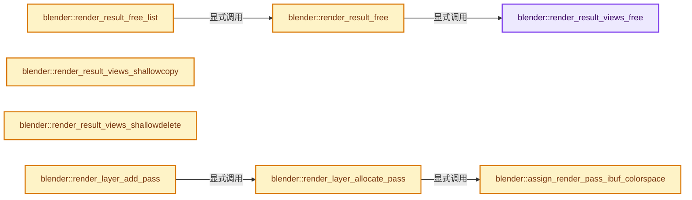
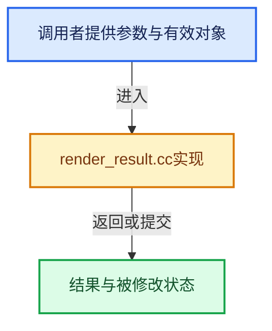

# 实现依赖专题：source/blender/render/intern/render_result.cc

[方向导航](README.md) · [符号索引](../%E7%AC%A6%E5%8F%B7%E4%BE%9D%E8%B5%96%E4%B8%8E%E5%AE%9E%E7%8E%B0%E7%B4%A2%E5%BC%95.md)

本专题从正文实际调用进入，集中保存共享实现。函数有稳定锚点，可从调用处直接跳到对应完整函数；递归与互相调用通过回链组织。

## 本文件的实现关系






## 完整成员与函数实现

<a id="f-2263dd9a84a73626"></a>

### `blender::render_result_views_free`

实现位置：[source/blender/render/intern/render_result.cc](../../../../../source/blender/render/intern/render_result.cc) · L51—L63。

接口参数：

- `RenderResult *rr`

**教学注释版**

<!-- annotated:64984e963ac3fc -->

```cpp
static void render_result_views_free(RenderResult *rr)
{
  while (rr->views.first()) {
    RenderView *rv = rr->views.first();
    BLI_remlink(&rr->views, rv);

    IMB_freeImBuf(rv->ibuf);

    MEM_delete(rv);
  }

  rr->have_combined = false;
}
```

<details>
<summary>核对原始源码：source/blender/render/intern/render_result.cc · L51—L63</summary>

<!-- original:64984e963ac3fc:source/blender/render/intern/render_result.cc:51:63 -->

```cpp
static void render_result_views_free(RenderResult *rr)
{
  while (rr->views.first()) {
    RenderView *rv = rr->views.first();
    BLI_remlink(&rr->views, rv);

    IMB_freeImBuf(rv->ibuf);

    MEM_delete(rv);
  }

  rr->have_combined = false;
}
```

</details>

**沿实际写入检查状态**

- `rr->have_combined = false;`

**继续追踪实现**

- `rr->views.first` → [调用协议](../%E6%A8%A1%E6%9D%BF%E5%AE%8F%E4%B8%8E%E5%8A%A8%E6%80%81%E5%88%86%E6%B4%BE%E5%8D%8F%E8%AE%AE.md)：接收对象类型依赖auto、返回值或模板实例；不按同名猜测目标。调用位置L53。
- `BLI_remlink` → [blender::BLI_remlink · L138](../01-%E5%9F%BA%E7%A1%80%E5%AE%B9%E5%99%A8%E4%B8%8E%E7%8E%B0%E4%BB%A3CPP/%E4%BE%9D%E8%B5%96-listbase-2816d9.md#f-120d80f281ca4cb7)。
- `IMB_freeImBuf` → [blender::IMB_freeImBuf · L144](%E4%BE%9D%E8%B5%96-allocimbuf-bc68dd.md#f-c830f56ede6f345b)。
- `MEM_delete` → [MEM_delete · L400](../03-%E5%86%85%E5%AD%98%E5%88%86%E9%85%8D%E4%B8%8E%E8%BF%90%E8%A1%8C%E6%97%B6%E7%B1%BB%E5%9E%8B/%E4%BE%9D%E8%B5%96-MEM_guardedalloc-b54eca.md#f-9049ffdd1682887c)。

<a id="f-ee9de2547c9f9bc9"></a>

### `blender::render_result_free`

实现位置：[source/blender/render/intern/render_result.cc](../../../../../source/blender/render/intern/render_result.cc) · L65—L108。

接口参数：

- `RenderResult *rr`

**教学注释版**

<!-- annotated:5e875845c69d12 -->

```cpp
void render_result_free(RenderResult *rr)
{
  if (rr == nullptr) {
    return;
  }

  /* Only actually free when RenderResult when the render result has zero users which is its
   * default state.
   * There is no need to lock as the user-counted render results are protected by mutex at the
   * higher call stack level. */
  if (rr->user_counter > 0) {
    --rr->user_counter;
    return;
  }

  while (rr->layers.first()) {
    RenderLayer *rl = rr->layers.first();

    while (rl->passes.first()) {
      RenderPass *rpass = rl->passes.first();

      IMB_freeImBuf(rpass->ibuf);

      BLI_freelinkN(&rl->passes, rpass);
    }
    BLI_remlink(&rr->layers, rl);
    MEM_delete(rl);
  }

  render_result_views_free(rr);

  IMB_freeImBuf(rr->ibuf);

  if (rr->text) {
    MEM_delete(rr->text);
  }
  if (rr->error) {
    MEM_delete(rr->error);
  }

  BKE_stamp_data_free(rr->stamp_data);

  MEM_delete(rr);
}
```

<details>
<summary>核对原始源码：source/blender/render/intern/render_result.cc · L65—L108</summary>

<!-- original:5e875845c69d12:source/blender/render/intern/render_result.cc:65:108 -->

```cpp
void render_result_free(RenderResult *rr)
{
  if (rr == nullptr) {
    return;
  }

  /* Only actually free when RenderResult when the render result has zero users which is its
   * default state.
   * There is no need to lock as the user-counted render results are protected by mutex at the
   * higher call stack level. */
  if (rr->user_counter > 0) {
    --rr->user_counter;
    return;
  }

  while (rr->layers.first()) {
    RenderLayer *rl = rr->layers.first();

    while (rl->passes.first()) {
      RenderPass *rpass = rl->passes.first();

      IMB_freeImBuf(rpass->ibuf);

      BLI_freelinkN(&rl->passes, rpass);
    }
    BLI_remlink(&rr->layers, rl);
    MEM_delete(rl);
  }

  render_result_views_free(rr);

  IMB_freeImBuf(rr->ibuf);

  if (rr->text) {
    MEM_delete(rr->text);
  }
  if (rr->error) {
    MEM_delete(rr->error);
  }

  BKE_stamp_data_free(rr->stamp_data);

  MEM_delete(rr);
}
```

</details>

**继续追踪实现**

- `rr->layers.first` → [调用协议](../%E6%A8%A1%E6%9D%BF%E5%AE%8F%E4%B8%8E%E5%8A%A8%E6%80%81%E5%88%86%E6%B4%BE%E5%8D%8F%E8%AE%AE.md)：接收对象类型依赖auto、返回值或模板实例；不按同名猜测目标。调用位置L80。
- `rl->passes.first` → [调用协议](../%E6%A8%A1%E6%9D%BF%E5%AE%8F%E4%B8%8E%E5%8A%A8%E6%80%81%E5%88%86%E6%B4%BE%E5%8D%8F%E8%AE%AE.md)：接收对象类型依赖auto、返回值或模板实例；不按同名猜测目标。调用位置L83。
- `IMB_freeImBuf` → [blender::IMB_freeImBuf · L144](%E4%BE%9D%E8%B5%96-allocimbuf-bc68dd.md#f-c830f56ede6f345b)。
- `BLI_freelinkN` → [blender::BLI_freelinkN · L277](../01-%E5%9F%BA%E7%A1%80%E5%AE%B9%E5%99%A8%E4%B8%8E%E7%8E%B0%E4%BB%A3CPP/%E4%BE%9D%E8%B5%96-listbase-2816d9.md#f-c7719591852af7da)。
- `BLI_remlink` → [blender::BLI_remlink · L138](../01-%E5%9F%BA%E7%A1%80%E5%AE%B9%E5%99%A8%E4%B8%8E%E7%8E%B0%E4%BB%A3CPP/%E4%BE%9D%E8%B5%96-listbase-2816d9.md#f-120d80f281ca4cb7)。
- `MEM_delete` → [MEM_delete · L400](../03-%E5%86%85%E5%AD%98%E5%88%86%E9%85%8D%E4%B8%8E%E8%BF%90%E8%A1%8C%E6%97%B6%E7%B1%BB%E5%9E%8B/%E4%BE%9D%E8%B5%96-MEM_guardedalloc-b54eca.md#f-9049ffdd1682887c)。
- `render_result_views_free` → [blender::render_result_views_free · L51](%E4%BE%9D%E8%B5%96-render_result-8cc813.md#f-2263dd9a84a73626)。
- `BKE_stamp_data_free` → [blender::BKE_stamp_data_free · L2751](%E4%BE%9D%E8%B5%96-image-4859ac.md#f-c87b98241ffb06cb)。

<a id="f-3ad3cf5b34d48976"></a>

### `blender::render_result_free_list`

实现位置：[source/blender/render/intern/render_result.cc](../../../../../source/blender/render/intern/render_result.cc) · L110—L123。

接口参数：

- `ListBaseT<RenderResult> *lb`
- `RenderResult *rr`

**教学注释版**

<!-- annotated:08657b0ec6eb65 -->

```cpp
void render_result_free_list(ListBaseT<RenderResult> *lb, RenderResult *rr)
{
  RenderResult *rrnext;

  for (; rr; rr = rrnext) {
    rrnext = rr->next;

    if (lb && lb->first_) {
      BLI_remlink(lb, rr);
    }

    render_result_free(rr);
  }
}
```

<details>
<summary>核对原始源码：source/blender/render/intern/render_result.cc · L110—L123</summary>

<!-- original:08657b0ec6eb65:source/blender/render/intern/render_result.cc:110:123 -->

```cpp
void render_result_free_list(ListBaseT<RenderResult> *lb, RenderResult *rr)
{
  RenderResult *rrnext;

  for (; rr; rr = rrnext) {
    rrnext = rr->next;

    if (lb && lb->first_) {
      BLI_remlink(lb, rr);
    }

    render_result_free(rr);
  }
}
```

</details>

**沿实际写入检查状态**

- `rrnext = rr->next;`

**继续追踪实现**

- `BLI_remlink` → [blender::BLI_remlink · L138](../01-%E5%9F%BA%E7%A1%80%E5%AE%B9%E5%99%A8%E4%B8%8E%E7%8E%B0%E4%BB%A3CPP/%E4%BE%9D%E8%B5%96-listbase-2816d9.md#f-120d80f281ca4cb7)。
- `render_result_free` → [blender::render_result_free · L65](%E4%BE%9D%E8%B5%96-render_result-8cc813.md#f-ee9de2547c9f9bc9)。

<a id="f-5af3543ebb732b61"></a>

### `blender::render_result_views_shallowcopy`

实现位置：[source/blender/render/intern/render_result.cc](../../../../../source/blender/render/intern/render_result.cc) · L140—L156。

接口参数：

- `RenderResult *dst`
- `RenderResult *src`

**教学注释版**

<!-- annotated:c59bed772913ff -->

```cpp
void render_result_views_shallowcopy(RenderResult *dst, RenderResult *src)
{
  if (dst == nullptr || src == nullptr) {
    return;
  }

  for (RenderView &rview : src->views) {
    RenderView *rv;

    rv = MEM_new<RenderView>("new render view");
    BLI_addtail(&dst->views, rv);

    STRNCPY_UTF8(rv->name, rview.name);

    rv->ibuf = rview.ibuf;
  }
}
```

<details>
<summary>核对原始源码：source/blender/render/intern/render_result.cc · L140—L156</summary>

<!-- original:c59bed772913ff:source/blender/render/intern/render_result.cc:140:156 -->

```cpp
void render_result_views_shallowcopy(RenderResult *dst, RenderResult *src)
{
  if (dst == nullptr || src == nullptr) {
    return;
  }

  for (RenderView &rview : src->views) {
    RenderView *rv;

    rv = MEM_new<RenderView>("new render view");
    BLI_addtail(&dst->views, rv);

    STRNCPY_UTF8(rv->name, rview.name);

    rv->ibuf = rview.ibuf;
  }
}
```

</details>

**沿实际写入检查状态**

- `rv = MEM_new<RenderView>("new render view");`
- `rv->ibuf = rview.ibuf;`

**继续追踪实现**

- `MEM_new<RenderView>` → [MEM_new · L351](../03-%E5%86%85%E5%AD%98%E5%88%86%E9%85%8D%E4%B8%8E%E8%BF%90%E8%A1%8C%E6%97%B6%E7%B1%BB%E5%9E%8B/%E4%BE%9D%E8%B5%96-MEM_guardedalloc-b54eca.md#f-115f9b6784f89912)。
- `BLI_addtail` → [blender::BLI_addtail · L118](../01-%E5%9F%BA%E7%A1%80%E5%AE%B9%E5%99%A8%E4%B8%8E%E7%8E%B0%E4%BB%A3CPP/%E4%BE%9D%E8%B5%96-listbase-2816d9.md#f-4fb027713fa3115b)。
- `STRNCPY_UTF8` → [STRNCPY_UTF8 · L335](../01-%E5%9F%BA%E7%A1%80%E5%AE%B9%E5%99%A8%E4%B8%8E%E7%8E%B0%E4%BB%A3CPP/%E4%BE%9D%E8%B5%96-BLI_string_utf8-bcc961.md#m-222967f0ab6a)。宏定义由构建条件选择。

<a id="f-4826f18fb4a6ef6b"></a>

### `blender::render_result_views_shallowdelete`

实现位置：[source/blender/render/intern/render_result.cc](../../../../../source/blender/render/intern/render_result.cc) · L158—L169。

接口参数：

- `RenderResult *rr`

**教学注释版**

<!-- annotated:5c9019f038b7a6 -->

```cpp
void render_result_views_shallowdelete(RenderResult *rr)
{
  if (rr == nullptr) {
    return;
  }

  while (rr->views.first()) {
    RenderView *rv = rr->views.first();
    BLI_remlink(&rr->views, rv);
    MEM_delete(rv);
  }
}
```

<details>
<summary>核对原始源码：source/blender/render/intern/render_result.cc · L158—L169</summary>

<!-- original:5c9019f038b7a6:source/blender/render/intern/render_result.cc:158:169 -->

```cpp
void render_result_views_shallowdelete(RenderResult *rr)
{
  if (rr == nullptr) {
    return;
  }

  while (rr->views.first()) {
    RenderView *rv = rr->views.first();
    BLI_remlink(&rr->views, rv);
    MEM_delete(rv);
  }
}
```

</details>

**继续追踪实现**

- `rr->views.first` → [调用协议](../%E6%A8%A1%E6%9D%BF%E5%AE%8F%E4%B8%8E%E5%8A%A8%E6%80%81%E5%88%86%E6%B4%BE%E5%8D%8F%E8%AE%AE.md)：接收对象类型依赖auto、返回值或模板实例；不按同名猜测目标。调用位置L164。
- `BLI_remlink` → [blender::BLI_remlink · L138](../01-%E5%9F%BA%E7%A1%80%E5%AE%B9%E5%99%A8%E4%B8%8E%E7%8E%B0%E4%BB%A3CPP/%E4%BE%9D%E8%B5%96-listbase-2816d9.md#f-120d80f281ca4cb7)。
- `MEM_delete` → [MEM_delete · L400](../03-%E5%86%85%E5%AD%98%E5%88%86%E9%85%8D%E4%B8%8E%E8%BF%90%E8%A1%8C%E6%97%B6%E7%B1%BB%E5%9E%8B/%E4%BE%9D%E8%B5%96-MEM_guardedalloc-b54eca.md#f-9049ffdd1682887c)。

<a id="f-056504f8988de4bc"></a>

### `blender::assign_render_pass_ibuf_colorspace`

实现位置：[source/blender/render/intern/render_result.cc](../../../../../source/blender/render/intern/render_result.cc) · L177—L185。

接口参数：

- `RenderPass &render_pass`

**教学注释版**

<!-- annotated:9f17e29fe3c053 -->

```cpp
static void assign_render_pass_ibuf_colorspace(RenderPass &render_pass)
{
  if (RE_RenderPassIsColor(&render_pass)) {
    return;
  }

  const char *data_colorspace = IMB_colormanagement_role_colorspace_name_get(COLOR_ROLE_DATA);
  IMB_colormanagement_assign_float_colorspace(render_pass.ibuf, data_colorspace);
}
```

<details>
<summary>核对原始源码：source/blender/render/intern/render_result.cc · L177—L185</summary>

<!-- original:9f17e29fe3c053:source/blender/render/intern/render_result.cc:177:185 -->

```cpp
static void assign_render_pass_ibuf_colorspace(RenderPass &render_pass)
{
  if (RE_RenderPassIsColor(&render_pass)) {
    return;
  }

  const char *data_colorspace = IMB_colormanagement_role_colorspace_name_get(COLOR_ROLE_DATA);
  IMB_colormanagement_assign_float_colorspace(render_pass.ibuf, data_colorspace);
}
```

</details>

**继续追踪实现**

- `RE_RenderPassIsColor` → [blender::RE_RenderPassIsColor · L1290](%E4%BE%9D%E8%B5%96-render_result-8cc813.md#f-73d8a2d6740cb656)。
- `IMB_colormanagement_role_colorspace_name_get` → [blender::IMB_colormanagement_role_colorspace_name_get · L1247](%E4%BE%9D%E8%B5%96-colormanagement-d4733d.md#f-f2cf0e85682f0fd8)。
- `IMB_colormanagement_assign_float_colorspace` → [blender::IMB_colormanagement_assign_float_colorspace · L1292](%E4%BE%9D%E8%B5%96-colormanagement-d4733d.md#f-3d136a349a596f82)。

<a id="f-8e7dcb3fcbcaa988"></a>

### `blender::render_layer_allocate_pass`

实现位置：[source/blender/render/intern/render_result.cc](../../../../../source/blender/render/intern/render_result.cc) · L187—L217。

接口参数：

- `RenderResult *rr`
- `RenderPass *rp`

**教学注释版**

<!-- annotated:7073b2a92a9f87 -->

```cpp
static void render_layer_allocate_pass(RenderResult *rr, RenderPass *rp)
{
  if (rp->ibuf && rp->ibuf->float_data()) {
    return;
  }

  /* NOTE: In-lined manual allocation to support floating point buffers of an arbitrary number of
   * channels. */

  const size_t rectsize = size_t(rr->rectx) * rr->recty * rp->channels;
  float *buffer_data = MEM_new_array_zeroed<float>(rectsize, rp->name);

  rp->ibuf = IMB_allocImBuf(rr->rectx, rr->recty, ImBufFlags::Zero);
  rp->ibuf->color_mode = IMB_color_mode_from_channels(rp->channels);
  rp->ibuf->channels = rp->channels;
  copy_v2_v2_db(rp->ibuf->ppm, rr->ppm);
  rp->ibuf->assign_float_data(buffer_data);
  assign_render_pass_ibuf_colorspace(*rp);

  if (STREQ(rp->name, RE_PASSNAME_VECTOR)) {
    /* initialize to max speed */
    for (int x = rectsize - 1; x >= 0; x--) {
      buffer_data[x] = PASS_VECTOR_MAX;
    }
  }
  else if (STREQ(rp->name, RE_PASSNAME_DEPTH)) {
    for (int x = rectsize - 1; x >= 0; x--) {
      buffer_data[x] = 1e10f;
    }
  }
}
```

<details>
<summary>核对原始源码：source/blender/render/intern/render_result.cc · L187—L217</summary>

<!-- original:7073b2a92a9f87:source/blender/render/intern/render_result.cc:187:217 -->

```cpp
static void render_layer_allocate_pass(RenderResult *rr, RenderPass *rp)
{
  if (rp->ibuf && rp->ibuf->float_data()) {
    return;
  }

  /* NOTE: In-lined manual allocation to support floating point buffers of an arbitrary number of
   * channels. */

  const size_t rectsize = size_t(rr->rectx) * rr->recty * rp->channels;
  float *buffer_data = MEM_new_array_zeroed<float>(rectsize, rp->name);

  rp->ibuf = IMB_allocImBuf(rr->rectx, rr->recty, ImBufFlags::Zero);
  rp->ibuf->color_mode = IMB_color_mode_from_channels(rp->channels);
  rp->ibuf->channels = rp->channels;
  copy_v2_v2_db(rp->ibuf->ppm, rr->ppm);
  rp->ibuf->assign_float_data(buffer_data);
  assign_render_pass_ibuf_colorspace(*rp);

  if (STREQ(rp->name, RE_PASSNAME_VECTOR)) {
    /* initialize to max speed */
    for (int x = rectsize - 1; x >= 0; x--) {
      buffer_data[x] = PASS_VECTOR_MAX;
    }
  }
  else if (STREQ(rp->name, RE_PASSNAME_DEPTH)) {
    for (int x = rectsize - 1; x >= 0; x--) {
      buffer_data[x] = 1e10f;
    }
  }
}
```

</details>

**沿实际写入检查状态**

- `rp->ibuf = IMB_allocImBuf(rr->rectx, rr->recty, ImBufFlags::Zero);`
- `rp->ibuf->color_mode = IMB_color_mode_from_channels(rp->channels);`
- `rp->ibuf->channels = rp->channels;`
- `buffer_data[x] = PASS_VECTOR_MAX;`
- `buffer_data[x] = 1e10f;`

**继续追踪实现**

- `rp->ibuf->float_data` → [调用协议](../%E6%A8%A1%E6%9D%BF%E5%AE%8F%E4%B8%8E%E5%8A%A8%E6%80%81%E5%88%86%E6%B4%BE%E5%8D%8F%E8%AE%AE.md)：接收对象类型依赖auto、返回值或模板实例；不按同名猜测目标。调用位置L189。
- `MEM_new_array_zeroed<float>` → [MEM_new_array_zeroed · L566](../03-%E5%86%85%E5%AD%98%E5%88%86%E9%85%8D%E4%B8%8E%E8%BF%90%E8%A1%8C%E6%97%B6%E7%B1%BB%E5%9E%8B/%E4%BE%9D%E8%B5%96-MEM_guardedalloc-b54eca.md#f-3a0cf63fb5216500)；[MEM_new_array_zeroed · L119](../03-%E5%86%85%E5%AD%98%E5%88%86%E9%85%8D%E4%B8%8E%E8%BF%90%E8%A1%8C%E6%97%B6%E7%B1%BB%E5%9E%8B/%E4%BE%9D%E8%B5%96-mallocn-afdcd4.md#f-6825557da566fdbe)。同名重载需按实参类型选择。
- `IMB_allocImBuf` → [blender::IMB_allocImBuf · L367](%E4%BE%9D%E8%B5%96-allocimbuf-bc68dd.md#f-971d0005c46aad53)。
- `IMB_color_mode_from_channels` → [blender::IMB_color_mode_from_channels · L482](%E4%BE%9D%E8%B5%96-allocimbuf-bc68dd.md#f-5836c294813f1aa4)。
- `copy_v2_v2_db` → [blender::copy_v2_v2_db · L152](../12-%E7%A9%BA%E9%97%B4%E6%95%B0%E6%8D%AE%E7%BB%93%E6%9E%84%E4%B8%8E%E5%87%A0%E4%BD%95%E7%AE%97%E6%B3%95/%E4%BE%9D%E8%B5%96-math_vector_inline-0c8541.md#f-4117eb991b478458)。
- `rp->ibuf->assign_float_data` → [调用协议](../%E6%A8%A1%E6%9D%BF%E5%AE%8F%E4%B8%8E%E5%8A%A8%E6%80%81%E5%88%86%E6%B4%BE%E5%8D%8F%E8%AE%AE.md)：接收对象类型依赖auto、返回值或模板实例；不按同名猜测目标。调用位置L203。
- `assign_render_pass_ibuf_colorspace` → [blender::assign_render_pass_ibuf_colorspace · L177](%E4%BE%9D%E8%B5%96-render_result-8cc813.md#f-056504f8988de4bc)。
- `STREQ` → [STREQ · L112](%E4%BE%9D%E8%B5%96-GHOST_utildefines-34b996.md#m-9549fb6aafd2)；[STREQ · L451](../01-%E5%9F%BA%E7%A1%80%E5%AE%B9%E5%99%A8%E4%B8%8E%E7%8E%B0%E4%BB%A3CPP/%E4%BE%9D%E8%B5%96-BLI_utildefines-293a0a.md#m-c7b745bcfad2)；[STREQ · L55](%E4%BE%9D%E8%B5%96-clog-a0bec8.md#m-96e78f386894)。宏定义由构建条件选择。

<a id="f-cc4f14a856651495"></a>

### `blender::render_layer_add_pass`

实现位置：[source/blender/render/intern/render_result.cc](../../../../../source/blender/render/intern/render_result.cc) · L219—L252。

接口参数：

- `RenderResult *rr`
- `RenderLayer *rl`
- `int channels`
- `const char *name`
- `const char *viewname`
- `const char *chan_id`
- `const bool allocate`

**教学注释版**

<!-- annotated:a90d22719a7f40 -->

```cpp
RenderPass *render_layer_add_pass(RenderResult *rr,
                                  RenderLayer *rl,
                                  int channels,
                                  const char *name,
                                  const char *viewname,
                                  const char *chan_id,
                                  const bool allocate)
{
  const int view_id = BLI_findstringindex(&rr->views, viewname, offsetof(RenderView, name));
  RenderPass *rpass = MEM_new<RenderPass>(name);

  rpass->channels = channels;
  rpass->rectx = rl->rectx;
  rpass->recty = rl->recty;
  rpass->view_id = view_id;

  STRNCPY(rpass->name, name);
  STRNCPY(rpass->chan_id, chan_id);
  STRNCPY(rpass->view, viewname);
  RE_render_result_full_channel_name(
      rpass->fullname, nullptr, rpass->name, rpass->view, rpass->chan_id, -1);

  BLI_addtail(&rl->passes, rpass);

  if (allocate) {
    render_layer_allocate_pass(rr, rpass);
  }
  else {
    /* The result contains non-allocated pass now, so tag it as such. */
    rr->passes_allocated = false;
  }

  return rpass;
}
```

<details>
<summary>核对原始源码：source/blender/render/intern/render_result.cc · L219—L252</summary>

<!-- original:a90d22719a7f40:source/blender/render/intern/render_result.cc:219:252 -->

```cpp
RenderPass *render_layer_add_pass(RenderResult *rr,
                                  RenderLayer *rl,
                                  int channels,
                                  const char *name,
                                  const char *viewname,
                                  const char *chan_id,
                                  const bool allocate)
{
  const int view_id = BLI_findstringindex(&rr->views, viewname, offsetof(RenderView, name));
  RenderPass *rpass = MEM_new<RenderPass>(name);

  rpass->channels = channels;
  rpass->rectx = rl->rectx;
  rpass->recty = rl->recty;
  rpass->view_id = view_id;

  STRNCPY(rpass->name, name);
  STRNCPY(rpass->chan_id, chan_id);
  STRNCPY(rpass->view, viewname);
  RE_render_result_full_channel_name(
      rpass->fullname, nullptr, rpass->name, rpass->view, rpass->chan_id, -1);

  BLI_addtail(&rl->passes, rpass);

  if (allocate) {
    render_layer_allocate_pass(rr, rpass);
  }
  else {
    /* The result contains non-allocated pass now, so tag it as such. */
    rr->passes_allocated = false;
  }

  return rpass;
}
```

</details>

**沿实际写入检查状态**

- `rpass->channels = channels;`
- `rpass->rectx = rl->rectx;`
- `rpass->recty = rl->recty;`
- `rpass->view_id = view_id;`
- `rr->passes_allocated = false;`

**结果出口**

- `return rpass;`

**继续追踪实现**

- `BLI_findstringindex` → [blender::BLI_findstringindex · L794](../01-%E5%9F%BA%E7%A1%80%E5%AE%B9%E5%99%A8%E4%B8%8E%E7%8E%B0%E4%BB%A3CPP/%E4%BE%9D%E8%B5%96-listbase-2816d9.md#f-b6cdfea192154a79)。
- `MEM_new<RenderPass>` → [MEM_new · L351](../03-%E5%86%85%E5%AD%98%E5%88%86%E9%85%8D%E4%B8%8E%E8%BF%90%E8%A1%8C%E6%97%B6%E7%B1%BB%E5%9E%8B/%E4%BE%9D%E8%B5%96-MEM_guardedalloc-b54eca.md#f-115f9b6784f89912)。
- `STRNCPY` → [blender::STRNCPY · L690](../01-%E5%9F%BA%E7%A1%80%E5%AE%B9%E5%99%A8%E4%B8%8E%E7%8E%B0%E4%BB%A3CPP/%E4%BE%9D%E8%B5%96-BLI_string-b43058.md#f-6b2d861724026be6)。
- `RE_render_result_full_channel_name` → [blender::RE_render_result_full_channel_name · L436](%E4%BE%9D%E8%B5%96-render_result-8cc813.md#f-8625764d02acbeee)。
- `BLI_addtail` → [blender::BLI_addtail · L118](../01-%E5%9F%BA%E7%A1%80%E5%AE%B9%E5%99%A8%E4%B8%8E%E7%8E%B0%E4%BB%A3CPP/%E4%BE%9D%E8%B5%96-listbase-2816d9.md#f-4fb027713fa3115b)。
- `render_layer_allocate_pass` → [blender::render_layer_allocate_pass · L187](%E4%BE%9D%E8%B5%96-render_result-8cc813.md#f-8e7dcb3fcbcaa988)。

<a id="f-6da1e26f5058a8a4"></a>

### `blender::render_result_new`

实现位置：[source/blender/render/intern/render_result.cc](../../../../../source/blender/render/intern/render_result.cc) · L254—L349。

接口参数：

- `Render *re`
- `const rcti *partrct`
- `const char *layername`
- `const char *viewname`

**教学注释版**

<!-- annotated:c00fbfd51612a4 -->

```cpp
RenderResult *render_result_new(Render *re,
                                const rcti *partrct,
                                const char *layername,
                                const char *viewname)
{
  RenderResult *rr;
  RenderLayer *rl;
  int rectx, recty;

  rectx = BLI_rcti_size_x(partrct);
  recty = BLI_rcti_size_y(partrct);

  if (rectx <= 0 || recty <= 0) {
    return nullptr;
  }

  rr = MEM_new<RenderResult>("new render result");
  rr->rectx = rectx;
  rr->recty = recty;

  BKE_scene_ppm_get(&re->r, rr->ppm);

  /* tilerect is relative coordinates within render disprect. do not subtract crop yet */
  rr->tilerect.xmin = partrct->xmin - re->disprect.xmin;
  rr->tilerect.xmax = partrct->xmax - re->disprect.xmin;
  rr->tilerect.ymin = partrct->ymin - re->disprect.ymin;
  rr->tilerect.ymax = partrct->ymax - re->disprect.ymin;

  rr->passes_allocated = false;

  render_result_views_new(rr, &re->r);

  /* Check render-data for amount of layers. */
  FOREACH_VIEW_LAYER_TO_RENDER_BEGIN (re, view_layer) {
    if (layername && layername[0]) {
      if (!STREQ(view_layer->name, layername)) {
        continue;
      }
    }

    rl = MEM_new<RenderLayer>("new render layer");
    BLI_addtail(&rr->layers, rl);

    STRNCPY_UTF8(rl->name, view_layer->name);
    rl->layflag = view_layer->layflag;

    rl->passflag = view_layer->passflag;

    rl->rectx = rectx;
    rl->recty = recty;

    for (RenderView &rv : rr->views) {
      const char *view = rv.name;

      if (viewname && viewname[0]) {
        if (!STREQ(view, viewname)) {
          continue;
        }
      }

      /* A render-layer should always have a "Combined" pass. */
      render_layer_add_pass(rr, rl, 4, "Combined", view, "RGBA", false);
    }
  }
  FOREACH_VIEW_LAYER_TO_RENDER_END;

  /* Preview-render doesn't do layers, so we make a default one. */
  if (rr->layers.is_empty() && !(layername && layername[0])) {
    rl = MEM_new<RenderLayer>("new render layer");
    BLI_addtail(&rr->layers, rl);

    rl->rectx = rectx;
    rl->recty = recty;

    for (RenderView &rv : rr->views) {
      const char *view = rv.name;

      if (viewname && viewname[0]) {
        if (!STREQ(view, viewname)) {
          continue;
        }
      }

      /* A render-layer should always have a "Combined" pass. */
      render_layer_add_pass(rr, rl, 4, RE_PASSNAME_COMBINED, view, "RGBA", false);
    }

    /* NOTE: this has to be in sync with `scene.cc`. */
    rl->layflag = SCE_LAY_FLAG_DEFAULT;
    rl->passflag = SCE_PASS_COMBINED;

    re->single_view_layer[0] = '\0';
  }

  return rr;
}
```

<details>
<summary>核对原始源码：source/blender/render/intern/render_result.cc · L254—L349</summary>

<!-- original:c00fbfd51612a4:source/blender/render/intern/render_result.cc:254:349 -->

```cpp
RenderResult *render_result_new(Render *re,
                                const rcti *partrct,
                                const char *layername,
                                const char *viewname)
{
  RenderResult *rr;
  RenderLayer *rl;
  int rectx, recty;

  rectx = BLI_rcti_size_x(partrct);
  recty = BLI_rcti_size_y(partrct);

  if (rectx <= 0 || recty <= 0) {
    return nullptr;
  }

  rr = MEM_new<RenderResult>("new render result");
  rr->rectx = rectx;
  rr->recty = recty;

  BKE_scene_ppm_get(&re->r, rr->ppm);

  /* tilerect is relative coordinates within render disprect. do not subtract crop yet */
  rr->tilerect.xmin = partrct->xmin - re->disprect.xmin;
  rr->tilerect.xmax = partrct->xmax - re->disprect.xmin;
  rr->tilerect.ymin = partrct->ymin - re->disprect.ymin;
  rr->tilerect.ymax = partrct->ymax - re->disprect.ymin;

  rr->passes_allocated = false;

  render_result_views_new(rr, &re->r);

  /* Check render-data for amount of layers. */
  FOREACH_VIEW_LAYER_TO_RENDER_BEGIN (re, view_layer) {
    if (layername && layername[0]) {
      if (!STREQ(view_layer->name, layername)) {
        continue;
      }
    }

    rl = MEM_new<RenderLayer>("new render layer");
    BLI_addtail(&rr->layers, rl);

    STRNCPY_UTF8(rl->name, view_layer->name);
    rl->layflag = view_layer->layflag;

    rl->passflag = view_layer->passflag;

    rl->rectx = rectx;
    rl->recty = recty;

    for (RenderView &rv : rr->views) {
      const char *view = rv.name;

      if (viewname && viewname[0]) {
        if (!STREQ(view, viewname)) {
          continue;
        }
      }

      /* A render-layer should always have a "Combined" pass. */
      render_layer_add_pass(rr, rl, 4, "Combined", view, "RGBA", false);
    }
  }
  FOREACH_VIEW_LAYER_TO_RENDER_END;

  /* Preview-render doesn't do layers, so we make a default one. */
  if (rr->layers.is_empty() && !(layername && layername[0])) {
    rl = MEM_new<RenderLayer>("new render layer");
    BLI_addtail(&rr->layers, rl);

    rl->rectx = rectx;
    rl->recty = recty;

    for (RenderView &rv : rr->views) {
      const char *view = rv.name;

      if (viewname && viewname[0]) {
        if (!STREQ(view, viewname)) {
          continue;
        }
      }

      /* A render-layer should always have a "Combined" pass. */
      render_layer_add_pass(rr, rl, 4, RE_PASSNAME_COMBINED, view, "RGBA", false);
    }

    /* NOTE: this has to be in sync with `scene.cc`. */
    rl->layflag = SCE_LAY_FLAG_DEFAULT;
    rl->passflag = SCE_PASS_COMBINED;

    re->single_view_layer[0] = '\0';
  }

  return rr;
}
```

</details>

**沿实际写入检查状态**

- `rectx = BLI_rcti_size_x(partrct);`
- `recty = BLI_rcti_size_y(partrct);`
- `rr = MEM_new<RenderResult>("new render result");`
- `rr->rectx = rectx;`
- `rr->recty = recty;`
- `rr->tilerect.xmin = partrct->xmin - re->disprect.xmin;`
- `rr->tilerect.xmax = partrct->xmax - re->disprect.xmin;`
- `rr->tilerect.ymin = partrct->ymin - re->disprect.ymin;`
- `rr->tilerect.ymax = partrct->ymax - re->disprect.ymin;`
- `rr->passes_allocated = false;`
- `rl = MEM_new<RenderLayer>("new render layer");`
- `rl->layflag = view_layer->layflag;`
- `rl->passflag = view_layer->passflag;`
- `rl->rectx = rectx;`
- `rl->recty = recty;`
- `rl->layflag = SCE_LAY_FLAG_DEFAULT;`
- `rl->passflag = SCE_PASS_COMBINED;`
- `re->single_view_layer[0] = '\0';`

**结果出口**

- `return nullptr;`
- `return rr;`

**继续追踪实现**

- `BLI_rcti_size_x` → [blender::BLI_rcti_size_x · L203](../01-%E5%9F%BA%E7%A1%80%E5%AE%B9%E5%99%A8%E4%B8%8E%E7%8E%B0%E4%BB%A3CPP/%E4%BE%9D%E8%B5%96-BLI_rect-2996c6.md#f-7a8fb2c54a829be6)。
- `BLI_rcti_size_y` → [blender::BLI_rcti_size_y · L207](../01-%E5%9F%BA%E7%A1%80%E5%AE%B9%E5%99%A8%E4%B8%8E%E7%8E%B0%E4%BB%A3CPP/%E4%BE%9D%E8%B5%96-BLI_rect-2996c6.md#f-ac87d6c708d502ad)。
- `MEM_new<RenderResult>` → [MEM_new · L351](../03-%E5%86%85%E5%AD%98%E5%88%86%E9%85%8D%E4%B8%8E%E8%BF%90%E8%A1%8C%E6%97%B6%E7%B1%BB%E5%9E%8B/%E4%BE%9D%E8%B5%96-MEM_guardedalloc-b54eca.md#f-115f9b6784f89912)。
- `BKE_scene_ppm_get` → [blender::BKE_scene_ppm_get · L3497](%E4%BE%9D%E8%B5%96-scene-94f43c.md#f-de9d2fd37c89ba92)。
- `render_result_views_new` → [blender::render_result_views_new · L669](%E4%BE%9D%E8%B5%96-render_result-8cc813.md#f-6c0275910325702a)。
- `STREQ` → [STREQ · L112](%E4%BE%9D%E8%B5%96-GHOST_utildefines-34b996.md#m-9549fb6aafd2)；[STREQ · L451](../01-%E5%9F%BA%E7%A1%80%E5%AE%B9%E5%99%A8%E4%B8%8E%E7%8E%B0%E4%BB%A3CPP/%E4%BE%9D%E8%B5%96-BLI_utildefines-293a0a.md#m-c7b745bcfad2)；[STREQ · L55](%E4%BE%9D%E8%B5%96-clog-a0bec8.md#m-96e78f386894)。宏定义由构建条件选择。
- `MEM_new<RenderLayer>` → [MEM_new · L351](../03-%E5%86%85%E5%AD%98%E5%88%86%E9%85%8D%E4%B8%8E%E8%BF%90%E8%A1%8C%E6%97%B6%E7%B1%BB%E5%9E%8B/%E4%BE%9D%E8%B5%96-MEM_guardedalloc-b54eca.md#f-115f9b6784f89912)。
- `BLI_addtail` → [blender::BLI_addtail · L118](../01-%E5%9F%BA%E7%A1%80%E5%AE%B9%E5%99%A8%E4%B8%8E%E7%8E%B0%E4%BB%A3CPP/%E4%BE%9D%E8%B5%96-listbase-2816d9.md#f-4fb027713fa3115b)。
- `STRNCPY_UTF8` → [STRNCPY_UTF8 · L335](../01-%E5%9F%BA%E7%A1%80%E5%AE%B9%E5%99%A8%E4%B8%8E%E7%8E%B0%E4%BB%A3CPP/%E4%BE%9D%E8%B5%96-BLI_string_utf8-bcc961.md#m-222967f0ab6a)。宏定义由构建条件选择。
- `render_layer_add_pass` → [blender::render_layer_add_pass · L219](%E4%BE%9D%E8%B5%96-render_result-8cc813.md#f-cc4f14a856651495)。
- `rr->layers.is_empty` → [调用协议](../%E6%A8%A1%E6%9D%BF%E5%AE%8F%E4%B8%8E%E5%8A%A8%E6%80%81%E5%88%86%E6%B4%BE%E5%8D%8F%E8%AE%AE.md)：接收对象类型依赖auto、返回值或模板实例；不按同名猜测目标。调用位置L321。

<a id="f-930e96366bcc8ebd"></a>

### `blender::render_result_passes_allocated_ensure`

实现位置：[source/blender/render/intern/render_result.cc](../../../../../source/blender/render/intern/render_result.cc) · L351—L366。

接口参数：

- `RenderResult *rr`

**教学注释版**

<!-- annotated:ea69e7f2f22dab -->

```cpp
void render_result_passes_allocated_ensure(RenderResult *rr)
{
  if (rr == nullptr) {
    /* Happens when the result was not yet allocated for the current scene or slot configuration.
     */
    return;
  }

  for (RenderLayer &rl : rr->layers) {
    for (RenderPass &rp : rl.passes) {
      render_layer_allocate_pass(rr, &rp);
    }
  }

  rr->passes_allocated = true;
}
```

<details>
<summary>核对原始源码：source/blender/render/intern/render_result.cc · L351—L366</summary>

<!-- original:ea69e7f2f22dab:source/blender/render/intern/render_result.cc:351:366 -->

```cpp
void render_result_passes_allocated_ensure(RenderResult *rr)
{
  if (rr == nullptr) {
    /* Happens when the result was not yet allocated for the current scene or slot configuration.
     */
    return;
  }

  for (RenderLayer &rl : rr->layers) {
    for (RenderPass &rp : rl.passes) {
      render_layer_allocate_pass(rr, &rp);
    }
  }

  rr->passes_allocated = true;
}
```

</details>

**沿实际写入检查状态**

- `rr->passes_allocated = true;`

**继续追踪实现**

- `render_layer_allocate_pass` → [blender::render_layer_allocate_pass · L187](%E4%BE%9D%E8%B5%96-render_result-8cc813.md#f-8e7dcb3fcbcaa988)。

<a id="f-0a4f88ff7a3c4795"></a>

### `blender::RE_create_render_pass`

实现位置：[source/blender/render/intern/render_result.cc](../../../../../source/blender/render/intern/render_result.cc) · L392—L426。

接口参数：

- `RenderResult *rr`
- `const char *name`
- `int channels`
- `const char *chan_id`
- `const char *layername`
- `const char *viewname`
- `const bool allocate`

**教学注释版**

<!-- annotated:c254bf64fba49a -->

```cpp
void RE_create_render_pass(RenderResult *rr,
                           const char *name,
                           int channels,
                           const char *chan_id,
                           const char *layername,
                           const char *viewname,
                           const bool allocate)
{
  for (RenderLayer &rl : rr->layers) {
    if (layername && layername[0] && !STREQ(rl.name, layername)) {
      continue;
    }

    for (RenderView &rv : rr->views) {
      const char *view = rv.name;

      if (viewname && viewname[0] && !STREQ(view, viewname)) {
        continue;
      }

      /* Ensure that the pass doesn't exist yet. */
      bool pass_exists = false;
      for (RenderPass &rp : rl.passes) {
        if (STREQ(rp.name, name) && STREQ(rp.view, view)) {
          pass_exists = true;
          break;
        }
      }

      if (!pass_exists) {
        render_layer_add_pass(rr, &rl, channels, name, view, chan_id, allocate);
      }
    }
  }
}
```

<details>
<summary>核对原始源码：source/blender/render/intern/render_result.cc · L392—L426</summary>

<!-- original:c254bf64fba49a:source/blender/render/intern/render_result.cc:392:426 -->

```cpp
void RE_create_render_pass(RenderResult *rr,
                           const char *name,
                           int channels,
                           const char *chan_id,
                           const char *layername,
                           const char *viewname,
                           const bool allocate)
{
  for (RenderLayer &rl : rr->layers) {
    if (layername && layername[0] && !STREQ(rl.name, layername)) {
      continue;
    }

    for (RenderView &rv : rr->views) {
      const char *view = rv.name;

      if (viewname && viewname[0] && !STREQ(view, viewname)) {
        continue;
      }

      /* Ensure that the pass doesn't exist yet. */
      bool pass_exists = false;
      for (RenderPass &rp : rl.passes) {
        if (STREQ(rp.name, name) && STREQ(rp.view, view)) {
          pass_exists = true;
          break;
        }
      }

      if (!pass_exists) {
        render_layer_add_pass(rr, &rl, channels, name, view, chan_id, allocate);
      }
    }
  }
}
```

</details>

**沿实际写入检查状态**

- `pass_exists = true;`

**继续追踪实现**

- `STREQ` → [STREQ · L112](%E4%BE%9D%E8%B5%96-GHOST_utildefines-34b996.md#m-9549fb6aafd2)；[STREQ · L451](../01-%E5%9F%BA%E7%A1%80%E5%AE%B9%E5%99%A8%E4%B8%8E%E7%8E%B0%E4%BB%A3CPP/%E4%BE%9D%E8%B5%96-BLI_utildefines-293a0a.md#m-c7b745bcfad2)；[STREQ · L55](%E4%BE%9D%E8%B5%96-clog-a0bec8.md#m-96e78f386894)。宏定义由构建条件选择。
- `render_layer_add_pass` → [blender::render_layer_add_pass · L219](%E4%BE%9D%E8%B5%96-render_result-8cc813.md#f-cc4f14a856651495)。

<a id="f-8625764d02acbeee"></a>

### `blender::RE_render_result_full_channel_name`

实现位置：[source/blender/render/intern/render_result.cc](../../../../../source/blender/render/intern/render_result.cc) · L436—L464。

接口参数：

- `char *fullname`
- `const char *layname`
- `const char *passname`
- `const char *viewname`
- `const char *chan_id`
- `const int channel`

**教学注释版**

<!-- annotated:65e5a2a86a9aa9 -->

```cpp
void RE_render_result_full_channel_name(char *fullname,
                                        const char *layname,
                                        const char *passname,
                                        const char *viewname,
                                        const char *chan_id,
                                        const int channel)
{
  /* OpenEXR compatible full channel name. */
  const char *strings[4];
  int strings_len = 0;

  if (layname && layname[0]) {
    strings[strings_len++] = layname;
  }
  if (passname && passname[0]) {
    strings[strings_len++] = passname;
  }
  if (viewname && viewname[0]) {
    strings[strings_len++] = viewname;
  }

  char token[2];
  if (channel >= 0) {
    ARRAY_SET_ITEMS(token, chan_id[channel], '\0');
    strings[strings_len++] = token;
  }

  BLI_string_join_array_by_sep_char(fullname, EXR_PASS_MAXNAME, '.', strings, strings_len);
}
```

<details>
<summary>核对原始源码：source/blender/render/intern/render_result.cc · L436—L464</summary>

<!-- original:65e5a2a86a9aa9:source/blender/render/intern/render_result.cc:436:464 -->

```cpp
void RE_render_result_full_channel_name(char *fullname,
                                        const char *layname,
                                        const char *passname,
                                        const char *viewname,
                                        const char *chan_id,
                                        const int channel)
{
  /* OpenEXR compatible full channel name. */
  const char *strings[4];
  int strings_len = 0;

  if (layname && layname[0]) {
    strings[strings_len++] = layname;
  }
  if (passname && passname[0]) {
    strings[strings_len++] = passname;
  }
  if (viewname && viewname[0]) {
    strings[strings_len++] = viewname;
  }

  char token[2];
  if (channel >= 0) {
    ARRAY_SET_ITEMS(token, chan_id[channel], '\0');
    strings[strings_len++] = token;
  }

  BLI_string_join_array_by_sep_char(fullname, EXR_PASS_MAXNAME, '.', strings, strings_len);
}
```

</details>

**继续追踪实现**

- `ARRAY_SET_ITEMS` → [ARRAY_SET_ITEMS · L304](../01-%E5%9F%BA%E7%A1%80%E5%AE%B9%E5%99%A8%E4%B8%8E%E7%8E%B0%E4%BB%A3CPP/%E4%BE%9D%E8%B5%96-BLI_utildefines-293a0a.md#m-80336b50a95e)。宏定义由构建条件选择。
- `BLI_string_join_array_by_sep_char` → [blender::BLI_string_join_array_by_sep_char · L566](../01-%E5%9F%BA%E7%A1%80%E5%AE%B9%E5%99%A8%E4%B8%8E%E7%8E%B0%E4%BB%A3CPP/%E4%BE%9D%E8%B5%96-string_utils-bbfe0c.md#f-b12a734662bedd77)。

<a id="f-a4a92c0cf2e4ceb4"></a>

### `blender::passtype_from_name`

实现位置：[source/blender/render/intern/render_result.cc](../../../../../source/blender/render/intern/render_result.cc) · L466—L505。

接口参数：

- `const char *name`

**教学注释版**

<!-- annotated:398b44322c90ab -->

```cpp
static int passtype_from_name(const char *name)
{
  const char delim[] = {'.', '\0'};
  const char *sep, *suf;
  int len = BLI_str_partition(name, delim, &sep, &suf);

#define CHECK_PASS(NAME) \
  if (STREQLEN(name, RE_PASSNAME_##NAME, len)) { \
    return SCE_PASS_##NAME; \
  } \
  ((void)0)

  CHECK_PASS(COMBINED);
  CHECK_PASS(DEPTH);
  CHECK_PASS(VECTOR);
  CHECK_PASS(NORMAL);
  CHECK_PASS(UV);
  CHECK_PASS(EMIT);
  CHECK_PASS(SHADOW);
  CHECK_PASS(AO);
  CHECK_PASS(ENVIRONMENT);
  CHECK_PASS(INDEXOB);
  CHECK_PASS(INDEXMA);
  CHECK_PASS(MIST);
  CHECK_PASS(DIFFUSE_DIRECT);
  CHECK_PASS(DIFFUSE_INDIRECT);
  CHECK_PASS(DIFFUSE_COLOR);
  CHECK_PASS(GLOSSY_DIRECT);
  CHECK_PASS(GLOSSY_INDIRECT);
  CHECK_PASS(GLOSSY_COLOR);
  CHECK_PASS(TRANSM_DIRECT);
  CHECK_PASS(TRANSM_INDIRECT);
  CHECK_PASS(TRANSM_COLOR);
  CHECK_PASS(SUBSURFACE_DIRECT);
  CHECK_PASS(SUBSURFACE_INDIRECT);
  CHECK_PASS(SUBSURFACE_COLOR);

#undef CHECK_PASS
  return 0;
}
```

<details>
<summary>核对原始源码：source/blender/render/intern/render_result.cc · L466—L505</summary>

<!-- original:398b44322c90ab:source/blender/render/intern/render_result.cc:466:505 -->

```cpp
static int passtype_from_name(const char *name)
{
  const char delim[] = {'.', '\0'};
  const char *sep, *suf;
  int len = BLI_str_partition(name, delim, &sep, &suf);

#define CHECK_PASS(NAME) \
  if (STREQLEN(name, RE_PASSNAME_##NAME, len)) { \
    return SCE_PASS_##NAME; \
  } \
  ((void)0)

  CHECK_PASS(COMBINED);
  CHECK_PASS(DEPTH);
  CHECK_PASS(VECTOR);
  CHECK_PASS(NORMAL);
  CHECK_PASS(UV);
  CHECK_PASS(EMIT);
  CHECK_PASS(SHADOW);
  CHECK_PASS(AO);
  CHECK_PASS(ENVIRONMENT);
  CHECK_PASS(INDEXOB);
  CHECK_PASS(INDEXMA);
  CHECK_PASS(MIST);
  CHECK_PASS(DIFFUSE_DIRECT);
  CHECK_PASS(DIFFUSE_INDIRECT);
  CHECK_PASS(DIFFUSE_COLOR);
  CHECK_PASS(GLOSSY_DIRECT);
  CHECK_PASS(GLOSSY_INDIRECT);
  CHECK_PASS(GLOSSY_COLOR);
  CHECK_PASS(TRANSM_DIRECT);
  CHECK_PASS(TRANSM_INDIRECT);
  CHECK_PASS(TRANSM_COLOR);
  CHECK_PASS(SUBSURFACE_DIRECT);
  CHECK_PASS(SUBSURFACE_INDIRECT);
  CHECK_PASS(SUBSURFACE_COLOR);

#undef CHECK_PASS
  return 0;
}
```

</details>

**结果出口**

- `return SCE_PASS_##NAME; \`
- `return 0;`

**继续追踪实现**

- `BLI_str_partition` → [blender::BLI_str_partition · L1036](../01-%E5%9F%BA%E7%A1%80%E5%AE%B9%E5%99%A8%E4%B8%8E%E7%8E%B0%E4%BB%A3CPP/%E4%BE%9D%E8%B5%96-string-1d986f.md#f-c07d84522fbd234b)。
- `CHECK_PASS` → [调用协议](../%E6%A8%A1%E6%9D%BF%E5%AE%8F%E4%B8%8E%E5%8A%A8%E6%80%81%E5%88%86%E6%B4%BE%E5%8D%8F%E8%AE%AE.md)：函数指针、局部可调用对象或未展开的宏；必须结合调用者环境。调用位置L478。

<a id="f-7a53b31870dbc6d0"></a>

### `blender::render_result_add_view`

实现位置：[source/blender/render/intern/render_result.cc](../../../../../source/blender/render/intern/render_result.cc) · L507—L533。

接口参数：

- `RenderResult *rr`
- `const char *name`

**教学注释版**

<!-- annotated:d3d50e111641b2 -->

```cpp
static void render_result_add_view(RenderResult *rr, const char *name)
{
  RenderView *rv = MEM_new<RenderView>("new render view");
  STRNCPY_UTF8(rv->name, name);

  /* For stereo drawing we need to ensure:
   * STEREO_LEFT_NAME  == STEREO_LEFT_ID and
   * STEREO_RIGHT_NAME == STEREO_RIGHT_ID */

  if (STREQ(name, STEREO_LEFT_NAME)) {
    BLI_addhead(&rr->views, rv);
  }
  else if (STREQ(name, STEREO_RIGHT_NAME)) {
    RenderView *left_rv = static_cast<RenderView *>(
        BLI_findstring(&rr->views, STEREO_LEFT_NAME, offsetof(RenderView, name)));

    if (left_rv == nullptr) {
      BLI_addhead(&rr->views, rv);
    }
    else {
      BLI_insertlinkafter(&rr->views, left_rv, rv);
    }
  }
  else {
    BLI_addtail(&rr->views, rv);
  }
}
```

<details>
<summary>核对原始源码：source/blender/render/intern/render_result.cc · L507—L533</summary>

<!-- original:d3d50e111641b2:source/blender/render/intern/render_result.cc:507:533 -->

```cpp
static void render_result_add_view(RenderResult *rr, const char *name)
{
  RenderView *rv = MEM_new<RenderView>("new render view");
  STRNCPY_UTF8(rv->name, name);

  /* For stereo drawing we need to ensure:
   * STEREO_LEFT_NAME  == STEREO_LEFT_ID and
   * STEREO_RIGHT_NAME == STEREO_RIGHT_ID */

  if (STREQ(name, STEREO_LEFT_NAME)) {
    BLI_addhead(&rr->views, rv);
  }
  else if (STREQ(name, STEREO_RIGHT_NAME)) {
    RenderView *left_rv = static_cast<RenderView *>(
        BLI_findstring(&rr->views, STEREO_LEFT_NAME, offsetof(RenderView, name)));

    if (left_rv == nullptr) {
      BLI_addhead(&rr->views, rv);
    }
    else {
      BLI_insertlinkafter(&rr->views, left_rv, rv);
    }
  }
  else {
    BLI_addtail(&rr->views, rv);
  }
}
```

</details>

**继续追踪实现**

- `MEM_new<RenderView>` → [MEM_new · L351](../03-%E5%86%85%E5%AD%98%E5%88%86%E9%85%8D%E4%B8%8E%E8%BF%90%E8%A1%8C%E6%97%B6%E7%B1%BB%E5%9E%8B/%E4%BE%9D%E8%B5%96-MEM_guardedalloc-b54eca.md#f-115f9b6784f89912)。
- `STRNCPY_UTF8` → [STRNCPY_UTF8 · L335](../01-%E5%9F%BA%E7%A1%80%E5%AE%B9%E5%99%A8%E4%B8%8E%E7%8E%B0%E4%BB%A3CPP/%E4%BE%9D%E8%B5%96-BLI_string_utf8-bcc961.md#m-222967f0ab6a)。宏定义由构建条件选择。
- `STREQ` → [STREQ · L112](%E4%BE%9D%E8%B5%96-GHOST_utildefines-34b996.md#m-9549fb6aafd2)；[STREQ · L451](../01-%E5%9F%BA%E7%A1%80%E5%AE%B9%E5%99%A8%E4%B8%8E%E7%8E%B0%E4%BB%A3CPP/%E4%BE%9D%E8%B5%96-BLI_utildefines-293a0a.md#m-c7b745bcfad2)；[STREQ · L55](%E4%BE%9D%E8%B5%96-clog-a0bec8.md#m-96e78f386894)。宏定义由构建条件选择。
- `BLI_addhead` → [blender::BLI_addhead · L98](../01-%E5%9F%BA%E7%A1%80%E5%AE%B9%E5%99%A8%E4%B8%8E%E7%8E%B0%E4%BB%A3CPP/%E4%BE%9D%E8%B5%96-listbase-2816d9.md#f-fed3ad483fcdfeb9)。
- `BLI_findstring` → [blender::BLI_findstring · L615](../01-%E5%9F%BA%E7%A1%80%E5%AE%B9%E5%99%A8%E4%B8%8E%E7%8E%B0%E4%BB%A3CPP/%E4%BE%9D%E8%B5%96-listbase-2816d9.md#f-d913b13b2651348e)。
- `BLI_insertlinkafter` → [blender::BLI_insertlinkafter · L339](../01-%E5%9F%BA%E7%A1%80%E5%AE%B9%E5%99%A8%E4%B8%8E%E7%8E%B0%E4%BB%A3CPP/%E4%BE%9D%E8%B5%96-listbase-2816d9.md#f-fb34ee702e68c1d5)。
- `BLI_addtail` → [blender::BLI_addtail · L118](../01-%E5%9F%BA%E7%A1%80%E5%AE%B9%E5%99%A8%E4%B8%8E%E7%8E%B0%E4%BB%A3CPP/%E4%BE%9D%E8%B5%96-listbase-2816d9.md#f-4fb027713fa3115b)。

<a id="f-d62c789367198f3f"></a>

### `blender::render_result_new_from_exr`

实现位置：[source/blender/render/intern/render_result.cc](../../../../../source/blender/render/intern/render_result.cc) · L590—L660。

接口参数：

- `ExrReadHandle *exrhandle`
- `const char *colorspace`
- `bool predivide`
- `int rectx`
- `int recty`

**教学注释版**

<!-- annotated:ff2ffac3dd6903 -->

```cpp
RenderResult *render_result_new_from_exr(
    ExrReadHandle *exrhandle, const char *colorspace, bool predivide, int rectx, int recty)
{
  RenderResult *rr = MEM_new<RenderResult>(__func__);

  rr->rectx = rectx;
  rr->recty = recty;
  IMB_exr_get_ppm(exrhandle, rr->ppm);

  Vector<ExrPassInfo> entries = IMB_exr_get_passes(exrhandle);

  /* Create views. */
  VectorSet<std::string> view_names;
  for (const StringRefNull &view : IMB_exr_get_views(exrhandle)) {
    // [讲解] view_names.add：按哈希与相等关系加入键或键值。
    view_names.add(std::string(view));
  }
  // [讲解] view_names.is_empty：查询活项数量或键是否存在。
  if (view_names.is_empty()) {
    view_names.add("");
  }
  for (const std::string &name : view_names) {
    render_result_add_view(rr, name.c_str());
  }

  /* Read all passes. */
  IMB_exr_read_passes(exrhandle, entries, colorspace, predivide);

  /* Create corresponding render layers and render passes. */
  for (ExrPassInfo &entry : entries) {
    if (entry.ibuf == nullptr) {
      continue;
    }

    /* Find or create render layer. */
    RenderLayer *rl = static_cast<RenderLayer *>(
        BLI_findstring(&rr->layers, entry.layer.c_str(), offsetof(RenderLayer, name)));

    if (rl == nullptr) {
      rl = MEM_new<RenderLayer>(__func__);
      BLI_addtail(&rr->layers, rl);
      BLI_strncpy(rl->name, entry.layer.c_str(), EXR_LAY_MAXNAME);
      rl->rectx = rectx;
      rl->recty = recty;
    }

    /* Create render pass. */
    RenderPass *rpass = MEM_new<RenderPass>(__func__);
    BLI_addtail(&rl->passes, rpass);
    rpass->rectx = rectx;
    rpass->recty = recty;
    rpass->channels = entry.ibuf->channels;
    STRNCPY(rpass->chan_id, entry.chan_id.c_str());
    STRNCPY(rpass->name, entry.pass.c_str());
    STRNCPY(rpass->view, entry.view.c_str());
    rl->passflag |= passtype_from_name(rpass->name);
    RE_render_result_full_channel_name(
        rpass->fullname, nullptr, rpass->name, rpass->view, rpass->chan_id, -1);
    rpass->view_id = (rpass->view[0] != '\0') ?
                         BLI_findstringindex(&rr->views, rpass->view, offsetof(RenderView, name)) :
                         0;

    /* Transfer image buffer. */
    rpass->ibuf = entry.ibuf;
  }

  /* Render result passes are sorted within a layer. */
  for (RenderLayer &rl : rr->layers) {
    BLI_listbase_sort(&rl.passes, order_render_passes);
  }

  return rr;
}
```

<details>
<summary>核对原始源码：source/blender/render/intern/render_result.cc · L590—L660</summary>

<!-- original:ff2ffac3dd6903:source/blender/render/intern/render_result.cc:590:660 -->

```cpp
RenderResult *render_result_new_from_exr(
    ExrReadHandle *exrhandle, const char *colorspace, bool predivide, int rectx, int recty)
{
  RenderResult *rr = MEM_new<RenderResult>(__func__);

  rr->rectx = rectx;
  rr->recty = recty;
  IMB_exr_get_ppm(exrhandle, rr->ppm);

  Vector<ExrPassInfo> entries = IMB_exr_get_passes(exrhandle);

  /* Create views. */
  VectorSet<std::string> view_names;
  for (const StringRefNull &view : IMB_exr_get_views(exrhandle)) {
    view_names.add(std::string(view));
  }
  if (view_names.is_empty()) {
    view_names.add("");
  }
  for (const std::string &name : view_names) {
    render_result_add_view(rr, name.c_str());
  }

  /* Read all passes. */
  IMB_exr_read_passes(exrhandle, entries, colorspace, predivide);

  /* Create corresponding render layers and render passes. */
  for (ExrPassInfo &entry : entries) {
    if (entry.ibuf == nullptr) {
      continue;
    }

    /* Find or create render layer. */
    RenderLayer *rl = static_cast<RenderLayer *>(
        BLI_findstring(&rr->layers, entry.layer.c_str(), offsetof(RenderLayer, name)));

    if (rl == nullptr) {
      rl = MEM_new<RenderLayer>(__func__);
      BLI_addtail(&rr->layers, rl);
      BLI_strncpy(rl->name, entry.layer.c_str(), EXR_LAY_MAXNAME);
      rl->rectx = rectx;
      rl->recty = recty;
    }

    /* Create render pass. */
    RenderPass *rpass = MEM_new<RenderPass>(__func__);
    BLI_addtail(&rl->passes, rpass);
    rpass->rectx = rectx;
    rpass->recty = recty;
    rpass->channels = entry.ibuf->channels;
    STRNCPY(rpass->chan_id, entry.chan_id.c_str());
    STRNCPY(rpass->name, entry.pass.c_str());
    STRNCPY(rpass->view, entry.view.c_str());
    rl->passflag |= passtype_from_name(rpass->name);
    RE_render_result_full_channel_name(
        rpass->fullname, nullptr, rpass->name, rpass->view, rpass->chan_id, -1);
    rpass->view_id = (rpass->view[0] != '\0') ?
                         BLI_findstringindex(&rr->views, rpass->view, offsetof(RenderView, name)) :
                         0;

    /* Transfer image buffer. */
    rpass->ibuf = entry.ibuf;
  }

  /* Render result passes are sorted within a layer. */
  for (RenderLayer &rl : rr->layers) {
    BLI_listbase_sort(&rl.passes, order_render_passes);
  }

  return rr;
}
```

</details>

**沿实际写入检查状态**

- `rr->rectx = rectx;`
- `rr->recty = recty;`
- `rl = MEM_new<RenderLayer>(__func__);`
- `rl->rectx = rectx;`
- `rl->recty = recty;`
- `rpass->rectx = rectx;`
- `rpass->recty = recty;`
- `rpass->channels = entry.ibuf->channels;`
- `rl->passflag |= passtype_from_name(rpass->name);`
- `rpass->view_id = (rpass->view[0] != '\0') ?`
- `rpass->ibuf = entry.ibuf;`

**结果出口**

- `return rr;`

**继续追踪实现**

- `MEM_new<RenderResult>` → [MEM_new · L351](../03-%E5%86%85%E5%AD%98%E5%88%86%E9%85%8D%E4%B8%8E%E8%BF%90%E8%A1%8C%E6%97%B6%E7%B1%BB%E5%9E%8B/%E4%BE%9D%E8%B5%96-MEM_guardedalloc-b54eca.md#f-115f9b6784f89912)。
- `IMB_exr_get_ppm` → [blender::IMB_exr_get_ppm · L2286](%E4%BE%9D%E8%B5%96-openexr_api-5c6bf8.md#f-1801a45ca84b8898)。
- `IMB_exr_get_passes` → [blender::IMB_exr_get_passes · L1395](%E4%BE%9D%E8%B5%96-openexr_api-5c6bf8.md#f-9f764ab7e9c3fe0b)。
- `IMB_exr_get_views` → [blender::IMB_exr_get_views · L1414](%E4%BE%9D%E8%B5%96-openexr_api-5c6bf8.md#f-1fa6ab0c40eb07e2)。
- `view_names.add` → [blender::VectorSet::add · L351](../01-%E5%9F%BA%E7%A1%80%E5%AE%B9%E5%99%A8%E4%B8%8E%E7%8E%B0%E4%BB%A3CPP/14-VectorSet%E7%A8%B3%E5%AE%9A%E7%B4%A2%E5%BC%95%E4%B8%8E%E5%8E%BB%E9%87%8D.md#f-96bfe2bf376d6298)；[blender::VectorSet::add · L355](../01-%E5%9F%BA%E7%A1%80%E5%AE%B9%E5%99%A8%E4%B8%8E%E7%8E%B0%E4%BB%A3CPP/14-VectorSet%E7%A8%B3%E5%AE%9A%E7%B4%A2%E5%BC%95%E4%B8%8E%E5%8E%BB%E9%87%8D.md#f-c0474f6a0568033b)。同名重载需按实参类型选择。
- `std::string` → [外部契约](https://eel.is/c++draft/)：这个边界按实际表达式及所属类型核对参数、返回值、寿命与失败行为。这里提供接口入口，不声称已解释该第三方版本的内部实现。
- `view_names.is_empty` → [blender::VectorSet::is_empty · L619](../01-%E5%9F%BA%E7%A1%80%E5%AE%B9%E5%99%A8%E4%B8%8E%E7%8E%B0%E4%BB%A3CPP/14-VectorSet%E7%A8%B3%E5%AE%9A%E7%B4%A2%E5%BC%95%E4%B8%8E%E5%8E%BB%E9%87%8D.md#f-0d62a24040f63dec)。
- `render_result_add_view` → [blender::render_result_add_view · L507](%E4%BE%9D%E8%B5%96-render_result-8cc813.md#f-7a53b31870dbc6d0)。
- `name.c_str` → [调用协议](../%E6%A8%A1%E6%9D%BF%E5%AE%8F%E4%B8%8E%E5%8A%A8%E6%80%81%E5%88%86%E6%B4%BE%E5%8D%8F%E8%AE%AE.md)：接收对象类型依赖auto、返回值或模板实例；不按同名猜测目标。调用位置L610。
- `IMB_exr_read_passes` → [blender::IMB_exr_read_passes · L1424](%E4%BE%9D%E8%B5%96-openexr_api-5c6bf8.md#f-db2a6580ddb2f20c)。
- `BLI_findstring` → [blender::BLI_findstring · L615](../01-%E5%9F%BA%E7%A1%80%E5%AE%B9%E5%99%A8%E4%B8%8E%E7%8E%B0%E4%BB%A3CPP/%E4%BE%9D%E8%B5%96-listbase-2816d9.md#f-d913b13b2651348e)。
- `entry.layer.c_str` → [调用协议](../%E6%A8%A1%E6%9D%BF%E5%AE%8F%E4%B8%8E%E5%8A%A8%E6%80%81%E5%88%86%E6%B4%BE%E5%8D%8F%E8%AE%AE.md)：接收对象类型依赖auto、返回值或模板实例；不按同名猜测目标。调用位置L624。
- `MEM_new<RenderLayer>` → [MEM_new · L351](../03-%E5%86%85%E5%AD%98%E5%88%86%E9%85%8D%E4%B8%8E%E8%BF%90%E8%A1%8C%E6%97%B6%E7%B1%BB%E5%9E%8B/%E4%BE%9D%E8%B5%96-MEM_guardedalloc-b54eca.md#f-115f9b6784f89912)。
- `BLI_addtail` → [blender::BLI_addtail · L118](../01-%E5%9F%BA%E7%A1%80%E5%AE%B9%E5%99%A8%E4%B8%8E%E7%8E%B0%E4%BB%A3CPP/%E4%BE%9D%E8%B5%96-listbase-2816d9.md#f-4fb027713fa3115b)。
- `BLI_strncpy` → [blender::BLI_strncpy · L70](../01-%E5%9F%BA%E7%A1%80%E5%AE%B9%E5%99%A8%E4%B8%8E%E7%8E%B0%E4%BB%A3CPP/%E4%BE%9D%E8%B5%96-string-1d986f.md#f-6324147b0d116da1)。
- `MEM_new<RenderPass>` → [MEM_new · L351](../03-%E5%86%85%E5%AD%98%E5%88%86%E9%85%8D%E4%B8%8E%E8%BF%90%E8%A1%8C%E6%97%B6%E7%B1%BB%E5%9E%8B/%E4%BE%9D%E8%B5%96-MEM_guardedalloc-b54eca.md#f-115f9b6784f89912)。
- `STRNCPY` → [blender::STRNCPY · L690](../01-%E5%9F%BA%E7%A1%80%E5%AE%B9%E5%99%A8%E4%B8%8E%E7%8E%B0%E4%BB%A3CPP/%E4%BE%9D%E8%B5%96-BLI_string-b43058.md#f-6b2d861724026be6)。
- `entry.chan_id.c_str` → [调用协议](../%E6%A8%A1%E6%9D%BF%E5%AE%8F%E4%B8%8E%E5%8A%A8%E6%80%81%E5%88%86%E6%B4%BE%E5%8D%8F%E8%AE%AE.md)：接收对象类型依赖auto、返回值或模板实例；不按同名猜测目标。调用位置L640。
- `entry.pass.c_str` → [调用协议](../%E6%A8%A1%E6%9D%BF%E5%AE%8F%E4%B8%8E%E5%8A%A8%E6%80%81%E5%88%86%E6%B4%BE%E5%8D%8F%E8%AE%AE.md)：接收对象类型依赖auto、返回值或模板实例；不按同名猜测目标。调用位置L641。
- `entry.view.c_str` → [调用协议](../%E6%A8%A1%E6%9D%BF%E5%AE%8F%E4%B8%8E%E5%8A%A8%E6%80%81%E5%88%86%E6%B4%BE%E5%8D%8F%E8%AE%AE.md)：接收对象类型依赖auto、返回值或模板实例；不按同名猜测目标。调用位置L642。
- `passtype_from_name` → [blender::passtype_from_name · L466](%E4%BE%9D%E8%B5%96-render_result-8cc813.md#f-a4a92c0cf2e4ceb4)。
- `RE_render_result_full_channel_name` → [blender::RE_render_result_full_channel_name · L436](%E4%BE%9D%E8%B5%96-render_result-8cc813.md#f-8625764d02acbeee)。
- `BLI_findstringindex` → [blender::BLI_findstringindex · L794](../01-%E5%9F%BA%E7%A1%80%E5%AE%B9%E5%99%A8%E4%B8%8E%E7%8E%B0%E4%BB%A3CPP/%E4%BE%9D%E8%B5%96-listbase-2816d9.md#f-b6cdfea192154a79)。
- `BLI_listbase_sort` → [blender::BLI_listbase_sort · L319](../01-%E5%9F%BA%E7%A1%80%E5%AE%B9%E5%99%A8%E4%B8%8E%E7%8E%B0%E4%BB%A3CPP/%E4%BE%9D%E8%B5%96-listbase-2816d9.md#f-03f9b3ff7a56175f)。

<a id="f-6a34ef3419f9fa54"></a>

### `blender::render_result_view_new`

实现位置：[source/blender/render/intern/render_result.cc](../../../../../source/blender/render/intern/render_result.cc) · L662—L667。

接口参数：

- `RenderResult *rr`
- `const char *viewname`

**教学注释版**

<!-- annotated:8c3a26eab59cde -->

```cpp
void render_result_view_new(RenderResult *rr, const char *viewname)
{
  RenderView *rv = MEM_new<RenderView>("new render view");
  BLI_addtail(&rr->views, rv);
  STRNCPY_UTF8(rv->name, viewname);
}
```

<details>
<summary>核对原始源码：source/blender/render/intern/render_result.cc · L662—L667</summary>

<!-- original:8c3a26eab59cde:source/blender/render/intern/render_result.cc:662:667 -->

```cpp
void render_result_view_new(RenderResult *rr, const char *viewname)
{
  RenderView *rv = MEM_new<RenderView>("new render view");
  BLI_addtail(&rr->views, rv);
  STRNCPY_UTF8(rv->name, viewname);
}
```

</details>

**继续追踪实现**

- `MEM_new<RenderView>` → [MEM_new · L351](../03-%E5%86%85%E5%AD%98%E5%88%86%E9%85%8D%E4%B8%8E%E8%BF%90%E8%A1%8C%E6%97%B6%E7%B1%BB%E5%9E%8B/%E4%BE%9D%E8%B5%96-MEM_guardedalloc-b54eca.md#f-115f9b6784f89912)。
- `BLI_addtail` → [blender::BLI_addtail · L118](../01-%E5%9F%BA%E7%A1%80%E5%AE%B9%E5%99%A8%E4%B8%8E%E7%8E%B0%E4%BB%A3CPP/%E4%BE%9D%E8%B5%96-listbase-2816d9.md#f-4fb027713fa3115b)。
- `STRNCPY_UTF8` → [STRNCPY_UTF8 · L335](../01-%E5%9F%BA%E7%A1%80%E5%AE%B9%E5%99%A8%E4%B8%8E%E7%8E%B0%E4%BB%A3CPP/%E4%BE%9D%E8%B5%96-BLI_string_utf8-bcc961.md#m-222967f0ab6a)。宏定义由构建条件选择。

<a id="f-6c0275910325702a"></a>

### `blender::render_result_views_new`

实现位置：[source/blender/render/intern/render_result.cc](../../../../../source/blender/render/intern/render_result.cc) · L669—L688。

接口参数：

- `RenderResult *rr`
- `const RenderData *rd`

**教学注释版**

<!-- annotated:700f7b0075809b -->

```cpp
void render_result_views_new(RenderResult *rr, const RenderData *rd)
{
  /* clear previously existing views - for sequencer */
  render_result_views_free(rr);

  /* check renderdata for amount of views */
  if (rd->scemode & R_MULTIVIEW) {
    for (SceneRenderView &srv : rd->views) {
      if (BKE_scene_multiview_is_render_view_active(rd, &srv) == false) {
        continue;
      }
      render_result_view_new(rr, srv.name);
    }
  }

  /* we always need at least one view */
  if (rr->views.is_empty()) {
    render_result_view_new(rr, "");
  }
}
```

<details>
<summary>核对原始源码：source/blender/render/intern/render_result.cc · L669—L688</summary>

<!-- original:700f7b0075809b:source/blender/render/intern/render_result.cc:669:688 -->

```cpp
void render_result_views_new(RenderResult *rr, const RenderData *rd)
{
  /* clear previously existing views - for sequencer */
  render_result_views_free(rr);

  /* check renderdata for amount of views */
  if (rd->scemode & R_MULTIVIEW) {
    for (SceneRenderView &srv : rd->views) {
      if (BKE_scene_multiview_is_render_view_active(rd, &srv) == false) {
        continue;
      }
      render_result_view_new(rr, srv.name);
    }
  }

  /* we always need at least one view */
  if (rr->views.is_empty()) {
    render_result_view_new(rr, "");
  }
}
```

</details>

**继续追踪实现**

- `render_result_views_free` → [blender::render_result_views_free · L51](%E4%BE%9D%E8%B5%96-render_result-8cc813.md#f-2263dd9a84a73626)。
- `BKE_scene_multiview_is_render_view_active` → [blender::BKE_scene_multiview_is_render_view_active · L3251](%E4%BE%9D%E8%B5%96-scene-94f43c.md#f-b407f63f896a5661)。
- `render_result_view_new` → [blender::render_result_view_new · L662](%E4%BE%9D%E8%B5%96-render_result-8cc813.md#f-6a34ef3419f9fa54)。
- `rr->views.is_empty` → [调用协议](../%E6%A8%A1%E6%9D%BF%E5%AE%8F%E4%B8%8E%E5%8A%A8%E6%80%81%E5%88%86%E6%B4%BE%E5%8D%8F%E8%AE%AE.md)：接收对象类型依赖auto、返回值或模板实例；不按同名猜测目标。调用位置L685。

<a id="f-1b44e1bb677a020d"></a>

### `blender::render_result_exr_file_cache_path`

实现位置：[source/blender/render/intern/render_result.cc](../../../../../source/blender/render/intern/render_result.cc) · L924—L966。

接口参数：

- `Scene *sce`
- `const char *root`
- `char r_path[FILE_CACHE_MAX]`

**教学注释版**

<!-- annotated:1a75c9dccce1ab -->

```cpp
static void render_result_exr_file_cache_path(Scene *sce,
                                              const char *root,
                                              char r_path[FILE_CACHE_MAX])
{
  char filename_full[FILE_MAXFILE + MAX_ID_NAME + 100];
  char filename[FILE_MAXFILE];
  char dirname[FILE_MAXDIR];
  char path_digest[16] = {0};
  char path_hexdigest[33];

  /* If root is relative, use either current .blend file dir, or temp one if not saved. */
  const char *blendfile_path = BKE_main_blendfile_path_from_global();
  if (blendfile_path[0] != '\0') {
    BLI_path_split_dir_file(blendfile_path, dirname, sizeof(dirname), filename, sizeof(filename));
    BLI_path_extension_strip(filename); /* Strip `.blend`. */
    BLI_hash_md5_buffer(blendfile_path, strlen(blendfile_path), path_digest);
  }
  else {
    STRNCPY(dirname, BKE_tempdir_base());
    STRNCPY(filename, "UNSAVED");
  }
  BLI_hash_md5_to_hexdigest(path_digest, path_hexdigest);

  /* Default to *non-volatile* temp dir. */
  char root_buf[FILE_MAX];
  if (*root == '\0') {
    root = BKE_tempdir_base();
  }
  else if (BLI_path_is_rel(root)) {
    STRNCPY(root_buf, root);
    BLI_path_abs(root_buf, dirname);
    root = root_buf;
  }

  /* FIXME: MAX_ID_NAME & FILE_MAXFILE
   *
   * If #filename is already long (it is initialized from the blend-file name itself), adding the
   * scene name can cause the file name to be truncated.
   */
  SNPRINTF(filename_full, "cached_RR_%s_%s_%s.exr", filename, sce->id.name + 2, path_hexdigest);

  BLI_path_join(r_path, FILE_CACHE_MAX, root, filename_full);
}
```

<details>
<summary>核对原始源码：source/blender/render/intern/render_result.cc · L924—L966</summary>

<!-- original:1a75c9dccce1ab:source/blender/render/intern/render_result.cc:924:966 -->

```cpp
static void render_result_exr_file_cache_path(Scene *sce,
                                              const char *root,
                                              char r_path[FILE_CACHE_MAX])
{
  char filename_full[FILE_MAXFILE + MAX_ID_NAME + 100];
  char filename[FILE_MAXFILE];
  char dirname[FILE_MAXDIR];
  char path_digest[16] = {0};
  char path_hexdigest[33];

  /* If root is relative, use either current .blend file dir, or temp one if not saved. */
  const char *blendfile_path = BKE_main_blendfile_path_from_global();
  if (blendfile_path[0] != '\0') {
    BLI_path_split_dir_file(blendfile_path, dirname, sizeof(dirname), filename, sizeof(filename));
    BLI_path_extension_strip(filename); /* Strip `.blend`. */
    BLI_hash_md5_buffer(blendfile_path, strlen(blendfile_path), path_digest);
  }
  else {
    STRNCPY(dirname, BKE_tempdir_base());
    STRNCPY(filename, "UNSAVED");
  }
  BLI_hash_md5_to_hexdigest(path_digest, path_hexdigest);

  /* Default to *non-volatile* temp dir. */
  char root_buf[FILE_MAX];
  if (*root == '\0') {
    root = BKE_tempdir_base();
  }
  else if (BLI_path_is_rel(root)) {
    STRNCPY(root_buf, root);
    BLI_path_abs(root_buf, dirname);
    root = root_buf;
  }

  /* FIXME: MAX_ID_NAME & FILE_MAXFILE
   *
   * If #filename is already long (it is initialized from the blend-file name itself), adding the
   * scene name can cause the file name to be truncated.
   */
  SNPRINTF(filename_full, "cached_RR_%s_%s_%s.exr", filename, sce->id.name + 2, path_hexdigest);

  BLI_path_join(r_path, FILE_CACHE_MAX, root, filename_full);
}
```

</details>

**沿实际写入检查状态**

- `root = BKE_tempdir_base();`
- `root = root_buf;`

**继续追踪实现**

- `BKE_main_blendfile_path_from_global` → [blender::BKE_main_blendfile_path_from_global · L1063](%E4%BE%9D%E8%B5%96-main-ffa8b3.md#f-06a1cf589f8e04a9)。
- `BLI_path_split_dir_file` → [BLI_path_split_dir_file · L1641](../01-%E5%9F%BA%E7%A1%80%E5%AE%B9%E5%99%A8%E4%B8%8E%E7%8E%B0%E4%BB%A3CPP/%E4%BE%9D%E8%B5%96-path_utils-b4d26a.md#f-c894bd448541aaa1)。
- `BLI_path_extension_strip` → [BLI_path_extension_strip · L1586](../01-%E5%9F%BA%E7%A1%80%E5%AE%B9%E5%99%A8%E4%B8%8E%E7%8E%B0%E4%BB%A3CPP/%E4%BE%9D%E8%B5%96-path_utils-b4d26a.md#f-7e87c1aef957112e)。
- `BLI_hash_md5_buffer` → [blender::BLI_hash_md5_buffer · L345](../02-%E5%93%88%E5%B8%8C%E8%A1%A8%E4%B8%8E%E5%85%B3%E8%81%94%E6%95%B0%E6%8D%AE%E7%BB%93%E6%9E%84/%E4%BE%9D%E8%B5%96-hash_md5-d0adfd.md#f-8d7841e60ae0e060)。
- `strlen` → [外部契约](https://eel.is/c++draft/)：这个边界按实际表达式及所属类型核对参数、返回值、寿命与失败行为。这里提供接口入口，不声称已解释该第三方版本的内部实现。
- `STRNCPY` → [blender::STRNCPY · L690](../01-%E5%9F%BA%E7%A1%80%E5%AE%B9%E5%99%A8%E4%B8%8E%E7%8E%B0%E4%BB%A3CPP/%E4%BE%9D%E8%B5%96-BLI_string-b43058.md#f-6b2d861724026be6)。
- `BKE_tempdir_base` → [BKE_tempdir_base · L1288](%E4%BE%9D%E8%B5%96-appdir-5d7b58.md#f-3f74cc45a9a1fa67)。
- `BLI_hash_md5_to_hexdigest` → [blender::BLI_hash_md5_to_hexdigest · L381](../02-%E5%93%88%E5%B8%8C%E8%A1%A8%E4%B8%8E%E5%85%B3%E8%81%94%E6%95%B0%E6%8D%AE%E7%BB%93%E6%9E%84/%E4%BE%9D%E8%B5%96-hash_md5-d0adfd.md#f-f58bf9ed51cfe1c7)。
- `BLI_path_is_rel` → [BLI_path_is_rel · L536](../01-%E5%9F%BA%E7%A1%80%E5%AE%B9%E5%99%A8%E4%B8%8E%E7%8E%B0%E4%BB%A3CPP/%E4%BE%9D%E8%B5%96-path_utils-b4d26a.md#f-d938443d331ba72c)。
- `BLI_path_abs` → [BLI_path_abs · L1164](../01-%E5%9F%BA%E7%A1%80%E5%AE%B9%E5%99%A8%E4%B8%8E%E7%8E%B0%E4%BB%A3CPP/%E4%BE%9D%E8%B5%96-path_utils-b4d26a.md#f-002380948c1caeb6)。
- `SNPRINTF` → [SNPRINTF · L601](../01-%E5%9F%BA%E7%A1%80%E5%AE%B9%E5%99%A8%E4%B8%8E%E7%8E%B0%E4%BB%A3CPP/%E4%BE%9D%E8%B5%96-BLI_string-b43058.md#m-6193d55b5ab8)。宏定义由构建条件选择。
- `BLI_path_join` → [BLI_path_join · L386](../01-%E5%9F%BA%E7%A1%80%E5%AE%B9%E5%99%A8%E4%B8%8E%E7%8E%B0%E4%BB%A3CPP/%E4%BE%9D%E8%B5%96-BLI_path_utils-130405.md#m-f3b1183fb80c)。宏定义由构建条件选择。

<a id="f-822cb84674b9aac8"></a>

### `blender::render_result_exr_file_cache_write`

实现位置：[source/blender/render/intern/render_result.cc](../../../../../source/blender/render/intern/render_result.cc) · L968—L980。

接口参数：

- `Render *re`

**教学注释版**

<!-- annotated:5ec0e1353cf4c9 -->

```cpp
void render_result_exr_file_cache_write(Render *re)
{
  RenderResult *rr = re->result;
  char str[FILE_CACHE_MAX];
  const char *root = U.render_cachedir;

  render_result_passes_allocated_ensure(rr);

  render_result_exr_file_cache_path(re->scene, root, str);
  printf("Caching exr file, %dx%d, %s\n", rr->rectx, rr->recty, str);

  BKE_image_render_write_exr(nullptr, rr, str, nullptr, true, nullptr, -1);
}
```

<details>
<summary>核对原始源码：source/blender/render/intern/render_result.cc · L968—L980</summary>

<!-- original:5ec0e1353cf4c9:source/blender/render/intern/render_result.cc:968:980 -->

```cpp
void render_result_exr_file_cache_write(Render *re)
{
  RenderResult *rr = re->result;
  char str[FILE_CACHE_MAX];
  const char *root = U.render_cachedir;

  render_result_passes_allocated_ensure(rr);

  render_result_exr_file_cache_path(re->scene, root, str);
  printf("Caching exr file, %dx%d, %s\n", rr->rectx, rr->recty, str);

  BKE_image_render_write_exr(nullptr, rr, str, nullptr, true, nullptr, -1);
}
```

</details>

**继续追踪实现**

- `render_result_passes_allocated_ensure` → [blender::render_result_passes_allocated_ensure · L351](%E4%BE%9D%E8%B5%96-render_result-8cc813.md#f-930e96366bcc8ebd)。
- `render_result_exr_file_cache_path` → [blender::render_result_exr_file_cache_path · L924](%E4%BE%9D%E8%B5%96-render_result-8cc813.md#f-1b44e1bb677a020d)。
- `printf` → [外部契约](https://eel.is/c++draft/)：这个边界按实际表达式及所属类型核对参数、返回值、寿命与失败行为。这里提供接口入口，不声称已解释该第三方版本的内部实现。
- `BKE_image_render_write_exr` → [blender::BKE_image_render_write_exr · L898](%E4%BE%9D%E8%B5%96-image_save-4a442e.md#f-2a72af639418c6d6)。

<a id="f-1aa04836cb8f7d87"></a>

### `blender::render_result_rect_get_pixels`

实现位置：[source/blender/render/intern/render_result.cc](../../../../../source/blender/render/intern/render_result.cc) · L1125—L1148。

接口参数：

- `RenderResult *rr`
- `uint8_t *rect`
- `int rectx`
- `int recty`
- `const ColorManagedViewSettings *view_settings`
- `const ColorManagedDisplaySettings *display_settings`
- `const int view_id`

**教学注释版**

<!-- annotated:f1e7db76fcea14 -->

```cpp
void render_result_rect_get_pixels(RenderResult *rr,
                                   uint8_t *rect,
                                   int rectx,
                                   int recty,
                                   const ColorManagedViewSettings *view_settings,
                                   const ColorManagedDisplaySettings *display_settings,
                                   const int view_id)
{
  const RenderView *rv = RE_RenderViewGetById(rr, view_id);
  if (const ImBuf *ibuf = rv ? rv->ibuf : nullptr) {
    if (ibuf->byte_data()) {
      // [讲解] memcpy：复制字节，源与目标不应重叠。类型生命周期、对齐和可复制表示须由调用者证明，不是任意对象的复制构造。
      memcpy(rect, ibuf->byte_data(), sizeof(int) * rr->rectx * rr->recty);
      return;
    }
    if (ibuf->float_data()) {
      IMB_colormanagement_scene_linear_to_display_buffer(
          rect, ibuf->float_data(), rr->rectx, rr->recty, view_settings, display_settings);
      return;
    }
  }

  /* Fill with black as a fallback. */
  // [讲解] memset：填充字节，不调用T构造函数，也不保证任意类型的全零表示是合法或期望值。
  memset(rect, 0, sizeof(int) * rectx * recty);
}
```

<details>
<summary>核对原始源码：source/blender/render/intern/render_result.cc · L1125—L1148</summary>

<!-- original:f1e7db76fcea14:source/blender/render/intern/render_result.cc:1125:1148 -->

```cpp
void render_result_rect_get_pixels(RenderResult *rr,
                                   uint8_t *rect,
                                   int rectx,
                                   int recty,
                                   const ColorManagedViewSettings *view_settings,
                                   const ColorManagedDisplaySettings *display_settings,
                                   const int view_id)
{
  const RenderView *rv = RE_RenderViewGetById(rr, view_id);
  if (const ImBuf *ibuf = rv ? rv->ibuf : nullptr) {
    if (ibuf->byte_data()) {
      memcpy(rect, ibuf->byte_data(), sizeof(int) * rr->rectx * rr->recty);
      return;
    }
    if (ibuf->float_data()) {
      IMB_colormanagement_scene_linear_to_display_buffer(
          rect, ibuf->float_data(), rr->rectx, rr->recty, view_settings, display_settings);
      return;
    }
  }

  /* Fill with black as a fallback. */
  memset(rect, 0, sizeof(int) * rectx * recty);
}
```

</details>

**继续追踪实现**

- `RE_RenderViewGetById` → [blender::RE_RenderViewGetById · L1198](%E4%BE%9D%E8%B5%96-render_result-8cc813.md#f-16fcb74202917492)。
- `ibuf->byte_data` → [blender::ImBuf::byte_data · L353](%E4%BE%9D%E8%B5%96-IMB_imbuf_types-f69e60.md#f-2cdfc552156643fa)。
- `memcpy` → [外部契约](https://eel.is/c++draft/cstring.syn)：复制字节，源与目标不应重叠。类型生命周期、对齐和可复制表示须由调用者证明，不是任意对象的复制构造。
- `ibuf->float_data` → [blender::ImBuf::float_data · L358](%E4%BE%9D%E8%B5%96-IMB_imbuf_types-f69e60.md#f-2e52aa77544ffaee)。
- `IMB_colormanagement_scene_linear_to_display_buffer` → [blender::IMB_colormanagement_scene_linear_to_display_buffer · L2885](%E4%BE%9D%E8%B5%96-colormanagement-d4733d.md#f-bea456c24ae6e7fa)。
- `memset` → [外部契约](https://eel.is/c++draft/cstring.syn)：填充字节，不调用T构造函数，也不保证任意类型的全零表示是合法或期望值。

<a id="f-9e4889f61e5efac0"></a>

### `blender::RE_HasCombinedLayer`

实现位置：[source/blender/render/intern/render_result.cc](../../../../../source/blender/render/intern/render_result.cc) · L1156—L1168。

接口参数：

- `const RenderResult *result`

**教学注释版**

<!-- annotated:4d11dd7bf5c783 -->

```cpp
bool RE_HasCombinedLayer(const RenderResult *result)
{
  if (result == nullptr) {
    return false;
  }

  const RenderView *rv = result->views.first();
  if (rv == nullptr) {
    return false;
  }

  return (rv->ibuf);
}
```

<details>
<summary>核对原始源码：source/blender/render/intern/render_result.cc · L1156—L1168</summary>

<!-- original:4d11dd7bf5c783:source/blender/render/intern/render_result.cc:1156:1168 -->

```cpp
bool RE_HasCombinedLayer(const RenderResult *result)
{
  if (result == nullptr) {
    return false;
  }

  const RenderView *rv = result->views.first();
  if (rv == nullptr) {
    return false;
  }

  return (rv->ibuf);
}
```

</details>

**结果出口**

- `return false;`
- `return (rv->ibuf);`

**继续追踪实现**

- `result->views.first` → [调用协议](../%E6%A8%A1%E6%9D%BF%E5%AE%8F%E4%B8%8E%E5%8A%A8%E6%80%81%E5%88%86%E6%B4%BE%E5%8D%8F%E8%AE%AE.md)：接收对象类型依赖auto、返回值或模板实例；不按同名猜测目标。调用位置L1162。

<a id="f-581ec637789cc359"></a>

### `blender::RE_RenderResult_is_stereo`

实现位置：[source/blender/render/intern/render_result.cc](../../../../../source/blender/render/intern/render_result.cc) · L1185—L1196。

接口参数：

- `const RenderResult *result`

**教学注释版**

<!-- annotated:af98856b74ff05 -->

```cpp
bool RE_RenderResult_is_stereo(const RenderResult *result)
{
  if (!BLI_findstring(&result->views, STEREO_LEFT_NAME, offsetof(RenderView, name))) {
    return false;
  }

  if (!BLI_findstring(&result->views, STEREO_RIGHT_NAME, offsetof(RenderView, name))) {
    return false;
  }

  return true;
}
```

<details>
<summary>核对原始源码：source/blender/render/intern/render_result.cc · L1185—L1196</summary>

<!-- original:af98856b74ff05:source/blender/render/intern/render_result.cc:1185:1196 -->

```cpp
bool RE_RenderResult_is_stereo(const RenderResult *result)
{
  if (!BLI_findstring(&result->views, STEREO_LEFT_NAME, offsetof(RenderView, name))) {
    return false;
  }

  if (!BLI_findstring(&result->views, STEREO_RIGHT_NAME, offsetof(RenderView, name))) {
    return false;
  }

  return true;
}
```

</details>

**结果出口**

- `return false;`
- `return true;`

**继续追踪实现**

- `BLI_findstring` → [blender::BLI_findstring · L615](../01-%E5%9F%BA%E7%A1%80%E5%AE%B9%E5%99%A8%E4%B8%8E%E7%8E%B0%E4%BB%A3CPP/%E4%BE%9D%E8%B5%96-listbase-2816d9.md#f-d913b13b2651348e)。

<a id="f-16fcb74202917492"></a>

### `blender::RE_RenderViewGetById`

实现位置：[source/blender/render/intern/render_result.cc](../../../../../source/blender/render/intern/render_result.cc) · L1198—L1203。

接口参数：

- `RenderResult *rr`
- `const int view_id`

**教学注释版**

<!-- annotated:dd16a53ffde9a6 -->

```cpp
RenderView *RE_RenderViewGetById(RenderResult *rr, const int view_id)
{
  RenderView *rv = static_cast<RenderView *>(BLI_findlink(&rr->views, view_id));
  BLI_assert(rr->views.first());
  return rv ? rv : rr->views.first();
}
```

<details>
<summary>核对原始源码：source/blender/render/intern/render_result.cc · L1198—L1203</summary>

<!-- original:dd16a53ffde9a6:source/blender/render/intern/render_result.cc:1198:1203 -->

```cpp
RenderView *RE_RenderViewGetById(RenderResult *rr, const int view_id)
{
  RenderView *rv = static_cast<RenderView *>(BLI_findlink(&rr->views, view_id));
  BLI_assert(rr->views.first());
  return rv ? rv : rr->views.first();
}
```

</details>

**结果出口**

- `return rv ? rv : rr->views.first();`

**继续追踪实现**

- `BLI_findlink` → [blender::BLI_findlink · L541](../01-%E5%9F%BA%E7%A1%80%E5%AE%B9%E5%99%A8%E4%B8%8E%E7%8E%B0%E4%BB%A3CPP/%E4%BE%9D%E8%B5%96-listbase-2816d9.md#f-6d3fd65974b4e808)。
- `BLI_assert` → [BLI_assert · L48](../01-%E5%9F%BA%E7%A1%80%E5%AE%B9%E5%99%A8%E4%B8%8E%E7%8E%B0%E4%BB%A3CPP/%E4%BE%9D%E8%B5%96-BLI_assert-cc98e8.md#m-57a88495704d)；[BLI_assert · L63](../01-%E5%9F%BA%E7%A1%80%E5%AE%B9%E5%99%A8%E4%B8%8E%E7%8E%B0%E4%BB%A3CPP/%E4%BE%9D%E8%B5%96-BLI_assert-cc98e8.md#m-d07050020cb5)。宏定义由构建条件选择。
- `rr->views.first` → [调用协议](../%E6%A8%A1%E6%9D%BF%E5%AE%8F%E4%B8%8E%E5%8A%A8%E6%80%81%E5%88%86%E6%B4%BE%E5%8D%8F%E8%AE%AE.md)：接收对象类型依赖auto、返回值或模板实例；不按同名猜测目标。调用位置L1201。

<a id="f-2d50bae6a5a1b2e8"></a>

### `blender::RE_RenderViewEnsureImBuf`

实现位置：[source/blender/render/intern/render_result.cc](../../../../../source/blender/render/intern/render_result.cc) · L1280—L1288。

接口参数：

- `const RenderResult *render_result`
- `RenderView *render_view`

**教学注释版**

<!-- annotated:3ff59c81b163b9 -->

```cpp
ImBuf *RE_RenderViewEnsureImBuf(const RenderResult *render_result, RenderView *render_view)
{
  if (!render_view->ibuf) {
    render_view->ibuf = IMB_allocImBuf(
        render_result->rectx, render_result->recty, ImBufFlags::Zero);
  }

  return render_view->ibuf;
}
```

<details>
<summary>核对原始源码：source/blender/render/intern/render_result.cc · L1280—L1288</summary>

<!-- original:3ff59c81b163b9:source/blender/render/intern/render_result.cc:1280:1288 -->

```cpp
ImBuf *RE_RenderViewEnsureImBuf(const RenderResult *render_result, RenderView *render_view)
{
  if (!render_view->ibuf) {
    render_view->ibuf = IMB_allocImBuf(
        render_result->rectx, render_result->recty, ImBufFlags::Zero);
  }

  return render_view->ibuf;
}
```

</details>

**沿实际写入检查状态**

- `render_view->ibuf = IMB_allocImBuf(`

**结果出口**

- `return render_view->ibuf;`

**继续追踪实现**

- `IMB_allocImBuf` → [blender::IMB_allocImBuf · L367](%E4%BE%9D%E8%B5%96-allocimbuf-bc68dd.md#f-971d0005c46aad53)。

<a id="f-73d8a2d6740cb656"></a>

### `blender::RE_RenderPassIsColor`

实现位置：[source/blender/render/intern/render_result.cc](../../../../../source/blender/render/intern/render_result.cc) · L1290—L1293。

接口参数：

- `const RenderPass *render_pass`

**教学注释版**

<!-- annotated:c4fcdafeb6ca07 -->

```cpp
bool RE_RenderPassIsColor(const RenderPass *render_pass)
{
  return IMB_chan_id_is_color(render_pass->chan_id);
}
```

<details>
<summary>核对原始源码：source/blender/render/intern/render_result.cc · L1290—L1293</summary>

<!-- original:c4fcdafeb6ca07:source/blender/render/intern/render_result.cc:1290:1293 -->

```cpp
bool RE_RenderPassIsColor(const RenderPass *render_pass)
{
  return IMB_chan_id_is_color(render_pass->chan_id);
}
```

</details>

**结果出口**

- `return IMB_chan_id_is_color(render_pass->chan_id);`

**继续追踪实现**

- `IMB_chan_id_is_color` → [blender::IMB_chan_id_is_color · L497](%E4%BE%9D%E8%B5%96-allocimbuf-bc68dd.md#f-8c601030e9901bfc)。
