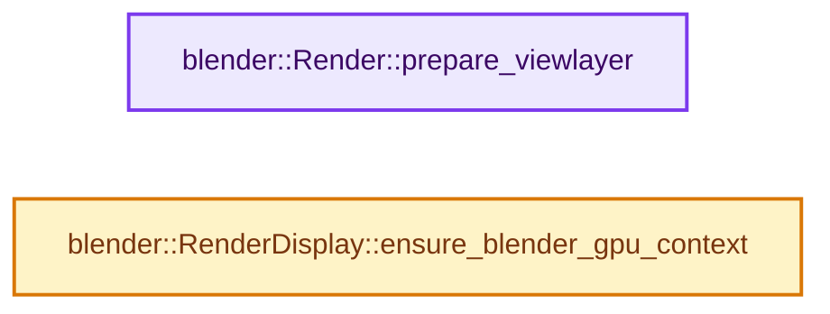
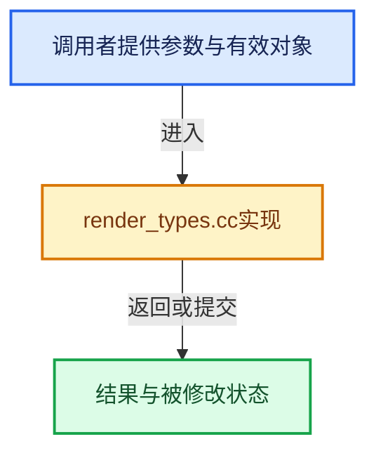

# 实现依赖专题：source/blender/render/intern/render_types.cc

[方向导航](README.md) · [符号索引](../%E7%AC%A6%E5%8F%B7%E4%BE%9D%E8%B5%96%E4%B8%8E%E5%AE%9E%E7%8E%B0%E7%B4%A2%E5%BC%95.md)

本专题从正文实际调用进入，集中保存共享实现。函数有稳定锚点，可从调用处直接跳到对应完整函数；递归与互相调用通过回链组织。

## 本文件的实现关系






## 完整成员与函数实现

<a id="f-601eb7268c79ab15"></a>

### `blender::Render::prepare_viewlayer`

实现位置：[source/blender/render/intern/render_types.cc](../../../../../source/blender/render/intern/render_types.cc) · L61—L68。

接口参数：

- `ViewLayer *view_layer`
- `Depsgraph *depsgraph`

**教学注释版**

<!-- annotated:2e3e7aa183a49d -->

```cpp
bool Render::prepare_viewlayer(ViewLayer *view_layer, Depsgraph *depsgraph)
{
  if (!prepare_viewlayer_cb) {
    return true;
  }

  return prepare_viewlayer_cb(prepare_vl_handle, view_layer, depsgraph);
}
```

<details>
<summary>核对原始源码：source/blender/render/intern/render_types.cc · L61—L68</summary>

<!-- original:2e3e7aa183a49d:source/blender/render/intern/render_types.cc:61:68 -->

```cpp
bool Render::prepare_viewlayer(ViewLayer *view_layer, Depsgraph *depsgraph)
{
  if (!prepare_viewlayer_cb) {
    return true;
  }

  return prepare_viewlayer_cb(prepare_vl_handle, view_layer, depsgraph);
}
```

</details>

**结果出口**

- `return true;`
- `return prepare_viewlayer_cb(prepare_vl_handle, view_layer, depsgraph);`

**继续追踪实现**

- `prepare_viewlayer_cb` → [调用协议](../%E6%A8%A1%E6%9D%BF%E5%AE%8F%E4%B8%8E%E5%8A%A8%E6%80%81%E5%88%86%E6%B4%BE%E5%8D%8F%E8%AE%AE.md)：函数指针、局部可调用对象或未展开的宏；必须结合调用者环境。调用位置L67。

<a id="f-6bd0a29818f0496f"></a>

### `blender::RenderDisplay::ensure_blender_gpu_context`

实现位置：[source/blender/render/intern/render_types.cc](../../../../../source/blender/render/intern/render_types.cc) · L124—L131。

**教学注释版**

<!-- annotated:f8f6b0433677ac -->

```cpp
void *RenderDisplay::ensure_blender_gpu_context()
{
  BLI_assert(system_gpu_context != nullptr);
  if (blender_gpu_context == nullptr) {
    blender_gpu_context = GPU_context_create(nullptr, system_gpu_context);
  }
  return blender_gpu_context;
}
```

<details>
<summary>核对原始源码：source/blender/render/intern/render_types.cc · L124—L131</summary>

<!-- original:f8f6b0433677ac:source/blender/render/intern/render_types.cc:124:131 -->

```cpp
void *RenderDisplay::ensure_blender_gpu_context()
{
  BLI_assert(system_gpu_context != nullptr);
  if (blender_gpu_context == nullptr) {
    blender_gpu_context = GPU_context_create(nullptr, system_gpu_context);
  }
  return blender_gpu_context;
}
```

</details>

**沿实际写入检查状态**

- `blender_gpu_context = GPU_context_create(nullptr, system_gpu_context);`

**结果出口**

- `return blender_gpu_context;`

**继续追踪实现**

- `BLI_assert` → [BLI_assert · L48](../01-%E5%9F%BA%E7%A1%80%E5%AE%B9%E5%99%A8%E4%B8%8E%E7%8E%B0%E4%BB%A3CPP/%E4%BE%9D%E8%B5%96-BLI_assert-cc98e8.md#m-57a88495704d)；[BLI_assert · L63](../01-%E5%9F%BA%E7%A1%80%E5%AE%B9%E5%99%A8%E4%B8%8E%E7%8E%B0%E4%BB%A3CPP/%E4%BE%9D%E8%B5%96-BLI_assert-cc98e8.md#m-d07050020cb5)。宏定义由构建条件选择。
- `GPU_context_create` → [blender::GPU_context_create · L193](%E4%BE%9D%E8%B5%96-gpu_context-77a234.md#f-7cdf66fb41a963b5)。
