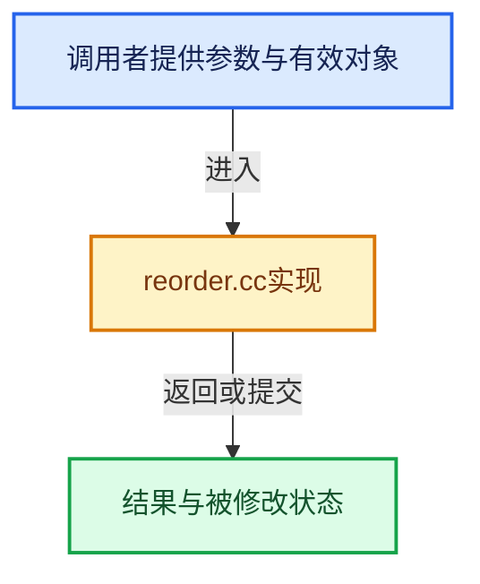

# 实现依赖专题：source/blender/geometry/intern/reorder.cc

[方向导航](README.md) · [符号索引](../%E7%AC%A6%E5%8F%B7%E4%BE%9D%E8%B5%96%E4%B8%8E%E5%AE%9E%E7%8E%B0%E7%B4%A2%E5%BC%95.md)

本专题从正文实际调用进入，集中保存共享实现。函数有稳定锚点，可从调用处直接跳到对应完整函数；递归与互相调用通过回链组织。

## 本文件的实现关系





## 完整成员与函数实现

<a id="f-1706710c633eb5ad"></a>

### `blender::geometry::reorder_attributes_group_to_group`

实现位置：[source/blender/geometry/intern/reorder.cc](../../../../../source/blender/geometry/intern/reorder.cc) · L56—L99。

接口参数：

- `const bke::AttributeAccessor src_attributes`
- `const bke::AttrDomain domain`
- `const OffsetIndices<int> src_offsets`
- `const OffsetIndices<int> dst_offsets`
- `const Span<int> old_by_new_map`
- `const bke::AttributeFilter &attribute_filter`
- `bke::MutableAttributeAccessor dst_attributes`

**教学注释版**

<!-- annotated:2656c99f78032c -->

```cpp
static void reorder_attributes_group_to_group(const bke::AttributeAccessor src_attributes,
                                              const bke::AttrDomain domain,
                                              const OffsetIndices<int> src_offsets,
                                              const OffsetIndices<int> dst_offsets,
                                              const Span<int> old_by_new_map,
                                              const bke::AttributeFilter &attribute_filter,
                                              bke::MutableAttributeAccessor dst_attributes)
{
  src_attributes.foreach_attribute([&](const bke::AttributeIter &iter) {
    if (iter.domain != domain) {
      return;
    }
    if (iter.data_type == bke::AttrType::String) {
      return;
    }
    if (attribute_filter.allow_skip(iter.name)) {
      return;
    }
    const GVArray src = *iter.get(domain);

    const CommonVArrayInfo info = src.common_info();
    if (info.type == CommonVArrayInfo::Type::Single) {
      const GPointer value(src.type(), info.data);
      if (dst_attributes.add(iter.name, domain, iter.data_type, bke::AttributeInitValue(value))) {
        return;
      }
    }

    bke::GSpanAttributeWriter dst = dst_attributes.lookup_or_add_for_write_only_span(
        iter.name, domain, iter.data_type);
    if (!dst) {
      return;
    }

    // [讲解] old_by_new_map.index_range：查询视图长度或生成对应有效索引区间。
    threading::parallel_for(old_by_new_map.index_range(), 1024, [&](const IndexRange range) {
      for (const int new_i : range) {
        const int old_i = old_by_new_map[new_i];
        array_utils::copy(src.slice(src_offsets[old_i]), dst.span.slice(dst_offsets[new_i]));
      }
    });

    dst.finish();
  });
}
```

<details>
<summary>核对原始源码：source/blender/geometry/intern/reorder.cc · L56—L99</summary>

<!-- original:2656c99f78032c:source/blender/geometry/intern/reorder.cc:56:99 -->

```cpp
static void reorder_attributes_group_to_group(const bke::AttributeAccessor src_attributes,
                                              const bke::AttrDomain domain,
                                              const OffsetIndices<int> src_offsets,
                                              const OffsetIndices<int> dst_offsets,
                                              const Span<int> old_by_new_map,
                                              const bke::AttributeFilter &attribute_filter,
                                              bke::MutableAttributeAccessor dst_attributes)
{
  src_attributes.foreach_attribute([&](const bke::AttributeIter &iter) {
    if (iter.domain != domain) {
      return;
    }
    if (iter.data_type == bke::AttrType::String) {
      return;
    }
    if (attribute_filter.allow_skip(iter.name)) {
      return;
    }
    const GVArray src = *iter.get(domain);

    const CommonVArrayInfo info = src.common_info();
    if (info.type == CommonVArrayInfo::Type::Single) {
      const GPointer value(src.type(), info.data);
      if (dst_attributes.add(iter.name, domain, iter.data_type, bke::AttributeInitValue(value))) {
        return;
      }
    }

    bke::GSpanAttributeWriter dst = dst_attributes.lookup_or_add_for_write_only_span(
        iter.name, domain, iter.data_type);
    if (!dst) {
      return;
    }

    threading::parallel_for(old_by_new_map.index_range(), 1024, [&](const IndexRange range) {
      for (const int new_i : range) {
        const int old_i = old_by_new_map[new_i];
        array_utils::copy(src.slice(src_offsets[old_i]), dst.span.slice(dst_offsets[new_i]));
      }
    });

    dst.finish();
  });
}
```

</details>

**继续追踪实现**

- `src_attributes.foreach_attribute` → [blender::bke::AttributeAccessor::foreach_attribute · L687](08-AttributeAccessor%E6%8E%A5%E5%8F%A3.md#f-44723ac57e0d1fa4)。
- `attribute_filter.allow_skip` → [blender::bke::AttributeFilter::allow_skip · L49](../10-%E5%BC%95%E7%94%A8%E7%94%9F%E5%91%BD%E5%91%A8%E6%9C%9F%E4%B8%8EClosure/04-%E5%BC%95%E7%94%A8%E4%BC%A0%E6%92%AD%E4%B8%8E%E8%BF%87%E6%BB%A4.md#f-58a977257551e818)。
- `iter.get` → [blender::bke::AttributeIter::get · L408](%E4%BE%9D%E8%B5%96-attribute_access-bceef3.md#f-2c1e25e65fcbed9b)；[blender::bke::AttributeIter::get · L425](08-AttributeAccessor%E6%8E%A5%E5%8F%A3.md#f-96c11326ce251969)；[blender::bke::AttributeIter::get · L433](08-AttributeAccessor%E6%8E%A5%E5%8F%A3.md#f-cf743236e80abe49)；[blender::bke::AttributeIter::get · L438](08-AttributeAccessor%E6%8E%A5%E5%8F%A3.md#f-9aafba5d0c4d4d23)；[blender::bke::AttributeIter::get · L443](08-AttributeAccessor%E6%8E%A5%E5%8F%A3.md#f-bee09d0823c91cdb)。同名重载需按实参类型选择。
- `src.common_info` → [调用协议](../%E6%A8%A1%E6%9D%BF%E5%AE%8F%E4%B8%8E%E5%8A%A8%E6%80%81%E5%88%86%E6%B4%BE%E5%8D%8F%E8%AE%AE.md)：由接收对象具体类型或运行时策略提供实现。调用位置L76。
- `src.type` → [调用协议](../%E6%A8%A1%E6%9D%BF%E5%AE%8F%E4%B8%8E%E5%8A%A8%E6%80%81%E5%88%86%E6%B4%BE%E5%8D%8F%E8%AE%AE.md)：由接收对象具体类型或运行时策略提供实现。调用位置L78。
- `dst_attributes.add` → [blender::bke::MutableAttributeAccessor::add · L769](08-AttributeAccessor%E6%8E%A5%E5%8F%A3.md#f-5fa7f06d7e22891a)；[blender::bke::MutableAttributeAccessor::add · L785](08-AttributeAccessor%E6%8E%A5%E5%8F%A3.md#f-42998ceb23ada8cc)。同名重载需按实参类型选择。
- `bke::AttributeInitValue` → [blender::bke::AttributeInitValue::AttributeInitValue · L100](08-AttributeAccessor%E6%8E%A5%E5%8F%A3.md#f-cd502d5742ad6d0f)；[blender::bke::AttributeInitValue::AttributeInitValue · L104](08-AttributeAccessor%E6%8E%A5%E5%8F%A3.md#f-54b1dad08bff7914)。同名重载需按实参类型选择。
- `dst_attributes.lookup_or_add_for_write_only_span` → [blender::bke::MutableAttributeAccessor::lookup_or_add_for_write_only_span · L546](%E4%BE%9D%E8%B5%96-attribute_access-bceef3.md#f-97af899f7983a038)；[blender::bke::MutableAttributeAccessor::lookup_or_add_for_write_only_span · L891](08-AttributeAccessor%E6%8E%A5%E5%8F%A3.md#f-ee8d09f75408ac4f)。同名重载需按实参类型选择。
- `threading::parallel_for` → [blender::threading::parallel_for · L68](../11-Depsgraph%E4%B8%8E%E5%B9%B6%E8%A1%8C%E4%BB%BB%E5%8A%A1%E7%B3%BB%E7%BB%9F/07-%E4%BB%BB%E5%8A%A1%E6%B1%A0%E4%B8%8ETBB%E6%8E%A5%E5%85%A5.md#f-838294754c24426c)。
- `old_by_new_map.index_range` → [blender::Span::index_range · L405](../01-%E5%9F%BA%E7%A1%80%E5%AE%B9%E5%99%A8%E4%B8%8E%E7%8E%B0%E4%BB%A3CPP/05-Span%E5%8F%AA%E8%AF%BB%E8%BF%9E%E7%BB%AD%E8%A7%86%E5%9B%BE.md#f-caaa9b06e13e53e0)。
- `array_utils::copy` → [blender::array_utils::copy · L54](../01-%E5%9F%BA%E7%A1%80%E5%AE%B9%E5%99%A8%E4%B8%8E%E7%8E%B0%E4%BB%A3CPP/20-%E5%AE%B9%E5%99%A8%E9%80%89%E6%8B%A9%E4%B8%8E%E7%8B%AC%E7%AB%8B%E5%AE%9E%E7%8E%B0.md#f-82e21acdac93f91c)；[blender::array_utils::copy · L72](../01-%E5%9F%BA%E7%A1%80%E5%AE%B9%E5%99%A8%E4%B8%8E%E7%8E%B0%E4%BB%A3CPP/20-%E5%AE%B9%E5%99%A8%E9%80%89%E6%8B%A9%E4%B8%8E%E7%8B%AC%E7%AB%8B%E5%AE%9E%E7%8E%B0.md#f-ee9c17de026a6c9a)；[blender::array_utils::copy · L98](../01-%E5%9F%BA%E7%A1%80%E5%AE%B9%E5%99%A8%E4%B8%8E%E7%8E%B0%E4%BB%A3CPP/20-%E5%AE%B9%E5%99%A8%E9%80%89%E6%8B%A9%E4%B8%8E%E7%8B%AC%E7%AB%8B%E5%AE%9E%E7%8E%B0.md#f-ec9fd099c7280717)；[blender::array_utils::copy · L27](../01-%E5%9F%BA%E7%A1%80%E5%AE%B9%E5%99%A8%E4%B8%8E%E7%8E%B0%E4%BB%A3CPP/%E4%BE%9D%E8%B5%96-array_utils-cbb70f.md#f-245f7c23437cf35f)；[blender::array_utils::copy · L43](../01-%E5%9F%BA%E7%A1%80%E5%AE%B9%E5%99%A8%E4%B8%8E%E7%8E%B0%E4%BB%A3CPP/%E4%BE%9D%E8%B5%96-array_utils-cbb70f.md#f-6170524934215b36)。同名重载需按实参类型选择。
- `src.slice` → [blender::GVArray::slice · L652](../04-%E8%99%9A%E6%8B%9F%E6%95%B0%E7%BB%84%E4%B8%8E%E7%B4%A2%E5%BC%95%E9%80%89%E6%8B%A9/05-GVArray%E8%BF%90%E8%A1%8C%E6%97%B6%E7%B1%BB%E5%9E%8B.md#f-78ff2fe92b17a34c)。
- `dst.span.slice` → [调用协议](../%E6%A8%A1%E6%9D%BF%E5%AE%8F%E4%B8%8E%E5%8A%A8%E6%80%81%E5%88%86%E6%B4%BE%E5%8D%8F%E8%AE%AE.md)：接收对象类型依赖auto、返回值或模板实例；不按同名猜测目标。调用位置L93。
- `dst.finish` → [blender::bke::GSpanAttributeWriter::finish · L372](08-AttributeAccessor%E6%8E%A5%E5%8F%A3.md#f-6e58c9c72c82f592)。

<a id="f-054b0c84a8d2ae68"></a>

### `blender::geometry::copy_and_reorder_curves`

实现位置：[source/blender/geometry/intern/reorder.cc](../../../../../source/blender/geometry/intern/reorder.cc) · L289—L320。

接口参数：

- `const bke::CurvesGeometry &src_curves`
- `const Span<int> old_by_new_map`
- `const bke::AttributeFilter &attribute_filter`
- `bke::CurvesGeometry &dst_curves`

**教学注释版**

<!-- annotated:1fd3fd599a0e36 -->

```cpp
static void copy_and_reorder_curves(const bke::CurvesGeometry &src_curves,
                                    const Span<int> old_by_new_map,
                                    const bke::AttributeFilter &attribute_filter,
                                    bke::CurvesGeometry &dst_curves)
{
  bke::gather_attributes(src_curves.attributes(),
                         bke::AttrDomain::Curve,
                         bke::AttrDomain::Curve,
                         attribute_filter,
                         old_by_new_map,
                         dst_curves.attributes_for_write());

  const Span<int> old_offsets = src_curves.offsets();
  MutableSpan<int> new_offsets = dst_curves.offsets_for_write();
  offset_indices::gather_group_sizes(old_offsets, old_by_new_map, new_offsets);
  offset_indices::accumulate_counts_to_offsets(new_offsets);

  reorder_attributes_group_to_group(src_curves.attributes(),
                                    bke::AttrDomain::Point,
                                    old_offsets,
                                    new_offsets.as_span(),
                                    old_by_new_map,
                                    attribute_filter,
                                    dst_curves.attributes_for_write());
  dst_curves.tag_topology_changed();
  if (src_curves.nurbs_has_custom_knots()) {
    dst_curves.nurbs_custom_knots_update_size();
    IndexMaskMemory memory;
    bke::curves::nurbs::gather_custom_knots(
        src_curves, IndexMask::from_indices(old_by_new_map, memory), 0, dst_curves);
  }
}
```

<details>
<summary>核对原始源码：source/blender/geometry/intern/reorder.cc · L289—L320</summary>

<!-- original:1fd3fd599a0e36:source/blender/geometry/intern/reorder.cc:289:320 -->

```cpp
static void copy_and_reorder_curves(const bke::CurvesGeometry &src_curves,
                                    const Span<int> old_by_new_map,
                                    const bke::AttributeFilter &attribute_filter,
                                    bke::CurvesGeometry &dst_curves)
{
  bke::gather_attributes(src_curves.attributes(),
                         bke::AttrDomain::Curve,
                         bke::AttrDomain::Curve,
                         attribute_filter,
                         old_by_new_map,
                         dst_curves.attributes_for_write());

  const Span<int> old_offsets = src_curves.offsets();
  MutableSpan<int> new_offsets = dst_curves.offsets_for_write();
  offset_indices::gather_group_sizes(old_offsets, old_by_new_map, new_offsets);
  offset_indices::accumulate_counts_to_offsets(new_offsets);

  reorder_attributes_group_to_group(src_curves.attributes(),
                                    bke::AttrDomain::Point,
                                    old_offsets,
                                    new_offsets.as_span(),
                                    old_by_new_map,
                                    attribute_filter,
                                    dst_curves.attributes_for_write());
  dst_curves.tag_topology_changed();
  if (src_curves.nurbs_has_custom_knots()) {
    dst_curves.nurbs_custom_knots_update_size();
    IndexMaskMemory memory;
    bke::curves::nurbs::gather_custom_knots(
        src_curves, IndexMask::from_indices(old_by_new_map, memory), 0, dst_curves);
  }
}
```

</details>

**继续追踪实现**

- `bke::gather_attributes` → [blender::bke::gather_attributes · L443](%E4%BE%9D%E8%B5%96-mesh_remesh_voxel-ec8066.md#f-eccc321412f0e74a)；[blender::bke::gather_attributes · L708](%E4%BE%9D%E8%B5%96-attribute_access-bceef3.md#f-309a1e4720f70b4a)；[blender::bke::gather_attributes · L749](%E4%BE%9D%E8%B5%96-attribute_access-bceef3.md#f-79f80f052936884d)。同名重载需按实参类型选择。
- `src_curves.attributes` → [blender::bke::CurvesGeometry::attributes · L1908](%E4%BE%9D%E8%B5%96-curves_geometry-ad7f9f.md#f-8e24fbf758862a22)。
- `dst_curves.attributes_for_write` → [blender::bke::CurvesGeometry::attributes_for_write · L1913](%E4%BE%9D%E8%B5%96-curves_geometry-ad7f9f.md#f-4930091b34fa9663)。
- `src_curves.offsets` → [blender::bke::CurvesGeometry::offsets · L345](%E4%BE%9D%E8%B5%96-curves_geometry-ad7f9f.md#f-933ebcc46965545e)。
- `dst_curves.offsets_for_write` → [blender::bke::CurvesGeometry::offsets_for_write · L352](%E4%BE%9D%E8%B5%96-curves_geometry-ad7f9f.md#f-9ea1e4f36b216dd0)。
- `offset_indices::gather_group_sizes` → [blender::offset_indices::gather_group_sizes · L87](05-%E9%82%BB%E6%8E%A5%E5%85%B3%E7%B3%BB%E4%B8%8E%E5%89%8D%E7%BC%80%E5%92%8C.md#f-19204b84ba6992bb)；[blender::offset_indices::gather_group_sizes · L96](05-%E9%82%BB%E6%8E%A5%E5%85%B3%E7%B3%BB%E4%B8%8E%E5%89%8D%E7%BC%80%E5%92%8C.md#f-4bb5520e88589c9b)。同名重载需按实参类型选择。
- `offset_indices::accumulate_counts_to_offsets` → [blender::offset_indices::accumulate_counts_to_offsets · L24](05-%E9%82%BB%E6%8E%A5%E5%85%B3%E7%B3%BB%E4%B8%8E%E5%89%8D%E7%BC%80%E5%92%8C.md#f-cfa9fbd186afcdd5)。
- `reorder_attributes_group_to_group` → [blender::geometry::reorder_attributes_group_to_group · L56](%E4%BE%9D%E8%B5%96-reorder-ead4ba.md#f-1706710c633eb5ad)。
- `new_offsets.as_span` → [blender::MutableSpan::as_span · L667](../01-%E5%9F%BA%E7%A1%80%E5%AE%B9%E5%99%A8%E4%B8%8E%E7%8E%B0%E4%BB%A3CPP/06-MutableSpan%E5%8F%AF%E5%86%99%E8%A7%86%E5%9B%BE.md#f-d0c35de0cfb9761e)。
- `dst_curves.tag_topology_changed` → [blender::bke::CurvesGeometry::tag_topology_changed · L1256](%E4%BE%9D%E8%B5%96-curves_geometry-ad7f9f.md#f-5e9e12c0e1d70e27)。
- `src_curves.nurbs_has_custom_knots` → [blender::bke::CurvesGeometry::nurbs_has_custom_knots · L1009](04-CurvesGeometry%E5%AD%98%E5%82%A8.md#f-462177a6bae60d14)。
- `dst_curves.nurbs_custom_knots_update_size` → [blender::bke::CurvesGeometry::nurbs_custom_knots_update_size · L587](%E4%BE%9D%E8%B5%96-curves_geometry-ad7f9f.md#f-d445d63e7e1b4649)。
- `bke::curves::nurbs::gather_custom_knots` → [blender::bke::curves::nurbs::gather_custom_knots · L260](%E4%BE%9D%E8%B5%96-curves_utils-29d2f5.md#f-f73d286038bd1cd1)。
- `IndexMask::from_indices` → [blender::index_mask::IndexMask::from_indices · L414](../04-%E8%99%9A%E6%8B%9F%E6%95%B0%E7%BB%84%E4%B8%8E%E7%B4%A2%E5%BC%95%E9%80%89%E6%8B%A9/10-IndexMask%E6%9E%84%E5%BB%BA%E4%B8%8E%E5%B9%B6%E8%A1%8C.md#f-85c4cb3a40ba9bbe)。

<a id="f-1f2e805b170f51d9"></a>

### `blender::geometry::reorder_curves_geometry`

实现位置：[source/blender/geometry/intern/reorder.cc](../../../../../source/blender/geometry/intern/reorder.cc) · L368—L377。

接口参数：

- `const bke::CurvesGeometry &src_curves`
- `Span<int> old_by_new_map`
- `const bke::AttributeFilter &attribute_filter`

**教学注释版**

<!-- annotated:9174d9d6ad7a5f -->

```cpp
bke::CurvesGeometry reorder_curves_geometry(const bke::CurvesGeometry &src_curves,
                                            Span<int> old_by_new_map,
                                            const bke::AttributeFilter &attribute_filter)
{
  bke::CurvesGeometry dst_curves = bke::curves_new_no_attributes(src_curves.points_num(),
                                                                 src_curves.curves_num());
  BKE_defgroup_copy_list(&dst_curves.vertex_group_names, &src_curves.vertex_group_names);
  copy_and_reorder_curves(src_curves, old_by_new_map, attribute_filter, dst_curves);
  return dst_curves;
}
```

<details>
<summary>核对原始源码：source/blender/geometry/intern/reorder.cc · L368—L377</summary>

<!-- original:9174d9d6ad7a5f:source/blender/geometry/intern/reorder.cc:368:377 -->

```cpp
bke::CurvesGeometry reorder_curves_geometry(const bke::CurvesGeometry &src_curves,
                                            Span<int> old_by_new_map,
                                            const bke::AttributeFilter &attribute_filter)
{
  bke::CurvesGeometry dst_curves = bke::curves_new_no_attributes(src_curves.points_num(),
                                                                 src_curves.curves_num());
  BKE_defgroup_copy_list(&dst_curves.vertex_group_names, &src_curves.vertex_group_names);
  copy_and_reorder_curves(src_curves, old_by_new_map, attribute_filter, dst_curves);
  return dst_curves;
}
```

</details>

**结果出口**

- `return dst_curves;`

**继续追踪实现**

- `bke::curves_new_no_attributes` → [blender::bke::curves_new_no_attributes · L1783](%E4%BE%9D%E8%B5%96-curves_geometry-ad7f9f.md#f-c790a5b8439efcf3)。
- `src_curves.points_num` → [blender::bke::CurvesGeometry::points_num · L1001](04-CurvesGeometry%E5%AD%98%E5%82%A8.md#f-049421b1f643c700)。
- `src_curves.curves_num` → [blender::bke::CurvesGeometry::curves_num · L1005](04-CurvesGeometry%E5%AD%98%E5%82%A8.md#f-eabb3f0e5d3c57be)。
- `BKE_defgroup_copy_list` → [blender::BKE_defgroup_copy_list · L75](%E4%BE%9D%E8%B5%96-deform-6949f4.md#f-abb39694bedcca18)。
- `copy_and_reorder_curves` → [blender::geometry::copy_and_reorder_curves · L289](%E4%BE%9D%E8%B5%96-reorder-ead4ba.md#f-054b0c84a8d2ae68)。
