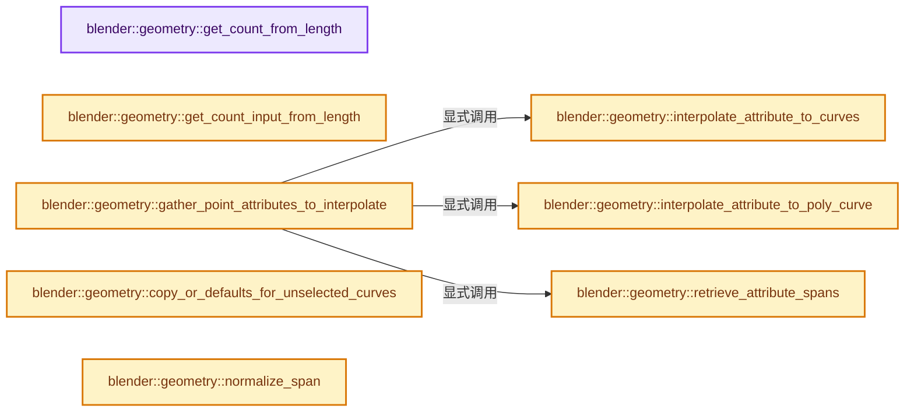
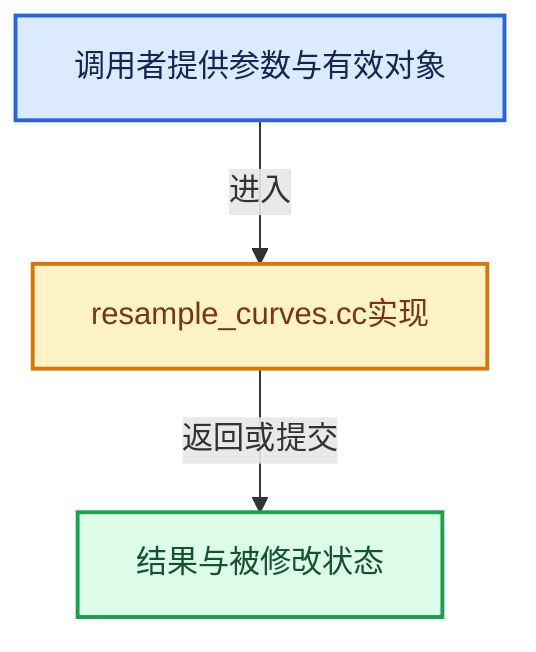

# 实现依赖专题：source/blender/geometry/intern/resample_curves.cc

[方向导航](README.md) · [符号索引](../%E7%AC%A6%E5%8F%B7%E4%BE%9D%E8%B5%96%E4%B8%8E%E5%AE%9E%E7%8E%B0%E7%B4%A2%E5%BC%95.md)

本专题从正文实际调用进入，集中保存共享实现。函数有稳定锚点，可从调用处直接跳到对应完整函数；递归与互相调用通过回链组织。

## 本文件的实现关系






## 完整成员与函数实现

<a id="f-bcdf025cd8785874"></a>

### `blender::geometry::get_count_from_length`

实现位置：[source/blender/geometry/intern/resample_curves.cc](../../../../../source/blender/geometry/intern/resample_curves.cc) · L38—L49。

接口参数：

- `const float curve_length`
- `const float sample_length`
- `const bool keep_last_segment`

**教学注释版**

<!-- annotated:2089dd936faf12 -->

```cpp
static int get_count_from_length(const float curve_length,
                                 const float sample_length,
                                 const bool keep_last_segment)
{
  /* Find the number of sampled segments by dividing the total length by
   * the sample length. Then there is one more sampled point than segment. */
  if (sample_length == 0.0f) [[unlikely]] {
    return 1;
  }
  const int count = int(curve_length / sample_length) + 1;
  // [讲解] std::max：按比较关系选取较大值。本讲解中的增长公式同时满足最低请求和几何增长；若保存返回引用，还需注意实参寿命。
  return std::max(keep_last_segment ? 2 : 1, count);
}
```

<details>
<summary>核对原始源码：source/blender/geometry/intern/resample_curves.cc · L38—L49</summary>

<!-- original:2089dd936faf12:source/blender/geometry/intern/resample_curves.cc:38:49 -->

```cpp
static int get_count_from_length(const float curve_length,
                                 const float sample_length,
                                 const bool keep_last_segment)
{
  /* Find the number of sampled segments by dividing the total length by
   * the sample length. Then there is one more sampled point than segment. */
  if (sample_length == 0.0f) [[unlikely]] {
    return 1;
  }
  const int count = int(curve_length / sample_length) + 1;
  return std::max(keep_last_segment ? 2 : 1, count);
}
```

</details>

**结果出口**

- `return 1;`
- `return std::max(keep_last_segment ? 2 : 1, count);`

**继续追踪实现**

- `std::max` → [外部契约](https://eel.is/c++draft/alg.min.max)：按比较关系选取较大值。本讲解中的增长公式同时满足最低请求和几何增长；若保存返回引用，还需注意实参寿命。

<a id="f-5533f301ddda6800"></a>

### `blender::geometry::get_count_input_from_length`

实现位置：[source/blender/geometry/intern/resample_curves.cc](../../../../../source/blender/geometry/intern/resample_curves.cc) · L51—L66。

接口参数：

- `const fn::Field<float> &length_field`
- `const bool keep_last_segment`

**教学注释版**

<!-- annotated:885d54891506f2 -->

```cpp
static fn::Field<int> get_count_input_from_length(const fn::Field<float> &length_field,
                                                  const bool keep_last_segment)
{
  static auto get_count_fn = mf::build::SI3_SO<float, float, bool, int>(
      "Length Input to Count",
      get_count_from_length,
      mf::build::exec_presets::SomeSpanOrSingle<0, 1>());

  // [讲解] fn::FieldOperation::from：建立运算、常量或借用表示。
  auto get_count_op = fn::FieldOperation::from(
      get_count_fn,
      {fn::Field<float>::from_input<bke::CurveLengthFieldInput>(),
       length_field,
       fn::Field<bool>(keep_last_segment)});

  // [讲解] std::move：把表达式转换成可供移动重载选择的值类别；不保证真的移动，不结束源对象寿命，对const值可能选择复制。
  return fn::Field<int>(std::move(get_count_op));
}
```

<details>
<summary>核对原始源码：source/blender/geometry/intern/resample_curves.cc · L51—L66</summary>

<!-- original:885d54891506f2:source/blender/geometry/intern/resample_curves.cc:51:66 -->

```cpp
static fn::Field<int> get_count_input_from_length(const fn::Field<float> &length_field,
                                                  const bool keep_last_segment)
{
  static auto get_count_fn = mf::build::SI3_SO<float, float, bool, int>(
      "Length Input to Count",
      get_count_from_length,
      mf::build::exec_presets::SomeSpanOrSingle<0, 1>());

  auto get_count_op = fn::FieldOperation::from(
      get_count_fn,
      {fn::Field<float>::from_input<bke::CurveLengthFieldInput>(),
       length_field,
       fn::Field<bool>(keep_last_segment)});

  return fn::Field<int>(std::move(get_count_op));
}
```

</details>

**结果出口**

- `return fn::Field<int>(std::move(get_count_op));`

**继续追踪实现**

- `mf::build::SI3_SO<float, float, bool, int>` → [blender::fn::multi_function::build::SI3_SO · L579](../07-MultiFunction%E4%B8%8E%E6%89%B9%E9%87%8F%E6%89%A7%E8%A1%8C/06-%E5%87%BD%E6%95%B0%E6%9E%84%E5%BB%BA%E5%99%A8.md#f-ce61391f45fe0e8c)。
- `mf::build::exec_presets::SomeSpanOrSingle<0, 1>` → [blender::fn::multi_function::build::exec_presets::SomeSpanOrSingle](../07-MultiFunction%E4%B8%8E%E6%89%B9%E9%87%8F%E6%89%A7%E8%A1%8C/%E4%BE%9D%E8%B5%96-FN_multi_function_builder-404df7.md#t-5cf91a4b814c)。
- `fn::FieldOperation::from` → [blender::fn::FieldOperation::from · L252](../08-Field%E8%A1%A8%E8%BE%BE%E5%BC%8F%E4%B8%8E%E6%B1%82%E5%80%BC/06-FieldContext%E4%B8%8A%E4%B8%8B%E6%96%87.md#f-d78060e8f5e1929f)；[blender::fn::FieldOperation::from · L258](../08-Field%E8%A1%A8%E8%BE%BE%E5%BC%8F%E4%B8%8E%E6%B1%82%E5%80%BC/06-FieldContext%E4%B8%8A%E4%B8%8B%E6%96%87.md#f-60a41b323ee8ceb7)。同名重载需按实参类型选择。
- `fn::Field<float>::from_input<bke::CurveLengthFieldInput>` → [blender::fn::Field<T>::Field · L495](../08-Field%E8%A1%A8%E8%BE%BE%E5%BC%8F%E4%B8%8E%E6%B1%82%E5%80%BC/05-FieldOperation%E8%BF%90%E7%AE%97%E8%8A%82%E7%82%B9.md#f-0b2f3f4cecd8c44a)；[blender::fn::Field<T>::Field · L603](../08-Field%E8%A1%A8%E8%BE%BE%E5%BC%8F%E4%B8%8E%E6%B1%82%E5%80%BC/05-FieldOperation%E8%BF%90%E7%AE%97%E8%8A%82%E7%82%B9.md#f-6fbbe0144f689448)；[blender::fn::Field<T>::Field · L605](../08-Field%E8%A1%A8%E8%BE%BE%E5%BC%8F%E4%B8%8E%E6%B1%82%E5%80%BC/05-FieldOperation%E8%BF%90%E7%AE%97%E8%8A%82%E7%82%B9.md#f-b9fadbb0d8465bfe)；[blender::fn::Field<T>::Field · L608](../08-Field%E8%A1%A8%E8%BE%BE%E5%BC%8F%E4%B8%8E%E6%B1%82%E5%80%BC/05-FieldOperation%E8%BF%90%E7%AE%97%E8%8A%82%E7%82%B9.md#f-be75a0525262720c)。同名重载需按实参类型选择。
- `fn::Field<bool>` → [blender::fn::Field<T>::Field · L495](../08-Field%E8%A1%A8%E8%BE%BE%E5%BC%8F%E4%B8%8E%E6%B1%82%E5%80%BC/05-FieldOperation%E8%BF%90%E7%AE%97%E8%8A%82%E7%82%B9.md#f-0b2f3f4cecd8c44a)；[blender::fn::Field<T>::Field · L603](../08-Field%E8%A1%A8%E8%BE%BE%E5%BC%8F%E4%B8%8E%E6%B1%82%E5%80%BC/05-FieldOperation%E8%BF%90%E7%AE%97%E8%8A%82%E7%82%B9.md#f-6fbbe0144f689448)；[blender::fn::Field<T>::Field · L605](../08-Field%E8%A1%A8%E8%BE%BE%E5%BC%8F%E4%B8%8E%E6%B1%82%E5%80%BC/05-FieldOperation%E8%BF%90%E7%AE%97%E8%8A%82%E7%82%B9.md#f-b9fadbb0d8465bfe)；[blender::fn::Field<T>::Field · L608](../08-Field%E8%A1%A8%E8%BE%BE%E5%BC%8F%E4%B8%8E%E6%B1%82%E5%80%BC/05-FieldOperation%E8%BF%90%E7%AE%97%E8%8A%82%E7%82%B9.md#f-be75a0525262720c)。同名重载需按实参类型选择。
- `fn::Field<int>` → [blender::fn::Field<T>::Field · L495](../08-Field%E8%A1%A8%E8%BE%BE%E5%BC%8F%E4%B8%8E%E6%B1%82%E5%80%BC/05-FieldOperation%E8%BF%90%E7%AE%97%E8%8A%82%E7%82%B9.md#f-0b2f3f4cecd8c44a)；[blender::fn::Field<T>::Field · L603](../08-Field%E8%A1%A8%E8%BE%BE%E5%BC%8F%E4%B8%8E%E6%B1%82%E5%80%BC/05-FieldOperation%E8%BF%90%E7%AE%97%E8%8A%82%E7%82%B9.md#f-6fbbe0144f689448)；[blender::fn::Field<T>::Field · L605](../08-Field%E8%A1%A8%E8%BE%BE%E5%BC%8F%E4%B8%8E%E6%B1%82%E5%80%BC/05-FieldOperation%E8%BF%90%E7%AE%97%E8%8A%82%E7%82%B9.md#f-b9fadbb0d8465bfe)；[blender::fn::Field<T>::Field · L608](../08-Field%E8%A1%A8%E8%BE%BE%E5%BC%8F%E4%B8%8E%E6%B1%82%E5%80%BC/05-FieldOperation%E8%BF%90%E7%AE%97%E8%8A%82%E7%82%B9.md#f-be75a0525262720c)。同名重载需按实参类型选择。
- `std::move` → [外部契约](https://eel.is/c++draft/utility.forward)：把表达式转换成可供移动重载选择的值类别；不保证真的移动，不结束源对象寿命，对const值可能选择复制。

<a id="f-d04c46dfbdbeaafe"></a>

### `blender::geometry::interpolate_attribute_to_curves`

实现位置：[source/blender/geometry/intern/resample_curves.cc](../../../../../source/blender/geometry/intern/resample_curves.cc) · L72—L85。

接口参数：

- `const StringRef name`
- `const std::array<int, CURVE_TYPES_NUM> &type_counts`

**教学注释版**

<!-- annotated:622eeb23028208 -->

```cpp
static bool interpolate_attribute_to_curves(const StringRef name,
                                            const std::array<int, CURVE_TYPES_NUM> &type_counts)
{
  if (bke::attribute_name_is_anonymous(name)) {
    return true;
  }
  if (ELEM(name, "handle_type_left", "handle_type_right", "handle_left", "handle_right")) {
    return type_counts[CURVE_TYPE_BEZIER] != 0;
  }
  if (ELEM(name, "nurbs_weight")) {
    return type_counts[CURVE_TYPE_NURBS] != 0;
  }
  return true;
}
```

<details>
<summary>核对原始源码：source/blender/geometry/intern/resample_curves.cc · L72—L85</summary>

<!-- original:622eeb23028208:source/blender/geometry/intern/resample_curves.cc:72:85 -->

```cpp
static bool interpolate_attribute_to_curves(const StringRef name,
                                            const std::array<int, CURVE_TYPES_NUM> &type_counts)
{
  if (bke::attribute_name_is_anonymous(name)) {
    return true;
  }
  if (ELEM(name, "handle_type_left", "handle_type_right", "handle_left", "handle_right")) {
    return type_counts[CURVE_TYPE_BEZIER] != 0;
  }
  if (ELEM(name, "nurbs_weight")) {
    return type_counts[CURVE_TYPE_NURBS] != 0;
  }
  return true;
}
```

</details>

**结果出口**

- `return true;`
- `return type_counts[CURVE_TYPE_BEZIER] != 0;`
- `return type_counts[CURVE_TYPE_NURBS] != 0;`

**继续追踪实现**

- `bke::attribute_name_is_anonymous` → [blender::bke::attribute_name_is_anonymous · L24](../10-%E5%BC%95%E7%94%A8%E7%94%9F%E5%91%BD%E5%91%A8%E6%9C%9F%E4%B8%8EClosure/01-%E5%8C%BF%E5%90%8D%E5%B1%9E%E6%80%A7%E4%B8%8E%E5%BC%95%E7%94%A8%E9%97%AE%E9%A2%98.md#f-ce0c92720483f1bc)。
- `ELEM` → [ELEM · L88](%E4%BE%9D%E8%B5%96-GHOST_utildefines-34b996.md#m-d28724a15928)；[ELEM · L135](../01-%E5%9F%BA%E7%A1%80%E5%AE%B9%E5%99%A8%E4%B8%8E%E7%8E%B0%E4%BB%A3CPP/%E4%BE%9D%E8%B5%96-BLI_utildefines-293a0a.md#m-d6572de7cae0)。宏定义由构建条件选择。

<a id="f-e5ca5f2317cff4be"></a>

### `blender::geometry::interpolate_attribute_to_poly_curve`

实现位置：[source/blender/geometry/intern/resample_curves.cc](../../../../../source/blender/geometry/intern/resample_curves.cc) · L90—L100。

接口参数：

- `const StringRef name`

**教学注释版**

<!-- annotated:044e5a8e06a3ed -->

```cpp
static bool interpolate_attribute_to_poly_curve(const StringRef name)
{
  static const Set<StringRef> no_interpolation{{
      "handle_type_left",
      "handle_type_right",
      "handle_right",
      "handle_left",
      "nurbs_weight",
  }};
  // [讲解] no_interpolation.contains：查询活项数量或键是否存在。
  return !no_interpolation.contains(name);
}
```

<details>
<summary>核对原始源码：source/blender/geometry/intern/resample_curves.cc · L90—L100</summary>

<!-- original:044e5a8e06a3ed:source/blender/geometry/intern/resample_curves.cc:90:100 -->

```cpp
static bool interpolate_attribute_to_poly_curve(const StringRef name)
{
  static const Set<StringRef> no_interpolation{{
      "handle_type_left",
      "handle_type_right",
      "handle_right",
      "handle_left",
      "nurbs_weight",
  }};
  return !no_interpolation.contains(name);
}
```

</details>

**结果出口**

- `return !no_interpolation.contains(name);`

**继续追踪实现**

- `no_interpolation.contains` → [blender::Set::contains · L310](../02-%E5%93%88%E5%B8%8C%E8%A1%A8%E4%B8%8E%E5%85%B3%E8%81%94%E6%95%B0%E6%8D%AE%E7%BB%93%E6%9E%84/08-Set%E4%B8%8E%E9%9B%86%E5%90%88%E8%AF%AD%E4%B9%89.md#f-af7099799494350e)。

<a id="f-ab578b971bbdcc92"></a>

### `blender::geometry::retrieve_attribute_spans`

实现位置：[source/blender/geometry/intern/resample_curves.cc](../../../../../source/blender/geometry/intern/resample_curves.cc) · L105—L132。

接口参数：

- `const Span<StringRef> names`
- `const CurvesGeometry &src_curves`
- `CurvesGeometry &dst_curves`
- `Vector<GVArraySpan> &src_arrays`
- `Vector<GMutableSpan> &dst_arrays`
- `Vector<bke::GSpanAttributeWriter> &dst_writers`

**教学注释版**

<!-- annotated:f246129a3db5da -->

```cpp
static void retrieve_attribute_spans(const Span<StringRef> names,
                                     const CurvesGeometry &src_curves,
                                     CurvesGeometry &dst_curves,
                                     Vector<GVArraySpan> &src_arrays,
                                     Vector<GMutableSpan> &dst_arrays,
                                     Vector<bke::GSpanAttributeWriter> &dst_writers)
{
  const bke::AttributeAccessor src_attributes = src_curves.attributes();
  bke::MutableAttributeAccessor dst_attributes = dst_curves.attributes_for_write();
  // [讲解] names.index_range：查询视图长度或生成对应有效索引区间。
  for (const int i : names.index_range()) {
    GVArray src_attribute = *src_attributes.lookup(names[i], bke::AttrDomain::Point);
    const bke::AttrType data_type = bke::cpp_type_to_attribute_type(src_attribute.type());

    const CommonVArrayInfo info = src_attribute.common_info();
    if (info.type == CommonVArrayInfo::Type::Single) {
      const bke::AttributeInitValue init(GPointer(src_attribute.type(), info.data));
      dst_attributes.add(names[i], bke::AttrDomain::Point, data_type, init);
      continue;
    }

    // [讲解] src_arrays.append：在尾部建立新元素，必要时先扩大存储。
    src_arrays.append(std::move(src_attribute));

    bke::GSpanAttributeWriter dst_attribute = dst_attributes.lookup_or_add_for_write_only_span(
        names[i], bke::AttrDomain::Point, data_type);
    dst_arrays.append(dst_attribute.span);
    // [讲解] std::move：把表达式转换成可供移动重载选择的值类别；不保证真的移动，不结束源对象寿命，对const值可能选择复制。
    dst_writers.append(std::move(dst_attribute));
  }
}
```

<details>
<summary>核对原始源码：source/blender/geometry/intern/resample_curves.cc · L105—L132</summary>

<!-- original:f246129a3db5da:source/blender/geometry/intern/resample_curves.cc:105:132 -->

```cpp
static void retrieve_attribute_spans(const Span<StringRef> names,
                                     const CurvesGeometry &src_curves,
                                     CurvesGeometry &dst_curves,
                                     Vector<GVArraySpan> &src_arrays,
                                     Vector<GMutableSpan> &dst_arrays,
                                     Vector<bke::GSpanAttributeWriter> &dst_writers)
{
  const bke::AttributeAccessor src_attributes = src_curves.attributes();
  bke::MutableAttributeAccessor dst_attributes = dst_curves.attributes_for_write();
  for (const int i : names.index_range()) {
    GVArray src_attribute = *src_attributes.lookup(names[i], bke::AttrDomain::Point);
    const bke::AttrType data_type = bke::cpp_type_to_attribute_type(src_attribute.type());

    const CommonVArrayInfo info = src_attribute.common_info();
    if (info.type == CommonVArrayInfo::Type::Single) {
      const bke::AttributeInitValue init(GPointer(src_attribute.type(), info.data));
      dst_attributes.add(names[i], bke::AttrDomain::Point, data_type, init);
      continue;
    }

    src_arrays.append(std::move(src_attribute));

    bke::GSpanAttributeWriter dst_attribute = dst_attributes.lookup_or_add_for_write_only_span(
        names[i], bke::AttrDomain::Point, data_type);
    dst_arrays.append(dst_attribute.span);
    dst_writers.append(std::move(dst_attribute));
  }
}
```

</details>

**继续追踪实现**

- `src_curves.attributes` → [blender::bke::CurvesGeometry::attributes · L1908](%E4%BE%9D%E8%B5%96-curves_geometry-ad7f9f.md#f-8e24fbf758862a22)。
- `dst_curves.attributes_for_write` → [blender::bke::CurvesGeometry::attributes_for_write · L1913](%E4%BE%9D%E8%B5%96-curves_geometry-ad7f9f.md#f-4930091b34fa9663)。
- `names.index_range` → [blender::Span::index_range · L405](../01-%E5%9F%BA%E7%A1%80%E5%AE%B9%E5%99%A8%E4%B8%8E%E7%8E%B0%E4%BB%A3CPP/05-Span%E5%8F%AA%E8%AF%BB%E8%BF%9E%E7%BB%AD%E8%A7%86%E5%9B%BE.md#f-caaa9b06e13e53e0)。
- `src_attributes.lookup` → [blender::bke::AttributeAccessor::lookup · L401](%E4%BE%9D%E8%B5%96-attribute_access-bceef3.md#f-4673351b7bb3b651)；[blender::bke::AttributeAccessor::lookup · L585](08-AttributeAccessor%E6%8E%A5%E5%8F%A3.md#f-432b90c796a80893)；[blender::bke::AttributeAccessor::lookup · L602](08-AttributeAccessor%E6%8E%A5%E5%8F%A3.md#f-a60c1a45b85155d9)；[blender::bke::AttributeAccessor::lookup · L611](08-AttributeAccessor%E6%8E%A5%E5%8F%A3.md#f-16ca459803fc30a6)；[blender::bke::AttributeAccessor::lookup · L620](08-AttributeAccessor%E6%8E%A5%E5%8F%A3.md#f-403fd8a9d1a16c6d)。同名重载需按实参类型选择。
- `bke::cpp_type_to_attribute_type` → [blender::bke::cpp_type_to_attribute_type · L80](%E4%BE%9D%E8%B5%96-attribute_access-bceef3.md#f-6ce44c9d2f385cb5)。
- `src_attribute.type` → [调用协议](../%E6%A8%A1%E6%9D%BF%E5%AE%8F%E4%B8%8E%E5%8A%A8%E6%80%81%E5%88%86%E6%B4%BE%E5%8D%8F%E8%AE%AE.md)：由接收对象具体类型或运行时策略提供实现。调用位置L116。
- `src_attribute.common_info` → [调用协议](../%E6%A8%A1%E6%9D%BF%E5%AE%8F%E4%B8%8E%E5%8A%A8%E6%80%81%E5%88%86%E6%B4%BE%E5%8D%8F%E8%AE%AE.md)：由接收对象具体类型或运行时策略提供实现。调用位置L118。
- `GPointer` → [blender::GPointer::GPointer · L93](../03-%E5%86%85%E5%AD%98%E5%88%86%E9%85%8D%E4%B8%8E%E8%BF%90%E8%A1%8C%E6%97%B6%E7%B1%BB%E5%9E%8B/12-%E5%BC%82%E6%9E%84%E5%80%BC%E5%AD%98%E5%82%A8%E5%AE%9E%E6%88%98.md#f-40f7a024c1e541df)；[blender::GPointer::GPointer · L95](../03-%E5%86%85%E5%AD%98%E5%88%86%E9%85%8D%E4%B8%8E%E8%BF%90%E8%A1%8C%E6%97%B6%E7%B1%BB%E5%9E%8B/12-%E5%BC%82%E6%9E%84%E5%80%BC%E5%AD%98%E5%82%A8%E5%AE%9E%E6%88%98.md#f-e981128b9c36f9ef)；[blender::GPointer::GPointer · L97](../03-%E5%86%85%E5%AD%98%E5%88%86%E9%85%8D%E4%B8%8E%E8%BF%90%E8%A1%8C%E6%97%B6%E7%B1%BB%E5%9E%8B/12-%E5%BC%82%E6%9E%84%E5%80%BC%E5%AD%98%E5%82%A8%E5%AE%9E%E6%88%98.md#f-5d3066175455aed0)；[blender::GPointer::GPointer · L103](../03-%E5%86%85%E5%AD%98%E5%88%86%E9%85%8D%E4%B8%8E%E8%BF%90%E8%A1%8C%E6%97%B6%E7%B1%BB%E5%9E%8B/12-%E5%BC%82%E6%9E%84%E5%80%BC%E5%AD%98%E5%82%A8%E5%AE%9E%E6%88%98.md#f-9194d11793ea4a06)；[blender::GPointer::GPointer · L105](../03-%E5%86%85%E5%AD%98%E5%88%86%E9%85%8D%E4%B8%8E%E8%BF%90%E8%A1%8C%E6%97%B6%E7%B1%BB%E5%9E%8B/12-%E5%BC%82%E6%9E%84%E5%80%BC%E5%AD%98%E5%82%A8%E5%AE%9E%E6%88%98.md#f-1a9887b65d37a9ca)。同名重载需按实参类型选择。
- `dst_attributes.add` → [blender::bke::MutableAttributeAccessor::add · L769](08-AttributeAccessor%E6%8E%A5%E5%8F%A3.md#f-5fa7f06d7e22891a)；[blender::bke::MutableAttributeAccessor::add · L785](08-AttributeAccessor%E6%8E%A5%E5%8F%A3.md#f-42998ceb23ada8cc)。同名重载需按实参类型选择。
- `src_arrays.append` → [blender::Vector::append · L498](../01-%E5%9F%BA%E7%A1%80%E5%AE%B9%E5%99%A8%E4%B8%8E%E7%8E%B0%E4%BB%A3CPP/11-Vector%E6%8F%92%E5%85%A5%E5%88%A0%E9%99%A4%E4%B8%8E%E9%87%8D%E6%8E%92.md#f-5bde268a69e443ec)；[blender::Vector::append · L502](../01-%E5%9F%BA%E7%A1%80%E5%AE%B9%E5%99%A8%E4%B8%8E%E7%8E%B0%E4%BB%A3CPP/11-Vector%E6%8F%92%E5%85%A5%E5%88%A0%E9%99%A4%E4%B8%8E%E9%87%8D%E6%8E%92.md#f-591e0b15e6308532)。同名重载需按实参类型选择。
- `std::move` → [外部契约](https://eel.is/c++draft/utility.forward)：把表达式转换成可供移动重载选择的值类别；不保证真的移动，不结束源对象寿命，对const值可能选择复制。
- `dst_attributes.lookup_or_add_for_write_only_span` → [blender::bke::MutableAttributeAccessor::lookup_or_add_for_write_only_span · L546](%E4%BE%9D%E8%B5%96-attribute_access-bceef3.md#f-97af899f7983a038)；[blender::bke::MutableAttributeAccessor::lookup_or_add_for_write_only_span · L891](08-AttributeAccessor%E6%8E%A5%E5%8F%A3.md#f-ee8d09f75408ac4f)。同名重载需按实参类型选择。
- `dst_arrays.append` → [blender::Vector::append · L498](../01-%E5%9F%BA%E7%A1%80%E5%AE%B9%E5%99%A8%E4%B8%8E%E7%8E%B0%E4%BB%A3CPP/11-Vector%E6%8F%92%E5%85%A5%E5%88%A0%E9%99%A4%E4%B8%8E%E9%87%8D%E6%8E%92.md#f-5bde268a69e443ec)；[blender::Vector::append · L502](../01-%E5%9F%BA%E7%A1%80%E5%AE%B9%E5%99%A8%E4%B8%8E%E7%8E%B0%E4%BB%A3CPP/11-Vector%E6%8F%92%E5%85%A5%E5%88%A0%E9%99%A4%E4%B8%8E%E9%87%8D%E6%8E%92.md#f-591e0b15e6308532)。同名重载需按实参类型选择。
- `dst_writers.append` → [blender::Vector::append · L498](../01-%E5%9F%BA%E7%A1%80%E5%AE%B9%E5%99%A8%E4%B8%8E%E7%8E%B0%E4%BB%A3CPP/11-Vector%E6%8F%92%E5%85%A5%E5%88%A0%E9%99%A4%E4%B8%8E%E9%87%8D%E6%8E%92.md#f-5bde268a69e443ec)；[blender::Vector::append · L502](../01-%E5%9F%BA%E7%A1%80%E5%AE%B9%E5%99%A8%E4%B8%8E%E7%8E%B0%E4%BB%A3CPP/11-Vector%E6%8F%92%E5%85%A5%E5%88%A0%E9%99%A4%E4%B8%8E%E9%87%8D%E6%8E%92.md#f-591e0b15e6308532)。同名重载需按实参类型选择。

<a id="f-28a1dc46d30a35e6"></a>

### `blender::geometry::gather_point_attributes_to_interpolate`

实现位置：[source/blender/geometry/intern/resample_curves.cc](../../../../../source/blender/geometry/intern/resample_curves.cc) · L152—L209。

接口参数：

- `const CurvesGeometry &src_curves`
- `CurvesGeometry &dst_curves`
- `AttributesForResample &result`
- `const ResampleCurvesOutputAttributeIDs &output_ids`

**教学注释版**

<!-- annotated:e1bd63a7ada846 -->

```cpp
static void gather_point_attributes_to_interpolate(
    const CurvesGeometry &src_curves,
    CurvesGeometry &dst_curves,
    AttributesForResample &result,
    const ResampleCurvesOutputAttributeIDs &output_ids)
{
  VectorSet<StringRef> names;
  VectorSet<StringRef> names_no_interpolation;
  src_curves.attributes().foreach_attribute([&](const bke::AttributeIter &iter) {
    if (iter.domain != bke::AttrDomain::Point) {
      return;
    }
    if (iter.data_type == bke::AttrType::String) {
      return;
    }
    if (!interpolate_attribute_to_curves(iter.name, dst_curves.curve_type_counts())) {
      return;
    }
    if (interpolate_attribute_to_poly_curve(iter.name)) {
      // [讲解] names.add_new：按哈希与相等关系加入键或键值。
      names.add_new(iter.name);
    }
    else {
      names_no_interpolation.add_new(iter.name);
    }
  });

  /* Position is handled differently since it has non-generic interpolation for Bezier
   * curves and because the evaluated positions are cached for each evaluated point. */
  // [讲解] names.remove_contained：移除占用项并维护探测状态。
  names.remove_contained("position");

  retrieve_attribute_spans(
      names, src_curves, dst_curves, result.src, result.dst, result.dst_attributes);

  /* Attributes that aren't interpolated like Bezier handles still have to be copied
   * to the result when there are any unselected curves of the corresponding type. */
  retrieve_attribute_spans(names_no_interpolation,
                           src_curves,
                           dst_curves,
                           result.src_no_interpolation,
                           result.dst_no_interpolation,
                           result.dst_attributes);

  bke::MutableAttributeAccessor dst_attributes = dst_curves.attributes_for_write();
  if (output_ids.tangent_id) {
    result.src_evaluated_tangents = src_curves.evaluated_tangents();
    bke::GSpanAttributeWriter dst_attribute = dst_attributes.lookup_or_add_for_write_only_span(
        *output_ids.tangent_id, bke::AttrDomain::Point, bke::AttrType::Float3);
    result.dst_tangents = dst_attribute.span.typed<float3>();
    // [讲解] std::move：把表达式转换成可供移动重载选择的值类别；不保证真的移动，不结束源对象寿命，对const值可能选择复制。
    result.dst_attributes.append(std::move(dst_attribute));
  }
  if (output_ids.normal_id) {
    result.src_evaluated_normals = src_curves.evaluated_normals();
    bke::GSpanAttributeWriter dst_attribute = dst_attributes.lookup_or_add_for_write_only_span(
        *output_ids.normal_id, bke::AttrDomain::Point, bke::AttrType::Float3);
    result.dst_normals = dst_attribute.span.typed<float3>();
    result.dst_attributes.append(std::move(dst_attribute));
  }
}
```

<details>
<summary>核对原始源码：source/blender/geometry/intern/resample_curves.cc · L152—L209</summary>

<!-- original:e1bd63a7ada846:source/blender/geometry/intern/resample_curves.cc:152:209 -->

```cpp
static void gather_point_attributes_to_interpolate(
    const CurvesGeometry &src_curves,
    CurvesGeometry &dst_curves,
    AttributesForResample &result,
    const ResampleCurvesOutputAttributeIDs &output_ids)
{
  VectorSet<StringRef> names;
  VectorSet<StringRef> names_no_interpolation;
  src_curves.attributes().foreach_attribute([&](const bke::AttributeIter &iter) {
    if (iter.domain != bke::AttrDomain::Point) {
      return;
    }
    if (iter.data_type == bke::AttrType::String) {
      return;
    }
    if (!interpolate_attribute_to_curves(iter.name, dst_curves.curve_type_counts())) {
      return;
    }
    if (interpolate_attribute_to_poly_curve(iter.name)) {
      names.add_new(iter.name);
    }
    else {
      names_no_interpolation.add_new(iter.name);
    }
  });

  /* Position is handled differently since it has non-generic interpolation for Bezier
   * curves and because the evaluated positions are cached for each evaluated point. */
  names.remove_contained("position");

  retrieve_attribute_spans(
      names, src_curves, dst_curves, result.src, result.dst, result.dst_attributes);

  /* Attributes that aren't interpolated like Bezier handles still have to be copied
   * to the result when there are any unselected curves of the corresponding type. */
  retrieve_attribute_spans(names_no_interpolation,
                           src_curves,
                           dst_curves,
                           result.src_no_interpolation,
                           result.dst_no_interpolation,
                           result.dst_attributes);

  bke::MutableAttributeAccessor dst_attributes = dst_curves.attributes_for_write();
  if (output_ids.tangent_id) {
    result.src_evaluated_tangents = src_curves.evaluated_tangents();
    bke::GSpanAttributeWriter dst_attribute = dst_attributes.lookup_or_add_for_write_only_span(
        *output_ids.tangent_id, bke::AttrDomain::Point, bke::AttrType::Float3);
    result.dst_tangents = dst_attribute.span.typed<float3>();
    result.dst_attributes.append(std::move(dst_attribute));
  }
  if (output_ids.normal_id) {
    result.src_evaluated_normals = src_curves.evaluated_normals();
    bke::GSpanAttributeWriter dst_attribute = dst_attributes.lookup_or_add_for_write_only_span(
        *output_ids.normal_id, bke::AttrDomain::Point, bke::AttrType::Float3);
    result.dst_normals = dst_attribute.span.typed<float3>();
    result.dst_attributes.append(std::move(dst_attribute));
  }
}
```

</details>

**沿实际写入检查状态**

- `result.src_evaluated_tangents = src_curves.evaluated_tangents();`
- `result.dst_tangents = dst_attribute.span.typed<float3>();`
- `result.src_evaluated_normals = src_curves.evaluated_normals();`
- `result.dst_normals = dst_attribute.span.typed<float3>();`

**继续追踪实现**

- `src_curves.attributes().foreach_attribute` → [调用协议](../%E6%A8%A1%E6%9D%BF%E5%AE%8F%E4%B8%8E%E5%8A%A8%E6%80%81%E5%88%86%E6%B4%BE%E5%8D%8F%E8%AE%AE.md)：接收对象类型依赖auto、返回值或模板实例；不按同名猜测目标。调用位置L160。
- `src_curves.attributes` → [blender::bke::CurvesGeometry::attributes · L1908](%E4%BE%9D%E8%B5%96-curves_geometry-ad7f9f.md#f-8e24fbf758862a22)。
- `interpolate_attribute_to_curves` → [blender::geometry::interpolate_attribute_to_curves · L72](%E4%BE%9D%E8%B5%96-resample_curves-6db51f.md#f-d04c46dfbdbeaafe)。
- `dst_curves.curve_type_counts` → [blender::bke::CurvesGeometry::curve_type_counts · L1044](04-CurvesGeometry%E5%AD%98%E5%82%A8.md#f-c350479811891ffd)。
- `interpolate_attribute_to_poly_curve` → [blender::geometry::interpolate_attribute_to_poly_curve · L90](%E4%BE%9D%E8%B5%96-resample_curves-6db51f.md#f-e5ca5f2317cff4be)。
- `names.add_new` → [blender::VectorSet::add_new · L336](../01-%E5%9F%BA%E7%A1%80%E5%AE%B9%E5%99%A8%E4%B8%8E%E7%8E%B0%E4%BB%A3CPP/14-VectorSet%E7%A8%B3%E5%AE%9A%E7%B4%A2%E5%BC%95%E4%B8%8E%E5%8E%BB%E9%87%8D.md#f-03989f7359a8636d)；[blender::VectorSet::add_new · L340](../01-%E5%9F%BA%E7%A1%80%E5%AE%B9%E5%99%A8%E4%B8%8E%E7%8E%B0%E4%BB%A3CPP/14-VectorSet%E7%A8%B3%E5%AE%9A%E7%B4%A2%E5%BC%95%E4%B8%8E%E5%8E%BB%E9%87%8D.md#f-ef9174f041011a6b)。同名重载需按实参类型选择。
- `names_no_interpolation.add_new` → [blender::VectorSet::add_new · L336](../01-%E5%9F%BA%E7%A1%80%E5%AE%B9%E5%99%A8%E4%B8%8E%E7%8E%B0%E4%BB%A3CPP/14-VectorSet%E7%A8%B3%E5%AE%9A%E7%B4%A2%E5%BC%95%E4%B8%8E%E5%8E%BB%E9%87%8D.md#f-03989f7359a8636d)；[blender::VectorSet::add_new · L340](../01-%E5%9F%BA%E7%A1%80%E5%AE%B9%E5%99%A8%E4%B8%8E%E7%8E%B0%E4%BB%A3CPP/14-VectorSet%E7%A8%B3%E5%AE%9A%E7%B4%A2%E5%BC%95%E4%B8%8E%E5%8E%BB%E9%87%8D.md#f-ef9174f041011a6b)。同名重载需按实参类型选择。
- `names.remove_contained` → [blender::VectorSet::remove_contained · L436](../01-%E5%9F%BA%E7%A1%80%E5%AE%B9%E5%99%A8%E4%B8%8E%E7%8E%B0%E4%BB%A3CPP/14-VectorSet%E7%A8%B3%E5%AE%9A%E7%B4%A2%E5%BC%95%E4%B8%8E%E5%8E%BB%E9%87%8D.md#f-9007ab1a2a37d370)。
- `retrieve_attribute_spans` → [blender::geometry::retrieve_attribute_spans · L105](%E4%BE%9D%E8%B5%96-resample_curves-6db51f.md#f-ab578b971bbdcc92)。
- `dst_curves.attributes_for_write` → [blender::bke::CurvesGeometry::attributes_for_write · L1913](%E4%BE%9D%E8%B5%96-curves_geometry-ad7f9f.md#f-4930091b34fa9663)。
- `src_curves.evaluated_tangents` → [blender::bke::CurvesGeometry::evaluated_tangents · L918](%E4%BE%9D%E8%B5%96-curves_geometry-ad7f9f.md#f-74049677258830a0)。
- `dst_attributes.lookup_or_add_for_write_only_span` → [blender::bke::MutableAttributeAccessor::lookup_or_add_for_write_only_span · L546](%E4%BE%9D%E8%B5%96-attribute_access-bceef3.md#f-97af899f7983a038)；[blender::bke::MutableAttributeAccessor::lookup_or_add_for_write_only_span · L891](08-AttributeAccessor%E6%8E%A5%E5%8F%A3.md#f-ee8d09f75408ac4f)。同名重载需按实参类型选择。
- `dst_attribute.span.typed<float3>` → [调用协议](../%E6%A8%A1%E6%9D%BF%E5%AE%8F%E4%B8%8E%E5%8A%A8%E6%80%81%E5%88%86%E6%B4%BE%E5%8D%8F%E8%AE%AE.md)：接收对象类型依赖auto、返回值或模板实例；不按同名猜测目标。调用位置L199。
- `result.dst_attributes.append` → [调用协议](../%E6%A8%A1%E6%9D%BF%E5%AE%8F%E4%B8%8E%E5%8A%A8%E6%80%81%E5%88%86%E6%B4%BE%E5%8D%8F%E8%AE%AE.md)：接收对象类型依赖auto、返回值或模板实例；不按同名猜测目标。调用位置L200。
- `std::move` → [外部契约](https://eel.is/c++draft/utility.forward)：把表达式转换成可供移动重载选择的值类别；不保证真的移动，不结束源对象寿命，对const值可能选择复制。
- `src_curves.evaluated_normals` → [blender::bke::CurvesGeometry::evaluated_normals · L1041](%E4%BE%9D%E8%B5%96-curves_geometry-ad7f9f.md#f-ce4fc6a5ac9c6df1)。

<a id="f-6240256985adedb6"></a>

### `blender::geometry::copy_or_defaults_for_unselected_curves`

实现位置：[source/blender/geometry/intern/resample_curves.cc](../../../../../source/blender/geometry/intern/resample_curves.cc) · L211—L247。

接口参数：

- `const CurvesGeometry &src_curves`
- `const IndexMask &unselected_curves`
- `const AttributesForResample &attributes`
- `CurvesGeometry &dst_curves`

**教学注释版**

<!-- annotated:55ba15bd0460b5 -->

```cpp
static void copy_or_defaults_for_unselected_curves(const CurvesGeometry &src_curves,
                                                   const IndexMask &unselected_curves,
                                                   const AttributesForResample &attributes,
                                                   CurvesGeometry &dst_curves)
{
  const OffsetIndices src_points_by_curve = src_curves.points_by_curve();
  const OffsetIndices dst_points_by_curve = dst_curves.points_by_curve();
  array_utils::copy_group_to_group(src_points_by_curve,
                                   dst_points_by_curve,
                                   unselected_curves,
                                   src_curves.positions(),
                                   dst_curves.positions_for_write());

  for (const int i : attributes.src.index_range()) {
    array_utils::copy_group_to_group(src_points_by_curve,
                                     dst_points_by_curve,
                                     unselected_curves,
                                     attributes.src[i],
                                     attributes.dst[i]);
  }
  for (const int i : attributes.src_no_interpolation.index_range()) {
    array_utils::copy_group_to_group(src_points_by_curve,
                                     dst_points_by_curve,
                                     unselected_curves,
                                     attributes.src_no_interpolation[i],
                                     attributes.dst_no_interpolation[i]);
  }

  if (!attributes.dst_tangents.is_empty()) {
    bke::curves::fill_points(
        dst_points_by_curve, unselected_curves, float3(0), attributes.dst_tangents);
  }
  if (!attributes.dst_normals.is_empty()) {
    bke::curves::fill_points(
        dst_points_by_curve, unselected_curves, float3(0), attributes.dst_normals);
  }
}
```

<details>
<summary>核对原始源码：source/blender/geometry/intern/resample_curves.cc · L211—L247</summary>

<!-- original:55ba15bd0460b5:source/blender/geometry/intern/resample_curves.cc:211:247 -->

```cpp
static void copy_or_defaults_for_unselected_curves(const CurvesGeometry &src_curves,
                                                   const IndexMask &unselected_curves,
                                                   const AttributesForResample &attributes,
                                                   CurvesGeometry &dst_curves)
{
  const OffsetIndices src_points_by_curve = src_curves.points_by_curve();
  const OffsetIndices dst_points_by_curve = dst_curves.points_by_curve();
  array_utils::copy_group_to_group(src_points_by_curve,
                                   dst_points_by_curve,
                                   unselected_curves,
                                   src_curves.positions(),
                                   dst_curves.positions_for_write());

  for (const int i : attributes.src.index_range()) {
    array_utils::copy_group_to_group(src_points_by_curve,
                                     dst_points_by_curve,
                                     unselected_curves,
                                     attributes.src[i],
                                     attributes.dst[i]);
  }
  for (const int i : attributes.src_no_interpolation.index_range()) {
    array_utils::copy_group_to_group(src_points_by_curve,
                                     dst_points_by_curve,
                                     unselected_curves,
                                     attributes.src_no_interpolation[i],
                                     attributes.dst_no_interpolation[i]);
  }

  if (!attributes.dst_tangents.is_empty()) {
    bke::curves::fill_points(
        dst_points_by_curve, unselected_curves, float3(0), attributes.dst_tangents);
  }
  if (!attributes.dst_normals.is_empty()) {
    bke::curves::fill_points(
        dst_points_by_curve, unselected_curves, float3(0), attributes.dst_normals);
  }
}
```

</details>

**继续追踪实现**

- `src_curves.points_by_curve` → [blender::bke::CurvesGeometry::points_by_curve · L1058](04-CurvesGeometry%E5%AD%98%E5%82%A8.md#f-a0416697e10ec205)。
- `dst_curves.points_by_curve` → [blender::bke::CurvesGeometry::points_by_curve · L1058](04-CurvesGeometry%E5%AD%98%E5%82%A8.md#f-a0416697e10ec205)。
- `array_utils::copy_group_to_group` → [blender::array_utils::copy_group_to_group · L340](07-%E5%88%86%E7%BB%84%E8%AE%BF%E9%97%AE%E4%B8%8E%E5%8F%8D%E5%90%91%E7%B4%A2%E5%BC%95.md#f-0e7685e7fb20237e)；[blender::array_utils::copy_group_to_group · L90](../01-%E5%9F%BA%E7%A1%80%E5%AE%B9%E5%99%A8%E4%B8%8E%E7%8E%B0%E4%BB%A3CPP/%E4%BE%9D%E8%B5%96-array_utils-cbb70f.md#f-dba9d4fdfd9985a4)。同名重载需按实参类型选择。
- `src_curves.positions` → [blender::bke::CurvesGeometry::positions · L323](%E4%BE%9D%E8%B5%96-curves_geometry-ad7f9f.md#f-42ba586557e8ff18)。
- `dst_curves.positions_for_write` → [blender::bke::CurvesGeometry::positions_for_write · L328](%E4%BE%9D%E8%B5%96-curves_geometry-ad7f9f.md#f-30e013e651e830c3)。
- `attributes.src.index_range` → [调用协议](../%E6%A8%A1%E6%9D%BF%E5%AE%8F%E4%B8%8E%E5%8A%A8%E6%80%81%E5%88%86%E6%B4%BE%E5%8D%8F%E8%AE%AE.md)：接收对象类型依赖auto、返回值或模板实例；不按同名猜测目标。调用位置L224。
- `attributes.src_no_interpolation.index_range` → [调用协议](../%E6%A8%A1%E6%9D%BF%E5%AE%8F%E4%B8%8E%E5%8A%A8%E6%80%81%E5%88%86%E6%B4%BE%E5%8D%8F%E8%AE%AE.md)：接收对象类型依赖auto、返回值或模板实例；不按同名猜测目标。调用位置L231。
- `attributes.dst_tangents.is_empty` → [调用协议](../%E6%A8%A1%E6%9D%BF%E5%AE%8F%E4%B8%8E%E5%8A%A8%E6%80%81%E5%88%86%E6%B4%BE%E5%8D%8F%E8%AE%AE.md)：接收对象类型依赖auto、返回值或模板实例；不按同名猜测目标。调用位置L239。
- `bke::curves::fill_points` → [blender::bke::curves::fill_points · L56](%E4%BE%9D%E8%B5%96-curves_utils-29d2f5.md#f-79990671c7163cd7)；[blender::bke::curves::fill_points · L488](%E4%BE%9D%E8%B5%96-BKE_curves_utils-4dc953.md#f-f1e0a39a2185c4f1)。同名重载需按实参类型选择。
- `float3` → [float3 · L641](%E4%BE%9D%E8%B5%96-smaa-b67bc2.md#m-0ea8254cfdb4)。宏定义由构建条件选择。
- `attributes.dst_normals.is_empty` → [调用协议](../%E6%A8%A1%E6%9D%BF%E5%AE%8F%E4%B8%8E%E5%8A%A8%E6%80%81%E5%88%86%E6%B4%BE%E5%8D%8F%E8%AE%AE.md)：接收对象类型依赖auto、返回值或模板实例；不按同名猜测目标。调用位置L243。

<a id="f-84d59bb0f8e523f2"></a>

### `blender::geometry::normalize_span`

实现位置：[source/blender/geometry/intern/resample_curves.cc](../../../../../source/blender/geometry/intern/resample_curves.cc) · L249—L254。

接口参数：

- `MutableSpan<float3> data`

**教学注释版**

<!-- annotated:859d2870e33b46 -->

```cpp
static void normalize_span(MutableSpan<float3> data)
{
  // [讲解] data.index_range：查询视图长度或生成对应有效索引区间。
  for (const int i : data.index_range()) {
    data[i] = math::normalize(data[i]);
  }
}
```

<details>
<summary>核对原始源码：source/blender/geometry/intern/resample_curves.cc · L249—L254</summary>

<!-- original:859d2870e33b46:source/blender/geometry/intern/resample_curves.cc:249:254 -->

```cpp
static void normalize_span(MutableSpan<float3> data)
{
  for (const int i : data.index_range()) {
    data[i] = math::normalize(data[i]);
  }
}
```

</details>

**沿实际写入检查状态**

- `data[i] = math::normalize(data[i]);`

**继续追踪实现**

- `data.index_range` → [blender::MutableSpan::index_range · L676](../01-%E5%9F%BA%E7%A1%80%E5%AE%B9%E5%99%A8%E4%B8%8E%E7%8E%B0%E4%BB%A3CPP/06-MutableSpan%E5%8F%AF%E5%86%99%E8%A7%86%E5%9B%BE.md#f-f9a9d59a69ca64b5)。
- `math::normalize` → [blender::math::normalize · L542](../12-%E7%A9%BA%E9%97%B4%E6%95%B0%E6%8D%AE%E7%BB%93%E6%9E%84%E4%B8%8E%E5%87%A0%E4%BD%95%E7%AE%97%E6%B3%95/%E4%BE%9D%E8%B5%96-BLI_math_vector-906a87.md#f-5bea914457e11f7f)；[blender::math::normalize · L258](../12-%E7%A9%BA%E9%97%B4%E6%95%B0%E6%8D%AE%E7%BB%93%E6%9E%84%E4%B8%8E%E5%87%A0%E4%BD%95%E7%AE%97%E6%B3%95/%E4%BE%9D%E8%B5%96-BLI_math_quaternion-cf105d.md#f-5bf6b351333e4054)；[blender::math::normalize · L450](../12-%E7%A9%BA%E9%97%B4%E6%95%B0%E6%8D%AE%E7%BB%93%E6%9E%84%E4%B8%8E%E5%87%A0%E4%BD%95%E7%AE%97%E6%B3%95/%E4%BE%9D%E8%B5%96-BLI_math_quaternion-cf105d.md#f-b852cee8f0cc9b6a)；[blender::math::normalize · L745](../12-%E7%A9%BA%E9%97%B4%E6%95%B0%E6%8D%AE%E7%BB%93%E6%9E%84%E4%B8%8E%E5%87%A0%E4%BD%95%E7%AE%97%E6%B3%95/%E4%BE%9D%E8%B5%96-BLI_math_matrix-b7b2b4.md#f-2235cb6f5ec7ff18)；[blender::math::normalize · L783](../12-%E7%A9%BA%E9%97%B4%E6%95%B0%E6%8D%AE%E7%BB%93%E6%9E%84%E4%B8%8E%E5%87%A0%E4%BD%95%E7%AE%97%E6%B3%95/%E4%BE%9D%E8%B5%96-BLI_math_matrix-b7b2b4.md#f-0386bc4ee9ac7425)。同名重载需按实参类型选择。

<a id="f-156916fae27c2ff8"></a>

### `blender::geometry::normalize_curve_point_data`

实现位置：[source/blender/geometry/intern/resample_curves.cc](../../../../../source/blender/geometry/intern/resample_curves.cc) · L256—L263。

接口参数：

- `const IndexMaskSegment curve_selection`
- `const OffsetIndices<int> points_by_curve`
- `MutableSpan<float3> data`

**教学注释版**

<!-- annotated:1478bf0b8231c5 -->

```cpp
static void normalize_curve_point_data(const IndexMaskSegment curve_selection,
                                       const OffsetIndices<int> points_by_curve,
                                       MutableSpan<float3> data)
{
  for (const int i_curve : curve_selection) {
    // [讲解] data.slice：建立原连续范围的子视图。
    normalize_span(data.slice(points_by_curve[i_curve]));
  }
}
```

<details>
<summary>核对原始源码：source/blender/geometry/intern/resample_curves.cc · L256—L263</summary>

<!-- original:1478bf0b8231c5:source/blender/geometry/intern/resample_curves.cc:256:263 -->

```cpp
static void normalize_curve_point_data(const IndexMaskSegment curve_selection,
                                       const OffsetIndices<int> points_by_curve,
                                       MutableSpan<float3> data)
{
  for (const int i_curve : curve_selection) {
    normalize_span(data.slice(points_by_curve[i_curve]));
  }
}
```

</details>

**继续追踪实现**

- `normalize_span` → [blender::geometry::normalize_span · L249](%E4%BE%9D%E8%B5%96-resample_curves-6db51f.md#f-84d59bb0f8e523f2)。
- `data.slice` → [blender::MutableSpan::slice · L579](../01-%E5%9F%BA%E7%A1%80%E5%AE%B9%E5%99%A8%E4%B8%8E%E7%8E%B0%E4%BB%A3CPP/06-MutableSpan%E5%8F%AF%E5%86%99%E8%A7%86%E5%9B%BE.md#f-6808b4aefbf58808)；[blender::MutableSpan::slice · L587](../01-%E5%9F%BA%E7%A1%80%E5%AE%B9%E5%99%A8%E4%B8%8E%E7%8E%B0%E4%BB%A3CPP/06-MutableSpan%E5%8F%AF%E5%86%99%E8%A7%86%E5%9B%BE.md#f-c05b010821861e4f)。同名重载需按实参类型选择。

<a id="f-84b55e6fbe984b77"></a>

### `blender::geometry::EvalDataBuffer::resize`

实现位置：[source/blender/geometry/intern/resample_curves.cc](../../../../../source/blender/geometry/intern/resample_curves.cc) · L276—L284。

接口参数：

- `const int64_t size`

**教学注释版**

<!-- annotated:cb22ffc047114e -->

```cpp
  template<typename T> MutableSpan<T> resize(const int64_t size)
  {
    const int64_t size_in_bytes = sizeof(T) * size;
    if (size_in_bytes <= this->inline_buffer.size()) {
      return MutableSpan<std::byte>(this->inline_buffer).slice(0, size_in_bytes).cast<T>();
    }
    this->heap_allocated.resize(size_in_bytes);
    return this->heap_allocated.as_mutable_span().cast<T>();
  }
```

<details>
<summary>核对原始源码：source/blender/geometry/intern/resample_curves.cc · L276—L284</summary>

<!-- original:cb22ffc047114e:source/blender/geometry/intern/resample_curves.cc:276:284 -->

```cpp
  template<typename T> MutableSpan<T> resize(const int64_t size)
  {
    const int64_t size_in_bytes = sizeof(T) * size;
    if (size_in_bytes <= this->inline_buffer.size()) {
      return MutableSpan<std::byte>(this->inline_buffer).slice(0, size_in_bytes).cast<T>();
    }
    this->heap_allocated.resize(size_in_bytes);
    return this->heap_allocated.as_mutable_span().cast<T>();
  }
```

</details>

**结果出口**

- `return MutableSpan<std::byte>(this->inline_buffer).slice(0, size_in_bytes).cast<T>();`
- `return this->heap_allocated.as_mutable_span().cast<T>();`

**继续追踪实现**

- `this->inline_buffer.size` → [调用协议](../%E6%A8%A1%E6%9D%BF%E5%AE%8F%E4%B8%8E%E5%8A%A8%E6%80%81%E5%88%86%E6%B4%BE%E5%8D%8F%E8%AE%AE.md)：接收对象类型依赖auto、返回值或模板实例；不按同名猜测目标。调用位置L279。
- `MutableSpan<std::byte>(this->inline_buffer).slice(0, size_in_bytes).cast<T>` → [调用协议](../%E6%A8%A1%E6%9D%BF%E5%AE%8F%E4%B8%8E%E5%8A%A8%E6%80%81%E5%88%86%E6%B4%BE%E5%8D%8F%E8%AE%AE.md)：接收对象类型依赖auto、返回值或模板实例；不按同名猜测目标。调用位置L280。
- `MutableSpan<std::byte>(this->inline_buffer).slice` → [调用协议](../%E6%A8%A1%E6%9D%BF%E5%AE%8F%E4%B8%8E%E5%8A%A8%E6%80%81%E5%88%86%E6%B4%BE%E5%8D%8F%E8%AE%AE.md)：接收对象类型依赖auto、返回值或模板实例；不按同名猜测目标。调用位置L280。
- `MutableSpan<std::byte>` → [blender::MutableSpan::MutableSpan · L462](../01-%E5%9F%BA%E7%A1%80%E5%AE%B9%E5%99%A8%E4%B8%8E%E7%8E%B0%E4%BB%A3CPP/06-MutableSpan%E5%8F%AF%E5%86%99%E8%A7%86%E5%9B%BE.md#f-0f07034aaffc3384)；[blender::MutableSpan::MutableSpan · L464](../01-%E5%9F%BA%E7%A1%80%E5%AE%B9%E5%99%A8%E4%B8%8E%E7%8E%B0%E4%BB%A3CPP/06-MutableSpan%E5%8F%AF%E5%86%99%E8%A7%86%E5%9B%BE.md#f-39977234ad0ce192)；[blender::MutableSpan::MutableSpan · L466](../01-%E5%9F%BA%E7%A1%80%E5%AE%B9%E5%99%A8%E4%B8%8E%E7%8E%B0%E4%BB%A3CPP/06-MutableSpan%E5%8F%AF%E5%86%99%E8%A7%86%E5%9B%BE.md#f-ee249b5042dd38aa)；[blender::MutableSpan::MutableSpan · L468](../01-%E5%9F%BA%E7%A1%80%E5%AE%B9%E5%99%A8%E4%B8%8E%E7%8E%B0%E4%BB%A3CPP/06-MutableSpan%E5%8F%AF%E5%86%99%E8%A7%86%E5%9B%BE.md#f-479c5f85921e531f)；[blender::MutableSpan::MutableSpan · L477](../01-%E5%9F%BA%E7%A1%80%E5%AE%B9%E5%99%A8%E4%B8%8E%E7%8E%B0%E4%BB%A3CPP/06-MutableSpan%E5%8F%AF%E5%86%99%E8%A7%86%E5%9B%BE.md#f-afcce5325e6f19e0)。同名重载需按实参类型选择。
- `this->heap_allocated.resize` → [调用协议](../%E6%A8%A1%E6%9D%BF%E5%AE%8F%E4%B8%8E%E5%8A%A8%E6%80%81%E5%88%86%E6%B4%BE%E5%8D%8F%E8%AE%AE.md)：接收对象类型依赖auto、返回值或模板实例；不按同名猜测目标。调用位置L282。
- `this->heap_allocated.as_mutable_span().cast<T>` → [调用协议](../%E6%A8%A1%E6%9D%BF%E5%AE%8F%E4%B8%8E%E5%8A%A8%E6%80%81%E5%88%86%E6%B4%BE%E5%8D%8F%E8%AE%AE.md)：接收对象类型依赖auto、返回值或模板实例；不按同名猜测目标。调用位置L283。
- `this->heap_allocated.as_mutable_span` → [调用协议](../%E6%A8%A1%E6%9D%BF%E5%AE%8F%E4%B8%8E%E5%8A%A8%E6%80%81%E5%88%86%E6%B4%BE%E5%8D%8F%E8%AE%AE.md)：接收对象类型依赖auto、返回值或模板实例；不按同名猜测目标。调用位置L283。

<a id="f-497dcdf9e4642b7c"></a>

### `blender::geometry::resample_to_uniform`

实现位置：[source/blender/geometry/intern/resample_curves.cc](../../../../../source/blender/geometry/intern/resample_curves.cc) · L287—L424。

接口参数：

- `const CurvesGeometry &src_curves`
- `const IndexMask &selection`
- `const ResampleCurvesOutputAttributeIDs &output_ids`
- `CurvesGeometry &dst_curves`

**教学注释版**

<!-- annotated:6dc539174d76f1 -->

```cpp
static void resample_to_uniform(const CurvesGeometry &src_curves,
                                const IndexMask &selection,
                                const ResampleCurvesOutputAttributeIDs &output_ids,
                                CurvesGeometry &dst_curves)
{
  if (src_curves.curves_range().is_empty()) {
    return;
  }

  const OffsetIndices src_points_by_curve = src_curves.points_by_curve();
  const OffsetIndices evaluated_points_by_curve = src_curves.evaluated_points_by_curve();
  const VArray<bool> curves_cyclic = src_curves.cyclic();
  const VArray<int8_t> curve_types = src_curves.curve_types();
  const Span<float3> evaluated_positions = src_curves.evaluated_positions();

  /* All resampled curves are poly curves. */
  dst_curves.fill_curve_types(selection, CURVE_TYPE_POLY);

  MutableSpan<float3> dst_positions = dst_curves.positions_for_write();

  AttributesForResample attributes;
  gather_point_attributes_to_interpolate(src_curves, dst_curves, attributes, output_ids);

  src_curves.ensure_evaluated_lengths();

  /* Sampling arbitrary attributes works by first interpolating them to the curve's standard
   * "evaluated points" and then interpolating that result with the uniform samples. This is
   * potentially wasteful when down-sampling a curve to many fewer points. There are two possible
   * solutions: only sample the necessary points for interpolation, or first sample curve
   * parameter/segment indices and evaluate the curve directly. */
  Array<int> sample_indices(dst_curves.points_num());
  Array<float> sample_factors(dst_curves.points_num());

  const OffsetIndices dst_points_by_curve = dst_curves.points_by_curve();

  /* Use a "for each group of curves: for each attribute: for each curve" pattern to work on
   * smaller sections of data that ideally fit into CPU cache better than simply one attribute at a
   * time or one curve at a time. */
  selection.foreach_segment(
      [&](const IndexMaskSegment selection_segment) {
        EvalDataBuffer evaluated_buffer;

        /* Gather uniform samples based on the accumulated lengths of the original curve. */
        for (const int i_curve : selection_segment) {
          const bool cyclic = curves_cyclic[i_curve];
          const IndexRange dst_points = dst_points_by_curve[i_curve];
          const Span<float> lengths = src_curves.evaluated_lengths_for_curve(i_curve, cyclic);
          // [讲解] lengths.is_empty：查询视图长度或生成对应有效索引区间。
          if (lengths.is_empty()) {
            /* Handle curves with only one evaluated point. */
            // [讲解] sample_indices.as_mutable_span：提供数组的借用访问入口。
            sample_indices.as_mutable_span().slice(dst_points).fill(0);
            sample_factors.as_mutable_span().slice(dst_points).fill(0.0f);
          }
          else {
            length_parameterize::sample_uniform(
                lengths,
                !curves_cyclic[i_curve],
                sample_indices.as_mutable_span().slice(dst_points),
                sample_factors.as_mutable_span().slice(dst_points));
          }
        }

        /* For every attribute, evaluate attributes from every curve in the range in the original
         * curve's "evaluated points", then use linear interpolation to sample to the result. */
        for (const int i_attribute : attributes.dst.index_range()) {
          const CPPType &type = attributes.src[i_attribute].type();
          bke::attribute_math::to_static_type(type, [&]<typename T>() {
            if constexpr (!std::is_same_v<T, std::string>) {
              Span<T> src = attributes.src[i_attribute].typed<T>();
              MutableSpan<T> dst = attributes.dst[i_attribute].typed<T>();

              for (const int i_curve : selection_segment) {
                const IndexRange src_points = src_points_by_curve[i_curve];
                const IndexRange dst_points = dst_points_by_curve[i_curve];

                if (curve_types[i_curve] == CURVE_TYPE_POLY) {
                  // [讲解] src.slice：建立原连续范围的子视图。
                  length_parameterize::interpolate(src.slice(src_points),
                                                   // [讲解] sample_indices.as_span：提供数组的借用访问入口。
                                                   sample_indices.as_span().slice(dst_points),
                                                   sample_factors.as_span().slice(dst_points),
                                                   dst.slice(dst_points));
                }
                else {
                  MutableSpan evaluated = evaluated_buffer.resize<T>(
                      evaluated_points_by_curve[i_curve].size());
                  src_curves.interpolate_to_evaluated(i_curve, src.slice(src_points), evaluated);

                  length_parameterize::interpolate(evaluated.as_span(),
                                                   sample_indices.as_span().slice(dst_points),
                                                   sample_factors.as_span().slice(dst_points),
                                                   dst.slice(dst_points));
                }
              }
            }
          });
        }

        auto interpolate_evaluated_data = [&](const Span<float3> src, MutableSpan<float3> dst) {
          for (const int i_curve : selection_segment) {
            const IndexRange src_points = evaluated_points_by_curve[i_curve];
            const IndexRange dst_points = dst_points_by_curve[i_curve];
            length_parameterize::interpolate(src.slice(src_points),
                                             sample_indices.as_span().slice(dst_points),
                                             sample_factors.as_span().slice(dst_points),
                                             dst.slice(dst_points));
          }
        };

        /* Interpolate the evaluated positions to the resampled curves. */
        interpolate_evaluated_data(evaluated_positions, dst_positions);

        if (!attributes.dst_tangents.is_empty()) {
          interpolate_evaluated_data(attributes.src_evaluated_tangents, attributes.dst_tangents);
          normalize_curve_point_data(
              selection_segment, dst_points_by_curve, attributes.dst_tangents);
        }
        if (!attributes.dst_normals.is_empty()) {
          interpolate_evaluated_data(attributes.src_evaluated_normals, attributes.dst_normals);
          normalize_curve_point_data(
              selection_segment, dst_points_by_curve, attributes.dst_normals);
        }

        /* Fill the default value for non-interpolating attributes that still must be copied. */
        for (GMutableSpan dst : attributes.dst_no_interpolation) {
          for (const int i_curve : selection_segment) {
            const IndexRange dst_points = dst_points_by_curve[i_curve];
            // [讲解] dst_points.size：读取连续区间或分组的边界信息。
            dst.type().value_initialize_n(dst.slice(dst_points).data(), dst_points.size());
          }
        }
      },
      exec_mode::grain_size(512));

  IndexMaskMemory memory;
  const IndexMask unselected = selection.complement(src_curves.curves_range(), memory);
  copy_or_defaults_for_unselected_curves(src_curves, unselected, attributes, dst_curves);

  for (bke::GSpanAttributeWriter &attribute : attributes.dst_attributes) {
    attribute.finish();
  }
}
```

<details>
<summary>核对原始源码：source/blender/geometry/intern/resample_curves.cc · L287—L424</summary>

<!-- original:6dc539174d76f1:source/blender/geometry/intern/resample_curves.cc:287:424 -->

```cpp
static void resample_to_uniform(const CurvesGeometry &src_curves,
                                const IndexMask &selection,
                                const ResampleCurvesOutputAttributeIDs &output_ids,
                                CurvesGeometry &dst_curves)
{
  if (src_curves.curves_range().is_empty()) {
    return;
  }

  const OffsetIndices src_points_by_curve = src_curves.points_by_curve();
  const OffsetIndices evaluated_points_by_curve = src_curves.evaluated_points_by_curve();
  const VArray<bool> curves_cyclic = src_curves.cyclic();
  const VArray<int8_t> curve_types = src_curves.curve_types();
  const Span<float3> evaluated_positions = src_curves.evaluated_positions();

  /* All resampled curves are poly curves. */
  dst_curves.fill_curve_types(selection, CURVE_TYPE_POLY);

  MutableSpan<float3> dst_positions = dst_curves.positions_for_write();

  AttributesForResample attributes;
  gather_point_attributes_to_interpolate(src_curves, dst_curves, attributes, output_ids);

  src_curves.ensure_evaluated_lengths();

  /* Sampling arbitrary attributes works by first interpolating them to the curve's standard
   * "evaluated points" and then interpolating that result with the uniform samples. This is
   * potentially wasteful when down-sampling a curve to many fewer points. There are two possible
   * solutions: only sample the necessary points for interpolation, or first sample curve
   * parameter/segment indices and evaluate the curve directly. */
  Array<int> sample_indices(dst_curves.points_num());
  Array<float> sample_factors(dst_curves.points_num());

  const OffsetIndices dst_points_by_curve = dst_curves.points_by_curve();

  /* Use a "for each group of curves: for each attribute: for each curve" pattern to work on
   * smaller sections of data that ideally fit into CPU cache better than simply one attribute at a
   * time or one curve at a time. */
  selection.foreach_segment(
      [&](const IndexMaskSegment selection_segment) {
        EvalDataBuffer evaluated_buffer;

        /* Gather uniform samples based on the accumulated lengths of the original curve. */
        for (const int i_curve : selection_segment) {
          const bool cyclic = curves_cyclic[i_curve];
          const IndexRange dst_points = dst_points_by_curve[i_curve];
          const Span<float> lengths = src_curves.evaluated_lengths_for_curve(i_curve, cyclic);
          if (lengths.is_empty()) {
            /* Handle curves with only one evaluated point. */
            sample_indices.as_mutable_span().slice(dst_points).fill(0);
            sample_factors.as_mutable_span().slice(dst_points).fill(0.0f);
          }
          else {
            length_parameterize::sample_uniform(
                lengths,
                !curves_cyclic[i_curve],
                sample_indices.as_mutable_span().slice(dst_points),
                sample_factors.as_mutable_span().slice(dst_points));
          }
        }

        /* For every attribute, evaluate attributes from every curve in the range in the original
         * curve's "evaluated points", then use linear interpolation to sample to the result. */
        for (const int i_attribute : attributes.dst.index_range()) {
          const CPPType &type = attributes.src[i_attribute].type();
          bke::attribute_math::to_static_type(type, [&]<typename T>() {
            if constexpr (!std::is_same_v<T, std::string>) {
              Span<T> src = attributes.src[i_attribute].typed<T>();
              MutableSpan<T> dst = attributes.dst[i_attribute].typed<T>();

              for (const int i_curve : selection_segment) {
                const IndexRange src_points = src_points_by_curve[i_curve];
                const IndexRange dst_points = dst_points_by_curve[i_curve];

                if (curve_types[i_curve] == CURVE_TYPE_POLY) {
                  length_parameterize::interpolate(src.slice(src_points),
                                                   sample_indices.as_span().slice(dst_points),
                                                   sample_factors.as_span().slice(dst_points),
                                                   dst.slice(dst_points));
                }
                else {
                  MutableSpan evaluated = evaluated_buffer.resize<T>(
                      evaluated_points_by_curve[i_curve].size());
                  src_curves.interpolate_to_evaluated(i_curve, src.slice(src_points), evaluated);

                  length_parameterize::interpolate(evaluated.as_span(),
                                                   sample_indices.as_span().slice(dst_points),
                                                   sample_factors.as_span().slice(dst_points),
                                                   dst.slice(dst_points));
                }
              }
            }
          });
        }

        auto interpolate_evaluated_data = [&](const Span<float3> src, MutableSpan<float3> dst) {
          for (const int i_curve : selection_segment) {
            const IndexRange src_points = evaluated_points_by_curve[i_curve];
            const IndexRange dst_points = dst_points_by_curve[i_curve];
            length_parameterize::interpolate(src.slice(src_points),
                                             sample_indices.as_span().slice(dst_points),
                                             sample_factors.as_span().slice(dst_points),
                                             dst.slice(dst_points));
          }
        };

        /* Interpolate the evaluated positions to the resampled curves. */
        interpolate_evaluated_data(evaluated_positions, dst_positions);

        if (!attributes.dst_tangents.is_empty()) {
          interpolate_evaluated_data(attributes.src_evaluated_tangents, attributes.dst_tangents);
          normalize_curve_point_data(
              selection_segment, dst_points_by_curve, attributes.dst_tangents);
        }
        if (!attributes.dst_normals.is_empty()) {
          interpolate_evaluated_data(attributes.src_evaluated_normals, attributes.dst_normals);
          normalize_curve_point_data(
              selection_segment, dst_points_by_curve, attributes.dst_normals);
        }

        /* Fill the default value for non-interpolating attributes that still must be copied. */
        for (GMutableSpan dst : attributes.dst_no_interpolation) {
          for (const int i_curve : selection_segment) {
            const IndexRange dst_points = dst_points_by_curve[i_curve];
            dst.type().value_initialize_n(dst.slice(dst_points).data(), dst_points.size());
          }
        }
      },
      exec_mode::grain_size(512));

  IndexMaskMemory memory;
  const IndexMask unselected = selection.complement(src_curves.curves_range(), memory);
  copy_or_defaults_for_unselected_curves(src_curves, unselected, attributes, dst_curves);

  for (bke::GSpanAttributeWriter &attribute : attributes.dst_attributes) {
    attribute.finish();
  }
}
```

</details>

**继续追踪实现**

- `src_curves.curves_range().is_empty` → [调用协议](../%E6%A8%A1%E6%9D%BF%E5%AE%8F%E4%B8%8E%E5%8A%A8%E6%80%81%E5%88%86%E6%B4%BE%E5%8D%8F%E8%AE%AE.md)：接收对象类型依赖auto、返回值或模板实例；不按同名猜测目标。调用位置L292。
- `src_curves.curves_range` → [blender::bke::CurvesGeometry::curves_range · L1023](04-CurvesGeometry%E5%AD%98%E5%82%A8.md#f-9aedfb1afc5ebcfb)。
- `src_curves.points_by_curve` → [blender::bke::CurvesGeometry::points_by_curve · L1058](04-CurvesGeometry%E5%AD%98%E5%82%A8.md#f-a0416697e10ec205)。
- `src_curves.evaluated_points_by_curve` → [blender::bke::CurvesGeometry::evaluated_points_by_curve · L706](%E4%BE%9D%E8%B5%96-curves_geometry-ad7f9f.md#f-50a98b54f67dd20c)。
- `src_curves.cyclic` → [blender::bke::CurvesGeometry::cyclic · L362](%E4%BE%9D%E8%B5%96-curves_geometry-ad7f9f.md#f-ec08c2a1d6f3bfea)。
- `src_curves.curve_types` → [blender::bke::CurvesGeometry::curve_types · L229](%E4%BE%9D%E8%B5%96-curves_geometry-ad7f9f.md#f-e3847cb390c85e93)。
- `src_curves.evaluated_positions` → [blender::bke::CurvesGeometry::evaluated_positions · L829](%E4%BE%9D%E8%B5%96-curves_geometry-ad7f9f.md#f-57258eef953d0ea5)。
- `dst_curves.fill_curve_types` → [blender::bke::CurvesGeometry::fill_curve_types · L244](%E4%BE%9D%E8%B5%96-curves_geometry-ad7f9f.md#f-30f4cd01705c67bb)；[blender::bke::CurvesGeometry::fill_curve_types · L267](%E4%BE%9D%E8%B5%96-curves_geometry-ad7f9f.md#f-1683aedab3fa0c10)。同名重载需按实参类型选择。
- `dst_curves.positions_for_write` → [blender::bke::CurvesGeometry::positions_for_write · L328](%E4%BE%9D%E8%B5%96-curves_geometry-ad7f9f.md#f-30e013e651e830c3)。
- `gather_point_attributes_to_interpolate` → [blender::geometry::gather_point_attributes_to_interpolate · L152](%E4%BE%9D%E8%B5%96-resample_curves-6db51f.md#f-28a1dc46d30a35e6)。
- `src_curves.ensure_evaluated_lengths` → [blender::bke::CurvesGeometry::ensure_evaluated_lengths · L1183](%E4%BE%9D%E8%B5%96-curves_geometry-ad7f9f.md#f-2e6e98abd3c59b14)。
- `dst_curves.points_num` → [blender::bke::CurvesGeometry::points_num · L1001](04-CurvesGeometry%E5%AD%98%E5%82%A8.md#f-049421b1f643c700)。
- `dst_curves.points_by_curve` → [blender::bke::CurvesGeometry::points_by_curve · L1058](04-CurvesGeometry%E5%AD%98%E5%82%A8.md#f-a0416697e10ec205)。
- `selection.foreach_segment` → [blender::index_mask::IndexMask::foreach_segment · L1012](../04-%E8%99%9A%E6%8B%9F%E6%95%B0%E7%BB%84%E4%B8%8E%E7%B4%A2%E5%BC%95%E9%80%89%E6%8B%A9/12-%E9%87%8D%E6%9E%84%E5%8E%86%E5%8F%B2%E4%B8%8E%E5%9F%BA%E5%87%86%E7%BB%83%E4%B9%A0.md#f-ae3b9242dccf9a21)。
- `src_curves.evaluated_lengths_for_curve` → [blender::bke::CurvesGeometry::evaluated_lengths_for_curve · L1088](04-CurvesGeometry%E5%AD%98%E5%82%A8.md#f-d88b56fe4968987d)。
- `lengths.is_empty` → [blender::Span::is_empty · L264](../01-%E5%9F%BA%E7%A1%80%E5%AE%B9%E5%99%A8%E4%B8%8E%E7%8E%B0%E4%BB%A3CPP/05-Span%E5%8F%AA%E8%AF%BB%E8%BF%9E%E7%BB%AD%E8%A7%86%E5%9B%BE.md#f-8cc1d7ba8feb50e6)。
- `sample_indices.as_mutable_span().slice(dst_points).fill` → [调用协议](../%E6%A8%A1%E6%9D%BF%E5%AE%8F%E4%B8%8E%E5%8A%A8%E6%80%81%E5%88%86%E6%B4%BE%E5%8D%8F%E8%AE%AE.md)：接收对象类型依赖auto、返回值或模板实例；不按同名猜测目标。调用位置L336。
- `sample_indices.as_mutable_span().slice` → [调用协议](../%E6%A8%A1%E6%9D%BF%E5%AE%8F%E4%B8%8E%E5%8A%A8%E6%80%81%E5%88%86%E6%B4%BE%E5%8D%8F%E8%AE%AE.md)：接收对象类型依赖auto、返回值或模板实例；不按同名猜测目标。调用位置L336。
- `sample_indices.as_mutable_span` → [blender::Array::as_mutable_span · L259](../01-%E5%9F%BA%E7%A1%80%E5%AE%B9%E5%99%A8%E4%B8%8E%E7%8E%B0%E4%BB%A3CPP/08-Array%E5%A4%8D%E5%88%B6%E7%A7%BB%E5%8A%A8%E4%B8%8E%E9%94%80%E6%AF%81.md#f-4e91de9f1337c144)。
- `sample_factors.as_mutable_span().slice(dst_points).fill` → [调用协议](../%E6%A8%A1%E6%9D%BF%E5%AE%8F%E4%B8%8E%E5%8A%A8%E6%80%81%E5%88%86%E6%B4%BE%E5%8D%8F%E8%AE%AE.md)：接收对象类型依赖auto、返回值或模板实例；不按同名猜测目标。调用位置L337。
- `sample_factors.as_mutable_span().slice` → [调用协议](../%E6%A8%A1%E6%9D%BF%E5%AE%8F%E4%B8%8E%E5%8A%A8%E6%80%81%E5%88%86%E6%B4%BE%E5%8D%8F%E8%AE%AE.md)：接收对象类型依赖auto、返回值或模板实例；不按同名猜测目标。调用位置L337。
- `sample_factors.as_mutable_span` → [blender::Array::as_mutable_span · L259](../01-%E5%9F%BA%E7%A1%80%E5%AE%B9%E5%99%A8%E4%B8%8E%E7%8E%B0%E4%BB%A3CPP/08-Array%E5%A4%8D%E5%88%B6%E7%A7%BB%E5%8A%A8%E4%B8%8E%E9%94%80%E6%AF%81.md#f-4e91de9f1337c144)。
- `length_parameterize::sample_uniform` → [blender::length_parameterize::sample_uniform · L15](../01-%E5%9F%BA%E7%A1%80%E5%AE%B9%E5%99%A8%E4%B8%8E%E7%8E%B0%E4%BB%A3CPP/%E4%BE%9D%E8%B5%96-length_parameterize-44d2c4.md#f-f8dff656792f6adb)。
- `attributes.dst.index_range` → [调用协议](../%E6%A8%A1%E6%9D%BF%E5%AE%8F%E4%B8%8E%E5%8A%A8%E6%80%81%E5%88%86%E6%B4%BE%E5%8D%8F%E8%AE%AE.md)：接收对象类型依赖auto、返回值或模板实例；不按同名猜测目标。调用位置L350。
- `attributes.src[i_attribute].type` → [调用协议](../%E6%A8%A1%E6%9D%BF%E5%AE%8F%E4%B8%8E%E5%8A%A8%E6%80%81%E5%88%86%E6%B4%BE%E5%8D%8F%E8%AE%AE.md)：接收对象类型依赖auto、返回值或模板实例；不按同名猜测目标。调用位置L351。
- `bke::attribute_math::to_static_type` → [blender::bke::attribute_math::to_static_type · L35](%E4%BE%9D%E8%B5%96-BKE_attribute_math-ac7998.md#f-fdfaf0b86a24f278)；[blender::bke::attribute_math::to_static_type · L52](%E4%BE%9D%E8%B5%96-BKE_attribute_math-ac7998.md#f-5346ade4e816ebd6)。同名重载需按实参类型选择。
- `attributes.src[i_attribute].typed<T>` → [调用协议](../%E6%A8%A1%E6%9D%BF%E5%AE%8F%E4%B8%8E%E5%8A%A8%E6%80%81%E5%88%86%E6%B4%BE%E5%8D%8F%E8%AE%AE.md)：接收对象类型依赖auto、返回值或模板实例；不按同名猜测目标。调用位置L354。
- `attributes.dst[i_attribute].typed<T>` → [调用协议](../%E6%A8%A1%E6%9D%BF%E5%AE%8F%E4%B8%8E%E5%8A%A8%E6%80%81%E5%88%86%E6%B4%BE%E5%8D%8F%E8%AE%AE.md)：接收对象类型依赖auto、返回值或模板实例；不按同名猜测目标。调用位置L355。
- `length_parameterize::interpolate` → [blender::length_parameterize::interpolate · L72](../01-%E5%9F%BA%E7%A1%80%E5%AE%B9%E5%99%A8%E4%B8%8E%E7%8E%B0%E4%BB%A3CPP/%E4%BE%9D%E8%B5%96-BLI_length_parameterize-d76620.md#f-0fd8cfe6928f9374)。
- `src.slice` → [blender::Span::slice · L141](../01-%E5%9F%BA%E7%A1%80%E5%AE%B9%E5%99%A8%E4%B8%8E%E7%8E%B0%E4%BB%A3CPP/05-Span%E5%8F%AA%E8%AF%BB%E8%BF%9E%E7%BB%AD%E8%A7%86%E5%9B%BE.md#f-380a0e8fdcbd53cc)；[blender::Span::slice · L149](../01-%E5%9F%BA%E7%A1%80%E5%AE%B9%E5%99%A8%E4%B8%8E%E7%8E%B0%E4%BB%A3CPP/05-Span%E5%8F%AA%E8%AF%BB%E8%BF%9E%E7%BB%AD%E8%A7%86%E5%9B%BE.md#f-9b9c15e78dd54eec)。同名重载需按实参类型选择。
- `sample_indices.as_span().slice` → [调用协议](../%E6%A8%A1%E6%9D%BF%E5%AE%8F%E4%B8%8E%E5%8A%A8%E6%80%81%E5%88%86%E6%B4%BE%E5%8D%8F%E8%AE%AE.md)：接收对象类型依赖auto、返回值或模板实例；不按同名猜测目标。调用位置L363。
- `sample_indices.as_span` → [blender::Array::as_span · L254](../01-%E5%9F%BA%E7%A1%80%E5%AE%B9%E5%99%A8%E4%B8%8E%E7%8E%B0%E4%BB%A3CPP/08-Array%E5%A4%8D%E5%88%B6%E7%A7%BB%E5%8A%A8%E4%B8%8E%E9%94%80%E6%AF%81.md#f-05fc77056a242032)。
- `sample_factors.as_span().slice` → [调用协议](../%E6%A8%A1%E6%9D%BF%E5%AE%8F%E4%B8%8E%E5%8A%A8%E6%80%81%E5%88%86%E6%B4%BE%E5%8D%8F%E8%AE%AE.md)：接收对象类型依赖auto、返回值或模板实例；不按同名猜测目标。调用位置L364。
- `sample_factors.as_span` → [blender::Array::as_span · L254](../01-%E5%9F%BA%E7%A1%80%E5%AE%B9%E5%99%A8%E4%B8%8E%E7%8E%B0%E4%BB%A3CPP/08-Array%E5%A4%8D%E5%88%B6%E7%A7%BB%E5%8A%A8%E4%B8%8E%E9%94%80%E6%AF%81.md#f-05fc77056a242032)。
- `dst.slice` → [blender::MutableSpan::slice · L579](../01-%E5%9F%BA%E7%A1%80%E5%AE%B9%E5%99%A8%E4%B8%8E%E7%8E%B0%E4%BB%A3CPP/06-MutableSpan%E5%8F%AF%E5%86%99%E8%A7%86%E5%9B%BE.md#f-6808b4aefbf58808)；[blender::MutableSpan::slice · L587](../01-%E5%9F%BA%E7%A1%80%E5%AE%B9%E5%99%A8%E4%B8%8E%E7%8E%B0%E4%BB%A3CPP/06-MutableSpan%E5%8F%AF%E5%86%99%E8%A7%86%E5%9B%BE.md#f-c05b010821861e4f)。同名重载需按实参类型选择。
- `evaluated_buffer.resize<T>` → [blender::geometry::EvalDataBuffer::resize · L276](%E4%BE%9D%E8%B5%96-resample_curves-6db51f.md#f-84b55e6fbe984b77)。
- `evaluated_points_by_curve[i_curve].size` → [调用协议](../%E6%A8%A1%E6%9D%BF%E5%AE%8F%E4%B8%8E%E5%8A%A8%E6%80%81%E5%88%86%E6%B4%BE%E5%8D%8F%E8%AE%AE.md)：接收对象类型依赖auto、返回值或模板实例；不按同名猜测目标。调用位置L369。
- `src_curves.interpolate_to_evaluated` → [blender::bke::CurvesGeometry::interpolate_to_evaluated · L1136](%E4%BE%9D%E8%B5%96-curves_geometry-ad7f9f.md#f-29af6547247c8f6a)；[blender::bke::CurvesGeometry::interpolate_to_evaluated · L1156](%E4%BE%9D%E8%B5%96-curves_geometry-ad7f9f.md#f-9bd697a878eb479d)。同名重载需按实参类型选择。
- `evaluated.as_span` → [blender::MutableSpan::as_span · L667](../01-%E5%9F%BA%E7%A1%80%E5%AE%B9%E5%99%A8%E4%B8%8E%E7%8E%B0%E4%BB%A3CPP/06-MutableSpan%E5%8F%AF%E5%86%99%E8%A7%86%E5%9B%BE.md#f-d0c35de0cfb9761e)。
- `interpolate_evaluated_data` → [调用协议](../%E6%A8%A1%E6%9D%BF%E5%AE%8F%E4%B8%8E%E5%8A%A8%E6%80%81%E5%88%86%E6%B4%BE%E5%8D%8F%E8%AE%AE.md)：局部可调用对象，须结合其初始化与捕获环境。调用位置L394。
- `attributes.dst_tangents.is_empty` → [调用协议](../%E6%A8%A1%E6%9D%BF%E5%AE%8F%E4%B8%8E%E5%8A%A8%E6%80%81%E5%88%86%E6%B4%BE%E5%8D%8F%E8%AE%AE.md)：接收对象类型依赖auto、返回值或模板实例；不按同名猜测目标。调用位置L396。
- `normalize_curve_point_data` → [blender::geometry::normalize_curve_point_data · L256](%E4%BE%9D%E8%B5%96-resample_curves-6db51f.md#f-156916fae27c2ff8)。
- `attributes.dst_normals.is_empty` → [调用协议](../%E6%A8%A1%E6%9D%BF%E5%AE%8F%E4%B8%8E%E5%8A%A8%E6%80%81%E5%88%86%E6%B4%BE%E5%8D%8F%E8%AE%AE.md)：接收对象类型依赖auto、返回值或模板实例；不按同名猜测目标。调用位置L401。
- `dst.type().value_initialize_n` → [调用协议](../%E6%A8%A1%E6%9D%BF%E5%AE%8F%E4%B8%8E%E5%8A%A8%E6%80%81%E5%88%86%E6%B4%BE%E5%8D%8F%E8%AE%AE.md)：接收对象类型依赖auto、返回值或模板实例；不按同名猜测目标。调用位置L411。
- `dst.type` → [调用协议](../%E6%A8%A1%E6%9D%BF%E5%AE%8F%E4%B8%8E%E5%8A%A8%E6%80%81%E5%88%86%E6%B4%BE%E5%8D%8F%E8%AE%AE.md)：由接收对象具体类型或运行时策略提供实现。调用位置L411。
- `dst.slice(dst_points).data` → [调用协议](../%E6%A8%A1%E6%9D%BF%E5%AE%8F%E4%B8%8E%E5%8A%A8%E6%80%81%E5%88%86%E6%B4%BE%E5%8D%8F%E8%AE%AE.md)：接收对象类型依赖auto、返回值或模板实例；不按同名猜测目标。调用位置L411。
- `dst_points.size` → [blender::IndexRange::size · L156](../01-%E5%9F%BA%E7%A1%80%E5%AE%B9%E5%99%A8%E4%B8%8E%E7%8E%B0%E4%BB%A3CPP/04-IndexRange%E8%BF%9E%E7%BB%AD%E6%95%B4%E6%95%B0%E5%8C%BA%E9%97%B4.md#f-05f66c3ebb2fdfec)。
- `exec_mode::grain_size` → [blender::exec_mode::grain_size · L79](../01-%E5%9F%BA%E7%A1%80%E5%AE%B9%E5%99%A8%E4%B8%8E%E7%8E%B0%E4%BB%A3CPP/%E4%BE%9D%E8%B5%96-BLI_execution_mode-1528fb.md#f-0b4fc2f9fa6e66e7)。
- `selection.complement` → [blender::index_mask::IndexMask::complement · L407](../04-%E8%99%9A%E6%8B%9F%E6%95%B0%E7%BB%84%E4%B8%8E%E7%B4%A2%E5%BC%95%E9%80%89%E6%8B%A9/10-IndexMask%E6%9E%84%E5%BB%BA%E4%B8%8E%E5%B9%B6%E8%A1%8C.md#f-1e9932d5baa6f719)。
- `copy_or_defaults_for_unselected_curves` → [blender::geometry::copy_or_defaults_for_unselected_curves · L211](%E4%BE%9D%E8%B5%96-resample_curves-6db51f.md#f-6240256985adedb6)。
- `attribute.finish` → [调用协议](../%E6%A8%A1%E6%9D%BF%E5%AE%8F%E4%B8%8E%E5%8A%A8%E6%80%81%E5%88%86%E6%B4%BE%E5%8D%8F%E8%AE%AE.md)：接收对象类型依赖auto、返回值或模板实例；不按同名猜测目标。调用位置L422。

<a id="f-386959e1283e5e9f"></a>

### `blender::geometry::resample_to_uniform`

实现位置：[source/blender/geometry/intern/resample_curves.cc](../../../../../source/blender/geometry/intern/resample_curves.cc) · L426—L461。

接口参数：

- `const CurvesGeometry &src_curves`
- `const fn::FieldContext &field_context`
- `const fn::Field<bool> &selection_field`
- `const fn::Field<int> &count_field`
- `const ResampleCurvesOutputAttributeIDs &output_ids`

**教学注释版**

<!-- annotated:a997c9f5474181 -->

```cpp
static CurvesGeometry resample_to_uniform(const CurvesGeometry &src_curves,
                                          const fn::FieldContext &field_context,
                                          const fn::Field<bool> &selection_field,
                                          const fn::Field<int> &count_field,
                                          const ResampleCurvesOutputAttributeIDs &output_ids)
{
  if (src_curves.curves_range().is_empty()) {
    return {};
  }
  const OffsetIndices src_points_by_curve = src_curves.points_by_curve();

  CurvesGeometry dst_curves = bke::curves::copy_only_curve_domain(src_curves);
  /* Copy vertex groups from source curves to allow copying vertex group attributes. */
  BKE_defgroup_copy_list(&dst_curves.vertex_group_names, &src_curves.vertex_group_names);
  MutableSpan<int> dst_offsets = dst_curves.offsets_for_write();

  fn::FieldEvaluator evaluator{field_context, src_curves.curves_num()};
  // [讲解] evaluator.set_selection：登记本轮选择表达式。
  evaluator.set_selection(selection_field);
  // [讲解] evaluator.add_with_destination：登记表达式和可选的结果目标。
  evaluator.add_with_destination(count_field, dst_offsets.drop_back(1));
  // [讲解] evaluator.evaluate：先确定selection，再求所有输出并回填调用者位置。
  evaluator.evaluate();
  // [讲解] evaluator.get_evaluated_selection_as_mask：读取已完成的求值结果或选择。
  const IndexMask selection = evaluator.get_evaluated_selection_as_mask();
  IndexMaskMemory memory;
  const IndexMask unselected = selection.complement(src_curves.curves_range(), memory);

  /* Fill the counts for the curves that aren't selected and accumulate the counts into offsets. */
  offset_indices::copy_group_sizes(src_points_by_curve, unselected, dst_offsets);
  if (!offset_indices::accumulate_counts_to_offsets_with_overflow_check(dst_offsets)) {
    return {};
  }
  // [讲解] dst_offsets.last：按视图边界访问元素。
  dst_curves.resize(dst_offsets.last(), dst_curves.curves_num());

  resample_to_uniform(src_curves, selection, output_ids, dst_curves);

  bke::curves::nurbs::copy_custom_knots(src_curves, selection, dst_curves);
  return dst_curves;
}
```

<details>
<summary>核对原始源码：source/blender/geometry/intern/resample_curves.cc · L426—L461</summary>

<!-- original:a997c9f5474181:source/blender/geometry/intern/resample_curves.cc:426:461 -->

```cpp
static CurvesGeometry resample_to_uniform(const CurvesGeometry &src_curves,
                                          const fn::FieldContext &field_context,
                                          const fn::Field<bool> &selection_field,
                                          const fn::Field<int> &count_field,
                                          const ResampleCurvesOutputAttributeIDs &output_ids)
{
  if (src_curves.curves_range().is_empty()) {
    return {};
  }
  const OffsetIndices src_points_by_curve = src_curves.points_by_curve();

  CurvesGeometry dst_curves = bke::curves::copy_only_curve_domain(src_curves);
  /* Copy vertex groups from source curves to allow copying vertex group attributes. */
  BKE_defgroup_copy_list(&dst_curves.vertex_group_names, &src_curves.vertex_group_names);
  MutableSpan<int> dst_offsets = dst_curves.offsets_for_write();

  fn::FieldEvaluator evaluator{field_context, src_curves.curves_num()};
  evaluator.set_selection(selection_field);
  evaluator.add_with_destination(count_field, dst_offsets.drop_back(1));
  evaluator.evaluate();
  const IndexMask selection = evaluator.get_evaluated_selection_as_mask();
  IndexMaskMemory memory;
  const IndexMask unselected = selection.complement(src_curves.curves_range(), memory);

  /* Fill the counts for the curves that aren't selected and accumulate the counts into offsets. */
  offset_indices::copy_group_sizes(src_points_by_curve, unselected, dst_offsets);
  if (!offset_indices::accumulate_counts_to_offsets_with_overflow_check(dst_offsets)) {
    return {};
  }
  dst_curves.resize(dst_offsets.last(), dst_curves.curves_num());

  resample_to_uniform(src_curves, selection, output_ids, dst_curves);

  bke::curves::nurbs::copy_custom_knots(src_curves, selection, dst_curves);
  return dst_curves;
}
```

</details>

**结果出口**

- `return {};`
- `return dst_curves;`

**继续追踪实现**

- `src_curves.curves_range().is_empty` → [调用协议](../%E6%A8%A1%E6%9D%BF%E5%AE%8F%E4%B8%8E%E5%8A%A8%E6%80%81%E5%88%86%E6%B4%BE%E5%8D%8F%E8%AE%AE.md)：接收对象类型依赖auto、返回值或模板实例；不按同名猜测目标。调用位置L432。
- `src_curves.curves_range` → [blender::bke::CurvesGeometry::curves_range · L1023](04-CurvesGeometry%E5%AD%98%E5%82%A8.md#f-9aedfb1afc5ebcfb)。
- `src_curves.points_by_curve` → [blender::bke::CurvesGeometry::points_by_curve · L1058](04-CurvesGeometry%E5%AD%98%E5%82%A8.md#f-a0416697e10ec205)。
- `bke::curves::copy_only_curve_domain` → [blender::bke::curves::copy_only_curve_domain · L71](%E4%BE%9D%E8%B5%96-curves_utils-29d2f5.md#f-84cdd2c91f50ea76)。
- `BKE_defgroup_copy_list` → [blender::BKE_defgroup_copy_list · L75](%E4%BE%9D%E8%B5%96-deform-6949f4.md#f-abb39694bedcca18)。
- `dst_curves.offsets_for_write` → [blender::bke::CurvesGeometry::offsets_for_write · L352](%E4%BE%9D%E8%B5%96-curves_geometry-ad7f9f.md#f-9ea1e4f36b216dd0)。
- `src_curves.curves_num` → [blender::bke::CurvesGeometry::curves_num · L1005](04-CurvesGeometry%E5%AD%98%E5%82%A8.md#f-eabb3f0e5d3c57be)。
- `evaluator.set_selection` → [blender::fn::FieldEvaluator::set_selection · L68](../08-Field%E8%A1%A8%E8%BE%BE%E5%BC%8F%E4%B8%8E%E6%B1%82%E5%80%BC/07-FieldEvaluator%E6%8E%A5%E5%8F%A3%E4%B8%8E%E4%BD%BF%E7%94%A8.md#f-1d38e812a1e29e63)。
- `evaluator.add_with_destination` → [blender::fn::FieldEvaluator::add_with_destination · L548](../08-Field%E8%A1%A8%E8%BE%BE%E5%BC%8F%E4%B8%8E%E6%B1%82%E5%80%BC/09-%E7%94%9F%E6%88%90Procedure%E4%B8%8E%E6%89%A7%E8%A1%8C.md#f-165e23b00ea43ee4)；[blender::fn::FieldEvaluator::add_with_destination · L556](../08-Field%E8%A1%A8%E8%BE%BE%E5%BC%8F%E4%B8%8E%E6%B1%82%E5%80%BC/09-%E7%94%9F%E6%88%90Procedure%E4%B8%8E%E6%89%A7%E8%A1%8C.md#f-79ade07d74d08d73)；[blender::fn::FieldEvaluator::add_with_destination · L80](../08-Field%E8%A1%A8%E8%BE%BE%E5%BC%8F%E4%B8%8E%E6%B1%82%E5%80%BC/07-FieldEvaluator%E6%8E%A5%E5%8F%A3%E4%B8%8E%E4%BD%BF%E7%94%A8.md#f-3edfceb249cb5cad)；[blender::fn::FieldEvaluator::add_with_destination · L99](../08-Field%E8%A1%A8%E8%BE%BE%E5%BC%8F%E4%B8%8E%E6%B1%82%E5%80%BC/07-FieldEvaluator%E6%8E%A5%E5%8F%A3%E4%B8%8E%E4%BD%BF%E7%94%A8.md#f-03289f589afbd469)。同名重载需按实参类型选择。
- `dst_offsets.drop_back` → [blender::MutableSpan::drop_back · L624](../01-%E5%9F%BA%E7%A1%80%E5%AE%B9%E5%99%A8%E4%B8%8E%E7%8E%B0%E4%BB%A3CPP/06-MutableSpan%E5%8F%AF%E5%86%99%E8%A7%86%E5%9B%BE.md#f-d675bc737c0ae11c)。
- `evaluator.evaluate` → [blender::fn::FieldEvaluator::evaluate · L590](../08-Field%E8%A1%A8%E8%BE%BE%E5%BC%8F%E4%B8%8E%E6%B1%82%E5%80%BC/09-%E7%94%9F%E6%88%90Procedure%E4%B8%8E%E6%89%A7%E8%A1%8C.md#f-d2c4933d17ec204c)。
- `evaluator.get_evaluated_selection_as_mask` → [blender::fn::FieldEvaluator::get_evaluated_selection_as_mask · L635](../08-Field%E8%A1%A8%E8%BE%BE%E5%BC%8F%E4%B8%8E%E6%B1%82%E5%80%BC/09-%E7%94%9F%E6%88%90Procedure%E4%B8%8E%E6%89%A7%E8%A1%8C.md#f-fcf42f8a6ea87efa)。
- `selection.complement` → [blender::index_mask::IndexMask::complement · L407](../04-%E8%99%9A%E6%8B%9F%E6%95%B0%E7%BB%84%E4%B8%8E%E7%B4%A2%E5%BC%95%E9%80%89%E6%8B%A9/10-IndexMask%E6%9E%84%E5%BB%BA%E4%B8%8E%E5%B9%B6%E8%A1%8C.md#f-1e9932d5baa6f719)。
- `offset_indices::copy_group_sizes` → [blender::offset_indices::copy_group_sizes · L79](05-%E9%82%BB%E6%8E%A5%E5%85%B3%E7%B3%BB%E4%B8%8E%E5%89%8D%E7%BC%80%E5%92%8C.md#f-5727ee5259519dfa)。
- `offset_indices::accumulate_counts_to_offsets_with_overflow_check` → [blender::offset_indices::accumulate_counts_to_offsets_with_overflow_check · L47](05-%E9%82%BB%E6%8E%A5%E5%85%B3%E7%B3%BB%E4%B8%8E%E5%89%8D%E7%BC%80%E5%92%8C.md#f-bebec884d0d4f7de)。
- `dst_curves.resize` → [blender::bke::CurvesGeometry::resize · L1223](%E4%BE%9D%E8%B5%96-curves_geometry-ad7f9f.md#f-3075a8d29a1332c0)。
- `dst_offsets.last` → [blender::MutableSpan::last · L695](../01-%E5%9F%BA%E7%A1%80%E5%AE%B9%E5%99%A8%E4%B8%8E%E7%8E%B0%E4%BB%A3CPP/06-MutableSpan%E5%8F%AF%E5%86%99%E8%A7%86%E5%9B%BE.md#f-73191eeabe29aab7)。
- `dst_curves.curves_num` → [blender::bke::CurvesGeometry::curves_num · L1005](04-CurvesGeometry%E5%AD%98%E5%82%A8.md#f-eabb3f0e5d3c57be)。
- `resample_to_uniform` → [blender::geometry::resample_to_uniform · L287](%E4%BE%9D%E8%B5%96-resample_curves-6db51f.md#f-497dcdf9e4642b7c)；[blender::geometry::resample_to_uniform · L426](%E4%BE%9D%E8%B5%96-resample_curves-6db51f.md#f-386959e1283e5e9f)。同名重载需按实参类型选择。
- `bke::curves::nurbs::copy_custom_knots` → [blender::bke::curves::nurbs::copy_custom_knots · L105](%E4%BE%9D%E8%B5%96-curve_nurbs-fced28.md#f-a3c24e8497d51e48)；[blender::bke::curves::nurbs::copy_custom_knots · L297](%E4%BE%9D%E8%B5%96-curves_utils-29d2f5.md#f-30dd40b46714a0fd)。同名重载需按实参类型选择。

<a id="f-4a41667dd029e751"></a>

### `blender::geometry::resample_to_length`

实现位置：[source/blender/geometry/intern/resample_curves.cc](../../../../../source/blender/geometry/intern/resample_curves.cc) · L511—L550。

接口参数：

- `const CurvesGeometry &src_curves`
- `const IndexMask &selection`
- `const VArray<float> &sample_lengths`
- `const ResampleCurvesOutputAttributeIDs &output_ids`
- `const bool keep_last_segment`

**教学注释版**

<!-- annotated:e6dd8785086a5b -->

```cpp
CurvesGeometry resample_to_length(const CurvesGeometry &src_curves,
                                  const IndexMask &selection,
                                  const VArray<float> &sample_lengths,
                                  const ResampleCurvesOutputAttributeIDs &output_ids,
                                  const bool keep_last_segment)
{
  if (src_curves.curves_range().is_empty()) {
    return {};
  }
  const OffsetIndices src_points_by_curve = src_curves.points_by_curve();
  const VArray<bool> curves_cyclic = src_curves.cyclic();

  CurvesGeometry dst_curves = bke::curves::copy_only_curve_domain(src_curves);
  /* Copy vertex groups from source curves to allow copying vertex group attributes. */
  BKE_defgroup_copy_list(&dst_curves.vertex_group_names, &src_curves.vertex_group_names);
  MutableSpan<int> dst_offsets = dst_curves.offsets_for_write();

  src_curves.ensure_evaluated_lengths();
  selection.foreach_index(
      [&](const int curve_i) {
        const float curve_length = src_curves.evaluated_length_total_for_curve(
            curve_i, curves_cyclic[curve_i]);
        dst_offsets[curve_i] = get_count_from_length(
            curve_length, sample_lengths[curve_i], keep_last_segment);
      },
      exec_mode::grain_size(1024));

  IndexMaskMemory memory;
  const IndexMask unselected = selection.complement(src_curves.curves_range(), memory);

  /* Fill the counts for the curves that aren't selected and accumulate the counts into offsets. */
  offset_indices::copy_group_sizes(src_points_by_curve, unselected, dst_offsets);
  offset_indices::accumulate_counts_to_offsets(dst_offsets);
  // [讲解] dst_offsets.last：按视图边界访问元素。
  dst_curves.resize(dst_offsets.last(), dst_curves.curves_num());

  resample_to_uniform(src_curves, selection, output_ids, dst_curves);

  bke::curves::nurbs::copy_custom_knots(src_curves, selection, dst_curves);
  return dst_curves;
}
```

<details>
<summary>核对原始源码：source/blender/geometry/intern/resample_curves.cc · L511—L550</summary>

<!-- original:e6dd8785086a5b:source/blender/geometry/intern/resample_curves.cc:511:550 -->

```cpp
CurvesGeometry resample_to_length(const CurvesGeometry &src_curves,
                                  const IndexMask &selection,
                                  const VArray<float> &sample_lengths,
                                  const ResampleCurvesOutputAttributeIDs &output_ids,
                                  const bool keep_last_segment)
{
  if (src_curves.curves_range().is_empty()) {
    return {};
  }
  const OffsetIndices src_points_by_curve = src_curves.points_by_curve();
  const VArray<bool> curves_cyclic = src_curves.cyclic();

  CurvesGeometry dst_curves = bke::curves::copy_only_curve_domain(src_curves);
  /* Copy vertex groups from source curves to allow copying vertex group attributes. */
  BKE_defgroup_copy_list(&dst_curves.vertex_group_names, &src_curves.vertex_group_names);
  MutableSpan<int> dst_offsets = dst_curves.offsets_for_write();

  src_curves.ensure_evaluated_lengths();
  selection.foreach_index(
      [&](const int curve_i) {
        const float curve_length = src_curves.evaluated_length_total_for_curve(
            curve_i, curves_cyclic[curve_i]);
        dst_offsets[curve_i] = get_count_from_length(
            curve_length, sample_lengths[curve_i], keep_last_segment);
      },
      exec_mode::grain_size(1024));

  IndexMaskMemory memory;
  const IndexMask unselected = selection.complement(src_curves.curves_range(), memory);

  /* Fill the counts for the curves that aren't selected and accumulate the counts into offsets. */
  offset_indices::copy_group_sizes(src_points_by_curve, unselected, dst_offsets);
  offset_indices::accumulate_counts_to_offsets(dst_offsets);
  dst_curves.resize(dst_offsets.last(), dst_curves.curves_num());

  resample_to_uniform(src_curves, selection, output_ids, dst_curves);

  bke::curves::nurbs::copy_custom_knots(src_curves, selection, dst_curves);
  return dst_curves;
}
```

</details>

**沿实际写入检查状态**

- `dst_offsets[curve_i] = get_count_from_length(`

**结果出口**

- `return {};`
- `return dst_curves;`

**继续追踪实现**

- `src_curves.curves_range().is_empty` → [调用协议](../%E6%A8%A1%E6%9D%BF%E5%AE%8F%E4%B8%8E%E5%8A%A8%E6%80%81%E5%88%86%E6%B4%BE%E5%8D%8F%E8%AE%AE.md)：接收对象类型依赖auto、返回值或模板实例；不按同名猜测目标。调用位置L517。
- `src_curves.curves_range` → [blender::bke::CurvesGeometry::curves_range · L1023](04-CurvesGeometry%E5%AD%98%E5%82%A8.md#f-9aedfb1afc5ebcfb)。
- `src_curves.points_by_curve` → [blender::bke::CurvesGeometry::points_by_curve · L1058](04-CurvesGeometry%E5%AD%98%E5%82%A8.md#f-a0416697e10ec205)。
- `src_curves.cyclic` → [blender::bke::CurvesGeometry::cyclic · L362](%E4%BE%9D%E8%B5%96-curves_geometry-ad7f9f.md#f-ec08c2a1d6f3bfea)。
- `bke::curves::copy_only_curve_domain` → [blender::bke::curves::copy_only_curve_domain · L71](%E4%BE%9D%E8%B5%96-curves_utils-29d2f5.md#f-84cdd2c91f50ea76)。
- `BKE_defgroup_copy_list` → [blender::BKE_defgroup_copy_list · L75](%E4%BE%9D%E8%B5%96-deform-6949f4.md#f-abb39694bedcca18)。
- `dst_curves.offsets_for_write` → [blender::bke::CurvesGeometry::offsets_for_write · L352](%E4%BE%9D%E8%B5%96-curves_geometry-ad7f9f.md#f-9ea1e4f36b216dd0)。
- `src_curves.ensure_evaluated_lengths` → [blender::bke::CurvesGeometry::ensure_evaluated_lengths · L1183](%E4%BE%9D%E8%B5%96-curves_geometry-ad7f9f.md#f-2e6e98abd3c59b14)。
- `selection.foreach_index` → [blender::index_mask::IndexMask::foreach_index · L855](../04-%E8%99%9A%E6%8B%9F%E6%95%B0%E7%BB%84%E4%B8%8E%E7%B4%A2%E5%BC%95%E9%80%89%E6%8B%A9/09-%E5%88%86%E6%AE%B5%E5%AD%98%E5%82%A8%E4%B8%8E%E9%81%8D%E5%8E%86.md#f-cd6cd317e2e2812c)。
- `src_curves.evaluated_length_total_for_curve` → [blender::bke::CurvesGeometry::evaluated_length_total_for_curve · L1095](04-CurvesGeometry%E5%AD%98%E5%82%A8.md#f-e26e35a431ece56a)。
- `get_count_from_length` → [blender::geometry::get_count_from_length · L38](%E4%BE%9D%E8%B5%96-resample_curves-6db51f.md#f-bcdf025cd8785874)。
- `exec_mode::grain_size` → [blender::exec_mode::grain_size · L79](../01-%E5%9F%BA%E7%A1%80%E5%AE%B9%E5%99%A8%E4%B8%8E%E7%8E%B0%E4%BB%A3CPP/%E4%BE%9D%E8%B5%96-BLI_execution_mode-1528fb.md#f-0b4fc2f9fa6e66e7)。
- `selection.complement` → [blender::index_mask::IndexMask::complement · L407](../04-%E8%99%9A%E6%8B%9F%E6%95%B0%E7%BB%84%E4%B8%8E%E7%B4%A2%E5%BC%95%E9%80%89%E6%8B%A9/10-IndexMask%E6%9E%84%E5%BB%BA%E4%B8%8E%E5%B9%B6%E8%A1%8C.md#f-1e9932d5baa6f719)。
- `offset_indices::copy_group_sizes` → [blender::offset_indices::copy_group_sizes · L79](05-%E9%82%BB%E6%8E%A5%E5%85%B3%E7%B3%BB%E4%B8%8E%E5%89%8D%E7%BC%80%E5%92%8C.md#f-5727ee5259519dfa)。
- `offset_indices::accumulate_counts_to_offsets` → [blender::offset_indices::accumulate_counts_to_offsets · L24](05-%E9%82%BB%E6%8E%A5%E5%85%B3%E7%B3%BB%E4%B8%8E%E5%89%8D%E7%BC%80%E5%92%8C.md#f-cfa9fbd186afcdd5)。
- `dst_curves.resize` → [blender::bke::CurvesGeometry::resize · L1223](%E4%BE%9D%E8%B5%96-curves_geometry-ad7f9f.md#f-3075a8d29a1332c0)。
- `dst_offsets.last` → [blender::MutableSpan::last · L695](../01-%E5%9F%BA%E7%A1%80%E5%AE%B9%E5%99%A8%E4%B8%8E%E7%8E%B0%E4%BB%A3CPP/06-MutableSpan%E5%8F%AF%E5%86%99%E8%A7%86%E5%9B%BE.md#f-73191eeabe29aab7)。
- `dst_curves.curves_num` → [blender::bke::CurvesGeometry::curves_num · L1005](04-CurvesGeometry%E5%AD%98%E5%82%A8.md#f-eabb3f0e5d3c57be)。
- `resample_to_uniform` → [blender::geometry::resample_to_uniform · L287](%E4%BE%9D%E8%B5%96-resample_curves-6db51f.md#f-497dcdf9e4642b7c)；[blender::geometry::resample_to_uniform · L426](%E4%BE%9D%E8%B5%96-resample_curves-6db51f.md#f-386959e1283e5e9f)。同名重载需按实参类型选择。
- `bke::curves::nurbs::copy_custom_knots` → [blender::bke::curves::nurbs::copy_custom_knots · L105](%E4%BE%9D%E8%B5%96-curve_nurbs-fced28.md#f-a3c24e8497d51e48)；[blender::bke::curves::nurbs::copy_custom_knots · L297](%E4%BE%9D%E8%B5%96-curves_utils-29d2f5.md#f-30dd40b46714a0fd)。同名重载需按实参类型选择。

<a id="f-52f007501b0fcb38"></a>

### `blender::geometry::resample_to_length`

实现位置：[source/blender/geometry/intern/resample_curves.cc](../../../../../source/blender/geometry/intern/resample_curves.cc) · L552—L564。

接口参数：

- `const CurvesGeometry &src_curves`
- `const fn::FieldContext &field_context`
- `const fn::Field<bool> &selection_field`
- `const fn::Field<float> &segment_length_field`
- `const ResampleCurvesOutputAttributeIDs &output_ids`
- `const bool keep_last_segment`

**教学注释版**

<!-- annotated:553dba1d4efd85 -->

```cpp
CurvesGeometry resample_to_length(const CurvesGeometry &src_curves,
                                  const fn::FieldContext &field_context,
                                  const fn::Field<bool> &selection_field,
                                  const fn::Field<float> &segment_length_field,
                                  const ResampleCurvesOutputAttributeIDs &output_ids,
                                  const bool keep_last_segment)
{
  return resample_to_uniform(src_curves,
                             field_context,
                             selection_field,
                             get_count_input_from_length(segment_length_field, keep_last_segment),
                             output_ids);
}
```

<details>
<summary>核对原始源码：source/blender/geometry/intern/resample_curves.cc · L552—L564</summary>

<!-- original:553dba1d4efd85:source/blender/geometry/intern/resample_curves.cc:552:564 -->

```cpp
CurvesGeometry resample_to_length(const CurvesGeometry &src_curves,
                                  const fn::FieldContext &field_context,
                                  const fn::Field<bool> &selection_field,
                                  const fn::Field<float> &segment_length_field,
                                  const ResampleCurvesOutputAttributeIDs &output_ids,
                                  const bool keep_last_segment)
{
  return resample_to_uniform(src_curves,
                             field_context,
                             selection_field,
                             get_count_input_from_length(segment_length_field, keep_last_segment),
                             output_ids);
}
```

</details>

**结果出口**

- `return resample_to_uniform(src_curves,`

**继续追踪实现**

- `resample_to_uniform` → [blender::geometry::resample_to_uniform · L287](%E4%BE%9D%E8%B5%96-resample_curves-6db51f.md#f-497dcdf9e4642b7c)；[blender::geometry::resample_to_uniform · L426](%E4%BE%9D%E8%B5%96-resample_curves-6db51f.md#f-386959e1283e5e9f)。同名重载需按实参类型选择。
- `get_count_input_from_length` → [blender::geometry::get_count_input_from_length · L51](%E4%BE%9D%E8%B5%96-resample_curves-6db51f.md#f-5533f301ddda6800)。

<a id="f-8485fb9ee49258ed"></a>

### `blender::geometry::resample_to_evaluated`

实现位置：[source/blender/geometry/intern/resample_curves.cc](../../../../../source/blender/geometry/intern/resample_curves.cc) · L566—L651。

接口参数：

- `const CurvesGeometry &src_curves`
- `const IndexMask &selection`
- `const ResampleCurvesOutputAttributeIDs &output_ids`

**教学注释版**

<!-- annotated:f1859bd130a71a -->

```cpp
CurvesGeometry resample_to_evaluated(const CurvesGeometry &src_curves,
                                     const IndexMask &selection,
                                     const ResampleCurvesOutputAttributeIDs &output_ids)
{
  if (src_curves.curves_range().is_empty()) {
    return {};
  }
  const OffsetIndices src_points_by_curve = src_curves.points_by_curve();
  const OffsetIndices src_evaluated_points_by_curve = src_curves.evaluated_points_by_curve();
  const Span<float3> evaluated_positions = src_curves.evaluated_positions();

  IndexMaskMemory memory;
  const IndexMask unselected = selection.complement(src_curves.curves_range(), memory);

  CurvesGeometry dst_curves = bke::curves::copy_only_curve_domain(src_curves);
  /* Copy vertex groups from source curves to allow copying vertex group attributes. */
  BKE_defgroup_copy_list(&dst_curves.vertex_group_names, &src_curves.vertex_group_names);
  dst_curves.fill_curve_types(selection, CURVE_TYPE_POLY);
  MutableSpan<int> dst_offsets = dst_curves.offsets_for_write();
  offset_indices::copy_group_sizes(src_evaluated_points_by_curve, selection, dst_offsets);
  offset_indices::copy_group_sizes(src_points_by_curve, unselected, dst_offsets);
  offset_indices::accumulate_counts_to_offsets(dst_offsets);
  const OffsetIndices dst_points_by_curve = dst_curves.points_by_curve();

  // [讲解] dst_offsets.last：按视图边界访问元素。
  dst_curves.resize(dst_offsets.last(), dst_curves.curves_num());

  MutableSpan<float3> dst_positions = dst_curves.positions_for_write();

  AttributesForResample attributes;
  gather_point_attributes_to_interpolate(src_curves, dst_curves, attributes, output_ids);

  src_curves.ensure_can_interpolate_to_evaluated();
  selection.foreach_segment(
      [&](const IndexMaskSegment selection_segment) {
        /* Evaluate generic point attributes directly to the result attributes. */
        for (const int i_attribute : attributes.dst.index_range()) {
          for (const int i_curve : selection_segment) {
            const IndexRange src_points = src_points_by_curve[i_curve];
            const IndexRange dst_points = dst_points_by_curve[i_curve];
            src_curves.interpolate_to_evaluated(i_curve,
                                                attributes.src[i_attribute].slice(src_points),
                                                attributes.dst[i_attribute].slice(dst_points));
          }
        }

        auto copy_evaluated_data = [&](const Span<float3> src, MutableSpan<float3> dst) {
          for (const int i_curve : selection_segment) {
            const IndexRange src_points = src_evaluated_points_by_curve[i_curve];
            const IndexRange dst_points = dst_points_by_curve[i_curve];
            // [讲解] dst.slice：建立原连续范围的子视图。
            dst.slice(dst_points).copy_from(src.slice(src_points));
          }
        };

        /* Copy the evaluated positions to the selected curves. */
        copy_evaluated_data(evaluated_positions, dst_positions);

        if (!attributes.dst_tangents.is_empty()) {
          copy_evaluated_data(attributes.src_evaluated_tangents, attributes.dst_tangents);
          normalize_curve_point_data(
              selection_segment, dst_points_by_curve, attributes.dst_tangents);
        }
        if (!attributes.dst_normals.is_empty()) {
          copy_evaluated_data(attributes.src_evaluated_normals, attributes.dst_normals);
          normalize_curve_point_data(
              selection_segment, dst_points_by_curve, attributes.dst_normals);
        }

        /* Fill the default value for non-interpolating attributes that still must be copied. */
        for (GMutableSpan dst : attributes.dst_no_interpolation) {
          for (const int i_curve : selection_segment) {
            const IndexRange dst_points = dst_points_by_curve[i_curve];
            // [讲解] dst_points.size：读取连续区间或分组的边界信息。
            dst.type().value_initialize_n(dst.slice(dst_points).data(), dst_points.size());
          }
        }
      },
      exec_mode::grain_size(512));

  copy_or_defaults_for_unselected_curves(src_curves, unselected, attributes, dst_curves);

  for (bke::GSpanAttributeWriter &attribute : attributes.dst_attributes) {
    attribute.finish();
  }

  bke::curves::nurbs::copy_custom_knots(src_curves, selection, dst_curves);
  return dst_curves;
}
```

<details>
<summary>核对原始源码：source/blender/geometry/intern/resample_curves.cc · L566—L651</summary>

<!-- original:f1859bd130a71a:source/blender/geometry/intern/resample_curves.cc:566:651 -->

```cpp
CurvesGeometry resample_to_evaluated(const CurvesGeometry &src_curves,
                                     const IndexMask &selection,
                                     const ResampleCurvesOutputAttributeIDs &output_ids)
{
  if (src_curves.curves_range().is_empty()) {
    return {};
  }
  const OffsetIndices src_points_by_curve = src_curves.points_by_curve();
  const OffsetIndices src_evaluated_points_by_curve = src_curves.evaluated_points_by_curve();
  const Span<float3> evaluated_positions = src_curves.evaluated_positions();

  IndexMaskMemory memory;
  const IndexMask unselected = selection.complement(src_curves.curves_range(), memory);

  CurvesGeometry dst_curves = bke::curves::copy_only_curve_domain(src_curves);
  /* Copy vertex groups from source curves to allow copying vertex group attributes. */
  BKE_defgroup_copy_list(&dst_curves.vertex_group_names, &src_curves.vertex_group_names);
  dst_curves.fill_curve_types(selection, CURVE_TYPE_POLY);
  MutableSpan<int> dst_offsets = dst_curves.offsets_for_write();
  offset_indices::copy_group_sizes(src_evaluated_points_by_curve, selection, dst_offsets);
  offset_indices::copy_group_sizes(src_points_by_curve, unselected, dst_offsets);
  offset_indices::accumulate_counts_to_offsets(dst_offsets);
  const OffsetIndices dst_points_by_curve = dst_curves.points_by_curve();

  dst_curves.resize(dst_offsets.last(), dst_curves.curves_num());

  MutableSpan<float3> dst_positions = dst_curves.positions_for_write();

  AttributesForResample attributes;
  gather_point_attributes_to_interpolate(src_curves, dst_curves, attributes, output_ids);

  src_curves.ensure_can_interpolate_to_evaluated();
  selection.foreach_segment(
      [&](const IndexMaskSegment selection_segment) {
        /* Evaluate generic point attributes directly to the result attributes. */
        for (const int i_attribute : attributes.dst.index_range()) {
          for (const int i_curve : selection_segment) {
            const IndexRange src_points = src_points_by_curve[i_curve];
            const IndexRange dst_points = dst_points_by_curve[i_curve];
            src_curves.interpolate_to_evaluated(i_curve,
                                                attributes.src[i_attribute].slice(src_points),
                                                attributes.dst[i_attribute].slice(dst_points));
          }
        }

        auto copy_evaluated_data = [&](const Span<float3> src, MutableSpan<float3> dst) {
          for (const int i_curve : selection_segment) {
            const IndexRange src_points = src_evaluated_points_by_curve[i_curve];
            const IndexRange dst_points = dst_points_by_curve[i_curve];
            dst.slice(dst_points).copy_from(src.slice(src_points));
          }
        };

        /* Copy the evaluated positions to the selected curves. */
        copy_evaluated_data(evaluated_positions, dst_positions);

        if (!attributes.dst_tangents.is_empty()) {
          copy_evaluated_data(attributes.src_evaluated_tangents, attributes.dst_tangents);
          normalize_curve_point_data(
              selection_segment, dst_points_by_curve, attributes.dst_tangents);
        }
        if (!attributes.dst_normals.is_empty()) {
          copy_evaluated_data(attributes.src_evaluated_normals, attributes.dst_normals);
          normalize_curve_point_data(
              selection_segment, dst_points_by_curve, attributes.dst_normals);
        }

        /* Fill the default value for non-interpolating attributes that still must be copied. */
        for (GMutableSpan dst : attributes.dst_no_interpolation) {
          for (const int i_curve : selection_segment) {
            const IndexRange dst_points = dst_points_by_curve[i_curve];
            dst.type().value_initialize_n(dst.slice(dst_points).data(), dst_points.size());
          }
        }
      },
      exec_mode::grain_size(512));

  copy_or_defaults_for_unselected_curves(src_curves, unselected, attributes, dst_curves);

  for (bke::GSpanAttributeWriter &attribute : attributes.dst_attributes) {
    attribute.finish();
  }

  bke::curves::nurbs::copy_custom_knots(src_curves, selection, dst_curves);
  return dst_curves;
}
```

</details>

**结果出口**

- `return {};`
- `return dst_curves;`

**继续追踪实现**

- `src_curves.curves_range().is_empty` → [调用协议](../%E6%A8%A1%E6%9D%BF%E5%AE%8F%E4%B8%8E%E5%8A%A8%E6%80%81%E5%88%86%E6%B4%BE%E5%8D%8F%E8%AE%AE.md)：接收对象类型依赖auto、返回值或模板实例；不按同名猜测目标。调用位置L570。
- `src_curves.curves_range` → [blender::bke::CurvesGeometry::curves_range · L1023](04-CurvesGeometry%E5%AD%98%E5%82%A8.md#f-9aedfb1afc5ebcfb)。
- `src_curves.points_by_curve` → [blender::bke::CurvesGeometry::points_by_curve · L1058](04-CurvesGeometry%E5%AD%98%E5%82%A8.md#f-a0416697e10ec205)。
- `src_curves.evaluated_points_by_curve` → [blender::bke::CurvesGeometry::evaluated_points_by_curve · L706](%E4%BE%9D%E8%B5%96-curves_geometry-ad7f9f.md#f-50a98b54f67dd20c)。
- `src_curves.evaluated_positions` → [blender::bke::CurvesGeometry::evaluated_positions · L829](%E4%BE%9D%E8%B5%96-curves_geometry-ad7f9f.md#f-57258eef953d0ea5)。
- `selection.complement` → [blender::index_mask::IndexMask::complement · L407](../04-%E8%99%9A%E6%8B%9F%E6%95%B0%E7%BB%84%E4%B8%8E%E7%B4%A2%E5%BC%95%E9%80%89%E6%8B%A9/10-IndexMask%E6%9E%84%E5%BB%BA%E4%B8%8E%E5%B9%B6%E8%A1%8C.md#f-1e9932d5baa6f719)。
- `bke::curves::copy_only_curve_domain` → [blender::bke::curves::copy_only_curve_domain · L71](%E4%BE%9D%E8%B5%96-curves_utils-29d2f5.md#f-84cdd2c91f50ea76)。
- `BKE_defgroup_copy_list` → [blender::BKE_defgroup_copy_list · L75](%E4%BE%9D%E8%B5%96-deform-6949f4.md#f-abb39694bedcca18)。
- `dst_curves.fill_curve_types` → [blender::bke::CurvesGeometry::fill_curve_types · L244](%E4%BE%9D%E8%B5%96-curves_geometry-ad7f9f.md#f-30f4cd01705c67bb)；[blender::bke::CurvesGeometry::fill_curve_types · L267](%E4%BE%9D%E8%B5%96-curves_geometry-ad7f9f.md#f-1683aedab3fa0c10)。同名重载需按实参类型选择。
- `dst_curves.offsets_for_write` → [blender::bke::CurvesGeometry::offsets_for_write · L352](%E4%BE%9D%E8%B5%96-curves_geometry-ad7f9f.md#f-9ea1e4f36b216dd0)。
- `offset_indices::copy_group_sizes` → [blender::offset_indices::copy_group_sizes · L79](05-%E9%82%BB%E6%8E%A5%E5%85%B3%E7%B3%BB%E4%B8%8E%E5%89%8D%E7%BC%80%E5%92%8C.md#f-5727ee5259519dfa)。
- `offset_indices::accumulate_counts_to_offsets` → [blender::offset_indices::accumulate_counts_to_offsets · L24](05-%E9%82%BB%E6%8E%A5%E5%85%B3%E7%B3%BB%E4%B8%8E%E5%89%8D%E7%BC%80%E5%92%8C.md#f-cfa9fbd186afcdd5)。
- `dst_curves.points_by_curve` → [blender::bke::CurvesGeometry::points_by_curve · L1058](04-CurvesGeometry%E5%AD%98%E5%82%A8.md#f-a0416697e10ec205)。
- `dst_curves.resize` → [blender::bke::CurvesGeometry::resize · L1223](%E4%BE%9D%E8%B5%96-curves_geometry-ad7f9f.md#f-3075a8d29a1332c0)。
- `dst_offsets.last` → [blender::MutableSpan::last · L695](../01-%E5%9F%BA%E7%A1%80%E5%AE%B9%E5%99%A8%E4%B8%8E%E7%8E%B0%E4%BB%A3CPP/06-MutableSpan%E5%8F%AF%E5%86%99%E8%A7%86%E5%9B%BE.md#f-73191eeabe29aab7)。
- `dst_curves.curves_num` → [blender::bke::CurvesGeometry::curves_num · L1005](04-CurvesGeometry%E5%AD%98%E5%82%A8.md#f-eabb3f0e5d3c57be)。
- `dst_curves.positions_for_write` → [blender::bke::CurvesGeometry::positions_for_write · L328](%E4%BE%9D%E8%B5%96-curves_geometry-ad7f9f.md#f-30e013e651e830c3)。
- `gather_point_attributes_to_interpolate` → [blender::geometry::gather_point_attributes_to_interpolate · L152](%E4%BE%9D%E8%B5%96-resample_curves-6db51f.md#f-28a1dc46d30a35e6)。
- `src_curves.ensure_can_interpolate_to_evaluated` → [blender::bke::CurvesGeometry::ensure_can_interpolate_to_evaluated · L1211](%E4%BE%9D%E8%B5%96-curves_geometry-ad7f9f.md#f-30313267c1e11391)。
- `selection.foreach_segment` → [blender::index_mask::IndexMask::foreach_segment · L1012](../04-%E8%99%9A%E6%8B%9F%E6%95%B0%E7%BB%84%E4%B8%8E%E7%B4%A2%E5%BC%95%E9%80%89%E6%8B%A9/12-%E9%87%8D%E6%9E%84%E5%8E%86%E5%8F%B2%E4%B8%8E%E5%9F%BA%E5%87%86%E7%BB%83%E4%B9%A0.md#f-ae3b9242dccf9a21)。
- `attributes.dst.index_range` → [调用协议](../%E6%A8%A1%E6%9D%BF%E5%AE%8F%E4%B8%8E%E5%8A%A8%E6%80%81%E5%88%86%E6%B4%BE%E5%8D%8F%E8%AE%AE.md)：接收对象类型依赖auto、返回值或模板实例；不按同名猜测目标。调用位置L601。
- `src_curves.interpolate_to_evaluated` → [blender::bke::CurvesGeometry::interpolate_to_evaluated · L1136](%E4%BE%9D%E8%B5%96-curves_geometry-ad7f9f.md#f-29af6547247c8f6a)；[blender::bke::CurvesGeometry::interpolate_to_evaluated · L1156](%E4%BE%9D%E8%B5%96-curves_geometry-ad7f9f.md#f-9bd697a878eb479d)。同名重载需按实参类型选择。
- `attributes.src[i_attribute].slice` → [调用协议](../%E6%A8%A1%E6%9D%BF%E5%AE%8F%E4%B8%8E%E5%8A%A8%E6%80%81%E5%88%86%E6%B4%BE%E5%8D%8F%E8%AE%AE.md)：接收对象类型依赖auto、返回值或模板实例；不按同名猜测目标。调用位置L606。
- `attributes.dst[i_attribute].slice` → [调用协议](../%E6%A8%A1%E6%9D%BF%E5%AE%8F%E4%B8%8E%E5%8A%A8%E6%80%81%E5%88%86%E6%B4%BE%E5%8D%8F%E8%AE%AE.md)：接收对象类型依赖auto、返回值或模板实例；不按同名猜测目标。调用位置L607。
- `dst.slice(dst_points).copy_from` → [调用协议](../%E6%A8%A1%E6%9D%BF%E5%AE%8F%E4%B8%8E%E5%8A%A8%E6%80%81%E5%88%86%E6%B4%BE%E5%8D%8F%E8%AE%AE.md)：接收对象类型依赖auto、返回值或模板实例；不按同名猜测目标。调用位置L615。
- `dst.slice` → [blender::MutableSpan::slice · L579](../01-%E5%9F%BA%E7%A1%80%E5%AE%B9%E5%99%A8%E4%B8%8E%E7%8E%B0%E4%BB%A3CPP/06-MutableSpan%E5%8F%AF%E5%86%99%E8%A7%86%E5%9B%BE.md#f-6808b4aefbf58808)；[blender::MutableSpan::slice · L587](../01-%E5%9F%BA%E7%A1%80%E5%AE%B9%E5%99%A8%E4%B8%8E%E7%8E%B0%E4%BB%A3CPP/06-MutableSpan%E5%8F%AF%E5%86%99%E8%A7%86%E5%9B%BE.md#f-c05b010821861e4f)。同名重载需按实参类型选择。
- `src.slice` → [blender::Span::slice · L141](../01-%E5%9F%BA%E7%A1%80%E5%AE%B9%E5%99%A8%E4%B8%8E%E7%8E%B0%E4%BB%A3CPP/05-Span%E5%8F%AA%E8%AF%BB%E8%BF%9E%E7%BB%AD%E8%A7%86%E5%9B%BE.md#f-380a0e8fdcbd53cc)；[blender::Span::slice · L149](../01-%E5%9F%BA%E7%A1%80%E5%AE%B9%E5%99%A8%E4%B8%8E%E7%8E%B0%E4%BB%A3CPP/05-Span%E5%8F%AA%E8%AF%BB%E8%BF%9E%E7%BB%AD%E8%A7%86%E5%9B%BE.md#f-9b9c15e78dd54eec)。同名重载需按实参类型选择。
- `copy_evaluated_data` → [调用协议](../%E6%A8%A1%E6%9D%BF%E5%AE%8F%E4%B8%8E%E5%8A%A8%E6%80%81%E5%88%86%E6%B4%BE%E5%8D%8F%E8%AE%AE.md)：局部可调用对象，须结合其初始化与捕获环境。调用位置L620。
- `attributes.dst_tangents.is_empty` → [调用协议](../%E6%A8%A1%E6%9D%BF%E5%AE%8F%E4%B8%8E%E5%8A%A8%E6%80%81%E5%88%86%E6%B4%BE%E5%8D%8F%E8%AE%AE.md)：接收对象类型依赖auto、返回值或模板实例；不按同名猜测目标。调用位置L622。
- `normalize_curve_point_data` → [blender::geometry::normalize_curve_point_data · L256](%E4%BE%9D%E8%B5%96-resample_curves-6db51f.md#f-156916fae27c2ff8)。
- `attributes.dst_normals.is_empty` → [调用协议](../%E6%A8%A1%E6%9D%BF%E5%AE%8F%E4%B8%8E%E5%8A%A8%E6%80%81%E5%88%86%E6%B4%BE%E5%8D%8F%E8%AE%AE.md)：接收对象类型依赖auto、返回值或模板实例；不按同名猜测目标。调用位置L627。
- `dst.type().value_initialize_n` → [调用协议](../%E6%A8%A1%E6%9D%BF%E5%AE%8F%E4%B8%8E%E5%8A%A8%E6%80%81%E5%88%86%E6%B4%BE%E5%8D%8F%E8%AE%AE.md)：接收对象类型依赖auto、返回值或模板实例；不按同名猜测目标。调用位置L637。
- `dst.type` → [调用协议](../%E6%A8%A1%E6%9D%BF%E5%AE%8F%E4%B8%8E%E5%8A%A8%E6%80%81%E5%88%86%E6%B4%BE%E5%8D%8F%E8%AE%AE.md)：由接收对象具体类型或运行时策略提供实现。调用位置L637。
- `dst.slice(dst_points).data` → [调用协议](../%E6%A8%A1%E6%9D%BF%E5%AE%8F%E4%B8%8E%E5%8A%A8%E6%80%81%E5%88%86%E6%B4%BE%E5%8D%8F%E8%AE%AE.md)：接收对象类型依赖auto、返回值或模板实例；不按同名猜测目标。调用位置L637。
- `dst_points.size` → [blender::IndexRange::size · L156](../01-%E5%9F%BA%E7%A1%80%E5%AE%B9%E5%99%A8%E4%B8%8E%E7%8E%B0%E4%BB%A3CPP/04-IndexRange%E8%BF%9E%E7%BB%AD%E6%95%B4%E6%95%B0%E5%8C%BA%E9%97%B4.md#f-05f66c3ebb2fdfec)。
- `exec_mode::grain_size` → [blender::exec_mode::grain_size · L79](../01-%E5%9F%BA%E7%A1%80%E5%AE%B9%E5%99%A8%E4%B8%8E%E7%8E%B0%E4%BB%A3CPP/%E4%BE%9D%E8%B5%96-BLI_execution_mode-1528fb.md#f-0b4fc2f9fa6e66e7)。
- `copy_or_defaults_for_unselected_curves` → [blender::geometry::copy_or_defaults_for_unselected_curves · L211](%E4%BE%9D%E8%B5%96-resample_curves-6db51f.md#f-6240256985adedb6)。
- `attribute.finish` → [调用协议](../%E6%A8%A1%E6%9D%BF%E5%AE%8F%E4%B8%8E%E5%8A%A8%E6%80%81%E5%88%86%E6%B4%BE%E5%8D%8F%E8%AE%AE.md)：接收对象类型依赖auto、返回值或模板实例；不按同名猜测目标。调用位置L646。
- `bke::curves::nurbs::copy_custom_knots` → [blender::bke::curves::nurbs::copy_custom_knots · L105](%E4%BE%9D%E8%B5%96-curve_nurbs-fced28.md#f-a3c24e8497d51e48)；[blender::bke::curves::nurbs::copy_custom_knots · L297](%E4%BE%9D%E8%B5%96-curves_utils-29d2f5.md#f-30dd40b46714a0fd)。同名重载需按实参类型选择。

<a id="f-48a655db76dc6b3c"></a>

### `blender::geometry::resample_to_evaluated`

实现位置：[source/blender/geometry/intern/resample_curves.cc](../../../../../source/blender/geometry/intern/resample_curves.cc) · L653—L666。

接口参数：

- `const CurvesGeometry &src_curves`
- `const fn::FieldContext &field_context`
- `const fn::Field<bool> &selection_field`
- `const ResampleCurvesOutputAttributeIDs &output_ids`

**教学注释版**

<!-- annotated:e9f0a4dbb2beef -->

```cpp
CurvesGeometry resample_to_evaluated(const CurvesGeometry &src_curves,
                                     const fn::FieldContext &field_context,
                                     const fn::Field<bool> &selection_field,
                                     const ResampleCurvesOutputAttributeIDs &output_ids)
{
  if (src_curves.curves_range().is_empty()) {
    return {};
  }
  fn::FieldEvaluator evaluator{field_context, src_curves.curves_num()};
  // [讲解] evaluator.set_selection：登记本轮选择表达式。
  evaluator.set_selection(selection_field);
  // [讲解] evaluator.evaluate：先确定selection，再求所有输出并回填调用者位置。
  evaluator.evaluate();
  return resample_to_evaluated(
      // [讲解] evaluator.get_evaluated_selection_as_mask：读取已完成的求值结果或选择。
      src_curves, evaluator.get_evaluated_selection_as_mask(), output_ids);
}
```

<details>
<summary>核对原始源码：source/blender/geometry/intern/resample_curves.cc · L653—L666</summary>

<!-- original:e9f0a4dbb2beef:source/blender/geometry/intern/resample_curves.cc:653:666 -->

```cpp
CurvesGeometry resample_to_evaluated(const CurvesGeometry &src_curves,
                                     const fn::FieldContext &field_context,
                                     const fn::Field<bool> &selection_field,
                                     const ResampleCurvesOutputAttributeIDs &output_ids)
{
  if (src_curves.curves_range().is_empty()) {
    return {};
  }
  fn::FieldEvaluator evaluator{field_context, src_curves.curves_num()};
  evaluator.set_selection(selection_field);
  evaluator.evaluate();
  return resample_to_evaluated(
      src_curves, evaluator.get_evaluated_selection_as_mask(), output_ids);
}
```

</details>

**结果出口**

- `return {};`
- `return resample_to_evaluated(`

**继续追踪实现**

- `src_curves.curves_range().is_empty` → [调用协议](../%E6%A8%A1%E6%9D%BF%E5%AE%8F%E4%B8%8E%E5%8A%A8%E6%80%81%E5%88%86%E6%B4%BE%E5%8D%8F%E8%AE%AE.md)：接收对象类型依赖auto、返回值或模板实例；不按同名猜测目标。调用位置L658。
- `src_curves.curves_range` → [blender::bke::CurvesGeometry::curves_range · L1023](04-CurvesGeometry%E5%AD%98%E5%82%A8.md#f-9aedfb1afc5ebcfb)。
- `src_curves.curves_num` → [blender::bke::CurvesGeometry::curves_num · L1005](04-CurvesGeometry%E5%AD%98%E5%82%A8.md#f-eabb3f0e5d3c57be)。
- `evaluator.set_selection` → [blender::fn::FieldEvaluator::set_selection · L68](../08-Field%E8%A1%A8%E8%BE%BE%E5%BC%8F%E4%B8%8E%E6%B1%82%E5%80%BC/07-FieldEvaluator%E6%8E%A5%E5%8F%A3%E4%B8%8E%E4%BD%BF%E7%94%A8.md#f-1d38e812a1e29e63)。
- `evaluator.evaluate` → [blender::fn::FieldEvaluator::evaluate · L590](../08-Field%E8%A1%A8%E8%BE%BE%E5%BC%8F%E4%B8%8E%E6%B1%82%E5%80%BC/09-%E7%94%9F%E6%88%90Procedure%E4%B8%8E%E6%89%A7%E8%A1%8C.md#f-d2c4933d17ec204c)。
- `resample_to_evaluated` → [blender::geometry::resample_to_evaluated · L566](%E4%BE%9D%E8%B5%96-resample_curves-6db51f.md#f-8485fb9ee49258ed)；[blender::geometry::resample_to_evaluated · L653](%E4%BE%9D%E8%B5%96-resample_curves-6db51f.md#f-48a655db76dc6b3c)。同名重载需按实参类型选择。
- `evaluator.get_evaluated_selection_as_mask` → [blender::fn::FieldEvaluator::get_evaluated_selection_as_mask · L635](../08-Field%E8%A1%A8%E8%BE%BE%E5%BC%8F%E4%B8%8E%E6%B1%82%E5%80%BC/09-%E7%94%9F%E6%88%90Procedure%E4%B8%8E%E6%89%A7%E8%A1%8C.md#f-fcf42f8a6ea87efa)。
