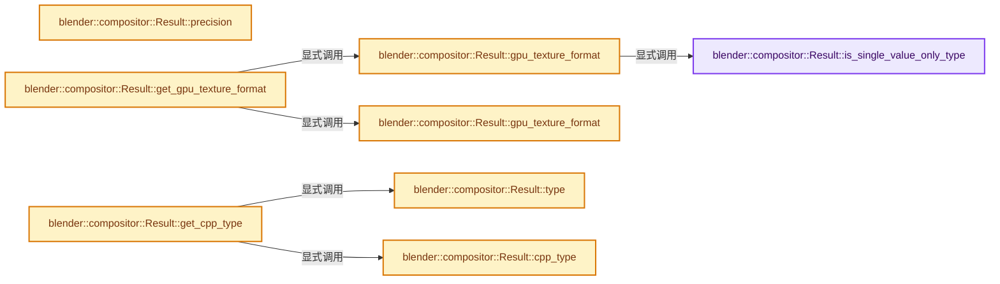
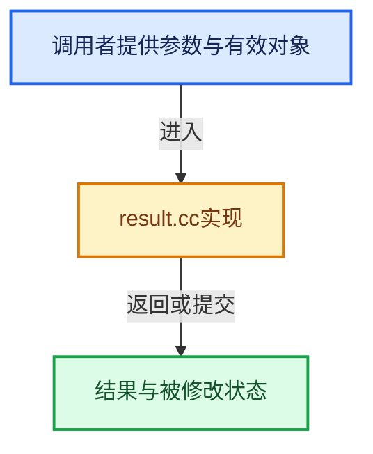

# 实现依赖专题：source/blender/compositor/intern/result.cc

[方向导航](README.md) · [符号索引](../%E7%AC%A6%E5%8F%B7%E4%BE%9D%E8%B5%96%E4%B8%8E%E5%AE%9E%E7%8E%B0%E7%B4%A2%E5%BC%95.md)

本专题从正文实际调用进入，集中保存共享实现。函数有稳定锚点，可从调用处直接跳到对应完整函数；递归与互相调用通过回链组织。

## 本文件的实现关系






## 完整成员与函数实现

<a id="f-e15a58f6d1b11e77"></a>

### `blender::compositor::Result::is_single_value_only_type`

实现位置：[source/blender/compositor/intern/result.cc](../../../../../source/blender/compositor/intern/result.cc) · L51—L82。

接口参数：

- `ResultType type`

**教学注释版**

<!-- annotated:2a5ead8c3d3ab7 -->

```cpp
bool Result::is_single_value_only_type(ResultType type)
{
  switch (type) {
    case ResultType::Float:
    case ResultType::Color:
    case ResultType::Float4:
    case ResultType::Float3:
    case ResultType::Float2:
    case ResultType::Int:
    case ResultType::Int2:
    case ResultType::Int3:
    case ResultType::Int4:
    case ResultType::Bool:
    case ResultType::Float4x4:
    case ResultType::Menu:
    case ResultType::Quaternion:
      return false;
    case ResultType::String:
    case ResultType::Object:
    case ResultType::Image:
    case ResultType::Font:
    case ResultType::Scene:
    case ResultType::Text:
    case ResultType::Mask:
    case ResultType::Bundle:
    case ResultType::Closure:
      return true;
  }

  BLI_assert_unreachable();
  return true;
}
```

<details>
<summary>核对原始源码：source/blender/compositor/intern/result.cc · L51—L82</summary>

<!-- original:2a5ead8c3d3ab7:source/blender/compositor/intern/result.cc:51:82 -->

```cpp
bool Result::is_single_value_only_type(ResultType type)
{
  switch (type) {
    case ResultType::Float:
    case ResultType::Color:
    case ResultType::Float4:
    case ResultType::Float3:
    case ResultType::Float2:
    case ResultType::Int:
    case ResultType::Int2:
    case ResultType::Int3:
    case ResultType::Int4:
    case ResultType::Bool:
    case ResultType::Float4x4:
    case ResultType::Menu:
    case ResultType::Quaternion:
      return false;
    case ResultType::String:
    case ResultType::Object:
    case ResultType::Image:
    case ResultType::Font:
    case ResultType::Scene:
    case ResultType::Text:
    case ResultType::Mask:
    case ResultType::Bundle:
    case ResultType::Closure:
      return true;
  }

  BLI_assert_unreachable();
  return true;
}
```

</details>

**结果出口**

- `return false;`
- `return true;`

**继续追踪实现**

- `BLI_assert_unreachable` → [BLI_assert_unreachable · L77](../01-%E5%9F%BA%E7%A1%80%E5%AE%B9%E5%99%A8%E4%B8%8E%E7%8E%B0%E4%BB%A3CPP/%E4%BE%9D%E8%B5%96-BLI_assert-cc98e8.md#m-7a2d91a67d8e)。宏定义由构建条件选择。

<a id="f-b884a7ac601c806e"></a>

### `blender::compositor::Result::gpu_texture_format`

实现位置：[source/blender/compositor/intern/result.cc](../../../../../source/blender/compositor/intern/result.cc) · L84—L191。

接口参数：

- `ResultType type`
- `ResultPrecision precision`

**教学注释版**

<!-- annotated:f4956e91970ee9 -->

```cpp
gpu::TextureFormat Result::gpu_texture_format(ResultType type, ResultPrecision precision)
{
  switch (precision) {
    case ResultPrecision::Half:
      switch (type) {
        case ResultType::Float:
          return gpu::TextureFormat::SFLOAT_16;
        case ResultType::Color:
        case ResultType::Float4:
          return gpu::TextureFormat::SFLOAT_16_16_16_16;
        case ResultType::Float3:
          /* RGB textures are not fully supported by hardware, so we store Float3 results in RGBA
           * textures. */
          return gpu::TextureFormat::SFLOAT_16_16_16_16;
        case ResultType::Float2:
          return gpu::TextureFormat::SFLOAT_16_16;
        case ResultType::Int:
          return gpu::TextureFormat::SINT_16;
        case ResultType::Int2:
          return gpu::TextureFormat::SINT_16_16;
        case ResultType::Int3:
          /* RGB textures are not fully supported by hardware, so we store Int3 results in RGBA
           * textures. */
          return gpu::TextureFormat::SINT_16_16_16_16;
        case ResultType::Int4:
          return gpu::TextureFormat::SINT_16_16_16_16;
        case ResultType::Bool:
          /* No bool texture formats, so we store in an 8-bit integer. Precision doesn't matter. */
          return gpu::TextureFormat::SINT_8;
        case ResultType::Float4x4:
          /* Stored as an array of 4 RGBA texture. */
          return gpu::TextureFormat::SFLOAT_16_16_16_16;
        case ResultType::Menu:
          /* Menu values are technically stored in 32-bit integers, but 8 is sufficient in
           * practice. */
          return gpu::TextureFormat::SINT_8;
        case ResultType::Quaternion:
          return gpu::TextureFormat::SFLOAT_16_16_16_16;
        case ResultType::String:
        case ResultType::Object:
        case ResultType::Image:
        case ResultType::Font:
        case ResultType::Scene:
        case ResultType::Text:
        case ResultType::Mask:
        case ResultType::Bundle:
        case ResultType::Closure:
          /* Single only types do not support GPU code path. */
          BLI_assert(Result::is_single_value_only_type(type));
          BLI_assert_unreachable();
          break;
      }
      break;
    case ResultPrecision::Full:
      switch (type) {
        case ResultType::Float:
          return gpu::TextureFormat::SFLOAT_32;
        case ResultType::Color:
        case ResultType::Float4:
          return gpu::TextureFormat::SFLOAT_32_32_32_32;
        case ResultType::Float3:
          /* RGB textures are not fully supported by hardware, so we store Float3 results in RGBA
           * textures. */
          return gpu::TextureFormat::SFLOAT_32_32_32_32;
        case ResultType::Float2:
          return gpu::TextureFormat::SFLOAT_32_32;
        case ResultType::Int:
          return gpu::TextureFormat::SINT_32;
        case ResultType::Int2:
          return gpu::TextureFormat::SINT_32_32;
        case ResultType::Int3:
          /* RGB textures are not fully supported by hardware, so we store Int3 results in RGBA
           * textures. */
          return gpu::TextureFormat::SINT_32_32_32_32;
        case ResultType::Int4:
          return gpu::TextureFormat::SINT_32_32_32_32;
        case ResultType::Bool:
          /* No bool texture formats, so we store in an 8-bit integer. Precision doesn't matter. */
          return gpu::TextureFormat::SINT_8;
        case ResultType::Float4x4:
          /* Stored as an array of 4 RGBA texture. */
          return gpu::TextureFormat::SFLOAT_32_32_32_32;
        case ResultType::Menu:
          /* Menu values are technically stored in 32-bit integers, but 8 is sufficient in
           * practice. */
          return gpu::TextureFormat::SINT_8;
        case ResultType::Quaternion:
          return gpu::TextureFormat::SFLOAT_32_32_32_32;
        case ResultType::String:
        case ResultType::Object:
        case ResultType::Image:
        case ResultType::Font:
        case ResultType::Scene:
        case ResultType::Text:
        case ResultType::Mask:
        case ResultType::Bundle:
        case ResultType::Closure:
          /* Single only types do not support GPU storage. */
          BLI_assert(Result::is_single_value_only_type(type));
          BLI_assert_unreachable();
          break;
      }
      break;
  }

  BLI_assert_unreachable();
  return gpu::TextureFormat::SFLOAT_32_32_32_32;
}
```

<details>
<summary>核对原始源码：source/blender/compositor/intern/result.cc · L84—L191</summary>

<!-- original:f4956e91970ee9:source/blender/compositor/intern/result.cc:84:191 -->

```cpp
gpu::TextureFormat Result::gpu_texture_format(ResultType type, ResultPrecision precision)
{
  switch (precision) {
    case ResultPrecision::Half:
      switch (type) {
        case ResultType::Float:
          return gpu::TextureFormat::SFLOAT_16;
        case ResultType::Color:
        case ResultType::Float4:
          return gpu::TextureFormat::SFLOAT_16_16_16_16;
        case ResultType::Float3:
          /* RGB textures are not fully supported by hardware, so we store Float3 results in RGBA
           * textures. */
          return gpu::TextureFormat::SFLOAT_16_16_16_16;
        case ResultType::Float2:
          return gpu::TextureFormat::SFLOAT_16_16;
        case ResultType::Int:
          return gpu::TextureFormat::SINT_16;
        case ResultType::Int2:
          return gpu::TextureFormat::SINT_16_16;
        case ResultType::Int3:
          /* RGB textures are not fully supported by hardware, so we store Int3 results in RGBA
           * textures. */
          return gpu::TextureFormat::SINT_16_16_16_16;
        case ResultType::Int4:
          return gpu::TextureFormat::SINT_16_16_16_16;
        case ResultType::Bool:
          /* No bool texture formats, so we store in an 8-bit integer. Precision doesn't matter. */
          return gpu::TextureFormat::SINT_8;
        case ResultType::Float4x4:
          /* Stored as an array of 4 RGBA texture. */
          return gpu::TextureFormat::SFLOAT_16_16_16_16;
        case ResultType::Menu:
          /* Menu values are technically stored in 32-bit integers, but 8 is sufficient in
           * practice. */
          return gpu::TextureFormat::SINT_8;
        case ResultType::Quaternion:
          return gpu::TextureFormat::SFLOAT_16_16_16_16;
        case ResultType::String:
        case ResultType::Object:
        case ResultType::Image:
        case ResultType::Font:
        case ResultType::Scene:
        case ResultType::Text:
        case ResultType::Mask:
        case ResultType::Bundle:
        case ResultType::Closure:
          /* Single only types do not support GPU code path. */
          BLI_assert(Result::is_single_value_only_type(type));
          BLI_assert_unreachable();
          break;
      }
      break;
    case ResultPrecision::Full:
      switch (type) {
        case ResultType::Float:
          return gpu::TextureFormat::SFLOAT_32;
        case ResultType::Color:
        case ResultType::Float4:
          return gpu::TextureFormat::SFLOAT_32_32_32_32;
        case ResultType::Float3:
          /* RGB textures are not fully supported by hardware, so we store Float3 results in RGBA
           * textures. */
          return gpu::TextureFormat::SFLOAT_32_32_32_32;
        case ResultType::Float2:
          return gpu::TextureFormat::SFLOAT_32_32;
        case ResultType::Int:
          return gpu::TextureFormat::SINT_32;
        case ResultType::Int2:
          return gpu::TextureFormat::SINT_32_32;
        case ResultType::Int3:
          /* RGB textures are not fully supported by hardware, so we store Int3 results in RGBA
           * textures. */
          return gpu::TextureFormat::SINT_32_32_32_32;
        case ResultType::Int4:
          return gpu::TextureFormat::SINT_32_32_32_32;
        case ResultType::Bool:
          /* No bool texture formats, so we store in an 8-bit integer. Precision doesn't matter. */
          return gpu::TextureFormat::SINT_8;
        case ResultType::Float4x4:
          /* Stored as an array of 4 RGBA texture. */
          return gpu::TextureFormat::SFLOAT_32_32_32_32;
        case ResultType::Menu:
          /* Menu values are technically stored in 32-bit integers, but 8 is sufficient in
           * practice. */
          return gpu::TextureFormat::SINT_8;
        case ResultType::Quaternion:
          return gpu::TextureFormat::SFLOAT_32_32_32_32;
        case ResultType::String:
        case ResultType::Object:
        case ResultType::Image:
        case ResultType::Font:
        case ResultType::Scene:
        case ResultType::Text:
        case ResultType::Mask:
        case ResultType::Bundle:
        case ResultType::Closure:
          /* Single only types do not support GPU storage. */
          BLI_assert(Result::is_single_value_only_type(type));
          BLI_assert_unreachable();
          break;
      }
      break;
  }

  BLI_assert_unreachable();
  return gpu::TextureFormat::SFLOAT_32_32_32_32;
}
```

</details>

**结果出口**

- `return gpu::TextureFormat::SFLOAT_16;`
- `return gpu::TextureFormat::SFLOAT_16_16_16_16;`
- `return gpu::TextureFormat::SFLOAT_16_16;`
- `return gpu::TextureFormat::SINT_16;`
- `return gpu::TextureFormat::SINT_16_16;`
- `return gpu::TextureFormat::SINT_16_16_16_16;`
- `return gpu::TextureFormat::SINT_8;`
- `return gpu::TextureFormat::SFLOAT_32;`
- `return gpu::TextureFormat::SFLOAT_32_32_32_32;`
- `return gpu::TextureFormat::SFLOAT_32_32;`
- `return gpu::TextureFormat::SINT_32;`
- `return gpu::TextureFormat::SINT_32_32;`
- `return gpu::TextureFormat::SINT_32_32_32_32;`

**继续追踪实现**

- `BLI_assert` → [BLI_assert · L48](../01-%E5%9F%BA%E7%A1%80%E5%AE%B9%E5%99%A8%E4%B8%8E%E7%8E%B0%E4%BB%A3CPP/%E4%BE%9D%E8%B5%96-BLI_assert-cc98e8.md#m-57a88495704d)；[BLI_assert · L63](../01-%E5%9F%BA%E7%A1%80%E5%AE%B9%E5%99%A8%E4%B8%8E%E7%8E%B0%E4%BB%A3CPP/%E4%BE%9D%E8%B5%96-BLI_assert-cc98e8.md#m-d07050020cb5)。宏定义由构建条件选择。
- `Result::is_single_value_only_type` → [blender::compositor::Result::is_single_value_only_type · L51](%E4%BE%9D%E8%B5%96-result-844e73.md#f-e15a58f6d1b11e77)。
- `BLI_assert_unreachable` → [BLI_assert_unreachable · L77](../01-%E5%9F%BA%E7%A1%80%E5%AE%B9%E5%99%A8%E4%B8%8E%E7%8E%B0%E4%BB%A3CPP/%E4%BE%9D%E8%B5%96-BLI_assert-cc98e8.md#m-7a2d91a67d8e)。宏定义由构建条件选择。

<a id="f-792c4c7da6cbffbe"></a>

### `blender::compositor::Result::gpu_texture_format`

实现位置：[source/blender/compositor/intern/result.cc](../../../../../source/blender/compositor/intern/result.cc) · L230—L305。

接口参数：

- `gpu::TextureFormat format`
- `ResultPrecision precision`

**教学注释版**

<!-- annotated:31c4f766914012 -->

```cpp
gpu::TextureFormat Result::gpu_texture_format(gpu::TextureFormat format, ResultPrecision precision)
{
  switch (precision) {
    case ResultPrecision::Half:
      switch (format) {
        /* Already half precision, return the input format. */
        case gpu::TextureFormat::SFLOAT_16:
        case gpu::TextureFormat::SFLOAT_16_16:
        case gpu::TextureFormat::SFLOAT_16_16_16:
        case gpu::TextureFormat::SFLOAT_16_16_16_16:
        case gpu::TextureFormat::SINT_16:
        case gpu::TextureFormat::SINT_16_16:
        case gpu::TextureFormat::SINT_16_16_16_16:
          return format;

        /* Used to store booleans where precision doesn't matter. */
        case gpu::TextureFormat::SINT_8:
          return format;

        case gpu::TextureFormat::SFLOAT_32:
          return gpu::TextureFormat::SFLOAT_16;
        case gpu::TextureFormat::SFLOAT_32_32:
          return gpu::TextureFormat::SFLOAT_16_16;
        case gpu::TextureFormat::SFLOAT_32_32_32:
          return gpu::TextureFormat::SFLOAT_16_16_16;
        case gpu::TextureFormat::SFLOAT_32_32_32_32:
          return gpu::TextureFormat::SFLOAT_16_16_16_16;
        case gpu::TextureFormat::SINT_32:
          return gpu::TextureFormat::SINT_16;
        case gpu::TextureFormat::SINT_32_32:
          return gpu::TextureFormat::SINT_16_16;
        case gpu::TextureFormat::SINT_32_32_32_32:
          return gpu::TextureFormat::SINT_16_16_16_16;
        default:
          break;
      }
      break;
    case ResultPrecision::Full:
      switch (format) {
        /* Already full precision, return the input format. */
        case gpu::TextureFormat::SFLOAT_32:
        case gpu::TextureFormat::SFLOAT_32_32:
        case gpu::TextureFormat::SFLOAT_32_32_32:
        case gpu::TextureFormat::SFLOAT_32_32_32_32:
        case gpu::TextureFormat::SINT_32:
        case gpu::TextureFormat::SINT_32_32:
        case gpu::TextureFormat::SINT_32_32_32_32:
          return format;

        /* Used to store booleans where precision doesn't matter. */
        case gpu::TextureFormat::SINT_8:
          return format;

        case gpu::TextureFormat::SFLOAT_16:
          return gpu::TextureFormat::SFLOAT_32;
        case gpu::TextureFormat::SFLOAT_16_16:
          return gpu::TextureFormat::SFLOAT_32_32;
        case gpu::TextureFormat::SFLOAT_16_16_16:
          return gpu::TextureFormat::SFLOAT_32_32_32;
        case gpu::TextureFormat::SFLOAT_16_16_16_16:
          return gpu::TextureFormat::SFLOAT_32_32_32_32;
        case gpu::TextureFormat::SINT_16:
          return gpu::TextureFormat::SINT_32;
        case gpu::TextureFormat::SINT_16_16:
          return gpu::TextureFormat::SINT_32_32;
        case gpu::TextureFormat::SINT_16_16_16_16:
          return gpu::TextureFormat::SINT_32_32_32_32;
        default:
          break;
      }
      break;
  }

  BLI_assert_unreachable();
  return format;
}
```

<details>
<summary>核对原始源码：source/blender/compositor/intern/result.cc · L230—L305</summary>

<!-- original:31c4f766914012:source/blender/compositor/intern/result.cc:230:305 -->

```cpp
gpu::TextureFormat Result::gpu_texture_format(gpu::TextureFormat format, ResultPrecision precision)
{
  switch (precision) {
    case ResultPrecision::Half:
      switch (format) {
        /* Already half precision, return the input format. */
        case gpu::TextureFormat::SFLOAT_16:
        case gpu::TextureFormat::SFLOAT_16_16:
        case gpu::TextureFormat::SFLOAT_16_16_16:
        case gpu::TextureFormat::SFLOAT_16_16_16_16:
        case gpu::TextureFormat::SINT_16:
        case gpu::TextureFormat::SINT_16_16:
        case gpu::TextureFormat::SINT_16_16_16_16:
          return format;

        /* Used to store booleans where precision doesn't matter. */
        case gpu::TextureFormat::SINT_8:
          return format;

        case gpu::TextureFormat::SFLOAT_32:
          return gpu::TextureFormat::SFLOAT_16;
        case gpu::TextureFormat::SFLOAT_32_32:
          return gpu::TextureFormat::SFLOAT_16_16;
        case gpu::TextureFormat::SFLOAT_32_32_32:
          return gpu::TextureFormat::SFLOAT_16_16_16;
        case gpu::TextureFormat::SFLOAT_32_32_32_32:
          return gpu::TextureFormat::SFLOAT_16_16_16_16;
        case gpu::TextureFormat::SINT_32:
          return gpu::TextureFormat::SINT_16;
        case gpu::TextureFormat::SINT_32_32:
          return gpu::TextureFormat::SINT_16_16;
        case gpu::TextureFormat::SINT_32_32_32_32:
          return gpu::TextureFormat::SINT_16_16_16_16;
        default:
          break;
      }
      break;
    case ResultPrecision::Full:
      switch (format) {
        /* Already full precision, return the input format. */
        case gpu::TextureFormat::SFLOAT_32:
        case gpu::TextureFormat::SFLOAT_32_32:
        case gpu::TextureFormat::SFLOAT_32_32_32:
        case gpu::TextureFormat::SFLOAT_32_32_32_32:
        case gpu::TextureFormat::SINT_32:
        case gpu::TextureFormat::SINT_32_32:
        case gpu::TextureFormat::SINT_32_32_32_32:
          return format;

        /* Used to store booleans where precision doesn't matter. */
        case gpu::TextureFormat::SINT_8:
          return format;

        case gpu::TextureFormat::SFLOAT_16:
          return gpu::TextureFormat::SFLOAT_32;
        case gpu::TextureFormat::SFLOAT_16_16:
          return gpu::TextureFormat::SFLOAT_32_32;
        case gpu::TextureFormat::SFLOAT_16_16_16:
          return gpu::TextureFormat::SFLOAT_32_32_32;
        case gpu::TextureFormat::SFLOAT_16_16_16_16:
          return gpu::TextureFormat::SFLOAT_32_32_32_32;
        case gpu::TextureFormat::SINT_16:
          return gpu::TextureFormat::SINT_32;
        case gpu::TextureFormat::SINT_16_16:
          return gpu::TextureFormat::SINT_32_32;
        case gpu::TextureFormat::SINT_16_16_16_16:
          return gpu::TextureFormat::SINT_32_32_32_32;
        default:
          break;
      }
      break;
  }

  BLI_assert_unreachable();
  return format;
}
```

</details>

**结果出口**

- `return format;`
- `return gpu::TextureFormat::SFLOAT_16;`
- `return gpu::TextureFormat::SFLOAT_16_16;`
- `return gpu::TextureFormat::SFLOAT_16_16_16;`
- `return gpu::TextureFormat::SFLOAT_16_16_16_16;`
- `return gpu::TextureFormat::SINT_16;`
- `return gpu::TextureFormat::SINT_16_16;`
- `return gpu::TextureFormat::SINT_16_16_16_16;`
- `return gpu::TextureFormat::SFLOAT_32;`
- `return gpu::TextureFormat::SFLOAT_32_32;`
- `return gpu::TextureFormat::SFLOAT_32_32_32;`
- `return gpu::TextureFormat::SFLOAT_32_32_32_32;`
- `return gpu::TextureFormat::SINT_32;`
- `return gpu::TextureFormat::SINT_32_32;`
- `return gpu::TextureFormat::SINT_32_32_32_32;`

**继续追踪实现**

- `BLI_assert_unreachable` → [BLI_assert_unreachable · L77](../01-%E5%9F%BA%E7%A1%80%E5%AE%B9%E5%99%A8%E4%B8%8E%E7%8E%B0%E4%BB%A3CPP/%E4%BE%9D%E8%B5%96-BLI_assert-cc98e8.md#m-7a2d91a67d8e)。宏定义由构建条件选择。

<a id="f-5f948008f15a754f"></a>

### `blender::compositor::Result::precision`

实现位置：[source/blender/compositor/intern/result.cc](../../../../../source/blender/compositor/intern/result.cc) · L307—L335。

接口参数：

- `gpu::TextureFormat format`

**教学注释版**

<!-- annotated:bd2d824eceff33 -->

```cpp
ResultPrecision Result::precision(gpu::TextureFormat format)
{
  switch (format) {
    case gpu::TextureFormat::SFLOAT_16:
    case gpu::TextureFormat::SFLOAT_16_16:
    case gpu::TextureFormat::SFLOAT_16_16_16:
    case gpu::TextureFormat::SFLOAT_16_16_16_16:
    case gpu::TextureFormat::SINT_16:
    case gpu::TextureFormat::SINT_16_16:
    case gpu::TextureFormat::SINT_16_16_16_16:
      return ResultPrecision::Half;
    case gpu::TextureFormat::SFLOAT_32:
    case gpu::TextureFormat::SFLOAT_32_32:
    case gpu::TextureFormat::SFLOAT_32_32_32:
    case gpu::TextureFormat::SFLOAT_32_32_32_32:
    case gpu::TextureFormat::SINT_32:
    case gpu::TextureFormat::SINT_32_32:
    case gpu::TextureFormat::SINT_32_32_32_32:
      return ResultPrecision::Full;
    /* Used to store booleans where precision doesn't matter. */
    case gpu::TextureFormat::SINT_8:
      return ResultPrecision::Full;
    default:
      break;
  }

  BLI_assert_unreachable();
  return ResultPrecision::Full;
}
```

<details>
<summary>核对原始源码：source/blender/compositor/intern/result.cc · L307—L335</summary>

<!-- original:bd2d824eceff33:source/blender/compositor/intern/result.cc:307:335 -->

```cpp
ResultPrecision Result::precision(gpu::TextureFormat format)
{
  switch (format) {
    case gpu::TextureFormat::SFLOAT_16:
    case gpu::TextureFormat::SFLOAT_16_16:
    case gpu::TextureFormat::SFLOAT_16_16_16:
    case gpu::TextureFormat::SFLOAT_16_16_16_16:
    case gpu::TextureFormat::SINT_16:
    case gpu::TextureFormat::SINT_16_16:
    case gpu::TextureFormat::SINT_16_16_16_16:
      return ResultPrecision::Half;
    case gpu::TextureFormat::SFLOAT_32:
    case gpu::TextureFormat::SFLOAT_32_32:
    case gpu::TextureFormat::SFLOAT_32_32_32:
    case gpu::TextureFormat::SFLOAT_32_32_32_32:
    case gpu::TextureFormat::SINT_32:
    case gpu::TextureFormat::SINT_32_32:
    case gpu::TextureFormat::SINT_32_32_32_32:
      return ResultPrecision::Full;
    /* Used to store booleans where precision doesn't matter. */
    case gpu::TextureFormat::SINT_8:
      return ResultPrecision::Full;
    default:
      break;
  }

  BLI_assert_unreachable();
  return ResultPrecision::Full;
}
```

</details>

**结果出口**

- `return ResultPrecision::Half;`
- `return ResultPrecision::Full;`

**继续追踪实现**

- `BLI_assert_unreachable` → [BLI_assert_unreachable · L77](../01-%E5%9F%BA%E7%A1%80%E5%AE%B9%E5%99%A8%E4%B8%8E%E7%8E%B0%E4%BB%A3CPP/%E4%BE%9D%E8%B5%96-BLI_assert-cc98e8.md#m-7a2d91a67d8e)。宏定义由构建条件选择。

<a id="f-90a65cc5c885d0dd"></a>

### `blender::compositor::Result::type`

实现位置：[source/blender/compositor/intern/result.cc](../../../../../source/blender/compositor/intern/result.cc) · L337—L369。

接口参数：

- `gpu::TextureFormat format`

**教学注释版**

<!-- annotated:67ad17b2743b3d -->

```cpp
ResultType Result::type(gpu::TextureFormat format)
{
  switch (format) {
    case gpu::TextureFormat::SFLOAT_16:
    case gpu::TextureFormat::SFLOAT_32:
      return ResultType::Float;
    case gpu::TextureFormat::SFLOAT_16_16:
    case gpu::TextureFormat::SFLOAT_32_32:
      return ResultType::Float2;
    case gpu::TextureFormat::SFLOAT_16_16_16:
    case gpu::TextureFormat::SFLOAT_32_32_32:
      return ResultType::Float3;
    case gpu::TextureFormat::SFLOAT_16_16_16_16:
    case gpu::TextureFormat::SFLOAT_32_32_32_32:
      return ResultType::Color;
    case gpu::TextureFormat::SINT_16:
    case gpu::TextureFormat::SINT_32:
      return ResultType::Int;
    case gpu::TextureFormat::SINT_16_16:
    case gpu::TextureFormat::SINT_32_32:
      return ResultType::Int2;
    case gpu::TextureFormat::SINT_16_16_16_16:
    case gpu::TextureFormat::SINT_32_32_32_32:
      return ResultType::Int4;
    case gpu::TextureFormat::SINT_8:
      return ResultType::Bool;
    default:
      break;
  }

  BLI_assert_unreachable();
  return ResultType::Color;
}
```

<details>
<summary>核对原始源码：source/blender/compositor/intern/result.cc · L337—L369</summary>

<!-- original:67ad17b2743b3d:source/blender/compositor/intern/result.cc:337:369 -->

```cpp
ResultType Result::type(gpu::TextureFormat format)
{
  switch (format) {
    case gpu::TextureFormat::SFLOAT_16:
    case gpu::TextureFormat::SFLOAT_32:
      return ResultType::Float;
    case gpu::TextureFormat::SFLOAT_16_16:
    case gpu::TextureFormat::SFLOAT_32_32:
      return ResultType::Float2;
    case gpu::TextureFormat::SFLOAT_16_16_16:
    case gpu::TextureFormat::SFLOAT_32_32_32:
      return ResultType::Float3;
    case gpu::TextureFormat::SFLOAT_16_16_16_16:
    case gpu::TextureFormat::SFLOAT_32_32_32_32:
      return ResultType::Color;
    case gpu::TextureFormat::SINT_16:
    case gpu::TextureFormat::SINT_32:
      return ResultType::Int;
    case gpu::TextureFormat::SINT_16_16:
    case gpu::TextureFormat::SINT_32_32:
      return ResultType::Int2;
    case gpu::TextureFormat::SINT_16_16_16_16:
    case gpu::TextureFormat::SINT_32_32_32_32:
      return ResultType::Int4;
    case gpu::TextureFormat::SINT_8:
      return ResultType::Bool;
    default:
      break;
  }

  BLI_assert_unreachable();
  return ResultType::Color;
}
```

</details>

**结果出口**

- `return ResultType::Float;`
- `return ResultType::Float2;`
- `return ResultType::Float3;`
- `return ResultType::Color;`
- `return ResultType::Int;`
- `return ResultType::Int2;`
- `return ResultType::Int4;`
- `return ResultType::Bool;`

**继续追踪实现**

- `BLI_assert_unreachable` → [BLI_assert_unreachable · L77](../01-%E5%9F%BA%E7%A1%80%E5%AE%B9%E5%99%A8%E4%B8%8E%E7%8E%B0%E4%BB%A3CPP/%E4%BE%9D%E8%B5%96-BLI_assert-cc98e8.md#m-7a2d91a67d8e)。宏定义由构建条件选择。

<a id="f-2e997cdafec7a599"></a>

### `blender::compositor::Result::cpp_type`

实现位置：[source/blender/compositor/intern/result.cc](../../../../../source/blender/compositor/intern/result.cc) · L371—L422。

接口参数：

- `const ResultType type`

**教学注释版**

<!-- annotated:5710c1cb018b21 -->

```cpp
const CPPType &Result::cpp_type(const ResultType type)
{
  switch (type) {
    case ResultType::Float:
      return CPPType::get<float>();
    case ResultType::Float2:
      return CPPType::get<float2>();
    case ResultType::Float3:
      return CPPType::get<float3>();
    case ResultType::Float4:
      return CPPType::get<float4>();
    case ResultType::Color:
      return CPPType::get<Color>();
    case ResultType::Int:
      return CPPType::get<int32_t>();
    case ResultType::Int2:
      return CPPType::get<int2>();
    case ResultType::Int3:
      return CPPType::get<int3>();
    case ResultType::Int4:
      return CPPType::get<int4>();
    case ResultType::Bool:
      return CPPType::get<bool>();
    case ResultType::Float4x4:
      return CPPType::get<float4x4>();
    case ResultType::Menu:
      return CPPType::get<nodes::MenuValue>();
    case ResultType::Quaternion:
      return CPPType::get<math::Quaternion>();
    case ResultType::String:
      return CPPType::get<std::string>();
    case ResultType::Object:
      return CPPType::get<Object *>();
    case ResultType::Image:
      return CPPType::get<Image *>();
    case ResultType::Font:
      return CPPType::get<VFont *>();
    case ResultType::Scene:
      return CPPType::get<Scene *>();
    case ResultType::Text:
      return CPPType::get<Text *>();
    case ResultType::Mask:
      return CPPType::get<Mask *>();
    case ResultType::Bundle:
      return CPPType::get<nodes::BundlePtr>();
    case ResultType::Closure:
      return CPPType::get<ClosurePtr>();
  }

  BLI_assert_unreachable();
  return CPPType::get<float>();
}
```

<details>
<summary>核对原始源码：source/blender/compositor/intern/result.cc · L371—L422</summary>

<!-- original:5710c1cb018b21:source/blender/compositor/intern/result.cc:371:422 -->

```cpp
const CPPType &Result::cpp_type(const ResultType type)
{
  switch (type) {
    case ResultType::Float:
      return CPPType::get<float>();
    case ResultType::Float2:
      return CPPType::get<float2>();
    case ResultType::Float3:
      return CPPType::get<float3>();
    case ResultType::Float4:
      return CPPType::get<float4>();
    case ResultType::Color:
      return CPPType::get<Color>();
    case ResultType::Int:
      return CPPType::get<int32_t>();
    case ResultType::Int2:
      return CPPType::get<int2>();
    case ResultType::Int3:
      return CPPType::get<int3>();
    case ResultType::Int4:
      return CPPType::get<int4>();
    case ResultType::Bool:
      return CPPType::get<bool>();
    case ResultType::Float4x4:
      return CPPType::get<float4x4>();
    case ResultType::Menu:
      return CPPType::get<nodes::MenuValue>();
    case ResultType::Quaternion:
      return CPPType::get<math::Quaternion>();
    case ResultType::String:
      return CPPType::get<std::string>();
    case ResultType::Object:
      return CPPType::get<Object *>();
    case ResultType::Image:
      return CPPType::get<Image *>();
    case ResultType::Font:
      return CPPType::get<VFont *>();
    case ResultType::Scene:
      return CPPType::get<Scene *>();
    case ResultType::Text:
      return CPPType::get<Text *>();
    case ResultType::Mask:
      return CPPType::get<Mask *>();
    case ResultType::Bundle:
      return CPPType::get<nodes::BundlePtr>();
    case ResultType::Closure:
      return CPPType::get<ClosurePtr>();
  }

  BLI_assert_unreachable();
  return CPPType::get<float>();
}
```

</details>

**结果出口**

- `return CPPType::get<float>();`
- `return CPPType::get<float2>();`
- `return CPPType::get<float3>();`
- `return CPPType::get<float4>();`
- `return CPPType::get<Color>();`
- `return CPPType::get<int32_t>();`
- `return CPPType::get<int2>();`
- `return CPPType::get<int3>();`
- `return CPPType::get<int4>();`
- `return CPPType::get<bool>();`
- `return CPPType::get<float4x4>();`
- `return CPPType::get<nodes::MenuValue>();`
- `return CPPType::get<math::Quaternion>();`
- `return CPPType::get<std::string>();`
- `return CPPType::get<Object *>();`
- `return CPPType::get<Image *>();`
- `return CPPType::get<VFont *>();`
- `return CPPType::get<Scene *>();`
- `return CPPType::get<Text *>();`
- `return CPPType::get<Mask *>();`
- `return CPPType::get<nodes::BundlePtr>();`
- `return CPPType::get<ClosurePtr>();`

**继续追踪实现**

- `CPPType::get<float>` → [blender::CPPType::get · L481](../03-%E5%86%85%E5%AD%98%E5%88%86%E9%85%8D%E4%B8%8E%E8%BF%90%E8%A1%8C%E6%97%B6%E7%B1%BB%E5%9E%8B/08-CPPType%E6%9E%84%E9%80%A0%E4%B8%8E%E6%9E%90%E6%9E%84.md#f-0cc10a3783d6abdb)。
- `CPPType::get<float2>` → [blender::CPPType::get · L481](../03-%E5%86%85%E5%AD%98%E5%88%86%E9%85%8D%E4%B8%8E%E8%BF%90%E8%A1%8C%E6%97%B6%E7%B1%BB%E5%9E%8B/08-CPPType%E6%9E%84%E9%80%A0%E4%B8%8E%E6%9E%90%E6%9E%84.md#f-0cc10a3783d6abdb)。
- `CPPType::get<float3>` → [blender::CPPType::get · L481](../03-%E5%86%85%E5%AD%98%E5%88%86%E9%85%8D%E4%B8%8E%E8%BF%90%E8%A1%8C%E6%97%B6%E7%B1%BB%E5%9E%8B/08-CPPType%E6%9E%84%E9%80%A0%E4%B8%8E%E6%9E%90%E6%9E%84.md#f-0cc10a3783d6abdb)。
- `CPPType::get<float4>` → [blender::CPPType::get · L481](../03-%E5%86%85%E5%AD%98%E5%88%86%E9%85%8D%E4%B8%8E%E8%BF%90%E8%A1%8C%E6%97%B6%E7%B1%BB%E5%9E%8B/08-CPPType%E6%9E%84%E9%80%A0%E4%B8%8E%E6%9E%90%E6%9E%84.md#f-0cc10a3783d6abdb)。
- `CPPType::get<Color>` → [blender::CPPType::get · L481](../03-%E5%86%85%E5%AD%98%E5%88%86%E9%85%8D%E4%B8%8E%E8%BF%90%E8%A1%8C%E6%97%B6%E7%B1%BB%E5%9E%8B/08-CPPType%E6%9E%84%E9%80%A0%E4%B8%8E%E6%9E%90%E6%9E%84.md#f-0cc10a3783d6abdb)。
- `CPPType::get<int32_t>` → [blender::CPPType::get · L481](../03-%E5%86%85%E5%AD%98%E5%88%86%E9%85%8D%E4%B8%8E%E8%BF%90%E8%A1%8C%E6%97%B6%E7%B1%BB%E5%9E%8B/08-CPPType%E6%9E%84%E9%80%A0%E4%B8%8E%E6%9E%90%E6%9E%84.md#f-0cc10a3783d6abdb)。
- `CPPType::get<int2>` → [blender::CPPType::get · L481](../03-%E5%86%85%E5%AD%98%E5%88%86%E9%85%8D%E4%B8%8E%E8%BF%90%E8%A1%8C%E6%97%B6%E7%B1%BB%E5%9E%8B/08-CPPType%E6%9E%84%E9%80%A0%E4%B8%8E%E6%9E%90%E6%9E%84.md#f-0cc10a3783d6abdb)。
- `CPPType::get<int3>` → [blender::CPPType::get · L481](../03-%E5%86%85%E5%AD%98%E5%88%86%E9%85%8D%E4%B8%8E%E8%BF%90%E8%A1%8C%E6%97%B6%E7%B1%BB%E5%9E%8B/08-CPPType%E6%9E%84%E9%80%A0%E4%B8%8E%E6%9E%90%E6%9E%84.md#f-0cc10a3783d6abdb)。
- `CPPType::get<int4>` → [blender::CPPType::get · L481](../03-%E5%86%85%E5%AD%98%E5%88%86%E9%85%8D%E4%B8%8E%E8%BF%90%E8%A1%8C%E6%97%B6%E7%B1%BB%E5%9E%8B/08-CPPType%E6%9E%84%E9%80%A0%E4%B8%8E%E6%9E%90%E6%9E%84.md#f-0cc10a3783d6abdb)。
- `CPPType::get<bool>` → [blender::CPPType::get · L481](../03-%E5%86%85%E5%AD%98%E5%88%86%E9%85%8D%E4%B8%8E%E8%BF%90%E8%A1%8C%E6%97%B6%E7%B1%BB%E5%9E%8B/08-CPPType%E6%9E%84%E9%80%A0%E4%B8%8E%E6%9E%90%E6%9E%84.md#f-0cc10a3783d6abdb)。
- `CPPType::get<float4x4>` → [blender::CPPType::get · L481](../03-%E5%86%85%E5%AD%98%E5%88%86%E9%85%8D%E4%B8%8E%E8%BF%90%E8%A1%8C%E6%97%B6%E7%B1%BB%E5%9E%8B/08-CPPType%E6%9E%84%E9%80%A0%E4%B8%8E%E6%9E%90%E6%9E%84.md#f-0cc10a3783d6abdb)。
- `CPPType::get<nodes::MenuValue>` → [blender::CPPType::get · L481](../03-%E5%86%85%E5%AD%98%E5%88%86%E9%85%8D%E4%B8%8E%E8%BF%90%E8%A1%8C%E6%97%B6%E7%B1%BB%E5%9E%8B/08-CPPType%E6%9E%84%E9%80%A0%E4%B8%8E%E6%9E%90%E6%9E%84.md#f-0cc10a3783d6abdb)。
- `CPPType::get<math::Quaternion>` → [blender::CPPType::get · L481](../03-%E5%86%85%E5%AD%98%E5%88%86%E9%85%8D%E4%B8%8E%E8%BF%90%E8%A1%8C%E6%97%B6%E7%B1%BB%E5%9E%8B/08-CPPType%E6%9E%84%E9%80%A0%E4%B8%8E%E6%9E%90%E6%9E%84.md#f-0cc10a3783d6abdb)。
- `CPPType::get<std::string>` → [blender::CPPType::get · L481](../03-%E5%86%85%E5%AD%98%E5%88%86%E9%85%8D%E4%B8%8E%E8%BF%90%E8%A1%8C%E6%97%B6%E7%B1%BB%E5%9E%8B/08-CPPType%E6%9E%84%E9%80%A0%E4%B8%8E%E6%9E%90%E6%9E%84.md#f-0cc10a3783d6abdb)。
- `CPPType::get<Object *>` → [blender::CPPType::get · L481](../03-%E5%86%85%E5%AD%98%E5%88%86%E9%85%8D%E4%B8%8E%E8%BF%90%E8%A1%8C%E6%97%B6%E7%B1%BB%E5%9E%8B/08-CPPType%E6%9E%84%E9%80%A0%E4%B8%8E%E6%9E%90%E6%9E%84.md#f-0cc10a3783d6abdb)。
- `CPPType::get<Image *>` → [blender::CPPType::get · L481](../03-%E5%86%85%E5%AD%98%E5%88%86%E9%85%8D%E4%B8%8E%E8%BF%90%E8%A1%8C%E6%97%B6%E7%B1%BB%E5%9E%8B/08-CPPType%E6%9E%84%E9%80%A0%E4%B8%8E%E6%9E%90%E6%9E%84.md#f-0cc10a3783d6abdb)。
- `CPPType::get<VFont *>` → [blender::CPPType::get · L481](../03-%E5%86%85%E5%AD%98%E5%88%86%E9%85%8D%E4%B8%8E%E8%BF%90%E8%A1%8C%E6%97%B6%E7%B1%BB%E5%9E%8B/08-CPPType%E6%9E%84%E9%80%A0%E4%B8%8E%E6%9E%90%E6%9E%84.md#f-0cc10a3783d6abdb)。
- `CPPType::get<Scene *>` → [blender::CPPType::get · L481](../03-%E5%86%85%E5%AD%98%E5%88%86%E9%85%8D%E4%B8%8E%E8%BF%90%E8%A1%8C%E6%97%B6%E7%B1%BB%E5%9E%8B/08-CPPType%E6%9E%84%E9%80%A0%E4%B8%8E%E6%9E%90%E6%9E%84.md#f-0cc10a3783d6abdb)。
- `CPPType::get<Text *>` → [blender::CPPType::get · L481](../03-%E5%86%85%E5%AD%98%E5%88%86%E9%85%8D%E4%B8%8E%E8%BF%90%E8%A1%8C%E6%97%B6%E7%B1%BB%E5%9E%8B/08-CPPType%E6%9E%84%E9%80%A0%E4%B8%8E%E6%9E%90%E6%9E%84.md#f-0cc10a3783d6abdb)。
- `CPPType::get<Mask *>` → [blender::CPPType::get · L481](../03-%E5%86%85%E5%AD%98%E5%88%86%E9%85%8D%E4%B8%8E%E8%BF%90%E8%A1%8C%E6%97%B6%E7%B1%BB%E5%9E%8B/08-CPPType%E6%9E%84%E9%80%A0%E4%B8%8E%E6%9E%90%E6%9E%84.md#f-0cc10a3783d6abdb)。
- `CPPType::get<nodes::BundlePtr>` → [blender::CPPType::get · L481](../03-%E5%86%85%E5%AD%98%E5%88%86%E9%85%8D%E4%B8%8E%E8%BF%90%E8%A1%8C%E6%97%B6%E7%B1%BB%E5%9E%8B/08-CPPType%E6%9E%84%E9%80%A0%E4%B8%8E%E6%9E%90%E6%9E%84.md#f-0cc10a3783d6abdb)。
- `CPPType::get<ClosurePtr>` → [blender::CPPType::get · L481](../03-%E5%86%85%E5%AD%98%E5%88%86%E9%85%8D%E4%B8%8E%E8%BF%90%E8%A1%8C%E6%97%B6%E7%B1%BB%E5%9E%8B/08-CPPType%E6%9E%84%E9%80%A0%E4%B8%8E%E6%9E%90%E6%9E%84.md#f-0cc10a3783d6abdb)。
- `BLI_assert_unreachable` → [BLI_assert_unreachable · L77](../01-%E5%9F%BA%E7%A1%80%E5%AE%B9%E5%99%A8%E4%B8%8E%E7%8E%B0%E4%BB%A3CPP/%E4%BE%9D%E8%B5%96-BLI_assert-cc98e8.md#m-7a2d91a67d8e)。宏定义由构建条件选择。

<a id="f-589814c16bf683f4"></a>

### `blender::compositor::Result::get_cpp_type`

实现位置：[source/blender/compositor/intern/result.cc](../../../../../source/blender/compositor/intern/result.cc) · L482—L485。

**教学注释版**

<!-- annotated:1b3aaa6862b216 -->

```cpp
const CPPType &Result::get_cpp_type() const
{
  return Result::cpp_type(this->type());
}
```

<details>
<summary>核对原始源码：source/blender/compositor/intern/result.cc · L482—L485</summary>

<!-- original:1b3aaa6862b216:source/blender/compositor/intern/result.cc:482:485 -->

```cpp
const CPPType &Result::get_cpp_type() const
{
  return Result::cpp_type(this->type());
}
```

</details>

**结果出口**

- `return Result::cpp_type(this->type());`

**继续追踪实现**

- `Result::cpp_type` → [blender::compositor::Result::cpp_type · L371](%E4%BE%9D%E8%B5%96-result-844e73.md#f-2e997cdafec7a599)。
- `this->type` → [blender::compositor::Result::type · L337](%E4%BE%9D%E8%B5%96-result-844e73.md#f-90a65cc5c885d0dd)；[blender::compositor::Result::type · L1137](%E4%BE%9D%E8%B5%96-result-844e73.md#f-341cc4b492bff9ac)。同名重载需按实参类型选择。

<a id="f-20d11044a8fa9917"></a>

### `blender::compositor::Result::get_gpu_texture_format`

实现位置：[source/blender/compositor/intern/result.cc](../../../../../source/blender/compositor/intern/result.cc) · L487—L490。

**教学注释版**

<!-- annotated:121331442846c1 -->

```cpp
gpu::TextureFormat Result::get_gpu_texture_format() const
{
  return Result::gpu_texture_format(type_, precision_);
}
```

<details>
<summary>核对原始源码：source/blender/compositor/intern/result.cc · L487—L490</summary>

<!-- original:121331442846c1:source/blender/compositor/intern/result.cc:487:490 -->

```cpp
gpu::TextureFormat Result::get_gpu_texture_format() const
{
  return Result::gpu_texture_format(type_, precision_);
}
```

</details>

**结果出口**

- `return Result::gpu_texture_format(type_, precision_);`

**继续追踪实现**

- `Result::gpu_texture_format` → [blender::compositor::Result::gpu_texture_format · L84](%E4%BE%9D%E8%B5%96-result-844e73.md#f-b884a7ac601c806e)；[blender::compositor::Result::gpu_texture_format · L230](%E4%BE%9D%E8%B5%96-result-844e73.md#f-792c4c7da6cbffbe)。同名重载需按实参类型选择。

<a id="f-42be79644f54e7fe"></a>

### `blender::compositor::Result::allocate_single_value`

实现位置：[source/blender/compositor/intern/result.cc](../../../../../source/blender/compositor/intern/result.cc) · L583—L664。

**教学注释版**

<!-- annotated:585c69f28a89c6 -->

```cpp
void Result::allocate_single_value()
{
  /* Make sure we are not allocating a result that should not be computed. */
  BLI_assert(this->should_compute());
  BLI_assert(!this->is_allocated());

  storage_type_ = ResultStorageType::SingleValue;

  /* Single values do not have a domain, but we assign them an identity domain by convention. */
  domain_ = Domain::identity();

  /* It is important that we initialize single values because the variant member that stores single
   * values need to have its type initialized. */
  switch (type_) {
    case ResultType::Float:
      single_value_ = 0.0f;
      break;
    case ResultType::Float2:
      single_value_ = float2(0.0f);
      break;
    case ResultType::Float3:
      single_value_ = float3(0.0f);
      break;
    case ResultType::Float4:
      single_value_ = float4(0.0f);
      break;
    case ResultType::Color:
      single_value_ = Color(0.0f);
      break;
    case ResultType::Int:
      single_value_ = 0;
      break;
    case ResultType::Int2:
      single_value_ = int2(0);
      break;
    case ResultType::Int3:
      single_value_ = int3(0);
      break;
    case ResultType::Int4:
      single_value_ = int4(0);
      break;
    case ResultType::Bool:
      single_value_ = false;
      break;
    case ResultType::Float4x4:
      single_value_ = float4x4::zero();
      break;
    case ResultType::Menu:
      single_value_ = nodes::MenuValue(0);
      break;
    case ResultType::Quaternion:
      single_value_ = math::Quaternion(0.0f, 0.0f, 0.0f, 0.0f);
      break;
    case ResultType::String:
      single_value_ = std::string("");
      break;
    case ResultType::Object:
      single_value_ = static_cast<Object *>(nullptr);
      break;
    case ResultType::Image:
      single_value_ = static_cast<Image *>(nullptr);
      break;
    case ResultType::Font:
      single_value_ = static_cast<VFont *>(nullptr);
      break;
    case ResultType::Scene:
      single_value_ = static_cast<Scene *>(nullptr);
      break;
    case ResultType::Text:
      single_value_ = static_cast<Text *>(nullptr);
      break;
    case ResultType::Mask:
      single_value_ = static_cast<Mask *>(nullptr);
      break;
    case ResultType::Bundle:
      single_value_ = nodes::Bundle::create();
      break;
    case ResultType::Closure:
      single_value_ = ClosurePtr();
      break;
  }
}
```

<details>
<summary>核对原始源码：source/blender/compositor/intern/result.cc · L583—L664</summary>

<!-- original:585c69f28a89c6:source/blender/compositor/intern/result.cc:583:664 -->

```cpp
void Result::allocate_single_value()
{
  /* Make sure we are not allocating a result that should not be computed. */
  BLI_assert(this->should_compute());
  BLI_assert(!this->is_allocated());

  storage_type_ = ResultStorageType::SingleValue;

  /* Single values do not have a domain, but we assign them an identity domain by convention. */
  domain_ = Domain::identity();

  /* It is important that we initialize single values because the variant member that stores single
   * values need to have its type initialized. */
  switch (type_) {
    case ResultType::Float:
      single_value_ = 0.0f;
      break;
    case ResultType::Float2:
      single_value_ = float2(0.0f);
      break;
    case ResultType::Float3:
      single_value_ = float3(0.0f);
      break;
    case ResultType::Float4:
      single_value_ = float4(0.0f);
      break;
    case ResultType::Color:
      single_value_ = Color(0.0f);
      break;
    case ResultType::Int:
      single_value_ = 0;
      break;
    case ResultType::Int2:
      single_value_ = int2(0);
      break;
    case ResultType::Int3:
      single_value_ = int3(0);
      break;
    case ResultType::Int4:
      single_value_ = int4(0);
      break;
    case ResultType::Bool:
      single_value_ = false;
      break;
    case ResultType::Float4x4:
      single_value_ = float4x4::zero();
      break;
    case ResultType::Menu:
      single_value_ = nodes::MenuValue(0);
      break;
    case ResultType::Quaternion:
      single_value_ = math::Quaternion(0.0f, 0.0f, 0.0f, 0.0f);
      break;
    case ResultType::String:
      single_value_ = std::string("");
      break;
    case ResultType::Object:
      single_value_ = static_cast<Object *>(nullptr);
      break;
    case ResultType::Image:
      single_value_ = static_cast<Image *>(nullptr);
      break;
    case ResultType::Font:
      single_value_ = static_cast<VFont *>(nullptr);
      break;
    case ResultType::Scene:
      single_value_ = static_cast<Scene *>(nullptr);
      break;
    case ResultType::Text:
      single_value_ = static_cast<Text *>(nullptr);
      break;
    case ResultType::Mask:
      single_value_ = static_cast<Mask *>(nullptr);
      break;
    case ResultType::Bundle:
      single_value_ = nodes::Bundle::create();
      break;
    case ResultType::Closure:
      single_value_ = ClosurePtr();
      break;
  }
}
```

</details>

**沿实际写入检查状态**

- `storage_type_ = ResultStorageType::SingleValue;`
- `domain_ = Domain::identity();`
- `single_value_ = 0.0f;`
- `single_value_ = float2(0.0f);`
- `single_value_ = float3(0.0f);`
- `single_value_ = float4(0.0f);`
- `single_value_ = Color(0.0f);`
- `single_value_ = 0;`
- `single_value_ = int2(0);`
- `single_value_ = int3(0);`
- `single_value_ = int4(0);`
- `single_value_ = false;`
- `single_value_ = float4x4::zero();`
- `single_value_ = nodes::MenuValue(0);`
- `single_value_ = math::Quaternion(0.0f, 0.0f, 0.0f, 0.0f);`
- `single_value_ = std::string("");`
- `single_value_ = static_cast<Object *>(nullptr);`
- `single_value_ = static_cast<Image *>(nullptr);`
- `single_value_ = static_cast<VFont *>(nullptr);`
- `single_value_ = static_cast<Scene *>(nullptr);`
- `single_value_ = static_cast<Text *>(nullptr);`
- `single_value_ = static_cast<Mask *>(nullptr);`
- `single_value_ = nodes::Bundle::create();`
- `single_value_ = ClosurePtr();`

**继续追踪实现**

- `BLI_assert` → [BLI_assert · L48](../01-%E5%9F%BA%E7%A1%80%E5%AE%B9%E5%99%A8%E4%B8%8E%E7%8E%B0%E4%BB%A3CPP/%E4%BE%9D%E8%B5%96-BLI_assert-cc98e8.md#m-57a88495704d)；[BLI_assert · L63](../01-%E5%9F%BA%E7%A1%80%E5%AE%B9%E5%99%A8%E4%B8%8E%E7%8E%B0%E4%BB%A3CPP/%E4%BE%9D%E8%B5%96-BLI_assert-cc98e8.md#m-d07050020cb5)。宏定义由构建条件选择。
- `this->should_compute` → [blender::compositor::Result::should_compute · L1124](%E4%BE%9D%E8%B5%96-result-844e73.md#f-1690003fef53b2cd)。
- `this->is_allocated` → [blender::compositor::Result::is_allocated · L1161](%E4%BE%9D%E8%B5%96-result-844e73.md#f-5463461816c77611)。
- `Domain::identity` → [blender::compositor::Domain::identity · L47](%E4%BE%9D%E8%B5%96-domain-042fe4.md#f-87d78f3252c93fc0)。
- `float2` → [float2::float2 · L45](%E4%BE%9D%E8%B5%96-sky_math-8091a6.md#f-04c2783f21f996aa)；[float2::float2 · L47](%E4%BE%9D%E8%B5%96-sky_math-8091a6.md#f-dba79c4c10e5ea46)；[float2::float2 · L49](%E4%BE%9D%E8%B5%96-sky_math-8091a6.md#f-920ca90efa37bf0b)；[float2::float2 · L51](%E4%BE%9D%E8%B5%96-sky_math-8091a6.md#f-4b3fbf848d719a63)；[float2::float2 · L53](%E4%BE%9D%E8%B5%96-sky_math-8091a6.md#f-9b2acd8475cc2843)；[float2::float2 · L55](%E4%BE%9D%E8%B5%96-sky_math-8091a6.md#f-1e9233a9a231be51)。同名重载需按实参类型选择。
- `float3` → [float3 · L641](%E4%BE%9D%E8%B5%96-smaa-b67bc2.md#m-0ea8254cfdb4)。宏定义由构建条件选择。
- `float4` → [float4 · L56](%E4%BE%9D%E8%B5%96-radial_tiling_shared-98abf9.md#m-f0908e385c5b)；[float4 · L60](../01-%E5%9F%BA%E7%A1%80%E5%AE%B9%E5%99%A8%E4%B8%8E%E7%8E%B0%E4%BB%A3CPP/%E4%BE%9D%E8%B5%96-radial_tiling_shared-7989a4.md#m-7962dcdc288b)；[float4 · L56](%E4%BE%9D%E8%B5%96-node_radial_tiling_shared-b14bc2.md#m-adb8e9e87775)；[float4 · L642](%E4%BE%9D%E8%B5%96-smaa-b67bc2.md#m-9362daaa821c)。宏定义由构建条件选择。
- `Color` → [blender::nodes::decl::Color](../09-LazyFunction%E4%B8%8E%E8%8A%82%E7%82%B9%E6%89%A7%E8%A1%8C%E6%9E%B6%E6%9E%84/%E4%BE%9D%E8%B5%96-NOD_socket_declarations-8d29c1.md#t-44e5dc0a269f)。
- `int2` → [int2 · L643](%E4%BE%9D%E8%B5%96-smaa-b67bc2.md#m-8960c8e6139d)。宏定义由构建条件选择。
- `int3` → [int3 · L644](%E4%BE%9D%E8%B5%96-smaa-b67bc2.md#m-1865e8d83631)。宏定义由构建条件选择。
- `int4` → [int4 · L645](%E4%BE%9D%E8%B5%96-smaa-b67bc2.md#m-98b3207edab6)。宏定义由构建条件选择。
- `float4x4::zero` → [调用协议](../%E6%A8%A1%E6%9D%BF%E5%AE%8F%E4%B8%8E%E5%8A%A8%E6%80%81%E5%88%86%E6%B4%BE%E5%8D%8F%E8%AE%AE.md)：函数指针、局部可调用对象或未展开的宏；必须结合调用者环境。调用位置L628。
- `nodes::MenuValue` → [blender::nodes::MenuValue::MenuValue · L23](../09-LazyFunction%E4%B8%8E%E8%8A%82%E7%82%B9%E6%89%A7%E8%A1%8C%E6%9E%B6%E6%9E%84/%E4%BE%9D%E8%B5%96-NOD_menu_value-6ddf35.md#f-5b614ab1fafc8ef9)；[blender::nodes::MenuValue::MenuValue · L24](../09-LazyFunction%E4%B8%8E%E8%8A%82%E7%82%B9%E6%89%A7%E8%A1%8C%E6%9E%B6%E6%9E%84/%E4%BE%9D%E8%B5%96-NOD_menu_value-6ddf35.md#f-20fc7efc74f2e570)；[blender::nodes::MenuValue::MenuValue · L26](../09-LazyFunction%E4%B8%8E%E8%8A%82%E7%82%B9%E6%89%A7%E8%A1%8C%E6%9E%B6%E6%9E%84/%E4%BE%9D%E8%B5%96-NOD_menu_value-6ddf35.md#f-5a26f9bc3af837d0)。同名重载需按实参类型选择。
- `math::Quaternion` → [Quaternion · L9](%E4%BE%9D%E8%B5%96-types_quaternion-4c3c66.md#f-ce6dc5cf05b52aa4)。
- `std::string` → [外部契约](https://eel.is/c++draft/)：这个边界按实际表达式及所属类型核对参数、返回值、寿命与失败行为。这里提供接口入口，不声称已解释该第三方版本的内部实现。
- `nodes::Bundle::create` → [blender::nodes::Bundle::create · L88](../10-%E5%BC%95%E7%94%A8%E7%94%9F%E5%91%BD%E5%91%A8%E6%9C%9F%E4%B8%8EClosure/05-Bundle%E5%80%BC%E7%BB%84%E5%90%88.md#f-e048ba1da7751af9)。
- `ClosurePtr` → [调用协议](../%E6%A8%A1%E6%9D%BF%E5%AE%8F%E4%B8%8E%E5%8A%A8%E6%80%81%E5%88%86%E6%B4%BE%E5%8D%8F%E8%AE%AE.md)：函数指针、局部可调用对象或未展开的宏；必须结合调用者环境。调用位置L661。

<a id="f-94ade3b88f036b92"></a>

### `blender::compositor::Result::allocate_invalid`

实现位置：[source/blender/compositor/intern/result.cc](../../../../../source/blender/compositor/intern/result.cc) · L666—L669。

**教学注释版**

<!-- annotated:dd3b83cb1e6190 -->

```cpp
void Result::allocate_invalid()
{
  this->allocate_single_value();
}
```

<details>
<summary>核对原始源码：source/blender/compositor/intern/result.cc · L666—L669</summary>

<!-- original:dd3b83cb1e6190:source/blender/compositor/intern/result.cc:666:669 -->

```cpp
void Result::allocate_invalid()
{
  this->allocate_single_value();
}
```

</details>

**继续追踪实现**

- `this->allocate_single_value` → [blender::compositor::Result::allocate_single_value · L583](%E4%BE%9D%E8%B5%96-result-844e73.md#f-42be79644f54e7fe)。

<a id="f-1c63e714b21bfd6a"></a>

### `blender::compositor::Result::share_data`

实现位置：[source/blender/compositor/intern/result.cc](../../../../../source/blender/compositor/intern/result.cc) · L996—L1008。

接口参数：

- `const Result &source`

**教学注释版**

<!-- annotated:0d4626450b8c3d -->

```cpp
void Result::share_data(const Result &source)
{
  BLI_assert(type_ == source.type_);
  BLI_assert(!this->is_allocated() && source.is_allocated());

  /* Overwrite everything except reference count. */
  const int reference_count = reference_count_;
  *this = source;
  reference_count_ = reference_count;

  /* Derived resources can't be shared, so reset them. */
  derived_resources_ = nullptr;
}
```

<details>
<summary>核对原始源码：source/blender/compositor/intern/result.cc · L996—L1008</summary>

<!-- original:0d4626450b8c3d:source/blender/compositor/intern/result.cc:996:1008 -->

```cpp
void Result::share_data(const Result &source)
{
  BLI_assert(type_ == source.type_);
  BLI_assert(!this->is_allocated() && source.is_allocated());

  /* Overwrite everything except reference count. */
  const int reference_count = reference_count_;
  *this = source;
  reference_count_ = reference_count;

  /* Derived resources can't be shared, so reset them. */
  derived_resources_ = nullptr;
}
```

</details>

**沿实际写入检查状态**

- `reference_count_ = reference_count;`
- `derived_resources_ = nullptr;`

**继续追踪实现**

- `BLI_assert` → [BLI_assert · L48](../01-%E5%9F%BA%E7%A1%80%E5%AE%B9%E5%99%A8%E4%B8%8E%E7%8E%B0%E4%BB%A3CPP/%E4%BE%9D%E8%B5%96-BLI_assert-cc98e8.md#m-57a88495704d)；[BLI_assert · L63](../01-%E5%9F%BA%E7%A1%80%E5%AE%B9%E5%99%A8%E4%B8%8E%E7%8E%B0%E4%BB%A3CPP/%E4%BE%9D%E8%B5%96-BLI_assert-cc98e8.md#m-d07050020cb5)。宏定义由构建条件选择。
- `this->is_allocated` → [blender::compositor::Result::is_allocated · L1161](%E4%BE%9D%E8%B5%96-result-844e73.md#f-5463461816c77611)。
- `source.is_allocated` → [blender::compositor::Result::is_allocated · L1161](%E4%BE%9D%E8%B5%96-result-844e73.md#f-5463461816c77611)。

<a id="f-ed68501cd9656804"></a>

### `blender::compositor::is_compatible_texture`

实现位置：[source/blender/compositor/intern/result.cc](../../../../../source/blender/compositor/intern/result.cc) · L1011—L1035。

接口参数：

- `const gpu::Texture *texture`
- `const Result &result`

**教学注释版**

<!-- annotated:2df614579373c2 -->

```cpp
[[maybe_unused]] static bool is_compatible_texture(const gpu::Texture *texture,
                                                   const Result &result)
{
  /* Float3 and Int3 types are an exception, see the documentation on the get_gpu_texture_format
   * method for more information. */
  if (result.type() == ResultType::Float3) {
    if (ELEM(GPU_texture_format(texture),
             gpu::TextureFormat::SFLOAT_32_32_32,
             gpu::TextureFormat::SFLOAT_16_16_16))
    {
      return true;
    }
  }
  else if (result.type() == ResultType::Int3) {
    if (ELEM(GPU_texture_format(texture),
             gpu::TextureFormat::SINT_32_32_32,
             gpu::TextureFormat::SINT_16_16_16))
    {
      return true;
    }
  }

  return Result::gpu_texture_format(GPU_texture_format(texture), result.precision()) ==
         result.get_gpu_texture_format();
}
```

<details>
<summary>核对原始源码：source/blender/compositor/intern/result.cc · L1011—L1035</summary>

<!-- original:2df614579373c2:source/blender/compositor/intern/result.cc:1011:1035 -->

```cpp
[[maybe_unused]] static bool is_compatible_texture(const gpu::Texture *texture,
                                                   const Result &result)
{
  /* Float3 and Int3 types are an exception, see the documentation on the get_gpu_texture_format
   * method for more information. */
  if (result.type() == ResultType::Float3) {
    if (ELEM(GPU_texture_format(texture),
             gpu::TextureFormat::SFLOAT_32_32_32,
             gpu::TextureFormat::SFLOAT_16_16_16))
    {
      return true;
    }
  }
  else if (result.type() == ResultType::Int3) {
    if (ELEM(GPU_texture_format(texture),
             gpu::TextureFormat::SINT_32_32_32,
             gpu::TextureFormat::SINT_16_16_16))
    {
      return true;
    }
  }

  return Result::gpu_texture_format(GPU_texture_format(texture), result.precision()) ==
         result.get_gpu_texture_format();
}
```

</details>

**结果出口**

- `return true;`
- `return Result::gpu_texture_format(GPU_texture_format(texture), result.precision()) ==`

**继续追踪实现**

- `result.type` → [blender::compositor::Result::type · L337](%E4%BE%9D%E8%B5%96-result-844e73.md#f-90a65cc5c885d0dd)；[blender::compositor::Result::type · L1137](%E4%BE%9D%E8%B5%96-result-844e73.md#f-341cc4b492bff9ac)。同名重载需按实参类型选择。
- `ELEM` → [ELEM · L88](%E4%BE%9D%E8%B5%96-GHOST_utildefines-34b996.md#m-d28724a15928)；[ELEM · L135](../01-%E5%9F%BA%E7%A1%80%E5%AE%B9%E5%99%A8%E4%B8%8E%E7%8E%B0%E4%BB%A3CPP/%E4%BE%9D%E8%B5%96-BLI_utildefines-293a0a.md#m-d6572de7cae0)。宏定义由构建条件选择。
- `GPU_texture_format` → [blender::GPU_texture_format · L814](%E4%BE%9D%E8%B5%96-gpu_texture-234bda.md#f-842c3f6555a1c248)。
- `Result::gpu_texture_format` → [blender::compositor::Result::gpu_texture_format · L84](%E4%BE%9D%E8%B5%96-result-844e73.md#f-b884a7ac601c806e)；[blender::compositor::Result::gpu_texture_format · L230](%E4%BE%9D%E8%B5%96-result-844e73.md#f-792c4c7da6cbffbe)。同名重载需按实参类型选择。
- `result.precision` → [blender::compositor::Result::precision · L307](%E4%BE%9D%E8%B5%96-result-844e73.md#f-5f948008f15a754f)；[blender::compositor::Result::precision · L1142](%E4%BE%9D%E8%B5%96-result-844e73.md#f-07a82a141ecb4c51)。同名重载需按实参类型选择。
- `result.get_gpu_texture_format` → [blender::compositor::Result::get_gpu_texture_format · L487](%E4%BE%9D%E8%B5%96-result-844e73.md#f-20d11044a8fa9917)。

<a id="f-fcd42dcd0168de75"></a>

### `blender::compositor::Result::share_data`

实现位置：[source/blender/compositor/intern/result.cc](../../../../../source/blender/compositor/intern/result.cc) · L1037—L1046。

接口参数：

- `gpu::Texture *texture`
- `ImplicitSharingPtr<> sharing_info`

**教学注释版**

<!-- annotated:5b51e8201b4f33 -->

```cpp
void Result::share_data(gpu::Texture *texture, ImplicitSharingPtr<> sharing_info)
{
  BLI_assert(is_compatible_texture(texture, *this));
  BLI_assert(!this->is_allocated());

  gpu_texture_ = texture;
  storage_type_ = ResultStorageType::GPUImage;
  domain_ = Domain(int2(GPU_texture_width(texture), GPU_texture_height(texture)));
  // [讲解] std::move：把表达式转换成可供移动重载选择的值类别；不保证真的移动，不结束源对象寿命，对const值可能选择复制。
  sharing_info_ = std::move(sharing_info);
}
```

<details>
<summary>核对原始源码：source/blender/compositor/intern/result.cc · L1037—L1046</summary>

<!-- original:5b51e8201b4f33:source/blender/compositor/intern/result.cc:1037:1046 -->

```cpp
void Result::share_data(gpu::Texture *texture, ImplicitSharingPtr<> sharing_info)
{
  BLI_assert(is_compatible_texture(texture, *this));
  BLI_assert(!this->is_allocated());

  gpu_texture_ = texture;
  storage_type_ = ResultStorageType::GPUImage;
  domain_ = Domain(int2(GPU_texture_width(texture), GPU_texture_height(texture)));
  sharing_info_ = std::move(sharing_info);
}
```

</details>

**沿实际写入检查状态**

- `gpu_texture_ = texture;`
- `storage_type_ = ResultStorageType::GPUImage;`
- `domain_ = Domain(int2(GPU_texture_width(texture), GPU_texture_height(texture)));`
- `sharing_info_ = std::move(sharing_info);`

**继续追踪实现**

- `BLI_assert` → [BLI_assert · L48](../01-%E5%9F%BA%E7%A1%80%E5%AE%B9%E5%99%A8%E4%B8%8E%E7%8E%B0%E4%BB%A3CPP/%E4%BE%9D%E8%B5%96-BLI_assert-cc98e8.md#m-57a88495704d)；[BLI_assert · L63](../01-%E5%9F%BA%E7%A1%80%E5%AE%B9%E5%99%A8%E4%B8%8E%E7%8E%B0%E4%BB%A3CPP/%E4%BE%9D%E8%B5%96-BLI_assert-cc98e8.md#m-d07050020cb5)。宏定义由构建条件选择。
- `is_compatible_texture` → [blender::compositor::is_compatible_texture · L1011](%E4%BE%9D%E8%B5%96-result-844e73.md#f-ed68501cd9656804)。
- `this->is_allocated` → [blender::compositor::Result::is_allocated · L1161](%E4%BE%9D%E8%B5%96-result-844e73.md#f-5463461816c77611)。
- `Domain` → [blender::compositor::Domain::Domain · L20](%E4%BE%9D%E8%B5%96-domain-042fe4.md#f-4b2b6f4f7ddd48c9)；[blender::compositor::Domain::Domain · L28](%E4%BE%9D%E8%B5%96-domain-042fe4.md#f-feb1bb0e44265550)。同名重载需按实参类型选择。
- `int2` → [int2 · L643](%E4%BE%9D%E8%B5%96-smaa-b67bc2.md#m-8960c8e6139d)。宏定义由构建条件选择。
- `GPU_texture_width` → [blender::GPU_texture_width · L773](%E4%BE%9D%E8%B5%96-gpu_texture-234bda.md#f-0f5cbfbefa217516)。
- `GPU_texture_height` → [blender::GPU_texture_height · L778](%E4%BE%9D%E8%B5%96-gpu_texture-234bda.md#f-aabd7afc7f83d281)。
- `std::move` → [外部契约](https://eel.is/c++draft/utility.forward)：把表达式转换成可供移动重载选择的值类别；不保证真的移动，不结束源对象寿命，对const值可能选择复制。

<a id="f-a82a883f8ad364a7"></a>

### `blender::compositor::Result::share_data`

实现位置：[source/blender/compositor/intern/result.cc](../../../../../source/blender/compositor/intern/result.cc) · L1048—L1057。

接口参数：

- `const void *data`
- `const int2 size`
- `ImplicitSharingPtr<> sharing_info`

**教学注释版**

<!-- annotated:ffaf0fa34d4cd2 -->

```cpp
void Result::share_data(const void *data, const int2 size, ImplicitSharingPtr<> sharing_info)
{
  BLI_assert(!this->is_allocated());

  const int64_t array_size = int64_t(size.x) * int64_t(size.y);
  cpu_data_ = GSpan(this->get_cpp_type(), data, array_size);
  storage_type_ = ResultStorageType::CPUImage;
  domain_ = Domain(size);
  // [讲解] std::move：把表达式转换成可供移动重载选择的值类别；不保证真的移动，不结束源对象寿命，对const值可能选择复制。
  sharing_info_ = std::move(sharing_info);
}
```

<details>
<summary>核对原始源码：source/blender/compositor/intern/result.cc · L1048—L1057</summary>

<!-- original:ffaf0fa34d4cd2:source/blender/compositor/intern/result.cc:1048:1057 -->

```cpp
void Result::share_data(const void *data, const int2 size, ImplicitSharingPtr<> sharing_info)
{
  BLI_assert(!this->is_allocated());

  const int64_t array_size = int64_t(size.x) * int64_t(size.y);
  cpu_data_ = GSpan(this->get_cpp_type(), data, array_size);
  storage_type_ = ResultStorageType::CPUImage;
  domain_ = Domain(size);
  sharing_info_ = std::move(sharing_info);
}
```

</details>

**沿实际写入检查状态**

- `cpu_data_ = GSpan(this->get_cpp_type(), data, array_size);`
- `storage_type_ = ResultStorageType::CPUImage;`
- `domain_ = Domain(size);`
- `sharing_info_ = std::move(sharing_info);`

**继续追踪实现**

- `BLI_assert` → [BLI_assert · L48](../01-%E5%9F%BA%E7%A1%80%E5%AE%B9%E5%99%A8%E4%B8%8E%E7%8E%B0%E4%BB%A3CPP/%E4%BE%9D%E8%B5%96-BLI_assert-cc98e8.md#m-57a88495704d)；[BLI_assert · L63](../01-%E5%9F%BA%E7%A1%80%E5%AE%B9%E5%99%A8%E4%B8%8E%E7%8E%B0%E4%BB%A3CPP/%E4%BE%9D%E8%B5%96-BLI_assert-cc98e8.md#m-d07050020cb5)。宏定义由构建条件选择。
- `this->is_allocated` → [blender::compositor::Result::is_allocated · L1161](%E4%BE%9D%E8%B5%96-result-844e73.md#f-5463461816c77611)。
- `GSpan` → [blender::GSpan::GSpan · L26](../03-%E5%86%85%E5%AD%98%E5%88%86%E9%85%8D%E4%B8%8E%E8%BF%90%E8%A1%8C%E6%97%B6%E7%B1%BB%E5%9E%8B/11-GSpan%E4%B8%8EGArray.md#f-9d0c95702007eea6)；[blender::GSpan::GSpan · L28](../03-%E5%86%85%E5%AD%98%E5%88%86%E9%85%8D%E4%B8%8E%E8%BF%90%E8%A1%8C%E6%97%B6%E7%B1%BB%E5%9E%8B/11-GSpan%E4%B8%8EGArray.md#f-6650bd08c7eecc66)；[blender::GSpan::GSpan · L37](../03-%E5%86%85%E5%AD%98%E5%88%86%E9%85%8D%E4%B8%8E%E8%BF%90%E8%A1%8C%E6%97%B6%E7%B1%BB%E5%9E%8B/11-GSpan%E4%B8%8EGArray.md#f-bf180950832673fb)；[blender::GSpan::GSpan · L39](../03-%E5%86%85%E5%AD%98%E5%88%86%E9%85%8D%E4%B8%8E%E8%BF%90%E8%A1%8C%E6%97%B6%E7%B1%BB%E5%9E%8B/11-GSpan%E4%B8%8EGArray.md#f-cf949d5590ea9ab6)；[blender::GSpan::GSpan · L41](../03-%E5%86%85%E5%AD%98%E5%88%86%E9%85%8D%E4%B8%8E%E8%BF%90%E8%A1%8C%E6%97%B6%E7%B1%BB%E5%9E%8B/11-GSpan%E4%B8%8EGArray.md#f-a66ab52ee0842aee)；[blender::GSpan::GSpan · L43](../03-%E5%86%85%E5%AD%98%E5%88%86%E9%85%8D%E4%B8%8E%E8%BF%90%E8%A1%8C%E6%97%B6%E7%B1%BB%E5%9E%8B/11-GSpan%E4%B8%8EGArray.md#f-d9084fa10964390f)；[blender::GSpan::GSpan · L49](../03-%E5%86%85%E5%AD%98%E5%88%86%E9%85%8D%E4%B8%8E%E8%BF%90%E8%A1%8C%E6%97%B6%E7%B1%BB%E5%9E%8B/11-GSpan%E4%B8%8EGArray.md#f-76e3de3cc3d65761)。同名重载需按实参类型选择。
- `this->get_cpp_type` → [blender::compositor::Result::get_cpp_type · L482](%E4%BE%9D%E8%B5%96-result-844e73.md#f-589814c16bf683f4)。
- `Domain` → [blender::compositor::Domain::Domain · L20](%E4%BE%9D%E8%B5%96-domain-042fe4.md#f-4b2b6f4f7ddd48c9)；[blender::compositor::Domain::Domain · L28](%E4%BE%9D%E8%B5%96-domain-042fe4.md#f-feb1bb0e44265550)。同名重载需按实参类型选择。
- `std::move` → [外部契约](https://eel.is/c++draft/utility.forward)：把表达式转换成可供移动重载选择的值类别；不保证真的移动，不结束源对象寿命，对const值可能选择复制。

<a id="f-1690003fef53b2cd"></a>

### `blender::compositor::Result::should_compute`

实现位置：[source/blender/compositor/intern/result.cc](../../../../../source/blender/compositor/intern/result.cc) · L1124—L1127。

**教学注释版**

<!-- annotated:daa81ab1488569 -->

```cpp
bool Result::should_compute() const
{
  return reference_count_ != 0;
}
```

<details>
<summary>核对原始源码：source/blender/compositor/intern/result.cc · L1124—L1127</summary>

<!-- original:daa81ab1488569:source/blender/compositor/intern/result.cc:1124:1127 -->

```cpp
bool Result::should_compute() const
{
  return reference_count_ != 0;
}
```

</details>

**结果出口**

- `return reference_count_ != 0;`

**继续追踪实现**

本实现没有需要继续展开的显式调用；检查返回表达式、对象转换和调用者前置条件。

<a id="f-341cc4b492bff9ac"></a>

### `blender::compositor::Result::type`

实现位置：[source/blender/compositor/intern/result.cc](../../../../../source/blender/compositor/intern/result.cc) · L1137—L1140。

**教学注释版**

<!-- annotated:d1adc62836ee96 -->

```cpp
ResultType Result::type() const
{
  return type_;
}
```

<details>
<summary>核对原始源码：source/blender/compositor/intern/result.cc · L1137—L1140</summary>

<!-- original:d1adc62836ee96:source/blender/compositor/intern/result.cc:1137:1140 -->

```cpp
ResultType Result::type() const
{
  return type_;
}
```

</details>

**结果出口**

- `return type_;`

**继续追踪实现**

本实现没有需要继续展开的显式调用；检查返回表达式、对象转换和调用者前置条件。

<a id="f-07a82a141ecb4c51"></a>

### `blender::compositor::Result::precision`

实现位置：[source/blender/compositor/intern/result.cc](../../../../../source/blender/compositor/intern/result.cc) · L1142—L1145。

**教学注释版**

<!-- annotated:3cc8d35e92369f -->

```cpp
ResultPrecision Result::precision() const
{
  return precision_;
}
```

<details>
<summary>核对原始源码：source/blender/compositor/intern/result.cc · L1142—L1145</summary>

<!-- original:3cc8d35e92369f:source/blender/compositor/intern/result.cc:1142:1145 -->

```cpp
ResultPrecision Result::precision() const
{
  return precision_;
}
```

</details>

**结果出口**

- `return precision_;`

**继续追踪实现**

本实现没有需要继续展开的显式调用；检查返回表达式、对象转换和调用者前置条件。

<a id="f-5463461816c77611"></a>

### `blender::compositor::Result::is_allocated`

实现位置：[source/blender/compositor/intern/result.cc](../../../../../source/blender/compositor/intern/result.cc) · L1161—L1173。

**教学注释版**

<!-- annotated:030eaacfca1788 -->

```cpp
bool Result::is_allocated() const
{
  switch (storage_type_) {
    case ResultStorageType::SingleValue:
      return !std::holds_alternative<std::monostate>(single_value_);
    case ResultStorageType::GPUImage:
      return this->gpu_texture();
    case ResultStorageType::CPUImage:
      return this->cpu_data().data();
  }

  return false;
}
```

<details>
<summary>核对原始源码：source/blender/compositor/intern/result.cc · L1161—L1173</summary>

<!-- original:030eaacfca1788:source/blender/compositor/intern/result.cc:1161:1173 -->

```cpp
bool Result::is_allocated() const
{
  switch (storage_type_) {
    case ResultStorageType::SingleValue:
      return !std::holds_alternative<std::monostate>(single_value_);
    case ResultStorageType::GPUImage:
      return this->gpu_texture();
    case ResultStorageType::CPUImage:
      return this->cpu_data().data();
  }

  return false;
}
```

</details>

**结果出口**

- `return !std::holds_alternative<std::monostate>(single_value_);`
- `return this->gpu_texture();`
- `return this->cpu_data().data();`
- `return false;`

**继续追踪实现**

- `std::holds_alternative<std::monostate>` → [外部契约](https://eel.is/c++draft/)：这个边界按实际表达式及所属类型核对参数、返回值、寿命与失败行为。这里提供接口入口，不声称已解释该第三方版本的内部实现。
- `this->gpu_texture` → [blender::compositor::Result::gpu_texture · L501](%E4%BE%9D%E8%B5%96-COM_result-462d01.md#f-074a867c6799cb62)。
- `this->cpu_data().data` → [调用协议](../%E6%A8%A1%E6%9D%BF%E5%AE%8F%E4%B8%8E%E5%8A%A8%E6%80%81%E5%88%86%E6%B4%BE%E5%8D%8F%E8%AE%AE.md)：接收对象类型依赖auto、返回值或模板实例；不按同名猜测目标。调用位置L1169。
- `this->cpu_data` → [blender::compositor::Result::cpu_data · L507](%E4%BE%9D%E8%B5%96-COM_result-462d01.md#f-e33e2d7175596b5e)。
