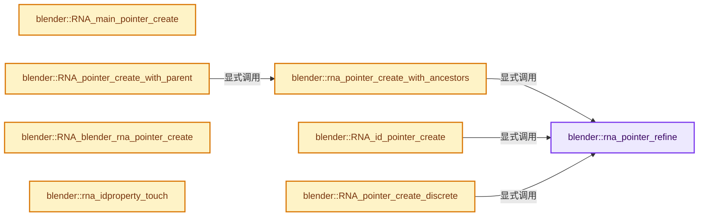
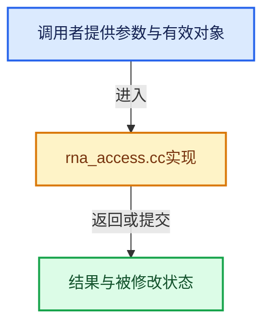

# 实现依赖专题：source/blender/makesrna/intern/rna_access.cc

[方向导航](README.md) · [符号索引](../%E7%AC%A6%E5%8F%B7%E4%BE%9D%E8%B5%96%E4%B8%8E%E5%AE%9E%E7%8E%B0%E7%B4%A2%E5%BC%95.md)

本专题从正文实际调用进入，集中保存共享实现。函数有稳定锚点，可从调用处直接跳到对应完整函数；递归与互相调用通过回链组织。

## 本文件的实现关系






## 完整成员与函数实现

<a id="f-e6d750483244440f"></a>

### `blender::rna_pointer_refine`

实现位置：[source/blender/makesrna/intern/rna_access.cc](../../../../../source/blender/makesrna/intern/rna_access.cc) · L132—L141。

接口参数：

- `PointerRNA &r_ptr`

**教学注释版**

<!-- annotated:7b78843eba3cd6 -->

```cpp
BLI_INLINE void rna_pointer_refine(PointerRNA &r_ptr)
{
  while (r_ptr.type->refine) {
    StructRNA *type = r_ptr.type->refine(&r_ptr);
    if (type == r_ptr.type) {
      break;
    }
    r_ptr.type = type;
  }
}
```

<details>
<summary>核对原始源码：source/blender/makesrna/intern/rna_access.cc · L132—L141</summary>

<!-- original:7b78843eba3cd6:source/blender/makesrna/intern/rna_access.cc:132:141 -->

```cpp
BLI_INLINE void rna_pointer_refine(PointerRNA &r_ptr)
{
  while (r_ptr.type->refine) {
    StructRNA *type = r_ptr.type->refine(&r_ptr);
    if (type == r_ptr.type) {
      break;
    }
    r_ptr.type = type;
  }
}
```

</details>

**沿实际写入检查状态**

- `r_ptr.type = type;`

**继续追踪实现**

- `r_ptr.type->refine` → [调用协议](../%E6%A8%A1%E6%9D%BF%E5%AE%8F%E4%B8%8E%E5%8A%A8%E6%80%81%E5%88%86%E6%B4%BE%E5%8D%8F%E8%AE%AE.md)：接收对象类型依赖auto、返回值或模板实例；不按同名猜测目标。调用位置L135。

<a id="f-f88ae02fa696950f"></a>

### `blender::rna_pointer_create_with_ancestors`

实现位置：[source/blender/makesrna/intern/rna_access.cc](../../../../../source/blender/makesrna/intern/rna_access.cc) · L143—L163。

接口参数：

- `const PointerRNA &parent`
- `StructRNA *type`
- `void *data`
- `PointerRNA &r_ptr`

**教学注释版**

<!-- annotated:5956d515030c7a -->

```cpp
void rna_pointer_create_with_ancestors(const PointerRNA &parent,
                                       StructRNA *type,
                                       void *data,
                                       PointerRNA &r_ptr)
{
  if (data) {
    if (type && type->flag & STRUCT_ID) {
      /* Currently, assume that an ID PointerRNA never has an ancestor.
       * NOTE: This may become an issue for embedded IDs in the future, see also
       * #PointerRNA::ancestors docs. */
      r_ptr = {static_cast<ID *>(data), type, data};
    }
    else {
      r_ptr = {parent.owner_id, type, data, parent};
    }
    rna_pointer_refine(r_ptr);
  }
  else {
    r_ptr = {};
  }
}
```

<details>
<summary>核对原始源码：source/blender/makesrna/intern/rna_access.cc · L143—L163</summary>

<!-- original:5956d515030c7a:source/blender/makesrna/intern/rna_access.cc:143:163 -->

```cpp
void rna_pointer_create_with_ancestors(const PointerRNA &parent,
                                       StructRNA *type,
                                       void *data,
                                       PointerRNA &r_ptr)
{
  if (data) {
    if (type && type->flag & STRUCT_ID) {
      /* Currently, assume that an ID PointerRNA never has an ancestor.
       * NOTE: This may become an issue for embedded IDs in the future, see also
       * #PointerRNA::ancestors docs. */
      r_ptr = {static_cast<ID *>(data), type, data};
    }
    else {
      r_ptr = {parent.owner_id, type, data, parent};
    }
    rna_pointer_refine(r_ptr);
  }
  else {
    r_ptr = {};
  }
}
```

</details>

**沿实际写入检查状态**

- `r_ptr = {static_cast<ID *>(data), type, data};`
- `r_ptr = {parent.owner_id, type, data, parent};`
- `r_ptr = {};`

**继续追踪实现**

- `rna_pointer_refine` → [blender::rna_pointer_refine · L132](%E4%BE%9D%E8%B5%96-rna_access-706bea.md#f-e6d750483244440f)。

<a id="f-f7a37df85a5fe1f1"></a>

### `blender::RNA_main_pointer_create`

实现位置：[source/blender/makesrna/intern/rna_access.cc](../../../../../source/blender/makesrna/intern/rna_access.cc) · L165—L168。

接口参数：

- `Main *main`

**教学注释版**

<!-- annotated:25979a6a3b1592 -->

```cpp
PointerRNA RNA_main_pointer_create(Main *main)
{
  return {nullptr, RNA_BlendData, main};
}
```

<details>
<summary>核对原始源码：source/blender/makesrna/intern/rna_access.cc · L165—L168</summary>

<!-- original:25979a6a3b1592:source/blender/makesrna/intern/rna_access.cc:165:168 -->

```cpp
PointerRNA RNA_main_pointer_create(Main *main)
{
  return {nullptr, RNA_BlendData, main};
}
```

</details>

**结果出口**

- `return {nullptr, RNA_BlendData, main};`

**继续追踪实现**

本实现没有需要继续展开的显式调用；检查返回表达式、对象转换和调用者前置条件。

<a id="f-d41a2d612ae3a7b6"></a>

### `blender::RNA_id_pointer_create`

实现位置：[source/blender/makesrna/intern/rna_access.cc](../../../../../source/blender/makesrna/intern/rna_access.cc) · L170—L179。

接口参数：

- `ID *id`

**教学注释版**

<!-- annotated:5aa7bbec415f0d -->

```cpp
PointerRNA RNA_id_pointer_create(ID *id)
{
  if (id) {
    PointerRNA ptr{id, ID_code_to_RNA_type(id->id_type()), id};
    rna_pointer_refine(ptr);
    return ptr;
  }

  return {};
}
```

<details>
<summary>核对原始源码：source/blender/makesrna/intern/rna_access.cc · L170—L179</summary>

<!-- original:5aa7bbec415f0d:source/blender/makesrna/intern/rna_access.cc:170:179 -->

```cpp
PointerRNA RNA_id_pointer_create(ID *id)
{
  if (id) {
    PointerRNA ptr{id, ID_code_to_RNA_type(id->id_type()), id};
    rna_pointer_refine(ptr);
    return ptr;
  }

  return {};
}
```

</details>

**结果出口**

- `return ptr;`
- `return {};`

**继续追踪实现**

- `ID_code_to_RNA_type` → [blender::ID_code_to_RNA_type · L537](%E4%BE%9D%E8%B5%96-rna_ID-c327fd.md#f-687b276b7db91bcd)。
- `id->id_type` → [blender::ID::id_type · L544](%E4%BE%9D%E8%B5%96-DNA_ID-3eb091.md#f-ee8fe63f3948aa47)。
- `rna_pointer_refine` → [blender::rna_pointer_refine · L132](%E4%BE%9D%E8%B5%96-rna_access-706bea.md#f-e6d750483244440f)。

<a id="f-592a276e869c6d94"></a>

### `blender::RNA_pointer_create_discrete`

实现位置：[source/blender/makesrna/intern/rna_access.cc](../../../../../source/blender/makesrna/intern/rna_access.cc) · L181—L190。

接口参数：

- `ID *id`
- `StructRNA *type`
- `void *data`

**教学注释版**

<!-- annotated:10bbb1ace8b689 -->

```cpp
PointerRNA RNA_pointer_create_discrete(ID *id, StructRNA *type, void *data)
{
  PointerRNA ptr{id, type, data};

  if (data) {
    rna_pointer_refine(ptr);
  }

  return ptr;
}
```

<details>
<summary>核对原始源码：source/blender/makesrna/intern/rna_access.cc · L181—L190</summary>

<!-- original:10bbb1ace8b689:source/blender/makesrna/intern/rna_access.cc:181:190 -->

```cpp
PointerRNA RNA_pointer_create_discrete(ID *id, StructRNA *type, void *data)
{
  PointerRNA ptr{id, type, data};

  if (data) {
    rna_pointer_refine(ptr);
  }

  return ptr;
}
```

</details>

**结果出口**

- `return ptr;`

**继续追踪实现**

- `rna_pointer_refine` → [blender::rna_pointer_refine · L132](%E4%BE%9D%E8%B5%96-rna_access-706bea.md#f-e6d750483244440f)。

<a id="f-422c6d5322562ad3"></a>

### `blender::RNA_pointer_create_with_parent`

实现位置：[source/blender/makesrna/intern/rna_access.cc](../../../../../source/blender/makesrna/intern/rna_access.cc) · L192—L197。

接口参数：

- `const PointerRNA &parent`
- `StructRNA *type`
- `void *data`

**教学注释版**

<!-- annotated:f9559b0a71fbce -->

```cpp
PointerRNA RNA_pointer_create_with_parent(const PointerRNA &parent, StructRNA *type, void *data)
{
  PointerRNA result;
  rna_pointer_create_with_ancestors(parent, type, data, result);
  return result;
}
```

<details>
<summary>核对原始源码：source/blender/makesrna/intern/rna_access.cc · L192—L197</summary>

<!-- original:f9559b0a71fbce:source/blender/makesrna/intern/rna_access.cc:192:197 -->

```cpp
PointerRNA RNA_pointer_create_with_parent(const PointerRNA &parent, StructRNA *type, void *data)
{
  PointerRNA result;
  rna_pointer_create_with_ancestors(parent, type, data, result);
  return result;
}
```

</details>

**结果出口**

- `return result;`

**继续追踪实现**

- `rna_pointer_create_with_ancestors` → [blender::rna_pointer_create_with_ancestors · L143](%E4%BE%9D%E8%B5%96-rna_access-706bea.md#f-f88ae02fa696950f)。

<a id="f-309e350c41005ad8"></a>

### `blender::RNA_blender_rna_pointer_create`

实现位置：[source/blender/makesrna/intern/rna_access.cc](../../../../../source/blender/makesrna/intern/rna_access.cc) · L229—L236。

**教学注释版**

<!-- annotated:14795eb2204bd1 -->

```cpp
PointerRNA RNA_blender_rna_pointer_create()
{
  PointerRNA ptr = {};
  ptr.owner_id = nullptr;
  ptr.type = RNA_BlenderRNA;
  ptr.data = &RNA_blender_rna_get();
  return ptr;
}
```

<details>
<summary>核对原始源码：source/blender/makesrna/intern/rna_access.cc · L229—L236</summary>

<!-- original:14795eb2204bd1:source/blender/makesrna/intern/rna_access.cc:229:236 -->

```cpp
PointerRNA RNA_blender_rna_pointer_create()
{
  PointerRNA ptr = {};
  ptr.owner_id = nullptr;
  ptr.type = RNA_BlenderRNA;
  ptr.data = &RNA_blender_rna_get();
  return ptr;
}
```

</details>

**沿实际写入检查状态**

- `ptr.owner_id = nullptr;`
- `ptr.type = RNA_BlenderRNA;`
- `ptr.data = &RNA_blender_rna_get();`

**结果出口**

- `return ptr;`

**继续追踪实现**

- `RNA_blender_rna_get` → [调用协议](../%E6%A8%A1%E6%9D%BF%E5%AE%8F%E4%B8%8E%E5%8A%A8%E6%80%81%E5%88%86%E6%B4%BE%E5%8D%8F%E8%AE%AE.md)：函数指针、局部可调用对象或未展开的宏；必须结合调用者环境。调用位置L234。

<a id="f-b623547fd066caf3"></a>

### `blender::rna_idproperty_touch`

实现位置：[source/blender/makesrna/intern/rna_access.cc](../../../../../source/blender/makesrna/intern/rna_access.cc) · L265—L269。

接口参数：

- `IDProperty *idprop`

**教学注释版**

<!-- annotated:f5ad62a65dba05 -->

```cpp
void rna_idproperty_touch(IDProperty *idprop)
{
  /* so the property is seen as 'set' by rna */
  idprop->flag &= ~IDP_FLAG_GHOST;
}
```

<details>
<summary>核对原始源码：source/blender/makesrna/intern/rna_access.cc · L265—L269</summary>

<!-- original:f5ad62a65dba05:source/blender/makesrna/intern/rna_access.cc:265:269 -->

```cpp
void rna_idproperty_touch(IDProperty *idprop)
{
  /* so the property is seen as 'set' by rna */
  idprop->flag &= ~IDP_FLAG_GHOST;
}
```

</details>

**沿实际写入检查状态**

- `idprop->flag &= ~IDP_FLAG_GHOST;`

**继续追踪实现**

本实现没有需要继续展开的显式调用；检查返回表达式、对象转换和调用者前置条件。

<a id="f-6b822b3ebb51a6c0"></a>

### `blender::RNA_struct_idprops_p`

实现位置：[source/blender/makesrna/intern/rna_access.cc](../../../../../source/blender/makesrna/intern/rna_access.cc) · L271—L282。

接口参数：

- `PointerRNA *ptr`

**教学注释版**

<!-- annotated:8a73d3a22df513 -->

```cpp
IDProperty **RNA_struct_idprops_p(PointerRNA *ptr)
{
  StructRNA *type = ptr->type;
  if (type == nullptr) {
    return nullptr;
  }
  if (type->idproperties == nullptr) {
    return nullptr;
  }

  return type->idproperties(ptr);
}
```

<details>
<summary>核对原始源码：source/blender/makesrna/intern/rna_access.cc · L271—L282</summary>

<!-- original:8a73d3a22df513:source/blender/makesrna/intern/rna_access.cc:271:282 -->

```cpp
IDProperty **RNA_struct_idprops_p(PointerRNA *ptr)
{
  StructRNA *type = ptr->type;
  if (type == nullptr) {
    return nullptr;
  }
  if (type->idproperties == nullptr) {
    return nullptr;
  }

  return type->idproperties(ptr);
}
```

</details>

**结果出口**

- `return nullptr;`
- `return type->idproperties(ptr);`

**继续追踪实现**

- `type->idproperties` → [调用协议](../%E6%A8%A1%E6%9D%BF%E5%AE%8F%E4%B8%8E%E5%8A%A8%E6%80%81%E5%88%86%E6%B4%BE%E5%8D%8F%E8%AE%AE.md)：由接收对象具体类型或运行时策略提供实现。调用位置L281。

<a id="f-a5bf68e0fc1eb45c"></a>

### `blender::RNA_struct_idprops`

实现位置：[source/blender/makesrna/intern/rna_access.cc](../../../../../source/blender/makesrna/intern/rna_access.cc) · L284—L296。

接口参数：

- `PointerRNA *ptr`
- `bool create`

**教学注释版**

<!-- annotated:aada067bc89e41 -->

```cpp
IDProperty *RNA_struct_idprops(PointerRNA *ptr, bool create)
{
  IDProperty **property_ptr = RNA_struct_idprops_p(ptr);
  if (property_ptr == nullptr) {
    return nullptr;
  }

  if (create && *property_ptr == nullptr) {
    *property_ptr = bke::idprop::create_group("user_properties", IDP_FLAG_STATIC_TYPE).release();
  }

  return *property_ptr;
}
```

<details>
<summary>核对原始源码：source/blender/makesrna/intern/rna_access.cc · L284—L296</summary>

<!-- original:aada067bc89e41:source/blender/makesrna/intern/rna_access.cc:284:296 -->

```cpp
IDProperty *RNA_struct_idprops(PointerRNA *ptr, bool create)
{
  IDProperty **property_ptr = RNA_struct_idprops_p(ptr);
  if (property_ptr == nullptr) {
    return nullptr;
  }

  if (create && *property_ptr == nullptr) {
    *property_ptr = bke::idprop::create_group("user_properties", IDP_FLAG_STATIC_TYPE).release();
  }

  return *property_ptr;
}
```

</details>

**结果出口**

- `return nullptr;`
- `return *property_ptr;`

**继续追踪实现**

- `RNA_struct_idprops_p` → [blender::RNA_struct_idprops_p · L271](%E4%BE%9D%E8%B5%96-rna_access-706bea.md#f-6b822b3ebb51a6c0)。
- `bke::idprop::create_group("user_properties", IDP_FLAG_STATIC_TYPE).release` → [调用协议](../%E6%A8%A1%E6%9D%BF%E5%AE%8F%E4%B8%8E%E5%8A%A8%E6%80%81%E5%88%86%E6%B4%BE%E5%8D%8F%E8%AE%AE.md)：接收对象类型依赖auto、返回值或模板实例；不按同名猜测目标。调用位置L292。
- `bke::idprop::create_group` → [blender::bke::idprop::create_group · L155](%E4%BE%9D%E8%B5%96-idprop_create-f89f51.md#f-b1e2d8bfd5654bc2)。

<a id="f-64dc53817b77f485"></a>

### `blender::rna_idproperty_find`

实现位置：[source/blender/makesrna/intern/rna_access.cc](../../../../../source/blender/makesrna/intern/rna_access.cc) · L303—L321。

接口参数：

- `PointerRNA *ptr`
- `const char *name`

**教学注释版**

<!-- annotated:0e50dd414feb91 -->

```cpp
IDProperty *rna_idproperty_find(PointerRNA *ptr, const char *name)
{
  IDProperty *group = RNA_struct_idprops(ptr, false);

  if (!group) {
    return nullptr;
  }
  if (group->type == IDP_GROUP) {
    return IDP_GetPropertyFromGroup(group, name);
  }

  /* Not sure why that happens sometimes, with nested properties... */
  /* Seems to be actually array prop, name is usually "0"... To be sorted out later. */
#if 0
  printf("Got unexpected IDProp container when trying to retrieve %s: %d\n", name, group->type);
#endif

  return nullptr;
}
```

<details>
<summary>核对原始源码：source/blender/makesrna/intern/rna_access.cc · L303—L321</summary>

<!-- original:0e50dd414feb91:source/blender/makesrna/intern/rna_access.cc:303:321 -->

```cpp
IDProperty *rna_idproperty_find(PointerRNA *ptr, const char *name)
{
  IDProperty *group = RNA_struct_idprops(ptr, false);

  if (!group) {
    return nullptr;
  }
  if (group->type == IDP_GROUP) {
    return IDP_GetPropertyFromGroup(group, name);
  }

  /* Not sure why that happens sometimes, with nested properties... */
  /* Seems to be actually array prop, name is usually "0"... To be sorted out later. */
#if 0
  printf("Got unexpected IDProp container when trying to retrieve %s: %d\n", name, group->type);
#endif

  return nullptr;
}
```

</details>

**结果出口**

- `return nullptr;`
- `return IDP_GetPropertyFromGroup(group, name);`

**继续追踪实现**

- `RNA_struct_idprops` → [blender::RNA_struct_idprops · L284](%E4%BE%9D%E8%B5%96-rna_access-706bea.md#f-a5bf68e0fc1eb45c)。
- `IDP_GetPropertyFromGroup` → [blender::IDP_GetPropertyFromGroup · L818](%E4%BE%9D%E8%B5%96-idprop-006c65.md#f-a8d678499d89359e)。
- `printf` → [外部契约](https://eel.is/c++draft/)：这个边界按实际表达式及所属类型核对参数、返回值、寿命与失败行为。这里提供接口入口，不声称已解释该第三方版本的内部实现。

<a id="f-3c7450ae53e09d44"></a>

### `blender::RNA_struct_system_idprops_p`

实现位置：[source/blender/makesrna/intern/rna_access.cc](../../../../../source/blender/makesrna/intern/rna_access.cc) · L323—L334。

接口参数：

- `PointerRNA *ptr`

**教学注释版**

<!-- annotated:f671a8f73627b0 -->

```cpp
IDProperty **RNA_struct_system_idprops_p(PointerRNA *ptr)
{
  StructRNA *type = ptr->type;
  if (type == nullptr) {
    return nullptr;
  }
  if (type->system_idproperties == nullptr) {
    return nullptr;
  }

  return type->system_idproperties(ptr);
}
```

<details>
<summary>核对原始源码：source/blender/makesrna/intern/rna_access.cc · L323—L334</summary>

<!-- original:f671a8f73627b0:source/blender/makesrna/intern/rna_access.cc:323:334 -->

```cpp
IDProperty **RNA_struct_system_idprops_p(PointerRNA *ptr)
{
  StructRNA *type = ptr->type;
  if (type == nullptr) {
    return nullptr;
  }
  if (type->system_idproperties == nullptr) {
    return nullptr;
  }

  return type->system_idproperties(ptr);
}
```

</details>

**结果出口**

- `return nullptr;`
- `return type->system_idproperties(ptr);`

**继续追踪实现**

- `type->system_idproperties` → [调用协议](../%E6%A8%A1%E6%9D%BF%E5%AE%8F%E4%B8%8E%E5%8A%A8%E6%80%81%E5%88%86%E6%B4%BE%E5%8D%8F%E8%AE%AE.md)：由接收对象具体类型或运行时策略提供实现。调用位置L333。

<a id="f-42187dd64ef170c6"></a>

### `blender::RNA_struct_system_idprops`

实现位置：[source/blender/makesrna/intern/rna_access.cc](../../../../../source/blender/makesrna/intern/rna_access.cc) · L336—L348。

接口参数：

- `PointerRNA *ptr`
- `bool create`

**教学注释版**

<!-- annotated:26a83f27cf15db -->

```cpp
IDProperty *RNA_struct_system_idprops(PointerRNA *ptr, bool create)
{
  IDProperty **property_ptr = RNA_struct_system_idprops_p(ptr);
  if (property_ptr == nullptr) {
    return nullptr;
  }

  if (create && *property_ptr == nullptr) {
    *property_ptr = bke::idprop::create_group("system_properties", IDP_FLAG_STATIC_TYPE).release();
  }

  return *property_ptr;
}
```

<details>
<summary>核对原始源码：source/blender/makesrna/intern/rna_access.cc · L336—L348</summary>

<!-- original:26a83f27cf15db:source/blender/makesrna/intern/rna_access.cc:336:348 -->

```cpp
IDProperty *RNA_struct_system_idprops(PointerRNA *ptr, bool create)
{
  IDProperty **property_ptr = RNA_struct_system_idprops_p(ptr);
  if (property_ptr == nullptr) {
    return nullptr;
  }

  if (create && *property_ptr == nullptr) {
    *property_ptr = bke::idprop::create_group("system_properties", IDP_FLAG_STATIC_TYPE).release();
  }

  return *property_ptr;
}
```

</details>

**结果出口**

- `return nullptr;`
- `return *property_ptr;`

**继续追踪实现**

- `RNA_struct_system_idprops_p` → [blender::RNA_struct_system_idprops_p · L323](%E4%BE%9D%E8%B5%96-rna_access-706bea.md#f-3c7450ae53e09d44)。
- `bke::idprop::create_group("system_properties", IDP_FLAG_STATIC_TYPE).release` → [调用协议](../%E6%A8%A1%E6%9D%BF%E5%AE%8F%E4%B8%8E%E5%8A%A8%E6%80%81%E5%88%86%E6%B4%BE%E5%8D%8F%E8%AE%AE.md)：接收对象类型依赖auto、返回值或模板实例；不按同名猜测目标。调用位置L344。
- `bke::idprop::create_group` → [blender::bke::idprop::create_group · L155](%E4%BE%9D%E8%B5%96-idprop_create-f89f51.md#f-b1e2d8bfd5654bc2)。

<a id="f-1dc923cd471c7bc8"></a>

### `blender::RNA_struct_system_idprops_check`

实现位置：[source/blender/makesrna/intern/rna_access.cc](../../../../../source/blender/makesrna/intern/rna_access.cc) · L350—L353。

接口参数：

- `StructRNA *srna`

**教学注释版**

<!-- annotated:380ec597290abf -->

```cpp
bool RNA_struct_system_idprops_check(StructRNA *srna)
{
  return (srna && srna->system_idproperties);
}
```

<details>
<summary>核对原始源码：source/blender/makesrna/intern/rna_access.cc · L350—L353</summary>

<!-- original:380ec597290abf:source/blender/makesrna/intern/rna_access.cc:350:353 -->

```cpp
bool RNA_struct_system_idprops_check(StructRNA *srna)
{
  return (srna && srna->system_idproperties);
}
```

</details>

**结果出口**

- `return (srna && srna->system_idproperties);`

**继续追踪实现**

本实现没有需要继续展开的显式调用；检查返回表达式、对象转换和调用者前置条件。

<a id="f-44ac043ea7bf5710"></a>

### `blender::rna_system_idproperty_find`

实现位置：[source/blender/makesrna/intern/rna_access.cc](../../../../../source/blender/makesrna/intern/rna_access.cc) · L355—L374。

接口参数：

- `PointerRNA *ptr`
- `const char *name`

**教学注释版**

<!-- annotated:37f594f5518bea -->

```cpp
IDProperty *rna_system_idproperty_find(PointerRNA *ptr, const char *name)
{
  IDProperty *group = RNA_struct_system_idprops(ptr, false);

  if (!group) {
    return nullptr;
  }

  if (group->type == IDP_GROUP) {
    return IDP_GetPropertyFromGroup(group, name);
  }

  /* Not sure why that happens sometimes, with nested properties... */
  /* Seems to be actually array prop, name is usually "0"... To be sorted out later. */
#if 0
  printf("Got unexpected IDProp container when trying to retrieve %s: %d\n", name, group->type);
#endif

  return nullptr;
}
```

<details>
<summary>核对原始源码：source/blender/makesrna/intern/rna_access.cc · L355—L374</summary>

<!-- original:37f594f5518bea:source/blender/makesrna/intern/rna_access.cc:355:374 -->

```cpp
IDProperty *rna_system_idproperty_find(PointerRNA *ptr, const char *name)
{
  IDProperty *group = RNA_struct_system_idprops(ptr, false);

  if (!group) {
    return nullptr;
  }

  if (group->type == IDP_GROUP) {
    return IDP_GetPropertyFromGroup(group, name);
  }

  /* Not sure why that happens sometimes, with nested properties... */
  /* Seems to be actually array prop, name is usually "0"... To be sorted out later. */
#if 0
  printf("Got unexpected IDProp container when trying to retrieve %s: %d\n", name, group->type);
#endif

  return nullptr;
}
```

</details>

**结果出口**

- `return nullptr;`
- `return IDP_GetPropertyFromGroup(group, name);`

**继续追踪实现**

- `RNA_struct_system_idprops` → [blender::RNA_struct_system_idprops · L336](%E4%BE%9D%E8%B5%96-rna_access-706bea.md#f-42187dd64ef170c6)。
- `IDP_GetPropertyFromGroup` → [blender::IDP_GetPropertyFromGroup · L818](%E4%BE%9D%E8%B5%96-idprop-006c65.md#f-a8d678499d89359e)。
- `printf` → [外部契约](https://eel.is/c++draft/)：这个边界按实际表达式及所属类型核对参数、返回值、寿命与失败行为。这里提供接口入口，不声称已解释该第三方版本的内部实现。

<a id="f-a60a0dde7895ffe6"></a>

### `blender::rna_system_idproperty_free`

实现位置：[source/blender/makesrna/intern/rna_access.cc](../../../../../source/blender/makesrna/intern/rna_access.cc) · L376—L386。

接口参数：

- `PointerRNA *ptr`
- `const char *name`

**教学注释版**

<!-- annotated:56de52814faf47 -->

```cpp
static void rna_system_idproperty_free(PointerRNA *ptr, const char *name)
{
  IDProperty *group = RNA_struct_system_idprops(ptr, false);

  if (group) {
    IDProperty *idprop = IDP_GetPropertyFromGroup(group, name);
    if (idprop) {
      IDP_FreeFromGroup(group, idprop);
    }
  }
}
```

<details>
<summary>核对原始源码：source/blender/makesrna/intern/rna_access.cc · L376—L386</summary>

<!-- original:56de52814faf47:source/blender/makesrna/intern/rna_access.cc:376:386 -->

```cpp
static void rna_system_idproperty_free(PointerRNA *ptr, const char *name)
{
  IDProperty *group = RNA_struct_system_idprops(ptr, false);

  if (group) {
    IDProperty *idprop = IDP_GetPropertyFromGroup(group, name);
    if (idprop) {
      IDP_FreeFromGroup(group, idprop);
    }
  }
}
```

</details>

**继续追踪实现**

- `RNA_struct_system_idprops` → [blender::RNA_struct_system_idprops · L336](%E4%BE%9D%E8%B5%96-rna_access-706bea.md#f-42187dd64ef170c6)。
- `IDP_GetPropertyFromGroup` → [blender::IDP_GetPropertyFromGroup · L818](%E4%BE%9D%E8%B5%96-idprop-006c65.md#f-a8d678499d89359e)。
- `IDP_FreeFromGroup` → [blender::IDP_FreeFromGroup · L812](%E4%BE%9D%E8%B5%96-idprop-006c65.md#f-9d2ebd4c4f38d2fd)。

<a id="f-6f665dd48f8e9a87"></a>

### `blender::rna_ensure_property_array_length`

实现位置：[source/blender/makesrna/intern/rna_access.cc](../../../../../source/blender/makesrna/intern/rna_access.cc) · L388—L406。

接口参数：

- `PointerRNA *ptr`
- `PropertyRNA *prop`

**教学注释版**

<!-- annotated:5851d4450d6b59 -->

```cpp
static int rna_ensure_property_array_length(PointerRNA *ptr, PropertyRNA *prop)
{
  if (prop->magic == RNA_MAGIC) {
    int arraylen[RNA_MAX_ARRAY_DIMENSION];
    if (prop->getlength && *ptr) {
      BLI_assert(rna_property_can_access_pointer_data(*ptr, *prop));
      return prop->getlength(ptr, arraylen);
    }
    else {
      return int(prop->totarraylength);
    }
  }

  IDProperty *idprop = reinterpret_cast<IDProperty *>(prop);
  if (idprop->type == IDP_ARRAY) {
    return idprop->len;
  }
  return 0;
}
```

<details>
<summary>核对原始源码：source/blender/makesrna/intern/rna_access.cc · L388—L406</summary>

<!-- original:5851d4450d6b59:source/blender/makesrna/intern/rna_access.cc:388:406 -->

```cpp
static int rna_ensure_property_array_length(PointerRNA *ptr, PropertyRNA *prop)
{
  if (prop->magic == RNA_MAGIC) {
    int arraylen[RNA_MAX_ARRAY_DIMENSION];
    if (prop->getlength && *ptr) {
      BLI_assert(rna_property_can_access_pointer_data(*ptr, *prop));
      return prop->getlength(ptr, arraylen);
    }
    else {
      return int(prop->totarraylength);
    }
  }

  IDProperty *idprop = reinterpret_cast<IDProperty *>(prop);
  if (idprop->type == IDP_ARRAY) {
    return idprop->len;
  }
  return 0;
}
```

</details>

**结果出口**

- `return prop->getlength(ptr, arraylen);`
- `return int(prop->totarraylength);`
- `return idprop->len;`
- `return 0;`

**继续追踪实现**

- `BLI_assert` → [BLI_assert · L48](../01-%E5%9F%BA%E7%A1%80%E5%AE%B9%E5%99%A8%E4%B8%8E%E7%8E%B0%E4%BB%A3CPP/%E4%BE%9D%E8%B5%96-BLI_assert-cc98e8.md#m-57a88495704d)；[BLI_assert · L63](../01-%E5%9F%BA%E7%A1%80%E5%AE%B9%E5%99%A8%E4%B8%8E%E7%8E%B0%E4%BB%A3CPP/%E4%BE%9D%E8%B5%96-BLI_assert-cc98e8.md#m-d07050020cb5)。宏定义由构建条件选择。
- `rna_property_can_access_pointer_data` → [blender::rna_property_can_access_pointer_data · L534](%E4%BE%9D%E8%B5%96-rna_access-706bea.md#f-904dd1f80a953df6)。
- `prop->getlength` → [调用协议](../%E6%A8%A1%E6%9D%BF%E5%AE%8F%E4%B8%8E%E5%8A%A8%E6%80%81%E5%88%86%E6%B4%BE%E5%8D%8F%E8%AE%AE.md)：由接收对象具体类型或运行时策略提供实现。调用位置L394。

<a id="f-1f12a0b8716bfa57"></a>

### `blender::rna_ensure_property_array_check`

实现位置：[source/blender/makesrna/intern/rna_access.cc](../../../../../source/blender/makesrna/intern/rna_access.cc) · L408—L416。

接口参数：

- `PropertyRNA *prop`

**教学注释版**

<!-- annotated:0ec96e1a0ccb41 -->

```cpp
static bool rna_ensure_property_array_check(PropertyRNA *prop)
{
  if (prop->magic == RNA_MAGIC) {
    return (prop->getlength || prop->totarraylength);
  }
  IDProperty *idprop = reinterpret_cast<IDProperty *>(prop);

  return (idprop->type == IDP_ARRAY);
}
```

<details>
<summary>核对原始源码：source/blender/makesrna/intern/rna_access.cc · L408—L416</summary>

<!-- original:0ec96e1a0ccb41:source/blender/makesrna/intern/rna_access.cc:408:416 -->

```cpp
static bool rna_ensure_property_array_check(PropertyRNA *prop)
{
  if (prop->magic == RNA_MAGIC) {
    return (prop->getlength || prop->totarraylength);
  }
  IDProperty *idprop = reinterpret_cast<IDProperty *>(prop);

  return (idprop->type == IDP_ARRAY);
}
```

</details>

**结果出口**

- `return (prop->getlength || prop->totarraylength);`
- `return (idprop->type == IDP_ARRAY);`

**继续追踪实现**

本实现没有需要继续展开的显式调用；检查返回表达式、对象转换和调用者前置条件。

<a id="f-1c8571dc1d949261"></a>

### `blender::rna_ensure_property_multi_array_length`

实现位置：[source/blender/makesrna/intern/rna_access.cc](../../../../../source/blender/makesrna/intern/rna_access.cc) · L418—L441。

接口参数：

- `const PointerRNA *ptr`
- `PropertyRNA *prop`
- `int length[]`

**教学注释版**

<!-- annotated:dd1245d10de60b -->

```cpp
static void rna_ensure_property_multi_array_length(const PointerRNA *ptr,
                                                   PropertyRNA *prop,
                                                   int length[])
{
  if (prop->magic == RNA_MAGIC) {
    if (prop->getlength) {
      BLI_assert(rna_property_can_access_pointer_data(*ptr, *prop));
      prop->getlength(ptr, length);
    }
    else {
      // [讲解] memcpy：复制字节，源与目标不应重叠。类型生命周期、对齐和可复制表示须由调用者证明，不是任意对象的复制构造。
      memcpy(length, prop->arraylength, prop->arraydimension * sizeof(int));
    }
  }
  else {
    IDProperty *idprop = reinterpret_cast<IDProperty *>(prop);

    if (idprop->type == IDP_ARRAY) {
      length[0] = idprop->len;
    }
    else {
      length[0] = 0;
    }
  }
}
```

<details>
<summary>核对原始源码：source/blender/makesrna/intern/rna_access.cc · L418—L441</summary>

<!-- original:dd1245d10de60b:source/blender/makesrna/intern/rna_access.cc:418:441 -->

```cpp
static void rna_ensure_property_multi_array_length(const PointerRNA *ptr,
                                                   PropertyRNA *prop,
                                                   int length[])
{
  if (prop->magic == RNA_MAGIC) {
    if (prop->getlength) {
      BLI_assert(rna_property_can_access_pointer_data(*ptr, *prop));
      prop->getlength(ptr, length);
    }
    else {
      memcpy(length, prop->arraylength, prop->arraydimension * sizeof(int));
    }
  }
  else {
    IDProperty *idprop = reinterpret_cast<IDProperty *>(prop);

    if (idprop->type == IDP_ARRAY) {
      length[0] = idprop->len;
    }
    else {
      length[0] = 0;
    }
  }
}
```

</details>

**沿实际写入检查状态**

- `length[0] = idprop->len;`
- `length[0] = 0;`

**继续追踪实现**

- `BLI_assert` → [BLI_assert · L48](../01-%E5%9F%BA%E7%A1%80%E5%AE%B9%E5%99%A8%E4%B8%8E%E7%8E%B0%E4%BB%A3CPP/%E4%BE%9D%E8%B5%96-BLI_assert-cc98e8.md#m-57a88495704d)；[BLI_assert · L63](../01-%E5%9F%BA%E7%A1%80%E5%AE%B9%E5%99%A8%E4%B8%8E%E7%8E%B0%E4%BB%A3CPP/%E4%BE%9D%E8%B5%96-BLI_assert-cc98e8.md#m-d07050020cb5)。宏定义由构建条件选择。
- `rna_property_can_access_pointer_data` → [blender::rna_property_can_access_pointer_data · L534](%E4%BE%9D%E8%B5%96-rna_access-706bea.md#f-904dd1f80a953df6)。
- `prop->getlength` → [调用协议](../%E6%A8%A1%E6%9D%BF%E5%AE%8F%E4%B8%8E%E5%8A%A8%E6%80%81%E5%88%86%E6%B4%BE%E5%8D%8F%E8%AE%AE.md)：由接收对象具体类型或运行时策略提供实现。调用位置L425。
- `memcpy` → [外部契约](https://eel.is/c++draft/cstring.syn)：复制字节，源与目标不应重叠。类型生命周期、对齐和可复制表示须由调用者证明，不是任意对象的复制构造。

<a id="f-0def507c2e23ec81"></a>

### `blender::rna_idproperty_verify_valid`

实现位置：[source/blender/makesrna/intern/rna_access.cc](../../../../../source/blender/makesrna/intern/rna_access.cc) · L443—L504。

接口参数：

- `PointerRNA *ptr`
- `PropertyRNA *prop`
- `IDProperty *idprop`

**教学注释版**

<!-- annotated:4b0b0c491d172f -->

```cpp
static bool rna_idproperty_verify_valid(PointerRNA *ptr, PropertyRNA *prop, IDProperty *idprop)
{
  /* this verifies if the idproperty actually matches the property
   * description and otherwise removes it. this is to ensure that
   * rna property access is type safe, e.g. if you defined the rna
   * to have a certain array length you can count on that staying so */

  switch (idprop->type) {
    case IDP_IDPARRAY:
      if (prop->type != PROP_COLLECTION) {
        return false;
      }
      break;
    case IDP_ARRAY:
      if (rna_ensure_property_array_length(ptr, prop) != idprop->len) {
        return false;
      }

      if (idprop->subtype == IDP_FLOAT && prop->type != PROP_FLOAT) {
        return false;
      }
      if (idprop->subtype == IDP_BOOLEAN && prop->type != PROP_BOOLEAN) {
        return false;
      }
      if (idprop->subtype == IDP_INT && !ELEM(prop->type, PROP_BOOLEAN, PROP_INT, PROP_ENUM)) {
        return false;
      }

      break;
    case IDP_INT:
      if (!ELEM(prop->type, PROP_BOOLEAN, PROP_INT, PROP_ENUM)) {
        return false;
      }
      break;
    case IDP_BOOLEAN:
      if (prop->type != PROP_BOOLEAN) {
        return false;
      }
      break;
    case IDP_FLOAT:
    case IDP_DOUBLE:
      if (prop->type != PROP_FLOAT) {
        return false;
      }
      break;
    case IDP_STRING:
      if (prop->type != PROP_STRING) {
        return false;
      }
      break;
    case IDP_GROUP:
    case IDP_ID:
      if (prop->type != PROP_POINTER) {
        return false;
      }
      break;
    default:
      return false;
  }

  return true;
}
```

<details>
<summary>核对原始源码：source/blender/makesrna/intern/rna_access.cc · L443—L504</summary>

<!-- original:4b0b0c491d172f:source/blender/makesrna/intern/rna_access.cc:443:504 -->

```cpp
static bool rna_idproperty_verify_valid(PointerRNA *ptr, PropertyRNA *prop, IDProperty *idprop)
{
  /* this verifies if the idproperty actually matches the property
   * description and otherwise removes it. this is to ensure that
   * rna property access is type safe, e.g. if you defined the rna
   * to have a certain array length you can count on that staying so */

  switch (idprop->type) {
    case IDP_IDPARRAY:
      if (prop->type != PROP_COLLECTION) {
        return false;
      }
      break;
    case IDP_ARRAY:
      if (rna_ensure_property_array_length(ptr, prop) != idprop->len) {
        return false;
      }

      if (idprop->subtype == IDP_FLOAT && prop->type != PROP_FLOAT) {
        return false;
      }
      if (idprop->subtype == IDP_BOOLEAN && prop->type != PROP_BOOLEAN) {
        return false;
      }
      if (idprop->subtype == IDP_INT && !ELEM(prop->type, PROP_BOOLEAN, PROP_INT, PROP_ENUM)) {
        return false;
      }

      break;
    case IDP_INT:
      if (!ELEM(prop->type, PROP_BOOLEAN, PROP_INT, PROP_ENUM)) {
        return false;
      }
      break;
    case IDP_BOOLEAN:
      if (prop->type != PROP_BOOLEAN) {
        return false;
      }
      break;
    case IDP_FLOAT:
    case IDP_DOUBLE:
      if (prop->type != PROP_FLOAT) {
        return false;
      }
      break;
    case IDP_STRING:
      if (prop->type != PROP_STRING) {
        return false;
      }
      break;
    case IDP_GROUP:
    case IDP_ID:
      if (prop->type != PROP_POINTER) {
        return false;
      }
      break;
    default:
      return false;
  }

  return true;
}
```

</details>

**结果出口**

- `return false;`
- `return true;`

**继续追踪实现**

- `rna_ensure_property_array_length` → [blender::rna_ensure_property_array_length · L388](%E4%BE%9D%E8%B5%96-rna_access-706bea.md#f-6f665dd48f8e9a87)。
- `ELEM` → [ELEM · L88](%E4%BE%9D%E8%B5%96-GHOST_utildefines-34b996.md#m-d28724a15928)；[ELEM · L135](../01-%E5%9F%BA%E7%A1%80%E5%AE%B9%E5%99%A8%E4%B8%8E%E7%8E%B0%E4%BB%A3CPP/%E4%BE%9D%E8%B5%96-BLI_utildefines-293a0a.md#m-d6572de7cae0)。宏定义由构建条件选择。

<a id="f-904dd1f80a953df6"></a>

### `blender::rna_property_can_access_pointer_data`

实现位置：[source/blender/makesrna/intern/rna_access.cc](../../../../../source/blender/makesrna/intern/rna_access.cc) · L534—L544。

接口参数：

- `const PointerRNA &ptr`
- `PropertyRNA &prop`

**教学注释版**

<!-- annotated:fe3d99819a1377 -->

```cpp
bool rna_property_can_access_pointer_data(const PointerRNA &ptr, PropertyRNA &prop)
{
  const bool is_meta_type = ptr.type && (ptr.type->flag & STRUCT_RNA_DEFINITION) != 0;
  const bool is_prop_of_meta_type = (prop.flag_internal & PROP_INTERN_RNA_DEFINITION) != 0;
  const bool is_prop_builtin = (prop.flag_internal & PROP_INTERN_BUILTIN) != 0;
  BLI_assert((prop.magic == RNA_MAGIC && (prop.flag & PROP_IDPROPERTY) == 0) || !is_meta_type);
  /* Builtin props (`Struct::properties` only currently?) are always accessible.
   * Any property should be accessible in a non-meta type PointerRNA, even the meta-type ones.
   * Only properties of meta-types should be accessible in a meta-type. */
  return is_prop_builtin || !is_meta_type || is_prop_of_meta_type;
}
```

<details>
<summary>核对原始源码：source/blender/makesrna/intern/rna_access.cc · L534—L544</summary>

<!-- original:fe3d99819a1377:source/blender/makesrna/intern/rna_access.cc:534:544 -->

```cpp
bool rna_property_can_access_pointer_data(const PointerRNA &ptr, PropertyRNA &prop)
{
  const bool is_meta_type = ptr.type && (ptr.type->flag & STRUCT_RNA_DEFINITION) != 0;
  const bool is_prop_of_meta_type = (prop.flag_internal & PROP_INTERN_RNA_DEFINITION) != 0;
  const bool is_prop_builtin = (prop.flag_internal & PROP_INTERN_BUILTIN) != 0;
  BLI_assert((prop.magic == RNA_MAGIC && (prop.flag & PROP_IDPROPERTY) == 0) || !is_meta_type);
  /* Builtin props (`Struct::properties` only currently?) are always accessible.
   * Any property should be accessible in a non-meta type PointerRNA, even the meta-type ones.
   * Only properties of meta-types should be accessible in a meta-type. */
  return is_prop_builtin || !is_meta_type || is_prop_of_meta_type;
}
```

</details>

**结果出口**

- `return is_prop_builtin || !is_meta_type || is_prop_of_meta_type;`

**继续追踪实现**

- `BLI_assert` → [BLI_assert · L48](../01-%E5%9F%BA%E7%A1%80%E5%AE%B9%E5%99%A8%E4%B8%8E%E7%8E%B0%E4%BB%A3CPP/%E4%BE%9D%E8%B5%96-BLI_assert-cc98e8.md#m-57a88495704d)；[BLI_assert · L63](../01-%E5%9F%BA%E7%A1%80%E5%AE%B9%E5%99%A8%E4%B8%8E%E7%8E%B0%E4%BB%A3CPP/%E4%BE%9D%E8%B5%96-BLI_assert-cc98e8.md#m-d07050020cb5)。宏定义由构建条件选择。

<a id="f-7d3498672b376642"></a>

### `blender::rna_property_rna_or_id_get`

实现位置：[source/blender/makesrna/intern/rna_access.cc](../../../../../source/blender/makesrna/intern/rna_access.cc) · L546—L629。

接口参数：

- `PropertyRNA *prop`
- `PointerRNA *ptr`
- `PropertyRNAOrID *r_prop_rna_or_id`

**教学注释版**

<!-- annotated:8f1c332b753bf9 -->

```cpp
void rna_property_rna_or_id_get(PropertyRNA *prop,
                                PointerRNA *ptr,
                                PropertyRNAOrID *r_prop_rna_or_id)
{
  /* This is quite a hack, but avoids some complexity in the API. we
   * pass IDProperty structs as PropertyRNA pointers to the outside.
   * We store some bytes in PropertyRNA structs that allows us to
   * distinguish it from IDProperty structs. If it is an ID property,
   * we look up an IDP PropertyRNA based on the type, and set the data
   * pointer to the IDProperty. */
  *r_prop_rna_or_id = {};

  r_prop_rna_or_id->ptr = ptr;
  r_prop_rna_or_id->rawprop = prop;

  const bool is_ptr_data_usable = rna_property_can_access_pointer_data(*ptr, *prop);

  if (prop->magic == RNA_MAGIC) {
    r_prop_rna_or_id->rnaprop = prop;
    r_prop_rna_or_id->identifier = prop->identifier;

    r_prop_rna_or_id->is_array = prop->getlength || prop->totarraylength;
    if (r_prop_rna_or_id->is_array) {
      int arraylen[RNA_MAX_ARRAY_DIMENSION];
      /* Do not call actual data callbacks on definition data (i.e. it `ptr` is a struct or
       * property definition, and not the actual data type). See e.g. #161362. */
      r_prop_rna_or_id->array_len = (prop->getlength && *ptr && is_ptr_data_usable) ?
                                        uint(prop->getlength(ptr, arraylen)) :
                                        prop->totarraylength;
    }

    if (prop->flag & PROP_IDPROPERTY) {
      IDProperty *idprop = rna_system_idproperty_find(ptr, prop->identifier.c_str());

      if (idprop != nullptr && !rna_idproperty_verify_valid(ptr, prop, idprop)) {
        IDProperty *group = RNA_struct_system_idprops(ptr, false);

        IDP_FreeFromGroup(group, idprop);
        idprop = nullptr;
      }

      r_prop_rna_or_id->idprop = idprop;
      r_prop_rna_or_id->is_rna_storage_idprop = true;
      r_prop_rna_or_id->is_set = idprop != nullptr && (idprop->flag & IDP_FLAG_GHOST) == 0;
    }
    else {
      /* Full static RNA properties are always set. */
      r_prop_rna_or_id->is_set = true;
    }
  }
  else {
    IDProperty *idprop = reinterpret_cast<IDProperty *>(prop);
    /* Given prop may come from the custom properties of another data, ensure we get the one from
     * given data ptr. */
    IDProperty *idprop_evaluated = rna_idproperty_find(ptr, idprop->name);
    if (idprop_evaluated != nullptr && idprop->type != idprop_evaluated->type) {
      idprop_evaluated = nullptr;
    }

    r_prop_rna_or_id->idprop = idprop_evaluated;
    r_prop_rna_or_id->is_idprop = true;
    /* Full IDProperties are always set, if it exists. */
    r_prop_rna_or_id->is_set = (idprop_evaluated != nullptr);

    r_prop_rna_or_id->identifier = UString(idprop->name);
    if (idprop->type == IDP_ARRAY) {
      r_prop_rna_or_id->rnaprop = arraytypemap[int(idprop->subtype)];
      r_prop_rna_or_id->is_array = true;
      r_prop_rna_or_id->array_len = idprop_evaluated != nullptr ? uint(idprop_evaluated->len) : 0;
    }
    else {
      /* Special case for int properties with enum items, these are displayed as a PROP_ENUM. */
      if (idprop->type == IDP_INT) {
        const IDPropertyUIDataInt *ui_data_int = reinterpret_cast<IDPropertyUIDataInt *>(
            idprop->ui_data);
        if (ui_data_int && ui_data_int->enum_items_num > 0) {
          r_prop_rna_or_id->rnaprop = &rna_PropertyGroupItem_enum;
          return;
        }
      }
      r_prop_rna_or_id->rnaprop = typemap[int(idprop->type)];
    }
  }
}
```

<details>
<summary>核对原始源码：source/blender/makesrna/intern/rna_access.cc · L546—L629</summary>

<!-- original:8f1c332b753bf9:source/blender/makesrna/intern/rna_access.cc:546:629 -->

```cpp
void rna_property_rna_or_id_get(PropertyRNA *prop,
                                PointerRNA *ptr,
                                PropertyRNAOrID *r_prop_rna_or_id)
{
  /* This is quite a hack, but avoids some complexity in the API. we
   * pass IDProperty structs as PropertyRNA pointers to the outside.
   * We store some bytes in PropertyRNA structs that allows us to
   * distinguish it from IDProperty structs. If it is an ID property,
   * we look up an IDP PropertyRNA based on the type, and set the data
   * pointer to the IDProperty. */
  *r_prop_rna_or_id = {};

  r_prop_rna_or_id->ptr = ptr;
  r_prop_rna_or_id->rawprop = prop;

  const bool is_ptr_data_usable = rna_property_can_access_pointer_data(*ptr, *prop);

  if (prop->magic == RNA_MAGIC) {
    r_prop_rna_or_id->rnaprop = prop;
    r_prop_rna_or_id->identifier = prop->identifier;

    r_prop_rna_or_id->is_array = prop->getlength || prop->totarraylength;
    if (r_prop_rna_or_id->is_array) {
      int arraylen[RNA_MAX_ARRAY_DIMENSION];
      /* Do not call actual data callbacks on definition data (i.e. it `ptr` is a struct or
       * property definition, and not the actual data type). See e.g. #161362. */
      r_prop_rna_or_id->array_len = (prop->getlength && *ptr && is_ptr_data_usable) ?
                                        uint(prop->getlength(ptr, arraylen)) :
                                        prop->totarraylength;
    }

    if (prop->flag & PROP_IDPROPERTY) {
      IDProperty *idprop = rna_system_idproperty_find(ptr, prop->identifier.c_str());

      if (idprop != nullptr && !rna_idproperty_verify_valid(ptr, prop, idprop)) {
        IDProperty *group = RNA_struct_system_idprops(ptr, false);

        IDP_FreeFromGroup(group, idprop);
        idprop = nullptr;
      }

      r_prop_rna_or_id->idprop = idprop;
      r_prop_rna_or_id->is_rna_storage_idprop = true;
      r_prop_rna_or_id->is_set = idprop != nullptr && (idprop->flag & IDP_FLAG_GHOST) == 0;
    }
    else {
      /* Full static RNA properties are always set. */
      r_prop_rna_or_id->is_set = true;
    }
  }
  else {
    IDProperty *idprop = reinterpret_cast<IDProperty *>(prop);
    /* Given prop may come from the custom properties of another data, ensure we get the one from
     * given data ptr. */
    IDProperty *idprop_evaluated = rna_idproperty_find(ptr, idprop->name);
    if (idprop_evaluated != nullptr && idprop->type != idprop_evaluated->type) {
      idprop_evaluated = nullptr;
    }

    r_prop_rna_or_id->idprop = idprop_evaluated;
    r_prop_rna_or_id->is_idprop = true;
    /* Full IDProperties are always set, if it exists. */
    r_prop_rna_or_id->is_set = (idprop_evaluated != nullptr);

    r_prop_rna_or_id->identifier = UString(idprop->name);
    if (idprop->type == IDP_ARRAY) {
      r_prop_rna_or_id->rnaprop = arraytypemap[int(idprop->subtype)];
      r_prop_rna_or_id->is_array = true;
      r_prop_rna_or_id->array_len = idprop_evaluated != nullptr ? uint(idprop_evaluated->len) : 0;
    }
    else {
      /* Special case for int properties with enum items, these are displayed as a PROP_ENUM. */
      if (idprop->type == IDP_INT) {
        const IDPropertyUIDataInt *ui_data_int = reinterpret_cast<IDPropertyUIDataInt *>(
            idprop->ui_data);
        if (ui_data_int && ui_data_int->enum_items_num > 0) {
          r_prop_rna_or_id->rnaprop = &rna_PropertyGroupItem_enum;
          return;
        }
      }
      r_prop_rna_or_id->rnaprop = typemap[int(idprop->type)];
    }
  }
}
```

</details>

**沿实际写入检查状态**

- `r_prop_rna_or_id->ptr = ptr;`
- `r_prop_rna_or_id->rawprop = prop;`
- `r_prop_rna_or_id->rnaprop = prop;`
- `r_prop_rna_or_id->identifier = prop->identifier;`
- `r_prop_rna_or_id->is_array = prop->getlength || prop->totarraylength;`
- `r_prop_rna_or_id->array_len = (prop->getlength && *ptr && is_ptr_data_usable) ?`
- `idprop = nullptr;`
- `r_prop_rna_or_id->idprop = idprop;`
- `r_prop_rna_or_id->is_rna_storage_idprop = true;`
- `r_prop_rna_or_id->is_set = idprop != nullptr && (idprop->flag & IDP_FLAG_GHOST) == 0;`
- `r_prop_rna_or_id->is_set = true;`
- `idprop_evaluated = nullptr;`
- `r_prop_rna_or_id->idprop = idprop_evaluated;`
- `r_prop_rna_or_id->is_idprop = true;`
- `r_prop_rna_or_id->is_set = (idprop_evaluated != nullptr);`
- `r_prop_rna_or_id->identifier = UString(idprop->name);`
- `r_prop_rna_or_id->rnaprop = arraytypemap[int(idprop->subtype)];`
- `r_prop_rna_or_id->is_array = true;`
- `r_prop_rna_or_id->array_len = idprop_evaluated != nullptr ? uint(idprop_evaluated->len) : 0;`
- `r_prop_rna_or_id->rnaprop = &rna_PropertyGroupItem_enum;`
- `r_prop_rna_or_id->rnaprop = typemap[int(idprop->type)];`

**继续追踪实现**

- `rna_property_can_access_pointer_data` → [blender::rna_property_can_access_pointer_data · L534](%E4%BE%9D%E8%B5%96-rna_access-706bea.md#f-904dd1f80a953df6)。
- `prop->getlength` → [调用协议](../%E6%A8%A1%E6%9D%BF%E5%AE%8F%E4%B8%8E%E5%8A%A8%E6%80%81%E5%88%86%E6%B4%BE%E5%8D%8F%E8%AE%AE.md)：由接收对象具体类型或运行时策略提供实现。调用位置L573。
- `rna_system_idproperty_find` → [blender::rna_system_idproperty_find · L355](%E4%BE%9D%E8%B5%96-rna_access-706bea.md#f-44ac043ea7bf5710)。
- `prop->identifier.c_str` → [调用协议](../%E6%A8%A1%E6%9D%BF%E5%AE%8F%E4%B8%8E%E5%8A%A8%E6%80%81%E5%88%86%E6%B4%BE%E5%8D%8F%E8%AE%AE.md)：接收对象类型依赖auto、返回值或模板实例；不按同名猜测目标。调用位置L578。
- `rna_idproperty_verify_valid` → [blender::rna_idproperty_verify_valid · L443](%E4%BE%9D%E8%B5%96-rna_access-706bea.md#f-0def507c2e23ec81)。
- `RNA_struct_system_idprops` → [blender::RNA_struct_system_idprops · L336](%E4%BE%9D%E8%B5%96-rna_access-706bea.md#f-42187dd64ef170c6)。
- `IDP_FreeFromGroup` → [blender::IDP_FreeFromGroup · L812](%E4%BE%9D%E8%B5%96-idprop-006c65.md#f-9d2ebd4c4f38d2fd)。
- `rna_idproperty_find` → [blender::rna_idproperty_find · L303](%E4%BE%9D%E8%B5%96-rna_access-706bea.md#f-64dc53817b77f485)。
- `UString` → [blender::UString::UString · L65](../01-%E5%9F%BA%E7%A1%80%E5%AE%B9%E5%99%A8%E4%B8%8E%E7%8E%B0%E4%BB%A3CPP/%E4%BE%9D%E8%B5%96-BLI_ustring-e50d0d.md#f-af044c001f6ab696)；[blender::UString::UString · L68](../01-%E5%9F%BA%E7%A1%80%E5%AE%B9%E5%99%A8%E4%B8%8E%E7%8E%B0%E4%BB%A3CPP/%E4%BE%9D%E8%B5%96-BLI_ustring-e50d0d.md#f-acdd59bd65bf3333)；[blender::UString::UString · L69](../01-%E5%9F%BA%E7%A1%80%E5%AE%B9%E5%99%A8%E4%B8%8E%E7%8E%B0%E4%BB%A3CPP/%E4%BE%9D%E8%B5%96-BLI_ustring-e50d0d.md#f-bc4cac73ffd771a5)。同名重载需按实参类型选择。

<a id="f-99ec435bc87f13ce"></a>

### `blender::rna_idproperty_check`

实现位置：[source/blender/makesrna/intern/rna_access.cc](../../../../../source/blender/makesrna/intern/rna_access.cc) · L631—L639。

接口参数：

- `PropertyRNA **prop`
- `PointerRNA *ptr`

**教学注释版**

<!-- annotated:028369f3060929 -->

```cpp
IDProperty *rna_idproperty_check(PropertyRNA **prop, PointerRNA *ptr)
{
  PropertyRNAOrID prop_rna_or_id;

  rna_property_rna_or_id_get(*prop, ptr, &prop_rna_or_id);

  *prop = prop_rna_or_id.rnaprop;
  return prop_rna_or_id.idprop;
}
```

<details>
<summary>核对原始源码：source/blender/makesrna/intern/rna_access.cc · L631—L639</summary>

<!-- original:028369f3060929:source/blender/makesrna/intern/rna_access.cc:631:639 -->

```cpp
IDProperty *rna_idproperty_check(PropertyRNA **prop, PointerRNA *ptr)
{
  PropertyRNAOrID prop_rna_or_id;

  rna_property_rna_or_id_get(*prop, ptr, &prop_rna_or_id);

  *prop = prop_rna_or_id.rnaprop;
  return prop_rna_or_id.idprop;
}
```

</details>

**结果出口**

- `return prop_rna_or_id.idprop;`

**继续追踪实现**

- `rna_property_rna_or_id_get` → [blender::rna_property_rna_or_id_get · L546](%E4%BE%9D%E8%B5%96-rna_access-706bea.md#f-7d3498672b376642)。

<a id="f-c36efaa5a4b34e6f"></a>

### `blender::rna_ensure_property`

实现位置：[source/blender/makesrna/intern/rna_access.cc](../../../../../source/blender/makesrna/intern/rna_access.cc) · L641—L665。

接口参数：

- `PropertyRNA *prop`

**教学注释版**

<!-- annotated:75d9f641fb3475 -->

```cpp
PropertyRNA *rna_ensure_property(PropertyRNA *prop)
{
  /* the quick version if we don't need the idproperty */

  if (prop->magic == RNA_MAGIC) {
    return prop;
  }

  {
    IDProperty *idprop = reinterpret_cast<IDProperty *>(prop);

    if (idprop->type == IDP_ARRAY) {
      return arraytypemap[int(idprop->subtype)];
    }
    /* Special case for int properties with enum items, these are displayed as a PROP_ENUM. */
    if (idprop->type == IDP_INT) {
      const IDPropertyUIDataInt *ui_data_int = reinterpret_cast<IDPropertyUIDataInt *>(
          idprop->ui_data);
      if (ui_data_int && ui_data_int->enum_items_num > 0) {
        return &rna_PropertyGroupItem_enum;
      }
    }
    return typemap[int(idprop->type)];
  }
}
```

<details>
<summary>核对原始源码：source/blender/makesrna/intern/rna_access.cc · L641—L665</summary>

<!-- original:75d9f641fb3475:source/blender/makesrna/intern/rna_access.cc:641:665 -->

```cpp
PropertyRNA *rna_ensure_property(PropertyRNA *prop)
{
  /* the quick version if we don't need the idproperty */

  if (prop->magic == RNA_MAGIC) {
    return prop;
  }

  {
    IDProperty *idprop = reinterpret_cast<IDProperty *>(prop);

    if (idprop->type == IDP_ARRAY) {
      return arraytypemap[int(idprop->subtype)];
    }
    /* Special case for int properties with enum items, these are displayed as a PROP_ENUM. */
    if (idprop->type == IDP_INT) {
      const IDPropertyUIDataInt *ui_data_int = reinterpret_cast<IDPropertyUIDataInt *>(
          idprop->ui_data);
      if (ui_data_int && ui_data_int->enum_items_num > 0) {
        return &rna_PropertyGroupItem_enum;
      }
    }
    return typemap[int(idprop->type)];
  }
}
```

</details>

**结果出口**

- `return prop;`
- `return arraytypemap[int(idprop->subtype)];`
- `return &rna_PropertyGroupItem_enum;`
- `return typemap[int(idprop->type)];`

**继续追踪实现**

本实现没有需要继续展开的显式调用；检查返回表达式、对象转换和调用者前置条件。

<a id="f-80128bc0256ed9fb"></a>

### `blender::rna_ensure_property_identifier`

实现位置：[source/blender/makesrna/intern/rna_access.cc](../../../../../source/blender/makesrna/intern/rna_access.cc) · L667—L673。

接口参数：

- `const PropertyRNA *prop`

**教学注释版**

<!-- annotated:d467fab5f43f90 -->

```cpp
static const char *rna_ensure_property_identifier(const PropertyRNA *prop)
{
  if (prop->magic == RNA_MAGIC) {
    return prop->identifier.c_str();
  }
  return (reinterpret_cast<const IDProperty *>(prop))->name;
}
```

<details>
<summary>核对原始源码：source/blender/makesrna/intern/rna_access.cc · L667—L673</summary>

<!-- original:d467fab5f43f90:source/blender/makesrna/intern/rna_access.cc:667:673 -->

```cpp
static const char *rna_ensure_property_identifier(const PropertyRNA *prop)
{
  if (prop->magic == RNA_MAGIC) {
    return prop->identifier.c_str();
  }
  return (reinterpret_cast<const IDProperty *>(prop))->name;
}
```

</details>

**结果出口**

- `return prop->identifier.c_str();`
- `return (reinterpret_cast<const IDProperty *>(prop))->name;`

**继续追踪实现**

- `prop->identifier.c_str` → [调用协议](../%E6%A8%A1%E6%9D%BF%E5%AE%8F%E4%B8%8E%E5%8A%A8%E6%80%81%E5%88%86%E6%B4%BE%E5%8D%8F%E8%AE%AE.md)：接收对象类型依赖auto、返回值或模板实例；不按同名猜测目标。调用位置L670。

<a id="f-adb322595b6b05c8"></a>

### `blender::rna_ensure_property_description`

实现位置：[source/blender/makesrna/intern/rna_access.cc](../../../../../source/blender/makesrna/intern/rna_access.cc) · L675—L688。

接口参数：

- `const PropertyRNA *prop`

**教学注释版**

<!-- annotated:30c7bcc8ac5f2d -->

```cpp
static const char *rna_ensure_property_description(const PropertyRNA *prop)
{
  if (prop->magic == RNA_MAGIC) {
    return prop->description;
  }

  const IDProperty *idprop = reinterpret_cast<const IDProperty *>(prop);
  if (idprop->ui_data) {
    const IDPropertyUIData *ui_data = idprop->ui_data;
    return ui_data->description;
  }

  return "";
}
```

<details>
<summary>核对原始源码：source/blender/makesrna/intern/rna_access.cc · L675—L688</summary>

<!-- original:30c7bcc8ac5f2d:source/blender/makesrna/intern/rna_access.cc:675:688 -->

```cpp
static const char *rna_ensure_property_description(const PropertyRNA *prop)
{
  if (prop->magic == RNA_MAGIC) {
    return prop->description;
  }

  const IDProperty *idprop = reinterpret_cast<const IDProperty *>(prop);
  if (idprop->ui_data) {
    const IDPropertyUIData *ui_data = idprop->ui_data;
    return ui_data->description;
  }

  return "";
}
```

</details>

**结果出口**

- `return prop->description;`
- `return ui_data->description;`
- `return "";`

**继续追踪实现**

本实现没有需要继续展开的显式调用；检查返回表达式、对象转换和调用者前置条件。

<a id="f-723aeddb54a7f653"></a>

### `blender::rna_ensure_property_name`

实现位置：[source/blender/makesrna/intern/rna_access.cc](../../../../../source/blender/makesrna/intern/rna_access.cc) · L690—L702。

接口参数：

- `const PropertyRNA *prop`

**教学注释版**

<!-- annotated:95d9e0b7bcf15b -->

```cpp
static const char *rna_ensure_property_name(const PropertyRNA *prop)
{
  const char *name;

  if (prop->magic == RNA_MAGIC) {
    name = prop->name;
  }
  else {
    name = (reinterpret_cast<const IDProperty *>(prop))->name;
  }

  return name;
}
```

<details>
<summary>核对原始源码：source/blender/makesrna/intern/rna_access.cc · L690—L702</summary>

<!-- original:95d9e0b7bcf15b:source/blender/makesrna/intern/rna_access.cc:690:702 -->

```cpp
static const char *rna_ensure_property_name(const PropertyRNA *prop)
{
  const char *name;

  if (prop->magic == RNA_MAGIC) {
    name = prop->name;
  }
  else {
    name = (reinterpret_cast<const IDProperty *>(prop))->name;
  }

  return name;
}
```

</details>

**沿实际写入检查状态**

- `name = prop->name;`
- `name = (reinterpret_cast<const IDProperty *>(prop))->name;`

**结果出口**

- `return name;`

**继续追踪实现**

本实现没有需要继续展开的显式调用；检查返回表达式、对象转换和调用者前置条件。

<a id="f-fe5531d7d2dacf38"></a>

### `blender::RNA_struct_find`

实现位置：[source/blender/makesrna/intern/rna_access.cc](../../../../../source/blender/makesrna/intern/rna_access.cc) · L706—L709。

接口参数：

- `const char *identifier`

**教学注释版**

<!-- annotated:61c0e2d0ae4dff -->

```cpp
StructRNA *RNA_struct_find(const char *identifier)
{
  return RNA_blender_rna_get().structs_map.lookup_default(UString(identifier), nullptr);
}
```

<details>
<summary>核对原始源码：source/blender/makesrna/intern/rna_access.cc · L706—L709</summary>

<!-- original:61c0e2d0ae4dff:source/blender/makesrna/intern/rna_access.cc:706:709 -->

```cpp
StructRNA *RNA_struct_find(const char *identifier)
{
  return RNA_blender_rna_get().structs_map.lookup_default(UString(identifier), nullptr);
}
```

</details>

**结果出口**

- `return RNA_blender_rna_get().structs_map.lookup_default(UString(identifier), nullptr);`

**继续追踪实现**

- `RNA_blender_rna_get().structs_map.lookup_default` → [调用协议](../%E6%A8%A1%E6%9D%BF%E5%AE%8F%E4%B8%8E%E5%8A%A8%E6%80%81%E5%88%86%E6%B4%BE%E5%8D%8F%E8%AE%AE.md)：接收对象类型依赖auto、返回值或模板实例；不按同名猜测目标。调用位置L708。
- `RNA_blender_rna_get` → [调用协议](../%E6%A8%A1%E6%9D%BF%E5%AE%8F%E4%B8%8E%E5%8A%A8%E6%80%81%E5%88%86%E6%B4%BE%E5%8D%8F%E8%AE%AE.md)：函数指针、局部可调用对象或未展开的宏；必须结合调用者环境。调用位置L708。
- `UString` → [blender::UString::UString · L65](../01-%E5%9F%BA%E7%A1%80%E5%AE%B9%E5%99%A8%E4%B8%8E%E7%8E%B0%E4%BB%A3CPP/%E4%BE%9D%E8%B5%96-BLI_ustring-e50d0d.md#f-af044c001f6ab696)；[blender::UString::UString · L68](../01-%E5%9F%BA%E7%A1%80%E5%AE%B9%E5%99%A8%E4%B8%8E%E7%8E%B0%E4%BB%A3CPP/%E4%BE%9D%E8%B5%96-BLI_ustring-e50d0d.md#f-acdd59bd65bf3333)；[blender::UString::UString · L69](../01-%E5%9F%BA%E7%A1%80%E5%AE%B9%E5%99%A8%E4%B8%8E%E7%8E%B0%E4%BB%A3CPP/%E4%BE%9D%E8%B5%96-BLI_ustring-e50d0d.md#f-bc4cac73ffd771a5)。同名重载需按实参类型选择。

<a id="f-754de32877e73311"></a>

### `blender::RNA_struct_identifier`

实现位置：[source/blender/makesrna/intern/rna_access.cc](../../../../../source/blender/makesrna/intern/rna_access.cc) · L711—L714。

接口参数：

- `const StructRNA *type`

**教学注释版**

<!-- annotated:895108c39acbb2 -->

```cpp
const char *RNA_struct_identifier(const StructRNA *type)
{
  return type->identifier.c_str();
}
```

<details>
<summary>核对原始源码：source/blender/makesrna/intern/rna_access.cc · L711—L714</summary>

<!-- original:895108c39acbb2:source/blender/makesrna/intern/rna_access.cc:711:714 -->

```cpp
const char *RNA_struct_identifier(const StructRNA *type)
{
  return type->identifier.c_str();
}
```

</details>

**结果出口**

- `return type->identifier.c_str();`

**继续追踪实现**

- `type->identifier.c_str` → [调用协议](../%E6%A8%A1%E6%9D%BF%E5%AE%8F%E4%B8%8E%E5%8A%A8%E6%80%81%E5%88%86%E6%B4%BE%E5%8D%8F%E8%AE%AE.md)：接收对象类型依赖auto、返回值或模板实例；不按同名猜测目标。调用位置L713。

<a id="f-84372d92ac83ee19"></a>

### `blender::RNA_struct_ui_name`

实现位置：[source/blender/makesrna/intern/rna_access.cc](../../../../../source/blender/makesrna/intern/rna_access.cc) · L716—L719。

接口参数：

- `const StructRNA *type`

**教学注释版**

<!-- annotated:526e957d94d2a2 -->

```cpp
const char *RNA_struct_ui_name(const StructRNA *type)
{
  return CTX_IFACE_(type->translation_context, type->name);
}
```

<details>
<summary>核对原始源码：source/blender/makesrna/intern/rna_access.cc · L716—L719</summary>

<!-- original:526e957d94d2a2:source/blender/makesrna/intern/rna_access.cc:716:719 -->

```cpp
const char *RNA_struct_ui_name(const StructRNA *type)
{
  return CTX_IFACE_(type->translation_context, type->name);
}
```

</details>

**结果出口**

- `return CTX_IFACE_(type->translation_context, type->name);`

**继续追踪实现**

- `CTX_IFACE_` → [CTX_IFACE_ · L53](%E4%BE%9D%E8%B5%96-BLT_translation-c89e58.md#m-8d5c11953dfa)。宏定义由构建条件选择。

<a id="f-c8e5f067925e4631"></a>

### `blender::RNA_struct_ui_icon`

实现位置：[source/blender/makesrna/intern/rna_access.cc](../../../../../source/blender/makesrna/intern/rna_access.cc) · L726—L732。

接口参数：

- `const StructRNA *type`

**教学注释版**

<!-- annotated:edc6463945bf88 -->

```cpp
int RNA_struct_ui_icon(const StructRNA *type)
{
  if (type) {
    return type->icon;
  }
  return ICON_DOT;
}
```

<details>
<summary>核对原始源码：source/blender/makesrna/intern/rna_access.cc · L726—L732</summary>

<!-- original:edc6463945bf88:source/blender/makesrna/intern/rna_access.cc:726:732 -->

```cpp
int RNA_struct_ui_icon(const StructRNA *type)
{
  if (type) {
    return type->icon;
  }
  return ICON_DOT;
}
```

</details>

**结果出口**

- `return type->icon;`
- `return ICON_DOT;`

**继续追踪实现**

本实现没有需要继续展开的显式调用；检查返回表达式、对象转换和调用者前置条件。

<a id="f-d8fd1f46ba90aff7"></a>

### `blender::RNA_struct_ui_description`

实现位置：[source/blender/makesrna/intern/rna_access.cc](../../../../../source/blender/makesrna/intern/rna_access.cc) · L734—L737。

接口参数：

- `const StructRNA *type`

**教学注释版**

<!-- annotated:e05c41fa771226 -->

```cpp
const char *RNA_struct_ui_description(const StructRNA *type)
{
  return TIP_(type->description);
}
```

<details>
<summary>核对原始源码：source/blender/makesrna/intern/rna_access.cc · L734—L737</summary>

<!-- original:e05c41fa771226:source/blender/makesrna/intern/rna_access.cc:734:737 -->

```cpp
const char *RNA_struct_ui_description(const StructRNA *type)
{
  return TIP_(type->description);
}
```

</details>

**结果出口**

- `return TIP_(type->description);`

**继续追踪实现**

- `TIP_` → [TIP_ · L50](%E4%BE%9D%E8%B5%96-BLT_translation-c89e58.md#m-42b98cfb3af1)。宏定义由构建条件选择。

<a id="f-cd7e56afece96a5a"></a>

### `blender::RNA_struct_name_property`

实现位置：[source/blender/makesrna/intern/rna_access.cc](../../../../../source/blender/makesrna/intern/rna_access.cc) · L749—L752。

接口参数：

- `const StructRNA *type`

**教学注释版**

<!-- annotated:53a8948fb095a5 -->

```cpp
PropertyRNA *RNA_struct_name_property(const StructRNA *type)
{
  return type->nameproperty;
}
```

<details>
<summary>核对原始源码：source/blender/makesrna/intern/rna_access.cc · L749—L752</summary>

<!-- original:53a8948fb095a5:source/blender/makesrna/intern/rna_access.cc:749:752 -->

```cpp
PropertyRNA *RNA_struct_name_property(const StructRNA *type)
{
  return type->nameproperty;
}
```

</details>

**结果出口**

- `return type->nameproperty;`

**继续追踪实现**

本实现没有需要继续展开的显式调用；检查返回表达式、对象转换和调用者前置条件。

<a id="f-444835144749cd82"></a>

### `blender::RNA_struct_iterator_property`

实现位置：[source/blender/makesrna/intern/rna_access.cc](../../../../../source/blender/makesrna/intern/rna_access.cc) · L759—L762。

接口参数：

- `StructRNA *type`

**教学注释版**

<!-- annotated:6715910d865709 -->

```cpp
PropertyRNA *RNA_struct_iterator_property(StructRNA *type)
{
  return type->iteratorproperty;
}
```

<details>
<summary>核对原始源码：source/blender/makesrna/intern/rna_access.cc · L759—L762</summary>

<!-- original:6715910d865709:source/blender/makesrna/intern/rna_access.cc:759:762 -->

```cpp
PropertyRNA *RNA_struct_iterator_property(StructRNA *type)
{
  return type->iteratorproperty;
}
```

</details>

**结果出口**

- `return type->iteratorproperty;`

**继续追踪实现**

本实现没有需要继续展开的显式调用；检查返回表达式、对象转换和调用者前置条件。

<a id="f-10bc7f177f9be908"></a>

### `blender::RNA_struct_base`

实现位置：[source/blender/makesrna/intern/rna_access.cc](../../../../../source/blender/makesrna/intern/rna_access.cc) · L777—L780。

接口参数：

- `StructRNA *type`

**教学注释版**

<!-- annotated:09ba7dc1b78fa6 -->

```cpp
StructRNA *RNA_struct_base(StructRNA *type)
{
  return type->base;
}
```

<details>
<summary>核对原始源码：source/blender/makesrna/intern/rna_access.cc · L777—L780</summary>

<!-- original:09ba7dc1b78fa6:source/blender/makesrna/intern/rna_access.cc:777:780 -->

```cpp
StructRNA *RNA_struct_base(StructRNA *type)
{
  return type->base;
}
```

</details>

**结果出口**

- `return type->base;`

**继续追踪实现**

本实现没有需要继续展开的显式调用；检查返回表达式、对象转换和调用者前置条件。

<a id="f-303d21b317c15c49"></a>

### `blender::RNA_struct_base_child_of`

实现位置：[source/blender/makesrna/intern/rna_access.cc](../../../../../source/blender/makesrna/intern/rna_access.cc) · L782—L791。

接口参数：

- `const StructRNA *type`
- `const StructRNA *parent_type`

**教学注释版**

<!-- annotated:2d431f731134c9 -->

```cpp
const StructRNA *RNA_struct_base_child_of(const StructRNA *type, const StructRNA *parent_type)
{
  while (type) {
    if (type->base == parent_type) {
      return type;
    }
    type = type->base;
  }
  return nullptr;
}
```

<details>
<summary>核对原始源码：source/blender/makesrna/intern/rna_access.cc · L782—L791</summary>

<!-- original:2d431f731134c9:source/blender/makesrna/intern/rna_access.cc:782:791 -->

```cpp
const StructRNA *RNA_struct_base_child_of(const StructRNA *type, const StructRNA *parent_type)
{
  while (type) {
    if (type->base == parent_type) {
      return type;
    }
    type = type->base;
  }
  return nullptr;
}
```

</details>

**沿实际写入检查状态**

- `type = type->base;`

**结果出口**

- `return type;`
- `return nullptr;`

**继续追踪实现**

本实现没有需要继续展开的显式调用；检查返回表达式、对象转换和调用者前置条件。

<a id="f-d146fa9a7698b857"></a>

### `blender::RNA_struct_is_ID`

实现位置：[source/blender/makesrna/intern/rna_access.cc](../../../../../source/blender/makesrna/intern/rna_access.cc) · L793—L796。

接口参数：

- `const StructRNA *type`

**教学注释版**

<!-- annotated:6fb3220e9fad11 -->

```cpp
bool RNA_struct_is_ID(const StructRNA *type)
{
  return (type->flag & STRUCT_ID) != 0;
}
```

<details>
<summary>核对原始源码：source/blender/makesrna/intern/rna_access.cc · L793—L796</summary>

<!-- original:6fb3220e9fad11:source/blender/makesrna/intern/rna_access.cc:793:796 -->

```cpp
bool RNA_struct_is_ID(const StructRNA *type)
{
  return (type->flag & STRUCT_ID) != 0;
}
```

</details>

**结果出口**

- `return (type->flag & STRUCT_ID) != 0;`

**继续追踪实现**

本实现没有需要继续展开的显式调用；检查返回表达式、对象转换和调用者前置条件。

<a id="f-0631e4947e67dd12"></a>

### `blender::RNA_struct_in_public_namespace`

实现位置：[source/blender/makesrna/intern/rna_access.cc](../../../../../source/blender/makesrna/intern/rna_access.cc) · L798—L801。

接口参数：

- `const StructRNA *type`

**教学注释版**

<!-- annotated:7aa111ceab7252 -->

```cpp
bool RNA_struct_in_public_namespace(const StructRNA *type)
{
  return (type->flag & STRUCT_PUBLIC_NAMESPACE) != 0;
}
```

<details>
<summary>核对原始源码：source/blender/makesrna/intern/rna_access.cc · L798—L801</summary>

<!-- original:7aa111ceab7252:source/blender/makesrna/intern/rna_access.cc:798:801 -->

```cpp
bool RNA_struct_in_public_namespace(const StructRNA *type)
{
  return (type->flag & STRUCT_PUBLIC_NAMESPACE) != 0;
}
```

</details>

**结果出口**

- `return (type->flag & STRUCT_PUBLIC_NAMESPACE) != 0;`

**继续追踪实现**

本实现没有需要继续展开的显式调用；检查返回表达式、对象转换和调用者前置条件。

<a id="f-9eaabe3c6e731ea5"></a>

### `blender::RNA_struct_is_a`

实现位置：[source/blender/makesrna/intern/rna_access.cc](../../../../../source/blender/makesrna/intern/rna_access.cc) · L833—L853。

接口参数：

- `const StructRNA *type`
- `const StructRNA *srna`

**教学注释版**

<!-- annotated:ce06b8a3154ee7 -->

```cpp
bool RNA_struct_is_a(const StructRNA *type, const StructRNA *srna)
{
  const StructRNA *base;

  if (srna == RNA_AnyType) {
    return true;
  }

  if (!type) {
    return false;
  }

  /* ptr->type is always maximally refined */
  for (base = type; base; base = base->base) {
    if (base == srna) {
      return true;
    }
  }

  return false;
}
```

<details>
<summary>核对原始源码：source/blender/makesrna/intern/rna_access.cc · L833—L853</summary>

<!-- original:ce06b8a3154ee7:source/blender/makesrna/intern/rna_access.cc:833:853 -->

```cpp
bool RNA_struct_is_a(const StructRNA *type, const StructRNA *srna)
{
  const StructRNA *base;

  if (srna == RNA_AnyType) {
    return true;
  }

  if (!type) {
    return false;
  }

  /* ptr->type is always maximally refined */
  for (base = type; base; base = base->base) {
    if (base == srna) {
      return true;
    }
  }

  return false;
}
```

</details>

**结果出口**

- `return true;`
- `return false;`

**继续追踪实现**

本实现没有需要继续展开的显式调用；检查返回表达式、对象转换和调用者前置条件。

<a id="f-75b0f3b3cc89dd4c"></a>

### `blender::RNA_struct_find_property`

实现位置：[source/blender/makesrna/intern/rna_access.cc](../../../../../source/blender/makesrna/intern/rna_access.cc) · L855—L872。

接口参数：

- `PointerRNA *ptr`
- `const char *identifier`

**教学注释版**

<!-- annotated:443f9728f45ec1 -->

```cpp
PropertyRNA *RNA_struct_find_property(PointerRNA *ptr, const char *identifier)
{
  if (identifier[0] == '[' && identifier[1] == '"') {
    /* id prop lookup, not so common */
    PropertyRNA *prop_test = nullptr;
    PointerRNA ptr_test; /* only support single level props */
    if (RNA_path_resolve_property(ptr, identifier, &ptr_test, &prop_test) &&
        (ptr_test.type == ptr->type) && (ptr_test.data == ptr->data))
    {
      return prop_test;
    }
  }
  else {
    return RNA_struct_find_property(ptr, UString(identifier));
  }

  return nullptr;
}
```

<details>
<summary>核对原始源码：source/blender/makesrna/intern/rna_access.cc · L855—L872</summary>

<!-- original:443f9728f45ec1:source/blender/makesrna/intern/rna_access.cc:855:872 -->

```cpp
PropertyRNA *RNA_struct_find_property(PointerRNA *ptr, const char *identifier)
{
  if (identifier[0] == '[' && identifier[1] == '"') {
    /* id prop lookup, not so common */
    PropertyRNA *prop_test = nullptr;
    PointerRNA ptr_test; /* only support single level props */
    if (RNA_path_resolve_property(ptr, identifier, &ptr_test, &prop_test) &&
        (ptr_test.type == ptr->type) && (ptr_test.data == ptr->data))
    {
      return prop_test;
    }
  }
  else {
    return RNA_struct_find_property(ptr, UString(identifier));
  }

  return nullptr;
}
```

</details>

**结果出口**

- `return prop_test;`
- `return RNA_struct_find_property(ptr, UString(identifier));`
- `return nullptr;`

**继续追踪实现**

- `RNA_path_resolve_property` → [blender::RNA_path_resolve_property · L575](%E4%BE%9D%E8%B5%96-rna_path-495878.md#f-9ccab9d4f53550b5)；[blender::RNA_path_resolve_property · L594](%E4%BE%9D%E8%B5%96-rna_path-495878.md#f-ea2ad4371e6f4b35)。同名重载需按实参类型选择。
- `RNA_struct_find_property` → [blender::RNA_struct_find_property · L855](%E4%BE%9D%E8%B5%96-rna_access-706bea.md#f-75b0f3b3cc89dd4c)；[blender::RNA_struct_find_property · L874](%E4%BE%9D%E8%B5%96-rna_access-706bea.md#f-7fb7ab238d64680f)。同名重载需按实参类型选择。
- `UString` → [blender::UString::UString · L65](../01-%E5%9F%BA%E7%A1%80%E5%AE%B9%E5%99%A8%E4%B8%8E%E7%8E%B0%E4%BB%A3CPP/%E4%BE%9D%E8%B5%96-BLI_ustring-e50d0d.md#f-af044c001f6ab696)；[blender::UString::UString · L68](../01-%E5%9F%BA%E7%A1%80%E5%AE%B9%E5%99%A8%E4%B8%8E%E7%8E%B0%E4%BB%A3CPP/%E4%BE%9D%E8%B5%96-BLI_ustring-e50d0d.md#f-acdd59bd65bf3333)；[blender::UString::UString · L69](../01-%E5%9F%BA%E7%A1%80%E5%AE%B9%E5%99%A8%E4%B8%8E%E7%8E%B0%E4%BB%A3CPP/%E4%BE%9D%E8%B5%96-BLI_ustring-e50d0d.md#f-bc4cac73ffd771a5)。同名重载需按实参类型选择。

<a id="f-7fb7ab238d64680f"></a>

### `blender::RNA_struct_find_property`

实现位置：[source/blender/makesrna/intern/rna_access.cc](../../../../../source/blender/makesrna/intern/rna_access.cc) · L874—L893。

接口参数：

- `PointerRNA *ptr`
- `const UString identifier`

**教学注释版**

<!-- annotated:909ecfde325ac5 -->

```cpp
PropertyRNA *RNA_struct_find_property(PointerRNA *ptr, const UString identifier)
{
  StructRNA *srna = ptr->type;
  do {
    if (srna->cont.prop_lookup_set) {
      if (PropertyRNA *const *prop = srna->cont.prop_lookup_set->lookup_key_ptr_as(identifier)) {
        return *prop;
      }
    }
    else {
      for (PropertyRNA &prop : srna->cont.properties) {
        if (!(prop.flag_internal & PROP_INTERN_BUILTIN) && prop.identifier == identifier) {
          return &prop;
        }
      }
    }
  } while ((srna = srna->base));

  return nullptr;
}
```

<details>
<summary>核对原始源码：source/blender/makesrna/intern/rna_access.cc · L874—L893</summary>

<!-- original:909ecfde325ac5:source/blender/makesrna/intern/rna_access.cc:874:893 -->

```cpp
PropertyRNA *RNA_struct_find_property(PointerRNA *ptr, const UString identifier)
{
  StructRNA *srna = ptr->type;
  do {
    if (srna->cont.prop_lookup_set) {
      if (PropertyRNA *const *prop = srna->cont.prop_lookup_set->lookup_key_ptr_as(identifier)) {
        return *prop;
      }
    }
    else {
      for (PropertyRNA &prop : srna->cont.properties) {
        if (!(prop.flag_internal & PROP_INTERN_BUILTIN) && prop.identifier == identifier) {
          return &prop;
        }
      }
    }
  } while ((srna = srna->base));

  return nullptr;
}
```

</details>

**结果出口**

- `return *prop;`
- `return &prop;`
- `return nullptr;`

**继续追踪实现**

- `srna->cont.prop_lookup_set->lookup_key_ptr_as` → [调用协议](../%E6%A8%A1%E6%9D%BF%E5%AE%8F%E4%B8%8E%E5%8A%A8%E6%80%81%E5%88%86%E6%B4%BE%E5%8D%8F%E8%AE%AE.md)：接收对象类型依赖auto、返回值或模板实例；不按同名猜测目标。调用位置L879。

<a id="f-1136cdfe00e2c4fb"></a>

### `blender::rna_struct_find_nested`

实现位置：[source/blender/makesrna/intern/rna_access.cc](../../../../../source/blender/makesrna/intern/rna_access.cc) · L975—L989。

接口参数：

- `PointerRNA *ptr`
- `StructRNA *srna`

**教学注释版**

<!-- annotated:ff614565841e73 -->

```cpp
PropertyRNA *rna_struct_find_nested(PointerRNA *ptr, StructRNA *srna)
{
  PropertyRNA *prop = nullptr;

  RNA_STRUCT_BEGIN (ptr, iprop) {
    /* This assumes that there can only be one user of this nested struct */
    if (RNA_property_pointer_type(ptr, iprop) == srna) {
      prop = iprop;
      break;
    }
  }
  RNA_PROP_END;

  return prop;
}
```

<details>
<summary>核对原始源码：source/blender/makesrna/intern/rna_access.cc · L975—L989</summary>

<!-- original:ff614565841e73:source/blender/makesrna/intern/rna_access.cc:975:989 -->

```cpp
PropertyRNA *rna_struct_find_nested(PointerRNA *ptr, StructRNA *srna)
{
  PropertyRNA *prop = nullptr;

  RNA_STRUCT_BEGIN (ptr, iprop) {
    /* This assumes that there can only be one user of this nested struct */
    if (RNA_property_pointer_type(ptr, iprop) == srna) {
      prop = iprop;
      break;
    }
  }
  RNA_PROP_END;

  return prop;
}
```

</details>

**沿实际写入检查状态**

- `prop = iprop;`

**结果出口**

- `return prop;`

**继续追踪实现**

- `RNA_property_pointer_type` → [blender::RNA_property_pointer_type · L1711](%E4%BE%9D%E8%B5%96-rna_access-706bea.md#f-f3071b5e5c0730f5)。

<a id="f-5e12095813527a94"></a>

### `blender::RNA_struct_search_closest_ancestor_by_type`

实现位置：[source/blender/makesrna/intern/rna_access.cc](../../../../../source/blender/makesrna/intern/rna_access.cc) · L1028—L1044。

接口参数：

- `const PointerRNA *ptr`
- `const StructRNA *srna`

**教学注释版**

<!-- annotated:f775272b813ee8 -->

```cpp
std::optional<AncestorPointerRNA> RNA_struct_search_closest_ancestor_by_type(const PointerRNA *ptr,
                                                                             const StructRNA *srna)
{
  if (RNA_struct_is_a(ptr->type, srna)) {
    return {{ptr->type, ptr->data}};
  }
  else {
    for (int i = ptr->ancestors.size() - 1; i >= 0; i--) {
      const AncestorPointerRNA &ancestor = ptr->ancestors[i];
      if (RNA_struct_is_a(ancestor.type, srna)) {
        return ancestor;
      }
    }
  }

  return std::nullopt;
}
```

<details>
<summary>核对原始源码：source/blender/makesrna/intern/rna_access.cc · L1028—L1044</summary>

<!-- original:f775272b813ee8:source/blender/makesrna/intern/rna_access.cc:1028:1044 -->

```cpp
std::optional<AncestorPointerRNA> RNA_struct_search_closest_ancestor_by_type(const PointerRNA *ptr,
                                                                             const StructRNA *srna)
{
  if (RNA_struct_is_a(ptr->type, srna)) {
    return {{ptr->type, ptr->data}};
  }
  else {
    for (int i = ptr->ancestors.size() - 1; i >= 0; i--) {
      const AncestorPointerRNA &ancestor = ptr->ancestors[i];
      if (RNA_struct_is_a(ancestor.type, srna)) {
        return ancestor;
      }
    }
  }

  return std::nullopt;
}
```

</details>

**结果出口**

- `return {{ptr->type, ptr->data}};`
- `return ancestor;`
- `return std::nullopt;`

**继续追踪实现**

- `RNA_struct_is_a` → [blender::RNA_struct_is_a · L833](%E4%BE%9D%E8%B5%96-rna_access-706bea.md#f-9eaabe3c6e731ea5)。
- `ptr->ancestors.size` → [调用协议](../%E6%A8%A1%E6%9D%BF%E5%AE%8F%E4%B8%8E%E5%8A%A8%E6%80%81%E5%88%86%E6%B4%BE%E5%8D%8F%E8%AE%AE.md)：接收对象类型依赖auto、返回值或模板实例；不按同名猜测目标。调用位置L1035。

<a id="f-2428105a0d906cc5"></a>

### `blender::RNA_struct_type_properties`

实现位置：[source/blender/makesrna/intern/rna_access.cc](../../../../../source/blender/makesrna/intern/rna_access.cc) · L1046—L1049。

接口参数：

- `StructRNA *srna`

**教学注释版**

<!-- annotated:28d1ce445019ec -->

```cpp
const ListBaseT<PropertyRNA> *RNA_struct_type_properties(StructRNA *srna)
{
  return &srna->cont.properties;
}
```

<details>
<summary>核对原始源码：source/blender/makesrna/intern/rna_access.cc · L1046—L1049</summary>

<!-- original:28d1ce445019ec:source/blender/makesrna/intern/rna_access.cc:1046:1049 -->

```cpp
const ListBaseT<PropertyRNA> *RNA_struct_type_properties(StructRNA *srna)
{
  return &srna->cont.properties;
}
```

</details>

**结果出口**

- `return &srna->cont.properties;`

**继续追踪实现**

本实现没有需要继续展开的显式调用；检查返回表达式、对象转换和调用者前置条件。

<a id="f-2f32a7b2fdf465dc"></a>

### `blender::RNA_struct_type_find_property_no_base`

实现位置：[source/blender/makesrna/intern/rna_access.cc](../../../../../source/blender/makesrna/intern/rna_access.cc) · L1051—L1059。

接口参数：

- `StructRNA *srna`
- `const UString identifier`

**教学注释版**

<!-- annotated:60daf8d70d4acb -->

```cpp
PropertyRNA *RNA_struct_type_find_property_no_base(StructRNA *srna, const UString identifier)
{
  for (PropertyRNA &prop : srna->cont.properties) {
    if (prop.identifier == identifier) {
      return &prop;
    }
  }
  return nullptr;
}
```

<details>
<summary>核对原始源码：source/blender/makesrna/intern/rna_access.cc · L1051—L1059</summary>

<!-- original:60daf8d70d4acb:source/blender/makesrna/intern/rna_access.cc:1051:1059 -->

```cpp
PropertyRNA *RNA_struct_type_find_property_no_base(StructRNA *srna, const UString identifier)
{
  for (PropertyRNA &prop : srna->cont.properties) {
    if (prop.identifier == identifier) {
      return &prop;
    }
  }
  return nullptr;
}
```

</details>

**结果出口**

- `return &prop;`
- `return nullptr;`

**继续追踪实现**

本实现没有需要继续展开的显式调用；检查返回表达式、对象转换和调用者前置条件。

<a id="f-ca7d4a9ceba67784"></a>

### `blender::RNA_struct_type_find_property`

实现位置：[source/blender/makesrna/intern/rna_access.cc](../../../../../source/blender/makesrna/intern/rna_access.cc) · L1061—L1071。

接口参数：

- `StructRNA *srna`
- `const char *identifier`

**教学注释版**

<!-- annotated:7f0e1086e56305 -->

```cpp
PropertyRNA *RNA_struct_type_find_property(StructRNA *srna, const char *identifier)
{
  const UString identifier_ustr(identifier);
  for (; srna; srna = srna->base) {
    PropertyRNA *prop = RNA_struct_type_find_property_no_base(srna, identifier_ustr);
    if (prop != nullptr) {
      return prop;
    }
  }
  return nullptr;
}
```

<details>
<summary>核对原始源码：source/blender/makesrna/intern/rna_access.cc · L1061—L1071</summary>

<!-- original:7f0e1086e56305:source/blender/makesrna/intern/rna_access.cc:1061:1071 -->

```cpp
PropertyRNA *RNA_struct_type_find_property(StructRNA *srna, const char *identifier)
{
  const UString identifier_ustr(identifier);
  for (; srna; srna = srna->base) {
    PropertyRNA *prop = RNA_struct_type_find_property_no_base(srna, identifier_ustr);
    if (prop != nullptr) {
      return prop;
    }
  }
  return nullptr;
}
```

</details>

**结果出口**

- `return prop;`
- `return nullptr;`

**继续追踪实现**

- `RNA_struct_type_find_property_no_base` → [blender::RNA_struct_type_find_property_no_base · L1051](%E4%BE%9D%E8%B5%96-rna_access-706bea.md#f-2f32a7b2fdf465dc)。

<a id="f-53a61465290eebcf"></a>

### `blender::RNA_struct_type_functions`

实现位置：[source/blender/makesrna/intern/rna_access.cc](../../../../../source/blender/makesrna/intern/rna_access.cc) · L1110—L1113。

接口参数：

- `StructRNA *srna`

**教学注释版**

<!-- annotated:d6e757f694d0c9 -->

```cpp
Span<std::unique_ptr<FunctionRNA>> RNA_struct_type_functions(StructRNA *srna)
{
  return srna->functions;
}
```

<details>
<summary>核对原始源码：source/blender/makesrna/intern/rna_access.cc · L1110—L1113</summary>

<!-- original:d6e757f694d0c9:source/blender/makesrna/intern/rna_access.cc:1110:1113 -->

```cpp
Span<std::unique_ptr<FunctionRNA>> RNA_struct_type_functions(StructRNA *srna)
{
  return srna->functions;
}
```

</details>

**结果出口**

- `return srna->functions;`

**继续追踪实现**

本实现没有需要继续展开的显式调用；检查返回表达式、对象转换和调用者前置条件。

<a id="f-7b25f3b113981607"></a>

### `blender::RNA_struct_instance`

实现位置：[source/blender/makesrna/intern/rna_access.cc](../../../../../source/blender/makesrna/intern/rna_access.cc) · L1131—L1142。

接口参数：

- `PointerRNA *ptr`

**教学注释版**

<!-- annotated:d321d8f5f0206d -->

```cpp
void **RNA_struct_instance(PointerRNA *ptr)
{
  StructRNA *type = ptr->type;

  do {
    if (type->instance) {
      return type->instance(ptr);
    }
  } while ((type = type->base));

  return nullptr;
}
```

<details>
<summary>核对原始源码：source/blender/makesrna/intern/rna_access.cc · L1131—L1142</summary>

<!-- original:d321d8f5f0206d:source/blender/makesrna/intern/rna_access.cc:1131:1142 -->

```cpp
void **RNA_struct_instance(PointerRNA *ptr)
{
  StructRNA *type = ptr->type;

  do {
    if (type->instance) {
      return type->instance(ptr);
    }
  } while ((type = type->base));

  return nullptr;
}
```

</details>

**结果出口**

- `return type->instance(ptr);`
- `return nullptr;`

**继续追踪实现**

- `type->instance` → [Freestyle::TimeStamp::instance · L20](%E4%BE%9D%E8%B5%96-TimeStamp-ff1d02.md#f-616ce2f8cdbd7270)。

<a id="f-3fc8f2561322825c"></a>

### `blender::RNA_struct_py_type_get`

实现位置：[source/blender/makesrna/intern/rna_access.cc](../../../../../source/blender/makesrna/intern/rna_access.cc) · L1144—L1147。

接口参数：

- `StructRNA *srna`

**教学注释版**

<!-- annotated:b5a9ff072e089a -->

```cpp
void *RNA_struct_py_type_get(StructRNA *srna)
{
  return srna->py_type;
}
```

<details>
<summary>核对原始源码：source/blender/makesrna/intern/rna_access.cc · L1144—L1147</summary>

<!-- original:b5a9ff072e089a:source/blender/makesrna/intern/rna_access.cc:1144:1147 -->

```cpp
void *RNA_struct_py_type_get(StructRNA *srna)
{
  return srna->py_type;
}
```

</details>

**结果出口**

- `return srna->py_type;`

**继续追踪实现**

本实现没有需要继续展开的显式调用；检查返回表达式、对象转换和调用者前置条件。

<a id="f-276525ac9f0ccac1"></a>

### `blender::RNA_struct_py_type_set`

实现位置：[source/blender/makesrna/intern/rna_access.cc](../../../../../source/blender/makesrna/intern/rna_access.cc) · L1149—L1152。

接口参数：

- `StructRNA *srna`
- `void *py_type`

**教学注释版**

<!-- annotated:a2ba83b5a01aa8 -->

```cpp
void RNA_struct_py_type_set(StructRNA *srna, void *py_type)
{
  srna->py_type = py_type;
}
```

<details>
<summary>核对原始源码：source/blender/makesrna/intern/rna_access.cc · L1149—L1152</summary>

<!-- original:a2ba83b5a01aa8:source/blender/makesrna/intern/rna_access.cc:1149:1152 -->

```cpp
void RNA_struct_py_type_set(StructRNA *srna, void *py_type)
{
  srna->py_type = py_type;
}
```

</details>

**沿实际写入检查状态**

- `srna->py_type = py_type;`

**继续追踪实现**

本实现没有需要继续展开的显式调用；检查返回表达式、对象转换和调用者前置条件。

<a id="f-dad8863a07309955"></a>

### `blender::RNA_struct_blender_type_set`

实现位置：[source/blender/makesrna/intern/rna_access.cc](../../../../../source/blender/makesrna/intern/rna_access.cc) · L1159—L1162。

接口参数：

- `StructRNA *srna`
- `void *blender_type`

**教学注释版**

<!-- annotated:fcbb7de49f9ca6 -->

```cpp
void RNA_struct_blender_type_set(StructRNA *srna, void *blender_type)
{
  srna->blender_type = blender_type;
}
```

<details>
<summary>核对原始源码：source/blender/makesrna/intern/rna_access.cc · L1159—L1162</summary>

<!-- original:fcbb7de49f9ca6:source/blender/makesrna/intern/rna_access.cc:1159:1162 -->

```cpp
void RNA_struct_blender_type_set(StructRNA *srna, void *blender_type)
{
  srna->blender_type = blender_type;
}
```

</details>

**沿实际写入检查状态**

- `srna->blender_type = blender_type;`

**继续追踪实现**

本实现没有需要继续展开的显式调用；检查返回表达式、对象转换和调用者前置条件。

<a id="f-7762519fe64a2347"></a>

### `blender::RNA_struct_name_get_alloc`

实现位置：[source/blender/makesrna/intern/rna_access.cc](../../../../../source/blender/makesrna/intern/rna_access.cc) · L1176—L1184。

接口参数：

- `PointerRNA *ptr`
- `char *fixedbuf`
- `int fixedlen`
- `int *r_len`

**教学注释版**

<!-- annotated:9bd44cb3e8b39f -->

```cpp
char *RNA_struct_name_get_alloc(PointerRNA *ptr, char *fixedbuf, int fixedlen, int *r_len)
{
  if (*ptr) {
    if (PropertyRNA *nameprop = RNA_struct_name_property(ptr->type)) {
      return RNA_property_string_get_alloc(ptr, nameprop, fixedbuf, fixedlen, r_len);
    }
  }
  return nullptr;
}
```

<details>
<summary>核对原始源码：source/blender/makesrna/intern/rna_access.cc · L1176—L1184</summary>

<!-- original:9bd44cb3e8b39f:source/blender/makesrna/intern/rna_access.cc:1176:1184 -->

```cpp
char *RNA_struct_name_get_alloc(PointerRNA *ptr, char *fixedbuf, int fixedlen, int *r_len)
{
  if (*ptr) {
    if (PropertyRNA *nameprop = RNA_struct_name_property(ptr->type)) {
      return RNA_property_string_get_alloc(ptr, nameprop, fixedbuf, fixedlen, r_len);
    }
  }
  return nullptr;
}
```

</details>

**结果出口**

- `return RNA_property_string_get_alloc(ptr, nameprop, fixedbuf, fixedlen, r_len);`
- `return nullptr;`

**继续追踪实现**

- `RNA_struct_name_property` → [blender::RNA_struct_name_property · L749](%E4%BE%9D%E8%B5%96-rna_access-706bea.md#f-cd7e56afece96a5a)。
- `RNA_property_string_get_alloc` → [blender::RNA_property_string_get_alloc · L4220](%E4%BE%9D%E8%B5%96-rna_access-706bea.md#f-7aaf908f724ade76)。

<a id="f-67de6dc6c76092df"></a>

### `blender::RNA_property_identifier`

实现位置：[source/blender/makesrna/intern/rna_access.cc](../../../../../source/blender/makesrna/intern/rna_access.cc) · L1275—L1278。

接口参数：

- `const PropertyRNA *prop`

**教学注释版**

<!-- annotated:27cac91ee06b65 -->

```cpp
const char *RNA_property_identifier(const PropertyRNA *prop)
{
  return rna_ensure_property_identifier(prop);
}
```

<details>
<summary>核对原始源码：source/blender/makesrna/intern/rna_access.cc · L1275—L1278</summary>

<!-- original:27cac91ee06b65:source/blender/makesrna/intern/rna_access.cc:1275:1278 -->

```cpp
const char *RNA_property_identifier(const PropertyRNA *prop)
{
  return rna_ensure_property_identifier(prop);
}
```

</details>

**结果出口**

- `return rna_ensure_property_identifier(prop);`

**继续追踪实现**

- `rna_ensure_property_identifier` → [blender::rna_ensure_property_identifier · L667](%E4%BE%9D%E8%B5%96-rna_access-706bea.md#f-80128bc0256ed9fb)。

<a id="f-0cab4f7060038620"></a>

### `blender::RNA_property_description`

实现位置：[source/blender/makesrna/intern/rna_access.cc](../../../../../source/blender/makesrna/intern/rna_access.cc) · L1280—L1283。

接口参数：

- `PropertyRNA *prop`

**教学注释版**

<!-- annotated:ccd62bdaa48bc4 -->

```cpp
const char *RNA_property_description(PropertyRNA *prop)
{
  return TIP_(rna_ensure_property_description(prop));
}
```

<details>
<summary>核对原始源码：source/blender/makesrna/intern/rna_access.cc · L1280—L1283</summary>

<!-- original:ccd62bdaa48bc4:source/blender/makesrna/intern/rna_access.cc:1280:1283 -->

```cpp
const char *RNA_property_description(PropertyRNA *prop)
{
  return TIP_(rna_ensure_property_description(prop));
}
```

</details>

**结果出口**

- `return TIP_(rna_ensure_property_description(prop));`

**继续追踪实现**

- `TIP_` → [TIP_ · L50](%E4%BE%9D%E8%B5%96-BLT_translation-c89e58.md#m-42b98cfb3af1)。宏定义由构建条件选择。
- `rna_ensure_property_description` → [blender::rna_ensure_property_description · L675](%E4%BE%9D%E8%B5%96-rna_access-706bea.md#f-adb322595b6b05c8)。

<a id="f-2fb123cadd17fe05"></a>

### `blender::RNA_property_deprecated`

实现位置：[source/blender/makesrna/intern/rna_access.cc](../../../../../source/blender/makesrna/intern/rna_access.cc) · L1285—L1291。

接口参数：

- `const PropertyRNA *prop`

**教学注释版**

<!-- annotated:ac8b27c8f73230 -->

```cpp
const DeprecatedRNA *RNA_property_deprecated(const PropertyRNA *prop)
{
  if (prop->magic == RNA_MAGIC) {
    return prop->deprecated;
  }
  return nullptr;
}
```

<details>
<summary>核对原始源码：source/blender/makesrna/intern/rna_access.cc · L1285—L1291</summary>

<!-- original:ac8b27c8f73230:source/blender/makesrna/intern/rna_access.cc:1285:1291 -->

```cpp
const DeprecatedRNA *RNA_property_deprecated(const PropertyRNA *prop)
{
  if (prop->magic == RNA_MAGIC) {
    return prop->deprecated;
  }
  return nullptr;
}
```

</details>

**结果出口**

- `return prop->deprecated;`
- `return nullptr;`

**继续追踪实现**

本实现没有需要继续展开的显式调用；检查返回表达式、对象转换和调用者前置条件。

<a id="f-4465a90d55f022df"></a>

### `blender::RNA_property_type`

实现位置：[source/blender/makesrna/intern/rna_access.cc](../../../../../source/blender/makesrna/intern/rna_access.cc) · L1293—L1296。

接口参数：

- `PropertyRNA *prop`

**教学注释版**

<!-- annotated:3743fe21c77f6b -->

```cpp
PropertyType RNA_property_type(PropertyRNA *prop)
{
  return rna_ensure_property(prop)->type;
}
```

<details>
<summary>核对原始源码：source/blender/makesrna/intern/rna_access.cc · L1293—L1296</summary>

<!-- original:3743fe21c77f6b:source/blender/makesrna/intern/rna_access.cc:1293:1296 -->

```cpp
PropertyType RNA_property_type(PropertyRNA *prop)
{
  return rna_ensure_property(prop)->type;
}
```

</details>

**结果出口**

- `return rna_ensure_property(prop)->type;`

**继续追踪实现**

- `rna_ensure_property` → [blender::rna_ensure_property · L641](%E4%BE%9D%E8%B5%96-rna_access-706bea.md#f-c36efaa5a4b34e6f)。

<a id="f-993b1583bfe2d18a"></a>

### `blender::RNA_property_subtype`

实现位置：[source/blender/makesrna/intern/rna_access.cc](../../../../../source/blender/makesrna/intern/rna_access.cc) · L1298—L1317。

接口参数：

- `PropertyRNA *prop`

**教学注释版**

<!-- annotated:cf23e872a1d568 -->

```cpp
PropertySubType RNA_property_subtype(PropertyRNA *prop)
{
  PropertyRNA *rna_prop = rna_ensure_property(prop);

  /* For custom properties, find and parse the 'subtype' metadata field. */
  if (prop->magic != RNA_MAGIC) {
    IDProperty *idprop = reinterpret_cast<IDProperty *>(prop);

    if (idprop->type == IDP_STRING && idprop->subtype == IDP_STRING_SUB_BYTE) {
      return PROP_BYTESTRING;
    }

    if (idprop->ui_data) {
      IDPropertyUIData *ui_data = idprop->ui_data;
      return PropertySubType(ui_data->rna_subtype);
    }
  }

  return rna_prop->subtype;
}
```

<details>
<summary>核对原始源码：source/blender/makesrna/intern/rna_access.cc · L1298—L1317</summary>

<!-- original:cf23e872a1d568:source/blender/makesrna/intern/rna_access.cc:1298:1317 -->

```cpp
PropertySubType RNA_property_subtype(PropertyRNA *prop)
{
  PropertyRNA *rna_prop = rna_ensure_property(prop);

  /* For custom properties, find and parse the 'subtype' metadata field. */
  if (prop->magic != RNA_MAGIC) {
    IDProperty *idprop = reinterpret_cast<IDProperty *>(prop);

    if (idprop->type == IDP_STRING && idprop->subtype == IDP_STRING_SUB_BYTE) {
      return PROP_BYTESTRING;
    }

    if (idprop->ui_data) {
      IDPropertyUIData *ui_data = idprop->ui_data;
      return PropertySubType(ui_data->rna_subtype);
    }
  }

  return rna_prop->subtype;
}
```

</details>

**结果出口**

- `return PROP_BYTESTRING;`
- `return PropertySubType(ui_data->rna_subtype);`
- `return rna_prop->subtype;`

**继续追踪实现**

- `rna_ensure_property` → [blender::rna_ensure_property · L641](%E4%BE%9D%E8%B5%96-rna_access-706bea.md#f-c36efaa5a4b34e6f)。
- `PropertySubType` → [blender::PropertySubType](%E4%BE%9D%E8%B5%96-RNA_types-240f9f.md#t-5e2fcc33b556)。

<a id="f-71213c4ab3a580a1"></a>

### `blender::RNA_property_ui_scale`

实现位置：[source/blender/makesrna/intern/rna_access.cc](../../../../../source/blender/makesrna/intern/rna_access.cc) · L1324—L1340。

接口参数：

- `PropertyRNA *prop`

**教学注释版**

<!-- annotated:9549a6e503f220 -->

```cpp
PropertyScaleType RNA_property_ui_scale(PropertyRNA *prop)
{
  PropertyRNA *rna_prop = rna_ensure_property(prop);

  switch (rna_prop->type) {
    case PROP_INT: {
      IntPropertyRNA *iprop = reinterpret_cast<IntPropertyRNA *>(rna_prop);
      return iprop->ui_scale_type;
    }
    case PROP_FLOAT: {
      FloatPropertyRNA *fprop = reinterpret_cast<FloatPropertyRNA *>(rna_prop);
      return fprop->ui_scale_type;
    }
    default:
      return PROP_SCALE_LINEAR;
  }
}
```

<details>
<summary>核对原始源码：source/blender/makesrna/intern/rna_access.cc · L1324—L1340</summary>

<!-- original:9549a6e503f220:source/blender/makesrna/intern/rna_access.cc:1324:1340 -->

```cpp
PropertyScaleType RNA_property_ui_scale(PropertyRNA *prop)
{
  PropertyRNA *rna_prop = rna_ensure_property(prop);

  switch (rna_prop->type) {
    case PROP_INT: {
      IntPropertyRNA *iprop = reinterpret_cast<IntPropertyRNA *>(rna_prop);
      return iprop->ui_scale_type;
    }
    case PROP_FLOAT: {
      FloatPropertyRNA *fprop = reinterpret_cast<FloatPropertyRNA *>(rna_prop);
      return fprop->ui_scale_type;
    }
    default:
      return PROP_SCALE_LINEAR;
  }
}
```

</details>

**结果出口**

- `return iprop->ui_scale_type;`
- `return fprop->ui_scale_type;`
- `return PROP_SCALE_LINEAR;`

**继续追踪实现**

- `rna_ensure_property` → [blender::rna_ensure_property · L641](%E4%BE%9D%E8%B5%96-rna_access-706bea.md#f-c36efaa5a4b34e6f)。

<a id="f-c36ad8058f3a533e"></a>

### `blender::RNA_property_flag`

实现位置：[source/blender/makesrna/intern/rna_access.cc](../../../../../source/blender/makesrna/intern/rna_access.cc) · L1342—L1345。

接口参数：

- `PropertyRNA *prop`

**教学注释版**

<!-- annotated:5d58bf6526c550 -->

```cpp
int RNA_property_flag(PropertyRNA *prop)
{
  return rna_ensure_property(prop)->flag;
}
```

<details>
<summary>核对原始源码：source/blender/makesrna/intern/rna_access.cc · L1342—L1345</summary>

<!-- original:5d58bf6526c550:source/blender/makesrna/intern/rna_access.cc:1342:1345 -->

```cpp
int RNA_property_flag(PropertyRNA *prop)
{
  return rna_ensure_property(prop)->flag;
}
```

</details>

**结果出口**

- `return rna_ensure_property(prop)->flag;`

**继续追踪实现**

- `rna_ensure_property` → [blender::rna_ensure_property · L641](%E4%BE%9D%E8%B5%96-rna_access-706bea.md#f-c36efaa5a4b34e6f)。

<a id="f-0d5e1119f9f01668"></a>

### `blender::RNA_property_path_template_type`

实现位置：[source/blender/makesrna/intern/rna_access.cc](../../../../../source/blender/makesrna/intern/rna_access.cc) · L1352—L1355。

接口参数：

- `PropertyRNA *prop`

**教学注释版**

<!-- annotated:3c54f28f4beeaa -->

```cpp
PropertyPathTemplateType RNA_property_path_template_type(PropertyRNA *prop)
{
  return rna_ensure_property(prop)->path_template_type;
}
```

<details>
<summary>核对原始源码：source/blender/makesrna/intern/rna_access.cc · L1352—L1355</summary>

<!-- original:3c54f28f4beeaa:source/blender/makesrna/intern/rna_access.cc:1352:1355 -->

```cpp
PropertyPathTemplateType RNA_property_path_template_type(PropertyRNA *prop)
{
  return rna_ensure_property(prop)->path_template_type;
}
```

</details>

**结果出口**

- `return rna_ensure_property(prop)->path_template_type;`

**继续追踪实现**

- `rna_ensure_property` → [blender::rna_ensure_property · L641](%E4%BE%9D%E8%B5%96-rna_access-706bea.md#f-c36efaa5a4b34e6f)。

<a id="f-6a285d06418dd09b"></a>

### `blender::RNA_property_builtin`

实现位置：[source/blender/makesrna/intern/rna_access.cc](../../../../../source/blender/makesrna/intern/rna_access.cc) · L1357—L1360。

接口参数：

- `PropertyRNA *prop`

**教学注释版**

<!-- annotated:ded4591f025864 -->

```cpp
bool RNA_property_builtin(PropertyRNA *prop)
{
  return (rna_ensure_property(prop)->flag_internal & PROP_INTERN_BUILTIN) != 0;
}
```

<details>
<summary>核对原始源码：source/blender/makesrna/intern/rna_access.cc · L1357—L1360</summary>

<!-- original:ded4591f025864:source/blender/makesrna/intern/rna_access.cc:1357:1360 -->

```cpp
bool RNA_property_builtin(PropertyRNA *prop)
{
  return (rna_ensure_property(prop)->flag_internal & PROP_INTERN_BUILTIN) != 0;
}
```

</details>

**结果出口**

- `return (rna_ensure_property(prop)->flag_internal & PROP_INTERN_BUILTIN) != 0;`

**继续追踪实现**

- `rna_ensure_property` → [blender::rna_ensure_property · L641](%E4%BE%9D%E8%B5%96-rna_access-706bea.md#f-c36efaa5a4b34e6f)。

<a id="f-2258ce063a075147"></a>

### `blender::RNA_property_array_length`

实现位置：[source/blender/makesrna/intern/rna_access.cc](../../../../../source/blender/makesrna/intern/rna_access.cc) · L1371—L1374。

接口参数：

- `PointerRNA *ptr`
- `PropertyRNA *prop`

**教学注释版**

<!-- annotated:79b6ece0649503 -->

```cpp
int RNA_property_array_length(PointerRNA *ptr, PropertyRNA *prop)
{
  return rna_ensure_property_array_length(ptr, prop);
}
```

<details>
<summary>核对原始源码：source/blender/makesrna/intern/rna_access.cc · L1371—L1374</summary>

<!-- original:79b6ece0649503:source/blender/makesrna/intern/rna_access.cc:1371:1374 -->

```cpp
int RNA_property_array_length(PointerRNA *ptr, PropertyRNA *prop)
{
  return rna_ensure_property_array_length(ptr, prop);
}
```

</details>

**结果出口**

- `return rna_ensure_property_array_length(ptr, prop);`

**继续追踪实现**

- `rna_ensure_property_array_length` → [blender::rna_ensure_property_array_length · L388](%E4%BE%9D%E8%B5%96-rna_access-706bea.md#f-6f665dd48f8e9a87)。

<a id="f-efbdada33e42c28c"></a>

### `blender::RNA_property_array_check`

实现位置：[source/blender/makesrna/intern/rna_access.cc](../../../../../source/blender/makesrna/intern/rna_access.cc) · L1376—L1379。

接口参数：

- `PropertyRNA *prop`

**教学注释版**

<!-- annotated:513126e3d2f592 -->

```cpp
bool RNA_property_array_check(PropertyRNA *prop)
{
  return rna_ensure_property_array_check(prop);
}
```

<details>
<summary>核对原始源码：source/blender/makesrna/intern/rna_access.cc · L1376—L1379</summary>

<!-- original:513126e3d2f592:source/blender/makesrna/intern/rna_access.cc:1376:1379 -->

```cpp
bool RNA_property_array_check(PropertyRNA *prop)
{
  return rna_ensure_property_array_check(prop);
}
```

</details>

**结果出口**

- `return rna_ensure_property_array_check(prop);`

**继续追踪实现**

- `rna_ensure_property_array_check` → [blender::rna_ensure_property_array_check · L408](%E4%BE%9D%E8%B5%96-rna_access-706bea.md#f-1f12a0b8716bfa57)。

<a id="f-6ea6bed1f6abd9fe"></a>

### `blender::RNA_property_array_dimension`

实现位置：[source/blender/makesrna/intern/rna_access.cc](../../../../../source/blender/makesrna/intern/rna_access.cc) · L1381—L1390。

接口参数：

- `const PointerRNA *ptr`
- `PropertyRNA *prop`
- `int length[]`

**教学注释版**

<!-- annotated:191f7aec004dd5 -->

```cpp
int RNA_property_array_dimension(const PointerRNA *ptr, PropertyRNA *prop, int length[])
{
  PropertyRNA *rprop = rna_ensure_property(prop);

  if (length) {
    rna_ensure_property_multi_array_length(ptr, prop, length);
  }

  return rprop->arraydimension;
}
```

<details>
<summary>核对原始源码：source/blender/makesrna/intern/rna_access.cc · L1381—L1390</summary>

<!-- original:191f7aec004dd5:source/blender/makesrna/intern/rna_access.cc:1381:1390 -->

```cpp
int RNA_property_array_dimension(const PointerRNA *ptr, PropertyRNA *prop, int length[])
{
  PropertyRNA *rprop = rna_ensure_property(prop);

  if (length) {
    rna_ensure_property_multi_array_length(ptr, prop, length);
  }

  return rprop->arraydimension;
}
```

</details>

**结果出口**

- `return rprop->arraydimension;`

**继续追踪实现**

- `rna_ensure_property` → [blender::rna_ensure_property · L641](%E4%BE%9D%E8%B5%96-rna_access-706bea.md#f-c36efaa5a4b34e6f)。
- `rna_ensure_property_multi_array_length` → [blender::rna_ensure_property_multi_array_length · L418](%E4%BE%9D%E8%B5%96-rna_access-706bea.md#f-1c8571dc1d949261)。

<a id="f-b352036bfcd911d9"></a>

### `blender::RNA_property_multi_array_length`

实现位置：[source/blender/makesrna/intern/rna_access.cc](../../../../../source/blender/makesrna/intern/rna_access.cc) · L1392—L1399。

接口参数：

- `PointerRNA *ptr`
- `PropertyRNA *prop`
- `int dimension`

**教学注释版**

<!-- annotated:a29e93c4db88a7 -->

```cpp
int RNA_property_multi_array_length(PointerRNA *ptr, PropertyRNA *prop, int dimension)
{
  int len[RNA_MAX_ARRAY_DIMENSION];

  rna_ensure_property_multi_array_length(ptr, prop, len);

  return len[dimension];
}
```

<details>
<summary>核对原始源码：source/blender/makesrna/intern/rna_access.cc · L1392—L1399</summary>

<!-- original:a29e93c4db88a7:source/blender/makesrna/intern/rna_access.cc:1392:1399 -->

```cpp
int RNA_property_multi_array_length(PointerRNA *ptr, PropertyRNA *prop, int dimension)
{
  int len[RNA_MAX_ARRAY_DIMENSION];

  rna_ensure_property_multi_array_length(ptr, prop, len);

  return len[dimension];
}
```

</details>

**结果出口**

- `return len[dimension];`

**继续追踪实现**

- `rna_ensure_property_multi_array_length` → [blender::rna_ensure_property_multi_array_length · L418](%E4%BE%9D%E8%B5%96-rna_access-706bea.md#f-1c8571dc1d949261)。

<a id="f-824e5d3d9ab1c66d"></a>

### `blender::RNA_property_array_item_char`

实现位置：[source/blender/makesrna/intern/rna_access.cc](../../../../../source/blender/makesrna/intern/rna_access.cc) · L1401—L1432。

接口参数：

- `PropertyRNA *prop`
- `int index`

**教学注释版**

<!-- annotated:b2526cc569bf14 -->

```cpp
char RNA_property_array_item_char(PropertyRNA *prop, int index)
{
  const char *vectoritem = "XYZW";
  const char *quatitem = "WXYZ";
  const char *coloritem = "RGBA";
  PropertySubType subtype = RNA_property_subtype(prop);

  BLI_assert(index >= 0);

  /* get string to use for array index */
  if ((index < 4) && ELEM(subtype, PROP_QUATERNION, PROP_AXISANGLE)) {
    return quatitem[index];
  }
  if ((index < 4) && ELEM(subtype,
                          PROP_TRANSLATION,
                          PROP_DIRECTION,
                          PROP_XYZ,
                          PROP_XYZ_LENGTH,
                          PROP_EULER,
                          PROP_VELOCITY,
                          PROP_ACCELERATION,
                          PROP_COORDS,
                          PROP_PIXEL))
  {
    return vectoritem[index];
  }
  if ((index < 4) && ELEM(subtype, PROP_COLOR, PROP_COLOR_GAMMA)) {
    return coloritem[index];
  }

  return '\0';
}
```

<details>
<summary>核对原始源码：source/blender/makesrna/intern/rna_access.cc · L1401—L1432</summary>

<!-- original:b2526cc569bf14:source/blender/makesrna/intern/rna_access.cc:1401:1432 -->

```cpp
char RNA_property_array_item_char(PropertyRNA *prop, int index)
{
  const char *vectoritem = "XYZW";
  const char *quatitem = "WXYZ";
  const char *coloritem = "RGBA";
  PropertySubType subtype = RNA_property_subtype(prop);

  BLI_assert(index >= 0);

  /* get string to use for array index */
  if ((index < 4) && ELEM(subtype, PROP_QUATERNION, PROP_AXISANGLE)) {
    return quatitem[index];
  }
  if ((index < 4) && ELEM(subtype,
                          PROP_TRANSLATION,
                          PROP_DIRECTION,
                          PROP_XYZ,
                          PROP_XYZ_LENGTH,
                          PROP_EULER,
                          PROP_VELOCITY,
                          PROP_ACCELERATION,
                          PROP_COORDS,
                          PROP_PIXEL))
  {
    return vectoritem[index];
  }
  if ((index < 4) && ELEM(subtype, PROP_COLOR, PROP_COLOR_GAMMA)) {
    return coloritem[index];
  }

  return '\0';
}
```

</details>

**结果出口**

- `return quatitem[index];`
- `return vectoritem[index];`
- `return coloritem[index];`
- `return '\0';`

**继续追踪实现**

- `RNA_property_subtype` → [blender::RNA_property_subtype · L1298](%E4%BE%9D%E8%B5%96-rna_access-706bea.md#f-993b1583bfe2d18a)。
- `BLI_assert` → [BLI_assert · L48](../01-%E5%9F%BA%E7%A1%80%E5%AE%B9%E5%99%A8%E4%B8%8E%E7%8E%B0%E4%BB%A3CPP/%E4%BE%9D%E8%B5%96-BLI_assert-cc98e8.md#m-57a88495704d)；[BLI_assert · L63](../01-%E5%9F%BA%E7%A1%80%E5%AE%B9%E5%99%A8%E4%B8%8E%E7%8E%B0%E4%BB%A3CPP/%E4%BE%9D%E8%B5%96-BLI_assert-cc98e8.md#m-d07050020cb5)。宏定义由构建条件选择。
- `ELEM` → [ELEM · L88](%E4%BE%9D%E8%B5%96-GHOST_utildefines-34b996.md#m-d28724a15928)；[ELEM · L135](../01-%E5%9F%BA%E7%A1%80%E5%AE%B9%E5%99%A8%E4%B8%8E%E7%8E%B0%E4%BB%A3CPP/%E4%BE%9D%E8%B5%96-BLI_utildefines-293a0a.md#m-d6572de7cae0)。宏定义由构建条件选择。

<a id="f-a0c61cf9609233ca"></a>

### `blender::RNA_property_array_item_index`

实现位置：[source/blender/makesrna/intern/rna_access.cc](../../../../../source/blender/makesrna/intern/rna_access.cc) · L1434—L1488。

接口参数：

- `PropertyRNA *prop`
- `char name`

**教学注释版**

<!-- annotated:7b94739c3d3b72 -->

```cpp
int RNA_property_array_item_index(PropertyRNA *prop, char name)
{
  /* Don't use custom property sub-types in RNA path lookup. */
  PropertySubType subtype = rna_ensure_property(prop)->subtype;

  /* get index based on string name/alias */
  /* maybe a function to find char index in string would be better than all the switches */
  if (ELEM(subtype, PROP_QUATERNION, PROP_AXISANGLE)) {
    switch (name) {
      case 'w':
        return 0;
      case 'x':
        return 1;
      case 'y':
        return 2;
      case 'z':
        return 3;
    }
  }
  else if (ELEM(subtype,
                PROP_TRANSLATION,
                PROP_DIRECTION,
                PROP_XYZ,
                PROP_XYZ_LENGTH,
                PROP_EULER,
                PROP_VELOCITY,
                PROP_ACCELERATION,
                PROP_PIXEL))
  {
    switch (name) {
      case 'x':
        return 0;
      case 'y':
        return 1;
      case 'z':
        return 2;
      case 'w':
        return 3;
    }
  }
  else if (ELEM(subtype, PROP_COLOR, PROP_COLOR_GAMMA)) {
    switch (name) {
      case 'r':
        return 0;
      case 'g':
        return 1;
      case 'b':
        return 2;
      case 'a':
        return 3;
    }
  }

  return -1;
}
```

<details>
<summary>核对原始源码：source/blender/makesrna/intern/rna_access.cc · L1434—L1488</summary>

<!-- original:7b94739c3d3b72:source/blender/makesrna/intern/rna_access.cc:1434:1488 -->

```cpp
int RNA_property_array_item_index(PropertyRNA *prop, char name)
{
  /* Don't use custom property sub-types in RNA path lookup. */
  PropertySubType subtype = rna_ensure_property(prop)->subtype;

  /* get index based on string name/alias */
  /* maybe a function to find char index in string would be better than all the switches */
  if (ELEM(subtype, PROP_QUATERNION, PROP_AXISANGLE)) {
    switch (name) {
      case 'w':
        return 0;
      case 'x':
        return 1;
      case 'y':
        return 2;
      case 'z':
        return 3;
    }
  }
  else if (ELEM(subtype,
                PROP_TRANSLATION,
                PROP_DIRECTION,
                PROP_XYZ,
                PROP_XYZ_LENGTH,
                PROP_EULER,
                PROP_VELOCITY,
                PROP_ACCELERATION,
                PROP_PIXEL))
  {
    switch (name) {
      case 'x':
        return 0;
      case 'y':
        return 1;
      case 'z':
        return 2;
      case 'w':
        return 3;
    }
  }
  else if (ELEM(subtype, PROP_COLOR, PROP_COLOR_GAMMA)) {
    switch (name) {
      case 'r':
        return 0;
      case 'g':
        return 1;
      case 'b':
        return 2;
      case 'a':
        return 3;
    }
  }

  return -1;
}
```

</details>

**结果出口**

- `return 0;`
- `return 1;`
- `return 2;`
- `return 3;`
- `return -1;`

**继续追踪实现**

- `rna_ensure_property` → [blender::rna_ensure_property · L641](%E4%BE%9D%E8%B5%96-rna_access-706bea.md#f-c36efaa5a4b34e6f)。
- `ELEM` → [ELEM · L88](%E4%BE%9D%E8%B5%96-GHOST_utildefines-34b996.md#m-d28724a15928)；[ELEM · L135](../01-%E5%9F%BA%E7%A1%80%E5%AE%B9%E5%99%A8%E4%B8%8E%E7%8E%B0%E4%BB%A3CPP/%E4%BE%9D%E8%B5%96-BLI_utildefines-293a0a.md#m-d6572de7cae0)。宏定义由构建条件选择。

<a id="f-facf33062e9751c4"></a>

### `blender::RNA_property_int_range`

实现位置：[source/blender/makesrna/intern/rna_access.cc](../../../../../source/blender/makesrna/intern/rna_access.cc) · L1490—L1525。

接口参数：

- `PointerRNA *ptr`
- `PropertyRNA *prop`
- `int *hardmin`
- `int *hardmax`

**教学注释版**

<!-- annotated:2781479cf0346b -->

```cpp
void RNA_property_int_range(PointerRNA *ptr, PropertyRNA *prop, int *hardmin, int *hardmax)
{
  IntPropertyRNA *iprop = reinterpret_cast<IntPropertyRNA *>(rna_ensure_property(prop));
  int softmin, softmax;

  if (prop->magic != RNA_MAGIC) {
    const IDProperty *idprop = reinterpret_cast<IDProperty *>(prop);
    if (idprop->ui_data) {
      IDPropertyUIDataInt *ui_data = reinterpret_cast<IDPropertyUIDataInt *>(idprop->ui_data);
      *hardmin = ui_data->min;
      *hardmax = ui_data->max;
    }
    else {
      *hardmin = INT_MIN;
      *hardmax = INT_MAX;
    }
    return;
  }

  if (iprop->range) {
    *hardmin = INT_MIN;
    *hardmax = INT_MAX;

    iprop->range(ptr, hardmin, hardmax, &softmin, &softmax);
  }
  else if (iprop->range_ex) {
    *hardmin = INT_MIN;
    *hardmax = INT_MAX;

    iprop->range_ex(ptr, prop, hardmin, hardmax, &softmin, &softmax);
  }
  else {
    *hardmin = iprop->hardmin;
    *hardmax = iprop->hardmax;
  }
}
```

<details>
<summary>核对原始源码：source/blender/makesrna/intern/rna_access.cc · L1490—L1525</summary>

<!-- original:2781479cf0346b:source/blender/makesrna/intern/rna_access.cc:1490:1525 -->

```cpp
void RNA_property_int_range(PointerRNA *ptr, PropertyRNA *prop, int *hardmin, int *hardmax)
{
  IntPropertyRNA *iprop = reinterpret_cast<IntPropertyRNA *>(rna_ensure_property(prop));
  int softmin, softmax;

  if (prop->magic != RNA_MAGIC) {
    const IDProperty *idprop = reinterpret_cast<IDProperty *>(prop);
    if (idprop->ui_data) {
      IDPropertyUIDataInt *ui_data = reinterpret_cast<IDPropertyUIDataInt *>(idprop->ui_data);
      *hardmin = ui_data->min;
      *hardmax = ui_data->max;
    }
    else {
      *hardmin = INT_MIN;
      *hardmax = INT_MAX;
    }
    return;
  }

  if (iprop->range) {
    *hardmin = INT_MIN;
    *hardmax = INT_MAX;

    iprop->range(ptr, hardmin, hardmax, &softmin, &softmax);
  }
  else if (iprop->range_ex) {
    *hardmin = INT_MIN;
    *hardmax = INT_MAX;

    iprop->range_ex(ptr, prop, hardmin, hardmax, &softmin, &softmax);
  }
  else {
    *hardmin = iprop->hardmin;
    *hardmax = iprop->hardmax;
  }
}
```

</details>

**继续追踪实现**

- `rna_ensure_property` → [blender::rna_ensure_property · L641](%E4%BE%9D%E8%B5%96-rna_access-706bea.md#f-c36efaa5a4b34e6f)。
- `iprop->range` → [blender::WorkspaceStatus::range · L1088](%E4%BE%9D%E8%B5%96-area-87d68a.md#f-75b6222476116adb)。
- `iprop->range_ex` → [调用协议](../%E6%A8%A1%E6%9D%BF%E5%AE%8F%E4%B8%8E%E5%8A%A8%E6%80%81%E5%88%86%E6%B4%BE%E5%8D%8F%E8%AE%AE.md)：由接收对象具体类型或运行时策略提供实现。调用位置L1519。

<a id="f-aab0e226d2d9bea2"></a>

### `blender::RNA_property_int_ui_range`

实现位置：[source/blender/makesrna/intern/rna_access.cc](../../../../../source/blender/makesrna/intern/rna_access.cc) · L1527—L1572。

接口参数：

- `PointerRNA *ptr`
- `PropertyRNA *prop`
- `int *softmin`
- `int *softmax`
- `int *step`

**教学注释版**

<!-- annotated:59996eadcecf08 -->

```cpp
void RNA_property_int_ui_range(
    PointerRNA *ptr, PropertyRNA *prop, int *softmin, int *softmax, int *step)
{
  IntPropertyRNA *iprop = reinterpret_cast<IntPropertyRNA *>(rna_ensure_property(prop));
  int hardmin, hardmax;

  if (prop->magic != RNA_MAGIC) {
    const IDProperty *idprop = reinterpret_cast<IDProperty *>(prop);
    if (idprop->ui_data) {
      IDPropertyUIDataInt *ui_data_int = reinterpret_cast<IDPropertyUIDataInt *>(idprop->ui_data);
      *softmin = ui_data_int->soft_min;
      *softmax = ui_data_int->soft_max;
      *step = ui_data_int->step;
    }
    else {
      *softmin = INT_MIN;
      *softmax = INT_MAX;
      *step = 1;
    }
    return;
  }

  *softmin = iprop->softmin;
  *softmax = iprop->softmax;

  if (iprop->range) {
    hardmin = INT_MIN;
    hardmax = INT_MAX;

    iprop->range(ptr, &hardmin, &hardmax, softmin, softmax);

    *softmin = max_ii(*softmin, hardmin);
    *softmax = min_ii(*softmax, hardmax);
  }
  else if (iprop->range_ex) {
    hardmin = INT_MIN;
    hardmax = INT_MAX;

    iprop->range_ex(ptr, prop, &hardmin, &hardmax, softmin, softmax);

    *softmin = max_ii(*softmin, hardmin);
    *softmax = min_ii(*softmax, hardmax);
  }

  *step = iprop->step;
}
```

<details>
<summary>核对原始源码：source/blender/makesrna/intern/rna_access.cc · L1527—L1572</summary>

<!-- original:59996eadcecf08:source/blender/makesrna/intern/rna_access.cc:1527:1572 -->

```cpp
void RNA_property_int_ui_range(
    PointerRNA *ptr, PropertyRNA *prop, int *softmin, int *softmax, int *step)
{
  IntPropertyRNA *iprop = reinterpret_cast<IntPropertyRNA *>(rna_ensure_property(prop));
  int hardmin, hardmax;

  if (prop->magic != RNA_MAGIC) {
    const IDProperty *idprop = reinterpret_cast<IDProperty *>(prop);
    if (idprop->ui_data) {
      IDPropertyUIDataInt *ui_data_int = reinterpret_cast<IDPropertyUIDataInt *>(idprop->ui_data);
      *softmin = ui_data_int->soft_min;
      *softmax = ui_data_int->soft_max;
      *step = ui_data_int->step;
    }
    else {
      *softmin = INT_MIN;
      *softmax = INT_MAX;
      *step = 1;
    }
    return;
  }

  *softmin = iprop->softmin;
  *softmax = iprop->softmax;

  if (iprop->range) {
    hardmin = INT_MIN;
    hardmax = INT_MAX;

    iprop->range(ptr, &hardmin, &hardmax, softmin, softmax);

    *softmin = max_ii(*softmin, hardmin);
    *softmax = min_ii(*softmax, hardmax);
  }
  else if (iprop->range_ex) {
    hardmin = INT_MIN;
    hardmax = INT_MAX;

    iprop->range_ex(ptr, prop, &hardmin, &hardmax, softmin, softmax);

    *softmin = max_ii(*softmin, hardmin);
    *softmax = min_ii(*softmax, hardmax);
  }

  *step = iprop->step;
}
```

</details>

**沿实际写入检查状态**

- `hardmin = INT_MIN;`
- `hardmax = INT_MAX;`

**继续追踪实现**

- `rna_ensure_property` → [blender::rna_ensure_property · L641](%E4%BE%9D%E8%B5%96-rna_access-706bea.md#f-c36efaa5a4b34e6f)。
- `iprop->range` → [blender::WorkspaceStatus::range · L1088](%E4%BE%9D%E8%B5%96-area-87d68a.md#f-75b6222476116adb)。
- `max_ii` → [blender::max_ii · L368](../12-%E7%A9%BA%E9%97%B4%E6%95%B0%E6%8D%AE%E7%BB%93%E6%9E%84%E4%B8%8E%E5%87%A0%E4%BD%95%E7%AE%97%E6%B3%95/%E4%BE%9D%E8%B5%96-math_base_inline-546b00.md#f-c45aa7b373adb94c)。
- `min_ii` → [blender::min_ii · L364](../12-%E7%A9%BA%E9%97%B4%E6%95%B0%E6%8D%AE%E7%BB%93%E6%9E%84%E4%B8%8E%E5%87%A0%E4%BD%95%E7%AE%97%E6%B3%95/%E4%BE%9D%E8%B5%96-math_base_inline-546b00.md#f-30336db35b2810b8)。
- `iprop->range_ex` → [调用协议](../%E6%A8%A1%E6%9D%BF%E5%AE%8F%E4%B8%8E%E5%8A%A8%E6%80%81%E5%88%86%E6%B4%BE%E5%8D%8F%E8%AE%AE.md)：由接收对象具体类型或运行时策略提供实现。调用位置L1565。

<a id="f-97b5ad9eecc6a4d0"></a>

### `blender::RNA_property_float_range`

实现位置：[source/blender/makesrna/intern/rna_access.cc](../../../../../source/blender/makesrna/intern/rna_access.cc) · L1574—L1609。

接口参数：

- `PointerRNA *ptr`
- `PropertyRNA *prop`
- `float *hardmin`
- `float *hardmax`

**教学注释版**

<!-- annotated:81c0c3e3aba533 -->

```cpp
void RNA_property_float_range(PointerRNA *ptr, PropertyRNA *prop, float *hardmin, float *hardmax)
{
  FloatPropertyRNA *fprop = reinterpret_cast<FloatPropertyRNA *>(rna_ensure_property(prop));
  float softmin, softmax;

  if (prop->magic != RNA_MAGIC) {
    const IDProperty *idprop = reinterpret_cast<IDProperty *>(prop);
    if (idprop->ui_data) {
      IDPropertyUIDataFloat *ui_data = reinterpret_cast<IDPropertyUIDataFloat *>(idprop->ui_data);
      *hardmin = float(ui_data->min);
      *hardmax = float(ui_data->max);
    }
    else {
      *hardmin = -FLT_MAX;
      *hardmax = FLT_MAX;
    }
    return;
  }

  if (fprop->range) {
    *hardmin = -FLT_MAX;
    *hardmax = FLT_MAX;

    fprop->range(ptr, hardmin, hardmax, &softmin, &softmax);
  }
  else if (fprop->range_ex) {
    *hardmin = -FLT_MAX;
    *hardmax = FLT_MAX;

    fprop->range_ex(ptr, prop, hardmin, hardmax, &softmin, &softmax);
  }
  else {
    *hardmin = fprop->hardmin;
    *hardmax = fprop->hardmax;
  }
}
```

<details>
<summary>核对原始源码：source/blender/makesrna/intern/rna_access.cc · L1574—L1609</summary>

<!-- original:81c0c3e3aba533:source/blender/makesrna/intern/rna_access.cc:1574:1609 -->

```cpp
void RNA_property_float_range(PointerRNA *ptr, PropertyRNA *prop, float *hardmin, float *hardmax)
{
  FloatPropertyRNA *fprop = reinterpret_cast<FloatPropertyRNA *>(rna_ensure_property(prop));
  float softmin, softmax;

  if (prop->magic != RNA_MAGIC) {
    const IDProperty *idprop = reinterpret_cast<IDProperty *>(prop);
    if (idprop->ui_data) {
      IDPropertyUIDataFloat *ui_data = reinterpret_cast<IDPropertyUIDataFloat *>(idprop->ui_data);
      *hardmin = float(ui_data->min);
      *hardmax = float(ui_data->max);
    }
    else {
      *hardmin = -FLT_MAX;
      *hardmax = FLT_MAX;
    }
    return;
  }

  if (fprop->range) {
    *hardmin = -FLT_MAX;
    *hardmax = FLT_MAX;

    fprop->range(ptr, hardmin, hardmax, &softmin, &softmax);
  }
  else if (fprop->range_ex) {
    *hardmin = -FLT_MAX;
    *hardmax = FLT_MAX;

    fprop->range_ex(ptr, prop, hardmin, hardmax, &softmin, &softmax);
  }
  else {
    *hardmin = fprop->hardmin;
    *hardmax = fprop->hardmax;
  }
}
```

</details>

**继续追踪实现**

- `rna_ensure_property` → [blender::rna_ensure_property · L641](%E4%BE%9D%E8%B5%96-rna_access-706bea.md#f-c36efaa5a4b34e6f)。
- `fprop->range` → [blender::WorkspaceStatus::range · L1088](%E4%BE%9D%E8%B5%96-area-87d68a.md#f-75b6222476116adb)。
- `fprop->range_ex` → [调用协议](../%E6%A8%A1%E6%9D%BF%E5%AE%8F%E4%B8%8E%E5%8A%A8%E6%80%81%E5%88%86%E6%B4%BE%E5%8D%8F%E8%AE%AE.md)：由接收对象具体类型或运行时策略提供实现。调用位置L1603。

<a id="f-58a5841a5de7fbb7"></a>

### `blender::RNA_property_float_ui_range`

实现位置：[source/blender/makesrna/intern/rna_access.cc](../../../../../source/blender/makesrna/intern/rna_access.cc) · L1611—L1663。

接口参数：

- `PointerRNA *ptr`
- `PropertyRNA *prop`
- `float *softmin`
- `float *softmax`
- `float *step`
- `float *precision`

**教学注释版**

<!-- annotated:ca93697a7f98dc -->

```cpp
void RNA_property_float_ui_range(PointerRNA *ptr,
                                 PropertyRNA *prop,
                                 float *softmin,
                                 float *softmax,
                                 float *step,
                                 float *precision)
{
  FloatPropertyRNA *fprop = reinterpret_cast<FloatPropertyRNA *>(rna_ensure_property(prop));
  float hardmin, hardmax;

  if (prop->magic != RNA_MAGIC) {
    const IDProperty *idprop = reinterpret_cast<IDProperty *>(prop);
    if (idprop->ui_data) {
      IDPropertyUIDataFloat *ui_data = reinterpret_cast<IDPropertyUIDataFloat *>(idprop->ui_data);
      *softmin = float(ui_data->soft_min);
      *softmax = float(ui_data->soft_max);
      *step = ui_data->step;
      *precision = float(ui_data->precision);
    }
    else {
      *softmin = -FLT_MAX;
      *softmax = FLT_MAX;
      *step = 1.0f;
      *precision = 3.0f;
    }
    return;
  }

  *softmin = fprop->softmin;
  *softmax = fprop->softmax;

  if (fprop->range) {
    hardmin = -FLT_MAX;
    hardmax = FLT_MAX;

    fprop->range(ptr, &hardmin, &hardmax, softmin, softmax);

    *softmin = max_ff(*softmin, hardmin);
    *softmax = min_ff(*softmax, hardmax);
  }
  else if (fprop->range_ex) {
    hardmin = -FLT_MAX;
    hardmax = FLT_MAX;

    fprop->range_ex(ptr, prop, &hardmin, &hardmax, softmin, softmax);

    *softmin = max_ff(*softmin, hardmin);
    *softmax = min_ff(*softmax, hardmax);
  }

  *step = fprop->step;
  *precision = float(fprop->precision);
}
```

<details>
<summary>核对原始源码：source/blender/makesrna/intern/rna_access.cc · L1611—L1663</summary>

<!-- original:ca93697a7f98dc:source/blender/makesrna/intern/rna_access.cc:1611:1663 -->

```cpp
void RNA_property_float_ui_range(PointerRNA *ptr,
                                 PropertyRNA *prop,
                                 float *softmin,
                                 float *softmax,
                                 float *step,
                                 float *precision)
{
  FloatPropertyRNA *fprop = reinterpret_cast<FloatPropertyRNA *>(rna_ensure_property(prop));
  float hardmin, hardmax;

  if (prop->magic != RNA_MAGIC) {
    const IDProperty *idprop = reinterpret_cast<IDProperty *>(prop);
    if (idprop->ui_data) {
      IDPropertyUIDataFloat *ui_data = reinterpret_cast<IDPropertyUIDataFloat *>(idprop->ui_data);
      *softmin = float(ui_data->soft_min);
      *softmax = float(ui_data->soft_max);
      *step = ui_data->step;
      *precision = float(ui_data->precision);
    }
    else {
      *softmin = -FLT_MAX;
      *softmax = FLT_MAX;
      *step = 1.0f;
      *precision = 3.0f;
    }
    return;
  }

  *softmin = fprop->softmin;
  *softmax = fprop->softmax;

  if (fprop->range) {
    hardmin = -FLT_MAX;
    hardmax = FLT_MAX;

    fprop->range(ptr, &hardmin, &hardmax, softmin, softmax);

    *softmin = max_ff(*softmin, hardmin);
    *softmax = min_ff(*softmax, hardmax);
  }
  else if (fprop->range_ex) {
    hardmin = -FLT_MAX;
    hardmax = FLT_MAX;

    fprop->range_ex(ptr, prop, &hardmin, &hardmax, softmin, softmax);

    *softmin = max_ff(*softmin, hardmin);
    *softmax = min_ff(*softmax, hardmax);
  }

  *step = fprop->step;
  *precision = float(fprop->precision);
}
```

</details>

**沿实际写入检查状态**

- `hardmin = -FLT_MAX;`
- `hardmax = FLT_MAX;`

**继续追踪实现**

- `rna_ensure_property` → [blender::rna_ensure_property · L641](%E4%BE%9D%E8%B5%96-rna_access-706bea.md#f-c36efaa5a4b34e6f)。
- `fprop->range` → [blender::WorkspaceStatus::range · L1088](%E4%BE%9D%E8%B5%96-area-87d68a.md#f-75b6222476116adb)。
- `max_ff` → [blender::max_ff · L325](../12-%E7%A9%BA%E9%97%B4%E6%95%B0%E6%8D%AE%E7%BB%93%E6%9E%84%E4%B8%8E%E5%87%A0%E4%BD%95%E7%AE%97%E6%B3%95/%E4%BE%9D%E8%B5%96-math_base_inline-546b00.md#f-05a351a3afd7dc2a)。
- `min_ff` → [blender::min_ff · L321](../12-%E7%A9%BA%E9%97%B4%E6%95%B0%E6%8D%AE%E7%BB%93%E6%9E%84%E4%B8%8E%E5%87%A0%E4%BD%95%E7%AE%97%E6%B3%95/%E4%BE%9D%E8%B5%96-math_base_inline-546b00.md#f-5b8d83d6f191be1a)。
- `fprop->range_ex` → [调用协议](../%E6%A8%A1%E6%9D%BF%E5%AE%8F%E4%B8%8E%E5%8A%A8%E6%80%81%E5%88%86%E6%B4%BE%E5%8D%8F%E8%AE%AE.md)：由接收对象具体类型或运行时策略提供实现。调用位置L1655。

<a id="f-dc18840fcd6084c2"></a>

### `blender::RNA_property_float_clamp`

实现位置：[source/blender/makesrna/intern/rna_access.cc](../../../../../source/blender/makesrna/intern/rna_access.cc) · L1665—L1680。

接口参数：

- `PointerRNA *ptr`
- `PropertyRNA *prop`
- `float *value`

**教学注释版**

<!-- annotated:f59c2badaa8364 -->

```cpp
int RNA_property_float_clamp(PointerRNA *ptr, PropertyRNA *prop, float *value)
{
  float min, max;

  RNA_property_float_range(ptr, prop, &min, &max);

  if (*value < min) {
    *value = min;
    return -1;
  }
  if (*value > max) {
    *value = max;
    return 1;
  }
  return 0;
}
```

<details>
<summary>核对原始源码：source/blender/makesrna/intern/rna_access.cc · L1665—L1680</summary>

<!-- original:f59c2badaa8364:source/blender/makesrna/intern/rna_access.cc:1665:1680 -->

```cpp
int RNA_property_float_clamp(PointerRNA *ptr, PropertyRNA *prop, float *value)
{
  float min, max;

  RNA_property_float_range(ptr, prop, &min, &max);

  if (*value < min) {
    *value = min;
    return -1;
  }
  if (*value > max) {
    *value = max;
    return 1;
  }
  return 0;
}
```

</details>

**结果出口**

- `return -1;`
- `return 1;`
- `return 0;`

**继续追踪实现**

- `RNA_property_float_range` → [blender::RNA_property_float_range · L1574](%E4%BE%9D%E8%B5%96-rna_access-706bea.md#f-97b5ad9eecc6a4d0)。

<a id="f-5e269f122d4303ea"></a>

### `blender::RNA_property_int_clamp`

实现位置：[source/blender/makesrna/intern/rna_access.cc](../../../../../source/blender/makesrna/intern/rna_access.cc) · L1682—L1697。

接口参数：

- `PointerRNA *ptr`
- `PropertyRNA *prop`
- `int *value`

**教学注释版**

<!-- annotated:72d49679d74f27 -->

```cpp
int RNA_property_int_clamp(PointerRNA *ptr, PropertyRNA *prop, int *value)
{
  int min, max;

  RNA_property_int_range(ptr, prop, &min, &max);

  if (*value < min) {
    *value = min;
    return -1;
  }
  if (*value > max) {
    *value = max;
    return 1;
  }
  return 0;
}
```

<details>
<summary>核对原始源码：source/blender/makesrna/intern/rna_access.cc · L1682—L1697</summary>

<!-- original:72d49679d74f27:source/blender/makesrna/intern/rna_access.cc:1682:1697 -->

```cpp
int RNA_property_int_clamp(PointerRNA *ptr, PropertyRNA *prop, int *value)
{
  int min, max;

  RNA_property_int_range(ptr, prop, &min, &max);

  if (*value < min) {
    *value = min;
    return -1;
  }
  if (*value > max) {
    *value = max;
    return 1;
  }
  return 0;
}
```

</details>

**结果出口**

- `return -1;`
- `return 1;`
- `return 0;`

**继续追踪实现**

- `RNA_property_int_range` → [blender::RNA_property_int_range · L1490](%E4%BE%9D%E8%B5%96-rna_access-706bea.md#f-facf33062e9751c4)。

<a id="f-896d073f3701cdd6"></a>

### `blender::RNA_property_string_maxlength`

实现位置：[source/blender/makesrna/intern/rna_access.cc](../../../../../source/blender/makesrna/intern/rna_access.cc) · L1699—L1703。

接口参数：

- `PropertyRNA *prop`

**教学注释版**

<!-- annotated:c6df72c6e07f6b -->

```cpp
int RNA_property_string_maxlength(PropertyRNA *prop)
{
  StringPropertyRNA *sprop = reinterpret_cast<StringPropertyRNA *>(rna_ensure_property(prop));
  return sprop->maxlength;
}
```

<details>
<summary>核对原始源码：source/blender/makesrna/intern/rna_access.cc · L1699—L1703</summary>

<!-- original:c6df72c6e07f6b:source/blender/makesrna/intern/rna_access.cc:1699:1703 -->

```cpp
int RNA_property_string_maxlength(PropertyRNA *prop)
{
  StringPropertyRNA *sprop = reinterpret_cast<StringPropertyRNA *>(rna_ensure_property(prop));
  return sprop->maxlength;
}
```

</details>

**结果出口**

- `return sprop->maxlength;`

**继续追踪实现**

- `rna_ensure_property` → [blender::rna_ensure_property · L641](%E4%BE%9D%E8%B5%96-rna_access-706bea.md#f-c36efaa5a4b34e6f)。

<a id="f-f259e9848050c471"></a>

### `blender::RNA_property_string_is_utf8`

实现位置：[source/blender/makesrna/intern/rna_access.cc](../../../../../source/blender/makesrna/intern/rna_access.cc) · L1705—L1709。

接口参数：

- `PropertyRNA *prop`

**教学注释版**

<!-- annotated:14b6c33a4d3393 -->

```cpp
bool RNA_property_string_is_utf8(PropertyRNA *prop)
{
  const PropertySubType subtype = RNA_property_subtype(prop);
  return !ELEM(subtype, PROP_FILEPATH, PROP_DIRPATH, PROP_FILENAME, PROP_BYTESTRING);
}
```

<details>
<summary>核对原始源码：source/blender/makesrna/intern/rna_access.cc · L1705—L1709</summary>

<!-- original:14b6c33a4d3393:source/blender/makesrna/intern/rna_access.cc:1705:1709 -->

```cpp
bool RNA_property_string_is_utf8(PropertyRNA *prop)
{
  const PropertySubType subtype = RNA_property_subtype(prop);
  return !ELEM(subtype, PROP_FILEPATH, PROP_DIRPATH, PROP_FILENAME, PROP_BYTESTRING);
}
```

</details>

**结果出口**

- `return !ELEM(subtype, PROP_FILEPATH, PROP_DIRPATH, PROP_FILENAME, PROP_BYTESTRING);`

**继续追踪实现**

- `RNA_property_subtype` → [blender::RNA_property_subtype · L1298](%E4%BE%9D%E8%B5%96-rna_access-706bea.md#f-993b1583bfe2d18a)。
- `ELEM` → [ELEM · L88](%E4%BE%9D%E8%B5%96-GHOST_utildefines-34b996.md#m-d28724a15928)；[ELEM · L135](../01-%E5%9F%BA%E7%A1%80%E5%AE%B9%E5%99%A8%E4%B8%8E%E7%8E%B0%E4%BB%A3CPP/%E4%BE%9D%E8%B5%96-BLI_utildefines-293a0a.md#m-d6572de7cae0)。宏定义由构建条件选择。

<a id="f-f3071b5e5c0730f5"></a>

### `blender::RNA_property_pointer_type`

实现位置：[source/blender/makesrna/intern/rna_access.cc](../../../../../source/blender/makesrna/intern/rna_access.cc) · L1711—L1748。

接口参数：

- `PointerRNA *ptr`
- `PropertyRNA *prop`

**教学注释版**

<!-- annotated:7df03fee4d5c99 -->

```cpp
StructRNA *RNA_property_pointer_type(PointerRNA *ptr, PropertyRNA *prop)
{
  if (prop->magic != RNA_MAGIC) {
    const IDProperty *idprop = reinterpret_cast<IDProperty *>(prop);
    if (idprop->type == IDP_ID) {
      const IDPropertyUIDataID *ui_data = reinterpret_cast<const IDPropertyUIDataID *>(
          idprop->ui_data);
      if (ui_data) {
        return ID_code_to_RNA_type(ui_data->id_type);
      }
    }
  }

  prop = rna_ensure_property(prop);

  if (prop->type == PROP_POINTER) {
    const bool is_ptr_data_usable = rna_property_can_access_pointer_data(*ptr, *prop);
    PointerPropertyRNA *pprop = reinterpret_cast<PointerPropertyRNA *>(prop);

    if (pprop->type_fn && is_ptr_data_usable) {
      return pprop->type_fn(ptr);
    }
    if (pprop->pointer_type) {
      return pprop->pointer_type;
    }
  }
  else if (prop->type == PROP_COLLECTION) {
    BLI_assert(rna_property_can_access_pointer_data(*ptr, *prop));
    CollectionPropertyRNA *cprop = reinterpret_cast<CollectionPropertyRNA *>(prop);

    if (cprop->item_type) {
      return cprop->item_type;
    }
  }
  /* ignore other types, rna_struct_find_nested calls with unchecked props */

  return RNA_UnknownType;
}
```

<details>
<summary>核对原始源码：source/blender/makesrna/intern/rna_access.cc · L1711—L1748</summary>

<!-- original:7df03fee4d5c99:source/blender/makesrna/intern/rna_access.cc:1711:1748 -->

```cpp
StructRNA *RNA_property_pointer_type(PointerRNA *ptr, PropertyRNA *prop)
{
  if (prop->magic != RNA_MAGIC) {
    const IDProperty *idprop = reinterpret_cast<IDProperty *>(prop);
    if (idprop->type == IDP_ID) {
      const IDPropertyUIDataID *ui_data = reinterpret_cast<const IDPropertyUIDataID *>(
          idprop->ui_data);
      if (ui_data) {
        return ID_code_to_RNA_type(ui_data->id_type);
      }
    }
  }

  prop = rna_ensure_property(prop);

  if (prop->type == PROP_POINTER) {
    const bool is_ptr_data_usable = rna_property_can_access_pointer_data(*ptr, *prop);
    PointerPropertyRNA *pprop = reinterpret_cast<PointerPropertyRNA *>(prop);

    if (pprop->type_fn && is_ptr_data_usable) {
      return pprop->type_fn(ptr);
    }
    if (pprop->pointer_type) {
      return pprop->pointer_type;
    }
  }
  else if (prop->type == PROP_COLLECTION) {
    BLI_assert(rna_property_can_access_pointer_data(*ptr, *prop));
    CollectionPropertyRNA *cprop = reinterpret_cast<CollectionPropertyRNA *>(prop);

    if (cprop->item_type) {
      return cprop->item_type;
    }
  }
  /* ignore other types, rna_struct_find_nested calls with unchecked props */

  return RNA_UnknownType;
}
```

</details>

**沿实际写入检查状态**

- `prop = rna_ensure_property(prop);`

**结果出口**

- `return ID_code_to_RNA_type(ui_data->id_type);`
- `return pprop->type_fn(ptr);`
- `return pprop->pointer_type;`
- `return cprop->item_type;`
- `return RNA_UnknownType;`

**继续追踪实现**

- `ID_code_to_RNA_type` → [blender::ID_code_to_RNA_type · L537](%E4%BE%9D%E8%B5%96-rna_ID-c327fd.md#f-687b276b7db91bcd)。
- `rna_ensure_property` → [blender::rna_ensure_property · L641](%E4%BE%9D%E8%B5%96-rna_access-706bea.md#f-c36efaa5a4b34e6f)。
- `rna_property_can_access_pointer_data` → [blender::rna_property_can_access_pointer_data · L534](%E4%BE%9D%E8%B5%96-rna_access-706bea.md#f-904dd1f80a953df6)。
- `pprop->type_fn` → [调用协议](../%E6%A8%A1%E6%9D%BF%E5%AE%8F%E4%B8%8E%E5%8A%A8%E6%80%81%E5%88%86%E6%B4%BE%E5%8D%8F%E8%AE%AE.md)：由接收对象具体类型或运行时策略提供实现。调用位置L1731。
- `BLI_assert` → [BLI_assert · L48](../01-%E5%9F%BA%E7%A1%80%E5%AE%B9%E5%99%A8%E4%B8%8E%E7%8E%B0%E4%BB%A3CPP/%E4%BE%9D%E8%B5%96-BLI_assert-cc98e8.md#m-57a88495704d)；[BLI_assert · L63](../01-%E5%9F%BA%E7%A1%80%E5%AE%B9%E5%99%A8%E4%B8%8E%E7%8E%B0%E4%BB%A3CPP/%E4%BE%9D%E8%B5%96-BLI_assert-cc98e8.md#m-d07050020cb5)。宏定义由构建条件选择。

<a id="f-b3e49d0f1d530c63"></a>

### `blender::RNA_property_enum_items_ex`

实现位置：[source/blender/makesrna/intern/rna_access.cc](../../../../../source/blender/makesrna/intern/rna_access.cc) · L1779—L1860。

接口参数：

- `bContext *C`
- `PointerRNA *ptr`
- `PropertyRNA *prop`
- `const bool use_static`
- `const EnumPropertyItem **r_item`
- `int *r_totitem`
- `bool *r_free`

**教学注释版**

<!-- annotated:cf489df4855771 -->

```cpp
void RNA_property_enum_items_ex(bContext *C,
                                PointerRNA *ptr,
                                PropertyRNA *prop,
                                const bool use_static,
                                const EnumPropertyItem **r_item,
                                int *r_totitem,
                                bool *r_free)
{
  if (!use_static && prop->magic != RNA_MAGIC) {
    const IDProperty *idprop = reinterpret_cast<IDProperty *>(prop);
    if (idprop->type == IDP_INT) {
      IDPropertyUIDataInt *ui_data = reinterpret_cast<IDPropertyUIDataInt *>(idprop->ui_data);

      int totitem = 0;
      EnumPropertyItem *result = nullptr;
      if (ui_data) {
        for (const IDPropertyUIDataEnumItem &idprop_item :
             Span(ui_data->enum_items, ui_data->enum_items_num))
        {
          BLI_assert(idprop_item.identifier != nullptr);
          BLI_assert(idprop_item.name != nullptr);
          const EnumPropertyItem item = {idprop_item.value,
                                         idprop_item.identifier,
                                         idprop_item.icon,
                                         idprop_item.name,
                                         idprop_item.description ? idprop_item.description : ""};
          RNA_enum_item_add(&result, &totitem, &item);
        }
      }

      RNA_enum_item_end(&result, &totitem);
      *r_item = result;
      if (r_totitem) {
        /* Exclude the terminator item. */
        *r_totitem = totitem - 1;
      }
      *r_free = true;
      return;
    }
  }

  EnumPropertyRNA *eprop = reinterpret_cast<EnumPropertyRNA *>(rna_ensure_property(prop));

  *r_free = false;

  if (!use_static && (eprop->item_fn != nullptr)) {
    const bool no_context = (prop->flag & PROP_ENUM_NO_CONTEXT) ||
                            ((ptr->type->flag & STRUCT_NO_CONTEXT_WITHOUT_OWNER_ID) &&
                             (ptr->owner_id == nullptr));
    if (C != nullptr || no_context) {
      /* FIXME: Currently, the enum item_fn callback can be called in various situations, mixing
       * 'valid' regular PointerRNA data, and e.g. meta-data like Function PointerRNA (see e.g.
       * `brush_type` properties, using the same items callback in both actual data
       * (`WorkSpaceTool` struct) and function definition (`WorkSpaceTool::setup()`).
       *
       * This should probably be sanitized at some point, but for now, this code cannot assert on
       * `rna_property_can_access_pointer_data(*ptr, *eprop)`. */
      const EnumPropertyItem *item;

      item = eprop->item_fn(no_context ? nullptr : C, ptr, prop, r_free);

      /* any callbacks returning nullptr should be fixed */
      BLI_assert(item != nullptr);

      if (r_totitem) {
        int tot;
        for (tot = 0; item[tot].identifier; tot++) {
          /* pass */
        }
        *r_totitem = tot;
      }

      *r_item = item;
      return;
    }
  }

  *r_item = eprop->item;
  if (r_totitem) {
    *r_totitem = eprop->totitem;
  }
}
```

<details>
<summary>核对原始源码：source/blender/makesrna/intern/rna_access.cc · L1779—L1860</summary>

<!-- original:cf489df4855771:source/blender/makesrna/intern/rna_access.cc:1779:1860 -->

```cpp
void RNA_property_enum_items_ex(bContext *C,
                                PointerRNA *ptr,
                                PropertyRNA *prop,
                                const bool use_static,
                                const EnumPropertyItem **r_item,
                                int *r_totitem,
                                bool *r_free)
{
  if (!use_static && prop->magic != RNA_MAGIC) {
    const IDProperty *idprop = reinterpret_cast<IDProperty *>(prop);
    if (idprop->type == IDP_INT) {
      IDPropertyUIDataInt *ui_data = reinterpret_cast<IDPropertyUIDataInt *>(idprop->ui_data);

      int totitem = 0;
      EnumPropertyItem *result = nullptr;
      if (ui_data) {
        for (const IDPropertyUIDataEnumItem &idprop_item :
             Span(ui_data->enum_items, ui_data->enum_items_num))
        {
          BLI_assert(idprop_item.identifier != nullptr);
          BLI_assert(idprop_item.name != nullptr);
          const EnumPropertyItem item = {idprop_item.value,
                                         idprop_item.identifier,
                                         idprop_item.icon,
                                         idprop_item.name,
                                         idprop_item.description ? idprop_item.description : ""};
          RNA_enum_item_add(&result, &totitem, &item);
        }
      }

      RNA_enum_item_end(&result, &totitem);
      *r_item = result;
      if (r_totitem) {
        /* Exclude the terminator item. */
        *r_totitem = totitem - 1;
      }
      *r_free = true;
      return;
    }
  }

  EnumPropertyRNA *eprop = reinterpret_cast<EnumPropertyRNA *>(rna_ensure_property(prop));

  *r_free = false;

  if (!use_static && (eprop->item_fn != nullptr)) {
    const bool no_context = (prop->flag & PROP_ENUM_NO_CONTEXT) ||
                            ((ptr->type->flag & STRUCT_NO_CONTEXT_WITHOUT_OWNER_ID) &&
                             (ptr->owner_id == nullptr));
    if (C != nullptr || no_context) {
      /* FIXME: Currently, the enum item_fn callback can be called in various situations, mixing
       * 'valid' regular PointerRNA data, and e.g. meta-data like Function PointerRNA (see e.g.
       * `brush_type` properties, using the same items callback in both actual data
       * (`WorkSpaceTool` struct) and function definition (`WorkSpaceTool::setup()`).
       *
       * This should probably be sanitized at some point, but for now, this code cannot assert on
       * `rna_property_can_access_pointer_data(*ptr, *eprop)`. */
      const EnumPropertyItem *item;

      item = eprop->item_fn(no_context ? nullptr : C, ptr, prop, r_free);

      /* any callbacks returning nullptr should be fixed */
      BLI_assert(item != nullptr);

      if (r_totitem) {
        int tot;
        for (tot = 0; item[tot].identifier; tot++) {
          /* pass */
        }
        *r_totitem = tot;
      }

      *r_item = item;
      return;
    }
  }

  *r_item = eprop->item;
  if (r_totitem) {
    *r_totitem = eprop->totitem;
  }
}
```

</details>

**沿实际写入检查状态**

- `item = eprop->item_fn(no_context ? nullptr : C, ptr, prop, r_free);`

**继续追踪实现**

- `Span` → [blender::Span · L214](../01-%E5%9F%BA%E7%A1%80%E5%AE%B9%E5%99%A8%E4%B8%8E%E7%8E%B0%E4%BB%A3CPP/15-StringRef%E5%AD%97%E7%AC%A6%E4%B8%B2%E8%A7%86%E5%9B%BE.md#f-eea723436ab634ed)。
- `BLI_assert` → [BLI_assert · L48](../01-%E5%9F%BA%E7%A1%80%E5%AE%B9%E5%99%A8%E4%B8%8E%E7%8E%B0%E4%BB%A3CPP/%E4%BE%9D%E8%B5%96-BLI_assert-cc98e8.md#m-57a88495704d)；[BLI_assert · L63](../01-%E5%9F%BA%E7%A1%80%E5%AE%B9%E5%99%A8%E4%B8%8E%E7%8E%B0%E4%BB%A3CPP/%E4%BE%9D%E8%B5%96-BLI_assert-cc98e8.md#m-d07050020cb5)。宏定义由构建条件选择。
- `RNA_enum_item_add` → [blender::RNA_enum_item_add · L4862](%E4%BE%9D%E8%B5%96-rna_define-0e9991.md#f-7ef8ef19be1b44b0)。
- `RNA_enum_item_end` → [blender::RNA_enum_item_end · L4914](%E4%BE%9D%E8%B5%96-rna_define-0e9991.md#f-a100854d723a014b)。
- `rna_ensure_property` → [blender::rna_ensure_property · L641](%E4%BE%9D%E8%B5%96-rna_access-706bea.md#f-c36efaa5a4b34e6f)。
- `eprop->item_fn` → [调用协议](../%E6%A8%A1%E6%9D%BF%E5%AE%8F%E4%B8%8E%E5%8A%A8%E6%80%81%E5%88%86%E6%B4%BE%E5%8D%8F%E8%AE%AE.md)：由接收对象具体类型或运行时策略提供实现。调用位置L1838。

<a id="f-603265e35e63249d"></a>

### `blender::RNA_property_enum_items`

实现位置：[source/blender/makesrna/intern/rna_access.cc](../../../../../source/blender/makesrna/intern/rna_access.cc) · L1862—L1870。

接口参数：

- `bContext *C`
- `PointerRNA *ptr`
- `PropertyRNA *prop`
- `const EnumPropertyItem **r_item`
- `int *r_totitem`
- `bool *r_free`

**教学注释版**

<!-- annotated:5880d863cb82fc -->

```cpp
void RNA_property_enum_items(bContext *C,
                             PointerRNA *ptr,
                             PropertyRNA *prop,
                             const EnumPropertyItem **r_item,
                             int *r_totitem,
                             bool *r_free)
{
  RNA_property_enum_items_ex(C, ptr, prop, false, r_item, r_totitem, r_free);
}
```

<details>
<summary>核对原始源码：source/blender/makesrna/intern/rna_access.cc · L1862—L1870</summary>

<!-- original:5880d863cb82fc:source/blender/makesrna/intern/rna_access.cc:1862:1870 -->

```cpp
void RNA_property_enum_items(bContext *C,
                             PointerRNA *ptr,
                             PropertyRNA *prop,
                             const EnumPropertyItem **r_item,
                             int *r_totitem,
                             bool *r_free)
{
  RNA_property_enum_items_ex(C, ptr, prop, false, r_item, r_totitem, r_free);
}
```

</details>

**继续追踪实现**

- `RNA_property_enum_items_ex` → [blender::RNA_property_enum_items_ex · L1779](%E4%BE%9D%E8%B5%96-rna_access-706bea.md#f-b3e49d0f1d530c63)。

<a id="f-ba984d6d1d152026"></a>

### `blender::property_enum_translate`

实现位置：[source/blender/makesrna/intern/rna_access.cc](../../../../../source/blender/makesrna/intern/rna_access.cc) · L1873—L1926。

接口参数：

- `PropertyRNA *prop`
- `EnumPropertyItem **r_item`
- `const int *totitem`
- `bool *r_free`

**教学注释版**

<!-- annotated:c82009e7aadff1 -->

```cpp
static void property_enum_translate(PropertyRNA *prop,
                                    EnumPropertyItem **r_item,
                                    const int *totitem,
                                    bool *r_free)
{
  if (!(RNA_property_flag(prop) & PROP_ENUM_NO_TRANSLATE)) {
    int i;

    /* NOTE: Only do those tests once, and then use BLT_pgettext. */
    bool do_iface = BLT_translate_iface();
    bool do_tooltip = BLT_translate_tooltips();
    EnumPropertyItem *nitem;

    if (!(do_iface || do_tooltip)) {
      return;
    }

    if (*r_free) {
      nitem = *r_item;
    }
    else {
      const EnumPropertyItem *item = *r_item;
      int tot;

      if (totitem) {
        tot = *totitem;
      }
      else {
        /* count */
        for (tot = 0; item[tot].identifier; tot++) {
          /* pass */
        }
      }

      nitem = MEM_new_array_uninitialized<EnumPropertyItem>(size_t(tot) + 1, __func__);
      // [讲解] memcpy：复制字节，源与目标不应重叠。类型生命周期、对齐和可复制表示须由调用者证明，不是任意对象的复制构造。
      memcpy(nitem, item, sizeof(EnumPropertyItem) * (tot + 1));

      *r_free = true;
    }

    const char *translation_context = RNA_property_translation_context(prop);

    for (i = 0; nitem[i].identifier; i++) {
      if (nitem[i].name && do_iface) {
        nitem[i].name = BLT_pgettext(translation_context, nitem[i].name);
      }
      if (nitem[i].description && do_tooltip) {
        nitem[i].description = BLT_pgettext(nullptr, nitem[i].description);
      }
    }

    *r_item = nitem;
  }
}
```

<details>
<summary>核对原始源码：source/blender/makesrna/intern/rna_access.cc · L1873—L1926</summary>

<!-- original:c82009e7aadff1:source/blender/makesrna/intern/rna_access.cc:1873:1926 -->

```cpp
static void property_enum_translate(PropertyRNA *prop,
                                    EnumPropertyItem **r_item,
                                    const int *totitem,
                                    bool *r_free)
{
  if (!(RNA_property_flag(prop) & PROP_ENUM_NO_TRANSLATE)) {
    int i;

    /* NOTE: Only do those tests once, and then use BLT_pgettext. */
    bool do_iface = BLT_translate_iface();
    bool do_tooltip = BLT_translate_tooltips();
    EnumPropertyItem *nitem;

    if (!(do_iface || do_tooltip)) {
      return;
    }

    if (*r_free) {
      nitem = *r_item;
    }
    else {
      const EnumPropertyItem *item = *r_item;
      int tot;

      if (totitem) {
        tot = *totitem;
      }
      else {
        /* count */
        for (tot = 0; item[tot].identifier; tot++) {
          /* pass */
        }
      }

      nitem = MEM_new_array_uninitialized<EnumPropertyItem>(size_t(tot) + 1, __func__);
      memcpy(nitem, item, sizeof(EnumPropertyItem) * (tot + 1));

      *r_free = true;
    }

    const char *translation_context = RNA_property_translation_context(prop);

    for (i = 0; nitem[i].identifier; i++) {
      if (nitem[i].name && do_iface) {
        nitem[i].name = BLT_pgettext(translation_context, nitem[i].name);
      }
      if (nitem[i].description && do_tooltip) {
        nitem[i].description = BLT_pgettext(nullptr, nitem[i].description);
      }
    }

    *r_item = nitem;
  }
}
```

</details>

**沿实际写入检查状态**

- `nitem = *r_item;`
- `tot = *totitem;`
- `nitem = MEM_new_array_uninitialized<EnumPropertyItem>(size_t(tot) + 1, __func__);`
- `nitem[i].name = BLT_pgettext(translation_context, nitem[i].name);`
- `nitem[i].description = BLT_pgettext(nullptr, nitem[i].description);`

**继续追踪实现**

- `RNA_property_flag` → [blender::RNA_property_flag · L1342](%E4%BE%9D%E8%B5%96-rna_access-706bea.md#f-c36ad8058f3a533e)。
- `BLT_translate_iface` → [blender::BLT_translate_iface · L90](%E4%BE%9D%E8%B5%96-blt_translation-6aa72a.md#f-afa796b8d60dca97)。
- `BLT_translate_tooltips` → [blender::BLT_translate_tooltips · L99](%E4%BE%9D%E8%B5%96-blt_translation-6aa72a.md#f-02618410aaf64e20)。
- `MEM_new_array_uninitialized<EnumPropertyItem>` → [MEM_new_array_uninitialized · L608](../03-%E5%86%85%E5%AD%98%E5%88%86%E9%85%8D%E4%B8%8E%E8%BF%90%E8%A1%8C%E6%97%B6%E7%B1%BB%E5%9E%8B/%E4%BE%9D%E8%B5%96-MEM_guardedalloc-b54eca.md#f-b7103eae8eb57b05)；[MEM_new_array_uninitialized · L129](../03-%E5%86%85%E5%AD%98%E5%88%86%E9%85%8D%E4%B8%8E%E8%BF%90%E8%A1%8C%E6%97%B6%E7%B1%BB%E5%9E%8B/%E4%BE%9D%E8%B5%96-mallocn-afdcd4.md#f-bf6ef4ddcfb6e5df)。同名重载需按实参类型选择。
- `memcpy` → [外部契约](https://eel.is/c++draft/cstring.syn)：复制字节，源与目标不应重叠。类型生命周期、对齐和可复制表示须由调用者证明，不是任意对象的复制构造。
- `RNA_property_translation_context` → [blender::RNA_property_translation_context · L2317](%E4%BE%9D%E8%B5%96-rna_access-706bea.md#f-931803432a2f7ecf)。
- `BLT_pgettext` → [blender::BLT_pgettext · L63](%E4%BE%9D%E8%B5%96-blt_translation-6aa72a.md#f-f6d25c17f2e72da1)；[blender::BLT_pgettext · L72](%E4%BE%9D%E8%B5%96-blt_translation-6aa72a.md#f-1301124b4fd4302a)。同名重载需按实参类型选择。

<a id="f-2a993f336034a488"></a>

### `blender::RNA_property_enum_items_gettexted`

实现位置：[source/blender/makesrna/intern/rna_access.cc](../../../../../source/blender/makesrna/intern/rna_access.cc) · L1929—L1943。

接口参数：

- `bContext *C`
- `PointerRNA *ptr`
- `PropertyRNA *prop`
- `const EnumPropertyItem **r_item`
- `int *r_totitem`
- `bool *r_free`

**教学注释版**

<!-- annotated:08f1cac7e29c6b -->

```cpp
void RNA_property_enum_items_gettexted(bContext *C,
                                       PointerRNA *ptr,
                                       PropertyRNA *prop,
                                       const EnumPropertyItem **r_item,
                                       int *r_totitem,
                                       bool *r_free)
{
  RNA_property_enum_items(C, ptr, prop, r_item, r_totitem, r_free);

#ifdef WITH_INTERNATIONAL
  /* Normally dropping 'const' is _not_ ok, in this case it's only modified if we own the memory
   * so allow the exception (callers are creating new arrays in this case). */
  property_enum_translate(prop, (EnumPropertyItem **)r_item, r_totitem, r_free);
#endif
}
```

<details>
<summary>核对原始源码：source/blender/makesrna/intern/rna_access.cc · L1929—L1943</summary>

<!-- original:08f1cac7e29c6b:source/blender/makesrna/intern/rna_access.cc:1929:1943 -->

```cpp
void RNA_property_enum_items_gettexted(bContext *C,
                                       PointerRNA *ptr,
                                       PropertyRNA *prop,
                                       const EnumPropertyItem **r_item,
                                       int *r_totitem,
                                       bool *r_free)
{
  RNA_property_enum_items(C, ptr, prop, r_item, r_totitem, r_free);

#ifdef WITH_INTERNATIONAL
  /* Normally dropping 'const' is _not_ ok, in this case it's only modified if we own the memory
   * so allow the exception (callers are creating new arrays in this case). */
  property_enum_translate(prop, (EnumPropertyItem **)r_item, r_totitem, r_free);
#endif
}
```

</details>

**继续追踪实现**

- `RNA_property_enum_items` → [blender::RNA_property_enum_items · L1862](%E4%BE%9D%E8%B5%96-rna_access-706bea.md#f-603265e35e63249d)。
- `property_enum_translate` → [blender::property_enum_translate · L1873](%E4%BE%9D%E8%B5%96-rna_access-706bea.md#f-ba984d6d1d152026)。

<a id="f-7bdb4c85ae328647"></a>

### `blender::RNA_property_enum_items_gettexted_all`

实现位置：[source/blender/makesrna/intern/rna_access.cc](../../../../../source/blender/makesrna/intern/rna_access.cc) · L1945—L2014。

接口参数：

- `bContext *C`
- `PointerRNA *ptr`
- `PropertyRNA *prop`
- `const EnumPropertyItem **r_item`
- `int *r_totitem`
- `bool *r_free`

**教学注释版**

<!-- annotated:848d59dc467e82 -->

```cpp
void RNA_property_enum_items_gettexted_all(bContext *C,
                                           PointerRNA *ptr,
                                           PropertyRNA *prop,
                                           const EnumPropertyItem **r_item,
                                           int *r_totitem,
                                           bool *r_free)
{
  EnumPropertyRNA *eprop = reinterpret_cast<EnumPropertyRNA *>(rna_ensure_property(prop));
  size_t mem_size = sizeof(EnumPropertyItem) * (size_t(eprop->totitem) + 1);
  /* first return all items */
  EnumPropertyItem *item_array = MEM_new_array_uninitialized<EnumPropertyItem>(
      size_t(eprop->totitem) + 1, "enum_gettext_all");
  *r_free = true;
  // [讲解] memcpy：复制字节，源与目标不应重叠。类型生命周期、对齐和可复制表示须由调用者证明，不是任意对象的复制构造。
  memcpy(item_array, eprop->item, mem_size);

  if (r_totitem) {
    *r_totitem = eprop->totitem;
  }

  if (eprop->item_fn != nullptr) {
    const bool no_context = (eprop->flag & PROP_ENUM_NO_CONTEXT) ||
                            ((ptr->type->flag & STRUCT_NO_CONTEXT_WITHOUT_OWNER_ID) &&
                             (ptr->owner_id == nullptr));
    if (C != nullptr || no_context) {
      /* FIXME: Currently, the enum item_fn callback can be called in various situations, mixing
       * 'valid' regular PointerRNA data, and e.g. meta-data like Function PointerRNA (see e.g.
       * `brush_type` properties, using the same items callback in both actual data
       * (`WorkSpaceTool` struct) and function definition (`WorkSpaceTool::setup()`).
       *
       * This should probably be sanitized at some point, but for now, this code cannot assert on
       * `rna_property_can_access_pointer_data(*ptr, *eprop)`. */
      const EnumPropertyItem *item;
      int i;
      bool free = false;

      item = eprop->item_fn(no_context ? nullptr : nullptr, ptr, prop, &free);

      /* any callbacks returning nullptr should be fixed */
      BLI_assert(item != nullptr);

      for (i = 0; i < eprop->totitem; i++) {
        bool exists = false;
        int i_fixed;

        /* Items that do not exist on list are returned,
         * but have their names/identifiers null'ed out. */
        for (i_fixed = 0; item[i_fixed].identifier; i_fixed++) {
          if (STREQ(item[i_fixed].identifier, item_array[i].identifier)) {
            exists = true;
            break;
          }
        }

        if (!exists) {
          item_array[i].name = nullptr;
          item_array[i].identifier = "";
        }
      }

      if (free) {
        MEM_delete(item);
      }
    }
  }

#ifdef WITH_INTERNATIONAL
  property_enum_translate(prop, &item_array, r_totitem, r_free);
#endif
  *r_item = item_array;
}
```

<details>
<summary>核对原始源码：source/blender/makesrna/intern/rna_access.cc · L1945—L2014</summary>

<!-- original:848d59dc467e82:source/blender/makesrna/intern/rna_access.cc:1945:2014 -->

```cpp
void RNA_property_enum_items_gettexted_all(bContext *C,
                                           PointerRNA *ptr,
                                           PropertyRNA *prop,
                                           const EnumPropertyItem **r_item,
                                           int *r_totitem,
                                           bool *r_free)
{
  EnumPropertyRNA *eprop = reinterpret_cast<EnumPropertyRNA *>(rna_ensure_property(prop));
  size_t mem_size = sizeof(EnumPropertyItem) * (size_t(eprop->totitem) + 1);
  /* first return all items */
  EnumPropertyItem *item_array = MEM_new_array_uninitialized<EnumPropertyItem>(
      size_t(eprop->totitem) + 1, "enum_gettext_all");
  *r_free = true;
  memcpy(item_array, eprop->item, mem_size);

  if (r_totitem) {
    *r_totitem = eprop->totitem;
  }

  if (eprop->item_fn != nullptr) {
    const bool no_context = (eprop->flag & PROP_ENUM_NO_CONTEXT) ||
                            ((ptr->type->flag & STRUCT_NO_CONTEXT_WITHOUT_OWNER_ID) &&
                             (ptr->owner_id == nullptr));
    if (C != nullptr || no_context) {
      /* FIXME: Currently, the enum item_fn callback can be called in various situations, mixing
       * 'valid' regular PointerRNA data, and e.g. meta-data like Function PointerRNA (see e.g.
       * `brush_type` properties, using the same items callback in both actual data
       * (`WorkSpaceTool` struct) and function definition (`WorkSpaceTool::setup()`).
       *
       * This should probably be sanitized at some point, but for now, this code cannot assert on
       * `rna_property_can_access_pointer_data(*ptr, *eprop)`. */
      const EnumPropertyItem *item;
      int i;
      bool free = false;

      item = eprop->item_fn(no_context ? nullptr : nullptr, ptr, prop, &free);

      /* any callbacks returning nullptr should be fixed */
      BLI_assert(item != nullptr);

      for (i = 0; i < eprop->totitem; i++) {
        bool exists = false;
        int i_fixed;

        /* Items that do not exist on list are returned,
         * but have their names/identifiers null'ed out. */
        for (i_fixed = 0; item[i_fixed].identifier; i_fixed++) {
          if (STREQ(item[i_fixed].identifier, item_array[i].identifier)) {
            exists = true;
            break;
          }
        }

        if (!exists) {
          item_array[i].name = nullptr;
          item_array[i].identifier = "";
        }
      }

      if (free) {
        MEM_delete(item);
      }
    }
  }

#ifdef WITH_INTERNATIONAL
  property_enum_translate(prop, &item_array, r_totitem, r_free);
#endif
  *r_item = item_array;
}
```

</details>

**沿实际写入检查状态**

- `item = eprop->item_fn(no_context ? nullptr : nullptr, ptr, prop, &free);`
- `exists = true;`
- `item_array[i].name = nullptr;`
- `item_array[i].identifier = "";`

**继续追踪实现**

- `rna_ensure_property` → [blender::rna_ensure_property · L641](%E4%BE%9D%E8%B5%96-rna_access-706bea.md#f-c36efaa5a4b34e6f)。
- `MEM_new_array_uninitialized<EnumPropertyItem>` → [MEM_new_array_uninitialized · L608](../03-%E5%86%85%E5%AD%98%E5%88%86%E9%85%8D%E4%B8%8E%E8%BF%90%E8%A1%8C%E6%97%B6%E7%B1%BB%E5%9E%8B/%E4%BE%9D%E8%B5%96-MEM_guardedalloc-b54eca.md#f-b7103eae8eb57b05)；[MEM_new_array_uninitialized · L129](../03-%E5%86%85%E5%AD%98%E5%88%86%E9%85%8D%E4%B8%8E%E8%BF%90%E8%A1%8C%E6%97%B6%E7%B1%BB%E5%9E%8B/%E4%BE%9D%E8%B5%96-mallocn-afdcd4.md#f-bf6ef4ddcfb6e5df)。同名重载需按实参类型选择。
- `memcpy` → [外部契约](https://eel.is/c++draft/cstring.syn)：复制字节，源与目标不应重叠。类型生命周期、对齐和可复制表示须由调用者证明，不是任意对象的复制构造。
- `eprop->item_fn` → [调用协议](../%E6%A8%A1%E6%9D%BF%E5%AE%8F%E4%B8%8E%E5%8A%A8%E6%80%81%E5%88%86%E6%B4%BE%E5%8D%8F%E8%AE%AE.md)：由接收对象具体类型或运行时策略提供实现。调用位置L1980。
- `BLI_assert` → [BLI_assert · L48](../01-%E5%9F%BA%E7%A1%80%E5%AE%B9%E5%99%A8%E4%B8%8E%E7%8E%B0%E4%BB%A3CPP/%E4%BE%9D%E8%B5%96-BLI_assert-cc98e8.md#m-57a88495704d)；[BLI_assert · L63](../01-%E5%9F%BA%E7%A1%80%E5%AE%B9%E5%99%A8%E4%B8%8E%E7%8E%B0%E4%BB%A3CPP/%E4%BE%9D%E8%B5%96-BLI_assert-cc98e8.md#m-d07050020cb5)。宏定义由构建条件选择。
- `STREQ` → [STREQ · L112](%E4%BE%9D%E8%B5%96-GHOST_utildefines-34b996.md#m-9549fb6aafd2)；[STREQ · L451](../01-%E5%9F%BA%E7%A1%80%E5%AE%B9%E5%99%A8%E4%B8%8E%E7%8E%B0%E4%BB%A3CPP/%E4%BE%9D%E8%B5%96-BLI_utildefines-293a0a.md#m-c7b745bcfad2)；[STREQ · L55](%E4%BE%9D%E8%B5%96-clog-a0bec8.md#m-96e78f386894)。宏定义由构建条件选择。
- `MEM_delete` → [MEM_delete · L400](../03-%E5%86%85%E5%AD%98%E5%88%86%E9%85%8D%E4%B8%8E%E8%BF%90%E8%A1%8C%E6%97%B6%E7%B1%BB%E5%9E%8B/%E4%BE%9D%E8%B5%96-MEM_guardedalloc-b54eca.md#f-9049ffdd1682887c)。
- `property_enum_translate` → [blender::property_enum_translate · L1873](%E4%BE%9D%E8%B5%96-rna_access-706bea.md#f-ba984d6d1d152026)。

<a id="f-e247e58714cd3aac"></a>

### `blender::RNA_property_enum_value`

实现位置：[source/blender/makesrna/intern/rna_access.cc](../../../../../source/blender/makesrna/intern/rna_access.cc) · L2016—L2043。

接口参数：

- `bContext *C`
- `PointerRNA *ptr`
- `PropertyRNA *prop`
- `const char *identifier`
- `int *r_value`

**教学注释版**

<!-- annotated:995379862d7aa1 -->

```cpp
bool RNA_property_enum_value(
    bContext *C, PointerRNA *ptr, PropertyRNA *prop, const char *identifier, int *r_value)
{
  const EnumPropertyItem *item;
  bool free;
  bool found;

  RNA_property_enum_items(C, ptr, prop, &item, nullptr, &free);

  if (item) {
    const int i = RNA_enum_from_identifier(item, identifier);
    if (i != -1) {
      *r_value = item[i].value;
      found = true;
    }
    else {
      found = false;
    }

    if (free) {
      MEM_delete(item);
    }
  }
  else {
    found = false;
  }
  return found;
}
```

<details>
<summary>核对原始源码：source/blender/makesrna/intern/rna_access.cc · L2016—L2043</summary>

<!-- original:995379862d7aa1:source/blender/makesrna/intern/rna_access.cc:2016:2043 -->

```cpp
bool RNA_property_enum_value(
    bContext *C, PointerRNA *ptr, PropertyRNA *prop, const char *identifier, int *r_value)
{
  const EnumPropertyItem *item;
  bool free;
  bool found;

  RNA_property_enum_items(C, ptr, prop, &item, nullptr, &free);

  if (item) {
    const int i = RNA_enum_from_identifier(item, identifier);
    if (i != -1) {
      *r_value = item[i].value;
      found = true;
    }
    else {
      found = false;
    }

    if (free) {
      MEM_delete(item);
    }
  }
  else {
    found = false;
  }
  return found;
}
```

</details>

**沿实际写入检查状态**

- `found = true;`
- `found = false;`

**结果出口**

- `return found;`

**继续追踪实现**

- `RNA_property_enum_items` → [blender::RNA_property_enum_items · L1862](%E4%BE%9D%E8%B5%96-rna_access-706bea.md#f-603265e35e63249d)。
- `RNA_enum_from_identifier` → [blender::RNA_enum_from_identifier · L2107](%E4%BE%9D%E8%B5%96-rna_access-706bea.md#f-255f4b18f3e2c91b)。
- `MEM_delete` → [MEM_delete · L400](../03-%E5%86%85%E5%AD%98%E5%88%86%E9%85%8D%E4%B8%8E%E8%BF%90%E8%A1%8C%E6%97%B6%E7%B1%BB%E5%9E%8B/%E4%BE%9D%E8%B5%96-MEM_guardedalloc-b54eca.md#f-9049ffdd1682887c)。

<a id="f-326f4b9c2b025d13"></a>

### `blender::RNA_enum_identifier`

实现位置：[source/blender/makesrna/intern/rna_access.cc](../../../../../source/blender/makesrna/intern/rna_access.cc) · L2045—L2053。

接口参数：

- `const EnumPropertyItem *item`
- `const int value`
- `const char **r_identifier`

**教学注释版**

<!-- annotated:03b3eb815b1b95 -->

```cpp
bool RNA_enum_identifier(const EnumPropertyItem *item, const int value, const char **r_identifier)
{
  const int i = RNA_enum_from_value(item, value);
  if (i != -1) {
    *r_identifier = item[i].identifier;
    return true;
  }
  return false;
}
```

<details>
<summary>核对原始源码：source/blender/makesrna/intern/rna_access.cc · L2045—L2053</summary>

<!-- original:03b3eb815b1b95:source/blender/makesrna/intern/rna_access.cc:2045:2053 -->

```cpp
bool RNA_enum_identifier(const EnumPropertyItem *item, const int value, const char **r_identifier)
{
  const int i = RNA_enum_from_value(item, value);
  if (i != -1) {
    *r_identifier = item[i].identifier;
    return true;
  }
  return false;
}
```

</details>

**结果出口**

- `return true;`
- `return false;`

**继续追踪实现**

- `RNA_enum_from_value` → [blender::RNA_enum_from_value · L2141](%E4%BE%9D%E8%B5%96-rna_access-706bea.md#f-7a65b9442cd3b3e0)。

<a id="f-f91b9c491d0beceb"></a>

### `blender::RNA_enum_bitflag_identifiers`

实现位置：[source/blender/makesrna/intern/rna_access.cc](../../../../../source/blender/makesrna/intern/rna_access.cc) · L2055—L2067。

接口参数：

- `const EnumPropertyItem *item`
- `const int value`
- `const char **r_identifier`

**教学注释版**

<!-- annotated:11c608a81012b2 -->

```cpp
int RNA_enum_bitflag_identifiers(const EnumPropertyItem *item,
                                 const int value,
                                 const char **r_identifier)
{
  int index = 0;
  for (; item->identifier; item++) {
    if (item->identifier[0] && item->value & value) {
      r_identifier[index++] = item->identifier;
    }
  }
  r_identifier[index] = nullptr;
  return index;
}
```

<details>
<summary>核对原始源码：source/blender/makesrna/intern/rna_access.cc · L2055—L2067</summary>

<!-- original:11c608a81012b2:source/blender/makesrna/intern/rna_access.cc:2055:2067 -->

```cpp
int RNA_enum_bitflag_identifiers(const EnumPropertyItem *item,
                                 const int value,
                                 const char **r_identifier)
{
  int index = 0;
  for (; item->identifier; item++) {
    if (item->identifier[0] && item->value & value) {
      r_identifier[index++] = item->identifier;
    }
  }
  r_identifier[index] = nullptr;
  return index;
}
```

</details>

**沿实际写入检查状态**

- `r_identifier[index] = nullptr;`

**结果出口**

- `return index;`

**继续追踪实现**

本实现没有需要继续展开的显式调用；检查返回表达式、对象转换和调用者前置条件。

<a id="f-da03f7e859139ec5"></a>

### `blender::RNA_enum_name`

实现位置：[source/blender/makesrna/intern/rna_access.cc](../../../../../source/blender/makesrna/intern/rna_access.cc) · L2069—L2077。

接口参数：

- `const EnumPropertyItem *item`
- `const int value`
- `const char **r_name`

**教学注释版**

<!-- annotated:198680196d8a0c -->

```cpp
bool RNA_enum_name(const EnumPropertyItem *item, const int value, const char **r_name)
{
  const int i = RNA_enum_from_value(item, value);
  if (i != -1) {
    *r_name = item[i].name;
    return true;
  }
  return false;
}
```

<details>
<summary>核对原始源码：source/blender/makesrna/intern/rna_access.cc · L2069—L2077</summary>

<!-- original:198680196d8a0c:source/blender/makesrna/intern/rna_access.cc:2069:2077 -->

```cpp
bool RNA_enum_name(const EnumPropertyItem *item, const int value, const char **r_name)
{
  const int i = RNA_enum_from_value(item, value);
  if (i != -1) {
    *r_name = item[i].name;
    return true;
  }
  return false;
}
```

</details>

**结果出口**

- `return true;`
- `return false;`

**继续追踪实现**

- `RNA_enum_from_value` → [blender::RNA_enum_from_value · L2141](%E4%BE%9D%E8%B5%96-rna_access-706bea.md#f-7a65b9442cd3b3e0)。

<a id="f-255f4b18f3e2c91b"></a>

### `blender::RNA_enum_from_identifier`

实现位置：[source/blender/makesrna/intern/rna_access.cc](../../../../../source/blender/makesrna/intern/rna_access.cc) · L2107—L2116。

接口参数：

- `const EnumPropertyItem *item`
- `const char *identifier`

**教学注释版**

<!-- annotated:6a760a67862ec0 -->

```cpp
int RNA_enum_from_identifier(const EnumPropertyItem *item, const char *identifier)
{
  int i = 0;
  for (; item->identifier; item++, i++) {
    if (item->identifier[0] && STREQ(item->identifier, identifier)) {
      return i;
    }
  }
  return -1;
}
```

<details>
<summary>核对原始源码：source/blender/makesrna/intern/rna_access.cc · L2107—L2116</summary>

<!-- original:6a760a67862ec0:source/blender/makesrna/intern/rna_access.cc:2107:2116 -->

```cpp
int RNA_enum_from_identifier(const EnumPropertyItem *item, const char *identifier)
{
  int i = 0;
  for (; item->identifier; item++, i++) {
    if (item->identifier[0] && STREQ(item->identifier, identifier)) {
      return i;
    }
  }
  return -1;
}
```

</details>

**结果出口**

- `return i;`
- `return -1;`

**继续追踪实现**

- `STREQ` → [STREQ · L112](%E4%BE%9D%E8%B5%96-GHOST_utildefines-34b996.md#m-9549fb6aafd2)；[STREQ · L451](../01-%E5%9F%BA%E7%A1%80%E5%AE%B9%E5%99%A8%E4%B8%8E%E7%8E%B0%E4%BB%A3CPP/%E4%BE%9D%E8%B5%96-BLI_utildefines-293a0a.md#m-c7b745bcfad2)；[STREQ · L55](%E4%BE%9D%E8%B5%96-clog-a0bec8.md#m-96e78f386894)。宏定义由构建条件选择。

<a id="f-7a65b9442cd3b3e0"></a>

### `blender::RNA_enum_from_value`

实现位置：[source/blender/makesrna/intern/rna_access.cc](../../../../../source/blender/makesrna/intern/rna_access.cc) · L2141—L2150。

接口参数：

- `const EnumPropertyItem *item`
- `const int value`

**教学注释版**

<!-- annotated:558139e209b338 -->

```cpp
int RNA_enum_from_value(const EnumPropertyItem *item, const int value)
{
  int i = 0;
  for (; item->identifier; item++, i++) {
    if (item->identifier[0] && item->value == value) {
      return i;
    }
  }
  return -1;
}
```

<details>
<summary>核对原始源码：source/blender/makesrna/intern/rna_access.cc · L2141—L2150</summary>

<!-- original:558139e209b338:source/blender/makesrna/intern/rna_access.cc:2141:2150 -->

```cpp
int RNA_enum_from_value(const EnumPropertyItem *item, const int value)
{
  int i = 0;
  for (; item->identifier; item++, i++) {
    if (item->identifier[0] && item->value == value) {
      return i;
    }
  }
  return -1;
}
```

</details>

**结果出口**

- `return i;`
- `return -1;`

**继续追踪实现**

本实现没有需要继续展开的显式调用；检查返回表达式、对象转换和调用者前置条件。

<a id="f-435325cf40672ead"></a>

### `blender::RNA_property_enum_identifier`

实现位置：[source/blender/makesrna/intern/rna_access.cc](../../../../../source/blender/makesrna/intern/rna_access.cc) · L2164—L2180。

接口参数：

- `bContext *C`
- `PointerRNA *ptr`
- `PropertyRNA *prop`
- `const int value`
- `const char **r_identifier`

**教学注释版**

<!-- annotated:331282c1635df5 -->

```cpp
bool RNA_property_enum_identifier(
    bContext *C, PointerRNA *ptr, PropertyRNA *prop, const int value, const char **r_identifier)
{
  const EnumPropertyItem *item = nullptr;
  bool free;

  RNA_property_enum_items(C, ptr, prop, &item, nullptr, &free);
  if (item) {
    bool result;
    result = RNA_enum_identifier(item, value, r_identifier);
    if (free) {
      MEM_delete(item);
    }
    return result;
  }
  return false;
}
```

<details>
<summary>核对原始源码：source/blender/makesrna/intern/rna_access.cc · L2164—L2180</summary>

<!-- original:331282c1635df5:source/blender/makesrna/intern/rna_access.cc:2164:2180 -->

```cpp
bool RNA_property_enum_identifier(
    bContext *C, PointerRNA *ptr, PropertyRNA *prop, const int value, const char **r_identifier)
{
  const EnumPropertyItem *item = nullptr;
  bool free;

  RNA_property_enum_items(C, ptr, prop, &item, nullptr, &free);
  if (item) {
    bool result;
    result = RNA_enum_identifier(item, value, r_identifier);
    if (free) {
      MEM_delete(item);
    }
    return result;
  }
  return false;
}
```

</details>

**沿实际写入检查状态**

- `result = RNA_enum_identifier(item, value, r_identifier);`

**结果出口**

- `return result;`
- `return false;`

**继续追踪实现**

- `RNA_property_enum_items` → [blender::RNA_property_enum_items · L1862](%E4%BE%9D%E8%B5%96-rna_access-706bea.md#f-603265e35e63249d)。
- `RNA_enum_identifier` → [blender::RNA_enum_identifier · L2045](%E4%BE%9D%E8%B5%96-rna_access-706bea.md#f-326f4b9c2b025d13)。
- `MEM_delete` → [MEM_delete · L400](../03-%E5%86%85%E5%AD%98%E5%88%86%E9%85%8D%E4%B8%8E%E8%BF%90%E8%A1%8C%E6%97%B6%E7%B1%BB%E5%9E%8B/%E4%BE%9D%E8%B5%96-MEM_guardedalloc-b54eca.md#f-9049ffdd1682887c)。

<a id="f-d50cfffdf8417c19"></a>

### `blender::RNA_property_enum_name`

实现位置：[source/blender/makesrna/intern/rna_access.cc](../../../../../source/blender/makesrna/intern/rna_access.cc) · L2182—L2199。

接口参数：

- `bContext *C`
- `PointerRNA *ptr`
- `PropertyRNA *prop`
- `const int value`
- `const char **r_name`

**教学注释版**

<!-- annotated:78ce8f1ba2bde7 -->

```cpp
bool RNA_property_enum_name(
    bContext *C, PointerRNA *ptr, PropertyRNA *prop, const int value, const char **r_name)
{
  const EnumPropertyItem *item = nullptr;
  bool free;

  RNA_property_enum_items(C, ptr, prop, &item, nullptr, &free);
  if (item) {
    bool result;
    result = RNA_enum_name(item, value, r_name);
    if (free) {
      MEM_delete(item);
    }

    return result;
  }
  return false;
}
```

<details>
<summary>核对原始源码：source/blender/makesrna/intern/rna_access.cc · L2182—L2199</summary>

<!-- original:78ce8f1ba2bde7:source/blender/makesrna/intern/rna_access.cc:2182:2199 -->

```cpp
bool RNA_property_enum_name(
    bContext *C, PointerRNA *ptr, PropertyRNA *prop, const int value, const char **r_name)
{
  const EnumPropertyItem *item = nullptr;
  bool free;

  RNA_property_enum_items(C, ptr, prop, &item, nullptr, &free);
  if (item) {
    bool result;
    result = RNA_enum_name(item, value, r_name);
    if (free) {
      MEM_delete(item);
    }

    return result;
  }
  return false;
}
```

</details>

**沿实际写入检查状态**

- `result = RNA_enum_name(item, value, r_name);`

**结果出口**

- `return result;`
- `return false;`

**继续追踪实现**

- `RNA_property_enum_items` → [blender::RNA_property_enum_items · L1862](%E4%BE%9D%E8%B5%96-rna_access-706bea.md#f-603265e35e63249d)。
- `RNA_enum_name` → [blender::RNA_enum_name · L2069](%E4%BE%9D%E8%B5%96-rna_access-706bea.md#f-da03f7e859139ec5)。
- `MEM_delete` → [MEM_delete · L400](../03-%E5%86%85%E5%AD%98%E5%88%86%E9%85%8D%E4%B8%8E%E8%BF%90%E8%A1%8C%E6%97%B6%E7%B1%BB%E5%9E%8B/%E4%BE%9D%E8%B5%96-MEM_guardedalloc-b54eca.md#f-9049ffdd1682887c)。

<a id="f-228adc3c7bd379aa"></a>

### `blender::RNA_property_enum_item_from_value`

实现位置：[source/blender/makesrna/intern/rna_access.cc](../../../../../source/blender/makesrna/intern/rna_access.cc) · L2217—L2243。

接口参数：

- `bContext *C`
- `PointerRNA *ptr`
- `PropertyRNA *prop`
- `const int value`
- `EnumPropertyItem *r_item`

**教学注释版**

<!-- annotated:1fd769d6edbf48 -->

```cpp
bool RNA_property_enum_item_from_value(
    bContext *C, PointerRNA *ptr, PropertyRNA *prop, const int value, EnumPropertyItem *r_item)
{
  const EnumPropertyItem *item = nullptr;
  bool free;

  RNA_property_enum_items(C, ptr, prop, &item, nullptr, &free);
  if (item) {
    const int i = RNA_enum_from_value(item, value);
    bool result;

    if (i != -1) {
      *r_item = item[i];
      result = true;
    }
    else {
      result = false;
    }

    if (free) {
      MEM_delete(item);
    }

    return result;
  }
  return false;
}
```

<details>
<summary>核对原始源码：source/blender/makesrna/intern/rna_access.cc · L2217—L2243</summary>

<!-- original:1fd769d6edbf48:source/blender/makesrna/intern/rna_access.cc:2217:2243 -->

```cpp
bool RNA_property_enum_item_from_value(
    bContext *C, PointerRNA *ptr, PropertyRNA *prop, const int value, EnumPropertyItem *r_item)
{
  const EnumPropertyItem *item = nullptr;
  bool free;

  RNA_property_enum_items(C, ptr, prop, &item, nullptr, &free);
  if (item) {
    const int i = RNA_enum_from_value(item, value);
    bool result;

    if (i != -1) {
      *r_item = item[i];
      result = true;
    }
    else {
      result = false;
    }

    if (free) {
      MEM_delete(item);
    }

    return result;
  }
  return false;
}
```

</details>

**沿实际写入检查状态**

- `result = true;`
- `result = false;`

**结果出口**

- `return result;`
- `return false;`

**继续追踪实现**

- `RNA_property_enum_items` → [blender::RNA_property_enum_items · L1862](%E4%BE%9D%E8%B5%96-rna_access-706bea.md#f-603265e35e63249d)。
- `RNA_enum_from_value` → [blender::RNA_enum_from_value · L2141](%E4%BE%9D%E8%B5%96-rna_access-706bea.md#f-7a65b9442cd3b3e0)。
- `MEM_delete` → [MEM_delete · L400](../03-%E5%86%85%E5%AD%98%E5%88%86%E9%85%8D%E4%B8%8E%E8%BF%90%E8%A1%8C%E6%97%B6%E7%B1%BB%E5%9E%8B/%E4%BE%9D%E8%B5%96-MEM_guardedalloc-b54eca.md#f-9049ffdd1682887c)。

<a id="f-2dd9ddde1dbc5b2f"></a>

### `blender::RNA_property_enum_item_from_value_gettexted`

实现位置：[source/blender/makesrna/intern/rna_access.cc](../../../../../source/blender/makesrna/intern/rna_access.cc) · L2245—L2256。

接口参数：

- `bContext *C`
- `PointerRNA *ptr`
- `PropertyRNA *prop`
- `const int value`
- `EnumPropertyItem *r_item`

**教学注释版**

<!-- annotated:e3449e97a93be8 -->

```cpp
bool RNA_property_enum_item_from_value_gettexted(
    bContext *C, PointerRNA *ptr, PropertyRNA *prop, const int value, EnumPropertyItem *r_item)
{
  const bool result = RNA_property_enum_item_from_value(C, ptr, prop, value, r_item);

  if (result && !(RNA_property_flag(prop) & PROP_ENUM_NO_TRANSLATE)) {
    r_item->name = BLT_translate_do_iface(RNA_property_translation_context(prop), r_item->name);
    r_item->description = BLT_translate_do_tooltip(nullptr, r_item->description);
  }

  return result;
}
```

<details>
<summary>核对原始源码：source/blender/makesrna/intern/rna_access.cc · L2245—L2256</summary>

<!-- original:e3449e97a93be8:source/blender/makesrna/intern/rna_access.cc:2245:2256 -->

```cpp
bool RNA_property_enum_item_from_value_gettexted(
    bContext *C, PointerRNA *ptr, PropertyRNA *prop, const int value, EnumPropertyItem *r_item)
{
  const bool result = RNA_property_enum_item_from_value(C, ptr, prop, value, r_item);

  if (result && !(RNA_property_flag(prop) & PROP_ENUM_NO_TRANSLATE)) {
    r_item->name = BLT_translate_do_iface(RNA_property_translation_context(prop), r_item->name);
    r_item->description = BLT_translate_do_tooltip(nullptr, r_item->description);
  }

  return result;
}
```

</details>

**沿实际写入检查状态**

- `r_item->name = BLT_translate_do_iface(RNA_property_translation_context(prop), r_item->name);`
- `r_item->description = BLT_translate_do_tooltip(nullptr, r_item->description);`

**结果出口**

- `return result;`

**继续追踪实现**

- `RNA_property_enum_item_from_value` → [blender::RNA_property_enum_item_from_value · L2217](%E4%BE%9D%E8%B5%96-rna_access-706bea.md#f-228adc3c7bd379aa)。
- `RNA_property_flag` → [blender::RNA_property_flag · L1342](%E4%BE%9D%E8%B5%96-rna_access-706bea.md#f-c36ad8058f3a533e)。
- `BLT_translate_do_iface` → [blender::BLT_translate_do_iface · L166](%E4%BE%9D%E8%B5%96-blt_translation-6aa72a.md#f-5ea50b7c111223bd)；[blender::BLT_translate_do_iface · L171](%E4%BE%9D%E8%B5%96-blt_translation-6aa72a.md#f-73cd0944b96d4986)。同名重载需按实参类型选择。
- `RNA_property_translation_context` → [blender::RNA_property_translation_context · L2317](%E4%BE%9D%E8%B5%96-rna_access-706bea.md#f-931803432a2f7ecf)。
- `BLT_translate_do_tooltip` → [blender::BLT_translate_do_tooltip · L191](%E4%BE%9D%E8%B5%96-blt_translation-6aa72a.md#f-5ea272df2bea369c)；[blender::BLT_translate_do_tooltip · L196](%E4%BE%9D%E8%B5%96-blt_translation-6aa72a.md#f-8cf4806bbb4c28ea)。同名重载需按实参类型选择。

<a id="f-12fe7421b49638d4"></a>

### `blender::RNA_property_enum_bitflag_identifiers`

实现位置：[source/blender/makesrna/intern/rna_access.cc](../../../../../source/blender/makesrna/intern/rna_access.cc) · L2258—L2275。

接口参数：

- `bContext *C`
- `PointerRNA *ptr`
- `PropertyRNA *prop`
- `const int value`
- `const char **r_identifier`

**教学注释版**

<!-- annotated:438bad2e3b813c -->

```cpp
int RNA_property_enum_bitflag_identifiers(
    bContext *C, PointerRNA *ptr, PropertyRNA *prop, const int value, const char **r_identifier)
{
  const EnumPropertyItem *item = nullptr;
  bool free;

  RNA_property_enum_items(C, ptr, prop, &item, nullptr, &free);
  if (item) {
    int result;
    result = RNA_enum_bitflag_identifiers(item, value, r_identifier);
    if (free) {
      MEM_delete(item);
    }

    return result;
  }
  return 0;
}
```

<details>
<summary>核对原始源码：source/blender/makesrna/intern/rna_access.cc · L2258—L2275</summary>

<!-- original:438bad2e3b813c:source/blender/makesrna/intern/rna_access.cc:2258:2275 -->

```cpp
int RNA_property_enum_bitflag_identifiers(
    bContext *C, PointerRNA *ptr, PropertyRNA *prop, const int value, const char **r_identifier)
{
  const EnumPropertyItem *item = nullptr;
  bool free;

  RNA_property_enum_items(C, ptr, prop, &item, nullptr, &free);
  if (item) {
    int result;
    result = RNA_enum_bitflag_identifiers(item, value, r_identifier);
    if (free) {
      MEM_delete(item);
    }

    return result;
  }
  return 0;
}
```

</details>

**沿实际写入检查状态**

- `result = RNA_enum_bitflag_identifiers(item, value, r_identifier);`

**结果出口**

- `return result;`
- `return 0;`

**继续追踪实现**

- `RNA_property_enum_items` → [blender::RNA_property_enum_items · L1862](%E4%BE%9D%E8%B5%96-rna_access-706bea.md#f-603265e35e63249d)。
- `RNA_enum_bitflag_identifiers` → [blender::RNA_enum_bitflag_identifiers · L2055](%E4%BE%9D%E8%B5%96-rna_access-706bea.md#f-f91b9c491d0beceb)。
- `MEM_delete` → [MEM_delete · L400](../03-%E5%86%85%E5%AD%98%E5%88%86%E9%85%8D%E4%B8%8E%E8%BF%90%E8%A1%8C%E6%97%B6%E7%B1%BB%E5%9E%8B/%E4%BE%9D%E8%B5%96-MEM_guardedalloc-b54eca.md#f-9049ffdd1682887c)。

<a id="f-4df37aada7402bd8"></a>

### `blender::RNA_property_ui_name`

实现位置：[source/blender/makesrna/intern/rna_access.cc](../../../../../source/blender/makesrna/intern/rna_access.cc) · L2277—L2285。

接口参数：

- `const PropertyRNA *prop`
- `const PointerRNA *ptr`

**教学注释版**

<!-- annotated:72561d24ec8766 -->

```cpp
const char *RNA_property_ui_name(const PropertyRNA *prop, const PointerRNA *ptr)
{
  if (ptr && prop->magic == RNA_MAGIC && prop->ui_name_func) {
    if (const char *name = prop->ui_name_func(ptr, prop, true)) {
      return name;
    }
  }
  return CTX_IFACE_(RNA_property_translation_context(prop), rna_ensure_property_name(prop));
}
```

<details>
<summary>核对原始源码：source/blender/makesrna/intern/rna_access.cc · L2277—L2285</summary>

<!-- original:72561d24ec8766:source/blender/makesrna/intern/rna_access.cc:2277:2285 -->

```cpp
const char *RNA_property_ui_name(const PropertyRNA *prop, const PointerRNA *ptr)
{
  if (ptr && prop->magic == RNA_MAGIC && prop->ui_name_func) {
    if (const char *name = prop->ui_name_func(ptr, prop, true)) {
      return name;
    }
  }
  return CTX_IFACE_(RNA_property_translation_context(prop), rna_ensure_property_name(prop));
}
```

</details>

**结果出口**

- `return name;`
- `return CTX_IFACE_(RNA_property_translation_context(prop), rna_ensure_property_name(prop));`

**继续追踪实现**

- `prop->ui_name_func` → [调用协议](../%E6%A8%A1%E6%9D%BF%E5%AE%8F%E4%B8%8E%E5%8A%A8%E6%80%81%E5%88%86%E6%B4%BE%E5%8D%8F%E8%AE%AE.md)：由接收对象具体类型或运行时策略提供实现。调用位置L2280。
- `CTX_IFACE_` → [CTX_IFACE_ · L53](%E4%BE%9D%E8%B5%96-BLT_translation-c89e58.md#m-8d5c11953dfa)。宏定义由构建条件选择。
- `RNA_property_translation_context` → [blender::RNA_property_translation_context · L2317](%E4%BE%9D%E8%B5%96-rna_access-706bea.md#f-931803432a2f7ecf)。
- `rna_ensure_property_name` → [blender::rna_ensure_property_name · L690](%E4%BE%9D%E8%B5%96-rna_access-706bea.md#f-723aeddb54a7f653)。

<a id="f-34e214352ed4893d"></a>

### `blender::RNA_property_ui_description`

实现位置：[source/blender/makesrna/intern/rna_access.cc](../../../../../source/blender/makesrna/intern/rna_access.cc) · L2297—L2305。

接口参数：

- `const PropertyRNA *prop`
- `const PointerRNA *ptr`

**教学注释版**

<!-- annotated:fa1e8fd3ec4ad4 -->

```cpp
const char *RNA_property_ui_description(const PropertyRNA *prop, const PointerRNA *ptr)
{
  if (ptr && prop->magic == RNA_MAGIC && prop->ui_description_func) {
    if (const char *description = prop->ui_description_func(ptr, prop, true)) {
      return description;
    }
  }
  return TIP_(rna_ensure_property_description(prop));
}
```

<details>
<summary>核对原始源码：source/blender/makesrna/intern/rna_access.cc · L2297—L2305</summary>

<!-- original:fa1e8fd3ec4ad4:source/blender/makesrna/intern/rna_access.cc:2297:2305 -->

```cpp
const char *RNA_property_ui_description(const PropertyRNA *prop, const PointerRNA *ptr)
{
  if (ptr && prop->magic == RNA_MAGIC && prop->ui_description_func) {
    if (const char *description = prop->ui_description_func(ptr, prop, true)) {
      return description;
    }
  }
  return TIP_(rna_ensure_property_description(prop));
}
```

</details>

**结果出口**

- `return description;`
- `return TIP_(rna_ensure_property_description(prop));`

**继续追踪实现**

- `prop->ui_description_func` → [调用协议](../%E6%A8%A1%E6%9D%BF%E5%AE%8F%E4%B8%8E%E5%8A%A8%E6%80%81%E5%88%86%E6%B4%BE%E5%8D%8F%E8%AE%AE.md)：由接收对象具体类型或运行时策略提供实现。调用位置L2300。
- `TIP_` → [TIP_ · L50](%E4%BE%9D%E8%B5%96-BLT_translation-c89e58.md#m-42b98cfb3af1)。宏定义由构建条件选择。
- `rna_ensure_property_description` → [blender::rna_ensure_property_description · L675](%E4%BE%9D%E8%B5%96-rna_access-706bea.md#f-adb322595b6b05c8)。

<a id="f-931803432a2f7ecf"></a>

### `blender::RNA_property_translation_context`

实现位置：[source/blender/makesrna/intern/rna_access.cc](../../../../../source/blender/makesrna/intern/rna_access.cc) · L2317—L2320。

接口参数：

- `const PropertyRNA *prop`

**教学注释版**

<!-- annotated:31ee8653435689 -->

```cpp
const char *RNA_property_translation_context(const PropertyRNA *prop)
{
  return rna_ensure_property(const_cast<PropertyRNA *>(prop))->translation_context;
}
```

<details>
<summary>核对原始源码：source/blender/makesrna/intern/rna_access.cc · L2317—L2320</summary>

<!-- original:31ee8653435689:source/blender/makesrna/intern/rna_access.cc:2317:2320 -->

```cpp
const char *RNA_property_translation_context(const PropertyRNA *prop)
{
  return rna_ensure_property(const_cast<PropertyRNA *>(prop))->translation_context;
}
```

</details>

**结果出口**

- `return rna_ensure_property(const_cast<PropertyRNA *>(prop))->translation_context;`

**继续追踪实现**

- `rna_ensure_property` → [blender::rna_ensure_property · L641](%E4%BE%9D%E8%B5%96-rna_access-706bea.md#f-c36efaa5a4b34e6f)。

<a id="f-d01e413b0d6b74f5"></a>

### `blender::RNA_property_ui_icon`

实现位置：[source/blender/makesrna/intern/rna_access.cc](../../../../../source/blender/makesrna/intern/rna_access.cc) · L2322—L2325。

接口参数：

- `const PropertyRNA *prop`

**教学注释版**

<!-- annotated:ca2b339be02edd -->

```cpp
int RNA_property_ui_icon(const PropertyRNA *prop)
{
  return rna_ensure_property(const_cast<PropertyRNA *>(prop))->icon;
}
```

<details>
<summary>核对原始源码：source/blender/makesrna/intern/rna_access.cc · L2322—L2325</summary>

<!-- original:ca2b339be02edd:source/blender/makesrna/intern/rna_access.cc:2322:2325 -->

```cpp
int RNA_property_ui_icon(const PropertyRNA *prop)
{
  return rna_ensure_property(const_cast<PropertyRNA *>(prop))->icon;
}
```

</details>

**结果出口**

- `return rna_ensure_property(const_cast<PropertyRNA *>(prop))->icon;`

**继续追踪实现**

- `rna_ensure_property` → [blender::rna_ensure_property · L641](%E4%BE%9D%E8%B5%96-rna_access-706bea.md#f-c36efaa5a4b34e6f)。

<a id="f-f53001bc31194334"></a>

### `blender::RNA_property_undo_check`

实现位置：[source/blender/makesrna/intern/rna_access.cc](../../../../../source/blender/makesrna/intern/rna_access.cc) · L2327—L2337。

接口参数：

- `const PropertyRNA *prop`
- `const StructRNA *type`

**教学注释版**

<!-- annotated:596034fd56c0be -->

```cpp
bool RNA_property_undo_check(const PropertyRNA *prop, const StructRNA *type)
{
  if (type->flag & STRUCT_UNDO) {
    return true;
  }
  const PropertyRNA *rna_prop = rna_ensure_property(const_cast<PropertyRNA *>(prop));
  if (rna_prop->flag & PROP_FORCE_UNDO) {
    return true;
  }
  return false;
}
```

<details>
<summary>核对原始源码：source/blender/makesrna/intern/rna_access.cc · L2327—L2337</summary>

<!-- original:596034fd56c0be:source/blender/makesrna/intern/rna_access.cc:2327:2337 -->

```cpp
bool RNA_property_undo_check(const PropertyRNA *prop, const StructRNA *type)
{
  if (type->flag & STRUCT_UNDO) {
    return true;
  }
  const PropertyRNA *rna_prop = rna_ensure_property(const_cast<PropertyRNA *>(prop));
  if (rna_prop->flag & PROP_FORCE_UNDO) {
    return true;
  }
  return false;
}
```

</details>

**结果出口**

- `return true;`
- `return false;`

**继续追踪实现**

- `rna_ensure_property` → [blender::rna_ensure_property · L641](%E4%BE%9D%E8%B5%96-rna_access-706bea.md#f-c36efaa5a4b34e6f)。

<a id="f-72686bafd4cf7ea1"></a>

### `blender::rna_property_editable_do`

实现位置：[source/blender/makesrna/intern/rna_access.cc](../../../../../source/blender/makesrna/intern/rna_access.cc) · L2339—L2405。

接口参数：

- `const PointerRNA *ptr`
- `PropertyRNA *prop_orig`
- `const int index`
- `const char **r_info`

**教学注释版**

<!-- annotated:966e1e28a2202d -->

```cpp
static bool rna_property_editable_do(const PointerRNA *ptr,
                                     PropertyRNA *prop_orig,
                                     const int index,
                                     const char **r_info)
{
  ID *id = ptr->owner_id;

  PropertyRNA *prop = rna_ensure_property(prop_orig);

  const char *info = "";
  const PropertyFlag flag = (prop->itemeditable != nullptr && index >= 0) ?
                                PropertyFlag(prop->itemeditable(ptr, index)) :
                                (prop->editable != nullptr ?
                                     PropertyFlag(prop->editable(ptr, &info)) :
                                     prop->flag);
  if (r_info != nullptr) {
    *r_info = info;
  }

  /* Early return if the property itself is not editable. */
  if ((flag & PROP_EDITABLE) == 0) {
    return false;
  }
  /* Only considered registerable properties "internal"
   * because regular properties may not be editable and still be displayed. */
  if (flag & PROP_REGISTER) {
    if (r_info != nullptr && (*r_info)[0] == '\0') {
      *r_info = N_("This property is for internal use only and cannot be edited");
    }
    return false;
  }

  /* If there is no owning ID, the property is editable at this point. */
  if (id == nullptr) {
    return true;
  }

  /* Handle linked or liboverride ID cases. */
  const bool is_linked_prop_exception = (prop->flag & PROP_LIB_EXCEPTION) != 0;
  if (!ID_IS_EDITABLE(id)) {
    if (is_linked_prop_exception) {
      return true;
    }
    if (r_info != nullptr && (*r_info)[0] == '\0') {
      *r_info = N_("Cannot edit this property from a linked data-block");
    }
    return false;
  }
  if (ID_IS_OVERRIDE_LIBRARY(id)) {
    const bool is_liboverride_system = BKE_lib_override_library_is_system_defined(G_MAIN, id);
    if (!RNA_property_overridable_get(ptr, prop_orig)) {
      if (r_info != nullptr && (*r_info)[0] == '\0') {
        *r_info = N_("Cannot edit this property from an override data-block");
      }
      return false;
    }
    if (is_liboverride_system && !is_linked_prop_exception) {
      if (r_info != nullptr && (*r_info)[0] == '\0') {
        *r_info = N_("Cannot edit this property from a system override data-block");
      }
      return false;
    }
  }

  /* At this point, property is owned by a local ID and therefore fully editable. */
  return true;
}
```

<details>
<summary>核对原始源码：source/blender/makesrna/intern/rna_access.cc · L2339—L2405</summary>

<!-- original:966e1e28a2202d:source/blender/makesrna/intern/rna_access.cc:2339:2405 -->

```cpp
static bool rna_property_editable_do(const PointerRNA *ptr,
                                     PropertyRNA *prop_orig,
                                     const int index,
                                     const char **r_info)
{
  ID *id = ptr->owner_id;

  PropertyRNA *prop = rna_ensure_property(prop_orig);

  const char *info = "";
  const PropertyFlag flag = (prop->itemeditable != nullptr && index >= 0) ?
                                PropertyFlag(prop->itemeditable(ptr, index)) :
                                (prop->editable != nullptr ?
                                     PropertyFlag(prop->editable(ptr, &info)) :
                                     prop->flag);
  if (r_info != nullptr) {
    *r_info = info;
  }

  /* Early return if the property itself is not editable. */
  if ((flag & PROP_EDITABLE) == 0) {
    return false;
  }
  /* Only considered registerable properties "internal"
   * because regular properties may not be editable and still be displayed. */
  if (flag & PROP_REGISTER) {
    if (r_info != nullptr && (*r_info)[0] == '\0') {
      *r_info = N_("This property is for internal use only and cannot be edited");
    }
    return false;
  }

  /* If there is no owning ID, the property is editable at this point. */
  if (id == nullptr) {
    return true;
  }

  /* Handle linked or liboverride ID cases. */
  const bool is_linked_prop_exception = (prop->flag & PROP_LIB_EXCEPTION) != 0;
  if (!ID_IS_EDITABLE(id)) {
    if (is_linked_prop_exception) {
      return true;
    }
    if (r_info != nullptr && (*r_info)[0] == '\0') {
      *r_info = N_("Cannot edit this property from a linked data-block");
    }
    return false;
  }
  if (ID_IS_OVERRIDE_LIBRARY(id)) {
    const bool is_liboverride_system = BKE_lib_override_library_is_system_defined(G_MAIN, id);
    if (!RNA_property_overridable_get(ptr, prop_orig)) {
      if (r_info != nullptr && (*r_info)[0] == '\0') {
        *r_info = N_("Cannot edit this property from an override data-block");
      }
      return false;
    }
    if (is_liboverride_system && !is_linked_prop_exception) {
      if (r_info != nullptr && (*r_info)[0] == '\0') {
        *r_info = N_("Cannot edit this property from a system override data-block");
      }
      return false;
    }
  }

  /* At this point, property is owned by a local ID and therefore fully editable. */
  return true;
}
```

</details>

**结果出口**

- `return false;`
- `return true;`

**继续追踪实现**

- `rna_ensure_property` → [blender::rna_ensure_property · L641](%E4%BE%9D%E8%B5%96-rna_access-706bea.md#f-c36efaa5a4b34e6f)。
- `PropertyFlag` → [blender::PropertyFlag](%E4%BE%9D%E8%B5%96-RNA_types-240f9f.md#t-d59a68a727c0)。
- `prop->itemeditable` → [调用协议](../%E6%A8%A1%E6%9D%BF%E5%AE%8F%E4%B8%8E%E5%8A%A8%E6%80%81%E5%88%86%E6%B4%BE%E5%8D%8F%E8%AE%AE.md)：由接收对象具体类型或运行时策略提供实现。调用位置L2350。
- `prop->editable` → [调用协议](../%E6%A8%A1%E6%9D%BF%E5%AE%8F%E4%B8%8E%E5%8A%A8%E6%80%81%E5%88%86%E6%B4%BE%E5%8D%8F%E8%AE%AE.md)：由接收对象具体类型或运行时策略提供实现。调用位置L2352。
- `N_` → [N_ · L65](%E4%BE%9D%E8%B5%96-versioning_userdef-fdee9b.md#m-7c11c8200907)；[N_ · L44](%E4%BE%9D%E8%B5%96-BLT_translation-c89e58.md#m-e686781e2b24)。宏定义由构建条件选择。
- `ID_IS_EDITABLE` → [ID_IS_EDITABLE · L708](%E4%BE%9D%E8%B5%96-DNA_ID-3eb091.md#m-57579f93767f)。宏定义由构建条件选择。
- `ID_IS_OVERRIDE_LIBRARY` → [ID_IS_OVERRIDE_LIBRARY · L736](%E4%BE%9D%E8%B5%96-DNA_ID-3eb091.md#m-c84b86cfb14f)。宏定义由构建条件选择。
- `BKE_lib_override_library_is_system_defined` → [blender::BKE_lib_override_library_is_system_defined · L379](%E4%BE%9D%E8%B5%96-lib_override-90a5a9.md#f-49439a3fb8a65a49)。
- `RNA_property_overridable_get` → [blender::RNA_property_overridable_get · L123](%E4%BE%9D%E8%B5%96-rna_access_compare_override-10bd52.md#f-e22ec73006ac7b00)。

<a id="f-7aae4bf0f130d924"></a>

### `blender::RNA_property_editable`

实现位置：[source/blender/makesrna/intern/rna_access.cc](../../../../../source/blender/makesrna/intern/rna_access.cc) · L2412—L2415。

接口参数：

- `const PointerRNA *ptr`
- `PropertyRNA *prop`

**教学注释版**

<!-- annotated:b375ee32bd42de -->

```cpp
bool RNA_property_editable(const PointerRNA *ptr, PropertyRNA *prop)
{
  return rna_property_editable_do(ptr, prop, -1, nullptr);
}
```

<details>
<summary>核对原始源码：source/blender/makesrna/intern/rna_access.cc · L2412—L2415</summary>

<!-- original:b375ee32bd42de:source/blender/makesrna/intern/rna_access.cc:2412:2415 -->

```cpp
bool RNA_property_editable(const PointerRNA *ptr, PropertyRNA *prop)
{
  return rna_property_editable_do(ptr, prop, -1, nullptr);
}
```

</details>

**结果出口**

- `return rna_property_editable_do(ptr, prop, -1, nullptr);`

**继续追踪实现**

- `rna_property_editable_do` → [blender::rna_property_editable_do · L2339](%E4%BE%9D%E8%B5%96-rna_access-706bea.md#f-72686bafd4cf7ea1)。

<a id="f-21c5ff9e09a0d67b"></a>

### `blender::RNA_property_editable_info`

实现位置：[source/blender/makesrna/intern/rna_access.cc](../../../../../source/blender/makesrna/intern/rna_access.cc) · L2417—L2420。

接口参数：

- `const PointerRNA *ptr`
- `PropertyRNA *prop`
- `const char **r_info`

**教学注释版**

<!-- annotated:84d048b5c448d1 -->

```cpp
bool RNA_property_editable_info(const PointerRNA *ptr, PropertyRNA *prop, const char **r_info)
{
  return rna_property_editable_do(ptr, prop, -1, r_info);
}
```

<details>
<summary>核对原始源码：source/blender/makesrna/intern/rna_access.cc · L2417—L2420</summary>

<!-- original:84d048b5c448d1:source/blender/makesrna/intern/rna_access.cc:2417:2420 -->

```cpp
bool RNA_property_editable_info(const PointerRNA *ptr, PropertyRNA *prop, const char **r_info)
{
  return rna_property_editable_do(ptr, prop, -1, r_info);
}
```

</details>

**结果出口**

- `return rna_property_editable_do(ptr, prop, -1, r_info);`

**继续追踪实现**

- `rna_property_editable_do` → [blender::rna_property_editable_do · L2339](%E4%BE%9D%E8%B5%96-rna_access-706bea.md#f-72686bafd4cf7ea1)。

<a id="f-11e153b752cc34ee"></a>

### `blender::RNA_property_editable_flag`

实现位置：[source/blender/makesrna/intern/rna_access.cc](../../../../../source/blender/makesrna/intern/rna_access.cc) · L2422—L2430。

接口参数：

- `const PointerRNA *ptr`
- `PropertyRNA *prop`

**教学注释版**

<!-- annotated:4da2f5451c01d7 -->

```cpp
bool RNA_property_editable_flag(const PointerRNA *ptr, PropertyRNA *prop)
{
  PropertyFlag flag;
  const char *dummy_info;

  prop = rna_ensure_property(prop);
  flag = prop->editable ? PropertyFlag(prop->editable(ptr, &dummy_info)) : prop->flag;
  return (flag & PROP_EDITABLE) != 0;
}
```

<details>
<summary>核对原始源码：source/blender/makesrna/intern/rna_access.cc · L2422—L2430</summary>

<!-- original:4da2f5451c01d7:source/blender/makesrna/intern/rna_access.cc:2422:2430 -->

```cpp
bool RNA_property_editable_flag(const PointerRNA *ptr, PropertyRNA *prop)
{
  PropertyFlag flag;
  const char *dummy_info;

  prop = rna_ensure_property(prop);
  flag = prop->editable ? PropertyFlag(prop->editable(ptr, &dummy_info)) : prop->flag;
  return (flag & PROP_EDITABLE) != 0;
}
```

</details>

**沿实际写入检查状态**

- `prop = rna_ensure_property(prop);`
- `flag = prop->editable ? PropertyFlag(prop->editable(ptr, &dummy_info)) : prop->flag;`

**结果出口**

- `return (flag & PROP_EDITABLE) != 0;`

**继续追踪实现**

- `rna_ensure_property` → [blender::rna_ensure_property · L641](%E4%BE%9D%E8%B5%96-rna_access-706bea.md#f-c36efaa5a4b34e6f)。
- `PropertyFlag` → [blender::PropertyFlag](%E4%BE%9D%E8%B5%96-RNA_types-240f9f.md#t-d59a68a727c0)。
- `prop->editable` → [调用协议](../%E6%A8%A1%E6%9D%BF%E5%AE%8F%E4%B8%8E%E5%8A%A8%E6%80%81%E5%88%86%E6%B4%BE%E5%8D%8F%E8%AE%AE.md)：由接收对象具体类型或运行时策略提供实现。调用位置L2428。

<a id="f-e1c78c87e38a75a8"></a>

### `blender::RNA_property_animateable`

实现位置：[source/blender/makesrna/intern/rna_access.cc](../../../../../source/blender/makesrna/intern/rna_access.cc) · L2439—L2453。

接口参数：

- `const PointerRNA *ptr`
- `PropertyRNA *prop_orig`

**教学注释版**

<!-- annotated:e6c3e5572ad1c3 -->

```cpp
bool RNA_property_animateable(const PointerRNA *ptr, PropertyRNA *prop_orig)
{
  /* check that base ID-block can support animation data */
  if (!id_can_have_animdata(ptr->owner_id)) {
    return false;
  }

  PropertyRNA *prop_ensured = rna_ensure_property(prop_orig);

  if (!(prop_ensured->flag & PROP_ANIMATABLE)) {
    return false;
  }

  return true;
}
```

<details>
<summary>核对原始源码：source/blender/makesrna/intern/rna_access.cc · L2439—L2453</summary>

<!-- original:e6c3e5572ad1c3:source/blender/makesrna/intern/rna_access.cc:2439:2453 -->

```cpp
bool RNA_property_animateable(const PointerRNA *ptr, PropertyRNA *prop_orig)
{
  /* check that base ID-block can support animation data */
  if (!id_can_have_animdata(ptr->owner_id)) {
    return false;
  }

  PropertyRNA *prop_ensured = rna_ensure_property(prop_orig);

  if (!(prop_ensured->flag & PROP_ANIMATABLE)) {
    return false;
  }

  return true;
}
```

</details>

**结果出口**

- `return false;`
- `return true;`

**继续追踪实现**

- `id_can_have_animdata` → [blender::id_can_have_animdata · L78](%E4%BE%9D%E8%B5%96-anim_data-56c81c.md#f-006144b58a860d8d)。
- `rna_ensure_property` → [blender::rna_ensure_property · L641](%E4%BE%9D%E8%B5%96-rna_access-706bea.md#f-c36efaa5a4b34e6f)。

<a id="f-03c191f977da9a54"></a>

### `blender::RNA_property_anim_editable`

实现位置：[source/blender/makesrna/intern/rna_access.cc](../../../../../source/blender/makesrna/intern/rna_access.cc) · L2455—L2473。

接口参数：

- `const PointerRNA *ptr`
- `PropertyRNA *prop_orig`

**教学注释版**

<!-- annotated:04e44a24450a0a -->

```cpp
bool RNA_property_anim_editable(const PointerRNA *ptr, PropertyRNA *prop_orig)
{
  /* check that base ID-block can support animation data */
  if (!RNA_property_animateable(ptr, prop_orig)) {
    return false;
  }

  /* Linked or LibOverride Action IDs are not editable at the FCurve level. */
  if (ptr->owner_id) {
    AnimData *anim_data = BKE_animdata_from_id(ptr->owner_id);
    if (anim_data && anim_data->action &&
        (!ID_IS_EDITABLE(anim_data->action) || ID_IS_OVERRIDE_LIBRARY(anim_data->action)))
    {
      return false;
    }
  }

  return rna_property_editable_do(ptr, prop_orig, -1, nullptr);
}
```

<details>
<summary>核对原始源码：source/blender/makesrna/intern/rna_access.cc · L2455—L2473</summary>

<!-- original:04e44a24450a0a:source/blender/makesrna/intern/rna_access.cc:2455:2473 -->

```cpp
bool RNA_property_anim_editable(const PointerRNA *ptr, PropertyRNA *prop_orig)
{
  /* check that base ID-block can support animation data */
  if (!RNA_property_animateable(ptr, prop_orig)) {
    return false;
  }

  /* Linked or LibOverride Action IDs are not editable at the FCurve level. */
  if (ptr->owner_id) {
    AnimData *anim_data = BKE_animdata_from_id(ptr->owner_id);
    if (anim_data && anim_data->action &&
        (!ID_IS_EDITABLE(anim_data->action) || ID_IS_OVERRIDE_LIBRARY(anim_data->action)))
    {
      return false;
    }
  }

  return rna_property_editable_do(ptr, prop_orig, -1, nullptr);
}
```

</details>

**结果出口**

- `return false;`
- `return rna_property_editable_do(ptr, prop_orig, -1, nullptr);`

**继续追踪实现**

- `RNA_property_animateable` → [blender::RNA_property_animateable · L2439](%E4%BE%9D%E8%B5%96-rna_access-706bea.md#f-e1c78c87e38a75a8)。
- `BKE_animdata_from_id` → [blender::BKE_animdata_from_id · L93](%E4%BE%9D%E8%B5%96-anim_data-56c81c.md#f-354e5421ff0a6c96)。
- `ID_IS_EDITABLE` → [ID_IS_EDITABLE · L708](%E4%BE%9D%E8%B5%96-DNA_ID-3eb091.md#m-57579f93767f)。宏定义由构建条件选择。
- `ID_IS_OVERRIDE_LIBRARY` → [ID_IS_OVERRIDE_LIBRARY · L736](%E4%BE%9D%E8%B5%96-DNA_ID-3eb091.md#m-c84b86cfb14f)。宏定义由构建条件选择。
- `rna_property_editable_do` → [blender::rna_property_editable_do · L2339](%E4%BE%9D%E8%B5%96-rna_access-706bea.md#f-72686bafd4cf7ea1)。

<a id="f-b1b4ee28f51eb669"></a>

### `blender::RNA_property_path_from_ID_check`

实现位置：[source/blender/makesrna/intern/rna_access.cc](../../../../../source/blender/makesrna/intern/rna_access.cc) · L2518—L2534。

接口参数：

- `PointerRNA *ptr`
- `PropertyRNA *prop`

**教学注释版**

<!-- annotated:50eb5c87ef9346 -->

```cpp
bool RNA_property_path_from_ID_check(PointerRNA *ptr, PropertyRNA *prop)
{
  const std::optional<std::string> path = RNA_path_from_ID_to_property(ptr, prop);
  bool ret = false;

  if (path) {
    PointerRNA ptr_test;
    PropertyRNA *prop_test;

    PointerRNA id_ptr = RNA_id_pointer_create(ptr->owner_id);
    if (RNA_path_resolve(&id_ptr, path->c_str(), &ptr_test, &prop_test) == true) {
      ret = (prop == prop_test);
    }
  }

  return ret;
}
```

<details>
<summary>核对原始源码：source/blender/makesrna/intern/rna_access.cc · L2518—L2534</summary>

<!-- original:50eb5c87ef9346:source/blender/makesrna/intern/rna_access.cc:2518:2534 -->

```cpp
bool RNA_property_path_from_ID_check(PointerRNA *ptr, PropertyRNA *prop)
{
  const std::optional<std::string> path = RNA_path_from_ID_to_property(ptr, prop);
  bool ret = false;

  if (path) {
    PointerRNA ptr_test;
    PropertyRNA *prop_test;

    PointerRNA id_ptr = RNA_id_pointer_create(ptr->owner_id);
    if (RNA_path_resolve(&id_ptr, path->c_str(), &ptr_test, &prop_test) == true) {
      ret = (prop == prop_test);
    }
  }

  return ret;
}
```

</details>

**沿实际写入检查状态**

- `ret = (prop == prop_test);`

**结果出口**

- `return ret;`

**继续追踪实现**

- `RNA_path_from_ID_to_property` → [blender::RNA_path_from_ID_to_property · L1234](%E4%BE%9D%E8%B5%96-rna_path-495878.md#f-ef329046496e4c69)。
- `RNA_id_pointer_create` → [blender::RNA_id_pointer_create · L170](%E4%BE%9D%E8%B5%96-rna_access-706bea.md#f-d41a2d612ae3a7b6)。
- `RNA_path_resolve` → [blender::RNA_path_resolve · L526](%E4%BE%9D%E8%B5%96-rna_path-495878.md#f-308769359a317652)。
- `path->c_str` → [外部契约](https://eel.is/c++draft/)：这个边界按实际表达式及所属类型核对参数、返回值、寿命与失败行为。这里提供接口入口，不声称已解释该第三方版本的内部实现。

<a id="f-2c4f199c9a379041"></a>

### `blender::rna_property_update`

实现位置：[source/blender/makesrna/intern/rna_access.cc](../../../../../source/blender/makesrna/intern/rna_access.cc) · L2536—L2640。

接口参数：

- `bContext *C`
- `Main *bmain`
- `Scene *scene`
- `PointerRNA *ptr`
- `PropertyRNA *prop`

**教学注释版**

<!-- annotated:23a6dda67761dd -->

```cpp
static void rna_property_update(
    bContext *C, Main *bmain, Scene *scene, PointerRNA *ptr, PropertyRNA *prop)
{
  const bool is_rna = (prop->magic == RNA_MAGIC);
  prop = rna_ensure_property(prop);

  if (is_rna) {
    if (prop->update) {
      /* ideally no context would be needed for update, but there's some
       * parts of the code that need it still, so we have this exception */
      if (prop->flag & PROP_CONTEXT_UPDATE) {
        if (C) {
          if ((prop->flag & PROP_CONTEXT_PROPERTY_UPDATE) == PROP_CONTEXT_PROPERTY_UPDATE) {
            (reinterpret_cast<ContextPropUpdateFunc>(prop->update))(C, ptr, prop);
          }
          else {
            reinterpret_cast<ContextUpdateFunc>(reinterpret_cast<void *>(prop->update))(C, ptr);
          }
        }
      }
      else {
        prop->update(bmain, scene, ptr);
      }
    }

#if 1
    /* TODO(@ideasman42): Should eventually be replaced entirely by message bus (below)
     * for now keep since copy-on-eval, bugs are hard to track when we have other missing updates.
     */
    if (prop->noteflag) {
      WM_main_add_notifier(prop->noteflag, ptr->owner_id);
    }
#endif

    /* if C is nullptr, we're updating from animation.
     * avoid slow-down from f-curves by not publishing (for now). */
    if (C != nullptr) {
      wmMsgBus *mbus = CTX_wm_message_bus(C);
      /* we could add nullptr check, for now don't */
      WM_msg_publish_rna(mbus, ptr, prop);
    }
    if (ptr->owner_id != nullptr && ((prop->flag & PROP_NO_DEG_UPDATE) == 0)) {
      const short id_type = ptr->owner_id->id_type();
      if (ID_TYPE_USE_COPY_ON_EVAL(id_type)) {
        if (prop->flag & PROP_DEG_SYNC_ONLY) {
          DEG_id_tag_update(ptr->owner_id, ID_RECALC_SYNC_TO_EVAL);
        }
        else {
          DEG_id_tag_update(ptr->owner_id, ID_RECALC_SYNC_TO_EVAL | ID_RECALC_PARAMETERS);
        }
      }
    }
    /* End message bus. */
  }

  /* NOTE(@ideasman42): Regarding the #RNA_OperatorProperties check.
   * Operator properties use ID-property storage but aren't custom properties,
   * exclude them so assigning them from UI layout code doesn't redraw every region.
   *
   * Without the operator exception, an operator property with an `update` callback can
   * enter into an eternal draw-loop, see: #163991.
   *
   * Currently operator properties are excluded, others types could be excluded too,
   * take care though as it's possible scripts rely on the redraw.
   * Operators are a clear case where we need to set the values in draw functions,
   * so triggering redraw and entering a loop isn't acceptable. */
  const bool is_idprop = (prop->flag & PROP_IDPROPERTY) &&
                         !RNA_struct_is_a(ptr->type, RNA_OperatorProperties);
  const bool use_deg_update = !(prop->flag & PROP_NO_DEG_UPDATE);
  if (!is_rna || (is_idprop && use_deg_update)) {

    /* Disclaimer: this logic is not applied consistently, causing some confusing behavior.
     *
     * - When animated (which skips update functions).
     * - When ID-properties are edited via Python (since RNA properties aren't used in this case).
     *
     * Adding updates will add a lot of overhead in the case of animation.
     * For Python it may cause unexpected slow-downs for developers using ID-properties
     * for data storage. Further, the root ID isn't available with nested data-structures.
     *
     * So editing custom properties only causes updates in the UI,
     * keep this exception because it happens to be useful for driving settings.
     * Python developers on the other hand will need to manually 'update_tag', see: #74000. */
    DEG_id_tag_update(ptr->owner_id,
                      ID_RECALC_TRANSFORM | ID_RECALC_GEOMETRY | ID_RECALC_PARAMETERS);

    /* When updating an ID pointer property, tag depsgraph for update. */
    if (prop->type == PROP_POINTER && RNA_struct_is_ID(RNA_property_pointer_type(ptr, prop))) {
      DEG_relations_tag_update(bmain);
    }

    WM_main_add_notifier(NC_WINDOW, nullptr);
    if (ptr->owner_id) {
      WM_main_add_notifier(NC_ID | NA_EDITED, nullptr);
    }
    /* Not nice as well, but the only way to make sure material preview
     * is updated with custom nodes.
     */
    if ((prop->flag & PROP_IDPROPERTY) != 0 && (ptr->owner_id != nullptr) &&
        (ptr->owner_id->id_type() == ID_NT))
    {
      WM_main_add_notifier(NC_MATERIAL | ND_SHADING, nullptr);
    }
  }
}
```

<details>
<summary>核对原始源码：source/blender/makesrna/intern/rna_access.cc · L2536—L2640</summary>

<!-- original:23a6dda67761dd:source/blender/makesrna/intern/rna_access.cc:2536:2640 -->

```cpp
static void rna_property_update(
    bContext *C, Main *bmain, Scene *scene, PointerRNA *ptr, PropertyRNA *prop)
{
  const bool is_rna = (prop->magic == RNA_MAGIC);
  prop = rna_ensure_property(prop);

  if (is_rna) {
    if (prop->update) {
      /* ideally no context would be needed for update, but there's some
       * parts of the code that need it still, so we have this exception */
      if (prop->flag & PROP_CONTEXT_UPDATE) {
        if (C) {
          if ((prop->flag & PROP_CONTEXT_PROPERTY_UPDATE) == PROP_CONTEXT_PROPERTY_UPDATE) {
            (reinterpret_cast<ContextPropUpdateFunc>(prop->update))(C, ptr, prop);
          }
          else {
            reinterpret_cast<ContextUpdateFunc>(reinterpret_cast<void *>(prop->update))(C, ptr);
          }
        }
      }
      else {
        prop->update(bmain, scene, ptr);
      }
    }

#if 1
    /* TODO(@ideasman42): Should eventually be replaced entirely by message bus (below)
     * for now keep since copy-on-eval, bugs are hard to track when we have other missing updates.
     */
    if (prop->noteflag) {
      WM_main_add_notifier(prop->noteflag, ptr->owner_id);
    }
#endif

    /* if C is nullptr, we're updating from animation.
     * avoid slow-down from f-curves by not publishing (for now). */
    if (C != nullptr) {
      wmMsgBus *mbus = CTX_wm_message_bus(C);
      /* we could add nullptr check, for now don't */
      WM_msg_publish_rna(mbus, ptr, prop);
    }
    if (ptr->owner_id != nullptr && ((prop->flag & PROP_NO_DEG_UPDATE) == 0)) {
      const short id_type = ptr->owner_id->id_type();
      if (ID_TYPE_USE_COPY_ON_EVAL(id_type)) {
        if (prop->flag & PROP_DEG_SYNC_ONLY) {
          DEG_id_tag_update(ptr->owner_id, ID_RECALC_SYNC_TO_EVAL);
        }
        else {
          DEG_id_tag_update(ptr->owner_id, ID_RECALC_SYNC_TO_EVAL | ID_RECALC_PARAMETERS);
        }
      }
    }
    /* End message bus. */
  }

  /* NOTE(@ideasman42): Regarding the #RNA_OperatorProperties check.
   * Operator properties use ID-property storage but aren't custom properties,
   * exclude them so assigning them from UI layout code doesn't redraw every region.
   *
   * Without the operator exception, an operator property with an `update` callback can
   * enter into an eternal draw-loop, see: #163991.
   *
   * Currently operator properties are excluded, others types could be excluded too,
   * take care though as it's possible scripts rely on the redraw.
   * Operators are a clear case where we need to set the values in draw functions,
   * so triggering redraw and entering a loop isn't acceptable. */
  const bool is_idprop = (prop->flag & PROP_IDPROPERTY) &&
                         !RNA_struct_is_a(ptr->type, RNA_OperatorProperties);
  const bool use_deg_update = !(prop->flag & PROP_NO_DEG_UPDATE);
  if (!is_rna || (is_idprop && use_deg_update)) {

    /* Disclaimer: this logic is not applied consistently, causing some confusing behavior.
     *
     * - When animated (which skips update functions).
     * - When ID-properties are edited via Python (since RNA properties aren't used in this case).
     *
     * Adding updates will add a lot of overhead in the case of animation.
     * For Python it may cause unexpected slow-downs for developers using ID-properties
     * for data storage. Further, the root ID isn't available with nested data-structures.
     *
     * So editing custom properties only causes updates in the UI,
     * keep this exception because it happens to be useful for driving settings.
     * Python developers on the other hand will need to manually 'update_tag', see: #74000. */
    DEG_id_tag_update(ptr->owner_id,
                      ID_RECALC_TRANSFORM | ID_RECALC_GEOMETRY | ID_RECALC_PARAMETERS);

    /* When updating an ID pointer property, tag depsgraph for update. */
    if (prop->type == PROP_POINTER && RNA_struct_is_ID(RNA_property_pointer_type(ptr, prop))) {
      DEG_relations_tag_update(bmain);
    }

    WM_main_add_notifier(NC_WINDOW, nullptr);
    if (ptr->owner_id) {
      WM_main_add_notifier(NC_ID | NA_EDITED, nullptr);
    }
    /* Not nice as well, but the only way to make sure material preview
     * is updated with custom nodes.
     */
    if ((prop->flag & PROP_IDPROPERTY) != 0 && (ptr->owner_id != nullptr) &&
        (ptr->owner_id->id_type() == ID_NT))
    {
      WM_main_add_notifier(NC_MATERIAL | ND_SHADING, nullptr);
    }
  }
}
```

</details>

**沿实际写入检查状态**

- `prop = rna_ensure_property(prop);`

**继续追踪实现**

- `rna_ensure_property` → [blender::rna_ensure_property · L641](%E4%BE%9D%E8%B5%96-rna_access-706bea.md#f-c36efaa5a4b34e6f)。
- `prop->update` → [blender::update · L121](../09-LazyFunction%E4%B8%8E%E8%8A%82%E7%82%B9%E6%89%A7%E8%A1%8C%E6%9E%B6%E6%9E%84/%E4%BE%9D%E8%B5%96-node_texture_tree-b9c111.md#f-7591916c55b3dfe3)；[blender::update · L76](../09-LazyFunction%E4%B8%8E%E8%8A%82%E7%82%B9%E6%89%A7%E8%A1%8C%E6%9E%B6%E6%9E%84/%E4%BE%9D%E8%B5%96-node_texture_separate_color-ac4f58.md#f-f216062a9f7b7859)；[blender::update · L54](../09-LazyFunction%E4%B8%8E%E8%8A%82%E7%82%B9%E6%89%A7%E8%A1%8C%E6%9E%B6%E6%9E%84/%E4%BE%9D%E8%B5%96-node_texture_combine_color-871e59.md#f-9377b7191cf4cec4)；[blender::update · L106](../09-LazyFunction%E4%B8%8E%E8%8A%82%E7%82%B9%E6%89%A7%E8%A1%8C%E6%9E%B6%E6%9E%84/%E4%BE%9D%E8%B5%96-node_composite_tree-a763ff.md#f-7565befdaeb2a373)。同名重载需按实参类型选择。
- `WM_main_add_notifier` → [blender::WM_main_add_notifier · L403](%E4%BE%9D%E8%B5%96-wm_event_system-a0fa4f.md#f-29a090eae8ebe51c)。
- `CTX_wm_message_bus` → [blender::CTX_wm_message_bus · L986](%E4%BE%9D%E8%B5%96-context-a929d9.md#f-7ded93f45f4e8c89)。
- `WM_msg_publish_rna` → [blender::WM_msg_publish_rna · L281](%E4%BE%9D%E8%B5%96-wm_message_bus_rna-6e6387.md#f-77a65d7779f9f89a)。
- `ptr->owner_id->id_type` → [调用协议](../%E6%A8%A1%E6%9D%BF%E5%AE%8F%E4%B8%8E%E5%8A%A8%E6%80%81%E5%88%86%E6%B4%BE%E5%8D%8F%E8%AE%AE.md)：接收对象类型依赖auto、返回值或模板实例；不按同名猜测目标。调用位置L2578。
- `ID_TYPE_USE_COPY_ON_EVAL` → [ID_TYPE_USE_COPY_ON_EVAL · L746](%E4%BE%9D%E8%B5%96-DNA_ID-3eb091.md#m-ce4ea395bbec)。宏定义由构建条件选择。
- `DEG_id_tag_update` → [blender::DEG_id_tag_update · L844](../11-Depsgraph%E4%B8%8E%E5%B9%B6%E8%A1%8C%E4%BB%BB%E5%8A%A1%E7%B3%BB%E7%BB%9F/%E4%BE%9D%E8%B5%96-depsgraph_tag-d8b3c7.md#f-62d2949dd168bb81)。
- `RNA_struct_is_a` → [blender::RNA_struct_is_a · L833](%E4%BE%9D%E8%B5%96-rna_access-706bea.md#f-9eaabe3c6e731ea5)。
- `RNA_struct_is_ID` → [blender::RNA_struct_is_ID · L793](%E4%BE%9D%E8%B5%96-rna_access-706bea.md#f-d146fa9a7698b857)。
- `RNA_property_pointer_type` → [blender::RNA_property_pointer_type · L1711](%E4%BE%9D%E8%B5%96-rna_access-706bea.md#f-f3071b5e5c0730f5)。
- `DEG_relations_tag_update` → [blender::DEG_relations_tag_update · L350](../11-Depsgraph%E4%B8%8E%E5%B9%B6%E8%A1%8C%E4%BB%BB%E5%8A%A1%E7%B3%BB%E7%BB%9F/%E4%BE%9D%E8%B5%96-depsgraph_build-ea2fc8.md#f-2910c78540652980)。

<a id="f-516b8fd97db039ff"></a>

### `blender::RNA_property_update`

实现位置：[source/blender/makesrna/intern/rna_access.cc](../../../../../source/blender/makesrna/intern/rna_access.cc) · L2648—L2651。

接口参数：

- `bContext *C`
- `PointerRNA *ptr`
- `PropertyRNA *prop`

**教学注释版**

<!-- annotated:cbb572dde3b804 -->

```cpp
void RNA_property_update(bContext *C, PointerRNA *ptr, PropertyRNA *prop)
{
  rna_property_update(C, CTX_data_main(C), CTX_data_scene(C), ptr, prop);
}
```

<details>
<summary>核对原始源码：source/blender/makesrna/intern/rna_access.cc · L2648—L2651</summary>

<!-- original:cbb572dde3b804:source/blender/makesrna/intern/rna_access.cc:2648:2651 -->

```cpp
void RNA_property_update(bContext *C, PointerRNA *ptr, PropertyRNA *prop)
{
  rna_property_update(C, CTX_data_main(C), CTX_data_scene(C), ptr, prop);
}
```

</details>

**继续追踪实现**

- `rna_property_update` → [blender::rna_property_update · L2536](%E4%BE%9D%E8%B5%96-rna_access-706bea.md#f-2c4f199c9a379041)。
- `CTX_data_main` → [blender::CTX_data_main · L1313](%E4%BE%9D%E8%B5%96-context-a929d9.md#f-6d4ba24a62a80b94)。
- `CTX_data_scene` → [blender::CTX_data_scene · L1329](%E4%BE%9D%E8%B5%96-context-a929d9.md#f-6a2fb518a7aa2eee)。

<a id="f-65a724676ca6d494"></a>

### `blender::RNA_property_update_main`

实现位置：[source/blender/makesrna/intern/rna_access.cc](../../../../../source/blender/makesrna/intern/rna_access.cc) · L2653—L2657。

接口参数：

- `Main *bmain`
- `Scene *scene`
- `PointerRNA *ptr`
- `PropertyRNA *prop`

**教学注释版**

<!-- annotated:6ffd1b8fb7399b -->

```cpp
void RNA_property_update_main(Main *bmain, Scene *scene, PointerRNA *ptr, PropertyRNA *prop)
{
  BLI_assert(bmain != nullptr);
  rna_property_update(nullptr, bmain, scene, ptr, prop);
}
```

<details>
<summary>核对原始源码：source/blender/makesrna/intern/rna_access.cc · L2653—L2657</summary>

<!-- original:6ffd1b8fb7399b:source/blender/makesrna/intern/rna_access.cc:2653:2657 -->

```cpp
void RNA_property_update_main(Main *bmain, Scene *scene, PointerRNA *ptr, PropertyRNA *prop)
{
  BLI_assert(bmain != nullptr);
  rna_property_update(nullptr, bmain, scene, ptr, prop);
}
```

</details>

**继续追踪实现**

- `BLI_assert` → [BLI_assert · L48](../01-%E5%9F%BA%E7%A1%80%E5%AE%B9%E5%99%A8%E4%B8%8E%E7%8E%B0%E4%BB%A3CPP/%E4%BE%9D%E8%B5%96-BLI_assert-cc98e8.md#m-57a88495704d)；[BLI_assert · L63](../01-%E5%9F%BA%E7%A1%80%E5%AE%B9%E5%99%A8%E4%B8%8E%E7%8E%B0%E4%BB%A3CPP/%E4%BE%9D%E8%B5%96-BLI_assert-cc98e8.md#m-d07050020cb5)。宏定义由构建条件选择。
- `rna_property_update` → [blender::rna_property_update · L2536](%E4%BE%9D%E8%B5%96-rna_access-706bea.md#f-2c4f199c9a379041)。

<a id="f-f2849f1a425f0bdb"></a>

### `blender::property_boolean_get`

实现位置：[source/blender/makesrna/intern/rna_access.cc](../../../../../source/blender/makesrna/intern/rna_access.cc) · L2663—L2680。

接口参数：

- `PointerRNA *ptr`
- `PropertyRNAOrID &prop_rna_or_id`

**教学注释版**

<!-- annotated:9811bfe206ba47 -->

```cpp
static bool property_boolean_get(PointerRNA *ptr, PropertyRNAOrID &prop_rna_or_id)
{
  if (prop_rna_or_id.idprop) {
#ifdef USE_INT_IDPROPS_FOR_BOOLEAN_RNA_PROP
    return IDP_int_or_bool_get(prop_rna_or_id.idprop);
#else
    return IDP_bool_get(prop_rna_or_id.idprop);
#endif
  }
  BoolPropertyRNA *bprop = reinterpret_cast<BoolPropertyRNA *>(prop_rna_or_id.rnaprop);
  if (bprop->get) {
    return bprop->get(ptr);
  }
  if (bprop->get_ex) {
    return bprop->get_ex(ptr, bprop);
  }
  return bprop->defaultvalue;
}
```

<details>
<summary>核对原始源码：source/blender/makesrna/intern/rna_access.cc · L2663—L2680</summary>

<!-- original:9811bfe206ba47:source/blender/makesrna/intern/rna_access.cc:2663:2680 -->

```cpp
static bool property_boolean_get(PointerRNA *ptr, PropertyRNAOrID &prop_rna_or_id)
{
  if (prop_rna_or_id.idprop) {
#ifdef USE_INT_IDPROPS_FOR_BOOLEAN_RNA_PROP
    return IDP_int_or_bool_get(prop_rna_or_id.idprop);
#else
    return IDP_bool_get(prop_rna_or_id.idprop);
#endif
  }
  BoolPropertyRNA *bprop = reinterpret_cast<BoolPropertyRNA *>(prop_rna_or_id.rnaprop);
  if (bprop->get) {
    return bprop->get(ptr);
  }
  if (bprop->get_ex) {
    return bprop->get_ex(ptr, bprop);
  }
  return bprop->defaultvalue;
}
```

</details>

**结果出口**

- `return IDP_int_or_bool_get(prop_rna_or_id.idprop);`
- `return IDP_bool_get(prop_rna_or_id.idprop);`
- `return bprop->get(ptr);`
- `return bprop->get_ex(ptr, bprop);`
- `return bprop->defaultvalue;`

**继续追踪实现**

- `IDP_int_or_bool_get` → [IDP_int_or_bool_get · L329](%E4%BE%9D%E8%B5%96-BKE_idprop-fe422c.md#m-ba9ee7e04f78)。宏定义由构建条件选择。
- `IDP_bool_get` → [IDP_bool_get · L320](%E4%BE%9D%E8%B5%96-BKE_idprop-fe422c.md#m-27ca26d9570b)。宏定义由构建条件选择。
- `bprop->get` → [blender::CPPType::get · L481](../03-%E5%86%85%E5%AD%98%E5%88%86%E9%85%8D%E4%B8%8E%E8%BF%90%E8%A1%8C%E6%97%B6%E7%B1%BB%E5%9E%8B/08-CPPType%E6%9E%84%E9%80%A0%E4%B8%8E%E6%9E%90%E6%9E%84.md#f-0cc10a3783d6abdb)；[blender::GVArrayCommon::get · L713](../04-%E8%99%9A%E6%8B%9F%E6%95%B0%E7%BB%84%E4%B8%8E%E7%B4%A2%E5%BC%95%E9%80%89%E6%8B%A9/05-GVArray%E8%BF%90%E8%A1%8C%E6%97%B6%E7%B1%BB%E5%9E%8B.md#f-1d82b6393ee549e4)；[blender::GVArrayCommon::get · L720](../04-%E8%99%9A%E6%8B%9F%E6%95%B0%E7%BB%84%E4%B8%8E%E7%B4%A2%E5%BC%95%E9%80%89%E6%8B%A9/05-GVArray%E8%BF%90%E8%A1%8C%E6%97%B6%E7%B1%BB%E5%9E%8B.md#f-edb10a209a2dac3e)；[blender::GVArray_For_GVVectorArrayIndex::get · L13](../01-%E5%9F%BA%E7%A1%80%E5%AE%B9%E5%99%A8%E4%B8%8E%E7%8E%B0%E4%BB%A3CPP/%E4%BE%9D%E8%B5%96-generic_virtual_vector_array-1f8a09.md#f-ebe7bbbaf4a9e27a)；[blender::GVArrayImpl::get · L55](../04-%E8%99%9A%E6%8B%9F%E6%95%B0%E7%BB%84%E4%B8%8E%E7%B4%A2%E5%BC%95%E9%80%89%E6%8B%A9/05-GVArray%E8%BF%90%E8%A1%8C%E6%97%B6%E7%B1%BB%E5%9E%8B.md#f-c7354dce945e059b)；[blender::GVArrayImpl_For_GSpan::get · L128](../04-%E8%99%9A%E6%8B%9F%E6%95%B0%E7%BB%84%E4%B8%8E%E7%B4%A2%E5%BC%95%E9%80%89%E6%8B%A9/05-GVArray%E8%BF%90%E8%A1%8C%E6%97%B6%E7%B1%BB%E5%9E%8B.md#f-f1934587bbbfdc36)；[blender::GVArrayImpl_For_SingleValueRef::get · L190](../04-%E8%99%9A%E6%8B%9F%E6%95%B0%E7%BB%84%E4%B8%8E%E7%B4%A2%E5%BC%95%E9%80%89%E6%8B%A9/05-GVArray%E8%BF%90%E8%A1%8C%E6%97%B6%E7%B1%BB%E5%9E%8B.md#f-9bd488af126f8344)；[blender::GPUBackend::get · L642](%E4%BE%9D%E8%B5%96-gpu_context-77a234.md#f-c876dc1cb5bd7700)。同名重载需按实参类型选择。
- `bprop->get_ex` → [调用协议](../%E6%A8%A1%E6%9D%BF%E5%AE%8F%E4%B8%8E%E5%8A%A8%E6%80%81%E5%88%86%E6%B4%BE%E5%8D%8F%E8%AE%AE.md)：由接收对象具体类型或运行时策略提供实现。调用位置L2677。

<a id="f-16ebc777a7f8eb66"></a>

### `blender::RNA_property_boolean_get`

实现位置：[source/blender/makesrna/intern/rna_access.cc](../../../../../source/blender/makesrna/intern/rna_access.cc) · L2682—L2700。

接口参数：

- `PointerRNA *ptr`
- `PropertyRNA *prop`

**教学注释版**

<!-- annotated:52870eae24fc1e -->

```cpp
bool RNA_property_boolean_get(PointerRNA *ptr, PropertyRNA *prop)
{
  BLI_assert(RNA_property_type(prop) == PROP_BOOLEAN);

  PropertyRNAOrID prop_rna_or_id;
  rna_property_rna_or_id_get(prop, ptr, &prop_rna_or_id);
  BLI_assert(!prop_rna_or_id.is_array);
  /* Make initial `prop` pointer invalid, to ensure that it is not used anywhere below. */
  prop = nullptr;
  BoolPropertyRNA *bprop = reinterpret_cast<BoolPropertyRNA *>(prop_rna_or_id.rnaprop);
  BLI_assert(rna_property_can_access_pointer_data(*ptr, *bprop));

  bool value = property_boolean_get(ptr, prop_rna_or_id);
  if (bprop->get_transform) {
    value = bprop->get_transform(ptr, bprop, value, prop_rna_or_id.is_set);
  }

  return value;
}
```

<details>
<summary>核对原始源码：source/blender/makesrna/intern/rna_access.cc · L2682—L2700</summary>

<!-- original:52870eae24fc1e:source/blender/makesrna/intern/rna_access.cc:2682:2700 -->

```cpp
bool RNA_property_boolean_get(PointerRNA *ptr, PropertyRNA *prop)
{
  BLI_assert(RNA_property_type(prop) == PROP_BOOLEAN);

  PropertyRNAOrID prop_rna_or_id;
  rna_property_rna_or_id_get(prop, ptr, &prop_rna_or_id);
  BLI_assert(!prop_rna_or_id.is_array);
  /* Make initial `prop` pointer invalid, to ensure that it is not used anywhere below. */
  prop = nullptr;
  BoolPropertyRNA *bprop = reinterpret_cast<BoolPropertyRNA *>(prop_rna_or_id.rnaprop);
  BLI_assert(rna_property_can_access_pointer_data(*ptr, *bprop));

  bool value = property_boolean_get(ptr, prop_rna_or_id);
  if (bprop->get_transform) {
    value = bprop->get_transform(ptr, bprop, value, prop_rna_or_id.is_set);
  }

  return value;
}
```

</details>

**沿实际写入检查状态**

- `prop = nullptr;`
- `value = bprop->get_transform(ptr, bprop, value, prop_rna_or_id.is_set);`

**结果出口**

- `return value;`

**继续追踪实现**

- `BLI_assert` → [BLI_assert · L48](../01-%E5%9F%BA%E7%A1%80%E5%AE%B9%E5%99%A8%E4%B8%8E%E7%8E%B0%E4%BB%A3CPP/%E4%BE%9D%E8%B5%96-BLI_assert-cc98e8.md#m-57a88495704d)；[BLI_assert · L63](../01-%E5%9F%BA%E7%A1%80%E5%AE%B9%E5%99%A8%E4%B8%8E%E7%8E%B0%E4%BB%A3CPP/%E4%BE%9D%E8%B5%96-BLI_assert-cc98e8.md#m-d07050020cb5)。宏定义由构建条件选择。
- `RNA_property_type` → [blender::RNA_property_type · L1293](%E4%BE%9D%E8%B5%96-rna_access-706bea.md#f-4465a90d55f022df)。
- `rna_property_rna_or_id_get` → [blender::rna_property_rna_or_id_get · L546](%E4%BE%9D%E8%B5%96-rna_access-706bea.md#f-7d3498672b376642)。
- `rna_property_can_access_pointer_data` → [blender::rna_property_can_access_pointer_data · L534](%E4%BE%9D%E8%B5%96-rna_access-706bea.md#f-904dd1f80a953df6)。
- `property_boolean_get` → [blender::property_boolean_get · L2663](%E4%BE%9D%E8%B5%96-rna_access-706bea.md#f-f2849f1a425f0bdb)。
- `bprop->get_transform` → [调用协议](../%E6%A8%A1%E6%9D%BF%E5%AE%8F%E4%B8%8E%E5%8A%A8%E6%80%81%E5%88%86%E6%B4%BE%E5%8D%8F%E8%AE%AE.md)：由接收对象具体类型或运行时策略提供实现。调用位置L2696。

<a id="f-cedecdc71f9b74f3"></a>

### `blender::RNA_property_boolean_set`

实现位置：[source/blender/makesrna/intern/rna_access.cc](../../../../../source/blender/makesrna/intern/rna_access.cc) · L2702—L2750。

接口参数：

- `PointerRNA *ptr`
- `PropertyRNA *prop`
- `bool value`

**教学注释版**

<!-- annotated:e4fca5949e276f -->

```cpp
void RNA_property_boolean_set(PointerRNA *ptr, PropertyRNA *prop, bool value)
{
  BLI_assert(RNA_property_type(prop) == PROP_BOOLEAN);

  PropertyRNAOrID prop_rna_or_id;
  rna_property_rna_or_id_get(prop, ptr, &prop_rna_or_id);
  BLI_assert(!prop_rna_or_id.is_array);
  /* Make initial `prop` pointer invalid, to ensure that it is not used anywhere below. */
  prop = nullptr;
  IDProperty *idprop = prop_rna_or_id.idprop;
  BoolPropertyRNA *bprop = reinterpret_cast<BoolPropertyRNA *>(prop_rna_or_id.rnaprop);
  BLI_assert(rna_property_can_access_pointer_data(*ptr, *bprop));

  if (bprop->set_transform) {
    /* Get raw, untransformed (aka 'storage') value. */
    const bool curr_value = property_boolean_get(ptr, prop_rna_or_id);
    value = bprop->set_transform(ptr, bprop, value, curr_value, prop_rna_or_id.is_set);
  }

  if (idprop) {
#ifdef USE_INT_IDPROPS_FOR_BOOLEAN_RNA_PROP
    IDP_int_or_bool_set(idprop, value);
#else
    IDP_bool_set(idprop, value);
#endif
    rna_idproperty_touch(idprop);
  }
  else if (bprop->set) {
    bprop->set(ptr, value);
  }
  else if (bprop->set_ex) {
    bprop->set_ex(ptr, bprop, value);
  }
  else if (bprop->flag & PROP_EDITABLE) {
    if (IDProperty *group = RNA_struct_system_idprops(ptr, true)) {
#ifdef USE_INT_IDPROPS_FOR_BOOLEAN_RNA_PROP
      IDP_AddToGroup(
          group,
          bke::idprop::create(prop_rna_or_id.identifier.ref(), int(value), IDP_FLAG_STATIC_TYPE)
              .release());
#else
      IDP_AddToGroup(
          group,
          bke::idprop::create_bool(prop_rna_or_id.identifier, value, IDP_FLAG_STATIC_TYPE)
              .release());
#endif
    }
  }
}
```

<details>
<summary>核对原始源码：source/blender/makesrna/intern/rna_access.cc · L2702—L2750</summary>

<!-- original:e4fca5949e276f:source/blender/makesrna/intern/rna_access.cc:2702:2750 -->

```cpp
void RNA_property_boolean_set(PointerRNA *ptr, PropertyRNA *prop, bool value)
{
  BLI_assert(RNA_property_type(prop) == PROP_BOOLEAN);

  PropertyRNAOrID prop_rna_or_id;
  rna_property_rna_or_id_get(prop, ptr, &prop_rna_or_id);
  BLI_assert(!prop_rna_or_id.is_array);
  /* Make initial `prop` pointer invalid, to ensure that it is not used anywhere below. */
  prop = nullptr;
  IDProperty *idprop = prop_rna_or_id.idprop;
  BoolPropertyRNA *bprop = reinterpret_cast<BoolPropertyRNA *>(prop_rna_or_id.rnaprop);
  BLI_assert(rna_property_can_access_pointer_data(*ptr, *bprop));

  if (bprop->set_transform) {
    /* Get raw, untransformed (aka 'storage') value. */
    const bool curr_value = property_boolean_get(ptr, prop_rna_or_id);
    value = bprop->set_transform(ptr, bprop, value, curr_value, prop_rna_or_id.is_set);
  }

  if (idprop) {
#ifdef USE_INT_IDPROPS_FOR_BOOLEAN_RNA_PROP
    IDP_int_or_bool_set(idprop, value);
#else
    IDP_bool_set(idprop, value);
#endif
    rna_idproperty_touch(idprop);
  }
  else if (bprop->set) {
    bprop->set(ptr, value);
  }
  else if (bprop->set_ex) {
    bprop->set_ex(ptr, bprop, value);
  }
  else if (bprop->flag & PROP_EDITABLE) {
    if (IDProperty *group = RNA_struct_system_idprops(ptr, true)) {
#ifdef USE_INT_IDPROPS_FOR_BOOLEAN_RNA_PROP
      IDP_AddToGroup(
          group,
          bke::idprop::create(prop_rna_or_id.identifier.ref(), int(value), IDP_FLAG_STATIC_TYPE)
              .release());
#else
      IDP_AddToGroup(
          group,
          bke::idprop::create_bool(prop_rna_or_id.identifier, value, IDP_FLAG_STATIC_TYPE)
              .release());
#endif
    }
  }
}
```

</details>

**沿实际写入检查状态**

- `prop = nullptr;`
- `value = bprop->set_transform(ptr, bprop, value, curr_value, prop_rna_or_id.is_set);`

**继续追踪实现**

- `BLI_assert` → [BLI_assert · L48](../01-%E5%9F%BA%E7%A1%80%E5%AE%B9%E5%99%A8%E4%B8%8E%E7%8E%B0%E4%BB%A3CPP/%E4%BE%9D%E8%B5%96-BLI_assert-cc98e8.md#m-57a88495704d)；[BLI_assert · L63](../01-%E5%9F%BA%E7%A1%80%E5%AE%B9%E5%99%A8%E4%B8%8E%E7%8E%B0%E4%BB%A3CPP/%E4%BE%9D%E8%B5%96-BLI_assert-cc98e8.md#m-d07050020cb5)。宏定义由构建条件选择。
- `RNA_property_type` → [blender::RNA_property_type · L1293](%E4%BE%9D%E8%B5%96-rna_access-706bea.md#f-4465a90d55f022df)。
- `rna_property_rna_or_id_get` → [blender::rna_property_rna_or_id_get · L546](%E4%BE%9D%E8%B5%96-rna_access-706bea.md#f-7d3498672b376642)。
- `rna_property_can_access_pointer_data` → [blender::rna_property_can_access_pointer_data · L534](%E4%BE%9D%E8%B5%96-rna_access-706bea.md#f-904dd1f80a953df6)。
- `property_boolean_get` → [blender::property_boolean_get · L2663](%E4%BE%9D%E8%B5%96-rna_access-706bea.md#f-f2849f1a425f0bdb)。
- `bprop->set_transform` → [调用协议](../%E6%A8%A1%E6%9D%BF%E5%AE%8F%E4%B8%8E%E5%8A%A8%E6%80%81%E5%88%86%E6%B4%BE%E5%8D%8F%E8%AE%AE.md)：由接收对象具体类型或运行时策略提供实现。调用位置L2718。
- `IDP_int_or_bool_set` → [IDP_int_or_bool_set · L331](%E4%BE%9D%E8%B5%96-BKE_idprop-fe422c.md#m-38a37cecebb9)。宏定义由构建条件选择。
- `IDP_bool_set` → [IDP_bool_set · L321](%E4%BE%9D%E8%B5%96-BKE_idprop-fe422c.md#m-1e52115e868f)。宏定义由构建条件选择。
- `rna_idproperty_touch` → [blender::rna_idproperty_touch · L265](%E4%BE%9D%E8%B5%96-rna_access-706bea.md#f-b623547fd066caf3)。
- `bprop->set` → [调用协议](../%E6%A8%A1%E6%9D%BF%E5%AE%8F%E4%B8%8E%E5%8A%A8%E6%80%81%E5%88%86%E6%B4%BE%E5%8D%8F%E8%AE%AE.md)：由接收对象具体类型或运行时策略提供实现。调用位置L2730。
- `bprop->set_ex` → [调用协议](../%E6%A8%A1%E6%9D%BF%E5%AE%8F%E4%B8%8E%E5%8A%A8%E6%80%81%E5%88%86%E6%B4%BE%E5%8D%8F%E8%AE%AE.md)：由接收对象具体类型或运行时策略提供实现。调用位置L2733。
- `RNA_struct_system_idprops` → [blender::RNA_struct_system_idprops · L336](%E4%BE%9D%E8%B5%96-rna_access-706bea.md#f-42187dd64ef170c6)。
- `IDP_AddToGroup` → [blender::IDP_AddToGroup · L788](%E4%BE%9D%E8%B5%96-idprop-006c65.md#f-35f2075430483def)。
- `bke::idprop::create(prop_rna_or_id.identifier.ref(), int(value), IDP_FLAG_STATIC_TYPE) .release` → [调用协议](../%E6%A8%A1%E6%9D%BF%E5%AE%8F%E4%B8%8E%E5%8A%A8%E6%80%81%E5%88%86%E6%B4%BE%E5%8D%8F%E8%AE%AE.md)：接收对象类型依赖auto、返回值或模板实例；不按同名猜测目标。调用位置L2740。
- `bke::idprop::create` → [blender::bke::idprop::create · L21](%E4%BE%9D%E8%B5%96-idprop_create-f89f51.md#f-9f46f3367aea5850)；[blender::bke::idprop::create · L41](%E4%BE%9D%E8%B5%96-idprop_create-f89f51.md#f-fb8f0fd79ae0a7b2)；[blender::bke::idprop::create · L51](%E4%BE%9D%E8%B5%96-idprop_create-f89f51.md#f-3c724b83c1b70000)；[blender::bke::idprop::create · L61](%E4%BE%9D%E8%B5%96-idprop_create-f89f51.md#f-3e8bfbe29fbc5b06)；[blender::bke::idprop::create · L69](%E4%BE%9D%E8%B5%96-idprop_create-f89f51.md#f-da73ef629d404b53)；[blender::bke::idprop::create · L134](%E4%BE%9D%E8%B5%96-idprop_create-f89f51.md#f-db9e605ad4939d5d)；[blender::bke::idprop::create · L141](%E4%BE%9D%E8%B5%96-idprop_create-f89f51.md#f-1198c99845e5eb1f)；[blender::bke::idprop::create · L148](%E4%BE%9D%E8%B5%96-idprop_create-f89f51.md#f-d9cb1affee65ed50)。同名重载需按实参类型选择。
- `prop_rna_or_id.identifier.ref` → [调用协议](../%E6%A8%A1%E6%9D%BF%E5%AE%8F%E4%B8%8E%E5%8A%A8%E6%80%81%E5%88%86%E6%B4%BE%E5%8D%8F%E8%AE%AE.md)：接收对象类型依赖auto、返回值或模板实例；不按同名猜测目标。调用位置L2740。
- `bke::idprop::create_bool(prop_rna_or_id.identifier, value, IDP_FLAG_STATIC_TYPE) .release` → [调用协议](../%E6%A8%A1%E6%9D%BF%E5%AE%8F%E4%B8%8E%E5%8A%A8%E6%80%81%E5%88%86%E6%B4%BE%E5%8D%8F%E8%AE%AE.md)：接收对象类型依赖auto、返回值或模板实例；不按同名猜测目标。调用位置L2745。
- `bke::idprop::create_bool` → [blender::bke::idprop::create_bool · L31](%E4%BE%9D%E8%B5%96-idprop_create-f89f51.md#f-c50fa18bbe795d35)。

<a id="f-80133c3c2e7d1c9b"></a>

### `blender::rna_property_boolean_fill_default_array_values`

实现位置：[source/blender/makesrna/intern/rna_access.cc](../../../../../source/blender/makesrna/intern/rna_access.cc) · L2752—L2766。

接口参数：

- `const bool *defarr`
- `int defarr_length`
- `bool defvalue`
- `int out_length`
- `bool *r_values`

**教学注释版**

<!-- annotated:630b179d6c4ca2 -->

```cpp
static void rna_property_boolean_fill_default_array_values(
    const bool *defarr, int defarr_length, bool defvalue, int out_length, bool *r_values)
{
  if (defarr && defarr_length > 0) {
    // [讲解] std::min：按比较关系选取较小值；截断范围时还需先满足非负和可表示范围，min本身不会证明边界安全。
    defarr_length = std::min(defarr_length, out_length);
    // [讲解] memcpy：复制字节，源与目标不应重叠。类型生命周期、对齐和可复制表示须由调用者证明，不是任意对象的复制构造。
    memcpy(r_values, defarr, sizeof(bool) * defarr_length);
  }
  else {
    defarr_length = 0;
  }

  for (int i = defarr_length; i < out_length; i++) {
    r_values[i] = defvalue;
  }
}
```

<details>
<summary>核对原始源码：source/blender/makesrna/intern/rna_access.cc · L2752—L2766</summary>

<!-- original:630b179d6c4ca2:source/blender/makesrna/intern/rna_access.cc:2752:2766 -->

```cpp
static void rna_property_boolean_fill_default_array_values(
    const bool *defarr, int defarr_length, bool defvalue, int out_length, bool *r_values)
{
  if (defarr && defarr_length > 0) {
    defarr_length = std::min(defarr_length, out_length);
    memcpy(r_values, defarr, sizeof(bool) * defarr_length);
  }
  else {
    defarr_length = 0;
  }

  for (int i = defarr_length; i < out_length; i++) {
    r_values[i] = defvalue;
  }
}
```

</details>

**沿实际写入检查状态**

- `defarr_length = std::min(defarr_length, out_length);`
- `defarr_length = 0;`
- `r_values[i] = defvalue;`

**继续追踪实现**

- `std::min` → [外部契约](https://eel.is/c++draft/alg.min.max)：按比较关系选取较小值；截断范围时还需先满足非负和可表示范围，min本身不会证明边界安全。
- `memcpy` → [外部契约](https://eel.is/c++draft/cstring.syn)：复制字节，源与目标不应重叠。类型生命周期、对齐和可复制表示须由调用者证明，不是任意对象的复制构造。

<a id="f-07d707eb1f0443dd"></a>

### `blender::rna_property_boolean_fill_default_array_values_from_ints`

实现位置：[source/blender/makesrna/intern/rna_access.cc](../../../../../source/blender/makesrna/intern/rna_access.cc) · L2768—L2784。

接口参数：

- `const int *defarr`
- `int defarr_length`
- `bool defvalue`
- `int out_length`
- `bool *r_values`

**教学注释版**

<!-- annotated:1b29c1a8367e15 -->

```cpp
static void rna_property_boolean_fill_default_array_values_from_ints(
    const int *defarr, int defarr_length, bool defvalue, int out_length, bool *r_values)
{
  if (defarr && defarr_length > 0) {
    // [讲解] std::min：按比较关系选取较小值；截断范围时还需先满足非负和可表示范围，min本身不会证明边界安全。
    defarr_length = std::min(defarr_length, out_length);
    for (int i = 0; i < defarr_length; i++) {
      r_values[i] = defarr[i] != 0;
    }
  }
  else {
    defarr_length = 0;
  }

  for (int i = defarr_length; i < out_length; i++) {
    r_values[i] = defvalue;
  }
}
```

<details>
<summary>核对原始源码：source/blender/makesrna/intern/rna_access.cc · L2768—L2784</summary>

<!-- original:1b29c1a8367e15:source/blender/makesrna/intern/rna_access.cc:2768:2784 -->

```cpp
static void rna_property_boolean_fill_default_array_values_from_ints(
    const int *defarr, int defarr_length, bool defvalue, int out_length, bool *r_values)
{
  if (defarr && defarr_length > 0) {
    defarr_length = std::min(defarr_length, out_length);
    for (int i = 0; i < defarr_length; i++) {
      r_values[i] = defarr[i] != 0;
    }
  }
  else {
    defarr_length = 0;
  }

  for (int i = defarr_length; i < out_length; i++) {
    r_values[i] = defvalue;
  }
}
```

</details>

**沿实际写入检查状态**

- `defarr_length = std::min(defarr_length, out_length);`
- `r_values[i] = defarr[i] != 0;`
- `defarr_length = 0;`
- `r_values[i] = defvalue;`

**继续追踪实现**

- `std::min` → [外部契约](https://eel.is/c++draft/alg.min.max)：按比较关系选取较小值；截断范围时还需先满足非负和可表示范围，min本身不会证明边界安全。

<a id="f-89b717bb75a456ac"></a>

### `blender::rna_property_boolean_get_default_array_values`

实现位置：[source/blender/makesrna/intern/rna_access.cc](../../../../../source/blender/makesrna/intern/rna_access.cc) · L2786—L2800。

接口参数：

- `PointerRNA *ptr`
- `BoolPropertyRNA *bprop`
- `bool *r_values`

**教学注释版**

<!-- annotated:f1cfe1a540bf60 -->

```cpp
static void rna_property_boolean_get_default_array_values(PointerRNA *ptr,
                                                          BoolPropertyRNA *bprop,
                                                          bool *r_values)
{
  if (*ptr && bprop->get_default_array) {
    bprop->get_default_array(ptr, bprop, r_values);
    return;
  }

  int length = bprop->totarraylength;
  int out_length = RNA_property_array_length(ptr, reinterpret_cast<PropertyRNA *>(bprop));

  rna_property_boolean_fill_default_array_values(
      bprop->defaultarray, length, bprop->defaultvalue, out_length, r_values);
}
```

<details>
<summary>核对原始源码：source/blender/makesrna/intern/rna_access.cc · L2786—L2800</summary>

<!-- original:f1cfe1a540bf60:source/blender/makesrna/intern/rna_access.cc:2786:2800 -->

```cpp
static void rna_property_boolean_get_default_array_values(PointerRNA *ptr,
                                                          BoolPropertyRNA *bprop,
                                                          bool *r_values)
{
  if (*ptr && bprop->get_default_array) {
    bprop->get_default_array(ptr, bprop, r_values);
    return;
  }

  int length = bprop->totarraylength;
  int out_length = RNA_property_array_length(ptr, reinterpret_cast<PropertyRNA *>(bprop));

  rna_property_boolean_fill_default_array_values(
      bprop->defaultarray, length, bprop->defaultvalue, out_length, r_values);
}
```

</details>

**继续追踪实现**

- `bprop->get_default_array` → [调用协议](../%E6%A8%A1%E6%9D%BF%E5%AE%8F%E4%B8%8E%E5%8A%A8%E6%80%81%E5%88%86%E6%B4%BE%E5%8D%8F%E8%AE%AE.md)：由接收对象具体类型或运行时策略提供实现。调用位置L2791。
- `RNA_property_array_length` → [blender::RNA_property_array_length · L1371](%E4%BE%9D%E8%B5%96-rna_access-706bea.md#f-2258ce063a075147)。
- `rna_property_boolean_fill_default_array_values` → [blender::rna_property_boolean_fill_default_array_values · L2752](%E4%BE%9D%E8%B5%96-rna_access-706bea.md#f-80133c3c2e7d1c9b)。

<a id="f-e91fd287e2580fc9"></a>

### `blender::property_boolean_get_array`

实现位置：[source/blender/makesrna/intern/rna_access.cc](../../../../../source/blender/makesrna/intern/rna_access.cc) · L2802—L2842。

接口参数：

- `PointerRNA *ptr`
- `PropertyRNAOrID &prop_rna_or_id`
- `MutableSpan<bool> r_values`

**教学注释版**

<!-- annotated:da10ceab5c165c -->

```cpp
static void property_boolean_get_array(PointerRNA *ptr,
                                       PropertyRNAOrID &prop_rna_or_id,
                                       MutableSpan<bool> r_values)
{
  PropertyRNA *rna_prop = prop_rna_or_id.rnaprop;
  BoolPropertyRNA *bprop = reinterpret_cast<BoolPropertyRNA *>(rna_prop);
  if (prop_rna_or_id.idprop) {
    IDProperty *idprop = prop_rna_or_id.idprop;
    BLI_assert(idprop->len == RNA_property_array_length(ptr, rna_prop) ||
               (rna_prop->flag & PROP_IDPROPERTY));
    if (rna_prop->arraydimension == 0) {
      r_values[0] = RNA_property_boolean_get(ptr, rna_prop);
    }
    else if (idprop->subtype == IDP_INT) {
      /* Some boolean IDProperty arrays might be saved in files as an integer
       * array property, since the boolean IDProperty type was added later. */
      const int *values_src = IDP_array_int_get(idprop);
      for (int i = 0; i < idprop->len; i++) {
        r_values[i] = bool(values_src[i]);
      }
    }
    else if (idprop->subtype == IDP_BOOLEAN) {
      int8_t *values_src = IDP_array_bool_get(idprop);
      for (int i = 0; i < idprop->len; i++) {
        r_values[i] = values_src[i];
      }
    }
  }
  else if (rna_prop->arraydimension == 0) {
    r_values[0] = RNA_property_boolean_get(ptr, rna_prop);
  }
  else if (bprop->getarray) {
    // [讲解] r_values.data：返回借用范围的地址。
    bprop->getarray(ptr, r_values.data());
  }
  else if (bprop->getarray_ex) {
    bprop->getarray_ex(ptr, rna_prop, r_values.data());
  }
  else {
    rna_property_boolean_get_default_array_values(ptr, bprop, r_values.data());
  }
}
```

<details>
<summary>核对原始源码：source/blender/makesrna/intern/rna_access.cc · L2802—L2842</summary>

<!-- original:da10ceab5c165c:source/blender/makesrna/intern/rna_access.cc:2802:2842 -->

```cpp
static void property_boolean_get_array(PointerRNA *ptr,
                                       PropertyRNAOrID &prop_rna_or_id,
                                       MutableSpan<bool> r_values)
{
  PropertyRNA *rna_prop = prop_rna_or_id.rnaprop;
  BoolPropertyRNA *bprop = reinterpret_cast<BoolPropertyRNA *>(rna_prop);
  if (prop_rna_or_id.idprop) {
    IDProperty *idprop = prop_rna_or_id.idprop;
    BLI_assert(idprop->len == RNA_property_array_length(ptr, rna_prop) ||
               (rna_prop->flag & PROP_IDPROPERTY));
    if (rna_prop->arraydimension == 0) {
      r_values[0] = RNA_property_boolean_get(ptr, rna_prop);
    }
    else if (idprop->subtype == IDP_INT) {
      /* Some boolean IDProperty arrays might be saved in files as an integer
       * array property, since the boolean IDProperty type was added later. */
      const int *values_src = IDP_array_int_get(idprop);
      for (int i = 0; i < idprop->len; i++) {
        r_values[i] = bool(values_src[i]);
      }
    }
    else if (idprop->subtype == IDP_BOOLEAN) {
      int8_t *values_src = IDP_array_bool_get(idprop);
      for (int i = 0; i < idprop->len; i++) {
        r_values[i] = values_src[i];
      }
    }
  }
  else if (rna_prop->arraydimension == 0) {
    r_values[0] = RNA_property_boolean_get(ptr, rna_prop);
  }
  else if (bprop->getarray) {
    bprop->getarray(ptr, r_values.data());
  }
  else if (bprop->getarray_ex) {
    bprop->getarray_ex(ptr, rna_prop, r_values.data());
  }
  else {
    rna_property_boolean_get_default_array_values(ptr, bprop, r_values.data());
  }
}
```

</details>

**沿实际写入检查状态**

- `r_values[0] = RNA_property_boolean_get(ptr, rna_prop);`
- `r_values[i] = bool(values_src[i]);`
- `r_values[i] = values_src[i];`

**继续追踪实现**

- `BLI_assert` → [BLI_assert · L48](../01-%E5%9F%BA%E7%A1%80%E5%AE%B9%E5%99%A8%E4%B8%8E%E7%8E%B0%E4%BB%A3CPP/%E4%BE%9D%E8%B5%96-BLI_assert-cc98e8.md#m-57a88495704d)；[BLI_assert · L63](../01-%E5%9F%BA%E7%A1%80%E5%AE%B9%E5%99%A8%E4%B8%8E%E7%8E%B0%E4%BB%A3CPP/%E4%BE%9D%E8%B5%96-BLI_assert-cc98e8.md#m-d07050020cb5)。宏定义由构建条件选择。
- `RNA_property_array_length` → [blender::RNA_property_array_length · L1371](%E4%BE%9D%E8%B5%96-rna_access-706bea.md#f-2258ce063a075147)。
- `RNA_property_boolean_get` → [blender::RNA_property_boolean_get · L2682](%E4%BE%9D%E8%B5%96-rna_access-706bea.md#f-16ebc777a7f8eb66)。
- `IDP_array_int_get` → [IDP_array_int_get · L364](%E4%BE%9D%E8%B5%96-BKE_idprop-fe422c.md#m-be08ca3b0480)。宏定义由构建条件选择。
- `IDP_array_bool_get` → [IDP_array_bool_get · L366](%E4%BE%9D%E8%B5%96-BKE_idprop-fe422c.md#m-d9189de51e1d)。宏定义由构建条件选择。
- `bprop->getarray` → [调用协议](../%E6%A8%A1%E6%9D%BF%E5%AE%8F%E4%B8%8E%E5%8A%A8%E6%80%81%E5%88%86%E6%B4%BE%E5%8D%8F%E8%AE%AE.md)：由接收对象具体类型或运行时策略提供实现。调用位置L2834。
- `r_values.data` → [blender::MutableSpan::data · L545](../01-%E5%9F%BA%E7%A1%80%E5%AE%B9%E5%99%A8%E4%B8%8E%E7%8E%B0%E4%BB%A3CPP/06-MutableSpan%E5%8F%AF%E5%86%99%E8%A7%86%E5%9B%BE.md#f-eb45a6e4d8211efd)；[blender::gpu::shader::parser::MutableSpan::data · L82](%E4%BE%9D%E8%B5%96-utils-06433d.md#f-ad0a09cec9741c65)。同名重载需按实参类型选择。
- `bprop->getarray_ex` → [调用协议](../%E6%A8%A1%E6%9D%BF%E5%AE%8F%E4%B8%8E%E5%8A%A8%E6%80%81%E5%88%86%E6%B4%BE%E5%8D%8F%E8%AE%AE.md)：由接收对象具体类型或运行时策略提供实现。调用位置L2837。
- `rna_property_boolean_get_default_array_values` → [blender::rna_property_boolean_get_default_array_values · L2786](%E4%BE%9D%E8%B5%96-rna_access-706bea.md#f-89b717bb75a456ac)。

<a id="f-3643cfa3ec19b142"></a>

### `blender::RNA_property_boolean_get_array`

实现位置：[source/blender/makesrna/intern/rna_access.cc](../../../../../source/blender/makesrna/intern/rna_access.cc) · L2844—L2868。

接口参数：

- `PointerRNA *ptr`
- `PropertyRNA *prop`
- `bool *values`

**教学注释版**

<!-- annotated:84994a1f361f62 -->

```cpp
void RNA_property_boolean_get_array(PointerRNA *ptr, PropertyRNA *prop, bool *values)
{
  BLI_assert(RNA_property_type(prop) == PROP_BOOLEAN);

  PropertyRNAOrID prop_rna_or_id;
  rna_property_rna_or_id_get(prop, ptr, &prop_rna_or_id);
  BLI_assert(prop_rna_or_id.is_array);
  /* Make initial `prop` pointer invalid, to ensure that it is not used anywhere below. */
  prop = nullptr;
  BoolPropertyRNA *bprop = reinterpret_cast<BoolPropertyRNA *>(prop_rna_or_id.rnaprop);
  BLI_assert(rna_property_can_access_pointer_data(*ptr, *bprop));

  MutableSpan<bool> r_values(values, int64_t(prop_rna_or_id.array_len));
  values = nullptr; /* Do not access this 'raw' pointer anymore in code below. */
  property_boolean_get_array(ptr, prop_rna_or_id, r_values);
  if (bprop->getarray_transform) {
    /* NOTE: Given current implementation, it would _probably_ be safe to use `values` for both
     * input 'current values' and output 'final values', since python will make a copy of the input
     * anyways. Think it's better to keep it clean and make a copy here to avoid any potential
     * issues in the future though. */
    Array<bool, RNA_STACK_ARRAY> curr_values(r_values.as_span());
    bprop->getarray_transform(
        // [讲解] curr_values.data：提供数组的借用访问入口。
        ptr, bprop, curr_values.data(), prop_rna_or_id.is_set, r_values.data());
  }
}
```

<details>
<summary>核对原始源码：source/blender/makesrna/intern/rna_access.cc · L2844—L2868</summary>

<!-- original:84994a1f361f62:source/blender/makesrna/intern/rna_access.cc:2844:2868 -->

```cpp
void RNA_property_boolean_get_array(PointerRNA *ptr, PropertyRNA *prop, bool *values)
{
  BLI_assert(RNA_property_type(prop) == PROP_BOOLEAN);

  PropertyRNAOrID prop_rna_or_id;
  rna_property_rna_or_id_get(prop, ptr, &prop_rna_or_id);
  BLI_assert(prop_rna_or_id.is_array);
  /* Make initial `prop` pointer invalid, to ensure that it is not used anywhere below. */
  prop = nullptr;
  BoolPropertyRNA *bprop = reinterpret_cast<BoolPropertyRNA *>(prop_rna_or_id.rnaprop);
  BLI_assert(rna_property_can_access_pointer_data(*ptr, *bprop));

  MutableSpan<bool> r_values(values, int64_t(prop_rna_or_id.array_len));
  values = nullptr; /* Do not access this 'raw' pointer anymore in code below. */
  property_boolean_get_array(ptr, prop_rna_or_id, r_values);
  if (bprop->getarray_transform) {
    /* NOTE: Given current implementation, it would _probably_ be safe to use `values` for both
     * input 'current values' and output 'final values', since python will make a copy of the input
     * anyways. Think it's better to keep it clean and make a copy here to avoid any potential
     * issues in the future though. */
    Array<bool, RNA_STACK_ARRAY> curr_values(r_values.as_span());
    bprop->getarray_transform(
        ptr, bprop, curr_values.data(), prop_rna_or_id.is_set, r_values.data());
  }
}
```

</details>

**沿实际写入检查状态**

- `prop = nullptr;`
- `values = nullptr; /* Do not access this 'raw' pointer anymore in code below. */`

**继续追踪实现**

- `BLI_assert` → [BLI_assert · L48](../01-%E5%9F%BA%E7%A1%80%E5%AE%B9%E5%99%A8%E4%B8%8E%E7%8E%B0%E4%BB%A3CPP/%E4%BE%9D%E8%B5%96-BLI_assert-cc98e8.md#m-57a88495704d)；[BLI_assert · L63](../01-%E5%9F%BA%E7%A1%80%E5%AE%B9%E5%99%A8%E4%B8%8E%E7%8E%B0%E4%BB%A3CPP/%E4%BE%9D%E8%B5%96-BLI_assert-cc98e8.md#m-d07050020cb5)。宏定义由构建条件选择。
- `RNA_property_type` → [blender::RNA_property_type · L1293](%E4%BE%9D%E8%B5%96-rna_access-706bea.md#f-4465a90d55f022df)。
- `rna_property_rna_or_id_get` → [blender::rna_property_rna_or_id_get · L546](%E4%BE%9D%E8%B5%96-rna_access-706bea.md#f-7d3498672b376642)。
- `rna_property_can_access_pointer_data` → [blender::rna_property_can_access_pointer_data · L534](%E4%BE%9D%E8%B5%96-rna_access-706bea.md#f-904dd1f80a953df6)。
- `property_boolean_get_array` → [blender::property_boolean_get_array · L2802](%E4%BE%9D%E8%B5%96-rna_access-706bea.md#f-e91fd287e2580fc9)。
- `r_values.as_span` → [blender::MutableSpan::as_span · L667](../01-%E5%9F%BA%E7%A1%80%E5%AE%B9%E5%99%A8%E4%B8%8E%E7%8E%B0%E4%BB%A3CPP/06-MutableSpan%E5%8F%AF%E5%86%99%E8%A7%86%E5%9B%BE.md#f-d0c35de0cfb9761e)。
- `bprop->getarray_transform` → [调用协议](../%E6%A8%A1%E6%9D%BF%E5%AE%8F%E4%B8%8E%E5%8A%A8%E6%80%81%E5%88%86%E6%B4%BE%E5%8D%8F%E8%AE%AE.md)：由接收对象具体类型或运行时策略提供实现。调用位置L2865。
- `curr_values.data` → [blender::Array::data · L323](../01-%E5%9F%BA%E7%A1%80%E5%AE%B9%E5%99%A8%E4%B8%8E%E7%8E%B0%E4%BB%A3CPP/08-Array%E5%A4%8D%E5%88%B6%E7%A7%BB%E5%8A%A8%E4%B8%8E%E9%94%80%E6%AF%81.md#f-95648c799002f4ba)；[blender::Array::data · L327](../01-%E5%9F%BA%E7%A1%80%E5%AE%B9%E5%99%A8%E4%B8%8E%E7%8E%B0%E4%BB%A3CPP/08-Array%E5%A4%8D%E5%88%B6%E7%A7%BB%E5%8A%A8%E4%B8%8E%E9%94%80%E6%AF%81.md#f-50c18301f8c40f9e)。同名重载需按实参类型选择。
- `r_values.data` → [blender::MutableSpan::data · L545](../01-%E5%9F%BA%E7%A1%80%E5%AE%B9%E5%99%A8%E4%B8%8E%E7%8E%B0%E4%BB%A3CPP/06-MutableSpan%E5%8F%AF%E5%86%99%E8%A7%86%E5%9B%BE.md#f-eb45a6e4d8211efd)；[blender::gpu::shader::parser::MutableSpan::data · L82](%E4%BE%9D%E8%B5%96-utils-06433d.md#f-ad0a09cec9741c65)。同名重载需按实参类型选择。

<a id="f-e8d48870c3e2ceac"></a>

### `blender::RNA_property_boolean_get_index`

实现位置：[source/blender/makesrna/intern/rna_access.cc](../../../../../source/blender/makesrna/intern/rna_access.cc) · L2887—L2914。

接口参数：

- `PointerRNA *ptr`
- `PropertyRNA *prop`
- `int index`

**教学注释版**

<!-- annotated:3d2e4e6397743a -->

```cpp
bool RNA_property_boolean_get_index(PointerRNA *ptr, PropertyRNA *prop, int index)
{
  bool tmp[RNA_MAX_ARRAY_LENGTH];
  int len = rna_ensure_property_array_length(ptr, prop);
  bool value;

  BLI_assert(RNA_property_type(prop) == PROP_BOOLEAN);
  BLI_assert(RNA_property_array_check(prop) != false);
  BLI_assert(index >= 0);
  BLI_assert(index < len);

  if (len <= RNA_MAX_ARRAY_LENGTH) {
    RNA_property_boolean_get_array(ptr, prop, tmp);
    value = tmp[index];
  }
  else {
    bool *tmparray;

    tmparray = MEM_new_array_uninitialized<bool>(size_t(len), __func__);
    RNA_property_boolean_get_array(ptr, prop, tmparray);
    value = tmparray[index];
    MEM_delete(tmparray);
  }

  BLI_assert(ELEM(value, false, true));

  return value;
}
```

<details>
<summary>核对原始源码：source/blender/makesrna/intern/rna_access.cc · L2887—L2914</summary>

<!-- original:3d2e4e6397743a:source/blender/makesrna/intern/rna_access.cc:2887:2914 -->

```cpp
bool RNA_property_boolean_get_index(PointerRNA *ptr, PropertyRNA *prop, int index)
{
  bool tmp[RNA_MAX_ARRAY_LENGTH];
  int len = rna_ensure_property_array_length(ptr, prop);
  bool value;

  BLI_assert(RNA_property_type(prop) == PROP_BOOLEAN);
  BLI_assert(RNA_property_array_check(prop) != false);
  BLI_assert(index >= 0);
  BLI_assert(index < len);

  if (len <= RNA_MAX_ARRAY_LENGTH) {
    RNA_property_boolean_get_array(ptr, prop, tmp);
    value = tmp[index];
  }
  else {
    bool *tmparray;

    tmparray = MEM_new_array_uninitialized<bool>(size_t(len), __func__);
    RNA_property_boolean_get_array(ptr, prop, tmparray);
    value = tmparray[index];
    MEM_delete(tmparray);
  }

  BLI_assert(ELEM(value, false, true));

  return value;
}
```

</details>

**沿实际写入检查状态**

- `value = tmp[index];`
- `tmparray = MEM_new_array_uninitialized<bool>(size_t(len), __func__);`
- `value = tmparray[index];`

**结果出口**

- `return value;`

**继续追踪实现**

- `rna_ensure_property_array_length` → [blender::rna_ensure_property_array_length · L388](%E4%BE%9D%E8%B5%96-rna_access-706bea.md#f-6f665dd48f8e9a87)。
- `BLI_assert` → [BLI_assert · L48](../01-%E5%9F%BA%E7%A1%80%E5%AE%B9%E5%99%A8%E4%B8%8E%E7%8E%B0%E4%BB%A3CPP/%E4%BE%9D%E8%B5%96-BLI_assert-cc98e8.md#m-57a88495704d)；[BLI_assert · L63](../01-%E5%9F%BA%E7%A1%80%E5%AE%B9%E5%99%A8%E4%B8%8E%E7%8E%B0%E4%BB%A3CPP/%E4%BE%9D%E8%B5%96-BLI_assert-cc98e8.md#m-d07050020cb5)。宏定义由构建条件选择。
- `RNA_property_type` → [blender::RNA_property_type · L1293](%E4%BE%9D%E8%B5%96-rna_access-706bea.md#f-4465a90d55f022df)。
- `RNA_property_array_check` → [blender::RNA_property_array_check · L1376](%E4%BE%9D%E8%B5%96-rna_access-706bea.md#f-efbdada33e42c28c)。
- `RNA_property_boolean_get_array` → [blender::RNA_property_boolean_get_array · L2844](%E4%BE%9D%E8%B5%96-rna_access-706bea.md#f-3643cfa3ec19b142)。
- `MEM_new_array_uninitialized<bool>` → [MEM_new_array_uninitialized · L608](../03-%E5%86%85%E5%AD%98%E5%88%86%E9%85%8D%E4%B8%8E%E8%BF%90%E8%A1%8C%E6%97%B6%E7%B1%BB%E5%9E%8B/%E4%BE%9D%E8%B5%96-MEM_guardedalloc-b54eca.md#f-b7103eae8eb57b05)；[MEM_new_array_uninitialized · L129](../03-%E5%86%85%E5%AD%98%E5%88%86%E9%85%8D%E4%B8%8E%E8%BF%90%E8%A1%8C%E6%97%B6%E7%B1%BB%E5%9E%8B/%E4%BE%9D%E8%B5%96-mallocn-afdcd4.md#f-bf6ef4ddcfb6e5df)。同名重载需按实参类型选择。
- `MEM_delete` → [MEM_delete · L400](../03-%E5%86%85%E5%AD%98%E5%88%86%E9%85%8D%E4%B8%8E%E8%BF%90%E8%A1%8C%E6%97%B6%E7%B1%BB%E5%9E%8B/%E4%BE%9D%E8%B5%96-MEM_guardedalloc-b54eca.md#f-9049ffdd1682887c)。
- `ELEM` → [ELEM · L88](%E4%BE%9D%E8%B5%96-GHOST_utildefines-34b996.md#m-d28724a15928)；[ELEM · L135](../01-%E5%9F%BA%E7%A1%80%E5%AE%B9%E5%99%A8%E4%B8%8E%E7%8E%B0%E4%BB%A3CPP/%E4%BE%9D%E8%B5%96-BLI_utildefines-293a0a.md#m-d6572de7cae0)。宏定义由构建条件选择。

<a id="f-d1d7d6accfeff5c5"></a>

### `blender::RNA_property_boolean_set_array`

实现位置：[source/blender/makesrna/intern/rna_access.cc](../../../../../source/blender/makesrna/intern/rna_access.cc) · L2916—L3015。

接口参数：

- `PointerRNA *ptr`
- `PropertyRNA *prop`
- `const bool *values`

**教学注释版**

<!-- annotated:3832814fbe0837 -->

```cpp
void RNA_property_boolean_set_array(PointerRNA *ptr, PropertyRNA *prop, const bool *values)
{
  BLI_assert(RNA_property_type(prop) == PROP_BOOLEAN);

  PropertyRNAOrID prop_rna_or_id;
  rna_property_rna_or_id_get(prop, ptr, &prop_rna_or_id);
  BLI_assert(prop_rna_or_id.is_array);
  /* Make initial `prop` pointer invalid, to ensure that it is not used anywhere below. */
  prop = nullptr;
  IDProperty *idprop = prop_rna_or_id.idprop;
  PropertyRNA *rna_prop = prop_rna_or_id.rnaprop;
  BoolPropertyRNA *bprop = reinterpret_cast<BoolPropertyRNA *>(rna_prop);
  BLI_assert(rna_property_can_access_pointer_data(*ptr, *bprop));

  const int64_t values_num = int64_t(prop_rna_or_id.array_len);
  Span<bool> final_values(values, values_num);
  values = nullptr; /* Do not access this 'raw' pointer anymore in code below. */
  /* Default init does not allocate anything, so it's cheap. This is only reinitialized with actual
   * `values_num` items if `setarray_transform` is called. */
  Array<bool, RNA_STACK_ARRAY> final_values_storage{};
  if (bprop->setarray_transform) {
    /* Get raw, untransformed (aka 'storage') value. */
    Array<bool, RNA_STACK_ARRAY> curr_values(values_num);
    // [讲解] curr_values.as_mutable_span：提供数组的借用访问入口。
    property_boolean_get_array(ptr, prop_rna_or_id, curr_values.as_mutable_span());

    // [讲解] final_values_storage.reinitialize：以新长度重建数组。
    final_values_storage.reinitialize(values_num);
    bprop->setarray_transform(ptr,
                              rna_prop,
                              // [讲解] final_values.data：返回借用范围的地址。
                              final_values.data(),
                              curr_values.data(),
                              prop_rna_or_id.is_set,
                              final_values_storage.data());
    // [讲解] final_values_storage.as_span：提供数组的借用访问入口。
    final_values = final_values_storage.as_span();
  }

  if (idprop) {
    /* Support writing to integer and boolean IDProperties, since boolean
     * RNA properties used to be stored with integer IDProperties. */
    if (rna_prop->arraydimension == 0) {
      if (idprop->subtype == IDP_BOOLEAN) {
        IDP_bool_set(idprop, final_values[0]);
      }
      else {
        BLI_assert(idprop->subtype == IDP_INT);
        IDP_int_set(idprop, final_values[0]);
      }
    }
    else {
      BLI_assert(idprop->type = IDP_ARRAY);
      BLI_assert(idprop->len == values_num);
      if (idprop->subtype == IDP_BOOLEAN) {
        // [讲解] memcpy：复制字节，源与目标不应重叠。类型生命周期、对齐和可复制表示须由调用者证明，不是任意对象的复制构造。
        memcpy(IDP_array_bool_get(idprop),
               final_values.data(),
               sizeof(decltype(final_values)::value_type) * idprop->len);
      }
      else {
        BLI_assert(idprop->subtype == IDP_INT);
        int *values_dst = IDP_array_int_get(idprop);
        for (int i = 0; i < idprop->len; i++) {
          values_dst[i] = int(final_values[i]);
        }
      }
    }
    rna_idproperty_touch(idprop);
  }
  else if (rna_prop->arraydimension == 0) {
    RNA_property_boolean_set(ptr, rna_prop, final_values[0]);
  }
  else if (bprop->setarray) {
    bprop->setarray(ptr, final_values.data());
  }
  else if (bprop->setarray_ex) {
    bprop->setarray_ex(ptr, rna_prop, final_values.data());
  }
  else if (rna_prop->flag & PROP_EDITABLE) {
    if (IDProperty *group = RNA_struct_system_idprops(ptr, true)) {
      IDPropertyTemplate val = {0};
      val.array.len = rna_prop->totarraylength;
#ifdef USE_INT_IDPROPS_FOR_BOOLEAN_RNA_PROP
      val.array.type = IDP_INT;
#else
      val.array.type = IDP_BOOLEAN;
#endif

      idprop = IDP_New(IDP_ARRAY, &val, prop_rna_or_id.identifier.ref(), IDP_FLAG_STATIC_TYPE);
      IDP_AddToGroup(group, idprop);
#ifdef USE_INT_IDPROPS_FOR_BOOLEAN_RNA_PROP
      int *values_dst = IDP_array_int_get(idprop);
      for (int i = 0; i < idprop->len; i++) {
        values_dst[i] = int(final_values[i]);
      }
#else
      int8_t *values_dst = IDP_array_bool_get(idprop);
      for (int i = 0; i < idprop->len; i++) {
        values_dst[i] = final_values[i];
      }
#endif
    }
  }
}
```

<details>
<summary>核对原始源码：source/blender/makesrna/intern/rna_access.cc · L2916—L3015</summary>

<!-- original:3832814fbe0837:source/blender/makesrna/intern/rna_access.cc:2916:3015 -->

```cpp
void RNA_property_boolean_set_array(PointerRNA *ptr, PropertyRNA *prop, const bool *values)
{
  BLI_assert(RNA_property_type(prop) == PROP_BOOLEAN);

  PropertyRNAOrID prop_rna_or_id;
  rna_property_rna_or_id_get(prop, ptr, &prop_rna_or_id);
  BLI_assert(prop_rna_or_id.is_array);
  /* Make initial `prop` pointer invalid, to ensure that it is not used anywhere below. */
  prop = nullptr;
  IDProperty *idprop = prop_rna_or_id.idprop;
  PropertyRNA *rna_prop = prop_rna_or_id.rnaprop;
  BoolPropertyRNA *bprop = reinterpret_cast<BoolPropertyRNA *>(rna_prop);
  BLI_assert(rna_property_can_access_pointer_data(*ptr, *bprop));

  const int64_t values_num = int64_t(prop_rna_or_id.array_len);
  Span<bool> final_values(values, values_num);
  values = nullptr; /* Do not access this 'raw' pointer anymore in code below. */
  /* Default init does not allocate anything, so it's cheap. This is only reinitialized with actual
   * `values_num` items if `setarray_transform` is called. */
  Array<bool, RNA_STACK_ARRAY> final_values_storage{};
  if (bprop->setarray_transform) {
    /* Get raw, untransformed (aka 'storage') value. */
    Array<bool, RNA_STACK_ARRAY> curr_values(values_num);
    property_boolean_get_array(ptr, prop_rna_or_id, curr_values.as_mutable_span());

    final_values_storage.reinitialize(values_num);
    bprop->setarray_transform(ptr,
                              rna_prop,
                              final_values.data(),
                              curr_values.data(),
                              prop_rna_or_id.is_set,
                              final_values_storage.data());
    final_values = final_values_storage.as_span();
  }

  if (idprop) {
    /* Support writing to integer and boolean IDProperties, since boolean
     * RNA properties used to be stored with integer IDProperties. */
    if (rna_prop->arraydimension == 0) {
      if (idprop->subtype == IDP_BOOLEAN) {
        IDP_bool_set(idprop, final_values[0]);
      }
      else {
        BLI_assert(idprop->subtype == IDP_INT);
        IDP_int_set(idprop, final_values[0]);
      }
    }
    else {
      BLI_assert(idprop->type = IDP_ARRAY);
      BLI_assert(idprop->len == values_num);
      if (idprop->subtype == IDP_BOOLEAN) {
        memcpy(IDP_array_bool_get(idprop),
               final_values.data(),
               sizeof(decltype(final_values)::value_type) * idprop->len);
      }
      else {
        BLI_assert(idprop->subtype == IDP_INT);
        int *values_dst = IDP_array_int_get(idprop);
        for (int i = 0; i < idprop->len; i++) {
          values_dst[i] = int(final_values[i]);
        }
      }
    }
    rna_idproperty_touch(idprop);
  }
  else if (rna_prop->arraydimension == 0) {
    RNA_property_boolean_set(ptr, rna_prop, final_values[0]);
  }
  else if (bprop->setarray) {
    bprop->setarray(ptr, final_values.data());
  }
  else if (bprop->setarray_ex) {
    bprop->setarray_ex(ptr, rna_prop, final_values.data());
  }
  else if (rna_prop->flag & PROP_EDITABLE) {
    if (IDProperty *group = RNA_struct_system_idprops(ptr, true)) {
      IDPropertyTemplate val = {0};
      val.array.len = rna_prop->totarraylength;
#ifdef USE_INT_IDPROPS_FOR_BOOLEAN_RNA_PROP
      val.array.type = IDP_INT;
#else
      val.array.type = IDP_BOOLEAN;
#endif

      idprop = IDP_New(IDP_ARRAY, &val, prop_rna_or_id.identifier.ref(), IDP_FLAG_STATIC_TYPE);
      IDP_AddToGroup(group, idprop);
#ifdef USE_INT_IDPROPS_FOR_BOOLEAN_RNA_PROP
      int *values_dst = IDP_array_int_get(idprop);
      for (int i = 0; i < idprop->len; i++) {
        values_dst[i] = int(final_values[i]);
      }
#else
      int8_t *values_dst = IDP_array_bool_get(idprop);
      for (int i = 0; i < idprop->len; i++) {
        values_dst[i] = final_values[i];
      }
#endif
    }
  }
}
```

</details>

**沿实际写入检查状态**

- `prop = nullptr;`
- `values = nullptr; /* Do not access this 'raw' pointer anymore in code below. */`
- `final_values = final_values_storage.as_span();`
- `values_dst[i] = int(final_values[i]);`
- `val.array.len = rna_prop->totarraylength;`
- `val.array.type = IDP_INT;`
- `val.array.type = IDP_BOOLEAN;`
- `idprop = IDP_New(IDP_ARRAY, &val, prop_rna_or_id.identifier.ref(), IDP_FLAG_STATIC_TYPE);`
- `values_dst[i] = final_values[i];`

**继续追踪实现**

- `BLI_assert` → [BLI_assert · L48](../01-%E5%9F%BA%E7%A1%80%E5%AE%B9%E5%99%A8%E4%B8%8E%E7%8E%B0%E4%BB%A3CPP/%E4%BE%9D%E8%B5%96-BLI_assert-cc98e8.md#m-57a88495704d)；[BLI_assert · L63](../01-%E5%9F%BA%E7%A1%80%E5%AE%B9%E5%99%A8%E4%B8%8E%E7%8E%B0%E4%BB%A3CPP/%E4%BE%9D%E8%B5%96-BLI_assert-cc98e8.md#m-d07050020cb5)。宏定义由构建条件选择。
- `RNA_property_type` → [blender::RNA_property_type · L1293](%E4%BE%9D%E8%B5%96-rna_access-706bea.md#f-4465a90d55f022df)。
- `rna_property_rna_or_id_get` → [blender::rna_property_rna_or_id_get · L546](%E4%BE%9D%E8%B5%96-rna_access-706bea.md#f-7d3498672b376642)。
- `rna_property_can_access_pointer_data` → [blender::rna_property_can_access_pointer_data · L534](%E4%BE%9D%E8%B5%96-rna_access-706bea.md#f-904dd1f80a953df6)。
- `property_boolean_get_array` → [blender::property_boolean_get_array · L2802](%E4%BE%9D%E8%B5%96-rna_access-706bea.md#f-e91fd287e2580fc9)。
- `curr_values.as_mutable_span` → [blender::Array::as_mutable_span · L259](../01-%E5%9F%BA%E7%A1%80%E5%AE%B9%E5%99%A8%E4%B8%8E%E7%8E%B0%E4%BB%A3CPP/08-Array%E5%A4%8D%E5%88%B6%E7%A7%BB%E5%8A%A8%E4%B8%8E%E9%94%80%E6%AF%81.md#f-4e91de9f1337c144)。
- `final_values_storage.reinitialize` → [blender::Array::reinitialize · L430](../01-%E5%9F%BA%E7%A1%80%E5%AE%B9%E5%99%A8%E4%B8%8E%E7%8E%B0%E4%BB%A3CPP/08-Array%E5%A4%8D%E5%88%B6%E7%A7%BB%E5%8A%A8%E4%B8%8E%E9%94%80%E6%AF%81.md#f-3414f619e246b688)。
- `bprop->setarray_transform` → [调用协议](../%E6%A8%A1%E6%9D%BF%E5%AE%8F%E4%B8%8E%E5%8A%A8%E6%80%81%E5%88%86%E6%B4%BE%E5%8D%8F%E8%AE%AE.md)：由接收对象具体类型或运行时策略提供实现。调用位置L2942。
- `final_values.data` → [blender::Span::data · L219](../01-%E5%9F%BA%E7%A1%80%E5%AE%B9%E5%99%A8%E4%B8%8E%E7%8E%B0%E4%BB%A3CPP/05-Span%E5%8F%AA%E8%AF%BB%E8%BF%9E%E7%BB%AD%E8%A7%86%E5%9B%BE.md#f-10c5889198935800)。
- `curr_values.data` → [blender::Array::data · L323](../01-%E5%9F%BA%E7%A1%80%E5%AE%B9%E5%99%A8%E4%B8%8E%E7%8E%B0%E4%BB%A3CPP/08-Array%E5%A4%8D%E5%88%B6%E7%A7%BB%E5%8A%A8%E4%B8%8E%E9%94%80%E6%AF%81.md#f-95648c799002f4ba)；[blender::Array::data · L327](../01-%E5%9F%BA%E7%A1%80%E5%AE%B9%E5%99%A8%E4%B8%8E%E7%8E%B0%E4%BB%A3CPP/08-Array%E5%A4%8D%E5%88%B6%E7%A7%BB%E5%8A%A8%E4%B8%8E%E9%94%80%E6%AF%81.md#f-50c18301f8c40f9e)。同名重载需按实参类型选择。
- `final_values_storage.data` → [blender::Array::data · L323](../01-%E5%9F%BA%E7%A1%80%E5%AE%B9%E5%99%A8%E4%B8%8E%E7%8E%B0%E4%BB%A3CPP/08-Array%E5%A4%8D%E5%88%B6%E7%A7%BB%E5%8A%A8%E4%B8%8E%E9%94%80%E6%AF%81.md#f-95648c799002f4ba)；[blender::Array::data · L327](../01-%E5%9F%BA%E7%A1%80%E5%AE%B9%E5%99%A8%E4%B8%8E%E7%8E%B0%E4%BB%A3CPP/08-Array%E5%A4%8D%E5%88%B6%E7%A7%BB%E5%8A%A8%E4%B8%8E%E9%94%80%E6%AF%81.md#f-50c18301f8c40f9e)。同名重载需按实参类型选择。
- `final_values_storage.as_span` → [blender::Array::as_span · L254](../01-%E5%9F%BA%E7%A1%80%E5%AE%B9%E5%99%A8%E4%B8%8E%E7%8E%B0%E4%BB%A3CPP/08-Array%E5%A4%8D%E5%88%B6%E7%A7%BB%E5%8A%A8%E4%B8%8E%E9%94%80%E6%AF%81.md#f-05fc77056a242032)。
- `IDP_bool_set` → [IDP_bool_set · L321](%E4%BE%9D%E8%B5%96-BKE_idprop-fe422c.md#m-1e52115e868f)。宏定义由构建条件选择。
- `IDP_int_set` → [IDP_int_set · L312](%E4%BE%9D%E8%B5%96-BKE_idprop-fe422c.md#m-e6029d8f612d)。宏定义由构建条件选择。
- `memcpy` → [外部契约](https://eel.is/c++draft/cstring.syn)：复制字节，源与目标不应重叠。类型生命周期、对齐和可复制表示须由调用者证明，不是任意对象的复制构造。
- `IDP_array_bool_get` → [IDP_array_bool_get · L366](%E4%BE%9D%E8%B5%96-BKE_idprop-fe422c.md#m-d9189de51e1d)。宏定义由构建条件选择。
- `IDP_array_int_get` → [IDP_array_int_get · L364](%E4%BE%9D%E8%B5%96-BKE_idprop-fe422c.md#m-be08ca3b0480)。宏定义由构建条件选择。
- `rna_idproperty_touch` → [blender::rna_idproperty_touch · L265](%E4%BE%9D%E8%B5%96-rna_access-706bea.md#f-b623547fd066caf3)。
- `RNA_property_boolean_set` → [blender::RNA_property_boolean_set · L2702](%E4%BE%9D%E8%B5%96-rna_access-706bea.md#f-cedecdc71f9b74f3)。
- `bprop->setarray` → [调用协议](../%E6%A8%A1%E6%9D%BF%E5%AE%8F%E4%B8%8E%E5%8A%A8%E6%80%81%E5%88%86%E6%B4%BE%E5%8D%8F%E8%AE%AE.md)：由接收对象具体类型或运行时策略提供实现。调用位置L2985。
- `bprop->setarray_ex` → [调用协议](../%E6%A8%A1%E6%9D%BF%E5%AE%8F%E4%B8%8E%E5%8A%A8%E6%80%81%E5%88%86%E6%B4%BE%E5%8D%8F%E8%AE%AE.md)：由接收对象具体类型或运行时策略提供实现。调用位置L2988。
- `RNA_struct_system_idprops` → [blender::RNA_struct_system_idprops · L336](%E4%BE%9D%E8%B5%96-rna_access-706bea.md#f-42187dd64ef170c6)。
- `IDP_New` → [blender::IDP_New · L1132](%E4%BE%9D%E8%B5%96-idprop-006c65.md#f-35f53ac9a036da49)。
- `prop_rna_or_id.identifier.ref` → [调用协议](../%E6%A8%A1%E6%9D%BF%E5%AE%8F%E4%B8%8E%E5%8A%A8%E6%80%81%E5%88%86%E6%B4%BE%E5%8D%8F%E8%AE%AE.md)：接收对象类型依赖auto、返回值或模板实例；不按同名猜测目标。调用位置L3000。
- `IDP_AddToGroup` → [blender::IDP_AddToGroup · L788](%E4%BE%9D%E8%B5%96-idprop-006c65.md#f-35f2075430483def)。

<a id="f-989d2bdfc8b70995"></a>

### `blender::RNA_property_boolean_set_index`

实现位置：[source/blender/makesrna/intern/rna_access.cc](../../../../../source/blender/makesrna/intern/rna_access.cc) · L3035—L3060。

接口参数：

- `PointerRNA *ptr`
- `PropertyRNA *prop`
- `int index`
- `bool value`

**教学注释版**

<!-- annotated:233cad54bd5dcf -->

```cpp
void RNA_property_boolean_set_index(PointerRNA *ptr, PropertyRNA *prop, int index, bool value)
{
  bool tmp[RNA_MAX_ARRAY_LENGTH];
  int len = rna_ensure_property_array_length(ptr, prop);

  BLI_assert(RNA_property_type(prop) == PROP_BOOLEAN);
  BLI_assert(RNA_property_array_check(prop) != false);
  BLI_assert(index >= 0);
  BLI_assert(index < len);
  BLI_assert(ELEM(value, false, true));

  if (len <= RNA_MAX_ARRAY_LENGTH) {
    RNA_property_boolean_get_array(ptr, prop, tmp);
    tmp[index] = value;
    RNA_property_boolean_set_array(ptr, prop, tmp);
  }
  else {
    bool *tmparray;

    tmparray = MEM_new_array_uninitialized<bool>(size_t(len), __func__);
    RNA_property_boolean_get_array(ptr, prop, tmparray);
    tmparray[index] = value;
    RNA_property_boolean_set_array(ptr, prop, tmparray);
    MEM_delete(tmparray);
  }
}
```

<details>
<summary>核对原始源码：source/blender/makesrna/intern/rna_access.cc · L3035—L3060</summary>

<!-- original:233cad54bd5dcf:source/blender/makesrna/intern/rna_access.cc:3035:3060 -->

```cpp
void RNA_property_boolean_set_index(PointerRNA *ptr, PropertyRNA *prop, int index, bool value)
{
  bool tmp[RNA_MAX_ARRAY_LENGTH];
  int len = rna_ensure_property_array_length(ptr, prop);

  BLI_assert(RNA_property_type(prop) == PROP_BOOLEAN);
  BLI_assert(RNA_property_array_check(prop) != false);
  BLI_assert(index >= 0);
  BLI_assert(index < len);
  BLI_assert(ELEM(value, false, true));

  if (len <= RNA_MAX_ARRAY_LENGTH) {
    RNA_property_boolean_get_array(ptr, prop, tmp);
    tmp[index] = value;
    RNA_property_boolean_set_array(ptr, prop, tmp);
  }
  else {
    bool *tmparray;

    tmparray = MEM_new_array_uninitialized<bool>(size_t(len), __func__);
    RNA_property_boolean_get_array(ptr, prop, tmparray);
    tmparray[index] = value;
    RNA_property_boolean_set_array(ptr, prop, tmparray);
    MEM_delete(tmparray);
  }
}
```

</details>

**沿实际写入检查状态**

- `tmp[index] = value;`
- `tmparray = MEM_new_array_uninitialized<bool>(size_t(len), __func__);`
- `tmparray[index] = value;`

**继续追踪实现**

- `rna_ensure_property_array_length` → [blender::rna_ensure_property_array_length · L388](%E4%BE%9D%E8%B5%96-rna_access-706bea.md#f-6f665dd48f8e9a87)。
- `BLI_assert` → [BLI_assert · L48](../01-%E5%9F%BA%E7%A1%80%E5%AE%B9%E5%99%A8%E4%B8%8E%E7%8E%B0%E4%BB%A3CPP/%E4%BE%9D%E8%B5%96-BLI_assert-cc98e8.md#m-57a88495704d)；[BLI_assert · L63](../01-%E5%9F%BA%E7%A1%80%E5%AE%B9%E5%99%A8%E4%B8%8E%E7%8E%B0%E4%BB%A3CPP/%E4%BE%9D%E8%B5%96-BLI_assert-cc98e8.md#m-d07050020cb5)。宏定义由构建条件选择。
- `RNA_property_type` → [blender::RNA_property_type · L1293](%E4%BE%9D%E8%B5%96-rna_access-706bea.md#f-4465a90d55f022df)。
- `RNA_property_array_check` → [blender::RNA_property_array_check · L1376](%E4%BE%9D%E8%B5%96-rna_access-706bea.md#f-efbdada33e42c28c)。
- `ELEM` → [ELEM · L88](%E4%BE%9D%E8%B5%96-GHOST_utildefines-34b996.md#m-d28724a15928)；[ELEM · L135](../01-%E5%9F%BA%E7%A1%80%E5%AE%B9%E5%99%A8%E4%B8%8E%E7%8E%B0%E4%BB%A3CPP/%E4%BE%9D%E8%B5%96-BLI_utildefines-293a0a.md#m-d6572de7cae0)。宏定义由构建条件选择。
- `RNA_property_boolean_get_array` → [blender::RNA_property_boolean_get_array · L2844](%E4%BE%9D%E8%B5%96-rna_access-706bea.md#f-3643cfa3ec19b142)。
- `RNA_property_boolean_set_array` → [blender::RNA_property_boolean_set_array · L2916](%E4%BE%9D%E8%B5%96-rna_access-706bea.md#f-d1d7d6accfeff5c5)。
- `MEM_new_array_uninitialized<bool>` → [MEM_new_array_uninitialized · L608](../03-%E5%86%85%E5%AD%98%E5%88%86%E9%85%8D%E4%B8%8E%E8%BF%90%E8%A1%8C%E6%97%B6%E7%B1%BB%E5%9E%8B/%E4%BE%9D%E8%B5%96-MEM_guardedalloc-b54eca.md#f-b7103eae8eb57b05)；[MEM_new_array_uninitialized · L129](../03-%E5%86%85%E5%AD%98%E5%88%86%E9%85%8D%E4%B8%8E%E8%BF%90%E8%A1%8C%E6%97%B6%E7%B1%BB%E5%9E%8B/%E4%BE%9D%E8%B5%96-mallocn-afdcd4.md#f-bf6ef4ddcfb6e5df)。同名重载需按实参类型选择。
- `MEM_delete` → [MEM_delete · L400](../03-%E5%86%85%E5%AD%98%E5%88%86%E9%85%8D%E4%B8%8E%E8%BF%90%E8%A1%8C%E6%97%B6%E7%B1%BB%E5%9E%8B/%E4%BE%9D%E8%B5%96-MEM_guardedalloc-b54eca.md#f-9049ffdd1682887c)。

<a id="f-4cce3c4d674445d6"></a>

### `blender::RNA_property_boolean_get_default`

实现位置：[source/blender/makesrna/intern/rna_access.cc](../../../../../source/blender/makesrna/intern/rna_access.cc) · L3062—L3097。

接口参数：

- `PointerRNA *ptr`
- `PropertyRNA *prop`

**教学注释版**

<!-- annotated:6fde28b8f0bd79 -->

```cpp
bool RNA_property_boolean_get_default(PointerRNA *ptr, PropertyRNA *prop)
{
  /* TODO: Make defaults work for IDProperties. */
  BoolPropertyRNA *bprop = reinterpret_cast<BoolPropertyRNA *>(rna_ensure_property(prop));
  BLI_assert(rna_property_can_access_pointer_data(*ptr, *bprop));

  BLI_assert(RNA_property_type(prop) == PROP_BOOLEAN);
  BLI_assert(RNA_property_array_check(prop) == false);
  BLI_assert(ELEM(bprop->defaultvalue, false, true));

  if (prop->magic != RNA_MAGIC) {
    const IDProperty *idprop = reinterpret_cast<const IDProperty *>(prop);
    if (idprop->ui_data) {
      switch (IDP_ui_data_type(idprop)) {
        case IDP_UI_DATA_TYPE_BOOLEAN: {
          const IDPropertyUIDataBool *ui_data = reinterpret_cast<const IDPropertyUIDataBool *>(
              idprop->ui_data);
          return ui_data->default_value;
        }
        case IDP_UI_DATA_TYPE_INT: {
          const IDPropertyUIDataInt *ui_data = reinterpret_cast<const IDPropertyUIDataInt *>(
              idprop->ui_data);
          return ui_data->default_value != 0;
        }
        default:
          BLI_assert_unreachable();
      }
    }
    return false;
  }
  if (bprop->get_default) {
    return bprop->get_default(ptr, prop);
  }

  return bprop->defaultvalue;
}
```

<details>
<summary>核对原始源码：source/blender/makesrna/intern/rna_access.cc · L3062—L3097</summary>

<!-- original:6fde28b8f0bd79:source/blender/makesrna/intern/rna_access.cc:3062:3097 -->

```cpp
bool RNA_property_boolean_get_default(PointerRNA *ptr, PropertyRNA *prop)
{
  /* TODO: Make defaults work for IDProperties. */
  BoolPropertyRNA *bprop = reinterpret_cast<BoolPropertyRNA *>(rna_ensure_property(prop));
  BLI_assert(rna_property_can_access_pointer_data(*ptr, *bprop));

  BLI_assert(RNA_property_type(prop) == PROP_BOOLEAN);
  BLI_assert(RNA_property_array_check(prop) == false);
  BLI_assert(ELEM(bprop->defaultvalue, false, true));

  if (prop->magic != RNA_MAGIC) {
    const IDProperty *idprop = reinterpret_cast<const IDProperty *>(prop);
    if (idprop->ui_data) {
      switch (IDP_ui_data_type(idprop)) {
        case IDP_UI_DATA_TYPE_BOOLEAN: {
          const IDPropertyUIDataBool *ui_data = reinterpret_cast<const IDPropertyUIDataBool *>(
              idprop->ui_data);
          return ui_data->default_value;
        }
        case IDP_UI_DATA_TYPE_INT: {
          const IDPropertyUIDataInt *ui_data = reinterpret_cast<const IDPropertyUIDataInt *>(
              idprop->ui_data);
          return ui_data->default_value != 0;
        }
        default:
          BLI_assert_unreachable();
      }
    }
    return false;
  }
  if (bprop->get_default) {
    return bprop->get_default(ptr, prop);
  }

  return bprop->defaultvalue;
}
```

</details>

**结果出口**

- `return ui_data->default_value;`
- `return ui_data->default_value != 0;`
- `return false;`
- `return bprop->get_default(ptr, prop);`
- `return bprop->defaultvalue;`

**继续追踪实现**

- `rna_ensure_property` → [blender::rna_ensure_property · L641](%E4%BE%9D%E8%B5%96-rna_access-706bea.md#f-c36efaa5a4b34e6f)。
- `BLI_assert` → [BLI_assert · L48](../01-%E5%9F%BA%E7%A1%80%E5%AE%B9%E5%99%A8%E4%B8%8E%E7%8E%B0%E4%BB%A3CPP/%E4%BE%9D%E8%B5%96-BLI_assert-cc98e8.md#m-57a88495704d)；[BLI_assert · L63](../01-%E5%9F%BA%E7%A1%80%E5%AE%B9%E5%99%A8%E4%B8%8E%E7%8E%B0%E4%BB%A3CPP/%E4%BE%9D%E8%B5%96-BLI_assert-cc98e8.md#m-d07050020cb5)。宏定义由构建条件选择。
- `rna_property_can_access_pointer_data` → [blender::rna_property_can_access_pointer_data · L534](%E4%BE%9D%E8%B5%96-rna_access-706bea.md#f-904dd1f80a953df6)。
- `RNA_property_type` → [blender::RNA_property_type · L1293](%E4%BE%9D%E8%B5%96-rna_access-706bea.md#f-4465a90d55f022df)。
- `RNA_property_array_check` → [blender::RNA_property_array_check · L1376](%E4%BE%9D%E8%B5%96-rna_access-706bea.md#f-efbdada33e42c28c)。
- `ELEM` → [ELEM · L88](%E4%BE%9D%E8%B5%96-GHOST_utildefines-34b996.md#m-d28724a15928)；[ELEM · L135](../01-%E5%9F%BA%E7%A1%80%E5%AE%B9%E5%99%A8%E4%B8%8E%E7%8E%B0%E4%BB%A3CPP/%E4%BE%9D%E8%B5%96-BLI_utildefines-293a0a.md#m-d6572de7cae0)。宏定义由构建条件选择。
- `IDP_ui_data_type` → [blender::IDP_ui_data_type · L1964](%E4%BE%9D%E8%B5%96-idprop-006c65.md#f-cb19896255b76760)。
- `BLI_assert_unreachable` → [BLI_assert_unreachable · L77](../01-%E5%9F%BA%E7%A1%80%E5%AE%B9%E5%99%A8%E4%B8%8E%E7%8E%B0%E4%BB%A3CPP/%E4%BE%9D%E8%B5%96-BLI_assert-cc98e8.md#m-7a2d91a67d8e)。宏定义由构建条件选择。
- `bprop->get_default` → [blender::nodes::materialx::NodeParser::get_default · L162](../09-LazyFunction%E4%B8%8E%E8%8A%82%E7%82%B9%E6%89%A7%E8%A1%8C%E6%9E%B6%E6%9E%84/%E4%BE%9D%E8%B5%96-node_parser-2da10a.md#f-0cd986e46043855f)。

<a id="f-d2ccdb66b6b70229"></a>

### `blender::RNA_property_boolean_get_default_array`

实现位置：[source/blender/makesrna/intern/rna_access.cc](../../../../../source/blender/makesrna/intern/rna_access.cc) · L3099—L3157。

接口参数：

- `PointerRNA *ptr`
- `PropertyRNA *prop`
- `bool *values`

**教学注释版**

<!-- annotated:3501f974bfb8cd -->

```cpp
void RNA_property_boolean_get_default_array(PointerRNA *ptr, PropertyRNA *prop, bool *values)
{
  BoolPropertyRNA *bprop = reinterpret_cast<BoolPropertyRNA *>(rna_ensure_property(prop));
  BLI_assert(rna_property_can_access_pointer_data(*ptr, *bprop));

  BLI_assert(RNA_property_type(prop) == PROP_BOOLEAN);
  BLI_assert(RNA_property_array_check(prop) != false);

  if (prop->magic != RNA_MAGIC) {
    const IDProperty *idprop = reinterpret_cast<const IDProperty *>(prop);
    if (idprop->ui_data) {
      BLI_assert(idprop->type == IDP_ARRAY);
      switch (IDP_ui_data_type(idprop)) {
        case IDP_UI_DATA_TYPE_BOOLEAN: {
          const IDPropertyUIDataBool *ui_data = reinterpret_cast<const IDPropertyUIDataBool *>(
              idprop->ui_data);
          if (ui_data->default_array) {
            rna_property_boolean_fill_default_array_values(
                reinterpret_cast<const bool *>(ui_data->default_array),
                ui_data->default_array_len,
                ui_data->default_value,
                idprop->len,
                values);
          }
          else {
            rna_property_boolean_fill_default_array_values(
                nullptr, 0, ui_data->default_value, idprop->len, values);
          }
          break;
        }
        case IDP_UI_DATA_TYPE_INT: {
          const IDPropertyUIDataInt *ui_data = reinterpret_cast<const IDPropertyUIDataInt *>(
              idprop->ui_data);
          if (ui_data->default_array) {
            rna_property_boolean_fill_default_array_values_from_ints(ui_data->default_array,
                                                                     ui_data->default_array_len,
                                                                     ui_data->default_value,
                                                                     idprop->len,
                                                                     values);
          }
          else {
            rna_property_boolean_fill_default_array_values(
                nullptr, 0, ui_data->default_value, idprop->len, values);
          }
          break;
        }
        default:
          BLI_assert_unreachable();
          break;
      }
    }
  }
  else if (prop->arraydimension == 0) {
    values[0] = bprop->defaultvalue;
  }
  else {
    rna_property_boolean_get_default_array_values(ptr, bprop, values);
  }
}
```

<details>
<summary>核对原始源码：source/blender/makesrna/intern/rna_access.cc · L3099—L3157</summary>

<!-- original:3501f974bfb8cd:source/blender/makesrna/intern/rna_access.cc:3099:3157 -->

```cpp
void RNA_property_boolean_get_default_array(PointerRNA *ptr, PropertyRNA *prop, bool *values)
{
  BoolPropertyRNA *bprop = reinterpret_cast<BoolPropertyRNA *>(rna_ensure_property(prop));
  BLI_assert(rna_property_can_access_pointer_data(*ptr, *bprop));

  BLI_assert(RNA_property_type(prop) == PROP_BOOLEAN);
  BLI_assert(RNA_property_array_check(prop) != false);

  if (prop->magic != RNA_MAGIC) {
    const IDProperty *idprop = reinterpret_cast<const IDProperty *>(prop);
    if (idprop->ui_data) {
      BLI_assert(idprop->type == IDP_ARRAY);
      switch (IDP_ui_data_type(idprop)) {
        case IDP_UI_DATA_TYPE_BOOLEAN: {
          const IDPropertyUIDataBool *ui_data = reinterpret_cast<const IDPropertyUIDataBool *>(
              idprop->ui_data);
          if (ui_data->default_array) {
            rna_property_boolean_fill_default_array_values(
                reinterpret_cast<const bool *>(ui_data->default_array),
                ui_data->default_array_len,
                ui_data->default_value,
                idprop->len,
                values);
          }
          else {
            rna_property_boolean_fill_default_array_values(
                nullptr, 0, ui_data->default_value, idprop->len, values);
          }
          break;
        }
        case IDP_UI_DATA_TYPE_INT: {
          const IDPropertyUIDataInt *ui_data = reinterpret_cast<const IDPropertyUIDataInt *>(
              idprop->ui_data);
          if (ui_data->default_array) {
            rna_property_boolean_fill_default_array_values_from_ints(ui_data->default_array,
                                                                     ui_data->default_array_len,
                                                                     ui_data->default_value,
                                                                     idprop->len,
                                                                     values);
          }
          else {
            rna_property_boolean_fill_default_array_values(
                nullptr, 0, ui_data->default_value, idprop->len, values);
          }
          break;
        }
        default:
          BLI_assert_unreachable();
          break;
      }
    }
  }
  else if (prop->arraydimension == 0) {
    values[0] = bprop->defaultvalue;
  }
  else {
    rna_property_boolean_get_default_array_values(ptr, bprop, values);
  }
}
```

</details>

**沿实际写入检查状态**

- `values[0] = bprop->defaultvalue;`

**继续追踪实现**

- `rna_ensure_property` → [blender::rna_ensure_property · L641](%E4%BE%9D%E8%B5%96-rna_access-706bea.md#f-c36efaa5a4b34e6f)。
- `BLI_assert` → [BLI_assert · L48](../01-%E5%9F%BA%E7%A1%80%E5%AE%B9%E5%99%A8%E4%B8%8E%E7%8E%B0%E4%BB%A3CPP/%E4%BE%9D%E8%B5%96-BLI_assert-cc98e8.md#m-57a88495704d)；[BLI_assert · L63](../01-%E5%9F%BA%E7%A1%80%E5%AE%B9%E5%99%A8%E4%B8%8E%E7%8E%B0%E4%BB%A3CPP/%E4%BE%9D%E8%B5%96-BLI_assert-cc98e8.md#m-d07050020cb5)。宏定义由构建条件选择。
- `rna_property_can_access_pointer_data` → [blender::rna_property_can_access_pointer_data · L534](%E4%BE%9D%E8%B5%96-rna_access-706bea.md#f-904dd1f80a953df6)。
- `RNA_property_type` → [blender::RNA_property_type · L1293](%E4%BE%9D%E8%B5%96-rna_access-706bea.md#f-4465a90d55f022df)。
- `RNA_property_array_check` → [blender::RNA_property_array_check · L1376](%E4%BE%9D%E8%B5%96-rna_access-706bea.md#f-efbdada33e42c28c)。
- `IDP_ui_data_type` → [blender::IDP_ui_data_type · L1964](%E4%BE%9D%E8%B5%96-idprop-006c65.md#f-cb19896255b76760)。
- `rna_property_boolean_fill_default_array_values` → [blender::rna_property_boolean_fill_default_array_values · L2752](%E4%BE%9D%E8%B5%96-rna_access-706bea.md#f-80133c3c2e7d1c9b)。
- `rna_property_boolean_fill_default_array_values_from_ints` → [blender::rna_property_boolean_fill_default_array_values_from_ints · L2768](%E4%BE%9D%E8%B5%96-rna_access-706bea.md#f-07d707eb1f0443dd)。
- `BLI_assert_unreachable` → [BLI_assert_unreachable · L77](../01-%E5%9F%BA%E7%A1%80%E5%AE%B9%E5%99%A8%E4%B8%8E%E7%8E%B0%E4%BB%A3CPP/%E4%BE%9D%E8%B5%96-BLI_assert-cc98e8.md#m-7a2d91a67d8e)。宏定义由构建条件选择。
- `rna_property_boolean_get_default_array_values` → [blender::rna_property_boolean_get_default_array_values · L2786](%E4%BE%9D%E8%B5%96-rna_access-706bea.md#f-89b717bb75a456ac)。

<a id="f-046b51def5af4422"></a>

### `blender::RNA_property_boolean_get_default_index`

实现位置：[source/blender/makesrna/intern/rna_access.cc](../../../../../source/blender/makesrna/intern/rna_access.cc) · L3159—L3181。

接口参数：

- `PointerRNA *ptr`
- `PropertyRNA *prop`
- `int index`

**教学注释版**

<!-- annotated:ec769a3359c572 -->

```cpp
bool RNA_property_boolean_get_default_index(PointerRNA *ptr, PropertyRNA *prop, int index)
{
  bool tmp[RNA_MAX_ARRAY_LENGTH];
  int len = rna_ensure_property_array_length(ptr, prop);

  BLI_assert(RNA_property_type(prop) == PROP_BOOLEAN);
  BLI_assert(RNA_property_array_check(prop) != false);
  BLI_assert(index >= 0);
  BLI_assert(index < len);

  if (len <= RNA_MAX_ARRAY_LENGTH) {
    RNA_property_boolean_get_default_array(ptr, prop, tmp);
    return tmp[index];
  }
  bool *tmparray, value;

  tmparray = MEM_new_array_uninitialized<bool>(size_t(len), __func__);
  RNA_property_boolean_get_default_array(ptr, prop, tmparray);
  value = tmparray[index];
  MEM_delete(tmparray);

  return value;
}
```

<details>
<summary>核对原始源码：source/blender/makesrna/intern/rna_access.cc · L3159—L3181</summary>

<!-- original:ec769a3359c572:source/blender/makesrna/intern/rna_access.cc:3159:3181 -->

```cpp
bool RNA_property_boolean_get_default_index(PointerRNA *ptr, PropertyRNA *prop, int index)
{
  bool tmp[RNA_MAX_ARRAY_LENGTH];
  int len = rna_ensure_property_array_length(ptr, prop);

  BLI_assert(RNA_property_type(prop) == PROP_BOOLEAN);
  BLI_assert(RNA_property_array_check(prop) != false);
  BLI_assert(index >= 0);
  BLI_assert(index < len);

  if (len <= RNA_MAX_ARRAY_LENGTH) {
    RNA_property_boolean_get_default_array(ptr, prop, tmp);
    return tmp[index];
  }
  bool *tmparray, value;

  tmparray = MEM_new_array_uninitialized<bool>(size_t(len), __func__);
  RNA_property_boolean_get_default_array(ptr, prop, tmparray);
  value = tmparray[index];
  MEM_delete(tmparray);

  return value;
}
```

</details>

**沿实际写入检查状态**

- `tmparray = MEM_new_array_uninitialized<bool>(size_t(len), __func__);`
- `value = tmparray[index];`

**结果出口**

- `return tmp[index];`
- `return value;`

**继续追踪实现**

- `rna_ensure_property_array_length` → [blender::rna_ensure_property_array_length · L388](%E4%BE%9D%E8%B5%96-rna_access-706bea.md#f-6f665dd48f8e9a87)。
- `BLI_assert` → [BLI_assert · L48](../01-%E5%9F%BA%E7%A1%80%E5%AE%B9%E5%99%A8%E4%B8%8E%E7%8E%B0%E4%BB%A3CPP/%E4%BE%9D%E8%B5%96-BLI_assert-cc98e8.md#m-57a88495704d)；[BLI_assert · L63](../01-%E5%9F%BA%E7%A1%80%E5%AE%B9%E5%99%A8%E4%B8%8E%E7%8E%B0%E4%BB%A3CPP/%E4%BE%9D%E8%B5%96-BLI_assert-cc98e8.md#m-d07050020cb5)。宏定义由构建条件选择。
- `RNA_property_type` → [blender::RNA_property_type · L1293](%E4%BE%9D%E8%B5%96-rna_access-706bea.md#f-4465a90d55f022df)。
- `RNA_property_array_check` → [blender::RNA_property_array_check · L1376](%E4%BE%9D%E8%B5%96-rna_access-706bea.md#f-efbdada33e42c28c)。
- `RNA_property_boolean_get_default_array` → [blender::RNA_property_boolean_get_default_array · L3099](%E4%BE%9D%E8%B5%96-rna_access-706bea.md#f-d2ccdb66b6b70229)。
- `MEM_new_array_uninitialized<bool>` → [MEM_new_array_uninitialized · L608](../03-%E5%86%85%E5%AD%98%E5%88%86%E9%85%8D%E4%B8%8E%E8%BF%90%E8%A1%8C%E6%97%B6%E7%B1%BB%E5%9E%8B/%E4%BE%9D%E8%B5%96-MEM_guardedalloc-b54eca.md#f-b7103eae8eb57b05)；[MEM_new_array_uninitialized · L129](../03-%E5%86%85%E5%AD%98%E5%88%86%E9%85%8D%E4%B8%8E%E8%BF%90%E8%A1%8C%E6%97%B6%E7%B1%BB%E5%9E%8B/%E4%BE%9D%E8%B5%96-mallocn-afdcd4.md#f-bf6ef4ddcfb6e5df)。同名重载需按实参类型选择。
- `MEM_delete` → [MEM_delete · L400](../03-%E5%86%85%E5%AD%98%E5%88%86%E9%85%8D%E4%B8%8E%E8%BF%90%E8%A1%8C%E6%97%B6%E7%B1%BB%E5%9E%8B/%E4%BE%9D%E8%B5%96-MEM_guardedalloc-b54eca.md#f-9049ffdd1682887c)。

<a id="f-9cef8b4c733ebcb0"></a>

### `blender::property_int_get`

实现位置：[source/blender/makesrna/intern/rna_access.cc](../../../../../source/blender/makesrna/intern/rna_access.cc) · L3183—L3196。

接口参数：

- `PointerRNA *ptr`
- `PropertyRNAOrID &prop_rna_or_id`

**教学注释版**

<!-- annotated:c190cd7b6e00cd -->

```cpp
static int property_int_get(PointerRNA *ptr, PropertyRNAOrID &prop_rna_or_id)
{
  if (prop_rna_or_id.idprop) {
    return IDP_int_get(prop_rna_or_id.idprop);
  }
  IntPropertyRNA *iprop = reinterpret_cast<IntPropertyRNA *>(prop_rna_or_id.rnaprop);
  if (iprop->get) {
    return iprop->get(ptr);
  }
  if (iprop->get_ex) {
    return iprop->get_ex(ptr, iprop);
  }
  return iprop->defaultvalue;
}
```

<details>
<summary>核对原始源码：source/blender/makesrna/intern/rna_access.cc · L3183—L3196</summary>

<!-- original:c190cd7b6e00cd:source/blender/makesrna/intern/rna_access.cc:3183:3196 -->

```cpp
static int property_int_get(PointerRNA *ptr, PropertyRNAOrID &prop_rna_or_id)
{
  if (prop_rna_or_id.idprop) {
    return IDP_int_get(prop_rna_or_id.idprop);
  }
  IntPropertyRNA *iprop = reinterpret_cast<IntPropertyRNA *>(prop_rna_or_id.rnaprop);
  if (iprop->get) {
    return iprop->get(ptr);
  }
  if (iprop->get_ex) {
    return iprop->get_ex(ptr, iprop);
  }
  return iprop->defaultvalue;
}
```

</details>

**结果出口**

- `return IDP_int_get(prop_rna_or_id.idprop);`
- `return iprop->get(ptr);`
- `return iprop->get_ex(ptr, iprop);`
- `return iprop->defaultvalue;`

**继续追踪实现**

- `IDP_int_get` → [IDP_int_get · L311](%E4%BE%9D%E8%B5%96-BKE_idprop-fe422c.md#m-921e5bc3f26e)。宏定义由构建条件选择。
- `iprop->get` → [blender::CPPType::get · L481](../03-%E5%86%85%E5%AD%98%E5%88%86%E9%85%8D%E4%B8%8E%E8%BF%90%E8%A1%8C%E6%97%B6%E7%B1%BB%E5%9E%8B/08-CPPType%E6%9E%84%E9%80%A0%E4%B8%8E%E6%9E%90%E6%9E%84.md#f-0cc10a3783d6abdb)；[blender::GVArrayCommon::get · L713](../04-%E8%99%9A%E6%8B%9F%E6%95%B0%E7%BB%84%E4%B8%8E%E7%B4%A2%E5%BC%95%E9%80%89%E6%8B%A9/05-GVArray%E8%BF%90%E8%A1%8C%E6%97%B6%E7%B1%BB%E5%9E%8B.md#f-1d82b6393ee549e4)；[blender::GVArrayCommon::get · L720](../04-%E8%99%9A%E6%8B%9F%E6%95%B0%E7%BB%84%E4%B8%8E%E7%B4%A2%E5%BC%95%E9%80%89%E6%8B%A9/05-GVArray%E8%BF%90%E8%A1%8C%E6%97%B6%E7%B1%BB%E5%9E%8B.md#f-edb10a209a2dac3e)；[blender::GVArray_For_GVVectorArrayIndex::get · L13](../01-%E5%9F%BA%E7%A1%80%E5%AE%B9%E5%99%A8%E4%B8%8E%E7%8E%B0%E4%BB%A3CPP/%E4%BE%9D%E8%B5%96-generic_virtual_vector_array-1f8a09.md#f-ebe7bbbaf4a9e27a)；[blender::GVArrayImpl::get · L55](../04-%E8%99%9A%E6%8B%9F%E6%95%B0%E7%BB%84%E4%B8%8E%E7%B4%A2%E5%BC%95%E9%80%89%E6%8B%A9/05-GVArray%E8%BF%90%E8%A1%8C%E6%97%B6%E7%B1%BB%E5%9E%8B.md#f-c7354dce945e059b)；[blender::GVArrayImpl_For_GSpan::get · L128](../04-%E8%99%9A%E6%8B%9F%E6%95%B0%E7%BB%84%E4%B8%8E%E7%B4%A2%E5%BC%95%E9%80%89%E6%8B%A9/05-GVArray%E8%BF%90%E8%A1%8C%E6%97%B6%E7%B1%BB%E5%9E%8B.md#f-f1934587bbbfdc36)；[blender::GVArrayImpl_For_SingleValueRef::get · L190](../04-%E8%99%9A%E6%8B%9F%E6%95%B0%E7%BB%84%E4%B8%8E%E7%B4%A2%E5%BC%95%E9%80%89%E6%8B%A9/05-GVArray%E8%BF%90%E8%A1%8C%E6%97%B6%E7%B1%BB%E5%9E%8B.md#f-9bd488af126f8344)；[blender::GPUBackend::get · L642](%E4%BE%9D%E8%B5%96-gpu_context-77a234.md#f-c876dc1cb5bd7700)。同名重载需按实参类型选择。
- `iprop->get_ex` → [调用协议](../%E6%A8%A1%E6%9D%BF%E5%AE%8F%E4%B8%8E%E5%8A%A8%E6%80%81%E5%88%86%E6%B4%BE%E5%8D%8F%E8%AE%AE.md)：由接收对象具体类型或运行时策略提供实现。调用位置L3193。

<a id="f-09c89e28122fa344"></a>

### `blender::RNA_property_int_get`

实现位置：[source/blender/makesrna/intern/rna_access.cc](../../../../../source/blender/makesrna/intern/rna_access.cc) · L3198—L3216。

接口参数：

- `PointerRNA *ptr`
- `PropertyRNA *prop`

**教学注释版**

<!-- annotated:50b920e7ba0b0b -->

```cpp
int RNA_property_int_get(PointerRNA *ptr, PropertyRNA *prop)
{
  BLI_assert(RNA_property_type(prop) == PROP_INT);

  PropertyRNAOrID prop_rna_or_id;
  rna_property_rna_or_id_get(prop, ptr, &prop_rna_or_id);
  BLI_assert(!prop_rna_or_id.is_array);
  /* Make initial `prop` pointer invalid, to ensure that it is not used anywhere below. */
  prop = nullptr;
  IntPropertyRNA *iprop = reinterpret_cast<IntPropertyRNA *>(prop_rna_or_id.rnaprop);
  BLI_assert(rna_property_can_access_pointer_data(*ptr, *iprop));

  int value = property_int_get(ptr, prop_rna_or_id);
  if (iprop->get_transform) {
    value = iprop->get_transform(ptr, iprop, value, prop_rna_or_id.is_set);
  }

  return value;
}
```

<details>
<summary>核对原始源码：source/blender/makesrna/intern/rna_access.cc · L3198—L3216</summary>

<!-- original:50b920e7ba0b0b:source/blender/makesrna/intern/rna_access.cc:3198:3216 -->

```cpp
int RNA_property_int_get(PointerRNA *ptr, PropertyRNA *prop)
{
  BLI_assert(RNA_property_type(prop) == PROP_INT);

  PropertyRNAOrID prop_rna_or_id;
  rna_property_rna_or_id_get(prop, ptr, &prop_rna_or_id);
  BLI_assert(!prop_rna_or_id.is_array);
  /* Make initial `prop` pointer invalid, to ensure that it is not used anywhere below. */
  prop = nullptr;
  IntPropertyRNA *iprop = reinterpret_cast<IntPropertyRNA *>(prop_rna_or_id.rnaprop);
  BLI_assert(rna_property_can_access_pointer_data(*ptr, *iprop));

  int value = property_int_get(ptr, prop_rna_or_id);
  if (iprop->get_transform) {
    value = iprop->get_transform(ptr, iprop, value, prop_rna_or_id.is_set);
  }

  return value;
}
```

</details>

**沿实际写入检查状态**

- `prop = nullptr;`
- `value = iprop->get_transform(ptr, iprop, value, prop_rna_or_id.is_set);`

**结果出口**

- `return value;`

**继续追踪实现**

- `BLI_assert` → [BLI_assert · L48](../01-%E5%9F%BA%E7%A1%80%E5%AE%B9%E5%99%A8%E4%B8%8E%E7%8E%B0%E4%BB%A3CPP/%E4%BE%9D%E8%B5%96-BLI_assert-cc98e8.md#m-57a88495704d)；[BLI_assert · L63](../01-%E5%9F%BA%E7%A1%80%E5%AE%B9%E5%99%A8%E4%B8%8E%E7%8E%B0%E4%BB%A3CPP/%E4%BE%9D%E8%B5%96-BLI_assert-cc98e8.md#m-d07050020cb5)。宏定义由构建条件选择。
- `RNA_property_type` → [blender::RNA_property_type · L1293](%E4%BE%9D%E8%B5%96-rna_access-706bea.md#f-4465a90d55f022df)。
- `rna_property_rna_or_id_get` → [blender::rna_property_rna_or_id_get · L546](%E4%BE%9D%E8%B5%96-rna_access-706bea.md#f-7d3498672b376642)。
- `rna_property_can_access_pointer_data` → [blender::rna_property_can_access_pointer_data · L534](%E4%BE%9D%E8%B5%96-rna_access-706bea.md#f-904dd1f80a953df6)。
- `property_int_get` → [blender::property_int_get · L3183](%E4%BE%9D%E8%B5%96-rna_access-706bea.md#f-9cef8b4c733ebcb0)。
- `iprop->get_transform` → [调用协议](../%E6%A8%A1%E6%9D%BF%E5%AE%8F%E4%B8%8E%E5%8A%A8%E6%80%81%E5%88%86%E6%B4%BE%E5%8D%8F%E8%AE%AE.md)：由接收对象具体类型或运行时策略提供实现。调用位置L3212。

<a id="f-56cfd6d117befeec"></a>

### `blender::RNA_property_int_set`

实现位置：[source/blender/makesrna/intern/rna_access.cc](../../../../../source/blender/makesrna/intern/rna_access.cc) · L3218—L3257。

接口参数：

- `PointerRNA *ptr`
- `PropertyRNA *prop`
- `int value`

**教学注释版**

<!-- annotated:18c257cadd5872 -->

```cpp
void RNA_property_int_set(PointerRNA *ptr, PropertyRNA *prop, int value)
{
  BLI_assert(RNA_property_type(prop) == PROP_INT);

  PropertyRNAOrID prop_rna_or_id;
  rna_property_rna_or_id_get(prop, ptr, &prop_rna_or_id);
  BLI_assert(!prop_rna_or_id.is_array);
  /* Make initial `prop` pointer invalid, to ensure that it is not used anywhere below. */
  prop = nullptr;
  IDProperty *idprop = prop_rna_or_id.idprop;
  IntPropertyRNA *iprop = reinterpret_cast<IntPropertyRNA *>(prop_rna_or_id.rnaprop);
  BLI_assert(rna_property_can_access_pointer_data(*ptr, *iprop));

  if (iprop->set_transform) {
    /* Get raw, untransformed (aka 'storage') value. */
    const int curr_value = property_int_get(ptr, prop_rna_or_id);
    value = iprop->set_transform(ptr, iprop, value, curr_value, prop_rna_or_id.is_set);
  }

  if (idprop) {
    RNA_property_int_clamp(ptr, iprop, &value);
    IDP_int_set(idprop, value);
    rna_idproperty_touch(idprop);
  }
  else if (iprop->set) {
    iprop->set(ptr, value);
  }
  else if (iprop->set_ex) {
    iprop->set_ex(ptr, iprop, value);
  }
  else if (iprop->flag & PROP_EDITABLE) {
    if (IDProperty *group = RNA_struct_system_idprops(ptr, true)) {
      RNA_property_int_clamp(ptr, iprop, &value);
      IDP_AddToGroup(
          group,
          bke::idprop::create(prop_rna_or_id.identifier.ref(), value, IDP_FLAG_STATIC_TYPE)
              .release());
    }
  }
}
```

<details>
<summary>核对原始源码：source/blender/makesrna/intern/rna_access.cc · L3218—L3257</summary>

<!-- original:18c257cadd5872:source/blender/makesrna/intern/rna_access.cc:3218:3257 -->

```cpp
void RNA_property_int_set(PointerRNA *ptr, PropertyRNA *prop, int value)
{
  BLI_assert(RNA_property_type(prop) == PROP_INT);

  PropertyRNAOrID prop_rna_or_id;
  rna_property_rna_or_id_get(prop, ptr, &prop_rna_or_id);
  BLI_assert(!prop_rna_or_id.is_array);
  /* Make initial `prop` pointer invalid, to ensure that it is not used anywhere below. */
  prop = nullptr;
  IDProperty *idprop = prop_rna_or_id.idprop;
  IntPropertyRNA *iprop = reinterpret_cast<IntPropertyRNA *>(prop_rna_or_id.rnaprop);
  BLI_assert(rna_property_can_access_pointer_data(*ptr, *iprop));

  if (iprop->set_transform) {
    /* Get raw, untransformed (aka 'storage') value. */
    const int curr_value = property_int_get(ptr, prop_rna_or_id);
    value = iprop->set_transform(ptr, iprop, value, curr_value, prop_rna_or_id.is_set);
  }

  if (idprop) {
    RNA_property_int_clamp(ptr, iprop, &value);
    IDP_int_set(idprop, value);
    rna_idproperty_touch(idprop);
  }
  else if (iprop->set) {
    iprop->set(ptr, value);
  }
  else if (iprop->set_ex) {
    iprop->set_ex(ptr, iprop, value);
  }
  else if (iprop->flag & PROP_EDITABLE) {
    if (IDProperty *group = RNA_struct_system_idprops(ptr, true)) {
      RNA_property_int_clamp(ptr, iprop, &value);
      IDP_AddToGroup(
          group,
          bke::idprop::create(prop_rna_or_id.identifier.ref(), value, IDP_FLAG_STATIC_TYPE)
              .release());
    }
  }
}
```

</details>

**沿实际写入检查状态**

- `prop = nullptr;`
- `value = iprop->set_transform(ptr, iprop, value, curr_value, prop_rna_or_id.is_set);`

**继续追踪实现**

- `BLI_assert` → [BLI_assert · L48](../01-%E5%9F%BA%E7%A1%80%E5%AE%B9%E5%99%A8%E4%B8%8E%E7%8E%B0%E4%BB%A3CPP/%E4%BE%9D%E8%B5%96-BLI_assert-cc98e8.md#m-57a88495704d)；[BLI_assert · L63](../01-%E5%9F%BA%E7%A1%80%E5%AE%B9%E5%99%A8%E4%B8%8E%E7%8E%B0%E4%BB%A3CPP/%E4%BE%9D%E8%B5%96-BLI_assert-cc98e8.md#m-d07050020cb5)。宏定义由构建条件选择。
- `RNA_property_type` → [blender::RNA_property_type · L1293](%E4%BE%9D%E8%B5%96-rna_access-706bea.md#f-4465a90d55f022df)。
- `rna_property_rna_or_id_get` → [blender::rna_property_rna_or_id_get · L546](%E4%BE%9D%E8%B5%96-rna_access-706bea.md#f-7d3498672b376642)。
- `rna_property_can_access_pointer_data` → [blender::rna_property_can_access_pointer_data · L534](%E4%BE%9D%E8%B5%96-rna_access-706bea.md#f-904dd1f80a953df6)。
- `property_int_get` → [blender::property_int_get · L3183](%E4%BE%9D%E8%B5%96-rna_access-706bea.md#f-9cef8b4c733ebcb0)。
- `iprop->set_transform` → [调用协议](../%E6%A8%A1%E6%9D%BF%E5%AE%8F%E4%B8%8E%E5%8A%A8%E6%80%81%E5%88%86%E6%B4%BE%E5%8D%8F%E8%AE%AE.md)：由接收对象具体类型或运行时策略提供实现。调用位置L3234。
- `RNA_property_int_clamp` → [blender::RNA_property_int_clamp · L1682](%E4%BE%9D%E8%B5%96-rna_access-706bea.md#f-5e269f122d4303ea)。
- `IDP_int_set` → [IDP_int_set · L312](%E4%BE%9D%E8%B5%96-BKE_idprop-fe422c.md#m-e6029d8f612d)。宏定义由构建条件选择。
- `rna_idproperty_touch` → [blender::rna_idproperty_touch · L265](%E4%BE%9D%E8%B5%96-rna_access-706bea.md#f-b623547fd066caf3)。
- `iprop->set` → [调用协议](../%E6%A8%A1%E6%9D%BF%E5%AE%8F%E4%B8%8E%E5%8A%A8%E6%80%81%E5%88%86%E6%B4%BE%E5%8D%8F%E8%AE%AE.md)：由接收对象具体类型或运行时策略提供实现。调用位置L3243。
- `iprop->set_ex` → [调用协议](../%E6%A8%A1%E6%9D%BF%E5%AE%8F%E4%B8%8E%E5%8A%A8%E6%80%81%E5%88%86%E6%B4%BE%E5%8D%8F%E8%AE%AE.md)：由接收对象具体类型或运行时策略提供实现。调用位置L3246。
- `RNA_struct_system_idprops` → [blender::RNA_struct_system_idprops · L336](%E4%BE%9D%E8%B5%96-rna_access-706bea.md#f-42187dd64ef170c6)。
- `IDP_AddToGroup` → [blender::IDP_AddToGroup · L788](%E4%BE%9D%E8%B5%96-idprop-006c65.md#f-35f2075430483def)。
- `bke::idprop::create(prop_rna_or_id.identifier.ref(), value, IDP_FLAG_STATIC_TYPE) .release` → [调用协议](../%E6%A8%A1%E6%9D%BF%E5%AE%8F%E4%B8%8E%E5%8A%A8%E6%80%81%E5%88%86%E6%B4%BE%E5%8D%8F%E8%AE%AE.md)：接收对象类型依赖auto、返回值或模板实例；不按同名猜测目标。调用位置L3253。
- `bke::idprop::create` → [blender::bke::idprop::create · L21](%E4%BE%9D%E8%B5%96-idprop_create-f89f51.md#f-9f46f3367aea5850)；[blender::bke::idprop::create · L41](%E4%BE%9D%E8%B5%96-idprop_create-f89f51.md#f-fb8f0fd79ae0a7b2)；[blender::bke::idprop::create · L51](%E4%BE%9D%E8%B5%96-idprop_create-f89f51.md#f-3c724b83c1b70000)；[blender::bke::idprop::create · L61](%E4%BE%9D%E8%B5%96-idprop_create-f89f51.md#f-3e8bfbe29fbc5b06)；[blender::bke::idprop::create · L69](%E4%BE%9D%E8%B5%96-idprop_create-f89f51.md#f-da73ef629d404b53)；[blender::bke::idprop::create · L134](%E4%BE%9D%E8%B5%96-idprop_create-f89f51.md#f-db9e605ad4939d5d)；[blender::bke::idprop::create · L141](%E4%BE%9D%E8%B5%96-idprop_create-f89f51.md#f-1198c99845e5eb1f)；[blender::bke::idprop::create · L148](%E4%BE%9D%E8%B5%96-idprop_create-f89f51.md#f-d9cb1affee65ed50)。同名重载需按实参类型选择。
- `prop_rna_or_id.identifier.ref` → [调用协议](../%E6%A8%A1%E6%9D%BF%E5%AE%8F%E4%B8%8E%E5%8A%A8%E6%80%81%E5%88%86%E6%B4%BE%E5%8D%8F%E8%AE%AE.md)：接收对象类型依赖auto、返回值或模板实例；不按同名猜测目标。调用位置L3253。

<a id="f-c3e71bcd1da9997e"></a>

### `blender::rna_property_int_fill_default_array_values`

实现位置：[source/blender/makesrna/intern/rna_access.cc](../../../../../source/blender/makesrna/intern/rna_access.cc) · L3259—L3273。

接口参数：

- `const int *defarr`
- `int defarr_length`
- `int defvalue`
- `int out_length`
- `int *r_values`

**教学注释版**

<!-- annotated:348d39ccc0a0fc -->

```cpp
static void rna_property_int_fill_default_array_values(
    const int *defarr, int defarr_length, int defvalue, int out_length, int *r_values)
{
  if (defarr && defarr_length > 0) {
    // [讲解] std::min：按比较关系选取较小值；截断范围时还需先满足非负和可表示范围，min本身不会证明边界安全。
    defarr_length = std::min(defarr_length, out_length);
    // [讲解] memcpy：复制字节，源与目标不应重叠。类型生命周期、对齐和可复制表示须由调用者证明，不是任意对象的复制构造。
    memcpy(r_values, defarr, sizeof(int) * defarr_length);
  }
  else {
    defarr_length = 0;
  }

  for (int i = defarr_length; i < out_length; i++) {
    r_values[i] = defvalue;
  }
}
```

<details>
<summary>核对原始源码：source/blender/makesrna/intern/rna_access.cc · L3259—L3273</summary>

<!-- original:348d39ccc0a0fc:source/blender/makesrna/intern/rna_access.cc:3259:3273 -->

```cpp
static void rna_property_int_fill_default_array_values(
    const int *defarr, int defarr_length, int defvalue, int out_length, int *r_values)
{
  if (defarr && defarr_length > 0) {
    defarr_length = std::min(defarr_length, out_length);
    memcpy(r_values, defarr, sizeof(int) * defarr_length);
  }
  else {
    defarr_length = 0;
  }

  for (int i = defarr_length; i < out_length; i++) {
    r_values[i] = defvalue;
  }
}
```

</details>

**沿实际写入检查状态**

- `defarr_length = std::min(defarr_length, out_length);`
- `defarr_length = 0;`
- `r_values[i] = defvalue;`

**继续追踪实现**

- `std::min` → [外部契约](https://eel.is/c++draft/alg.min.max)：按比较关系选取较小值；截断范围时还需先满足非负和可表示范围，min本身不会证明边界安全。
- `memcpy` → [外部契约](https://eel.is/c++draft/cstring.syn)：复制字节，源与目标不应重叠。类型生命周期、对齐和可复制表示须由调用者证明，不是任意对象的复制构造。

<a id="f-32ac5dfa0413392c"></a>

### `blender::rna_property_int_get_default_array_values`

实现位置：[source/blender/makesrna/intern/rna_access.cc](../../../../../source/blender/makesrna/intern/rna_access.cc) · L3275—L3289。

接口参数：

- `PointerRNA *ptr`
- `IntPropertyRNA *iprop`
- `int *r_values`

**教学注释版**

<!-- annotated:7c258df283425d -->

```cpp
static void rna_property_int_get_default_array_values(PointerRNA *ptr,
                                                      IntPropertyRNA *iprop,
                                                      int *r_values)
{
  if (*ptr && iprop->get_default_array) {
    iprop->get_default_array(ptr, iprop, r_values);
    return;
  }

  int length = iprop->totarraylength;
  int out_length = RNA_property_array_length(ptr, reinterpret_cast<PropertyRNA *>(iprop));

  rna_property_int_fill_default_array_values(
      iprop->defaultarray, length, iprop->defaultvalue, out_length, r_values);
}
```

<details>
<summary>核对原始源码：source/blender/makesrna/intern/rna_access.cc · L3275—L3289</summary>

<!-- original:7c258df283425d:source/blender/makesrna/intern/rna_access.cc:3275:3289 -->

```cpp
static void rna_property_int_get_default_array_values(PointerRNA *ptr,
                                                      IntPropertyRNA *iprop,
                                                      int *r_values)
{
  if (*ptr && iprop->get_default_array) {
    iprop->get_default_array(ptr, iprop, r_values);
    return;
  }

  int length = iprop->totarraylength;
  int out_length = RNA_property_array_length(ptr, reinterpret_cast<PropertyRNA *>(iprop));

  rna_property_int_fill_default_array_values(
      iprop->defaultarray, length, iprop->defaultvalue, out_length, r_values);
}
```

</details>

**继续追踪实现**

- `iprop->get_default_array` → [调用协议](../%E6%A8%A1%E6%9D%BF%E5%AE%8F%E4%B8%8E%E5%8A%A8%E6%80%81%E5%88%86%E6%B4%BE%E5%8D%8F%E8%AE%AE.md)：由接收对象具体类型或运行时策略提供实现。调用位置L3280。
- `RNA_property_array_length` → [blender::RNA_property_array_length · L1371](%E4%BE%9D%E8%B5%96-rna_access-706bea.md#f-2258ce063a075147)。
- `rna_property_int_fill_default_array_values` → [blender::rna_property_int_fill_default_array_values · L3259](%E4%BE%9D%E8%B5%96-rna_access-706bea.md#f-c3e71bcd1da9997e)。

<a id="f-ef6175af2c026ee6"></a>

### `blender::property_int_get_array`

实现位置：[source/blender/makesrna/intern/rna_access.cc](../../../../../source/blender/makesrna/intern/rna_access.cc) · L3291—L3322。

接口参数：

- `PointerRNA *ptr`
- `PropertyRNAOrID &prop_rna_or_id`
- `MutableSpan<int> r_values`

**教学注释版**

<!-- annotated:191fcbc87cbbe9 -->

```cpp
static void property_int_get_array(PointerRNA *ptr,
                                   PropertyRNAOrID &prop_rna_or_id,
                                   MutableSpan<int> r_values)
{
  PropertyRNA *rna_prop = prop_rna_or_id.rnaprop;
  IntPropertyRNA *iprop = reinterpret_cast<IntPropertyRNA *>(rna_prop);
  if (prop_rna_or_id.idprop) {
    IDProperty *idprop = prop_rna_or_id.idprop;
    BLI_assert(idprop->len == RNA_property_array_length(ptr, rna_prop) ||
               (rna_prop->flag & PROP_IDPROPERTY));
    if (rna_prop->arraydimension == 0) {
      r_values[0] = RNA_property_int_get(ptr, rna_prop);
    }
    else {
      // [讲解] memcpy：复制字节，源与目标不应重叠。类型生命周期、对齐和可复制表示须由调用者证明，不是任意对象的复制构造。
      memcpy(r_values.data(),
             IDP_array_int_get(idprop),
             sizeof(decltype(r_values)::value_type) * idprop->len);
    }
  }
  else if (rna_prop->arraydimension == 0) {
    r_values[0] = RNA_property_int_get(ptr, rna_prop);
  }
  else if (iprop->getarray) {
    // [讲解] r_values.data：返回借用范围的地址。
    iprop->getarray(ptr, r_values.data());
  }
  else if (iprop->getarray_ex) {
    iprop->getarray_ex(ptr, rna_prop, r_values.data());
  }
  else {
    rna_property_int_get_default_array_values(ptr, iprop, r_values.data());
  }
}
```

<details>
<summary>核对原始源码：source/blender/makesrna/intern/rna_access.cc · L3291—L3322</summary>

<!-- original:191fcbc87cbbe9:source/blender/makesrna/intern/rna_access.cc:3291:3322 -->

```cpp
static void property_int_get_array(PointerRNA *ptr,
                                   PropertyRNAOrID &prop_rna_or_id,
                                   MutableSpan<int> r_values)
{
  PropertyRNA *rna_prop = prop_rna_or_id.rnaprop;
  IntPropertyRNA *iprop = reinterpret_cast<IntPropertyRNA *>(rna_prop);
  if (prop_rna_or_id.idprop) {
    IDProperty *idprop = prop_rna_or_id.idprop;
    BLI_assert(idprop->len == RNA_property_array_length(ptr, rna_prop) ||
               (rna_prop->flag & PROP_IDPROPERTY));
    if (rna_prop->arraydimension == 0) {
      r_values[0] = RNA_property_int_get(ptr, rna_prop);
    }
    else {
      memcpy(r_values.data(),
             IDP_array_int_get(idprop),
             sizeof(decltype(r_values)::value_type) * idprop->len);
    }
  }
  else if (rna_prop->arraydimension == 0) {
    r_values[0] = RNA_property_int_get(ptr, rna_prop);
  }
  else if (iprop->getarray) {
    iprop->getarray(ptr, r_values.data());
  }
  else if (iprop->getarray_ex) {
    iprop->getarray_ex(ptr, rna_prop, r_values.data());
  }
  else {
    rna_property_int_get_default_array_values(ptr, iprop, r_values.data());
  }
}
```

</details>

**沿实际写入检查状态**

- `r_values[0] = RNA_property_int_get(ptr, rna_prop);`

**继续追踪实现**

- `BLI_assert` → [BLI_assert · L48](../01-%E5%9F%BA%E7%A1%80%E5%AE%B9%E5%99%A8%E4%B8%8E%E7%8E%B0%E4%BB%A3CPP/%E4%BE%9D%E8%B5%96-BLI_assert-cc98e8.md#m-57a88495704d)；[BLI_assert · L63](../01-%E5%9F%BA%E7%A1%80%E5%AE%B9%E5%99%A8%E4%B8%8E%E7%8E%B0%E4%BB%A3CPP/%E4%BE%9D%E8%B5%96-BLI_assert-cc98e8.md#m-d07050020cb5)。宏定义由构建条件选择。
- `RNA_property_array_length` → [blender::RNA_property_array_length · L1371](%E4%BE%9D%E8%B5%96-rna_access-706bea.md#f-2258ce063a075147)。
- `RNA_property_int_get` → [blender::RNA_property_int_get · L3198](%E4%BE%9D%E8%B5%96-rna_access-706bea.md#f-09c89e28122fa344)。
- `memcpy` → [外部契约](https://eel.is/c++draft/cstring.syn)：复制字节，源与目标不应重叠。类型生命周期、对齐和可复制表示须由调用者证明，不是任意对象的复制构造。
- `r_values.data` → [blender::MutableSpan::data · L545](../01-%E5%9F%BA%E7%A1%80%E5%AE%B9%E5%99%A8%E4%B8%8E%E7%8E%B0%E4%BB%A3CPP/06-MutableSpan%E5%8F%AF%E5%86%99%E8%A7%86%E5%9B%BE.md#f-eb45a6e4d8211efd)；[blender::gpu::shader::parser::MutableSpan::data · L82](%E4%BE%9D%E8%B5%96-utils-06433d.md#f-ad0a09cec9741c65)。同名重载需按实参类型选择。
- `IDP_array_int_get` → [IDP_array_int_get · L364](%E4%BE%9D%E8%B5%96-BKE_idprop-fe422c.md#m-be08ca3b0480)。宏定义由构建条件选择。
- `iprop->getarray` → [调用协议](../%E6%A8%A1%E6%9D%BF%E5%AE%8F%E4%B8%8E%E5%8A%A8%E6%80%81%E5%88%86%E6%B4%BE%E5%8D%8F%E8%AE%AE.md)：由接收对象具体类型或运行时策略提供实现。调用位置L3314。
- `iprop->getarray_ex` → [调用协议](../%E6%A8%A1%E6%9D%BF%E5%AE%8F%E4%B8%8E%E5%8A%A8%E6%80%81%E5%88%86%E6%B4%BE%E5%8D%8F%E8%AE%AE.md)：由接收对象具体类型或运行时策略提供实现。调用位置L3317。
- `rna_property_int_get_default_array_values` → [blender::rna_property_int_get_default_array_values · L3275](%E4%BE%9D%E8%B5%96-rna_access-706bea.md#f-32ac5dfa0413392c)。

<a id="f-2ebac95fe0b03ee3"></a>

### `blender::RNA_property_int_get_array`

实现位置：[source/blender/makesrna/intern/rna_access.cc](../../../../../source/blender/makesrna/intern/rna_access.cc) · L3324—L3348。

接口参数：

- `PointerRNA *ptr`
- `PropertyRNA *prop`
- `int *values`

**教学注释版**

<!-- annotated:74e0d23b5de7e8 -->

```cpp
void RNA_property_int_get_array(PointerRNA *ptr, PropertyRNA *prop, int *values)
{
  BLI_assert(RNA_property_type(prop) == PROP_INT);

  PropertyRNAOrID prop_rna_or_id;
  rna_property_rna_or_id_get(prop, ptr, &prop_rna_or_id);
  BLI_assert(prop_rna_or_id.is_array);
  /* Make initial `prop` pointer invalid, to ensure that it is not used anywhere below. */
  prop = nullptr;
  IntPropertyRNA *iprop = reinterpret_cast<IntPropertyRNA *>(prop_rna_or_id.rnaprop);
  BLI_assert(rna_property_can_access_pointer_data(*ptr, *iprop));

  MutableSpan<int> r_values(values, int64_t(prop_rna_or_id.array_len));
  values = nullptr; /* Do not access this 'raw' pointer anymore in code below. */
  property_int_get_array(ptr, prop_rna_or_id, r_values);
  if (iprop->getarray_transform) {
    /* NOTE: Given current implementation, it would _probably_ be safe to use `values` for both
     * input 'current values' and output 'final values', since python will make a copy of the input
     * anyways. Think it's better to keep it clean and make a copy here to avoid any potential
     * issues in the future though. */
    Array<int, RNA_STACK_ARRAY> curr_values(r_values.as_span());
    iprop->getarray_transform(
        // [讲解] curr_values.data：提供数组的借用访问入口。
        ptr, iprop, curr_values.data(), prop_rna_or_id.is_set, r_values.data());
  }
}
```

<details>
<summary>核对原始源码：source/blender/makesrna/intern/rna_access.cc · L3324—L3348</summary>

<!-- original:74e0d23b5de7e8:source/blender/makesrna/intern/rna_access.cc:3324:3348 -->

```cpp
void RNA_property_int_get_array(PointerRNA *ptr, PropertyRNA *prop, int *values)
{
  BLI_assert(RNA_property_type(prop) == PROP_INT);

  PropertyRNAOrID prop_rna_or_id;
  rna_property_rna_or_id_get(prop, ptr, &prop_rna_or_id);
  BLI_assert(prop_rna_or_id.is_array);
  /* Make initial `prop` pointer invalid, to ensure that it is not used anywhere below. */
  prop = nullptr;
  IntPropertyRNA *iprop = reinterpret_cast<IntPropertyRNA *>(prop_rna_or_id.rnaprop);
  BLI_assert(rna_property_can_access_pointer_data(*ptr, *iprop));

  MutableSpan<int> r_values(values, int64_t(prop_rna_or_id.array_len));
  values = nullptr; /* Do not access this 'raw' pointer anymore in code below. */
  property_int_get_array(ptr, prop_rna_or_id, r_values);
  if (iprop->getarray_transform) {
    /* NOTE: Given current implementation, it would _probably_ be safe to use `values` for both
     * input 'current values' and output 'final values', since python will make a copy of the input
     * anyways. Think it's better to keep it clean and make a copy here to avoid any potential
     * issues in the future though. */
    Array<int, RNA_STACK_ARRAY> curr_values(r_values.as_span());
    iprop->getarray_transform(
        ptr, iprop, curr_values.data(), prop_rna_or_id.is_set, r_values.data());
  }
}
```

</details>

**沿实际写入检查状态**

- `prop = nullptr;`
- `values = nullptr; /* Do not access this 'raw' pointer anymore in code below. */`

**继续追踪实现**

- `BLI_assert` → [BLI_assert · L48](../01-%E5%9F%BA%E7%A1%80%E5%AE%B9%E5%99%A8%E4%B8%8E%E7%8E%B0%E4%BB%A3CPP/%E4%BE%9D%E8%B5%96-BLI_assert-cc98e8.md#m-57a88495704d)；[BLI_assert · L63](../01-%E5%9F%BA%E7%A1%80%E5%AE%B9%E5%99%A8%E4%B8%8E%E7%8E%B0%E4%BB%A3CPP/%E4%BE%9D%E8%B5%96-BLI_assert-cc98e8.md#m-d07050020cb5)。宏定义由构建条件选择。
- `RNA_property_type` → [blender::RNA_property_type · L1293](%E4%BE%9D%E8%B5%96-rna_access-706bea.md#f-4465a90d55f022df)。
- `rna_property_rna_or_id_get` → [blender::rna_property_rna_or_id_get · L546](%E4%BE%9D%E8%B5%96-rna_access-706bea.md#f-7d3498672b376642)。
- `rna_property_can_access_pointer_data` → [blender::rna_property_can_access_pointer_data · L534](%E4%BE%9D%E8%B5%96-rna_access-706bea.md#f-904dd1f80a953df6)。
- `property_int_get_array` → [blender::property_int_get_array · L3291](%E4%BE%9D%E8%B5%96-rna_access-706bea.md#f-ef6175af2c026ee6)。
- `r_values.as_span` → [blender::MutableSpan::as_span · L667](../01-%E5%9F%BA%E7%A1%80%E5%AE%B9%E5%99%A8%E4%B8%8E%E7%8E%B0%E4%BB%A3CPP/06-MutableSpan%E5%8F%AF%E5%86%99%E8%A7%86%E5%9B%BE.md#f-d0c35de0cfb9761e)。
- `iprop->getarray_transform` → [调用协议](../%E6%A8%A1%E6%9D%BF%E5%AE%8F%E4%B8%8E%E5%8A%A8%E6%80%81%E5%88%86%E6%B4%BE%E5%8D%8F%E8%AE%AE.md)：由接收对象具体类型或运行时策略提供实现。调用位置L3345。
- `curr_values.data` → [blender::Array::data · L323](../01-%E5%9F%BA%E7%A1%80%E5%AE%B9%E5%99%A8%E4%B8%8E%E7%8E%B0%E4%BB%A3CPP/08-Array%E5%A4%8D%E5%88%B6%E7%A7%BB%E5%8A%A8%E4%B8%8E%E9%94%80%E6%AF%81.md#f-95648c799002f4ba)；[blender::Array::data · L327](../01-%E5%9F%BA%E7%A1%80%E5%AE%B9%E5%99%A8%E4%B8%8E%E7%8E%B0%E4%BB%A3CPP/08-Array%E5%A4%8D%E5%88%B6%E7%A7%BB%E5%8A%A8%E4%B8%8E%E9%94%80%E6%AF%81.md#f-50c18301f8c40f9e)。同名重载需按实参类型选择。
- `r_values.data` → [blender::MutableSpan::data · L545](../01-%E5%9F%BA%E7%A1%80%E5%AE%B9%E5%99%A8%E4%B8%8E%E7%8E%B0%E4%BB%A3CPP/06-MutableSpan%E5%8F%AF%E5%86%99%E8%A7%86%E5%9B%BE.md#f-eb45a6e4d8211efd)；[blender::gpu::shader::parser::MutableSpan::data · L82](%E4%BE%9D%E8%B5%96-utils-06433d.md#f-ad0a09cec9741c65)。同名重载需按实参类型选择。

<a id="f-7d36468f0cbf12c7"></a>

### `blender::RNA_property_int_get_array_range`

实现位置：[source/blender/makesrna/intern/rna_access.cc](../../../../../source/blender/makesrna/intern/rna_access.cc) · L3367—L3402。

接口参数：

- `PointerRNA *ptr`
- `PropertyRNA *prop`
- `int values[2]`

**教学注释版**

<!-- annotated:40913eb735aaef -->

```cpp
void RNA_property_int_get_array_range(PointerRNA *ptr, PropertyRNA *prop, int values[2])
{
  const int array_len = RNA_property_array_length(ptr, prop);

  if (array_len <= 0) {
    values[0] = 0;
    values[1] = 0;
  }
  else if (array_len == 1) {
    RNA_property_int_get_array(ptr, prop, values);
    values[1] = values[0];
  }
  else {
    int arr_stack[32];
    int *arr;
    int i;

    if (array_len > 32) {
      arr = MEM_new_array_uninitialized<int>(size_t(array_len), __func__);
    }
    else {
      arr = arr_stack;
    }

    RNA_property_int_get_array(ptr, prop, arr);
    values[0] = values[1] = arr[0];
    for (i = 1; i < array_len; i++) {
      // [讲解] std::min：按比较关系选取较小值；截断范围时还需先满足非负和可表示范围，min本身不会证明边界安全。
      values[0] = std::min(values[0], arr[i]);
      // [讲解] std::max：按比较关系选取较大值。本讲解中的增长公式同时满足最低请求和几何增长；若保存返回引用，还需注意实参寿命。
      values[1] = std::max(values[1], arr[i]);
    }

    if (arr != arr_stack) {
      MEM_delete(arr);
    }
  }
}
```

<details>
<summary>核对原始源码：source/blender/makesrna/intern/rna_access.cc · L3367—L3402</summary>

<!-- original:40913eb735aaef:source/blender/makesrna/intern/rna_access.cc:3367:3402 -->

```cpp
void RNA_property_int_get_array_range(PointerRNA *ptr, PropertyRNA *prop, int values[2])
{
  const int array_len = RNA_property_array_length(ptr, prop);

  if (array_len <= 0) {
    values[0] = 0;
    values[1] = 0;
  }
  else if (array_len == 1) {
    RNA_property_int_get_array(ptr, prop, values);
    values[1] = values[0];
  }
  else {
    int arr_stack[32];
    int *arr;
    int i;

    if (array_len > 32) {
      arr = MEM_new_array_uninitialized<int>(size_t(array_len), __func__);
    }
    else {
      arr = arr_stack;
    }

    RNA_property_int_get_array(ptr, prop, arr);
    values[0] = values[1] = arr[0];
    for (i = 1; i < array_len; i++) {
      values[0] = std::min(values[0], arr[i]);
      values[1] = std::max(values[1], arr[i]);
    }

    if (arr != arr_stack) {
      MEM_delete(arr);
    }
  }
}
```

</details>

**沿实际写入检查状态**

- `values[0] = 0;`
- `values[1] = 0;`
- `values[1] = values[0];`
- `arr = MEM_new_array_uninitialized<int>(size_t(array_len), __func__);`
- `arr = arr_stack;`
- `values[0] = values[1] = arr[0];`
- `values[0] = std::min(values[0], arr[i]);`
- `values[1] = std::max(values[1], arr[i]);`

**继续追踪实现**

- `RNA_property_array_length` → [blender::RNA_property_array_length · L1371](%E4%BE%9D%E8%B5%96-rna_access-706bea.md#f-2258ce063a075147)。
- `RNA_property_int_get_array` → [blender::RNA_property_int_get_array · L3324](%E4%BE%9D%E8%B5%96-rna_access-706bea.md#f-2ebac95fe0b03ee3)。
- `MEM_new_array_uninitialized<int>` → [MEM_new_array_uninitialized · L608](../03-%E5%86%85%E5%AD%98%E5%88%86%E9%85%8D%E4%B8%8E%E8%BF%90%E8%A1%8C%E6%97%B6%E7%B1%BB%E5%9E%8B/%E4%BE%9D%E8%B5%96-MEM_guardedalloc-b54eca.md#f-b7103eae8eb57b05)；[MEM_new_array_uninitialized · L129](../03-%E5%86%85%E5%AD%98%E5%88%86%E9%85%8D%E4%B8%8E%E8%BF%90%E8%A1%8C%E6%97%B6%E7%B1%BB%E5%9E%8B/%E4%BE%9D%E8%B5%96-mallocn-afdcd4.md#f-bf6ef4ddcfb6e5df)。同名重载需按实参类型选择。
- `std::min` → [外部契约](https://eel.is/c++draft/alg.min.max)：按比较关系选取较小值；截断范围时还需先满足非负和可表示范围，min本身不会证明边界安全。
- `std::max` → [外部契约](https://eel.is/c++draft/alg.min.max)：按比较关系选取较大值。本讲解中的增长公式同时满足最低请求和几何增长；若保存返回引用，还需注意实参寿命。
- `MEM_delete` → [MEM_delete · L400](../03-%E5%86%85%E5%AD%98%E5%88%86%E9%85%8D%E4%B8%8E%E8%BF%90%E8%A1%8C%E6%97%B6%E7%B1%BB%E5%9E%8B/%E4%BE%9D%E8%B5%96-MEM_guardedalloc-b54eca.md#f-9049ffdd1682887c)。

<a id="f-0f7616199232ca55"></a>

### `blender::RNA_property_int_get_index`

实现位置：[source/blender/makesrna/intern/rna_access.cc](../../../../../source/blender/makesrna/intern/rna_access.cc) · L3404—L3426。

接口参数：

- `PointerRNA *ptr`
- `PropertyRNA *prop`
- `int index`

**教学注释版**

<!-- annotated:5f0dee7b752f84 -->

```cpp
int RNA_property_int_get_index(PointerRNA *ptr, PropertyRNA *prop, int index)
{
  int tmp[RNA_MAX_ARRAY_LENGTH];
  int len = rna_ensure_property_array_length(ptr, prop);

  BLI_assert(RNA_property_type(prop) == PROP_INT);
  BLI_assert(RNA_property_array_check(prop) != false);
  BLI_assert(index >= 0);
  BLI_assert(index < len);

  if (len <= RNA_MAX_ARRAY_LENGTH) {
    RNA_property_int_get_array(ptr, prop, tmp);
    return tmp[index];
  }
  int *tmparray, value;

  tmparray = MEM_new_array_uninitialized<int>(size_t(len), __func__);
  RNA_property_int_get_array(ptr, prop, tmparray);
  value = tmparray[index];
  MEM_delete(tmparray);

  return value;
}
```

<details>
<summary>核对原始源码：source/blender/makesrna/intern/rna_access.cc · L3404—L3426</summary>

<!-- original:5f0dee7b752f84:source/blender/makesrna/intern/rna_access.cc:3404:3426 -->

```cpp
int RNA_property_int_get_index(PointerRNA *ptr, PropertyRNA *prop, int index)
{
  int tmp[RNA_MAX_ARRAY_LENGTH];
  int len = rna_ensure_property_array_length(ptr, prop);

  BLI_assert(RNA_property_type(prop) == PROP_INT);
  BLI_assert(RNA_property_array_check(prop) != false);
  BLI_assert(index >= 0);
  BLI_assert(index < len);

  if (len <= RNA_MAX_ARRAY_LENGTH) {
    RNA_property_int_get_array(ptr, prop, tmp);
    return tmp[index];
  }
  int *tmparray, value;

  tmparray = MEM_new_array_uninitialized<int>(size_t(len), __func__);
  RNA_property_int_get_array(ptr, prop, tmparray);
  value = tmparray[index];
  MEM_delete(tmparray);

  return value;
}
```

</details>

**沿实际写入检查状态**

- `tmparray = MEM_new_array_uninitialized<int>(size_t(len), __func__);`
- `value = tmparray[index];`

**结果出口**

- `return tmp[index];`
- `return value;`

**继续追踪实现**

- `rna_ensure_property_array_length` → [blender::rna_ensure_property_array_length · L388](%E4%BE%9D%E8%B5%96-rna_access-706bea.md#f-6f665dd48f8e9a87)。
- `BLI_assert` → [BLI_assert · L48](../01-%E5%9F%BA%E7%A1%80%E5%AE%B9%E5%99%A8%E4%B8%8E%E7%8E%B0%E4%BB%A3CPP/%E4%BE%9D%E8%B5%96-BLI_assert-cc98e8.md#m-57a88495704d)；[BLI_assert · L63](../01-%E5%9F%BA%E7%A1%80%E5%AE%B9%E5%99%A8%E4%B8%8E%E7%8E%B0%E4%BB%A3CPP/%E4%BE%9D%E8%B5%96-BLI_assert-cc98e8.md#m-d07050020cb5)。宏定义由构建条件选择。
- `RNA_property_type` → [blender::RNA_property_type · L1293](%E4%BE%9D%E8%B5%96-rna_access-706bea.md#f-4465a90d55f022df)。
- `RNA_property_array_check` → [blender::RNA_property_array_check · L1376](%E4%BE%9D%E8%B5%96-rna_access-706bea.md#f-efbdada33e42c28c)。
- `RNA_property_int_get_array` → [blender::RNA_property_int_get_array · L3324](%E4%BE%9D%E8%B5%96-rna_access-706bea.md#f-2ebac95fe0b03ee3)。
- `MEM_new_array_uninitialized<int>` → [MEM_new_array_uninitialized · L608](../03-%E5%86%85%E5%AD%98%E5%88%86%E9%85%8D%E4%B8%8E%E8%BF%90%E8%A1%8C%E6%97%B6%E7%B1%BB%E5%9E%8B/%E4%BE%9D%E8%B5%96-MEM_guardedalloc-b54eca.md#f-b7103eae8eb57b05)；[MEM_new_array_uninitialized · L129](../03-%E5%86%85%E5%AD%98%E5%88%86%E9%85%8D%E4%B8%8E%E8%BF%90%E8%A1%8C%E6%97%B6%E7%B1%BB%E5%9E%8B/%E4%BE%9D%E8%B5%96-mallocn-afdcd4.md#f-bf6ef4ddcfb6e5df)。同名重载需按实参类型选择。
- `MEM_delete` → [MEM_delete · L400](../03-%E5%86%85%E5%AD%98%E5%88%86%E9%85%8D%E4%B8%8E%E8%BF%90%E8%A1%8C%E6%97%B6%E7%B1%BB%E5%9E%8B/%E4%BE%9D%E8%B5%96-MEM_guardedalloc-b54eca.md#f-9049ffdd1682887c)。

<a id="f-205da31d8f7efcab"></a>

### `blender::RNA_property_int_set_array`

实现位置：[source/blender/makesrna/intern/rna_access.cc](../../../../../source/blender/makesrna/intern/rna_access.cc) · L3428—L3494。

接口参数：

- `PointerRNA *ptr`
- `PropertyRNA *prop`
- `const int *values`

**教学注释版**

<!-- annotated:b1143803de8b1c -->

```cpp
void RNA_property_int_set_array(PointerRNA *ptr, PropertyRNA *prop, const int *values)
{
  BLI_assert(RNA_property_type(prop) == PROP_INT);

  PropertyRNAOrID prop_rna_or_id;
  rna_property_rna_or_id_get(prop, ptr, &prop_rna_or_id);
  BLI_assert(prop_rna_or_id.is_array);
  /* Make initial `prop` pointer invalid, to ensure that it is not used anywhere below. */
  prop = nullptr;
  IDProperty *idprop = prop_rna_or_id.idprop;
  PropertyRNA *rna_prop = prop_rna_or_id.rnaprop;
  IntPropertyRNA *iprop = reinterpret_cast<IntPropertyRNA *>(rna_prop);
  BLI_assert(rna_property_can_access_pointer_data(*ptr, *iprop));

  const int64_t values_num = int64_t(prop_rna_or_id.array_len);
  Span<int> final_values(values, values_num);
  values = nullptr; /* Do not access this 'raw' pointer anymore in code below. */
  /* Default init does not allocate anything, so it's cheap. This is only reinitialized with actual
   * `values_num` items if `setarray_transform` is called. */
  Array<int, RNA_STACK_ARRAY> final_values_storage{};
  if (iprop->setarray_transform) {
    /* Get raw, untransformed (aka 'storage') value. */
    Array<int, RNA_STACK_ARRAY> curr_values(values_num);
    // [讲解] curr_values.as_mutable_span：提供数组的借用访问入口。
    property_int_get_array(ptr, prop_rna_or_id, curr_values.as_mutable_span());

    // [讲解] final_values_storage.reinitialize：以新长度重建数组。
    final_values_storage.reinitialize(values_num);
    iprop->setarray_transform(ptr,
                              rna_prop,
                              // [讲解] final_values.data：返回借用范围的地址。
                              final_values.data(),
                              curr_values.data(),
                              prop_rna_or_id.is_set,
                              final_values_storage.data());
    // [讲解] final_values_storage.as_span：提供数组的借用访问入口。
    final_values = final_values_storage.as_span();
  }

  if (idprop) {
    BLI_assert(idprop->len == values_num);
    if (rna_prop->arraydimension == 0) {
      IDP_int_set(idprop, final_values[0]);
    }
    else {
      // [讲解] memcpy：复制字节，源与目标不应重叠。类型生命周期、对齐和可复制表示须由调用者证明，不是任意对象的复制构造。
      memcpy(IDP_array_int_get(idprop),
             final_values.data(),
             sizeof(decltype(final_values)::value_type) * idprop->len);
    }

    rna_idproperty_touch(idprop);
  }
  else if (rna_prop->arraydimension == 0) {
    RNA_property_int_set(ptr, rna_prop, final_values[0]);
  }
  else if (iprop->setarray) {
    iprop->setarray(ptr, final_values.data());
  }
  else if (iprop->setarray_ex) {
    iprop->setarray_ex(ptr, rna_prop, final_values.data());
  }
  else if (rna_prop->flag & PROP_EDITABLE) {
    // RNA_property_int_clamp_array(ptr, prop, &value); /* TODO. */
    if (IDProperty *group = RNA_struct_system_idprops(ptr, true)) {
      IDP_AddToGroup(
          group,
          bke::idprop::create(prop_rna_or_id.identifier.ref(), final_values, IDP_FLAG_STATIC_TYPE)
              .release());
    }
  }
}
```

<details>
<summary>核对原始源码：source/blender/makesrna/intern/rna_access.cc · L3428—L3494</summary>

<!-- original:b1143803de8b1c:source/blender/makesrna/intern/rna_access.cc:3428:3494 -->

```cpp
void RNA_property_int_set_array(PointerRNA *ptr, PropertyRNA *prop, const int *values)
{
  BLI_assert(RNA_property_type(prop) == PROP_INT);

  PropertyRNAOrID prop_rna_or_id;
  rna_property_rna_or_id_get(prop, ptr, &prop_rna_or_id);
  BLI_assert(prop_rna_or_id.is_array);
  /* Make initial `prop` pointer invalid, to ensure that it is not used anywhere below. */
  prop = nullptr;
  IDProperty *idprop = prop_rna_or_id.idprop;
  PropertyRNA *rna_prop = prop_rna_or_id.rnaprop;
  IntPropertyRNA *iprop = reinterpret_cast<IntPropertyRNA *>(rna_prop);
  BLI_assert(rna_property_can_access_pointer_data(*ptr, *iprop));

  const int64_t values_num = int64_t(prop_rna_or_id.array_len);
  Span<int> final_values(values, values_num);
  values = nullptr; /* Do not access this 'raw' pointer anymore in code below. */
  /* Default init does not allocate anything, so it's cheap. This is only reinitialized with actual
   * `values_num` items if `setarray_transform` is called. */
  Array<int, RNA_STACK_ARRAY> final_values_storage{};
  if (iprop->setarray_transform) {
    /* Get raw, untransformed (aka 'storage') value. */
    Array<int, RNA_STACK_ARRAY> curr_values(values_num);
    property_int_get_array(ptr, prop_rna_or_id, curr_values.as_mutable_span());

    final_values_storage.reinitialize(values_num);
    iprop->setarray_transform(ptr,
                              rna_prop,
                              final_values.data(),
                              curr_values.data(),
                              prop_rna_or_id.is_set,
                              final_values_storage.data());
    final_values = final_values_storage.as_span();
  }

  if (idprop) {
    BLI_assert(idprop->len == values_num);
    if (rna_prop->arraydimension == 0) {
      IDP_int_set(idprop, final_values[0]);
    }
    else {
      memcpy(IDP_array_int_get(idprop),
             final_values.data(),
             sizeof(decltype(final_values)::value_type) * idprop->len);
    }

    rna_idproperty_touch(idprop);
  }
  else if (rna_prop->arraydimension == 0) {
    RNA_property_int_set(ptr, rna_prop, final_values[0]);
  }
  else if (iprop->setarray) {
    iprop->setarray(ptr, final_values.data());
  }
  else if (iprop->setarray_ex) {
    iprop->setarray_ex(ptr, rna_prop, final_values.data());
  }
  else if (rna_prop->flag & PROP_EDITABLE) {
    // RNA_property_int_clamp_array(ptr, prop, &value); /* TODO. */
    if (IDProperty *group = RNA_struct_system_idprops(ptr, true)) {
      IDP_AddToGroup(
          group,
          bke::idprop::create(prop_rna_or_id.identifier.ref(), final_values, IDP_FLAG_STATIC_TYPE)
              .release());
    }
  }
}
```

</details>

**沿实际写入检查状态**

- `prop = nullptr;`
- `values = nullptr; /* Do not access this 'raw' pointer anymore in code below. */`
- `final_values = final_values_storage.as_span();`

**继续追踪实现**

- `BLI_assert` → [BLI_assert · L48](../01-%E5%9F%BA%E7%A1%80%E5%AE%B9%E5%99%A8%E4%B8%8E%E7%8E%B0%E4%BB%A3CPP/%E4%BE%9D%E8%B5%96-BLI_assert-cc98e8.md#m-57a88495704d)；[BLI_assert · L63](../01-%E5%9F%BA%E7%A1%80%E5%AE%B9%E5%99%A8%E4%B8%8E%E7%8E%B0%E4%BB%A3CPP/%E4%BE%9D%E8%B5%96-BLI_assert-cc98e8.md#m-d07050020cb5)。宏定义由构建条件选择。
- `RNA_property_type` → [blender::RNA_property_type · L1293](%E4%BE%9D%E8%B5%96-rna_access-706bea.md#f-4465a90d55f022df)。
- `rna_property_rna_or_id_get` → [blender::rna_property_rna_or_id_get · L546](%E4%BE%9D%E8%B5%96-rna_access-706bea.md#f-7d3498672b376642)。
- `rna_property_can_access_pointer_data` → [blender::rna_property_can_access_pointer_data · L534](%E4%BE%9D%E8%B5%96-rna_access-706bea.md#f-904dd1f80a953df6)。
- `property_int_get_array` → [blender::property_int_get_array · L3291](%E4%BE%9D%E8%B5%96-rna_access-706bea.md#f-ef6175af2c026ee6)。
- `curr_values.as_mutable_span` → [blender::Array::as_mutable_span · L259](../01-%E5%9F%BA%E7%A1%80%E5%AE%B9%E5%99%A8%E4%B8%8E%E7%8E%B0%E4%BB%A3CPP/08-Array%E5%A4%8D%E5%88%B6%E7%A7%BB%E5%8A%A8%E4%B8%8E%E9%94%80%E6%AF%81.md#f-4e91de9f1337c144)。
- `final_values_storage.reinitialize` → [blender::Array::reinitialize · L430](../01-%E5%9F%BA%E7%A1%80%E5%AE%B9%E5%99%A8%E4%B8%8E%E7%8E%B0%E4%BB%A3CPP/08-Array%E5%A4%8D%E5%88%B6%E7%A7%BB%E5%8A%A8%E4%B8%8E%E9%94%80%E6%AF%81.md#f-3414f619e246b688)。
- `iprop->setarray_transform` → [调用协议](../%E6%A8%A1%E6%9D%BF%E5%AE%8F%E4%B8%8E%E5%8A%A8%E6%80%81%E5%88%86%E6%B4%BE%E5%8D%8F%E8%AE%AE.md)：由接收对象具体类型或运行时策略提供实现。调用位置L3454。
- `final_values.data` → [blender::Span::data · L219](../01-%E5%9F%BA%E7%A1%80%E5%AE%B9%E5%99%A8%E4%B8%8E%E7%8E%B0%E4%BB%A3CPP/05-Span%E5%8F%AA%E8%AF%BB%E8%BF%9E%E7%BB%AD%E8%A7%86%E5%9B%BE.md#f-10c5889198935800)。
- `curr_values.data` → [blender::Array::data · L323](../01-%E5%9F%BA%E7%A1%80%E5%AE%B9%E5%99%A8%E4%B8%8E%E7%8E%B0%E4%BB%A3CPP/08-Array%E5%A4%8D%E5%88%B6%E7%A7%BB%E5%8A%A8%E4%B8%8E%E9%94%80%E6%AF%81.md#f-95648c799002f4ba)；[blender::Array::data · L327](../01-%E5%9F%BA%E7%A1%80%E5%AE%B9%E5%99%A8%E4%B8%8E%E7%8E%B0%E4%BB%A3CPP/08-Array%E5%A4%8D%E5%88%B6%E7%A7%BB%E5%8A%A8%E4%B8%8E%E9%94%80%E6%AF%81.md#f-50c18301f8c40f9e)。同名重载需按实参类型选择。
- `final_values_storage.data` → [blender::Array::data · L323](../01-%E5%9F%BA%E7%A1%80%E5%AE%B9%E5%99%A8%E4%B8%8E%E7%8E%B0%E4%BB%A3CPP/08-Array%E5%A4%8D%E5%88%B6%E7%A7%BB%E5%8A%A8%E4%B8%8E%E9%94%80%E6%AF%81.md#f-95648c799002f4ba)；[blender::Array::data · L327](../01-%E5%9F%BA%E7%A1%80%E5%AE%B9%E5%99%A8%E4%B8%8E%E7%8E%B0%E4%BB%A3CPP/08-Array%E5%A4%8D%E5%88%B6%E7%A7%BB%E5%8A%A8%E4%B8%8E%E9%94%80%E6%AF%81.md#f-50c18301f8c40f9e)。同名重载需按实参类型选择。
- `final_values_storage.as_span` → [blender::Array::as_span · L254](../01-%E5%9F%BA%E7%A1%80%E5%AE%B9%E5%99%A8%E4%B8%8E%E7%8E%B0%E4%BB%A3CPP/08-Array%E5%A4%8D%E5%88%B6%E7%A7%BB%E5%8A%A8%E4%B8%8E%E9%94%80%E6%AF%81.md#f-05fc77056a242032)。
- `IDP_int_set` → [IDP_int_set · L312](%E4%BE%9D%E8%B5%96-BKE_idprop-fe422c.md#m-e6029d8f612d)。宏定义由构建条件选择。
- `memcpy` → [外部契约](https://eel.is/c++draft/cstring.syn)：复制字节，源与目标不应重叠。类型生命周期、对齐和可复制表示须由调用者证明，不是任意对象的复制构造。
- `IDP_array_int_get` → [IDP_array_int_get · L364](%E4%BE%9D%E8%B5%96-BKE_idprop-fe422c.md#m-be08ca3b0480)。宏定义由构建条件选择。
- `rna_idproperty_touch` → [blender::rna_idproperty_touch · L265](%E4%BE%9D%E8%B5%96-rna_access-706bea.md#f-b623547fd066caf3)。
- `RNA_property_int_set` → [blender::RNA_property_int_set · L3218](%E4%BE%9D%E8%B5%96-rna_access-706bea.md#f-56cfd6d117befeec)。
- `iprop->setarray` → [调用协议](../%E6%A8%A1%E6%9D%BF%E5%AE%8F%E4%B8%8E%E5%8A%A8%E6%80%81%E5%88%86%E6%B4%BE%E5%8D%8F%E8%AE%AE.md)：由接收对象具体类型或运行时策略提供实现。调用位置L3480。
- `iprop->setarray_ex` → [调用协议](../%E6%A8%A1%E6%9D%BF%E5%AE%8F%E4%B8%8E%E5%8A%A8%E6%80%81%E5%88%86%E6%B4%BE%E5%8D%8F%E8%AE%AE.md)：由接收对象具体类型或运行时策略提供实现。调用位置L3483。
- `RNA_struct_system_idprops` → [blender::RNA_struct_system_idprops · L336](%E4%BE%9D%E8%B5%96-rna_access-706bea.md#f-42187dd64ef170c6)。
- `IDP_AddToGroup` → [blender::IDP_AddToGroup · L788](%E4%BE%9D%E8%B5%96-idprop-006c65.md#f-35f2075430483def)。
- `bke::idprop::create(prop_rna_or_id.identifier.ref(), final_values, IDP_FLAG_STATIC_TYPE) .release` → [调用协议](../%E6%A8%A1%E6%9D%BF%E5%AE%8F%E4%B8%8E%E5%8A%A8%E6%80%81%E5%88%86%E6%B4%BE%E5%8D%8F%E8%AE%AE.md)：接收对象类型依赖auto、返回值或模板实例；不按同名猜测目标。调用位置L3490。
- `bke::idprop::create` → [blender::bke::idprop::create · L21](%E4%BE%9D%E8%B5%96-idprop_create-f89f51.md#f-9f46f3367aea5850)；[blender::bke::idprop::create · L41](%E4%BE%9D%E8%B5%96-idprop_create-f89f51.md#f-fb8f0fd79ae0a7b2)；[blender::bke::idprop::create · L51](%E4%BE%9D%E8%B5%96-idprop_create-f89f51.md#f-3c724b83c1b70000)；[blender::bke::idprop::create · L61](%E4%BE%9D%E8%B5%96-idprop_create-f89f51.md#f-3e8bfbe29fbc5b06)；[blender::bke::idprop::create · L69](%E4%BE%9D%E8%B5%96-idprop_create-f89f51.md#f-da73ef629d404b53)；[blender::bke::idprop::create · L134](%E4%BE%9D%E8%B5%96-idprop_create-f89f51.md#f-db9e605ad4939d5d)；[blender::bke::idprop::create · L141](%E4%BE%9D%E8%B5%96-idprop_create-f89f51.md#f-1198c99845e5eb1f)；[blender::bke::idprop::create · L148](%E4%BE%9D%E8%B5%96-idprop_create-f89f51.md#f-d9cb1affee65ed50)。同名重载需按实参类型选择。
- `prop_rna_or_id.identifier.ref` → [调用协议](../%E6%A8%A1%E6%9D%BF%E5%AE%8F%E4%B8%8E%E5%8A%A8%E6%80%81%E5%88%86%E6%B4%BE%E5%8D%8F%E8%AE%AE.md)：接收对象类型依赖auto、返回值或模板实例；不按同名猜测目标。调用位置L3490。

<a id="f-725a754cf7481b1f"></a>

### `blender::RNA_property_int_set_index`

实现位置：[source/blender/makesrna/intern/rna_access.cc](../../../../../source/blender/makesrna/intern/rna_access.cc) · L3514—L3538。

接口参数：

- `PointerRNA *ptr`
- `PropertyRNA *prop`
- `int index`
- `int value`

**教学注释版**

<!-- annotated:812aa5aed997ae -->

```cpp
void RNA_property_int_set_index(PointerRNA *ptr, PropertyRNA *prop, int index, int value)
{
  int tmp[RNA_MAX_ARRAY_LENGTH];
  int len = rna_ensure_property_array_length(ptr, prop);

  BLI_assert(RNA_property_type(prop) == PROP_INT);
  BLI_assert(RNA_property_array_check(prop) != false);
  BLI_assert(index >= 0);
  BLI_assert(index < len);

  if (len <= RNA_MAX_ARRAY_LENGTH) {
    RNA_property_int_get_array(ptr, prop, tmp);
    tmp[index] = value;
    RNA_property_int_set_array(ptr, prop, tmp);
  }
  else {
    int *tmparray;

    tmparray = MEM_new_array_uninitialized<int>(size_t(len), __func__);
    RNA_property_int_get_array(ptr, prop, tmparray);
    tmparray[index] = value;
    RNA_property_int_set_array(ptr, prop, tmparray);
    MEM_delete(tmparray);
  }
}
```

<details>
<summary>核对原始源码：source/blender/makesrna/intern/rna_access.cc · L3514—L3538</summary>

<!-- original:812aa5aed997ae:source/blender/makesrna/intern/rna_access.cc:3514:3538 -->

```cpp
void RNA_property_int_set_index(PointerRNA *ptr, PropertyRNA *prop, int index, int value)
{
  int tmp[RNA_MAX_ARRAY_LENGTH];
  int len = rna_ensure_property_array_length(ptr, prop);

  BLI_assert(RNA_property_type(prop) == PROP_INT);
  BLI_assert(RNA_property_array_check(prop) != false);
  BLI_assert(index >= 0);
  BLI_assert(index < len);

  if (len <= RNA_MAX_ARRAY_LENGTH) {
    RNA_property_int_get_array(ptr, prop, tmp);
    tmp[index] = value;
    RNA_property_int_set_array(ptr, prop, tmp);
  }
  else {
    int *tmparray;

    tmparray = MEM_new_array_uninitialized<int>(size_t(len), __func__);
    RNA_property_int_get_array(ptr, prop, tmparray);
    tmparray[index] = value;
    RNA_property_int_set_array(ptr, prop, tmparray);
    MEM_delete(tmparray);
  }
}
```

</details>

**沿实际写入检查状态**

- `tmp[index] = value;`
- `tmparray = MEM_new_array_uninitialized<int>(size_t(len), __func__);`
- `tmparray[index] = value;`

**继续追踪实现**

- `rna_ensure_property_array_length` → [blender::rna_ensure_property_array_length · L388](%E4%BE%9D%E8%B5%96-rna_access-706bea.md#f-6f665dd48f8e9a87)。
- `BLI_assert` → [BLI_assert · L48](../01-%E5%9F%BA%E7%A1%80%E5%AE%B9%E5%99%A8%E4%B8%8E%E7%8E%B0%E4%BB%A3CPP/%E4%BE%9D%E8%B5%96-BLI_assert-cc98e8.md#m-57a88495704d)；[BLI_assert · L63](../01-%E5%9F%BA%E7%A1%80%E5%AE%B9%E5%99%A8%E4%B8%8E%E7%8E%B0%E4%BB%A3CPP/%E4%BE%9D%E8%B5%96-BLI_assert-cc98e8.md#m-d07050020cb5)。宏定义由构建条件选择。
- `RNA_property_type` → [blender::RNA_property_type · L1293](%E4%BE%9D%E8%B5%96-rna_access-706bea.md#f-4465a90d55f022df)。
- `RNA_property_array_check` → [blender::RNA_property_array_check · L1376](%E4%BE%9D%E8%B5%96-rna_access-706bea.md#f-efbdada33e42c28c)。
- `RNA_property_int_get_array` → [blender::RNA_property_int_get_array · L3324](%E4%BE%9D%E8%B5%96-rna_access-706bea.md#f-2ebac95fe0b03ee3)。
- `RNA_property_int_set_array` → [blender::RNA_property_int_set_array · L3428](%E4%BE%9D%E8%B5%96-rna_access-706bea.md#f-205da31d8f7efcab)。
- `MEM_new_array_uninitialized<int>` → [MEM_new_array_uninitialized · L608](../03-%E5%86%85%E5%AD%98%E5%88%86%E9%85%8D%E4%B8%8E%E8%BF%90%E8%A1%8C%E6%97%B6%E7%B1%BB%E5%9E%8B/%E4%BE%9D%E8%B5%96-MEM_guardedalloc-b54eca.md#f-b7103eae8eb57b05)；[MEM_new_array_uninitialized · L129](../03-%E5%86%85%E5%AD%98%E5%88%86%E9%85%8D%E4%B8%8E%E8%BF%90%E8%A1%8C%E6%97%B6%E7%B1%BB%E5%9E%8B/%E4%BE%9D%E8%B5%96-mallocn-afdcd4.md#f-bf6ef4ddcfb6e5df)。同名重载需按实参类型选择。
- `MEM_delete` → [MEM_delete · L400](../03-%E5%86%85%E5%AD%98%E5%88%86%E9%85%8D%E4%B8%8E%E8%BF%90%E8%A1%8C%E6%97%B6%E7%B1%BB%E5%9E%8B/%E4%BE%9D%E8%B5%96-MEM_guardedalloc-b54eca.md#f-9049ffdd1682887c)。

<a id="f-5e708c1580c07cb2"></a>

### `blender::RNA_property_int_get_default`

实现位置：[source/blender/makesrna/intern/rna_access.cc](../../../../../source/blender/makesrna/intern/rna_access.cc) · L3540—L3558。

接口参数：

- `PointerRNA *ptr`
- `PropertyRNA *prop`

**教学注释版**

<!-- annotated:91471a32222bc4 -->

```cpp
int RNA_property_int_get_default(PointerRNA *ptr, PropertyRNA *prop)
{
  IntPropertyRNA *iprop = reinterpret_cast<IntPropertyRNA *>(rna_ensure_property(prop));
  BLI_assert(rna_property_can_access_pointer_data(*ptr, *iprop));

  if (prop->magic != RNA_MAGIC) {
    const IDProperty *idprop = reinterpret_cast<const IDProperty *>(prop);
    if (idprop->ui_data) {
      const IDPropertyUIDataInt *ui_data = reinterpret_cast<const IDPropertyUIDataInt *>(
          idprop->ui_data);
      return ui_data->default_value;
    }
  }
  if (iprop->get_default) {
    return iprop->get_default(ptr, prop);
  }

  return iprop->defaultvalue;
}
```

<details>
<summary>核对原始源码：source/blender/makesrna/intern/rna_access.cc · L3540—L3558</summary>

<!-- original:91471a32222bc4:source/blender/makesrna/intern/rna_access.cc:3540:3558 -->

```cpp
int RNA_property_int_get_default(PointerRNA *ptr, PropertyRNA *prop)
{
  IntPropertyRNA *iprop = reinterpret_cast<IntPropertyRNA *>(rna_ensure_property(prop));
  BLI_assert(rna_property_can_access_pointer_data(*ptr, *iprop));

  if (prop->magic != RNA_MAGIC) {
    const IDProperty *idprop = reinterpret_cast<const IDProperty *>(prop);
    if (idprop->ui_data) {
      const IDPropertyUIDataInt *ui_data = reinterpret_cast<const IDPropertyUIDataInt *>(
          idprop->ui_data);
      return ui_data->default_value;
    }
  }
  if (iprop->get_default) {
    return iprop->get_default(ptr, prop);
  }

  return iprop->defaultvalue;
}
```

</details>

**结果出口**

- `return ui_data->default_value;`
- `return iprop->get_default(ptr, prop);`
- `return iprop->defaultvalue;`

**继续追踪实现**

- `rna_ensure_property` → [blender::rna_ensure_property · L641](%E4%BE%9D%E8%B5%96-rna_access-706bea.md#f-c36efaa5a4b34e6f)。
- `BLI_assert` → [BLI_assert · L48](../01-%E5%9F%BA%E7%A1%80%E5%AE%B9%E5%99%A8%E4%B8%8E%E7%8E%B0%E4%BB%A3CPP/%E4%BE%9D%E8%B5%96-BLI_assert-cc98e8.md#m-57a88495704d)；[BLI_assert · L63](../01-%E5%9F%BA%E7%A1%80%E5%AE%B9%E5%99%A8%E4%B8%8E%E7%8E%B0%E4%BB%A3CPP/%E4%BE%9D%E8%B5%96-BLI_assert-cc98e8.md#m-d07050020cb5)。宏定义由构建条件选择。
- `rna_property_can_access_pointer_data` → [blender::rna_property_can_access_pointer_data · L534](%E4%BE%9D%E8%B5%96-rna_access-706bea.md#f-904dd1f80a953df6)。
- `iprop->get_default` → [blender::nodes::materialx::NodeParser::get_default · L162](../09-LazyFunction%E4%B8%8E%E8%8A%82%E7%82%B9%E6%89%A7%E8%A1%8C%E6%9E%B6%E6%9E%84/%E4%BE%9D%E8%B5%96-node_parser-2da10a.md#f-0cd986e46043855f)。

<a id="f-737de9a640b8f013"></a>

### `blender::RNA_property_int_get_default_array`

实现位置：[source/blender/makesrna/intern/rna_access.cc](../../../../../source/blender/makesrna/intern/rna_access.cc) · L3575—L3611。

接口参数：

- `PointerRNA *ptr`
- `PropertyRNA *prop`
- `int *values`

**教学注释版**

<!-- annotated:fc3131f8169518 -->

```cpp
void RNA_property_int_get_default_array(PointerRNA *ptr, PropertyRNA *prop, int *values)
{
  IntPropertyRNA *iprop = reinterpret_cast<IntPropertyRNA *>(rna_ensure_property(prop));
  BLI_assert(rna_property_can_access_pointer_data(*ptr, *iprop));

  BLI_assert(RNA_property_type(prop) == PROP_INT);
  BLI_assert(RNA_property_array_check(prop) != false);

  if (prop->magic != RNA_MAGIC) {
    int length = rna_ensure_property_array_length(ptr, prop);

    const IDProperty *idprop = reinterpret_cast<const IDProperty *>(prop);
    if (idprop->ui_data) {
      BLI_assert(idprop->type == IDP_ARRAY);
      BLI_assert(idprop->subtype == IDP_INT);
      const IDPropertyUIDataInt *ui_data = reinterpret_cast<const IDPropertyUIDataInt *>(
          idprop->ui_data);
      if (ui_data->default_array) {
        rna_property_int_fill_default_array_values(ui_data->default_array,
                                                   ui_data->default_array_len,
                                                   ui_data->default_value,
                                                   length,
                                                   values);
      }
      else {
        rna_property_int_fill_default_array_values(
            nullptr, 0, ui_data->default_value, length, values);
      }
    }
  }
  else if (prop->arraydimension == 0) {
    values[0] = iprop->defaultvalue;
  }
  else {
    rna_property_int_get_default_array_values(ptr, iprop, values);
  }
}
```

<details>
<summary>核对原始源码：source/blender/makesrna/intern/rna_access.cc · L3575—L3611</summary>

<!-- original:fc3131f8169518:source/blender/makesrna/intern/rna_access.cc:3575:3611 -->

```cpp
void RNA_property_int_get_default_array(PointerRNA *ptr, PropertyRNA *prop, int *values)
{
  IntPropertyRNA *iprop = reinterpret_cast<IntPropertyRNA *>(rna_ensure_property(prop));
  BLI_assert(rna_property_can_access_pointer_data(*ptr, *iprop));

  BLI_assert(RNA_property_type(prop) == PROP_INT);
  BLI_assert(RNA_property_array_check(prop) != false);

  if (prop->magic != RNA_MAGIC) {
    int length = rna_ensure_property_array_length(ptr, prop);

    const IDProperty *idprop = reinterpret_cast<const IDProperty *>(prop);
    if (idprop->ui_data) {
      BLI_assert(idprop->type == IDP_ARRAY);
      BLI_assert(idprop->subtype == IDP_INT);
      const IDPropertyUIDataInt *ui_data = reinterpret_cast<const IDPropertyUIDataInt *>(
          idprop->ui_data);
      if (ui_data->default_array) {
        rna_property_int_fill_default_array_values(ui_data->default_array,
                                                   ui_data->default_array_len,
                                                   ui_data->default_value,
                                                   length,
                                                   values);
      }
      else {
        rna_property_int_fill_default_array_values(
            nullptr, 0, ui_data->default_value, length, values);
      }
    }
  }
  else if (prop->arraydimension == 0) {
    values[0] = iprop->defaultvalue;
  }
  else {
    rna_property_int_get_default_array_values(ptr, iprop, values);
  }
}
```

</details>

**沿实际写入检查状态**

- `values[0] = iprop->defaultvalue;`

**继续追踪实现**

- `rna_ensure_property` → [blender::rna_ensure_property · L641](%E4%BE%9D%E8%B5%96-rna_access-706bea.md#f-c36efaa5a4b34e6f)。
- `BLI_assert` → [BLI_assert · L48](../01-%E5%9F%BA%E7%A1%80%E5%AE%B9%E5%99%A8%E4%B8%8E%E7%8E%B0%E4%BB%A3CPP/%E4%BE%9D%E8%B5%96-BLI_assert-cc98e8.md#m-57a88495704d)；[BLI_assert · L63](../01-%E5%9F%BA%E7%A1%80%E5%AE%B9%E5%99%A8%E4%B8%8E%E7%8E%B0%E4%BB%A3CPP/%E4%BE%9D%E8%B5%96-BLI_assert-cc98e8.md#m-d07050020cb5)。宏定义由构建条件选择。
- `rna_property_can_access_pointer_data` → [blender::rna_property_can_access_pointer_data · L534](%E4%BE%9D%E8%B5%96-rna_access-706bea.md#f-904dd1f80a953df6)。
- `RNA_property_type` → [blender::RNA_property_type · L1293](%E4%BE%9D%E8%B5%96-rna_access-706bea.md#f-4465a90d55f022df)。
- `RNA_property_array_check` → [blender::RNA_property_array_check · L1376](%E4%BE%9D%E8%B5%96-rna_access-706bea.md#f-efbdada33e42c28c)。
- `rna_ensure_property_array_length` → [blender::rna_ensure_property_array_length · L388](%E4%BE%9D%E8%B5%96-rna_access-706bea.md#f-6f665dd48f8e9a87)。
- `rna_property_int_fill_default_array_values` → [blender::rna_property_int_fill_default_array_values · L3259](%E4%BE%9D%E8%B5%96-rna_access-706bea.md#f-c3e71bcd1da9997e)。
- `rna_property_int_get_default_array_values` → [blender::rna_property_int_get_default_array_values · L3275](%E4%BE%9D%E8%B5%96-rna_access-706bea.md#f-32ac5dfa0413392c)。

<a id="f-f49a308a515de499"></a>

### `blender::RNA_property_int_get_default_index`

实现位置：[source/blender/makesrna/intern/rna_access.cc](../../../../../source/blender/makesrna/intern/rna_access.cc) · L3613—L3635。

接口参数：

- `PointerRNA *ptr`
- `PropertyRNA *prop`
- `int index`

**教学注释版**

<!-- annotated:cdcb614f57940c -->

```cpp
int RNA_property_int_get_default_index(PointerRNA *ptr, PropertyRNA *prop, int index)
{
  int tmp[RNA_MAX_ARRAY_LENGTH];
  int len = rna_ensure_property_array_length(ptr, prop);

  BLI_assert(RNA_property_type(prop) == PROP_INT);
  BLI_assert(RNA_property_array_check(prop) != false);
  BLI_assert(index >= 0);
  BLI_assert(index < len);

  if (len <= RNA_MAX_ARRAY_LENGTH) {
    RNA_property_int_get_default_array(ptr, prop, tmp);
    return tmp[index];
  }
  int *tmparray, value;

  tmparray = MEM_new_array_uninitialized<int>(size_t(len), __func__);
  RNA_property_int_get_default_array(ptr, prop, tmparray);
  value = tmparray[index];
  MEM_delete(tmparray);

  return value;
}
```

<details>
<summary>核对原始源码：source/blender/makesrna/intern/rna_access.cc · L3613—L3635</summary>

<!-- original:cdcb614f57940c:source/blender/makesrna/intern/rna_access.cc:3613:3635 -->

```cpp
int RNA_property_int_get_default_index(PointerRNA *ptr, PropertyRNA *prop, int index)
{
  int tmp[RNA_MAX_ARRAY_LENGTH];
  int len = rna_ensure_property_array_length(ptr, prop);

  BLI_assert(RNA_property_type(prop) == PROP_INT);
  BLI_assert(RNA_property_array_check(prop) != false);
  BLI_assert(index >= 0);
  BLI_assert(index < len);

  if (len <= RNA_MAX_ARRAY_LENGTH) {
    RNA_property_int_get_default_array(ptr, prop, tmp);
    return tmp[index];
  }
  int *tmparray, value;

  tmparray = MEM_new_array_uninitialized<int>(size_t(len), __func__);
  RNA_property_int_get_default_array(ptr, prop, tmparray);
  value = tmparray[index];
  MEM_delete(tmparray);

  return value;
}
```

</details>

**沿实际写入检查状态**

- `tmparray = MEM_new_array_uninitialized<int>(size_t(len), __func__);`
- `value = tmparray[index];`

**结果出口**

- `return tmp[index];`
- `return value;`

**继续追踪实现**

- `rna_ensure_property_array_length` → [blender::rna_ensure_property_array_length · L388](%E4%BE%9D%E8%B5%96-rna_access-706bea.md#f-6f665dd48f8e9a87)。
- `BLI_assert` → [BLI_assert · L48](../01-%E5%9F%BA%E7%A1%80%E5%AE%B9%E5%99%A8%E4%B8%8E%E7%8E%B0%E4%BB%A3CPP/%E4%BE%9D%E8%B5%96-BLI_assert-cc98e8.md#m-57a88495704d)；[BLI_assert · L63](../01-%E5%9F%BA%E7%A1%80%E5%AE%B9%E5%99%A8%E4%B8%8E%E7%8E%B0%E4%BB%A3CPP/%E4%BE%9D%E8%B5%96-BLI_assert-cc98e8.md#m-d07050020cb5)。宏定义由构建条件选择。
- `RNA_property_type` → [blender::RNA_property_type · L1293](%E4%BE%9D%E8%B5%96-rna_access-706bea.md#f-4465a90d55f022df)。
- `RNA_property_array_check` → [blender::RNA_property_array_check · L1376](%E4%BE%9D%E8%B5%96-rna_access-706bea.md#f-efbdada33e42c28c)。
- `RNA_property_int_get_default_array` → [blender::RNA_property_int_get_default_array · L3575](%E4%BE%9D%E8%B5%96-rna_access-706bea.md#f-737de9a640b8f013)。
- `MEM_new_array_uninitialized<int>` → [MEM_new_array_uninitialized · L608](../03-%E5%86%85%E5%AD%98%E5%88%86%E9%85%8D%E4%B8%8E%E8%BF%90%E8%A1%8C%E6%97%B6%E7%B1%BB%E5%9E%8B/%E4%BE%9D%E8%B5%96-MEM_guardedalloc-b54eca.md#f-b7103eae8eb57b05)；[MEM_new_array_uninitialized · L129](../03-%E5%86%85%E5%AD%98%E5%88%86%E9%85%8D%E4%B8%8E%E8%BF%90%E8%A1%8C%E6%97%B6%E7%B1%BB%E5%9E%8B/%E4%BE%9D%E8%B5%96-mallocn-afdcd4.md#f-bf6ef4ddcfb6e5df)。同名重载需按实参类型选择。
- `MEM_delete` → [MEM_delete · L400](../03-%E5%86%85%E5%AD%98%E5%88%86%E9%85%8D%E4%B8%8E%E8%BF%90%E8%A1%8C%E6%97%B6%E7%B1%BB%E5%9E%8B/%E4%BE%9D%E8%B5%96-MEM_guardedalloc-b54eca.md#f-9049ffdd1682887c)。

<a id="f-7a01f5fc277e33c8"></a>

### `blender::property_float_get`

实现位置：[source/blender/makesrna/intern/rna_access.cc](../../../../../source/blender/makesrna/intern/rna_access.cc) · L3637—L3654。

接口参数：

- `PointerRNA *ptr`
- `PropertyRNAOrID &prop_rna_or_id`

**教学注释版**

<!-- annotated:7c3d2230b7c0ed -->

```cpp
static float property_float_get(PointerRNA *ptr, PropertyRNAOrID &prop_rna_or_id)
{
  if (prop_rna_or_id.idprop) {
    IDProperty *idprop = prop_rna_or_id.idprop;
    if (idprop->type == IDP_FLOAT) {
      return IDP_float_get(idprop);
    }
    return float(IDP_double_get(idprop));
  }
  FloatPropertyRNA *fprop = reinterpret_cast<FloatPropertyRNA *>(prop_rna_or_id.rnaprop);
  if (fprop->get) {
    return fprop->get(ptr);
  }
  if (fprop->get_ex) {
    return fprop->get_ex(ptr, fprop);
  }
  return fprop->defaultvalue;
}
```

<details>
<summary>核对原始源码：source/blender/makesrna/intern/rna_access.cc · L3637—L3654</summary>

<!-- original:7c3d2230b7c0ed:source/blender/makesrna/intern/rna_access.cc:3637:3654 -->

```cpp
static float property_float_get(PointerRNA *ptr, PropertyRNAOrID &prop_rna_or_id)
{
  if (prop_rna_or_id.idprop) {
    IDProperty *idprop = prop_rna_or_id.idprop;
    if (idprop->type == IDP_FLOAT) {
      return IDP_float_get(idprop);
    }
    return float(IDP_double_get(idprop));
  }
  FloatPropertyRNA *fprop = reinterpret_cast<FloatPropertyRNA *>(prop_rna_or_id.rnaprop);
  if (fprop->get) {
    return fprop->get(ptr);
  }
  if (fprop->get_ex) {
    return fprop->get_ex(ptr, fprop);
  }
  return fprop->defaultvalue;
}
```

</details>

**结果出口**

- `return IDP_float_get(idprop);`
- `return float(IDP_double_get(idprop));`
- `return fprop->get(ptr);`
- `return fprop->get_ex(ptr, fprop);`
- `return fprop->defaultvalue;`

**继续追踪实现**

- `IDP_float_get` → [IDP_float_get · L339](%E4%BE%9D%E8%B5%96-BKE_idprop-fe422c.md#m-cc419e289062)。宏定义由构建条件选择。
- `IDP_double_get` → [IDP_double_get · L348](%E4%BE%9D%E8%B5%96-BKE_idprop-fe422c.md#m-f38831735afc)。宏定义由构建条件选择。
- `fprop->get` → [blender::CPPType::get · L481](../03-%E5%86%85%E5%AD%98%E5%88%86%E9%85%8D%E4%B8%8E%E8%BF%90%E8%A1%8C%E6%97%B6%E7%B1%BB%E5%9E%8B/08-CPPType%E6%9E%84%E9%80%A0%E4%B8%8E%E6%9E%90%E6%9E%84.md#f-0cc10a3783d6abdb)；[blender::GVArrayCommon::get · L713](../04-%E8%99%9A%E6%8B%9F%E6%95%B0%E7%BB%84%E4%B8%8E%E7%B4%A2%E5%BC%95%E9%80%89%E6%8B%A9/05-GVArray%E8%BF%90%E8%A1%8C%E6%97%B6%E7%B1%BB%E5%9E%8B.md#f-1d82b6393ee549e4)；[blender::GVArrayCommon::get · L720](../04-%E8%99%9A%E6%8B%9F%E6%95%B0%E7%BB%84%E4%B8%8E%E7%B4%A2%E5%BC%95%E9%80%89%E6%8B%A9/05-GVArray%E8%BF%90%E8%A1%8C%E6%97%B6%E7%B1%BB%E5%9E%8B.md#f-edb10a209a2dac3e)；[blender::GVArray_For_GVVectorArrayIndex::get · L13](../01-%E5%9F%BA%E7%A1%80%E5%AE%B9%E5%99%A8%E4%B8%8E%E7%8E%B0%E4%BB%A3CPP/%E4%BE%9D%E8%B5%96-generic_virtual_vector_array-1f8a09.md#f-ebe7bbbaf4a9e27a)；[blender::GVArrayImpl::get · L55](../04-%E8%99%9A%E6%8B%9F%E6%95%B0%E7%BB%84%E4%B8%8E%E7%B4%A2%E5%BC%95%E9%80%89%E6%8B%A9/05-GVArray%E8%BF%90%E8%A1%8C%E6%97%B6%E7%B1%BB%E5%9E%8B.md#f-c7354dce945e059b)；[blender::GVArrayImpl_For_GSpan::get · L128](../04-%E8%99%9A%E6%8B%9F%E6%95%B0%E7%BB%84%E4%B8%8E%E7%B4%A2%E5%BC%95%E9%80%89%E6%8B%A9/05-GVArray%E8%BF%90%E8%A1%8C%E6%97%B6%E7%B1%BB%E5%9E%8B.md#f-f1934587bbbfdc36)；[blender::GVArrayImpl_For_SingleValueRef::get · L190](../04-%E8%99%9A%E6%8B%9F%E6%95%B0%E7%BB%84%E4%B8%8E%E7%B4%A2%E5%BC%95%E9%80%89%E6%8B%A9/05-GVArray%E8%BF%90%E8%A1%8C%E6%97%B6%E7%B1%BB%E5%9E%8B.md#f-9bd488af126f8344)；[blender::GPUBackend::get · L642](%E4%BE%9D%E8%B5%96-gpu_context-77a234.md#f-c876dc1cb5bd7700)。同名重载需按实参类型选择。
- `fprop->get_ex` → [调用协议](../%E6%A8%A1%E6%9D%BF%E5%AE%8F%E4%B8%8E%E5%8A%A8%E6%80%81%E5%88%86%E6%B4%BE%E5%8D%8F%E8%AE%AE.md)：由接收对象具体类型或运行时策略提供实现。调用位置L3651。

<a id="f-715b911efa49b6ab"></a>

### `blender::RNA_property_float_get`

实现位置：[source/blender/makesrna/intern/rna_access.cc](../../../../../source/blender/makesrna/intern/rna_access.cc) · L3656—L3674。

接口参数：

- `PointerRNA *ptr`
- `PropertyRNA *prop`

**教学注释版**

<!-- annotated:63c92223ebbfac -->

```cpp
float RNA_property_float_get(PointerRNA *ptr, PropertyRNA *prop)
{
  BLI_assert(RNA_property_type(prop) == PROP_FLOAT);

  PropertyRNAOrID prop_rna_or_id;
  rna_property_rna_or_id_get(prop, ptr, &prop_rna_or_id);
  BLI_assert(!prop_rna_or_id.is_array);
  /* Make initial `prop` pointer invalid, to ensure that it is not used anywhere below. */
  prop = nullptr;
  FloatPropertyRNA *fprop = reinterpret_cast<FloatPropertyRNA *>(prop_rna_or_id.rnaprop);
  BLI_assert(rna_property_can_access_pointer_data(*ptr, *fprop));

  float value = property_float_get(ptr, prop_rna_or_id);
  if (fprop->get_transform) {
    value = fprop->get_transform(ptr, fprop, value, prop_rna_or_id.is_set);
  }

  return value;
}
```

<details>
<summary>核对原始源码：source/blender/makesrna/intern/rna_access.cc · L3656—L3674</summary>

<!-- original:63c92223ebbfac:source/blender/makesrna/intern/rna_access.cc:3656:3674 -->

```cpp
float RNA_property_float_get(PointerRNA *ptr, PropertyRNA *prop)
{
  BLI_assert(RNA_property_type(prop) == PROP_FLOAT);

  PropertyRNAOrID prop_rna_or_id;
  rna_property_rna_or_id_get(prop, ptr, &prop_rna_or_id);
  BLI_assert(!prop_rna_or_id.is_array);
  /* Make initial `prop` pointer invalid, to ensure that it is not used anywhere below. */
  prop = nullptr;
  FloatPropertyRNA *fprop = reinterpret_cast<FloatPropertyRNA *>(prop_rna_or_id.rnaprop);
  BLI_assert(rna_property_can_access_pointer_data(*ptr, *fprop));

  float value = property_float_get(ptr, prop_rna_or_id);
  if (fprop->get_transform) {
    value = fprop->get_transform(ptr, fprop, value, prop_rna_or_id.is_set);
  }

  return value;
}
```

</details>

**沿实际写入检查状态**

- `prop = nullptr;`
- `value = fprop->get_transform(ptr, fprop, value, prop_rna_or_id.is_set);`

**结果出口**

- `return value;`

**继续追踪实现**

- `BLI_assert` → [BLI_assert · L48](../01-%E5%9F%BA%E7%A1%80%E5%AE%B9%E5%99%A8%E4%B8%8E%E7%8E%B0%E4%BB%A3CPP/%E4%BE%9D%E8%B5%96-BLI_assert-cc98e8.md#m-57a88495704d)；[BLI_assert · L63](../01-%E5%9F%BA%E7%A1%80%E5%AE%B9%E5%99%A8%E4%B8%8E%E7%8E%B0%E4%BB%A3CPP/%E4%BE%9D%E8%B5%96-BLI_assert-cc98e8.md#m-d07050020cb5)。宏定义由构建条件选择。
- `RNA_property_type` → [blender::RNA_property_type · L1293](%E4%BE%9D%E8%B5%96-rna_access-706bea.md#f-4465a90d55f022df)。
- `rna_property_rna_or_id_get` → [blender::rna_property_rna_or_id_get · L546](%E4%BE%9D%E8%B5%96-rna_access-706bea.md#f-7d3498672b376642)。
- `rna_property_can_access_pointer_data` → [blender::rna_property_can_access_pointer_data · L534](%E4%BE%9D%E8%B5%96-rna_access-706bea.md#f-904dd1f80a953df6)。
- `property_float_get` → [blender::property_float_get · L3637](%E4%BE%9D%E8%B5%96-rna_access-706bea.md#f-7a01f5fc277e33c8)。
- `fprop->get_transform` → [调用协议](../%E6%A8%A1%E6%9D%BF%E5%AE%8F%E4%B8%8E%E5%8A%A8%E6%80%81%E5%88%86%E6%B4%BE%E5%8D%8F%E8%AE%AE.md)：由接收对象具体类型或运行时策略提供实现。调用位置L3670。

<a id="f-ce4c60d317da9180"></a>

### `blender::RNA_property_float_set`

实现位置：[source/blender/makesrna/intern/rna_access.cc](../../../../../source/blender/makesrna/intern/rna_access.cc) · L3676—L3720。

接口参数：

- `PointerRNA *ptr`
- `PropertyRNA *prop`
- `float value`

**教学注释版**

<!-- annotated:1887ae3c100434 -->

```cpp
void RNA_property_float_set(PointerRNA *ptr, PropertyRNA *prop, float value)
{
  BLI_assert(RNA_property_type(prop) == PROP_FLOAT);

  PropertyRNAOrID prop_rna_or_id;
  rna_property_rna_or_id_get(prop, ptr, &prop_rna_or_id);
  BLI_assert(!prop_rna_or_id.is_array);
  /* Make initial `prop` pointer invalid, to ensure that it is not used anywhere below. */
  prop = nullptr;
  IDProperty *idprop = prop_rna_or_id.idprop;
  FloatPropertyRNA *fprop = reinterpret_cast<FloatPropertyRNA *>(prop_rna_or_id.rnaprop);
  BLI_assert(rna_property_can_access_pointer_data(*ptr, *fprop));

  if (fprop->set_transform) {
    /* Get raw, untransformed (aka 'storage') value. */
    const float curr_value = property_float_get(ptr, prop_rna_or_id);
    value = fprop->set_transform(ptr, fprop, value, curr_value, prop_rna_or_id.is_set);
  }

  if (idprop) {
    RNA_property_float_clamp(ptr, fprop, &value);
    if (idprop->type == IDP_FLOAT) {
      IDP_float_set(idprop, value);
    }
    else {
      IDP_double_set(idprop, double(value));
    }
    rna_idproperty_touch(idprop);
  }
  else if (fprop->set) {
    fprop->set(ptr, value);
  }
  else if (fprop->set_ex) {
    fprop->set_ex(ptr, fprop, value);
  }
  else if (fprop->flag & PROP_EDITABLE) {
    RNA_property_float_clamp(ptr, fprop, &value);
    if (IDProperty *group = RNA_struct_system_idprops(ptr, true)) {
      IDP_AddToGroup(
          group,
          bke::idprop::create(prop_rna_or_id.identifier.ref(), value, IDP_FLAG_STATIC_TYPE)
              .release());
    }
  }
}
```

<details>
<summary>核对原始源码：source/blender/makesrna/intern/rna_access.cc · L3676—L3720</summary>

<!-- original:1887ae3c100434:source/blender/makesrna/intern/rna_access.cc:3676:3720 -->

```cpp
void RNA_property_float_set(PointerRNA *ptr, PropertyRNA *prop, float value)
{
  BLI_assert(RNA_property_type(prop) == PROP_FLOAT);

  PropertyRNAOrID prop_rna_or_id;
  rna_property_rna_or_id_get(prop, ptr, &prop_rna_or_id);
  BLI_assert(!prop_rna_or_id.is_array);
  /* Make initial `prop` pointer invalid, to ensure that it is not used anywhere below. */
  prop = nullptr;
  IDProperty *idprop = prop_rna_or_id.idprop;
  FloatPropertyRNA *fprop = reinterpret_cast<FloatPropertyRNA *>(prop_rna_or_id.rnaprop);
  BLI_assert(rna_property_can_access_pointer_data(*ptr, *fprop));

  if (fprop->set_transform) {
    /* Get raw, untransformed (aka 'storage') value. */
    const float curr_value = property_float_get(ptr, prop_rna_or_id);
    value = fprop->set_transform(ptr, fprop, value, curr_value, prop_rna_or_id.is_set);
  }

  if (idprop) {
    RNA_property_float_clamp(ptr, fprop, &value);
    if (idprop->type == IDP_FLOAT) {
      IDP_float_set(idprop, value);
    }
    else {
      IDP_double_set(idprop, double(value));
    }
    rna_idproperty_touch(idprop);
  }
  else if (fprop->set) {
    fprop->set(ptr, value);
  }
  else if (fprop->set_ex) {
    fprop->set_ex(ptr, fprop, value);
  }
  else if (fprop->flag & PROP_EDITABLE) {
    RNA_property_float_clamp(ptr, fprop, &value);
    if (IDProperty *group = RNA_struct_system_idprops(ptr, true)) {
      IDP_AddToGroup(
          group,
          bke::idprop::create(prop_rna_or_id.identifier.ref(), value, IDP_FLAG_STATIC_TYPE)
              .release());
    }
  }
}
```

</details>

**沿实际写入检查状态**

- `prop = nullptr;`
- `value = fprop->set_transform(ptr, fprop, value, curr_value, prop_rna_or_id.is_set);`

**继续追踪实现**

- `BLI_assert` → [BLI_assert · L48](../01-%E5%9F%BA%E7%A1%80%E5%AE%B9%E5%99%A8%E4%B8%8E%E7%8E%B0%E4%BB%A3CPP/%E4%BE%9D%E8%B5%96-BLI_assert-cc98e8.md#m-57a88495704d)；[BLI_assert · L63](../01-%E5%9F%BA%E7%A1%80%E5%AE%B9%E5%99%A8%E4%B8%8E%E7%8E%B0%E4%BB%A3CPP/%E4%BE%9D%E8%B5%96-BLI_assert-cc98e8.md#m-d07050020cb5)。宏定义由构建条件选择。
- `RNA_property_type` → [blender::RNA_property_type · L1293](%E4%BE%9D%E8%B5%96-rna_access-706bea.md#f-4465a90d55f022df)。
- `rna_property_rna_or_id_get` → [blender::rna_property_rna_or_id_get · L546](%E4%BE%9D%E8%B5%96-rna_access-706bea.md#f-7d3498672b376642)。
- `rna_property_can_access_pointer_data` → [blender::rna_property_can_access_pointer_data · L534](%E4%BE%9D%E8%B5%96-rna_access-706bea.md#f-904dd1f80a953df6)。
- `property_float_get` → [blender::property_float_get · L3637](%E4%BE%9D%E8%B5%96-rna_access-706bea.md#f-7a01f5fc277e33c8)。
- `fprop->set_transform` → [调用协议](../%E6%A8%A1%E6%9D%BF%E5%AE%8F%E4%B8%8E%E5%8A%A8%E6%80%81%E5%88%86%E6%B4%BE%E5%8D%8F%E8%AE%AE.md)：由接收对象具体类型或运行时策略提供实现。调用位置L3692。
- `RNA_property_float_clamp` → [blender::RNA_property_float_clamp · L1665](%E4%BE%9D%E8%B5%96-rna_access-706bea.md#f-dc18840fcd6084c2)。
- `IDP_float_set` → [IDP_float_set · L340](%E4%BE%9D%E8%B5%96-BKE_idprop-fe422c.md#m-3fe0f4649b82)。宏定义由构建条件选择。
- `IDP_double_set` → [IDP_double_set · L349](%E4%BE%9D%E8%B5%96-BKE_idprop-fe422c.md#m-6b48725d23b4)。宏定义由构建条件选择。
- `rna_idproperty_touch` → [blender::rna_idproperty_touch · L265](%E4%BE%9D%E8%B5%96-rna_access-706bea.md#f-b623547fd066caf3)。
- `fprop->set` → [调用协议](../%E6%A8%A1%E6%9D%BF%E5%AE%8F%E4%B8%8E%E5%8A%A8%E6%80%81%E5%88%86%E6%B4%BE%E5%8D%8F%E8%AE%AE.md)：由接收对象具体类型或运行时策略提供实现。调用位置L3706。
- `fprop->set_ex` → [调用协议](../%E6%A8%A1%E6%9D%BF%E5%AE%8F%E4%B8%8E%E5%8A%A8%E6%80%81%E5%88%86%E6%B4%BE%E5%8D%8F%E8%AE%AE.md)：由接收对象具体类型或运行时策略提供实现。调用位置L3709。
- `RNA_struct_system_idprops` → [blender::RNA_struct_system_idprops · L336](%E4%BE%9D%E8%B5%96-rna_access-706bea.md#f-42187dd64ef170c6)。
- `IDP_AddToGroup` → [blender::IDP_AddToGroup · L788](%E4%BE%9D%E8%B5%96-idprop-006c65.md#f-35f2075430483def)。
- `bke::idprop::create(prop_rna_or_id.identifier.ref(), value, IDP_FLAG_STATIC_TYPE) .release` → [调用协议](../%E6%A8%A1%E6%9D%BF%E5%AE%8F%E4%B8%8E%E5%8A%A8%E6%80%81%E5%88%86%E6%B4%BE%E5%8D%8F%E8%AE%AE.md)：接收对象类型依赖auto、返回值或模板实例；不按同名猜测目标。调用位置L3716。
- `bke::idprop::create` → [blender::bke::idprop::create · L21](%E4%BE%9D%E8%B5%96-idprop_create-f89f51.md#f-9f46f3367aea5850)；[blender::bke::idprop::create · L41](%E4%BE%9D%E8%B5%96-idprop_create-f89f51.md#f-fb8f0fd79ae0a7b2)；[blender::bke::idprop::create · L51](%E4%BE%9D%E8%B5%96-idprop_create-f89f51.md#f-3c724b83c1b70000)；[blender::bke::idprop::create · L61](%E4%BE%9D%E8%B5%96-idprop_create-f89f51.md#f-3e8bfbe29fbc5b06)；[blender::bke::idprop::create · L69](%E4%BE%9D%E8%B5%96-idprop_create-f89f51.md#f-da73ef629d404b53)；[blender::bke::idprop::create · L134](%E4%BE%9D%E8%B5%96-idprop_create-f89f51.md#f-db9e605ad4939d5d)；[blender::bke::idprop::create · L141](%E4%BE%9D%E8%B5%96-idprop_create-f89f51.md#f-1198c99845e5eb1f)；[blender::bke::idprop::create · L148](%E4%BE%9D%E8%B5%96-idprop_create-f89f51.md#f-d9cb1affee65ed50)。同名重载需按实参类型选择。
- `prop_rna_or_id.identifier.ref` → [调用协议](../%E6%A8%A1%E6%9D%BF%E5%AE%8F%E4%B8%8E%E5%8A%A8%E6%80%81%E5%88%86%E6%B4%BE%E5%8D%8F%E8%AE%AE.md)：接收对象类型依赖auto、返回值或模板实例；不按同名猜测目标。调用位置L3716。

<a id="f-2d9e5580c08ccdc2"></a>

### `blender::rna_property_float_fill_default_array_values`

实现位置：[source/blender/makesrna/intern/rna_access.cc](../../../../../source/blender/makesrna/intern/rna_access.cc) · L3722—L3736。

接口参数：

- `const float *defarr`
- `int defarr_length`
- `float defvalue`
- `int out_length`
- `float *r_values`

**教学注释版**

<!-- annotated:14f6f7f810a734 -->

```cpp
static void rna_property_float_fill_default_array_values(
    const float *defarr, int defarr_length, float defvalue, int out_length, float *r_values)
{
  if (defarr && defarr_length > 0) {
    // [讲解] std::min：按比较关系选取较小值；截断范围时还需先满足非负和可表示范围，min本身不会证明边界安全。
    defarr_length = std::min(defarr_length, out_length);
    // [讲解] memcpy：复制字节，源与目标不应重叠。类型生命周期、对齐和可复制表示须由调用者证明，不是任意对象的复制构造。
    memcpy(r_values, defarr, sizeof(float) * defarr_length);
  }
  else {
    defarr_length = 0;
  }

  for (int i = defarr_length; i < out_length; i++) {
    r_values[i] = defvalue;
  }
}
```

<details>
<summary>核对原始源码：source/blender/makesrna/intern/rna_access.cc · L3722—L3736</summary>

<!-- original:14f6f7f810a734:source/blender/makesrna/intern/rna_access.cc:3722:3736 -->

```cpp
static void rna_property_float_fill_default_array_values(
    const float *defarr, int defarr_length, float defvalue, int out_length, float *r_values)
{
  if (defarr && defarr_length > 0) {
    defarr_length = std::min(defarr_length, out_length);
    memcpy(r_values, defarr, sizeof(float) * defarr_length);
  }
  else {
    defarr_length = 0;
  }

  for (int i = defarr_length; i < out_length; i++) {
    r_values[i] = defvalue;
  }
}
```

</details>

**沿实际写入检查状态**

- `defarr_length = std::min(defarr_length, out_length);`
- `defarr_length = 0;`
- `r_values[i] = defvalue;`

**继续追踪实现**

- `std::min` → [外部契约](https://eel.is/c++draft/alg.min.max)：按比较关系选取较小值；截断范围时还需先满足非负和可表示范围，min本身不会证明边界安全。
- `memcpy` → [外部契约](https://eel.is/c++draft/cstring.syn)：复制字节，源与目标不应重叠。类型生命周期、对齐和可复制表示须由调用者证明，不是任意对象的复制构造。

<a id="f-1a059b2dda9cb562"></a>

### `blender::rna_property_float_fill_default_array_values_double`

实现位置：[source/blender/makesrna/intern/rna_access.cc](../../../../../source/blender/makesrna/intern/rna_access.cc) · L3741—L3756。

接口参数：

- `const double *default_array`
- `const int default_array_len`
- `const double default_value`
- `const int out_length`
- `float *r_values`

**教学注释版**

<!-- annotated:6163212577b7da -->

```cpp
static void rna_property_float_fill_default_array_values_double(const double *default_array,
                                                                const int default_array_len,
                                                                const double default_value,
                                                                const int out_length,
                                                                float *r_values)
{
  // [讲解] std::min：按比较关系选取较小值；截断范围时还需先满足非负和可表示范围，min本身不会证明边界安全。
  const int array_copy_len = std::min(out_length, default_array_len);

  for (int i = 0; i < array_copy_len; i++) {
    r_values[i] = float(default_array[i]);
  }

  for (int i = array_copy_len; i < out_length; i++) {
    r_values[i] = float(default_value);
  }
}
```

<details>
<summary>核对原始源码：source/blender/makesrna/intern/rna_access.cc · L3741—L3756</summary>

<!-- original:6163212577b7da:source/blender/makesrna/intern/rna_access.cc:3741:3756 -->

```cpp
static void rna_property_float_fill_default_array_values_double(const double *default_array,
                                                                const int default_array_len,
                                                                const double default_value,
                                                                const int out_length,
                                                                float *r_values)
{
  const int array_copy_len = std::min(out_length, default_array_len);

  for (int i = 0; i < array_copy_len; i++) {
    r_values[i] = float(default_array[i]);
  }

  for (int i = array_copy_len; i < out_length; i++) {
    r_values[i] = float(default_value);
  }
}
```

</details>

**沿实际写入检查状态**

- `r_values[i] = float(default_array[i]);`
- `r_values[i] = float(default_value);`

**继续追踪实现**

- `std::min` → [外部契约](https://eel.is/c++draft/alg.min.max)：按比较关系选取较小值；截断范围时还需先满足非负和可表示范围，min本身不会证明边界安全。

<a id="f-74aea8078a408360"></a>

### `blender::rna_property_float_get_default_array_values`

实现位置：[source/blender/makesrna/intern/rna_access.cc](../../../../../source/blender/makesrna/intern/rna_access.cc) · L3758—L3772。

接口参数：

- `PointerRNA *ptr`
- `FloatPropertyRNA *fprop`
- `float *r_values`

**教学注释版**

<!-- annotated:f2f5eb85987f17 -->

```cpp
static void rna_property_float_get_default_array_values(PointerRNA *ptr,
                                                        FloatPropertyRNA *fprop,
                                                        float *r_values)
{
  if (*ptr && fprop->get_default_array) {
    fprop->get_default_array(ptr, fprop, r_values);
    return;
  }

  int length = fprop->totarraylength;
  int out_length = RNA_property_array_length(ptr, fprop);

  rna_property_float_fill_default_array_values(
      fprop->defaultarray, length, fprop->defaultvalue, out_length, r_values);
}
```

<details>
<summary>核对原始源码：source/blender/makesrna/intern/rna_access.cc · L3758—L3772</summary>

<!-- original:f2f5eb85987f17:source/blender/makesrna/intern/rna_access.cc:3758:3772 -->

```cpp
static void rna_property_float_get_default_array_values(PointerRNA *ptr,
                                                        FloatPropertyRNA *fprop,
                                                        float *r_values)
{
  if (*ptr && fprop->get_default_array) {
    fprop->get_default_array(ptr, fprop, r_values);
    return;
  }

  int length = fprop->totarraylength;
  int out_length = RNA_property_array_length(ptr, fprop);

  rna_property_float_fill_default_array_values(
      fprop->defaultarray, length, fprop->defaultvalue, out_length, r_values);
}
```

</details>

**继续追踪实现**

- `fprop->get_default_array` → [调用协议](../%E6%A8%A1%E6%9D%BF%E5%AE%8F%E4%B8%8E%E5%8A%A8%E6%80%81%E5%88%86%E6%B4%BE%E5%8D%8F%E8%AE%AE.md)：由接收对象具体类型或运行时策略提供实现。调用位置L3763。
- `RNA_property_array_length` → [blender::RNA_property_array_length · L1371](%E4%BE%9D%E8%B5%96-rna_access-706bea.md#f-2258ce063a075147)。
- `rna_property_float_fill_default_array_values` → [blender::rna_property_float_fill_default_array_values · L3722](%E4%BE%9D%E8%B5%96-rna_access-706bea.md#f-2d9e5580c08ccdc2)。

<a id="f-62d62cf67b973531"></a>

### `blender::property_float_get_array`

实现位置：[source/blender/makesrna/intern/rna_access.cc](../../../../../source/blender/makesrna/intern/rna_access.cc) · L3774—L3811。

接口参数：

- `PointerRNA *ptr`
- `PropertyRNAOrID &prop_rna_or_id`
- `MutableSpan<float> r_values`

**教学注释版**

<!-- annotated:46bf8cff672499 -->

```cpp
static void property_float_get_array(PointerRNA *ptr,
                                     PropertyRNAOrID &prop_rna_or_id,
                                     MutableSpan<float> r_values)
{
  PropertyRNA *rna_prop = prop_rna_or_id.rnaprop;
  FloatPropertyRNA *fprop = reinterpret_cast<FloatPropertyRNA *>(rna_prop);
  if (prop_rna_or_id.idprop) {
    IDProperty *idprop = prop_rna_or_id.idprop;
    BLI_assert(idprop->len == RNA_property_array_length(ptr, rna_prop) ||
               (rna_prop->flag & PROP_IDPROPERTY));
    if (rna_prop->arraydimension == 0) {
      r_values[0] = RNA_property_float_get(ptr, rna_prop);
    }
    else if (idprop->subtype == IDP_FLOAT) {
      // [讲解] memcpy：复制字节，源与目标不应重叠。类型生命周期、对齐和可复制表示须由调用者证明，不是任意对象的复制构造。
      memcpy(r_values.data(),
             IDP_array_float_get(idprop),
             sizeof(decltype(r_values)::value_type) * idprop->len);
    }
    else {
      double *src_values = IDP_array_double_get(idprop);
      for (int i = 0; i < idprop->len; i++) {
        r_values[i] = float(src_values[i]);
      }
    }
  }
  else if (rna_prop->arraydimension == 0) {
    r_values[0] = RNA_property_float_get(ptr, rna_prop);
  }
  else if (fprop->getarray) {
    // [讲解] r_values.data：返回借用范围的地址。
    fprop->getarray(ptr, r_values.data());
  }
  else if (fprop->getarray_ex) {
    fprop->getarray_ex(ptr, rna_prop, r_values.data());
  }
  else {
    rna_property_float_get_default_array_values(ptr, fprop, r_values.data());
  }
}
```

<details>
<summary>核对原始源码：source/blender/makesrna/intern/rna_access.cc · L3774—L3811</summary>

<!-- original:46bf8cff672499:source/blender/makesrna/intern/rna_access.cc:3774:3811 -->

```cpp
static void property_float_get_array(PointerRNA *ptr,
                                     PropertyRNAOrID &prop_rna_or_id,
                                     MutableSpan<float> r_values)
{
  PropertyRNA *rna_prop = prop_rna_or_id.rnaprop;
  FloatPropertyRNA *fprop = reinterpret_cast<FloatPropertyRNA *>(rna_prop);
  if (prop_rna_or_id.idprop) {
    IDProperty *idprop = prop_rna_or_id.idprop;
    BLI_assert(idprop->len == RNA_property_array_length(ptr, rna_prop) ||
               (rna_prop->flag & PROP_IDPROPERTY));
    if (rna_prop->arraydimension == 0) {
      r_values[0] = RNA_property_float_get(ptr, rna_prop);
    }
    else if (idprop->subtype == IDP_FLOAT) {
      memcpy(r_values.data(),
             IDP_array_float_get(idprop),
             sizeof(decltype(r_values)::value_type) * idprop->len);
    }
    else {
      double *src_values = IDP_array_double_get(idprop);
      for (int i = 0; i < idprop->len; i++) {
        r_values[i] = float(src_values[i]);
      }
    }
  }
  else if (rna_prop->arraydimension == 0) {
    r_values[0] = RNA_property_float_get(ptr, rna_prop);
  }
  else if (fprop->getarray) {
    fprop->getarray(ptr, r_values.data());
  }
  else if (fprop->getarray_ex) {
    fprop->getarray_ex(ptr, rna_prop, r_values.data());
  }
  else {
    rna_property_float_get_default_array_values(ptr, fprop, r_values.data());
  }
}
```

</details>

**沿实际写入检查状态**

- `r_values[0] = RNA_property_float_get(ptr, rna_prop);`
- `r_values[i] = float(src_values[i]);`

**继续追踪实现**

- `BLI_assert` → [BLI_assert · L48](../01-%E5%9F%BA%E7%A1%80%E5%AE%B9%E5%99%A8%E4%B8%8E%E7%8E%B0%E4%BB%A3CPP/%E4%BE%9D%E8%B5%96-BLI_assert-cc98e8.md#m-57a88495704d)；[BLI_assert · L63](../01-%E5%9F%BA%E7%A1%80%E5%AE%B9%E5%99%A8%E4%B8%8E%E7%8E%B0%E4%BB%A3CPP/%E4%BE%9D%E8%B5%96-BLI_assert-cc98e8.md#m-d07050020cb5)。宏定义由构建条件选择。
- `RNA_property_array_length` → [blender::RNA_property_array_length · L1371](%E4%BE%9D%E8%B5%96-rna_access-706bea.md#f-2258ce063a075147)。
- `RNA_property_float_get` → [blender::RNA_property_float_get · L3656](%E4%BE%9D%E8%B5%96-rna_access-706bea.md#f-715b911efa49b6ab)。
- `memcpy` → [外部契约](https://eel.is/c++draft/cstring.syn)：复制字节，源与目标不应重叠。类型生命周期、对齐和可复制表示须由调用者证明，不是任意对象的复制构造。
- `r_values.data` → [blender::MutableSpan::data · L545](../01-%E5%9F%BA%E7%A1%80%E5%AE%B9%E5%99%A8%E4%B8%8E%E7%8E%B0%E4%BB%A3CPP/06-MutableSpan%E5%8F%AF%E5%86%99%E8%A7%86%E5%9B%BE.md#f-eb45a6e4d8211efd)；[blender::gpu::shader::parser::MutableSpan::data · L82](%E4%BE%9D%E8%B5%96-utils-06433d.md#f-ad0a09cec9741c65)。同名重载需按实参类型选择。
- `IDP_array_float_get` → [IDP_array_float_get · L368](%E4%BE%9D%E8%B5%96-BKE_idprop-fe422c.md#m-af8b95ead8cf)。宏定义由构建条件选择。
- `IDP_array_double_get` → [IDP_array_double_get · L370](%E4%BE%9D%E8%B5%96-BKE_idprop-fe422c.md#m-7d2e90991c8d)。宏定义由构建条件选择。
- `fprop->getarray` → [调用协议](../%E6%A8%A1%E6%9D%BF%E5%AE%8F%E4%B8%8E%E5%8A%A8%E6%80%81%E5%88%86%E6%B4%BE%E5%8D%8F%E8%AE%AE.md)：由接收对象具体类型或运行时策略提供实现。调用位置L3803。
- `fprop->getarray_ex` → [调用协议](../%E6%A8%A1%E6%9D%BF%E5%AE%8F%E4%B8%8E%E5%8A%A8%E6%80%81%E5%88%86%E6%B4%BE%E5%8D%8F%E8%AE%AE.md)：由接收对象具体类型或运行时策略提供实现。调用位置L3806。
- `rna_property_float_get_default_array_values` → [blender::rna_property_float_get_default_array_values · L3758](%E4%BE%9D%E8%B5%96-rna_access-706bea.md#f-74aea8078a408360)。

<a id="f-c757b16ab20791de"></a>

### `blender::RNA_property_float_get_array`

实现位置：[source/blender/makesrna/intern/rna_access.cc](../../../../../source/blender/makesrna/intern/rna_access.cc) · L3813—L3838。

接口参数：

- `PointerRNA *ptr`
- `PropertyRNA *prop`
- `float *values`

**教学注释版**

<!-- annotated:905dd8df86df03 -->

```cpp
void RNA_property_float_get_array(PointerRNA *ptr, PropertyRNA *prop, float *values)
{
  BLI_assert(RNA_property_type(prop) == PROP_FLOAT);
  BLI_assert(RNA_property_array_check(prop) != false);

  PropertyRNAOrID prop_rna_or_id;
  rna_property_rna_or_id_get(prop, ptr, &prop_rna_or_id);
  BLI_assert(prop_rna_or_id.is_array);
  /* Make initial `prop` pointer invalid, to ensure that it is not used anywhere below. */
  prop = nullptr;
  FloatPropertyRNA *fprop = reinterpret_cast<FloatPropertyRNA *>(prop_rna_or_id.rnaprop);
  BLI_assert(rna_property_can_access_pointer_data(*ptr, *fprop));

  MutableSpan<float> r_values(values, int64_t(prop_rna_or_id.array_len));
  values = nullptr; /* Do not access this 'raw' pointer anymore in code below. */
  property_float_get_array(ptr, prop_rna_or_id, r_values);
  if (fprop->getarray_transform) {
    /* NOTE: Given current implementation, it would _probably_ be safe to use `values` for both
     * input 'current values' and output 'final values', since python will make a copy of the input
     * anyways. Think it's better to keep it clean and make a copy here to avoid any potential
     * issues in the future though. */
    Array<float, RNA_STACK_ARRAY> curr_values(r_values.as_span());
    fprop->getarray_transform(
        // [讲解] curr_values.data：提供数组的借用访问入口。
        ptr, fprop, curr_values.data(), prop_rna_or_id.is_set, r_values.data());
  }
}
```

<details>
<summary>核对原始源码：source/blender/makesrna/intern/rna_access.cc · L3813—L3838</summary>

<!-- original:905dd8df86df03:source/blender/makesrna/intern/rna_access.cc:3813:3838 -->

```cpp
void RNA_property_float_get_array(PointerRNA *ptr, PropertyRNA *prop, float *values)
{
  BLI_assert(RNA_property_type(prop) == PROP_FLOAT);
  BLI_assert(RNA_property_array_check(prop) != false);

  PropertyRNAOrID prop_rna_or_id;
  rna_property_rna_or_id_get(prop, ptr, &prop_rna_or_id);
  BLI_assert(prop_rna_or_id.is_array);
  /* Make initial `prop` pointer invalid, to ensure that it is not used anywhere below. */
  prop = nullptr;
  FloatPropertyRNA *fprop = reinterpret_cast<FloatPropertyRNA *>(prop_rna_or_id.rnaprop);
  BLI_assert(rna_property_can_access_pointer_data(*ptr, *fprop));

  MutableSpan<float> r_values(values, int64_t(prop_rna_or_id.array_len));
  values = nullptr; /* Do not access this 'raw' pointer anymore in code below. */
  property_float_get_array(ptr, prop_rna_or_id, r_values);
  if (fprop->getarray_transform) {
    /* NOTE: Given current implementation, it would _probably_ be safe to use `values` for both
     * input 'current values' and output 'final values', since python will make a copy of the input
     * anyways. Think it's better to keep it clean and make a copy here to avoid any potential
     * issues in the future though. */
    Array<float, RNA_STACK_ARRAY> curr_values(r_values.as_span());
    fprop->getarray_transform(
        ptr, fprop, curr_values.data(), prop_rna_or_id.is_set, r_values.data());
  }
}
```

</details>

**沿实际写入检查状态**

- `prop = nullptr;`
- `values = nullptr; /* Do not access this 'raw' pointer anymore in code below. */`

**继续追踪实现**

- `BLI_assert` → [BLI_assert · L48](../01-%E5%9F%BA%E7%A1%80%E5%AE%B9%E5%99%A8%E4%B8%8E%E7%8E%B0%E4%BB%A3CPP/%E4%BE%9D%E8%B5%96-BLI_assert-cc98e8.md#m-57a88495704d)；[BLI_assert · L63](../01-%E5%9F%BA%E7%A1%80%E5%AE%B9%E5%99%A8%E4%B8%8E%E7%8E%B0%E4%BB%A3CPP/%E4%BE%9D%E8%B5%96-BLI_assert-cc98e8.md#m-d07050020cb5)。宏定义由构建条件选择。
- `RNA_property_type` → [blender::RNA_property_type · L1293](%E4%BE%9D%E8%B5%96-rna_access-706bea.md#f-4465a90d55f022df)。
- `RNA_property_array_check` → [blender::RNA_property_array_check · L1376](%E4%BE%9D%E8%B5%96-rna_access-706bea.md#f-efbdada33e42c28c)。
- `rna_property_rna_or_id_get` → [blender::rna_property_rna_or_id_get · L546](%E4%BE%9D%E8%B5%96-rna_access-706bea.md#f-7d3498672b376642)。
- `rna_property_can_access_pointer_data` → [blender::rna_property_can_access_pointer_data · L534](%E4%BE%9D%E8%B5%96-rna_access-706bea.md#f-904dd1f80a953df6)。
- `property_float_get_array` → [blender::property_float_get_array · L3774](%E4%BE%9D%E8%B5%96-rna_access-706bea.md#f-62d62cf67b973531)。
- `r_values.as_span` → [blender::MutableSpan::as_span · L667](../01-%E5%9F%BA%E7%A1%80%E5%AE%B9%E5%99%A8%E4%B8%8E%E7%8E%B0%E4%BB%A3CPP/06-MutableSpan%E5%8F%AF%E5%86%99%E8%A7%86%E5%9B%BE.md#f-d0c35de0cfb9761e)。
- `fprop->getarray_transform` → [调用协议](../%E6%A8%A1%E6%9D%BF%E5%AE%8F%E4%B8%8E%E5%8A%A8%E6%80%81%E5%88%86%E6%B4%BE%E5%8D%8F%E8%AE%AE.md)：由接收对象具体类型或运行时策略提供实现。调用位置L3835。
- `curr_values.data` → [blender::Array::data · L323](../01-%E5%9F%BA%E7%A1%80%E5%AE%B9%E5%99%A8%E4%B8%8E%E7%8E%B0%E4%BB%A3CPP/08-Array%E5%A4%8D%E5%88%B6%E7%A7%BB%E5%8A%A8%E4%B8%8E%E9%94%80%E6%AF%81.md#f-95648c799002f4ba)；[blender::Array::data · L327](../01-%E5%9F%BA%E7%A1%80%E5%AE%B9%E5%99%A8%E4%B8%8E%E7%8E%B0%E4%BB%A3CPP/08-Array%E5%A4%8D%E5%88%B6%E7%A7%BB%E5%8A%A8%E4%B8%8E%E9%94%80%E6%AF%81.md#f-50c18301f8c40f9e)。同名重载需按实参类型选择。
- `r_values.data` → [blender::MutableSpan::data · L545](../01-%E5%9F%BA%E7%A1%80%E5%AE%B9%E5%99%A8%E4%B8%8E%E7%8E%B0%E4%BB%A3CPP/06-MutableSpan%E5%8F%AF%E5%86%99%E8%A7%86%E5%9B%BE.md#f-eb45a6e4d8211efd)；[blender::gpu::shader::parser::MutableSpan::data · L82](%E4%BE%9D%E8%B5%96-utils-06433d.md#f-ad0a09cec9741c65)。同名重载需按实参类型选择。

<a id="f-eb475202f9190efe"></a>

### `blender::RNA_property_float_get_array_at_most`

实现位置：[source/blender/makesrna/intern/rna_access.cc](../../../../../source/blender/makesrna/intern/rna_access.cc) · L3840—L3855。

接口参数：

- `PointerRNA *ptr`
- `PropertyRNA *prop`
- `float *values`
- `int values_num`

**教学注释版**

<!-- annotated:f35db974018e57 -->

```cpp
void RNA_property_float_get_array_at_most(PointerRNA *ptr,
                                          PropertyRNA *prop,
                                          float *values,
                                          int values_num)
{
  BLI_assert(values_num >= 0);
  const int array_num = RNA_property_array_length(ptr, prop);
  if (values_num >= array_num) {
    RNA_property_float_get_array(ptr, prop, values);
    return;
  }

  Array<float, RNA_STACK_ARRAY> value_buf(array_num);
  // [讲解] value_buf.data：提供数组的借用访问入口。
  RNA_property_float_get_array(ptr, prop, value_buf.data());
  // [讲解] memcpy：复制字节，源与目标不应重叠。类型生命周期、对齐和可复制表示须由调用者证明，不是任意对象的复制构造。
  memcpy(values, value_buf.data(), sizeof(*values) * values_num);
}
```

<details>
<summary>核对原始源码：source/blender/makesrna/intern/rna_access.cc · L3840—L3855</summary>

<!-- original:f35db974018e57:source/blender/makesrna/intern/rna_access.cc:3840:3855 -->

```cpp
void RNA_property_float_get_array_at_most(PointerRNA *ptr,
                                          PropertyRNA *prop,
                                          float *values,
                                          int values_num)
{
  BLI_assert(values_num >= 0);
  const int array_num = RNA_property_array_length(ptr, prop);
  if (values_num >= array_num) {
    RNA_property_float_get_array(ptr, prop, values);
    return;
  }

  Array<float, RNA_STACK_ARRAY> value_buf(array_num);
  RNA_property_float_get_array(ptr, prop, value_buf.data());
  memcpy(values, value_buf.data(), sizeof(*values) * values_num);
}
```

</details>

**继续追踪实现**

- `BLI_assert` → [BLI_assert · L48](../01-%E5%9F%BA%E7%A1%80%E5%AE%B9%E5%99%A8%E4%B8%8E%E7%8E%B0%E4%BB%A3CPP/%E4%BE%9D%E8%B5%96-BLI_assert-cc98e8.md#m-57a88495704d)；[BLI_assert · L63](../01-%E5%9F%BA%E7%A1%80%E5%AE%B9%E5%99%A8%E4%B8%8E%E7%8E%B0%E4%BB%A3CPP/%E4%BE%9D%E8%B5%96-BLI_assert-cc98e8.md#m-d07050020cb5)。宏定义由构建条件选择。
- `RNA_property_array_length` → [blender::RNA_property_array_length · L1371](%E4%BE%9D%E8%B5%96-rna_access-706bea.md#f-2258ce063a075147)。
- `RNA_property_float_get_array` → [blender::RNA_property_float_get_array · L3813](%E4%BE%9D%E8%B5%96-rna_access-706bea.md#f-c757b16ab20791de)。
- `value_buf.data` → [blender::Array::data · L323](../01-%E5%9F%BA%E7%A1%80%E5%AE%B9%E5%99%A8%E4%B8%8E%E7%8E%B0%E4%BB%A3CPP/08-Array%E5%A4%8D%E5%88%B6%E7%A7%BB%E5%8A%A8%E4%B8%8E%E9%94%80%E6%AF%81.md#f-95648c799002f4ba)；[blender::Array::data · L327](../01-%E5%9F%BA%E7%A1%80%E5%AE%B9%E5%99%A8%E4%B8%8E%E7%8E%B0%E4%BB%A3CPP/08-Array%E5%A4%8D%E5%88%B6%E7%A7%BB%E5%8A%A8%E4%B8%8E%E9%94%80%E6%AF%81.md#f-50c18301f8c40f9e)。同名重载需按实参类型选择。
- `memcpy` → [外部契约](https://eel.is/c++draft/cstring.syn)：复制字节，源与目标不应重叠。类型生命周期、对齐和可复制表示须由调用者证明，不是任意对象的复制构造。

<a id="f-95b659479466c367"></a>

### `blender::RNA_property_float_get_array_range`

实现位置：[source/blender/makesrna/intern/rna_access.cc](../../../../../source/blender/makesrna/intern/rna_access.cc) · L3857—L3892。

接口参数：

- `PointerRNA *ptr`
- `PropertyRNA *prop`
- `float values[2]`

**教学注释版**

<!-- annotated:f77afdf293183b -->

```cpp
void RNA_property_float_get_array_range(PointerRNA *ptr, PropertyRNA *prop, float values[2])
{
  const int array_len = RNA_property_array_length(ptr, prop);

  if (array_len <= 0) {
    values[0] = 0.0f;
    values[1] = 0.0f;
  }
  else if (array_len == 1) {
    RNA_property_float_get_array(ptr, prop, values);
    values[1] = values[0];
  }
  else {
    float arr_stack[32];
    float *arr;
    int i;

    if (array_len > 32) {
      arr = MEM_new_array_uninitialized<float>(size_t(array_len), __func__);
    }
    else {
      arr = arr_stack;
    }

    RNA_property_float_get_array(ptr, prop, arr);
    values[0] = values[1] = arr[0];
    for (i = 1; i < array_len; i++) {
      // [讲解] std::min：按比较关系选取较小值；截断范围时还需先满足非负和可表示范围，min本身不会证明边界安全。
      values[0] = std::min(values[0], arr[i]);
      // [讲解] std::max：按比较关系选取较大值。本讲解中的增长公式同时满足最低请求和几何增长；若保存返回引用，还需注意实参寿命。
      values[1] = std::max(values[1], arr[i]);
    }

    if (arr != arr_stack) {
      MEM_delete(arr);
    }
  }
}
```

<details>
<summary>核对原始源码：source/blender/makesrna/intern/rna_access.cc · L3857—L3892</summary>

<!-- original:f77afdf293183b:source/blender/makesrna/intern/rna_access.cc:3857:3892 -->

```cpp
void RNA_property_float_get_array_range(PointerRNA *ptr, PropertyRNA *prop, float values[2])
{
  const int array_len = RNA_property_array_length(ptr, prop);

  if (array_len <= 0) {
    values[0] = 0.0f;
    values[1] = 0.0f;
  }
  else if (array_len == 1) {
    RNA_property_float_get_array(ptr, prop, values);
    values[1] = values[0];
  }
  else {
    float arr_stack[32];
    float *arr;
    int i;

    if (array_len > 32) {
      arr = MEM_new_array_uninitialized<float>(size_t(array_len), __func__);
    }
    else {
      arr = arr_stack;
    }

    RNA_property_float_get_array(ptr, prop, arr);
    values[0] = values[1] = arr[0];
    for (i = 1; i < array_len; i++) {
      values[0] = std::min(values[0], arr[i]);
      values[1] = std::max(values[1], arr[i]);
    }

    if (arr != arr_stack) {
      MEM_delete(arr);
    }
  }
}
```

</details>

**沿实际写入检查状态**

- `values[0] = 0.0f;`
- `values[1] = 0.0f;`
- `values[1] = values[0];`
- `arr = MEM_new_array_uninitialized<float>(size_t(array_len), __func__);`
- `arr = arr_stack;`
- `values[0] = values[1] = arr[0];`
- `values[0] = std::min(values[0], arr[i]);`
- `values[1] = std::max(values[1], arr[i]);`

**继续追踪实现**

- `RNA_property_array_length` → [blender::RNA_property_array_length · L1371](%E4%BE%9D%E8%B5%96-rna_access-706bea.md#f-2258ce063a075147)。
- `RNA_property_float_get_array` → [blender::RNA_property_float_get_array · L3813](%E4%BE%9D%E8%B5%96-rna_access-706bea.md#f-c757b16ab20791de)。
- `MEM_new_array_uninitialized<float>` → [MEM_new_array_uninitialized · L608](../03-%E5%86%85%E5%AD%98%E5%88%86%E9%85%8D%E4%B8%8E%E8%BF%90%E8%A1%8C%E6%97%B6%E7%B1%BB%E5%9E%8B/%E4%BE%9D%E8%B5%96-MEM_guardedalloc-b54eca.md#f-b7103eae8eb57b05)；[MEM_new_array_uninitialized · L129](../03-%E5%86%85%E5%AD%98%E5%88%86%E9%85%8D%E4%B8%8E%E8%BF%90%E8%A1%8C%E6%97%B6%E7%B1%BB%E5%9E%8B/%E4%BE%9D%E8%B5%96-mallocn-afdcd4.md#f-bf6ef4ddcfb6e5df)。同名重载需按实参类型选择。
- `std::min` → [外部契约](https://eel.is/c++draft/alg.min.max)：按比较关系选取较小值；截断范围时还需先满足非负和可表示范围，min本身不会证明边界安全。
- `std::max` → [外部契约](https://eel.is/c++draft/alg.min.max)：按比较关系选取较大值。本讲解中的增长公式同时满足最低请求和几何增长；若保存返回引用，还需注意实参寿命。
- `MEM_delete` → [MEM_delete · L400](../03-%E5%86%85%E5%AD%98%E5%88%86%E9%85%8D%E4%B8%8E%E8%BF%90%E8%A1%8C%E6%97%B6%E7%B1%BB%E5%9E%8B/%E4%BE%9D%E8%B5%96-MEM_guardedalloc-b54eca.md#f-9049ffdd1682887c)。

<a id="f-be851c32bd58e17b"></a>

### `blender::RNA_property_float_get_index`

实现位置：[source/blender/makesrna/intern/rna_access.cc](../../../../../source/blender/makesrna/intern/rna_access.cc) · L3894—L3916。

接口参数：

- `PointerRNA *ptr`
- `PropertyRNA *prop`
- `int index`

**教学注释版**

<!-- annotated:20b7837ec030e7 -->

```cpp
float RNA_property_float_get_index(PointerRNA *ptr, PropertyRNA *prop, int index)
{
  float tmp[RNA_MAX_ARRAY_LENGTH];
  int len = rna_ensure_property_array_length(ptr, prop);

  BLI_assert(RNA_property_type(prop) == PROP_FLOAT);
  BLI_assert(RNA_property_array_check(prop) != false);
  BLI_assert(index >= 0);
  BLI_assert(index < len);

  if (len <= RNA_MAX_ARRAY_LENGTH) {
    RNA_property_float_get_array(ptr, prop, tmp);
    return tmp[index];
  }
  float *tmparray, value;

  tmparray = MEM_new_array_uninitialized<float>(size_t(len), __func__);
  RNA_property_float_get_array(ptr, prop, tmparray);
  value = tmparray[index];
  MEM_delete(tmparray);

  return value;
}
```

<details>
<summary>核对原始源码：source/blender/makesrna/intern/rna_access.cc · L3894—L3916</summary>

<!-- original:20b7837ec030e7:source/blender/makesrna/intern/rna_access.cc:3894:3916 -->

```cpp
float RNA_property_float_get_index(PointerRNA *ptr, PropertyRNA *prop, int index)
{
  float tmp[RNA_MAX_ARRAY_LENGTH];
  int len = rna_ensure_property_array_length(ptr, prop);

  BLI_assert(RNA_property_type(prop) == PROP_FLOAT);
  BLI_assert(RNA_property_array_check(prop) != false);
  BLI_assert(index >= 0);
  BLI_assert(index < len);

  if (len <= RNA_MAX_ARRAY_LENGTH) {
    RNA_property_float_get_array(ptr, prop, tmp);
    return tmp[index];
  }
  float *tmparray, value;

  tmparray = MEM_new_array_uninitialized<float>(size_t(len), __func__);
  RNA_property_float_get_array(ptr, prop, tmparray);
  value = tmparray[index];
  MEM_delete(tmparray);

  return value;
}
```

</details>

**沿实际写入检查状态**

- `tmparray = MEM_new_array_uninitialized<float>(size_t(len), __func__);`
- `value = tmparray[index];`

**结果出口**

- `return tmp[index];`
- `return value;`

**继续追踪实现**

- `rna_ensure_property_array_length` → [blender::rna_ensure_property_array_length · L388](%E4%BE%9D%E8%B5%96-rna_access-706bea.md#f-6f665dd48f8e9a87)。
- `BLI_assert` → [BLI_assert · L48](../01-%E5%9F%BA%E7%A1%80%E5%AE%B9%E5%99%A8%E4%B8%8E%E7%8E%B0%E4%BB%A3CPP/%E4%BE%9D%E8%B5%96-BLI_assert-cc98e8.md#m-57a88495704d)；[BLI_assert · L63](../01-%E5%9F%BA%E7%A1%80%E5%AE%B9%E5%99%A8%E4%B8%8E%E7%8E%B0%E4%BB%A3CPP/%E4%BE%9D%E8%B5%96-BLI_assert-cc98e8.md#m-d07050020cb5)。宏定义由构建条件选择。
- `RNA_property_type` → [blender::RNA_property_type · L1293](%E4%BE%9D%E8%B5%96-rna_access-706bea.md#f-4465a90d55f022df)。
- `RNA_property_array_check` → [blender::RNA_property_array_check · L1376](%E4%BE%9D%E8%B5%96-rna_access-706bea.md#f-efbdada33e42c28c)。
- `RNA_property_float_get_array` → [blender::RNA_property_float_get_array · L3813](%E4%BE%9D%E8%B5%96-rna_access-706bea.md#f-c757b16ab20791de)。
- `MEM_new_array_uninitialized<float>` → [MEM_new_array_uninitialized · L608](../03-%E5%86%85%E5%AD%98%E5%88%86%E9%85%8D%E4%B8%8E%E8%BF%90%E8%A1%8C%E6%97%B6%E7%B1%BB%E5%9E%8B/%E4%BE%9D%E8%B5%96-MEM_guardedalloc-b54eca.md#f-b7103eae8eb57b05)；[MEM_new_array_uninitialized · L129](../03-%E5%86%85%E5%AD%98%E5%88%86%E9%85%8D%E4%B8%8E%E8%BF%90%E8%A1%8C%E6%97%B6%E7%B1%BB%E5%9E%8B/%E4%BE%9D%E8%B5%96-mallocn-afdcd4.md#f-bf6ef4ddcfb6e5df)。同名重载需按实参类型选择。
- `MEM_delete` → [MEM_delete · L400](../03-%E5%86%85%E5%AD%98%E5%88%86%E9%85%8D%E4%B8%8E%E8%BF%90%E8%A1%8C%E6%97%B6%E7%B1%BB%E5%9E%8B/%E4%BE%9D%E8%B5%96-MEM_guardedalloc-b54eca.md#f-9049ffdd1682887c)。

<a id="f-b12aaac0b152e578"></a>

### `blender::RNA_property_float_set_array`

实现位置：[source/blender/makesrna/intern/rna_access.cc](../../../../../source/blender/makesrna/intern/rna_access.cc) · L3918—L3995。

接口参数：

- `PointerRNA *ptr`
- `PropertyRNA *prop`
- `const float *values`

**教学注释版**

<!-- annotated:b0948fb480cf59 -->

```cpp
void RNA_property_float_set_array(PointerRNA *ptr, PropertyRNA *prop, const float *values)
{
  BLI_assert(RNA_property_type(prop) == PROP_FLOAT);

  PropertyRNAOrID prop_rna_or_id;
  rna_property_rna_or_id_get(prop, ptr, &prop_rna_or_id);
  BLI_assert(prop_rna_or_id.is_array);
  /* Make initial `prop` pointer invalid, to ensure that it is not used anywhere below. */
  prop = nullptr;
  IDProperty *idprop = prop_rna_or_id.idprop;
  PropertyRNA *rna_prop = prop_rna_or_id.rnaprop;
  FloatPropertyRNA *fprop = reinterpret_cast<FloatPropertyRNA *>(rna_prop);
  BLI_assert(rna_property_can_access_pointer_data(*ptr, *fprop));

  const int64_t values_num = int64_t(prop_rna_or_id.array_len);
  Span<float> final_values(values, values_num);
  values = nullptr; /* Do not access this 'raw' pointer anymore in code below. */
  /* Default init does not allocate anything, so it's cheap. This is only reinitialized with actual
   * `values_num` items if `setarray_transform` is called. */
  Array<float, RNA_STACK_ARRAY> final_values_storage{};
  if (fprop->setarray_transform) {
    /* Get raw, untransformed (aka 'storage') value. */
    Array<float, RNA_STACK_ARRAY> curr_values(values_num);
    // [讲解] curr_values.as_mutable_span：提供数组的借用访问入口。
    property_float_get_array(ptr, prop_rna_or_id, curr_values.as_mutable_span());

    // [讲解] final_values_storage.reinitialize：以新长度重建数组。
    final_values_storage.reinitialize(values_num);
    fprop->setarray_transform(ptr,
                              rna_prop,
                              // [讲解] final_values.data：返回借用范围的地址。
                              final_values.data(),
                              curr_values.data(),
                              prop_rna_or_id.is_set,
                              final_values_storage.data());
    // [讲解] final_values_storage.as_span：提供数组的借用访问入口。
    final_values = final_values_storage.as_span();
  }

  if (idprop) {
    BLI_assert(idprop->len == values_num);
    if (rna_prop->arraydimension == 0) {
      if (idprop->type == IDP_FLOAT) {
        IDP_float_set(idprop, final_values[0]);
      }
      else {
        IDP_double_set(idprop, double(final_values[0]));
      }
    }
    else if (idprop->subtype == IDP_FLOAT) {
      // [讲解] memcpy：复制字节，源与目标不应重叠。类型生命周期、对齐和可复制表示须由调用者证明，不是任意对象的复制构造。
      memcpy(IDP_array_float_get(idprop),
             final_values.data(),
             sizeof(decltype(final_values)::value_type) * idprop->len);
    }
    else {
      double *dst_values = IDP_array_double_get(idprop);
      for (int i = 0; i < idprop->len; i++) {
        dst_values[i] = double(final_values[i]);
      }
    }

    rna_idproperty_touch(idprop);
  }
  else if (rna_prop->arraydimension == 0) {
    RNA_property_float_set(ptr, rna_prop, final_values[0]);
  }
  else if (fprop->setarray) {
    fprop->setarray(ptr, final_values.data());
  }
  else if (fprop->setarray_ex) {
    fprop->setarray_ex(ptr, rna_prop, final_values.data());
  }
  else if (rna_prop->flag & PROP_EDITABLE) {
    // RNA_property_float_clamp_array(ptr, prop, &value); /* TODO. */
    if (IDProperty *group = RNA_struct_system_idprops(ptr, true)) {
      IDP_AddToGroup(
          group,
          bke::idprop::create(prop_rna_or_id.identifier.ref(), final_values, IDP_FLAG_STATIC_TYPE)
              .release());
    }
  }
}
```

<details>
<summary>核对原始源码：source/blender/makesrna/intern/rna_access.cc · L3918—L3995</summary>

<!-- original:b0948fb480cf59:source/blender/makesrna/intern/rna_access.cc:3918:3995 -->

```cpp
void RNA_property_float_set_array(PointerRNA *ptr, PropertyRNA *prop, const float *values)
{
  BLI_assert(RNA_property_type(prop) == PROP_FLOAT);

  PropertyRNAOrID prop_rna_or_id;
  rna_property_rna_or_id_get(prop, ptr, &prop_rna_or_id);
  BLI_assert(prop_rna_or_id.is_array);
  /* Make initial `prop` pointer invalid, to ensure that it is not used anywhere below. */
  prop = nullptr;
  IDProperty *idprop = prop_rna_or_id.idprop;
  PropertyRNA *rna_prop = prop_rna_or_id.rnaprop;
  FloatPropertyRNA *fprop = reinterpret_cast<FloatPropertyRNA *>(rna_prop);
  BLI_assert(rna_property_can_access_pointer_data(*ptr, *fprop));

  const int64_t values_num = int64_t(prop_rna_or_id.array_len);
  Span<float> final_values(values, values_num);
  values = nullptr; /* Do not access this 'raw' pointer anymore in code below. */
  /* Default init does not allocate anything, so it's cheap. This is only reinitialized with actual
   * `values_num` items if `setarray_transform` is called. */
  Array<float, RNA_STACK_ARRAY> final_values_storage{};
  if (fprop->setarray_transform) {
    /* Get raw, untransformed (aka 'storage') value. */
    Array<float, RNA_STACK_ARRAY> curr_values(values_num);
    property_float_get_array(ptr, prop_rna_or_id, curr_values.as_mutable_span());

    final_values_storage.reinitialize(values_num);
    fprop->setarray_transform(ptr,
                              rna_prop,
                              final_values.data(),
                              curr_values.data(),
                              prop_rna_or_id.is_set,
                              final_values_storage.data());
    final_values = final_values_storage.as_span();
  }

  if (idprop) {
    BLI_assert(idprop->len == values_num);
    if (rna_prop->arraydimension == 0) {
      if (idprop->type == IDP_FLOAT) {
        IDP_float_set(idprop, final_values[0]);
      }
      else {
        IDP_double_set(idprop, double(final_values[0]));
      }
    }
    else if (idprop->subtype == IDP_FLOAT) {
      memcpy(IDP_array_float_get(idprop),
             final_values.data(),
             sizeof(decltype(final_values)::value_type) * idprop->len);
    }
    else {
      double *dst_values = IDP_array_double_get(idprop);
      for (int i = 0; i < idprop->len; i++) {
        dst_values[i] = double(final_values[i]);
      }
    }

    rna_idproperty_touch(idprop);
  }
  else if (rna_prop->arraydimension == 0) {
    RNA_property_float_set(ptr, rna_prop, final_values[0]);
  }
  else if (fprop->setarray) {
    fprop->setarray(ptr, final_values.data());
  }
  else if (fprop->setarray_ex) {
    fprop->setarray_ex(ptr, rna_prop, final_values.data());
  }
  else if (rna_prop->flag & PROP_EDITABLE) {
    // RNA_property_float_clamp_array(ptr, prop, &value); /* TODO. */
    if (IDProperty *group = RNA_struct_system_idprops(ptr, true)) {
      IDP_AddToGroup(
          group,
          bke::idprop::create(prop_rna_or_id.identifier.ref(), final_values, IDP_FLAG_STATIC_TYPE)
              .release());
    }
  }
}
```

</details>

**沿实际写入检查状态**

- `prop = nullptr;`
- `values = nullptr; /* Do not access this 'raw' pointer anymore in code below. */`
- `final_values = final_values_storage.as_span();`
- `dst_values[i] = double(final_values[i]);`

**继续追踪实现**

- `BLI_assert` → [BLI_assert · L48](../01-%E5%9F%BA%E7%A1%80%E5%AE%B9%E5%99%A8%E4%B8%8E%E7%8E%B0%E4%BB%A3CPP/%E4%BE%9D%E8%B5%96-BLI_assert-cc98e8.md#m-57a88495704d)；[BLI_assert · L63](../01-%E5%9F%BA%E7%A1%80%E5%AE%B9%E5%99%A8%E4%B8%8E%E7%8E%B0%E4%BB%A3CPP/%E4%BE%9D%E8%B5%96-BLI_assert-cc98e8.md#m-d07050020cb5)。宏定义由构建条件选择。
- `RNA_property_type` → [blender::RNA_property_type · L1293](%E4%BE%9D%E8%B5%96-rna_access-706bea.md#f-4465a90d55f022df)。
- `rna_property_rna_or_id_get` → [blender::rna_property_rna_or_id_get · L546](%E4%BE%9D%E8%B5%96-rna_access-706bea.md#f-7d3498672b376642)。
- `rna_property_can_access_pointer_data` → [blender::rna_property_can_access_pointer_data · L534](%E4%BE%9D%E8%B5%96-rna_access-706bea.md#f-904dd1f80a953df6)。
- `property_float_get_array` → [blender::property_float_get_array · L3774](%E4%BE%9D%E8%B5%96-rna_access-706bea.md#f-62d62cf67b973531)。
- `curr_values.as_mutable_span` → [blender::Array::as_mutable_span · L259](../01-%E5%9F%BA%E7%A1%80%E5%AE%B9%E5%99%A8%E4%B8%8E%E7%8E%B0%E4%BB%A3CPP/08-Array%E5%A4%8D%E5%88%B6%E7%A7%BB%E5%8A%A8%E4%B8%8E%E9%94%80%E6%AF%81.md#f-4e91de9f1337c144)。
- `final_values_storage.reinitialize` → [blender::Array::reinitialize · L430](../01-%E5%9F%BA%E7%A1%80%E5%AE%B9%E5%99%A8%E4%B8%8E%E7%8E%B0%E4%BB%A3CPP/08-Array%E5%A4%8D%E5%88%B6%E7%A7%BB%E5%8A%A8%E4%B8%8E%E9%94%80%E6%AF%81.md#f-3414f619e246b688)。
- `fprop->setarray_transform` → [调用协议](../%E6%A8%A1%E6%9D%BF%E5%AE%8F%E4%B8%8E%E5%8A%A8%E6%80%81%E5%88%86%E6%B4%BE%E5%8D%8F%E8%AE%AE.md)：由接收对象具体类型或运行时策略提供实现。调用位置L3944。
- `final_values.data` → [blender::Span::data · L219](../01-%E5%9F%BA%E7%A1%80%E5%AE%B9%E5%99%A8%E4%B8%8E%E7%8E%B0%E4%BB%A3CPP/05-Span%E5%8F%AA%E8%AF%BB%E8%BF%9E%E7%BB%AD%E8%A7%86%E5%9B%BE.md#f-10c5889198935800)。
- `curr_values.data` → [blender::Array::data · L323](../01-%E5%9F%BA%E7%A1%80%E5%AE%B9%E5%99%A8%E4%B8%8E%E7%8E%B0%E4%BB%A3CPP/08-Array%E5%A4%8D%E5%88%B6%E7%A7%BB%E5%8A%A8%E4%B8%8E%E9%94%80%E6%AF%81.md#f-95648c799002f4ba)；[blender::Array::data · L327](../01-%E5%9F%BA%E7%A1%80%E5%AE%B9%E5%99%A8%E4%B8%8E%E7%8E%B0%E4%BB%A3CPP/08-Array%E5%A4%8D%E5%88%B6%E7%A7%BB%E5%8A%A8%E4%B8%8E%E9%94%80%E6%AF%81.md#f-50c18301f8c40f9e)。同名重载需按实参类型选择。
- `final_values_storage.data` → [blender::Array::data · L323](../01-%E5%9F%BA%E7%A1%80%E5%AE%B9%E5%99%A8%E4%B8%8E%E7%8E%B0%E4%BB%A3CPP/08-Array%E5%A4%8D%E5%88%B6%E7%A7%BB%E5%8A%A8%E4%B8%8E%E9%94%80%E6%AF%81.md#f-95648c799002f4ba)；[blender::Array::data · L327](../01-%E5%9F%BA%E7%A1%80%E5%AE%B9%E5%99%A8%E4%B8%8E%E7%8E%B0%E4%BB%A3CPP/08-Array%E5%A4%8D%E5%88%B6%E7%A7%BB%E5%8A%A8%E4%B8%8E%E9%94%80%E6%AF%81.md#f-50c18301f8c40f9e)。同名重载需按实参类型选择。
- `final_values_storage.as_span` → [blender::Array::as_span · L254](../01-%E5%9F%BA%E7%A1%80%E5%AE%B9%E5%99%A8%E4%B8%8E%E7%8E%B0%E4%BB%A3CPP/08-Array%E5%A4%8D%E5%88%B6%E7%A7%BB%E5%8A%A8%E4%B8%8E%E9%94%80%E6%AF%81.md#f-05fc77056a242032)。
- `IDP_float_set` → [IDP_float_set · L340](%E4%BE%9D%E8%B5%96-BKE_idprop-fe422c.md#m-3fe0f4649b82)。宏定义由构建条件选择。
- `IDP_double_set` → [IDP_double_set · L349](%E4%BE%9D%E8%B5%96-BKE_idprop-fe422c.md#m-6b48725d23b4)。宏定义由构建条件选择。
- `memcpy` → [外部契约](https://eel.is/c++draft/cstring.syn)：复制字节，源与目标不应重叠。类型生命周期、对齐和可复制表示须由调用者证明，不是任意对象的复制构造。
- `IDP_array_float_get` → [IDP_array_float_get · L368](%E4%BE%9D%E8%B5%96-BKE_idprop-fe422c.md#m-af8b95ead8cf)。宏定义由构建条件选择。
- `IDP_array_double_get` → [IDP_array_double_get · L370](%E4%BE%9D%E8%B5%96-BKE_idprop-fe422c.md#m-7d2e90991c8d)。宏定义由构建条件选择。
- `rna_idproperty_touch` → [blender::rna_idproperty_touch · L265](%E4%BE%9D%E8%B5%96-rna_access-706bea.md#f-b623547fd066caf3)。
- `RNA_property_float_set` → [blender::RNA_property_float_set · L3676](%E4%BE%9D%E8%B5%96-rna_access-706bea.md#f-ce4c60d317da9180)。
- `fprop->setarray` → [调用协议](../%E6%A8%A1%E6%9D%BF%E5%AE%8F%E4%B8%8E%E5%8A%A8%E6%80%81%E5%88%86%E6%B4%BE%E5%8D%8F%E8%AE%AE.md)：由接收对象具体类型或运行时策略提供实现。调用位置L3981。
- `fprop->setarray_ex` → [调用协议](../%E6%A8%A1%E6%9D%BF%E5%AE%8F%E4%B8%8E%E5%8A%A8%E6%80%81%E5%88%86%E6%B4%BE%E5%8D%8F%E8%AE%AE.md)：由接收对象具体类型或运行时策略提供实现。调用位置L3984。
- `RNA_struct_system_idprops` → [blender::RNA_struct_system_idprops · L336](%E4%BE%9D%E8%B5%96-rna_access-706bea.md#f-42187dd64ef170c6)。
- `IDP_AddToGroup` → [blender::IDP_AddToGroup · L788](%E4%BE%9D%E8%B5%96-idprop-006c65.md#f-35f2075430483def)。
- `bke::idprop::create(prop_rna_or_id.identifier.ref(), final_values, IDP_FLAG_STATIC_TYPE) .release` → [调用协议](../%E6%A8%A1%E6%9D%BF%E5%AE%8F%E4%B8%8E%E5%8A%A8%E6%80%81%E5%88%86%E6%B4%BE%E5%8D%8F%E8%AE%AE.md)：接收对象类型依赖auto、返回值或模板实例；不按同名猜测目标。调用位置L3991。
- `bke::idprop::create` → [blender::bke::idprop::create · L21](%E4%BE%9D%E8%B5%96-idprop_create-f89f51.md#f-9f46f3367aea5850)；[blender::bke::idprop::create · L41](%E4%BE%9D%E8%B5%96-idprop_create-f89f51.md#f-fb8f0fd79ae0a7b2)；[blender::bke::idprop::create · L51](%E4%BE%9D%E8%B5%96-idprop_create-f89f51.md#f-3c724b83c1b70000)；[blender::bke::idprop::create · L61](%E4%BE%9D%E8%B5%96-idprop_create-f89f51.md#f-3e8bfbe29fbc5b06)；[blender::bke::idprop::create · L69](%E4%BE%9D%E8%B5%96-idprop_create-f89f51.md#f-da73ef629d404b53)；[blender::bke::idprop::create · L134](%E4%BE%9D%E8%B5%96-idprop_create-f89f51.md#f-db9e605ad4939d5d)；[blender::bke::idprop::create · L141](%E4%BE%9D%E8%B5%96-idprop_create-f89f51.md#f-1198c99845e5eb1f)；[blender::bke::idprop::create · L148](%E4%BE%9D%E8%B5%96-idprop_create-f89f51.md#f-d9cb1affee65ed50)。同名重载需按实参类型选择。
- `prop_rna_or_id.identifier.ref` → [调用协议](../%E6%A8%A1%E6%9D%BF%E5%AE%8F%E4%B8%8E%E5%8A%A8%E6%80%81%E5%88%86%E6%B4%BE%E5%8D%8F%E8%AE%AE.md)：接收对象类型依赖auto、返回值或模板实例；不按同名猜测目标。调用位置L3991。

<a id="f-59d47e1bf9f5f804"></a>

### `blender::RNA_property_float_set_array_at_most`

实现位置：[source/blender/makesrna/intern/rna_access.cc](../../../../../source/blender/makesrna/intern/rna_access.cc) · L3997—L4013。

接口参数：

- `PointerRNA *ptr`
- `PropertyRNA *prop`
- `const float *values`
- `int values_num`

**教学注释版**

<!-- annotated:0f9acea9c9ebd0 -->

```cpp
void RNA_property_float_set_array_at_most(PointerRNA *ptr,
                                          PropertyRNA *prop,
                                          const float *values,
                                          int values_num)
{
  BLI_assert(values_num >= 0);
  const int array_num = RNA_property_array_length(ptr, prop);
  if (values_num >= array_num) {
    RNA_property_float_set_array(ptr, prop, values);
    return;
  }

  Array<float, RNA_STACK_ARRAY> value_buf(array_num);
  // [讲解] value_buf.data：提供数组的借用访问入口。
  RNA_property_float_get_array(ptr, prop, value_buf.data());
  // [讲解] memcpy：复制字节，源与目标不应重叠。类型生命周期、对齐和可复制表示须由调用者证明，不是任意对象的复制构造。
  memcpy(value_buf.data(), values, sizeof(*values) * values_num);
  RNA_property_float_set_array(ptr, prop, value_buf.data());
}
```

<details>
<summary>核对原始源码：source/blender/makesrna/intern/rna_access.cc · L3997—L4013</summary>

<!-- original:0f9acea9c9ebd0:source/blender/makesrna/intern/rna_access.cc:3997:4013 -->

```cpp
void RNA_property_float_set_array_at_most(PointerRNA *ptr,
                                          PropertyRNA *prop,
                                          const float *values,
                                          int values_num)
{
  BLI_assert(values_num >= 0);
  const int array_num = RNA_property_array_length(ptr, prop);
  if (values_num >= array_num) {
    RNA_property_float_set_array(ptr, prop, values);
    return;
  }

  Array<float, RNA_STACK_ARRAY> value_buf(array_num);
  RNA_property_float_get_array(ptr, prop, value_buf.data());
  memcpy(value_buf.data(), values, sizeof(*values) * values_num);
  RNA_property_float_set_array(ptr, prop, value_buf.data());
}
```

</details>

**继续追踪实现**

- `BLI_assert` → [BLI_assert · L48](../01-%E5%9F%BA%E7%A1%80%E5%AE%B9%E5%99%A8%E4%B8%8E%E7%8E%B0%E4%BB%A3CPP/%E4%BE%9D%E8%B5%96-BLI_assert-cc98e8.md#m-57a88495704d)；[BLI_assert · L63](../01-%E5%9F%BA%E7%A1%80%E5%AE%B9%E5%99%A8%E4%B8%8E%E7%8E%B0%E4%BB%A3CPP/%E4%BE%9D%E8%B5%96-BLI_assert-cc98e8.md#m-d07050020cb5)。宏定义由构建条件选择。
- `RNA_property_array_length` → [blender::RNA_property_array_length · L1371](%E4%BE%9D%E8%B5%96-rna_access-706bea.md#f-2258ce063a075147)。
- `RNA_property_float_set_array` → [blender::RNA_property_float_set_array · L3918](%E4%BE%9D%E8%B5%96-rna_access-706bea.md#f-b12aaac0b152e578)。
- `RNA_property_float_get_array` → [blender::RNA_property_float_get_array · L3813](%E4%BE%9D%E8%B5%96-rna_access-706bea.md#f-c757b16ab20791de)。
- `value_buf.data` → [blender::Array::data · L323](../01-%E5%9F%BA%E7%A1%80%E5%AE%B9%E5%99%A8%E4%B8%8E%E7%8E%B0%E4%BB%A3CPP/08-Array%E5%A4%8D%E5%88%B6%E7%A7%BB%E5%8A%A8%E4%B8%8E%E9%94%80%E6%AF%81.md#f-95648c799002f4ba)；[blender::Array::data · L327](../01-%E5%9F%BA%E7%A1%80%E5%AE%B9%E5%99%A8%E4%B8%8E%E7%8E%B0%E4%BB%A3CPP/08-Array%E5%A4%8D%E5%88%B6%E7%A7%BB%E5%8A%A8%E4%B8%8E%E9%94%80%E6%AF%81.md#f-50c18301f8c40f9e)。同名重载需按实参类型选择。
- `memcpy` → [外部契约](https://eel.is/c++draft/cstring.syn)：复制字节，源与目标不应重叠。类型生命周期、对齐和可复制表示须由调用者证明，不是任意对象的复制构造。

<a id="f-10aea6161fe56513"></a>

### `blender::RNA_property_float_set_index`

实现位置：[source/blender/makesrna/intern/rna_access.cc](../../../../../source/blender/makesrna/intern/rna_access.cc) · L4015—L4039。

接口参数：

- `PointerRNA *ptr`
- `PropertyRNA *prop`
- `int index`
- `float value`

**教学注释版**

<!-- annotated:b0e1216c3fb7d0 -->

```cpp
void RNA_property_float_set_index(PointerRNA *ptr, PropertyRNA *prop, int index, float value)
{
  float tmp[RNA_MAX_ARRAY_LENGTH];
  int len = rna_ensure_property_array_length(ptr, prop);

  BLI_assert(RNA_property_type(prop) == PROP_FLOAT);
  BLI_assert(RNA_property_array_check(prop) != false);
  BLI_assert(index >= 0);
  BLI_assert(index < len);

  if (len <= RNA_MAX_ARRAY_LENGTH) {
    RNA_property_float_get_array(ptr, prop, tmp);
    tmp[index] = value;
    RNA_property_float_set_array(ptr, prop, tmp);
  }
  else {
    float *tmparray;

    tmparray = MEM_new_array_uninitialized<float>(size_t(len), __func__);
    RNA_property_float_get_array(ptr, prop, tmparray);
    tmparray[index] = value;
    RNA_property_float_set_array(ptr, prop, tmparray);
    MEM_delete(tmparray);
  }
}
```

<details>
<summary>核对原始源码：source/blender/makesrna/intern/rna_access.cc · L4015—L4039</summary>

<!-- original:b0e1216c3fb7d0:source/blender/makesrna/intern/rna_access.cc:4015:4039 -->

```cpp
void RNA_property_float_set_index(PointerRNA *ptr, PropertyRNA *prop, int index, float value)
{
  float tmp[RNA_MAX_ARRAY_LENGTH];
  int len = rna_ensure_property_array_length(ptr, prop);

  BLI_assert(RNA_property_type(prop) == PROP_FLOAT);
  BLI_assert(RNA_property_array_check(prop) != false);
  BLI_assert(index >= 0);
  BLI_assert(index < len);

  if (len <= RNA_MAX_ARRAY_LENGTH) {
    RNA_property_float_get_array(ptr, prop, tmp);
    tmp[index] = value;
    RNA_property_float_set_array(ptr, prop, tmp);
  }
  else {
    float *tmparray;

    tmparray = MEM_new_array_uninitialized<float>(size_t(len), __func__);
    RNA_property_float_get_array(ptr, prop, tmparray);
    tmparray[index] = value;
    RNA_property_float_set_array(ptr, prop, tmparray);
    MEM_delete(tmparray);
  }
}
```

</details>

**沿实际写入检查状态**

- `tmp[index] = value;`
- `tmparray = MEM_new_array_uninitialized<float>(size_t(len), __func__);`
- `tmparray[index] = value;`

**继续追踪实现**

- `rna_ensure_property_array_length` → [blender::rna_ensure_property_array_length · L388](%E4%BE%9D%E8%B5%96-rna_access-706bea.md#f-6f665dd48f8e9a87)。
- `BLI_assert` → [BLI_assert · L48](../01-%E5%9F%BA%E7%A1%80%E5%AE%B9%E5%99%A8%E4%B8%8E%E7%8E%B0%E4%BB%A3CPP/%E4%BE%9D%E8%B5%96-BLI_assert-cc98e8.md#m-57a88495704d)；[BLI_assert · L63](../01-%E5%9F%BA%E7%A1%80%E5%AE%B9%E5%99%A8%E4%B8%8E%E7%8E%B0%E4%BB%A3CPP/%E4%BE%9D%E8%B5%96-BLI_assert-cc98e8.md#m-d07050020cb5)。宏定义由构建条件选择。
- `RNA_property_type` → [blender::RNA_property_type · L1293](%E4%BE%9D%E8%B5%96-rna_access-706bea.md#f-4465a90d55f022df)。
- `RNA_property_array_check` → [blender::RNA_property_array_check · L1376](%E4%BE%9D%E8%B5%96-rna_access-706bea.md#f-efbdada33e42c28c)。
- `RNA_property_float_get_array` → [blender::RNA_property_float_get_array · L3813](%E4%BE%9D%E8%B5%96-rna_access-706bea.md#f-c757b16ab20791de)。
- `RNA_property_float_set_array` → [blender::RNA_property_float_set_array · L3918](%E4%BE%9D%E8%B5%96-rna_access-706bea.md#f-b12aaac0b152e578)。
- `MEM_new_array_uninitialized<float>` → [MEM_new_array_uninitialized · L608](../03-%E5%86%85%E5%AD%98%E5%88%86%E9%85%8D%E4%B8%8E%E8%BF%90%E8%A1%8C%E6%97%B6%E7%B1%BB%E5%9E%8B/%E4%BE%9D%E8%B5%96-MEM_guardedalloc-b54eca.md#f-b7103eae8eb57b05)；[MEM_new_array_uninitialized · L129](../03-%E5%86%85%E5%AD%98%E5%88%86%E9%85%8D%E4%B8%8E%E8%BF%90%E8%A1%8C%E6%97%B6%E7%B1%BB%E5%9E%8B/%E4%BE%9D%E8%B5%96-mallocn-afdcd4.md#f-bf6ef4ddcfb6e5df)。同名重载需按实参类型选择。
- `MEM_delete` → [MEM_delete · L400](../03-%E5%86%85%E5%AD%98%E5%88%86%E9%85%8D%E4%B8%8E%E8%BF%90%E8%A1%8C%E6%97%B6%E7%B1%BB%E5%9E%8B/%E4%BE%9D%E8%B5%96-MEM_guardedalloc-b54eca.md#f-9049ffdd1682887c)。

<a id="f-5dabf7008a562bec"></a>

### `blender::RNA_property_float_get_default`

实现位置：[source/blender/makesrna/intern/rna_access.cc](../../../../../source/blender/makesrna/intern/rna_access.cc) · L4041—L4063。

接口参数：

- `PointerRNA *ptr`
- `PropertyRNA *prop`

**教学注释版**

<!-- annotated:4f23bc67933c6c -->

```cpp
float RNA_property_float_get_default(PointerRNA *ptr, PropertyRNA *prop)
{
  FloatPropertyRNA *fprop = reinterpret_cast<FloatPropertyRNA *>(rna_ensure_property(prop));
  BLI_assert(rna_property_can_access_pointer_data(*ptr, *fprop));

  BLI_assert(RNA_property_type(prop) == PROP_FLOAT);
  BLI_assert(RNA_property_array_check(prop) == false);

  if (prop->magic != RNA_MAGIC) {
    const IDProperty *idprop = reinterpret_cast<const IDProperty *>(prop);
    if (idprop->ui_data) {
      BLI_assert(ELEM(idprop->type, IDP_FLOAT, IDP_DOUBLE));
      const IDPropertyUIDataFloat *ui_data = reinterpret_cast<const IDPropertyUIDataFloat *>(
          idprop->ui_data);
      return float(ui_data->default_value);
    }
  }
  if (fprop->get_default) {
    return fprop->get_default(ptr, prop);
  }

  return fprop->defaultvalue;
}
```

<details>
<summary>核对原始源码：source/blender/makesrna/intern/rna_access.cc · L4041—L4063</summary>

<!-- original:4f23bc67933c6c:source/blender/makesrna/intern/rna_access.cc:4041:4063 -->

```cpp
float RNA_property_float_get_default(PointerRNA *ptr, PropertyRNA *prop)
{
  FloatPropertyRNA *fprop = reinterpret_cast<FloatPropertyRNA *>(rna_ensure_property(prop));
  BLI_assert(rna_property_can_access_pointer_data(*ptr, *fprop));

  BLI_assert(RNA_property_type(prop) == PROP_FLOAT);
  BLI_assert(RNA_property_array_check(prop) == false);

  if (prop->magic != RNA_MAGIC) {
    const IDProperty *idprop = reinterpret_cast<const IDProperty *>(prop);
    if (idprop->ui_data) {
      BLI_assert(ELEM(idprop->type, IDP_FLOAT, IDP_DOUBLE));
      const IDPropertyUIDataFloat *ui_data = reinterpret_cast<const IDPropertyUIDataFloat *>(
          idprop->ui_data);
      return float(ui_data->default_value);
    }
  }
  if (fprop->get_default) {
    return fprop->get_default(ptr, prop);
  }

  return fprop->defaultvalue;
}
```

</details>

**结果出口**

- `return float(ui_data->default_value);`
- `return fprop->get_default(ptr, prop);`
- `return fprop->defaultvalue;`

**继续追踪实现**

- `rna_ensure_property` → [blender::rna_ensure_property · L641](%E4%BE%9D%E8%B5%96-rna_access-706bea.md#f-c36efaa5a4b34e6f)。
- `BLI_assert` → [BLI_assert · L48](../01-%E5%9F%BA%E7%A1%80%E5%AE%B9%E5%99%A8%E4%B8%8E%E7%8E%B0%E4%BB%A3CPP/%E4%BE%9D%E8%B5%96-BLI_assert-cc98e8.md#m-57a88495704d)；[BLI_assert · L63](../01-%E5%9F%BA%E7%A1%80%E5%AE%B9%E5%99%A8%E4%B8%8E%E7%8E%B0%E4%BB%A3CPP/%E4%BE%9D%E8%B5%96-BLI_assert-cc98e8.md#m-d07050020cb5)。宏定义由构建条件选择。
- `rna_property_can_access_pointer_data` → [blender::rna_property_can_access_pointer_data · L534](%E4%BE%9D%E8%B5%96-rna_access-706bea.md#f-904dd1f80a953df6)。
- `RNA_property_type` → [blender::RNA_property_type · L1293](%E4%BE%9D%E8%B5%96-rna_access-706bea.md#f-4465a90d55f022df)。
- `RNA_property_array_check` → [blender::RNA_property_array_check · L1376](%E4%BE%9D%E8%B5%96-rna_access-706bea.md#f-efbdada33e42c28c)。
- `ELEM` → [ELEM · L88](%E4%BE%9D%E8%B5%96-GHOST_utildefines-34b996.md#m-d28724a15928)；[ELEM · L135](../01-%E5%9F%BA%E7%A1%80%E5%AE%B9%E5%99%A8%E4%B8%8E%E7%8E%B0%E4%BB%A3CPP/%E4%BE%9D%E8%B5%96-BLI_utildefines-293a0a.md#m-d6572de7cae0)。宏定义由构建条件选择。
- `fprop->get_default` → [blender::nodes::materialx::NodeParser::get_default · L162](../09-LazyFunction%E4%B8%8E%E8%8A%82%E7%82%B9%E6%89%A7%E8%A1%8C%E6%9E%B6%E6%9E%84/%E4%BE%9D%E8%B5%96-node_parser-2da10a.md#f-0cd986e46043855f)。

<a id="f-671a75e9caa5f915"></a>

### `blender::RNA_property_float_get_default_array`

实现位置：[source/blender/makesrna/intern/rna_access.cc](../../../../../source/blender/makesrna/intern/rna_access.cc) · L4080—L4110。

接口参数：

- `PointerRNA *ptr`
- `PropertyRNA *prop`
- `float *values`

**教学注释版**

<!-- annotated:1ebb4b31933a55 -->

```cpp
void RNA_property_float_get_default_array(PointerRNA *ptr, PropertyRNA *prop, float *values)
{
  FloatPropertyRNA *fprop = reinterpret_cast<FloatPropertyRNA *>(rna_ensure_property(prop));
  BLI_assert(rna_property_can_access_pointer_data(*ptr, *fprop));

  BLI_assert(RNA_property_type(prop) == PROP_FLOAT);
  BLI_assert(RNA_property_array_check(prop) != false);

  if (prop->magic != RNA_MAGIC) {
    int length = rna_ensure_property_array_length(ptr, prop);

    const IDProperty *idprop = reinterpret_cast<const IDProperty *>(prop);
    if (idprop->ui_data) {
      BLI_assert(idprop->type == IDP_ARRAY);
      BLI_assert(ELEM(idprop->subtype, IDP_FLOAT, IDP_DOUBLE));
      const IDPropertyUIDataFloat *ui_data = reinterpret_cast<const IDPropertyUIDataFloat *>(
          idprop->ui_data);
      rna_property_float_fill_default_array_values_double(ui_data->default_array,
                                                          ui_data->default_array_len,
                                                          ui_data->default_value,
                                                          length,
                                                          values);
    }
  }
  else if (prop->arraydimension == 0) {
    values[0] = fprop->defaultvalue;
  }
  else {
    rna_property_float_get_default_array_values(ptr, fprop, values);
  }
}
```

<details>
<summary>核对原始源码：source/blender/makesrna/intern/rna_access.cc · L4080—L4110</summary>

<!-- original:1ebb4b31933a55:source/blender/makesrna/intern/rna_access.cc:4080:4110 -->

```cpp
void RNA_property_float_get_default_array(PointerRNA *ptr, PropertyRNA *prop, float *values)
{
  FloatPropertyRNA *fprop = reinterpret_cast<FloatPropertyRNA *>(rna_ensure_property(prop));
  BLI_assert(rna_property_can_access_pointer_data(*ptr, *fprop));

  BLI_assert(RNA_property_type(prop) == PROP_FLOAT);
  BLI_assert(RNA_property_array_check(prop) != false);

  if (prop->magic != RNA_MAGIC) {
    int length = rna_ensure_property_array_length(ptr, prop);

    const IDProperty *idprop = reinterpret_cast<const IDProperty *>(prop);
    if (idprop->ui_data) {
      BLI_assert(idprop->type == IDP_ARRAY);
      BLI_assert(ELEM(idprop->subtype, IDP_FLOAT, IDP_DOUBLE));
      const IDPropertyUIDataFloat *ui_data = reinterpret_cast<const IDPropertyUIDataFloat *>(
          idprop->ui_data);
      rna_property_float_fill_default_array_values_double(ui_data->default_array,
                                                          ui_data->default_array_len,
                                                          ui_data->default_value,
                                                          length,
                                                          values);
    }
  }
  else if (prop->arraydimension == 0) {
    values[0] = fprop->defaultvalue;
  }
  else {
    rna_property_float_get_default_array_values(ptr, fprop, values);
  }
}
```

</details>

**沿实际写入检查状态**

- `values[0] = fprop->defaultvalue;`

**继续追踪实现**

- `rna_ensure_property` → [blender::rna_ensure_property · L641](%E4%BE%9D%E8%B5%96-rna_access-706bea.md#f-c36efaa5a4b34e6f)。
- `BLI_assert` → [BLI_assert · L48](../01-%E5%9F%BA%E7%A1%80%E5%AE%B9%E5%99%A8%E4%B8%8E%E7%8E%B0%E4%BB%A3CPP/%E4%BE%9D%E8%B5%96-BLI_assert-cc98e8.md#m-57a88495704d)；[BLI_assert · L63](../01-%E5%9F%BA%E7%A1%80%E5%AE%B9%E5%99%A8%E4%B8%8E%E7%8E%B0%E4%BB%A3CPP/%E4%BE%9D%E8%B5%96-BLI_assert-cc98e8.md#m-d07050020cb5)。宏定义由构建条件选择。
- `rna_property_can_access_pointer_data` → [blender::rna_property_can_access_pointer_data · L534](%E4%BE%9D%E8%B5%96-rna_access-706bea.md#f-904dd1f80a953df6)。
- `RNA_property_type` → [blender::RNA_property_type · L1293](%E4%BE%9D%E8%B5%96-rna_access-706bea.md#f-4465a90d55f022df)。
- `RNA_property_array_check` → [blender::RNA_property_array_check · L1376](%E4%BE%9D%E8%B5%96-rna_access-706bea.md#f-efbdada33e42c28c)。
- `rna_ensure_property_array_length` → [blender::rna_ensure_property_array_length · L388](%E4%BE%9D%E8%B5%96-rna_access-706bea.md#f-6f665dd48f8e9a87)。
- `ELEM` → [ELEM · L88](%E4%BE%9D%E8%B5%96-GHOST_utildefines-34b996.md#m-d28724a15928)；[ELEM · L135](../01-%E5%9F%BA%E7%A1%80%E5%AE%B9%E5%99%A8%E4%B8%8E%E7%8E%B0%E4%BB%A3CPP/%E4%BE%9D%E8%B5%96-BLI_utildefines-293a0a.md#m-d6572de7cae0)。宏定义由构建条件选择。
- `rna_property_float_fill_default_array_values_double` → [blender::rna_property_float_fill_default_array_values_double · L3741](%E4%BE%9D%E8%B5%96-rna_access-706bea.md#f-1a059b2dda9cb562)。
- `rna_property_float_get_default_array_values` → [blender::rna_property_float_get_default_array_values · L3758](%E4%BE%9D%E8%B5%96-rna_access-706bea.md#f-74aea8078a408360)。

<a id="f-88d085baddbd2d33"></a>

### `blender::RNA_property_float_get_default_index`

实现位置：[source/blender/makesrna/intern/rna_access.cc](../../../../../source/blender/makesrna/intern/rna_access.cc) · L4112—L4134。

接口参数：

- `PointerRNA *ptr`
- `PropertyRNA *prop`
- `int index`

**教学注释版**

<!-- annotated:fd41e5077d59aa -->

```cpp
float RNA_property_float_get_default_index(PointerRNA *ptr, PropertyRNA *prop, int index)
{
  float tmp[RNA_MAX_ARRAY_LENGTH];
  int len = rna_ensure_property_array_length(ptr, prop);

  BLI_assert(RNA_property_type(prop) == PROP_FLOAT);
  BLI_assert(RNA_property_array_check(prop) != false);
  BLI_assert(index >= 0);
  BLI_assert(index < len);

  if (len <= RNA_MAX_ARRAY_LENGTH) {
    RNA_property_float_get_default_array(ptr, prop, tmp);
    return tmp[index];
  }
  float *tmparray, value;

  tmparray = MEM_new_array_uninitialized<float>(size_t(len), __func__);
  RNA_property_float_get_default_array(ptr, prop, tmparray);
  value = tmparray[index];
  MEM_delete(tmparray);

  return value;
}
```

<details>
<summary>核对原始源码：source/blender/makesrna/intern/rna_access.cc · L4112—L4134</summary>

<!-- original:fd41e5077d59aa:source/blender/makesrna/intern/rna_access.cc:4112:4134 -->

```cpp
float RNA_property_float_get_default_index(PointerRNA *ptr, PropertyRNA *prop, int index)
{
  float tmp[RNA_MAX_ARRAY_LENGTH];
  int len = rna_ensure_property_array_length(ptr, prop);

  BLI_assert(RNA_property_type(prop) == PROP_FLOAT);
  BLI_assert(RNA_property_array_check(prop) != false);
  BLI_assert(index >= 0);
  BLI_assert(index < len);

  if (len <= RNA_MAX_ARRAY_LENGTH) {
    RNA_property_float_get_default_array(ptr, prop, tmp);
    return tmp[index];
  }
  float *tmparray, value;

  tmparray = MEM_new_array_uninitialized<float>(size_t(len), __func__);
  RNA_property_float_get_default_array(ptr, prop, tmparray);
  value = tmparray[index];
  MEM_delete(tmparray);

  return value;
}
```

</details>

**沿实际写入检查状态**

- `tmparray = MEM_new_array_uninitialized<float>(size_t(len), __func__);`
- `value = tmparray[index];`

**结果出口**

- `return tmp[index];`
- `return value;`

**继续追踪实现**

- `rna_ensure_property_array_length` → [blender::rna_ensure_property_array_length · L388](%E4%BE%9D%E8%B5%96-rna_access-706bea.md#f-6f665dd48f8e9a87)。
- `BLI_assert` → [BLI_assert · L48](../01-%E5%9F%BA%E7%A1%80%E5%AE%B9%E5%99%A8%E4%B8%8E%E7%8E%B0%E4%BB%A3CPP/%E4%BE%9D%E8%B5%96-BLI_assert-cc98e8.md#m-57a88495704d)；[BLI_assert · L63](../01-%E5%9F%BA%E7%A1%80%E5%AE%B9%E5%99%A8%E4%B8%8E%E7%8E%B0%E4%BB%A3CPP/%E4%BE%9D%E8%B5%96-BLI_assert-cc98e8.md#m-d07050020cb5)。宏定义由构建条件选择。
- `RNA_property_type` → [blender::RNA_property_type · L1293](%E4%BE%9D%E8%B5%96-rna_access-706bea.md#f-4465a90d55f022df)。
- `RNA_property_array_check` → [blender::RNA_property_array_check · L1376](%E4%BE%9D%E8%B5%96-rna_access-706bea.md#f-efbdada33e42c28c)。
- `RNA_property_float_get_default_array` → [blender::RNA_property_float_get_default_array · L4080](%E4%BE%9D%E8%B5%96-rna_access-706bea.md#f-671a75e9caa5f915)。
- `MEM_new_array_uninitialized<float>` → [MEM_new_array_uninitialized · L608](../03-%E5%86%85%E5%AD%98%E5%88%86%E9%85%8D%E4%B8%8E%E8%BF%90%E8%A1%8C%E6%97%B6%E7%B1%BB%E5%9E%8B/%E4%BE%9D%E8%B5%96-MEM_guardedalloc-b54eca.md#f-b7103eae8eb57b05)；[MEM_new_array_uninitialized · L129](../03-%E5%86%85%E5%AD%98%E5%88%86%E9%85%8D%E4%B8%8E%E8%BF%90%E8%A1%8C%E6%97%B6%E7%B1%BB%E5%9E%8B/%E4%BE%9D%E8%B5%96-mallocn-afdcd4.md#f-bf6ef4ddcfb6e5df)。同名重载需按实参类型选择。
- `MEM_delete` → [MEM_delete · L400](../03-%E5%86%85%E5%AD%98%E5%88%86%E9%85%8D%E4%B8%8E%E8%BF%90%E8%A1%8C%E6%97%B6%E7%B1%BB%E5%9E%8B/%E4%BE%9D%E8%B5%96-MEM_guardedalloc-b54eca.md#f-9049ffdd1682887c)。

<a id="f-29b4a9206170e95a"></a>

### `blender::property_string_length_storage`

实现位置：[source/blender/makesrna/intern/rna_access.cc](../../../../../source/blender/makesrna/intern/rna_access.cc) · L4136—L4163。

接口参数：

- `PointerRNA *ptr`
- `PropertyRNAOrID &prop_rna_or_id`

**教学注释版**

<!-- annotated:b512b66aa3fa05 -->

```cpp
static size_t property_string_length_storage(PointerRNA *ptr, PropertyRNAOrID &prop_rna_or_id)
{
  if (prop_rna_or_id.idprop) {
    IDProperty *idprop = prop_rna_or_id.idprop;
    if (idprop->subtype == IDP_STRING_SUB_BYTE) {
      return size_t(idprop->len);
    }
    /* these _must_ stay in sync */
    if (strlen(IDP_string_get(idprop)) != idprop->len - 1) {
      printf("%zu vs. %d\n", strlen(IDP_string_get(idprop)), idprop->len - 1);
    }
    BLI_assert(strlen(IDP_string_get(idprop)) == idprop->len - 1);
    return size_t(idprop->len - 1);
  }

  StringPropertyRNA *sprop = reinterpret_cast<StringPropertyRNA *>(prop_rna_or_id.rnaprop);
  if (sprop->length) {
    return sprop->length(ptr);
  }
  if (sprop->length_ex) {
    return size_t(sprop->length_ex(ptr, sprop));
  }
  if (sprop->get_default) {
    const std::string default_value = sprop->get_default(ptr, prop_rna_or_id.rnaprop);
    return default_value.size();
  }
  return strlen(sprop->defaultvalue);
}
```

<details>
<summary>核对原始源码：source/blender/makesrna/intern/rna_access.cc · L4136—L4163</summary>

<!-- original:b512b66aa3fa05:source/blender/makesrna/intern/rna_access.cc:4136:4163 -->

```cpp
static size_t property_string_length_storage(PointerRNA *ptr, PropertyRNAOrID &prop_rna_or_id)
{
  if (prop_rna_or_id.idprop) {
    IDProperty *idprop = prop_rna_or_id.idprop;
    if (idprop->subtype == IDP_STRING_SUB_BYTE) {
      return size_t(idprop->len);
    }
    /* these _must_ stay in sync */
    if (strlen(IDP_string_get(idprop)) != idprop->len - 1) {
      printf("%zu vs. %d\n", strlen(IDP_string_get(idprop)), idprop->len - 1);
    }
    BLI_assert(strlen(IDP_string_get(idprop)) == idprop->len - 1);
    return size_t(idprop->len - 1);
  }

  StringPropertyRNA *sprop = reinterpret_cast<StringPropertyRNA *>(prop_rna_or_id.rnaprop);
  if (sprop->length) {
    return sprop->length(ptr);
  }
  if (sprop->length_ex) {
    return size_t(sprop->length_ex(ptr, sprop));
  }
  if (sprop->get_default) {
    const std::string default_value = sprop->get_default(ptr, prop_rna_or_id.rnaprop);
    return default_value.size();
  }
  return strlen(sprop->defaultvalue);
}
```

</details>

**结果出口**

- `return size_t(idprop->len);`
- `return size_t(idprop->len - 1);`
- `return sprop->length(ptr);`
- `return size_t(sprop->length_ex(ptr, sprop));`
- `return default_value.size();`
- `return strlen(sprop->defaultvalue);`

**继续追踪实现**

- `strlen` → [外部契约](https://eel.is/c++draft/)：这个边界按实际表达式及所属类型核对参数、返回值、寿命与失败行为。这里提供接口入口，不声称已解释该第三方版本的内部实现。
- `IDP_string_get` → [IDP_string_get · L375](%E4%BE%9D%E8%B5%96-BKE_idprop-fe422c.md#m-bedef49dcb76)。宏定义由构建条件选择。
- `printf` → [外部契约](https://eel.is/c++draft/)：这个边界按实际表达式及所属类型核对参数、返回值、寿命与失败行为。这里提供接口入口，不声称已解释该第三方版本的内部实现。
- `BLI_assert` → [BLI_assert · L48](../01-%E5%9F%BA%E7%A1%80%E5%AE%B9%E5%99%A8%E4%B8%8E%E7%8E%B0%E4%BB%A3CPP/%E4%BE%9D%E8%B5%96-BLI_assert-cc98e8.md#m-57a88495704d)；[BLI_assert · L63](../01-%E5%9F%BA%E7%A1%80%E5%AE%B9%E5%99%A8%E4%B8%8E%E7%8E%B0%E4%BB%A3CPP/%E4%BE%9D%E8%B5%96-BLI_assert-cc98e8.md#m-d07050020cb5)。宏定义由构建条件选择。
- `sprop->length` → [blender::Strip::length · L532](%E4%BE%9D%E8%B5%96-strip_time-f49968.md#f-ae0ebd760efde98c)。
- `sprop->length_ex` → [调用协议](../%E6%A8%A1%E6%9D%BF%E5%AE%8F%E4%B8%8E%E5%8A%A8%E6%80%81%E5%88%86%E6%B4%BE%E5%8D%8F%E8%AE%AE.md)：由接收对象具体类型或运行时策略提供实现。调用位置L4156。
- `sprop->get_default` → [blender::nodes::materialx::NodeParser::get_default · L162](../09-LazyFunction%E4%B8%8E%E8%8A%82%E7%82%B9%E6%89%A7%E8%A1%8C%E6%9E%B6%E6%9E%84/%E4%BE%9D%E8%B5%96-node_parser-2da10a.md#f-0cd986e46043855f)。
- `default_value.size` → [外部契约](https://eel.is/c++draft/)：这个边界按实际表达式及所属类型核对参数、返回值、寿命与失败行为。这里提供接口入口，不声称已解释该第三方版本的内部实现。

<a id="f-591a53dae895d21b"></a>

### `blender::property_string_get`

实现位置：[source/blender/makesrna/intern/rna_access.cc](../../../../../source/blender/makesrna/intern/rna_access.cc) · L4165—L4190。

接口参数：

- `PointerRNA *ptr`
- `PropertyRNAOrID &prop_rna_or_id`

**教学注释版**

<!-- annotated:05922aef8cdfb6 -->

```cpp
static std::string property_string_get(PointerRNA *ptr, PropertyRNAOrID &prop_rna_or_id)
{
  if (prop_rna_or_id.idprop) {
    const size_t length = property_string_length_storage(ptr, prop_rna_or_id);
    return std::string{IDP_string_get(prop_rna_or_id.idprop), length};
  }
  StringPropertyRNA *sprop = reinterpret_cast<StringPropertyRNA *>(prop_rna_or_id.rnaprop);
  if (sprop->get) {
    const size_t length = property_string_length_storage(ptr, prop_rna_or_id);
    /* Note: after `resize()` the underlying buffer is actually at least
     * `length + 1` bytes long, because (since C++11) `std::string` guarantees
     * a terminating null byte, but that is not considered part of the length. */
    std::string string_ret;
    string_ret.resize(length);

    sprop->get(ptr, string_ret.data());
    return string_ret;
  }
  if (sprop->get_ex) {
    return sprop->get_ex(ptr, sprop);
  }
  if (sprop->get_default) {
    return sprop->get_default(ptr, prop_rna_or_id.rnaprop);
  }
  return sprop->defaultvalue;
}
```

<details>
<summary>核对原始源码：source/blender/makesrna/intern/rna_access.cc · L4165—L4190</summary>

<!-- original:05922aef8cdfb6:source/blender/makesrna/intern/rna_access.cc:4165:4190 -->

```cpp
static std::string property_string_get(PointerRNA *ptr, PropertyRNAOrID &prop_rna_or_id)
{
  if (prop_rna_or_id.idprop) {
    const size_t length = property_string_length_storage(ptr, prop_rna_or_id);
    return std::string{IDP_string_get(prop_rna_or_id.idprop), length};
  }
  StringPropertyRNA *sprop = reinterpret_cast<StringPropertyRNA *>(prop_rna_or_id.rnaprop);
  if (sprop->get) {
    const size_t length = property_string_length_storage(ptr, prop_rna_or_id);
    /* Note: after `resize()` the underlying buffer is actually at least
     * `length + 1` bytes long, because (since C++11) `std::string` guarantees
     * a terminating null byte, but that is not considered part of the length. */
    std::string string_ret;
    string_ret.resize(length);

    sprop->get(ptr, string_ret.data());
    return string_ret;
  }
  if (sprop->get_ex) {
    return sprop->get_ex(ptr, sprop);
  }
  if (sprop->get_default) {
    return sprop->get_default(ptr, prop_rna_or_id.rnaprop);
  }
  return sprop->defaultvalue;
}
```

</details>

**结果出口**

- `return std::string{IDP_string_get(prop_rna_or_id.idprop), length};`
- `return string_ret;`
- `return sprop->get_ex(ptr, sprop);`
- `return sprop->get_default(ptr, prop_rna_or_id.rnaprop);`
- `return sprop->defaultvalue;`

**继续追踪实现**

- `property_string_length_storage` → [blender::property_string_length_storage · L4136](%E4%BE%9D%E8%B5%96-rna_access-706bea.md#f-29b4a9206170e95a)。
- `IDP_string_get` → [IDP_string_get · L375](%E4%BE%9D%E8%B5%96-BKE_idprop-fe422c.md#m-bedef49dcb76)。宏定义由构建条件选择。
- `string_ret.resize` → [外部契约](https://eel.is/c++draft/)：这个边界按实际表达式及所属类型核对参数、返回值、寿命与失败行为。这里提供接口入口，不声称已解释该第三方版本的内部实现。
- `sprop->get` → [blender::CPPType::get · L481](../03-%E5%86%85%E5%AD%98%E5%88%86%E9%85%8D%E4%B8%8E%E8%BF%90%E8%A1%8C%E6%97%B6%E7%B1%BB%E5%9E%8B/08-CPPType%E6%9E%84%E9%80%A0%E4%B8%8E%E6%9E%90%E6%9E%84.md#f-0cc10a3783d6abdb)；[blender::GVArrayCommon::get · L713](../04-%E8%99%9A%E6%8B%9F%E6%95%B0%E7%BB%84%E4%B8%8E%E7%B4%A2%E5%BC%95%E9%80%89%E6%8B%A9/05-GVArray%E8%BF%90%E8%A1%8C%E6%97%B6%E7%B1%BB%E5%9E%8B.md#f-1d82b6393ee549e4)；[blender::GVArrayCommon::get · L720](../04-%E8%99%9A%E6%8B%9F%E6%95%B0%E7%BB%84%E4%B8%8E%E7%B4%A2%E5%BC%95%E9%80%89%E6%8B%A9/05-GVArray%E8%BF%90%E8%A1%8C%E6%97%B6%E7%B1%BB%E5%9E%8B.md#f-edb10a209a2dac3e)；[blender::GVArray_For_GVVectorArrayIndex::get · L13](../01-%E5%9F%BA%E7%A1%80%E5%AE%B9%E5%99%A8%E4%B8%8E%E7%8E%B0%E4%BB%A3CPP/%E4%BE%9D%E8%B5%96-generic_virtual_vector_array-1f8a09.md#f-ebe7bbbaf4a9e27a)；[blender::GVArrayImpl::get · L55](../04-%E8%99%9A%E6%8B%9F%E6%95%B0%E7%BB%84%E4%B8%8E%E7%B4%A2%E5%BC%95%E9%80%89%E6%8B%A9/05-GVArray%E8%BF%90%E8%A1%8C%E6%97%B6%E7%B1%BB%E5%9E%8B.md#f-c7354dce945e059b)；[blender::GVArrayImpl_For_GSpan::get · L128](../04-%E8%99%9A%E6%8B%9F%E6%95%B0%E7%BB%84%E4%B8%8E%E7%B4%A2%E5%BC%95%E9%80%89%E6%8B%A9/05-GVArray%E8%BF%90%E8%A1%8C%E6%97%B6%E7%B1%BB%E5%9E%8B.md#f-f1934587bbbfdc36)；[blender::GVArrayImpl_For_SingleValueRef::get · L190](../04-%E8%99%9A%E6%8B%9F%E6%95%B0%E7%BB%84%E4%B8%8E%E7%B4%A2%E5%BC%95%E9%80%89%E6%8B%A9/05-GVArray%E8%BF%90%E8%A1%8C%E6%97%B6%E7%B1%BB%E5%9E%8B.md#f-9bd488af126f8344)；[blender::GPUBackend::get · L642](%E4%BE%9D%E8%B5%96-gpu_context-77a234.md#f-c876dc1cb5bd7700)。同名重载需按实参类型选择。
- `string_ret.data` → [外部契约](https://eel.is/c++draft/)：这个边界按实际表达式及所属类型核对参数、返回值、寿命与失败行为。这里提供接口入口，不声称已解释该第三方版本的内部实现。
- `sprop->get_ex` → [调用协议](../%E6%A8%A1%E6%9D%BF%E5%AE%8F%E4%B8%8E%E5%8A%A8%E6%80%81%E5%88%86%E6%B4%BE%E5%8D%8F%E8%AE%AE.md)：由接收对象具体类型或运行时策略提供实现。调用位置L4184。
- `sprop->get_default` → [blender::nodes::materialx::NodeParser::get_default · L162](../09-LazyFunction%E4%B8%8E%E8%8A%82%E7%82%B9%E6%89%A7%E8%A1%8C%E6%9E%B6%E6%9E%84/%E4%BE%9D%E8%B5%96-node_parser-2da10a.md#f-0cd986e46043855f)。

<a id="f-0072eaedbd1115b6"></a>

### `blender::RNA_property_string_get`

实现位置：[source/blender/makesrna/intern/rna_access.cc](../../../../../source/blender/makesrna/intern/rna_access.cc) · L4192—L4211。

接口参数：

- `PointerRNA *ptr`
- `PropertyRNA *prop`

**教学注释版**

<!-- annotated:8d57bef2ff369b -->

```cpp
std::string RNA_property_string_get(PointerRNA *ptr, PropertyRNA *prop)
{
  BLI_assert(RNA_property_type(prop) == PROP_STRING);
  PropertyRNAOrID prop_rna_or_id;
  rna_property_rna_or_id_get(prop, ptr, &prop_rna_or_id);
  /* Make initial `prop` pointer invalid, to ensure that it is not used anywhere below. */
  prop = nullptr;
  StringPropertyRNA *sprop = reinterpret_cast<StringPropertyRNA *>(prop_rna_or_id.rnaprop);
  BLI_assert(rna_property_can_access_pointer_data(*ptr, *sprop));

  std::string string_ret = property_string_get(ptr, prop_rna_or_id);
  if (sprop->get_transform) {
    string_ret = sprop->get_transform(ptr, sprop, string_ret, prop_rna_or_id.is_set);
  }

  BLI_assert_msg(!sprop->maxlength || string_ret.size() < sprop->maxlength,
                 "Returned string exceeds the property's max length");

  return string_ret;
}
```

<details>
<summary>核对原始源码：source/blender/makesrna/intern/rna_access.cc · L4192—L4211</summary>

<!-- original:8d57bef2ff369b:source/blender/makesrna/intern/rna_access.cc:4192:4211 -->

```cpp
std::string RNA_property_string_get(PointerRNA *ptr, PropertyRNA *prop)
{
  BLI_assert(RNA_property_type(prop) == PROP_STRING);
  PropertyRNAOrID prop_rna_or_id;
  rna_property_rna_or_id_get(prop, ptr, &prop_rna_or_id);
  /* Make initial `prop` pointer invalid, to ensure that it is not used anywhere below. */
  prop = nullptr;
  StringPropertyRNA *sprop = reinterpret_cast<StringPropertyRNA *>(prop_rna_or_id.rnaprop);
  BLI_assert(rna_property_can_access_pointer_data(*ptr, *sprop));

  std::string string_ret = property_string_get(ptr, prop_rna_or_id);
  if (sprop->get_transform) {
    string_ret = sprop->get_transform(ptr, sprop, string_ret, prop_rna_or_id.is_set);
  }

  BLI_assert_msg(!sprop->maxlength || string_ret.size() < sprop->maxlength,
                 "Returned string exceeds the property's max length");

  return string_ret;
}
```

</details>

**沿实际写入检查状态**

- `prop = nullptr;`
- `string_ret = sprop->get_transform(ptr, sprop, string_ret, prop_rna_or_id.is_set);`

**结果出口**

- `return string_ret;`

**继续追踪实现**

- `BLI_assert` → [BLI_assert · L48](../01-%E5%9F%BA%E7%A1%80%E5%AE%B9%E5%99%A8%E4%B8%8E%E7%8E%B0%E4%BB%A3CPP/%E4%BE%9D%E8%B5%96-BLI_assert-cc98e8.md#m-57a88495704d)；[BLI_assert · L63](../01-%E5%9F%BA%E7%A1%80%E5%AE%B9%E5%99%A8%E4%B8%8E%E7%8E%B0%E4%BB%A3CPP/%E4%BE%9D%E8%B5%96-BLI_assert-cc98e8.md#m-d07050020cb5)。宏定义由构建条件选择。
- `RNA_property_type` → [blender::RNA_property_type · L1293](%E4%BE%9D%E8%B5%96-rna_access-706bea.md#f-4465a90d55f022df)。
- `rna_property_rna_or_id_get` → [blender::rna_property_rna_or_id_get · L546](%E4%BE%9D%E8%B5%96-rna_access-706bea.md#f-7d3498672b376642)。
- `rna_property_can_access_pointer_data` → [blender::rna_property_can_access_pointer_data · L534](%E4%BE%9D%E8%B5%96-rna_access-706bea.md#f-904dd1f80a953df6)。
- `property_string_get` → [blender::property_string_get · L4165](%E4%BE%9D%E8%B5%96-rna_access-706bea.md#f-591a53dae895d21b)。
- `sprop->get_transform` → [调用协议](../%E6%A8%A1%E6%9D%BF%E5%AE%8F%E4%B8%8E%E5%8A%A8%E6%80%81%E5%88%86%E6%B4%BE%E5%8D%8F%E8%AE%AE.md)：由接收对象具体类型或运行时策略提供实现。调用位置L4204。
- `BLI_assert_msg` → [BLI_assert_msg · L55](../01-%E5%9F%BA%E7%A1%80%E5%AE%B9%E5%99%A8%E4%B8%8E%E7%8E%B0%E4%BB%A3CPP/%E4%BE%9D%E8%B5%96-BLI_assert-cc98e8.md#m-695eed20dceb)；[BLI_assert_msg · L64](../01-%E5%9F%BA%E7%A1%80%E5%AE%B9%E5%99%A8%E4%B8%8E%E7%8E%B0%E4%BB%A3CPP/%E4%BE%9D%E8%B5%96-BLI_assert-cc98e8.md#m-7de5563de4db)。宏定义由构建条件选择。
- `string_ret.size` → [外部契约](https://eel.is/c++draft/)：这个边界按实际表达式及所属类型核对参数、返回值、寿命与失败行为。这里提供接口入口，不声称已解释该第三方版本的内部实现。

<a id="f-3a3ddf8f06c35121"></a>

### `blender::RNA_property_string_get`

实现位置：[source/blender/makesrna/intern/rna_access.cc](../../../../../source/blender/makesrna/intern/rna_access.cc) · L4213—L4218。

接口参数：

- `PointerRNA *ptr`
- `PropertyRNA *prop`
- `char *value`

**教学注释版**

<!-- annotated:ba808658815f79 -->

```cpp
void RNA_property_string_get(PointerRNA *ptr, PropertyRNA *prop, char *value)
{
  const std::string string_ret = RNA_property_string_get(ptr, prop);

  // [讲解] memcpy：复制字节，源与目标不应重叠。类型生命周期、对齐和可复制表示须由调用者证明，不是任意对象的复制构造。
  memcpy(value, string_ret.c_str(), string_ret.size() + 1);
}
```

<details>
<summary>核对原始源码：source/blender/makesrna/intern/rna_access.cc · L4213—L4218</summary>

<!-- original:ba808658815f79:source/blender/makesrna/intern/rna_access.cc:4213:4218 -->

```cpp
void RNA_property_string_get(PointerRNA *ptr, PropertyRNA *prop, char *value)
{
  const std::string string_ret = RNA_property_string_get(ptr, prop);

  memcpy(value, string_ret.c_str(), string_ret.size() + 1);
}
```

</details>

**继续追踪实现**

- `RNA_property_string_get` → [blender::RNA_property_string_get · L4192](%E4%BE%9D%E8%B5%96-rna_access-706bea.md#f-0072eaedbd1115b6)；[blender::RNA_property_string_get · L4213](%E4%BE%9D%E8%B5%96-rna_access-706bea.md#f-3a3ddf8f06c35121)。同名重载需按实参类型选择。
- `memcpy` → [外部契约](https://eel.is/c++draft/cstring.syn)：复制字节，源与目标不应重叠。类型生命周期、对齐和可复制表示须由调用者证明，不是任意对象的复制构造。
- `string_ret.c_str` → [外部契约](https://eel.is/c++draft/)：这个边界按实际表达式及所属类型核对参数、返回值、寿命与失败行为。这里提供接口入口，不声称已解释该第三方版本的内部实现。
- `string_ret.size` → [外部契约](https://eel.is/c++draft/)：这个边界按实际表达式及所属类型核对参数、返回值、寿命与失败行为。这里提供接口入口，不声称已解释该第三方版本的内部实现。

<a id="f-7aaf908f724ade76"></a>

### `blender::RNA_property_string_get_alloc`

实现位置：[source/blender/makesrna/intern/rna_access.cc](../../../../../source/blender/makesrna/intern/rna_access.cc) · L4220—L4243。

接口参数：

- `PointerRNA *ptr`
- `PropertyRNA *prop`
- `char *fixedbuf`
- `int fixedlen`
- `int *r_len`

**教学注释版**

<!-- annotated:4895b244b56b4f -->

```cpp
char *RNA_property_string_get_alloc(
    PointerRNA *ptr, PropertyRNA *prop, char *fixedbuf, int fixedlen, int *r_len)
{
  if (fixedbuf) {
    BLI_string_debug_size(fixedbuf, fixedlen);
  }

  const std::string string_ret = RNA_property_string_get(ptr, prop);

  char *buf;
  if (string_ret.size() < fixedlen) {
    buf = fixedbuf;
  }
  else {
    buf = MEM_new_array_uninitialized<char>(string_ret.size() + 1, __func__);
  }

  // [讲解] memcpy：复制字节，源与目标不应重叠。类型生命周期、对齐和可复制表示须由调用者证明，不是任意对象的复制构造。
  memcpy(buf, string_ret.c_str(), string_ret.size() + 1);
  if (r_len) {
    *r_len = int(string_ret.size());
  }

  return buf;
}
```

<details>
<summary>核对原始源码：source/blender/makesrna/intern/rna_access.cc · L4220—L4243</summary>

<!-- original:4895b244b56b4f:source/blender/makesrna/intern/rna_access.cc:4220:4243 -->

```cpp
char *RNA_property_string_get_alloc(
    PointerRNA *ptr, PropertyRNA *prop, char *fixedbuf, int fixedlen, int *r_len)
{
  if (fixedbuf) {
    BLI_string_debug_size(fixedbuf, fixedlen);
  }

  const std::string string_ret = RNA_property_string_get(ptr, prop);

  char *buf;
  if (string_ret.size() < fixedlen) {
    buf = fixedbuf;
  }
  else {
    buf = MEM_new_array_uninitialized<char>(string_ret.size() + 1, __func__);
  }

  memcpy(buf, string_ret.c_str(), string_ret.size() + 1);
  if (r_len) {
    *r_len = int(string_ret.size());
  }

  return buf;
}
```

</details>

**沿实际写入检查状态**

- `buf = fixedbuf;`
- `buf = MEM_new_array_uninitialized<char>(string_ret.size() + 1, __func__);`

**结果出口**

- `return buf;`

**继续追踪实现**

- `BLI_string_debug_size` → [BLI_string_debug_size · L666](../01-%E5%9F%BA%E7%A1%80%E5%AE%B9%E5%99%A8%E4%B8%8E%E7%8E%B0%E4%BB%A3CPP/%E4%BE%9D%E8%B5%96-BLI_string-b43058.md#m-b560dcb5e1df)；[BLI_string_debug_size · L673](../01-%E5%9F%BA%E7%A1%80%E5%AE%B9%E5%99%A8%E4%B8%8E%E7%8E%B0%E4%BB%A3CPP/%E4%BE%9D%E8%B5%96-BLI_string-b43058.md#m-6b2ed5aaa6e2)。宏定义由构建条件选择。
- `RNA_property_string_get` → [blender::RNA_property_string_get · L4192](%E4%BE%9D%E8%B5%96-rna_access-706bea.md#f-0072eaedbd1115b6)；[blender::RNA_property_string_get · L4213](%E4%BE%9D%E8%B5%96-rna_access-706bea.md#f-3a3ddf8f06c35121)。同名重载需按实参类型选择。
- `string_ret.size` → [外部契约](https://eel.is/c++draft/)：这个边界按实际表达式及所属类型核对参数、返回值、寿命与失败行为。这里提供接口入口，不声称已解释该第三方版本的内部实现。
- `MEM_new_array_uninitialized<char>` → [MEM_new_array_uninitialized · L608](../03-%E5%86%85%E5%AD%98%E5%88%86%E9%85%8D%E4%B8%8E%E8%BF%90%E8%A1%8C%E6%97%B6%E7%B1%BB%E5%9E%8B/%E4%BE%9D%E8%B5%96-MEM_guardedalloc-b54eca.md#f-b7103eae8eb57b05)；[MEM_new_array_uninitialized · L129](../03-%E5%86%85%E5%AD%98%E5%88%86%E9%85%8D%E4%B8%8E%E8%BF%90%E8%A1%8C%E6%97%B6%E7%B1%BB%E5%9E%8B/%E4%BE%9D%E8%B5%96-mallocn-afdcd4.md#f-bf6ef4ddcfb6e5df)。同名重载需按实参类型选择。
- `memcpy` → [外部契约](https://eel.is/c++draft/cstring.syn)：复制字节，源与目标不应重叠。类型生命周期、对齐和可复制表示须由调用者证明，不是任意对象的复制构造。
- `string_ret.c_str` → [外部契约](https://eel.is/c++draft/)：这个边界按实际表达式及所属类型核对参数、返回值、寿命与失败行为。这里提供接口入口，不声称已解释该第三方版本的内部实现。

<a id="f-6942e88786e7aaad"></a>

### `blender::RNA_property_string_set`

实现位置：[source/blender/makesrna/intern/rna_access.cc](../../../../../source/blender/makesrna/intern/rna_access.cc) · L4268—L4308。

接口参数：

- `PointerRNA *ptr`
- `PropertyRNA *prop`
- `const char *value`

**教学注释版**

<!-- annotated:a6569796182df1 -->

```cpp
void RNA_property_string_set(PointerRNA *ptr, PropertyRNA *prop, const char *value)
{
  BLI_assert(RNA_property_type(prop) == PROP_STRING);
  PropertyRNAOrID prop_rna_or_id;
  rna_property_rna_or_id_get(prop, ptr, &prop_rna_or_id);
  /* Make initial `prop` pointer invalid, to ensure that it is not used anywhere below. */
  prop = nullptr;
  IDProperty *idprop = prop_rna_or_id.idprop;
  StringPropertyRNA *sprop = reinterpret_cast<StringPropertyRNA *>(prop_rna_or_id.rnaprop);
  BLI_assert(rna_property_can_access_pointer_data(*ptr, *sprop));

  /* Value can be nullptr, see #145562. */
  /* FIXME: unclear if this function is supposed to accept nullptr values? */
  std::string value_set = value ? value : "";
  if (sprop->set_transform) {
    /* Get raw, untransformed (aka 'storage') value. */
    const std::string curr_value = property_string_get(ptr, prop_rna_or_id);
    value_set = sprop->set_transform(ptr, sprop, value_set, curr_value, prop_rna_or_id.is_set);
  }

  if (idprop) {
    /* both IDP_STRING_SUB_BYTE / IDP_STRING_SUB_UTF8 */
    IDP_AssignStringMaxSize(idprop, value_set.c_str(), RNA_property_string_maxlength(sprop));
    rna_idproperty_touch(idprop);
  }
  else if (sprop->set) {
    sprop->set(ptr, value_set.c_str()); /* set function needs to clamp itself */
  }
  else if (sprop->set_ex) {
    sprop->set_ex(ptr, sprop, value_set); /* set function needs to clamp itself */
  }
  else if (sprop->flag & PROP_EDITABLE) {
    if (IDProperty *group = RNA_struct_system_idprops(ptr, true)) {
      IDP_AddToGroup(group,
                     IDP_NewStringMaxSize(value_set.c_str(),
                                          RNA_property_string_maxlength(sprop),
                                          prop_rna_or_id.identifier.ref(),
                                          IDP_FLAG_STATIC_TYPE));
    }
  }
}
```

<details>
<summary>核对原始源码：source/blender/makesrna/intern/rna_access.cc · L4268—L4308</summary>

<!-- original:a6569796182df1:source/blender/makesrna/intern/rna_access.cc:4268:4308 -->

```cpp
void RNA_property_string_set(PointerRNA *ptr, PropertyRNA *prop, const char *value)
{
  BLI_assert(RNA_property_type(prop) == PROP_STRING);
  PropertyRNAOrID prop_rna_or_id;
  rna_property_rna_or_id_get(prop, ptr, &prop_rna_or_id);
  /* Make initial `prop` pointer invalid, to ensure that it is not used anywhere below. */
  prop = nullptr;
  IDProperty *idprop = prop_rna_or_id.idprop;
  StringPropertyRNA *sprop = reinterpret_cast<StringPropertyRNA *>(prop_rna_or_id.rnaprop);
  BLI_assert(rna_property_can_access_pointer_data(*ptr, *sprop));

  /* Value can be nullptr, see #145562. */
  /* FIXME: unclear if this function is supposed to accept nullptr values? */
  std::string value_set = value ? value : "";
  if (sprop->set_transform) {
    /* Get raw, untransformed (aka 'storage') value. */
    const std::string curr_value = property_string_get(ptr, prop_rna_or_id);
    value_set = sprop->set_transform(ptr, sprop, value_set, curr_value, prop_rna_or_id.is_set);
  }

  if (idprop) {
    /* both IDP_STRING_SUB_BYTE / IDP_STRING_SUB_UTF8 */
    IDP_AssignStringMaxSize(idprop, value_set.c_str(), RNA_property_string_maxlength(sprop));
    rna_idproperty_touch(idprop);
  }
  else if (sprop->set) {
    sprop->set(ptr, value_set.c_str()); /* set function needs to clamp itself */
  }
  else if (sprop->set_ex) {
    sprop->set_ex(ptr, sprop, value_set); /* set function needs to clamp itself */
  }
  else if (sprop->flag & PROP_EDITABLE) {
    if (IDProperty *group = RNA_struct_system_idprops(ptr, true)) {
      IDP_AddToGroup(group,
                     IDP_NewStringMaxSize(value_set.c_str(),
                                          RNA_property_string_maxlength(sprop),
                                          prop_rna_or_id.identifier.ref(),
                                          IDP_FLAG_STATIC_TYPE));
    }
  }
}
```

</details>

**沿实际写入检查状态**

- `prop = nullptr;`
- `value_set = sprop->set_transform(ptr, sprop, value_set, curr_value, prop_rna_or_id.is_set);`

**继续追踪实现**

- `BLI_assert` → [BLI_assert · L48](../01-%E5%9F%BA%E7%A1%80%E5%AE%B9%E5%99%A8%E4%B8%8E%E7%8E%B0%E4%BB%A3CPP/%E4%BE%9D%E8%B5%96-BLI_assert-cc98e8.md#m-57a88495704d)；[BLI_assert · L63](../01-%E5%9F%BA%E7%A1%80%E5%AE%B9%E5%99%A8%E4%B8%8E%E7%8E%B0%E4%BB%A3CPP/%E4%BE%9D%E8%B5%96-BLI_assert-cc98e8.md#m-d07050020cb5)。宏定义由构建条件选择。
- `RNA_property_type` → [blender::RNA_property_type · L1293](%E4%BE%9D%E8%B5%96-rna_access-706bea.md#f-4465a90d55f022df)。
- `rna_property_rna_or_id_get` → [blender::rna_property_rna_or_id_get · L546](%E4%BE%9D%E8%B5%96-rna_access-706bea.md#f-7d3498672b376642)。
- `rna_property_can_access_pointer_data` → [blender::rna_property_can_access_pointer_data · L534](%E4%BE%9D%E8%B5%96-rna_access-706bea.md#f-904dd1f80a953df6)。
- `property_string_get` → [blender::property_string_get · L4165](%E4%BE%9D%E8%B5%96-rna_access-706bea.md#f-591a53dae895d21b)。
- `sprop->set_transform` → [调用协议](../%E6%A8%A1%E6%9D%BF%E5%AE%8F%E4%B8%8E%E5%8A%A8%E6%80%81%E5%88%86%E6%B4%BE%E5%8D%8F%E8%AE%AE.md)：由接收对象具体类型或运行时策略提供实现。调用位置L4285。
- `IDP_AssignStringMaxSize` → [blender::IDP_AssignStringMaxSize · L470](%E4%BE%9D%E8%B5%96-idprop-006c65.md#f-503b9763d50eedc6)。
- `value_set.c_str` → [外部契约](https://eel.is/c++draft/)：这个边界按实际表达式及所属类型核对参数、返回值、寿命与失败行为。这里提供接口入口，不声称已解释该第三方版本的内部实现。
- `RNA_property_string_maxlength` → [blender::RNA_property_string_maxlength · L1699](%E4%BE%9D%E8%B5%96-rna_access-706bea.md#f-896d073f3701cdd6)。
- `rna_idproperty_touch` → [blender::rna_idproperty_touch · L265](%E4%BE%9D%E8%B5%96-rna_access-706bea.md#f-b623547fd066caf3)。
- `sprop->set` → [调用协议](../%E6%A8%A1%E6%9D%BF%E5%AE%8F%E4%B8%8E%E5%8A%A8%E6%80%81%E5%88%86%E6%B4%BE%E5%8D%8F%E8%AE%AE.md)：由接收对象具体类型或运行时策略提供实现。调用位置L4294。
- `sprop->set_ex` → [调用协议](../%E6%A8%A1%E6%9D%BF%E5%AE%8F%E4%B8%8E%E5%8A%A8%E6%80%81%E5%88%86%E6%B4%BE%E5%8D%8F%E8%AE%AE.md)：由接收对象具体类型或运行时策略提供实现。调用位置L4297。
- `RNA_struct_system_idprops` → [blender::RNA_struct_system_idprops · L336](%E4%BE%9D%E8%B5%96-rna_access-706bea.md#f-42187dd64ef170c6)。
- `IDP_AddToGroup` → [blender::IDP_AddToGroup · L788](%E4%BE%9D%E8%B5%96-idprop-006c65.md#f-35f2075430483def)。
- `IDP_NewStringMaxSize` → [blender::IDP_NewStringMaxSize · L400](%E4%BE%9D%E8%B5%96-idprop-006c65.md#f-e0fc07b7dc59bac7)。
- `prop_rna_or_id.identifier.ref` → [调用协议](../%E6%A8%A1%E6%9D%BF%E5%AE%8F%E4%B8%8E%E5%8A%A8%E6%80%81%E5%88%86%E6%B4%BE%E5%8D%8F%E8%AE%AE.md)：接收对象类型依赖auto、返回值或模板实例；不按同名猜测目标。调用位置L4304。

<a id="f-0c71961b75287a35"></a>

### `blender::RNA_property_string_get_default`

实现位置：[source/blender/makesrna/intern/rna_access.cc](../../../../../source/blender/makesrna/intern/rna_access.cc) · L4352—L4387。

接口参数：

- `PointerRNA *ptr`
- `PropertyRNA *prop`
- `char *value`
- `const int value_maxncpy`

**教学注释版**

<!-- annotated:325f22294d5bad -->

```cpp
void RNA_property_string_get_default(PointerRNA *ptr,
                                     PropertyRNA *prop,
                                     char *value,
                                     const int value_maxncpy)
{
  StringPropertyRNA *sprop = reinterpret_cast<StringPropertyRNA *>(rna_ensure_property(prop));

  if (prop->magic != RNA_MAGIC) {
    const IDProperty *idprop = reinterpret_cast<const IDProperty *>(prop);
    if (idprop->ui_data) {
      BLI_assert(idprop->type == IDP_STRING);
      const IDPropertyUIDataString *ui_data = reinterpret_cast<const IDPropertyUIDataString *>(
          idprop->ui_data);
      BLI_strncpy(value, ui_data->default_value, value_maxncpy);
      return;
    }

    strcpy(value, "");
    return;
  }

  BLI_assert(RNA_property_type(prop) == PROP_STRING);
  BLI_assert(rna_property_can_access_pointer_data(*ptr, *sprop));

  if (sprop->get_default) {
    std::string default_value = sprop->get_default(ptr, prop);
    if (RNA_property_string_is_utf8(prop)) {
      BLI_strncpy_utf8(value, default_value.c_str(), value_maxncpy);
    }
    else {
      BLI_strncpy(value, default_value.c_str(), value_maxncpy);
    }
    return;
  }
  strcpy(value, sprop->defaultvalue);
}
```

<details>
<summary>核对原始源码：source/blender/makesrna/intern/rna_access.cc · L4352—L4387</summary>

<!-- original:325f22294d5bad:source/blender/makesrna/intern/rna_access.cc:4352:4387 -->

```cpp
void RNA_property_string_get_default(PointerRNA *ptr,
                                     PropertyRNA *prop,
                                     char *value,
                                     const int value_maxncpy)
{
  StringPropertyRNA *sprop = reinterpret_cast<StringPropertyRNA *>(rna_ensure_property(prop));

  if (prop->magic != RNA_MAGIC) {
    const IDProperty *idprop = reinterpret_cast<const IDProperty *>(prop);
    if (idprop->ui_data) {
      BLI_assert(idprop->type == IDP_STRING);
      const IDPropertyUIDataString *ui_data = reinterpret_cast<const IDPropertyUIDataString *>(
          idprop->ui_data);
      BLI_strncpy(value, ui_data->default_value, value_maxncpy);
      return;
    }

    strcpy(value, "");
    return;
  }

  BLI_assert(RNA_property_type(prop) == PROP_STRING);
  BLI_assert(rna_property_can_access_pointer_data(*ptr, *sprop));

  if (sprop->get_default) {
    std::string default_value = sprop->get_default(ptr, prop);
    if (RNA_property_string_is_utf8(prop)) {
      BLI_strncpy_utf8(value, default_value.c_str(), value_maxncpy);
    }
    else {
      BLI_strncpy(value, default_value.c_str(), value_maxncpy);
    }
    return;
  }
  strcpy(value, sprop->defaultvalue);
}
```

</details>

**继续追踪实现**

- `rna_ensure_property` → [blender::rna_ensure_property · L641](%E4%BE%9D%E8%B5%96-rna_access-706bea.md#f-c36efaa5a4b34e6f)。
- `BLI_assert` → [BLI_assert · L48](../01-%E5%9F%BA%E7%A1%80%E5%AE%B9%E5%99%A8%E4%B8%8E%E7%8E%B0%E4%BB%A3CPP/%E4%BE%9D%E8%B5%96-BLI_assert-cc98e8.md#m-57a88495704d)；[BLI_assert · L63](../01-%E5%9F%BA%E7%A1%80%E5%AE%B9%E5%99%A8%E4%B8%8E%E7%8E%B0%E4%BB%A3CPP/%E4%BE%9D%E8%B5%96-BLI_assert-cc98e8.md#m-d07050020cb5)。宏定义由构建条件选择。
- `BLI_strncpy` → [blender::BLI_strncpy · L70](../01-%E5%9F%BA%E7%A1%80%E5%AE%B9%E5%99%A8%E4%B8%8E%E7%8E%B0%E4%BB%A3CPP/%E4%BE%9D%E8%B5%96-string-1d986f.md#f-6324147b0d116da1)。
- `strcpy` → [外部契约](https://eel.is/c++draft/)：这个边界按实际表达式及所属类型核对参数、返回值、寿命与失败行为。这里提供接口入口，不声称已解释该第三方版本的内部实现。
- `RNA_property_type` → [blender::RNA_property_type · L1293](%E4%BE%9D%E8%B5%96-rna_access-706bea.md#f-4465a90d55f022df)。
- `rna_property_can_access_pointer_data` → [blender::rna_property_can_access_pointer_data · L534](%E4%BE%9D%E8%B5%96-rna_access-706bea.md#f-904dd1f80a953df6)。
- `sprop->get_default` → [blender::nodes::materialx::NodeParser::get_default · L162](../09-LazyFunction%E4%B8%8E%E8%8A%82%E7%82%B9%E6%89%A7%E8%A1%8C%E6%9E%B6%E6%9E%84/%E4%BE%9D%E8%B5%96-node_parser-2da10a.md#f-0cd986e46043855f)。
- `RNA_property_string_is_utf8` → [blender::RNA_property_string_is_utf8 · L1705](%E4%BE%9D%E8%B5%96-rna_access-706bea.md#f-f259e9848050c471)。
- `BLI_strncpy_utf8` → [blender::BLI_strncpy_utf8 · L404](../01-%E5%9F%BA%E7%A1%80%E5%AE%B9%E5%99%A8%E4%B8%8E%E7%8E%B0%E4%BB%A3CPP/%E4%BE%9D%E8%B5%96-string_utf8-3c62ca.md#f-ff7c5f28742085a0)。
- `default_value.c_str` → [外部契约](https://eel.is/c++draft/)：这个边界按实际表达式及所属类型核对参数、返回值、寿命与失败行为。这里提供接口入口，不声称已解释该第三方版本的内部实现。

<a id="f-0f9dba122909589e"></a>

### `blender::RNA_property_string_get_default_alloc`

实现位置：[source/blender/makesrna/intern/rna_access.cc](../../../../../source/blender/makesrna/intern/rna_access.cc) · L4389—L4413。

接口参数：

- `PointerRNA *ptr`
- `PropertyRNA *prop`
- `char *fixedbuf`
- `int fixedlen`
- `int *r_len`

**教学注释版**

<!-- annotated:b03eaf4acf6662 -->

```cpp
char *RNA_property_string_get_default_alloc(
    PointerRNA *ptr, PropertyRNA *prop, char *fixedbuf, int fixedlen, int *r_len)
{
  char *buf;
  int length;

  BLI_assert(RNA_property_type(prop) == PROP_STRING);

  length = RNA_property_string_default_length(ptr, prop);

  if (length + 1 < fixedlen) {
    buf = fixedbuf;
  }
  else {
    buf = MEM_new_array_zeroed<char>(size_t(length) + 1, __func__);
  }

  RNA_property_string_get_default(ptr, prop, buf, length + 1);

  if (r_len) {
    *r_len = length;
  }

  return buf;
}
```

<details>
<summary>核对原始源码：source/blender/makesrna/intern/rna_access.cc · L4389—L4413</summary>

<!-- original:b03eaf4acf6662:source/blender/makesrna/intern/rna_access.cc:4389:4413 -->

```cpp
char *RNA_property_string_get_default_alloc(
    PointerRNA *ptr, PropertyRNA *prop, char *fixedbuf, int fixedlen, int *r_len)
{
  char *buf;
  int length;

  BLI_assert(RNA_property_type(prop) == PROP_STRING);

  length = RNA_property_string_default_length(ptr, prop);

  if (length + 1 < fixedlen) {
    buf = fixedbuf;
  }
  else {
    buf = MEM_new_array_zeroed<char>(size_t(length) + 1, __func__);
  }

  RNA_property_string_get_default(ptr, prop, buf, length + 1);

  if (r_len) {
    *r_len = length;
  }

  return buf;
}
```

</details>

**沿实际写入检查状态**

- `length = RNA_property_string_default_length(ptr, prop);`
- `buf = fixedbuf;`
- `buf = MEM_new_array_zeroed<char>(size_t(length) + 1, __func__);`

**结果出口**

- `return buf;`

**继续追踪实现**

- `BLI_assert` → [BLI_assert · L48](../01-%E5%9F%BA%E7%A1%80%E5%AE%B9%E5%99%A8%E4%B8%8E%E7%8E%B0%E4%BB%A3CPP/%E4%BE%9D%E8%B5%96-BLI_assert-cc98e8.md#m-57a88495704d)；[BLI_assert · L63](../01-%E5%9F%BA%E7%A1%80%E5%AE%B9%E5%99%A8%E4%B8%8E%E7%8E%B0%E4%BB%A3CPP/%E4%BE%9D%E8%B5%96-BLI_assert-cc98e8.md#m-d07050020cb5)。宏定义由构建条件选择。
- `RNA_property_type` → [blender::RNA_property_type · L1293](%E4%BE%9D%E8%B5%96-rna_access-706bea.md#f-4465a90d55f022df)。
- `RNA_property_string_default_length` → [blender::RNA_property_string_default_length · L4415](%E4%BE%9D%E8%B5%96-rna_access-706bea.md#f-05ec75b926fc277e)。
- `MEM_new_array_zeroed<char>` → [MEM_new_array_zeroed · L566](../03-%E5%86%85%E5%AD%98%E5%88%86%E9%85%8D%E4%B8%8E%E8%BF%90%E8%A1%8C%E6%97%B6%E7%B1%BB%E5%9E%8B/%E4%BE%9D%E8%B5%96-MEM_guardedalloc-b54eca.md#f-3a0cf63fb5216500)；[MEM_new_array_zeroed · L119](../03-%E5%86%85%E5%AD%98%E5%88%86%E9%85%8D%E4%B8%8E%E8%BF%90%E8%A1%8C%E6%97%B6%E7%B1%BB%E5%9E%8B/%E4%BE%9D%E8%B5%96-mallocn-afdcd4.md#f-6825557da566fdbe)。同名重载需按实参类型选择。
- `RNA_property_string_get_default` → [blender::RNA_property_string_get_default · L4352](%E4%BE%9D%E8%B5%96-rna_access-706bea.md#f-0c71961b75287a35)。

<a id="f-05ec75b926fc277e"></a>

### `blender::RNA_property_string_default_length`

实现位置：[source/blender/makesrna/intern/rna_access.cc](../../../../../source/blender/makesrna/intern/rna_access.cc) · L4415—L4440。

接口参数：

- `PointerRNA *ptr`
- `PropertyRNA *prop`

**教学注释版**

<!-- annotated:c493abb4a808dc -->

```cpp
int RNA_property_string_default_length(PointerRNA *ptr, PropertyRNA *prop)
{
  StringPropertyRNA *sprop = reinterpret_cast<StringPropertyRNA *>(rna_ensure_property(prop));

  if (prop->magic != RNA_MAGIC) {
    const IDProperty *idprop = reinterpret_cast<const IDProperty *>(prop);
    if (idprop->ui_data) {
      BLI_assert(idprop->type == IDP_STRING);
      const IDPropertyUIDataString *ui_data = reinterpret_cast<const IDPropertyUIDataString *>(
          idprop->ui_data);
      if (ui_data->default_value != nullptr) {
        return strlen(ui_data->default_value);
      }
    }

    return 0;
  }

  BLI_assert(RNA_property_type(prop) == PROP_STRING);
  if (sprop->get_default) {
    const std::string default_value = sprop->get_default(ptr, prop);
    return default_value.size();
  }

  return strlen(sprop->defaultvalue);
}
```

<details>
<summary>核对原始源码：source/blender/makesrna/intern/rna_access.cc · L4415—L4440</summary>

<!-- original:c493abb4a808dc:source/blender/makesrna/intern/rna_access.cc:4415:4440 -->

```cpp
int RNA_property_string_default_length(PointerRNA *ptr, PropertyRNA *prop)
{
  StringPropertyRNA *sprop = reinterpret_cast<StringPropertyRNA *>(rna_ensure_property(prop));

  if (prop->magic != RNA_MAGIC) {
    const IDProperty *idprop = reinterpret_cast<const IDProperty *>(prop);
    if (idprop->ui_data) {
      BLI_assert(idprop->type == IDP_STRING);
      const IDPropertyUIDataString *ui_data = reinterpret_cast<const IDPropertyUIDataString *>(
          idprop->ui_data);
      if (ui_data->default_value != nullptr) {
        return strlen(ui_data->default_value);
      }
    }

    return 0;
  }

  BLI_assert(RNA_property_type(prop) == PROP_STRING);
  if (sprop->get_default) {
    const std::string default_value = sprop->get_default(ptr, prop);
    return default_value.size();
  }

  return strlen(sprop->defaultvalue);
}
```

</details>

**结果出口**

- `return strlen(ui_data->default_value);`
- `return 0;`
- `return default_value.size();`
- `return strlen(sprop->defaultvalue);`

**继续追踪实现**

- `rna_ensure_property` → [blender::rna_ensure_property · L641](%E4%BE%9D%E8%B5%96-rna_access-706bea.md#f-c36efaa5a4b34e6f)。
- `BLI_assert` → [BLI_assert · L48](../01-%E5%9F%BA%E7%A1%80%E5%AE%B9%E5%99%A8%E4%B8%8E%E7%8E%B0%E4%BB%A3CPP/%E4%BE%9D%E8%B5%96-BLI_assert-cc98e8.md#m-57a88495704d)；[BLI_assert · L63](../01-%E5%9F%BA%E7%A1%80%E5%AE%B9%E5%99%A8%E4%B8%8E%E7%8E%B0%E4%BB%A3CPP/%E4%BE%9D%E8%B5%96-BLI_assert-cc98e8.md#m-d07050020cb5)。宏定义由构建条件选择。
- `strlen` → [外部契约](https://eel.is/c++draft/)：这个边界按实际表达式及所属类型核对参数、返回值、寿命与失败行为。这里提供接口入口，不声称已解释该第三方版本的内部实现。
- `RNA_property_type` → [blender::RNA_property_type · L1293](%E4%BE%9D%E8%B5%96-rna_access-706bea.md#f-4465a90d55f022df)。
- `sprop->get_default` → [blender::nodes::materialx::NodeParser::get_default · L162](../09-LazyFunction%E4%B8%8E%E8%8A%82%E7%82%B9%E6%89%A7%E8%A1%8C%E6%9E%B6%E6%9E%84/%E4%BE%9D%E8%B5%96-node_parser-2da10a.md#f-0cd986e46043855f)。
- `default_value.size` → [外部契约](https://eel.is/c++draft/)：这个边界按实际表达式及所属类型核对参数、返回值、寿命与失败行为。这里提供接口入口，不声称已解释该第三方版本的内部实现。

<a id="f-a334276a0f3c5adc"></a>

### `blender::RNA_property_string_search_flag`

实现位置：[source/blender/makesrna/intern/rna_access.cc](../../../../../source/blender/makesrna/intern/rna_access.cc) · L4442—L4456。

接口参数：

- `PropertyRNA *prop`

**教学注释版**

<!-- annotated:79785aaa424090 -->

```cpp
eStringPropertySearchFlag RNA_property_string_search_flag(PropertyRNA *prop)
{
  StringPropertyRNA *sprop = reinterpret_cast<StringPropertyRNA *>(rna_ensure_property(prop));
  if (prop->magic != RNA_MAGIC) {
    return eStringPropertySearchFlag{};
  }
  BLI_assert(RNA_property_type(prop) == PROP_STRING);
  if (sprop->search) {
    BLI_assert(sprop->search_flag & PROP_STRING_SEARCH_SUPPORTED);
  }
  else {
    BLI_assert(sprop->search_flag == 0);
  }
  return sprop->search_flag;
}
```

<details>
<summary>核对原始源码：source/blender/makesrna/intern/rna_access.cc · L4442—L4456</summary>

<!-- original:79785aaa424090:source/blender/makesrna/intern/rna_access.cc:4442:4456 -->

```cpp
eStringPropertySearchFlag RNA_property_string_search_flag(PropertyRNA *prop)
{
  StringPropertyRNA *sprop = reinterpret_cast<StringPropertyRNA *>(rna_ensure_property(prop));
  if (prop->magic != RNA_MAGIC) {
    return eStringPropertySearchFlag{};
  }
  BLI_assert(RNA_property_type(prop) == PROP_STRING);
  if (sprop->search) {
    BLI_assert(sprop->search_flag & PROP_STRING_SEARCH_SUPPORTED);
  }
  else {
    BLI_assert(sprop->search_flag == 0);
  }
  return sprop->search_flag;
}
```

</details>

**结果出口**

- `return eStringPropertySearchFlag{};`
- `return sprop->search_flag;`

**继续追踪实现**

- `rna_ensure_property` → [blender::rna_ensure_property · L641](%E4%BE%9D%E8%B5%96-rna_access-706bea.md#f-c36efaa5a4b34e6f)。
- `BLI_assert` → [BLI_assert · L48](../01-%E5%9F%BA%E7%A1%80%E5%AE%B9%E5%99%A8%E4%B8%8E%E7%8E%B0%E4%BB%A3CPP/%E4%BE%9D%E8%B5%96-BLI_assert-cc98e8.md#m-57a88495704d)；[BLI_assert · L63](../01-%E5%9F%BA%E7%A1%80%E5%AE%B9%E5%99%A8%E4%B8%8E%E7%8E%B0%E4%BB%A3CPP/%E4%BE%9D%E8%B5%96-BLI_assert-cc98e8.md#m-d07050020cb5)。宏定义由构建条件选择。
- `RNA_property_type` → [blender::RNA_property_type · L1293](%E4%BE%9D%E8%B5%96-rna_access-706bea.md#f-4465a90d55f022df)。

<a id="f-ed4bc14f6dc12982"></a>

### `blender::property_enum_get`

实现位置：[source/blender/makesrna/intern/rna_access.cc](../../../../../source/blender/makesrna/intern/rna_access.cc) · L4484—L4497。

接口参数：

- `PointerRNA *ptr`
- `PropertyRNAOrID &prop_rna_or_id`

**教学注释版**

<!-- annotated:f0e1b692f84c3e -->

```cpp
static int property_enum_get(PointerRNA *ptr, PropertyRNAOrID &prop_rna_or_id)
{
  if (prop_rna_or_id.idprop) {
    return IDP_int_get(prop_rna_or_id.idprop);
  }
  EnumPropertyRNA *eprop = reinterpret_cast<EnumPropertyRNA *>(prop_rna_or_id.rnaprop);
  if (eprop->get) {
    return eprop->get(ptr);
  }
  if (eprop->get_ex) {
    return eprop->get_ex(ptr, eprop);
  }
  return eprop->defaultvalue;
}
```

<details>
<summary>核对原始源码：source/blender/makesrna/intern/rna_access.cc · L4484—L4497</summary>

<!-- original:f0e1b692f84c3e:source/blender/makesrna/intern/rna_access.cc:4484:4497 -->

```cpp
static int property_enum_get(PointerRNA *ptr, PropertyRNAOrID &prop_rna_or_id)
{
  if (prop_rna_or_id.idprop) {
    return IDP_int_get(prop_rna_or_id.idprop);
  }
  EnumPropertyRNA *eprop = reinterpret_cast<EnumPropertyRNA *>(prop_rna_or_id.rnaprop);
  if (eprop->get) {
    return eprop->get(ptr);
  }
  if (eprop->get_ex) {
    return eprop->get_ex(ptr, eprop);
  }
  return eprop->defaultvalue;
}
```

</details>

**结果出口**

- `return IDP_int_get(prop_rna_or_id.idprop);`
- `return eprop->get(ptr);`
- `return eprop->get_ex(ptr, eprop);`
- `return eprop->defaultvalue;`

**继续追踪实现**

- `IDP_int_get` → [IDP_int_get · L311](%E4%BE%9D%E8%B5%96-BKE_idprop-fe422c.md#m-921e5bc3f26e)。宏定义由构建条件选择。
- `eprop->get` → [blender::CPPType::get · L481](../03-%E5%86%85%E5%AD%98%E5%88%86%E9%85%8D%E4%B8%8E%E8%BF%90%E8%A1%8C%E6%97%B6%E7%B1%BB%E5%9E%8B/08-CPPType%E6%9E%84%E9%80%A0%E4%B8%8E%E6%9E%90%E6%9E%84.md#f-0cc10a3783d6abdb)；[blender::GVArrayCommon::get · L713](../04-%E8%99%9A%E6%8B%9F%E6%95%B0%E7%BB%84%E4%B8%8E%E7%B4%A2%E5%BC%95%E9%80%89%E6%8B%A9/05-GVArray%E8%BF%90%E8%A1%8C%E6%97%B6%E7%B1%BB%E5%9E%8B.md#f-1d82b6393ee549e4)；[blender::GVArrayCommon::get · L720](../04-%E8%99%9A%E6%8B%9F%E6%95%B0%E7%BB%84%E4%B8%8E%E7%B4%A2%E5%BC%95%E9%80%89%E6%8B%A9/05-GVArray%E8%BF%90%E8%A1%8C%E6%97%B6%E7%B1%BB%E5%9E%8B.md#f-edb10a209a2dac3e)；[blender::GVArray_For_GVVectorArrayIndex::get · L13](../01-%E5%9F%BA%E7%A1%80%E5%AE%B9%E5%99%A8%E4%B8%8E%E7%8E%B0%E4%BB%A3CPP/%E4%BE%9D%E8%B5%96-generic_virtual_vector_array-1f8a09.md#f-ebe7bbbaf4a9e27a)；[blender::GVArrayImpl::get · L55](../04-%E8%99%9A%E6%8B%9F%E6%95%B0%E7%BB%84%E4%B8%8E%E7%B4%A2%E5%BC%95%E9%80%89%E6%8B%A9/05-GVArray%E8%BF%90%E8%A1%8C%E6%97%B6%E7%B1%BB%E5%9E%8B.md#f-c7354dce945e059b)；[blender::GVArrayImpl_For_GSpan::get · L128](../04-%E8%99%9A%E6%8B%9F%E6%95%B0%E7%BB%84%E4%B8%8E%E7%B4%A2%E5%BC%95%E9%80%89%E6%8B%A9/05-GVArray%E8%BF%90%E8%A1%8C%E6%97%B6%E7%B1%BB%E5%9E%8B.md#f-f1934587bbbfdc36)；[blender::GVArrayImpl_For_SingleValueRef::get · L190](../04-%E8%99%9A%E6%8B%9F%E6%95%B0%E7%BB%84%E4%B8%8E%E7%B4%A2%E5%BC%95%E9%80%89%E6%8B%A9/05-GVArray%E8%BF%90%E8%A1%8C%E6%97%B6%E7%B1%BB%E5%9E%8B.md#f-9bd488af126f8344)；[blender::GPUBackend::get · L642](%E4%BE%9D%E8%B5%96-gpu_context-77a234.md#f-c876dc1cb5bd7700)。同名重载需按实参类型选择。
- `eprop->get_ex` → [调用协议](../%E6%A8%A1%E6%9D%BF%E5%AE%8F%E4%B8%8E%E5%8A%A8%E6%80%81%E5%88%86%E6%B4%BE%E5%8D%8F%E8%AE%AE.md)：由接收对象具体类型或运行时策略提供实现。调用位置L4494。

<a id="f-7921c83822683274"></a>

### `blender::RNA_property_enum_get`

实现位置：[source/blender/makesrna/intern/rna_access.cc](../../../../../source/blender/makesrna/intern/rna_access.cc) · L4499—L4517。

接口参数：

- `PointerRNA *ptr`
- `PropertyRNA *prop`

**教学注释版**

<!-- annotated:f69a5144290df0 -->

```cpp
int RNA_property_enum_get(PointerRNA *ptr, PropertyRNA *prop)
{
  BLI_assert(RNA_property_type(prop) == PROP_ENUM);

  PropertyRNAOrID prop_rna_or_id;
  rna_property_rna_or_id_get(prop, ptr, &prop_rna_or_id);
  BLI_assert(!prop_rna_or_id.is_array);
  /* Make initial `prop` pointer invalid, to ensure that it is not used anywhere below. */
  prop = nullptr;
  EnumPropertyRNA *eprop = reinterpret_cast<EnumPropertyRNA *>(prop_rna_or_id.rnaprop);
  BLI_assert(rna_property_can_access_pointer_data(*ptr, *eprop));

  int value = property_enum_get(ptr, prop_rna_or_id);
  if (eprop->get_transform) {
    value = eprop->get_transform(ptr, eprop, value, prop_rna_or_id.is_set);
  }

  return value;
}
```

<details>
<summary>核对原始源码：source/blender/makesrna/intern/rna_access.cc · L4499—L4517</summary>

<!-- original:f69a5144290df0:source/blender/makesrna/intern/rna_access.cc:4499:4517 -->

```cpp
int RNA_property_enum_get(PointerRNA *ptr, PropertyRNA *prop)
{
  BLI_assert(RNA_property_type(prop) == PROP_ENUM);

  PropertyRNAOrID prop_rna_or_id;
  rna_property_rna_or_id_get(prop, ptr, &prop_rna_or_id);
  BLI_assert(!prop_rna_or_id.is_array);
  /* Make initial `prop` pointer invalid, to ensure that it is not used anywhere below. */
  prop = nullptr;
  EnumPropertyRNA *eprop = reinterpret_cast<EnumPropertyRNA *>(prop_rna_or_id.rnaprop);
  BLI_assert(rna_property_can_access_pointer_data(*ptr, *eprop));

  int value = property_enum_get(ptr, prop_rna_or_id);
  if (eprop->get_transform) {
    value = eprop->get_transform(ptr, eprop, value, prop_rna_or_id.is_set);
  }

  return value;
}
```

</details>

**沿实际写入检查状态**

- `prop = nullptr;`
- `value = eprop->get_transform(ptr, eprop, value, prop_rna_or_id.is_set);`

**结果出口**

- `return value;`

**继续追踪实现**

- `BLI_assert` → [BLI_assert · L48](../01-%E5%9F%BA%E7%A1%80%E5%AE%B9%E5%99%A8%E4%B8%8E%E7%8E%B0%E4%BB%A3CPP/%E4%BE%9D%E8%B5%96-BLI_assert-cc98e8.md#m-57a88495704d)；[BLI_assert · L63](../01-%E5%9F%BA%E7%A1%80%E5%AE%B9%E5%99%A8%E4%B8%8E%E7%8E%B0%E4%BB%A3CPP/%E4%BE%9D%E8%B5%96-BLI_assert-cc98e8.md#m-d07050020cb5)。宏定义由构建条件选择。
- `RNA_property_type` → [blender::RNA_property_type · L1293](%E4%BE%9D%E8%B5%96-rna_access-706bea.md#f-4465a90d55f022df)。
- `rna_property_rna_or_id_get` → [blender::rna_property_rna_or_id_get · L546](%E4%BE%9D%E8%B5%96-rna_access-706bea.md#f-7d3498672b376642)。
- `rna_property_can_access_pointer_data` → [blender::rna_property_can_access_pointer_data · L534](%E4%BE%9D%E8%B5%96-rna_access-706bea.md#f-904dd1f80a953df6)。
- `property_enum_get` → [blender::property_enum_get · L4484](%E4%BE%9D%E8%B5%96-rna_access-706bea.md#f-ed4bc14f6dc12982)。
- `eprop->get_transform` → [调用协议](../%E6%A8%A1%E6%9D%BF%E5%AE%8F%E4%B8%8E%E5%8A%A8%E6%80%81%E5%88%86%E6%B4%BE%E5%8D%8F%E8%AE%AE.md)：由接收对象具体类型或运行时策略提供实现。调用位置L4513。

<a id="f-2b121636a1ef1c59"></a>

### `blender::RNA_property_enum_set`

实现位置：[source/blender/makesrna/intern/rna_access.cc](../../../../../source/blender/makesrna/intern/rna_access.cc) · L4519—L4556。

接口参数：

- `PointerRNA *ptr`
- `PropertyRNA *prop`
- `int value`

**教学注释版**

<!-- annotated:ba3e7b8780165b -->

```cpp
void RNA_property_enum_set(PointerRNA *ptr, PropertyRNA *prop, int value)
{
  BLI_assert(RNA_property_type(prop) == PROP_ENUM);

  PropertyRNAOrID prop_rna_or_id;
  rna_property_rna_or_id_get(prop, ptr, &prop_rna_or_id);
  BLI_assert(!prop_rna_or_id.is_array);
  /* Make initial `prop` pointer invalid, to ensure that it is not used anywhere below. */
  prop = nullptr;
  IDProperty *idprop = prop_rna_or_id.idprop;
  EnumPropertyRNA *eprop = reinterpret_cast<EnumPropertyRNA *>(prop_rna_or_id.rnaprop);
  BLI_assert(rna_property_can_access_pointer_data(*ptr, *eprop));

  if (eprop->set_transform) {
    /* Get raw, untransformed (aka 'storage') value. */
    const int curr_value = property_enum_get(ptr, prop_rna_or_id);
    value = eprop->set_transform(ptr, eprop, value, curr_value, prop_rna_or_id.is_set);
  }

  if (idprop) {
    IDP_int_set(idprop, value);
    rna_idproperty_touch(idprop);
  }
  else if (eprop->set) {
    eprop->set(ptr, value);
  }
  else if (eprop->set_ex) {
    eprop->set_ex(ptr, eprop, value);
  }
  else if (eprop->flag & PROP_EDITABLE) {
    if (IDProperty *group = RNA_struct_system_idprops(ptr, true)) {
      IDP_AddToGroup(
          group,
          bke::idprop::create(prop_rna_or_id.identifier.ref(), value, IDP_FLAG_STATIC_TYPE)
              .release());
    }
  }
}
```

<details>
<summary>核对原始源码：source/blender/makesrna/intern/rna_access.cc · L4519—L4556</summary>

<!-- original:ba3e7b8780165b:source/blender/makesrna/intern/rna_access.cc:4519:4556 -->

```cpp
void RNA_property_enum_set(PointerRNA *ptr, PropertyRNA *prop, int value)
{
  BLI_assert(RNA_property_type(prop) == PROP_ENUM);

  PropertyRNAOrID prop_rna_or_id;
  rna_property_rna_or_id_get(prop, ptr, &prop_rna_or_id);
  BLI_assert(!prop_rna_or_id.is_array);
  /* Make initial `prop` pointer invalid, to ensure that it is not used anywhere below. */
  prop = nullptr;
  IDProperty *idprop = prop_rna_or_id.idprop;
  EnumPropertyRNA *eprop = reinterpret_cast<EnumPropertyRNA *>(prop_rna_or_id.rnaprop);
  BLI_assert(rna_property_can_access_pointer_data(*ptr, *eprop));

  if (eprop->set_transform) {
    /* Get raw, untransformed (aka 'storage') value. */
    const int curr_value = property_enum_get(ptr, prop_rna_or_id);
    value = eprop->set_transform(ptr, eprop, value, curr_value, prop_rna_or_id.is_set);
  }

  if (idprop) {
    IDP_int_set(idprop, value);
    rna_idproperty_touch(idprop);
  }
  else if (eprop->set) {
    eprop->set(ptr, value);
  }
  else if (eprop->set_ex) {
    eprop->set_ex(ptr, eprop, value);
  }
  else if (eprop->flag & PROP_EDITABLE) {
    if (IDProperty *group = RNA_struct_system_idprops(ptr, true)) {
      IDP_AddToGroup(
          group,
          bke::idprop::create(prop_rna_or_id.identifier.ref(), value, IDP_FLAG_STATIC_TYPE)
              .release());
    }
  }
}
```

</details>

**沿实际写入检查状态**

- `prop = nullptr;`
- `value = eprop->set_transform(ptr, eprop, value, curr_value, prop_rna_or_id.is_set);`

**继续追踪实现**

- `BLI_assert` → [BLI_assert · L48](../01-%E5%9F%BA%E7%A1%80%E5%AE%B9%E5%99%A8%E4%B8%8E%E7%8E%B0%E4%BB%A3CPP/%E4%BE%9D%E8%B5%96-BLI_assert-cc98e8.md#m-57a88495704d)；[BLI_assert · L63](../01-%E5%9F%BA%E7%A1%80%E5%AE%B9%E5%99%A8%E4%B8%8E%E7%8E%B0%E4%BB%A3CPP/%E4%BE%9D%E8%B5%96-BLI_assert-cc98e8.md#m-d07050020cb5)。宏定义由构建条件选择。
- `RNA_property_type` → [blender::RNA_property_type · L1293](%E4%BE%9D%E8%B5%96-rna_access-706bea.md#f-4465a90d55f022df)。
- `rna_property_rna_or_id_get` → [blender::rna_property_rna_or_id_get · L546](%E4%BE%9D%E8%B5%96-rna_access-706bea.md#f-7d3498672b376642)。
- `rna_property_can_access_pointer_data` → [blender::rna_property_can_access_pointer_data · L534](%E4%BE%9D%E8%B5%96-rna_access-706bea.md#f-904dd1f80a953df6)。
- `property_enum_get` → [blender::property_enum_get · L4484](%E4%BE%9D%E8%B5%96-rna_access-706bea.md#f-ed4bc14f6dc12982)。
- `eprop->set_transform` → [调用协议](../%E6%A8%A1%E6%9D%BF%E5%AE%8F%E4%B8%8E%E5%8A%A8%E6%80%81%E5%88%86%E6%B4%BE%E5%8D%8F%E8%AE%AE.md)：由接收对象具体类型或运行时策略提供实现。调用位置L4535。
- `IDP_int_set` → [IDP_int_set · L312](%E4%BE%9D%E8%B5%96-BKE_idprop-fe422c.md#m-e6029d8f612d)。宏定义由构建条件选择。
- `rna_idproperty_touch` → [blender::rna_idproperty_touch · L265](%E4%BE%9D%E8%B5%96-rna_access-706bea.md#f-b623547fd066caf3)。
- `eprop->set` → [调用协议](../%E6%A8%A1%E6%9D%BF%E5%AE%8F%E4%B8%8E%E5%8A%A8%E6%80%81%E5%88%86%E6%B4%BE%E5%8D%8F%E8%AE%AE.md)：由接收对象具体类型或运行时策略提供实现。调用位置L4543。
- `eprop->set_ex` → [调用协议](../%E6%A8%A1%E6%9D%BF%E5%AE%8F%E4%B8%8E%E5%8A%A8%E6%80%81%E5%88%86%E6%B4%BE%E5%8D%8F%E8%AE%AE.md)：由接收对象具体类型或运行时策略提供实现。调用位置L4546。
- `RNA_struct_system_idprops` → [blender::RNA_struct_system_idprops · L336](%E4%BE%9D%E8%B5%96-rna_access-706bea.md#f-42187dd64ef170c6)。
- `IDP_AddToGroup` → [blender::IDP_AddToGroup · L788](%E4%BE%9D%E8%B5%96-idprop-006c65.md#f-35f2075430483def)。
- `bke::idprop::create(prop_rna_or_id.identifier.ref(), value, IDP_FLAG_STATIC_TYPE) .release` → [调用协议](../%E6%A8%A1%E6%9D%BF%E5%AE%8F%E4%B8%8E%E5%8A%A8%E6%80%81%E5%88%86%E6%B4%BE%E5%8D%8F%E8%AE%AE.md)：接收对象类型依赖auto、返回值或模板实例；不按同名猜测目标。调用位置L4552。
- `bke::idprop::create` → [blender::bke::idprop::create · L21](%E4%BE%9D%E8%B5%96-idprop_create-f89f51.md#f-9f46f3367aea5850)；[blender::bke::idprop::create · L41](%E4%BE%9D%E8%B5%96-idprop_create-f89f51.md#f-fb8f0fd79ae0a7b2)；[blender::bke::idprop::create · L51](%E4%BE%9D%E8%B5%96-idprop_create-f89f51.md#f-3c724b83c1b70000)；[blender::bke::idprop::create · L61](%E4%BE%9D%E8%B5%96-idprop_create-f89f51.md#f-3e8bfbe29fbc5b06)；[blender::bke::idprop::create · L69](%E4%BE%9D%E8%B5%96-idprop_create-f89f51.md#f-da73ef629d404b53)；[blender::bke::idprop::create · L134](%E4%BE%9D%E8%B5%96-idprop_create-f89f51.md#f-db9e605ad4939d5d)；[blender::bke::idprop::create · L141](%E4%BE%9D%E8%B5%96-idprop_create-f89f51.md#f-1198c99845e5eb1f)；[blender::bke::idprop::create · L148](%E4%BE%9D%E8%B5%96-idprop_create-f89f51.md#f-d9cb1affee65ed50)。同名重载需按实参类型选择。
- `prop_rna_or_id.identifier.ref` → [调用协议](../%E6%A8%A1%E6%9D%BF%E5%AE%8F%E4%B8%8E%E5%8A%A8%E6%80%81%E5%88%86%E6%B4%BE%E5%8D%8F%E8%AE%AE.md)：接收对象类型依赖auto、返回值或模板实例；不按同名猜测目标。调用位置L4552。

<a id="f-609229524a06a10a"></a>

### `blender::RNA_property_enum_get_default`

实现位置：[source/blender/makesrna/intern/rna_access.cc](../../../../../source/blender/makesrna/intern/rna_access.cc) · L4558—L4578。

接口参数：

- `PointerRNA *ptr`
- `PropertyRNA *prop`

**教学注释版**

<!-- annotated:518cc952374832 -->

```cpp
int RNA_property_enum_get_default(PointerRNA *ptr, PropertyRNA *prop)
{
  EnumPropertyRNA *eprop = reinterpret_cast<EnumPropertyRNA *>(rna_ensure_property(prop));
  BLI_assert(RNA_property_type(prop) == PROP_ENUM);

  if (prop->magic != RNA_MAGIC) {
    const IDProperty *idprop = reinterpret_cast<const IDProperty *>(prop);
    if (idprop->ui_data) {
      BLI_assert(idprop->type == IDP_INT);
      const IDPropertyUIDataInt *ui_data = reinterpret_cast<const IDPropertyUIDataInt *>(
          idprop->ui_data);
      return ui_data->default_value;
    }
  }
  BLI_assert(rna_property_can_access_pointer_data(*ptr, *eprop));
  if (eprop->get_default) {
    return eprop->get_default(ptr, prop);
  }

  return eprop->defaultvalue;
}
```

<details>
<summary>核对原始源码：source/blender/makesrna/intern/rna_access.cc · L4558—L4578</summary>

<!-- original:518cc952374832:source/blender/makesrna/intern/rna_access.cc:4558:4578 -->

```cpp
int RNA_property_enum_get_default(PointerRNA *ptr, PropertyRNA *prop)
{
  EnumPropertyRNA *eprop = reinterpret_cast<EnumPropertyRNA *>(rna_ensure_property(prop));
  BLI_assert(RNA_property_type(prop) == PROP_ENUM);

  if (prop->magic != RNA_MAGIC) {
    const IDProperty *idprop = reinterpret_cast<const IDProperty *>(prop);
    if (idprop->ui_data) {
      BLI_assert(idprop->type == IDP_INT);
      const IDPropertyUIDataInt *ui_data = reinterpret_cast<const IDPropertyUIDataInt *>(
          idprop->ui_data);
      return ui_data->default_value;
    }
  }
  BLI_assert(rna_property_can_access_pointer_data(*ptr, *eprop));
  if (eprop->get_default) {
    return eprop->get_default(ptr, prop);
  }

  return eprop->defaultvalue;
}
```

</details>

**结果出口**

- `return ui_data->default_value;`
- `return eprop->get_default(ptr, prop);`
- `return eprop->defaultvalue;`

**继续追踪实现**

- `rna_ensure_property` → [blender::rna_ensure_property · L641](%E4%BE%9D%E8%B5%96-rna_access-706bea.md#f-c36efaa5a4b34e6f)。
- `BLI_assert` → [BLI_assert · L48](../01-%E5%9F%BA%E7%A1%80%E5%AE%B9%E5%99%A8%E4%B8%8E%E7%8E%B0%E4%BB%A3CPP/%E4%BE%9D%E8%B5%96-BLI_assert-cc98e8.md#m-57a88495704d)；[BLI_assert · L63](../01-%E5%9F%BA%E7%A1%80%E5%AE%B9%E5%99%A8%E4%B8%8E%E7%8E%B0%E4%BB%A3CPP/%E4%BE%9D%E8%B5%96-BLI_assert-cc98e8.md#m-d07050020cb5)。宏定义由构建条件选择。
- `RNA_property_type` → [blender::RNA_property_type · L1293](%E4%BE%9D%E8%B5%96-rna_access-706bea.md#f-4465a90d55f022df)。
- `rna_property_can_access_pointer_data` → [blender::rna_property_can_access_pointer_data · L534](%E4%BE%9D%E8%B5%96-rna_access-706bea.md#f-904dd1f80a953df6)。
- `eprop->get_default` → [blender::nodes::materialx::NodeParser::get_default · L162](../09-LazyFunction%E4%B8%8E%E8%8A%82%E7%82%B9%E6%89%A7%E8%A1%8C%E6%9E%B6%E6%9E%84/%E4%BE%9D%E8%B5%96-node_parser-2da10a.md#f-0cd986e46043855f)。

<a id="f-af5ddd509f793c3d"></a>

### `blender::RNA_property_enum_step`

实现位置：[source/blender/makesrna/intern/rna_access.cc](../../../../../source/blender/makesrna/intern/rna_access.cc) · L4580—L4619。

接口参数：

- `const bContext *C`
- `PointerRNA *ptr`
- `PropertyRNA *prop`
- `int from_value`
- `int step`

**教学注释版**

<!-- annotated:2fa9efa7aad597 -->

```cpp
int RNA_property_enum_step(
    const bContext *C, PointerRNA *ptr, PropertyRNA *prop, int from_value, int step)
{
  const EnumPropertyItem *item_array;
  int totitem;
  bool free;
  int result_value = from_value;
  int i, i_init;
  int single_step = (step < 0) ? -1 : 1;
  int step_tot = 0;

  RNA_property_enum_items(const_cast<bContext *>(C), ptr, prop, &item_array, &totitem, &free);

  if (!totitem) {
    if (free) {
      MEM_delete(item_array);
    }
    return result_value;
  }

  i = RNA_enum_from_value(item_array, from_value);
  i_init = i;

  do {
    i = mod_i(i + single_step, totitem);
    if (item_array[i].identifier[0]) {
      step_tot += single_step;
    }
  } while ((i != i_init) && (step_tot != step));

  if (i != i_init) {
    result_value = item_array[i].value;
  }

  if (free) {
    MEM_delete(item_array);
  }

  return result_value;
}
```

<details>
<summary>核对原始源码：source/blender/makesrna/intern/rna_access.cc · L4580—L4619</summary>

<!-- original:2fa9efa7aad597:source/blender/makesrna/intern/rna_access.cc:4580:4619 -->

```cpp
int RNA_property_enum_step(
    const bContext *C, PointerRNA *ptr, PropertyRNA *prop, int from_value, int step)
{
  const EnumPropertyItem *item_array;
  int totitem;
  bool free;
  int result_value = from_value;
  int i, i_init;
  int single_step = (step < 0) ? -1 : 1;
  int step_tot = 0;

  RNA_property_enum_items(const_cast<bContext *>(C), ptr, prop, &item_array, &totitem, &free);

  if (!totitem) {
    if (free) {
      MEM_delete(item_array);
    }
    return result_value;
  }

  i = RNA_enum_from_value(item_array, from_value);
  i_init = i;

  do {
    i = mod_i(i + single_step, totitem);
    if (item_array[i].identifier[0]) {
      step_tot += single_step;
    }
  } while ((i != i_init) && (step_tot != step));

  if (i != i_init) {
    result_value = item_array[i].value;
  }

  if (free) {
    MEM_delete(item_array);
  }

  return result_value;
}
```

</details>

**沿实际写入检查状态**

- `i = RNA_enum_from_value(item_array, from_value);`
- `i_init = i;`
- `i = mod_i(i + single_step, totitem);`
- `step_tot += single_step;`
- `result_value = item_array[i].value;`

**结果出口**

- `return result_value;`

**继续追踪实现**

- `RNA_property_enum_items` → [blender::RNA_property_enum_items · L1862](%E4%BE%9D%E8%B5%96-rna_access-706bea.md#f-603265e35e63249d)。
- `MEM_delete` → [MEM_delete · L400](../03-%E5%86%85%E5%AD%98%E5%88%86%E9%85%8D%E4%B8%8E%E8%BF%90%E8%A1%8C%E6%97%B6%E7%B1%BB%E5%9E%8B/%E4%BE%9D%E8%B5%96-MEM_guardedalloc-b54eca.md#f-9049ffdd1682887c)。
- `RNA_enum_from_value` → [blender::RNA_enum_from_value · L2141](%E4%BE%9D%E8%B5%96-rna_access-706bea.md#f-7a65b9442cd3b3e0)。
- `mod_i` → [blender::mod_i · L255](../12-%E7%A9%BA%E9%97%B4%E6%95%B0%E6%8D%AE%E7%BB%93%E6%9E%84%E4%B8%8E%E5%87%A0%E4%BD%95%E7%AE%97%E6%B3%95/%E4%BE%9D%E8%B5%96-math_base_inline-546b00.md#f-9d5d600c81d57af1)。

<a id="f-3dad2a2c3466f21e"></a>

### `blender::property_pointer_get`

实现位置：[source/blender/makesrna/intern/rna_access.cc](../../../../../source/blender/makesrna/intern/rna_access.cc) · L4621—L4658。

接口参数：

- `PointerRNA *ptr`
- `PropertyRNA *prop`
- `const bool do_create`

**教学注释版**

<!-- annotated:600d6a3c771f52 -->

```cpp
static PointerRNA property_pointer_get(PointerRNA *ptr, PropertyRNA *prop, const bool do_create)
{
  PointerPropertyRNA *pprop = reinterpret_cast<PointerPropertyRNA *>(prop);
  IDProperty *idprop;

  static Mutex mutex;

  BLI_assert(RNA_property_type(prop) == PROP_POINTER);

  if ((idprop = rna_idproperty_check(&prop, ptr))) {
    pprop = reinterpret_cast<PointerPropertyRNA *>(prop);

    StructRNA *type = pprop->type_fn ? pprop->type_fn(ptr) : pprop->pointer_type;

    if (RNA_struct_is_ID(type)) {
      /* ID PointerRNA should not have ancestors currently. */
      return RNA_id_pointer_create(idprop->type == IDP_GROUP ? nullptr : IDP_ID_get(idprop));
    }

    /* for groups, data is idprop itself */
    return RNA_pointer_create_with_parent(*ptr, type, idprop);
  }
  BLI_assert(rna_property_can_access_pointer_data(*ptr, *prop));
  if (pprop->get) {
    return pprop->get(ptr);
  }
  if (prop->flag & PROP_IDPROPERTY && do_create) {
    /* NOTE: While creating/writing data in an accessor is really bad design-wise, this is
     * currently very difficult to avoid in that case. So a global mutex is used to keep ensuring
     * thread safety. */
    std::scoped_lock lock(mutex);
    /* NOTE: We do not need to check again for existence of the pointer after locking here, since
     * this is also done in #RNA_property_pointer_add itself. */
    RNA_property_pointer_add(ptr, prop);
    return RNA_property_pointer_get(ptr, prop);
  }
  return {};
}
```

<details>
<summary>核对原始源码：source/blender/makesrna/intern/rna_access.cc · L4621—L4658</summary>

<!-- original:600d6a3c771f52:source/blender/makesrna/intern/rna_access.cc:4621:4658 -->

```cpp
static PointerRNA property_pointer_get(PointerRNA *ptr, PropertyRNA *prop, const bool do_create)
{
  PointerPropertyRNA *pprop = reinterpret_cast<PointerPropertyRNA *>(prop);
  IDProperty *idprop;

  static Mutex mutex;

  BLI_assert(RNA_property_type(prop) == PROP_POINTER);

  if ((idprop = rna_idproperty_check(&prop, ptr))) {
    pprop = reinterpret_cast<PointerPropertyRNA *>(prop);

    StructRNA *type = pprop->type_fn ? pprop->type_fn(ptr) : pprop->pointer_type;

    if (RNA_struct_is_ID(type)) {
      /* ID PointerRNA should not have ancestors currently. */
      return RNA_id_pointer_create(idprop->type == IDP_GROUP ? nullptr : IDP_ID_get(idprop));
    }

    /* for groups, data is idprop itself */
    return RNA_pointer_create_with_parent(*ptr, type, idprop);
  }
  BLI_assert(rna_property_can_access_pointer_data(*ptr, *prop));
  if (pprop->get) {
    return pprop->get(ptr);
  }
  if (prop->flag & PROP_IDPROPERTY && do_create) {
    /* NOTE: While creating/writing data in an accessor is really bad design-wise, this is
     * currently very difficult to avoid in that case. So a global mutex is used to keep ensuring
     * thread safety. */
    std::scoped_lock lock(mutex);
    /* NOTE: We do not need to check again for existence of the pointer after locking here, since
     * this is also done in #RNA_property_pointer_add itself. */
    RNA_property_pointer_add(ptr, prop);
    return RNA_property_pointer_get(ptr, prop);
  }
  return {};
}
```

</details>

**沿实际写入检查状态**

- `pprop = reinterpret_cast<PointerPropertyRNA *>(prop);`

**结果出口**

- `return RNA_id_pointer_create(idprop->type == IDP_GROUP ? nullptr : IDP_ID_get(idprop));`
- `return RNA_pointer_create_with_parent(*ptr, type, idprop);`
- `return pprop->get(ptr);`
- `return RNA_property_pointer_get(ptr, prop);`
- `return {};`

**继续追踪实现**

- `BLI_assert` → [BLI_assert · L48](../01-%E5%9F%BA%E7%A1%80%E5%AE%B9%E5%99%A8%E4%B8%8E%E7%8E%B0%E4%BB%A3CPP/%E4%BE%9D%E8%B5%96-BLI_assert-cc98e8.md#m-57a88495704d)；[BLI_assert · L63](../01-%E5%9F%BA%E7%A1%80%E5%AE%B9%E5%99%A8%E4%B8%8E%E7%8E%B0%E4%BB%A3CPP/%E4%BE%9D%E8%B5%96-BLI_assert-cc98e8.md#m-d07050020cb5)。宏定义由构建条件选择。
- `RNA_property_type` → [blender::RNA_property_type · L1293](%E4%BE%9D%E8%B5%96-rna_access-706bea.md#f-4465a90d55f022df)。
- `rna_idproperty_check` → [blender::rna_idproperty_check · L631](%E4%BE%9D%E8%B5%96-rna_access-706bea.md#f-99ec435bc87f13ce)。
- `pprop->type_fn` → [调用协议](../%E6%A8%A1%E6%9D%BF%E5%AE%8F%E4%B8%8E%E5%8A%A8%E6%80%81%E5%88%86%E6%B4%BE%E5%8D%8F%E8%AE%AE.md)：由接收对象具体类型或运行时策略提供实现。调用位置L4633。
- `RNA_struct_is_ID` → [blender::RNA_struct_is_ID · L793](%E4%BE%9D%E8%B5%96-rna_access-706bea.md#f-d146fa9a7698b857)。
- `RNA_id_pointer_create` → [blender::RNA_id_pointer_create · L170](%E4%BE%9D%E8%B5%96-rna_access-706bea.md#f-d41a2d612ae3a7b6)。
- `IDP_ID_get` → [IDP_ID_get · L377](%E4%BE%9D%E8%B5%96-BKE_idprop-fe422c.md#m-e3b1c0302622)。宏定义由构建条件选择。
- `RNA_pointer_create_with_parent` → [blender::RNA_pointer_create_with_parent · L192](%E4%BE%9D%E8%B5%96-rna_access-706bea.md#f-422c6d5322562ad3)。
- `rna_property_can_access_pointer_data` → [blender::rna_property_can_access_pointer_data · L534](%E4%BE%9D%E8%B5%96-rna_access-706bea.md#f-904dd1f80a953df6)。
- `pprop->get` → [blender::CPPType::get · L481](../03-%E5%86%85%E5%AD%98%E5%88%86%E9%85%8D%E4%B8%8E%E8%BF%90%E8%A1%8C%E6%97%B6%E7%B1%BB%E5%9E%8B/08-CPPType%E6%9E%84%E9%80%A0%E4%B8%8E%E6%9E%90%E6%9E%84.md#f-0cc10a3783d6abdb)；[blender::GVArrayCommon::get · L713](../04-%E8%99%9A%E6%8B%9F%E6%95%B0%E7%BB%84%E4%B8%8E%E7%B4%A2%E5%BC%95%E9%80%89%E6%8B%A9/05-GVArray%E8%BF%90%E8%A1%8C%E6%97%B6%E7%B1%BB%E5%9E%8B.md#f-1d82b6393ee549e4)；[blender::GVArrayCommon::get · L720](../04-%E8%99%9A%E6%8B%9F%E6%95%B0%E7%BB%84%E4%B8%8E%E7%B4%A2%E5%BC%95%E9%80%89%E6%8B%A9/05-GVArray%E8%BF%90%E8%A1%8C%E6%97%B6%E7%B1%BB%E5%9E%8B.md#f-edb10a209a2dac3e)；[blender::GVArray_For_GVVectorArrayIndex::get · L13](../01-%E5%9F%BA%E7%A1%80%E5%AE%B9%E5%99%A8%E4%B8%8E%E7%8E%B0%E4%BB%A3CPP/%E4%BE%9D%E8%B5%96-generic_virtual_vector_array-1f8a09.md#f-ebe7bbbaf4a9e27a)；[blender::GVArrayImpl::get · L55](../04-%E8%99%9A%E6%8B%9F%E6%95%B0%E7%BB%84%E4%B8%8E%E7%B4%A2%E5%BC%95%E9%80%89%E6%8B%A9/05-GVArray%E8%BF%90%E8%A1%8C%E6%97%B6%E7%B1%BB%E5%9E%8B.md#f-c7354dce945e059b)；[blender::GVArrayImpl_For_GSpan::get · L128](../04-%E8%99%9A%E6%8B%9F%E6%95%B0%E7%BB%84%E4%B8%8E%E7%B4%A2%E5%BC%95%E9%80%89%E6%8B%A9/05-GVArray%E8%BF%90%E8%A1%8C%E6%97%B6%E7%B1%BB%E5%9E%8B.md#f-f1934587bbbfdc36)；[blender::GVArrayImpl_For_SingleValueRef::get · L190](../04-%E8%99%9A%E6%8B%9F%E6%95%B0%E7%BB%84%E4%B8%8E%E7%B4%A2%E5%BC%95%E9%80%89%E6%8B%A9/05-GVArray%E8%BF%90%E8%A1%8C%E6%97%B6%E7%B1%BB%E5%9E%8B.md#f-9bd488af126f8344)；[blender::GPUBackend::get · L642](%E4%BE%9D%E8%B5%96-gpu_context-77a234.md#f-c876dc1cb5bd7700)。同名重载需按实参类型选择。
- `RNA_property_pointer_add` → [blender::RNA_property_pointer_add · L4849](%E4%BE%9D%E8%B5%96-rna_access-706bea.md#f-b033f8c331f876e8)。
- `RNA_property_pointer_get` → [blender::RNA_property_pointer_get · L4660](%E4%BE%9D%E8%B5%96-rna_access-706bea.md#f-bca774eb7a868daa)。

<a id="f-bca774eb7a868daa"></a>

### `blender::RNA_property_pointer_get`

实现位置：[source/blender/makesrna/intern/rna_access.cc](../../../../../source/blender/makesrna/intern/rna_access.cc) · L4660—L4663。

接口参数：

- `PointerRNA *ptr`
- `PropertyRNA *prop`

**教学注释版**

<!-- annotated:d90149632e069a -->

```cpp
PointerRNA RNA_property_pointer_get(PointerRNA *ptr, PropertyRNA *prop)
{
  return property_pointer_get(ptr, prop, true);
}
```

<details>
<summary>核对原始源码：source/blender/makesrna/intern/rna_access.cc · L4660—L4663</summary>

<!-- original:d90149632e069a:source/blender/makesrna/intern/rna_access.cc:4660:4663 -->

```cpp
PointerRNA RNA_property_pointer_get(PointerRNA *ptr, PropertyRNA *prop)
{
  return property_pointer_get(ptr, prop, true);
}
```

</details>

**结果出口**

- `return property_pointer_get(ptr, prop, true);`

**继续追踪实现**

- `property_pointer_get` → [blender::property_pointer_get · L4621](%E4%BE%9D%E8%B5%96-rna_access-706bea.md#f-3dad2a2c3466f21e)。

<a id="f-95df1517c6bc88ce"></a>

### `blender::RNA_property_pointer_set`

实现位置：[source/blender/makesrna/intern/rna_access.cc](../../../../../source/blender/makesrna/intern/rna_access.cc) · L4670—L4832。

接口参数：

- `PointerRNA *ptr`
- `PropertyRNA *prop`
- `PointerRNA ptr_value`
- `ReportList *reports`

**教学注释版**

<!-- annotated:c4e345300115b3 -->

```cpp
void RNA_property_pointer_set(PointerRNA *ptr,
                              PropertyRNA *prop,
                              PointerRNA ptr_value,
                              ReportList *reports)
{
  /* Detect IDProperty and retrieve the actual PropertyRNA pointer before cast. */
  IDProperty *idprop = rna_idproperty_check(&prop, ptr);

  BLI_assert(rna_property_can_access_pointer_data(*ptr, *prop));
  PointerPropertyRNA *pprop = reinterpret_cast<PointerPropertyRNA *>(prop);
  BLI_assert(RNA_property_type(prop) == PROP_POINTER);

  /* This is a 'real' RNA property, not an IDProperty or a dynamic RNA property using an IDProperty
   * as backend storage. */
  if (pprop->set) {
    if (ptr_value.has_type() && !RNA_struct_is_a(ptr_value.type, pprop->pointer_type)) {
      BKE_reportf(reports,
                  RPT_ERROR,
                  "%s: expected %s type, not %s",
                  __func__,
                  pprop->pointer_type->identifier.c_str(),
                  ptr_value.type->identifier.c_str());
      return;
    }

#ifndef NDEBUG
    /* NOTE: By design, it can be safely assumed that both old and new ID pointers are valid when
     * accessed through RNA. Handling of invalid ID pointers, e.g. freed ones etc., should never
     * happen through RNA code, but directly on underlying (DNA) data.
     *
     * Setters are also not expected to free or otherwise invalidate ID pointers. So storing them
     * here should be safe. */
    BLI_assert(pprop->get);
    const bool is_id_refcounting = (prop->flag & PROP_ID_REFCOUNT) != 0;

    const PointerRNA old_id_ptr = pprop->get(ptr);
    BLI_assert_msg(!is_id_refcounting || !old_id_ptr || RNA_struct_is_ID(old_id_ptr.type),
                   "If the property is tagged with ID reference-counting, "
                   "its current value should be null or an ID");
    const ID *old_id = (old_id_ptr.has_type() && RNA_struct_is_ID(old_id_ptr.type)) ?
                           old_id_ptr.data_as<ID>() :
                           nullptr;
    const int old_id_old_refcount = old_id ? ID_REFCOUNTING_USERS(old_id) : 0;

    const ID *new_id = (ptr_value.type && RNA_struct_is_ID(ptr_value.type)) ?
                           ptr_value.data_as<ID>() :
                           nullptr;
    const int new_id_old_refcount = new_id ? ID_REFCOUNTING_USERS(new_id) : 0;
#endif

    if (!((prop->flag & PROP_NEVER_NULL) && !ptr_value) &&
        !((prop->flag & PROP_ID_SELF_CHECK) && ptr->owner_id == ptr_value.owner_id))
    {
      pprop->set(ptr, ptr_value, reports);
    }

#ifndef NDEBUG
    /* NOTE: Current checks are relatively flexible, but do expect 'reasonable' behavior (ID
     * handling) from custom setters.
     *
     * Should there be some very uncommon setter behavior, e.g. unassigning an ID from the property
     * automatically assigning it to several other reference-counting usages, this will have to be
     * tweaked, e.g. by adding a special 'skip checks' flag to such RNA properties. */
    PointerRNA current_id_ptr = pprop->get(ptr);
    BLI_assert_msg(
        !is_id_refcounting || !current_id_ptr || RNA_struct_is_ID(current_id_ptr.type),
        "If the property is tagged with ID reference-counting, its current value should be "
        "null or an ID");
    ID *current_id = (current_id_ptr.has_type() && RNA_struct_is_ID(current_id_ptr.type)) ?
                         static_cast<ID *>(current_id_ptr.data) :
                         nullptr;

    if (old_id) {
      const int old_id_new_refcount = ID_REFCOUNTING_USERS(old_id);
      if (ELEM(old_id, new_id, current_id)) {
        BLI_assert_msg(old_id_new_refcount == old_id_old_refcount,
                       "Reassigning the same ID to a RNA pointer property, or assignment failure, "
                       "should not modify the original ID user-count");
      }
      else if (is_id_refcounting) {
        BLI_assert_msg(
            old_id_new_refcount < old_id_old_refcount,
            "Unassigning an ID from a reference-counting RNA pointer property should decrease "
            "its user-count");
      }
      else {
        BLI_assert_msg(
            old_id_new_refcount == old_id_old_refcount,
            "Unassigning an ID from a non-reference-counting RNA pointer property should not "
            "modify its user-count");
      }
    }
    if (new_id && new_id != old_id) {
      const int new_id_new_refcount = ID_REFCOUNTING_USERS(new_id);
      if (current_id == old_id) {
        BLI_assert_msg(new_id_new_refcount == new_id_old_refcount,
                       "Failed assigning a new ID to a RNA pointer property, should not modify "
                       "the new ID user-count");
      }
      else if (is_id_refcounting) {
        BLI_assert_msg(
            new_id_new_refcount > new_id_old_refcount,
            "Assigning an ID to a reference-counting RNA pointer property should increase "
            "its user-count");
      }
      else {
        BLI_assert_msg(
            new_id_new_refcount == new_id_old_refcount,
            "Assigning an ID to a non-reference-counting RNA pointer property should not "
            "modify its user-count");
      }
    }
#endif

    return;
  }

  /* Assigning to an IDProperty. */
  ID *value = static_cast<ID *>(ptr_value.data);

  if (ptr_value.has_type() && !RNA_struct_is_a(ptr_value.type, RNA_ID)) {
    BKE_reportf(reports,
                RPT_ERROR,
                "%s: expected ID type, not %s",
                __func__,
                ptr_value.type->identifier.c_str());
    return;
  }
  if (value && (value->flag & ID_FLAG_EMBEDDED_DATA) != 0) {
    BKE_reportf(reports, RPT_ERROR, "%s: cannot assign an embedded ID to an IDProperty", __func__);
    return;
  }

  /* We got an existing IDProperty. */
  if (idprop != nullptr) {
    /* Not-yet-defined ID IDProps have an IDP_GROUP type, not an IDP_ID one - because of reasons?
     * XXX This has to be investigated fully - there might be a good reason for it, but off hands
     * this seems really weird... */
    if (idprop->type == IDP_ID) {
      IDP_AssignID(idprop, value, 0);
      rna_idproperty_touch(idprop);
    }
    else {
      BLI_assert(idprop->type == IDP_GROUP);
      IDProperty *group = RNA_struct_system_idprops(ptr, true);
      BLI_assert(group != nullptr);

      IDP_ReplaceInGroup_ex(
          group,
          bke::idprop::create(idprop->name, value, IDP_FLAG_STATIC_TYPE).release(),
          idprop,
          0);
    }
  }
  /* IDProperty disguised as RNA property (and not yet defined in ptr). */
  else if (prop->flag & PROP_EDITABLE) {
    if (IDProperty *group = RNA_struct_system_idprops(ptr, true)) {
      IDP_ReplaceInGroup(
          group,
          bke::idprop::create(prop->identifier.ref(), value, IDP_FLAG_STATIC_TYPE).release());
    }
  }
}
```

<details>
<summary>核对原始源码：source/blender/makesrna/intern/rna_access.cc · L4670—L4832</summary>

<!-- original:c4e345300115b3:source/blender/makesrna/intern/rna_access.cc:4670:4832 -->

```cpp
void RNA_property_pointer_set(PointerRNA *ptr,
                              PropertyRNA *prop,
                              PointerRNA ptr_value,
                              ReportList *reports)
{
  /* Detect IDProperty and retrieve the actual PropertyRNA pointer before cast. */
  IDProperty *idprop = rna_idproperty_check(&prop, ptr);

  BLI_assert(rna_property_can_access_pointer_data(*ptr, *prop));
  PointerPropertyRNA *pprop = reinterpret_cast<PointerPropertyRNA *>(prop);
  BLI_assert(RNA_property_type(prop) == PROP_POINTER);

  /* This is a 'real' RNA property, not an IDProperty or a dynamic RNA property using an IDProperty
   * as backend storage. */
  if (pprop->set) {
    if (ptr_value.has_type() && !RNA_struct_is_a(ptr_value.type, pprop->pointer_type)) {
      BKE_reportf(reports,
                  RPT_ERROR,
                  "%s: expected %s type, not %s",
                  __func__,
                  pprop->pointer_type->identifier.c_str(),
                  ptr_value.type->identifier.c_str());
      return;
    }

#ifndef NDEBUG
    /* NOTE: By design, it can be safely assumed that both old and new ID pointers are valid when
     * accessed through RNA. Handling of invalid ID pointers, e.g. freed ones etc., should never
     * happen through RNA code, but directly on underlying (DNA) data.
     *
     * Setters are also not expected to free or otherwise invalidate ID pointers. So storing them
     * here should be safe. */
    BLI_assert(pprop->get);
    const bool is_id_refcounting = (prop->flag & PROP_ID_REFCOUNT) != 0;

    const PointerRNA old_id_ptr = pprop->get(ptr);
    BLI_assert_msg(!is_id_refcounting || !old_id_ptr || RNA_struct_is_ID(old_id_ptr.type),
                   "If the property is tagged with ID reference-counting, "
                   "its current value should be null or an ID");
    const ID *old_id = (old_id_ptr.has_type() && RNA_struct_is_ID(old_id_ptr.type)) ?
                           old_id_ptr.data_as<ID>() :
                           nullptr;
    const int old_id_old_refcount = old_id ? ID_REFCOUNTING_USERS(old_id) : 0;

    const ID *new_id = (ptr_value.type && RNA_struct_is_ID(ptr_value.type)) ?
                           ptr_value.data_as<ID>() :
                           nullptr;
    const int new_id_old_refcount = new_id ? ID_REFCOUNTING_USERS(new_id) : 0;
#endif

    if (!((prop->flag & PROP_NEVER_NULL) && !ptr_value) &&
        !((prop->flag & PROP_ID_SELF_CHECK) && ptr->owner_id == ptr_value.owner_id))
    {
      pprop->set(ptr, ptr_value, reports);
    }

#ifndef NDEBUG
    /* NOTE: Current checks are relatively flexible, but do expect 'reasonable' behavior (ID
     * handling) from custom setters.
     *
     * Should there be some very uncommon setter behavior, e.g. unassigning an ID from the property
     * automatically assigning it to several other reference-counting usages, this will have to be
     * tweaked, e.g. by adding a special 'skip checks' flag to such RNA properties. */
    PointerRNA current_id_ptr = pprop->get(ptr);
    BLI_assert_msg(
        !is_id_refcounting || !current_id_ptr || RNA_struct_is_ID(current_id_ptr.type),
        "If the property is tagged with ID reference-counting, its current value should be "
        "null or an ID");
    ID *current_id = (current_id_ptr.has_type() && RNA_struct_is_ID(current_id_ptr.type)) ?
                         static_cast<ID *>(current_id_ptr.data) :
                         nullptr;

    if (old_id) {
      const int old_id_new_refcount = ID_REFCOUNTING_USERS(old_id);
      if (ELEM(old_id, new_id, current_id)) {
        BLI_assert_msg(old_id_new_refcount == old_id_old_refcount,
                       "Reassigning the same ID to a RNA pointer property, or assignment failure, "
                       "should not modify the original ID user-count");
      }
      else if (is_id_refcounting) {
        BLI_assert_msg(
            old_id_new_refcount < old_id_old_refcount,
            "Unassigning an ID from a reference-counting RNA pointer property should decrease "
            "its user-count");
      }
      else {
        BLI_assert_msg(
            old_id_new_refcount == old_id_old_refcount,
            "Unassigning an ID from a non-reference-counting RNA pointer property should not "
            "modify its user-count");
      }
    }
    if (new_id && new_id != old_id) {
      const int new_id_new_refcount = ID_REFCOUNTING_USERS(new_id);
      if (current_id == old_id) {
        BLI_assert_msg(new_id_new_refcount == new_id_old_refcount,
                       "Failed assigning a new ID to a RNA pointer property, should not modify "
                       "the new ID user-count");
      }
      else if (is_id_refcounting) {
        BLI_assert_msg(
            new_id_new_refcount > new_id_old_refcount,
            "Assigning an ID to a reference-counting RNA pointer property should increase "
            "its user-count");
      }
      else {
        BLI_assert_msg(
            new_id_new_refcount == new_id_old_refcount,
            "Assigning an ID to a non-reference-counting RNA pointer property should not "
            "modify its user-count");
      }
    }
#endif

    return;
  }

  /* Assigning to an IDProperty. */
  ID *value = static_cast<ID *>(ptr_value.data);

  if (ptr_value.has_type() && !RNA_struct_is_a(ptr_value.type, RNA_ID)) {
    BKE_reportf(reports,
                RPT_ERROR,
                "%s: expected ID type, not %s",
                __func__,
                ptr_value.type->identifier.c_str());
    return;
  }
  if (value && (value->flag & ID_FLAG_EMBEDDED_DATA) != 0) {
    BKE_reportf(reports, RPT_ERROR, "%s: cannot assign an embedded ID to an IDProperty", __func__);
    return;
  }

  /* We got an existing IDProperty. */
  if (idprop != nullptr) {
    /* Not-yet-defined ID IDProps have an IDP_GROUP type, not an IDP_ID one - because of reasons?
     * XXX This has to be investigated fully - there might be a good reason for it, but off hands
     * this seems really weird... */
    if (idprop->type == IDP_ID) {
      IDP_AssignID(idprop, value, 0);
      rna_idproperty_touch(idprop);
    }
    else {
      BLI_assert(idprop->type == IDP_GROUP);
      IDProperty *group = RNA_struct_system_idprops(ptr, true);
      BLI_assert(group != nullptr);

      IDP_ReplaceInGroup_ex(
          group,
          bke::idprop::create(idprop->name, value, IDP_FLAG_STATIC_TYPE).release(),
          idprop,
          0);
    }
  }
  /* IDProperty disguised as RNA property (and not yet defined in ptr). */
  else if (prop->flag & PROP_EDITABLE) {
    if (IDProperty *group = RNA_struct_system_idprops(ptr, true)) {
      IDP_ReplaceInGroup(
          group,
          bke::idprop::create(prop->identifier.ref(), value, IDP_FLAG_STATIC_TYPE).release());
    }
  }
}
```

</details>

**继续追踪实现**

- `rna_idproperty_check` → [blender::rna_idproperty_check · L631](%E4%BE%9D%E8%B5%96-rna_access-706bea.md#f-99ec435bc87f13ce)。
- `BLI_assert` → [BLI_assert · L48](../01-%E5%9F%BA%E7%A1%80%E5%AE%B9%E5%99%A8%E4%B8%8E%E7%8E%B0%E4%BB%A3CPP/%E4%BE%9D%E8%B5%96-BLI_assert-cc98e8.md#m-57a88495704d)；[BLI_assert · L63](../01-%E5%9F%BA%E7%A1%80%E5%AE%B9%E5%99%A8%E4%B8%8E%E7%8E%B0%E4%BB%A3CPP/%E4%BE%9D%E8%B5%96-BLI_assert-cc98e8.md#m-d07050020cb5)。宏定义由构建条件选择。
- `rna_property_can_access_pointer_data` → [blender::rna_property_can_access_pointer_data · L534](%E4%BE%9D%E8%B5%96-rna_access-706bea.md#f-904dd1f80a953df6)。
- `RNA_property_type` → [blender::RNA_property_type · L1293](%E4%BE%9D%E8%B5%96-rna_access-706bea.md#f-4465a90d55f022df)。
- `ptr_value.has_type` → [blender::PointerRNA::has_type · L180](%E4%BE%9D%E8%B5%96-RNA_types-240f9f.md#f-6af0d77c8dc96e2d)。
- `RNA_struct_is_a` → [blender::RNA_struct_is_a · L833](%E4%BE%9D%E8%B5%96-rna_access-706bea.md#f-9eaabe3c6e731ea5)。
- `BKE_reportf` → [blender::BKE_reportf · L191](%E4%BE%9D%E8%B5%96-report-f916fd.md#f-e776fc632ffb42b3)。
- `pprop->pointer_type->identifier.c_str` → [调用协议](../%E6%A8%A1%E6%9D%BF%E5%AE%8F%E4%B8%8E%E5%8A%A8%E6%80%81%E5%88%86%E6%B4%BE%E5%8D%8F%E8%AE%AE.md)：接收对象类型依赖auto、返回值或模板实例；不按同名猜测目标。调用位置L4690。
- `ptr_value.type->identifier.c_str` → [调用协议](../%E6%A8%A1%E6%9D%BF%E5%AE%8F%E4%B8%8E%E5%8A%A8%E6%80%81%E5%88%86%E6%B4%BE%E5%8D%8F%E8%AE%AE.md)：接收对象类型依赖auto、返回值或模板实例；不按同名猜测目标。调用位置L4691。
- `pprop->get` → [blender::CPPType::get · L481](../03-%E5%86%85%E5%AD%98%E5%88%86%E9%85%8D%E4%B8%8E%E8%BF%90%E8%A1%8C%E6%97%B6%E7%B1%BB%E5%9E%8B/08-CPPType%E6%9E%84%E9%80%A0%E4%B8%8E%E6%9E%90%E6%9E%84.md#f-0cc10a3783d6abdb)；[blender::GVArrayCommon::get · L713](../04-%E8%99%9A%E6%8B%9F%E6%95%B0%E7%BB%84%E4%B8%8E%E7%B4%A2%E5%BC%95%E9%80%89%E6%8B%A9/05-GVArray%E8%BF%90%E8%A1%8C%E6%97%B6%E7%B1%BB%E5%9E%8B.md#f-1d82b6393ee549e4)；[blender::GVArrayCommon::get · L720](../04-%E8%99%9A%E6%8B%9F%E6%95%B0%E7%BB%84%E4%B8%8E%E7%B4%A2%E5%BC%95%E9%80%89%E6%8B%A9/05-GVArray%E8%BF%90%E8%A1%8C%E6%97%B6%E7%B1%BB%E5%9E%8B.md#f-edb10a209a2dac3e)；[blender::GVArray_For_GVVectorArrayIndex::get · L13](../01-%E5%9F%BA%E7%A1%80%E5%AE%B9%E5%99%A8%E4%B8%8E%E7%8E%B0%E4%BB%A3CPP/%E4%BE%9D%E8%B5%96-generic_virtual_vector_array-1f8a09.md#f-ebe7bbbaf4a9e27a)；[blender::GVArrayImpl::get · L55](../04-%E8%99%9A%E6%8B%9F%E6%95%B0%E7%BB%84%E4%B8%8E%E7%B4%A2%E5%BC%95%E9%80%89%E6%8B%A9/05-GVArray%E8%BF%90%E8%A1%8C%E6%97%B6%E7%B1%BB%E5%9E%8B.md#f-c7354dce945e059b)；[blender::GVArrayImpl_For_GSpan::get · L128](../04-%E8%99%9A%E6%8B%9F%E6%95%B0%E7%BB%84%E4%B8%8E%E7%B4%A2%E5%BC%95%E9%80%89%E6%8B%A9/05-GVArray%E8%BF%90%E8%A1%8C%E6%97%B6%E7%B1%BB%E5%9E%8B.md#f-f1934587bbbfdc36)；[blender::GVArrayImpl_For_SingleValueRef::get · L190](../04-%E8%99%9A%E6%8B%9F%E6%95%B0%E7%BB%84%E4%B8%8E%E7%B4%A2%E5%BC%95%E9%80%89%E6%8B%A9/05-GVArray%E8%BF%90%E8%A1%8C%E6%97%B6%E7%B1%BB%E5%9E%8B.md#f-9bd488af126f8344)；[blender::GPUBackend::get · L642](%E4%BE%9D%E8%B5%96-gpu_context-77a234.md#f-c876dc1cb5bd7700)。同名重载需按实参类型选择。
- `BLI_assert_msg` → [BLI_assert_msg · L55](../01-%E5%9F%BA%E7%A1%80%E5%AE%B9%E5%99%A8%E4%B8%8E%E7%8E%B0%E4%BB%A3CPP/%E4%BE%9D%E8%B5%96-BLI_assert-cc98e8.md#m-695eed20dceb)；[BLI_assert_msg · L64](../01-%E5%9F%BA%E7%A1%80%E5%AE%B9%E5%99%A8%E4%B8%8E%E7%8E%B0%E4%BB%A3CPP/%E4%BE%9D%E8%B5%96-BLI_assert-cc98e8.md#m-7de5563de4db)。宏定义由构建条件选择。
- `RNA_struct_is_ID` → [blender::RNA_struct_is_ID · L793](%E4%BE%9D%E8%B5%96-rna_access-706bea.md#f-d146fa9a7698b857)。
- `old_id_ptr.has_type` → [blender::PointerRNA::has_type · L180](%E4%BE%9D%E8%B5%96-RNA_types-240f9f.md#f-6af0d77c8dc96e2d)。
- `old_id_ptr.data_as<ID>` → [blender::PointerRNA::data_as · L139](%E4%BE%9D%E8%B5%96-RNA_types-240f9f.md#f-db7f1e7ce3e9dfbb)。
- `ID_REFCOUNTING_USERS` → [ID_REFCOUNTING_USERS · L684](%E4%BE%9D%E8%B5%96-DNA_ID-3eb091.md#m-6904dc725417)。宏定义由构建条件选择。
- `ptr_value.data_as<ID>` → [blender::PointerRNA::data_as · L139](%E4%BE%9D%E8%B5%96-RNA_types-240f9f.md#f-db7f1e7ce3e9dfbb)。
- `pprop->set` → [调用协议](../%E6%A8%A1%E6%9D%BF%E5%AE%8F%E4%B8%8E%E5%8A%A8%E6%80%81%E5%88%86%E6%B4%BE%E5%8D%8F%E8%AE%AE.md)：由接收对象具体类型或运行时策略提供实现。调用位置L4723。
- `current_id_ptr.has_type` → [blender::PointerRNA::has_type · L180](%E4%BE%9D%E8%B5%96-RNA_types-240f9f.md#f-6af0d77c8dc96e2d)。
- `ELEM` → [ELEM · L88](%E4%BE%9D%E8%B5%96-GHOST_utildefines-34b996.md#m-d28724a15928)；[ELEM · L135](../01-%E5%9F%BA%E7%A1%80%E5%AE%B9%E5%99%A8%E4%B8%8E%E7%8E%B0%E4%BB%A3CPP/%E4%BE%9D%E8%B5%96-BLI_utildefines-293a0a.md#m-d6572de7cae0)。宏定义由构建条件选择。
- `IDP_AssignID` → [blender::IDP_AssignID · L616](%E4%BE%9D%E8%B5%96-idprop-006c65.md#f-a0c772c1eace9f34)。
- `rna_idproperty_touch` → [blender::rna_idproperty_touch · L265](%E4%BE%9D%E8%B5%96-rna_access-706bea.md#f-b623547fd066caf3)。
- `RNA_struct_system_idprops` → [blender::RNA_struct_system_idprops · L336](%E4%BE%9D%E8%B5%96-rna_access-706bea.md#f-42187dd64ef170c6)。
- `IDP_ReplaceInGroup_ex` → [blender::IDP_ReplaceInGroup_ex · L716](%E4%BE%9D%E8%B5%96-idprop-006c65.md#f-863bcf2b781f6e3f)。
- `bke::idprop::create(idprop->name, value, IDP_FLAG_STATIC_TYPE).release` → [调用协议](../%E6%A8%A1%E6%9D%BF%E5%AE%8F%E4%B8%8E%E5%8A%A8%E6%80%81%E5%88%86%E6%B4%BE%E5%8D%8F%E8%AE%AE.md)：接收对象类型依赖auto、返回值或模板实例；不按同名猜测目标。调用位置L4819。
- `bke::idprop::create` → [blender::bke::idprop::create · L21](%E4%BE%9D%E8%B5%96-idprop_create-f89f51.md#f-9f46f3367aea5850)；[blender::bke::idprop::create · L41](%E4%BE%9D%E8%B5%96-idprop_create-f89f51.md#f-fb8f0fd79ae0a7b2)；[blender::bke::idprop::create · L51](%E4%BE%9D%E8%B5%96-idprop_create-f89f51.md#f-3c724b83c1b70000)；[blender::bke::idprop::create · L61](%E4%BE%9D%E8%B5%96-idprop_create-f89f51.md#f-3e8bfbe29fbc5b06)；[blender::bke::idprop::create · L69](%E4%BE%9D%E8%B5%96-idprop_create-f89f51.md#f-da73ef629d404b53)；[blender::bke::idprop::create · L134](%E4%BE%9D%E8%B5%96-idprop_create-f89f51.md#f-db9e605ad4939d5d)；[blender::bke::idprop::create · L141](%E4%BE%9D%E8%B5%96-idprop_create-f89f51.md#f-1198c99845e5eb1f)；[blender::bke::idprop::create · L148](%E4%BE%9D%E8%B5%96-idprop_create-f89f51.md#f-d9cb1affee65ed50)。同名重载需按实参类型选择。
- `IDP_ReplaceInGroup` → [blender::IDP_ReplaceInGroup · L737](%E4%BE%9D%E8%B5%96-idprop-006c65.md#f-0dc3c0fc939608e0)。
- `bke::idprop::create(prop->identifier.ref(), value, IDP_FLAG_STATIC_TYPE).release` → [调用协议](../%E6%A8%A1%E6%9D%BF%E5%AE%8F%E4%B8%8E%E5%8A%A8%E6%80%81%E5%88%86%E6%B4%BE%E5%8D%8F%E8%AE%AE.md)：接收对象类型依赖auto、返回值或模板实例；不按同名猜测目标。调用位置L4829。
- `prop->identifier.ref` → [调用协议](../%E6%A8%A1%E6%9D%BF%E5%AE%8F%E4%B8%8E%E5%8A%A8%E6%80%81%E5%88%86%E6%B4%BE%E5%8D%8F%E8%AE%AE.md)：接收对象类型依赖auto、返回值或模板实例；不按同名猜测目标。调用位置L4829。

<a id="f-81afa972943e8095"></a>

### `blender::RNA_property_pointer_get_default`

实现位置：[source/blender/makesrna/intern/rna_access.cc](../../../../../source/blender/makesrna/intern/rna_access.cc) · L4834—L4847。

接口参数：

- `Main &bmain`
- `PointerRNA &`
- `PropertyRNA &prop`

**教学注释版**

<!-- annotated:3180f80881f737 -->

```cpp
PointerRNA RNA_property_pointer_get_default(Main &bmain, PointerRNA & /*ptr*/, PropertyRNA &prop)
{
  BLI_assert(RNA_property_type(&prop) == PROP_POINTER);
  auto *pprop = reinterpret_cast<PointerPropertyRNA *>(&prop);

  if (RNA_struct_is_a(pprop->pointer_type, RNA_ID)) {
    if (pprop->id_default_session_uid != 0) {
      ID *id = BKE_libblock_find_session_uid(&bmain, pprop->id_default_session_uid);
      return RNA_id_pointer_create(id);
    }
  }

  return {};
}
```

<details>
<summary>核对原始源码：source/blender/makesrna/intern/rna_access.cc · L4834—L4847</summary>

<!-- original:3180f80881f737:source/blender/makesrna/intern/rna_access.cc:4834:4847 -->

```cpp
PointerRNA RNA_property_pointer_get_default(Main &bmain, PointerRNA & /*ptr*/, PropertyRNA &prop)
{
  BLI_assert(RNA_property_type(&prop) == PROP_POINTER);
  auto *pprop = reinterpret_cast<PointerPropertyRNA *>(&prop);

  if (RNA_struct_is_a(pprop->pointer_type, RNA_ID)) {
    if (pprop->id_default_session_uid != 0) {
      ID *id = BKE_libblock_find_session_uid(&bmain, pprop->id_default_session_uid);
      return RNA_id_pointer_create(id);
    }
  }

  return {};
}
```

</details>

**结果出口**

- `return RNA_id_pointer_create(id);`
- `return {};`

**继续追踪实现**

- `BLI_assert` → [BLI_assert · L48](../01-%E5%9F%BA%E7%A1%80%E5%AE%B9%E5%99%A8%E4%B8%8E%E7%8E%B0%E4%BB%A3CPP/%E4%BE%9D%E8%B5%96-BLI_assert-cc98e8.md#m-57a88495704d)；[BLI_assert · L63](../01-%E5%9F%BA%E7%A1%80%E5%AE%B9%E5%99%A8%E4%B8%8E%E7%8E%B0%E4%BB%A3CPP/%E4%BE%9D%E8%B5%96-BLI_assert-cc98e8.md#m-d07050020cb5)。宏定义由构建条件选择。
- `RNA_property_type` → [blender::RNA_property_type · L1293](%E4%BE%9D%E8%B5%96-rna_access-706bea.md#f-4465a90d55f022df)。
- `RNA_struct_is_a` → [blender::RNA_struct_is_a · L833](%E4%BE%9D%E8%B5%96-rna_access-706bea.md#f-9eaabe3c6e731ea5)。
- `BKE_libblock_find_session_uid` → [blender::BKE_libblock_find_session_uid · L1826](%E4%BE%9D%E8%B5%96-lib_id-d4e6bd.md#f-72807eec4bc1dba5)；[blender::BKE_libblock_find_session_uid · L1838](%E4%BE%9D%E8%B5%96-lib_id-d4e6bd.md#f-378891263f858bc3)。同名重载需按实参类型选择。
- `RNA_id_pointer_create` → [blender::RNA_id_pointer_create · L170](%E4%BE%9D%E8%B5%96-rna_access-706bea.md#f-d41a2d612ae3a7b6)。

<a id="f-b033f8c331f876e8"></a>

### `blender::RNA_property_pointer_add`

实现位置：[source/blender/makesrna/intern/rna_access.cc](../../../../../source/blender/makesrna/intern/rna_access.cc) · L4849—L4874。

接口参数：

- `PointerRNA *ptr`
- `PropertyRNA *prop`

**教学注释版**

<!-- annotated:8fc212484c625a -->

```cpp
void RNA_property_pointer_add(PointerRNA *ptr, PropertyRNA *prop)
{
  // IDProperty *idprop;

  BLI_assert(RNA_property_type(prop) == PROP_POINTER);

  if (/*idprop=*/rna_idproperty_check(&prop, ptr)) {
    /* already exists */
  }
  else if (prop->flag & PROP_IDPROPERTY) {
    IDProperty *group;

    group = RNA_struct_system_idprops(ptr, true);
    if (group) {
      IDP_AddToGroup(
          group,
          bke::idprop::create_group(prop->identifier.ref(), IDP_FLAG_STATIC_TYPE).release());
    }
  }
  else {
    printf("%s %s.%s: only supported for id properties.\n",
           __func__,
           ptr->type->identifier.c_str(),
           prop->identifier.c_str());
  }
}
```

<details>
<summary>核对原始源码：source/blender/makesrna/intern/rna_access.cc · L4849—L4874</summary>

<!-- original:8fc212484c625a:source/blender/makesrna/intern/rna_access.cc:4849:4874 -->

```cpp
void RNA_property_pointer_add(PointerRNA *ptr, PropertyRNA *prop)
{
  // IDProperty *idprop;

  BLI_assert(RNA_property_type(prop) == PROP_POINTER);

  if (/*idprop=*/rna_idproperty_check(&prop, ptr)) {
    /* already exists */
  }
  else if (prop->flag & PROP_IDPROPERTY) {
    IDProperty *group;

    group = RNA_struct_system_idprops(ptr, true);
    if (group) {
      IDP_AddToGroup(
          group,
          bke::idprop::create_group(prop->identifier.ref(), IDP_FLAG_STATIC_TYPE).release());
    }
  }
  else {
    printf("%s %s.%s: only supported for id properties.\n",
           __func__,
           ptr->type->identifier.c_str(),
           prop->identifier.c_str());
  }
}
```

</details>

**沿实际写入检查状态**

- `group = RNA_struct_system_idprops(ptr, true);`

**继续追踪实现**

- `BLI_assert` → [BLI_assert · L48](../01-%E5%9F%BA%E7%A1%80%E5%AE%B9%E5%99%A8%E4%B8%8E%E7%8E%B0%E4%BB%A3CPP/%E4%BE%9D%E8%B5%96-BLI_assert-cc98e8.md#m-57a88495704d)；[BLI_assert · L63](../01-%E5%9F%BA%E7%A1%80%E5%AE%B9%E5%99%A8%E4%B8%8E%E7%8E%B0%E4%BB%A3CPP/%E4%BE%9D%E8%B5%96-BLI_assert-cc98e8.md#m-d07050020cb5)。宏定义由构建条件选择。
- `RNA_property_type` → [blender::RNA_property_type · L1293](%E4%BE%9D%E8%B5%96-rna_access-706bea.md#f-4465a90d55f022df)。
- `rna_idproperty_check` → [blender::rna_idproperty_check · L631](%E4%BE%9D%E8%B5%96-rna_access-706bea.md#f-99ec435bc87f13ce)。
- `RNA_struct_system_idprops` → [blender::RNA_struct_system_idprops · L336](%E4%BE%9D%E8%B5%96-rna_access-706bea.md#f-42187dd64ef170c6)。
- `IDP_AddToGroup` → [blender::IDP_AddToGroup · L788](%E4%BE%9D%E8%B5%96-idprop-006c65.md#f-35f2075430483def)。
- `bke::idprop::create_group(prop->identifier.ref(), IDP_FLAG_STATIC_TYPE).release` → [调用协议](../%E6%A8%A1%E6%9D%BF%E5%AE%8F%E4%B8%8E%E5%8A%A8%E6%80%81%E5%88%86%E6%B4%BE%E5%8D%8F%E8%AE%AE.md)：接收对象类型依赖auto、返回值或模板实例；不按同名猜测目标。调用位置L4865。
- `bke::idprop::create_group` → [blender::bke::idprop::create_group · L155](%E4%BE%9D%E8%B5%96-idprop_create-f89f51.md#f-b1e2d8bfd5654bc2)。
- `prop->identifier.ref` → [调用协议](../%E6%A8%A1%E6%9D%BF%E5%AE%8F%E4%B8%8E%E5%8A%A8%E6%80%81%E5%88%86%E6%B4%BE%E5%8D%8F%E8%AE%AE.md)：接收对象类型依赖auto、返回值或模板实例；不按同名猜测目标。调用位置L4865。
- `printf` → [外部契约](https://eel.is/c++draft/)：这个边界按实际表达式及所属类型核对参数、返回值、寿命与失败行为。这里提供接口入口，不声称已解释该第三方版本的内部实现。
- `ptr->type->identifier.c_str` → [调用协议](../%E6%A8%A1%E6%9D%BF%E5%AE%8F%E4%B8%8E%E5%8A%A8%E6%80%81%E5%88%86%E6%B4%BE%E5%8D%8F%E8%AE%AE.md)：接收对象类型依赖auto、返回值或模板实例；不按同名猜测目标。调用位置L4871。
- `prop->identifier.c_str` → [调用协议](../%E6%A8%A1%E6%9D%BF%E5%AE%8F%E4%B8%8E%E5%8A%A8%E6%80%81%E5%88%86%E6%B4%BE%E5%8D%8F%E8%AE%AE.md)：接收对象类型依赖auto、返回值或模板实例；不按同名猜测目标。调用位置L4872。

<a id="f-6e8a1edc9bb509ff"></a>

### `blender::rna_property_collection_get_idp`

实现位置：[source/blender/makesrna/intern/rna_access.cc](../../../../../source/blender/makesrna/intern/rna_access.cc) · L4897—L4903。

接口参数：

- `CollectionPropertyIterator *iter`

**教学注释版**

<!-- annotated:a8f040fd354acf -->

```cpp
static void rna_property_collection_get_idp(CollectionPropertyIterator *iter)
{
  CollectionPropertyRNA *cprop = reinterpret_cast<CollectionPropertyRNA *>(iter->prop);

  rna_pointer_create_with_ancestors(
      iter->parent, cprop->item_type, rna_iterator_array_get(iter), iter->ptr);
}
```

<details>
<summary>核对原始源码：source/blender/makesrna/intern/rna_access.cc · L4897—L4903</summary>

<!-- original:a8f040fd354acf:source/blender/makesrna/intern/rna_access.cc:4897:4903 -->

```cpp
static void rna_property_collection_get_idp(CollectionPropertyIterator *iter)
{
  CollectionPropertyRNA *cprop = reinterpret_cast<CollectionPropertyRNA *>(iter->prop);

  rna_pointer_create_with_ancestors(
      iter->parent, cprop->item_type, rna_iterator_array_get(iter), iter->ptr);
}
```

</details>

**继续追踪实现**

- `rna_pointer_create_with_ancestors` → [blender::rna_pointer_create_with_ancestors · L143](%E4%BE%9D%E8%B5%96-rna_access-706bea.md#f-f88ae02fa696950f)。
- `rna_iterator_array_get` → [blender::rna_iterator_array_get · L6684](%E4%BE%9D%E8%B5%96-rna_access-706bea.md#f-de2778e194ce083a)。

<a id="f-98ebef8b103367af"></a>

### `blender::RNA_property_collection_begin`

实现位置：[source/blender/makesrna/intern/rna_access.cc](../../../../../source/blender/makesrna/intern/rna_access.cc) · L4905—L4943。

接口参数：

- `PointerRNA *ptr`
- `PropertyRNA *prop`
- `CollectionPropertyIterator *iter`

**教学注释版**

<!-- annotated:9a514a2cde95d1 -->

```cpp
void RNA_property_collection_begin(PointerRNA *ptr,
                                   PropertyRNA *prop,
                                   CollectionPropertyIterator *iter)
{
  IDProperty *idprop;

  BLI_assert(RNA_property_type(prop) == PROP_COLLECTION);

  *iter = {};

  if ((idprop = rna_idproperty_check(&prop, ptr)) || (prop->flag & PROP_IDPROPERTY)) {
    iter->parent = *ptr;
    iter->prop = prop;

    if (idprop) {
      rna_iterator_array_begin(iter,
                               ptr,
                               IDP_property_array_get(idprop),
                               sizeof(IDProperty),
                               idprop->len,
                               false,
                               nullptr);
    }
    else {
      rna_iterator_array_begin(iter, ptr, nullptr, sizeof(IDProperty), 0, false, nullptr);
    }

    if (iter->valid) {
      rna_property_collection_get_idp(iter);
    }

    iter->idprop = 1;
  }
  else {
    BLI_assert(rna_property_can_access_pointer_data(*ptr, *prop));
    CollectionPropertyRNA *cprop = reinterpret_cast<CollectionPropertyRNA *>(prop);
    cprop->begin(iter, ptr);
  }
}
```

<details>
<summary>核对原始源码：source/blender/makesrna/intern/rna_access.cc · L4905—L4943</summary>

<!-- original:9a514a2cde95d1:source/blender/makesrna/intern/rna_access.cc:4905:4943 -->

```cpp
void RNA_property_collection_begin(PointerRNA *ptr,
                                   PropertyRNA *prop,
                                   CollectionPropertyIterator *iter)
{
  IDProperty *idprop;

  BLI_assert(RNA_property_type(prop) == PROP_COLLECTION);

  *iter = {};

  if ((idprop = rna_idproperty_check(&prop, ptr)) || (prop->flag & PROP_IDPROPERTY)) {
    iter->parent = *ptr;
    iter->prop = prop;

    if (idprop) {
      rna_iterator_array_begin(iter,
                               ptr,
                               IDP_property_array_get(idprop),
                               sizeof(IDProperty),
                               idprop->len,
                               false,
                               nullptr);
    }
    else {
      rna_iterator_array_begin(iter, ptr, nullptr, sizeof(IDProperty), 0, false, nullptr);
    }

    if (iter->valid) {
      rna_property_collection_get_idp(iter);
    }

    iter->idprop = 1;
  }
  else {
    BLI_assert(rna_property_can_access_pointer_data(*ptr, *prop));
    CollectionPropertyRNA *cprop = reinterpret_cast<CollectionPropertyRNA *>(prop);
    cprop->begin(iter, ptr);
  }
}
```

</details>

**沿实际写入检查状态**

- `iter->parent = *ptr;`
- `iter->prop = prop;`
- `iter->idprop = 1;`

**继续追踪实现**

- `BLI_assert` → [BLI_assert · L48](../01-%E5%9F%BA%E7%A1%80%E5%AE%B9%E5%99%A8%E4%B8%8E%E7%8E%B0%E4%BB%A3CPP/%E4%BE%9D%E8%B5%96-BLI_assert-cc98e8.md#m-57a88495704d)；[BLI_assert · L63](../01-%E5%9F%BA%E7%A1%80%E5%AE%B9%E5%99%A8%E4%B8%8E%E7%8E%B0%E4%BB%A3CPP/%E4%BE%9D%E8%B5%96-BLI_assert-cc98e8.md#m-d07050020cb5)。宏定义由构建条件选择。
- `RNA_property_type` → [blender::RNA_property_type · L1293](%E4%BE%9D%E8%B5%96-rna_access-706bea.md#f-4465a90d55f022df)。
- `rna_idproperty_check` → [blender::rna_idproperty_check · L631](%E4%BE%9D%E8%B5%96-rna_access-706bea.md#f-99ec435bc87f13ce)。
- `rna_iterator_array_begin` → [blender::rna_iterator_array_begin · L6625](%E4%BE%9D%E8%B5%96-rna_access-706bea.md#f-a8973ad8b423c5e9)。
- `IDP_property_array_get` → [IDP_property_array_get · L372](%E4%BE%9D%E8%B5%96-BKE_idprop-fe422c.md#m-726e461f0236)。宏定义由构建条件选择。
- `rna_property_collection_get_idp` → [blender::rna_property_collection_get_idp · L4897](%E4%BE%9D%E8%B5%96-rna_access-706bea.md#f-6e8a1edc9bb509ff)。
- `rna_property_can_access_pointer_data` → [blender::rna_property_can_access_pointer_data · L534](%E4%BE%9D%E8%B5%96-rna_access-706bea.md#f-904dd1f80a953df6)。
- `cprop->begin` → [blender::StringRefBase::begin · L233](../01-%E5%9F%BA%E7%A1%80%E5%AE%B9%E5%99%A8%E4%B8%8E%E7%8E%B0%E4%BB%A3CPP/15-StringRef%E5%AD%97%E7%AC%A6%E4%B8%B2%E8%A7%86%E5%9B%BE.md#f-0fa50fe40314532d)。

<a id="f-33907850ae4e3cc5"></a>

### `blender::RNA_property_collection_next`

实现位置：[source/blender/makesrna/intern/rna_access.cc](../../../../../source/blender/makesrna/intern/rna_access.cc) · L4945—L4960。

接口参数：

- `CollectionPropertyIterator *iter`

**教学注释版**

<!-- annotated:64cb322cf7f720 -->

```cpp
void RNA_property_collection_next(CollectionPropertyIterator *iter)
{
  CollectionPropertyRNA *cprop = reinterpret_cast<CollectionPropertyRNA *>(
      rna_ensure_property(iter->prop));

  if (iter->idprop) {
    rna_iterator_array_next(iter);

    if (iter->valid) {
      rna_property_collection_get_idp(iter);
    }
  }
  else {
    cprop->next(iter);
  }
}
```

<details>
<summary>核对原始源码：source/blender/makesrna/intern/rna_access.cc · L4945—L4960</summary>

<!-- original:64cb322cf7f720:source/blender/makesrna/intern/rna_access.cc:4945:4960 -->

```cpp
void RNA_property_collection_next(CollectionPropertyIterator *iter)
{
  CollectionPropertyRNA *cprop = reinterpret_cast<CollectionPropertyRNA *>(
      rna_ensure_property(iter->prop));

  if (iter->idprop) {
    rna_iterator_array_next(iter);

    if (iter->valid) {
      rna_property_collection_get_idp(iter);
    }
  }
  else {
    cprop->next(iter);
  }
}
```

</details>

**继续追踪实现**

- `rna_ensure_property` → [blender::rna_ensure_property · L641](%E4%BE%9D%E8%B5%96-rna_access-706bea.md#f-c36efaa5a4b34e6f)。
- `rna_iterator_array_next` → [blender::rna_iterator_array_next · L6668](%E4%BE%9D%E8%B5%96-rna_access-706bea.md#f-56ded251a5cb3c98)。
- `rna_property_collection_get_idp` → [blender::rna_property_collection_get_idp · L4897](%E4%BE%9D%E8%B5%96-rna_access-706bea.md#f-6e8a1edc9bb509ff)。
- `cprop->next` → [调用协议](../%E6%A8%A1%E6%9D%BF%E5%AE%8F%E4%B8%8E%E5%8A%A8%E6%80%81%E5%88%86%E6%B4%BE%E5%8D%8F%E8%AE%AE.md)：由接收对象具体类型或运行时策略提供实现。调用位置L4958。

<a id="f-8a31cfed2ce99cf4"></a>

### `blender::RNA_property_collection_end`

实现位置：[source/blender/makesrna/intern/rna_access.cc](../../../../../source/blender/makesrna/intern/rna_access.cc) · L4988—L4999。

接口参数：

- `CollectionPropertyIterator *iter`

**教学注释版**

<!-- annotated:afd1979bb9b231 -->

```cpp
void RNA_property_collection_end(CollectionPropertyIterator *iter)
{
  CollectionPropertyRNA *cprop = reinterpret_cast<CollectionPropertyRNA *>(
      rna_ensure_property(iter->prop));

  if (iter->idprop) {
    rna_iterator_array_end(iter);
  }
  else {
    cprop->end(iter);
  }
}
```

<details>
<summary>核对原始源码：source/blender/makesrna/intern/rna_access.cc · L4988—L4999</summary>

<!-- original:afd1979bb9b231:source/blender/makesrna/intern/rna_access.cc:4988:4999 -->

```cpp
void RNA_property_collection_end(CollectionPropertyIterator *iter)
{
  CollectionPropertyRNA *cprop = reinterpret_cast<CollectionPropertyRNA *>(
      rna_ensure_property(iter->prop));

  if (iter->idprop) {
    rna_iterator_array_end(iter);
  }
  else {
    cprop->end(iter);
  }
}
```

</details>

**继续追踪实现**

- `rna_ensure_property` → [blender::rna_ensure_property · L641](%E4%BE%9D%E8%B5%96-rna_access-706bea.md#f-c36efaa5a4b34e6f)。
- `rna_iterator_array_end` → [blender::rna_iterator_array_end · L6699](%E4%BE%9D%E8%B5%96-rna_access-706bea.md#f-544a98ca69b6c25d)。
- `cprop->end` → [blender::StringRefBase::end · L238](../01-%E5%9F%BA%E7%A1%80%E5%AE%B9%E5%99%A8%E4%B8%8E%E7%8E%B0%E4%BB%A3CPP/15-StringRef%E5%AD%97%E7%AC%A6%E4%B8%B2%E8%A7%86%E5%9B%BE.md#f-6197aad1986222a5)；[blender::GreasePencilFrame::end · L1077](%E4%BE%9D%E8%B5%96-BKE_grease_pencil-42a7a1.md#f-1293ef8adad46989)。同名重载需按实参类型选择。

<a id="f-eee12bbdc7502c7b"></a>

### `blender::RNA_property_collection_length`

实现位置：[source/blender/makesrna/intern/rna_access.cc](../../../../../source/blender/makesrna/intern/rna_access.cc) · L5001—L5025。

接口参数：

- `PointerRNA *ptr`
- `PropertyRNA *prop`

**教学注释版**

<!-- annotated:023cae7e4425b3 -->

```cpp
int RNA_property_collection_length(PointerRNA *ptr, PropertyRNA *prop)
{
  CollectionPropertyRNA *cprop = reinterpret_cast<CollectionPropertyRNA *>(prop);
  IDProperty *idprop;

  BLI_assert(RNA_property_type(prop) == PROP_COLLECTION);

  if ((idprop = rna_idproperty_check(&prop, ptr))) {
    return idprop->len;
  }
  BLI_assert(rna_property_can_access_pointer_data(*ptr, *prop));
  if (cprop->length) {
    return cprop->length(ptr);
  }
  CollectionPropertyIterator iter;
  int length = 0;

  RNA_property_collection_begin(ptr, prop, &iter);
  for (; iter.valid; RNA_property_collection_next(&iter)) {
    length++;
  }
  RNA_property_collection_end(&iter);

  return length;
}
```

<details>
<summary>核对原始源码：source/blender/makesrna/intern/rna_access.cc · L5001—L5025</summary>

<!-- original:023cae7e4425b3:source/blender/makesrna/intern/rna_access.cc:5001:5025 -->

```cpp
int RNA_property_collection_length(PointerRNA *ptr, PropertyRNA *prop)
{
  CollectionPropertyRNA *cprop = reinterpret_cast<CollectionPropertyRNA *>(prop);
  IDProperty *idprop;

  BLI_assert(RNA_property_type(prop) == PROP_COLLECTION);

  if ((idprop = rna_idproperty_check(&prop, ptr))) {
    return idprop->len;
  }
  BLI_assert(rna_property_can_access_pointer_data(*ptr, *prop));
  if (cprop->length) {
    return cprop->length(ptr);
  }
  CollectionPropertyIterator iter;
  int length = 0;

  RNA_property_collection_begin(ptr, prop, &iter);
  for (; iter.valid; RNA_property_collection_next(&iter)) {
    length++;
  }
  RNA_property_collection_end(&iter);

  return length;
}
```

</details>

**结果出口**

- `return idprop->len;`
- `return cprop->length(ptr);`
- `return length;`

**继续追踪实现**

- `BLI_assert` → [BLI_assert · L48](../01-%E5%9F%BA%E7%A1%80%E5%AE%B9%E5%99%A8%E4%B8%8E%E7%8E%B0%E4%BB%A3CPP/%E4%BE%9D%E8%B5%96-BLI_assert-cc98e8.md#m-57a88495704d)；[BLI_assert · L63](../01-%E5%9F%BA%E7%A1%80%E5%AE%B9%E5%99%A8%E4%B8%8E%E7%8E%B0%E4%BB%A3CPP/%E4%BE%9D%E8%B5%96-BLI_assert-cc98e8.md#m-d07050020cb5)。宏定义由构建条件选择。
- `RNA_property_type` → [blender::RNA_property_type · L1293](%E4%BE%9D%E8%B5%96-rna_access-706bea.md#f-4465a90d55f022df)。
- `rna_idproperty_check` → [blender::rna_idproperty_check · L631](%E4%BE%9D%E8%B5%96-rna_access-706bea.md#f-99ec435bc87f13ce)。
- `rna_property_can_access_pointer_data` → [blender::rna_property_can_access_pointer_data · L534](%E4%BE%9D%E8%B5%96-rna_access-706bea.md#f-904dd1f80a953df6)。
- `cprop->length` → [blender::Strip::length · L532](%E4%BE%9D%E8%B5%96-strip_time-f49968.md#f-ae0ebd760efde98c)。
- `RNA_property_collection_begin` → [blender::RNA_property_collection_begin · L4905](%E4%BE%9D%E8%B5%96-rna_access-706bea.md#f-98ebef8b103367af)。
- `RNA_property_collection_next` → [blender::RNA_property_collection_next · L4945](%E4%BE%9D%E8%B5%96-rna_access-706bea.md#f-33907850ae4e3cc5)。
- `RNA_property_collection_end` → [blender::RNA_property_collection_end · L4988](%E4%BE%9D%E8%B5%96-rna_access-706bea.md#f-8a31cfed2ce99cf4)。

<a id="f-6df8f319957cdab2"></a>

### `blender::RNA_property_collection_lookup_int`

实现位置：[source/blender/makesrna/intern/rna_access.cc](../../../../../source/blender/makesrna/intern/rna_access.cc) · L5317—L5350。

接口参数：

- `PointerRNA *ptr`
- `PropertyRNA *prop`
- `int key`
- `PointerRNA *r_ptr`

**教学注释版**

<!-- annotated:0bbd29a9f49e78 -->

```cpp
bool RNA_property_collection_lookup_int(PointerRNA *ptr,
                                        PropertyRNA *prop,
                                        int key,
                                        PointerRNA *r_ptr)
{
  CollectionPropertyRNA *cprop = reinterpret_cast<CollectionPropertyRNA *>(
      rna_ensure_property(prop));
  BLI_assert(rna_property_can_access_pointer_data(*ptr, *cprop));

  BLI_assert(RNA_property_type(prop) == PROP_COLLECTION);

  if (cprop->lookupint) {
    /* we have a callback defined, use it */
    return cprop->lookupint(ptr, key, r_ptr);
  }
  /* no callback defined, just iterate and find the nth item */
  CollectionPropertyIterator iter;
  int i;

  RNA_property_collection_begin(ptr, prop, &iter);
  for (i = 0; iter.valid; RNA_property_collection_next(&iter), i++) {
    if (i == key) {
      *r_ptr = iter.ptr;
      break;
    }
  }
  RNA_property_collection_end(&iter);

  if (!iter.valid) {
    *r_ptr = {};
  }

  return iter.valid;
}
```

<details>
<summary>核对原始源码：source/blender/makesrna/intern/rna_access.cc · L5317—L5350</summary>

<!-- original:0bbd29a9f49e78:source/blender/makesrna/intern/rna_access.cc:5317:5350 -->

```cpp
bool RNA_property_collection_lookup_int(PointerRNA *ptr,
                                        PropertyRNA *prop,
                                        int key,
                                        PointerRNA *r_ptr)
{
  CollectionPropertyRNA *cprop = reinterpret_cast<CollectionPropertyRNA *>(
      rna_ensure_property(prop));
  BLI_assert(rna_property_can_access_pointer_data(*ptr, *cprop));

  BLI_assert(RNA_property_type(prop) == PROP_COLLECTION);

  if (cprop->lookupint) {
    /* we have a callback defined, use it */
    return cprop->lookupint(ptr, key, r_ptr);
  }
  /* no callback defined, just iterate and find the nth item */
  CollectionPropertyIterator iter;
  int i;

  RNA_property_collection_begin(ptr, prop, &iter);
  for (i = 0; iter.valid; RNA_property_collection_next(&iter), i++) {
    if (i == key) {
      *r_ptr = iter.ptr;
      break;
    }
  }
  RNA_property_collection_end(&iter);

  if (!iter.valid) {
    *r_ptr = {};
  }

  return iter.valid;
}
```

</details>

**结果出口**

- `return cprop->lookupint(ptr, key, r_ptr);`
- `return iter.valid;`

**继续追踪实现**

- `rna_ensure_property` → [blender::rna_ensure_property · L641](%E4%BE%9D%E8%B5%96-rna_access-706bea.md#f-c36efaa5a4b34e6f)。
- `BLI_assert` → [BLI_assert · L48](../01-%E5%9F%BA%E7%A1%80%E5%AE%B9%E5%99%A8%E4%B8%8E%E7%8E%B0%E4%BB%A3CPP/%E4%BE%9D%E8%B5%96-BLI_assert-cc98e8.md#m-57a88495704d)；[BLI_assert · L63](../01-%E5%9F%BA%E7%A1%80%E5%AE%B9%E5%99%A8%E4%B8%8E%E7%8E%B0%E4%BB%A3CPP/%E4%BE%9D%E8%B5%96-BLI_assert-cc98e8.md#m-d07050020cb5)。宏定义由构建条件选择。
- `rna_property_can_access_pointer_data` → [blender::rna_property_can_access_pointer_data · L534](%E4%BE%9D%E8%B5%96-rna_access-706bea.md#f-904dd1f80a953df6)。
- `RNA_property_type` → [blender::RNA_property_type · L1293](%E4%BE%9D%E8%B5%96-rna_access-706bea.md#f-4465a90d55f022df)。
- `cprop->lookupint` → [调用协议](../%E6%A8%A1%E6%9D%BF%E5%AE%8F%E4%B8%8E%E5%8A%A8%E6%80%81%E5%88%86%E6%B4%BE%E5%8D%8F%E8%AE%AE.md)：由接收对象具体类型或运行时策略提供实现。调用位置L5330。
- `RNA_property_collection_begin` → [blender::RNA_property_collection_begin · L4905](%E4%BE%9D%E8%B5%96-rna_access-706bea.md#f-98ebef8b103367af)。
- `RNA_property_collection_next` → [blender::RNA_property_collection_next · L4945](%E4%BE%9D%E8%B5%96-rna_access-706bea.md#f-33907850ae4e3cc5)。
- `RNA_property_collection_end` → [blender::RNA_property_collection_end · L4988](%E4%BE%9D%E8%B5%96-rna_access-706bea.md#f-8a31cfed2ce99cf4)。

<a id="f-f244e8e11923fb84"></a>

### `blender::RNA_property_collection_lookup_string_index`

实现位置：[source/blender/makesrna/intern/rna_access.cc](../../../../../source/blender/makesrna/intern/rna_access.cc) · L5352—L5413。

接口参数：

- `PointerRNA *ptr`
- `PropertyRNA *prop`
- `const char *key`
- `PointerRNA *r_ptr`
- `int *r_index`

**教学注释版**

<!-- annotated:942d0511431ff3 -->

```cpp
bool RNA_property_collection_lookup_string_index(
    PointerRNA *ptr, PropertyRNA *prop, const char *key, PointerRNA *r_ptr, int *r_index)
{
  CollectionPropertyRNA *cprop = reinterpret_cast<CollectionPropertyRNA *>(
      rna_ensure_property(prop));
  BLI_assert(rna_property_can_access_pointer_data(*ptr, *cprop));

  BLI_assert(RNA_property_type(prop) == PROP_COLLECTION);

  if (!key) {
    *r_index = -1;
    *r_ptr = {};
    return false;
  }

  if (cprop->lookupstring) {
    /* we have a callback defined, use it */
    return cprop->lookupstring(ptr, key, r_ptr);
  }
  /* no callback defined, compare with name properties if they exist */
  CollectionPropertyIterator iter;
  PropertyRNA *nameprop;
  char name_buf[256], *name;
  bool found = false;
  int keylen = strlen(key);
  int namelen;
  int index = 0;

  RNA_property_collection_begin(ptr, prop, &iter);
  for (; iter.valid; RNA_property_collection_next(&iter), index++) {
    if (iter.ptr && iter.ptr.type->nameproperty) {
      nameprop = iter.ptr.type->nameproperty;

      name = RNA_property_string_get_alloc(
          &iter.ptr, nameprop, name_buf, sizeof(name_buf), &namelen);

      if ((keylen == namelen) && STREQ(name, key)) {
        *r_ptr = iter.ptr;
        found = true;
      }

      if (name != name_buf) {
        MEM_delete(name);
      }

      if (found) {
        break;
      }
    }
  }
  RNA_property_collection_end(&iter);

  if (!iter.valid) {
    *r_ptr = {};
    *r_index = -1;
  }
  else {
    *r_index = index;
  }

  return iter.valid;
}
```

<details>
<summary>核对原始源码：source/blender/makesrna/intern/rna_access.cc · L5352—L5413</summary>

<!-- original:942d0511431ff3:source/blender/makesrna/intern/rna_access.cc:5352:5413 -->

```cpp
bool RNA_property_collection_lookup_string_index(
    PointerRNA *ptr, PropertyRNA *prop, const char *key, PointerRNA *r_ptr, int *r_index)
{
  CollectionPropertyRNA *cprop = reinterpret_cast<CollectionPropertyRNA *>(
      rna_ensure_property(prop));
  BLI_assert(rna_property_can_access_pointer_data(*ptr, *cprop));

  BLI_assert(RNA_property_type(prop) == PROP_COLLECTION);

  if (!key) {
    *r_index = -1;
    *r_ptr = {};
    return false;
  }

  if (cprop->lookupstring) {
    /* we have a callback defined, use it */
    return cprop->lookupstring(ptr, key, r_ptr);
  }
  /* no callback defined, compare with name properties if they exist */
  CollectionPropertyIterator iter;
  PropertyRNA *nameprop;
  char name_buf[256], *name;
  bool found = false;
  int keylen = strlen(key);
  int namelen;
  int index = 0;

  RNA_property_collection_begin(ptr, prop, &iter);
  for (; iter.valid; RNA_property_collection_next(&iter), index++) {
    if (iter.ptr && iter.ptr.type->nameproperty) {
      nameprop = iter.ptr.type->nameproperty;

      name = RNA_property_string_get_alloc(
          &iter.ptr, nameprop, name_buf, sizeof(name_buf), &namelen);

      if ((keylen == namelen) && STREQ(name, key)) {
        *r_ptr = iter.ptr;
        found = true;
      }

      if (name != name_buf) {
        MEM_delete(name);
      }

      if (found) {
        break;
      }
    }
  }
  RNA_property_collection_end(&iter);

  if (!iter.valid) {
    *r_ptr = {};
    *r_index = -1;
  }
  else {
    *r_index = index;
  }

  return iter.valid;
}
```

</details>

**沿实际写入检查状态**

- `nameprop = iter.ptr.type->nameproperty;`
- `name = RNA_property_string_get_alloc(`
- `found = true;`

**结果出口**

- `return false;`
- `return cprop->lookupstring(ptr, key, r_ptr);`
- `return iter.valid;`

**继续追踪实现**

- `rna_ensure_property` → [blender::rna_ensure_property · L641](%E4%BE%9D%E8%B5%96-rna_access-706bea.md#f-c36efaa5a4b34e6f)。
- `BLI_assert` → [BLI_assert · L48](../01-%E5%9F%BA%E7%A1%80%E5%AE%B9%E5%99%A8%E4%B8%8E%E7%8E%B0%E4%BB%A3CPP/%E4%BE%9D%E8%B5%96-BLI_assert-cc98e8.md#m-57a88495704d)；[BLI_assert · L63](../01-%E5%9F%BA%E7%A1%80%E5%AE%B9%E5%99%A8%E4%B8%8E%E7%8E%B0%E4%BB%A3CPP/%E4%BE%9D%E8%B5%96-BLI_assert-cc98e8.md#m-d07050020cb5)。宏定义由构建条件选择。
- `rna_property_can_access_pointer_data` → [blender::rna_property_can_access_pointer_data · L534](%E4%BE%9D%E8%B5%96-rna_access-706bea.md#f-904dd1f80a953df6)。
- `RNA_property_type` → [blender::RNA_property_type · L1293](%E4%BE%9D%E8%B5%96-rna_access-706bea.md#f-4465a90d55f022df)。
- `cprop->lookupstring` → [调用协议](../%E6%A8%A1%E6%9D%BF%E5%AE%8F%E4%B8%8E%E5%8A%A8%E6%80%81%E5%88%86%E6%B4%BE%E5%8D%8F%E8%AE%AE.md)：由接收对象具体类型或运行时策略提供实现。调用位置L5369。
- `strlen` → [外部契约](https://eel.is/c++draft/)：这个边界按实际表达式及所属类型核对参数、返回值、寿命与失败行为。这里提供接口入口，不声称已解释该第三方版本的内部实现。
- `RNA_property_collection_begin` → [blender::RNA_property_collection_begin · L4905](%E4%BE%9D%E8%B5%96-rna_access-706bea.md#f-98ebef8b103367af)。
- `RNA_property_collection_next` → [blender::RNA_property_collection_next · L4945](%E4%BE%9D%E8%B5%96-rna_access-706bea.md#f-33907850ae4e3cc5)。
- `RNA_property_string_get_alloc` → [blender::RNA_property_string_get_alloc · L4220](%E4%BE%9D%E8%B5%96-rna_access-706bea.md#f-7aaf908f724ade76)。
- `STREQ` → [STREQ · L112](%E4%BE%9D%E8%B5%96-GHOST_utildefines-34b996.md#m-9549fb6aafd2)；[STREQ · L451](../01-%E5%9F%BA%E7%A1%80%E5%AE%B9%E5%99%A8%E4%B8%8E%E7%8E%B0%E4%BB%A3CPP/%E4%BE%9D%E8%B5%96-BLI_utildefines-293a0a.md#m-c7b745bcfad2)；[STREQ · L55](%E4%BE%9D%E8%B5%96-clog-a0bec8.md#m-96e78f386894)。宏定义由构建条件选择。
- `MEM_delete` → [MEM_delete · L400](../03-%E5%86%85%E5%AD%98%E5%88%86%E9%85%8D%E4%B8%8E%E8%BF%90%E8%A1%8C%E6%97%B6%E7%B1%BB%E5%9E%8B/%E4%BE%9D%E8%B5%96-MEM_guardedalloc-b54eca.md#f-9049ffdd1682887c)。
- `RNA_property_collection_end` → [blender::RNA_property_collection_end · L4988](%E4%BE%9D%E8%B5%96-rna_access-706bea.md#f-8a31cfed2ce99cf4)。

<a id="f-8fe2ed5dfd0cabc6"></a>

### `blender::RNA_property_collection_lookup_string`

实现位置：[source/blender/makesrna/intern/rna_access.cc](../../../../../source/blender/makesrna/intern/rna_access.cc) · L5415—L5422。

接口参数：

- `PointerRNA *ptr`
- `PropertyRNA *prop`
- `const char *key`
- `PointerRNA *r_ptr`

**教学注释版**

<!-- annotated:53bbc49a45c451 -->

```cpp
bool RNA_property_collection_lookup_string(PointerRNA *ptr,
                                           PropertyRNA *prop,
                                           const char *key,
                                           PointerRNA *r_ptr)
{
  int index;
  return RNA_property_collection_lookup_string_index(ptr, prop, key, r_ptr, &index);
}
```

<details>
<summary>核对原始源码：source/blender/makesrna/intern/rna_access.cc · L5415—L5422</summary>

<!-- original:53bbc49a45c451:source/blender/makesrna/intern/rna_access.cc:5415:5422 -->

```cpp
bool RNA_property_collection_lookup_string(PointerRNA *ptr,
                                           PropertyRNA *prop,
                                           const char *key,
                                           PointerRNA *r_ptr)
{
  int index;
  return RNA_property_collection_lookup_string_index(ptr, prop, key, r_ptr, &index);
}
```

</details>

**结果出口**

- `return RNA_property_collection_lookup_string_index(ptr, prop, key, r_ptr, &index);`

**继续追踪实现**

- `RNA_property_collection_lookup_string_index` → [blender::RNA_property_collection_lookup_string_index · L5352](%E4%BE%9D%E8%B5%96-rna_access-706bea.md#f-f244e8e11923fb84)。

<a id="f-a94bf0c92c568644"></a>

### `blender::RNA_property_collection_type_get`

实现位置：[source/blender/makesrna/intern/rna_access.cc](../../../../../source/blender/makesrna/intern/rna_access.cc) · L5443—L5451。

接口参数：

- `PointerRNA *ptr`
- `PropertyRNA *prop`

**教学注释版**

<!-- annotated:079ef68d897b66 -->

```cpp
std::optional<PointerRNA> RNA_property_collection_type_get(PointerRNA *ptr, PropertyRNA *prop)
{
  BLI_assert(RNA_property_type(prop) == PROP_COLLECTION);
  StructRNA *type = rna_ensure_property(prop)->srna;
  if (type == nullptr) {
    return std::nullopt;
  }
  return RNA_pointer_create_with_parent(*ptr, type, ptr->data);
}
```

<details>
<summary>核对原始源码：source/blender/makesrna/intern/rna_access.cc · L5443—L5451</summary>

<!-- original:079ef68d897b66:source/blender/makesrna/intern/rna_access.cc:5443:5451 -->

```cpp
std::optional<PointerRNA> RNA_property_collection_type_get(PointerRNA *ptr, PropertyRNA *prop)
{
  BLI_assert(RNA_property_type(prop) == PROP_COLLECTION);
  StructRNA *type = rna_ensure_property(prop)->srna;
  if (type == nullptr) {
    return std::nullopt;
  }
  return RNA_pointer_create_with_parent(*ptr, type, ptr->data);
}
```

</details>

**结果出口**

- `return std::nullopt;`
- `return RNA_pointer_create_with_parent(*ptr, type, ptr->data);`

**继续追踪实现**

- `BLI_assert` → [BLI_assert · L48](../01-%E5%9F%BA%E7%A1%80%E5%AE%B9%E5%99%A8%E4%B8%8E%E7%8E%B0%E4%BB%A3CPP/%E4%BE%9D%E8%B5%96-BLI_assert-cc98e8.md#m-57a88495704d)；[BLI_assert · L63](../01-%E5%9F%BA%E7%A1%80%E5%AE%B9%E5%99%A8%E4%B8%8E%E7%8E%B0%E4%BB%A3CPP/%E4%BE%9D%E8%B5%96-BLI_assert-cc98e8.md#m-d07050020cb5)。宏定义由构建条件选择。
- `RNA_property_type` → [blender::RNA_property_type · L1293](%E4%BE%9D%E8%B5%96-rna_access-706bea.md#f-4465a90d55f022df)。
- `rna_ensure_property` → [blender::rna_ensure_property · L641](%E4%BE%9D%E8%B5%96-rna_access-706bea.md#f-c36efaa5a4b34e6f)。
- `RNA_pointer_create_with_parent` → [blender::RNA_pointer_create_with_parent · L192](%E4%BE%9D%E8%B5%96-rna_access-706bea.md#f-422c6d5322562ad3)。

<a id="f-3e16acc299896e17"></a>

### `blender::update_idprop_bool`

实现位置：[source/blender/makesrna/intern/rna_access.cc](../../../../../source/blender/makesrna/intern/rna_access.cc) · L6030—L6166。

接口参数：

- `PointerRNA &rna_ptr`
- `PropertyRNA &rna_prop`
- `IDProperty &idprop`

**教学注释版**

<!-- annotated:a3811033303683 -->

```cpp
static void update_idprop_bool(PointerRNA &rna_ptr, PropertyRNA &rna_prop, IDProperty &idprop)
{
  BLI_assert(RNA_property_type(&rna_prop) == PROP_BOOLEAN);
  const int rna_array_size = RNA_property_array_length(&rna_ptr, &rna_prop);
  const auto fill_new = [&]() {
    IDP_ClearProperty(&idprop);
    if (rna_array_size > 1) {
      idprop.type = IDP_ARRAY;
      idprop.subtype = IDP_BOOLEAN;
      idprop.data.pointer = MEM_new_array_uninitialized<bool>(rna_array_size,
                                                              "update_idprop_bool");
      idprop.len = rna_array_size;
      idprop.totallen = rna_array_size;
      RNA_property_boolean_get_default_array(
          &rna_ptr, &rna_prop, static_cast<bool *>(idprop.data.pointer));
    }
    else {
      idprop.type = IDP_BOOLEAN;
      IDP_bool_set(&idprop, RNA_property_boolean_get_default(&rna_ptr, &rna_prop));
    }
  };
  /* If stored value was array and property is not (or vice versa), it can't be meaningfully
   * converted; use default. Happens when node group is switched and the same socket identifier
   * now maps to a very different socket. */
  if ((idprop.type == IDP_ARRAY) != (rna_array_size != 0)) {
    fill_new();
    return;
  }
  switch (eIDPropertyType(idprop.type)) {
    case IDP_STRING:
    case IDP_IDPARRAY:
    case IDP_ID:
    case IDP_GROUP: {
      fill_new();
      break;
    }
    case IDP_ARRAY: {
      const int idprop_array_size = idprop.len;
      switch (eIDPropertyType(idprop.subtype)) {
        case IDP_IDPARRAY:
        case IDP_ID:
        case IDP_STRING:
        case IDP_ARRAY:
        case IDP_GROUP: {
          BLI_assert_unreachable();
          fill_new();
          break;
        }
        case IDP_INT: {
          const int *old_values = IDP_array_int_get(&idprop);
          bool *new_values = MEM_new_array_zeroed<bool>(rna_array_size, __func__);
          // [讲解] std::min：按比较关系选取较小值；截断范围时还需先满足非负和可表示范围，min本身不会证明边界安全。
          for (const int i : IndexRange(std::min(rna_array_size, idprop_array_size))) {
            new_values[i] = bool(old_values[i]);
          }
          IDP_ClearProperty(&idprop);
          idprop.subtype = IDP_BOOLEAN;
          idprop.len = rna_array_size;
          idprop.totallen = rna_array_size;
          idprop.data.pointer = new_values;
          break;
        }
        case IDP_FLOAT: {
          const float *old_values = IDP_array_float_get(&idprop);
          bool *new_values = MEM_new_array_zeroed<bool>(rna_array_size, __func__);
          for (const int i : IndexRange(std::min(rna_array_size, idprop_array_size))) {
            new_values[i] = bool(old_values[i]);
          }
          IDP_ClearProperty(&idprop);
          idprop.subtype = IDP_BOOLEAN;
          idprop.len = rna_array_size;
          idprop.totallen = rna_array_size;
          idprop.data.pointer = new_values;
          break;
        }
        case IDP_DOUBLE: {
          const double *old_values = IDP_array_double_get(&idprop);
          bool *new_values = MEM_new_array_zeroed<bool>(rna_array_size, __func__);
          for (const int i : IndexRange(std::min(rna_array_size, idprop_array_size))) {
            new_values[i] = bool(old_values[i]);
          }
          IDP_ClearProperty(&idprop);
          idprop.subtype = IDP_BOOLEAN;
          idprop.len = rna_array_size;
          idprop.totallen = rna_array_size;
          idprop.data.pointer = new_values;
          break;
        }
        case IDP_BOOLEAN: {
          if (idprop_array_size != rna_array_size) {
            if (rna_array_size == 0) {
              fill_new();
            }
            else {
              const int8_t *old_values = IDP_array_bool_get(&idprop);
              auto *new_values = MEM_new_array_zeroed<int8_t>(rna_array_size, __func__);
              std::copy_n(old_values, std::min(rna_array_size, idprop_array_size), new_values);
              IDP_ClearProperty(&idprop);
              idprop.subtype = IDP_BOOLEAN;
              idprop.len = rna_array_size;
              idprop.totallen = rna_array_size;
              idprop.data.pointer = new_values;
            }
          }
          break;
        }
      }
      break;
    }
    case IDP_INT: {
      const int value = IDP_int_get(&idprop);
      IDP_ClearProperty(&idprop);
      idprop.type = IDP_BOOLEAN;
      IDP_bool_set(&idprop, bool(value));
      break;
    }
    case IDP_FLOAT: {
      const float value = IDP_float_get(&idprop);
      IDP_ClearProperty(&idprop);
      idprop.type = IDP_BOOLEAN;
      IDP_bool_set(&idprop, bool(value));
      break;
    }
    case IDP_DOUBLE: {
      const double value = IDP_double_get(&idprop);
      IDP_ClearProperty(&idprop);
      idprop.type = IDP_BOOLEAN;
      IDP_bool_set(&idprop, bool(value));
      break;
    }
    case IDP_BOOLEAN: {
      if (rna_array_size != 0) {
        fill_new();
      }
      break;
    }
  }
}
```

<details>
<summary>核对原始源码：source/blender/makesrna/intern/rna_access.cc · L6030—L6166</summary>

<!-- original:a3811033303683:source/blender/makesrna/intern/rna_access.cc:6030:6166 -->

```cpp
static void update_idprop_bool(PointerRNA &rna_ptr, PropertyRNA &rna_prop, IDProperty &idprop)
{
  BLI_assert(RNA_property_type(&rna_prop) == PROP_BOOLEAN);
  const int rna_array_size = RNA_property_array_length(&rna_ptr, &rna_prop);
  const auto fill_new = [&]() {
    IDP_ClearProperty(&idprop);
    if (rna_array_size > 1) {
      idprop.type = IDP_ARRAY;
      idprop.subtype = IDP_BOOLEAN;
      idprop.data.pointer = MEM_new_array_uninitialized<bool>(rna_array_size,
                                                              "update_idprop_bool");
      idprop.len = rna_array_size;
      idprop.totallen = rna_array_size;
      RNA_property_boolean_get_default_array(
          &rna_ptr, &rna_prop, static_cast<bool *>(idprop.data.pointer));
    }
    else {
      idprop.type = IDP_BOOLEAN;
      IDP_bool_set(&idprop, RNA_property_boolean_get_default(&rna_ptr, &rna_prop));
    }
  };
  /* If stored value was array and property is not (or vice versa), it can't be meaningfully
   * converted; use default. Happens when node group is switched and the same socket identifier
   * now maps to a very different socket. */
  if ((idprop.type == IDP_ARRAY) != (rna_array_size != 0)) {
    fill_new();
    return;
  }
  switch (eIDPropertyType(idprop.type)) {
    case IDP_STRING:
    case IDP_IDPARRAY:
    case IDP_ID:
    case IDP_GROUP: {
      fill_new();
      break;
    }
    case IDP_ARRAY: {
      const int idprop_array_size = idprop.len;
      switch (eIDPropertyType(idprop.subtype)) {
        case IDP_IDPARRAY:
        case IDP_ID:
        case IDP_STRING:
        case IDP_ARRAY:
        case IDP_GROUP: {
          BLI_assert_unreachable();
          fill_new();
          break;
        }
        case IDP_INT: {
          const int *old_values = IDP_array_int_get(&idprop);
          bool *new_values = MEM_new_array_zeroed<bool>(rna_array_size, __func__);
          for (const int i : IndexRange(std::min(rna_array_size, idprop_array_size))) {
            new_values[i] = bool(old_values[i]);
          }
          IDP_ClearProperty(&idprop);
          idprop.subtype = IDP_BOOLEAN;
          idprop.len = rna_array_size;
          idprop.totallen = rna_array_size;
          idprop.data.pointer = new_values;
          break;
        }
        case IDP_FLOAT: {
          const float *old_values = IDP_array_float_get(&idprop);
          bool *new_values = MEM_new_array_zeroed<bool>(rna_array_size, __func__);
          for (const int i : IndexRange(std::min(rna_array_size, idprop_array_size))) {
            new_values[i] = bool(old_values[i]);
          }
          IDP_ClearProperty(&idprop);
          idprop.subtype = IDP_BOOLEAN;
          idprop.len = rna_array_size;
          idprop.totallen = rna_array_size;
          idprop.data.pointer = new_values;
          break;
        }
        case IDP_DOUBLE: {
          const double *old_values = IDP_array_double_get(&idprop);
          bool *new_values = MEM_new_array_zeroed<bool>(rna_array_size, __func__);
          for (const int i : IndexRange(std::min(rna_array_size, idprop_array_size))) {
            new_values[i] = bool(old_values[i]);
          }
          IDP_ClearProperty(&idprop);
          idprop.subtype = IDP_BOOLEAN;
          idprop.len = rna_array_size;
          idprop.totallen = rna_array_size;
          idprop.data.pointer = new_values;
          break;
        }
        case IDP_BOOLEAN: {
          if (idprop_array_size != rna_array_size) {
            if (rna_array_size == 0) {
              fill_new();
            }
            else {
              const int8_t *old_values = IDP_array_bool_get(&idprop);
              auto *new_values = MEM_new_array_zeroed<int8_t>(rna_array_size, __func__);
              std::copy_n(old_values, std::min(rna_array_size, idprop_array_size), new_values);
              IDP_ClearProperty(&idprop);
              idprop.subtype = IDP_BOOLEAN;
              idprop.len = rna_array_size;
              idprop.totallen = rna_array_size;
              idprop.data.pointer = new_values;
            }
          }
          break;
        }
      }
      break;
    }
    case IDP_INT: {
      const int value = IDP_int_get(&idprop);
      IDP_ClearProperty(&idprop);
      idprop.type = IDP_BOOLEAN;
      IDP_bool_set(&idprop, bool(value));
      break;
    }
    case IDP_FLOAT: {
      const float value = IDP_float_get(&idprop);
      IDP_ClearProperty(&idprop);
      idprop.type = IDP_BOOLEAN;
      IDP_bool_set(&idprop, bool(value));
      break;
    }
    case IDP_DOUBLE: {
      const double value = IDP_double_get(&idprop);
      IDP_ClearProperty(&idprop);
      idprop.type = IDP_BOOLEAN;
      IDP_bool_set(&idprop, bool(value));
      break;
    }
    case IDP_BOOLEAN: {
      if (rna_array_size != 0) {
        fill_new();
      }
      break;
    }
  }
}
```

</details>

**沿实际写入检查状态**

- `idprop.type = IDP_ARRAY;`
- `idprop.subtype = IDP_BOOLEAN;`
- `idprop.data.pointer = MEM_new_array_uninitialized<bool>(rna_array_size,`
- `idprop.len = rna_array_size;`
- `idprop.totallen = rna_array_size;`
- `idprop.type = IDP_BOOLEAN;`
- `new_values[i] = bool(old_values[i]);`
- `idprop.data.pointer = new_values;`

**继续追踪实现**

- `BLI_assert` → [BLI_assert · L48](../01-%E5%9F%BA%E7%A1%80%E5%AE%B9%E5%99%A8%E4%B8%8E%E7%8E%B0%E4%BB%A3CPP/%E4%BE%9D%E8%B5%96-BLI_assert-cc98e8.md#m-57a88495704d)；[BLI_assert · L63](../01-%E5%9F%BA%E7%A1%80%E5%AE%B9%E5%99%A8%E4%B8%8E%E7%8E%B0%E4%BB%A3CPP/%E4%BE%9D%E8%B5%96-BLI_assert-cc98e8.md#m-d07050020cb5)。宏定义由构建条件选择。
- `RNA_property_type` → [blender::RNA_property_type · L1293](%E4%BE%9D%E8%B5%96-rna_access-706bea.md#f-4465a90d55f022df)。
- `RNA_property_array_length` → [blender::RNA_property_array_length · L1371](%E4%BE%9D%E8%B5%96-rna_access-706bea.md#f-2258ce063a075147)。
- `IDP_ClearProperty` → [blender::IDP_ClearProperty · L1408](%E4%BE%9D%E8%B5%96-idprop-006c65.md#f-82a42d1feb5b0d6a)。
- `MEM_new_array_uninitialized<bool>` → [MEM_new_array_uninitialized · L608](../03-%E5%86%85%E5%AD%98%E5%88%86%E9%85%8D%E4%B8%8E%E8%BF%90%E8%A1%8C%E6%97%B6%E7%B1%BB%E5%9E%8B/%E4%BE%9D%E8%B5%96-MEM_guardedalloc-b54eca.md#f-b7103eae8eb57b05)；[MEM_new_array_uninitialized · L129](../03-%E5%86%85%E5%AD%98%E5%88%86%E9%85%8D%E4%B8%8E%E8%BF%90%E8%A1%8C%E6%97%B6%E7%B1%BB%E5%9E%8B/%E4%BE%9D%E8%B5%96-mallocn-afdcd4.md#f-bf6ef4ddcfb6e5df)。同名重载需按实参类型选择。
- `RNA_property_boolean_get_default_array` → [blender::RNA_property_boolean_get_default_array · L3099](%E4%BE%9D%E8%B5%96-rna_access-706bea.md#f-d2ccdb66b6b70229)。
- `IDP_bool_set` → [IDP_bool_set · L321](%E4%BE%9D%E8%B5%96-BKE_idprop-fe422c.md#m-1e52115e868f)。宏定义由构建条件选择。
- `RNA_property_boolean_get_default` → [blender::RNA_property_boolean_get_default · L3062](%E4%BE%9D%E8%B5%96-rna_access-706bea.md#f-4cce3c4d674445d6)。
- `fill_new` → [调用协议](../%E6%A8%A1%E6%9D%BF%E5%AE%8F%E4%B8%8E%E5%8A%A8%E6%80%81%E5%88%86%E6%B4%BE%E5%8D%8F%E8%AE%AE.md)：局部可调用对象，须结合其初始化与捕获环境。调用位置L6055。
- `eIDPropertyType` → [blender::eIDPropertyType](%E4%BE%9D%E8%B5%96-DNA_ID_enums-437b66.md#t-8634c1412885)。
- `BLI_assert_unreachable` → [BLI_assert_unreachable · L77](../01-%E5%9F%BA%E7%A1%80%E5%AE%B9%E5%99%A8%E4%B8%8E%E7%8E%B0%E4%BB%A3CPP/%E4%BE%9D%E8%B5%96-BLI_assert-cc98e8.md#m-7a2d91a67d8e)。宏定义由构建条件选择。
- `IDP_array_int_get` → [IDP_array_int_get · L364](%E4%BE%9D%E8%B5%96-BKE_idprop-fe422c.md#m-be08ca3b0480)。宏定义由构建条件选择。
- `MEM_new_array_zeroed<bool>` → [MEM_new_array_zeroed · L566](../03-%E5%86%85%E5%AD%98%E5%88%86%E9%85%8D%E4%B8%8E%E8%BF%90%E8%A1%8C%E6%97%B6%E7%B1%BB%E5%9E%8B/%E4%BE%9D%E8%B5%96-MEM_guardedalloc-b54eca.md#f-3a0cf63fb5216500)；[MEM_new_array_zeroed · L119](../03-%E5%86%85%E5%AD%98%E5%88%86%E9%85%8D%E4%B8%8E%E8%BF%90%E8%A1%8C%E6%97%B6%E7%B1%BB%E5%9E%8B/%E4%BE%9D%E8%B5%96-mallocn-afdcd4.md#f-6825557da566fdbe)。同名重载需按实参类型选择。
- `IndexRange` → [blender::IndexRange](../01-%E5%9F%BA%E7%A1%80%E5%AE%B9%E5%99%A8%E4%B8%8E%E7%8E%B0%E4%BB%A3CPP/%E4%BE%9D%E8%B5%96-BLI_index_range-7d7cc5.md#t-caa3466d6776)；[blender::gpu::shader::parser::IndexRange](%E4%BE%9D%E8%B5%96-utils-06433d.md#t-82d2bd4ea71c)；[blender::IndexRange](%E4%BE%9D%E8%B5%96-DNA_node_types-6708b9.md#t-0448cc889d39)。
- `std::min` → [外部契约](https://eel.is/c++draft/alg.min.max)：按比较关系选取较小值；截断范围时还需先满足非负和可表示范围，min本身不会证明边界安全。
- `IDP_array_float_get` → [IDP_array_float_get · L368](%E4%BE%9D%E8%B5%96-BKE_idprop-fe422c.md#m-af8b95ead8cf)。宏定义由构建条件选择。
- `IDP_array_double_get` → [IDP_array_double_get · L370](%E4%BE%9D%E8%B5%96-BKE_idprop-fe422c.md#m-7d2e90991c8d)。宏定义由构建条件选择。
- `IDP_array_bool_get` → [IDP_array_bool_get · L366](%E4%BE%9D%E8%B5%96-BKE_idprop-fe422c.md#m-d9189de51e1d)。宏定义由构建条件选择。
- `MEM_new_array_zeroed<int8_t>` → [MEM_new_array_zeroed · L566](../03-%E5%86%85%E5%AD%98%E5%88%86%E9%85%8D%E4%B8%8E%E8%BF%90%E8%A1%8C%E6%97%B6%E7%B1%BB%E5%9E%8B/%E4%BE%9D%E8%B5%96-MEM_guardedalloc-b54eca.md#f-3a0cf63fb5216500)；[MEM_new_array_zeroed · L119](../03-%E5%86%85%E5%AD%98%E5%88%86%E9%85%8D%E4%B8%8E%E8%BF%90%E8%A1%8C%E6%97%B6%E7%B1%BB%E5%9E%8B/%E4%BE%9D%E8%B5%96-mallocn-afdcd4.md#f-6825557da566fdbe)。同名重载需按实参类型选择。
- `std::copy_n` → [外部契约](https://eel.is/c++draft/)：这个边界按实际表达式及所属类型核对参数、返回值、寿命与失败行为。这里提供接口入口，不声称已解释该第三方版本的内部实现。
- `IDP_int_get` → [IDP_int_get · L311](%E4%BE%9D%E8%B5%96-BKE_idprop-fe422c.md#m-921e5bc3f26e)。宏定义由构建条件选择。
- `IDP_float_get` → [IDP_float_get · L339](%E4%BE%9D%E8%B5%96-BKE_idprop-fe422c.md#m-cc419e289062)。宏定义由构建条件选择。
- `IDP_double_get` → [IDP_double_get · L348](%E4%BE%9D%E8%B5%96-BKE_idprop-fe422c.md#m-f38831735afc)。宏定义由构建条件选择。

<a id="f-af1702b7a9d7517d"></a>

### `blender::update_idprop_int`

实现位置：[source/blender/makesrna/intern/rna_access.cc](../../../../../source/blender/makesrna/intern/rna_access.cc) · L6168—L6303。

接口参数：

- `PointerRNA &rna_ptr`
- `PropertyRNA &rna_prop`
- `IDProperty &idprop`

**教学注释版**

<!-- annotated:28eaba42c26e59 -->

```cpp
static void update_idprop_int(PointerRNA &rna_ptr, PropertyRNA &rna_prop, IDProperty &idprop)
{
  BLI_assert(RNA_property_type(&rna_prop) == PROP_INT);
  const int rna_array_size = RNA_property_array_length(&rna_ptr, &rna_prop);
  const auto fill_new = [&]() {
    IDP_ClearProperty(&idprop);
    if (rna_array_size > 1) {
      idprop.type = IDP_ARRAY;
      idprop.subtype = PROP_INT;
      idprop.data.pointer = MEM_new_array_uninitialized<int>(rna_array_size, "update_idprop_int");
      idprop.len = rna_array_size;
      idprop.totallen = rna_array_size;
      RNA_property_int_get_default_array(
          &rna_ptr, &rna_prop, static_cast<int *>(idprop.data.pointer));
    }
    else {
      idprop.type = IDP_INT;
      IDP_int_set(&idprop, RNA_property_int_get_default(&rna_ptr, &rna_prop));
    }
  };
  /* If stored value was array and property is not (or vice versa), it can't be meaningfully
   * converted; use default. Happens when node group is switched and the same socket identifier
   * now maps to a very different socket. */
  if ((idprop.type == IDP_ARRAY) != (rna_array_size != 0)) {
    fill_new();
    return;
  }
  switch (eIDPropertyType(idprop.type)) {
    case IDP_STRING:
    case IDP_IDPARRAY:
    case IDP_ID:
    case IDP_GROUP: {
      fill_new();
      break;
    }
    case IDP_ARRAY: {
      const int idprop_array_size = idprop.len;
      switch (eIDPropertyType(idprop.subtype)) {
        case IDP_IDPARRAY:
        case IDP_ID:
        case IDP_STRING:
        case IDP_ARRAY:
        case IDP_GROUP: {
          BLI_assert_unreachable();
          fill_new();
          break;
        }
        case IDP_INT: {
          if (idprop_array_size != rna_array_size) {
            if (rna_array_size == 0) {
              fill_new();
            }
            else {
              const int *old_values = IDP_array_int_get(&idprop);
              auto *new_values = MEM_new_array_zeroed<int>(rna_array_size, __func__);
              // [讲解] std::min：按比较关系选取较小值；截断范围时还需先满足非负和可表示范围，min本身不会证明边界安全。
              std::copy_n(old_values, std::min(rna_array_size, idprop_array_size), new_values);
              IDP_ClearProperty(&idprop);
              idprop.subtype = PROP_INT;
              idprop.len = rna_array_size;
              idprop.totallen = rna_array_size;
              idprop.data.pointer = new_values;
            }
          }
          break;
        }
        case IDP_FLOAT: {
          const float *old_values = IDP_array_float_get(&idprop);
          auto *new_values = MEM_new_array_zeroed<int>(rna_array_size, __func__);
          for (const int i : IndexRange(std::min(rna_array_size, idprop_array_size))) {
            new_values[i] = int(old_values[i]);
          }
          IDP_ClearProperty(&idprop);
          idprop.subtype = PROP_INT;
          idprop.len = rna_array_size;
          idprop.totallen = rna_array_size;
          idprop.data.pointer = new_values;
          break;
        }
        case IDP_DOUBLE: {
          const double *old_values = IDP_array_double_get(&idprop);
          auto *new_values = MEM_new_array_zeroed<int>(rna_array_size, __func__);
          for (const int i : IndexRange(std::min(rna_array_size, idprop_array_size))) {
            new_values[i] = int(old_values[i]);
          }
          IDP_ClearProperty(&idprop);
          idprop.subtype = PROP_INT;
          idprop.len = rna_array_size;
          idprop.totallen = rna_array_size;
          idprop.data.pointer = new_values;
          break;
        }
        case IDP_BOOLEAN: {
          const int8_t *old_values = IDP_array_bool_get(&idprop);
          auto *new_values = MEM_new_array_zeroed<int>(rna_array_size, __func__);
          for (const int i : IndexRange(std::min(rna_array_size, idprop_array_size))) {
            new_values[i] = int(old_values[i]);
          }
          IDP_ClearProperty(&idprop);
          idprop.subtype = PROP_INT;
          idprop.len = rna_array_size;
          idprop.totallen = rna_array_size;
          idprop.data.pointer = new_values;
          break;
        }
      }
      break;
    }
    case IDP_INT: {
      if (rna_array_size != 0) {
        fill_new();
      }
      break;
    }
    case IDP_FLOAT: {
      const float value = IDP_float_get(&idprop);
      IDP_ClearProperty(&idprop);
      idprop.type = IDP_INT;
      IDP_int_set(&idprop, int(value));
      break;
    }
    case IDP_DOUBLE: {
      const double value = IDP_double_get(&idprop);
      IDP_ClearProperty(&idprop);
      idprop.type = IDP_INT;
      IDP_int_set(&idprop, int(value));
      break;
    }
    case IDP_BOOLEAN: {
      const bool value = IDP_bool_get(&idprop);
      IDP_ClearProperty(&idprop);
      idprop.type = IDP_INT;
      IDP_int_set(&idprop, int(value));
      break;
    }
  }
}
```

<details>
<summary>核对原始源码：source/blender/makesrna/intern/rna_access.cc · L6168—L6303</summary>

<!-- original:28eaba42c26e59:source/blender/makesrna/intern/rna_access.cc:6168:6303 -->

```cpp
static void update_idprop_int(PointerRNA &rna_ptr, PropertyRNA &rna_prop, IDProperty &idprop)
{
  BLI_assert(RNA_property_type(&rna_prop) == PROP_INT);
  const int rna_array_size = RNA_property_array_length(&rna_ptr, &rna_prop);
  const auto fill_new = [&]() {
    IDP_ClearProperty(&idprop);
    if (rna_array_size > 1) {
      idprop.type = IDP_ARRAY;
      idprop.subtype = PROP_INT;
      idprop.data.pointer = MEM_new_array_uninitialized<int>(rna_array_size, "update_idprop_int");
      idprop.len = rna_array_size;
      idprop.totallen = rna_array_size;
      RNA_property_int_get_default_array(
          &rna_ptr, &rna_prop, static_cast<int *>(idprop.data.pointer));
    }
    else {
      idprop.type = IDP_INT;
      IDP_int_set(&idprop, RNA_property_int_get_default(&rna_ptr, &rna_prop));
    }
  };
  /* If stored value was array and property is not (or vice versa), it can't be meaningfully
   * converted; use default. Happens when node group is switched and the same socket identifier
   * now maps to a very different socket. */
  if ((idprop.type == IDP_ARRAY) != (rna_array_size != 0)) {
    fill_new();
    return;
  }
  switch (eIDPropertyType(idprop.type)) {
    case IDP_STRING:
    case IDP_IDPARRAY:
    case IDP_ID:
    case IDP_GROUP: {
      fill_new();
      break;
    }
    case IDP_ARRAY: {
      const int idprop_array_size = idprop.len;
      switch (eIDPropertyType(idprop.subtype)) {
        case IDP_IDPARRAY:
        case IDP_ID:
        case IDP_STRING:
        case IDP_ARRAY:
        case IDP_GROUP: {
          BLI_assert_unreachable();
          fill_new();
          break;
        }
        case IDP_INT: {
          if (idprop_array_size != rna_array_size) {
            if (rna_array_size == 0) {
              fill_new();
            }
            else {
              const int *old_values = IDP_array_int_get(&idprop);
              auto *new_values = MEM_new_array_zeroed<int>(rna_array_size, __func__);
              std::copy_n(old_values, std::min(rna_array_size, idprop_array_size), new_values);
              IDP_ClearProperty(&idprop);
              idprop.subtype = PROP_INT;
              idprop.len = rna_array_size;
              idprop.totallen = rna_array_size;
              idprop.data.pointer = new_values;
            }
          }
          break;
        }
        case IDP_FLOAT: {
          const float *old_values = IDP_array_float_get(&idprop);
          auto *new_values = MEM_new_array_zeroed<int>(rna_array_size, __func__);
          for (const int i : IndexRange(std::min(rna_array_size, idprop_array_size))) {
            new_values[i] = int(old_values[i]);
          }
          IDP_ClearProperty(&idprop);
          idprop.subtype = PROP_INT;
          idprop.len = rna_array_size;
          idprop.totallen = rna_array_size;
          idprop.data.pointer = new_values;
          break;
        }
        case IDP_DOUBLE: {
          const double *old_values = IDP_array_double_get(&idprop);
          auto *new_values = MEM_new_array_zeroed<int>(rna_array_size, __func__);
          for (const int i : IndexRange(std::min(rna_array_size, idprop_array_size))) {
            new_values[i] = int(old_values[i]);
          }
          IDP_ClearProperty(&idprop);
          idprop.subtype = PROP_INT;
          idprop.len = rna_array_size;
          idprop.totallen = rna_array_size;
          idprop.data.pointer = new_values;
          break;
        }
        case IDP_BOOLEAN: {
          const int8_t *old_values = IDP_array_bool_get(&idprop);
          auto *new_values = MEM_new_array_zeroed<int>(rna_array_size, __func__);
          for (const int i : IndexRange(std::min(rna_array_size, idprop_array_size))) {
            new_values[i] = int(old_values[i]);
          }
          IDP_ClearProperty(&idprop);
          idprop.subtype = PROP_INT;
          idprop.len = rna_array_size;
          idprop.totallen = rna_array_size;
          idprop.data.pointer = new_values;
          break;
        }
      }
      break;
    }
    case IDP_INT: {
      if (rna_array_size != 0) {
        fill_new();
      }
      break;
    }
    case IDP_FLOAT: {
      const float value = IDP_float_get(&idprop);
      IDP_ClearProperty(&idprop);
      idprop.type = IDP_INT;
      IDP_int_set(&idprop, int(value));
      break;
    }
    case IDP_DOUBLE: {
      const double value = IDP_double_get(&idprop);
      IDP_ClearProperty(&idprop);
      idprop.type = IDP_INT;
      IDP_int_set(&idprop, int(value));
      break;
    }
    case IDP_BOOLEAN: {
      const bool value = IDP_bool_get(&idprop);
      IDP_ClearProperty(&idprop);
      idprop.type = IDP_INT;
      IDP_int_set(&idprop, int(value));
      break;
    }
  }
}
```

</details>

**沿实际写入检查状态**

- `idprop.type = IDP_ARRAY;`
- `idprop.subtype = PROP_INT;`
- `idprop.data.pointer = MEM_new_array_uninitialized<int>(rna_array_size, "update_idprop_int");`
- `idprop.len = rna_array_size;`
- `idprop.totallen = rna_array_size;`
- `idprop.type = IDP_INT;`
- `idprop.data.pointer = new_values;`
- `new_values[i] = int(old_values[i]);`

**继续追踪实现**

- `BLI_assert` → [BLI_assert · L48](../01-%E5%9F%BA%E7%A1%80%E5%AE%B9%E5%99%A8%E4%B8%8E%E7%8E%B0%E4%BB%A3CPP/%E4%BE%9D%E8%B5%96-BLI_assert-cc98e8.md#m-57a88495704d)；[BLI_assert · L63](../01-%E5%9F%BA%E7%A1%80%E5%AE%B9%E5%99%A8%E4%B8%8E%E7%8E%B0%E4%BB%A3CPP/%E4%BE%9D%E8%B5%96-BLI_assert-cc98e8.md#m-d07050020cb5)。宏定义由构建条件选择。
- `RNA_property_type` → [blender::RNA_property_type · L1293](%E4%BE%9D%E8%B5%96-rna_access-706bea.md#f-4465a90d55f022df)。
- `RNA_property_array_length` → [blender::RNA_property_array_length · L1371](%E4%BE%9D%E8%B5%96-rna_access-706bea.md#f-2258ce063a075147)。
- `IDP_ClearProperty` → [blender::IDP_ClearProperty · L1408](%E4%BE%9D%E8%B5%96-idprop-006c65.md#f-82a42d1feb5b0d6a)。
- `MEM_new_array_uninitialized<int>` → [MEM_new_array_uninitialized · L608](../03-%E5%86%85%E5%AD%98%E5%88%86%E9%85%8D%E4%B8%8E%E8%BF%90%E8%A1%8C%E6%97%B6%E7%B1%BB%E5%9E%8B/%E4%BE%9D%E8%B5%96-MEM_guardedalloc-b54eca.md#f-b7103eae8eb57b05)；[MEM_new_array_uninitialized · L129](../03-%E5%86%85%E5%AD%98%E5%88%86%E9%85%8D%E4%B8%8E%E8%BF%90%E8%A1%8C%E6%97%B6%E7%B1%BB%E5%9E%8B/%E4%BE%9D%E8%B5%96-mallocn-afdcd4.md#f-bf6ef4ddcfb6e5df)。同名重载需按实参类型选择。
- `RNA_property_int_get_default_array` → [blender::RNA_property_int_get_default_array · L3575](%E4%BE%9D%E8%B5%96-rna_access-706bea.md#f-737de9a640b8f013)。
- `IDP_int_set` → [IDP_int_set · L312](%E4%BE%9D%E8%B5%96-BKE_idprop-fe422c.md#m-e6029d8f612d)。宏定义由构建条件选择。
- `RNA_property_int_get_default` → [blender::RNA_property_int_get_default · L3540](%E4%BE%9D%E8%B5%96-rna_access-706bea.md#f-5e708c1580c07cb2)。
- `fill_new` → [调用协议](../%E6%A8%A1%E6%9D%BF%E5%AE%8F%E4%B8%8E%E5%8A%A8%E6%80%81%E5%88%86%E6%B4%BE%E5%8D%8F%E8%AE%AE.md)：局部可调用对象，须结合其初始化与捕获环境。调用位置L6192。
- `eIDPropertyType` → [blender::eIDPropertyType](%E4%BE%9D%E8%B5%96-DNA_ID_enums-437b66.md#t-8634c1412885)。
- `BLI_assert_unreachable` → [BLI_assert_unreachable · L77](../01-%E5%9F%BA%E7%A1%80%E5%AE%B9%E5%99%A8%E4%B8%8E%E7%8E%B0%E4%BB%A3CPP/%E4%BE%9D%E8%B5%96-BLI_assert-cc98e8.md#m-7a2d91a67d8e)。宏定义由构建条件选择。
- `IDP_array_int_get` → [IDP_array_int_get · L364](%E4%BE%9D%E8%B5%96-BKE_idprop-fe422c.md#m-be08ca3b0480)。宏定义由构建条件选择。
- `MEM_new_array_zeroed<int>` → [MEM_new_array_zeroed · L566](../03-%E5%86%85%E5%AD%98%E5%88%86%E9%85%8D%E4%B8%8E%E8%BF%90%E8%A1%8C%E6%97%B6%E7%B1%BB%E5%9E%8B/%E4%BE%9D%E8%B5%96-MEM_guardedalloc-b54eca.md#f-3a0cf63fb5216500)；[MEM_new_array_zeroed · L119](../03-%E5%86%85%E5%AD%98%E5%88%86%E9%85%8D%E4%B8%8E%E8%BF%90%E8%A1%8C%E6%97%B6%E7%B1%BB%E5%9E%8B/%E4%BE%9D%E8%B5%96-mallocn-afdcd4.md#f-6825557da566fdbe)。同名重载需按实参类型选择。
- `std::copy_n` → [外部契约](https://eel.is/c++draft/)：这个边界按实际表达式及所属类型核对参数、返回值、寿命与失败行为。这里提供接口入口，不声称已解释该第三方版本的内部实现。
- `std::min` → [外部契约](https://eel.is/c++draft/alg.min.max)：按比较关系选取较小值；截断范围时还需先满足非负和可表示范围，min本身不会证明边界安全。
- `IDP_array_float_get` → [IDP_array_float_get · L368](%E4%BE%9D%E8%B5%96-BKE_idprop-fe422c.md#m-af8b95ead8cf)。宏定义由构建条件选择。
- `IndexRange` → [blender::IndexRange](../01-%E5%9F%BA%E7%A1%80%E5%AE%B9%E5%99%A8%E4%B8%8E%E7%8E%B0%E4%BB%A3CPP/%E4%BE%9D%E8%B5%96-BLI_index_range-7d7cc5.md#t-caa3466d6776)；[blender::gpu::shader::parser::IndexRange](%E4%BE%9D%E8%B5%96-utils-06433d.md#t-82d2bd4ea71c)；[blender::IndexRange](%E4%BE%9D%E8%B5%96-DNA_node_types-6708b9.md#t-0448cc889d39)。
- `IDP_array_double_get` → [IDP_array_double_get · L370](%E4%BE%9D%E8%B5%96-BKE_idprop-fe422c.md#m-7d2e90991c8d)。宏定义由构建条件选择。
- `IDP_array_bool_get` → [IDP_array_bool_get · L366](%E4%BE%9D%E8%B5%96-BKE_idprop-fe422c.md#m-d9189de51e1d)。宏定义由构建条件选择。
- `IDP_float_get` → [IDP_float_get · L339](%E4%BE%9D%E8%B5%96-BKE_idprop-fe422c.md#m-cc419e289062)。宏定义由构建条件选择。
- `IDP_double_get` → [IDP_double_get · L348](%E4%BE%9D%E8%B5%96-BKE_idprop-fe422c.md#m-f38831735afc)。宏定义由构建条件选择。
- `IDP_bool_get` → [IDP_bool_get · L320](%E4%BE%9D%E8%B5%96-BKE_idprop-fe422c.md#m-27ca26d9570b)。宏定义由构建条件选择。

<a id="f-b0b51cfcd5580515"></a>

### `blender::update_idprop_float`

实现位置：[source/blender/makesrna/intern/rna_access.cc](../../../../../source/blender/makesrna/intern/rna_access.cc) · L6305—L6445。

接口参数：

- `PointerRNA &rna_ptr`
- `PropertyRNA &rna_prop`
- `IDProperty &idprop`

**教学注释版**

<!-- annotated:c0adeaa892db58 -->

```cpp
static void update_idprop_float(PointerRNA &rna_ptr, PropertyRNA &rna_prop, IDProperty &idprop)
{
  BLI_assert(RNA_property_type(&rna_prop) == PROP_FLOAT);
  const int rna_array_size = RNA_property_array_length(&rna_ptr, &rna_prop);
  const auto fill_new = [&]() {
    IDP_ClearProperty(&idprop);
    if (rna_array_size > 1) {
      idprop.type = IDP_ARRAY;
      idprop.subtype = IDP_FLOAT;
      idprop.data.pointer = MEM_new_array_uninitialized<float>(rna_array_size,
                                                               "update_idprop_float");
      idprop.len = rna_array_size;
      idprop.totallen = rna_array_size;
      RNA_property_float_get_default_array(
          &rna_ptr, &rna_prop, static_cast<float *>(idprop.data.pointer));
    }
    else {
      idprop.type = IDP_FLOAT;
      IDP_float_set(&idprop, RNA_property_float_get_default(&rna_ptr, &rna_prop));
    }
  };
  /* If stored value was array and property is not (or vice versa), it can't be meaningfully
   * converted; use default. Happens when node group is switched and the same socket identifier
   * now maps to a very different socket. */
  if ((idprop.type == IDP_ARRAY) != (rna_array_size != 0)) {
    fill_new();
    return;
  }
  switch (eIDPropertyType(idprop.type)) {
    case IDP_STRING:
    case IDP_IDPARRAY:
    case IDP_ID:
    case IDP_GROUP: {
      fill_new();
      break;
    }
    case IDP_ARRAY: {
      const int idprop_array_size = idprop.len;
      switch (eIDPropertyType(idprop.subtype)) {
        case IDP_IDPARRAY:
        case IDP_ID:
        case IDP_STRING:
        case IDP_ARRAY:
        case IDP_GROUP: {
          BLI_assert_unreachable();
          fill_new();
          break;
        }
        case IDP_INT: {
          const int *old_values = IDP_array_int_get(&idprop);
          auto *new_values = MEM_new_array_zeroed<float>(rna_array_size, __func__);
          // [讲解] std::min：按比较关系选取较小值；截断范围时还需先满足非负和可表示范围，min本身不会证明边界安全。
          for (const int i : IndexRange(std::min(rna_array_size, idprop_array_size))) {
            new_values[i] = float(old_values[i]);
          }
          IDP_ClearProperty(&idprop);
          idprop.subtype = IDP_FLOAT;
          idprop.len = rna_array_size;
          idprop.totallen = rna_array_size;
          idprop.data.pointer = new_values;
          break;
        }
        case IDP_FLOAT: {
          if (idprop_array_size != rna_array_size) {
            if (rna_array_size == 0) {
              fill_new();
            }
            else {
              const float *old_values = IDP_array_float_get(&idprop);
              auto *new_values = MEM_new_array_zeroed<float>(rna_array_size, __func__);
              std::copy_n(old_values, std::min(rna_array_size, idprop_array_size), new_values);
              IDP_ClearProperty(&idprop);
              idprop.subtype = IDP_FLOAT;
              idprop.len = rna_array_size;
              idprop.totallen = rna_array_size;
              idprop.data.pointer = new_values;
            }
          }
          break;
        }
        case IDP_DOUBLE: {
          if (idprop_array_size != rna_array_size) {
            if (rna_array_size == 0) {
              fill_new();
            }
            else {
              const double *old_values = IDP_array_double_get(&idprop);
              auto *new_values = MEM_new_array_zeroed<double>(rna_array_size, __func__);
              std::copy_n(old_values, std::min(rna_array_size, idprop_array_size), new_values);
              IDP_ClearProperty(&idprop);
              idprop.subtype = IDP_DOUBLE;
              idprop.len = rna_array_size;
              idprop.totallen = rna_array_size;
              idprop.data.pointer = new_values;
            }
          }
          break;
        }
        case IDP_BOOLEAN: {
          const int8_t *old_values = IDP_array_bool_get(&idprop);
          auto *new_values = MEM_new_array_zeroed<float>(rna_array_size, __func__);
          for (const int i : IndexRange(std::min(rna_array_size, idprop_array_size))) {
            new_values[i] = float(old_values[i]);
          }
          IDP_ClearProperty(&idprop);
          idprop.subtype = IDP_FLOAT;
          idprop.len = rna_array_size;
          idprop.totallen = rna_array_size;
          idprop.data.pointer = new_values;
          break;
        }
      }
      break;
    }
    case IDP_INT: {
      const int value = IDP_int_get(&idprop);
      IDP_ClearProperty(&idprop);
      idprop.type = IDP_FLOAT;
      IDP_float_set(&idprop, float(value));
      break;
    }
    case IDP_FLOAT: {
      if (rna_array_size != 0) {
        fill_new();
      }
      break;
    }
    case IDP_DOUBLE: {
      if (rna_array_size != 0) {
        fill_new();
      }
      break;
    }
    case IDP_BOOLEAN: {
      const bool value = IDP_bool_get(&idprop);
      IDP_ClearProperty(&idprop);
      idprop.type = IDP_FLOAT;
      IDP_float_set(&idprop, float(value));
      break;
    }
  }
}
```

<details>
<summary>核对原始源码：source/blender/makesrna/intern/rna_access.cc · L6305—L6445</summary>

<!-- original:c0adeaa892db58:source/blender/makesrna/intern/rna_access.cc:6305:6445 -->

```cpp
static void update_idprop_float(PointerRNA &rna_ptr, PropertyRNA &rna_prop, IDProperty &idprop)
{
  BLI_assert(RNA_property_type(&rna_prop) == PROP_FLOAT);
  const int rna_array_size = RNA_property_array_length(&rna_ptr, &rna_prop);
  const auto fill_new = [&]() {
    IDP_ClearProperty(&idprop);
    if (rna_array_size > 1) {
      idprop.type = IDP_ARRAY;
      idprop.subtype = IDP_FLOAT;
      idprop.data.pointer = MEM_new_array_uninitialized<float>(rna_array_size,
                                                               "update_idprop_float");
      idprop.len = rna_array_size;
      idprop.totallen = rna_array_size;
      RNA_property_float_get_default_array(
          &rna_ptr, &rna_prop, static_cast<float *>(idprop.data.pointer));
    }
    else {
      idprop.type = IDP_FLOAT;
      IDP_float_set(&idprop, RNA_property_float_get_default(&rna_ptr, &rna_prop));
    }
  };
  /* If stored value was array and property is not (or vice versa), it can't be meaningfully
   * converted; use default. Happens when node group is switched and the same socket identifier
   * now maps to a very different socket. */
  if ((idprop.type == IDP_ARRAY) != (rna_array_size != 0)) {
    fill_new();
    return;
  }
  switch (eIDPropertyType(idprop.type)) {
    case IDP_STRING:
    case IDP_IDPARRAY:
    case IDP_ID:
    case IDP_GROUP: {
      fill_new();
      break;
    }
    case IDP_ARRAY: {
      const int idprop_array_size = idprop.len;
      switch (eIDPropertyType(idprop.subtype)) {
        case IDP_IDPARRAY:
        case IDP_ID:
        case IDP_STRING:
        case IDP_ARRAY:
        case IDP_GROUP: {
          BLI_assert_unreachable();
          fill_new();
          break;
        }
        case IDP_INT: {
          const int *old_values = IDP_array_int_get(&idprop);
          auto *new_values = MEM_new_array_zeroed<float>(rna_array_size, __func__);
          for (const int i : IndexRange(std::min(rna_array_size, idprop_array_size))) {
            new_values[i] = float(old_values[i]);
          }
          IDP_ClearProperty(&idprop);
          idprop.subtype = IDP_FLOAT;
          idprop.len = rna_array_size;
          idprop.totallen = rna_array_size;
          idprop.data.pointer = new_values;
          break;
        }
        case IDP_FLOAT: {
          if (idprop_array_size != rna_array_size) {
            if (rna_array_size == 0) {
              fill_new();
            }
            else {
              const float *old_values = IDP_array_float_get(&idprop);
              auto *new_values = MEM_new_array_zeroed<float>(rna_array_size, __func__);
              std::copy_n(old_values, std::min(rna_array_size, idprop_array_size), new_values);
              IDP_ClearProperty(&idprop);
              idprop.subtype = IDP_FLOAT;
              idprop.len = rna_array_size;
              idprop.totallen = rna_array_size;
              idprop.data.pointer = new_values;
            }
          }
          break;
        }
        case IDP_DOUBLE: {
          if (idprop_array_size != rna_array_size) {
            if (rna_array_size == 0) {
              fill_new();
            }
            else {
              const double *old_values = IDP_array_double_get(&idprop);
              auto *new_values = MEM_new_array_zeroed<double>(rna_array_size, __func__);
              std::copy_n(old_values, std::min(rna_array_size, idprop_array_size), new_values);
              IDP_ClearProperty(&idprop);
              idprop.subtype = IDP_DOUBLE;
              idprop.len = rna_array_size;
              idprop.totallen = rna_array_size;
              idprop.data.pointer = new_values;
            }
          }
          break;
        }
        case IDP_BOOLEAN: {
          const int8_t *old_values = IDP_array_bool_get(&idprop);
          auto *new_values = MEM_new_array_zeroed<float>(rna_array_size, __func__);
          for (const int i : IndexRange(std::min(rna_array_size, idprop_array_size))) {
            new_values[i] = float(old_values[i]);
          }
          IDP_ClearProperty(&idprop);
          idprop.subtype = IDP_FLOAT;
          idprop.len = rna_array_size;
          idprop.totallen = rna_array_size;
          idprop.data.pointer = new_values;
          break;
        }
      }
      break;
    }
    case IDP_INT: {
      const int value = IDP_int_get(&idprop);
      IDP_ClearProperty(&idprop);
      idprop.type = IDP_FLOAT;
      IDP_float_set(&idprop, float(value));
      break;
    }
    case IDP_FLOAT: {
      if (rna_array_size != 0) {
        fill_new();
      }
      break;
    }
    case IDP_DOUBLE: {
      if (rna_array_size != 0) {
        fill_new();
      }
      break;
    }
    case IDP_BOOLEAN: {
      const bool value = IDP_bool_get(&idprop);
      IDP_ClearProperty(&idprop);
      idprop.type = IDP_FLOAT;
      IDP_float_set(&idprop, float(value));
      break;
    }
  }
}
```

</details>

**沿实际写入检查状态**

- `idprop.type = IDP_ARRAY;`
- `idprop.subtype = IDP_FLOAT;`
- `idprop.data.pointer = MEM_new_array_uninitialized<float>(rna_array_size,`
- `idprop.len = rna_array_size;`
- `idprop.totallen = rna_array_size;`
- `idprop.type = IDP_FLOAT;`
- `new_values[i] = float(old_values[i]);`
- `idprop.data.pointer = new_values;`
- `idprop.subtype = IDP_DOUBLE;`

**继续追踪实现**

- `BLI_assert` → [BLI_assert · L48](../01-%E5%9F%BA%E7%A1%80%E5%AE%B9%E5%99%A8%E4%B8%8E%E7%8E%B0%E4%BB%A3CPP/%E4%BE%9D%E8%B5%96-BLI_assert-cc98e8.md#m-57a88495704d)；[BLI_assert · L63](../01-%E5%9F%BA%E7%A1%80%E5%AE%B9%E5%99%A8%E4%B8%8E%E7%8E%B0%E4%BB%A3CPP/%E4%BE%9D%E8%B5%96-BLI_assert-cc98e8.md#m-d07050020cb5)。宏定义由构建条件选择。
- `RNA_property_type` → [blender::RNA_property_type · L1293](%E4%BE%9D%E8%B5%96-rna_access-706bea.md#f-4465a90d55f022df)。
- `RNA_property_array_length` → [blender::RNA_property_array_length · L1371](%E4%BE%9D%E8%B5%96-rna_access-706bea.md#f-2258ce063a075147)。
- `IDP_ClearProperty` → [blender::IDP_ClearProperty · L1408](%E4%BE%9D%E8%B5%96-idprop-006c65.md#f-82a42d1feb5b0d6a)。
- `MEM_new_array_uninitialized<float>` → [MEM_new_array_uninitialized · L608](../03-%E5%86%85%E5%AD%98%E5%88%86%E9%85%8D%E4%B8%8E%E8%BF%90%E8%A1%8C%E6%97%B6%E7%B1%BB%E5%9E%8B/%E4%BE%9D%E8%B5%96-MEM_guardedalloc-b54eca.md#f-b7103eae8eb57b05)；[MEM_new_array_uninitialized · L129](../03-%E5%86%85%E5%AD%98%E5%88%86%E9%85%8D%E4%B8%8E%E8%BF%90%E8%A1%8C%E6%97%B6%E7%B1%BB%E5%9E%8B/%E4%BE%9D%E8%B5%96-mallocn-afdcd4.md#f-bf6ef4ddcfb6e5df)。同名重载需按实参类型选择。
- `RNA_property_float_get_default_array` → [blender::RNA_property_float_get_default_array · L4080](%E4%BE%9D%E8%B5%96-rna_access-706bea.md#f-671a75e9caa5f915)。
- `IDP_float_set` → [IDP_float_set · L340](%E4%BE%9D%E8%B5%96-BKE_idprop-fe422c.md#m-3fe0f4649b82)。宏定义由构建条件选择。
- `RNA_property_float_get_default` → [blender::RNA_property_float_get_default · L4041](%E4%BE%9D%E8%B5%96-rna_access-706bea.md#f-5dabf7008a562bec)。
- `fill_new` → [调用协议](../%E6%A8%A1%E6%9D%BF%E5%AE%8F%E4%B8%8E%E5%8A%A8%E6%80%81%E5%88%86%E6%B4%BE%E5%8D%8F%E8%AE%AE.md)：局部可调用对象，须结合其初始化与捕获环境。调用位置L6330。
- `eIDPropertyType` → [blender::eIDPropertyType](%E4%BE%9D%E8%B5%96-DNA_ID_enums-437b66.md#t-8634c1412885)。
- `BLI_assert_unreachable` → [BLI_assert_unreachable · L77](../01-%E5%9F%BA%E7%A1%80%E5%AE%B9%E5%99%A8%E4%B8%8E%E7%8E%B0%E4%BB%A3CPP/%E4%BE%9D%E8%B5%96-BLI_assert-cc98e8.md#m-7a2d91a67d8e)。宏定义由构建条件选择。
- `IDP_array_int_get` → [IDP_array_int_get · L364](%E4%BE%9D%E8%B5%96-BKE_idprop-fe422c.md#m-be08ca3b0480)。宏定义由构建条件选择。
- `MEM_new_array_zeroed<float>` → [MEM_new_array_zeroed · L566](../03-%E5%86%85%E5%AD%98%E5%88%86%E9%85%8D%E4%B8%8E%E8%BF%90%E8%A1%8C%E6%97%B6%E7%B1%BB%E5%9E%8B/%E4%BE%9D%E8%B5%96-MEM_guardedalloc-b54eca.md#f-3a0cf63fb5216500)；[MEM_new_array_zeroed · L119](../03-%E5%86%85%E5%AD%98%E5%88%86%E9%85%8D%E4%B8%8E%E8%BF%90%E8%A1%8C%E6%97%B6%E7%B1%BB%E5%9E%8B/%E4%BE%9D%E8%B5%96-mallocn-afdcd4.md#f-6825557da566fdbe)。同名重载需按实参类型选择。
- `IndexRange` → [blender::IndexRange](../01-%E5%9F%BA%E7%A1%80%E5%AE%B9%E5%99%A8%E4%B8%8E%E7%8E%B0%E4%BB%A3CPP/%E4%BE%9D%E8%B5%96-BLI_index_range-7d7cc5.md#t-caa3466d6776)；[blender::gpu::shader::parser::IndexRange](%E4%BE%9D%E8%B5%96-utils-06433d.md#t-82d2bd4ea71c)；[blender::IndexRange](%E4%BE%9D%E8%B5%96-DNA_node_types-6708b9.md#t-0448cc889d39)。
- `std::min` → [外部契约](https://eel.is/c++draft/alg.min.max)：按比较关系选取较小值；截断范围时还需先满足非负和可表示范围，min本身不会证明边界安全。
- `IDP_array_float_get` → [IDP_array_float_get · L368](%E4%BE%9D%E8%B5%96-BKE_idprop-fe422c.md#m-af8b95ead8cf)。宏定义由构建条件选择。
- `std::copy_n` → [外部契约](https://eel.is/c++draft/)：这个边界按实际表达式及所属类型核对参数、返回值、寿命与失败行为。这里提供接口入口，不声称已解释该第三方版本的内部实现。
- `IDP_array_double_get` → [IDP_array_double_get · L370](%E4%BE%9D%E8%B5%96-BKE_idprop-fe422c.md#m-7d2e90991c8d)。宏定义由构建条件选择。
- `MEM_new_array_zeroed<double>` → [MEM_new_array_zeroed · L566](../03-%E5%86%85%E5%AD%98%E5%88%86%E9%85%8D%E4%B8%8E%E8%BF%90%E8%A1%8C%E6%97%B6%E7%B1%BB%E5%9E%8B/%E4%BE%9D%E8%B5%96-MEM_guardedalloc-b54eca.md#f-3a0cf63fb5216500)；[MEM_new_array_zeroed · L119](../03-%E5%86%85%E5%AD%98%E5%88%86%E9%85%8D%E4%B8%8E%E8%BF%90%E8%A1%8C%E6%97%B6%E7%B1%BB%E5%9E%8B/%E4%BE%9D%E8%B5%96-mallocn-afdcd4.md#f-6825557da566fdbe)。同名重载需按实参类型选择。
- `IDP_array_bool_get` → [IDP_array_bool_get · L366](%E4%BE%9D%E8%B5%96-BKE_idprop-fe422c.md#m-d9189de51e1d)。宏定义由构建条件选择。
- `IDP_int_get` → [IDP_int_get · L311](%E4%BE%9D%E8%B5%96-BKE_idprop-fe422c.md#m-921e5bc3f26e)。宏定义由构建条件选择。
- `IDP_bool_get` → [IDP_bool_get · L320](%E4%BE%9D%E8%B5%96-BKE_idprop-fe422c.md#m-27ca26d9570b)。宏定义由构建条件选择。

<a id="f-1673ad415afc8a2c"></a>

### `blender::update_idprop_id`

实现位置：[source/blender/makesrna/intern/rna_access.cc](../../../../../source/blender/makesrna/intern/rna_access.cc) · L6447—L6462。

接口参数：

- `Main &bmain`
- `PointerRNA &rna_ptr`
- `PropertyRNA &rna_prop`
- `IDProperty &idprop`

**教学注释版**

<!-- annotated:78c7c56362eb21 -->

```cpp
static void update_idprop_id(Main &bmain,
                             PointerRNA &rna_ptr,
                             PropertyRNA &rna_prop,
                             IDProperty &idprop)
{
  const auto fill_new = [&]() {
    IDP_ClearProperty(&idprop);
    idprop.type = IDP_ID;
    PointerRNA default_ptr = RNA_property_pointer_get_default(bmain, rna_ptr, rna_prop);
    IDP_AssignID(&idprop, default_ptr.data_as<ID>(), 0);
  };
  if (idprop.type == IDP_ID) {
    return;
  }
  fill_new();
}
```

<details>
<summary>核对原始源码：source/blender/makesrna/intern/rna_access.cc · L6447—L6462</summary>

<!-- original:78c7c56362eb21:source/blender/makesrna/intern/rna_access.cc:6447:6462 -->

```cpp
static void update_idprop_id(Main &bmain,
                             PointerRNA &rna_ptr,
                             PropertyRNA &rna_prop,
                             IDProperty &idprop)
{
  const auto fill_new = [&]() {
    IDP_ClearProperty(&idprop);
    idprop.type = IDP_ID;
    PointerRNA default_ptr = RNA_property_pointer_get_default(bmain, rna_ptr, rna_prop);
    IDP_AssignID(&idprop, default_ptr.data_as<ID>(), 0);
  };
  if (idprop.type == IDP_ID) {
    return;
  }
  fill_new();
}
```

</details>

**沿实际写入检查状态**

- `idprop.type = IDP_ID;`

**继续追踪实现**

- `IDP_ClearProperty` → [blender::IDP_ClearProperty · L1408](%E4%BE%9D%E8%B5%96-idprop-006c65.md#f-82a42d1feb5b0d6a)。
- `RNA_property_pointer_get_default` → [blender::RNA_property_pointer_get_default · L4834](%E4%BE%9D%E8%B5%96-rna_access-706bea.md#f-81afa972943e8095)。
- `IDP_AssignID` → [blender::IDP_AssignID · L616](%E4%BE%9D%E8%B5%96-idprop-006c65.md#f-a0c772c1eace9f34)。
- `default_ptr.data_as<ID>` → [blender::PointerRNA::data_as · L139](%E4%BE%9D%E8%B5%96-RNA_types-240f9f.md#f-db7f1e7ce3e9dfbb)。
- `fill_new` → [调用协议](../%E6%A8%A1%E6%9D%BF%E5%AE%8F%E4%B8%8E%E5%8A%A8%E6%80%81%E5%88%86%E6%B4%BE%E5%8D%8F%E8%AE%AE.md)：局部可调用对象，须结合其初始化与捕获环境。调用位置L6461。

<a id="f-ccc54d3b92365780"></a>

### `blender::sync_system_properties`

实现位置：[source/blender/makesrna/intern/rna_access.cc](../../../../../source/blender/makesrna/intern/rna_access.cc) · L6464—L6561。

接口参数：

- `Main &bmain`
- `PointerRNA &ptr`
- `IDProperty &idprops`
- `const bool ensure`

**教学注释版**

<!-- annotated:a8ed377173ffc2 -->

```cpp
static void sync_system_properties(Main &bmain,
                                   PointerRNA &ptr,
                                   IDProperty &idprops,
                                   const bool ensure)
{
  BLI_assert(idprops.type == IDP_GROUP);
  Set<IDProperty *> used_props;
  StructRNA &srna = *ptr.type;
  for (PropertyRNA &rna_prop : *RNA_struct_type_properties(&srna)) {
    if (RNA_property_builtin(&rna_prop)) {
      continue;
    }
    if (rna_prop.identifier == "rna_type"_ustr) {
      /* Avoid infinite loop trying to create property group for this property that's defined
       * automatically for every type, including the base type "RNA_Struct". */
      continue;
    }

    const StringRefNull identifier = RNA_property_identifier(&rna_prop);
    IDProperty *idprop = IDP_GetPropertyFromGroup(&idprops, identifier);
    if (!idprop) {
      if (ensure) {
        /* Create an invalid property, to be filled correctly later by the code for each type. */
        idprop = bke::idprop::create_group(identifier).release();
        IDP_AddToGroup(&idprops, idprop);
      }
      else {
        continue;
      }
    }

    // [讲解] used_props.add_new：按哈希与相等关系加入键或键值。
    used_props.add_new(idprop);

    switch (RNA_property_type(&rna_prop)) {
      case PROP_BOOLEAN: {
        update_idprop_bool(ptr, rna_prop, *idprop);
        break;
      }
      case PROP_INT: {
        update_idprop_int(ptr, rna_prop, *idprop);
        break;
      }
      case PROP_FLOAT: {
        update_idprop_float(ptr, rna_prop, *idprop);
        break;
      }
      case PROP_STRING: {
        if (idprop->type != IDP_STRING) {
          IDP_ClearProperty(idprop);
          idprop->type = IDP_STRING;
          idprop->subtype = IDP_STRING_SUB_UTF8;
          int len;
          char *string = RNA_property_string_get_default_alloc(&ptr, &rna_prop, nullptr, 0, &len);
          idprop->data.pointer = string;
          idprop->len = len + 1;
          idprop->totallen = len;
        }
        break;
      }
      case PROP_ENUM: {
        if (idprop->type != IDP_INT) {
          IDP_ClearProperty(idprop);
          idprop->type = IDP_INT;
          idprop->data.val = RNA_property_enum_get_default(&ptr, &rna_prop);
        }
        break;
      }
      case PROP_POINTER: {
        StructRNA *prop_srna = RNA_property_pointer_type(&ptr, &rna_prop);
        if (RNA_struct_is_ID(prop_srna)) {
          update_idprop_id(bmain, ptr, rna_prop, *idprop);
        }
        else {
          if (idprop->type != IDP_GROUP) {
            IDP_ClearProperty(idprop);
            idprop->type = IDP_GROUP;
            continue;
          }
          PointerRNA prop_ptr = RNA_property_pointer_get(&ptr, &rna_prop);
          sync_system_properties(bmain, prop_ptr, *idprop, ensure);
        }
        break;
      }
      case PROP_COLLECTION: {
        /* Not yet supported. */
        BLI_assert_unreachable();
        break;
      }
    }
  }

  /* Remove old properties no longer used by the RNA type. */
  for (IDProperty &prop : idprops.data.group.items_mutable()) {
    // [讲解] used_props.contains：查询活项数量或键是否存在。
    if (!used_props.contains(&prop)) {
      IDP_FreeFromGroup(&idprops, &prop);
    }
  }
}
```

<details>
<summary>核对原始源码：source/blender/makesrna/intern/rna_access.cc · L6464—L6561</summary>

<!-- original:a8ed377173ffc2:source/blender/makesrna/intern/rna_access.cc:6464:6561 -->

```cpp
static void sync_system_properties(Main &bmain,
                                   PointerRNA &ptr,
                                   IDProperty &idprops,
                                   const bool ensure)
{
  BLI_assert(idprops.type == IDP_GROUP);
  Set<IDProperty *> used_props;
  StructRNA &srna = *ptr.type;
  for (PropertyRNA &rna_prop : *RNA_struct_type_properties(&srna)) {
    if (RNA_property_builtin(&rna_prop)) {
      continue;
    }
    if (rna_prop.identifier == "rna_type"_ustr) {
      /* Avoid infinite loop trying to create property group for this property that's defined
       * automatically for every type, including the base type "RNA_Struct". */
      continue;
    }

    const StringRefNull identifier = RNA_property_identifier(&rna_prop);
    IDProperty *idprop = IDP_GetPropertyFromGroup(&idprops, identifier);
    if (!idprop) {
      if (ensure) {
        /* Create an invalid property, to be filled correctly later by the code for each type. */
        idprop = bke::idprop::create_group(identifier).release();
        IDP_AddToGroup(&idprops, idprop);
      }
      else {
        continue;
      }
    }

    used_props.add_new(idprop);

    switch (RNA_property_type(&rna_prop)) {
      case PROP_BOOLEAN: {
        update_idprop_bool(ptr, rna_prop, *idprop);
        break;
      }
      case PROP_INT: {
        update_idprop_int(ptr, rna_prop, *idprop);
        break;
      }
      case PROP_FLOAT: {
        update_idprop_float(ptr, rna_prop, *idprop);
        break;
      }
      case PROP_STRING: {
        if (idprop->type != IDP_STRING) {
          IDP_ClearProperty(idprop);
          idprop->type = IDP_STRING;
          idprop->subtype = IDP_STRING_SUB_UTF8;
          int len;
          char *string = RNA_property_string_get_default_alloc(&ptr, &rna_prop, nullptr, 0, &len);
          idprop->data.pointer = string;
          idprop->len = len + 1;
          idprop->totallen = len;
        }
        break;
      }
      case PROP_ENUM: {
        if (idprop->type != IDP_INT) {
          IDP_ClearProperty(idprop);
          idprop->type = IDP_INT;
          idprop->data.val = RNA_property_enum_get_default(&ptr, &rna_prop);
        }
        break;
      }
      case PROP_POINTER: {
        StructRNA *prop_srna = RNA_property_pointer_type(&ptr, &rna_prop);
        if (RNA_struct_is_ID(prop_srna)) {
          update_idprop_id(bmain, ptr, rna_prop, *idprop);
        }
        else {
          if (idprop->type != IDP_GROUP) {
            IDP_ClearProperty(idprop);
            idprop->type = IDP_GROUP;
            continue;
          }
          PointerRNA prop_ptr = RNA_property_pointer_get(&ptr, &rna_prop);
          sync_system_properties(bmain, prop_ptr, *idprop, ensure);
        }
        break;
      }
      case PROP_COLLECTION: {
        /* Not yet supported. */
        BLI_assert_unreachable();
        break;
      }
    }
  }

  /* Remove old properties no longer used by the RNA type. */
  for (IDProperty &prop : idprops.data.group.items_mutable()) {
    if (!used_props.contains(&prop)) {
      IDP_FreeFromGroup(&idprops, &prop);
    }
  }
}
```

</details>

**沿实际写入检查状态**

- `idprop = bke::idprop::create_group(identifier).release();`
- `idprop->type = IDP_STRING;`
- `idprop->subtype = IDP_STRING_SUB_UTF8;`
- `idprop->data.pointer = string;`
- `idprop->len = len + 1;`
- `idprop->totallen = len;`
- `idprop->type = IDP_INT;`
- `idprop->data.val = RNA_property_enum_get_default(&ptr, &rna_prop);`
- `idprop->type = IDP_GROUP;`

**继续追踪实现**

- `BLI_assert` → [BLI_assert · L48](../01-%E5%9F%BA%E7%A1%80%E5%AE%B9%E5%99%A8%E4%B8%8E%E7%8E%B0%E4%BB%A3CPP/%E4%BE%9D%E8%B5%96-BLI_assert-cc98e8.md#m-57a88495704d)；[BLI_assert · L63](../01-%E5%9F%BA%E7%A1%80%E5%AE%B9%E5%99%A8%E4%B8%8E%E7%8E%B0%E4%BB%A3CPP/%E4%BE%9D%E8%B5%96-BLI_assert-cc98e8.md#m-d07050020cb5)。宏定义由构建条件选择。
- `RNA_struct_type_properties` → [blender::RNA_struct_type_properties · L1046](%E4%BE%9D%E8%B5%96-rna_access-706bea.md#f-2428105a0d906cc5)。
- `RNA_property_builtin` → [blender::RNA_property_builtin · L1357](%E4%BE%9D%E8%B5%96-rna_access-706bea.md#f-6a285d06418dd09b)。
- `RNA_property_identifier` → [blender::RNA_property_identifier · L1275](%E4%BE%9D%E8%B5%96-rna_access-706bea.md#f-67de6dc6c76092df)。
- `IDP_GetPropertyFromGroup` → [blender::IDP_GetPropertyFromGroup · L818](%E4%BE%9D%E8%B5%96-idprop-006c65.md#f-a8d678499d89359e)。
- `bke::idprop::create_group(identifier).release` → [调用协议](../%E6%A8%A1%E6%9D%BF%E5%AE%8F%E4%B8%8E%E5%8A%A8%E6%80%81%E5%88%86%E6%B4%BE%E5%8D%8F%E8%AE%AE.md)：接收对象类型依赖auto、返回值或模板实例；不按同名猜测目标。调用位置L6487。
- `bke::idprop::create_group` → [blender::bke::idprop::create_group · L155](%E4%BE%9D%E8%B5%96-idprop_create-f89f51.md#f-b1e2d8bfd5654bc2)。
- `IDP_AddToGroup` → [blender::IDP_AddToGroup · L788](%E4%BE%9D%E8%B5%96-idprop-006c65.md#f-35f2075430483def)。
- `used_props.add_new` → [blender::Set::add_new · L233](../02-%E5%93%88%E5%B8%8C%E8%A1%A8%E4%B8%8E%E5%85%B3%E8%81%94%E6%95%B0%E6%8D%AE%E7%BB%93%E6%9E%84/08-Set%E4%B8%8E%E9%9B%86%E5%90%88%E8%AF%AD%E4%B9%89.md#f-12f4dd65a3abaaac)；[blender::Set::add_new · L237](../02-%E5%93%88%E5%B8%8C%E8%A1%A8%E4%B8%8E%E5%85%B3%E8%81%94%E6%95%B0%E6%8D%AE%E7%BB%93%E6%9E%84/08-Set%E4%B8%8E%E9%9B%86%E5%90%88%E8%AF%AD%E4%B9%89.md#f-9c46c167cdd9bb73)。同名重载需按实参类型选择。
- `RNA_property_type` → [blender::RNA_property_type · L1293](%E4%BE%9D%E8%B5%96-rna_access-706bea.md#f-4465a90d55f022df)。
- `update_idprop_bool` → [blender::update_idprop_bool · L6030](%E4%BE%9D%E8%B5%96-rna_access-706bea.md#f-3e16acc299896e17)。
- `update_idprop_int` → [blender::update_idprop_int · L6168](%E4%BE%9D%E8%B5%96-rna_access-706bea.md#f-af1702b7a9d7517d)。
- `update_idprop_float` → [blender::update_idprop_float · L6305](%E4%BE%9D%E8%B5%96-rna_access-706bea.md#f-b0b51cfcd5580515)。
- `IDP_ClearProperty` → [blender::IDP_ClearProperty · L1408](%E4%BE%9D%E8%B5%96-idprop-006c65.md#f-82a42d1feb5b0d6a)。
- `RNA_property_string_get_default_alloc` → [blender::RNA_property_string_get_default_alloc · L4389](%E4%BE%9D%E8%B5%96-rna_access-706bea.md#f-0f9dba122909589e)。
- `RNA_property_enum_get_default` → [blender::RNA_property_enum_get_default · L4558](%E4%BE%9D%E8%B5%96-rna_access-706bea.md#f-609229524a06a10a)。
- `RNA_property_pointer_type` → [blender::RNA_property_pointer_type · L1711](%E4%BE%9D%E8%B5%96-rna_access-706bea.md#f-f3071b5e5c0730f5)。
- `RNA_struct_is_ID` → [blender::RNA_struct_is_ID · L793](%E4%BE%9D%E8%B5%96-rna_access-706bea.md#f-d146fa9a7698b857)。
- `update_idprop_id` → [blender::update_idprop_id · L6447](%E4%BE%9D%E8%B5%96-rna_access-706bea.md#f-1673ad415afc8a2c)。
- `RNA_property_pointer_get` → [blender::RNA_property_pointer_get · L4660](%E4%BE%9D%E8%B5%96-rna_access-706bea.md#f-bca774eb7a868daa)。
- `sync_system_properties` → [blender::sync_system_properties · L6464](%E4%BE%9D%E8%B5%96-rna_access-706bea.md#f-ccc54d3b92365780)。
- `BLI_assert_unreachable` → [BLI_assert_unreachable · L77](../01-%E5%9F%BA%E7%A1%80%E5%AE%B9%E5%99%A8%E4%B8%8E%E7%8E%B0%E4%BB%A3CPP/%E4%BE%9D%E8%B5%96-BLI_assert-cc98e8.md#m-7a2d91a67d8e)。宏定义由构建条件选择。
- `idprops.data.group.items_mutable` → [调用协议](../%E6%A8%A1%E6%9D%BF%E5%AE%8F%E4%B8%8E%E5%8A%A8%E6%80%81%E5%88%86%E6%B4%BE%E5%8D%8F%E8%AE%AE.md)：接收对象类型依赖auto、返回值或模板实例；不按同名猜测目标。调用位置L6556。
- `used_props.contains` → [blender::Set::contains · L310](../02-%E5%93%88%E5%B8%8C%E8%A1%A8%E4%B8%8E%E5%85%B3%E8%81%94%E6%95%B0%E6%8D%AE%E7%BB%93%E6%9E%84/08-Set%E4%B8%8E%E9%9B%86%E5%90%88%E8%AF%AD%E4%B9%89.md#f-af7099799494350e)。
- `IDP_FreeFromGroup` → [blender::IDP_FreeFromGroup · L812](%E4%BE%9D%E8%B5%96-idprop-006c65.md#f-9d2ebd4c4f38d2fd)。

<a id="f-3787705e085177e6"></a>

### `blender::RNA_ensure_and_sync_system_properties`

实现位置：[source/blender/makesrna/intern/rna_access.cc](../../../../../source/blender/makesrna/intern/rna_access.cc) · L6568—L6571。

接口参数：

- `Main &bmain`
- `PointerRNA &ptr`
- `IDProperty &idprops`

**教学注释版**

<!-- annotated:a7601db20cf166 -->

```cpp
void RNA_ensure_and_sync_system_properties(Main &bmain, PointerRNA &ptr, IDProperty &idprops)
{
  sync_system_properties(bmain, ptr, idprops, true);
}
```

<details>
<summary>核对原始源码：source/blender/makesrna/intern/rna_access.cc · L6568—L6571</summary>

<!-- original:a7601db20cf166:source/blender/makesrna/intern/rna_access.cc:6568:6571 -->

```cpp
void RNA_ensure_and_sync_system_properties(Main &bmain, PointerRNA &ptr, IDProperty &idprops)
{
  sync_system_properties(bmain, ptr, idprops, true);
}
```

</details>

**继续追踪实现**

- `sync_system_properties` → [blender::sync_system_properties · L6464](%E4%BE%9D%E8%B5%96-rna_access-706bea.md#f-ccc54d3b92365780)。

<a id="f-a8973ad8b423c5e9"></a>

### `blender::rna_iterator_array_begin`

实现位置：[source/blender/makesrna/intern/rna_access.cc](../../../../../source/blender/makesrna/intern/rna_access.cc) · L6625—L6666。

接口参数：

- `CollectionPropertyIterator *iter`
- `PointerRNA *ptr`
- `void *data`
- `size_t itemsize`
- `int64_t length`
- `bool free_ptr`
- `IteratorSkipFunc skip`

**教学注释版**

<!-- annotated:3a77d4039f014f -->

```cpp
void rna_iterator_array_begin(CollectionPropertyIterator *iter,
                              PointerRNA *ptr,
                              void *data,
                              size_t itemsize,
                              int64_t length,
                              bool free_ptr,
                              IteratorSkipFunc skip)
{
  iter->parent = *ptr;

  ArrayIterator *internal;
  /* Ensure clearing `data` doesn't prevent it from being freed. */
  void *data_free = data;

  if (data == nullptr) {
    length = 0;
  }
  else if (length == 0) {
    data = nullptr;
    itemsize = 0;
  }
  // [讲解] std::numeric_limits<uint64_t>::max：按比较关系选取较大值。本讲解中的增长公式同时满足最低请求和几何增长；若保存返回引用，还需注意实参寿命。
  else if (length < 0 || length > std::numeric_limits<uint64_t>::max() / itemsize) [[unlikely]] {
    /* This path is never expected to execute. Assert and trace if it ever does. */
    BLI_assert_unreachable();
    data = nullptr;
    length = 0;
  }

  internal = &iter->internal.array;
  internal->ptr = static_cast<char *>(data);
  internal->free_ptr = free_ptr ? data_free : nullptr;
  internal->endptr = (static_cast<char *>(data)) + itemsize * length;
  internal->itemsize = itemsize;
  internal->skip = skip;
  internal->length = length;

  iter->valid = (internal->ptr != internal->endptr);

  if (skip && iter->valid && skip(iter, internal->ptr)) {
    rna_iterator_array_next(iter);
  }
}
```

<details>
<summary>核对原始源码：source/blender/makesrna/intern/rna_access.cc · L6625—L6666</summary>

<!-- original:3a77d4039f014f:source/blender/makesrna/intern/rna_access.cc:6625:6666 -->

```cpp
void rna_iterator_array_begin(CollectionPropertyIterator *iter,
                              PointerRNA *ptr,
                              void *data,
                              size_t itemsize,
                              int64_t length,
                              bool free_ptr,
                              IteratorSkipFunc skip)
{
  iter->parent = *ptr;

  ArrayIterator *internal;
  /* Ensure clearing `data` doesn't prevent it from being freed. */
  void *data_free = data;

  if (data == nullptr) {
    length = 0;
  }
  else if (length == 0) {
    data = nullptr;
    itemsize = 0;
  }
  else if (length < 0 || length > std::numeric_limits<uint64_t>::max() / itemsize) [[unlikely]] {
    /* This path is never expected to execute. Assert and trace if it ever does. */
    BLI_assert_unreachable();
    data = nullptr;
    length = 0;
  }

  internal = &iter->internal.array;
  internal->ptr = static_cast<char *>(data);
  internal->free_ptr = free_ptr ? data_free : nullptr;
  internal->endptr = (static_cast<char *>(data)) + itemsize * length;
  internal->itemsize = itemsize;
  internal->skip = skip;
  internal->length = length;

  iter->valid = (internal->ptr != internal->endptr);

  if (skip && iter->valid && skip(iter, internal->ptr)) {
    rna_iterator_array_next(iter);
  }
}
```

</details>

**沿实际写入检查状态**

- `iter->parent = *ptr;`
- `length = 0;`
- `data = nullptr;`
- `itemsize = 0;`
- `internal = &iter->internal.array;`
- `internal->ptr = static_cast<char *>(data);`
- `internal->free_ptr = free_ptr ? data_free : nullptr;`
- `internal->endptr = (static_cast<char *>(data)) + itemsize * length;`
- `internal->itemsize = itemsize;`
- `internal->skip = skip;`
- `internal->length = length;`
- `iter->valid = (internal->ptr != internal->endptr);`

**继续追踪实现**

- `std::numeric_limits<uint64_t>::max` → [外部契约](https://eel.is/c++draft/alg.min.max)：按比较关系选取较大值。本讲解中的增长公式同时满足最低请求和几何增长；若保存返回引用，还需注意实参寿命。
- `BLI_assert_unreachable` → [BLI_assert_unreachable · L77](../01-%E5%9F%BA%E7%A1%80%E5%AE%B9%E5%99%A8%E4%B8%8E%E7%8E%B0%E4%BB%A3CPP/%E4%BE%9D%E8%B5%96-BLI_assert-cc98e8.md#m-7a2d91a67d8e)。宏定义由构建条件选择。
- `skip` → [调用协议](../%E6%A8%A1%E6%9D%BF%E5%AE%8F%E4%B8%8E%E5%8A%A8%E6%80%81%E5%88%86%E6%B4%BE%E5%8D%8F%E8%AE%AE.md)：局部可调用对象，须结合其初始化与捕获环境。调用位置L6663。
- `rna_iterator_array_next` → [blender::rna_iterator_array_next · L6668](%E4%BE%9D%E8%B5%96-rna_access-706bea.md#f-56ded251a5cb3c98)。

<a id="f-56ded251a5cb3c98"></a>

### `blender::rna_iterator_array_next`

实现位置：[source/blender/makesrna/intern/rna_access.cc](../../../../../source/blender/makesrna/intern/rna_access.cc) · L6668—L6682。

接口参数：

- `CollectionPropertyIterator *iter`

**教学注释版**

<!-- annotated:b3e3ca4ee53f33 -->

```cpp
void rna_iterator_array_next(CollectionPropertyIterator *iter)
{
  ArrayIterator *internal = &iter->internal.array;

  if (internal->skip) {
    do {
      internal->ptr += internal->itemsize;
      iter->valid = (internal->ptr != internal->endptr);
    } while (iter->valid && internal->skip(iter, internal->ptr));
  }
  else {
    internal->ptr += internal->itemsize;
    iter->valid = (internal->ptr != internal->endptr);
  }
}
```

<details>
<summary>核对原始源码：source/blender/makesrna/intern/rna_access.cc · L6668—L6682</summary>

<!-- original:b3e3ca4ee53f33:source/blender/makesrna/intern/rna_access.cc:6668:6682 -->

```cpp
void rna_iterator_array_next(CollectionPropertyIterator *iter)
{
  ArrayIterator *internal = &iter->internal.array;

  if (internal->skip) {
    do {
      internal->ptr += internal->itemsize;
      iter->valid = (internal->ptr != internal->endptr);
    } while (iter->valid && internal->skip(iter, internal->ptr));
  }
  else {
    internal->ptr += internal->itemsize;
    iter->valid = (internal->ptr != internal->endptr);
  }
}
```

</details>

**沿实际写入检查状态**

- `internal->ptr += internal->itemsize;`
- `iter->valid = (internal->ptr != internal->endptr);`

**继续追踪实现**

- `internal->skip` → [调用协议](../%E6%A8%A1%E6%9D%BF%E5%AE%8F%E4%B8%8E%E5%8A%A8%E6%80%81%E5%88%86%E6%B4%BE%E5%8D%8F%E8%AE%AE.md)：由接收对象具体类型或运行时策略提供实现。调用位置L6676。

<a id="f-de2778e194ce083a"></a>

### `blender::rna_iterator_array_get`

实现位置：[source/blender/makesrna/intern/rna_access.cc](../../../../../source/blender/makesrna/intern/rna_access.cc) · L6684—L6689。

接口参数：

- `CollectionPropertyIterator *iter`

**教学注释版**

<!-- annotated:294a69c8b8ccbe -->

```cpp
void *rna_iterator_array_get(CollectionPropertyIterator *iter)
{
  ArrayIterator *internal = &iter->internal.array;

  return internal->ptr;
}
```

<details>
<summary>核对原始源码：source/blender/makesrna/intern/rna_access.cc · L6684—L6689</summary>

<!-- original:294a69c8b8ccbe:source/blender/makesrna/intern/rna_access.cc:6684:6689 -->

```cpp
void *rna_iterator_array_get(CollectionPropertyIterator *iter)
{
  ArrayIterator *internal = &iter->internal.array;

  return internal->ptr;
}
```

</details>

**结果出口**

- `return internal->ptr;`

**继续追踪实现**

本实现没有需要继续展开的显式调用；检查返回表达式、对象转换和调用者前置条件。

<a id="f-544a98ca69b6c25d"></a>

### `blender::rna_iterator_array_end`

实现位置：[source/blender/makesrna/intern/rna_access.cc](../../../../../source/blender/makesrna/intern/rna_access.cc) · L6699—L6704。

接口参数：

- `CollectionPropertyIterator *iter`

**教学注释版**

<!-- annotated:dfe21982d1f64b -->

```cpp
void rna_iterator_array_end(CollectionPropertyIterator *iter)
{
  ArrayIterator *internal = &iter->internal.array;

  MEM_SAFE_DELETE_VOID(internal->free_ptr);
}
```

<details>
<summary>核对原始源码：source/blender/makesrna/intern/rna_access.cc · L6699—L6704</summary>

<!-- original:dfe21982d1f64b:source/blender/makesrna/intern/rna_access.cc:6699:6704 -->

```cpp
void rna_iterator_array_end(CollectionPropertyIterator *iter)
{
  ArrayIterator *internal = &iter->internal.array;

  MEM_SAFE_DELETE_VOID(internal->free_ptr);
}
```

</details>

**继续追踪实现**

- `MEM_SAFE_DELETE_VOID` → [MEM_SAFE_DELETE_VOID · L448](../03-%E5%86%85%E5%AD%98%E5%88%86%E9%85%8D%E4%B8%8E%E8%BF%90%E8%A1%8C%E6%97%B6%E7%B1%BB%E5%9E%8B/%E4%BE%9D%E8%B5%96-MEM_guardedalloc-b54eca.md#m-66e7eff3d7bc)。宏定义由构建条件选择。

<a id="f-13cc43133c6542de"></a>

### `blender::RNA_boolean_get`

实现位置：[source/blender/makesrna/intern/rna_access.cc](../../../../../source/blender/makesrna/intern/rna_access.cc) · L6724—L6733。

接口参数：

- `PointerRNA *ptr`
- `const char *name`

**教学注释版**

<!-- annotated:6e0c4037ccfa93 -->

```cpp
bool RNA_boolean_get(PointerRNA *ptr, const char *name)
{
  PropertyRNA *prop = RNA_struct_find_property(ptr, name);

  if (prop) {
    return RNA_property_boolean_get(ptr, prop);
  }
  printf("%s: %s.%s not found.\n", __func__, ptr->type->identifier.c_str(), name);
  return false;
}
```

<details>
<summary>核对原始源码：source/blender/makesrna/intern/rna_access.cc · L6724—L6733</summary>

<!-- original:6e0c4037ccfa93:source/blender/makesrna/intern/rna_access.cc:6724:6733 -->

```cpp
bool RNA_boolean_get(PointerRNA *ptr, const char *name)
{
  PropertyRNA *prop = RNA_struct_find_property(ptr, name);

  if (prop) {
    return RNA_property_boolean_get(ptr, prop);
  }
  printf("%s: %s.%s not found.\n", __func__, ptr->type->identifier.c_str(), name);
  return false;
}
```

</details>

**结果出口**

- `return RNA_property_boolean_get(ptr, prop);`
- `return false;`

**继续追踪实现**

- `RNA_struct_find_property` → [blender::RNA_struct_find_property · L855](%E4%BE%9D%E8%B5%96-rna_access-706bea.md#f-75b0f3b3cc89dd4c)；[blender::RNA_struct_find_property · L874](%E4%BE%9D%E8%B5%96-rna_access-706bea.md#f-7fb7ab238d64680f)。同名重载需按实参类型选择。
- `RNA_property_boolean_get` → [blender::RNA_property_boolean_get · L2682](%E4%BE%9D%E8%B5%96-rna_access-706bea.md#f-16ebc777a7f8eb66)。
- `printf` → [外部契约](https://eel.is/c++draft/)：这个边界按实际表达式及所属类型核对参数、返回值、寿命与失败行为。这里提供接口入口，不声称已解释该第三方版本的内部实现。
- `ptr->type->identifier.c_str` → [调用协议](../%E6%A8%A1%E6%9D%BF%E5%AE%8F%E4%B8%8E%E5%8A%A8%E6%80%81%E5%88%86%E6%B4%BE%E5%8D%8F%E8%AE%AE.md)：接收对象类型依赖auto、返回值或模板实例；不按同名猜测目标。调用位置L6731。

<a id="f-e639630273970e77"></a>

### `blender::RNA_boolean_set`

实现位置：[source/blender/makesrna/intern/rna_access.cc](../../../../../source/blender/makesrna/intern/rna_access.cc) · L6735—L6745。

接口参数：

- `PointerRNA *ptr`
- `const char *name`
- `bool value`

**教学注释版**

<!-- annotated:685ae298fc3580 -->

```cpp
void RNA_boolean_set(PointerRNA *ptr, const char *name, bool value)
{
  PropertyRNA *prop = RNA_struct_find_property(ptr, name);

  if (prop) {
    RNA_property_boolean_set(ptr, prop, value);
  }
  else {
    printf("%s: %s.%s not found.\n", __func__, ptr->type->identifier.c_str(), name);
  }
}
```

<details>
<summary>核对原始源码：source/blender/makesrna/intern/rna_access.cc · L6735—L6745</summary>

<!-- original:685ae298fc3580:source/blender/makesrna/intern/rna_access.cc:6735:6745 -->

```cpp
void RNA_boolean_set(PointerRNA *ptr, const char *name, bool value)
{
  PropertyRNA *prop = RNA_struct_find_property(ptr, name);

  if (prop) {
    RNA_property_boolean_set(ptr, prop, value);
  }
  else {
    printf("%s: %s.%s not found.\n", __func__, ptr->type->identifier.c_str(), name);
  }
}
```

</details>

**继续追踪实现**

- `RNA_struct_find_property` → [blender::RNA_struct_find_property · L855](%E4%BE%9D%E8%B5%96-rna_access-706bea.md#f-75b0f3b3cc89dd4c)；[blender::RNA_struct_find_property · L874](%E4%BE%9D%E8%B5%96-rna_access-706bea.md#f-7fb7ab238d64680f)。同名重载需按实参类型选择。
- `RNA_property_boolean_set` → [blender::RNA_property_boolean_set · L2702](%E4%BE%9D%E8%B5%96-rna_access-706bea.md#f-cedecdc71f9b74f3)。
- `printf` → [外部契约](https://eel.is/c++draft/)：这个边界按实际表达式及所属类型核对参数、返回值、寿命与失败行为。这里提供接口入口，不声称已解释该第三方版本的内部实现。
- `ptr->type->identifier.c_str` → [调用协议](../%E6%A8%A1%E6%9D%BF%E5%AE%8F%E4%B8%8E%E5%8A%A8%E6%80%81%E5%88%86%E6%B4%BE%E5%8D%8F%E8%AE%AE.md)：接收对象类型依赖auto、返回值或模板实例；不按同名猜测目标。调用位置L6743。

<a id="f-22b00c34f0e656c9"></a>

### `blender::RNA_int_get`

实现位置：[source/blender/makesrna/intern/rna_access.cc](../../../../../source/blender/makesrna/intern/rna_access.cc) · L6771—L6780。

接口参数：

- `PointerRNA *ptr`
- `const char *name`

**教学注释版**

<!-- annotated:4afcd8e4c4fc96 -->

```cpp
int RNA_int_get(PointerRNA *ptr, const char *name)
{
  PropertyRNA *prop = RNA_struct_find_property(ptr, name);

  if (prop) {
    return RNA_property_int_get(ptr, prop);
  }
  printf("%s: %s.%s not found.\n", __func__, ptr->type->identifier.c_str(), name);
  return 0;
}
```

<details>
<summary>核对原始源码：source/blender/makesrna/intern/rna_access.cc · L6771—L6780</summary>

<!-- original:4afcd8e4c4fc96:source/blender/makesrna/intern/rna_access.cc:6771:6780 -->

```cpp
int RNA_int_get(PointerRNA *ptr, const char *name)
{
  PropertyRNA *prop = RNA_struct_find_property(ptr, name);

  if (prop) {
    return RNA_property_int_get(ptr, prop);
  }
  printf("%s: %s.%s not found.\n", __func__, ptr->type->identifier.c_str(), name);
  return 0;
}
```

</details>

**结果出口**

- `return RNA_property_int_get(ptr, prop);`
- `return 0;`

**继续追踪实现**

- `RNA_struct_find_property` → [blender::RNA_struct_find_property · L855](%E4%BE%9D%E8%B5%96-rna_access-706bea.md#f-75b0f3b3cc89dd4c)；[blender::RNA_struct_find_property · L874](%E4%BE%9D%E8%B5%96-rna_access-706bea.md#f-7fb7ab238d64680f)。同名重载需按实参类型选择。
- `RNA_property_int_get` → [blender::RNA_property_int_get · L3198](%E4%BE%9D%E8%B5%96-rna_access-706bea.md#f-09c89e28122fa344)。
- `printf` → [外部契约](https://eel.is/c++draft/)：这个边界按实际表达式及所属类型核对参数、返回值、寿命与失败行为。这里提供接口入口，不声称已解释该第三方版本的内部实现。
- `ptr->type->identifier.c_str` → [调用协议](../%E6%A8%A1%E6%9D%BF%E5%AE%8F%E4%B8%8E%E5%8A%A8%E6%80%81%E5%88%86%E6%B4%BE%E5%8D%8F%E8%AE%AE.md)：接收对象类型依赖auto、返回值或模板实例；不按同名猜测目标。调用位置L6778。

<a id="f-eba0f10da1cbcf8d"></a>

### `blender::RNA_int_set`

实现位置：[source/blender/makesrna/intern/rna_access.cc](../../../../../source/blender/makesrna/intern/rna_access.cc) · L6782—L6792。

接口参数：

- `PointerRNA *ptr`
- `const char *name`
- `int value`

**教学注释版**

<!-- annotated:e130b21a488d5c -->

```cpp
void RNA_int_set(PointerRNA *ptr, const char *name, int value)
{
  PropertyRNA *prop = RNA_struct_find_property(ptr, name);

  if (prop) {
    RNA_property_int_set(ptr, prop, value);
  }
  else {
    printf("%s: %s.%s not found.\n", __func__, ptr->type->identifier.c_str(), name);
  }
}
```

<details>
<summary>核对原始源码：source/blender/makesrna/intern/rna_access.cc · L6782—L6792</summary>

<!-- original:e130b21a488d5c:source/blender/makesrna/intern/rna_access.cc:6782:6792 -->

```cpp
void RNA_int_set(PointerRNA *ptr, const char *name, int value)
{
  PropertyRNA *prop = RNA_struct_find_property(ptr, name);

  if (prop) {
    RNA_property_int_set(ptr, prop, value);
  }
  else {
    printf("%s: %s.%s not found.\n", __func__, ptr->type->identifier.c_str(), name);
  }
}
```

</details>

**继续追踪实现**

- `RNA_struct_find_property` → [blender::RNA_struct_find_property · L855](%E4%BE%9D%E8%B5%96-rna_access-706bea.md#f-75b0f3b3cc89dd4c)；[blender::RNA_struct_find_property · L874](%E4%BE%9D%E8%B5%96-rna_access-706bea.md#f-7fb7ab238d64680f)。同名重载需按实参类型选择。
- `RNA_property_int_set` → [blender::RNA_property_int_set · L3218](%E4%BE%9D%E8%B5%96-rna_access-706bea.md#f-56cfd6d117befeec)。
- `printf` → [外部契约](https://eel.is/c++draft/)：这个边界按实际表达式及所属类型核对参数、返回值、寿命与失败行为。这里提供接口入口，不声称已解释该第三方版本的内部实现。
- `ptr->type->identifier.c_str` → [调用协议](../%E6%A8%A1%E6%9D%BF%E5%AE%8F%E4%B8%8E%E5%8A%A8%E6%80%81%E5%88%86%E6%B4%BE%E5%8D%8F%E8%AE%AE.md)：接收对象类型依赖auto、返回值或模板实例；不按同名猜测目标。调用位置L6790。

<a id="f-3d5f07d64f57d4f3"></a>

### `blender::RNA_float_get`

实现位置：[source/blender/makesrna/intern/rna_access.cc](../../../../../source/blender/makesrna/intern/rna_access.cc) · L6818—L6827。

接口参数：

- `PointerRNA *ptr`
- `const char *name`

**教学注释版**

<!-- annotated:58feeaf3a5d6cc -->

```cpp
float RNA_float_get(PointerRNA *ptr, const char *name)
{
  PropertyRNA *prop = RNA_struct_find_property(ptr, name);

  if (prop) {
    return RNA_property_float_get(ptr, prop);
  }
  printf("%s: %s.%s not found.\n", __func__, ptr->type->identifier.c_str(), name);
  return 0;
}
```

<details>
<summary>核对原始源码：source/blender/makesrna/intern/rna_access.cc · L6818—L6827</summary>

<!-- original:58feeaf3a5d6cc:source/blender/makesrna/intern/rna_access.cc:6818:6827 -->

```cpp
float RNA_float_get(PointerRNA *ptr, const char *name)
{
  PropertyRNA *prop = RNA_struct_find_property(ptr, name);

  if (prop) {
    return RNA_property_float_get(ptr, prop);
  }
  printf("%s: %s.%s not found.\n", __func__, ptr->type->identifier.c_str(), name);
  return 0;
}
```

</details>

**结果出口**

- `return RNA_property_float_get(ptr, prop);`
- `return 0;`

**继续追踪实现**

- `RNA_struct_find_property` → [blender::RNA_struct_find_property · L855](%E4%BE%9D%E8%B5%96-rna_access-706bea.md#f-75b0f3b3cc89dd4c)；[blender::RNA_struct_find_property · L874](%E4%BE%9D%E8%B5%96-rna_access-706bea.md#f-7fb7ab238d64680f)。同名重载需按实参类型选择。
- `RNA_property_float_get` → [blender::RNA_property_float_get · L3656](%E4%BE%9D%E8%B5%96-rna_access-706bea.md#f-715b911efa49b6ab)。
- `printf` → [外部契约](https://eel.is/c++draft/)：这个边界按实际表达式及所属类型核对参数、返回值、寿命与失败行为。这里提供接口入口，不声称已解释该第三方版本的内部实现。
- `ptr->type->identifier.c_str` → [调用协议](../%E6%A8%A1%E6%9D%BF%E5%AE%8F%E4%B8%8E%E5%8A%A8%E6%80%81%E5%88%86%E6%B4%BE%E5%8D%8F%E8%AE%AE.md)：接收对象类型依赖auto、返回值或模板实例；不按同名猜测目标。调用位置L6825。

<a id="f-2000eb83eec9e0c7"></a>

### `blender::RNA_float_get_array`

实现位置：[source/blender/makesrna/intern/rna_access.cc](../../../../../source/blender/makesrna/intern/rna_access.cc) · L6841—L6851。

接口参数：

- `PointerRNA *ptr`
- `const char *name`
- `float *values`

**教学注释版**

<!-- annotated:72c95b5fcf0aee -->

```cpp
void RNA_float_get_array(PointerRNA *ptr, const char *name, float *values)
{
  PropertyRNA *prop = RNA_struct_find_property(ptr, name);

  if (prop) {
    RNA_property_float_get_array(ptr, prop, values);
  }
  else {
    printf("%s: %s.%s not found.\n", __func__, ptr->type->identifier.c_str(), name);
  }
}
```

<details>
<summary>核对原始源码：source/blender/makesrna/intern/rna_access.cc · L6841—L6851</summary>

<!-- original:72c95b5fcf0aee:source/blender/makesrna/intern/rna_access.cc:6841:6851 -->

```cpp
void RNA_float_get_array(PointerRNA *ptr, const char *name, float *values)
{
  PropertyRNA *prop = RNA_struct_find_property(ptr, name);

  if (prop) {
    RNA_property_float_get_array(ptr, prop, values);
  }
  else {
    printf("%s: %s.%s not found.\n", __func__, ptr->type->identifier.c_str(), name);
  }
}
```

</details>

**继续追踪实现**

- `RNA_struct_find_property` → [blender::RNA_struct_find_property · L855](%E4%BE%9D%E8%B5%96-rna_access-706bea.md#f-75b0f3b3cc89dd4c)；[blender::RNA_struct_find_property · L874](%E4%BE%9D%E8%B5%96-rna_access-706bea.md#f-7fb7ab238d64680f)。同名重载需按实参类型选择。
- `RNA_property_float_get_array` → [blender::RNA_property_float_get_array · L3813](%E4%BE%9D%E8%B5%96-rna_access-706bea.md#f-c757b16ab20791de)。
- `printf` → [外部契约](https://eel.is/c++draft/)：这个边界按实际表达式及所属类型核对参数、返回值、寿命与失败行为。这里提供接口入口，不声称已解释该第三方版本的内部实现。
- `ptr->type->identifier.c_str` → [调用协议](../%E6%A8%A1%E6%9D%BF%E5%AE%8F%E4%B8%8E%E5%8A%A8%E6%80%81%E5%88%86%E6%B4%BE%E5%8D%8F%E8%AE%AE.md)：接收对象类型依赖auto、返回值或模板实例；不按同名猜测目标。调用位置L6849。

<a id="f-8c7a6f3b7126ea73"></a>

### `blender::RNA_enum_get`

实现位置：[source/blender/makesrna/intern/rna_access.cc](../../../../../source/blender/makesrna/intern/rna_access.cc) · L6865—L6874。

接口参数：

- `PointerRNA *ptr`
- `const char *name`

**教学注释版**

<!-- annotated:bf6fd4d423a567 -->

```cpp
int RNA_enum_get(PointerRNA *ptr, const char *name)
{
  PropertyRNA *prop = RNA_struct_find_property(ptr, name);

  if (prop) {
    return RNA_property_enum_get(ptr, prop);
  }
  printf("%s: %s.%s not found.\n", __func__, ptr->type->identifier.c_str(), name);
  return 0;
}
```

<details>
<summary>核对原始源码：source/blender/makesrna/intern/rna_access.cc · L6865—L6874</summary>

<!-- original:bf6fd4d423a567:source/blender/makesrna/intern/rna_access.cc:6865:6874 -->

```cpp
int RNA_enum_get(PointerRNA *ptr, const char *name)
{
  PropertyRNA *prop = RNA_struct_find_property(ptr, name);

  if (prop) {
    return RNA_property_enum_get(ptr, prop);
  }
  printf("%s: %s.%s not found.\n", __func__, ptr->type->identifier.c_str(), name);
  return 0;
}
```

</details>

**结果出口**

- `return RNA_property_enum_get(ptr, prop);`
- `return 0;`

**继续追踪实现**

- `RNA_struct_find_property` → [blender::RNA_struct_find_property · L855](%E4%BE%9D%E8%B5%96-rna_access-706bea.md#f-75b0f3b3cc89dd4c)；[blender::RNA_struct_find_property · L874](%E4%BE%9D%E8%B5%96-rna_access-706bea.md#f-7fb7ab238d64680f)。同名重载需按实参类型选择。
- `RNA_property_enum_get` → [blender::RNA_property_enum_get · L4499](%E4%BE%9D%E8%B5%96-rna_access-706bea.md#f-7921c83822683274)。
- `printf` → [外部契约](https://eel.is/c++draft/)：这个边界按实际表达式及所属类型核对参数、返回值、寿命与失败行为。这里提供接口入口，不声称已解释该第三方版本的内部实现。
- `ptr->type->identifier.c_str` → [调用协议](../%E6%A8%A1%E6%9D%BF%E5%AE%8F%E4%B8%8E%E5%8A%A8%E6%80%81%E5%88%86%E6%B4%BE%E5%8D%8F%E8%AE%AE.md)：接收对象类型依赖auto、返回值或模板实例；不按同名猜测目标。调用位置L6872。

<a id="f-7fcc63c9f557ff0b"></a>

### `blender::RNA_enum_set`

实现位置：[source/blender/makesrna/intern/rna_access.cc](../../../../../source/blender/makesrna/intern/rna_access.cc) · L6876—L6886。

接口参数：

- `PointerRNA *ptr`
- `const char *name`
- `int value`

**教学注释版**

<!-- annotated:ed0be162150896 -->

```cpp
void RNA_enum_set(PointerRNA *ptr, const char *name, int value)
{
  PropertyRNA *prop = RNA_struct_find_property(ptr, name);

  if (prop) {
    RNA_property_enum_set(ptr, prop, value);
  }
  else {
    printf("%s: %s.%s not found.\n", __func__, ptr->type->identifier.c_str(), name);
  }
}
```

<details>
<summary>核对原始源码：source/blender/makesrna/intern/rna_access.cc · L6876—L6886</summary>

<!-- original:ed0be162150896:source/blender/makesrna/intern/rna_access.cc:6876:6886 -->

```cpp
void RNA_enum_set(PointerRNA *ptr, const char *name, int value)
{
  PropertyRNA *prop = RNA_struct_find_property(ptr, name);

  if (prop) {
    RNA_property_enum_set(ptr, prop, value);
  }
  else {
    printf("%s: %s.%s not found.\n", __func__, ptr->type->identifier.c_str(), name);
  }
}
```

</details>

**继续追踪实现**

- `RNA_struct_find_property` → [blender::RNA_struct_find_property · L855](%E4%BE%9D%E8%B5%96-rna_access-706bea.md#f-75b0f3b3cc89dd4c)；[blender::RNA_struct_find_property · L874](%E4%BE%9D%E8%B5%96-rna_access-706bea.md#f-7fb7ab238d64680f)。同名重载需按实参类型选择。
- `RNA_property_enum_set` → [blender::RNA_property_enum_set · L4519](%E4%BE%9D%E8%B5%96-rna_access-706bea.md#f-2b121636a1ef1c59)。
- `printf` → [外部契约](https://eel.is/c++draft/)：这个边界按实际表达式及所属类型核对参数、返回值、寿命与失败行为。这里提供接口入口，不声称已解释该第三方版本的内部实现。
- `ptr->type->identifier.c_str` → [调用协议](../%E6%A8%A1%E6%9D%BF%E5%AE%8F%E4%B8%8E%E5%8A%A8%E6%80%81%E5%88%86%E6%B4%BE%E5%8D%8F%E8%AE%AE.md)：接收对象类型依赖auto、返回值或模板实例；不按同名猜测目标。调用位置L6884。

<a id="f-f1b6c0cd2c682a9c"></a>

### `blender::RNA_enum_value_from_id`

实现位置：[source/blender/makesrna/intern/rna_access.cc](../../../../../source/blender/makesrna/intern/rna_access.cc) · L6939—L6947。

接口参数：

- `const EnumPropertyItem *item`
- `const char *identifier`
- `int *r_value`

**教学注释版**

<!-- annotated:95afc4bd71ab99 -->

```cpp
bool RNA_enum_value_from_id(const EnumPropertyItem *item, const char *identifier, int *r_value)
{
  const int i = RNA_enum_from_identifier(item, identifier);
  if (i != -1) {
    *r_value = item[i].value;
    return true;
  }
  return false;
}
```

<details>
<summary>核对原始源码：source/blender/makesrna/intern/rna_access.cc · L6939—L6947</summary>

<!-- original:95afc4bd71ab99:source/blender/makesrna/intern/rna_access.cc:6939:6947 -->

```cpp
bool RNA_enum_value_from_id(const EnumPropertyItem *item, const char *identifier, int *r_value)
{
  const int i = RNA_enum_from_identifier(item, identifier);
  if (i != -1) {
    *r_value = item[i].value;
    return true;
  }
  return false;
}
```

</details>

**结果出口**

- `return true;`
- `return false;`

**继续追踪实现**

- `RNA_enum_from_identifier` → [blender::RNA_enum_from_identifier · L2107](%E4%BE%9D%E8%B5%96-rna_access-706bea.md#f-255f4b18f3e2c91b)。

<a id="f-57b87978a2dee00c"></a>

### `blender::RNA_string_get`

实现位置：[source/blender/makesrna/intern/rna_access.cc](../../../../../source/blender/makesrna/intern/rna_access.cc) · L6979—L6987。

接口参数：

- `PointerRNA *ptr`
- `const char *name`

**教学注释版**

<!-- annotated:afdac375257877 -->

```cpp
std::string RNA_string_get(PointerRNA *ptr, const char *name)
{
  PropertyRNA *prop = RNA_struct_find_property(ptr, name);
  if (!prop) {
    printf("%s: %s.%s not found.\n", __func__, ptr->type->identifier.c_str(), name);
    return {};
  }
  return RNA_property_string_get(ptr, prop);
}
```

<details>
<summary>核对原始源码：source/blender/makesrna/intern/rna_access.cc · L6979—L6987</summary>

<!-- original:afdac375257877:source/blender/makesrna/intern/rna_access.cc:6979:6987 -->

```cpp
std::string RNA_string_get(PointerRNA *ptr, const char *name)
{
  PropertyRNA *prop = RNA_struct_find_property(ptr, name);
  if (!prop) {
    printf("%s: %s.%s not found.\n", __func__, ptr->type->identifier.c_str(), name);
    return {};
  }
  return RNA_property_string_get(ptr, prop);
}
```

</details>

**结果出口**

- `return {};`
- `return RNA_property_string_get(ptr, prop);`

**继续追踪实现**

- `RNA_struct_find_property` → [blender::RNA_struct_find_property · L855](%E4%BE%9D%E8%B5%96-rna_access-706bea.md#f-75b0f3b3cc89dd4c)；[blender::RNA_struct_find_property · L874](%E4%BE%9D%E8%B5%96-rna_access-706bea.md#f-7fb7ab238d64680f)。同名重载需按实参类型选择。
- `printf` → [外部契约](https://eel.is/c++draft/)：这个边界按实际表达式及所属类型核对参数、返回值、寿命与失败行为。这里提供接口入口，不声称已解释该第三方版本的内部实现。
- `ptr->type->identifier.c_str` → [调用协议](../%E6%A8%A1%E6%9D%BF%E5%AE%8F%E4%B8%8E%E5%8A%A8%E6%80%81%E5%88%86%E6%B4%BE%E5%8D%8F%E8%AE%AE.md)：接收对象类型依赖auto、返回值或模板实例；不按同名猜测目标。调用位置L6983。
- `RNA_property_string_get` → [blender::RNA_property_string_get · L4192](%E4%BE%9D%E8%B5%96-rna_access-706bea.md#f-0072eaedbd1115b6)；[blender::RNA_property_string_get · L4213](%E4%BE%9D%E8%B5%96-rna_access-706bea.md#f-3a3ddf8f06c35121)。同名重载需按实参类型选择。

<a id="f-538049004840f914"></a>

### `blender::RNA_string_get`

实现位置：[source/blender/makesrna/intern/rna_access.cc](../../../../../source/blender/makesrna/intern/rna_access.cc) · L6989—L7000。

接口参数：

- `PointerRNA *ptr`
- `const char *name`
- `char *value`

**教学注释版**

<!-- annotated:2f240b442bfac5 -->

```cpp
void RNA_string_get(PointerRNA *ptr, const char *name, char *value)
{
  PropertyRNA *prop = RNA_struct_find_property(ptr, name);

  if (prop) {
    RNA_property_string_get(ptr, prop, value);
  }
  else {
    printf("%s: %s.%s not found.\n", __func__, ptr->type->identifier.c_str(), name);
    value[0] = '\0';
  }
}
```

<details>
<summary>核对原始源码：source/blender/makesrna/intern/rna_access.cc · L6989—L7000</summary>

<!-- original:2f240b442bfac5:source/blender/makesrna/intern/rna_access.cc:6989:7000 -->

```cpp
void RNA_string_get(PointerRNA *ptr, const char *name, char *value)
{
  PropertyRNA *prop = RNA_struct_find_property(ptr, name);

  if (prop) {
    RNA_property_string_get(ptr, prop, value);
  }
  else {
    printf("%s: %s.%s not found.\n", __func__, ptr->type->identifier.c_str(), name);
    value[0] = '\0';
  }
}
```

</details>

**沿实际写入检查状态**

- `value[0] = '\0';`

**继续追踪实现**

- `RNA_struct_find_property` → [blender::RNA_struct_find_property · L855](%E4%BE%9D%E8%B5%96-rna_access-706bea.md#f-75b0f3b3cc89dd4c)；[blender::RNA_struct_find_property · L874](%E4%BE%9D%E8%B5%96-rna_access-706bea.md#f-7fb7ab238d64680f)。同名重载需按实参类型选择。
- `RNA_property_string_get` → [blender::RNA_property_string_get · L4192](%E4%BE%9D%E8%B5%96-rna_access-706bea.md#f-0072eaedbd1115b6)；[blender::RNA_property_string_get · L4213](%E4%BE%9D%E8%B5%96-rna_access-706bea.md#f-3a3ddf8f06c35121)。同名重载需按实参类型选择。
- `printf` → [外部契约](https://eel.is/c++draft/)：这个边界按实际表达式及所属类型核对参数、返回值、寿命与失败行为。这里提供接口入口，不声称已解释该第三方版本的内部实现。
- `ptr->type->identifier.c_str` → [调用协议](../%E6%A8%A1%E6%9D%BF%E5%AE%8F%E4%B8%8E%E5%8A%A8%E6%80%81%E5%88%86%E6%B4%BE%E5%8D%8F%E8%AE%AE.md)：接收对象类型依赖auto、返回值或模板实例；不按同名猜测目标。调用位置L6997。

<a id="f-86d0d0011891306e"></a>

### `blender::RNA_string_set`

实现位置：[source/blender/makesrna/intern/rna_access.cc](../../../../../source/blender/makesrna/intern/rna_access.cc) · L7028—L7038。

接口参数：

- `PointerRNA *ptr`
- `const char *name`
- `const char *value`

**教学注释版**

<!-- annotated:3cca0519464f0f -->

```cpp
void RNA_string_set(PointerRNA *ptr, const char *name, const char *value)
{
  PropertyRNA *prop = RNA_struct_find_property(ptr, name);

  if (prop) {
    RNA_property_string_set(ptr, prop, value);
  }
  else {
    printf("%s: %s.%s not found.\n", __func__, ptr->type->identifier.c_str(), name);
  }
}
```

<details>
<summary>核对原始源码：source/blender/makesrna/intern/rna_access.cc · L7028—L7038</summary>

<!-- original:3cca0519464f0f:source/blender/makesrna/intern/rna_access.cc:7028:7038 -->

```cpp
void RNA_string_set(PointerRNA *ptr, const char *name, const char *value)
{
  PropertyRNA *prop = RNA_struct_find_property(ptr, name);

  if (prop) {
    RNA_property_string_set(ptr, prop, value);
  }
  else {
    printf("%s: %s.%s not found.\n", __func__, ptr->type->identifier.c_str(), name);
  }
}
```

</details>

**继续追踪实现**

- `RNA_struct_find_property` → [blender::RNA_struct_find_property · L855](%E4%BE%9D%E8%B5%96-rna_access-706bea.md#f-75b0f3b3cc89dd4c)；[blender::RNA_struct_find_property · L874](%E4%BE%9D%E8%B5%96-rna_access-706bea.md#f-7fb7ab238d64680f)。同名重载需按实参类型选择。
- `RNA_property_string_set` → [blender::RNA_property_string_set · L4268](%E4%BE%9D%E8%B5%96-rna_access-706bea.md#f-6942e88786e7aaad)。
- `printf` → [外部契约](https://eel.is/c++draft/)：这个边界按实际表达式及所属类型核对参数、返回值、寿命与失败行为。这里提供接口入口，不声称已解释该第三方版本的内部实现。
- `ptr->type->identifier.c_str` → [调用协议](../%E6%A8%A1%E6%9D%BF%E5%AE%8F%E4%B8%8E%E5%8A%A8%E6%80%81%E5%88%86%E6%B4%BE%E5%8D%8F%E8%AE%AE.md)：接收对象类型依赖auto、返回值或模板实例；不按同名猜测目标。调用位置L7036。

<a id="f-3ccd96658ac85256"></a>

### `blender::RNA_pointer_get`

实现位置：[source/blender/makesrna/intern/rna_access.cc](../../../../../source/blender/makesrna/intern/rna_access.cc) · L7040—L7050。

接口参数：

- `PointerRNA *ptr`
- `const char *name`

**教学注释版**

<!-- annotated:d2a27d70723b59 -->

```cpp
PointerRNA RNA_pointer_get(PointerRNA *ptr, const char *name)
{
  PropertyRNA *prop = RNA_struct_find_property(ptr, name);

  if (prop) {
    return RNA_property_pointer_get(ptr, prop);
  }
  printf("%s: %s.%s not found.\n", __func__, ptr->type->identifier.c_str(), name);

  return {};
}
```

<details>
<summary>核对原始源码：source/blender/makesrna/intern/rna_access.cc · L7040—L7050</summary>

<!-- original:d2a27d70723b59:source/blender/makesrna/intern/rna_access.cc:7040:7050 -->

```cpp
PointerRNA RNA_pointer_get(PointerRNA *ptr, const char *name)
{
  PropertyRNA *prop = RNA_struct_find_property(ptr, name);

  if (prop) {
    return RNA_property_pointer_get(ptr, prop);
  }
  printf("%s: %s.%s not found.\n", __func__, ptr->type->identifier.c_str(), name);

  return {};
}
```

</details>

**结果出口**

- `return RNA_property_pointer_get(ptr, prop);`
- `return {};`

**继续追踪实现**

- `RNA_struct_find_property` → [blender::RNA_struct_find_property · L855](%E4%BE%9D%E8%B5%96-rna_access-706bea.md#f-75b0f3b3cc89dd4c)；[blender::RNA_struct_find_property · L874](%E4%BE%9D%E8%B5%96-rna_access-706bea.md#f-7fb7ab238d64680f)。同名重载需按实参类型选择。
- `RNA_property_pointer_get` → [blender::RNA_property_pointer_get · L4660](%E4%BE%9D%E8%B5%96-rna_access-706bea.md#f-bca774eb7a868daa)。
- `printf` → [外部契约](https://eel.is/c++draft/)：这个边界按实际表达式及所属类型核对参数、返回值、寿命与失败行为。这里提供接口入口，不声称已解释该第三方版本的内部实现。
- `ptr->type->identifier.c_str` → [调用协议](../%E6%A8%A1%E6%9D%BF%E5%AE%8F%E4%B8%8E%E5%8A%A8%E6%80%81%E5%88%86%E6%B4%BE%E5%8D%8F%E8%AE%AE.md)：接收对象类型依赖auto、返回值或模板实例；不按同名猜测目标。调用位置L7047。

<a id="f-1d96c7fb8252ed45"></a>

### `blender::RNA_property_is_set`

实现位置：[source/blender/makesrna/intern/rna_access.cc](../../../../../source/blender/makesrna/intern/rna_access.cc) · L7144—L7152。

接口参数：

- `PointerRNA *ptr`
- `PropertyRNA *prop`

**教学注释版**

<!-- annotated:b9d6f0a763a237 -->

```cpp
bool RNA_property_is_set(PointerRNA *ptr, PropertyRNA *prop)
{
  prop = rna_ensure_property(prop);
  if (prop->flag & PROP_IDPROPERTY) {
    IDProperty *idprop = rna_system_idproperty_find(ptr, prop->identifier.c_str());
    return ((idprop != nullptr) && !(idprop->flag & IDP_FLAG_GHOST));
  }
  return true;
}
```

<details>
<summary>核对原始源码：source/blender/makesrna/intern/rna_access.cc · L7144—L7152</summary>

<!-- original:b9d6f0a763a237:source/blender/makesrna/intern/rna_access.cc:7144:7152 -->

```cpp
bool RNA_property_is_set(PointerRNA *ptr, PropertyRNA *prop)
{
  prop = rna_ensure_property(prop);
  if (prop->flag & PROP_IDPROPERTY) {
    IDProperty *idprop = rna_system_idproperty_find(ptr, prop->identifier.c_str());
    return ((idprop != nullptr) && !(idprop->flag & IDP_FLAG_GHOST));
  }
  return true;
}
```

</details>

**沿实际写入检查状态**

- `prop = rna_ensure_property(prop);`

**结果出口**

- `return ((idprop != nullptr) && !(idprop->flag & IDP_FLAG_GHOST));`
- `return true;`

**继续追踪实现**

- `rna_ensure_property` → [blender::rna_ensure_property · L641](%E4%BE%9D%E8%B5%96-rna_access-706bea.md#f-c36efaa5a4b34e6f)。
- `rna_system_idproperty_find` → [blender::rna_system_idproperty_find · L355](%E4%BE%9D%E8%B5%96-rna_access-706bea.md#f-44ac043ea7bf5710)。
- `prop->identifier.c_str` → [调用协议](../%E6%A8%A1%E6%9D%BF%E5%AE%8F%E4%B8%8E%E5%8A%A8%E6%80%81%E5%88%86%E6%B4%BE%E5%8D%8F%E8%AE%AE.md)：接收对象类型依赖auto、返回值或模板实例；不按同名猜测目标。调用位置L7148。

<a id="f-491101ef2cd187b3"></a>

### `blender::RNA_property_unset`

实现位置：[source/blender/makesrna/intern/rna_access.cc](../../../../../source/blender/makesrna/intern/rna_access.cc) · L7154—L7160。

接口参数：

- `PointerRNA *ptr`
- `PropertyRNA *prop`

**教学注释版**

<!-- annotated:16e8bc96c552c1 -->

```cpp
void RNA_property_unset(PointerRNA *ptr, PropertyRNA *prop)
{
  prop = rna_ensure_property(prop);
  if (prop->flag & PROP_IDPROPERTY) {
    rna_system_idproperty_free(ptr, prop->identifier.c_str());
  }
}
```

<details>
<summary>核对原始源码：source/blender/makesrna/intern/rna_access.cc · L7154—L7160</summary>

<!-- original:16e8bc96c552c1:source/blender/makesrna/intern/rna_access.cc:7154:7160 -->

```cpp
void RNA_property_unset(PointerRNA *ptr, PropertyRNA *prop)
{
  prop = rna_ensure_property(prop);
  if (prop->flag & PROP_IDPROPERTY) {
    rna_system_idproperty_free(ptr, prop->identifier.c_str());
  }
}
```

</details>

**沿实际写入检查状态**

- `prop = rna_ensure_property(prop);`

**继续追踪实现**

- `rna_ensure_property` → [blender::rna_ensure_property · L641](%E4%BE%9D%E8%B5%96-rna_access-706bea.md#f-c36efaa5a4b34e6f)。
- `rna_system_idproperty_free` → [blender::rna_system_idproperty_free · L376](%E4%BE%9D%E8%B5%96-rna_access-706bea.md#f-a60a0dde7895ffe6)。
- `prop->identifier.c_str` → [调用协议](../%E6%A8%A1%E6%9D%BF%E5%AE%8F%E4%B8%8E%E5%8A%A8%E6%80%81%E5%88%86%E6%B4%BE%E5%8D%8F%E8%AE%AE.md)：接收对象类型依赖auto、返回值或模板实例；不按同名猜测目标。调用位置L7158。

<a id="f-e575830a5348e7a2"></a>

### `blender::RNA_struct_property_is_set`

实现位置：[source/blender/makesrna/intern/rna_access.cc](../../../../../source/blender/makesrna/intern/rna_access.cc) · L7174—L7184。

接口参数：

- `PointerRNA *ptr`
- `const char *identifier`

**教学注释版**

<!-- annotated:2cda0b4f4a64ea -->

```cpp
bool RNA_struct_property_is_set(PointerRNA *ptr, const char *identifier)
{
  PropertyRNA *prop = RNA_struct_find_property(ptr, identifier);

  if (prop) {
    return RNA_property_is_set(ptr, prop);
  }
  /* python raises an error */
  // printf("%s: %s.%s not found.\n", __func__, ptr->type->identifier, name);
  return false;
}
```

<details>
<summary>核对原始源码：source/blender/makesrna/intern/rna_access.cc · L7174—L7184</summary>

<!-- original:2cda0b4f4a64ea:source/blender/makesrna/intern/rna_access.cc:7174:7184 -->

```cpp
bool RNA_struct_property_is_set(PointerRNA *ptr, const char *identifier)
{
  PropertyRNA *prop = RNA_struct_find_property(ptr, identifier);

  if (prop) {
    return RNA_property_is_set(ptr, prop);
  }
  /* python raises an error */
  // printf("%s: %s.%s not found.\n", __func__, ptr->type->identifier, name);
  return false;
}
```

</details>

**结果出口**

- `return RNA_property_is_set(ptr, prop);`
- `return false;`

**继续追踪实现**

- `RNA_struct_find_property` → [blender::RNA_struct_find_property · L855](%E4%BE%9D%E8%B5%96-rna_access-706bea.md#f-75b0f3b3cc89dd4c)；[blender::RNA_struct_find_property · L874](%E4%BE%9D%E8%B5%96-rna_access-706bea.md#f-7fb7ab238d64680f)。同名重载需按实参类型选择。
- `RNA_property_is_set` → [blender::RNA_property_is_set · L7144](%E4%BE%9D%E8%B5%96-rna_access-706bea.md#f-1d96c7fb8252ed45)。

<a id="f-a793ee1ecf5959bc"></a>

### `blender::RNA_property_is_idprop`

实现位置：[source/blender/makesrna/intern/rna_access.cc](../../../../../source/blender/makesrna/intern/rna_access.cc) · L7195—L7198。

接口参数：

- `const PropertyRNA *prop`

**教学注释版**

<!-- annotated:3ccea388bd07dd -->

```cpp
bool RNA_property_is_idprop(const PropertyRNA *prop)
{
  return (prop->magic != RNA_MAGIC);
}
```

<details>
<summary>核对原始源码：source/blender/makesrna/intern/rna_access.cc · L7195—L7198</summary>

<!-- original:3ccea388bd07dd:source/blender/makesrna/intern/rna_access.cc:7195:7198 -->

```cpp
bool RNA_property_is_idprop(const PropertyRNA *prop)
{
  return (prop->magic != RNA_MAGIC);
}
```

</details>

**结果出口**

- `return (prop->magic != RNA_MAGIC);`

**继续追踪实现**

本实现没有需要继续展开的显式调用；检查返回表达式、对象转换和调用者前置条件。

<a id="f-46f85a3b29563724"></a>

### `blender::RNA_property_is_unlink`

实现位置：[source/blender/makesrna/intern/rna_access.cc](../../../../../source/blender/makesrna/intern/rna_access.cc) · L7200—L7207。

接口参数：

- `PropertyRNA *prop`

**教学注释版**

<!-- annotated:935f4f5dc43909 -->

```cpp
bool RNA_property_is_unlink(PropertyRNA *prop)
{
  const int flag = RNA_property_flag(prop);
  if (RNA_property_type(prop) == PROP_STRING) {
    return (flag & PROP_NEVER_UNLINK) == 0;
  }
  return (flag & (PROP_NEVER_UNLINK | PROP_NEVER_NULL)) == 0;
}
```

<details>
<summary>核对原始源码：source/blender/makesrna/intern/rna_access.cc · L7200—L7207</summary>

<!-- original:935f4f5dc43909:source/blender/makesrna/intern/rna_access.cc:7200:7207 -->

```cpp
bool RNA_property_is_unlink(PropertyRNA *prop)
{
  const int flag = RNA_property_flag(prop);
  if (RNA_property_type(prop) == PROP_STRING) {
    return (flag & PROP_NEVER_UNLINK) == 0;
  }
  return (flag & (PROP_NEVER_UNLINK | PROP_NEVER_NULL)) == 0;
}
```

</details>

**结果出口**

- `return (flag & PROP_NEVER_UNLINK) == 0;`
- `return (flag & (PROP_NEVER_UNLINK | PROP_NEVER_NULL)) == 0;`

**继续追踪实现**

- `RNA_property_flag` → [blender::RNA_property_flag · L1342](%E4%BE%9D%E8%B5%96-rna_access-706bea.md#f-c36ad8058f3a533e)。
- `RNA_property_type` → [blender::RNA_property_type · L1293](%E4%BE%9D%E8%B5%96-rna_access-706bea.md#f-4465a90d55f022df)。

<a id="f-e133bda0d1417f41"></a>

### `blender::RNA_pointer_as_string_id`

实现位置：[source/blender/makesrna/intern/rna_access.cc](../../../../../source/blender/makesrna/intern/rna_access.cc) · L7209—L7238。

接口参数：

- `bContext *C`
- `PointerRNA *ptr`

**教学注释版**

<!-- annotated:394b9cb93cb38a -->

```cpp
std::string RNA_pointer_as_string_id(bContext *C, PointerRNA *ptr)
{
  std::stringstream ss;

  const char *propname;
  int first_time = 1;

  ss << '{';

  RNA_STRUCT_BEGIN (ptr, prop) {
    propname = RNA_property_identifier(prop);

    if (STREQ(propname, "rna_type")) {
      continue;
    }

    if (first_time == 0) {
      ss << ", ";
    }
    first_time = 0;

    const std::string str = RNA_property_as_string(C, ptr, prop, -1, INT_MAX);
    ss << fmt::format("\"{}\":{}", propname, str);
  }
  RNA_STRUCT_END;

  ss << '}';

  return ss.str();
}
```

<details>
<summary>核对原始源码：source/blender/makesrna/intern/rna_access.cc · L7209—L7238</summary>

<!-- original:394b9cb93cb38a:source/blender/makesrna/intern/rna_access.cc:7209:7238 -->

```cpp
std::string RNA_pointer_as_string_id(bContext *C, PointerRNA *ptr)
{
  std::stringstream ss;

  const char *propname;
  int first_time = 1;

  ss << '{';

  RNA_STRUCT_BEGIN (ptr, prop) {
    propname = RNA_property_identifier(prop);

    if (STREQ(propname, "rna_type")) {
      continue;
    }

    if (first_time == 0) {
      ss << ", ";
    }
    first_time = 0;

    const std::string str = RNA_property_as_string(C, ptr, prop, -1, INT_MAX);
    ss << fmt::format("\"{}\":{}", propname, str);
  }
  RNA_STRUCT_END;

  ss << '}';

  return ss.str();
}
```

</details>

**沿实际写入检查状态**

- `propname = RNA_property_identifier(prop);`
- `first_time = 0;`

**结果出口**

- `return ss.str();`

**继续追踪实现**

- `RNA_property_identifier` → [blender::RNA_property_identifier · L1275](%E4%BE%9D%E8%B5%96-rna_access-706bea.md#f-67de6dc6c76092df)。
- `STREQ` → [STREQ · L112](%E4%BE%9D%E8%B5%96-GHOST_utildefines-34b996.md#m-9549fb6aafd2)；[STREQ · L451](../01-%E5%9F%BA%E7%A1%80%E5%AE%B9%E5%99%A8%E4%B8%8E%E7%8E%B0%E4%BB%A3CPP/%E4%BE%9D%E8%B5%96-BLI_utildefines-293a0a.md#m-c7b745bcfad2)；[STREQ · L55](%E4%BE%9D%E8%B5%96-clog-a0bec8.md#m-96e78f386894)。宏定义由构建条件选择。
- `RNA_property_as_string` → [blender::RNA_property_as_string · L7479](%E4%BE%9D%E8%B5%96-rna_access-706bea.md#f-db90faea540ac30c)。
- `fmt::format` → [外部契约](https://fmt.dev/latest/api/)：按fmt接口的格式字符串与参数类型契约使用，格式化不改变被格式化对象的拥有关系。
- `ss.str` → [外部契约](https://eel.is/c++draft/)：这个边界按实际表达式及所属类型核对参数、返回值、寿命与失败行为。这里提供接口入口，不声称已解释该第三方版本的内部实现。

<a id="f-12077d56dd39708d"></a>

### `blender::rna_pointer_as_string__bldata`

实现位置：[source/blender/makesrna/intern/rna_access.cc](../../../../../source/blender/makesrna/intern/rna_access.cc) · L7240—L7249。

接口参数：

- `PointerRNA *ptr`

**教学注释版**

<!-- annotated:6f6fbebd9e0de2 -->

```cpp
static std::optional<std::string> rna_pointer_as_string__bldata(PointerRNA *ptr)
{
  if (!ptr->has_type() || !ptr->has_owner_id()) {
    return "None";
  }
  if (RNA_struct_is_ID(ptr->type)) {
    return RNA_path_full_ID_py(ptr->owner_id);
  }
  return RNA_path_full_struct_py(ptr);
}
```

<details>
<summary>核对原始源码：source/blender/makesrna/intern/rna_access.cc · L7240—L7249</summary>

<!-- original:6f6fbebd9e0de2:source/blender/makesrna/intern/rna_access.cc:7240:7249 -->

```cpp
static std::optional<std::string> rna_pointer_as_string__bldata(PointerRNA *ptr)
{
  if (!ptr->has_type() || !ptr->has_owner_id()) {
    return "None";
  }
  if (RNA_struct_is_ID(ptr->type)) {
    return RNA_path_full_ID_py(ptr->owner_id);
  }
  return RNA_path_full_struct_py(ptr);
}
```

</details>

**结果出口**

- `return "None";`
- `return RNA_path_full_ID_py(ptr->owner_id);`
- `return RNA_path_full_struct_py(ptr);`

**继续追踪实现**

- `ptr->has_type` → [blender::PointerRNA::has_type · L180](%E4%BE%9D%E8%B5%96-RNA_types-240f9f.md#f-6af0d77c8dc96e2d)。
- `ptr->has_owner_id` → [blender::PointerRNA::has_owner_id · L186](%E4%BE%9D%E8%B5%96-RNA_types-240f9f.md#f-cbf91657dbf38780)。
- `RNA_struct_is_ID` → [blender::RNA_struct_is_ID · L793](%E4%BE%9D%E8%B5%96-rna_access-706bea.md#f-d146fa9a7698b857)。
- `RNA_path_full_ID_py` → [blender::RNA_path_full_ID_py · L1287](%E4%BE%9D%E8%B5%96-rna_path-495878.md#f-e34b15c8c9f43d8b)。
- `RNA_path_full_struct_py` → [blender::RNA_path_full_struct_py · L1322](%E4%BE%9D%E8%B5%96-rna_path-495878.md#f-8e7137aa73251332)。

<a id="f-7a5a8d1636c22a18"></a>

### `blender::RNA_pointer_as_string`

实现位置：[source/blender/makesrna/intern/rna_access.cc](../../../../../source/blender/makesrna/intern/rna_access.cc) · L7251—L7264。

接口参数：

- `bContext *C`
- `PointerRNA *ptr`
- `PropertyRNA *prop_ptr`
- `PointerRNA *ptr_prop`

**教学注释版**

<!-- annotated:70c6235fafc51d -->

```cpp
std::optional<std::string> RNA_pointer_as_string(bContext *C,
                                                 PointerRNA *ptr,
                                                 PropertyRNA *prop_ptr,
                                                 PointerRNA *ptr_prop)
{
  IDProperty *prop;
  if (!*ptr_prop) {
    return "None";
  }
  if ((prop = rna_idproperty_check(&prop_ptr, ptr)) && prop->type != IDP_ID) {
    return RNA_pointer_as_string_id(C, ptr_prop);
  }
  return rna_pointer_as_string__bldata(ptr_prop);
}
```

<details>
<summary>核对原始源码：source/blender/makesrna/intern/rna_access.cc · L7251—L7264</summary>

<!-- original:70c6235fafc51d:source/blender/makesrna/intern/rna_access.cc:7251:7264 -->

```cpp
std::optional<std::string> RNA_pointer_as_string(bContext *C,
                                                 PointerRNA *ptr,
                                                 PropertyRNA *prop_ptr,
                                                 PointerRNA *ptr_prop)
{
  IDProperty *prop;
  if (!*ptr_prop) {
    return "None";
  }
  if ((prop = rna_idproperty_check(&prop_ptr, ptr)) && prop->type != IDP_ID) {
    return RNA_pointer_as_string_id(C, ptr_prop);
  }
  return rna_pointer_as_string__bldata(ptr_prop);
}
```

</details>

**结果出口**

- `return "None";`
- `return RNA_pointer_as_string_id(C, ptr_prop);`
- `return rna_pointer_as_string__bldata(ptr_prop);`

**继续追踪实现**

- `rna_idproperty_check` → [blender::rna_idproperty_check · L631](%E4%BE%9D%E8%B5%96-rna_access-706bea.md#f-99ec435bc87f13ce)。
- `RNA_pointer_as_string_id` → [blender::RNA_pointer_as_string_id · L7209](%E4%BE%9D%E8%B5%96-rna_access-706bea.md#f-e133bda0d1417f41)。
- `rna_pointer_as_string__bldata` → [blender::rna_pointer_as_string__bldata · L7240](%E4%BE%9D%E8%B5%96-rna_access-706bea.md#f-12077d56dd39708d)。

<a id="f-74973d4d6415e182"></a>

### `blender::RNA_pointer_as_string_keywords_ex`

实现位置：[source/blender/makesrna/intern/rna_access.cc](../../../../../source/blender/makesrna/intern/rna_access.cc) · L7266—L7342。

接口参数：

- `bContext *C`
- `PointerRNA *ptr`
- `const bool as_function`
- `const bool all_args`
- `const bool nested_args`
- `const int max_prop_length`
- `PropertyRNA *iterprop`

**教学注释版**

<!-- annotated:d343ac8d2e3c3c -->

```cpp
std::string RNA_pointer_as_string_keywords_ex(bContext *C,
                                              PointerRNA *ptr,
                                              const bool as_function,
                                              const bool all_args,
                                              const bool nested_args,
                                              const int max_prop_length,
                                              PropertyRNA *iterprop)
{
  const char *arg_name = nullptr;

  PropertyRNA *prop;

  std::stringstream ss;

  bool first_iter = true;
  int flag, flag_parameter;

  RNA_PROP_BEGIN (ptr, propptr, iterprop) {
    prop = static_cast<PropertyRNA *>(propptr.data);

    flag = RNA_property_flag(prop);
    flag_parameter = RNA_parameter_flag(prop);

    if (as_function && (flag_parameter & PARM_OUTPUT)) {
      continue;
    }

    arg_name = RNA_property_identifier(prop);

    if (STREQ(arg_name, "rna_type")) {
      continue;
    }

    if ((nested_args == false) && (RNA_property_type(prop) == PROP_POINTER)) {
      continue;
    }

    if (as_function && (prop->flag_parameter & PARM_REQUIRED)) {
      /* required args don't have useful defaults */
      ss << fmt::format(fmt::runtime(first_iter ? "{}" : ", {}"), arg_name);
      first_iter = false;
    }
    else {
      bool ok = true;

      if (all_args == true) {
        /* pass */
      }
      else if (RNA_struct_system_idprops_check(ptr->type)) {
        ok = RNA_property_is_set(ptr, prop);
      }

      if (ok) {
        std::string buf;
        if (as_function && RNA_property_type(prop) == PROP_POINTER) {
          /* don't expand pointers for functions */
          if (flag & PROP_NEVER_NULL) {
            /* we can't really do the right thing here. arg=arg?, hrmf! */
            buf = arg_name;
          }
          else {
            buf = "None";
          }
        }
        else {
          buf = RNA_property_as_string(C, ptr, prop, -1, max_prop_length);
        }

        ss << fmt::format(fmt::runtime(first_iter ? "{}={}" : ", {}={}"), arg_name, buf);
        first_iter = false;
      }
    }
  }
  RNA_PROP_END;

  return ss.str();
}
```

<details>
<summary>核对原始源码：source/blender/makesrna/intern/rna_access.cc · L7266—L7342</summary>

<!-- original:d343ac8d2e3c3c:source/blender/makesrna/intern/rna_access.cc:7266:7342 -->

```cpp
std::string RNA_pointer_as_string_keywords_ex(bContext *C,
                                              PointerRNA *ptr,
                                              const bool as_function,
                                              const bool all_args,
                                              const bool nested_args,
                                              const int max_prop_length,
                                              PropertyRNA *iterprop)
{
  const char *arg_name = nullptr;

  PropertyRNA *prop;

  std::stringstream ss;

  bool first_iter = true;
  int flag, flag_parameter;

  RNA_PROP_BEGIN (ptr, propptr, iterprop) {
    prop = static_cast<PropertyRNA *>(propptr.data);

    flag = RNA_property_flag(prop);
    flag_parameter = RNA_parameter_flag(prop);

    if (as_function && (flag_parameter & PARM_OUTPUT)) {
      continue;
    }

    arg_name = RNA_property_identifier(prop);

    if (STREQ(arg_name, "rna_type")) {
      continue;
    }

    if ((nested_args == false) && (RNA_property_type(prop) == PROP_POINTER)) {
      continue;
    }

    if (as_function && (prop->flag_parameter & PARM_REQUIRED)) {
      /* required args don't have useful defaults */
      ss << fmt::format(fmt::runtime(first_iter ? "{}" : ", {}"), arg_name);
      first_iter = false;
    }
    else {
      bool ok = true;

      if (all_args == true) {
        /* pass */
      }
      else if (RNA_struct_system_idprops_check(ptr->type)) {
        ok = RNA_property_is_set(ptr, prop);
      }

      if (ok) {
        std::string buf;
        if (as_function && RNA_property_type(prop) == PROP_POINTER) {
          /* don't expand pointers for functions */
          if (flag & PROP_NEVER_NULL) {
            /* we can't really do the right thing here. arg=arg?, hrmf! */
            buf = arg_name;
          }
          else {
            buf = "None";
          }
        }
        else {
          buf = RNA_property_as_string(C, ptr, prop, -1, max_prop_length);
        }

        ss << fmt::format(fmt::runtime(first_iter ? "{}={}" : ", {}={}"), arg_name, buf);
        first_iter = false;
      }
    }
  }
  RNA_PROP_END;

  return ss.str();
}
```

</details>

**沿实际写入检查状态**

- `prop = static_cast<PropertyRNA *>(propptr.data);`
- `flag = RNA_property_flag(prop);`
- `flag_parameter = RNA_parameter_flag(prop);`
- `arg_name = RNA_property_identifier(prop);`
- `first_iter = false;`
- `ok = RNA_property_is_set(ptr, prop);`
- `buf = arg_name;`
- `buf = "None";`
- `buf = RNA_property_as_string(C, ptr, prop, -1, max_prop_length);`

**结果出口**

- `return ss.str();`

**继续追踪实现**

- `RNA_property_flag` → [blender::RNA_property_flag · L1342](%E4%BE%9D%E8%B5%96-rna_access-706bea.md#f-c36ad8058f3a533e)。
- `RNA_parameter_flag` → [blender::RNA_parameter_flag · L7668](%E4%BE%9D%E8%B5%96-rna_access-706bea.md#f-68d321b1d8bac646)。
- `RNA_property_identifier` → [blender::RNA_property_identifier · L1275](%E4%BE%9D%E8%B5%96-rna_access-706bea.md#f-67de6dc6c76092df)。
- `STREQ` → [STREQ · L112](%E4%BE%9D%E8%B5%96-GHOST_utildefines-34b996.md#m-9549fb6aafd2)；[STREQ · L451](../01-%E5%9F%BA%E7%A1%80%E5%AE%B9%E5%99%A8%E4%B8%8E%E7%8E%B0%E4%BB%A3CPP/%E4%BE%9D%E8%B5%96-BLI_utildefines-293a0a.md#m-c7b745bcfad2)；[STREQ · L55](%E4%BE%9D%E8%B5%96-clog-a0bec8.md#m-96e78f386894)。宏定义由构建条件选择。
- `RNA_property_type` → [blender::RNA_property_type · L1293](%E4%BE%9D%E8%B5%96-rna_access-706bea.md#f-4465a90d55f022df)。
- `fmt::format` → [外部契约](https://fmt.dev/latest/api/)：按fmt接口的格式字符串与参数类型契约使用，格式化不改变被格式化对象的拥有关系。
- `fmt::runtime` → [外部契约](https://fmt.dev/latest/api/)：按fmt接口的格式字符串与参数类型契约使用，格式化不改变被格式化对象的拥有关系。
- `RNA_struct_system_idprops_check` → [blender::RNA_struct_system_idprops_check · L350](%E4%BE%9D%E8%B5%96-rna_access-706bea.md#f-1dc923cd471c7bc8)。
- `RNA_property_is_set` → [blender::RNA_property_is_set · L7144](%E4%BE%9D%E8%B5%96-rna_access-706bea.md#f-1d96c7fb8252ed45)。
- `RNA_property_as_string` → [blender::RNA_property_as_string · L7479](%E4%BE%9D%E8%B5%96-rna_access-706bea.md#f-db90faea540ac30c)。
- `ss.str` → [外部契约](https://eel.is/c++draft/)：这个边界按实际表达式及所属类型核对参数、返回值、寿命与失败行为。这里提供接口入口，不声称已解释该第三方版本的内部实现。

<a id="f-731dadfada4bc832"></a>

### `blender::RNA_pointer_as_string_keywords`

实现位置：[source/blender/makesrna/intern/rna_access.cc](../../../../../source/blender/makesrna/intern/rna_access.cc) · L7344—L7357。

接口参数：

- `bContext *C`
- `PointerRNA *ptr`
- `const bool as_function`
- `const bool all_args`
- `const bool nested_args`
- `const int max_prop_length`

**教学注释版**

<!-- annotated:b94ee5a4ed459b -->

```cpp
std::string RNA_pointer_as_string_keywords(bContext *C,
                                           PointerRNA *ptr,
                                           const bool as_function,
                                           const bool all_args,
                                           const bool nested_args,
                                           const int max_prop_length)
{
  PropertyRNA *iterprop;

  iterprop = RNA_struct_iterator_property(ptr->type);

  return RNA_pointer_as_string_keywords_ex(
      C, ptr, as_function, all_args, nested_args, max_prop_length, iterprop);
}
```

<details>
<summary>核对原始源码：source/blender/makesrna/intern/rna_access.cc · L7344—L7357</summary>

<!-- original:b94ee5a4ed459b:source/blender/makesrna/intern/rna_access.cc:7344:7357 -->

```cpp
std::string RNA_pointer_as_string_keywords(bContext *C,
                                           PointerRNA *ptr,
                                           const bool as_function,
                                           const bool all_args,
                                           const bool nested_args,
                                           const int max_prop_length)
{
  PropertyRNA *iterprop;

  iterprop = RNA_struct_iterator_property(ptr->type);

  return RNA_pointer_as_string_keywords_ex(
      C, ptr, as_function, all_args, nested_args, max_prop_length, iterprop);
}
```

</details>

**沿实际写入检查状态**

- `iterprop = RNA_struct_iterator_property(ptr->type);`

**结果出口**

- `return RNA_pointer_as_string_keywords_ex(`

**继续追踪实现**

- `RNA_struct_iterator_property` → [blender::RNA_struct_iterator_property · L759](%E4%BE%9D%E8%B5%96-rna_access-706bea.md#f-444835144749cd82)。
- `RNA_pointer_as_string_keywords_ex` → [blender::RNA_pointer_as_string_keywords_ex · L7266](%E4%BE%9D%E8%B5%96-rna_access-706bea.md#f-74973d4d6415e182)。

<a id="f-1ad18c3ce05821dd"></a>

### `blender::bool_as_py_string`

实现位置：[source/blender/makesrna/intern/rna_access.cc](../../../../../source/blender/makesrna/intern/rna_access.cc) · L7375—L7378。

接口参数：

- `const int var`

**教学注释版**

<!-- annotated:4cccf0c826be0c -->

```cpp
static const char *bool_as_py_string(const int var)
{
  return var ? "True" : "False";
}
```

<details>
<summary>核对原始源码：source/blender/makesrna/intern/rna_access.cc · L7375—L7378</summary>

<!-- original:4cccf0c826be0c:source/blender/makesrna/intern/rna_access.cc:7375:7378 -->

```cpp
static const char *bool_as_py_string(const int var)
{
  return var ? "True" : "False";
}
```

</details>

**结果出口**

- `return var ? "True" : "False";`

**继续追踪实现**

本实现没有需要继续展开的显式调用；检查返回表达式、对象转换和调用者前置条件。

<a id="f-58eb8cffa54011bd"></a>

### `blender::rna_array_as_string_alloc`

实现位置：[source/blender/makesrna/intern/rna_access.cc](../../../../../source/blender/makesrna/intern/rna_access.cc) · L7380—L7406。

接口参数：

- `int type`
- `int len`
- `PointerRNA *ptr`
- `PropertyRNA *prop`
- `void **r_buf_end`

**教学注释版**

<!-- annotated:60a6048db2e7f7 -->

```cpp
static void *rna_array_as_string_alloc(
    int type, int len, PointerRNA *ptr, PropertyRNA *prop, void **r_buf_end)
{
  switch (type) {
    case PROP_BOOLEAN: {
      bool *buf = MEM_new_array_uninitialized<bool>(size_t(len), __func__);
      RNA_property_boolean_get_array(ptr, prop, buf);
      *r_buf_end = buf + len;
      return buf;
    }
    case PROP_INT: {
      int *buf = MEM_new_array_uninitialized<int>(size_t(len), __func__);
      RNA_property_int_get_array(ptr, prop, buf);
      *r_buf_end = buf + len;
      return buf;
    }
    case PROP_FLOAT: {
      float *buf = MEM_new_array_uninitialized<float>(size_t(len), __func__);
      RNA_property_float_get_array(ptr, prop, buf);
      *r_buf_end = buf + len;
      return buf;
    }
    default:
      BLI_assert_unreachable();
      return nullptr;
  }
}
```

<details>
<summary>核对原始源码：source/blender/makesrna/intern/rna_access.cc · L7380—L7406</summary>

<!-- original:60a6048db2e7f7:source/blender/makesrna/intern/rna_access.cc:7380:7406 -->

```cpp
static void *rna_array_as_string_alloc(
    int type, int len, PointerRNA *ptr, PropertyRNA *prop, void **r_buf_end)
{
  switch (type) {
    case PROP_BOOLEAN: {
      bool *buf = MEM_new_array_uninitialized<bool>(size_t(len), __func__);
      RNA_property_boolean_get_array(ptr, prop, buf);
      *r_buf_end = buf + len;
      return buf;
    }
    case PROP_INT: {
      int *buf = MEM_new_array_uninitialized<int>(size_t(len), __func__);
      RNA_property_int_get_array(ptr, prop, buf);
      *r_buf_end = buf + len;
      return buf;
    }
    case PROP_FLOAT: {
      float *buf = MEM_new_array_uninitialized<float>(size_t(len), __func__);
      RNA_property_float_get_array(ptr, prop, buf);
      *r_buf_end = buf + len;
      return buf;
    }
    default:
      BLI_assert_unreachable();
      return nullptr;
  }
}
```

</details>

**结果出口**

- `return buf;`
- `return nullptr;`

**继续追踪实现**

- `MEM_new_array_uninitialized<bool>` → [MEM_new_array_uninitialized · L608](../03-%E5%86%85%E5%AD%98%E5%88%86%E9%85%8D%E4%B8%8E%E8%BF%90%E8%A1%8C%E6%97%B6%E7%B1%BB%E5%9E%8B/%E4%BE%9D%E8%B5%96-MEM_guardedalloc-b54eca.md#f-b7103eae8eb57b05)；[MEM_new_array_uninitialized · L129](../03-%E5%86%85%E5%AD%98%E5%88%86%E9%85%8D%E4%B8%8E%E8%BF%90%E8%A1%8C%E6%97%B6%E7%B1%BB%E5%9E%8B/%E4%BE%9D%E8%B5%96-mallocn-afdcd4.md#f-bf6ef4ddcfb6e5df)。同名重载需按实参类型选择。
- `RNA_property_boolean_get_array` → [blender::RNA_property_boolean_get_array · L2844](%E4%BE%9D%E8%B5%96-rna_access-706bea.md#f-3643cfa3ec19b142)。
- `MEM_new_array_uninitialized<int>` → [MEM_new_array_uninitialized · L608](../03-%E5%86%85%E5%AD%98%E5%88%86%E9%85%8D%E4%B8%8E%E8%BF%90%E8%A1%8C%E6%97%B6%E7%B1%BB%E5%9E%8B/%E4%BE%9D%E8%B5%96-MEM_guardedalloc-b54eca.md#f-b7103eae8eb57b05)；[MEM_new_array_uninitialized · L129](../03-%E5%86%85%E5%AD%98%E5%88%86%E9%85%8D%E4%B8%8E%E8%BF%90%E8%A1%8C%E6%97%B6%E7%B1%BB%E5%9E%8B/%E4%BE%9D%E8%B5%96-mallocn-afdcd4.md#f-bf6ef4ddcfb6e5df)。同名重载需按实参类型选择。
- `RNA_property_int_get_array` → [blender::RNA_property_int_get_array · L3324](%E4%BE%9D%E8%B5%96-rna_access-706bea.md#f-2ebac95fe0b03ee3)。
- `MEM_new_array_uninitialized<float>` → [MEM_new_array_uninitialized · L608](../03-%E5%86%85%E5%AD%98%E5%88%86%E9%85%8D%E4%B8%8E%E8%BF%90%E8%A1%8C%E6%97%B6%E7%B1%BB%E5%9E%8B/%E4%BE%9D%E8%B5%96-MEM_guardedalloc-b54eca.md#f-b7103eae8eb57b05)；[MEM_new_array_uninitialized · L129](../03-%E5%86%85%E5%AD%98%E5%88%86%E9%85%8D%E4%B8%8E%E8%BF%90%E8%A1%8C%E6%97%B6%E7%B1%BB%E5%9E%8B/%E4%BE%9D%E8%B5%96-mallocn-afdcd4.md#f-bf6ef4ddcfb6e5df)。同名重载需按实参类型选择。
- `RNA_property_float_get_array` → [blender::RNA_property_float_get_array · L3813](%E4%BE%9D%E8%B5%96-rna_access-706bea.md#f-c757b16ab20791de)。
- `BLI_assert_unreachable` → [BLI_assert_unreachable · L77](../01-%E5%9F%BA%E7%A1%80%E5%AE%B9%E5%99%A8%E4%B8%8E%E7%8E%B0%E4%BB%A3CPP/%E4%BE%9D%E8%B5%96-BLI_assert-cc98e8.md#m-7a2d91a67d8e)。宏定义由构建条件选择。

<a id="f-7e754be049297056"></a>

### `blender::rna_array_as_string_elem`

实现位置：[source/blender/makesrna/intern/rna_access.cc](../../../../../source/blender/makesrna/intern/rna_access.cc) · L7408—L7442。

接口参数：

- `int type`
- `void **buf_p`
- `int len`
- `std::stringstream &ss`

**教学注释版**

<!-- annotated:1dd4fa6e284626 -->

```cpp
static void rna_array_as_string_elem(int type, void **buf_p, int len, std::stringstream &ss)
{
  /* This will print a comma separated string of the array elements from
   * buf start to len. We will add a comma if len == 1 to preserve tuples. */
  const int end = len - 1;
  switch (type) {
    case PROP_BOOLEAN: {
      bool *buf = static_cast<bool *>(*buf_p);
      for (int i = 0; i < len; i++, buf++) {
        ss << fmt::format(fmt::runtime((i < end || !end) ? "{}, " : "{}"),
                          bool_as_py_string(*buf));
      }
      *buf_p = buf;
      break;
    }
    case PROP_INT: {
      int *buf = static_cast<int *>(*buf_p);
      for (int i = 0; i < len; i++, buf++) {
        ss << fmt::format(fmt::runtime((i < end || !end) ? "{}, " : "{}"), *buf);
      }
      *buf_p = buf;
      break;
    }
    case PROP_FLOAT: {
      float *buf = static_cast<float *>(*buf_p);
      for (int i = 0; i < len; i++, buf++) {
        ss << fmt::format(fmt::runtime((i < end || !end) ? "{:g}, " : "{:g}"), *buf);
      }
      *buf_p = buf;
      break;
    }
    default:
      BLI_assert_unreachable();
  }
}
```

<details>
<summary>核对原始源码：source/blender/makesrna/intern/rna_access.cc · L7408—L7442</summary>

<!-- original:1dd4fa6e284626:source/blender/makesrna/intern/rna_access.cc:7408:7442 -->

```cpp
static void rna_array_as_string_elem(int type, void **buf_p, int len, std::stringstream &ss)
{
  /* This will print a comma separated string of the array elements from
   * buf start to len. We will add a comma if len == 1 to preserve tuples. */
  const int end = len - 1;
  switch (type) {
    case PROP_BOOLEAN: {
      bool *buf = static_cast<bool *>(*buf_p);
      for (int i = 0; i < len; i++, buf++) {
        ss << fmt::format(fmt::runtime((i < end || !end) ? "{}, " : "{}"),
                          bool_as_py_string(*buf));
      }
      *buf_p = buf;
      break;
    }
    case PROP_INT: {
      int *buf = static_cast<int *>(*buf_p);
      for (int i = 0; i < len; i++, buf++) {
        ss << fmt::format(fmt::runtime((i < end || !end) ? "{}, " : "{}"), *buf);
      }
      *buf_p = buf;
      break;
    }
    case PROP_FLOAT: {
      float *buf = static_cast<float *>(*buf_p);
      for (int i = 0; i < len; i++, buf++) {
        ss << fmt::format(fmt::runtime((i < end || !end) ? "{:g}, " : "{:g}"), *buf);
      }
      *buf_p = buf;
      break;
    }
    default:
      BLI_assert_unreachable();
  }
}
```

</details>

**继续追踪实现**

- `fmt::format` → [外部契约](https://fmt.dev/latest/api/)：按fmt接口的格式字符串与参数类型契约使用，格式化不改变被格式化对象的拥有关系。
- `fmt::runtime` → [外部契约](https://fmt.dev/latest/api/)：按fmt接口的格式字符串与参数类型契约使用，格式化不改变被格式化对象的拥有关系。
- `bool_as_py_string` → [blender::bool_as_py_string · L7375](%E4%BE%9D%E8%B5%96-rna_access-706bea.md#f-1ad18c3ce05821dd)。
- `BLI_assert_unreachable` → [BLI_assert_unreachable · L77](../01-%E5%9F%BA%E7%A1%80%E5%AE%B9%E5%99%A8%E4%B8%8E%E7%8E%B0%E4%BB%A3CPP/%E4%BE%9D%E8%B5%96-BLI_assert-cc98e8.md#m-7a2d91a67d8e)。宏定义由构建条件选择。

<a id="f-3b947bc09e58b94b"></a>

### `blender::rna_array_as_string_recursive`

实现位置：[source/blender/makesrna/intern/rna_access.cc](../../../../../source/blender/makesrna/intern/rna_access.cc) · L7444—L7462。

接口参数：

- `int type`
- `void **buf_p`
- `int totdim`
- `const int *dim_size`
- `std::stringstream &ss`

**教学注释版**

<!-- annotated:5e89b18988525e -->

```cpp
static void rna_array_as_string_recursive(
    int type, void **buf_p, int totdim, const int *dim_size, std::stringstream &ss)
{
  ss << '(';
  if (totdim > 1) {
    totdim--;
    const int end = dim_size[totdim] - 1;
    for (int i = 0; i <= end; i++) {
      rna_array_as_string_recursive(type, buf_p, totdim, dim_size, ss);
      if (i < end || !end) {
        ss << ", ";
      }
    }
  }
  else {
    rna_array_as_string_elem(type, buf_p, dim_size[0], ss);
  }
  ss << ')';
}
```

<details>
<summary>核对原始源码：source/blender/makesrna/intern/rna_access.cc · L7444—L7462</summary>

<!-- original:5e89b18988525e:source/blender/makesrna/intern/rna_access.cc:7444:7462 -->

```cpp
static void rna_array_as_string_recursive(
    int type, void **buf_p, int totdim, const int *dim_size, std::stringstream &ss)
{
  ss << '(';
  if (totdim > 1) {
    totdim--;
    const int end = dim_size[totdim] - 1;
    for (int i = 0; i <= end; i++) {
      rna_array_as_string_recursive(type, buf_p, totdim, dim_size, ss);
      if (i < end || !end) {
        ss << ", ";
      }
    }
  }
  else {
    rna_array_as_string_elem(type, buf_p, dim_size[0], ss);
  }
  ss << ')';
}
```

</details>

**继续追踪实现**

- `rna_array_as_string_recursive` → [blender::rna_array_as_string_recursive · L7444](%E4%BE%9D%E8%B5%96-rna_access-706bea.md#f-3b947bc09e58b94b)。
- `rna_array_as_string_elem` → [blender::rna_array_as_string_elem · L7408](%E4%BE%9D%E8%B5%96-rna_access-706bea.md#f-7e754be049297056)。

<a id="f-f0ca3c79323c4bf3"></a>

### `blender::rna_array_as_string`

实现位置：[source/blender/makesrna/intern/rna_access.cc](../../../../../source/blender/makesrna/intern/rna_access.cc) · L7464—L7477。

接口参数：

- `int type`
- `int len`
- `PointerRNA *ptr`
- `PropertyRNA *prop`
- `std::stringstream &ss`

**教学注释版**

<!-- annotated:1819144f18aa70 -->

```cpp
static void rna_array_as_string(
    int type, int len, PointerRNA *ptr, PropertyRNA *prop, std::stringstream &ss)
{
  void *buf_end;
  void *buf = rna_array_as_string_alloc(type, len, ptr, prop, &buf_end);
  void *buf_step = buf;
  int totdim, dim_size[RNA_MAX_ARRAY_DIMENSION];

  totdim = RNA_property_array_dimension(ptr, prop, dim_size);

  rna_array_as_string_recursive(type, &buf_step, totdim, dim_size, ss);
  BLI_assert(buf_step == buf_end);
  // [讲解] MEM_delete_void：以原始存储释放约定调用当前后端。
  MEM_delete_void(buf);
}
```

<details>
<summary>核对原始源码：source/blender/makesrna/intern/rna_access.cc · L7464—L7477</summary>

<!-- original:1819144f18aa70:source/blender/makesrna/intern/rna_access.cc:7464:7477 -->

```cpp
static void rna_array_as_string(
    int type, int len, PointerRNA *ptr, PropertyRNA *prop, std::stringstream &ss)
{
  void *buf_end;
  void *buf = rna_array_as_string_alloc(type, len, ptr, prop, &buf_end);
  void *buf_step = buf;
  int totdim, dim_size[RNA_MAX_ARRAY_DIMENSION];

  totdim = RNA_property_array_dimension(ptr, prop, dim_size);

  rna_array_as_string_recursive(type, &buf_step, totdim, dim_size, ss);
  BLI_assert(buf_step == buf_end);
  MEM_delete_void(buf);
}
```

</details>

**沿实际写入检查状态**

- `totdim = RNA_property_array_dimension(ptr, prop, dim_size);`

**继续追踪实现**

- `rna_array_as_string_alloc` → [blender::rna_array_as_string_alloc · L7380](%E4%BE%9D%E8%B5%96-rna_access-706bea.md#f-58eb8cffa54011bd)。
- `RNA_property_array_dimension` → [blender::RNA_property_array_dimension · L1381](%E4%BE%9D%E8%B5%96-rna_access-706bea.md#f-6ea6bed1f6abd9fe)。
- `rna_array_as_string_recursive` → [blender::rna_array_as_string_recursive · L7444](%E4%BE%9D%E8%B5%96-rna_access-706bea.md#f-3b947bc09e58b94b)。
- `BLI_assert` → [BLI_assert · L48](../01-%E5%9F%BA%E7%A1%80%E5%AE%B9%E5%99%A8%E4%B8%8E%E7%8E%B0%E4%BB%A3CPP/%E4%BE%9D%E8%B5%96-BLI_assert-cc98e8.md#m-57a88495704d)；[BLI_assert · L63](../01-%E5%9F%BA%E7%A1%80%E5%AE%B9%E5%99%A8%E4%B8%8E%E7%8E%B0%E4%BB%A3CPP/%E4%BE%9D%E8%B5%96-BLI_assert-cc98e8.md#m-d07050020cb5)。宏定义由构建条件选择。
- `MEM_delete_void` → [MEM_delete_void · L647](../03-%E5%86%85%E5%AD%98%E5%88%86%E9%85%8D%E4%B8%8E%E8%BF%90%E8%A1%8C%E6%97%B6%E7%B1%BB%E5%9E%8B/%E4%BE%9D%E8%B5%96-MEM_guardedalloc-b54eca.md#f-642896c7c62ff8b9)；[MEM_delete_void · L109](../03-%E5%86%85%E5%AD%98%E5%88%86%E9%85%8D%E4%B8%8E%E8%BF%90%E8%A1%8C%E6%97%B6%E7%B1%BB%E5%9E%8B/%E4%BE%9D%E8%B5%96-mallocn-afdcd4.md#f-9a07b26421f2bee6)。同名重载需按实参类型选择。

<a id="f-db90faea540ac30c"></a>

### `blender::RNA_property_as_string`

实现位置：[source/blender/makesrna/intern/rna_access.cc](../../../../../source/blender/makesrna/intern/rna_access.cc) · L7479—L7611。

接口参数：

- `bContext *C`
- `PointerRNA *ptr`
- `PropertyRNA *prop`
- `int index`
- `int max_prop_length`

**教学注释版**

<!-- annotated:469c2d9450bb92 -->

```cpp
std::string RNA_property_as_string(
    bContext *C, PointerRNA *ptr, PropertyRNA *prop, int index, int max_prop_length)
{
  int type = RNA_property_type(prop);
  int len = RNA_property_array_length(ptr, prop);

  std::stringstream ss;

  /* see if we can coerce into a python type - PropertyType */
  switch (type) {
    case PROP_BOOLEAN:
      if (len == 0) {
        ss << bool_as_py_string(RNA_property_boolean_get(ptr, prop));
      }
      else {
        if (index != -1) {
          ss << bool_as_py_string(RNA_property_boolean_get_index(ptr, prop, index));
        }
        else {
          rna_array_as_string(type, len, ptr, prop, ss);
        }
      }
      break;
    case PROP_INT:
      if (len == 0) {
        ss << RNA_property_int_get(ptr, prop);
      }
      else {
        if (index != -1) {
          ss << RNA_property_int_get_index(ptr, prop, index);
        }
        else {
          rna_array_as_string(type, len, ptr, prop, ss);
        }
      }
      break;
    case PROP_FLOAT:
      if (len == 0) {
        ss << fmt::format("{:g}", RNA_property_float_get(ptr, prop));
      }
      else {
        if (index != -1) {
          ss << fmt::format("{:g}", RNA_property_float_get_index(ptr, prop, index));
        }
        else {
          rna_array_as_string(type, len, ptr, prop, ss);
        }
      }
      break;
    case PROP_STRING: {
      const std::string str_value = RNA_property_string_get(ptr, prop);
      const std::string escaped = BLI_str_escape(str_value);
      ss << fmt::format("\"{}\"", escaped);
      break;
    }
    case PROP_ENUM: {
      /* string arrays don't exist */
      const char *identifier;
      int val = RNA_property_enum_get(ptr, prop);

      if (RNA_property_flag(prop) & PROP_ENUM_FLAG) {
        /* represent as a python set */
        if (val) {
          const EnumPropertyItem *item_array;
          bool free;

          ss << "{";

          RNA_property_enum_items(C, ptr, prop, &item_array, nullptr, &free);
          if (item_array) {
            const EnumPropertyItem *item = item_array;
            bool is_first = true;
            for (; item->identifier; item++) {
              if (item->identifier[0] && item->value & val) {
                ss << fmt::format(fmt::runtime(is_first ? "'{}'" : ", '{}'"), item->identifier);
                is_first = false;
              }
            }

            if (free) {
              MEM_delete(item_array);
            }
          }

          ss << "}";
        }
        else {
          /* annoying exception, don't confuse with dictionary syntax above: {} */
          ss << "set()";
        }
      }
      else if (RNA_property_enum_identifier(C, ptr, prop, val, &identifier)) {
        ss << fmt::format("'{}'", identifier);
      }
      else {
        return "'<UNKNOWN ENUM>'";
      }
      break;
    }
    case PROP_POINTER: {
      PointerRNA tptr = RNA_property_pointer_get(ptr, prop);
      ss << RNA_pointer_as_string(C, ptr, prop, &tptr).value_or("");
      break;
    }
    case PROP_COLLECTION: {
      int i = 0;
      CollectionPropertyIterator collect_iter;
      ss << "[";

      for (RNA_property_collection_begin(ptr, prop, &collect_iter);
           (i < max_prop_length) && collect_iter.valid;
           RNA_property_collection_next(&collect_iter), i++)
      {
        PointerRNA itemptr = collect_iter.ptr;

        if (i != 0) {
          ss << ", ";
        }

        /* now get every prop of the collection */
        ss << RNA_pointer_as_string(C, ptr, prop, &itemptr).value_or("");
      }

      RNA_property_collection_end(&collect_iter);
      ss << "]";
      break;
    }
    default:
      return "'<UNKNOWN TYPE>'"; /* TODO */
  }

  return ss.str();
}
```

<details>
<summary>核对原始源码：source/blender/makesrna/intern/rna_access.cc · L7479—L7611</summary>

<!-- original:469c2d9450bb92:source/blender/makesrna/intern/rna_access.cc:7479:7611 -->

```cpp
std::string RNA_property_as_string(
    bContext *C, PointerRNA *ptr, PropertyRNA *prop, int index, int max_prop_length)
{
  int type = RNA_property_type(prop);
  int len = RNA_property_array_length(ptr, prop);

  std::stringstream ss;

  /* see if we can coerce into a python type - PropertyType */
  switch (type) {
    case PROP_BOOLEAN:
      if (len == 0) {
        ss << bool_as_py_string(RNA_property_boolean_get(ptr, prop));
      }
      else {
        if (index != -1) {
          ss << bool_as_py_string(RNA_property_boolean_get_index(ptr, prop, index));
        }
        else {
          rna_array_as_string(type, len, ptr, prop, ss);
        }
      }
      break;
    case PROP_INT:
      if (len == 0) {
        ss << RNA_property_int_get(ptr, prop);
      }
      else {
        if (index != -1) {
          ss << RNA_property_int_get_index(ptr, prop, index);
        }
        else {
          rna_array_as_string(type, len, ptr, prop, ss);
        }
      }
      break;
    case PROP_FLOAT:
      if (len == 0) {
        ss << fmt::format("{:g}", RNA_property_float_get(ptr, prop));
      }
      else {
        if (index != -1) {
          ss << fmt::format("{:g}", RNA_property_float_get_index(ptr, prop, index));
        }
        else {
          rna_array_as_string(type, len, ptr, prop, ss);
        }
      }
      break;
    case PROP_STRING: {
      const std::string str_value = RNA_property_string_get(ptr, prop);
      const std::string escaped = BLI_str_escape(str_value);
      ss << fmt::format("\"{}\"", escaped);
      break;
    }
    case PROP_ENUM: {
      /* string arrays don't exist */
      const char *identifier;
      int val = RNA_property_enum_get(ptr, prop);

      if (RNA_property_flag(prop) & PROP_ENUM_FLAG) {
        /* represent as a python set */
        if (val) {
          const EnumPropertyItem *item_array;
          bool free;

          ss << "{";

          RNA_property_enum_items(C, ptr, prop, &item_array, nullptr, &free);
          if (item_array) {
            const EnumPropertyItem *item = item_array;
            bool is_first = true;
            for (; item->identifier; item++) {
              if (item->identifier[0] && item->value & val) {
                ss << fmt::format(fmt::runtime(is_first ? "'{}'" : ", '{}'"), item->identifier);
                is_first = false;
              }
            }

            if (free) {
              MEM_delete(item_array);
            }
          }

          ss << "}";
        }
        else {
          /* annoying exception, don't confuse with dictionary syntax above: {} */
          ss << "set()";
        }
      }
      else if (RNA_property_enum_identifier(C, ptr, prop, val, &identifier)) {
        ss << fmt::format("'{}'", identifier);
      }
      else {
        return "'<UNKNOWN ENUM>'";
      }
      break;
    }
    case PROP_POINTER: {
      PointerRNA tptr = RNA_property_pointer_get(ptr, prop);
      ss << RNA_pointer_as_string(C, ptr, prop, &tptr).value_or("");
      break;
    }
    case PROP_COLLECTION: {
      int i = 0;
      CollectionPropertyIterator collect_iter;
      ss << "[";

      for (RNA_property_collection_begin(ptr, prop, &collect_iter);
           (i < max_prop_length) && collect_iter.valid;
           RNA_property_collection_next(&collect_iter), i++)
      {
        PointerRNA itemptr = collect_iter.ptr;

        if (i != 0) {
          ss << ", ";
        }

        /* now get every prop of the collection */
        ss << RNA_pointer_as_string(C, ptr, prop, &itemptr).value_or("");
      }

      RNA_property_collection_end(&collect_iter);
      ss << "]";
      break;
    }
    default:
      return "'<UNKNOWN TYPE>'"; /* TODO */
  }

  return ss.str();
}
```

</details>

**沿实际写入检查状态**

- `is_first = false;`

**结果出口**

- `return "'<UNKNOWN ENUM>'";`
- `return "'<UNKNOWN TYPE>'"; /* TODO */`
- `return ss.str();`

**继续追踪实现**

- `RNA_property_type` → [blender::RNA_property_type · L1293](%E4%BE%9D%E8%B5%96-rna_access-706bea.md#f-4465a90d55f022df)。
- `RNA_property_array_length` → [blender::RNA_property_array_length · L1371](%E4%BE%9D%E8%B5%96-rna_access-706bea.md#f-2258ce063a075147)。
- `bool_as_py_string` → [blender::bool_as_py_string · L7375](%E4%BE%9D%E8%B5%96-rna_access-706bea.md#f-1ad18c3ce05821dd)。
- `RNA_property_boolean_get` → [blender::RNA_property_boolean_get · L2682](%E4%BE%9D%E8%B5%96-rna_access-706bea.md#f-16ebc777a7f8eb66)。
- `RNA_property_boolean_get_index` → [blender::RNA_property_boolean_get_index · L2887](%E4%BE%9D%E8%B5%96-rna_access-706bea.md#f-e8d48870c3e2ceac)。
- `rna_array_as_string` → [blender::rna_array_as_string · L7464](%E4%BE%9D%E8%B5%96-rna_access-706bea.md#f-f0ca3c79323c4bf3)。
- `RNA_property_int_get` → [blender::RNA_property_int_get · L3198](%E4%BE%9D%E8%B5%96-rna_access-706bea.md#f-09c89e28122fa344)。
- `RNA_property_int_get_index` → [blender::RNA_property_int_get_index · L3404](%E4%BE%9D%E8%B5%96-rna_access-706bea.md#f-0f7616199232ca55)。
- `fmt::format` → [外部契约](https://fmt.dev/latest/api/)：按fmt接口的格式字符串与参数类型契约使用，格式化不改变被格式化对象的拥有关系。
- `RNA_property_float_get` → [blender::RNA_property_float_get · L3656](%E4%BE%9D%E8%B5%96-rna_access-706bea.md#f-715b911efa49b6ab)。
- `RNA_property_float_get_index` → [blender::RNA_property_float_get_index · L3894](%E4%BE%9D%E8%B5%96-rna_access-706bea.md#f-be851c32bd58e17b)。
- `RNA_property_string_get` → [blender::RNA_property_string_get · L4192](%E4%BE%9D%E8%B5%96-rna_access-706bea.md#f-0072eaedbd1115b6)；[blender::RNA_property_string_get · L4213](%E4%BE%9D%E8%B5%96-rna_access-706bea.md#f-3a3ddf8f06c35121)。同名重载需按实参类型选择。
- `BLI_str_escape` → [blender::BLI_str_escape · L335](../01-%E5%9F%BA%E7%A1%80%E5%AE%B9%E5%99%A8%E4%B8%8E%E7%8E%B0%E4%BB%A3CPP/%E4%BE%9D%E8%B5%96-string-1d986f.md#f-ade392f6fb397ef6)；[blender::BLI_str_escape · L366](../01-%E5%9F%BA%E7%A1%80%E5%AE%B9%E5%99%A8%E4%B8%8E%E7%8E%B0%E4%BB%A3CPP/%E4%BE%9D%E8%B5%96-string-1d986f.md#f-56725a2c129075c6)。同名重载需按实参类型选择。
- `RNA_property_enum_get` → [blender::RNA_property_enum_get · L4499](%E4%BE%9D%E8%B5%96-rna_access-706bea.md#f-7921c83822683274)。
- `RNA_property_flag` → [blender::RNA_property_flag · L1342](%E4%BE%9D%E8%B5%96-rna_access-706bea.md#f-c36ad8058f3a533e)。
- `RNA_property_enum_items` → [blender::RNA_property_enum_items · L1862](%E4%BE%9D%E8%B5%96-rna_access-706bea.md#f-603265e35e63249d)。
- `fmt::runtime` → [外部契约](https://fmt.dev/latest/api/)：按fmt接口的格式字符串与参数类型契约使用，格式化不改变被格式化对象的拥有关系。
- `MEM_delete` → [MEM_delete · L400](../03-%E5%86%85%E5%AD%98%E5%88%86%E9%85%8D%E4%B8%8E%E8%BF%90%E8%A1%8C%E6%97%B6%E7%B1%BB%E5%9E%8B/%E4%BE%9D%E8%B5%96-MEM_guardedalloc-b54eca.md#f-9049ffdd1682887c)。
- `RNA_property_enum_identifier` → [blender::RNA_property_enum_identifier · L2164](%E4%BE%9D%E8%B5%96-rna_access-706bea.md#f-435325cf40672ead)。
- `RNA_property_pointer_get` → [blender::RNA_property_pointer_get · L4660](%E4%BE%9D%E8%B5%96-rna_access-706bea.md#f-bca774eb7a868daa)。
- `RNA_pointer_as_string(C, ptr, prop, &tptr).value_or` → [调用协议](../%E6%A8%A1%E6%9D%BF%E5%AE%8F%E4%B8%8E%E5%8A%A8%E6%80%81%E5%88%86%E6%B4%BE%E5%8D%8F%E8%AE%AE.md)：接收对象类型依赖auto、返回值或模板实例；不按同名猜测目标。调用位置L7580。
- `RNA_pointer_as_string` → [blender::RNA_pointer_as_string · L7251](%E4%BE%9D%E8%B5%96-rna_access-706bea.md#f-7a5a8d1636c22a18)。
- `RNA_property_collection_begin` → [blender::RNA_property_collection_begin · L4905](%E4%BE%9D%E8%B5%96-rna_access-706bea.md#f-98ebef8b103367af)。
- `RNA_property_collection_next` → [blender::RNA_property_collection_next · L4945](%E4%BE%9D%E8%B5%96-rna_access-706bea.md#f-33907850ae4e3cc5)。
- `RNA_pointer_as_string(C, ptr, prop, &itemptr).value_or` → [调用协议](../%E6%A8%A1%E6%9D%BF%E5%AE%8F%E4%B8%8E%E5%8A%A8%E6%80%81%E5%88%86%E6%B4%BE%E5%8D%8F%E8%AE%AE.md)：接收对象类型依赖auto、返回值或模板实例；不按同名猜测目标。调用位置L7599。
- `RNA_property_collection_end` → [blender::RNA_property_collection_end · L4988](%E4%BE%9D%E8%B5%96-rna_access-706bea.md#f-8a31cfed2ce99cf4)。
- `ss.str` → [外部契约](https://eel.is/c++draft/)：这个边界按实际表达式及所属类型核对参数、返回值、寿命与失败行为。这里提供接口入口，不声称已解释该第三方版本的内部实现。

<a id="f-858002b8f9c5167c"></a>

### `blender::RNA_function_identifier`

实现位置：[source/blender/makesrna/intern/rna_access.cc](../../../../../source/blender/makesrna/intern/rna_access.cc) · L7615—L7618。

接口参数：

- `FunctionRNA *func`

**教学注释版**

<!-- annotated:278121703a6f64 -->

```cpp
const char *RNA_function_identifier(FunctionRNA *func)
{
  return func->identifier.c_str();
}
```

<details>
<summary>核对原始源码：source/blender/makesrna/intern/rna_access.cc · L7615—L7618</summary>

<!-- original:278121703a6f64:source/blender/makesrna/intern/rna_access.cc:7615:7618 -->

```cpp
const char *RNA_function_identifier(FunctionRNA *func)
{
  return func->identifier.c_str();
}
```

</details>

**结果出口**

- `return func->identifier.c_str();`

**继续追踪实现**

- `func->identifier.c_str` → [调用协议](../%E6%A8%A1%E6%9D%BF%E5%AE%8F%E4%B8%8E%E5%8A%A8%E6%80%81%E5%88%86%E6%B4%BE%E5%8D%8F%E8%AE%AE.md)：接收对象类型依赖auto、返回值或模板实例；不按同名猜测目标。调用位置L7617。

<a id="f-d649beb4a5cc63ec"></a>

### `blender::RNA_function_flag`

实现位置：[source/blender/makesrna/intern/rna_access.cc](../../../../../source/blender/makesrna/intern/rna_access.cc) · L7630—L7633。

接口参数：

- `FunctionRNA *func`

**教学注释版**

<!-- annotated:d086c4df2a6328 -->

```cpp
int RNA_function_flag(FunctionRNA *func)
{
  return func->flag;
}
```

<details>
<summary>核对原始源码：source/blender/makesrna/intern/rna_access.cc · L7630—L7633</summary>

<!-- original:d086c4df2a6328:source/blender/makesrna/intern/rna_access.cc:7630:7633 -->

```cpp
int RNA_function_flag(FunctionRNA *func)
{
  return func->flag;
}
```

</details>

**结果出口**

- `return func->flag;`

**继续追踪实现**

本实现没有需要继续展开的显式调用；检查返回表达式、对象转换和调用者前置条件。

<a id="f-68d321b1d8bac646"></a>

### `blender::RNA_parameter_flag`

实现位置：[source/blender/makesrna/intern/rna_access.cc](../../../../../source/blender/makesrna/intern/rna_access.cc) · L7668—L7671。

接口参数：

- `PropertyRNA *prop`

**教学注释版**

<!-- annotated:2c57f34e96496f -->

```cpp
int RNA_parameter_flag(PropertyRNA *prop)
{
  return int(rna_ensure_property(prop)->flag_parameter);
}
```

<details>
<summary>核对原始源码：source/blender/makesrna/intern/rna_access.cc · L7668—L7671</summary>

<!-- original:2c57f34e96496f:source/blender/makesrna/intern/rna_access.cc:7668:7671 -->

```cpp
int RNA_parameter_flag(PropertyRNA *prop)
{
  return int(rna_ensure_property(prop)->flag_parameter);
}
```

</details>

**结果出口**

- `return int(rna_ensure_property(prop)->flag_parameter);`

**继续追踪实现**

- `rna_ensure_property` → [blender::rna_ensure_property · L641](%E4%BE%9D%E8%B5%96-rna_access-706bea.md#f-c36efaa5a4b34e6f)。

<a id="f-920695796340fb5a"></a>

### `blender::RNA_property_reset`

实现位置：[source/blender/makesrna/intern/rna_access.cc](../../../../../source/blender/makesrna/intern/rna_access.cc) · L8050—L8149。

接口参数：

- `Main *bmain`
- `PointerRNA *ptr`
- `PropertyRNA *prop`
- `int index`

**教学注释版**

<!-- annotated:2e4d399fc982b1 -->

```cpp
bool RNA_property_reset(Main *bmain, PointerRNA *ptr, PropertyRNA *prop, int index)
{
  int len;

  /* get the length of the array to work with */
  len = RNA_property_array_length(ptr, prop);

  /* get and set the default values as appropriate for the various types */
  switch (RNA_property_type(prop)) {
    case PROP_BOOLEAN:
      if (len) {
        if (index == -1) {
          bool *tmparray = MEM_new_array_zeroed<bool>(len, __func__);

          RNA_property_boolean_get_default_array(ptr, prop, tmparray);
          RNA_property_boolean_set_array(ptr, prop, tmparray);

          MEM_delete(tmparray);
        }
        else {
          int value = RNA_property_boolean_get_default_index(ptr, prop, index);
          RNA_property_boolean_set_index(ptr, prop, index, value);
        }
      }
      else {
        int value = RNA_property_boolean_get_default(ptr, prop);
        RNA_property_boolean_set(ptr, prop, value);
      }
      return true;
    case PROP_INT:
      if (len) {
        if (index == -1) {
          int *tmparray = MEM_new_array_zeroed<int>(len, __func__);

          RNA_property_int_get_default_array(ptr, prop, tmparray);
          RNA_property_int_set_array(ptr, prop, tmparray);

          MEM_delete(tmparray);
        }
        else {
          int value = RNA_property_int_get_default_index(ptr, prop, index);
          RNA_property_int_set_index(ptr, prop, index, value);
        }
      }
      else {
        int value = RNA_property_int_get_default(ptr, prop);
        RNA_property_int_set(ptr, prop, value);
      }
      return true;
    case PROP_FLOAT:
      if (len) {
        if (index == -1) {
          float *tmparray = MEM_new_array_zeroed<float>(len, __func__);

          RNA_property_float_get_default_array(ptr, prop, tmparray);
          RNA_property_float_set_array(ptr, prop, tmparray);

          MEM_delete(tmparray);
        }
        else {
          float value = RNA_property_float_get_default_index(ptr, prop, index);
          RNA_property_float_set_index(ptr, prop, index, value);
        }
      }
      else {
        float value = RNA_property_float_get_default(ptr, prop);
        RNA_property_float_set(ptr, prop, value);
      }
      return true;
    case PROP_ENUM: {
      int value = RNA_property_enum_get_default(ptr, prop);
      RNA_property_enum_set(ptr, prop, value);
      return true;
    }

    case PROP_STRING: {
      char *value = RNA_property_string_get_default_alloc(ptr, prop, nullptr, 0, nullptr);
      RNA_property_string_set(ptr, prop, value);
      MEM_delete(value);
      return true;
    }

    case PROP_POINTER: {
      PointerRNA value;
      if (bmain) {
        value = RNA_property_pointer_get_default(*bmain, *ptr, *prop);
      }
      else {
        value = {};
      }
      RNA_property_pointer_set(ptr, prop, value, nullptr);
      return true;
    }

    default:
      /* FIXME: are there still any cases that haven't been handled?
       * comment out "default" block to check :) */
      return false;
  }
}
```

<details>
<summary>核对原始源码：source/blender/makesrna/intern/rna_access.cc · L8050—L8149</summary>

<!-- original:2e4d399fc982b1:source/blender/makesrna/intern/rna_access.cc:8050:8149 -->

```cpp
bool RNA_property_reset(Main *bmain, PointerRNA *ptr, PropertyRNA *prop, int index)
{
  int len;

  /* get the length of the array to work with */
  len = RNA_property_array_length(ptr, prop);

  /* get and set the default values as appropriate for the various types */
  switch (RNA_property_type(prop)) {
    case PROP_BOOLEAN:
      if (len) {
        if (index == -1) {
          bool *tmparray = MEM_new_array_zeroed<bool>(len, __func__);

          RNA_property_boolean_get_default_array(ptr, prop, tmparray);
          RNA_property_boolean_set_array(ptr, prop, tmparray);

          MEM_delete(tmparray);
        }
        else {
          int value = RNA_property_boolean_get_default_index(ptr, prop, index);
          RNA_property_boolean_set_index(ptr, prop, index, value);
        }
      }
      else {
        int value = RNA_property_boolean_get_default(ptr, prop);
        RNA_property_boolean_set(ptr, prop, value);
      }
      return true;
    case PROP_INT:
      if (len) {
        if (index == -1) {
          int *tmparray = MEM_new_array_zeroed<int>(len, __func__);

          RNA_property_int_get_default_array(ptr, prop, tmparray);
          RNA_property_int_set_array(ptr, prop, tmparray);

          MEM_delete(tmparray);
        }
        else {
          int value = RNA_property_int_get_default_index(ptr, prop, index);
          RNA_property_int_set_index(ptr, prop, index, value);
        }
      }
      else {
        int value = RNA_property_int_get_default(ptr, prop);
        RNA_property_int_set(ptr, prop, value);
      }
      return true;
    case PROP_FLOAT:
      if (len) {
        if (index == -1) {
          float *tmparray = MEM_new_array_zeroed<float>(len, __func__);

          RNA_property_float_get_default_array(ptr, prop, tmparray);
          RNA_property_float_set_array(ptr, prop, tmparray);

          MEM_delete(tmparray);
        }
        else {
          float value = RNA_property_float_get_default_index(ptr, prop, index);
          RNA_property_float_set_index(ptr, prop, index, value);
        }
      }
      else {
        float value = RNA_property_float_get_default(ptr, prop);
        RNA_property_float_set(ptr, prop, value);
      }
      return true;
    case PROP_ENUM: {
      int value = RNA_property_enum_get_default(ptr, prop);
      RNA_property_enum_set(ptr, prop, value);
      return true;
    }

    case PROP_STRING: {
      char *value = RNA_property_string_get_default_alloc(ptr, prop, nullptr, 0, nullptr);
      RNA_property_string_set(ptr, prop, value);
      MEM_delete(value);
      return true;
    }

    case PROP_POINTER: {
      PointerRNA value;
      if (bmain) {
        value = RNA_property_pointer_get_default(*bmain, *ptr, *prop);
      }
      else {
        value = {};
      }
      RNA_property_pointer_set(ptr, prop, value, nullptr);
      return true;
    }

    default:
      /* FIXME: are there still any cases that haven't been handled?
       * comment out "default" block to check :) */
      return false;
  }
}
```

</details>

**沿实际写入检查状态**

- `len = RNA_property_array_length(ptr, prop);`
- `value = RNA_property_pointer_get_default(*bmain, *ptr, *prop);`
- `value = {};`

**结果出口**

- `return true;`
- `return false;`

**继续追踪实现**

- `RNA_property_array_length` → [blender::RNA_property_array_length · L1371](%E4%BE%9D%E8%B5%96-rna_access-706bea.md#f-2258ce063a075147)。
- `RNA_property_type` → [blender::RNA_property_type · L1293](%E4%BE%9D%E8%B5%96-rna_access-706bea.md#f-4465a90d55f022df)。
- `MEM_new_array_zeroed<bool>` → [MEM_new_array_zeroed · L566](../03-%E5%86%85%E5%AD%98%E5%88%86%E9%85%8D%E4%B8%8E%E8%BF%90%E8%A1%8C%E6%97%B6%E7%B1%BB%E5%9E%8B/%E4%BE%9D%E8%B5%96-MEM_guardedalloc-b54eca.md#f-3a0cf63fb5216500)；[MEM_new_array_zeroed · L119](../03-%E5%86%85%E5%AD%98%E5%88%86%E9%85%8D%E4%B8%8E%E8%BF%90%E8%A1%8C%E6%97%B6%E7%B1%BB%E5%9E%8B/%E4%BE%9D%E8%B5%96-mallocn-afdcd4.md#f-6825557da566fdbe)。同名重载需按实参类型选择。
- `RNA_property_boolean_get_default_array` → [blender::RNA_property_boolean_get_default_array · L3099](%E4%BE%9D%E8%B5%96-rna_access-706bea.md#f-d2ccdb66b6b70229)。
- `RNA_property_boolean_set_array` → [blender::RNA_property_boolean_set_array · L2916](%E4%BE%9D%E8%B5%96-rna_access-706bea.md#f-d1d7d6accfeff5c5)。
- `MEM_delete` → [MEM_delete · L400](../03-%E5%86%85%E5%AD%98%E5%88%86%E9%85%8D%E4%B8%8E%E8%BF%90%E8%A1%8C%E6%97%B6%E7%B1%BB%E5%9E%8B/%E4%BE%9D%E8%B5%96-MEM_guardedalloc-b54eca.md#f-9049ffdd1682887c)。
- `RNA_property_boolean_get_default_index` → [blender::RNA_property_boolean_get_default_index · L3159](%E4%BE%9D%E8%B5%96-rna_access-706bea.md#f-046b51def5af4422)。
- `RNA_property_boolean_set_index` → [blender::RNA_property_boolean_set_index · L3035](%E4%BE%9D%E8%B5%96-rna_access-706bea.md#f-989d2bdfc8b70995)。
- `RNA_property_boolean_get_default` → [blender::RNA_property_boolean_get_default · L3062](%E4%BE%9D%E8%B5%96-rna_access-706bea.md#f-4cce3c4d674445d6)。
- `RNA_property_boolean_set` → [blender::RNA_property_boolean_set · L2702](%E4%BE%9D%E8%B5%96-rna_access-706bea.md#f-cedecdc71f9b74f3)。
- `MEM_new_array_zeroed<int>` → [MEM_new_array_zeroed · L566](../03-%E5%86%85%E5%AD%98%E5%88%86%E9%85%8D%E4%B8%8E%E8%BF%90%E8%A1%8C%E6%97%B6%E7%B1%BB%E5%9E%8B/%E4%BE%9D%E8%B5%96-MEM_guardedalloc-b54eca.md#f-3a0cf63fb5216500)；[MEM_new_array_zeroed · L119](../03-%E5%86%85%E5%AD%98%E5%88%86%E9%85%8D%E4%B8%8E%E8%BF%90%E8%A1%8C%E6%97%B6%E7%B1%BB%E5%9E%8B/%E4%BE%9D%E8%B5%96-mallocn-afdcd4.md#f-6825557da566fdbe)。同名重载需按实参类型选择。
- `RNA_property_int_get_default_array` → [blender::RNA_property_int_get_default_array · L3575](%E4%BE%9D%E8%B5%96-rna_access-706bea.md#f-737de9a640b8f013)。
- `RNA_property_int_set_array` → [blender::RNA_property_int_set_array · L3428](%E4%BE%9D%E8%B5%96-rna_access-706bea.md#f-205da31d8f7efcab)。
- `RNA_property_int_get_default_index` → [blender::RNA_property_int_get_default_index · L3613](%E4%BE%9D%E8%B5%96-rna_access-706bea.md#f-f49a308a515de499)。
- `RNA_property_int_set_index` → [blender::RNA_property_int_set_index · L3514](%E4%BE%9D%E8%B5%96-rna_access-706bea.md#f-725a754cf7481b1f)。
- `RNA_property_int_get_default` → [blender::RNA_property_int_get_default · L3540](%E4%BE%9D%E8%B5%96-rna_access-706bea.md#f-5e708c1580c07cb2)。
- `RNA_property_int_set` → [blender::RNA_property_int_set · L3218](%E4%BE%9D%E8%B5%96-rna_access-706bea.md#f-56cfd6d117befeec)。
- `MEM_new_array_zeroed<float>` → [MEM_new_array_zeroed · L566](../03-%E5%86%85%E5%AD%98%E5%88%86%E9%85%8D%E4%B8%8E%E8%BF%90%E8%A1%8C%E6%97%B6%E7%B1%BB%E5%9E%8B/%E4%BE%9D%E8%B5%96-MEM_guardedalloc-b54eca.md#f-3a0cf63fb5216500)；[MEM_new_array_zeroed · L119](../03-%E5%86%85%E5%AD%98%E5%88%86%E9%85%8D%E4%B8%8E%E8%BF%90%E8%A1%8C%E6%97%B6%E7%B1%BB%E5%9E%8B/%E4%BE%9D%E8%B5%96-mallocn-afdcd4.md#f-6825557da566fdbe)。同名重载需按实参类型选择。
- `RNA_property_float_get_default_array` → [blender::RNA_property_float_get_default_array · L4080](%E4%BE%9D%E8%B5%96-rna_access-706bea.md#f-671a75e9caa5f915)。
- `RNA_property_float_set_array` → [blender::RNA_property_float_set_array · L3918](%E4%BE%9D%E8%B5%96-rna_access-706bea.md#f-b12aaac0b152e578)。
- `RNA_property_float_get_default_index` → [blender::RNA_property_float_get_default_index · L4112](%E4%BE%9D%E8%B5%96-rna_access-706bea.md#f-88d085baddbd2d33)。
- `RNA_property_float_set_index` → [blender::RNA_property_float_set_index · L4015](%E4%BE%9D%E8%B5%96-rna_access-706bea.md#f-10aea6161fe56513)。
- `RNA_property_float_get_default` → [blender::RNA_property_float_get_default · L4041](%E4%BE%9D%E8%B5%96-rna_access-706bea.md#f-5dabf7008a562bec)。
- `RNA_property_float_set` → [blender::RNA_property_float_set · L3676](%E4%BE%9D%E8%B5%96-rna_access-706bea.md#f-ce4c60d317da9180)。
- `RNA_property_enum_get_default` → [blender::RNA_property_enum_get_default · L4558](%E4%BE%9D%E8%B5%96-rna_access-706bea.md#f-609229524a06a10a)。
- `RNA_property_enum_set` → [blender::RNA_property_enum_set · L4519](%E4%BE%9D%E8%B5%96-rna_access-706bea.md#f-2b121636a1ef1c59)。
- `RNA_property_string_get_default_alloc` → [blender::RNA_property_string_get_default_alloc · L4389](%E4%BE%9D%E8%B5%96-rna_access-706bea.md#f-0f9dba122909589e)。
- `RNA_property_string_set` → [blender::RNA_property_string_set · L4268](%E4%BE%9D%E8%B5%96-rna_access-706bea.md#f-6942e88786e7aaad)。
- `RNA_property_pointer_get_default` → [blender::RNA_property_pointer_get_default · L4834](%E4%BE%9D%E8%B5%96-rna_access-706bea.md#f-81afa972943e8095)。
- `RNA_property_pointer_set` → [blender::RNA_property_pointer_set · L4670](%E4%BE%9D%E8%B5%96-rna_access-706bea.md#f-95df1517c6bc88ce)。
