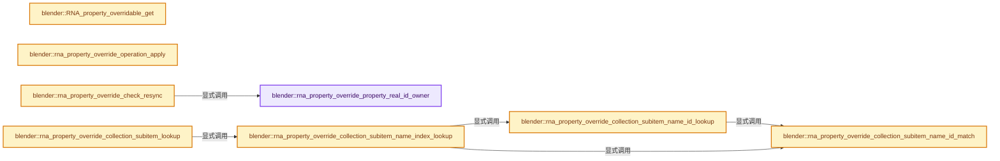
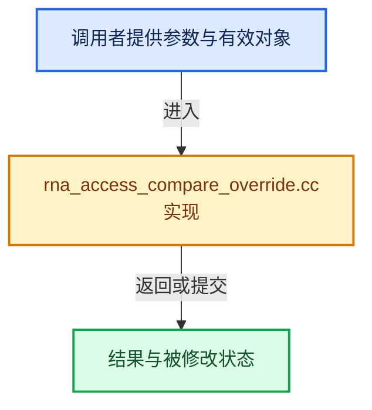

# 实现依赖专题：source/blender/makesrna/intern/rna_access_compare_override.cc

[方向导航](README.md) · [符号索引](../%E7%AC%A6%E5%8F%B7%E4%BE%9D%E8%B5%96%E4%B8%8E%E5%AE%9E%E7%8E%B0%E7%B4%A2%E5%BC%95.md)

本专题从正文实际调用进入，集中保存共享实现。函数有稳定锚点，可从调用处直接跳到对应完整函数；递归与互相调用通过回链组织。

## 本文件的实现关系






## 完整成员与函数实现

<a id="f-e53ae03750643b38"></a>

### `blender::rna_property_override_property_real_id_owner`

实现位置：[source/blender/makesrna/intern/rna_access_compare_override.cc](../../../../../source/blender/makesrna/intern/rna_access_compare_override.cc) · L62—L116。

接口参数：

- `Main *`
- `PointerRNA *ptr`
- `PropertyRNA *prop`
- `std::optional<std::string> *r_rna_path`

**教学注释版**

<!-- annotated:9bf92fbc818761 -->

```cpp
static ID *rna_property_override_property_real_id_owner(Main * /*bmain*/,
                                                        PointerRNA *ptr,
                                                        PropertyRNA *prop,
                                                        std::optional<std::string> *r_rna_path)
{
  ID *id = ptr->owner_id;
  ID *owner_id = id;
  const char *rna_path_prefix = nullptr;

  if (r_rna_path != nullptr) {
    *r_rna_path = std::nullopt;
  }

  if (id == nullptr) {
    return nullptr;
  }

  if (id->flag & (ID_FLAG_EMBEDDED_DATA | ID_FLAG_EMBEDDED_DATA_LIB_OVERRIDE)) {
    /* XXX this is very bad band-aid code, but for now it will do.
     * We should at least use a #define for those prop names.
     * Ideally RNA as a whole should be aware of those PITA of embedded IDs, and have a way to
     * retrieve their owner IDs and generate paths from those.
     */

    switch (GS(id->name)) {
      case ID_KE:
        owner_id = (id_cast<Key *>(id))->from;
        rna_path_prefix = "shape_keys.";
        break;
      case ID_GR:
      case ID_NT:
        /* Master collections, Root node trees. */
        owner_id = RNA_find_real_ID_and_path(id, &rna_path_prefix);
        break;
      default:
        BLI_assert_unreachable();
    }
  }

  if (r_rna_path == nullptr) {
    return owner_id;
  }

  if (std::optional<std::string> rna_path = RNA_path_from_ID_to_property(ptr, prop)) {
    if (rna_path_prefix) {
      r_rna_path->emplace(fmt::format("{}{}", rna_path_prefix, *rna_path));
    }
    else {
      // [讲解] std::move：把表达式转换成可供移动重载选择的值类别；不保证真的移动，不结束源对象寿命，对const值可能选择复制。
      r_rna_path->emplace(std::move(*rna_path));
    }

    return owner_id;
  }
  return nullptr;
}
```

<details>
<summary>核对原始源码：source/blender/makesrna/intern/rna_access_compare_override.cc · L62—L116</summary>

<!-- original:9bf92fbc818761:source/blender/makesrna/intern/rna_access_compare_override.cc:62:116 -->

```cpp
static ID *rna_property_override_property_real_id_owner(Main * /*bmain*/,
                                                        PointerRNA *ptr,
                                                        PropertyRNA *prop,
                                                        std::optional<std::string> *r_rna_path)
{
  ID *id = ptr->owner_id;
  ID *owner_id = id;
  const char *rna_path_prefix = nullptr;

  if (r_rna_path != nullptr) {
    *r_rna_path = std::nullopt;
  }

  if (id == nullptr) {
    return nullptr;
  }

  if (id->flag & (ID_FLAG_EMBEDDED_DATA | ID_FLAG_EMBEDDED_DATA_LIB_OVERRIDE)) {
    /* XXX this is very bad band-aid code, but for now it will do.
     * We should at least use a #define for those prop names.
     * Ideally RNA as a whole should be aware of those PITA of embedded IDs, and have a way to
     * retrieve their owner IDs and generate paths from those.
     */

    switch (GS(id->name)) {
      case ID_KE:
        owner_id = (id_cast<Key *>(id))->from;
        rna_path_prefix = "shape_keys.";
        break;
      case ID_GR:
      case ID_NT:
        /* Master collections, Root node trees. */
        owner_id = RNA_find_real_ID_and_path(id, &rna_path_prefix);
        break;
      default:
        BLI_assert_unreachable();
    }
  }

  if (r_rna_path == nullptr) {
    return owner_id;
  }

  if (std::optional<std::string> rna_path = RNA_path_from_ID_to_property(ptr, prop)) {
    if (rna_path_prefix) {
      r_rna_path->emplace(fmt::format("{}{}", rna_path_prefix, *rna_path));
    }
    else {
      r_rna_path->emplace(std::move(*rna_path));
    }

    return owner_id;
  }
  return nullptr;
}
```

</details>

**沿实际写入检查状态**

- `owner_id = (id_cast<Key *>(id))->from;`
- `rna_path_prefix = "shape_keys.";`
- `owner_id = RNA_find_real_ID_and_path(id, &rna_path_prefix);`

**结果出口**

- `return nullptr;`
- `return owner_id;`

**继续追踪实现**

- `GS` → [blender::GS · L410](%E4%BE%9D%E8%B5%96-DNA_ID-3eb091.md#f-c3ff509f79f21b05)。
- `id_cast<Key *>` → [blender::id_cast · L1417](%E4%BE%9D%E8%B5%96-DNA_ID-3eb091.md#f-6c8ac6412850ac5a)。
- `RNA_find_real_ID_and_path` → [blender::RNA_find_real_ID_and_path · L1015](%E4%BE%9D%E8%B5%96-rna_path-495878.md#f-cabd75a28ae71045)。
- `BLI_assert_unreachable` → [BLI_assert_unreachable · L77](../01-%E5%9F%BA%E7%A1%80%E5%AE%B9%E5%99%A8%E4%B8%8E%E7%8E%B0%E4%BB%A3CPP/%E4%BE%9D%E8%B5%96-BLI_assert-cc98e8.md#m-7a2d91a67d8e)。宏定义由构建条件选择。
- `RNA_path_from_ID_to_property` → [blender::RNA_path_from_ID_to_property · L1234](%E4%BE%9D%E8%B5%96-rna_path-495878.md#f-ef329046496e4c69)。
- `r_rna_path->emplace` → [外部契约](https://eel.is/c++draft/)：这个边界按实际表达式及所属类型核对参数、返回值、寿命与失败行为。这里提供接口入口，不声称已解释该第三方版本的内部实现。
- `fmt::format` → [外部契约](https://fmt.dev/latest/api/)：按fmt接口的格式字符串与参数类型契约使用，格式化不改变被格式化对象的拥有关系。
- `std::move` → [外部契约](https://eel.is/c++draft/utility.forward)：把表达式转换成可供移动重载选择的值类别；不保证真的移动，不结束源对象寿命，对const值可能选择复制。

<a id="f-e22ec73006ac7b00"></a>

### `blender::RNA_property_overridable_get`

实现位置：[source/blender/makesrna/intern/rna_access_compare_override.cc](../../../../../source/blender/makesrna/intern/rna_access_compare_override.cc) · L123—L179。

接口参数：

- `const PointerRNA *ptr`
- `PropertyRNA *prop`

**教学注释版**

<!-- annotated:06a306721e138b -->

```cpp
bool RNA_property_overridable_get(const PointerRNA *ptr, PropertyRNA *prop)
{
  if (prop->magic == RNA_MAGIC) {
    /* Special handling for insertions of constraints or modifiers... */
    /* TODO: Note We may want to add a more generic system to RNA
     * (like a special property in struct of items)
     * if we get more overridable collections,
     * for now we can live with those special-cases handling I think. */
    if (RNA_struct_is_a(ptr->type, RNA_Constraint)) {
      bConstraint *con = static_cast<bConstraint *>(ptr->data);
      if (con->flag & CONSTRAINT_OVERRIDE_LIBRARY_LOCAL) {
        return true;
      }
    }
    else if (!RNA_struct_in_public_namespace(ptr->type)) {
      if (const std::optional<AncestorPointerRNA> ancestor =
              RNA_struct_search_closest_ancestor_by_type(ptr, RNA_Modifier))
      {
        ModifierData *mod = static_cast<ModifierData *>(ancestor->data);
        if (mod->flag & eModifierFlag_OverrideLibrary_Local) {
          return true;
        }
      }
    }
    else if (RNA_struct_is_a(ptr->type, RNA_Modifier)) {
      ModifierData *mod = static_cast<ModifierData *>(ptr->data);
      if (mod->flag & eModifierFlag_OverrideLibrary_Local) {
        return true;
      }
    }
    else if (RNA_struct_is_a(ptr->type, RNA_NlaTrack)) {
      NlaTrack *nla_track = static_cast<NlaTrack *>(ptr->data);
      if (nla_track->flag & NLATRACK_OVERRIDELIBRARY_LOCAL) {
        return true;
      }
    }
    else if (RNA_struct_is_a(ptr->type, RNA_CameraBackgroundImage)) {
      CameraBGImage *bgpic = static_cast<CameraBGImage *>(ptr->data);
      if (bgpic->flag & CAM_BGIMG_FLAG_OVERRIDE_LIBRARY_LOCAL) {
        return true;
      }
    }
    else if (RNA_struct_is_a(ptr->type, RNA_BoneCollection)) {
      BoneCollection *bcoll = static_cast<BoneCollection *>(ptr->data);
      if (bcoll->flags & BONE_COLLECTION_OVERRIDE_LIBRARY_LOCAL) {
        return true;
      }
    }
    /* If this is a RNA-defined property (real or 'virtual' IDProp),
     * we want to use RNA prop flag. */
    return !(prop->flag_override & PROPOVERRIDE_NO_COMPARISON) &&
           (prop->flag_override & PROPOVERRIDE_OVERRIDABLE_LIBRARY);
  }
  /* If this is a real 'pure' IDProp (aka custom property), we want to use the IDProp flag. */
  IDProperty *idprop = reinterpret_cast<IDProperty *>(prop);
  return (idprop->flag & IDP_FLAG_OVERRIDABLE_LIBRARY) != 0;
}
```

<details>
<summary>核对原始源码：source/blender/makesrna/intern/rna_access_compare_override.cc · L123—L179</summary>

<!-- original:06a306721e138b:source/blender/makesrna/intern/rna_access_compare_override.cc:123:179 -->

```cpp
bool RNA_property_overridable_get(const PointerRNA *ptr, PropertyRNA *prop)
{
  if (prop->magic == RNA_MAGIC) {
    /* Special handling for insertions of constraints or modifiers... */
    /* TODO: Note We may want to add a more generic system to RNA
     * (like a special property in struct of items)
     * if we get more overridable collections,
     * for now we can live with those special-cases handling I think. */
    if (RNA_struct_is_a(ptr->type, RNA_Constraint)) {
      bConstraint *con = static_cast<bConstraint *>(ptr->data);
      if (con->flag & CONSTRAINT_OVERRIDE_LIBRARY_LOCAL) {
        return true;
      }
    }
    else if (!RNA_struct_in_public_namespace(ptr->type)) {
      if (const std::optional<AncestorPointerRNA> ancestor =
              RNA_struct_search_closest_ancestor_by_type(ptr, RNA_Modifier))
      {
        ModifierData *mod = static_cast<ModifierData *>(ancestor->data);
        if (mod->flag & eModifierFlag_OverrideLibrary_Local) {
          return true;
        }
      }
    }
    else if (RNA_struct_is_a(ptr->type, RNA_Modifier)) {
      ModifierData *mod = static_cast<ModifierData *>(ptr->data);
      if (mod->flag & eModifierFlag_OverrideLibrary_Local) {
        return true;
      }
    }
    else if (RNA_struct_is_a(ptr->type, RNA_NlaTrack)) {
      NlaTrack *nla_track = static_cast<NlaTrack *>(ptr->data);
      if (nla_track->flag & NLATRACK_OVERRIDELIBRARY_LOCAL) {
        return true;
      }
    }
    else if (RNA_struct_is_a(ptr->type, RNA_CameraBackgroundImage)) {
      CameraBGImage *bgpic = static_cast<CameraBGImage *>(ptr->data);
      if (bgpic->flag & CAM_BGIMG_FLAG_OVERRIDE_LIBRARY_LOCAL) {
        return true;
      }
    }
    else if (RNA_struct_is_a(ptr->type, RNA_BoneCollection)) {
      BoneCollection *bcoll = static_cast<BoneCollection *>(ptr->data);
      if (bcoll->flags & BONE_COLLECTION_OVERRIDE_LIBRARY_LOCAL) {
        return true;
      }
    }
    /* If this is a RNA-defined property (real or 'virtual' IDProp),
     * we want to use RNA prop flag. */
    return !(prop->flag_override & PROPOVERRIDE_NO_COMPARISON) &&
           (prop->flag_override & PROPOVERRIDE_OVERRIDABLE_LIBRARY);
  }
  /* If this is a real 'pure' IDProp (aka custom property), we want to use the IDProp flag. */
  IDProperty *idprop = reinterpret_cast<IDProperty *>(prop);
  return (idprop->flag & IDP_FLAG_OVERRIDABLE_LIBRARY) != 0;
}
```

</details>

**结果出口**

- `return true;`
- `return !(prop->flag_override & PROPOVERRIDE_NO_COMPARISON) &&`
- `return (idprop->flag & IDP_FLAG_OVERRIDABLE_LIBRARY) != 0;`

**继续追踪实现**

- `RNA_struct_is_a` → [blender::RNA_struct_is_a · L833](%E4%BE%9D%E8%B5%96-rna_access-706bea.md#f-9eaabe3c6e731ea5)。
- `RNA_struct_in_public_namespace` → [blender::RNA_struct_in_public_namespace · L798](%E4%BE%9D%E8%B5%96-rna_access-706bea.md#f-0631e4947e67dd12)。
- `RNA_struct_search_closest_ancestor_by_type` → [blender::RNA_struct_search_closest_ancestor_by_type · L1028](%E4%BE%9D%E8%B5%96-rna_access-706bea.md#f-5e12095813527a94)。

<a id="f-7d72686da193a805"></a>

### `blender::rna_property_override_operation_apply`

实现位置：[source/blender/makesrna/intern/rna_access_compare_override.cc](../../../../../source/blender/makesrna/intern/rna_access_compare_override.cc) · L558—L638。

接口参数：

- `Main *bmain`
- `RNAPropertyOverrideApplyContext &rnaapply_ctx`

**教学注释版**

<!-- annotated:4bcedbe5800539 -->

```cpp
static bool rna_property_override_operation_apply(Main *bmain,
                                                  RNAPropertyOverrideApplyContext &rnaapply_ctx)
{
  PointerRNA *ptr_dst = &rnaapply_ctx.ptr_dst;
  PointerRNA *ptr_src = &rnaapply_ctx.ptr_src;
  PointerRNA *ptr_storage = &rnaapply_ctx.ptr_storage;
  PropertyRNA *prop_dst = rnaapply_ctx.prop_dst;
  PropertyRNA *prop_src = rnaapply_ctx.prop_src;
  PropertyRNA *prop_storage = rnaapply_ctx.prop_storage;
  IDOverrideLibraryPropertyOperation *opop = rnaapply_ctx.liboverride_operation;

  const short override_op = opop->operation;

  if (!BKE_lib_override_library_property_operation_operands_validate(
          opop, ptr_dst, ptr_src, ptr_storage, prop_dst, prop_src, prop_storage))
  {
    return false;
  }

  if (override_op == LIBOVERRIDE_OP_NOOP) {
    return true;
  }

  RNAPropOverrideApply override_apply = nullptr;
  /* Special case for IDProps, we use default callback then. */
  if (prop_dst->magic != RNA_MAGIC) {
    override_apply = rna_property_override_apply_default;
    if (prop_src->magic == RNA_MAGIC && !ELEM(prop_src->override_apply, nullptr, override_apply)) {
      override_apply = nullptr;
    }
  }
  else if (prop_src->magic != RNA_MAGIC) {
    override_apply = rna_property_override_apply_default;
    if (!ELEM(prop_dst->override_apply, nullptr, override_apply)) {
      override_apply = nullptr;
    }
  }
  else if (prop_dst->override_apply == prop_src->override_apply) {
    override_apply = prop_dst->override_apply;
    if (override_apply == nullptr) {
      override_apply = rna_property_override_apply_default;
    }
  }

  if (prop_storage && prop_storage->magic == RNA_MAGIC &&
      !ELEM(prop_storage->override_apply, nullptr, override_apply))
  {
    override_apply = nullptr;
  }

  if (override_apply == nullptr) {
    CLOG_ERROR(
        &LOG,
        "'%s' gives unmatching or nullptr RNA apply callbacks, should not happen (%d vs. %d)",
        prop_dst->magic != RNA_MAGIC ? ((IDProperty *)prop_dst)->name :
                                       prop_dst->identifier.c_str(),
        prop_dst->magic == RNA_MAGIC,
        prop_src->magic == RNA_MAGIC);
    BLI_assert_unreachable();
    return false;
  }

  /* get the length of the array to work with */
  rnaapply_ctx.len_dst = RNA_property_array_length(ptr_dst, prop_dst);
  rnaapply_ctx.len_src = RNA_property_array_length(ptr_src, prop_src);
  if (prop_storage) {
    rnaapply_ctx.len_storage = RNA_property_array_length(ptr_storage, prop_storage);
  }

  if (rnaapply_ctx.len_dst != rnaapply_ctx.len_src ||
      (prop_storage && rnaapply_ctx.len_dst != rnaapply_ctx.len_storage))
  {
    /* Do not handle override in that case,
     * we do not support insertion/deletion from arrays for now. */
    return false;
  }

  /* get and set the default values as appropriate for the various types */
  const bool success = override_apply(bmain, rnaapply_ctx);
  return success;
}
```

<details>
<summary>核对原始源码：source/blender/makesrna/intern/rna_access_compare_override.cc · L558—L638</summary>

<!-- original:4bcedbe5800539:source/blender/makesrna/intern/rna_access_compare_override.cc:558:638 -->

```cpp
static bool rna_property_override_operation_apply(Main *bmain,
                                                  RNAPropertyOverrideApplyContext &rnaapply_ctx)
{
  PointerRNA *ptr_dst = &rnaapply_ctx.ptr_dst;
  PointerRNA *ptr_src = &rnaapply_ctx.ptr_src;
  PointerRNA *ptr_storage = &rnaapply_ctx.ptr_storage;
  PropertyRNA *prop_dst = rnaapply_ctx.prop_dst;
  PropertyRNA *prop_src = rnaapply_ctx.prop_src;
  PropertyRNA *prop_storage = rnaapply_ctx.prop_storage;
  IDOverrideLibraryPropertyOperation *opop = rnaapply_ctx.liboverride_operation;

  const short override_op = opop->operation;

  if (!BKE_lib_override_library_property_operation_operands_validate(
          opop, ptr_dst, ptr_src, ptr_storage, prop_dst, prop_src, prop_storage))
  {
    return false;
  }

  if (override_op == LIBOVERRIDE_OP_NOOP) {
    return true;
  }

  RNAPropOverrideApply override_apply = nullptr;
  /* Special case for IDProps, we use default callback then. */
  if (prop_dst->magic != RNA_MAGIC) {
    override_apply = rna_property_override_apply_default;
    if (prop_src->magic == RNA_MAGIC && !ELEM(prop_src->override_apply, nullptr, override_apply)) {
      override_apply = nullptr;
    }
  }
  else if (prop_src->magic != RNA_MAGIC) {
    override_apply = rna_property_override_apply_default;
    if (!ELEM(prop_dst->override_apply, nullptr, override_apply)) {
      override_apply = nullptr;
    }
  }
  else if (prop_dst->override_apply == prop_src->override_apply) {
    override_apply = prop_dst->override_apply;
    if (override_apply == nullptr) {
      override_apply = rna_property_override_apply_default;
    }
  }

  if (prop_storage && prop_storage->magic == RNA_MAGIC &&
      !ELEM(prop_storage->override_apply, nullptr, override_apply))
  {
    override_apply = nullptr;
  }

  if (override_apply == nullptr) {
    CLOG_ERROR(
        &LOG,
        "'%s' gives unmatching or nullptr RNA apply callbacks, should not happen (%d vs. %d)",
        prop_dst->magic != RNA_MAGIC ? ((IDProperty *)prop_dst)->name :
                                       prop_dst->identifier.c_str(),
        prop_dst->magic == RNA_MAGIC,
        prop_src->magic == RNA_MAGIC);
    BLI_assert_unreachable();
    return false;
  }

  /* get the length of the array to work with */
  rnaapply_ctx.len_dst = RNA_property_array_length(ptr_dst, prop_dst);
  rnaapply_ctx.len_src = RNA_property_array_length(ptr_src, prop_src);
  if (prop_storage) {
    rnaapply_ctx.len_storage = RNA_property_array_length(ptr_storage, prop_storage);
  }

  if (rnaapply_ctx.len_dst != rnaapply_ctx.len_src ||
      (prop_storage && rnaapply_ctx.len_dst != rnaapply_ctx.len_storage))
  {
    /* Do not handle override in that case,
     * we do not support insertion/deletion from arrays for now. */
    return false;
  }

  /* get and set the default values as appropriate for the various types */
  const bool success = override_apply(bmain, rnaapply_ctx);
  return success;
}
```

</details>

**沿实际写入检查状态**

- `override_apply = rna_property_override_apply_default;`
- `override_apply = nullptr;`
- `override_apply = prop_dst->override_apply;`
- `rnaapply_ctx.len_dst = RNA_property_array_length(ptr_dst, prop_dst);`
- `rnaapply_ctx.len_src = RNA_property_array_length(ptr_src, prop_src);`
- `rnaapply_ctx.len_storage = RNA_property_array_length(ptr_storage, prop_storage);`

**结果出口**

- `return false;`
- `return true;`
- `return success;`

**继续追踪实现**

- `BKE_lib_override_library_property_operation_operands_validate` → [blender::BKE_lib_override_library_property_operation_operands_validate · L4702](%E4%BE%9D%E8%B5%96-lib_override-90a5a9.md#f-6690e58ab162ff89)。
- `ELEM` → [ELEM · L88](%E4%BE%9D%E8%B5%96-GHOST_utildefines-34b996.md#m-d28724a15928)；[ELEM · L135](../01-%E5%9F%BA%E7%A1%80%E5%AE%B9%E5%99%A8%E4%B8%8E%E7%8E%B0%E4%BB%A3CPP/%E4%BE%9D%E8%B5%96-BLI_utildefines-293a0a.md#m-d6572de7cae0)。宏定义由构建条件选择。
- `CLOG_ERROR` → [CLOG_ERROR · L188](%E4%BE%9D%E8%B5%96-CLG_log-e9051b.md#m-081575cdc8d0)。宏定义由构建条件选择。
- `prop_dst->identifier.c_str` → [调用协议](../%E6%A8%A1%E6%9D%BF%E5%AE%8F%E4%B8%8E%E5%8A%A8%E6%80%81%E5%88%86%E6%B4%BE%E5%8D%8F%E8%AE%AE.md)：接收对象类型依赖auto、返回值或模板实例；不按同名猜测目标。调用位置L613。
- `BLI_assert_unreachable` → [BLI_assert_unreachable · L77](../01-%E5%9F%BA%E7%A1%80%E5%AE%B9%E5%99%A8%E4%B8%8E%E7%8E%B0%E4%BB%A3CPP/%E4%BE%9D%E8%B5%96-BLI_assert-cc98e8.md#m-7a2d91a67d8e)。宏定义由构建条件选择。
- `RNA_property_array_length` → [blender::RNA_property_array_length · L1371](%E4%BE%9D%E8%B5%96-rna_access-706bea.md#f-2258ce063a075147)。
- `override_apply` → [调用协议](../%E6%A8%A1%E6%9D%BF%E5%AE%8F%E4%B8%8E%E5%8A%A8%E6%80%81%E5%88%86%E6%B4%BE%E5%8D%8F%E8%AE%AE.md)：局部可调用对象，须结合其初始化与捕获环境。调用位置L636。

<a id="f-ca9002c9e541a6a8"></a>

### `blender::rna_property_override_collection_subitem_name_id_match`

实现位置：[source/blender/makesrna/intern/rna_access_compare_override.cc](../../../../../source/blender/makesrna/intern/rna_access_compare_override.cc) · L1037—L1071。

接口参数：

- `const char *item_name`
- `const int item_name_len`
- `const bool do_id_pointer`
- `const std::optional<ID *> &item_id`
- `PointerRNA *ptr_item_name`

**教学注释版**

<!-- annotated:85c22c5d88a1d5 -->

```cpp
static bool rna_property_override_collection_subitem_name_id_match(
    const char *item_name,
    const int item_name_len,
    const bool do_id_pointer,
    const std::optional<ID *> &item_id,
    PointerRNA *ptr_item_name)
{
  BLI_assert(!do_id_pointer || RNA_struct_is_ID(ptr_item_name->type));

  bool is_match = false;

  if (do_id_pointer) {
    if (*item_id != static_cast<ID *>(ptr_item_name->data)) {
      /* If the ID pointer does not match, then there is no match, no need to check the
       * name itself. */
      return is_match;
    }
  }

  PropertyRNA *nameprop = ptr_item_name->type->nameproperty;
  char name_buf[256];
  char *name;
  int namelen;

  name = RNA_property_string_get_alloc(
      ptr_item_name, nameprop, name_buf, sizeof(name_buf), &namelen);

  is_match = ((item_name_len == namelen) && STREQ(item_name, name));

  if (name != name_buf) [[unlikely]] {
    MEM_delete(name);
  }

  return is_match;
}
```

<details>
<summary>核对原始源码：source/blender/makesrna/intern/rna_access_compare_override.cc · L1037—L1071</summary>

<!-- original:85c22c5d88a1d5:source/blender/makesrna/intern/rna_access_compare_override.cc:1037:1071 -->

```cpp
static bool rna_property_override_collection_subitem_name_id_match(
    const char *item_name,
    const int item_name_len,
    const bool do_id_pointer,
    const std::optional<ID *> &item_id,
    PointerRNA *ptr_item_name)
{
  BLI_assert(!do_id_pointer || RNA_struct_is_ID(ptr_item_name->type));

  bool is_match = false;

  if (do_id_pointer) {
    if (*item_id != static_cast<ID *>(ptr_item_name->data)) {
      /* If the ID pointer does not match, then there is no match, no need to check the
       * name itself. */
      return is_match;
    }
  }

  PropertyRNA *nameprop = ptr_item_name->type->nameproperty;
  char name_buf[256];
  char *name;
  int namelen;

  name = RNA_property_string_get_alloc(
      ptr_item_name, nameprop, name_buf, sizeof(name_buf), &namelen);

  is_match = ((item_name_len == namelen) && STREQ(item_name, name));

  if (name != name_buf) [[unlikely]] {
    MEM_delete(name);
  }

  return is_match;
}
```

</details>

**沿实际写入检查状态**

- `name = RNA_property_string_get_alloc(`
- `is_match = ((item_name_len == namelen) && STREQ(item_name, name));`

**结果出口**

- `return is_match;`

**继续追踪实现**

- `BLI_assert` → [BLI_assert · L48](../01-%E5%9F%BA%E7%A1%80%E5%AE%B9%E5%99%A8%E4%B8%8E%E7%8E%B0%E4%BB%A3CPP/%E4%BE%9D%E8%B5%96-BLI_assert-cc98e8.md#m-57a88495704d)；[BLI_assert · L63](../01-%E5%9F%BA%E7%A1%80%E5%AE%B9%E5%99%A8%E4%B8%8E%E7%8E%B0%E4%BB%A3CPP/%E4%BE%9D%E8%B5%96-BLI_assert-cc98e8.md#m-d07050020cb5)。宏定义由构建条件选择。
- `RNA_struct_is_ID` → [blender::RNA_struct_is_ID · L793](%E4%BE%9D%E8%B5%96-rna_access-706bea.md#f-d146fa9a7698b857)。
- `RNA_property_string_get_alloc` → [blender::RNA_property_string_get_alloc · L4220](%E4%BE%9D%E8%B5%96-rna_access-706bea.md#f-7aaf908f724ade76)。
- `STREQ` → [STREQ · L112](%E4%BE%9D%E8%B5%96-GHOST_utildefines-34b996.md#m-9549fb6aafd2)；[STREQ · L451](../01-%E5%9F%BA%E7%A1%80%E5%AE%B9%E5%99%A8%E4%B8%8E%E7%8E%B0%E4%BB%A3CPP/%E4%BE%9D%E8%B5%96-BLI_utildefines-293a0a.md#m-c7b745bcfad2)；[STREQ · L55](%E4%BE%9D%E8%B5%96-clog-a0bec8.md#m-96e78f386894)。宏定义由构建条件选择。
- `MEM_delete` → [MEM_delete · L400](../03-%E5%86%85%E5%AD%98%E5%88%86%E9%85%8D%E4%B8%8E%E8%BF%90%E8%A1%8C%E6%97%B6%E7%B1%BB%E5%9E%8B/%E4%BE%9D%E8%B5%96-MEM_guardedalloc-b54eca.md#f-9049ffdd1682887c)。

<a id="f-ec4b9db6ba4be28a"></a>

### `blender::rna_property_override_collection_subitem_name_id_lookup`

实现位置：[source/blender/makesrna/intern/rna_access_compare_override.cc](../../../../../source/blender/makesrna/intern/rna_access_compare_override.cc) · L1073—L1115。

接口参数：

- `PointerRNA *ptr`
- `PropertyRNA *prop`
- `const char *item_name`
- `const int item_name_len`
- `const bool do_id_pointer`
- `const std::optional<ID *> &item_id`
- `PointerRNA *r_ptr_item_name`

**教学注释版**

<!-- annotated:91df917f36aead -->

```cpp
static bool rna_property_override_collection_subitem_name_id_lookup(
    PointerRNA *ptr,
    PropertyRNA *prop,
    const char *item_name,
    const int item_name_len,
    const bool do_id_pointer,
    const std::optional<ID *> &item_id,
    PointerRNA *r_ptr_item_name)
{
  /* NOTE: This code is very similar to the one from #RNA_property_collection_lookup_string_index,
   * but it adds an extra early check on matching ID pointer.
   *
   * This custom code is needed because otherwise, it is only possible to check the first
   * name-matched item found by #RNA_property_collection_lookup_string, and not potential other
   * items having the same name. */
  if (do_id_pointer) {
    BLI_assert(RNA_property_type(prop) == PROP_COLLECTION);

    /* We cannot use a potential `CollectionPropertyRNA->lookupstring` here. */
    CollectionPropertyIterator iter;

    RNA_property_collection_begin(ptr, prop, &iter);
    for (; iter.valid; RNA_property_collection_next(&iter)) {
      if (iter.ptr && iter.ptr.type->nameproperty) {
        if (rna_property_override_collection_subitem_name_id_match(
                item_name, item_name_len, do_id_pointer, item_id, &iter.ptr))
        {
          *r_ptr_item_name = iter.ptr;
          break;
        }
      }
    }
    RNA_property_collection_end(&iter);

    if (!iter.valid) {
      *r_ptr_item_name = {};
    }

    return iter.valid;
  }

  return RNA_property_collection_lookup_string(ptr, prop, item_name, r_ptr_item_name);
}
```

<details>
<summary>核对原始源码：source/blender/makesrna/intern/rna_access_compare_override.cc · L1073—L1115</summary>

<!-- original:91df917f36aead:source/blender/makesrna/intern/rna_access_compare_override.cc:1073:1115 -->

```cpp
static bool rna_property_override_collection_subitem_name_id_lookup(
    PointerRNA *ptr,
    PropertyRNA *prop,
    const char *item_name,
    const int item_name_len,
    const bool do_id_pointer,
    const std::optional<ID *> &item_id,
    PointerRNA *r_ptr_item_name)
{
  /* NOTE: This code is very similar to the one from #RNA_property_collection_lookup_string_index,
   * but it adds an extra early check on matching ID pointer.
   *
   * This custom code is needed because otherwise, it is only possible to check the first
   * name-matched item found by #RNA_property_collection_lookup_string, and not potential other
   * items having the same name. */
  if (do_id_pointer) {
    BLI_assert(RNA_property_type(prop) == PROP_COLLECTION);

    /* We cannot use a potential `CollectionPropertyRNA->lookupstring` here. */
    CollectionPropertyIterator iter;

    RNA_property_collection_begin(ptr, prop, &iter);
    for (; iter.valid; RNA_property_collection_next(&iter)) {
      if (iter.ptr && iter.ptr.type->nameproperty) {
        if (rna_property_override_collection_subitem_name_id_match(
                item_name, item_name_len, do_id_pointer, item_id, &iter.ptr))
        {
          *r_ptr_item_name = iter.ptr;
          break;
        }
      }
    }
    RNA_property_collection_end(&iter);

    if (!iter.valid) {
      *r_ptr_item_name = {};
    }

    return iter.valid;
  }

  return RNA_property_collection_lookup_string(ptr, prop, item_name, r_ptr_item_name);
}
```

</details>

**结果出口**

- `return iter.valid;`
- `return RNA_property_collection_lookup_string(ptr, prop, item_name, r_ptr_item_name);`

**继续追踪实现**

- `BLI_assert` → [BLI_assert · L48](../01-%E5%9F%BA%E7%A1%80%E5%AE%B9%E5%99%A8%E4%B8%8E%E7%8E%B0%E4%BB%A3CPP/%E4%BE%9D%E8%B5%96-BLI_assert-cc98e8.md#m-57a88495704d)；[BLI_assert · L63](../01-%E5%9F%BA%E7%A1%80%E5%AE%B9%E5%99%A8%E4%B8%8E%E7%8E%B0%E4%BB%A3CPP/%E4%BE%9D%E8%B5%96-BLI_assert-cc98e8.md#m-d07050020cb5)。宏定义由构建条件选择。
- `RNA_property_type` → [blender::RNA_property_type · L1293](%E4%BE%9D%E8%B5%96-rna_access-706bea.md#f-4465a90d55f022df)。
- `RNA_property_collection_begin` → [blender::RNA_property_collection_begin · L4905](%E4%BE%9D%E8%B5%96-rna_access-706bea.md#f-98ebef8b103367af)。
- `RNA_property_collection_next` → [blender::RNA_property_collection_next · L4945](%E4%BE%9D%E8%B5%96-rna_access-706bea.md#f-33907850ae4e3cc5)。
- `rna_property_override_collection_subitem_name_id_match` → [blender::rna_property_override_collection_subitem_name_id_match · L1037](%E4%BE%9D%E8%B5%96-rna_access_compare_override-10bd52.md#f-ca9002c9e541a6a8)。
- `RNA_property_collection_end` → [blender::RNA_property_collection_end · L4988](%E4%BE%9D%E8%B5%96-rna_access-706bea.md#f-8a31cfed2ce99cf4)。
- `RNA_property_collection_lookup_string` → [blender::RNA_property_collection_lookup_string · L5415](%E4%BE%9D%E8%B5%96-rna_access-706bea.md#f-8fe2ed5dfd0cabc6)。

<a id="f-88ecd3cee0be124d"></a>

### `blender::rna_property_override_collection_subitem_name_index_lookup`

实现位置：[source/blender/makesrna/intern/rna_access_compare_override.cc](../../../../../source/blender/makesrna/intern/rna_access_compare_override.cc) · L1117—L1174。

接口参数：

- `PointerRNA *ptr`
- `PropertyRNA *prop`
- `const char *item_name`
- `const std::optional<ID *> &item_id`
- `const int item_index`
- `const bool ignore_index_only_lookup`
- `PointerRNA *r_ptr_item_name`
- `PointerRNA *r_ptr_item_index`

**教学注释版**

<!-- annotated:ae77b925805e1b -->

```cpp
static void rna_property_override_collection_subitem_name_index_lookup(
    PointerRNA *ptr,
    PropertyRNA *prop,
    const char *item_name,
    const std::optional<ID *> &item_id,
    const int item_index,
    /* Never use index-only lookup to validate a match (unless no item name (+ id) was given). */
    const bool ignore_index_only_lookup,
    PointerRNA *r_ptr_item_name,
    PointerRNA *r_ptr_item_index)
{
  r_ptr_item_name->invalidate();
  r_ptr_item_index->invalidate();

  const bool do_id_pointer = item_id && RNA_struct_is_ID(RNA_property_pointer_type(ptr, prop));

  const int item_name_len = item_name ? int(strlen(item_name)) : 0;

  /* First, lookup by index, but only validate if name also matches (or if there is no given name).
   *
   * Note that this is also beneficial on performances (when looking up in big collections), since
   * typically index lookup will be faster than name lookup.
   */
  if (item_index != -1) {
    if (RNA_property_collection_lookup_int(ptr, prop, item_index, r_ptr_item_index)) {
      if (item_name && r_ptr_item_index->has_type()) {
        if (rna_property_override_collection_subitem_name_id_match(
                item_name, item_name_len, do_id_pointer, item_id, r_ptr_item_index))
        {
          *r_ptr_item_name = *r_ptr_item_index;
          return;
        }
      }
    }
  }

  if (!item_name) {
    return;
  }

  /* If index + name (+ id) lookup failed, do not keep result of index-only lookup. That means that
   * if the name (+ id) only lookup fails, no matching item was found, even if index-only would
   * have matched. */
  if (ignore_index_only_lookup) {
    r_ptr_item_index->invalidate();
  }

  /* Then, lookup by name (+ id) only. */
  if (rna_property_override_collection_subitem_name_id_lookup(
          ptr, prop, item_name, item_name_len, do_id_pointer, item_id, r_ptr_item_name))
  {
    r_ptr_item_index->invalidate();
    return;
  }

  /* If name (+ id) lookup failed, `r_ptr_item_name` is invalidated, so if index lookup was
   * successful it will be the only valid return value. */
}
```

<details>
<summary>核对原始源码：source/blender/makesrna/intern/rna_access_compare_override.cc · L1117—L1174</summary>

<!-- original:ae77b925805e1b:source/blender/makesrna/intern/rna_access_compare_override.cc:1117:1174 -->

```cpp
static void rna_property_override_collection_subitem_name_index_lookup(
    PointerRNA *ptr,
    PropertyRNA *prop,
    const char *item_name,
    const std::optional<ID *> &item_id,
    const int item_index,
    /* Never use index-only lookup to validate a match (unless no item name (+ id) was given). */
    const bool ignore_index_only_lookup,
    PointerRNA *r_ptr_item_name,
    PointerRNA *r_ptr_item_index)
{
  r_ptr_item_name->invalidate();
  r_ptr_item_index->invalidate();

  const bool do_id_pointer = item_id && RNA_struct_is_ID(RNA_property_pointer_type(ptr, prop));

  const int item_name_len = item_name ? int(strlen(item_name)) : 0;

  /* First, lookup by index, but only validate if name also matches (or if there is no given name).
   *
   * Note that this is also beneficial on performances (when looking up in big collections), since
   * typically index lookup will be faster than name lookup.
   */
  if (item_index != -1) {
    if (RNA_property_collection_lookup_int(ptr, prop, item_index, r_ptr_item_index)) {
      if (item_name && r_ptr_item_index->has_type()) {
        if (rna_property_override_collection_subitem_name_id_match(
                item_name, item_name_len, do_id_pointer, item_id, r_ptr_item_index))
        {
          *r_ptr_item_name = *r_ptr_item_index;
          return;
        }
      }
    }
  }

  if (!item_name) {
    return;
  }

  /* If index + name (+ id) lookup failed, do not keep result of index-only lookup. That means that
   * if the name (+ id) only lookup fails, no matching item was found, even if index-only would
   * have matched. */
  if (ignore_index_only_lookup) {
    r_ptr_item_index->invalidate();
  }

  /* Then, lookup by name (+ id) only. */
  if (rna_property_override_collection_subitem_name_id_lookup(
          ptr, prop, item_name, item_name_len, do_id_pointer, item_id, r_ptr_item_name))
  {
    r_ptr_item_index->invalidate();
    return;
  }

  /* If name (+ id) lookup failed, `r_ptr_item_name` is invalidated, so if index lookup was
   * successful it will be the only valid return value. */
}
```

</details>

**继续追踪实现**

- `r_ptr_item_name->invalidate` → [blender::PointerRNA::invalidate · L125](%E4%BE%9D%E8%B5%96-RNA_types-240f9f.md#f-94ef17636fa837af)。
- `r_ptr_item_index->invalidate` → [blender::PointerRNA::invalidate · L125](%E4%BE%9D%E8%B5%96-RNA_types-240f9f.md#f-94ef17636fa837af)。
- `RNA_struct_is_ID` → [blender::RNA_struct_is_ID · L793](%E4%BE%9D%E8%B5%96-rna_access-706bea.md#f-d146fa9a7698b857)。
- `RNA_property_pointer_type` → [blender::RNA_property_pointer_type · L1711](%E4%BE%9D%E8%B5%96-rna_access-706bea.md#f-f3071b5e5c0730f5)。
- `strlen` → [外部契约](https://eel.is/c++draft/)：这个边界按实际表达式及所属类型核对参数、返回值、寿命与失败行为。这里提供接口入口，不声称已解释该第三方版本的内部实现。
- `RNA_property_collection_lookup_int` → [blender::RNA_property_collection_lookup_int · L5317](%E4%BE%9D%E8%B5%96-rna_access-706bea.md#f-6df8f319957cdab2)。
- `r_ptr_item_index->has_type` → [blender::PointerRNA::has_type · L180](%E4%BE%9D%E8%B5%96-RNA_types-240f9f.md#f-6af0d77c8dc96e2d)。
- `rna_property_override_collection_subitem_name_id_match` → [blender::rna_property_override_collection_subitem_name_id_match · L1037](%E4%BE%9D%E8%B5%96-rna_access_compare_override-10bd52.md#f-ca9002c9e541a6a8)。
- `rna_property_override_collection_subitem_name_id_lookup` → [blender::rna_property_override_collection_subitem_name_id_lookup · L1073](%E4%BE%9D%E8%B5%96-rna_access_compare_override-10bd52.md#f-ec4b9db6ba4be28a)。

<a id="f-d84d54adceffb318"></a>

### `blender::rna_property_override_collection_subitem_lookup`

实现位置：[source/blender/makesrna/intern/rna_access_compare_override.cc](../../../../../source/blender/makesrna/intern/rna_access_compare_override.cc) · L1176—L1390。

接口参数：

- `RNAPropertyOverrideApplyContext &rnaapply_ctx`

**教学注释版**

<!-- annotated:9e58949e3894fb -->

```cpp
static void rna_property_override_collection_subitem_lookup(
    RNAPropertyOverrideApplyContext &rnaapply_ctx)
{
  PointerRNA *ptr_dst = &rnaapply_ctx.ptr_dst;
  PointerRNA *ptr_src = &rnaapply_ctx.ptr_src;
  PointerRNA *ptr_storage = &rnaapply_ctx.ptr_storage;
  PropertyRNA *prop_dst = rnaapply_ctx.prop_dst;
  PropertyRNA *prop_src = rnaapply_ctx.prop_src;
  PropertyRNA *prop_storage = rnaapply_ctx.prop_storage;
  PointerRNA *ptr_item_dst = &rnaapply_ctx.ptr_item_dst;
  PointerRNA *ptr_item_src = &rnaapply_ctx.ptr_item_src;
  PointerRNA *ptr_item_storage = &rnaapply_ctx.ptr_item_storage;
  IDOverrideLibraryProperty *op = rnaapply_ctx.liboverride_property;
  IDOverrideLibraryPropertyOperation *opop = rnaapply_ctx.liboverride_operation;

  if ((RNA_property_type(prop_dst) != PROP_COLLECTION ||
       RNA_property_type(prop_src) != PROP_COLLECTION ||
       (prop_storage != nullptr && RNA_property_type(prop_storage) != PROP_COLLECTION)) ||
      (opop->subitem_local_name == nullptr && opop->subitem_reference_name == nullptr &&
       opop->subitem_local_index == -1 && opop->subitem_reference_index == -1))
  {
    return;
  }

  const bool use_id_pointer = (opop->flag & LIBOVERRIDE_OP_FLAG_IDPOINTER_ITEM_USE_ID) != 0;
  std::optional<ID *> subitem_local_id = use_id_pointer ? std::optional(opop->subitem_local_id) :
                                                          std::nullopt;
  std::optional<ID *> subitem_reference_id = use_id_pointer ?
                                                 std::optional(opop->subitem_reference_id) :
                                                 std::nullopt;

  ptr_item_dst->invalidate();
  ptr_item_src->invalidate();
  if (prop_storage != nullptr) {
    ptr_item_storage->invalidate();
  }

  /* If there is an item ID, there should _always_ be a valid item name too. */
  BLI_assert(opop->subitem_local_name || !subitem_local_id);
  BLI_assert(opop->subitem_reference_name || !subitem_reference_id);
  /* Do not match by index only, if there are valid item names and ID.
   *
   * Otherwise, it can end up 'matching by index' e.g. collection children, re-assigning
   * completely wrong collections only based on indices. This is especially bad when some
   * collections are _removed_ from the reference collection's children. */
  const bool ignore_index_only_lookup = (subitem_local_id || subitem_reference_id);

  PointerRNA ptr_item_dst_name, ptr_item_dst_index;
  PointerRNA ptr_item_src_name, ptr_item_src_index;
  PointerRNA ptr_item_storage_name, ptr_item_storage_index;
  rna_property_override_collection_subitem_name_index_lookup(ptr_src,
                                                             prop_src,
                                                             opop->subitem_local_name,
                                                             subitem_local_id,
                                                             opop->subitem_local_index,
                                                             ignore_index_only_lookup,
                                                             &ptr_item_src_name,
                                                             &ptr_item_src_index);
  rna_property_override_collection_subitem_name_index_lookup(ptr_dst,
                                                             prop_dst,
                                                             opop->subitem_reference_name,
                                                             subitem_reference_id,
                                                             opop->subitem_reference_index,
                                                             ignore_index_only_lookup,
                                                             &ptr_item_dst_name,
                                                             &ptr_item_dst_index);
  /* This is rather fragile, but the fact that local override IDs may have a different name
   * than their linked reference makes it necessary.
   * Basically, here we are considering that if we cannot find the original linked ID in
   * the local override we are (re-)applying the operations, then it may be because some of
   * those operations have already been applied, and we may already have the local ID
   * pointer we want to set.
   * This happens e.g. during re-sync of an override, since we have already remapped all ID
   * pointers to their expected values.
   * In that case we simply try to get the property from the local expected name. */
  if (opop->subitem_reference_name != nullptr && opop->subitem_local_name != nullptr &&
      !ptr_item_dst_name.has_type())
  {
    rna_property_override_collection_subitem_name_index_lookup(
        ptr_dst,
        prop_dst,
        opop->subitem_local_name,
        {},
        opop->subitem_reference_index != -1 ? opop->subitem_reference_index :
                                              opop->subitem_local_index,
        ignore_index_only_lookup,
        &ptr_item_dst_name,
        &ptr_item_dst_index);
  }

  /* For historical compatibility reasons, we fallback to reference if no local item info is given,
   * and vice-versa. */
  if (opop->subitem_reference_name == nullptr && opop->subitem_local_name != nullptr) {
    rna_property_override_collection_subitem_name_index_lookup(
        ptr_dst,
        prop_dst,
        opop->subitem_local_name,
        {},
        opop->subitem_reference_index != -1 ? opop->subitem_reference_index :
                                              opop->subitem_local_index,
        ignore_index_only_lookup,
        &ptr_item_dst_name,
        &ptr_item_dst_index);
  }
  else if (opop->subitem_reference_name != nullptr && opop->subitem_local_name == nullptr) {
    rna_property_override_collection_subitem_name_index_lookup(ptr_src,
                                                               prop_src,
                                                               opop->subitem_reference_name,
                                                               {},
                                                               opop->subitem_local_index != -1 ?
                                                                   opop->subitem_local_index :
                                                                   opop->subitem_reference_index,
                                                               ignore_index_only_lookup,
                                                               &ptr_item_src_name,
                                                               &ptr_item_src_index);
  }
  if (opop->subitem_reference_index == -1 && opop->subitem_local_index != -1) {
    rna_property_override_collection_subitem_name_index_lookup(ptr_dst,
                                                               prop_dst,
                                                               nullptr,
                                                               {},
                                                               opop->subitem_local_index,
                                                               ignore_index_only_lookup,
                                                               &ptr_item_dst_name,
                                                               &ptr_item_dst_index);
  }
  else if (opop->subitem_reference_index != -1 && opop->subitem_local_index == -1) {
    rna_property_override_collection_subitem_name_index_lookup(ptr_src,
                                                               prop_src,
                                                               nullptr,
                                                               {},
                                                               opop->subitem_reference_index,
                                                               ignore_index_only_lookup,
                                                               &ptr_item_src_name,
                                                               &ptr_item_src_index);
  }

  /* For storage, simply lookup by name first, and fallback to indices. */
  if (prop_storage != nullptr) {
    rna_property_override_collection_subitem_name_index_lookup(ptr_storage,
                                                               prop_storage,
                                                               opop->subitem_local_name,
                                                               subitem_local_id,
                                                               opop->subitem_local_index,
                                                               ignore_index_only_lookup,
                                                               &ptr_item_storage_name,
                                                               &ptr_item_storage_index);
    if (!ptr_item_storage_name) {
      rna_property_override_collection_subitem_name_index_lookup(ptr_storage,
                                                                 prop_storage,
                                                                 opop->subitem_reference_name,
                                                                 subitem_reference_id,
                                                                 opop->subitem_reference_index,
                                                                 ignore_index_only_lookup,
                                                                 &ptr_item_storage_name,
                                                                 &ptr_item_storage_index);
    }
    if (!ptr_item_storage_name && !ptr_item_storage_index) {
      rna_property_override_collection_subitem_name_index_lookup(ptr_storage,
                                                                 prop_storage,
                                                                 nullptr,
                                                                 {},
                                                                 opop->subitem_local_index,
                                                                 ignore_index_only_lookup,
                                                                 &ptr_item_storage_name,
                                                                 &ptr_item_storage_index);
    }
  }

  /* Final selection. Both matches have to be based on names, or indices, but not a mix of both.
   * If we are missing either source or destination data based on names, and based on indices, then
   * use partial data from names (allows to handle 'need resync' detection cases). */
  if ((ptr_item_src_name.has_type() || ptr_item_dst_name.has_type()) &&
      !(ptr_item_src_index.has_type() && ptr_item_dst_index.has_type()))
  {
    *ptr_item_src = ptr_item_src_name;
    *ptr_item_dst = ptr_item_dst_name;
    if (prop_storage != nullptr) {
      *ptr_item_storage = ptr_item_storage_name;
    }
  }
  else if (ptr_item_src_index.has_type() || ptr_item_dst_index.has_type()) {
    *ptr_item_src = ptr_item_src_index;
    *ptr_item_dst = ptr_item_dst_index;
    if (prop_storage != nullptr) {
      *ptr_item_storage = ptr_item_storage_index;
    }
  }

  /* Note that there is no reason to report in case no item is expected, i.e. in case subitem name
   * and index are invalid. This can often happen when inserting new items (constraint,
   * modifier...) in a collection that supports it. */
  if (!ptr_item_dst->has_type() &&
      ((opop->subitem_reference_name != nullptr && opop->subitem_reference_name[0] != '\0') ||
       opop->subitem_reference_index != -1))
  {
    CLOG_DEBUG(&LOG,
               "Failed to find destination sub-item '%s' (%d) of '%s' in new override data '%s'",
               opop->subitem_reference_name != nullptr ? opop->subitem_reference_name : "",
               opop->subitem_reference_index,
               op->rna_path,
               ptr_dst->owner_id->name);
  }
  if (!ptr_item_src->has_type() &&
      ((opop->subitem_local_name != nullptr && opop->subitem_local_name[0] != '\0') ||
       opop->subitem_local_index != -1))
  {
    CLOG_DEBUG(&LOG,
               "Failed to find source sub-item '%s' (%d) of '%s' in old override data '%s'",
               opop->subitem_local_name != nullptr ? opop->subitem_local_name : "",
               opop->subitem_local_index,
               op->rna_path,
               ptr_src->owner_id->name);
  }
}
```

<details>
<summary>核对原始源码：source/blender/makesrna/intern/rna_access_compare_override.cc · L1176—L1390</summary>

<!-- original:9e58949e3894fb:source/blender/makesrna/intern/rna_access_compare_override.cc:1176:1390 -->

```cpp
static void rna_property_override_collection_subitem_lookup(
    RNAPropertyOverrideApplyContext &rnaapply_ctx)
{
  PointerRNA *ptr_dst = &rnaapply_ctx.ptr_dst;
  PointerRNA *ptr_src = &rnaapply_ctx.ptr_src;
  PointerRNA *ptr_storage = &rnaapply_ctx.ptr_storage;
  PropertyRNA *prop_dst = rnaapply_ctx.prop_dst;
  PropertyRNA *prop_src = rnaapply_ctx.prop_src;
  PropertyRNA *prop_storage = rnaapply_ctx.prop_storage;
  PointerRNA *ptr_item_dst = &rnaapply_ctx.ptr_item_dst;
  PointerRNA *ptr_item_src = &rnaapply_ctx.ptr_item_src;
  PointerRNA *ptr_item_storage = &rnaapply_ctx.ptr_item_storage;
  IDOverrideLibraryProperty *op = rnaapply_ctx.liboverride_property;
  IDOverrideLibraryPropertyOperation *opop = rnaapply_ctx.liboverride_operation;

  if ((RNA_property_type(prop_dst) != PROP_COLLECTION ||
       RNA_property_type(prop_src) != PROP_COLLECTION ||
       (prop_storage != nullptr && RNA_property_type(prop_storage) != PROP_COLLECTION)) ||
      (opop->subitem_local_name == nullptr && opop->subitem_reference_name == nullptr &&
       opop->subitem_local_index == -1 && opop->subitem_reference_index == -1))
  {
    return;
  }

  const bool use_id_pointer = (opop->flag & LIBOVERRIDE_OP_FLAG_IDPOINTER_ITEM_USE_ID) != 0;
  std::optional<ID *> subitem_local_id = use_id_pointer ? std::optional(opop->subitem_local_id) :
                                                          std::nullopt;
  std::optional<ID *> subitem_reference_id = use_id_pointer ?
                                                 std::optional(opop->subitem_reference_id) :
                                                 std::nullopt;

  ptr_item_dst->invalidate();
  ptr_item_src->invalidate();
  if (prop_storage != nullptr) {
    ptr_item_storage->invalidate();
  }

  /* If there is an item ID, there should _always_ be a valid item name too. */
  BLI_assert(opop->subitem_local_name || !subitem_local_id);
  BLI_assert(opop->subitem_reference_name || !subitem_reference_id);
  /* Do not match by index only, if there are valid item names and ID.
   *
   * Otherwise, it can end up 'matching by index' e.g. collection children, re-assigning
   * completely wrong collections only based on indices. This is especially bad when some
   * collections are _removed_ from the reference collection's children. */
  const bool ignore_index_only_lookup = (subitem_local_id || subitem_reference_id);

  PointerRNA ptr_item_dst_name, ptr_item_dst_index;
  PointerRNA ptr_item_src_name, ptr_item_src_index;
  PointerRNA ptr_item_storage_name, ptr_item_storage_index;
  rna_property_override_collection_subitem_name_index_lookup(ptr_src,
                                                             prop_src,
                                                             opop->subitem_local_name,
                                                             subitem_local_id,
                                                             opop->subitem_local_index,
                                                             ignore_index_only_lookup,
                                                             &ptr_item_src_name,
                                                             &ptr_item_src_index);
  rna_property_override_collection_subitem_name_index_lookup(ptr_dst,
                                                             prop_dst,
                                                             opop->subitem_reference_name,
                                                             subitem_reference_id,
                                                             opop->subitem_reference_index,
                                                             ignore_index_only_lookup,
                                                             &ptr_item_dst_name,
                                                             &ptr_item_dst_index);
  /* This is rather fragile, but the fact that local override IDs may have a different name
   * than their linked reference makes it necessary.
   * Basically, here we are considering that if we cannot find the original linked ID in
   * the local override we are (re-)applying the operations, then it may be because some of
   * those operations have already been applied, and we may already have the local ID
   * pointer we want to set.
   * This happens e.g. during re-sync of an override, since we have already remapped all ID
   * pointers to their expected values.
   * In that case we simply try to get the property from the local expected name. */
  if (opop->subitem_reference_name != nullptr && opop->subitem_local_name != nullptr &&
      !ptr_item_dst_name.has_type())
  {
    rna_property_override_collection_subitem_name_index_lookup(
        ptr_dst,
        prop_dst,
        opop->subitem_local_name,
        {},
        opop->subitem_reference_index != -1 ? opop->subitem_reference_index :
                                              opop->subitem_local_index,
        ignore_index_only_lookup,
        &ptr_item_dst_name,
        &ptr_item_dst_index);
  }

  /* For historical compatibility reasons, we fallback to reference if no local item info is given,
   * and vice-versa. */
  if (opop->subitem_reference_name == nullptr && opop->subitem_local_name != nullptr) {
    rna_property_override_collection_subitem_name_index_lookup(
        ptr_dst,
        prop_dst,
        opop->subitem_local_name,
        {},
        opop->subitem_reference_index != -1 ? opop->subitem_reference_index :
                                              opop->subitem_local_index,
        ignore_index_only_lookup,
        &ptr_item_dst_name,
        &ptr_item_dst_index);
  }
  else if (opop->subitem_reference_name != nullptr && opop->subitem_local_name == nullptr) {
    rna_property_override_collection_subitem_name_index_lookup(ptr_src,
                                                               prop_src,
                                                               opop->subitem_reference_name,
                                                               {},
                                                               opop->subitem_local_index != -1 ?
                                                                   opop->subitem_local_index :
                                                                   opop->subitem_reference_index,
                                                               ignore_index_only_lookup,
                                                               &ptr_item_src_name,
                                                               &ptr_item_src_index);
  }
  if (opop->subitem_reference_index == -1 && opop->subitem_local_index != -1) {
    rna_property_override_collection_subitem_name_index_lookup(ptr_dst,
                                                               prop_dst,
                                                               nullptr,
                                                               {},
                                                               opop->subitem_local_index,
                                                               ignore_index_only_lookup,
                                                               &ptr_item_dst_name,
                                                               &ptr_item_dst_index);
  }
  else if (opop->subitem_reference_index != -1 && opop->subitem_local_index == -1) {
    rna_property_override_collection_subitem_name_index_lookup(ptr_src,
                                                               prop_src,
                                                               nullptr,
                                                               {},
                                                               opop->subitem_reference_index,
                                                               ignore_index_only_lookup,
                                                               &ptr_item_src_name,
                                                               &ptr_item_src_index);
  }

  /* For storage, simply lookup by name first, and fallback to indices. */
  if (prop_storage != nullptr) {
    rna_property_override_collection_subitem_name_index_lookup(ptr_storage,
                                                               prop_storage,
                                                               opop->subitem_local_name,
                                                               subitem_local_id,
                                                               opop->subitem_local_index,
                                                               ignore_index_only_lookup,
                                                               &ptr_item_storage_name,
                                                               &ptr_item_storage_index);
    if (!ptr_item_storage_name) {
      rna_property_override_collection_subitem_name_index_lookup(ptr_storage,
                                                                 prop_storage,
                                                                 opop->subitem_reference_name,
                                                                 subitem_reference_id,
                                                                 opop->subitem_reference_index,
                                                                 ignore_index_only_lookup,
                                                                 &ptr_item_storage_name,
                                                                 &ptr_item_storage_index);
    }
    if (!ptr_item_storage_name && !ptr_item_storage_index) {
      rna_property_override_collection_subitem_name_index_lookup(ptr_storage,
                                                                 prop_storage,
                                                                 nullptr,
                                                                 {},
                                                                 opop->subitem_local_index,
                                                                 ignore_index_only_lookup,
                                                                 &ptr_item_storage_name,
                                                                 &ptr_item_storage_index);
    }
  }

  /* Final selection. Both matches have to be based on names, or indices, but not a mix of both.
   * If we are missing either source or destination data based on names, and based on indices, then
   * use partial data from names (allows to handle 'need resync' detection cases). */
  if ((ptr_item_src_name.has_type() || ptr_item_dst_name.has_type()) &&
      !(ptr_item_src_index.has_type() && ptr_item_dst_index.has_type()))
  {
    *ptr_item_src = ptr_item_src_name;
    *ptr_item_dst = ptr_item_dst_name;
    if (prop_storage != nullptr) {
      *ptr_item_storage = ptr_item_storage_name;
    }
  }
  else if (ptr_item_src_index.has_type() || ptr_item_dst_index.has_type()) {
    *ptr_item_src = ptr_item_src_index;
    *ptr_item_dst = ptr_item_dst_index;
    if (prop_storage != nullptr) {
      *ptr_item_storage = ptr_item_storage_index;
    }
  }

  /* Note that there is no reason to report in case no item is expected, i.e. in case subitem name
   * and index are invalid. This can often happen when inserting new items (constraint,
   * modifier...) in a collection that supports it. */
  if (!ptr_item_dst->has_type() &&
      ((opop->subitem_reference_name != nullptr && opop->subitem_reference_name[0] != '\0') ||
       opop->subitem_reference_index != -1))
  {
    CLOG_DEBUG(&LOG,
               "Failed to find destination sub-item '%s' (%d) of '%s' in new override data '%s'",
               opop->subitem_reference_name != nullptr ? opop->subitem_reference_name : "",
               opop->subitem_reference_index,
               op->rna_path,
               ptr_dst->owner_id->name);
  }
  if (!ptr_item_src->has_type() &&
      ((opop->subitem_local_name != nullptr && opop->subitem_local_name[0] != '\0') ||
       opop->subitem_local_index != -1))
  {
    CLOG_DEBUG(&LOG,
               "Failed to find source sub-item '%s' (%d) of '%s' in old override data '%s'",
               opop->subitem_local_name != nullptr ? opop->subitem_local_name : "",
               opop->subitem_local_index,
               op->rna_path,
               ptr_src->owner_id->name);
  }
}
```

</details>

**继续追踪实现**

- `RNA_property_type` → [blender::RNA_property_type · L1293](%E4%BE%9D%E8%B5%96-rna_access-706bea.md#f-4465a90d55f022df)。
- `std::optional` → [外部契约](https://eel.is/c++draft/)：这个边界按实际表达式及所属类型核对参数、返回值、寿命与失败行为。这里提供接口入口，不声称已解释该第三方版本的内部实现。
- `ptr_item_dst->invalidate` → [blender::PointerRNA::invalidate · L125](%E4%BE%9D%E8%B5%96-RNA_types-240f9f.md#f-94ef17636fa837af)。
- `ptr_item_src->invalidate` → [blender::PointerRNA::invalidate · L125](%E4%BE%9D%E8%B5%96-RNA_types-240f9f.md#f-94ef17636fa837af)。
- `ptr_item_storage->invalidate` → [blender::PointerRNA::invalidate · L125](%E4%BE%9D%E8%B5%96-RNA_types-240f9f.md#f-94ef17636fa837af)。
- `BLI_assert` → [BLI_assert · L48](../01-%E5%9F%BA%E7%A1%80%E5%AE%B9%E5%99%A8%E4%B8%8E%E7%8E%B0%E4%BB%A3CPP/%E4%BE%9D%E8%B5%96-BLI_assert-cc98e8.md#m-57a88495704d)；[BLI_assert · L63](../01-%E5%9F%BA%E7%A1%80%E5%AE%B9%E5%99%A8%E4%B8%8E%E7%8E%B0%E4%BB%A3CPP/%E4%BE%9D%E8%B5%96-BLI_assert-cc98e8.md#m-d07050020cb5)。宏定义由构建条件选择。
- `rna_property_override_collection_subitem_name_index_lookup` → [blender::rna_property_override_collection_subitem_name_index_lookup · L1117](%E4%BE%9D%E8%B5%96-rna_access_compare_override-10bd52.md#f-88ecd3cee0be124d)。
- `ptr_item_dst_name.has_type` → [blender::PointerRNA::has_type · L180](%E4%BE%9D%E8%B5%96-RNA_types-240f9f.md#f-6af0d77c8dc96e2d)。
- `ptr_item_src_name.has_type` → [blender::PointerRNA::has_type · L180](%E4%BE%9D%E8%B5%96-RNA_types-240f9f.md#f-6af0d77c8dc96e2d)。
- `ptr_item_src_index.has_type` → [调用协议](../%E6%A8%A1%E6%9D%BF%E5%AE%8F%E4%B8%8E%E5%8A%A8%E6%80%81%E5%88%86%E6%B4%BE%E5%8D%8F%E8%AE%AE.md)：接收对象类型依赖auto、返回值或模板实例；不按同名猜测目标。调用位置L1349。
- `ptr_item_dst_index.has_type` → [调用协议](../%E6%A8%A1%E6%9D%BF%E5%AE%8F%E4%B8%8E%E5%8A%A8%E6%80%81%E5%88%86%E6%B4%BE%E5%8D%8F%E8%AE%AE.md)：接收对象类型依赖auto、返回值或模板实例；不按同名猜测目标。调用位置L1349。
- `ptr_item_dst->has_type` → [blender::PointerRNA::has_type · L180](%E4%BE%9D%E8%B5%96-RNA_types-240f9f.md#f-6af0d77c8dc96e2d)。
- `CLOG_DEBUG` → [CLOG_DEBUG · L191](%E4%BE%9D%E8%B5%96-CLG_log-e9051b.md#m-e062f5f17675)。宏定义由构建条件选择。
- `ptr_item_src->has_type` → [blender::PointerRNA::has_type · L180](%E4%BE%9D%E8%B5%96-RNA_types-240f9f.md#f-6af0d77c8dc96e2d)。

<a id="f-767717a326b5c077"></a>

### `blender::rna_property_override_check_resync`

实现位置：[source/blender/makesrna/intern/rna_access_compare_override.cc](../../../../../source/blender/makesrna/intern/rna_access_compare_override.cc) · L1392—L1453。

接口参数：

- `Main *bmain`
- `PointerRNA *ptr_dst`
- `PointerRNA *ptr_src`
- `PointerRNA *ptr_item_dst`
- `PointerRNA *ptr_item_src`

**教学注释版**

<!-- annotated:2e45661a6149e7 -->

```cpp
static void rna_property_override_check_resync(Main *bmain,
                                               PointerRNA *ptr_dst,
                                               PointerRNA *ptr_src,
                                               PointerRNA *ptr_item_dst,
                                               PointerRNA *ptr_item_src)
{
  ID *id_owner_src = rna_property_override_property_real_id_owner(
      bmain, ptr_src, nullptr, nullptr);
  ID *id_owner_dst = rna_property_override_property_real_id_owner(
      bmain, ptr_dst, nullptr, nullptr);
  ID *id_src = rna_property_override_property_real_id_owner(bmain, ptr_item_src, nullptr, nullptr);
  ID *id_dst = rna_property_override_property_real_id_owner(bmain, ptr_item_dst, nullptr, nullptr);

  BLI_assert(ID_IS_OVERRIDE_LIBRARY_REAL(id_owner_src));

  /* If the owner ID is not part of an override hierarchy, there is no possible resync. */
  if (id_owner_src->override_library->flag & LIBOVERRIDE_FLAG_NO_HIERARCHY) {
    return;
  }

  /* If `id_src` is not a liboverride, we cannot perform any further 'need resync' checks from
   * here. */
  if (id_src != nullptr && !ID_IS_OVERRIDE_LIBRARY_REAL(id_src)) {
    return;
  }

  if (/* We might be in a case where id_dst has already been processed and its usages
       * remapped to its new local override. In that case overrides and linked data
       * are always properly matching. */
      id_src != id_dst &&
      /* If one of the pointers is nullptr and not the other, we are in a non-matching case. */
      (ELEM(nullptr, id_src, id_dst) ||
       /* If `id_dst` is not from same lib as id_src, and linked reference ID of `id_src` is not
        * `id_dst`, we are in a non-matching case. */
       (id_dst->lib != id_src->lib && id_src->override_library->reference != id_dst) ||
       /* If `id_dst` is from same lib as id_src, and is not same as `id_owner`, we are in a
        * non-matching case.
        *
        * NOTE: Here we are testing if `id_owner` is referencing itself, in that case the new
        * override copy generated by `BKE_lib_override_library_update` will already have its
        * self-references updated to itself, instead of still pointing to its linked source. */
       (id_dst->lib == id_src->lib && id_dst != id_owner_dst)))
  {
    id_owner_dst->tag |= ID_TAG_LIBOVERRIDE_NEED_RESYNC;
    if (ID_IS_LINKED(id_owner_src)) {
      id_owner_src->lib->runtime->tag |= LIBRARY_TAG_RESYNC_REQUIRED;
    }
    CLOG_DEBUG(&LOG,
               "Local override %s detected as needing resync due to mismatch in its used IDs",
               id_owner_dst->name);
  }
  if ((id_owner_src->override_library->reference->tag & ID_TAG_LIBOVERRIDE_NEED_RESYNC) != 0) {
    id_owner_dst->tag |= ID_TAG_LIBOVERRIDE_NEED_RESYNC;
    if (ID_IS_LINKED(id_owner_src)) {
      id_owner_src->lib->runtime->tag |= LIBRARY_TAG_RESYNC_REQUIRED;
    }
    CLOG_DEBUG(&LOG,
               "Local override %s detected as needing resync as its liboverride reference is "
               "already tagged for resync",
               id_owner_dst->name);
  }
}
```

<details>
<summary>核对原始源码：source/blender/makesrna/intern/rna_access_compare_override.cc · L1392—L1453</summary>

<!-- original:2e45661a6149e7:source/blender/makesrna/intern/rna_access_compare_override.cc:1392:1453 -->

```cpp
static void rna_property_override_check_resync(Main *bmain,
                                               PointerRNA *ptr_dst,
                                               PointerRNA *ptr_src,
                                               PointerRNA *ptr_item_dst,
                                               PointerRNA *ptr_item_src)
{
  ID *id_owner_src = rna_property_override_property_real_id_owner(
      bmain, ptr_src, nullptr, nullptr);
  ID *id_owner_dst = rna_property_override_property_real_id_owner(
      bmain, ptr_dst, nullptr, nullptr);
  ID *id_src = rna_property_override_property_real_id_owner(bmain, ptr_item_src, nullptr, nullptr);
  ID *id_dst = rna_property_override_property_real_id_owner(bmain, ptr_item_dst, nullptr, nullptr);

  BLI_assert(ID_IS_OVERRIDE_LIBRARY_REAL(id_owner_src));

  /* If the owner ID is not part of an override hierarchy, there is no possible resync. */
  if (id_owner_src->override_library->flag & LIBOVERRIDE_FLAG_NO_HIERARCHY) {
    return;
  }

  /* If `id_src` is not a liboverride, we cannot perform any further 'need resync' checks from
   * here. */
  if (id_src != nullptr && !ID_IS_OVERRIDE_LIBRARY_REAL(id_src)) {
    return;
  }

  if (/* We might be in a case where id_dst has already been processed and its usages
       * remapped to its new local override. In that case overrides and linked data
       * are always properly matching. */
      id_src != id_dst &&
      /* If one of the pointers is nullptr and not the other, we are in a non-matching case. */
      (ELEM(nullptr, id_src, id_dst) ||
       /* If `id_dst` is not from same lib as id_src, and linked reference ID of `id_src` is not
        * `id_dst`, we are in a non-matching case. */
       (id_dst->lib != id_src->lib && id_src->override_library->reference != id_dst) ||
       /* If `id_dst` is from same lib as id_src, and is not same as `id_owner`, we are in a
        * non-matching case.
        *
        * NOTE: Here we are testing if `id_owner` is referencing itself, in that case the new
        * override copy generated by `BKE_lib_override_library_update` will already have its
        * self-references updated to itself, instead of still pointing to its linked source. */
       (id_dst->lib == id_src->lib && id_dst != id_owner_dst)))
  {
    id_owner_dst->tag |= ID_TAG_LIBOVERRIDE_NEED_RESYNC;
    if (ID_IS_LINKED(id_owner_src)) {
      id_owner_src->lib->runtime->tag |= LIBRARY_TAG_RESYNC_REQUIRED;
    }
    CLOG_DEBUG(&LOG,
               "Local override %s detected as needing resync due to mismatch in its used IDs",
               id_owner_dst->name);
  }
  if ((id_owner_src->override_library->reference->tag & ID_TAG_LIBOVERRIDE_NEED_RESYNC) != 0) {
    id_owner_dst->tag |= ID_TAG_LIBOVERRIDE_NEED_RESYNC;
    if (ID_IS_LINKED(id_owner_src)) {
      id_owner_src->lib->runtime->tag |= LIBRARY_TAG_RESYNC_REQUIRED;
    }
    CLOG_DEBUG(&LOG,
               "Local override %s detected as needing resync as its liboverride reference is "
               "already tagged for resync",
               id_owner_dst->name);
  }
}
```

</details>

**沿实际写入检查状态**

- `id_owner_dst->tag |= ID_TAG_LIBOVERRIDE_NEED_RESYNC;`
- `id_owner_src->lib->runtime->tag |= LIBRARY_TAG_RESYNC_REQUIRED;`

**继续追踪实现**

- `rna_property_override_property_real_id_owner` → [blender::rna_property_override_property_real_id_owner · L62](%E4%BE%9D%E8%B5%96-rna_access_compare_override-10bd52.md#f-e53ae03750643b38)。
- `BLI_assert` → [BLI_assert · L48](../01-%E5%9F%BA%E7%A1%80%E5%AE%B9%E5%99%A8%E4%B8%8E%E7%8E%B0%E4%BB%A3CPP/%E4%BE%9D%E8%B5%96-BLI_assert-cc98e8.md#m-57a88495704d)；[BLI_assert · L63](../01-%E5%9F%BA%E7%A1%80%E5%AE%B9%E5%99%A8%E4%B8%8E%E7%8E%B0%E4%BB%A3CPP/%E4%BE%9D%E8%B5%96-BLI_assert-cc98e8.md#m-d07050020cb5)。宏定义由构建条件选择。
- `ID_IS_OVERRIDE_LIBRARY_REAL` → [ID_IS_OVERRIDE_LIBRARY_REAL · L729](%E4%BE%9D%E8%B5%96-DNA_ID-3eb091.md#m-aad2bb9f5d75)。宏定义由构建条件选择。
- `ELEM` → [ELEM · L88](%E4%BE%9D%E8%B5%96-GHOST_utildefines-34b996.md#m-d28724a15928)；[ELEM · L135](../01-%E5%9F%BA%E7%A1%80%E5%AE%B9%E5%99%A8%E4%B8%8E%E7%8E%B0%E4%BB%A3CPP/%E4%BE%9D%E8%B5%96-BLI_utildefines-293a0a.md#m-d6572de7cae0)。宏定义由构建条件选择。
- `ID_IS_LINKED` → [ID_IS_LINKED · L697](%E4%BE%9D%E8%B5%96-DNA_ID-3eb091.md#m-7e1e1e9b20e6)。宏定义由构建条件选择。
- `CLOG_DEBUG` → [CLOG_DEBUG · L191](%E4%BE%9D%E8%B5%96-CLG_log-e9051b.md#m-e062f5f17675)。宏定义由构建条件选择。

<a id="f-6992368e885767a6"></a>

### `blender::rna_property_override_apply_ex`

实现位置：[source/blender/makesrna/intern/rna_access_compare_override.cc](../../../../../source/blender/makesrna/intern/rna_access_compare_override.cc) · L1455—L1488。

接口参数：

- `Main *bmain`
- `RNAPropertyOverrideApplyContext &rnaapply_ctx`

**教学注释版**

<!-- annotated:4dd2ef6927e81e -->

```cpp
static void rna_property_override_apply_ex(Main *bmain,
                                           RNAPropertyOverrideApplyContext &rnaapply_ctx)
{
  IDOverrideLibraryProperty *op = rnaapply_ctx.liboverride_property;
  const bool do_insert = rnaapply_ctx.do_insert;

  for (IDOverrideLibraryPropertyOperation &opop : op->operations) {
    if (opop.operation == LIBOVERRIDE_OP_NOOP) {
      continue;
    }

    if (!do_insert !=
        !ELEM(opop.operation, LIBOVERRIDE_OP_INSERT_AFTER, LIBOVERRIDE_OP_INSERT_BEFORE))
    {
      if (!do_insert) {
        CLOG_DEBUG(&LOG, "Skipping insert override operations in first pass (%s)", op->rna_path);
      }
      continue;
    }

    rnaapply_ctx.liboverride_operation = &opop;

    rna_property_override_collection_subitem_lookup(rnaapply_ctx);

    if (!rna_property_override_operation_apply(bmain, rnaapply_ctx)) {
      CLOG_DEBUG(&LOG,
                 "Failed to apply '%s' override operation on %s\n",
                 op->rna_path,
                 rnaapply_ctx.ptr_src.owner_id->name);
    }
  }

  rnaapply_ctx.liboverride_operation = nullptr;
}
```

<details>
<summary>核对原始源码：source/blender/makesrna/intern/rna_access_compare_override.cc · L1455—L1488</summary>

<!-- original:4dd2ef6927e81e:source/blender/makesrna/intern/rna_access_compare_override.cc:1455:1488 -->

```cpp
static void rna_property_override_apply_ex(Main *bmain,
                                           RNAPropertyOverrideApplyContext &rnaapply_ctx)
{
  IDOverrideLibraryProperty *op = rnaapply_ctx.liboverride_property;
  const bool do_insert = rnaapply_ctx.do_insert;

  for (IDOverrideLibraryPropertyOperation &opop : op->operations) {
    if (opop.operation == LIBOVERRIDE_OP_NOOP) {
      continue;
    }

    if (!do_insert !=
        !ELEM(opop.operation, LIBOVERRIDE_OP_INSERT_AFTER, LIBOVERRIDE_OP_INSERT_BEFORE))
    {
      if (!do_insert) {
        CLOG_DEBUG(&LOG, "Skipping insert override operations in first pass (%s)", op->rna_path);
      }
      continue;
    }

    rnaapply_ctx.liboverride_operation = &opop;

    rna_property_override_collection_subitem_lookup(rnaapply_ctx);

    if (!rna_property_override_operation_apply(bmain, rnaapply_ctx)) {
      CLOG_DEBUG(&LOG,
                 "Failed to apply '%s' override operation on %s\n",
                 op->rna_path,
                 rnaapply_ctx.ptr_src.owner_id->name);
    }
  }

  rnaapply_ctx.liboverride_operation = nullptr;
}
```

</details>

**沿实际写入检查状态**

- `rnaapply_ctx.liboverride_operation = &opop;`
- `rnaapply_ctx.liboverride_operation = nullptr;`

**继续追踪实现**

- `ELEM` → [ELEM · L88](%E4%BE%9D%E8%B5%96-GHOST_utildefines-34b996.md#m-d28724a15928)；[ELEM · L135](../01-%E5%9F%BA%E7%A1%80%E5%AE%B9%E5%99%A8%E4%B8%8E%E7%8E%B0%E4%BB%A3CPP/%E4%BE%9D%E8%B5%96-BLI_utildefines-293a0a.md#m-d6572de7cae0)。宏定义由构建条件选择。
- `CLOG_DEBUG` → [CLOG_DEBUG · L191](%E4%BE%9D%E8%B5%96-CLG_log-e9051b.md#m-e062f5f17675)。宏定义由构建条件选择。
- `rna_property_override_collection_subitem_lookup` → [blender::rna_property_override_collection_subitem_lookup · L1176](%E4%BE%9D%E8%B5%96-rna_access_compare_override-10bd52.md#f-d84d54adceffb318)。
- `rna_property_override_operation_apply` → [blender::rna_property_override_operation_apply · L558](%E4%BE%9D%E8%B5%96-rna_access_compare_override-10bd52.md#f-7d72686da193a805)。

<a id="f-6836de06617d5324"></a>

### `blender::override_apply_property_check_skip`

实现位置：[source/blender/makesrna/intern/rna_access_compare_override.cc](../../../../../source/blender/makesrna/intern/rna_access_compare_override.cc) · L1494—L1556。

接口参数：

- `Main *bmain`
- `PointerRNA *id_ptr_dst`
- `PointerRNA *id_ptr_src`
- `RNAPropertyOverrideApplyContext &rnaapply_ctx`

**教学注释版**

<!-- annotated:8ba5e8b0574130 -->

```cpp
static bool override_apply_property_check_skip(Main *bmain,
                                               PointerRNA *id_ptr_dst,
                                               PointerRNA *id_ptr_src,
                                               RNAPropertyOverrideApplyContext &rnaapply_ctx)
{
  UNUSED_VARS_NDEBUG(bmain, id_ptr_src);

  if ((rnaapply_ctx.flag & RNA_OVERRIDE_APPLY_FLAG_IGNORE_ID_POINTERS) == 0) {
    return false;
  }

  if (!RNA_struct_is_ID(RNA_property_pointer_type(&rnaapply_ctx.ptr_dst, rnaapply_ctx.prop_dst))) {
    BLI_assert(!RNA_struct_is_ID(
        RNA_property_pointer_type(&rnaapply_ctx.ptr_src, rnaapply_ctx.prop_src)));
    return false;
  }

  IDOverrideLibraryProperty *op = rnaapply_ctx.liboverride_property;

  /* IDProperties case. */
  if (rnaapply_ctx.prop_dst->magic != RNA_MAGIC) {
    CLOG_DEBUG(&LOG,
               "%s: Ignoring local override on ID pointer custom property '%s', as requested by "
               "RNA_OVERRIDE_APPLY_FLAG_IGNORE_ID_POINTERS flag",
               id_ptr_dst->owner_id->name,
               op->rna_path);
    return true;
  }

  switch (op->rna_prop_type) {
    case PROP_POINTER: {
      if ((op->operations.first()->flag & LIBOVERRIDE_OP_FLAG_IDPOINTER_MATCH_REFERENCE) == 0) {
        BLI_assert(id_ptr_src->owner_id == rna_property_override_property_real_id_owner(
                                               bmain, &rnaapply_ctx.ptr_src, nullptr, nullptr));
        BLI_assert(id_ptr_dst->owner_id == rna_property_override_property_real_id_owner(
                                               bmain, &rnaapply_ctx.ptr_dst, nullptr, nullptr));

        CLOG_DEBUG(&LOG,
                   "%s: Ignoring local override on ID pointer property '%s', as requested by "
                   "RNA_OVERRIDE_APPLY_FLAG_IGNORE_ID_POINTERS flag",
                   id_ptr_dst->owner_id->name,
                   op->rna_path);
        return true;
      }
      break;
    }
    case PROP_COLLECTION: {
      /* For collections of ID pointers just completely skip the override ops here... A tad brutal,
       * but this is a backup 'fix the mess' tool, and in practice this should never be an issue.
       * Can always be refined later if needed. */
      CLOG_DEBUG(&LOG,
                 "%s: Ignoring all local override on ID pointer collection property '%s', as "
                 "requested by RNA_OVERRIDE_APPLY_FLAG_IGNORE_ID_POINTERS flag",
                 id_ptr_dst->owner_id->name,
                 op->rna_path);
      return true;
    }
    default:
      break;
  }

  return false;
}
```

<details>
<summary>核对原始源码：source/blender/makesrna/intern/rna_access_compare_override.cc · L1494—L1556</summary>

<!-- original:8ba5e8b0574130:source/blender/makesrna/intern/rna_access_compare_override.cc:1494:1556 -->

```cpp
static bool override_apply_property_check_skip(Main *bmain,
                                               PointerRNA *id_ptr_dst,
                                               PointerRNA *id_ptr_src,
                                               RNAPropertyOverrideApplyContext &rnaapply_ctx)
{
  UNUSED_VARS_NDEBUG(bmain, id_ptr_src);

  if ((rnaapply_ctx.flag & RNA_OVERRIDE_APPLY_FLAG_IGNORE_ID_POINTERS) == 0) {
    return false;
  }

  if (!RNA_struct_is_ID(RNA_property_pointer_type(&rnaapply_ctx.ptr_dst, rnaapply_ctx.prop_dst))) {
    BLI_assert(!RNA_struct_is_ID(
        RNA_property_pointer_type(&rnaapply_ctx.ptr_src, rnaapply_ctx.prop_src)));
    return false;
  }

  IDOverrideLibraryProperty *op = rnaapply_ctx.liboverride_property;

  /* IDProperties case. */
  if (rnaapply_ctx.prop_dst->magic != RNA_MAGIC) {
    CLOG_DEBUG(&LOG,
               "%s: Ignoring local override on ID pointer custom property '%s', as requested by "
               "RNA_OVERRIDE_APPLY_FLAG_IGNORE_ID_POINTERS flag",
               id_ptr_dst->owner_id->name,
               op->rna_path);
    return true;
  }

  switch (op->rna_prop_type) {
    case PROP_POINTER: {
      if ((op->operations.first()->flag & LIBOVERRIDE_OP_FLAG_IDPOINTER_MATCH_REFERENCE) == 0) {
        BLI_assert(id_ptr_src->owner_id == rna_property_override_property_real_id_owner(
                                               bmain, &rnaapply_ctx.ptr_src, nullptr, nullptr));
        BLI_assert(id_ptr_dst->owner_id == rna_property_override_property_real_id_owner(
                                               bmain, &rnaapply_ctx.ptr_dst, nullptr, nullptr));

        CLOG_DEBUG(&LOG,
                   "%s: Ignoring local override on ID pointer property '%s', as requested by "
                   "RNA_OVERRIDE_APPLY_FLAG_IGNORE_ID_POINTERS flag",
                   id_ptr_dst->owner_id->name,
                   op->rna_path);
        return true;
      }
      break;
    }
    case PROP_COLLECTION: {
      /* For collections of ID pointers just completely skip the override ops here... A tad brutal,
       * but this is a backup 'fix the mess' tool, and in practice this should never be an issue.
       * Can always be refined later if needed. */
      CLOG_DEBUG(&LOG,
                 "%s: Ignoring all local override on ID pointer collection property '%s', as "
                 "requested by RNA_OVERRIDE_APPLY_FLAG_IGNORE_ID_POINTERS flag",
                 id_ptr_dst->owner_id->name,
                 op->rna_path);
      return true;
    }
    default:
      break;
  }

  return false;
}
```

</details>

**结果出口**

- `return false;`
- `return true;`

**继续追踪实现**

- `UNUSED_VARS_NDEBUG` → [UNUSED_VARS_NDEBUG · L526](../01-%E5%9F%BA%E7%A1%80%E5%AE%B9%E5%99%A8%E4%B8%8E%E7%8E%B0%E4%BB%A3CPP/%E4%BE%9D%E8%B5%96-BLI_utildefines-293a0a.md#m-fea439f7d366)；[UNUSED_VARS_NDEBUG · L528](../01-%E5%9F%BA%E7%A1%80%E5%AE%B9%E5%99%A8%E4%B8%8E%E7%8E%B0%E4%BB%A3CPP/%E4%BE%9D%E8%B5%96-BLI_utildefines-293a0a.md#m-a8f8cfac06c0)。宏定义由构建条件选择。
- `RNA_struct_is_ID` → [blender::RNA_struct_is_ID · L793](%E4%BE%9D%E8%B5%96-rna_access-706bea.md#f-d146fa9a7698b857)。
- `RNA_property_pointer_type` → [blender::RNA_property_pointer_type · L1711](%E4%BE%9D%E8%B5%96-rna_access-706bea.md#f-f3071b5e5c0730f5)。
- `BLI_assert` → [BLI_assert · L48](../01-%E5%9F%BA%E7%A1%80%E5%AE%B9%E5%99%A8%E4%B8%8E%E7%8E%B0%E4%BB%A3CPP/%E4%BE%9D%E8%B5%96-BLI_assert-cc98e8.md#m-57a88495704d)；[BLI_assert · L63](../01-%E5%9F%BA%E7%A1%80%E5%AE%B9%E5%99%A8%E4%B8%8E%E7%8E%B0%E4%BB%A3CPP/%E4%BE%9D%E8%B5%96-BLI_assert-cc98e8.md#m-d07050020cb5)。宏定义由构建条件选择。
- `CLOG_DEBUG` → [CLOG_DEBUG · L191](%E4%BE%9D%E8%B5%96-CLG_log-e9051b.md#m-e062f5f17675)。宏定义由构建条件选择。
- `op->operations.first` → [调用协议](../%E6%A8%A1%E6%9D%BF%E5%AE%8F%E4%B8%8E%E5%8A%A8%E6%80%81%E5%88%86%E6%B4%BE%E5%8D%8F%E8%AE%AE.md)：接收对象类型依赖auto、返回值或模板实例；不按同名猜测目标。调用位置L1525。
- `rna_property_override_property_real_id_owner` → [blender::rna_property_override_property_real_id_owner · L62](%E4%BE%9D%E8%B5%96-rna_access_compare_override-10bd52.md#f-e53ae03750643b38)。

<a id="f-bf78f2bc6e43fc2e"></a>

### `blender::RNA_struct_override_apply`

实现位置：[source/blender/makesrna/intern/rna_access_compare_override.cc](../../../../../source/blender/makesrna/intern/rna_access_compare_override.cc) · L1558—L1696。

接口参数：

- `Main *bmain`
- `PointerRNA *id_ptr_dst`
- `PointerRNA *id_ptr_src`
- `PointerRNA *id_ptr_storage`
- `IDOverrideLibrary *liboverride`
- `const eRNAOverrideApplyFlag flag`

**教学注释版**

<!-- annotated:1a0316387237f0 -->

```cpp
void RNA_struct_override_apply(Main *bmain,
                               PointerRNA *id_ptr_dst,
                               PointerRNA *id_ptr_src,
                               PointerRNA *id_ptr_storage,
                               IDOverrideLibrary *liboverride,
                               const eRNAOverrideApplyFlag flag)
{
#ifdef DEBUG_OVERRIDE_TIMEIT
  TIMEIT_START_AVERAGED(RNA_struct_override_apply);
#endif
  const bool do_restore_only = (flag & RNA_OVERRIDE_APPLY_FLAG_RESTORE_ONLY) != 0;
  /* NOTE: Applying insert operations in a separate pass is mandatory.
   * We could optimize this later, but for now, as inefficient as it is,
   * don't think this is a critical point.
   */
  bool do_insert = false;
  for (int i = 0; i < (do_restore_only ? 1 : 2); i++, do_insert = true) {
    for (IDOverrideLibraryProperty &op : liboverride->properties) {
      if (do_restore_only && (op.tag % LIBOVERRIDE_PROP_TAG_NEEDS_RETORE) == 0) {
        continue;
      }
      /* That tag should only exist for short lifespan when restoring values from reference linked
       * data. */
      BLI_assert((op.tag & LIBOVERRIDE_PROP_TAG_NEEDS_RETORE) == 0 || do_restore_only);

      RNAPropertyOverrideApplyContext rnaapply_ctx;
      rnaapply_ctx.flag = flag;
      rnaapply_ctx.do_insert = do_insert;

      rnaapply_ctx.liboverride = liboverride;
      rnaapply_ctx.liboverride_property = &op;

      if (!(RNA_path_resolve_property_and_item_pointer(id_ptr_dst,
                                                       op.rna_path,
                                                       &rnaapply_ctx.ptr_dst,
                                                       &rnaapply_ctx.prop_dst,
                                                       &rnaapply_ctx.ptr_item_dst) &&
            RNA_path_resolve_property_and_item_pointer(id_ptr_src,
                                                       op.rna_path,
                                                       &rnaapply_ctx.ptr_src,
                                                       &rnaapply_ctx.prop_src,
                                                       &rnaapply_ctx.ptr_item_src)))
      {
        CLOG_DEBUG(&LOG,
                   "Failed to apply library override operation to '%s.%s' "
                   "(could not resolve some properties, local:  %d, override: %d)",
                   static_cast<ID *>(id_ptr_src->owner_id)->name,
                   op.rna_path,
                   RNA_path_resolve_property(
                       id_ptr_dst, op.rna_path, &rnaapply_ctx.ptr_dst, &rnaapply_ctx.prop_dst),
                   RNA_path_resolve_property(
                       id_ptr_src, op.rna_path, &rnaapply_ctx.ptr_src, &rnaapply_ctx.prop_src));
        continue;
      }

      /* It is totally OK if this does not success,
       * only a subset of override operations actually need storage. */
      if (id_ptr_storage && (id_ptr_storage->owner_id != nullptr)) {
        RNA_path_resolve_property_and_item_pointer(id_ptr_storage,
                                                   op.rna_path,
                                                   &rnaapply_ctx.ptr_storage,
                                                   &rnaapply_ctx.prop_storage,
                                                   &rnaapply_ctx.ptr_item_storage);
      }

      /* Check if an overridden ID pointer supposed to be in sync with linked data gets out of
       * sync. */
      if ((flag & RNA_OVERRIDE_APPLY_FLAG_SKIP_RESYNC_CHECK) == 0 &&
          (id_ptr_dst->owner_id->tag & ID_TAG_LIBOVERRIDE_NEED_RESYNC) == 0)
      {
        if (op.rna_prop_type == PROP_POINTER && op.operations.first_ != nullptr &&
            (op.operations.first()->flag & LIBOVERRIDE_OP_FLAG_IDPOINTER_MATCH_REFERENCE) != 0)
        {
          BLI_assert(RNA_struct_is_ID(
              RNA_property_pointer_type(&rnaapply_ctx.ptr_src, rnaapply_ctx.prop_src)));
          BLI_assert(id_ptr_src->owner_id == rna_property_override_property_real_id_owner(
                                                 bmain, &rnaapply_ctx.ptr_src, nullptr, nullptr));
          BLI_assert(id_ptr_dst->owner_id == rna_property_override_property_real_id_owner(
                                                 bmain, &rnaapply_ctx.ptr_dst, nullptr, nullptr));

          PointerRNA prop_ptr_src = RNA_property_pointer_get(&rnaapply_ctx.ptr_src,
                                                             rnaapply_ctx.prop_src);
          PointerRNA prop_ptr_dst = RNA_property_pointer_get(&rnaapply_ctx.ptr_dst,
                                                             rnaapply_ctx.prop_dst);
          rna_property_override_check_resync(
              bmain, id_ptr_dst, id_ptr_src, &prop_ptr_dst, &prop_ptr_src);
        }
        else if (op.rna_prop_type == PROP_COLLECTION) {
          if (RNA_struct_is_ID(
                  RNA_property_pointer_type(&rnaapply_ctx.ptr_src, rnaapply_ctx.prop_src)))
          {
            BLI_assert(id_ptr_src->owner_id ==
                       rna_property_override_property_real_id_owner(
                           bmain, &rnaapply_ctx.ptr_src, nullptr, nullptr));
            BLI_assert(id_ptr_dst->owner_id ==
                       rna_property_override_property_real_id_owner(
                           bmain, &rnaapply_ctx.ptr_dst, nullptr, nullptr));

            for (IDOverrideLibraryPropertyOperation &opop : op.operations) {
              if ((opop.flag & LIBOVERRIDE_OP_FLAG_IDPOINTER_MATCH_REFERENCE) == 0) {
                continue;
              }
              rnaapply_ctx.liboverride_operation = &opop;

              rna_property_override_collection_subitem_lookup(rnaapply_ctx);

              rna_property_override_check_resync(bmain,
                                                 id_ptr_dst,
                                                 id_ptr_src,
                                                 &rnaapply_ctx.ptr_item_dst,
                                                 &rnaapply_ctx.ptr_item_src);
            }
            rnaapply_ctx.liboverride_operation = nullptr;
          }
        }
      }

      if (override_apply_property_check_skip(bmain, id_ptr_dst, id_ptr_src, rnaapply_ctx)) {
        continue;
      }

      rna_property_override_apply_ex(bmain, rnaapply_ctx);
    }
  }

  /* Some cases (like point caches) may require additional post-processing. */
  if (RNA_struct_is_a(id_ptr_dst->type, RNA_ID)) {
    ID *id_dst = static_cast<ID *>(id_ptr_dst->data);
    ID *id_src = static_cast<ID *>(id_ptr_src->data);
    const IDTypeInfo *id_type = BKE_idtype_get_info_from_id(id_dst);
    if (id_type->lib_override_apply_post != nullptr) {
      id_type->lib_override_apply_post(id_dst, id_src);
    }
  }

#ifdef DEBUG_OVERRIDE_TIMEIT
  TIMEIT_END_AVERAGED(RNA_struct_override_apply);
#endif
}
```

<details>
<summary>核对原始源码：source/blender/makesrna/intern/rna_access_compare_override.cc · L1558—L1696</summary>

<!-- original:1a0316387237f0:source/blender/makesrna/intern/rna_access_compare_override.cc:1558:1696 -->

```cpp
void RNA_struct_override_apply(Main *bmain,
                               PointerRNA *id_ptr_dst,
                               PointerRNA *id_ptr_src,
                               PointerRNA *id_ptr_storage,
                               IDOverrideLibrary *liboverride,
                               const eRNAOverrideApplyFlag flag)
{
#ifdef DEBUG_OVERRIDE_TIMEIT
  TIMEIT_START_AVERAGED(RNA_struct_override_apply);
#endif
  const bool do_restore_only = (flag & RNA_OVERRIDE_APPLY_FLAG_RESTORE_ONLY) != 0;
  /* NOTE: Applying insert operations in a separate pass is mandatory.
   * We could optimize this later, but for now, as inefficient as it is,
   * don't think this is a critical point.
   */
  bool do_insert = false;
  for (int i = 0; i < (do_restore_only ? 1 : 2); i++, do_insert = true) {
    for (IDOverrideLibraryProperty &op : liboverride->properties) {
      if (do_restore_only && (op.tag % LIBOVERRIDE_PROP_TAG_NEEDS_RETORE) == 0) {
        continue;
      }
      /* That tag should only exist for short lifespan when restoring values from reference linked
       * data. */
      BLI_assert((op.tag & LIBOVERRIDE_PROP_TAG_NEEDS_RETORE) == 0 || do_restore_only);

      RNAPropertyOverrideApplyContext rnaapply_ctx;
      rnaapply_ctx.flag = flag;
      rnaapply_ctx.do_insert = do_insert;

      rnaapply_ctx.liboverride = liboverride;
      rnaapply_ctx.liboverride_property = &op;

      if (!(RNA_path_resolve_property_and_item_pointer(id_ptr_dst,
                                                       op.rna_path,
                                                       &rnaapply_ctx.ptr_dst,
                                                       &rnaapply_ctx.prop_dst,
                                                       &rnaapply_ctx.ptr_item_dst) &&
            RNA_path_resolve_property_and_item_pointer(id_ptr_src,
                                                       op.rna_path,
                                                       &rnaapply_ctx.ptr_src,
                                                       &rnaapply_ctx.prop_src,
                                                       &rnaapply_ctx.ptr_item_src)))
      {
        CLOG_DEBUG(&LOG,
                   "Failed to apply library override operation to '%s.%s' "
                   "(could not resolve some properties, local:  %d, override: %d)",
                   static_cast<ID *>(id_ptr_src->owner_id)->name,
                   op.rna_path,
                   RNA_path_resolve_property(
                       id_ptr_dst, op.rna_path, &rnaapply_ctx.ptr_dst, &rnaapply_ctx.prop_dst),
                   RNA_path_resolve_property(
                       id_ptr_src, op.rna_path, &rnaapply_ctx.ptr_src, &rnaapply_ctx.prop_src));
        continue;
      }

      /* It is totally OK if this does not success,
       * only a subset of override operations actually need storage. */
      if (id_ptr_storage && (id_ptr_storage->owner_id != nullptr)) {
        RNA_path_resolve_property_and_item_pointer(id_ptr_storage,
                                                   op.rna_path,
                                                   &rnaapply_ctx.ptr_storage,
                                                   &rnaapply_ctx.prop_storage,
                                                   &rnaapply_ctx.ptr_item_storage);
      }

      /* Check if an overridden ID pointer supposed to be in sync with linked data gets out of
       * sync. */
      if ((flag & RNA_OVERRIDE_APPLY_FLAG_SKIP_RESYNC_CHECK) == 0 &&
          (id_ptr_dst->owner_id->tag & ID_TAG_LIBOVERRIDE_NEED_RESYNC) == 0)
      {
        if (op.rna_prop_type == PROP_POINTER && op.operations.first_ != nullptr &&
            (op.operations.first()->flag & LIBOVERRIDE_OP_FLAG_IDPOINTER_MATCH_REFERENCE) != 0)
        {
          BLI_assert(RNA_struct_is_ID(
              RNA_property_pointer_type(&rnaapply_ctx.ptr_src, rnaapply_ctx.prop_src)));
          BLI_assert(id_ptr_src->owner_id == rna_property_override_property_real_id_owner(
                                                 bmain, &rnaapply_ctx.ptr_src, nullptr, nullptr));
          BLI_assert(id_ptr_dst->owner_id == rna_property_override_property_real_id_owner(
                                                 bmain, &rnaapply_ctx.ptr_dst, nullptr, nullptr));

          PointerRNA prop_ptr_src = RNA_property_pointer_get(&rnaapply_ctx.ptr_src,
                                                             rnaapply_ctx.prop_src);
          PointerRNA prop_ptr_dst = RNA_property_pointer_get(&rnaapply_ctx.ptr_dst,
                                                             rnaapply_ctx.prop_dst);
          rna_property_override_check_resync(
              bmain, id_ptr_dst, id_ptr_src, &prop_ptr_dst, &prop_ptr_src);
        }
        else if (op.rna_prop_type == PROP_COLLECTION) {
          if (RNA_struct_is_ID(
                  RNA_property_pointer_type(&rnaapply_ctx.ptr_src, rnaapply_ctx.prop_src)))
          {
            BLI_assert(id_ptr_src->owner_id ==
                       rna_property_override_property_real_id_owner(
                           bmain, &rnaapply_ctx.ptr_src, nullptr, nullptr));
            BLI_assert(id_ptr_dst->owner_id ==
                       rna_property_override_property_real_id_owner(
                           bmain, &rnaapply_ctx.ptr_dst, nullptr, nullptr));

            for (IDOverrideLibraryPropertyOperation &opop : op.operations) {
              if ((opop.flag & LIBOVERRIDE_OP_FLAG_IDPOINTER_MATCH_REFERENCE) == 0) {
                continue;
              }
              rnaapply_ctx.liboverride_operation = &opop;

              rna_property_override_collection_subitem_lookup(rnaapply_ctx);

              rna_property_override_check_resync(bmain,
                                                 id_ptr_dst,
                                                 id_ptr_src,
                                                 &rnaapply_ctx.ptr_item_dst,
                                                 &rnaapply_ctx.ptr_item_src);
            }
            rnaapply_ctx.liboverride_operation = nullptr;
          }
        }
      }

      if (override_apply_property_check_skip(bmain, id_ptr_dst, id_ptr_src, rnaapply_ctx)) {
        continue;
      }

      rna_property_override_apply_ex(bmain, rnaapply_ctx);
    }
  }

  /* Some cases (like point caches) may require additional post-processing. */
  if (RNA_struct_is_a(id_ptr_dst->type, RNA_ID)) {
    ID *id_dst = static_cast<ID *>(id_ptr_dst->data);
    ID *id_src = static_cast<ID *>(id_ptr_src->data);
    const IDTypeInfo *id_type = BKE_idtype_get_info_from_id(id_dst);
    if (id_type->lib_override_apply_post != nullptr) {
      id_type->lib_override_apply_post(id_dst, id_src);
    }
  }

#ifdef DEBUG_OVERRIDE_TIMEIT
  TIMEIT_END_AVERAGED(RNA_struct_override_apply);
#endif
}
```

</details>

**沿实际写入检查状态**

- `rnaapply_ctx.flag = flag;`
- `rnaapply_ctx.do_insert = do_insert;`
- `rnaapply_ctx.liboverride = liboverride;`
- `rnaapply_ctx.liboverride_property = &op;`
- `rnaapply_ctx.liboverride_operation = &opop;`
- `rnaapply_ctx.liboverride_operation = nullptr;`

**继续追踪实现**

- `TIMEIT_START_AVERAGED` → [TIMEIT_START_AVERAGED · L53](../01-%E5%9F%BA%E7%A1%80%E5%AE%B9%E5%99%A8%E4%B8%8E%E7%8E%B0%E4%BB%A3CPP/%E4%BE%9D%E8%B5%96-BLI_time_utildefines-9e60b7.md#m-ab8739b50e42)。宏定义由构建条件选择。
- `BLI_assert` → [BLI_assert · L48](../01-%E5%9F%BA%E7%A1%80%E5%AE%B9%E5%99%A8%E4%B8%8E%E7%8E%B0%E4%BB%A3CPP/%E4%BE%9D%E8%B5%96-BLI_assert-cc98e8.md#m-57a88495704d)；[BLI_assert · L63](../01-%E5%9F%BA%E7%A1%80%E5%AE%B9%E5%99%A8%E4%B8%8E%E7%8E%B0%E4%BB%A3CPP/%E4%BE%9D%E8%B5%96-BLI_assert-cc98e8.md#m-d07050020cb5)。宏定义由构建条件选择。
- `RNA_path_resolve_property_and_item_pointer` → [blender::RNA_path_resolve_property_and_item_pointer · L623](%E4%BE%9D%E8%B5%96-rna_path-495878.md#f-3aacaeb1ce8798a6)。
- `CLOG_DEBUG` → [CLOG_DEBUG · L191](%E4%BE%9D%E8%B5%96-CLG_log-e9051b.md#m-e062f5f17675)。宏定义由构建条件选择。
- `RNA_path_resolve_property` → [blender::RNA_path_resolve_property · L575](%E4%BE%9D%E8%B5%96-rna_path-495878.md#f-9ccab9d4f53550b5)；[blender::RNA_path_resolve_property · L594](%E4%BE%9D%E8%B5%96-rna_path-495878.md#f-ea2ad4371e6f4b35)。同名重载需按实参类型选择。
- `op.operations.first` → [调用协议](../%E6%A8%A1%E6%9D%BF%E5%AE%8F%E4%B8%8E%E5%8A%A8%E6%80%81%E5%88%86%E6%B4%BE%E5%8D%8F%E8%AE%AE.md)：接收对象类型依赖auto、返回值或模板实例；不按同名猜测目标。调用位置L1629。
- `RNA_struct_is_ID` → [blender::RNA_struct_is_ID · L793](%E4%BE%9D%E8%B5%96-rna_access-706bea.md#f-d146fa9a7698b857)。
- `RNA_property_pointer_type` → [blender::RNA_property_pointer_type · L1711](%E4%BE%9D%E8%B5%96-rna_access-706bea.md#f-f3071b5e5c0730f5)。
- `rna_property_override_property_real_id_owner` → [blender::rna_property_override_property_real_id_owner · L62](%E4%BE%9D%E8%B5%96-rna_access_compare_override-10bd52.md#f-e53ae03750643b38)。
- `RNA_property_pointer_get` → [blender::RNA_property_pointer_get · L4660](%E4%BE%9D%E8%B5%96-rna_access-706bea.md#f-bca774eb7a868daa)。
- `rna_property_override_check_resync` → [blender::rna_property_override_check_resync · L1392](%E4%BE%9D%E8%B5%96-rna_access_compare_override-10bd52.md#f-767717a326b5c077)。
- `rna_property_override_collection_subitem_lookup` → [blender::rna_property_override_collection_subitem_lookup · L1176](%E4%BE%9D%E8%B5%96-rna_access_compare_override-10bd52.md#f-d84d54adceffb318)。
- `override_apply_property_check_skip` → [blender::override_apply_property_check_skip · L1494](%E4%BE%9D%E8%B5%96-rna_access_compare_override-10bd52.md#f-6836de06617d5324)。
- `rna_property_override_apply_ex` → [blender::rna_property_override_apply_ex · L1455](%E4%BE%9D%E8%B5%96-rna_access_compare_override-10bd52.md#f-6992368e885767a6)。
- `RNA_struct_is_a` → [blender::RNA_struct_is_a · L833](%E4%BE%9D%E8%B5%96-rna_access-706bea.md#f-9eaabe3c6e731ea5)。
- `BKE_idtype_get_info_from_id` → [blender::BKE_idtype_get_info_from_id · L232](%E4%BE%9D%E8%B5%96-idtype-cbba99.md#f-9b31985f4ea4750d)。
- `id_type->lib_override_apply_post` → [调用协议](../%E6%A8%A1%E6%9D%BF%E5%AE%8F%E4%B8%8E%E5%8A%A8%E6%80%81%E5%88%86%E6%B4%BE%E5%8D%8F%E8%AE%AE.md)：由接收对象具体类型或运行时策略提供实现。调用位置L1689。
- `TIMEIT_END_AVERAGED` → [TIMEIT_END_AVERAGED · L65](../01-%E5%9F%BA%E7%A1%80%E5%AE%B9%E5%99%A8%E4%B8%8E%E7%8E%B0%E4%BB%A3CPP/%E4%BE%9D%E8%B5%96-BLI_time_utildefines-9e60b7.md#m-3745f6818fb3)。宏定义由构建条件选择。

<a id="f-d204d62cfb6b9ab7"></a>

### `blender::RNA_property_override_property_find`

实现位置：[source/blender/makesrna/intern/rna_access_compare_override.cc](../../../../../source/blender/makesrna/intern/rna_access_compare_override.cc) · L1698—L1712。

接口参数：

- `Main *bmain`
- `PointerRNA *ptr`
- `PropertyRNA *prop`
- `ID **r_owner_id`

**教学注释版**

<!-- annotated:10ddfcdccc5266 -->

```cpp
IDOverrideLibraryProperty *RNA_property_override_property_find(Main *bmain,
                                                               PointerRNA *ptr,
                                                               PropertyRNA *prop,
                                                               ID **r_owner_id)
{
  std::optional<std::string> rna_path;

  *r_owner_id = rna_property_override_property_real_id_owner(bmain, ptr, prop, &rna_path);
  if (rna_path) {
    IDOverrideLibraryProperty *op = BKE_lib_override_library_property_find(
        (*r_owner_id)->override_library, rna_path->c_str());
    return op;
  }
  return nullptr;
}
```

<details>
<summary>核对原始源码：source/blender/makesrna/intern/rna_access_compare_override.cc · L1698—L1712</summary>

<!-- original:10ddfcdccc5266:source/blender/makesrna/intern/rna_access_compare_override.cc:1698:1712 -->

```cpp
IDOverrideLibraryProperty *RNA_property_override_property_find(Main *bmain,
                                                               PointerRNA *ptr,
                                                               PropertyRNA *prop,
                                                               ID **r_owner_id)
{
  std::optional<std::string> rna_path;

  *r_owner_id = rna_property_override_property_real_id_owner(bmain, ptr, prop, &rna_path);
  if (rna_path) {
    IDOverrideLibraryProperty *op = BKE_lib_override_library_property_find(
        (*r_owner_id)->override_library, rna_path->c_str());
    return op;
  }
  return nullptr;
}
```

</details>

**结果出口**

- `return op;`
- `return nullptr;`

**继续追踪实现**

- `rna_property_override_property_real_id_owner` → [blender::rna_property_override_property_real_id_owner · L62](%E4%BE%9D%E8%B5%96-rna_access_compare_override-10bd52.md#f-e53ae03750643b38)。
- `BKE_lib_override_library_property_find` → [blender::BKE_lib_override_library_property_find · L4296](%E4%BE%9D%E8%B5%96-lib_override-90a5a9.md#f-89bb6dd7701212a4)。
- `rna_path->c_str` → [外部契约](https://eel.is/c++draft/)：这个边界按实际表达式及所属类型核对参数、返回值、寿命与失败行为。这里提供接口入口，不声称已解释该第三方版本的内部实现。

<a id="f-2b763072de4a2042"></a>

### `blender::RNA_property_override_property_operation_find`

实现位置：[source/blender/makesrna/intern/rna_access_compare_override.cc](../../../../../source/blender/makesrna/intern/rna_access_compare_override.cc) · L1734—L1751。

接口参数：

- `Main *bmain`
- `PointerRNA *ptr`
- `PropertyRNA *prop`
- `const int index`
- `const bool strict`
- `bool *r_strict`

**教学注释版**

<!-- annotated:680b1fbed8c6d5 -->

```cpp
IDOverrideLibraryPropertyOperation *RNA_property_override_property_operation_find(
    Main *bmain,
    PointerRNA *ptr,
    PropertyRNA *prop,
    const int index,
    const bool strict,
    bool *r_strict)
{
  ID *owner_id;
  IDOverrideLibraryProperty *op = RNA_property_override_property_find(bmain, ptr, prop, &owner_id);

  if (!op) {
    return nullptr;
  }

  return BKE_lib_override_library_property_operation_find(
      op, nullptr, nullptr, {}, {}, index, index, strict, r_strict);
}
```

<details>
<summary>核对原始源码：source/blender/makesrna/intern/rna_access_compare_override.cc · L1734—L1751</summary>

<!-- original:680b1fbed8c6d5:source/blender/makesrna/intern/rna_access_compare_override.cc:1734:1751 -->

```cpp
IDOverrideLibraryPropertyOperation *RNA_property_override_property_operation_find(
    Main *bmain,
    PointerRNA *ptr,
    PropertyRNA *prop,
    const int index,
    const bool strict,
    bool *r_strict)
{
  ID *owner_id;
  IDOverrideLibraryProperty *op = RNA_property_override_property_find(bmain, ptr, prop, &owner_id);

  if (!op) {
    return nullptr;
  }

  return BKE_lib_override_library_property_operation_find(
      op, nullptr, nullptr, {}, {}, index, index, strict, r_strict);
}
```

</details>

**结果出口**

- `return nullptr;`
- `return BKE_lib_override_library_property_operation_find(`

**继续追踪实现**

- `RNA_property_override_property_find` → [blender::RNA_property_override_property_find · L1698](%E4%BE%9D%E8%B5%96-rna_access_compare_override-10bd52.md#f-d204d62cfb6b9ab7)。
- `BKE_lib_override_library_property_operation_find` → [blender::BKE_lib_override_library_property_operation_find · L4485](%E4%BE%9D%E8%B5%96-lib_override-90a5a9.md#f-25bd1f40cbaa4857)。

<a id="f-3c5a26a6eca53203"></a>

### `blender::RNA_property_override_library_status`

实现位置：[source/blender/makesrna/intern/rna_access_compare_override.cc](../../../../../source/blender/makesrna/intern/rna_access_compare_override.cc) · L1777—L1805。

接口参数：

- `Main *bmain`
- `PointerRNA *ptr`
- `PropertyRNA *prop`
- `const int index`

**教学注释版**

<!-- annotated:15ddbfb3a02790 -->

```cpp
eRNAOverrideStatus RNA_property_override_library_status(Main *bmain,
                                                        PointerRNA *ptr,
                                                        PropertyRNA *prop,
                                                        const int index)
{
  eRNAOverrideStatus override_status = eRNAOverrideStatus{};

  if (!ptr || !prop || !ptr->owner_id || !ID_IS_OVERRIDE_LIBRARY(ptr->owner_id)) {
    return override_status;
  }

  if (RNA_property_overridable_get(ptr, prop) && RNA_property_editable_flag(ptr, prop)) {
    override_status |= eRNAOverrideStatus::LibOverridable;
  }

  IDOverrideLibraryPropertyOperation *opop = RNA_property_override_property_operation_find(
      bmain, ptr, prop, index, false, nullptr);
  if (opop != nullptr) {
    override_status |= eRNAOverrideStatus::LibOverridden;
    if (opop->flag & LIBOVERRIDE_OP_FLAG_MANDATORY) {
      override_status |= eRNAOverrideStatus::LibOverrideMandatory;
    }
    if (opop->flag & LIBOVERRIDE_OP_FLAG_LOCKED) {
      override_status |= eRNAOverrideStatus::LibOverrideLocked;
    }
  }

  return override_status;
}
```

<details>
<summary>核对原始源码：source/blender/makesrna/intern/rna_access_compare_override.cc · L1777—L1805</summary>

<!-- original:15ddbfb3a02790:source/blender/makesrna/intern/rna_access_compare_override.cc:1777:1805 -->

```cpp
eRNAOverrideStatus RNA_property_override_library_status(Main *bmain,
                                                        PointerRNA *ptr,
                                                        PropertyRNA *prop,
                                                        const int index)
{
  eRNAOverrideStatus override_status = eRNAOverrideStatus{};

  if (!ptr || !prop || !ptr->owner_id || !ID_IS_OVERRIDE_LIBRARY(ptr->owner_id)) {
    return override_status;
  }

  if (RNA_property_overridable_get(ptr, prop) && RNA_property_editable_flag(ptr, prop)) {
    override_status |= eRNAOverrideStatus::LibOverridable;
  }

  IDOverrideLibraryPropertyOperation *opop = RNA_property_override_property_operation_find(
      bmain, ptr, prop, index, false, nullptr);
  if (opop != nullptr) {
    override_status |= eRNAOverrideStatus::LibOverridden;
    if (opop->flag & LIBOVERRIDE_OP_FLAG_MANDATORY) {
      override_status |= eRNAOverrideStatus::LibOverrideMandatory;
    }
    if (opop->flag & LIBOVERRIDE_OP_FLAG_LOCKED) {
      override_status |= eRNAOverrideStatus::LibOverrideLocked;
    }
  }

  return override_status;
}
```

</details>

**沿实际写入检查状态**

- `override_status |= eRNAOverrideStatus::LibOverridable;`
- `override_status |= eRNAOverrideStatus::LibOverridden;`
- `override_status |= eRNAOverrideStatus::LibOverrideMandatory;`
- `override_status |= eRNAOverrideStatus::LibOverrideLocked;`

**结果出口**

- `return override_status;`

**继续追踪实现**

- `ID_IS_OVERRIDE_LIBRARY` → [ID_IS_OVERRIDE_LIBRARY · L736](%E4%BE%9D%E8%B5%96-DNA_ID-3eb091.md#m-c84b86cfb14f)。宏定义由构建条件选择。
- `RNA_property_overridable_get` → [blender::RNA_property_overridable_get · L123](%E4%BE%9D%E8%B5%96-rna_access_compare_override-10bd52.md#f-e22ec73006ac7b00)。
- `RNA_property_editable_flag` → [blender::RNA_property_editable_flag · L2422](%E4%BE%9D%E8%B5%96-rna_access-706bea.md#f-11e153b752cc34ee)。
- `RNA_property_override_property_operation_find` → [blender::RNA_property_override_property_operation_find · L1734](%E4%BE%9D%E8%B5%96-rna_access_compare_override-10bd52.md#f-2b763072de4a2042)。
